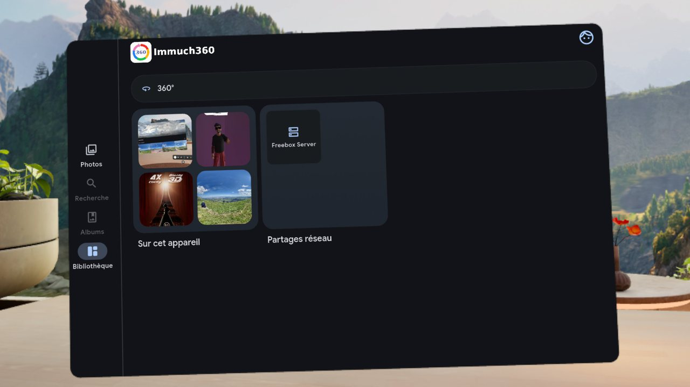
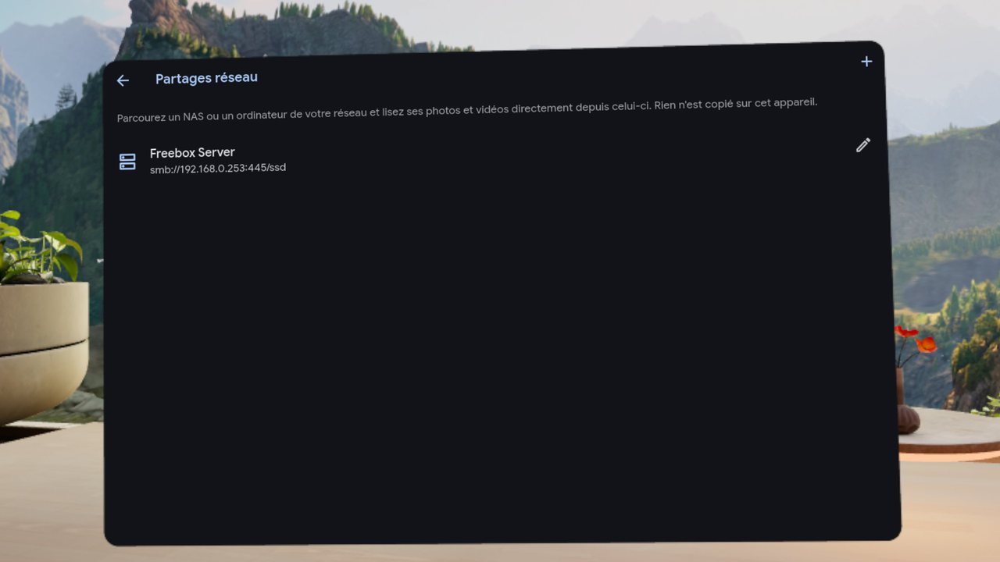

# Platform support

What each system has, how far it is available, how it is installed, what differs on it, and how it is driven.

Back to the [README](../../README.md)

One code base, six environments. Each section below starts with how far the platform is available, from the least to the most: the code present in the sources, implemented (the functions work in the app), built by the project's CI, a pre-release, a public download, a store.

| Platform | Availability on 20 October 2026 | Where to get it |
|---|---|---|
| [Android phones and tablets](#android-phones-and-tablets) | Store and public download | [Google Play](https://play.google.com/store/apps/details?id=com.aprogsys.immuch360) (build 25; build 26 next), the APKs of build 26 on [GitHub](https://github.com/freeKC/Immuch360/releases) |
| [iPhone and iPad](#iphone-and-ipad) | Implemented, built on Codemagic, TestFlight for testers, App Store in review (version 3.3.1) | [Build it yourself](build.md) until the App Store has it |
| [Android TV and Google TV](#android-tv-and-google-tv) | Public download, Google Play for TVs in review | The universal APK of build 26 on [GitHub](https://github.com/freeKC/Immuch360/releases) |
| [Meta Quest](#meta-quest) | Store and public download | The [Horizon Store](https://www.meta.com/experiences/immuch360/1384208401440714/) (build 23; build 25 in review), the Quest APK of build 26 on [GitHub](https://github.com/freeKC/Immuch360/releases) |
| [Windows](#windows) | Pre-release | The installer or the ZIP of desktop build 6 on [GitHub](https://github.com/freeKC/Immuch360/releases/tag/desktop-v3.3.0-rc.0-6) |
| [macOS and Linux](#macos-and-linux) | Pre-release, early previews: Linux run under WSLg and in the CI's containers, macOS on the CI's Mac only | The .deb, the .rpm, the DMG and the ZIP of desktop build 6 on [GitHub](https://github.com/freeKC/Immuch360/releases/tag/desktop-v3.3.0-rc.0-6) |

The functions are compared platform by platform in [Compatibility](compatibility.md), and the build of each store in [Release status](release-status.md).

## Android phones and tablets

**Availability**: a store and a public download. Google Play has build 25 (3030023), public since 20 October 2026, after build 23 (3030021), public since 14 October 2026; build 26 (3030024) goes to Google Play after its release, and the GitHub release has build 26. From build 26 the native libraries of the 64 bit APKs are aligned for 16 KB memory pages, which Google Play requires from apps that target Android 15 or later.

**What it has**: the complete app, touch and gyroscope, every source: your Immich server, the device's gallery, SMB, WebDAV and DLNA shares, Plex, the Tapo cameras live and recorded, the phone shared on the network and uploads to Immich, with the 360°, 3D, VR180 and Spatial 2.5D players and the raw files of 360° cameras. **What it lacks yet**: the audio track choice in the flat player, previous and next in the 360° player, and swiping from one file of a share folder to the next, see [Known issues](known-issues.md#android-phones-and-tablets).

**Input**: touch and the gyroscope. With Settings, Preferences, "Remote control layout" turned On, a tablet is driven by a keyboard or a game pad as a TV by its remote.

### Install on a phone or a tablet

1. [Google Play](https://play.google.com/store/apps/details?id=com.aprogsys.immuch360), or the APK on the [Releases](https://github.com/freeKC/Immuch360/releases) page: `Immuch360-v<version>-arm64-v8a-release.apk` for a phone (the universal `Immuch360-v<version>-release.apk` works everywhere, `-armeabi-v7a` is for older 32 bit phones, and the `.aab` file is for Google Play, not for sideloading). The GitHub build is usually ahead of the store. Either way it installs next to the official Immich app (package `com.aprogsys.immuch360`).
2. The `-x86_64` APK is for 64 bit x86 devices, such as the Android emulator.
3. The APK from GitHub does not update itself: watch the Releases page, and once you have installed the app from a store, take the updates from that store.
4. From build 24 the app starts on a welcome page: tap "Use without a server" to start on the device's own photos and videos, "Add a network share or a media server" to start on the Network shares page, or "Connect to an Immich server" to log in with your usual Immich server URL and account. Up to build 23, the login page comes first, with "Use without a server" under it.

## iPhone and iPad

**Availability**: implemented, and built on Codemagic. TestFlight has build 24 (iOS build 29), for testers. The App Store version 3.3.1, with build 24, has been waiting for Apple's review since 14 October 2026; Apple rejected version 3.3.0, with the features of build 11, on 13 October 2026 under guideline 4.3(a), and the answer went with version 3.3.1. There is no public download: until the App Store has the app, build it with Xcode on a Mac.

**What it has**: the complete app: your Immich server, the device's gallery, the shares, Plex, the Tapo recordings, the phone shared on the network, uploads to Immich, the 360°, 3D, VR180 and Spatial 2.5D players and the raw files of 360° cameras, stitched in Metal. **What differs**: the 360° video player has play and pause only, without a time bar; the Tapo live view comes in a later version; the DLNA, Plex and Tapo searches send unicast requests only until Apple grants the multicast entitlement; the MKV and AVI files of a share do not open (on a server they play transcoded); the phone share runs only while the app is in front; the photos stored only in iCloud are left out of the 360° scan and of the phone share. Raw files and the iPhone side of the phone share have not run on an iPhone yet, see [Known issues](known-issues.md#iphone-and-ipad).

**Input**: touch and the gyroscope; the 360° video player has a gyroscope toggle, on by default.

### Install on an iPhone or an iPad

1. The App Store version is waiting for Apple's review. Until it is published, build the app with Xcode on a Mac, or on Codemagic, see [Build it yourself](build.md).
2. Tap "Use without a server", or sign in with your Immich server ("Connect to an Immich server" on the welcome page, from build 24).

## Android TV and Google TV

**Availability**: a public download. The TV app is the same APK as the phones: from build 20 the `phone` flavour also declares itself as a TV app, with a launcher entry and a banner, and no touch screen required. The GitHub release has build 26; the Google Play listing for TVs has been under Google's review since 9 October 2026. Builds 21 and 22 were tried on the Google TV emulator (the login, the timeline, the albums, flat photos and videos, the 360° sphere viewer and video player, the 360° list, an SMB share, the add menu, the share form, Settings and the remote navigation), without opening the Plex and Tapo pages; of the TV fixes of build 23, only the bottom margin of the Photos tab was seen there, the others being covered by automated tests. The welcome page of build 24 was tried there with the remote, in a debug build, and so were the search filters, the search type and the album sort of build 26. The app has not run on a real TV yet.

**What it has**: a viewer, with or without an Immich server: your server, the network shares, Plex and the Tapo cameras, live and recorded, with the 360°, 3D and VR180 viewers turned with the arrows. A TV has no photos of its own. **What it lacks**: backup, uploads, editing, deleting, sharing, selecting several items, Cast, the Spatial 2.5D button, the gyroscope, the map and Places, and "Share this phone on the network" are hidden (the Settings page still shows the setting of Spatial 2.5D and, with a server, the Backup section), and signing in with OAuth is not possible, see [Watch on your TV](user-guide.md#watch-on-your-tv-android-tv-and-google-tv). **Known issues**: in the search, the Location filter sheet keeps the focus in its Country field (Back closes the sheet), and the quick date sheet shows two choices at a time and scrolls, see [Known issues](known-issues.md#android-tv-and-google-tv).

**Input**: the remote only: the arrows move a focus frame, OK opens, Back goes back, channel up and down scroll a page or zoom, and the play and pause, rewind, fast forward, previous, next and info keys work in the viewers; text is typed in the keyboard dialog of the TV. From build 26 the search filters work with the remote too: in the People filter Right reaches Apply and Up from Apply reaches Clear, in the other filter sheets Down from the last choice reaches Clear and Apply, and the album sort and the search type open in a dialog that keeps the focus. See [Move around with the remote](user-guide.md#move-around-with-the-remote).

### Install it on the TV

1. Until Google Play offers the app on TVs, which waits for Google's review of the TV release, take the universal `Immuch360-v<version>-release.apk` of the [Releases](https://github.com/freeKC/Immuch360/releases) page.
2. On the TV, turn on the developer options and USB debugging (on a Google TV: Settings, System, About, select "Android TV OS build" seven times, then Settings, System, Developer options; the names vary between TVs).
3. From a computer on the same network, with adb (Android SDK Platform Tools): `adb connect <address of the TV>`, accept the prompt on the TV, then `adb install -r Immuch360-v<version>-release.apk`.
4. The app shows among the apps of the TV, with its banner. Install the next release the same way: `-r` keeps the login and the settings.

## Meta Quest

**Availability**: a store and a public download. The [Meta Horizon Store](https://www.meta.com/experiences/immuch360/1384208401440714/) has had the app since 7 October 2026: build 14 first, then build 23, its version 2, published on 18 October 2026. Version 3, with build 25 and its welcome page, has been under Meta's review since 18 October 2026. The GitHub release has the `-quest-release.apk` of build 26.

Immuch360 also runs on the Meta Quest headsets with Horizon OS v69 or later. The Horizon Store lists the app for the Quest 2, Quest Pro, Quest 3 and 3S, the four the universal `-release.apk` names and the Quest build names from build 21; the first Quest is not, the store no longer accepts it.

Only the Quest 3 is tested: build 25, the one in Meta's review, ran on it by hand on 18 October 2026. The Quest 2, Quest Pro and Quest 3S are not tested yet. The video decoders of the Quest 2 and Quest Pro are slower, and the limits the app checks were measured on a Quest 3, so a large H.264 video may be refused with a message or stutter on them. Reports from these three headsets are welcome in [Issues](https://github.com/freeKC/Immuch360/issues).

How to use it is in [In the Meta Quest 3 headset](user-guide.md#in-the-meta-quest-3-headset); this section is about installing it and what differs on the headset.

The headset build only talks to servers over HTTPS, or over plain HTTP to names of the home network (`.local`, `.lan`, `.home`, `.internal`, `.home.arpa`) and to the headset itself, as the Horizon Store requires. A server typed as a plain HTTP address with an IP, such as `http://192.168.1.10:2283`, is refused by that build: use HTTPS, a home network name (`nas.local`), or the universal `-release.apk`, which keeps the open policy of the phones.

WebDAV, DLNA and phone shares at a plain HTTP address of the local network are not concerned: the app reads them itself and hands its players only the address of its local bridge (to be confirmed on the headset for DLNA and the phone share, new in build 19). From build 20 a Plex server is reached over HTTPS, and a Tapo camera by the app itself, its live view over RTSP, which is not HTTP: neither should be concerned (to be confirmed on the headset).

**Input**: the controllers or the hands; the table of every action is in [Open the immersive view](user-guide.md#open-the-immersive-view).

### Install on the headset

Immuch360 has been on the [Horizon Store](https://www.meta.com/experiences/immuch360/1384208401440714/) since 7 October 2026; the store has build 23 since 18 October 2026, and build 25 is in Meta's review. To get a build before the store has it, sideload the `-quest-release.apk` file of a release (built for the headset: 64 bit, target SDK 34, only the permissions the headset uses), or the universal `-release.apk`:

1. Enable developer mode once. In the Meta Horizon phone app, open Devices, select the headset, then Headset settings, then Developer mode. This needs a developer account, which is free at developers.meta.com. You also need adb (Android SDK Platform Tools) on the computer, or SideQuest.
2. Connect the headset to a computer with a USB-C cable. In the headset, accept "Allow USB debugging".
3. Install the APK:

   ```bash
   adb devices                      # the headset must be listed as "device"
   adb install -r Immuch360-v<version>-quest-release.apk   # for example Immuch360-v3.3.0-rc.0-26-quest-release.apk
   ```

4. In the headset, open the Library, choose the "Unknown sources" filter, and start Immuch360.
5. A sideloaded APK does not update itself: install the next release the same way (`adb install -r` keeps the login and the settings). The Horizon Store version and the GitHub APK are signed with different keys, so the headset refuses one over the other: to switch, uninstall the app first, which loses the login, the settings and the list of network shares.

### In the window

The whole app runs as a resizable 2D window: login, timeline, albums, search, the Library tab (360° list, On this device, Network shares), the settings, and the photo and video viewers, where flat photos and videos play.

On the headset the 360° button, and View as 360° in the ⋮ menu, open the immersive view directly instead of the sphere viewer of phones, and the Spatial 2.5D button and its setting are not shown.

From build 19 an Apple spatial photo has a View in 3D button, and the Share this phone on the network tile is not shown: the headset is the one that reads a phone's share. From build 20 the Plex servers and the Tapo cameras open in the window too, the camera live view in HD; the "Remote control layout" setting stays on Automatic, which leaves it off on the headset. The Quest build does not carry the service of the phone share at all; from build 26 the app no longer tries to stop it when it closes, which logged "Unable to start service" in the headset's log.

### In pictures

Captures taken in the headset with the capture button (Meta button and trigger), on a Quest 3, with the app in French; the Library tab is shown in the mode without a server.

<p align="center">
  
  
</p>

- **Without a server**: the Library tab in the mode without a server, with the headset's own media and the network shares.
- **Network shares**: a Samba share of a Freebox Server, read live from the headset.

### Limitations on the headset

- **Video codecs**: HEVC (H.265) is the safe choice; H.264 stops around 4096x2304. What the app checks, and how to give the headset a video it decodes, is in [Video details and decoders](user-guide.md#video-details-decoders-and-why-a-video-stutters).
- **Store**: the store version is build 23 since 18 October 2026, with every feature up to build 23; the welcome page of build 24 comes with version 3, build 25, once Meta has approved it (in review since 18 October 2026). The GitHub APK has build 26.
- **Permissions**: the headset build asks only for photos and videos (the mode without a server) and notifications (backup progress). It has no storage, audio, location or camera permission, unlike the phone build; the Wi-Fi name based server switching is therefore not available on the headset.
- **APK size**: the Spatial SDK adds about 56 MB of 64-bit ARM native code, on phones too, where it is never loaded.
- **License**: the immersive view uses the Meta Spatial SDK, distributed under the Meta Platform Technologies SDK License Agreement.

## Windows

**Availability**: a pre-release, as a public download on GitHub: desktop build 6 of 20 October 2026, an installer and a ZIP for Windows x64 (the installer from desktop build 5). No store, no signed build and no automatic update yet. The project's libmpv workflow builds an arm64 archive too, but no Windows on ARM app is made yet.

**What it has**: Immuch360 Desktop is the same app on a Windows computer, built from the same sources as the phone apps: your Immich server, the folders of the computer in place of a gallery, SMB, WebDAV and DLNA shares, Plex, the Tapo cameras live and recorded, the computer shared with a headset, uploads and backup while the app is open; photos, flat videos and, from desktop build 3, 360°, 3D, VR180 and raw 360° videos in a player of its own (libmpv), with raw files stitched on the graphics chip. **What it lacks yet**: Spatial 2.5D, the map and Places, signing in with OAuth, Google Cast, notifications and a 3D view (a 3D video shows its left eye), see [Not there yet](user-guide.md#not-there-yet). From desktop build 6 the texts of the computer version are translated in the 88 other languages of the app. How to use it is in [On a Windows computer](user-guide.md#on-a-windows-computer-immuch360-desktop-preview).

**Input**: the mouse and the keyboard: F or F11 for full screen and Escape to leave it, the arrows, Home and End, I for the details; in a video Enter or Space to pause, J and L to jump 10 seconds, M for the sound; the wheel, `+` and `-` to zoom a 360° view. See [Use it on a computer](user-guide.md#use-it-on-a-computer).

**Files from Windows** (from desktop build 5): "Open with" in File Explorer, files or a folder dropped on the window or on `immuch360.exe`, and paths on the command line open in the app, a 360° file in its 360° view; with the app open, they go to its window, and from desktop build 6 a file handed over while the viewer shows another one opens in its place. See step 3 of [Use it on a computer](user-guide.md#use-it-on-a-computer).

### Download and install on Windows

The current build is the GitHub pre-release [Immuch360 Desktop 3.3.0-rc.0, desktop build 6](https://github.com/freeKC/Immuch360/releases/tag/desktop-v3.3.0-rc.0-6). Its Windows files are the installer, `Immuch360-Desktop-3.3.0-rc.0-desktop.6-windows-x64-setup.exe`, and the same program as a ZIP, `Immuch360-Desktop-3.3.0-rc.0-desktop.6-windows-x64.zip` (in desktop build 5, about 58 MB and 173 files once unzipped, the video player and its `licenses` folder included), with `SHA256SUMS.txt` to check them. The project's CI built them from the main branch, `immuch360`: the sources of the phone build 26, on Immich of 10 October 2026, plus the computer version. From desktop build 4 the video player library, `libmpv-2.dll`, is the project's own build of 2026, whose sources are published with it; it stacks the two lenses of raw videos stored one per track or per file, and lets the graphics chip draw the 360° view without copying each frame back. It needs Windows 10 or 11, 64 bit.

The installer, described after these steps, takes fewer steps. With the ZIP:

1. Download the ZIP and unzip it anywhere, for example in Documents. To replace an earlier build, delete its folder or unzip into a new one: your sign in, your folders and your settings stay in your Windows profile, not in that folder.
2. Start `immuch360.exe` from the unzipped folder. Keep the folder whole: the program needs the files next to it, among them `libmpv-2.dll`, the video player, and `immuch_desktop_video.dll`, which reads the decoders of the graphics chip.
3. The files are not signed yet, so Windows SmartScreen may show "Windows protected your PC": choose "More info", then "Run anyway". Where Smart App Control is on, it blocks unsigned programs.
4. Wait for the window. The first start of a new build takes from 10 seconds to about a minute, most likely while Microsoft Defender scans the new files: do not start the app again meanwhile. The next starts take a second or two.
5. The app starts on a welcome page (from desktop build 5; desktop build 4 started on the login page): "Use without a server" opens the choice of your folders, "Add a network share or a media server" the Network shares page, and "Connect to an Immich server" the login page.

To check the ZIP, run `certutil -hashfile Immuch360-Desktop-3.3.0-rc.0-desktop.6-windows-x64.zip SHA256` in a command prompt, in the folder of the download: the result is the one written in `SHA256SUMS.txt`. The ZIP does not update itself: watch the [Releases](https://github.com/freeKC/Immuch360/releases) page, and unzip the next build the same way.

**The installer, from desktop build 5**: `Immuch360-Desktop-<version>-windows-x64-setup.exe` installs the same files as the ZIP, for you only (no administrator rights, the default) or for every user of the PC (in Program Files), with a Start menu entry, an optional desktop shortcut, "Open with" for photos and videos (never as their default program) and an uninstaller in Settings, Apps. It speaks the language of Windows and lists every language of Inno Setup, the tool that makes it. The steps are in [Install it on a computer](user-guide.md#windows).

**What was checked**: the installer that the project's CI built on 13 October 2026, with the sources of build 23, was run silently for the current user on the test PC (Windows 11), into a scratch folder: its 173 files were those of the ZIP of the same CI run, byte for byte; Windows offered the app in "Open with" for the 19 file types; no default program of the PC changed; the uninstaller removed the files, the shortcut and every registry entry, leaving the registry as it was before. Its first two dialogs (the choice for you or every user, then the language, French already selected) were seen on the same PC. The installation for every user, which asks for an administrator, was not run on the test PC. Desktop build 6 changes nothing in the installer.

## macOS and Linux

**Availability**: pre-releases on GitHub, from desktop build 5: a .deb for Debian and Ubuntu, an .rpm for Fedora, and the macOS app in a DMG and a ZIP, built by the project's CI. Their projects are in the sources (`mobile/macos`, `mobile/linux`, and the entry point `lib/main_desktop.dart` that the Windows build uses too). These are early previews, and the honest state differs between the two systems.

**Linux**: from desktop build 6, flat videos play through the libmpv of the system (libmpv2, libmpv1 on Ubuntu 22.04, mpv-libs on Fedora), which the .deb and the .rpm depend on, with a frame of each video as its thumbnail; the player is the one of every source (the folders, the server, the shares, Plex, the Tapo recordings and live view), checked on Linux with the videos of a folder only. 360°, 3D, VR180 and raw dual lens videos play flat, with the message "This computer cannot show the 360° view of this video: it plays flat.": the 360° video player draws through renderer C, which is Windows only. The SMB library needs glibc 2.25 at most, so SMB shares can open on Ubuntu 22.04 and Debian 12 too (desktop build 5 needed glibc 2.38). On Fedora, camera videos (H.264 Main and High profiles) need the FFmpeg of RPM Fusion: Fedora's own FFmpeg decodes H.264 through OpenH264 only, which refuses those profiles. A bundle copied by hand onto a system without libmpv runs without videos, and the viewer names the package to install.

How Linux was checked: the app first started on 13 October 2026, from the .deb of desktop build 5 under WSLg (the Linux of Windows 11): the login page, the mode without a server with the Pictures and Videos folders suggested, the timeline of their photos and videos, a 360° photo as a sphere turned with the mouse. For desktop build 6, the CI installs each package in clean containers of Ubuntu 22.04 and 24.04, Debian 12, Fedora 40 and Fedora 44, checks that every library is found and plays a short video in each; its Linux job also runs the tests that need libmpv, among them the sign in of the Tapo live view. The SMB library built on Ubuntu 22.04 passed the 14 Samba tests of the app on 20 October 2026. A .deb of the CI with the video work of desktop build 6 ran under WSLg again: a folder given on the command line, with the thumbnails of its two videos, a 20 second video played, a 360° video and a raw .insv file played flat with their message. Known: on X11 sessions the videos are drawn by the processor, because the isolated EGL context of the graphics chip fails there (under Wayland the same build uses the graphics chip); without a secret service (no GNOME Keyring or KWallet), the first start logs a keyring error and each access to a secret can wait 25 seconds. What was checked on Linux: the app starts, the folders without a server, flat photos, flat videos with their thumbnails, and 360° photos as a sphere. In the sources and built by the CI, not checked on Linux yet: the Immich server gallery, the SMB, WebDAV and DLNA shares, Plex, the Tapo recordings and live view, Apple spatial photos and the upload to Immich. The app has never run on a real Linux PC with its graphics chip, only under WSLg and in the CI's containers.

**macOS**: nobody working on the project has a Mac. The app is built on the macOS runner of the CI, universal (Apple silicon and Intel), signed for the computer that runs it only, without an Apple Developer ID, and not notarized: an unsigned preview, for which Gatekeeper asks once (System Settings, Privacy and Security, Open Anyway). From desktop build 6 it carries the project's own libmpv, built under the LGPL and published with its sources (release [libmpv-macos-20261020-9](https://github.com/freeKC/Immuch360/releases/tag/libmpv-macos-20261020-9)), and plays flat videos; 360°, 3D and raw videos play flat with the same message as on Linux. Its secrets go to the login keychain, since the data protection keychain refuses an app that is not signed with a developer team. Its Info.plist declares the use of the local network, the Bonjour services the app looks for (`_smb._tcp`, `_webdav._tcp`, `_webdavs._tcp`, `_http._tcp`, `_https._tcp`) and why it may open the protected folders (Desktop, Documents, Downloads, removable and network volumes). Its release build runs without the macOS sandbox, from desktop build 5. Files opened from the Finder reach the app that runs.

How macOS was checked: on the Mac of the CI only, a virtual Mac without a user. Launch Services offers the app in "Open with" for the 19 file types, and each run starts the app with a self check, which passed every step on the last runs before desktop build 6: a plain start of 30 seconds; a folder of a photo and a video given on the command line, which opens on its page; the video alone, which plays in the viewer; a photo opened through Launch Services as the Finder does, then the video handed to the app that runs, which shows it; the keychain written, read back and deleted; libmpv loaded and 5 seconds of video played (H.264 decoded by VideoToolbox, drawn in software on that virtual Mac). Never run on a real Mac, so untested there: the Gatekeeper steps, the OpenGL path of the video, the keychain prompts after an update, the local network prompt and the discovery of servers, Finder drops, signing in to an Immich server, shares with passwords, the gestures of a trackpad, Retina screens and two displays.

**Files given to the app** (from desktop build 5): the files and folders dropped on the window on both systems; on Linux one copy runs per user, a later start handing its files to it over the session bus; on macOS the files the Finder opens with the app go to its window. On Linux, files and folders given on the command line of a first start ran under WSLg; drops and the hand over of a later start have not run. On macOS, the CI's Mac ran the command line, the Launch Services path and a file handed to the app that runs; a drop by hand has not run.

**Input**: the mouse and the keyboard, with the shortcuts of Windows; on a Mac the Cmd shortcuts and the trackpad too, never tried on a Mac.

**What is missing**: on both systems, the parts written for Windows only so far: the projection pass of the 360° video player (renderer C), the probe of the graphics chip's decoders, without which the app answers from its static decoder rule, and the computer share; on Linux, the watching of folders (Refresh and rescans only) and the graphics chip drawing videos on X11; on macOS, a Developer ID signature and a notarization; on both, a run on a real computer.

**Install them**: [Install it on a computer](user-guide.md#install-it-on-a-computer-windows-linux-and-macos). **Build them**: [Build it yourself](build.md#macos-and-linux).

## License and trademarks

This project is a fork of Immich and stays under the [GNU AGPL v3](../../LICENSE). Every APK, the phone ones included, also contains the Meta Spatial SDK, which is not open source (Meta Platform Technologies SDK License Agreement) and is only used on Meta Quest headsets; Immuch360 Desktop, the computer version, does not contain it. Immuch360 is not affiliated with, nor endorsed by, the Immich team or FUTO.

The Windows ZIP and installer of Immuch360 Desktop, and from desktop build 6 the macOS app, also carry its video player: libmpv, the library of [mpv](https://mpv.io), with [FFmpeg](https://ffmpeg.org) inside it, driven by the plugins of [media_kit](https://github.com/media-kit/media-kit). mpv and FFmpeg are built without their parts that are GPL only, and their code is under the GNU LGPL version 2.1 or later; built together, `libmpv-2.dll` is distributed under the GNU LGPL version 3 or later. The app loads it at run time, so you may replace it with your own build. The licence texts are in the `licenses` folder of the program, and every library with its licence and its sources is listed in [NOTICES.md](../../mobile/packages/media_kit_video/windows/NOTICES.md). The macOS app carries the libmpv frameworks of the release [libmpv-macos-20261020-9](https://github.com/freeKC/Immuch360/releases/tag/libmpv-macos-20261020-9), built the same way under the LGPL, with their notices and licence texts inside the app (`Contents/Resources/media_kit_libs_macos_video_media_kit_libs_macos_video.bundle/Contents/Resources/licenses/`, listed in [its NOTICES.md](../../mobile/packages/media_kit_libs_macos_video/macos/media_kit_libs_macos_video/Sources/media_kit_libs_macos_video/licenses/NOTICES.md)) and their sources on that release. The Linux packages ship no libmpv: they ask the package manager for the one of the distribution.

Android, Android TV and Google TV are trademarks of Google LLC; Apple, iPhone, iPad and macOS are trademarks of Apple Inc.; Meta and Meta Quest are trademarks of Meta Platforms, Inc.; Windows is a trademark of the Microsoft group of companies; Linux is the registered trademark of Linus Torvalds in the U.S. and other countries. Their logos appear in the platform table only to show where Immuch360 runs and do not imply any endorsement or affiliation. The Android robot is reproduced or modified from work created and shared by Google and used according to terms described in the Creative Commons 3.0 Attribution License. Tux, the Linux penguin, is by Larry Ewing (lewing@isc.tamu.edu), drawn with The GIMP, in the vector version by Simon Budig and Garrett LeSage. Sources and licences of the logos: [.github/readme/logos/SOURCES.md](../../.github/readme/logos/SOURCES.md).

Last updated: 20 October 2026 (build 26, desktop build 6)
