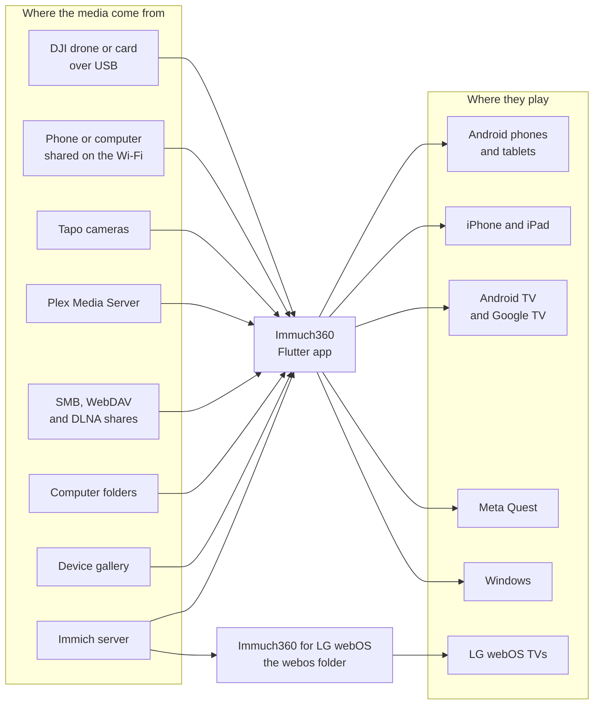
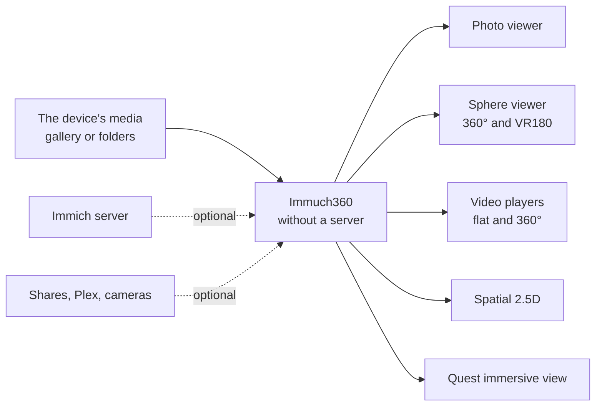
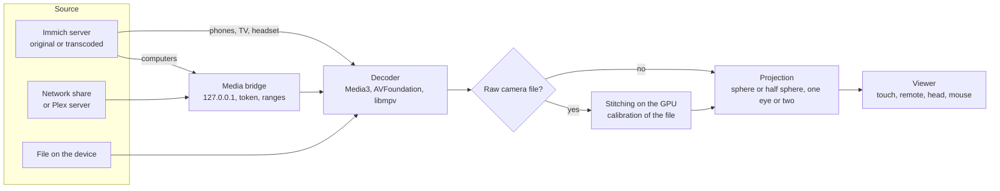

# Technical details

How Immuch360 is built, for developers: the Flutter app and its native modules, the media bridge, the sources, the stitching of raw files, the decoder checks, the one-key rotation, the TV mode, the desktop layer and the app for LG webOS TVs.

Back to the [README](../../README.md)

Immuch360 is a fork of the Immich mobile app, the `mobile` folder of this repository: a Flutter app written in Dart, with native modules for what Flutter does not do by itself (the players, the GPU passes, the headset, the TV). Everything the Immich app does stays as it is, and the parts of the fork sit next to those of Immich. The same Dart code runs everywhere: `lib/main.dart` starts the phones, tablets, TVs and headsets, and `lib/main_desktop.dart` the computers, whose own parts live under `lib/desktop`. The app for LG webOS TVs is apart, in the `webos/` folder, see [The LG webOS app](#the-lg-webos-app). How to build them is in [Build it yourself](build.md).

## Sources and screens

The app reads each source itself, in Dart, and hands the players either a file of the device or an address of its own media bridge. A source never needs a plugin or a change on its server, and the media are never copied or converted on the way: the players get the original bytes, with the 360°, 3D and VR180 metadata the camera wrote.

## The Flutter app and the native modules

- **Dart** (`mobile/lib`): the screens, the sync with the Immich server and the local database of the Immich app (Drift), the detection of 360°, 3D, VR180 and spatial media, the clients of every network source, the media bridge, the plans of raw videos and the stitching of raw photos, and the TV mode. Dart talks to the native code through the Pigeon APIs of `mobile/pigeon`: the immersive view, the 360° and Spatial players, the video decoders, the TV, the camera live view and the phone share.
- **Android** (Kotlin, `mobile/android/app/src/main/kotlin/app/alextran/immich`): the players are built on Media3 (ExoPlayer): the 360° player (`spherical/`), the Spatial 2.5D player, with the head tracking of the front camera and OpenGL ES 3 (`spatial/`), the stitching of raw videos (`core/DualFisheyeEffect.kt`, a Media3 GL effect, and `core/raw/`, the two lens playback and its compositor), the list of the device's decoders (`core/VideoDecoders.kt`), the camera live view over RTSP (`camera/`), the phone share as a foreground service (`phoneshare/`; the Quest build does not declare that service, so from build 26 its start and stop look it up first and do nothing there) and the detection of a TV (`tv/TvDevice.kt`, which from build 27 also tells a TV with 3 GB of memory or less). From build 27: `core/AppHealth.kt` watches the main thread (a stall of 3 seconds) and reads why the app last ended (Android 11 and later), both written to the Logs page; `spherical/PlaybackReport.kt` describes a 360° playback that fails (the decoder, the waits for data, the dropped frames) for the same page; `core/StreamingLoadControl.kt` sizes the buffer of the 360° player from the Java heap; `documenttree/DocumentTreePlugin.kt` is the bridge of the DJI drone page. The Kotlin unit tests (`android/app/src/test`) run in the release workflow. From build 26 the Rust core of Immich is linked for 16 KB memory pages (`native/.cargo/config.toml`), and the release workflow checks every 64 bit library of the APKs and of the App Bundle (`mobile/scripts/check_16kb.sh`). The app has two flavours: `phone`, for phones, tablets and TVs, and `quest`.
- **Meta Quest**: the same Android app, as a 2D window. The immersive view is an activity of the Meta Spatial SDK (`immersive/ImmersiveViewerActivity.kt`), started from the Flutter activity through the immersive API with a launch token, after Meta's hybrid app sample: a skybox for photos, an equirect compositor layer for videos, Equirect180 surfaces for VR180, the stereo mode of each for 3D files, so that each eye gets its own half, and a flat quad 2 m in front of you for an Apple spatial photo, whose two eyes are decoded natively. Its requests use the native HTTP session of the app; the controllers and the hands drive it (`ImmersiveInputSystem.kt`).
- **iOS** (Swift, `mobile/ios/Runner`): the 360° player in SceneKit with AVFoundation (`Spherical/SphericalVideoViewController.swift`), the stitching of raw videos with a SceneKit shader and, for two lenses, an AVFoundation video compositor in Metal (`Spherical/RawStitchCompositor.swift`, `RawStitchShaders.metal`), the Spatial 2.5D player in Metal (`Spatial/`), the decoders (`Core/VideoDecoderApiImpl.swift`) and the phone share (`Core/PhoneShareApiImpl.swift`).
- **Windows** (C++): the runner of the app, with its crash reports (`mobile/windows/runner`); the vendored `media_kit_video` plugin, patched with the projection pass of the 360° player (`mobile/packages/media_kit_video/windows`, OpenGL ES 3.0 on ANGLE over Direct3D 11); `media_kit_libs_windows_video`, which downloads libmpv and ANGLE and checks each archive by its SHA-256; and `immuch_desktop_video`, a small DLL called through `dart:ffi` that reads the Direct3D 11 decoder profiles of the graphics chip.
- **Linux** (C and C++, `mobile/linux`): a GTK runner with one copy per user, a later start handing its files over the session bus, and drops; from desktop build 6 the vendored `media_kit_video` Linux plugin finds the seven libmpv functions it needs with `dlsym` in the libmpv of the system, so one build runs with `libmpv.so.2` and `libmpv.so.1`, and `media_kit_libs_linux` switches that plugin on without bundling any library; libsmb2 is built again on Ubuntu 22.04 by `.github/desktop/libsmb2/build_linux.sh`, so that it needs glibc 2.25 at most. From desktop build 7 the isolated EGL context of the plugin (`linux/isolated_egl.cc`, its patch 10) works under X11: libglvnd refused `eglMakeCurrent` there (EGL_BAD_ACCESS, 0x3002) because GDK leaves its own GLX context current on the platform thread after each paint, so every switch now puts GDK's context aside with `gdk_gl_context_clear_current` and makes it current again after; before the hardware path is taken, a 1x1 texture goes through an EGLImage as each frame does, so a display that cannot share textures draws in software rather than black. In Dart, `lib/desktop/platform/linux_secret_storage.dart` stands in front of the secure storage plugin: it asks the session bus once (3 to 10 seconds at most) whether `org.freedesktop.secrets` runs or can start, and without it keeps the secrets in memory for the session, never calling libsecret, whose calls block the platform thread for 25 seconds when no service answers; background isolates ask the store of the main isolate through a port.
- **macOS** (Swift, `mobile/macos`): the runner forwards the files the Finder opens and the drops on the window; from desktop build 6, `media_kit_libs_macos_video` puts the project's libmpv frameworks in the app (downloaded from the release of the libmpv workflow by their SHA-256), and the `media_kit_video` macOS plugin falls back to mpv's software rendering when OpenGL gives no context. The secure storage uses the login keychain (`MacOsOptions(useDataProtectionKeyChain: false)`), since the data protection keychain refuses an app without a developer team; `lib/desktop/window/self_check.dart` is the self check the CI runs on its Mac.

## The standalone mode

The welcome page (`mobile/lib/pages/login/welcome.page.dart`, from build 24) is the root of the router while no session exists: the splash page sends there when the store holds no session, the route guard when a page needs a session that is not there, and signing out too; a token the server refuses puts the login page above it, so that its Back returns there. "Use without a server", its first choice (a link under the login form up to build 23), starts the app on the device's own media: the gallery of a phone or a headset, read by the native sync of the Immich app (MediaStore on Android, PhotoKit on iOS), or on a computer the folders the user chose. The local tables of the Immich app hold them as they would with a server, so the timeline, the 360° list and every viewer work the same, and the pages that only a server can fill stay hidden or greyed out. A server can be connected later, and the shares, Plex servers and cameras are sources the user adds, with or without a server. Nothing leaves the device.

## The media bridge

### How it plays without downloading

The players read the bytes they need through a bridge inside the app (loopback address only, random token per session, byte ranges), so seeking in a video works and nothing is copied to the device. The players and the headset viewer never get the address of the share, only the bridge's 127.0.0.1; the requests to the server are made by the app itself.

For smooth playback the share is read in large blocks, the file stays open between reads, up to 16 MB are read ahead of the player, and the video being played is read over up to six SMB connections in parallel, separate from the connection that serves thumbnails and listings. A Freebox Server answers each read slowly: one connection gives 4.5 MB/s, six give 19 MB/s, enough for a 5.7K export at 132 Mbit/s.

While the player waits for data, the 360° and Spatial players show "Buffering" with the fill of their playback buffer; the flat player shows "Buffering" without a percentage while the video loads or stalls.

- **Addresses**: `http://127.0.0.1:<port>/<token>/<sourceId>/<path>`, the token random for each bridge, so that the other apps of the device cannot read the shares through it (`mobile/lib/domain/services/media_bridge.service.dart`).
- **Reading**: a body is read from the share in chunks of 1 to 4 MiB, up to 16 MiB ahead of the player, and the reading stops as soon as the player goes away or asks for another part of the file; what is read ahead is bounded for the whole bridge, and only the stat results are kept, for a minute.
- **The rule of every share client**: no address of a share, a resource or an album art ever crosses a Pigeon call to Kotlin or Swift. The native players and the headset viewer only get the addresses of the bridge, which the network security configuration of the `quest` flavour allows, while the requests to the shares run in Dart.
- **On a computer** the videos of the Immich server go through the bridge too (`mobile/lib/desktop/network/immich_server_file_system.dart`), so that libmpv never holds the session token, the cookies or the address of the server.

## The sources

- **Immich server**: the API and the sync of the Immich app, with the same account as the web app. The app reads the head or the end of an original with range requests when it needs its metadata (GPano, spherical metadata, the calibration of a raw file), and plays the original or the transcoded stream as the [Video source](#decoder-checks-and-the-video-source-choice) choice says.
- **SMB 2 and 3**: `dart_smb2`, a Dart binding of libsmb2 (`mobile/packages/dart_smb2`), with each connection held by a worker isolate of its own; from build 27 the package carries libsmb2's notice, its licence texts and its corresponding source as assets (`libsmb2/`), which `lib/utils/libsmb2_license.dart` adds to the licence page. The video being streamed gets a pool of up to six connections, separate from the one that serves the listings and the thumbnails, and a read in sequence is split into parts read in parallel and put back in order (`mobile/lib/infrastructure/network/smb_file_system.dart`).
- **WebDAV**: plain HTTP in Dart, PROPFIND to list and stat, GET with a Range header to read a part of a file; Basic authentication, and redirects followed on the same host only, so that the credentials never leave it.
- **DLNA**: an SSDP M-SEARCH sent to the multicast group, and the same request to port 1900 of every address of the local /24 network; the device description of each server that answers, then its ContentDirectory, listed with the SOAP Browse action and read with Range requests (`mobile/lib/infrastructure/network/upnp/`).
- **Plex Media Server**: GDM, the discovery of Plex, on UDP port 32414; then HTTPS only, to the plex.direct name of the server's address. TLS checks the certificate against the system roots, and the app checks that it is the certificate of the server's stored hash before a single byte of HTTP leaves; the token travels in the `X-Plex-Token` header only, never in an address, and no redirect is followed (`mobile/lib/infrastructure/network/plex/`).
- **Tapo cameras**: the TP-Link discovery protocol on UDP port 20002; the control API over HTTPS on port 443, where the camera's own certificate is pinned by its SHA-256 at the first login; the logins of the three generations of cameras, the latest with SPAKE2+; the recordings fetched from the media port, an encrypted MPEG-TS stream, and written as a QuickTime file with its H.264 video and its sound as PCM, which Media3, AVFoundation and libmpv read; the live view over RTSP with the camera account (`mobile/lib/infrastructure/tapo/`). The app never sends a refused password again by itself, since each one counts towards a lock of the camera.
- **Phone and computer shares**: a read only WebDAV server over the gallery (`mobile/lib/infrastructure/network/phone_share_server.dart`), serving a virtual tree (`Albums`, `By month`, `360`) whose nodes resolve to asset ids, so that no path of the file system comes from the network. It answers only local addresses, on the Wi-Fi, Ethernet and hotspot addresses of the device, with Basic authentication on every request, compared in constant time, and blocks an address for a minute after ten failures. The computer share adds the network category of Windows: no share on a network marked public unless the user says so (`mobile/lib/desktop/network/computer_share.dart`).
- **A DJI drone, its controller or a card** (from build 27, Android, experimental): `ACTION_OPEN_DOCUMENT_TREE`, the folder picker of the system, with a persisted read grant, reaches a USB drive or a card (`ExternalStorageProvider`) and a device in File transfer mode (`MtpDocumentsProvider`) without a permission. The Kotlin bridge (`documenttree/DocumentTreePlugin.kt`, Pigeon `DocumentTreeApi`) lists a folder in one query, waits while a slow MTP device keeps adding rows, reads at a position through a `FileChannel` or, on a device whose files only read from the start, sequentially with skips, keeps two files open and closes them after 30 seconds without use, and copies a file into the MediaStore. `mobile/lib/infrastructure/network/document_tree_file_system.dart` makes the picked folder a source of the share browser, so the viewers, the media bridge and the upload are those of the shares; the page groups the files (`drone_import_grouping.dart`), reads the place of a video in its .SRT (`dji_srt.dart`) and sets it through the API after the upload (`video_location.service.dart`).
- **Discovery and relocation**: mDNS and DNS-SD, a scan of the local network confirmed by a real SMB or WebDAV exchange, SSDP, GDM and the TP-Link discovery run side by side and fill one list (`mobile/lib/domain/services/network_discovery.service.dart`). A share keeps the id its server announces (the UPnP UDN of a DLNA server, the TXT id of a phone share, the machine id of a Plex server, the MAC address of a camera), and one discovery finds it again when its address changes (`network_source_relocator.dart`).

## Detection of 360°, 3D, VR180 and spatial media

- **Videos**: `mobile/lib/domain/services/spherical_probe.dart` reads the boxes of an MP4 or a MOV, the projection (sv3d, Spherical Video V2, or the XML of V1) and the stereo layout (st3d), with range requests on a server or a share. The same read gives the codec, the profile, the level, the bit depth, the frame size and the frame rate, and lists the tracks of the file, which the decoder checks and the raw players use.
- **Photos**: the GPano metadata (the projection, the crop of a partial panorama, the initial view), read from the head of the file; without it, the camera rule (`isEquirectCameraPhoto`): a 2:1 photo stitched by a 360° camera (GoPro MAX, DJI 360 cameras) and, from build 27, by a DJI drone (the make DJI with an `FC` camera code, a Hasselblad camera of a DJI drone, or DJI's drone XMP namespace), mirrored in SQL for the 360° list.
- **VR180**: spherical bounds or a mesh projection, a GPano crop of the front half, or "vr180" or "180" in the name.
- **3D**: the st3d box of a video, otherwise a guess from the shape of the frame (square: top and bottom, 4:1: side by side) or from the file name.
- **Raw files**: the name and the calibration block of an Insta360 file, the extension of a GoPro .360 or a DJI .osv (`mobile/lib/domain/services/raw/`).
- **Apple spatial media**: the head of a HEIC file, for two pictures grouped as a stereo pair (`apple_spatial/heic_stereo_probe.dart`), and for a video a second layer of MV-HEVC with both eyes declared.
- **The user's choice**: "View as 360°" and the 360°/180° choice, remembered on the device for the media of the library, never sent to the server.

## The stitching of raw files

Raw files of 360° cameras hold the circles of the two fisheye lenses, side by side in one frame, in two tracks or in two files. The app stitches them as it shows them, on the GPU, with the calibration the camera wrote in the file.

### How the stitching works

- **What the app reads**: the calibration block the camera appends to every file (lens model, centres, orientation of each lens, size of the calibration canvas) and the accelerometer record, used to level the horizon. The Mei (unified camera) model of the calibration string V3 is used first, V6 (X6 and later firmware) with its first terms next, the older equidistant string V1 last. Nothing is guessed from the camera model when the file has its calibration. The Insta360 X5 and X6 calibration (V6, indexed trailer) and the X4 video window are read from the file.
- **Where it reads it**: the server (the original file, read with a range request for its last bytes), the device's own gallery, and the shares.
- **Photos and videos**: photos are stitched by a Flutter fragment shader before the sphere viewer; videos go to the native players with the calibration, a Media3 GL effect on Android and the Quest, a SceneKit shader on iOS.
- **Two lenses in two tracks or two files**: the players decode both at once, one hardware decoder per lens, paired by time stamp, and a GPU compositor stitches them into the sphere: ExoPlayer and OpenGL ES 3 on Android and the Quest, an AVFoundation compositor in Metal on iOS. 10 bit HLG and PQ sources are tone mapped to the 8 bit sphere.

### The two lens players

- **The plan**: Dart decides how a raw video opens (`mobile/lib/domain/services/raw/raw_video_plan.dart`): which tracks or files hold which lens or cube face, and the calibration that maps them on the sphere, with every rotation computed in Dart, levelling included. The native players get it as the rawProjection JSON and draw from it.
- **Android and the Quest**: two decoders at once, one per lens, whose frames are paired by their time stamps (`core/raw/LensFramePairer.kt`) and stitched by an OpenGL ES 3 compositor (`core/raw/TwoLensCompositor.kt`). `core/raw/RawPlaybackPlanner.kt` decides the fallbacks when the device cannot: one lens with half of the sphere black, the server's transcoded stream, then the video unstitched.
- **iOS**: an AVFoundation video compositor in Metal, which receives the frames of both tracks for each time (`Spherical/RawStitchCompositor.swift`).
- **Windows**: one libmpv core decodes both streams and stacks them side by side with FFmpeg's filter graph, which pairs the frames by their time stamps; the second file of an X3 pair joins as an external track. The 360° renderer then stitches the stacked frame as it stitches a side by side file. Whether a computer keeps up is measured on the playback; otherwise the phones' fallbacks apply, with the camera's low resolution LRV copy added before the unstitched video (`mobile/lib/desktop/video/raw_two_streams.dart`).
- **Photos**: a Flutter fragment shader (`mobile/shaders/dual_fisheye.frag`) stitches an .insp photo into an equirectangular picture of up to 8192x4096, and pure Dart code does the same at a smaller size where the shader cannot run. The headset gets the stitched picture as a temporary file.

## The playback of a 360° video

Before it plays, the app reads the head of the file for its projection, its layout and its video track, and checks that track against the decoders of the device (below). The decoded frame is equirectangular, or becomes so once stitched; the player draws from it the part of the sphere you look at, or of the half sphere for VR180, with one eye on a flat screen and both in the headset.

## Decoder checks and the Video source choice

- **What the file is**: the probe of the file gives its codec, profile, level, bit depth, frame size and frame rate, which an Immich server does not tell.
- **What the device decodes**: a native check answers for that track. Android and the Quest read the decoders of the system (`core/VideoDecoders.kt`), iOS answers from a table of the sizes each codec takes, asking VideoToolbox whether the codec has a hardware decoder (`Core/VideoDecoderApiImpl.swift`), and Windows reads the Direct3D 11 decoder profiles of the graphics chip, then corrects them with what it measured while playing (`mobile/lib/desktop/video/decoder_measure.dart`). The measured limits are applied on top: H.264 on the Quest 3 is held to 4096x2304, a two lens raw video needs two decoders at once, and two software decoders are held to 2048x2048 per lens.
- **Which file plays**: `mobile/lib/domain/services/video_source_policy.dart` follows the Video source setting ("The original when this device decodes it", "Always the original", "Always the transcoded stream"); until the user picks one, a phone keeps what the former "Force original video" switch said, and the Quest plays the original within its decoders. A player that cannot decode the original switches once to the transcoded stream, from where the original stopped, with a message.
- **What the user sees**: the rows of the video details and the page "Video decoders of this device", which lists what the device decodes and can be copied into a bug report, see [Video details, decoders and why a video stutters](user-guide.md#video-details-decoders-and-why-a-video-stutters).

## The one-key rotation

From build 27 one key turns a flat photo by 90° (`mobile/lib/providers/asset_viewer/view_rotation.provider.dart`, `mobile/lib/domain/models/view_rotation.dart`).

- **The mode of a photo**: `none` for anything but a photo, the trash, the locked folder, and every immersive rule of the app (GPano, "View as 360°", the camera rule, raw names, the device scan, Apple spatial pairs, 2:1 photos of Insta360 cameras), and while the kind of the photo is not known yet; `server` for a photo the user owns on Immich 2.6.0 or later that the editor takes (not a motion photo, a GIF or an SVG), outside the read only mode; `device` otherwise. The mode is keyed by the fields it reads, so a new copy of the asset after a sync does not flicker.
- **Server**: the path of Immich's photo editor. The edits of the asset (`getAssetEdits`) are composed with the quarter turns (`composeQuarterTurns` in `utils/editor.utils.dart`: the crop kept as stored, the rotation and the mirror folded into the order the editor saves), sent with `applyEdits` (PUT or DELETE of `/assets/{id}/edits`) 700 ms after the last press, one request at a time, each with the whole list; the app waits for `AssetEditReady` and keeps the turned picture on screen until the regenerated one, known by its new thumbhash, draws its first frame. A failure brings the server's picture back.
- **Device**: a map in the store (`StoreKey.viewRotations`), 5000 photos at most, keyed by the device file, the server asset and its account, or the share and the path; entries go with their share, and assets deleted from the server are pruned once per run after a finished sync.
- **Drawing**: a `RotatedBox` inside the vendored `photo_view` (`mobile/lib/widgets/photo_view/`), whose fit and zoom levels take the turned size; no new decode, no copy.
- **The immersive views never move**: the sphere, the 360° page and the Quest viewer read the unedited picture (`edited=false`) and its size before any edit (`mobile/lib/domain/models/unedited_frame.dart`), so no turn, crop or mirror made on a flat view reaches them.
- **Keys**: the Rotate button (`rotate.action.dart`, `rotate_button.widget.dart`), R and Shift+R without a modifier and outside a text field, the yellow and blue keys of a remote (KEYCODE_PROG_YELLOW and BLUE, `remote_keys.dart`); presses only, a held key turns once. The webOS app ports the same rule and composition in TypeScript.

## The TV mode

- **Detection**: `tv/TvDevice.kt` tells a TV by the leanback feature, or by the television mode of the boxes that do not declare it, never on a Quest. Dart reads it before the first frame, so that the first screen is already in TV mode. The `phone` flavour declares a TV launcher entry and a banner, and does not require a touch screen.
- **The remote control layout** (`mobile/lib/presentation/widgets/tv/tv_shell.widget.dart`), on by default on a TV and set in Settings, Preferences: Flutter's directional navigation mode, overscan margins of 5% as the TV guidelines ask, channel up and down to scroll a page, the arrows out of a text field or a group of choices, and OK to pick a choice.
- **The focus**: one frame drawn over the whole app around the focused widget, which moves to the next one in a short ease and follows it while it scrolls (`tv_focus_ring.widget.dart`); every tap target of the app also takes the focus and answers OK (`remote_focusable.widget.dart`); each page puts the focus on its first item.
- **Text**: a field opens the native text dialog of the TV (`tv_text_entry.widget.dart`), since the TV keyboard cannot be driven with the remote in a Flutter text field.
- **The keys**: the viewers and players read the media keys of the remote, a keyboard and a game pad, beyond the arrows and OK (`remote_keys.dart`): play and pause, rewind and fast forward, previous and next, the info key, and channel up and down to zoom. From build 27 the whole policy of the arrows on a video sits in `remoteVideoArrows` (Left and Right change the item, also while it plays; a video alone seeks), OK shows the controls with play and pause focused, the controls hide 5 seconds after the last key, the Menu key opens the details as the info key does, OK held 700 ms opens them too (with the remote control layout, a short OK acts on its release, and the repeats of a held OK are dropped), the yellow and blue keys turn a photo, and a held arrow moves the photo grid at most every 100 ms.
- **Choices with the remote** (from build 26): the filter sheets of the search have an action rail that the arrows reach from their choices (`filter_bottom_sheet_scaffold.dart`), and the album sort and the search type open in a dialog that keeps the focus (`tv_choice_dialog.widget.dart`), where phones keep their menus. From build 27 the dropdowns of Location and Camera and the year of the date sheet open the same dialog (lazy above 50 choices, opened on the current one), the sheets with a rail take 80% of the height, and Right from a radio choice goes to Apply.
- **The theme** (from build 27): the Automatic theme is dark on a TV (`resolveThemeMode`, `mobile/lib/providers/theme.provider.dart`), and the native launch window has `values-television` styles, which Android ranks above night mode, so a TV that says light shows no white window before the first frame.
- **Memory** (from build 27): on a TV the photo grid asks for previews at 1.5 times the tile, keeps 64 MB of thumbnails and 3 full images, and caches one screen ahead.
- **The details** (from build 27): read only with the remote control layout: the description as text, no pencils, no "Add a location", the rating without Clear, the focus on the first row; a person page has no edit hooks in view only.
- **What a TV hides**: the functions that need a touch screen, a camera or a gyroscope, and those that change the library (backup, uploads, editing, deleting, sharing); from build 27 the one-key rotation of an owned photo is the one edit a TV sends. The Settings page still lists the Backup section and the setting of Spatial 2.5D.

## The desktop layer

Immuch360 Desktop is the same app with a layer for computers, under `mobile/lib/desktop`, started by `lib/main_desktop.dart` before the start the phones share. Nothing of it changes the phone builds: the CI checks that nothing changes under `mobile/android` and `mobile/ios`.

- **The folder library** (`library/`): the folders the user chose stand in for the gallery of a phone. Their index is a SQLite file of its own, apart from the database of the Immich app, numbered by generations as MediaStore numbers its changes on Android, so that the sync of the Immich app reads it as it reads a phone's gallery. The scan runs in its own isolate and lists one folder at a time, with `FindFirstFileExW` on Windows, which recognises a OneDrive placeholder without opening it; local folders are watched for changes, network folders and removable drives are not.
- **The platform**: the Pigeon APIs that the phones answer in Kotlin or Swift are answered in Dart on the computers (`platform/`), the window has a single instance, full screen and keyboard shortcuts (`window/`), files go to a download folder of the user's choice and Share opens the share panel of Windows (`files/`; Linux, which has no share panel for files, saves them into a folder instead; a file handed over while the viewer shows another one closes that viewer first, from desktop build 6), and the network part adds the computer share, the trusted certificates and the choice of the network adapter (`network/`).
- **The video player** (`video/`): media_kit with libmpv, one engine for every player of the app: the flat player, the 360° player, the frame grabber for thumbnails and the camera live view. libmpv is given a path of the computer or an address of the media bridge, never a token, a cookie or the server's address, and every line of its log goes through the redaction of secrets. The players are kept in a pool and reused across pages, since each one holds a decoder, a demuxer cache and a texture. libmpv is loaded once at start (`video/desktop_video_setup.dart`): next to the program on Windows, inside the app on macOS, from the system on Linux, where a missing libmpv leaves the app running without videos and names the package to install.
- **The 360° renderer** (Windows only for now; on Linux and macOS the 360° route plays the video flat with its reason): renderer C of the design notes, written in C++ and GLSL ES 3.00 in the patched media_kit_video plugin (`projection_renderer.cc`), on top of the render API of libmpv, with a Dart layer that drives it and measures it (`video/render/`). libmpv draws each frame, as for a flat video, into an intermediate texture whose size is capped by a tier (full size, 4096 or 2880 pixels wide), and one pass draws the view from it into the texture Flutter shows, at most 1440 lines high, on the graphics chip, without copying anything through the processor. Turning the view changes a uniform of that pass, and nothing of mpv. A probe measures the first seconds of each video and picks the tier; the decoders are corrected with what was measured. How it was chosen, how it works and what was measured are in [the desktop 360° video renderer](desktop-360-video-renderer.md).
- **Licences** (from desktop build 7): `video/video_licenses.dart` adds libmpv, each library built into it with its texts, and on Windows ANGLE, SwiftShader and the Vulkan loader to the licence page, read at run time from the `licenses` folder of the program or of the macOS resource bundle.
- **libmpv itself**: on Windows since desktop build 4, the project's own build, made by `.github/workflows/immuch360-libmpv.yml` from pinned sources and published with them (release `libmpv-windows-20261009-3`), pinned by its SHA-256 in the build, under the LGPL. It has the filter that stacks the two lenses of a raw video, and the Direct3D 11 interoperation that lets the 360° renderer use the decoded frames without copying them back. On macOS since desktop build 6, the same workflow's build of media-kit's recipe (release `libmpv-macos-20261020-9`, mpv 0.41.0 and FFmpeg 8.0, without GPL parts), with its sources. On Linux, the libmpv of the distribution.
- **The Windows specifics**: passwords and tokens stored with the data protection of Windows (the vendored `flutter_secure_storage_windows`), the computer share and the network category of each network it follows (Windows only), the photo formats Windows decodes (HEIC, AVIF, TIFF, camera raw) read through the system, the files of "Open with", of a second start and of a drop on the window handed to the running window and read as files of the folder library without joining it (`files/opened_files.dart`), and minidumps of the crashes, saved with the logs.

## The LG webOS app

From webOS 0.1.0 (21 October 2026), the `webos/` folder holds an app of its own for LG TVs with webOS 4.0 and later: an Enact (React) app in TypeScript, built on [Immich TV for webOS](https://github.com/Seeky91/immich-tv-webos) 1.7.0 by Seeky91 (MIT), packed as an `.ipk` with the webOS command line tools. It runs in the browser of the TV (Chromium 53 on webOS 4), so the build transpiles for it and checks that no regular expression that browser refuses is left.

- **What it inherits**: the Immich client, the sign in with a phone through a small JS service of the TV (`webos/service`), the timeline, the albums, people, places, search, the slideshow and the Back key of every firmware.
- **The layers of Immuch360** (`webos/src/immuch360/`): the 360° rules of the Flutter app (GPano, the shape, "View as 360°"), a WebGL 1 sphere for photos (VR180 on a half sphere, one eye of a 3D photo), the key map of the Android TV app (`keys.ts`), the one-key rotation (`rotation/`, a port of the composition and the session of the Flutter app, through the edits API of Immich 2.6 and later; every picture address carries the thumbhash as its cache key, as in Immich's web app), the video messages, the details panel, the zoom with the full-size picture capped for the browser of the TV, and the About page with its QR code.
- **Texts**: `tools/build-i18n.mjs` takes the keys the code asks for from the `../i18n/*.json` files of the Flutter app, so the TV app speaks its 89 languages; the `webos_*` keys are the texts only the TV app has.
- **Tests and CI**: node tests of the Immuch360 layers, the jest tests inherited and added, the tests of the build tools and of the service, a type check, then the package built and checked (`tools/check-package.mjs`: ids, icons, locales, the licence files, no regular expression the old browser refuses), by `.github/workflows/immuch360-webos.yml`; `immuch360-webos-release.yml` publishes a `webos-v*` tag as a pre-release.

## Privacy by construction

- **No account, no cloud, no analytics**: the app has no server of its own and no crash reporting service; it talks only to the servers, shares and cameras the user adds, and to the map tile service of the Immich server when the map is opened.
- **Secrets in secure storage**: the passwords of the shares, the Plex token and the passwords of the cameras stay in the keychain of iOS or the keystore of Android; on a computer, passwords and tokens are stored with the data protection of Windows, for the user's Windows account only, in the keyring of the session on Linux (libsecret; in memory for the session when no keyring answers, from desktop build 7), and in the login keychain on macOS.
- **Secrets stay in Dart**: the players and the headset viewer get the addresses of the local bridge, never those of a share, a token or a password; the Plex token travels in a header to the server whose certificate was checked; a Tapo camera is reached on the local network only, with its certificate pinned.
- **Local network only** for the shares of a phone or a computer, which answer local addresses only, with a password on every request.
- **The camera of the Spatial 2.5D player** is used on the device only: its images are never stored and never sent anywhere. The `quest` flavour asks for no camera, storage, audio or location permission at all.
- **Logs**: the lines of the Plex client never hold the token, an address or a title, those of the cameras leave the passwords out, and the desktop player removes tokens and passwords from mpv's lines. The full policy is in [PRIVACY.md](../../PRIVACY.md), and the details per source in the [user guide](user-guide.md#privacy).

## Where the code is

| Part | Where |
|---|---|
| Media bridge, detection, network media, raw plans, video source policy | `mobile/lib/domain/services` |
| SMB, WebDAV, DLNA, Plex, the phone share server | `mobile/lib/infrastructure/network` |
| Tapo cameras | `mobile/lib/infrastructure/tapo` |
| Pages of the shares, Plex and cameras | `mobile/lib/presentation/pages/network`, `mobile/lib/presentation/pages/camera` |
| Viewers (sphere, 360° button, Spatial, immersive) | `mobile/lib/presentation/widgets/asset_viewer` |
| TV mode | `mobile/lib/presentation/widgets/tv`, `mobile/lib/providers/infrastructure/tv.provider.dart`, `mobile/lib/providers/theme.provider.dart` |
| One-key rotation | `mobile/lib/providers/asset_viewer/view_rotation.provider.dart`, `mobile/lib/domain/models/view_rotation.dart`, `mobile/lib/presentation/actions/rotate.action.dart`, `mobile/lib/widgets/photo_view` |
| DJI drone page | `mobile/lib/presentation/pages/drone`, `mobile/lib/providers/drone`, `mobile/lib/infrastructure/network/document_tree_file_system.dart`, `mobile/lib/domain/services/dji_srt.dart`, `mobile/lib/domain/services/video_location.service.dart`, `mobile/android/app/src/main/kotlin/app/alextran/immich/documenttree` |
| libsmb2 notice, texts and sources | `mobile/packages/dart_smb2/libsmb2`, `.github/desktop/libsmb2` |
| LG webOS app | `webos/`, `webos/src/immuch360` |
| Pigeon APIs | `mobile/pigeon` |
| Android and Quest native code | `mobile/android/app/src/main/kotlin/app/alextran/immich` |
| Quest flavour manifest | `mobile/android/app/src/quest/AndroidManifest.xml` |
| iOS native code | `mobile/ios/Runner` |
| Raw photo shader | `mobile/shaders/dual_fisheye.frag` |
| Desktop layer | `mobile/lib/desktop` |
| Windows runner and plugins | `mobile/windows/runner`, `mobile/packages/media_kit_video/windows`, `mobile/packages/media_kit_libs_windows_video`, `mobile/packages/immuch_desktop_video` |
| Linux and macOS runners and plugins | `mobile/linux/runner`, `mobile/macos/Runner`, `mobile/packages/media_kit_video/linux`, `mobile/packages/media_kit_video/macos`, `mobile/packages/media_kit_libs_linux`, `mobile/packages/media_kit_libs_macos_video` |
| CI and release workflows | `.github/workflows/immuch360-release.yml`, `.github/workflows/immuch360-desktop.yml`, `.github/workflows/immuch360-desktop-release.yml`, `.github/workflows/immuch360-libmpv.yml`, `.github/workflows/immuch360-webos.yml`, `.github/workflows/immuch360-webos-release.yml`, `codemagic.yaml`, `mobile/scripts/check_16kb.sh` |

Last updated: 22 October 2026 (build 27, desktop build 7, webOS 0.1.0)
