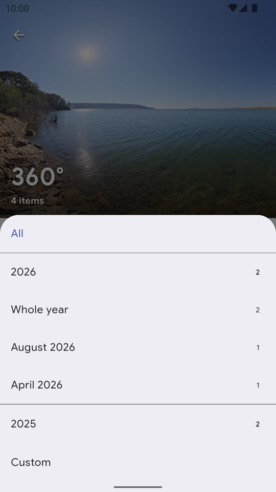
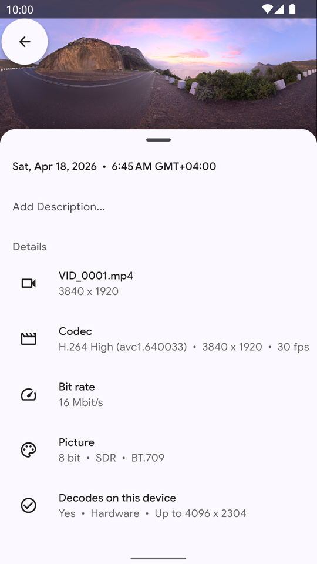

# User guide

Every function of Immuch360, step by step, with its options, its messages and its limits.

Back to the [README](../../README.md)

This guide covers every function of Immuch360, for your ordinary photos and videos as for those of a 360° camera (Insta360, GoPro MAX, DJI Osmo 360, Ricoh Theta, Samsung Gear 360), of the photo sphere mode of a phone or of a 3D camera, from an Immich server, the device itself, a NAS, a media server, a Plex server, a Tapo camera or a DJI drone, on phones, tablets, TVs (Android TV and Google TV, and a first test build for LG webOS TVs), Meta Quest headsets and computers (Windows, and early previews for Linux and macOS).

**Which problem do you have?**

- **"My 360° photos show as a flat, stretched strip, and my 360° videos play flat."** See [360° photos and videos as a sphere](#360-photos-and-videos-as-a-sphere).
- **"I have no server, and I do not want an account."** See [Without a server or an account](#without-a-server-or-an-account).
- **"I want to watch the videos of my NAS, on the phone or in the headset, without copying them."** See [Network shares](#network-shares-a-nas-a-computer-or-a-media-server).
- **"Plex plays my 360° videos flat, and I want my Plex library in the headset, on the TV and away from home."** See [Plex Media Server, without plex.tv](#plex-media-server-without-plextv).
- **"My photos are on my phone, and I have no computer or NAS to put them on for the headset."** See [Share this phone on the network](#share-this-phone-on-the-network).
- **"I want to see my Tapo camera and last night's clips without the Tapo app, and keep a clip in Immich."** See [Tapo cameras](#tapo-cameras-live-view-and-the-recordings-of-the-memory-card).
- **"My drone videos are not on the Immich map, and I want the files of my DJI drone on my server without a computer."** See [DJI drones](#dji-drones-photos-and-videos-over-usb-experimental).
- **"My photo is sideways, and I want to turn it with one key, on the phone, the TV or the computer."** See [Turn a photo with one key](#turn-a-photo-with-one-key).
- **"My Insta360 files need the Insta360 app before I can watch them"** (and the GoPro .360 and DJI .osv files too). See [Raw 360° camera files](#raw-360-camera-files-without-the-cameras-app).
- **"My 3D videos look doubled, and my VR180 videos are stretched all around."** See [3D and VR180](#3d-and-vr180-photos-and-videos) and [Spatial 2.5D](#depth-on-a-flat-screen-spatial-25d-experimental).
- **"I have spatial photos from my iPhone."** See [Apple spatial photos and videos](#apple-spatial-photos-and-videos).
- **"It works on the phone, but I want it in the Quest."** See [In the Meta Quest 3 headset](#in-the-meta-quest-3-headset).
- **"I want to watch my 360° photos and videos, and the videos of my NAS or my Plex server, on the TV, with the remote."** See [Watch on your TV](#watch-on-your-tv-android-tv-and-google-tv), and for an LG TV, [LG webOS TVs](platform-support.md#lg-webos-tvs).
- **"I cannot find my 360° shots among all the others."** See [The 360° list](#find-your-360-shots-the-360-list).
- **"My 360° video stutters, or plays a blurry copy."** See [Video details and decoders](#video-details-decoders-and-why-a-video-stutters).
- **"A video loads forever, or does not play on my TV."** See [When a video does not play](#when-a-video-does-not-play).
- **"I want my 360° photos and my Immich library on my Windows PC, with the photos and videos of its folders, my NAS and my Plex server, and the PC shared with my headset."** See [On a Windows computer](#on-a-windows-computer-immuch360-desktop-preview) (a preview: photos and flat videos, and from desktop build 3 360°, 3D, VR180 and raw 360° videos and the Tapo live view).
- **"Do I keep what the Immich app does?"** Yes, with two small changes, see [Everything else is Immich](#everything-else-is-immich).

When a feature is recent, the text says from which build it is there. The GitHub release always has the newest build, the stores follow later: see [Where to get it](release-status.md#where-to-get-it).

<details>
<summary><b>Contents</b></summary>

- [Watch your photos and videos](#watch-your-photos-and-videos)
- [360° photos and videos as a sphere](#360-photos-and-videos-as-a-sphere)
- [Without a server or an account](#without-a-server-or-an-account)
- [Network shares: a NAS, a computer or a media server](#network-shares-a-nas-a-computer-or-a-media-server)
- [Plex Media Server, without plex.tv](#plex-media-server-without-plextv)
- [Share this phone on the network](#share-this-phone-on-the-network)
- [Tapo cameras: live view and the recordings of the memory card](#tapo-cameras-live-view-and-the-recordings-of-the-memory-card)
- [DJI drones: photos and videos over USB (experimental)](#dji-drones-photos-and-videos-over-usb-experimental)
- [Raw 360° camera files, without the camera's app](#raw-360-camera-files-without-the-cameras-app)
- [3D and VR180 photos and videos](#3d-and-vr180-photos-and-videos)
- [Depth on a flat screen: Spatial 2.5D (experimental)](#depth-on-a-flat-screen-spatial-25d-experimental)
- [Apple spatial photos and videos](#apple-spatial-photos-and-videos)
- [In the Meta Quest 3 headset](#in-the-meta-quest-3-headset)
- [Watch on your TV (Android TV and Google TV)](#watch-on-your-tv-android-tv-and-google-tv)
- [Find your 360° shots: the 360° list](#find-your-360-shots-the-360-list)
- [Video details, decoders and why a video stutters](#video-details-decoders-and-why-a-video-stutters)
- [Everything else is Immich](#everything-else-is-immich)
- [On a Windows computer: Immuch360 Desktop (preview)](#on-a-windows-computer-immuch360-desktop-preview)
- [Install it on a computer: Windows, Linux and macOS](#install-it-on-a-computer-windows-linux-and-macos)
- [Privacy](#privacy)

</details>

## Watch your photos and videos

Immuch360 is first a gallery and a player for ordinary photos and videos. The timeline, the albums, the favorites, the memories and the search work with an Immich server; the device's own photos and videos, and the folders of a computer, show without any server. Videos play in a native player with sound, seeking, a buffering indicator and, in the 360°, Spatial and computer players, a choice of audio tracks. On a TV the remote drives everything; on a computer the mouse and the keyboard do.

### The gallery

- **Photos**: the timeline, the newest first, grouped by month and day. With an Immich server it is the timeline of your account, as in the Immich app, and the memories of past years show at its top; without a server, the photos and videos of the device (see [Without a server or an account](#without-a-server-or-an-account)); on a computer, those of the folders you chose (see [On a Windows computer](#on-a-windows-computer-immuch360-desktop-preview)). Drag the scroll bar at the right edge to go through the months quickly.
- **Search** and **Albums**, with a server: the search of your Immich server, and the albums of your account and those shared with you. Without a server they stay greyed out.
- **Library**: 360° at the top, the [360° list](#find-your-360-shots-the-360-list); with a server, Favorites, Archived, Shared links, Trash, People and Places; then On this device, the albums of the device, and Network shares, with your shares, Plex servers and cameras.
- **Thumbnails**: a 360° photo or video carries the 360° badge, and videos show a play mark. In a share folder, an Apple spatial photo or video carries a 3D badge.

### Open a photo

1. Tap a thumbnail. The photo opens full screen, a preview first, then the full picture.
2. Swipe left or right for the next or the previous photo or video of the timeline, the album or the list you came from.
3. Pinch or double tap to zoom in, and drag to move around the zoomed photo.
4. Swipe up for the details: the date, the place, the camera and the file. Swipe down on the photo to close the viewer.
5. The top bar has the favorite button, the ⋮ menu (Slideshow, "View as 360°", Download and more) and, on a 360° file, the 360° button, see [360° photos and videos as a sphere](#360-photos-and-videos-as-a-sphere). The bottom bar has the actions of the Immich app: share, edit, add to an album, delete, and upload for a file of the device that is not on the server yet; from build 27, Rotate too, before Edit, see [Turn a photo with one key](#turn-a-photo-with-one-key).

### Turn a photo with one key

A photo taken sideways, or a scan the wrong way up: from build 27 one key turns it by 90°, on every platform. The Immich app turns a photo only in its photo editor (Edit, rotate, Save); Immuch360 does it with one press, from the viewer, a TV remote included.

1. **Phones and tablets**: open the photo and tap **Rotate** in the bottom row, before Edit: the photo turns 90° clockwise at once, at any zoom. A long press turns it the other way. With a keyboard, R turns it clockwise and Shift+R counter clockwise (not while you type in a text field). In the read only mode, the button is in the top bar.
2. **Meta Quest, in the window**: the same Rotate button, with the controller pointer; a long press turns it the other way.
3. **TV**: the **yellow** key of the remote turns the photo clockwise and the **blue** key counter clockwise, from anywhere in the viewer. On a remote without colour keys, use the Rotate button of the bottom bar: OK on the photo shows the bars, then Right from the text button reaches Rotate, or Down when the photo has no recognized text; OK on Rotate turns the photo, and each OK again. OK on the photo itself never turns it, and a held OK on Rotate opens the details without a turn.
4. **Computer**: R, Shift+R, or the rotate button of the top bar, before full screen.
5. **A photo of a share** (SMB, WebDAV, DLNA, Plex, Tapo): the rotate button is the first of its top bar, and R, Shift+R, yellow and blue work there too.
6. Four presses bring the photo back as it was.

Where the turn goes:

- **Your own photos on an Immich server 2.6.0 or later**: the turn is saved through Immich's photo editor, as if you had turned the photo there. Quick presses make one request; a thin bar shows at the top while the server makes the turned picture, which then takes the place of the one on screen; the web app, the other devices and the thumbnails show it turned. A crop or a mirror made in the editor before is kept. To undo it, turn it back, or remove the edit in the editor.
- **Everything else** (the photos of a partner or of a shared album, motion photos, GIF and SVG files, an older server, the read only mode, the photos of the device and of the shares): the turn is remembered on this device, for that photo. The first time in a session for an Immich photo, the app says "The rotation is kept on this device only". The slideshow, the memories, the thumbnails and casting show such a photo as it is.
- **"Could not save the rotation on the server"**: the photo comes back as the server has it; try again.

What never turns: videos; 360°, 180° and 3D photos, and the photos you view as 360°, whose views follow your head or the phone and always read the photo as the camera made it; Apple spatial photos; raw files of 360° cameras; 2:1 photos of Insta360 cameras, even when the server does not flag them 360°; the trash and the locked folder. A photo whose kind the app does not know yet (its details still loading, a photo of the device that the 360° scan has not read) gets the button once it is known.

On LG TVs the webOS app has the same keys and the same rule, see [LG webOS TVs](platform-support.md#lg-webos-tvs).

### Play a video

1. Open a video as a photo: it plays in the viewer, with its sound. In Settings, Asset Viewer, Videos, "Auto play videos" starts a video as soon as it opens, and "Looping" plays it again from the start when it ends (off by default on a TV, from build 27).
2. Tap the video to show or hide the controls: play and pause (replay once it has ended), the position and the length, and the time bar to seek. They hide by themselves a few seconds after the last touch.
3. While the video loads or stalls, the player shows "Buffering". From build 27 a video that cannot play says why instead of loading forever, see [When a video does not play](#when-a-video-does-not-play).
4. A 360° video has the 360° button in the top bar, which opens the [360° player](#play-a-360-video); on a phone or a tablet the Spatial button follows it while that setting is on, see [Spatial 2.5D](#depth-on-a-flat-screen-spatial-25d-experimental).
5. Swipe up for the details of the video: the codec, the size, the frame rate, the bit rate, the picture, and whether this device decodes it, see [Video details, decoders and why a video stutters](#video-details-decoders-and-why-a-video-stutters).

The player plays the file stored on the device when there is one, the file of a network share through the app's local bridge, and otherwise the server's original or its transcoded stream, as Settings, Asset Viewer, Videos, "Video source" says (see [Choose the original or the transcoded stream](#choose-the-original-or-the-transcoded-stream)). The choice of the audio track is in the 360°, Spatial and computer players, not in the flat player of phones yet.

### On a TV, in a headset and on a computer

- **TV**: from build 27, Left and Right go to the previous or next item, also while a video plays; OK shows the controls of a video, and a second OK pauses; the controls hide 5 seconds after the last key; the media keys of the remote work. Up to build 26, OK paused and Left and Right jumped 10 seconds while a video played. See [Photos and videos with the remote](#photos-and-videos-with-the-remote).
- **Meta Quest**: the app runs as a window, where photos and videos open as on a phone; the 360° button opens the immersive view, see [In the Meta Quest 3 headset](#in-the-meta-quest-3-headset).
- **Computer**: the arrows, or the chevrons at the edges, go from photo to photo; Enter pauses a video, J and L jump 10 seconds, F or F11 switches to full screen. See [Use it on a computer](#use-it-on-a-computer).

## 360° photos and videos as a sphere

You back up your photos to an [Immich](https://github.com/immich-app/immich) server, and some of them come from a 360° camera or from the photo sphere mode of a phone. In the official mobile app those pictures show up as a flat, stretched strip, and 360° videos play flat too. The Immich web app can show a 360° photo as a sphere, the mobile app cannot: it has been requested since January 2024 in [discussion #6572](https://github.com/immich-app/immich/discussions/6572).

Immuch360 opens them as a sphere you look around in, on Android and iOS phones and tablets.

A photo turns as you drag it, zooms with a pinch or a double tap, keeps turning a little after a quick drag, starts on the initial view the camera recorded (GPano metadata), and gets a sharper texture when you zoom in; partial panoramas are handled (GPano crop). A video plays in a native spherical player with sound, drag and the gyroscope.

Stitched 360° files work everywhere: exports from the Insta360 app or Studio, GoPro Player, Ricoh Theta, and phone photo spheres. Raw files straight from the camera are stitched by the app, see [Raw 360° camera files](#raw-360-camera-files-without-the-cameras-app).

<p align="center">
  
  
</p>

- **A 360° photo as a sphere**: close at the top left; at the top right the 360°/180° button, the 3D layout button and the gyroscope.
- **A 360° video in the 360° player**: tap the picture for the controls; 360° and 3D at the top right.

### Open a 360° photo as a sphere

1. Open the photo from the timeline, an album, the [360° list](#find-your-360-shots-the-360-list) or a share folder. 360° photos carry a 360° badge on their thumbnail.
2. Tap 360° in the top bar of the viewer. The sphere viewer opens, with a loading indicator while the full picture loads; the zoom you had on the flat view is kept.
3. Drag to look around, pinch to zoom, double tap to zoom in. After a quick drag, the view keeps turning a little and slows down.
4. To look around by turning the phone, tap the gyroscope button at the top right (off by default).
5. The other two buttons at the top right are 360°/180° (full sphere or VR180 half sphere, not shown on partial panoramas) and 3D (the layout of a stereoscopic photo), see [3D and VR180](#3d-and-vr180-photos-and-videos). A raw Insta360 photo has only the gyroscope.
6. Close with the cross at the top left.

### Play a 360° video

1. Open the video and tap 360° in the top bar. On a 360° video the 360° button comes first; on phones and tablets the Spatial button follows it while that setting is on (see [Spatial 2.5D](#depth-on-a-flat-screen-spatial-25d-experimental)).
2. The native 360° player opens full screen and plays with sound: Media3 on Android, SceneKit on iOS.
3. Drag to look around, or move the phone. The Android player always follows the phone; the iOS one has a gyroscope toggle, on by default.
4. Tap the picture for the controls: close, 360°/180° and 3D at the top, then play, the skip buttons and the time bar on Android. The iOS player has play and pause only for now.
5. When the video has two audio tracks or more (languages, commentary), an Audio track button lets you pick one. While the video loads or stalls, the player shows "Buffering" with the fill of its playback buffer.

The player plays the file stored on the phone, or the file of a network share, when there is one. Otherwise it streams from your server: the transcoded stream by default, or the original if you ask for it in Settings, Asset Viewer, Video source (from build 15; the "Force original video" switch before), see [Video details and decoders](#video-details-decoders-and-why-a-video-stutters).

### A 360° file that shows flat: View as 360°

Some 360° files carry no projection tag, so the server does not flag them as 360° and they show flat.

1. Open the photo or video and tap ⋮ at the top right.
2. Tap "View as 360°", between Slideshow and Download. The 360° button appears in the top bar.
3. To undo it, the same entry now reads "Stop treating as 360°".

The choice is remembered on the phone and changes nothing on the server. On a file of a network share it applies to that viewing only.

From build 27 the spheres of DJI drones, which most often carry no projection tag, show as 360° without this step: the app recognises them by the camera code in their EXIF, as the photos a GoPro or a DJI 360° camera stitched itself. To send them to Immich with the tag its web app needs, see [DJI drones](#dji-drones-photos-and-videos-over-usb-experimental).

### Limits

- **iOS 360° video player**: play and pause, no time bar yet.
- **Previous and next**: the 360° players of phones do not move to the previous or next media yet; the Quest immersive view does.
- **Very large panoramas**: a photo is shown at 8192x4096 at most, the largest texture most phone GPUs take, so a larger panorama is downscaled to that size.
- **Dual fisheye .dng**: still shows flat.

## Without a server or an account

You have no Immich server, or you do not want an account: you only want the 360° photos of your phone to open as a sphere you can turn with the gyroscope. The Immich app asks for a login first.

From build 24 the app starts on a welcome page, where "Use without a server" is the first choice (before, it was a link under the login form). It opens Immuch360 on the device's own photos and videos, with the 360°, 3D, VR180 and Spatial viewers, the 360° list and the network shares (from build 20 also the Plex servers and the Tapo cameras), no Immich account needed. The server features stay hidden or greyed out until you connect a server; nothing leaves the device. On a Meta Quest it opens the headset's own photos and videos; on a TV, which has none, it points to the network shares (see [Watch on your TV](#watch-on-your-tv-android-tv-and-google-tv)).


### Start without a server

1. Open the app. The welcome page shows the icon and the name of the app, "Your media. Any screen. Every perspective." and three choices: "Use without a server", "Add a network share or a media server" and "Connect to an Immich server". Tap the first one. Up to build 23, the app opened on the login page instead: tap "Use without a server" below the server address and Settings.
2. Allow access to your photos and videos. If you refuse, the app says "The app cannot see the photos of this device", with "Allow access" and "Open the settings".
3. The Photos tab shows the timeline of the device. Search and Albums stay greyed out, as they come from the server. The Library tab has 360° at the top, then On this device (the albums of the device) and Network shares.
4. The menu at the top right says "This device only": the app shows the photos and videos of this device, nothing is sent anywhere.
5. From build 24, the second choice of the welcome page, "Add a network share or a media server", starts the same way without a server but opens the Network shares page at once, without asking for the photos of the device; see [Add a share](#add-a-share). Back leads to the Photos tab, which asks for the photos later if you want them there.

### Connect a server later

1. Open Settings (the menu at the top right, then Settings). The first entry is "Connect to a server", "Sync with an Immich server to back up, search and share". The menu at the top right has the same entry, and from build 24 so has the bottom of the Library tab, "Connect to an Immich server".
2. Log in as usual. The timeline, albums, backup and the other server features appear. From build 24, Back under the server address returns to the page you came from.

### Limits

- **The device's own gallery**: the app shows the photos and videos of the device's gallery. On an iPhone, the scan for 360° files skips those stored only in iCloud until they are downloaded to the device.
- **Without a server**, the 360° list holds what the scan of the device found and the files you chose to view as 360°, see [The 360° list](#find-your-360-shots-the-360-list).

## Network shares: a NAS, a computer or a media server

Your 360° videos sit on a NAS or a computer, and you want to watch them on the phone or in the headset without copying them first. In the headset, people end up copying each file over a cable; media servers such as Plex and Jellyfin play 360° videos flat, as requests on their forums describe; the Immich app reads only your Immich server.

Immuch360 browses and plays the photos and videos of any server that speaks SMB (Samba, Windows), WebDAV or, from build 19, DLNA/UPnP (a media server: Jellyfin, minidlna, Gerbera, Emby, a NAS or a TV box), straight from the share. From build 20 a Plex Media Server has a type of its own, see [Plex Media Server, without plex.tv](#plex-media-server-without-plextv).

It finds the servers of your network by itself, and plays the files live in the same viewers as the rest of the app (360°, 3D, VR180, Spatial 2.5D, Quest immersive view), with or without an Immich server, on phones and on the Meta Quest 3. Nothing is downloaded. When a server is connected, the files you pick can be sent to your Immich account (from build 15).

<p align="center">
  
  
</p>

- **Add a share**: the fields of a new SMB share, after Test the connection.
- **A folder of a share**: 360° photos and a video, read live from the share.

### Add a share

1. Open the Library tab, then Network shares; from build 24, on the welcome page of the first start, "Add a network share or a media server" opens this page directly, without a server. The first time, the page says "No share yet" with an "Add a share" button; + at the top right does the same at any time. From build 20 both ask what to add: "A network share (NAS, computer, media server)", "A Plex Media Server" or "A Tapo camera". Pick the first one.
2. The "Add a share" page first looks for the servers of your network and lists them under "Found on the network", with their type (SMB, WebDAV, DLNA, Phone, and from build 20 Plex and Tapo). The search takes up to about six seconds; "Scan again" starts it over. It uses Bonjour/mDNS and a scan of the local network confirmed by a real SMB or WebDAV exchange, from build 19 an SSDP search for DLNA media servers, and from build 20 GDM, the discovery of Plex, and the discovery protocol of TP-Link for the Tapo cameras.
3. Tap a server: the type, server, port and path are filled in. A Plex server or a Tapo camera opens its own page instead, filled in.
4. Not in the list? Fill the form by hand. Type: "SMB (Samba, Windows share)", "WebDAV (Nextcloud, Synology and others)", "DLNA media server (Jellyfin, NAS, TV box)" or, from build 20, "Plex Media Server", which opens the page of [Plex Media Server, without plex.tv](#plex-media-server-without-plextv). Then Name, "Server name or address" (a name or an address; a full address such as `smb://nas/photos`, `\\nas\photos` or `https://nas:5006/photos` fills the other fields), "Port (optional)" when it is not the usual one, "Share" for SMB or "Path of the WebDAV address" for WebDAV, "Start folder (optional)", "User name" and "Password", and "Secure connection (HTTPS)" for WebDAV.
5. SMB: once the server and the user name are typed, "Choose a share" lists the shares of the server.
6. DLNA: a media server has no user name or password. Give the server, the port and the "Description path" of its device description (`/rootDesc.xml` for minidlna), or paste the whole address, such as `http://192.168.1.10:8200/rootDesc.xml`, in the server field.
7. Tap "Test the connection". It answers "Connected, N entries in the start folder", or says why it failed. Then tap Save, at the bottom of the form. From build 22, closing a form you typed in (X, Back) asks "Discard the changes?" first, on the Plex and camera pages too, and so does choosing Plex or a camera found once something is typed.

A user name with an empty password is sent as such: a Freebox Server wants `freebox` and no password for its disks. To change or remove a share later, use the pencil next to it in the Network shares page.

### Browse and play

1. Tap a share. Folders come first, then the photos and videos as a grid with thumbnails (a frame of each video too, cached on the device). The ones recognised as 360° carry the 360° badge, and from build 19 Apple spatial photos and videos a 3D badge. Pull down to refresh.
2. Tap a photo: it opens full screen (pinch, double tap), and its 360° button opens the sphere viewer.
3. Tap a video: it plays in the native player (play, pause, seeking), with a 360° button that opens the 360° player and its 3D and 360°/180° buttons, and on a phone a Spatial button for stereoscopic files.
4. On a Quest, the 360° button opens the immersive view, and from build 19 "View in 3D" opens an Apple spatial photo in 3D.
5. The ⋮ menu has "View as 360°" for the files without a 360° tag, and on a phone "Spatial 2.5D" for the videos that are not stereoscopic.

360°, 3D and VR180 are recognised from the GPano or spherical metadata of the file, read with range requests, and VR180 also from the file name. From build 16 raw Insta360 files are recognised too (an .insp photo by its name or the camera's calibration block, an .insv video by its name and its frame) and stitched.

### Send files of a share to Immich

From build 15, when you are connected to a server:

1. In a share folder, long press a photo or video, or tap Select at the top right.
2. Tick what you want, or use "Select every photo and video of this folder".
3. Tap "Upload to Immich". The files are streamed from the share to your server one at a time, with the progress on each tile, and a bar at the bottom that reads "Sending 3 of 12" with a Cancel button. Keep the app open while it sends.
4. At the end the app says how many were sent and how many were already on the server: the server keeps its own copy and deduplicates the files it already has. Files sent earlier carry a mark ("Sent to Immich earlier") and are skipped the next time.

The open photo or video of a share has the same entry in its menu. Without a server, the page says "Connect to an Immich server to upload". Photos and videos of the device are sent the same way from the Library tab: On this device, an album, select, "Upload to Immich", including those of albums that are not in the backup selection; once sent they are counted as backed up.

### How it plays without downloading

The players read the bytes they need through a bridge inside the app (loopback address only, random token per session, byte ranges), so seeking in a video works and nothing is copied to the device. The players and the headset viewer never get the address of the share, only the bridge's 127.0.0.1; the requests to the server are made by the app itself.

For smooth playback the share is read in large blocks, the file stays open between reads, up to 16 MB are read ahead of the player, and the video being played is read over up to six SMB connections in parallel, separate from the connection that serves thumbnails and listings. A Freebox Server answers each read slowly: one connection gives 4.5 MB/s, six give 19 MB/s, enough for a 5.7K export at 132 Mbit/s.

While the player waits for data, the 360° and Spatial players show "Buffering" with the fill of their playback buffer; the flat player shows "Buffering" without a percentage while the video loads or stalls.

### DLNA media servers

From build 19, the app sends the SSDP search for media servers to the multicast group of the network, and the same request to port 1900 of every address of the local /24 network, then reads the device description of each server that answers and keeps those that publish their content (a ContentDirectory).

Folders and files are listed with the server's Browse action, page by page, and named by their titles: a file gets the extension of its type when its title has none, and a second file with the same title in a folder becomes `name (2)`. Audio is left out. Thumbnails are the album art or the small pictures the server makes, loaded by the app itself, with the app's own thumbnail when the server has none. A file plays from the original the server offers, rather than a converted copy when it offers both, read with range requests, so seeking works.

Checked against minidlna and Gerbera; discovery on a real network, Plex, Jellyfin, a NAS, the Freebox Server, an iPhone and the Quest are the device test of build 19.

### A share that moved

From build 19, a DLNA share and a phone share (see [Share this phone on the network](#share-this-phone-on-the-network)) keep the id their server announces. When one no longer answers at its address (a new address given by the box, a server restarted on another port), its folder page shows "Looking for (name) on the network" and moves the share to where it answers now: at once for a DLNA server, which has no password, and after a confirmation, "Use the new address?", showing both addresses, for a share with a user name and password, since they would be sent to the new address.

From build 20 a Plex server found again at another address of the network moves at once too: its certificate proves it is the same server before the token is sent. A Tapo camera is looked for by its MAC address from its own page, see [Tapo cameras](#tapo-cameras-live-view-and-the-recordings-of-the-memory-card).

### Limits

- **SMB**: SMB 2 and 3 only, no SMB 1.
- **WebDAV**: Basic authentication only (Digest is not supported yet); a self signed HTTPS certificate must be installed on the device.
- **Finding servers**: the network scan and the DLNA, Plex and Tapo searches look at the local /24 network only, and need the local network permission on iOS. On iPhone and iPad the DLNA search sends the unicast requests only, until Apple grants the app the multicast entitlement, and some servers do not answer them (minidlna on Linux): add those by their description address.
- **DLNA**: a server that only offers a converted copy of a file gives that copy; a folder lists 20,000 entries at most.
- **Thumbnails**: photo thumbnails decode the whole file, and photos over 30 MB get none.
- **Players**: the audio track choice is not in the flat player yet. On a phone there is no swiping from one file of a folder to the next yet (the Quest immersive view has previous and next for the 360° files of the folder). The 3D or 180° choice made on a network file is not remembered.
- **Uploads**: they run only while the app is open, and a file the server already has is sent in full before the server reports it as a duplicate.

## Plex Media Server, without plex.tv

Your videos are in Plex, and Plex shows your 360° photos and videos flat, as requests on its forum describe (one has been open since 2017). You also want that library in the headset, on the TV and away from home. The Immich app reads only your Immich server, and the DLNA type of build 19 reaches the DLNA side of Plex at home only.

From build 20 Immuch360 pairs with your Plex Media Server directly, without plex.tv: it finds the server on the network, you paste a token once, and the app reads the original files of your libraries live, in every viewer of the app (360°, 3D, VR180, Spatial 2.5D, the Quest immersive view, the TV remote), at home and, through your port forwarding, away from home. Nothing is copied, and the files you pick can be sent to Immich.

### Add a Plex server

1. Open the Library tab, then Network shares, then + and "A Plex Media Server". The "Plex Media Server" type of the share form, and a server with the Plex tag under "Found on the network", open the same page.
2. The "Add a Plex server" page looks for the Plex servers of your network ("Looking for Plex servers on your network") and lists them under "Found on the network". Tap yours: a card shows its name, its Plex version and a short id.
3. Not in the list? Type its "Server address", such as `192.168.1.20`, `192.168.1.20:32400` or `https://...plex.direct:32400`, then tap "Look up". The app reads the certificate of the server and sends nothing else.
4. Get the token, on a computer: open Plex in a web browser and sign in, open any photo or video of your library, then "...", "Get Info", "View XML". A new tab opens on an address ending with `X-Plex-Token=...`. Copy that whole address.
5. Paste it in "Access token", or send it to the phone and tap "Paste from the clipboard": the app takes the server and the token from it. The text after `X-Plex-Token=` alone works too. "How to get it", on the page, says the same; server administrators can also use the `PlexOnlineToken` value of the server's `Preferences.xml` file, which does not expire. On a TV, OK opens the keyboard dialog: type the token there (it is usually 20 characters).
6. Tap "Test the connection". It answers "Connected: N libraries", or says what is wrong, such as "The Plex server refused this token."
7. "Access from outside home" then shows what the server says: "The server says it is reachable at (address):(port).", or "The server did not tell its address outside home." To use the server away from home, type your public address or DynDNS name in "Address outside home (IP or name)", and the port forwarded in Plex (Settings, Remote Access) in "Port outside home". What you type always wins over what the server says.
8. "Name" is the name of the server unless you change it, and "Start folder (optional)" can open one library directly. Tap Save. The server is listed with the shares, as `plex://` and its address.

### Browse your Plex libraries

1. Tap the server in Network shares. The first level lists the libraries the app shows: photos, movies and other videos, TV shows. Music is left out.
2. Below a library come its folders as they are on the disk of the server (the "by folder" view of Plex), then the photos and videos under their file names, with the thumbnails Plex makes. A photo library whose folder view does not answer shows its albums instead.
3. 360° and 3D are found by reading the files themselves, as on any share: 360° photos get the 360° badge, Apple spatial ones the 3D badge.
4. Open a photo or video as on any share: 360°, 3D, 360°/180°, Spatial 2.5D on a phone, the immersive view in the Quest, the remote on a TV. A video is read as the original file, with byte ranges through the app's local bridge, so seeking works and its 360° and 3D metadata reach the players intact.
5. Select files and tap "Upload to Immich" to send them to your server, as from any share (see [Send files of a share to Immich](#send-files-of-a-share-to-immich)).

### Away from home

Each time it opens the server, the app tries the address at home first and, 400 ms later, the address outside home. The first one that answers with your server is used; when it is the address outside home, the folder page shows a globe icon labelled "Connected through the address outside home".

This needs Remote Access turned on in Plex (Settings, Remote Access) with a port forwarded by your box: without plex.tv the app cannot use the relay of Plex, so a server without a port forwarding opens at home only, and away from home the page says "Your Plex server cannot be reached from outside your home network. Turn on remote access with a port forwarding in Plex (Settings, Remote Access), or type its public address."

The address the server tells is learned again at each connection at home. When it does not answer from outside (a box that changes its address, two routers in a row), type yours in the page of the server. When the token stops working (you signed out of the browser session you copied it from, for example), the folder page says so and offers "Paste a new token", which opens the page of the server on the token field.

### Compared with Plex and with the DLNA type

- **The original files**: the app reads the files themselves, never a copy converted by Plex, so the 360°, 3D and VR180 metadata stay intact and the app's viewers use them, where the Plex apps show these files flat.
- **No plex.tv**: the app talks to your server only, always over HTTPS. The server is checked through its own plex.direct certificate, tied to the id of the server, before the token is sent. The token stays on the device, in its secure storage, and goes only to your server, in a request header.
- **Compared with adding the same server as DLNA**: the folders as on the disk, the thumbnails of Plex, access from outside home and a secure connection.

### Limits

- **Claimed servers only**: the server must be claimed in Plex (signed in to a Plex account once), which gives it its plex.direct certificate. Otherwise the page says "This address answers without a Plex certificate. Claim the server in Plex, or add it as an SMB, WebDAV or DLNA share."
- **IPv4 only**: "IPv6 addresses are not supported yet. Type the IPv4 address of the server."
- **The token** gives full access to your Plex server. Removing the server in the app forgets the token on the device but does not revoke it: "The token stays valid on the server until you sign out of the browser session you copied it from." A token with an end date shows that date, and the app cannot renew it.
- **Away from home**: only through a port forwarding, there is no relay.
- **Libraries**: music is not shown, a folder lists 20,000 entries at most, and a restricted user may get "This token cannot read the libraries of the server."
- **Raw 360° camera files** (.insv, .insp, .360, .osv) show only if Plex lists them; otherwise add the same NAS folder as an SMB or WebDAV share, see [Raw 360° camera files](#raw-360-camera-files-without-the-cameras-app).
- **Finding the server**: a server whose "Enable local network discovery (GDM)" setting is off is not found, so type its address. On iPhone and iPad the search sends unicast requests only. The DLNA side of the same server can show in the list too, with the DLNA tag: pick the line with the Plex tag.
- **Not yet checked on a device**: the pairing, the folders, the byte ranges of a video, the thumbnails, a wrong token and the address outside home were checked from a computer against a real Plex Media Server 1.42.1, and photo and TV show libraries against a simulated server only. Playback on a phone, in the Quest, on an iPhone and on a TV, and the switch to the address outside home, are the device test of build 20.
- Immuch360 is not affiliated with Plex.

## Share this phone on the network

Your photos and videos are on your phone, and you want to see them in the headset, without a computer, a NAS or an Immich server. From build 19 a phone, Android or iPhone, serves its own photos and videos on the Wi-Fi, and a Meta Quest plays them. The Immich app has nothing like it.

### Turn it on, on the phone

1. Open the Library tab, then Network shares. The first tile is "Share this phone on the network" (it reads Off, or On with the address).
2. Tap it, then turn on "Share photos and videos on the Wi-Fi". The app asks for the photos and videos permission when it is missing, and on Android 13 and later for notifications.
3. The page shows the Address (such as `http://192.168.1.20:8360`: port 8360, or another free one when it is taken), the name the phone is announced under ("Immuch360 on" and the name of the phone), the User name (`phone` and four digits) and the Password (eight characters), each with a copy button, then "N devices connected" (the devices that used it in the last minute) with the last file served.

The user name and password are made once and kept, so the headset keeps its saved share; "New password" replaces the password. The tile is not shown on the headset.

### Open it, on the headset

1. In the headset, open Library, Network shares, then +.
2. Under "Found on the network", tap the phone: the user name is filled in.
3. Type the password once (spaces and capitals do not matter), then Save.

From there it is a WebDAV share like any other: 360° detection, raw files, the immersive view, seeking in videos. Any WebDAV client of the network can read it too. When the phone gets another address, the headset looks for it and asks before using the new one (see [A share that moved](#a-share-that-moved)).

### What it serves, and for how long

- **Folders**, read only: `Albums` (each album of the phone), `By month` (every photo and video by month, the newest first) and `360` (the 360° photos and videos the app found on the phone, raw files and the ones you view as 360° included). Files keep their own names. On an iPhone, a live photo gives its still, an edited photo or video its edited version, and what is stored only in iCloud is left out.
- **Android**: the share runs in a foreground service with a notification (the address and the user name) and a Stop button, and keeps the Wi-Fi and the processor awake, so it goes on with the screen off. Swiping the app away stops it.
- **iPhone and iPad**: iOS gives no background time to a server, so the share runs only while the app is in front, and the screen stays awake meanwhile. It pauses when the app goes to the background and comes back, with the same address and password, when you return.
- **When it stops**: with the switch, with Stop, after 60 minutes without any request, and when the app is closed. It never starts by itself: it is off at every start of the app.
- **Security**: local network only. The share listens only on the Wi-Fi, Ethernet and hotspot addresses of the phone, never on its mobile data or VPN address, and only answers devices with a local address. Every request needs the user name and password (HTTP Basic); ten wrong passwords from one device within a minute block it for a minute. The password travels unencrypted on the Wi-Fi (plain HTTP): use the share on a network you trust, and turn it off when you are done.
- **The phone's own hotspot**: the headset can join it; when it does not find the phone there, type the address shown on the page.
- **Not checked on a device yet**: the server was checked by unit tests and by end to end tests with the headset's own WebDAV client and media bridge, on a computer. A phone serving a Quest 3 (discovery, a 4 GB video played and sought, the screen off for 30 minutes, the hotspot, Stop from the notification) and the iPhone side, which has not run on an iPhone yet, are the device test of build 19.

## Tapo cameras: live view and the recordings of the memory card

You have Tapo cameras at home, and you want to see the garden camera and last night's clips next to your photos without opening the Tapo app, and keep a clip in Immich. The Immich app has nothing for cameras, and the Tapo app is a separate app, signed in to your TP-Link account, with the clips apart from your photos.

From build 20 Immuch360 adds a Tapo camera next to the network shares. It shows the camera live on Android phones and tablets, Android TV and the Meta Quest, and on every platform the recordings of its memory card, day by day: a clip is fetched from the camera, then plays like any video and can be sent to Immich. The app talks to the camera on your network only, never to the servers of TP-Link, and never changes anything on the camera.

### Add a camera

1. In the Tapo app first: create the camera account, in the settings of the camera, Advanced Settings, Camera Account (a user name and password for this camera, used for the live view), and turn on Third-Party Compatibility, under Me, then Tapo Lab.
2. In Immuch360, open the Library tab, then Network shares, then + and "A Tapo camera".
3. The "Add a camera" page looks for cameras ("Looking for Tapo cameras on your network") and lists them under "Found on the network" with the Tapo tag. Tap yours to fill in "Camera address", or type its address. A camera with the Tapo tag in the share form opens the same page.
4. "Name": how the camera is listed.
5. Under "Recordings on the memory card", "TP-Link account password": the password of the account you use in the Tapo app. It opens the recordings; your email address is not needed.
6. Under "Live", "Camera account user name" and "Camera account password": the camera account of step 1.
7. One of the two is enough ("Enter the TP-Link account password, the camera account, or both."): the TP-Link password alone gives the recordings, the camera account alone the live view.
8. Tap "Test the camera". It shows "Recordings: (model), firmware (version)" with the state of the memory card, and "Live view: (video), sound (audio)", or what failed for each.
9. Tap Save. The camera is listed under "Cameras", after the shares, with its model once known and `tapo://` with its address.

### Watch it live

1. Tap the camera. Its live view is at the top of its page: "Connecting to the camera", then the picture with the Live badge.
2. The buttons on the picture: the sound, off at first ("Turn the sound on"; "No sound on this device" when the device cannot play it), SD or HD, and "Full screen".
3. A phone shows SD on the page and HD in full screen; the Quest shows HD. Back leaves full screen first.
4. Below the picture come the model and firmware and the memory card, such as "Memory card: (used) used of (total)" or "No memory card".

On iPhone and iPad the live view says "The live view comes to iPhone and iPad in a later version. The recordings play here already." Without the camera account the page says "Add the camera account to see the live view."

### Play and keep the recordings

1. Under "Recordings on the memory card", the camera page lists the days with recordings, newest first, by month. Without the TP-Link account password it says "Add the TP-Link account password to see the recordings."
2. Tap a day. Its clips come under the hours of the camera's own time, each with its start, its length, the thumbnail of the camera for an event, and its kind: Motion, Person, Pet, Vehicle, Baby crying, Animal, Continuous or Event.
3. Tap a clip. The app fetches it from the camera ("Getting the video from the camera: N%", with Cancel), then plays it in the video player, with sound and seeking. A fetched clip carries "On this device" and opens at once the next time.
4. To keep a clip in Immich, with a server connected: the ⋮ menu of the video, "Upload to Immich".
5. To free space: a long press on a fetched clip offers "Delete the copy on this device" (on a phone), and the camera page has "Delete the videos fetched from this camera", with their size.
6. The refresh button at the top right, or pulling the page down, asks the camera again.

When the camera no longer answers at its address, its page looks for it on the network by its MAC address and moves it to where it answers now, once it shows the same certificate. A camera that shows another certificate than the one the app saw first gets a question instead: "The camera at (address) shows another certificate than before. Continue only if you reset or replaced it."

### Compared with the Tapo app

- **On your network only**: the app talks to the camera itself, on the local network, and never to the servers of TP-Link. It does not sign in to a TP-Link account, so your email address is not needed.
- **Recordings become normal videos**: a fetched clip is an H.264 video with its sound, which you can send to Immich, where it stays after the memory card has recorded over it.
- **Next to the rest**: with or without an Immich server, on a phone, a TV or in the Quest (in the window), found on the network like a share.
- **Read only**: the app only asks the camera for what it shows; it never changes a setting and never deletes anything on the camera.

### Limits

- **Not yet checked on a device**: build 20 has not run with a real camera yet. The protocol was written from captures of a C510W with firmware 1.3.4 (the V4 login of mid 2026), and the app was checked against a simulated camera in its tests. Reports are welcome, with the model and firmware that "Test the camera" shows and the lines of [Logs](troubleshooting.md#logs).
- **Live view**: on Android phones and tablets, Android TV, the Quest and, from desktop build 3, Windows, not on iPhone and iPad yet. The limits of TP-Link apply: two HD and two SD streams at most at once per camera, the Tapo app included, and Tapo Care, the memory card and a recorder that uses RTSP or ONVIF cannot all run at once.
- **Cameras**: battery cameras and cameras behind a Tapo hub are not supported.
- **Recordings**: one download at a time per camera. While the Tapo app browses the memory card, the app tries again after 4, 8 and 12 seconds, then says "The camera is busy with another viewer, such as the Tapo app. Try again in a minute." Recordings in H.265 are not converted yet ("This recording is in H.265, which this version cannot convert yet."), continuous recordings have no thumbnail, and a clip plays once it is fully fetched.
- **Passwords**: each wrong password counts, and after a few the camera locks for a while ("The camera is locked after too many wrong passwords. Try again in N minutes."). The app never tries a refused password again by itself: only "Test the camera" or Retry ask the camera again. When the camera takes the password for its settings but not for its videos, turn Third-Party Compatibility off and on again in the Tapo app, then restart the camera.
- **Space**: fetched clips stay in the cache of the app, 1 GB at most for all the cameras together (the ones played least recently go first); the system may clear that cache, and removing a camera deletes its clips.
- **Away from home**: the app reaches the camera at its address on your network, so not from outside it.
- Immuch360 is not affiliated with TP-Link.

## DJI drones: photos and videos over USB (experimental)

Your drone's videos reach Immich through the album of DJI Fly, but a DJI Neo 2 video arrives without its place: the drone records its position in a track that the metadata tool of the Immich server does not read yet, and the only other copy of it is the flight data file (.SRT) the drone writes beside each video, which stays on the drone. Most spheres of DJI drones carry no 360° tags either, so Immich shows them flat. And you may want the originals on your server without a computer and without DJI Fly.

From build 27, on Android phones and tablets, Immuch360 reads the drone, its controller or a card over a USB-C cable, lists their photos and videos, and sends the originals to your Immich server, each video placed on the map from its flight data. The Immich app backs up the phone's gallery only. This page is experimental: it ran on an Android emulator with synthetic files, not with a real drone yet, and reports are welcome in [Issues](https://github.com/freeKC/Immuch360/issues).

### Turn it on and plug in the drone

1. Settings, Advanced, turn on "DJI drones (experimental)". A "DJI drone" tile appears in the Library tab, Network shares, under "Share this phone on the network". It is not offered on the Quest, on a TV, on iPhone and iPad, or on a computer.
2. For the place of your videos: in DJI Fly, in video mode, Settings, Camera, turn **Video Subtitles** on before the flight. Without it a Neo 2 video has no place the app can read.
3. Plug the drone, its controller or a card reader into the phone with a USB-C data cable. A Neo 2 can stay off.
4. Open "DJI drone", then "Choose the drone or the card". The folder picker of Android opens: open its side menu, choose the drone, the controller or the card, then its DCIM folder or the whole drive, "Use this folder", "Allow". The next time the drone is under "Used before", which opens it without the picker while it is plugged in; Forget removes it.

### What the page shows

- The photos and videos by day. The proxy (.LRF), flight data (.SRT), .THM and sound (.m4a) files of a video stay with it and are not listed; a video tile takes its frame from the proxy.
- A sphere with its 360° badge, and the shots it was made from behind a "+N" chip; shots of a sphere the drone did not stitch show as such.
- A crossed speaker on a clip whose sound the phone recorded: "The sound of this clip was recorded by the phone and is in a separate file. Immich receives the video without sound; download the clip with DJI Fly to keep it."
- "Not accepted by Immich" on the files the server refuses (.osv, .360, .36p).
- A device in File transfer mode may send its list slowly: "The device was still sending its list of files: some may be missing. Refresh in a moment."
- Open a photo or a video as in a share: the video plays from the drone, nothing is copied.

### Send the files to Immich

1. Tap the checklist icon at the top, then "Select all new" (or long press each file): the files not sent before, without the source shots of a sphere and the refused files.
2. "Upload to Immich": the sheet gives the count and the size, warns above 500 MB on mobile data, says "Videos with flight data are placed on the map", and, when a sphere is among the files, offers "Tag drone spheres as 360° for Immich", off by default. On, the photo goes unchanged, with a small .xmp file beside it on your server that tells Immich it is a 360° photo; off, Immuch360 still shows it as a sphere, and the Immich web app shows it flat.
3. The files go one at a time, the screen kept on. A video is placed on the map from the first position of its flight data, once the server has read the video, and only when the server found no place in it; when the server is slow, the place is set later, the next time a share or the drone page opens.
4. The summary counts the files sent, the spheres tagged, the videos placed, the files already on the server, those in the Immich trash and those refused. A file sent before is marked "Sent to Immich earlier" whatever the cable or the reader, and skipped; one in the Immich trash shows a bin, and the summary says to restore it there to keep it.
5. Unplugged during an upload: "The drone or card was unplugged". Plug it back (the page reads it again, or Refresh) and send again: the files sent are skipped, and the one cut starts over, since the Immich API cannot resume a file. "The drone or card stopped answering. Unplug it and plug it back in." says the same of a device that no longer answers.

### Keep on the device

Select files, then "Keep on the device": they go into the gallery of the phone, album "Immuch360 import" (`DCIM/Immuch360 import`), where the phone's backup can find them. A video kept that way loses the place of its flight data, which the page says first. The files Immich does not accept go to `Download/Immuch360 import`, their names unchanged.

### The DJI Neo 2, and other drones

- The Neo 2 has no panorama or sphere mode. The spheres of other DJI drones (Mini, Air, Mavic and others) show as 360° photos on every platform, recognised by the camera code in their EXIF, and so do spheres you stitch yourself from Neo 2 shots.
- Its 49 GB of storage are inside the drone; by DJI's manual it is read with a cable while switched off, most likely as a USB drive.
- QuickTransfer, the Wi-Fi copy of DJI Fly, is not supported.
- A card from another camera in a USB-C card reader is read the same way, and so is a phone, or a DJI RC 2, in File transfer mode (neither tried yet).
- More facts and limits: [DJI drones and the DJI Neo 2](compatibility.md#dji-drones-and-the-dji-neo-2).

## Raw 360° camera files, without the camera's app

Insta360 cameras record the two fisheye circles of their lenses, side by side in one picture, in two tracks or in two files (an .insp is a JPEG, an .insv an MP4), and the official way to get a 360° picture out of them is the Insta360 app or Studio. People with an X4, X5, X6, a GoPro MAX or a DJI Osmo 360 ask what to do with the raw files of their card. The Immich web app takes any .insp for an equirectangular picture and wraps the two circles around the sphere; the mobile app shows them flat.

From build 16 Immuch360 stitches those files itself, on the phone, the tablet or the headset, with nothing to install on the server:

- **Insta360 .insp photos** (build 16): stitched on the GPU before the sphere viewer, at up to 8192x4096, with a CPU fallback at a smaller size.
- **Insta360 .insv videos that keep both lenses in one track** (build 16): stitched by a GPU effect in the player.
- **Insta360 X4, X4 Air, X5 and X6 .insv videos, one square track per lens** (build 18): two decoders at once, one per lens, and a GPU compositor that stitches them into the sphere.
- **Insta360 X3 and older at 5.7K and above: two files, `_00_` and `_10_`** (build 18): the same, the other file being found next to the first one.
- **GoPro MAX and MAX 2 .360: two tracks of three cube faces each** (build 18): the same, with the overlap columns blended.
- **DJI Osmo 360 .osv: two square 10 bit tracks** (build 18): the same, with the Kannala-Brandt calibration of the file.
- **Dual fisheye .dng** (not yet): shows flat.

### Watch a raw file

1. Put the raw files where the app reads them: an SMB or WebDAV share, your Immich server (it takes .insp and .insv, and refuses .360 and .osv), the folders of a computer in Immuch360 Desktop, and from build 19 the phone share and the DLNA servers that list these files (not checked yet). The gallery of an Android device does not list them: Android files .insv, .insp, .360, .lrv and .osv as other files, not as photos or videos (seen on an Android 12 emulator for the five, and on Android 15 for .osv), so a raw file copied to the phone shows neither in its gallery nor in the app. A raw photo renamed .jpg is still found raw by the app; a raw video renamed .mp4 shows as a plain video, since the app knows raw videos by their name.
2. Keep the two files of an X3 pair together: the app looks for the other file next to the first one, on the device, on the server or in the share folder. When the other one is missing, the app says "This recording is split in two files, one per lens, and (name) was not found next to it", and suggests keeping both files together or exporting the video from the camera app.
3. Open the file and tap 360°. Raw files get the 360° button and raw photos the 360° badge. From build 18 the raw Insta360 files of the server are in the 360° list too, found by their name.
4. A photo opens in the sphere viewer with a label at the bottom: "Raw 360° file, stitched by the app", and the source of the calibration: "lens calibration read from the file", "lens calibration of the same camera" (kept from another file of the same camera, by its serial number, or by its model for a file that only names its model), or "nominal lens values, seams possible" (the values of an X3, when nothing better is available).
5. A video opens in the native 360° player and is stitched as it plays. Its 3D and 360°/180° buttons are hidden, since a raw video is one full sphere. The video players and the headset show no label.
6. In the headset, the immersive view gets a stitched temporary picture for a photo, and the same GPU effect as the phone for a video. There is no progress indicator yet while a raw photo is prepared.
7. If the picture opens facing an odd direction (a photo taken with the camera lying flat, for example), drag it on a phone, or turn it in the headset with the right thumbstick or the Turn button.

### When the device cannot play both lenses

Before playing a two lens video, the app asks the device whether it can run two decoders of that size and rate, and a phone warns "This raw video needs two (size) video decoders at once: it may not play smoothly on this device" when the answer is no. When the decoders cannot run (two 2880x2880 H.264 lenses on a Quest 3, for example), the app plays one lens and says so, half of the sphere staying black, then the server's transcoded stream if there is one. If the GPU effect cannot run on a device, the video plays unstitched, the two circles on the sphere, with "The 360° stitching failed on this device".

From build 19, on Android and the Quest:

- **No hardware decoder** for the codec (an emulator, a TV box): the device gets software decoders, which the check holds to 2048x2048 per lens when two run at once.
- **A lens the device cannot decode at all** (no decoder for its codec, or none that lists its profile) skips the one lens step, for the server's transcoded stream or else the original unstitched in the plain player, with that player's own message.
- **A lens tried although its size or rate was refused** shows the one lens message only once its first frame is drawn.
- **When the decoder of the one lens fails** and there is no transcoded stream, the video plays unstitched instead of stopping on an error.
- **On an Android emulator** a frame of the opposite lens no longer flashes in (each lens texture is now bound on the external texture target at every frame).

### How the stitching works

- **What the app reads**: the calibration block the camera appends to every file (lens model, centres, orientation of each lens, size of the calibration canvas) and the accelerometer record, used to level the horizon. The Mei (unified camera) model of the calibration string V3 is used first, V6 (X6 and later firmware) with its first terms next, the older equidistant string V1 last. Nothing is guessed from the camera model when the file has its calibration. The Insta360 X5 and X6 calibration (V6, indexed trailer) and the X4 video window are read from the file.
- **Where it reads it**: the server (the original file, read with a range request for its last bytes), the device's own gallery (for a raw photo renamed .jpg), the shares and the folders of a computer.
- **Photos and videos**: photos are stitched by a Flutter fragment shader before the sphere viewer; videos go to the native players with the calibration, a Media3 GL effect on Android and the Quest, a SceneKit shader on iOS.
- **Two lenses in two tracks or two files**: the players decode both at once, one hardware decoder per lens, paired by time stamp, and a GPU compositor stitches them into the sphere: ExoPlayer and OpenGL ES 3 on Android and the Quest, an AVFoundation compositor in Metal on iOS. 10 bit HLG and PQ sources are tone mapped to the 8 bit sphere.

### Limits

- **Seams**: the stitch uses the camera's calibration only, without seam optimisation, so objects close to the camera can show a seam, as in the camera's own preview.
- **Horizon**: levelling uses the accelerometer the camera records in the file, averaged. A video is levelled once, from the start of the recording, and is not stabilised, so a handheld video keeps its shakes and its horizon may lean a little. GoPro and DJI files are not levelled (the camera's horizon is kept).
- **Files without calibration**: a file without its calibration block (the members `_008` and `_009` of an X3 HDR group) uses the calibration the app kept from another file of the same camera or the same camera model, or the nominal X3 values if it has seen none.
- **What was checked**: photos against Insta360 Studio exports of X3 files (same framing, level horizon, a yaw offset under a degree); single track videos on an Android emulator with a low resolution X3 file. The two track and two file paths were checked on real X4, X3 pair, GoPro MAX and Osmo 360 files with the app's CPU reference stitcher (level, continuous seams) and by the Android unit tests. Playback on a phone, a Quest and an iPhone is still the device test of builds 18 and 19, and raw files have not run on an iPhone yet: feedback welcome.
- **DJI Osmo 360 files** (October 2026): a real .osv file, two 3840x3840 HEVC tracks of 10 bit (Main 10) at 25 frames a second with the camera's calibration after them, was read by the app's parsers and stitched by the CPU reference with continuous seams. On an Android 15 emulator, from a WebDAV share, it is listed with the 360° badge, but the emulator has no 10 bit HEVC decoder, so the file gets no thumbnail there and its 360° player says "Unable to play video"; a synthetic clip laid out the same way in 8 bit was listed with a thumbnail and played stitched to the end, both lenses paired, with the emulator's software decoders. A phone or a Quest with a 10 bit HEVC decoder is expected to play it with its hardware decoders, which no device run has confirmed yet. On Windows, see [Raw 360° videos](#use-it-on-a-computer) in the computer section.
- **On the server**: the Immich server refuses .360 and .osv uploads, so those two formats only exist on shares and on computers. Renamed .mp4, the server takes them, but the app then shows a plain video.

## 3D and VR180 photos and videos

In the Immich app a stereoscopic 360° photo or video shows both eyes at once, a doubled picture, and a VR180 file, which covers only the front half, is stretched all around the sphere.

Immuch360 recognises the 3D layouts, top and bottom or side by side, from the file (the st3d box of a video), or guesses them from the shape of the frame, and every viewer has a 3D button to change them. A phone shows the left eye; a Meta Quest shows each eye its own half, in real 3D. VR180 files are drawn on a half sphere, with the back black instead of a stretched picture. They are recognised from the file (spherical bounds or mesh, GPano crop) or from a "vr180" or "180" in the name, and every viewer has a 360°/180° button.

### Change the layout or the coverage

1. Open the photo or video as a sphere (the 360° button).
2. The 3D button cycles "Mono (not 3D)", "3D, top and bottom" and "3D, side by side"; its tooltip names the current layout.
3. The 360°/180° button switches between "360°, full sphere" and "180°, half sphere (VR180)". It is not shown on partial panoramas.
4. In the headset, the same two buttons are on the info panel of the immersive view.

The 360°/180° choice is remembered on the device for the media of the library, not yet for a file of a network share. The 3D choice is not remembered when the viewer closes: the layout the file declares, or the guess, applies again the next time (the Spatial 2.5D player below remembers its own).

Checked on a Galaxy S24+ and a Quest 3 with real 3D 360° sample videos (VRTogether, Vuze, Kandao) and a 3D photo; VR180 on an Android emulator and a Galaxy S24+ with synthetic media. Reports from other cameras are welcome.

## Depth on a flat screen: Spatial 2.5D (experimental)

A stereoscopic video can gain depth on a flat screen. The two eyes of the video give the depth, the front camera follows your head, and the app synthesises the view in between, so the screen behaves like a window on the scene: move your head and nearby objects shift against the background. Phones and tablets only.

### Use it

1. Check that it is on: Settings, Asset Viewer, Videos, "Spatial 2.5D (experimental)". It is on by default; turning it off removes the Spatial button everywhere.
2. Open a video. While the setting is on, the top bar shows the Spatial button (a rotating 3D icon) on every video; in a network share folder only stereoscopic files get it, and the others have Spatial 2.5D in the ⋮ menu.
3. Tap it. The front camera permission is asked the first time; the camera is only used once you press the button.
4. Top right: Audio track when the video has two or more, the current layout (tap it for the list: Auto, Not stereoscopic, Side by side, Top and bottom, each of the last two also with the eyes swapped), 360°/180° on a 360° video, and Recenter, which takes your current head position as the centre.
5. Bottom: play, the timeline, then Head sensitivity while your head is tracked, and the viewpoint slider from L to R, which moves the viewpoint by hand; it shows when head tracking is off or has lost your face.
6. Close with the cross or the system back.

With Settings, Advanced, Troubleshooting on, the player adds an overlay at the top left (render and disparity rates, quality tier, viewpoint, tracking state), always shows the viewpoint slider, and adds a "Disparity map" check box that shows the estimated depth instead of the picture.

### Formats, privacy and limits

- **Formats**: side by side and top and bottom, also with the eyes swapped, full or half width, flat, 360° and VR180. The layout is read from the file, else guessed from the frame shape or the file name (sbs, ou, tb and the like; a half width file is only recognised by its name), and can be chosen by hand in the player. The choice is remembered for a video of the library, not for a file of a network share.
- **Camera**: images are processed on the device only, never stored and never sent anywhere. The Quest build has no camera permission at all (the headset has no camera an app may use), and the Spatial player is not offered there: its button and its setting are hidden on the headset.
- **Limits**: experimental, phones and tablets only (not on the Meta Quest), needs OpenGL ES 3.0 or Metal. The depth is an estimate. It works best in landscape with your face well lit. Checked on a Galaxy S24+; iPhone feedback welcome.
- **Fallback**: if anything goes wrong (no camera, unsupported device, unreadable layout), you are back in the normal player.

## Apple spatial photos and videos

An iPhone takes spatial photos and videos, and the Immich server says nothing about them: in the Immich app they are a flat photo or video. From build 19 Immuch360 recognises them by reading the files, and shows a spatial photo in 3D in a Meta Quest headset. This is not the Spatial 2.5D player above, which is for side by side and top and bottom videos.

- **Spatial photos** are HEIC files (`.heic`, `.heif`, `.hif`) that hold two pictures, one per eye, grouped as a stereo pair. The app reads the head of the file (on the device, the server's original with a range request, or a file of a network share) and remembers the answer on the phone, so a photo is read once.
- **Spatial videos** (MV-HEVC) are recognised from the video track: a second layer, and both eyes declared.

### See a spatial photo in 3D in the headset

1. In the headset, open the spatial photo in the viewer, or in a network share folder, where spatial photos and videos carry a 3D badge.
2. Tap "View in 3D" in the top bar (the photo page of a share has it too).
3. The immersive view opens with the photo on a flat frame 2 m in front of you, each eye getting its own picture, at a width taken from the camera's field of view when the file gives it (48° otherwise). The disparity adjustment written in the file is applied.
4. Thumbstick up or down makes it larger or smaller (6° steps, from 30° to 90°); the right thumbstick left or right brings it back in front of you.
5. The 3D button of the info panel switches between 3D and "2D (left eye)". The Turn and 360°/180° buttons are hidden.
6. Press B or Y to go back.

Previous and next are not available from a spatial photo yet ("Previous and next are not available for spatial photos yet"). If the headset cannot decode the second eye, the photo shows in 2D with "The second eye could not be decoded: shown in 2D". The 3D view shows the original file, without the edits made in Immich.

### Everywhere else

- **Photos**: phones, tablets and the headset window show the left eye, as before, and the technical details gain a row, "Apple spatial photo, two views of 3072 x 3072" for example, with the field of view when the file gives it. Server photos carry no badge in the timeline: the app finds out when one is opened.
- **Videos**: they play their base layer, one eye, in every player of the app. Android has no public way to decode the second view; a device with a decoder of its own for MV-HEVC (on some Qualcomm chips) would be given the video instead, which is not checked yet. The first play of such a video in a session says "Spatial video: this device plays one eye" (a video of a network share has the 3D badge instead), and its technical details say "Apple spatial video (MV-HEVC), shown in 2D", with the eye, the baseline and the field of view the file records.
- **Decoders**: Settings, Advanced, "Video decoders of this device" has an MV-HEVC entry that lists a decoder of the device for it, or says there is none.

### Not checked on a device yet

The detection was checked on a sample spatial photo written by Apple's own image library and on synthetic files, and the 3D composition by unit tests. The headset view (both eyes decoded, the photo upright and not mirrored, the depth in the right direction, its comfort at 2 m) and real iPhone photos and videos are the device test of build 19. Reports welcome, with the lines of [Logs](troubleshooting.md#logs).

## In the Meta Quest 3 headset

People buy a Quest 3 to watch their own 360° photos and videos, then ask where to put the files, how to get them onto the headset without a cable, and which player to use: the store players for 360° and 3D video are paid.

The same Android app runs on the Quest 3, the only headset it was tested on, and is made for the Quest 3S and, from build 21, the Quest 2 and Quest Pro (none of the three tested yet), as a window, with your whole library. Its 360° button opens an immersive view where the photo or video is all around you and you look around by turning your head, in true 3D for stereoscopic files (Meta Spatial SDK).

The media come from your Immich server, the headset itself, a NAS, a media server, a phone or a Plex server, played in place (a media server and a phone from build 19, a Plex server from build 20, not checked on the headset yet), and from build 20 the window also shows the Tapo cameras. It is free and open source. Checked on a Quest 3, and by a user with Insta360 X4 8K HEVC videos.

### Open the immersive view

1. Install the app on the headset from the [Horizon Store](https://www.meta.com/experiences/immuch360/1384208401440714/), or sideload the APK of a newer build, see [Install](platform-support.md#install-on-the-headset).
2. On the welcome page (from build 24), choose "Use without a server" for the headset's own photos and videos, or "Connect to an Immich server" to log in with your server. Up to build 23, the login page comes first, with "Use without a server" under it.
3. Open a 360° photo or video in the viewer, from the timeline, the 360° list, an album or a share folder.
4. Press the 360° button, or "View as 360°" in the ⋮ menu. On the headset they open the immersive view directly, instead of the sphere viewer of phones.
5. Look around by turning your head.
6. To go back to the window, press B or Y, or the Back button of the info panel.

| Action | Controllers | Hands |
|---|---|---|
| Back to the app | B or Y | Back button |
| Play or pause a video | Trigger, when the info panel is hidden | Play or Pause button |
| Show or hide the info panel | A, X, grip or menu | Menu gesture, or pinch when the panel is hidden |
| Turn the view (from build 17) | Right thumbstick left or right, 30° per push | Turn button (90°) |
| Previous or next media | Left thumbstick left or right | Previous and Next buttons |
| 10 seconds back or forward in a video | Thumbstick down or up | The two skip buttons, or drag the time bar |
| Turn the image by 90° | Thumbstick down or up on a photo, Turn button on a video | Turn button |
| Change the 3D layout (mono, top and bottom, side by side) | 3D button | 3D button |
| Full sphere or half sphere (VR180) | 360°/180° button | 360°/180° button |

In this table, the buttons and the time bar are those of the info panel. With controllers they work too: point at them with the ray and press the trigger.

- **Turn the view**: to look behind without turning your head. The right thumbstick keeps turning while held, and a one line overlay shows the angle.
- **One line overlay**: from build 16, a thumbstick seek, turn of a photo, or previous and next shows a one line overlay (the time, the angle, or the name of the media) and the info panel stays hidden. Before build 17 either thumbstick went to the previous or next media.

### The info panel, previous and next

The info panel of a video has a time bar (position, duration, how much is buffered) between two 10 second skip buttons; below it come Previous, Play or Pause and Next, then Turn, 3D, 360°/180° and Back. A photo has the same rows without the time bar and Play. The 3D layout and the 360°/180° choice are on the panel's buttons only.

Previous and next move through the 360° media of the place you came from, without leaving the immersive view: the timeline, the 360° list (as filtered), an album, a folder of a network share, or the headset's own media (On this device). Flat photos and videos are skipped. When you go back to the app from the timeline, an album or the 360° list, it lands on the media you were looking at (a share folder page stays on the file you opened), and the video you opened the immersive view on resumes where it left it.

From build 17 the right thumbstick turns the view, the way the right thumbstick turns in most headset apps: a push turns by 30°, holding it keeps turning, so what is behind you comes in front without turning your head or your chair; previous and next are on the left thumbstick.

From build 16, following a user's feedback on the headset, a thumbstick seek, turn or previous/next shows a one line overlay (the time, the angle or the title of the media) that fades after 1.5 seconds instead of bringing the info panel up; the panel still comes with A, X, the grip or the menu button. The same build keeps the panel toggle working when the controllers sleep, wake up or give way to hand tracking, and logs those transitions, see [Logs](troubleshooting.md#logs).

An Apple spatial photo opened with "View in 3D" is not put on a sphere: it floats in front of you, see [Apple spatial photos and videos](#apple-spatial-photos-and-videos).

### What the headset shows

Photos show a preview first, then the original, downscaled to at most 8192x4096 (the app's limit). Videos play the file stored on the headset when there is one, and a file of a network share through the app's local bridge; otherwise they stream from your server as the Video source setting says (from build 15; by default the original, and the server's transcoded version when the original cannot stream or is above the headset's decoders, see [Video details and decoders](#video-details-decoders-and-why-a-video-stutters)). Raw camera files open here too from build 16, stitched by the app; the 3D and 360°/180° buttons are hidden for a raw video, which is one full sphere.

3D layouts, top and bottom and side by side, 360° and VR180, are shown in 3D, each eye getting its own half of the frame. The layout comes from the file when it declares one (videos), otherwise it is guessed from its shape (square: top and bottom, 4:1: side by side); when it is wrong, use the 3D button of the info panel.

<p align="center">
  
  
  
</p>

- **360° photo in the headset**: the immersive view of a photo, with the info panel (layout, 360°/180°, Back).
- **360° video in the headset**: a video playing, with Pause.
- **3D 360° video in the headset**: a top and bottom stereoscopic video, each eye served (the Kandao Obsidian sample).

These captures were taken with the app in French, before build 14. The panel now also has the time bar between the two 10 second skip buttons, Previous and Next, and Turn.

### If the picture does not face you

Turn it with the right thumbstick (or the Turn button of the info panel) until its centre is in front of you. The angle shows as "Image turned to N degrees", on the panel or on the one line overlay when the panel is hidden: please post that number in an [issue](https://github.com/freeKC/Immuch360/issues), with your camera model, so that it can become the default. The starting orientation is not confirmed for every camera yet.

### Limits of the immersive view

- **Previous and next**: they look at most 400 media ahead in a timeline and 50 files in a share folder, for 12 seconds at most; past that the panel says there is no previous or next 360° media. A share folder is checked file by file, so the first 360° file after many flat ones can take a few seconds to find. They are not available from a spatial photo yet.
- **3D choice**: the layout picked with the 3D button is not remembered when the viewer closes; the 360°/180° choice is, for the media of the library.
- **Seeking**: a video whose source does not answer byte range requests cannot be sought; the panel says so.
- **Flat videos**: a flat (not 360°) stereoscopic video plays in the window with both eyes visible; the immersive 3D view is for 360° and VR180 media.
- **Partial panoramas**: the immersive view draws a full or a half sphere only, so a partial panorama is spread over the full sphere, unless its GPano crop covers about half the width and the whole height, which it shows as a half sphere.
- **Initial view**: the initial view the camera recorded (GPano) is used by the sphere viewer of phones only, not by the immersive view nor by the 360° video players.
- **Audio tracks**: there is no audio track choice in the immersive view.
- **Playback position on phones**: the 360° video players of phones do not hand their playback position back to the flat player when they close; the Spatial player and the immersive view do.
- **More**: the codecs the headset decodes, the store, the permissions and the APK size are in [Meta Quest 3](platform-support.md#meta-quest).

## Watch on your TV (Android TV and Google TV)

You want the 360° photos and videos, your albums and the videos of your NAS or Plex server on the big screen, for the family on the sofa, with the TV remote. The Immich mobile app is not a TV app: a user who installed it on a TV found that it works with a mouse, not with the remote ([discussion #1614](https://github.com/immich-app/immich/discussions/1614)), and the Immich team has no plans for an official TV app ([discussion #13748](https://github.com/immich-app/immich/discussions/13748)).

From build 20 the same Android app runs on Android TV and Google TV, with the remote as the only input: one APK for phones and TVs, the 360° and 3D viewers turned with the arrows, and the network shares, Plex and the Tapo cameras on the TV, with or without an Immich server. From build 27 it is dark by default, as a screen across a room wants, and its videos, its details and its search filters follow what the first run on a real TV asked for.

LG TVs run webOS, not Android: they have an app of their own, in a first test build, see [LG webOS TVs](platform-support.md#lg-webos-tvs).

To install the app on a TV, see [Install it on the TV](platform-support.md#install-it-on-the-tv): until Google Play offers it on TVs, the universal APK of the Releases page, installed with adb.

### First start

1. From build 27 the app is dark from its launch screen on, even when the TV is set to light; on a TV, Settings, Preferences, Theme has one "Dark mode" switch, and turned off it makes the app light. From build 24 the app opens on the welcome page with the frame on "Use without a server". The down arrow moves it to "Add a network share or a media server", then to "Connect to an Immich server", and OK opens the choice it is on. Up to build 23, the login page comes first, with "Use without a server" under the form.
2. "Connect to an Immich server" opens the login page with the frame on the server address. Sign in as on a phone: the arrows move a frame from field to field (from build 23 it passes above the label of a filled field rather than across it), and OK on a field ("Press OK to type") opens the keyboard of the TV in a dialog, for the server address, the email and the password. Back, under the address, or the Back key of the remote returns to the welcome page.
3. "Use without a server": a TV has no photos of its own, so the Photos tab says "This TV has no photos or videos of its own: open a network share from the Library." with a Network shares button. "Add a network share or a media server" goes straight to the Network shares page. Add a share, a Plex server or a camera there, as on a phone (see [Network shares](#network-shares-a-nas-a-computer-or-a-media-server)).

### Move around with the remote

- The arrows move the frame, OK opens what it is on, Back goes back. From a tab, Back goes to the side menu, then to Photos, then out of the app. In a list of choices, such as the type of a share or a setting, the arrows only move the frame and OK picks the choice (from build 22; before, the arrows changed the choice).
- Channel up and down scroll a page at a time. From build 22 the photo grids show about six tiles per row inside the margins of the screen, with sharper thumbnails of the device's own files, and the pages with a picture header on a phone (the 360° list, Favorites, the albums of the device) show a single bar instead. From build 23 those thumbnails are made twice the size of their tile and shrunk smoothly, so fine detail such as snowy branches no longer sparkles, and the photos of the server show its larger preview picture, as sharp, rather than its small thumbnail stretched to the tile.
- From build 22 the frame starts on the first item of each page (the first tile of the 360° list, the email field once the server address is confirmed), stays inside the margins of the screen as a grid scrolls (from build 23 in the two panes of Settings too), and goes from a grid up to the row or the filters above it rather than to the Back button. Right from a network share or a camera reaches its edit button, and the outcome of "Test the connection" scrolls into view.
- In the viewers, the play and pause, fast forward, rewind, next and previous keys of the remote work. The info key, and from build 27 the Menu key or OK held for a moment, open the details of a photo or video. From build 27 they are read only on a TV: the description shows as text, with no field and no keyboard opening on the way down, no pencils, and the frame starts on their first row; Back closes them.
- **Search filters** (from build 26): in the People filter, OK picks a person, Right reaches Apply, Up from Apply reaches Clear, and Left goes back to the person you were on. In the other filter sheets, Down from the last choice reaches Clear, and Right from Clear reaches Apply. The Media Type and Display options sheets fit the screen. The album sort, in the Albums tab, and the search type button of the Search page open in a dialog: the current choice is marked and has the frame, OK applies another one (OK on the current sort mode reverses its order), and Back closes the dialog without a change.
- **Search filters, from build 27**: the Tags, Location, Date, Media Type, Star Rating and Display options sheets take most of the height of the screen and put Clear and Apply beside the choices: Right from a choice reaches Apply, Up from Apply reaches Clear, Left goes back. In Location and Camera, OK on Country, State, City, Make or Model opens the choices in a list, with the current one marked; a country changes the states and cities offered, a make the models. Camera keeps its buttons under Make and Model. The date sheet shows its five choices, and OK on "In (year)" opens a list of years. Star Rating scrolls to all its choices. Thanks to mlc70, whose pull requests [#1](https://github.com/mlc70/Immuch-Android-TV/pull/1) and [#3](https://github.com/mlc70/Immuch-Android-TV/pull/3) started this work.

### Photos and videos with the remote

1. **A photo**: left and right go to the previous or next one, OK shows or hides the controls, Up goes to the top bar (where the 360° button is) and Down to the bottom bar. From build 27 the yellow and blue keys turn it, see [Turn a photo with one key](#turn-a-photo-with-one-key).
2. **A video**, from build 27: Left and Right go to the previous or next item, also while it plays (a video alone in its list jumps 10 seconds). OK shows the controls with play and pause selected, and a second OK pauses; Right from there reaches the 10 second back and forward buttons, and Up reaches the top bar in one press. The controls and the date hide 5 seconds after the last key and come back with any other key. The play and pause, rewind and fast forward keys keep their meaning. A video no longer plays in a loop on a TV: it stops on its last frame with the replay button (Settings, Asset Viewer, Videos, Looping turns the loop back on). Up to build 26, OK paused, and while a video played Left and Right jumped 10 seconds. When a video cannot play, see [When a video does not play](#when-a-video-does-not-play).
3. **A 360° photo**, from the 360° button: the arrows look around, faster while held, and the view eases to a stop. OK moves to the buttons of the top bar, on "Zoom in", next to "Zoom out", the field of view and 3D; channel up and down zoom too. Back returns from the buttons to the picture, then closes. The hint reads "Arrows to look around, OK for the controls, Back to close".
4. **A 360° video**, from the 360° button: the arrows look around while the controls are hidden, OK pauses and shows them, Back hides them, then closes. The hint reads "Arrows to look around, OK to pause and show the controls, Back to close".
5. **Memories**: left and right go through the photos and on to the next memory, Up goes to the close button and Down to "View in timeline".
6. **Shares and Plex**: the same keys in the photo and video pages of a share, where left and right open the previous or next file of the folder; from build 27 the name and the controls of a video hide 5 seconds after the last key there too.

### The Remote control layout setting

Settings, Preferences, "Remote control layout": "Large focus frames and remote control keys, without the controls that need a touch screen. Automatic turns it on on Android TV and Google TV." Automatic is the default; On suits a tablet driven by a keyboard or a game pad; Off turns it off on a TV. The setting exists on Android only. From build 22 a change applies at once to the open page, which stays where it was (before, Settings opened again on Advanced, over a start screen that Back had to go through). The arrows and OK work in the viewers with a keyboard or a game pad whatever the setting.

### Limits

- **A viewer**: on a TV the app shows and plays; from build 27 it also turns a photo with one key, the one edit it makes. Backup, uploads, the other edits, deleting, sharing, selecting several items, Cast, the Spatial 2.5D button, the gyroscope, the map and Places, and "Share this phone on the network" are hidden. The Settings page still shows the setting of Spatial 2.5D and, with a server, the Backup section, although the Spatial button and backup are hidden everywhere else (see [Known issues](known-issues.md#android-tv-and-google-tv)).
- **Sign in**: OAuth opens a web page, which a TV cannot do: "Signing in with (provider) opens a web page, which this TV cannot do. Sign in with an email and a password instead."
- **Links** show their address under "Open on another device" instead of opening a browser, and text is typed in the keyboard dialog of the system.
- **Memory**: on a TV with little memory, 360° photos are shown at 4096x2048 at most, without the sharper picture on zoom; from build 27 a TV with 3 GB of memory or less counts as one, the photo grid keeps fewer pictures in memory, and a held arrow moves it at most about 10 rows a second.
- **Videos**: the decoders of the TV decide what plays, with the same Video source setting and decoder check as on a phone (see [Video details and decoders](#video-details-decoders-and-why-a-video-stutters)); not measured on a real TV yet. A video beyond them still does not play; from build 27 the app says so, see [When a video does not play](#when-a-video-does-not-play).
- **The details** do not open with Menu or a held OK in the video page of a share and in the 360° photo viewer, and "Custom range" of the date filter was not tried with the remote.
- **Real TVs**: the app ran on a real Android TV for the first time on 21 October 2026, with build 25 or 26: photos and 360° photos went well, and its five problems (videos, controls, 360° videos, the white pages, one freeze) led to build 27, which was checked by automated tests and on the Google TV emulator, not on a real TV yet. Builds 21 and 22 were tried on the emulator: the login, the timeline, the albums, a flat photo, a video, the 360° sphere viewer and the 360° video player, the 360° list, an SMB share, the add menu with its network share, Plex and camera choices, the share form, Settings and the remote navigation fixes; the Plex and Tapo pages themselves were not opened there. Of the TV fixes of build 23, only the bottom margin of the Photos tab was seen on the emulator, the others are covered by automated tests; the search filters of build 26 were tried there with the remote, and so were the videos, the theme, the details, the filters and the rotation of build 27. To be confirmed on a real TV: the direction in which the arrows turn a 360° video, the keyboard of the TV (Gboard) in the text dialog, the OK key of infrared remotes, the margins and the banner on the TV home screen. Reports are welcome.
- **Google Play on TVs** waits for Google's review of the TV release; until then, the APK.
- **Other TVs**: Fire TV is not tested, and there is no Apple TV version.

## Find your 360° shots: the 360° list

360° shots are mixed with all the other photos, and people ask Immich for a way to filter spheres and panoramas ([discussion #12824](https://github.com/immich-app/immich/discussions/12824)). The Immich app has no such list.

Immuch360 puts a 360° badge on the thumbnails of 360° photos (in a network share folder, on 360° videos too), and a 360° entry at the top of the Library tab. From build 18 that list holds, with a server, the photos and videos the server flags as 360°, the raw Insta360 files by their name, the photos a 360° camera stitched itself and the ones you chose to view as 360°, plus what the scan of the device found; without a server, what the scan of the device found and the ones you chose to view as 360°. Each appears once, wherever its copies are, newest first. From build 22 a row "In the network shares" comes above the grid with the 360° photos and videos of your shares, newest first: the app learns them when it shows their folder or opens them (it does not search a share by itself), keeps them from one start to the next and forgets them with their share. On a TV, which has no photos of its own, that row is where the 360° list fills.



### Filter the list

1. Open the Library tab and tap 360° (next to Favorites with a server, alone without one).
2. Tap Date for the period: All, a year (open it for "Whole year" and its months, each with its count), or Custom for a range of days.
3. With a server, pick where the media are: "On the server", "On this device", and "Shared with me" when there are any.
4. Pick the kind: Photos, Videos, 3D, VR180.
5. When the list holds two cameras or more, a second row lists them from the EXIF make and model, with their counts. A raw file without them is named after the brand of its extension (Insta360, GoPro, DJI), anything else is "Unknown camera".
6. Within a group (the places, Photos and Videos, 3D and VR180, the cameras) the chips add up; between groups they narrow the list down. The Date, Photos and Videos chips apply to the row of the network shares too; 3D, VR180 and the cameras hide it, the app knowing none of those for a file of a share. Clear resets everything; "No 360° photo or video matches these filters" means the filters leave nothing.
7. Open a photo or video. In the Quest immersive view, previous and next follow the filtered list.

## Video details, decoders and why a video stutters

People ask which codec, size and bit rate the Quest 3 plays, and why a 5.7K export stutters in the headset while it plays on the phone. The answer is the hardware decoder: the H.264 decoder of the Quest 3 (XR2 Gen 2) tops out around 4096x2304, so a 5760x2880 H.264 video (level 6.0, about 200 Mbit/s, the usual Insta360 export) decodes at about 17 fps on the headset, with block artifacts, while the same file plays fine on a phone.

The same video in HEVC (H.265) plays well on the headset: an Insta360 X4 8K HEVC video (7680x3840, 29.97 fps, 210 Mbit/s, Main profile level 6.1, 8 bit) plays smoothly in the immersive view, at its native resolution and without transcoding (reported by a user on a Quest 3).

The Immich app has one "Force original video" switch and shows the codec only. Immuch360 shows what a video is and what the device decodes, and picks the file that plays.



### When a video does not play

From build 27, a video that cannot play says why, instead of loading forever:

- **"This video cannot be played"**, with the cause, for example "H.264 5760 x 2880 is beyond the video decoders of this device (at most 4096 x 2304)", or "No video decoder of this device plays (codec)". For a server video it adds what the server can do: in Administration, Video transcoding, set the transcode policy to "Videos higher than target resolution or not in an accepted format", then run Transcode videos (see [Give the headset a video it can decode](#give-the-headset-a-video-it-can-decode), which applies to TVs too).
- **"This video is not loading"**, after 20 seconds with nothing played: the network or the server sends it too slowly, with its bit rate when the app knows it.
- Play tries again. On a TV, Left and Right move on to the next item, and the details show its codec, size and bit rate: hold OK, or press Info or Menu.
- **A 360° video beyond the decoders** (Android): the 360° button asks first, with the cause and the advice for the server, and offers Play or Close (Close has the frame on a TV). Play opens the 360° player anyway, which says "(codec) (size) is beyond the video decoders of this device: it may not play", then names the cause when it cannot: the decoder refused it, gave no picture, or the video did not load within 30 seconds.
- The Logs page (in the profile menu) has the details, for a report: which stream played, what the decoders of the device take, and what failed, see [Logs](troubleshooting.md#logs).

### Read the details of a video

1. Open the video and swipe up: the details come under the picture. On a TV, press Info, or from build 27 Menu, or hold OK.
2. Codec: the codec with its profile and codecs string, the frame size and the frame rate, for example "H.264 High (avc1.640033) • 3840 x 1920 • 30 fps", as in the picture above.
3. Bit rate (from build 18): the bit rate of the video track, or the one the file declares; otherwise it is marked "whole file, audio included" or "estimated from the file size".
4. Picture (from build 18): the bit depth, SDR or the HDR transfer (HLG, PQ, Dolby Vision) and the colour space.
5. Decodes on this device: yes or no, hardware or software, the largest size the decoder takes, and "No decoder for (profile)" when the device has the codec but not that profile.

A row shows only once the file has been read, and only for what the file tells. An Apple spatial photo or video gains a row of its own, see [Apple spatial photos and videos](#apple-spatial-photos-and-videos).

### See what the device decodes

Settings, Advanced, "Video decoders of this device" (from build 15) lists what the phone or headset decodes: codec, hardware or software, largest size, frame rate, and from build 18 the profiles (Main, Main 10, HDR10). From build 19 it has an MV-HEVC entry, the codec of Apple spatial videos. The Copy button puts the list on the clipboard for a bug report.

### Choose the original or the transcoded stream

1. Open Settings, Asset Viewer, then Videos.
2. Under "Video source" ("Which file plays when the server has a transcoded copy"), pick "The original when this device decodes it", "Always the original" or "Always the transcoded stream".

From build 15 the choice applies to every server video: the flat player, the 360° and Spatial players, and the Quest immersive view. Until you pick one, a phone keeps what the former "Force original video" switch said (off by default: the transcoded stream, which is the original itself when the server did not transcode it), and the Quest plays the original when the headset decodes it.

The check reads the codec, size and frame rate from the file and compares them with the hardware decoders (H.264 on the Quest 3 is held to the measured 4096x2304). A player that cannot decode the original switches to the transcoded stream with a message: "Playing the transcoded stream: the original (codec and size) exceeds what this device decodes".

In the headset the immersive view starts the original and, at its first frames, switches to the server's transcoded stream when the original is above the decoders, saying so on the info panel; when there is no transcoded stream, when it is still too large, or when the file comes from the headset or a network share, the info panel says so for 10 seconds, with what to change. Build 14, the one on the Horizon Store, checks only H.264 above 4096x2304, and then tries the server's playback stream the same way.

For raw two lens videos the check asks for two decoders at once, and from build 19 refuses two streams above 2048x2048 each to a software decoder, see [Raw 360° camera files](#raw-360-camera-files-without-the-cameras-app).

### Give the headset a video it can decode

In Immich, go to Administration, Settings, Video Transcoding Settings, and pick one of these:

- **Every H.264 video re-encoded in HEVC**: set Video codec to HEVC and Target resolution to Original (the default 720p would shrink a 360° video to 1440x720), and keep only HEVC in Accepted video codecs. Every H.264 video of the library is transcoded, not only the 360° ones, and the headset gets HEVC at full resolution.
- **Only what is larger than 1440p**: keep H.264 in Accepted video codecs, set Transcode policy to "Videos higher than target resolution or not in an accepted format" and Target resolution to 1440p, preferably with Video codec set to HEVC. Anything larger is transcoded and the headset gets 2880x1440. Regular 4K videos are transcoded to 1440p too.

These settings apply to the whole server, for every user and every app, and re-encoding a large library takes hours of CPU time and extra disk space; the originals are not modified. Browsers without HEVC support (Firefox on most systems, Chrome without hardware HEVC) will not play an HEVC transcode in the Immich web app. The easiest fix for new videos is to export in H.265 from the Insta360 app or Studio. After changing these settings, the existing videos must be transcoded again: Administration, Job Queues (Jobs in older Immich versions), Transcode videos, All.

The alternative, and the only one for files of a network share or of the headset (they have no transcoded stream), is to re-encode the export in HEVC before uploading it or copying it to the share:

```bash
ffmpeg -i VID_360.mp4 -c:v libx265 -crf 20 -preset medium -tag:v hvc1 -c:a copy -movflags +faststart VID_360_hevc.mp4
exiftool -overwrite_original -tagsFromFile VID_360.mp4 -XMP-GSpherical:all VID_360_hevc.mp4
exiftool -ProjectionType VID_360_hevc.mp4        # must print: equirectangular
```

`-tag:v hvc1` labels the HEVC track the way Apple devices and browsers expect, `-c:a copy` keeps the audio as it is. ffmpeg drops the 360° tag of the export, the exiftool line copies it back; without it, Immich shows the video as a flat one.

### Originals that cannot stream

When the server ignores HTTP Range requests on the original and the MP4 index (moov) is at the end of the file, the whole file would have to download before the first frame, so the app falls back to the server playback stream. A reverse proxy in front of Immich that buffers the responses or strips the Range headers can cause this.

## Everything else is Immich

Everything the official Immich mobile app does is here: backup, timeline, albums, search, sharing, partners, all synced with your server, with the same server and the same account as the web app. Immuch360 installs next to the official app (package `com.aprogsys.immuch360`). There are two differences, from build 15: the "Force original video" switch became the Video source choice described above, and photos and videos you upload by hand from a device album count as backed up. On a TV, from build 20, the app is a viewer, see [Watch on your TV](#watch-on-your-tv-android-tv-and-google-tv).

To show a 360° photo to someone who does not have the app, share it with an Immich shared link: the Immich web app shows a 360° photo as a sphere in their browser.

The current build, build 27 (version 3.3.0-rc.0, build number 3030025), is based on Immich `main` of 10 October 2026 (version 3.3.0-rc.0, not a stable release yet). Build 22, on the same Immich base, was tested against an Immich 3.2.4 server and against a server built from that same Immich `main`: login, timeline, albums, 360° photos and videos, video playback and uploads, with no API error. Please report problems in [Issues](https://github.com/freeKC/Immuch360/issues), not to the Immich project. For the full documentation of Immich itself, see [immich.app](https://immich.app).

## On a Windows computer: Immuch360 Desktop (preview)

Your Immich library is on a server, other photos and videos sit in the folders of the PC, more videos on a NAS or a Plex server, and you would like to look around your 360° photos and play your videos on a big screen, or show the photos of the PC in the headset. Immuch360 Desktop is the same app on a Windows computer, built from the same sources as the phone apps.

On a computer, Immich offers its web app in a browser. **What Immuch360 Desktop adds**: the folders of the PC without any server or account, SMB, WebDAV, DLNA and Plex shares browsed and played from the app, raw Insta360 .insp photos opened as a sphere, and the PC shared with a Meta Quest at home.

This is a preview: photos and flat videos work from desktop build 2, and from desktop build 3 the 360° video player (360°, 3D, VR180 and raw 360° videos) and the live view of Tapo cameras; the steps below that need build 3 say so. Since 9 October 2026 the desktop sources are in the main branch of the fork, `immuch360`, so phones, headsets, TVs and computers ship from the same sources. The phone, tablet, Quest and TV apps do not change with it and keep the name Immuch360.

To download and install the preview, see [Install it on a computer](#install-it-on-a-computer-windows-linux-and-macos): the installer or the ZIP of desktop build 7, with packages for Linux and macOS, early previews.

### What the preview does

- **Your Immich server**: the timeline, albums, people, memories and search, and the server photos at full size, as on a phone.
- **Without a server**: the folders of your photos and videos (Pictures and Videos are suggested) replace the gallery of a phone. Nothing is read outside the folders you chose, and without a server nothing leaves the computer.
- **Upload and backup** from those folders to your Immich server, while the app is open.
- **360° photos as a sphere**, with the mouse and the keyboard; the raw .insp photos of Insta360 cameras open as on phones.
- **Turn a photo** (from desktop build 7): R, Shift+R, or the rotate button of the top bar, see [Turn a photo with one key](#turn-a-photo-with-one-key).
- **Flat videos** (from desktop build 2): the videos of your folders, of your Immich server (the original or the transcoded stream, see [Video details and decoders](#video-details-decoders-and-why-a-video-stutters)), of SMB, WebDAV and DLNA shares, of Plex servers and the Tapo recordings play in the window, with the controls of the phones (play, pause, the time bar), a buffering indicator, and a menu of the audio tracks for a video that has several. The videos of your folders and of the shares show a frame of the video as their thumbnail, instead of a film icon.
- **360°, 3D and VR180 videos** (from desktop build 3): the 360° button opens them in the app's 360° player, in the window or in full screen, from every source of flat videos, turned with the mouse and the keyboard, with the 3D and 360°/180° buttons of the phones (a 3D video shows its left eye, as on phones), seeking, the audio track menu and a buffering indicator.
- **Raw 360° videos** (from desktop build 3): Insta360 .insv files, with both lenses in one track, in two tracks (X4 and later) or in two files (X3 pairs), GoPro .360 and DJI .osv files, stitched by the app on the graphics chip as they play, with the calibration of the file, as on phones. From desktop build 5 the files with one lens per track or per file play in two players, one per lens, as phones run two decoders.
- **Network shares**: Samba (SMB), WebDAV and DLNA media servers, and Plex servers without plex.tv, browsed as on phones: their photos open and their videos play. For Tapo cameras, the recordings of the memory card: the list, fetching a clip and playing it; and from desktop build 3 the live view.
- **Share this computer on the network**: the albums, months and 360° media of your folders, read only, for a Meta Quest or another device at home, as a phone shares itself. It exists on Windows only.
- **Files**: downloads from the server go into a folder you choose, Share opens the Windows share panel, and the Logs page has "Save logs to a file".
- **Photo formats**: in your folders, HEIC, AVIF, TIFF and camera raw photos (DNG, CR2, NEF, ARW) show when Windows has a decoder for them; otherwise they show as a tile that names the format.
- **Open with and drag and drop** (from desktop build 5): a photo or a video opened with the program ("Open with", a file dropped on `immuch360.exe`, a path given on its command line) or dropped on its window opens in the viewer, a 360° one in its 360° view at once; several files, or a folder, open on a page of their own; a second start hands its files to the window already open. See step 3 of [Use it on a computer](#use-it-on-a-computer).
- **Spatial 2.5D**: its button shows on Windows, and says that Spatial 2.5D comes to Immuch360 Desktop in a later version.

### Use it on a computer

1. **Choose your folders.** From desktop build 5 the app starts on the welcome page: "Use without a server" opens the folders page while no folder is chosen, and Back from it leads to the timeline; Tab moves a frame from one choice to the next and Enter opens it. Without a server, the timeline starts with "Choose the folders of your photos and videos" until a folder is chosen: click "Add a folder". With a server, the same card shows in the Library under "On this computer", and in the albums to back up, until a folder is chosen. Afterwards they have a "Folders on this computer" line, and so has Settings, "This computer".
2. **Cloud, USB and network folders.** Files that OneDrive (or another cloud drive) keeps online only are counted but not read, so adding a folder does not download your whole cloud: "Download and include" fetches them when you want them. A USB drive that comes back under another letter keeps its photos. Network folders, and folders on a memory card or a USB drive (so that Windows can still eject it), are not watched for changes: use Refresh after adding files there.
3. **Open a file or a folder from Windows** (from desktop build 5): in File Explorer, right click a photo or a video, "Open with", then Immuch360 Desktop; the ZIP registers nothing, so the first time choose "Choose another app" and the `immuch360.exe` of its folder. You can also drop files or a folder on the window of the app or on `immuch360.exe`, or give their paths on the command line, such as `immuch360.exe D:\Photos\pano.jpg`. One photo or video opens in the viewer, recognised as it would be in one of your folders: a 360° file opens in its 360° view at once, with its projection (360° or VR180, 3D, the raw files of 360° cameras, an X3 pair when its two files sit side by side); close that view to see it flat. "View as 360°" works on the others. Several files, or a folder, open on a page of their own, by date, like a folder of the library; a folder shows its own photos and videos, not those of its subfolders. The files stay where they are and do not join your folders. With the app already open, they go to its window rather than to a second copy, and from desktop build 6 a file handed over while the viewer shows another one opens in its place. Several files opened at once from File Explorer open together on one page, although Windows starts the program once for each of them. On the very first start, before you sign in or choose "Use without a server", they wait, and open once you have.
4. **Look around a 360° photo**: drag with the mouse, zoom with the wheel, a double click or + and - (on any keyboard layout, AZERTY included), move with the arrow keys. F or F11 switches to full screen and Escape leaves it; Home and End go to the first and the last photo; I shows the details.
5. **Go from photo to photo**: in a flat photo, the left and right arrows, or the chevrons that show at the edges while the mouse moves, go to the previous and the next one. From desktop build 7, R and Shift+R turn the photo by 90°. Letters typed in the description field stay in the text.
6. **Play a video**: open it from the timeline, a folder, a share, Plex or the recordings of a Tapo camera; it plays in the window. Enter, or the play and pause key of the keyboard, pauses and plays again. While it plays, the left and right arrows, or J and L, jump 10 seconds back or forward; paused, the arrows go to the previous and the next one. F or F11 switches to full screen, as for photos. The "Audio track" button chooses among the audio tracks of a video that has several.
7. **When a video stops**: a paused video stays paused when you come back to the window. A video cut before its end, when the share or the server stops answering for example, says so: open it again and it picks up where it stopped, paused. A playlist file found in a folder or a share is not followed.
8. **Play a 360° video** (from desktop build 3): open the video and click 360° in the top bar, as on a phone; for a 360° file the server does not flag, "View as 360°" in the ⋮ menu first, see [A 360° file that shows flat](#a-360-file-that-shows-flat-view-as-360). The 360° player opens in the window. Drag with the mouse to look around (the view keeps turning a little after a quick drag), zoom with the wheel, + and - or Page Up and Page Down, turn with the arrow keys held down. Space, or the play and pause key of the keyboard, pauses and plays again; J and L jump 10 seconds back or forward; Home goes back to the start; M turns the sound off and on. F, F11 or a double click switches to full screen; Escape leaves full screen, then closes the player. The controls (close, the title, 360°/180°, 3D, the audio track and full screen at the top; play, 10 seconds back and forward, the time bar and the sound at the bottom) hide with the mouse cursor after 3 seconds of play, and come back when the mouse moves or a key is pressed; Tab goes from one to the next.
9. **3D and VR180**: in the 360° player, the 3D button cycles "Mono (not 3D)", "3D, top and bottom" and "3D, side by side", and the 360°/180° button switches between the full sphere and the half sphere of VR180, as in [3D and VR180](#3d-and-vr180-photos-and-videos). A 3D video shows its left eye.
10. **Raw 360° videos** (from desktop build 3): open the raw file and click 360°, as on a phone, see [Raw 360° camera files](#raw-360-camera-files-without-the-cameras-app); keep the two files of an X3 pair together. A file with both lenses in one track is stitched as it plays. From desktop build 5, a file with one lens per track or per file (Insta360 X4 and later, X3 pairs, DJI Osmo 360) plays in two players, one per lens, each decoded by the graphics chip, and the app draws the two pictures of each moment together. The first seconds of such a video are measured, and the result is kept for the next videos of that kind (a way found too slow is tried again after 14 days). When two players do not keep up, both lenses play side by side in one player if the computer keeps up with that, as in desktop builds 3 and 4 (the only way for a GoPro .360); otherwise the player goes through the steps of the phones, with their messages: one lens, half of the sphere black; the server's transcoded stream; the low resolution LRV copy the camera recorded next to the file, if there is one; the video unstitched. A raw video has no 3D and no 360°/180° button.
11. **The live view of a Tapo camera** (from desktop build 3): open the camera as on a phone, see [Watch it live](#watch-it-live). The page plays the SD stream and full screen the HD one, with the buttons of a phone on the picture: the sound, off at first, SD or HD, and "Full screen". A stream that is lost (the camera restarts, the Wi-Fi drops) comes back by itself, tried again for about a minute and a half while the last picture stays on screen. A camera account the camera refuses is said so and not tried again, since failed sign ins count towards the camera's lockout.
12. **Share the computer with the headset**: open the Library, then Network shares; the first tile is "Share this computer on the network", the computer side of [Share this phone on the network](#share-this-phone-on-the-network). Turn on "Share photos and videos on the network", then add the computer in the headset as that section says. The share stops when the app is closed or after an hour without use.
13. **Allow the network**: Windows may ask whether Immuch360 Desktop can use the network. Allow it on private networks, otherwise the headset cannot find the computer. On a network Windows marks as public (a café, a hotel), or one whose type it cannot tell, the share does not start unless you choose "Share for this session", and the computer announces itself only on a network it shares on.
14. **Settings, "This computer"**: the folders, the download folder, the network adapter used to find shares and to share the computer (when it has several, Wi-Fi and Ethernet for example), and trusted certificates: the certificate authority of your own server, as a PEM file, for an HTTPS address Windows does not trust by itself. Client certificates are imported in Settings, Advanced, as on phones.

### 360° videos and the graphics chip

In the 360° player (from desktop build 3), the graphics chip draws the view you look at from each frame of the video. The video plugin has libmpv draw each frame into a picture of the size chosen, then the app's own drawing pass draws from it the part of the sphere you look at. Turning the view changes a value of that pass, not the player: dragging costs no memory, and a paused video turns without decoding anything.

The app measures the first seconds of each 360° video and picks how large a frame the chip works on: the whole frame on a dedicated chip, at most 2880 pixels wide on one built into the processor (Windows tells the app which kind it is, so the Intel Arc chip of a Core Ultra laptop counts as built in), one step smaller when the chip does not keep up. What it measured is kept for the next videos of the same kind (codec, size, frame rate and decoder), not for every video.

When even the smallest step is not smooth, the player says "This graphics card cannot show the 360° view of this video smoothly"; when it is far from it, or when the chip cannot draw the view at all (no OpenGL ES 3.0, a driver that refuses it), the video plays flat and the player says why. A video that played flat is not played flat the next time: the next video of its kind is measured again.

When it is the decoding of a server video that does not keep up, not the drawing (a video the processor decodes, as 5.7K H.264), the player switches to the server's transcoded stream from where it was, with the message of the phones: "Playing the transcoded stream: the original (codec and size) exceeds what this device decodes".

- **Use the dedicated graphics chip of a laptop.** Windows runs the app on the integrated chip unless told otherwise. In the Windows settings, System, Display, Graphics, add `immuch360.exe` and choose "High performance", then start the app again. On the test laptop (an Intel UHD chip and an NVIDIA RTX 4060 Laptop), the NVIDIA chip drew 4K, 5.7K and 8K 360° videos at full size and 30 frames a second while the view turned. The Intel chip drew them at most 2880 pixels wide: a 4K H.264 and an 8K HEVC video at about 30 frames a second with a 2026 build of libmpv, a 4K video at 23 to 27 with media-kit's 2024 libmpv, used until desktop build 3, and a 5.7K H.264 video, which the processor decodes, at about 20: from the server, the player then switches to the transcoded stream; a video with no transcoded stream, from a folder for example, plays on with the message "This graphics card cannot show the 360° view of this video smoothly".
- **Choose the renderer yourself.** In Settings, Advanced, turn on "Troubleshooting": a "360° video renderer" entry appears, Automatic by default. It also offers "Plugin, full size", "Plugin, at most 4096 wide", "Plugin, at most 2880 wide" and "Flat, without the 360° view", for the next 360° video you open. Under it, "Measured last" names the size the last 360° video was drawn at, its frames per second, the graphics chip and the decoder: copy it into a bug report. Picking "Automatic" again, even when it is the choice already, forgets what was measured, and the next 360° videos are measured again.
- **What the chip decodes.** Settings, Advanced, "Video decoders of this device" lists what the graphics chip in use decodes, as Direct3D 11 reports it, and the app corrects that list with what it measured while playing: the Video source setting and the two lens check of raw videos follow it. H.264 wider than 4096 pixels (the 5.7K of 360° cameras) is decoded by the processor, since neither chip of the test laptop takes it.

**For developers.** The 360° player draws through a renderer of its own, built on libmpv and a patched media_kit_video plugin: mpv draws each frame into a texture on the graphics chip, and an OpenGL ES 3.0 pass draws the view into the texture Flutter shows, with no copy through the processor. Why it was built that way, how it works, what was measured and what can be tuned: [the desktop 360° video renderer](desktop-360-video-renderer.md).

### Compared with the phone apps

- **Backup runs while the app is open** (or minimised), not in the background with the window closed. Closing the window while uploads run, or while the computer is shared, asks first.
- **Folders instead of a gallery**: the app reads the folders you choose and keeps its own index, thumbnails and cache on the computer.
- **One window**: opening the app a second time brings the first window back instead of starting a second copy.
- **Nothing is deleted from your folders**: "Delete from device" is hidden, and Delete removes only the server copy, until the app can send files to the Windows recycle bin.
- **Mouse and keyboard** in place of touch and the gyroscope.
- **One video player for every source**: libmpv plays the videos of the server, the folders, the shares and Plex alike, and its flat player already has the audio track menu that the flat player of phones does not have yet.
- **360° videos in the window** (from desktop build 3): the 360° player is a page of the app, not a separate native player, with a time bar, 10 second jumps and the sound button. Raw videos with one lens per track or per file play in two players from desktop build 5, as phones run two decoders (desktop builds 3 and 4 stacked them side by side in one player); the phones' fallback steps are the same, with the stack and the camera's LRV copy added.
- **The Tapo live view** (from desktop build 3) plays on the computer as on Android, while iPhones and iPads do not have it yet.

### Not there yet

- **Two lens raw videos on a laptop**: in desktop builds 3 and 4 the test laptop stacked an X3 pair (two 2880x2880 H.264 files) at 30 frames a second on its NVIDIA chip only, and an X4 file (two 3840x3840 HEVC tracks) played one lens on both chips. From desktop build 5 they play in two players: on the NVIDIA chip, a DJI Osmo 360 file (two 3840x3840 HEVC 10 bit tracks at 25 frames a second), an X4 file (two 3840x3840 HEVC tracks at 30) and an X3 pair played with no frame dropped. The first time a file at 30 frames a second opens, the player may still say "it may not play smoothly on this device", until the computer has measured it. Not checked yet in the app: the Intel chip, where the flat viewer alone took 2.5 GB of shared GPU memory for the Osmo 360 file and the test stopped for lack of memory on the PC (two players outside the app dropped 2 to 3 frames of 300 there).
- **3D on the screen only**: a 3D video shows its left eye, as on phones; there is no gyroscope and no headset view on the computer. To watch in true 3D, share the computer with a Meta Quest.
- **Spatial 2.5D**, later with the webcam; the **map** and the Places view; **signing in with OAuth** (sign in with an email and a password instead); **Google Cast**; **notifications**.
- **A signed build and automatic updates**: the installer (from desktop build 5) and the ZIP are not signed, and the next build is installed by hand.
- **Linux and macOS**: from desktop build 5 they have packages, early previews: the photos of your folders and 360° photos, and from desktop build 6 flat videos; 360°, 3D, VR180 and raw videos play flat, and the macOS app has only run on the project's CI, see [Install it on a computer](#install-it-on-a-computer-windows-linux-and-macos).

### Known problems

- **The first start of a new build is slow**: from 10 seconds to about a minute before the window shows, most likely while Microsoft Defender scans the new files, which are not signed yet. Wait for the window rather than starting the app again; the next starts take a second or two.
- **8K HEVC videos need a dedicated graphics chip, and 360° videos run better on one**: on the test laptop, the integrated Intel UHD chip showed about half the frames of an 8K HEVC video, while the dedicated NVIDIA chip played 8K HEVC and 5.7K H.264 with no dropped frame; the 360° player is smooth on the NVIDIA chip and slower on the Intel one, see [360° videos and the graphics chip](#360-videos-and-the-graphics-chip). Windows runs the app on the integrated chip unless told otherwise: in the Windows settings, System, Display, Graphics, add `immuch360.exe` and choose "High performance", then start the app again. On the integrated chip, a flat 5.7K H.264 video, which its decoder refuses, is decoded by the processor without a lost frame.
- **Flat videos are drawn at most 1440 lines high**, then scaled to the window: on a 4K screen in full screen, a 4K or 8K video is a little softer than in a dedicated video player. This keeps an 8K video within the graphics power of a laptop. The 360° player reads the whole frame, or the smaller size its measure chose, and draws its view at most 1440 lines high too.
- **While a video of your folders plays in the app, or while the headset reads a file from the shared computer** (a video it plays, a photo it downloads), Windows cannot rename, move or delete that file and says it is open in Immuch360 Desktop: close the video, or stop the playback in the headset, first. Backups do not hold your files that way: a file can be renamed, moved or deleted while it is uploaded.
- **Rough edges**: desktop build 3 passed 855 of its 863 desktop tests on Windows (8 are skipped by design) and the whole test suite of the app, 200 players opened one after the other left no leak, and its release ZIP started, played a test clip and closed cleanly. Desktop build 4 is covered by the project's CI (the desktop tests on Windows and the whole test suite of the app), and was started, played a 1080p video and closed cleanly by hand; desktop builds 5 to 7 are built and tested by the same CI. The test of every function by hand on a real PC is still to do.
- **What the 360° player and the live view were checked with**: the 360° player was run with synthetic 4K, 5.7K and 8K 360° clips on both graphics chips of a laptop (opened, played, turned while playing and paused, closed) with no crash and no reset of the graphics driver. Raw two lens videos were played from synthetic clips and from real X3 and X4 files. The Tapo live view was checked against a test RTSP server that signs in the way the cameras do (Digest), cut and refused on purpose, with no password in any log line, but not yet with a real camera. The test by hand, with real 360° and 3D files, both screens of a laptop, sleep and resume, and a real camera, is still to come.

If something goes wrong, please open an [issue](https://github.com/freeKC/Immuch360/issues) with the log saved from the Logs page, see [Logs](troubleshooting.md#logs). Check the log before sharing it: it can contain your server address.

## Install it on a computer: Windows, Linux and macOS

Immuch360 Desktop comes as desktop pre-releases on the [Releases](https://github.com/freeKC/Immuch360/releases) page of GitHub; the current one is [desktop build 7](https://github.com/freeKC/Immuch360/releases/tag/desktop-v3.3.0-rc.0-7). From desktop build 7, each desktop pre-release has seven files (six in desktop builds 5 and 6), with `SHA256SUMS.txt` to check them:

| Computer | File | What it is |
|---|---|---|
| Windows 10 and 11, 64 bit | `Immuch360-Desktop-<version>-windows-x64-setup.exe` | The installer |
| Windows 10 and 11, 64 bit | `Immuch360-Desktop-<version>-windows-x64.zip` | The same program as a folder, to unzip anywhere |
| Ubuntu 22.04 or later, Debian 12 or later, 64 bit | `Immuch360-Desktop-<version>-linux-amd64.deb` | The package for Debian and Ubuntu |
| Fedora 40 or later, 64 bit | `Immuch360-Desktop-<version>-linux-x86_64.rpm` | The package for Fedora |
| macOS 12 or later, Apple silicon or Intel | `Immuch360-Desktop-<version>-macos.dmg` | The app in a disk image |
| macOS 12 or later, Apple silicon or Intel | `Immuch360-Desktop-<version>-macos.zip` | The same app, zipped |
| Every system | `Immuch360-Desktop-<version>-libsmb2-sources.tar.gz` | The corresponding source of libsmb2, the SMB library inside the app (from desktop build 7; the app carries the same archive), see [License and trademarks](platform-support.md#license-and-trademarks) |

Your sign in, your folders and your settings stay in your profile on the computer, not with the program: installing the next build over it, or removing the program, keeps them.

### Windows

1. **Open the installer.** Its files are not signed yet, so Windows SmartScreen may say "Windows protected your PC": choose "More info", then "Run anyway". Where Smart App Control is on, it blocks unsigned programs.
2. **For you, or for every user of the PC.** "Install for me only", the recommended choice, needs no administrator rights and installs the program in your profile; "Install for all users" installs it in Program Files and asks for an administrator. Then comes the language of the installer: the one of Windows is already selected, and the list has every language of Inno Setup.
3. **Start it** from the Start menu, "Immuch360 Desktop"; a desktop shortcut is made when you tick it.
4. **Open with**: the installer offers the app for photos (JPEG, PNG, HEIC, HEIF, AVIF, WebP, TIFF, DNG, Insta360 .insp) and videos (MP4, MOV, M4V, MKV, WebM, Insta360 .insv, GoPro .360, DJI .osv). Right click a file, then Open with, Immuch360 Desktop. It never makes itself the default program of a type: to open a type with it on a double click, choose it in Open with, "Choose another app", with "Always", or in Settings, Apps, Default apps, Immuch360 Desktop. Windows itself decides two cases: a type that no other program opens (often .osv and .360) opens with Immuch360 Desktop on a double click, since it is the only program offered, and a type whose program you never chose as the default (Insta360 Studio for .insp and .insv, for example) makes Windows ask once which program to use.
5. **The next build**: open its installer, which replaces the program. **Remove it** in Settings, Apps, Installed apps, Immuch360 Desktop, Uninstall; your data stays in `%APPDATA%\com.aprogsys\Immuch360 Desktop`, which you can delete too.

The ZIP is the same program as a folder: unzip it anywhere and start `immuch360.exe` from it, keeping the folder whole, see [Download and install on Windows](platform-support.md#download-and-install-on-windows). For an installation without questions: `Immuch360-Desktop-<version>-windows-x64-setup.exe /VERYSILENT /CURRENTUSER`, or `/ALLUSERS` for every user, with `/DIR="<folder>"` and `/LANG=french` if needed; `unins000.exe`, in the folder of the program, uninstalls it with `/VERYSILENT`.

### Linux

The packages are for 64 bit PCs. In the folder of the download, on Ubuntu or Debian:

```bash
sudo apt install ./Immuch360-Desktop-<version>-linux-amd64.deb
```

On Fedora:

```bash
sudo dnf install ./Immuch360-Desktop-<version>-linux-x86_64.rpm
```

The package manager adds what the app needs (GTK 3, WebKitGTK, libsecret, libmpv, xdg-user-dirs). On Fedora, camera videos need the FFmpeg of RPM Fusion: Fedora's own FFmpeg decodes H.264 through OpenH264 only, which refuses the Main and High profiles of camera videos. Once RPM Fusion is set up:

```bash
sudo dnf swap ffmpeg-free ffmpeg --allowerasing
```

Start "Immuch360 Desktop" from your applications, or `immuch360` in a terminal (`immuch360 --version` gives its version); file managers offer it in "Open with" for the same photos and videos as on Windows. Remove it with `sudo apt remove immuch360` or `sudo dnf remove immuch360`; your data stays in `~/.local/share/immuch360` (on some systems `~/.local/share/com.aprogsys.immuch360`) and `~/.cache/immuch360`.

What it does on Linux, from desktop build 6: the welcome page; without a server, your Pictures and Videos folders suggested and their photos and videos by date; a 360° photo as a sphere turned with the mouse; flat videos, played by the libmpv of the system, with a frame of each video as its thumbnail. That much was checked under WSLg (the Linux of Windows 11) and in clean containers of Ubuntu 22.04 and 24.04, Debian 12, Fedora 40 and Fedora 44, where each package played a video; it has not run on a real Linux PC yet. Your Immich server, the SMB, WebDAV and DLNA shares (SMB from Ubuntu 22.04 and Debian 12 on), Plex, the Tapo recordings and live view, Apple spatial photos and the upload to Immich are in the sources and built by the project's CI, but not checked on Linux yet: reports are welcome. What it does not do yet:

- **360°, 3D, VR180 and raw videos** play flat, with "This computer cannot show the 360° view of this video: it plays flat.": the 360° player is Windows only for now. 360° photos turn as a sphere.
- **The graphics chip of a real PC**: from desktop build 7 the videos are drawn by the graphics chip on X11 sessions too, as under Wayland (desktop build 6 drew them with the processor on X11), but this was checked in the CI with Mesa's software rasterizer only. Started from a terminal, the app prints which path it took: `H/W rendering with isolated EGL context`, or `S/W rendering` with the reason.
- **The keyring**: the app keeps its secrets in the keyring of your session (GNOME Keyring, KWallet), as desktop sessions have. Without one, from desktop build 7, it keeps them in memory for the session and says so in Settings, This computer: "Secrets kept for this session only". Sign in again at the next start, or install gnome-keyring or KWallet to keep them. Desktop build 6 and earlier waited up to 25 seconds at each secret there.
- **Without libmpv**, in a copy of the app put in place by hand rather than installed from a package, videos do not play and the viewer says which package to install: "Videos need the libmpv library, which this computer does not have: install the libmpv2 package (libmpv1 on Ubuntu 22.04, mpv-libs on Fedora), then start Immuch360 again."
- **The computer share** is Windows only, and the folders are not watched for changes: use Refresh after adding files.

### macOS

1. **Open the DMG** and drag Immuch360 Desktop to Applications. The app runs on Apple silicon and Intel Macs, with macOS 12 or later.
2. **The first start**: the app is not signed with an Apple Developer ID and not notarized yet, so macOS refuses to open it at first. On macOS 14 and earlier, Control click the app in Applications, choose Open, then Open again. On macOS 15 and later, open it once, then go to System Settings, Privacy & Security, choose "Open Anyway" next to the message about Immuch360 Desktop and confirm. In a terminal, `xattr -dr com.apple.quarantine "/Applications/Immuch360 Desktop.app"` does the same.
3. Finder offers it in "Open with" for the same photos and videos, and a file opened that way while the app runs goes to its window.
4. macOS may ask whether the app can find devices on your local network (for the shares, the media servers and the cameras) and open your Desktop, Documents or Downloads folders, or a removable or network volume, when a folder you choose is there; allow it for what you use.

**Nobody working on the project has a Mac**: the app is built and checked on the Macs of the project's CI only. There, from desktop build 6, a self check of the app opens a folder and a video given on its command line, a photo opened through Launch Services as the Finder does, then a video handed to the app that runs, saves a secret in the login keychain and reads it back, and plays 5 seconds of video with the project's libmpv, inside the app. It has not been used by hand on a Mac, so the first start steps above, the video on a real graphics chip, the keychain after an update, the local network prompt, drops on the window, signing in to an Immich server, shares with passwords, the trackpad, Retina screens and two displays are untested. 360°, 3D and raw videos play flat, as on Linux. Reports from Mac users are welcome in [Issues](https://github.com/freeKC/Immuch360/issues), and [Troubleshooting](troubleshooting.md#a-report-from-a-mac) says how to run the self check yourself.

## Privacy

- **Nothing goes to the developer**: the app talks to the Immich server you choose (and, when you open the map, to the map tile service that server uses), has no advertising, no analytics and no crash reporting service run by the developer, and sends nothing to the developer of Immuch360.
- **Without a server**, no server is contacted: the app uses the network only for the shares, Plex servers and cameras you open, and for the phone share, if you turn it on.
- **Network shares**: the share list is kept on the device and never sent to a server; passwords go to the device keychain or keystore.
- **Plex** (from build 20): the token stays in the secure storage of the device and is sent only to your own server, in a request header over HTTPS; the app never contacts plex.tv.
- **Tapo cameras** (from build 20): the TP-Link account password and the camera account password stay in the secure storage of the device; the app talks to the camera on the local network only, never to the servers of TP-Link; fetched clips stay in the cache of the app and are deleted with the camera.
- **TV**: whether the device is a TV is read on the device; nothing is sent.
- **One-key rotation** (from build 27): the turn of a photo you own goes to your Immich server, as an edit of its photo editor; the others stay on the device.
- **DJI drones** (from build 27): the app reads only the folder you pick, keeps its read grant and the list "Used before" on the phone, and sends the files only to your Immich server; nothing goes to DJI.
- **The Logs page** (from build 27): why a video did not play, a stalled app and why it last ended stay in the app's log on the device until you share them.
- **Phone share**: local network only, with a user name and password, over plain HTTP (see [Share this phone on the network](#share-this-phone-on-the-network)).
- **Camera**: used only by the Spatial 2.5D player, on the device; the images are never stored and never sent anywhere.
- **On a computer** (Immuch360 Desktop, a preview): the app reads only the folders you choose, keeps its index, thumbnails and cache on the computer, and stores passwords and tokens with the data protection of Windows, for your Windows account only, in the keyring of your session on Linux (in memory for the session when there is none, from desktop build 7), and in your login keychain on macOS. The computer share follows the rules of the phone share, and does not start on a network Windows marks as public, or whose type it cannot tell, unless you say so.
- **The video player on a computer** (from desktop build 2): the videos of your server reach it through the app, so the player never holds your session token, and what it reads ahead stays in memory, not on the disk. It opens only the file it is given: a file of a folder or a share that is in fact a playlist or a stream description does not make it connect anywhere else. From desktop build 3, the address of each video is given to the player in memory only, never through a temporary file (the link the app makes for a video of the server or a share holds a key of that session, which sat on the disk for a few seconds at each open in desktop build 2), and that key never shows in the log; the live view of a Tapo camera gives the camera account to the player the same way, never in a file or a log line, and talks to the camera on the local network only; the measures of the 360° player and of the decoders (the graphics chip, the format of the video, the frames per second, never a file name) stay in the app's folder on the computer.

The full policy is in [PRIVACY.md](../../PRIVACY.md).

Last updated: 22 October 2026 (build 27, desktop build 7, webOS 0.1.0)
