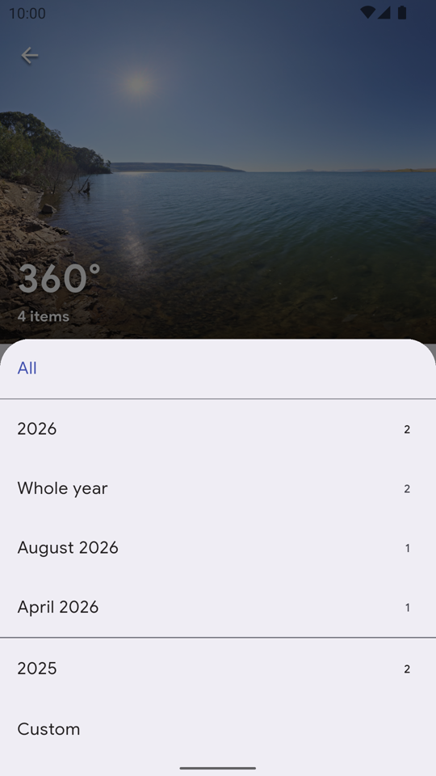
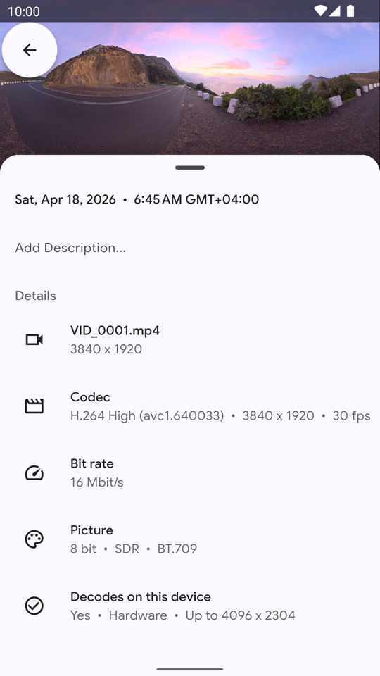

# User guide

Every function of Immuch360, step by step, with its options, its messages and its limits.

Back to the [README](../../README.md)

This guide covers every function of Immuch360, for your ordinary photos and videos as for those of a 360° camera (Insta360, GoPro MAX and MAX 2, DJI Osmo 360 and Osmo 360 II, Ricoh Theta, Samsung Gear 360), of the photo sphere mode of a phone or of a 3D camera, from an Immich server, the device itself, a NAS, a media server, a Plex server, a Jellyfin or Emby server, a Tapo camera, a camera of another brand or a DJI drone, on phones, tablets, TVs (Android TV and Google TV, LG webOS TVs, whose app is in LG's review, and a package for Samsung Tizen TVs that you sign yourself), Meta Quest headsets and computers (Windows, Linux and macOS).

**Which problem do you have?**

- **"My 360° photos show as a flat, stretched strip, and my 360° videos play flat."** See [360° photos and videos as a sphere](#360-photos-and-videos-as-a-sphere).
- **"My 360° videos force landscape on my phone, drift while I drag them, do not zoom and stop before the top and the bottom."** See [The controls of 360° photos in the 360° video player](#the-controls-of-360-photos-in-the-360-video-player-from-build-49) (not yet tried on a phone).
- **"I have no server, and I do not want an account."** See [Without a server or an account](#without-a-server-or-an-account).
- **"I want to watch the videos of my NAS, on the phone or in the headset, without copying them."** See [Network shares](#network-shares-a-nas-a-computer-or-a-media-server).
- **"Plex plays my 360° videos flat, and I want my Plex library in the headset, on the TV and away from home."** See [Plex Media Server, without plex.tv](#plex-media-server-without-plextv).
- **"I want a film of my Plex server on the phone or in the headset for the plane."** See [Download a film to this device](#download-a-film-to-this-device).
- **"My Quest will not play some films of my Plex server (DTS sound, an old AVI), or the server stops answering."** See [A film this device cannot decode](#a-film-this-device-cannot-decode-from-build-46) and [When the Plex server stops answering](#when-the-plex-server-stops-answering-from-build-46).
- **"A film of my Plex server plays without sound, opens its 4K version on my phone, or waits for ages away from home."** See [Films of a Plex library](#films-of-a-plex-library-from-build-45) and [A film this device cannot decode](#a-film-this-device-cannot-decode-from-build-46).
- **"A Plex film pauses every few seconds on my phone, though the Wi-Fi is fast."** See [Films of a Plex library](#films-of-a-plex-library-from-build-45), "On a phone, from build 48".
- **"My films are on a Jellyfin or Emby server, and the DLNA type finds nothing, or my Quest plays them flat."** See [Jellyfin and Emby servers](#jellyfin-and-emby-servers-from-build-49) (not yet tried on a device).
- **"My photos are on my phone, and I have no computer or NAS to put them on for the headset."** See [Share this phone on the network](#share-this-phone-on-the-network).
- **"I want to see my Tapo camera and last night's clips without the Tapo app, and keep a clip in Immich."** See [Tapo cameras](#tapo-cameras-live-view-and-the-recordings-of-the-memory-card).
- **"My battery Tapo camera, a C410 for example, shows no live view."** See [Battery cameras](#battery-cameras-from-build-47).
- **"My Reolink, Hikvision, Dahua or UniFi camera has its own app, and I want it next to my photos and on the TV."** See [Cameras of other brands](#cameras-of-other-brands-onvif-or-rtsp-from-build-48).
- **"My drone videos are not on the Immich map, and I want the files of my DJI drone on my server without a computer."** See [DJI drones](#dji-drones-photos-and-videos-over-usb).
- **"My photo is sideways, and I want to turn it with one key, on the phone, the TV or the computer."** See [Turn a photo with one key](#turn-a-photo-with-one-key).
- **"My Insta360 files need the Insta360 app before I can watch them"** (and the GoPro .360 and DJI .osv files too). See [Raw 360° camera files](#raw-360-camera-files-without-the-cameras-app).
- **"My DJI Osmo 360 II or GoPro MAX 2 videos shake, or my Insta360 ONE RS 1-Inch files show on their side."** See [Stabilisation](#stabilisation-with-the-cameras-gyroscope) and [Raw 360° camera files](#raw-360-camera-files-without-the-cameras-app).
- **"My 360° videos filmed on a bike or a helmet shake, and their horizon leans."** See [Stabilisation with the camera's gyroscope](#stabilisation-with-the-cameras-gyroscope).
- **"My 3D videos look doubled, and my VR180 videos are stretched all around."** See [3D and VR180](#3d-and-vr180-photos-and-videos) and [Spatial 2.5D](#depth-on-a-flat-screen-spatial-25d).
- **"I have spatial photos from my iPhone."** See [Apple spatial photos and videos](#apple-spatial-photos-and-videos).
- **"It works on the phone, but I want it in the Quest."** See [In the Meta Quest 3 headset](#in-the-meta-quest-3-headset).
- **"On the big screen of the Quest, I set a photo where I like it, and the next one opens somewhere else; I want a slideshow there."** See [Photos on the big screen](#photos-on-the-big-screen-browse-slideshow-size-and-place-from-build-49) (not yet tried in a headset by the project).
- **"I want to watch my 360° photos and videos, and the videos of my NAS or my Plex server, on the TV, with the remote."** See [Watch on your TV](#watch-on-your-tv-android-tv-and-google-tv), and for an LG TV, [LG webOS TVs](platform-support.md#lg-webos-tvs).
- **"A video filmed upright lies on its side on my Samsung or LG TV."** See [A video on its side](#a-video-on-its-side-on-an-lg-or-samsung-tv).
- **"I cannot find my 360° shots among all the others."** See [The 360° list](#find-your-360-shots-the-360-list).
- **"My 360° video stutters, or plays a blurry copy."** See [Video details and decoders](#video-details-decoders-and-why-a-video-stutters).
- **"A video loads forever, or does not play on my TV."** See [When a video does not play](#when-a-video-does-not-play).
- **"I want my 360° photos and my Immich library on my Windows PC, with the photos and videos of its folders, my NAS and my Plex server, and the PC shared with my headset."** See [On a Windows computer](#on-a-windows-computer-immuch360-desktop) (photos and flat videos, and from desktop build 3 360°, 3D, VR180 and raw 360° videos and the Tapo live view).
- **"I have a PC VR headset, and I want my 360° videos and my films in it from my Windows PC."** See [A PC VR headset](#a-pc-vr-headset-from-desktop-build-28) (not yet tried in a headset by the project).
- **"My videos are flat, and I want them in 3D for my headset or my 3D screen."** See [3D videos from your 2D videos](#3d-videos-from-your-2d-videos-from-desktop-build-29) (not yet tried on a 3D screen or in a headset).
- **"My 360° videos would look better in 3D in my headset."** See [360° videos made 360° 3D](#360-videos-made-360-3d-from-desktop-build-31) (not yet looked at in a headset).
- **"Some of my photos are soft, a little out of focus or too small."** See [Enhance a photo](#enhance-a-photo-from-desktop-build-31) (a sharper copy beside the original, the invented detail said plainly).
- **"Typing my server address and password with a TV remote, or in the headset, takes ages."** See [Sign in a TV, a headset or a computer with your phone](#sign-in-a-tv-a-headset-or-a-computer-with-your-phone).
- **"I want my DJI drone's video in my Quest one day, and I can help test."** See [DJI link diagnostics](#dji-link-diagnostics).
- **"I reinstalled the app, or moved from the Google Play build to the GitHub one, and lost my servers, shares and backup folders."** See [Keep your settings in a file](#keep-your-settings-in-a-file-from-build-46).
- **"Do I keep what the Immich app does?"** Yes, with two small changes, see [Everything else is Immich](#everything-else-is-immich).

When a feature is recent, the text says from which build it is there. The GitHub release always has the newest build, the stores follow later: see [Where to get it](release-status.md#where-to-get-it).

<details>
<summary><b>Contents</b></summary>

- [Watch your photos and videos](#watch-your-photos-and-videos)
- [360° photos and videos as a sphere](#360-photos-and-videos-as-a-sphere)
- [Without a server or an account](#without-a-server-or-an-account)
- [Network shares: a NAS, a computer or a media server](#network-shares-a-nas-a-computer-or-a-media-server)
- [Plex Media Server, without plex.tv](#plex-media-server-without-plextv)
- [Jellyfin and Emby servers (from build 49)](#jellyfin-and-emby-servers-from-build-49)
- [Share this phone on the network](#share-this-phone-on-the-network)
- [Tapo cameras: live view and the recordings of the memory card](#tapo-cameras-live-view-and-the-recordings-of-the-memory-card)
- [Cameras of other brands: ONVIF or RTSP (from build 48)](#cameras-of-other-brands-onvif-or-rtsp-from-build-48)
- [DJI drones: photos and videos over USB](#dji-drones-photos-and-videos-over-usb)
- [DJI link diagnostics](#dji-link-diagnostics)
- [Raw 360° camera files, without the camera's app](#raw-360-camera-files-without-the-cameras-app)
- [3D and VR180 photos and videos](#3d-and-vr180-photos-and-videos)
- [Depth on a flat screen: Spatial 2.5D](#depth-on-a-flat-screen-spatial-25d)
- [Apple spatial photos and videos](#apple-spatial-photos-and-videos)
- [In the Meta Quest 3 headset](#in-the-meta-quest-3-headset)
- [Sign in a TV, a headset or a computer with your phone](#sign-in-a-tv-a-headset-or-a-computer-with-your-phone)
- [Watch on your TV (Android TV and Google TV)](#watch-on-your-tv-android-tv-and-google-tv)
- [Find your 360° shots: the 360° list](#find-your-360-shots-the-360-list)
- [Video details, decoders and why a video stutters](#video-details-decoders-and-why-a-video-stutters)
- [Keep your settings in a file (from build 46)](#keep-your-settings-in-a-file-from-build-46)
- [Everything else is Immich](#everything-else-is-immich)
- [On a Windows computer: Immuch360 Desktop](#on-a-windows-computer-immuch360-desktop)
- [Install it on a computer: Windows, Linux and macOS](#install-it-on-a-computer-windows-linux-and-macos)
- [Privacy](#privacy)

</details>

## Watch your photos and videos

Immuch360 is first a gallery and a player for ordinary photos and videos. The timeline, the albums, the favorites, the memories and the search work with an Immich server; the device's own photos and videos, and the folders of a computer, show without any server. Videos play in a native player with sound, seeking, a buffering indicator and, in the 360°, Spatial and computer players, a choice of audio tracks. On a TV the remote drives everything; on a computer the mouse and the keyboard do.

### The gallery

- **Photos**: the timeline, the newest first, grouped by month and day. With an Immich server it is the timeline of your account, as in the Immich app, and the memories of past years show at its top; without a server, the photos and videos of the device (see [Without a server or an account](#without-a-server-or-an-account)); on a computer, those of the folders you chose (see [On a Windows computer](#on-a-windows-computer-immuch360-desktop)). Drag the scroll bar at the right edge to go through the months quickly.
- **Search** and **Albums**, with a server: the search of your Immich server, and the albums of your account and those shared with you. Without a server they stay greyed out.
- **Library**: 360° at the top, the [360° list](#find-your-360-shots-the-360-list); with a server, Favorites, Archived, Shared links, Trash, People and Places; then On this device, the albums of the device, and Network shares, with your shares, Plex servers and cameras.
- **Thumbnails**: a 360° photo or video carries the 360° badge, and videos show a play mark. In a share folder, an Apple spatial photo or video carries a 3D badge.

### Open a photo

1. Tap a thumbnail. The photo opens full screen, a preview first, then the full picture.
2. Swipe left or right for the next or the previous photo or video of the timeline, the album or the list you came from.
3. Pinch or double tap to zoom in, and drag to move around the zoomed photo.
4. Swipe up for the details: the date, the place, the camera and the file. Swipe down on the photo to close the viewer.
5. The top bar has the favorite button, the ⋮ menu (Slideshow, "View as 360°", Download and more) and, on a 360° file, the 360° button, see [360° photos and videos as a sphere](#360-photos-and-videos-as-a-sphere). The bottom bar has the actions of the Immich app: share, edit, add to an album, delete, and upload for a file of the device that is not on the server yet; from build 27, Rotate too, before Edit, see [Turn a photo with one key](#turn-a-photo-with-one-key).

### Turn a photo with one key

A photo taken sideways, or a scan the wrong way up: from build 27 one key turns it by 90°, on every platform. The Immich app turns a photo only in its photo editor (Edit, rotate, Save); Immuch360 does it with one press, from the viewer, a TV remote included.

1. **Phones and tablets**: open the photo and tap **Rotate** in the bottom row, before Edit: the photo turns 90° clockwise at once, at any zoom. A long press turns it the other way. With a keyboard, R turns it clockwise and Shift+R counter clockwise (not while you type in a text field). In the read only mode, the button is in the top bar.
2. **Meta Quest, in the window**: the same Rotate button, with the controller pointer; a long press turns it the other way.
3. **TV**: the **yellow** key of the remote turns the photo clockwise and the **blue** key counter clockwise, from anywhere in the viewer. On a remote without colour keys, use the Rotate button of the bottom bar: OK on the photo shows the bars, then Right from the text button reaches Rotate, or Down when the photo has no recognized text; OK on Rotate turns the photo, and each OK again. OK on the photo itself never turns it, and a held OK on Rotate opens the details without a turn.
4. **Computer**: R, Shift+R, or the rotate button of the top bar, before full screen.
5. **A photo of a share** (SMB, WebDAV, DLNA, Plex, Tapo): the rotate button is the first of its top bar, and R, Shift+R, yellow and blue work there too.
6. Four presses bring the photo back as it was.

Where the turn goes:

- **Your own photos on an Immich server 2.6.0 or later**: the turn is saved through Immich's photo editor, as if you had turned the photo there. Quick presses make one request; a thin bar shows at the top while the server makes the turned picture, which then takes the place of the one on screen; the web app, the other devices and the thumbnails show it turned. A crop or a mirror made in the editor before is kept. To undo it, turn it back, or remove the edit in the editor.
- **Everything else** (the photos of a partner or of a shared album, motion photos, GIF and SVG files, an older server, the read only mode, the photos of the device and of the shares): the turn is remembered on this device, for that photo. The first time in a session for an Immich photo, the app says "The rotation is kept on this device only". The slideshow, the memories, the thumbnails and casting show such a photo as it is.
- **"Could not save the rotation on the server"**: the photo comes back as the server has it; try again.

What never turns: videos; 360°, 180° and 3D photos, and the photos you view as 360°, whose views follow your head or the phone and always read the photo as the camera made it; Apple spatial photos; raw files of 360° cameras; 2:1 photos of Insta360 cameras, even when the server does not flag them 360°; the trash and the locked folder. A photo whose kind the app does not know yet (its details still loading, a photo of the device that the 360° scan has not read) gets the button once it is known.

On LG TVs the webOS app has the same keys and the same rule, see [LG webOS TVs](platform-support.md#lg-webos-tvs).

### Play a video

1. Open a video as a photo: it plays in the viewer, with its sound. In Settings, Asset Viewer, Videos, "Auto play videos" starts a video as soon as it opens, and "Looping" plays it again from the start when it ends (off by default on a TV, from build 27).
2. Tap the video to show or hide the controls: play and pause (replay once it has ended), the position and the length, and the time bar to seek. They hide by themselves a few seconds after the last touch.
3. While the video loads or stalls, the player shows "Buffering". From build 27 a video that cannot play says why instead of loading forever, see [When a video does not play](#when-a-video-does-not-play).
4. A 360° video has the 360° button in the top bar, which opens the [360° player](#play-a-360-video); on a phone or a tablet the Spatial button follows it while that setting is on, see [Spatial 2.5D](#depth-on-a-flat-screen-spatial-25d).
5. Swipe up for the details of the video: the codec, the size, the frame rate, the bit rate, the picture, and whether this device decodes it, see [Video details, decoders and why a video stutters](#video-details-decoders-and-why-a-video-stutters).

The player plays the file stored on the device when there is one, the file of a network share through the app's local bridge, and otherwise the server's original or its transcoded stream, as Settings, Asset Viewer, Videos, "Video source" says (see [Choose the original or the transcoded stream](#choose-the-original-or-the-transcoded-stream)). The audio track and subtitle menus are in the flat player of Android phones, tablets, TVs and the Quest window (from build 29), for the tracks inside the file; the 360°, Spatial and computer players have the audio track choice. iPhones and iPads have no track menu yet. From build 45 a film of a Plex server also offers the subtitle files Plex knows beside it, under the names Plex gives its tracks, see [Films of a Plex library](#films-of-a-plex-library-from-build-45).

### On a TV, in a headset and on a computer

- **TV**: from build 27, Left and Right go to the previous or next item, also while a video plays; OK shows the controls of a video, and a second OK pauses; the controls hide 5 seconds after the last key; the media keys of the remote work. Up to build 26, OK paused and Left and Right jumped 10 seconds while a video played. See [Photos and videos with the remote](#photos-and-videos-with-the-remote).
- **Meta Quest**: the app runs as a window, where photos and videos open as on a phone; the 360° button opens the immersive view, see [In the Meta Quest 3 headset](#in-the-meta-quest-3-headset).
- **Computer**: the arrows, or the chevrons at the edges, go from photo to photo; Enter pauses a video, J and L jump 10 seconds, F or F11 switches to full screen. See [Use it on a computer](#use-it-on-a-computer).

## 360° photos and videos as a sphere

You back up your photos to an [Immich](https://github.com/immich-app/immich) server, and some of them come from a 360° camera or from the photo sphere mode of a phone. In the official mobile app those pictures show up as a flat, stretched strip, and 360° videos play flat too. The Immich web app can show a 360° photo as a sphere, the mobile app cannot: it has been requested since January 2024 in [discussion #6572](https://github.com/immich-app/immich/discussions/6572).

Immuch360 opens them as a sphere you look around in, on Android and iOS phones and tablets.

A photo turns as you drag it, zooms with a pinch or a double tap, keeps turning a little after a quick drag, starts on the initial view the camera recorded (GPano metadata), and gets a sharper texture when you zoom in; partial panoramas are handled (GPano crop). A video plays in a native spherical player with sound, drag and the gyroscope.

Stitched 360° files work everywhere: exports from the Insta360 app or Studio, GoPro Player, Ricoh Theta, and phone photo spheres. Raw files straight from the camera are stitched by the app, see [Raw 360° camera files](#raw-360-camera-files-without-the-cameras-app).

<p align="center">
  
  
</p>

- **A 360° photo as a sphere**: close at the top left; at the top right the 360°/180° button, the 3D layout button and the gyroscope.
- **A 360° video in the 360° player**: tap the picture for the controls; 360° and 3D at the top right.

### Open a 360° photo as a sphere

1. Open the photo from the timeline, an album, the [360° list](#find-your-360-shots-the-360-list) or a share folder. 360° photos carry a 360° badge on their thumbnail.
2. Tap 360° in the top bar of the viewer. The sphere viewer opens, with a loading indicator while the full picture loads; the zoom you had on the flat view is kept.
3. Drag to look around, pinch to zoom, double tap to zoom in. After a quick drag, the view keeps turning a little and slows down.
4. To look around by turning the phone, tap the gyroscope button at the top right (off by default).
5. The other two buttons at the top right are 360°/180° (full sphere or VR180 half sphere, not shown on partial panoramas) and 3D (the layout of a stereoscopic photo), see [3D and VR180](#3d-and-vr180-photos-and-videos). A raw Insta360 photo has only the gyroscope.
6. Close with the cross at the top left.

### Play a 360° video

1. Open the video and tap 360° in the top bar. On a 360° video the 360° button comes first; on phones and tablets the Spatial button follows it while that setting is on (see [Spatial 2.5D](#depth-on-a-flat-screen-spatial-25d)).
2. The native 360° player opens full screen and plays with sound: Media3 on Android, SceneKit on iOS.
3. Drag to look around, or move the phone with the gyroscope button on. Up to build 48 the Android player always followed the phone, in landscape only, and the iOS one had a gyroscope toggle, on by default; from build 49 on Android and version 3.4.4 on iPhone and iPad both have the controls of the 360° photos, see [below](#the-controls-of-360-photos-in-the-360-video-player-from-build-49).
4. Tap the picture for the controls: close, 360°/180° and 3D at the top, then play, the skip buttons and the time bar on Android. The iOS player has play and pause only for now.
5. When the video has two audio tracks or more (languages, commentary), an Audio track button lets you pick one. While the video loads or stalls, the player shows "Buffering" with the fill of its playback buffer.

The player plays the file stored on the phone, or the file of a network share, when there is one. Otherwise it streams from your server: the transcoded stream by default, or the original if you ask for it in Settings, Asset Viewer, Video source (from build 15; the "Force original video" switch before), see [Video details and decoders](#video-details-decoders-and-why-a-video-stutters).

### The controls of 360° photos in the 360° video player (from build 49)

From build 49 on Android phones and tablets, and from version 3.4.4 on iPhone and iPad, the 360° video player has the controls of the 360° photo viewer, as TheBatAss asked in [issue 20](https://github.com/freeKC/Immuch360/issues/20). Not yet tried on a phone by the project.

- **Portrait or landscape**: the player follows the rotation of the device, as the rest of the app does, and the system rotation lock; it no longer forces landscape. Below 400 dp of width the buttons of its top bar sit without margins, so that the title keeps some room in portrait with every button shown.
- **The gyroscope button**: the compass at the right end of the top bar, the button of the 360° photos, one setting for both, off by default. Off, the motion of the phone is not read at all, so nothing drifts while you drag; on, turning the phone turns the view, as on photos, and a drag adds to it. A choice made in a photo holds in the next video and the other way round; a TV and the Quest never turn it on. iOS starts from that setting too, where its player used to start with the motion on. If you would rather have a separate choice for videos, say so in the issue.
- **Zoom**: pinch from 15° to 115° of view; a double tap zooms in to 45° and back to 90°, in 250 ms, playing or paused; the player opens at 90°. A double tap zooms when its second tap is released: a tap followed by a drag or a pinch does not zoom. A single tap shows or hides the controls about 300 ms later, the time to tell it from a double tap.
- **Straight up and straight down**: a drag goes on to the zenith and the nadir (drag down to look up), the camera always upright and the horizon level, where it stopped about 45° short on Android before. A VR180 video stops where the edge of the screen reaches the top or the bottom of its half sphere, as before at the default zoom, further when zoomed in. The drag keeps its speed, 25 pixels per degree at 90°, slower when zoomed in.
- **What stays**: the stabilisation with the camera's gyroscope, the stitching of raw videos, the 3D and 360°/180° buttons; Android TV keeps its arrows and its view, and the Quest its immersive view.

Checked by the project's tests: on Android, 300 random drags give the view of Media3 below its old limit, 2000 random drags keep the camera upright, and the gyroscope cases of the 360° photos give the same view in every rotation of the phone; on iOS, the same cases in the Swift tests of the CI. Not run on a phone or an iPhone yet: if the view turns the wrong way, or the log says "The spherical view cannot be driven", the player behaves as in build 48 but follows the rotation, and a report in [Issues](https://github.com/freeKC/Immuch360/issues) helps.

### A 360° file that shows flat: View as 360°

Some 360° files carry no projection tag, so the server does not flag them as 360° and they show flat.

1. Open the photo or video and tap ⋮ at the top right.
2. Tap "View as 360°", between Slideshow and Download. The 360° button appears in the top bar.
3. To undo it, the same entry now reads "Stop treating as 360°".

The choice is remembered on the phone and changes nothing on the server. On a file of a network share it applies to that viewing only.

From build 27 the spheres of DJI drones, which most often carry no projection tag, show as 360° without this step: the app recognises them by the camera code in their EXIF, as the photos a GoPro or a DJI 360° camera stitched itself. To send them to Immich with the tag its web app needs, see [DJI drones](#dji-drones-photos-and-videos-over-usb).

### Limits

- **iOS 360° video player**: play and pause, no time bar yet.
- **Previous and next**: the 360° players of phones do not move to the previous or next media yet; the Quest immersive view does.
- **Very large panoramas**: a photo is shown at 8192x4096 at most, the largest texture most phone GPUs take, so a larger panorama is downscaled to that size.
- **Dual fisheye .dng**: still shows flat.

## Without a server or an account

You have no Immich server, or you do not want an account: you only want the 360° photos of your phone to open as a sphere you can turn with the gyroscope. The Immich app asks for a login first.

From build 24 the app starts on a welcome page, where "Use without a server" is the first choice (before, it was a link under the login form). It opens Immuch360 on the device's own photos and videos, with the 360°, 3D, VR180 and Spatial viewers, the 360° list and the network shares (from build 20 also the Plex servers and the Tapo cameras), no Immich account needed. The server features stay hidden or greyed out until you connect a server; nothing leaves the device. On a Meta Quest it opens the headset's own photos and videos; on a TV, which has none, it points to the network shares (see [Watch on your TV](#watch-on-your-tv-android-tv-and-google-tv)).


### Start without a server

1. Open the app. The welcome page shows the icon and the name of the app, "Your media. Any screen. Every perspective." and three choices: "Use without a server", "Add a network share or a media server" and "Connect to an Immich server". Tap the first one. Up to build 23, the app opened on the login page instead: tap "Use without a server" below the server address and Settings.
2. Allow access to your photos and videos. If you refuse, the app says "The app cannot see the photos of this device", with "Allow access" and "Open the settings".
3. The Photos tab shows the timeline of the device. Search and Albums stay greyed out, as they come from the server. The Library tab has 360° at the top, then On this device (the albums of the device) and Network shares.
4. The menu at the top right says "This device only": the app shows the photos and videos of this device, nothing is sent anywhere.
5. From build 24, the second choice of the welcome page, "Add a network share or a media server", starts the same way without a server but opens the Network shares page at once, without asking for the photos of the device; see [Add a share](#add-a-share). Back leads to the Photos tab, which asks for the photos later if you want them there.

### Connect a server later

1. Open Settings (the menu at the top right, then Settings). The first entry is "Connect to a server", "Sync with an Immich server to back up, search and share". The menu at the top right has the same entry, and from build 24 so has the bottom of the Library tab, "Connect to an Immich server".
2. Log in as usual. The timeline, albums, backup and the other server features appear. From build 24, Back under the server address returns to the page you came from.

### Limits

- **The device's own gallery**: the app shows the photos and videos of the device's gallery. On an iPhone, the scan for 360° files skips those stored only in iCloud until they are downloaded to the device.
- **Without a server**, the 360° list holds what the scan of the device found and the files you chose to view as 360°, see [The 360° list](#find-your-360-shots-the-360-list).

## Network shares: a NAS, a computer or a media server

Your 360° videos sit on a NAS or a computer, and you want to watch them on the phone or in the headset without copying them first. In the headset, people end up copying each file over a cable; the apps of media servers such as Plex and Jellyfin play 360° videos flat, as requests on their forums describe; the Immich app reads only your Immich server.

Immuch360 browses and plays the photos and videos of any server that speaks SMB (Samba, Windows), WebDAV or, from build 19, DLNA/UPnP (a media server: minidlna, Gerbera, a NAS or a TV box, or Jellyfin and Emby with their DLNA plugin), straight from the share. From build 20 a Plex Media Server has a type of its own, see [Plex Media Server, without plex.tv](#plex-media-server-without-plextv), and from build 49 a Jellyfin or Emby server too, see [Jellyfin and Emby servers](#jellyfin-and-emby-servers-from-build-49).

It finds the servers of your network by itself, and plays the files live in the same viewers as the rest of the app (360°, 3D, VR180, Spatial 2.5D, Quest immersive view), with or without an Immich server, on phones and on the Meta Quest 3. Nothing is downloaded. When a server is connected, the files you pick can be sent to your Immich account (from build 15).

<p align="center">
  
  
</p>

- **Add a share**: the fields of a new SMB share, after Test the connection.
- **A folder of a share**: 360° photos and a video, read live from the share.

### Add a share

1. Open the Library tab, then Network shares; from build 24, on the welcome page of the first start, "Add a network share or a media server" opens this page directly, without a server. The first time, the page says "No share yet" with an "Add a share" button; + at the top right does the same at any time. From build 20 both ask what to add: "A network share (NAS, computer, media server)", "A Plex Media Server" or "A Tapo camera". Pick the first one.
2. The "Add a share" page first looks for the servers of your network and lists them under "Found on the network", with their type (SMB, WebDAV, DLNA, Phone, and from build 20 Plex and Tapo). The search takes up to about six seconds; "Scan again" starts it over. It uses Bonjour/mDNS and a scan of the local network confirmed by a real SMB or WebDAV exchange, from build 19 an SSDP search for DLNA media servers, and from build 20 GDM, the discovery of Plex, and the discovery protocol of TP-Link for the Tapo cameras.
3. Tap a server: the type, server, port and path are filled in. A Plex server or a Tapo camera opens its own page instead, filled in.
4. Not in the list? Fill the form by hand. Type: "SMB (Samba, Windows share)", "WebDAV (Nextcloud, Synology and others)", "DLNA media server (NAS, TV box, minidlna)" or, from build 20, "Plex Media Server", which opens the page of [Plex Media Server, without plex.tv](#plex-media-server-without-plextv), or from build 49 "Jellyfin or Emby server", which opens the page of [Jellyfin and Emby servers](#jellyfin-and-emby-servers-from-build-49). Then Name, "Server name or address" (a name or an address; a full address such as `smb://nas/photos`, `\\nas\photos` or `https://nas:5006/photos` fills the other fields), "Port (optional)" when it is not the usual one, "Share" for SMB or "Path of the WebDAV address" for WebDAV, "Start folder (optional)", "User name" and "Password", and "Secure connection (HTTPS)" for WebDAV.
5. SMB: once the server and the user name are typed, "Choose a share" lists the shares of the server.
6. DLNA: a media server has no user name or password. Give the server, the port and the "Description path" of its device description (`/rootDesc.xml` for minidlna), or paste the whole address, such as `http://192.168.1.10:8200/rootDesc.xml`, in the server field.
7. Tap "Test the connection". It answers "Connected, N entries in the start folder", or says why it failed. Then tap Save, at the bottom of the form. From build 22, closing a form you typed in (X, Back) asks "Discard the changes?" first, on the Plex and camera pages too, and so does choosing Plex or a camera found once something is typed.

A user name with an empty password is sent as such: a Freebox Server wants `freebox` and no password for its disks. To change or remove a share later, use the pencil next to it in the Network shares page.

### Browse and play

1. Tap a share. Folders come first, then the photos and videos as a grid with thumbnails (a frame of each video too, cached on the device). The ones recognised as 360° carry the 360° badge, and from build 19 Apple spatial photos and videos a 3D badge. Pull down to refresh.
2. Tap a photo: it opens full screen (pinch, double tap), and its 360° button opens the sphere viewer.
3. Tap a video: it plays in the native player (play, pause, seeking), with a 360° button that opens the 360° player and its 3D and 360°/180° buttons, and on a phone a Spatial button for stereoscopic files.
4. On a Quest, the 360° button opens the immersive view, and from build 19 "View in 3D" opens an Apple spatial photo in 3D.
5. The ⋮ menu has "View as 360°" for the files without a 360° tag, and on a phone "Spatial 2.5D" for the videos that are not stereoscopic.

360°, 3D and VR180 are recognised from the GPano or spherical metadata of the file, read with range requests, and VR180 also from the file name. From build 16 raw Insta360 files are recognised too (an .insp photo by its name or the camera's calibration block, an .insv video by its name and its frame) and stitched.

**The names over the thumbnails** (from build 52 and desktop build 32): once the picture of a photo or the frame of a video shows, its name stays over it, white on a dark band at the bottom of the tile, cut in the middle when it is long so that its end stays ("PXL_2026…0815.jpg"), above the play mark of a video and above the tint of a selection. The 3D, 3D AI, 3D scene, 360° AI and AV2 badges sit on a dark pill, and so do the durations of the videos in the timeline; the months of the timeline overview and the titles of the memories get the same band. The contrast is at least 5.7 to 1 on a white picture, in the light and the dark themes; a film of a Plex, Jellyfin or Emby library keeps its title under its poster. Not seen on a device yet.

### Send files of a share to Immich

From build 15, when you are connected to a server:

1. In a share folder, long press a photo or video, or tap Select at the top right.
2. Tick what you want, or use "Select every photo and video of this folder". On a computer, Ctrl+click, Shift+click and Ctrl+A tick files too (Ctrl+A takes the splat files listed, as the Select all button does), Esc stops, and a right click on a ticked file opens Upload to Immich (from desktop build 24).
3. Tap "Upload to Immich". The files are streamed from the share to your server one at a time, with the progress on each tile, and a bar at the bottom that reads "Sending 3 of 12" with a Cancel button. Keep the app open while it sends.
4. At the end the app says how many were sent and how many were already on the server: the server keeps its own copy and deduplicates the files it already has. Files sent earlier carry a mark ("Sent to Immich earlier") and are skipped the next time.

The open photo or video of a share has the same entry in its menu. Without a server, the page says "Connect to an Immich server to upload". Photos and videos of the device are sent the same way from the Library tab: On this device, an album, select, "Upload to Immich", including those of albums that are not in the backup selection; once sent they are counted as backed up.

### How it plays without downloading

The players read the bytes they need through a bridge inside the app (loopback address only, random token per session, byte ranges), so seeking in a video works and nothing is copied to the device. The players and the headset viewer never get the address of the share, only the bridge's 127.0.0.1; the requests to the server are made by the app itself.

For smooth playback the share is read in large blocks, the file stays open between reads, up to 16 MB are read ahead of the player, and the video being played is read over up to six SMB connections in parallel, separate from the connection that serves thumbnails and listings. A Freebox Server answers each read slowly: one connection gives 4.5 MB/s, six give 19 MB/s, enough for a 5.7K export at 132 Mbit/s.

While the player waits for data, the 360° and Spatial players show "Buffering" with the fill of their playback buffer; the flat player shows "Buffering" without a percentage while the video loads or stalls.

### DLNA media servers

From build 19, the app sends the SSDP search for media servers to the multicast group of the network, and the same request to port 1900 of every address of the local /24 network, then reads the device description of each server that answers and keeps those that publish their content (a ContentDirectory).

Folders and files are listed with the server's Browse action, page by page, and named by their titles: a file gets the extension of its type when its title has none, and a second file with the same title in a folder becomes `name (2)`. Audio is left out. Thumbnails are the album art or the small pictures the server makes, loaded by the app itself, with the app's own thumbnail when the server has none. A file plays from the original the server offers, rather than a converted copy when it offers both, read with range requests, so seeking works.

A media server lists only the files it indexed, and media servers usually pick them by their extension: the raw files of 360° cameras (.insv, .insp, .360, .osv) and the splat files (.ply, .spz) usually do not show in a DLNA share, even when they sit in its folders. Put them on an SMB or WebDAV share, or in a folder of the device ("Browse a folder" on an Android phone, a tablet or a Meta Quest, the folders of a computer), where the app lists them itself.

From build 47 and desktop build 27, and in the LG TV app from version 1.0.3, a folder of live TV channels (the TV channels of a Freebox, for example, which a DLNA server offers as RTSP or RTP streams) says "Live TV channels are not playable here yet" instead of opening empty. Playing them is on the roadmap.

Checked against minidlna and Gerbera; discovery on a real network, Plex, Jellyfin, a NAS, the Freebox Server, an iPhone and the Quest are the device test of build 19. Since Jellyfin 10.9 (May 2024) a stock Jellyfin server has no DLNA, which became a plugin: add it as a [Jellyfin or Emby server](#jellyfin-and-emby-servers-from-build-49) instead.

### A share that moved

From build 19, a DLNA share and a phone share (see [Share this phone on the network](#share-this-phone-on-the-network)) keep the id their server announces. When one no longer answers at its address (a new address given by the box, a server restarted on another port), its folder page shows "Looking for (name) on the network" and moves the share to where it answers now: at once for a DLNA server, which has no password, and after a confirmation, "Use the new address?", showing both addresses, for a share with a user name and password, since they would be sent to the new address.

From build 20 a Plex server found again at another address of the network moves at once too: its certificate proves it is the same server before the token is sent. A Tapo camera is looked for by its MAC address from its own page, see [Tapo cameras](#tapo-cameras-live-view-and-the-recordings-of-the-memory-card).

### Limits

- **SMB**: SMB 2 and 3 only, no SMB 1.
- **WebDAV**: Basic authentication only (Digest is not supported yet); a self signed HTTPS certificate must be installed on the device.
- **Finding servers**: the network scan and the DLNA, Plex and Tapo searches look at the local /24 network only, and need the local network permission on iOS. On iPhone and iPad the DLNA search sends the unicast requests only, until Apple grants the app the multicast entitlement, and some servers do not answer them (minidlna on Linux): add those by their description address.
- **DLNA**: a server that only offers a converted copy of a file gives that copy; a folder lists 20,000 entries at most; the raw files of 360° cameras and the splat files usually do not show, see [DLNA media servers](#dlna-media-servers).
- **Thumbnails**: photo thumbnails decode the whole file, and photos over 30 MB get none.
- **Players**: the flat player of iPhones and iPads has no audio or subtitle menu yet. On a phone there is no swiping from one file of a folder to the next yet (the Quest immersive view has previous and next for the 360° files of the folder). The 3D or 180° choice made on a network file is not remembered.
- **Uploads**: they run only while the app is open, and a file the server already has is sent in full before the server reports it as a duplicate.

## Plex Media Server, without plex.tv

Your videos are in Plex, and Plex shows your 360° photos and videos flat, as requests on its forum describe (one has been open since 2017). You also want that library in the headset, on the TV and away from home. The Immich app reads only your Immich server, and the DLNA type of build 19 reaches the DLNA side of Plex at home only.

From build 20 Immuch360 pairs with your Plex Media Server directly, without plex.tv: it finds the server on the network, you paste a token once, and the app reads the original files of your libraries live, in every viewer of the app (360°, 3D, VR180, Spatial 2.5D, the Quest immersive view, the TV remote), at home and, through your port forwarding, away from home. Nothing is copied, and the files you pick can be sent to Immich.

### Add a Plex server

1. Open the Library tab, then Network shares, then + and "A Plex Media Server". The "Plex Media Server" type of the share form, and a server with the Plex tag under "Found on the network", open the same page.
2. The "Add a Plex server" page looks for the Plex servers of your network ("Looking for Plex servers on your network") and lists them under "Found on the network". Tap yours: a card shows its name, its Plex version and a short id.
3. Not in the list? Type its "Server address", such as `192.168.1.20`, `192.168.1.20:32400` or `https://...plex.direct:32400`, then tap "Look up". The app reads the certificate of the server and sends nothing else.
4. Get the token, on a computer: open Plex in a web browser and sign in, open any photo or video of your library, then "...", "Get Info", "View XML". A new tab opens on an address ending with `X-Plex-Token=...`. Copy that whole address.
5. Paste it in "Access token", or send it to the phone and tap "Paste from the clipboard": the app takes the server and the token from it. The text after `X-Plex-Token=` alone works too. "How to get it", on the page, says the same; server administrators can also use the `PlexOnlineToken` value of the server's `Preferences.xml` file, which does not expire. On a TV, OK opens the keyboard dialog: type the token there (it is usually 20 characters).
6. Tap "Test the connection". It answers "Connected: N libraries", or says what is wrong, such as "The Plex server refused this token."
7. "Access from outside home" then shows what the server says: "The server says it is reachable at (address):(port).", or "The server did not tell its address outside home." To use the server away from home, type your public address or DynDNS name in "Address outside home (IP or name)", and the port forwarded in Plex (Settings, Remote Access) in "Port outside home". What you type always wins over what the server says.
8. "Name" is the name of the server unless you change it, and "Start folder (optional)" can open one library directly. Tap Save. The server is listed with the shares, as `plex://` and its address.

**Or sign in with Plex** (from build 46): instead of steps 3 to 6, tap "Sign in with Plex" on the same page. On a phone, a tablet or a computer the plex.tv page opens in the browser: sign in and allow Immuch360. On a TV or a Quest, the page shows a 4 character code and a QR code: open plex.tv/link on your phone or computer and enter the code. The page then lists the Plex servers of your account; tap yours, and the app tries its addresses, at home first, fills in the address and the server's token and tests them. Go on with steps 7 and 8. This step talks to plex.tv once to get your token; the app then talks to your server only. To sign out, remove the server in the app; you can also revoke the app's access on plex.tv (Settings, Authorized Devices).

### Browse your Plex libraries

1. Tap the server in Network shares. The first level lists the libraries the app shows: photos, movies and other videos, TV shows. Music is left out.
2. Below a library come its folders as they are on the disk of the server (the "by folder" view of Plex), then the photos and videos under their file names, with the thumbnails Plex makes. A photo library whose folder view does not answer shows its albums instead.
3. 360° and 3D are found by reading the files themselves, as on any share: 360° photos get the 360° badge, Apple spatial ones the 3D badge.
4. Open a photo or video as on any share: 360°, 3D, 360°/180°, Spatial 2.5D on a phone, the immersive view in the Quest, the remote on a TV. A video is read as the original file, with byte ranges through the app's local bridge, so seeking works and its 360° and 3D metadata reach the players intact.
5. Select files and tap "Upload to Immich" to send them to your server, as from any share (see [Send files of a share to Immich](#send-files-of-a-share-to-immich)).

### Every film of a Plex library, by year (from build 45)

You want every film of your library in one place, newest first, with its title under its poster, and to find one by typing a few letters, rather than walking the folders of the disk. From build 45 a Plex film library opens on its films page.

1. Open your Plex server in Network shares, then its film library, or tap **Films** in the Library tab (it shows once the app has a Plex server, and asks which library when there are several).
2. Every film is in one list, under a header per year with its number of films, newest year first; the films without a year come last, under "Year unknown". The posters load as you scroll, 100 films at a time, with the title and the year under each.
3. Drag the scrubber on the right edge, which shows once the list moves, to jump to a year.
4. Type in "Search a title": the films whose title holds the text show 300 ms after you stop typing, with what the server's own search adds for a misspelt title. From build 47 the search also ignores accents and apostrophes and finds a word anywhere in the title, the original title or the sort title, from three letters: "ecris" finds "J'écris ton nom". The × button or Back clears the search.
5. The filter button of the bar opens the filters of the library (Year, Audience, Not watched, see [Films of a Plex library](#films-of-a-plex-library-from-build-45)): the list keeps the films that match, still newest year first, and the button shows that filters are on.
6. Tap a poster to open the film's page (see [Films of a Plex library](#films-of-a-plex-library-from-build-45)), where Play starts it. A long press opens its menu: Play, which starts the film at once, "Download to this device" (on Android TV too from build 47), "Play on…" (phones and tablets) and Upload to Immich.
7. The menu of the page has "Show the folders", the folder view as before, where the title of each film now shows under its picture. Libraries of other videos, where 360° clips usually are, keep the folder view.

On each screen:
- **Phones and tablets**: pinch to change the number of posters a row.
- **Android TV**: seven posters a row, the first one focused, no scrubber; OK on the search field opens the TV keyboard.
- **Meta Quest window**: the tablet layout, with the system keyboard.
- **Computers**: Ctrl (Command on a Mac) and the mouse wheel change the number of posters a row; Ctrl F, Command F or / go to the search field, Escape clears it; the whole title shows when the pointer rests on it.

Limits of build 45: the page was checked against a simulated server built from Plex's documentation, then in a Quest 3 with build 45 against a real Plex Media Server (the year headers, a search, a year filter), and, before build 47, whether the search ignored accents depended on the server.

### Films of a Plex library (from build 45)

You want to know what a film is before it starts, to pick its language and its subtitles, and to find a film for tonight without walking the folders of the disk. From build 45, a film of a Plex film library opens its own page, its tracks carry the names Plex gives them, and the library has filters. Libraries of other videos (where your 360° clips usually are) keep opening the player directly.

1. **The film page**: tap a poster on the films page of a film library, or a film in its folder view. The page shows what your server holds of it at once: the poster and the background, the title and the original title, a line such as "2001 · 2 h 02 · 12 and over · Comedy, Romance", the ratings as text, the tagline and the synopsis (More shows all of it), the director, the writers and the cast, then the file: its resolution, its size, its audio and subtitle languages. The menu (⋮) has "Show the folders", which opens the folder of the film in the folder view (on a TV, a button after Play), and Upload to Immich.
2. **Play or resume**: Play starts the film. When you stopped it before, here or in a Plex app, the button reads "Resume at 1:12:03", with "Play from the start" next to it.
3. **From Wikipedia**: under the rest, the opening of the film's Wikipedia article in the language of the app, or the nearest one that has it (marked with its language when it is another), with "Read on Wikipedia" and its licence line. The article is found by the film's IMDb or TMDB number that Plex gives, never by its title, so it is never another film. It loads after the rest and never delays Play. Turn it off in the ⋮ of the page, or in Settings, Advanced, "Film details from Wikipedia": no request then goes to Wikimedia, and the articles kept on the device are deleted.
4. **Audio and subtitles**: in the player, the Audio and Subtitles menus show the names Plex gives the tracks ("Français (AC3 5.1)", "English (SRT External)"), and the Subtitles menu also lists the subtitle files Plex knows beside the film (a `.srt` next to it on the disk, or one Plex downloaded), which no player sees inside the file. The film starts with the tracks you picked last in Plex. The track you pick is saved on the film in your server, so the Plex apps start with it too.
5. **Filters**: the filter button of the films page opens Year (each decade, ticked whole or opened onto its years), Audience and Not watched; within one kind the choices add up, between kinds they narrow the list, and the films page keeps the films that match. In the folder view of a film library ("Show the folders"), the same button also offers Order (year, newest or oldest first, title, recently added); "Show the films" lists the films that match, with their count and Clear above them; Back or Clear brings the folders back.
6. **Download and Play on**: the row after Play has "Download to this device" (see [Download a film to this device](#download-a-film-to-this-device)) and, on a phone or a tablet, "Play on…" (see [Play a film on your TV from your phone](#play-a-film-on-your-tv-from-your-phone)).
7. **Audience**: the ages come from the ratings Plex stores, in the rating system of the library's country: "All audiences", "10 and over", "12 and over", "16 and over", "18 and over" and "Not rated", several at a time. A rating the app does not know is offered as Plex writes it. It is a filter, not a parental lock.
8. **Versions** (from build 47): a film your library holds in several files, 1080p and 4K for example, shows them under "Versions", each with its resolution, its codec and its size ("2160p HEVC HDR, 52 GiB", "1080p HEVC, 3.0 GiB"). Play opens the one you picked last on this device; otherwise the largest one whose height fits the screen among those this device decodes, leaving out on a phone a file of 20 GB or more when a smaller one exists. The pick stays on the device, not in the settings file, since it depends on the screen. "Download to this device" then asks "Which version to download?".
9. **A sound track this device cannot decode** (from build 47): when the track Plex picked is one the player of this device does not decode, Dolby TrueHD in a Meta Quest for example, the app plays another track of the film, in the same language when there is one, and says so for a few seconds: "Audio: French AC3 5.1 (TrueHD is not playable on this device)". With mpv, the same switch happens when mpv reports that a decoder failed, or when no sound comes 8 s after the first picture; picking the TrueHD track again in the menu brings the other one back, with the notice. When no track can play, the app says "This film has no sound this device can play", and on Android, for a film read from the server with the conversion setting on, offers "Let the server convert it".

On each screen:
- **Phones and tablets**: the page in one column on a phone, two columns on a tablet in landscape; the filters in a sheet.
- **Android TV**: the focus starts on Play, the synopsis and the Wikipedia text scroll with the remote, "Read on Wikipedia" shows the address to open on a phone, the filters open in a dialog, and Back returns to the film you opened. The Wikipedia switch is in Settings, Advanced.
- **Meta Quest window**: the page in two columns; the film plays in the flat player of the window with its menus. A film that opens in the immersive viewer (360° or 3D by its name) has no track menu there.
- **Computers**: the page in two columns, Enter or Space on Play; the Subtitles menu sits next to Audio in the player.
- **iPhone and iPad**: the page and the filters, but no track menu yet, and MKV films do not play there.

**On a phone, from build 48**: a film that a phone received at a few Mbit/s, pausing every few seconds while the Wi-Fi was fast, plays on. The app now reads Plex away from the part of the app that draws the screen, in its own worker, and hands the player its data in large batches; the player of Android tells its position ten times a second instead of 125, and the waiting circle turns four times a second instead of at every frame. On 14 November, on a Galaxy S24, a candidate of build 48 received a film of 21 Mbit/s at 32 to 40 Mbit/s, where build 47 received it at 4 to 8. Nothing to set; the TVs, the Quest and the computers read Plex the same way, not measured there yet. If a film still pauses, the waiting box tells what the link carries against what the film needs.

Limits of builds 45 to 47:
- The versions and the sound track choice of build 47 were checked by the project's tests, not on a device yet, and the version chips not with a TV remote yet.
- The film page, the filters and the subtitle files were checked against a simulated server built from Plex's documentation, then the film page in a Quest 3 with build 45 against a real Plex Media Server. From build 46 the subtitle files beside a film were checked against a real server with 26 such files: a file Plex names `.vtt` that holds ASS or SubRip text, and a SubRip file written in Latin-1, whose accents showed wrong, now play as they are.
- The pictures of the cast are on Plex's own servers, which the app never contacts: the page shows their initials.
- Subtitles drawn as pictures (PGS, VobSub) beside a film are not offered: only Plex's transcoder can burn them in, which the app does not use.
- A count next to a year or a rating shows only when the server tells it.

### A film this device cannot decode (from build 46)

You pick a film and the player stops: a DTS sound track, a DivX 3 AVI of the 2000s, WMV, a 10 bit H.264 file, or TrueHD sound, which the decoders of the device do not know. From build 46 the app picks the player of a Plex film before it starts, from what the server says of its streams. On by default.

- **The device's own player** plays the film when its decoders know every stream (the subtitles do not count).
- **mpv, in a Meta Quest**: the Quest build carries libmpv, which keeps the hardware video decoding of the headset (mediacodec-copy) and decodes in software what the hardware lacks: DTS, DivX 3, WMA and WMV, MPEG-4 part 2 beyond its simple profile, 10 bit H.264. The phone, tablet and TV builds do not carry it.
- **The Plex server's conversion**, on every Android device: a film that neither the device nor mpv decodes (TrueHD sound, VC-1 video) is converted by your Plex server, with its processor or graphics card, and played as a stream. "Let the Plex server convert what this device cannot play", in Settings, Advanced, is on by default; the player then shows "Converted by the Plex server".
- **When a player fails anyway**, before or during the film, the app hands the film to the next one and says so for a few seconds: "This device could not play the film: mpv takes over", or "This device could not play the film: the Plex server converts it". A failure of the link or of the server never hands the film over, since another player could not fix it (see [When the Plex server stops answering](#when-the-plex-server-stops-answering-from-build-46)).
- **Why it is converted** (from build 47): when the server converts a film, the player says why for a few seconds, "Converted by the Plex server: this device cannot play DTS", naming what this device lacks (DTS, DivX 3, Dolby TrueHD, WMA, VC-1, or a profile such as "H.264 High 10"); a tap on the converted icon of the player says it again, and the film page tells it before Play: "On this device: converted by the Plex server (this device cannot play DTS)".
- **A link slower than the film** (from build 47): when the waiting box says that the network is slower than the film, it offers "Play the (version) version" when the film has a lighter version (the richest one the link carries), which plays from the same moment and becomes your pick, and on Android "Let the server convert it to (rate)", about 70 % of the rate measured, between 1.5 and 20 Mbit/s.
- **Dolby Vision profile 5** (from build 47): libmpv draws such a film without its Dolby Vision colours, and so does an Android device without a Dolby Vision decoder. The page then says "Dolby Vision profile 5: colours may be wrong on this device" for a few seconds, on computers, in mpv on the Quest and on those Android devices, and on Android adds "Let the server convert it". The Quest 3's own player has a Dolby Vision decoder and gets no notice.
- **Choose the player yourself**, on the Quest: "Player: Automatic" in the menu of the video page, for that film, or "Film player" in Settings, Advanced, for every film: Automatic, Device (the decoders of this device only) or mpv.

Limits: the conversion turns HEVC into H.264 1080p, starts at 0 and seeks to where you stopped, and seeking far ahead in it relies on the server starting its conversion again, not tried yet. TrueHD, VC-1 and the PGS subtitles of Blu-ray discs are not in the libmpv of the Quest. iPhone, iPad and the computers keep their own player (the computers play with libmpv already); from desktop build 27 the libmpv of Windows and macOS decodes Dolby TrueHD and MLP, and on Windows the PGS subtitles too (the macOS one had them), and the computers have no server conversion yet. The colours of a Dolby Vision profile 5 film stay wrong in libmpv, whose drawing path in the app has no Dolby Vision step, and whether the conversion of the server gives them right was not tried. Checked by the project's tests, and the conversion decision asked of a real Plex server, read only. On 13 November a Galaxy S24 with the player of build 46 played a DTS film and a DivX 3 AVI of a real Plex server through the server's conversion, with their sound; mpv in a Quest, and the notices and the offers of build 47, were not tried on a device yet.

### When the Plex server stops answering (from build 46)

A Plex server that restarts, or whose disk of films went offline after a restart of the NAS, used to give "Response code: 500" or advice about remote access. From build 46:

- **"The Plex server stopped answering"**, with Retry, when a server reached during this run of the app stops answering: the app no longer asks to set up remote access, stops sending requests in bursts, checks the server every few seconds by itself, and reloads the page once the server answers.
- **"The Plex server cannot read this film's file right now"**, on the film page, in the player and for a download, when the server still knows the film but cannot read its file: the disk or folder holding the films may be offline on the server. Retry once it is back; a download goes on from where it stopped. It replaces "This film is no longer on the Plex server" in that case.
- **"Waiting for the server…"**, with Cancel, when the server is slow to send the start of a film: the app waits up to three minutes, since just after a restart it can take more than a minute.
- **The reason of the server**, with Retry, in place of "Response code: 500" when a playback error comes from the server.
- **A fault of the player itself**, seen with some Dolby Vision MKV films on Android: the message says that the file and the server are fine and that Retry will not help. In the Quest, the Automatic player then hands the film to mpv (see [A film this device cannot decode](#a-film-this-device-cannot-decode-from-build-46)).

Limits: a server that is already down when the app starts still gets the advice of a server never reached. Checked by the project's tests, after the outages of a real Plex server seen in a Quest 3 with build 45; no device run with build 46 yet.

### Download a film to this device

You want a film of your Plex server on the phone, the tablet or the headset for a trip, without a connection. From build 45 a video of a Plex server can be copied to the device, whole and as it is on the server.

1. Tap "Download to this device" on the page of the film, or long press its poster on the films page, or open the video, then its menu (⋮): "Download to this device". In the folder view, select one or more videos and tap the download button next to "Upload to Immich". From build 47, for a film in several versions, Download first asks "Which version to download?".
2. A sheet tells the size of the original file, the free room on the device and where the copy goes. A film that does not fit, with 512 MB kept free, cannot start. On mobile data, with "Download only on Wi-Fi" on, "Download over mobile data this time" lets it start at once; otherwise it waits for the Wi-Fi. Tap Download.
3. The copy runs in the background, one film at a time. On Android a notification shows the film, a progress bar with the percentage, the sizes, the speed and the time left, with Pause and Cancel, and the copy goes on with the screen off; it also says when the copy waits for the Wi-Fi or for the server. A tap opens "Downloaded films". At the end a notification says "Downloaded", or why the copy stopped, with Retry (or Resume after a pause). From build 47, on Android 13 and later the first download asks for the permission of the notifications; refused, the copy runs all the same and "Downloaded films" shows its progress. On iPhone and iPad a notification tells the end of the copy only. A lost link does not lose it: the copy goes on where it stopped, with the rest of the file only.
4. The tile of the film shows a ring while it is copied and a check once it is on the device. The menu of its page then offers "Delete the copy on this device".
5. Network shares, "Downloaded films", lists the copies with the room they take. Tap one to play it from the device, with or without the server, in the usual player: the place where you stopped is the same as for the film read from the server. Each copy can be deleted, or all of them, and the copies under way pause, resume or cancel there. "Download only on Wi-Fi" is at the top, on by default. The same list opens from Settings, "Free up space", when you look for room on a phone.

Where the copies go:

- **Android phones, tablets and the Meta Quest**: the app's own storage, never the gallery, so the backup to Immich does not send the film. Uninstalling the app deletes them.
- **iPhone and iPad**: the app's storage too, out of the iCloud backup. Keep the app open while a film downloads: iOS pauses it in the background, and the copy goes on when the app comes back. iOS may remove the copies when the device runs out of room; the list then drops them.
- **Computers**: the download folder of the app (Downloads/Immuch360 by default, see the settings), under the name of the file on the server.
- **Android TV and Google TV** (from build 47): the app's own storage, as on a phone. A TV often has little room: the sheet shows the size of the film and the free room first, and a film that does not fit cannot start. The remote reaches Download on the film page and in the long press menu of a poster; "Downloaded films" is in Network shares. The LG webOS and Samsung Tizen apps do not download.

The original file only: a smaller copy made by Plex is a later option. A shared Plex account whose owner turned off "Allow Downloads" gets "This Plex account may not download films."; the app asks the file the way Plex asks a download, so the owner's choice holds.

### Away from home

Each time it opens the server, the app tries the address at home first and, 400 ms later, the address outside home. The first one that answers with your server is used; when it is the address outside home, the folder page shows a globe icon labelled "Connected through the address outside home".

This needs Remote Access turned on in Plex (Settings, Remote Access) with a port forwarded by your box: without plex.tv the app cannot use the relay of Plex, so a server without a port forwarding opens at home only, and away from home the page says "Your Plex server cannot be reached from outside your home network. Turn on remote access with a port forwarding in Plex (Settings, Remote Access), or type its public address."

The address the server tells is learned again at each connection at home. When it does not answer from outside (a box that changes its address, two routers in a row), type yours in the page of the server. When the token stops working (you signed out of the browser session you copied it from, for example), the folder page says so and offers "Paste a new token", which opens the page of the server on the token field.

### Compared with Plex and with the DLNA type

- **The original files**: the app reads the files themselves, not a copy converted by Plex, so the 360°, 3D and VR180 metadata stay intact and the app's viewers use them, where the Plex apps show these files flat. From build 46, a film that no player of an Android device decodes can be converted by the server, when you allow it: see [A film this device cannot decode](#a-film-this-device-cannot-decode-from-build-46).
- **No plex.tv**: the app talks to your server only, always over HTTPS, and to plex.tv only during "Sign in with Plex" if you choose it. The server is checked through its own plex.direct certificate, tied to the id of the server, before the token is sent. The token stays on the device, in its secure storage, and goes only to your server, in a request header.
- **Compared with adding the same server as DLNA**: the folders as on the disk, the thumbnails of Plex, access from outside home and a secure connection.

### Play a film on your TV from your phone

From build 45 and desktop build 25, a Plex film chosen on the phone plays on the TV, in the Quest window or on a computer, in Immuch360 there, and the remote of the TV stays in charge. The phone sends which film and where it is, never your token: the TV plays it with its own access to the same server.

1. **Link the phone and the TV once.** When you sign the TV in with your phone (see [Sign in with your phone](#sign-in-a-tv-a-headset-or-a-computer-with-your-phone)), leave "Also let this phone play films on it" on. A TV used without Immich: on the TV, Settings, "Play from a phone", "Link a phone", then on the phone Settings, "Connect a TV or computer" and scan the code. Both show the same six digits; tap Link.
2. **Keep Immuch360 open on the TV.** Android does not let a message from the network bring a closed app to the front.
3. **On the phone, open the film** in your Plex server: "Play on…" on its page (or in the menu of a long press on its poster), or the cast icon of the video page. The sheet lists "This phone" and your screens: "Ready", "Open Immuch360 on it" (or "Put on the headset and open Immuch360"), or "Does not have (server) yet". Tap a ready screen.
4. **The TV plays it** full screen in its usual player, at the phone's position, with its audio and subtitle languages, and says "From (your phone)". A film already playing on the TV is replaced. The Quest asks first ("(phone) wants to play (film)", Play or Not now), since someone may be wearing it; a TV or a computer asks too when "Ask before a phone plays" is on.
5. **The phone becomes a remote**: play or pause, minus 10 s, plus 30 s, the position, Audio and Subtitles (the tracks the TV lists), "Stop on the screen", and "Continue on this phone", which stops the TV and goes on from there on the phone. What you do with the TV's remote shows on the phone a moment later. Leave the film's page and a small bar stays at the bottom of every page, with play or pause and Stop: tap the title to open the film's page again, which leaves the phone's player paused.

**A TV that does not have your Plex server yet** says so on its row, with "Add (server) to (screen)". Tap it: the phone and the TV show the same six digits, the TV asks "Add (server) from (phone)?", and the phone warns that the TV gets the same full access to your Plex server as the phone. Once you accepted on both, the TV checks the server (its certificate, its identity, its libraries) and keeps it, and the film starts. This also spares typing the token with the remote. Removing the server on the TV forgets it there; the token stays valid on the server.

**Limits**: the phone and the screen on the same home network; Immuch360 open on the screen; phones and tablets send, a TV, the Quest window and a computer receive (on Windows not on a network marked as public); Plex films, and from build 52 the photos and videos below. Checked with both sides in tests on a computer; the device test with a phone and a TV is the one of build 45.

**With a Chromecast or a Google TV (from build 46)**: the same sheet lists "Cast devices" under your screens: a Chromecast, a Google TV, a TV with Cast built in or a Nest Hub on the same Wi-Fi, without Immuch360 on it. Each row says what the film's format means there: "Should play this film", "May not play it" or "Cannot play it", with why (for example "DTS sound" or "AVI file"); a device that cannot play it asks before you try anyway. Tap a device: the phone sends it the film through a small relay of its own, with the title, the year and the poster, and the sheet shows the controls (play or pause, minus 10 s, plus 30 s, the position, the volume, Stop). Leave the page and the small bar at the bottom of every page keeps play or pause and Stop; tap it to open the controls again. Your Plex token never leaves the phone: the device reads the film from the phone, under an address made for this film and forgotten when you stop. **Keep Immuch360 open on the phone while the film plays**: the phone is the one sending it, and with its screen locked the system may pause the app and the TV stops after a while. Cast devices decode H.264, AAC, MP3 and a few more (HEVC on newer ones, Dolby Digital through some TVs); a film in another format plays better on a TV with Immuch360, from "Your screens". Not tested on a real Cast device yet.

**Photos and videos, from build 52**: "Play on…" is in the viewer of every photo and video of your Immich library (the timeline, an album, a search), of an SMB, WebDAV or DLNA share and of a Jellyfin or Emby server, and the Cast icon of the viewer opens the same sheet. The phone sends the id of the item and a hash of each address of your Immich server, four at most, never a session or a password: the screen opens the item with its own Immich account, in its usual viewer, and its server decides what it may see.

1. **The sheet** lists your linked screens and the Cast devices, each with what it can do: "Ready", or the reason it cannot ("(screen) uses another Immich account, which cannot see this", "(screen) uses another Immich server", "(screen) is not signed in to (server). Sign it in there, then try again.", "(server) no longer has this item", "Update Immuch360 on (screen) to show photos and videos there").
2. **On a linked screen** the photo or the video opens with "From (phone)". The bar at the bottom of the phone says "Showing on (screen)", with Previous, Slideshow, Next and Stop; a video follows the player there (position, pause, seek), and the remote of the screen still works. A swipe in the phone's viewer sends the next item, and three quick swipes send the third, not the two between. The Quest asks before the first item, then shows the next ones of the same phone without asking; "Ask before a phone plays" does the same on a TV or a computer. A video sent by a phone plays once there, whatever the Looping setting.
3. **Slideshow** moves the phone's viewer every 6 s and sends each item; a video plays to its end before it moves on, and a paused video holds it. The phone's clock drives it: keep the viewer open on the phone.
4. **On a Cast device**: a photo goes as the JPEG your server makes of it, the full size one when the server has it, else its preview, so HEIC, TIFF and RAW photos show too ("Should show this photo"). A video of your library is read for its codecs: when the device should not play it and your server converted it, the converted version goes ("Plays the version your Immich server converted"); otherwise "Should play this video", "May not play it" or "Cannot play it", with "Try anyway". A photo of a share shows when it is JPEG, PNG, WebP, GIF or BMP ("Cannot show it: HEIC file" otherwise), and a video of a share or of Jellyfin and Emby is judged by its container. The phone relays each item with its own session under an address made for it, which answers that Cast device alone; keep Immuch360 open on the phone meanwhile.
5. **The locked folder and the archive**: an item of the locked folder never goes to a linked screen ("Items of the locked folder are never shown on a screen"); on a Cast device it goes after "Show a locked item on (device)?". An archived item asks first ("Show an archived item on (device)?"), and a swipe or the slideshow skips archived items unless the one you sent was archived.
6. **Shares, Jellyfin and Emby**: the screen opens its own share of the same server and path, or its own Jellyfin or Emby server; when it lacks it, the sheet says "(screen) cannot open (share) yet: add it there".

**Not in build 52**: the photos and videos that are on this phone only (the viewer offers no "Play on…" for them); Immich items the screen cannot see, sent from the phone instead; a slideshow of a selection, or one driven by the clock of the screen; the reason shown before the tap; the 360° view: the phone sends "flat", a linked screen decides from your server as for any photo, and a Cast device would show a 360° item flat ("Shown flat: Cast devices have no 360° view"); the immersive viewer of the Quest; the LG and Samsung TV apps. A screen on build 51 answers with the update sentence above, and a phone on build 51 still plays films on a screen on build 52. On iPhone and iPad the same code runs, not tried on an iPhone yet: a linked screen keeps playing while the phone is in the background, Cast and the slideshow need the app in front.

**Checked by the project's tests, not yet on a device**: the phone and the screen against each other over the loopback of one computer, with their real messages and sessions and fake players, and the Cast path against a simulated device. No TV, headset, computer or real Cast device has shown a photo sent this way yet; a capture of the sheet in [Issues](https://github.com/freeKC/Immuch360/issues) helps.

### Limits

- **Claimed servers only**: the server must be claimed in Plex (signed in to a Plex account once), which gives it its plex.direct certificate. Otherwise the page says "This address answers without a Plex certificate. Claim the server in Plex, or add it as an SMB, WebDAV or DLNA share."
- **IPv4 only**: "IPv6 addresses are not supported yet. Type the IPv4 address of the server."
- **The token** gives full access to your Plex server. Removing the server in the app forgets the token on the device but does not revoke it: "The token stays valid on the server until you sign out of the browser session you copied it from." A token with an end date shows that date, and the app cannot renew it.
- **Away from home**: only through a port forwarding, there is no relay.
- **Libraries**: music is not shown, a folder lists 20,000 entries at most, and a restricted user may get "This token cannot read the libraries of the server."
- **Raw 360° camera files** (.insv, .insp, .360, .osv) show only if Plex lists them; otherwise add the same NAS folder as an SMB or WebDAV share, see [Raw 360° camera files](#raw-360-camera-files-without-the-cameras-app).
- **Finding the server**: a server whose "Enable local network discovery (GDM)" setting is off is not found, so type its address. On iPhone and iPad the search sends unicast requests only. The DLNA side of the same server can show in the list too, with the DLNA tag: pick the line with the Plex tag.
- **Not yet checked on a device**: the pairing, the folders, the byte ranges of a video, the thumbnails, a wrong token and the address outside home were checked from a computer against a real Plex Media Server 1.42.1, and photo and TV show libraries against a simulated server only. Playback on a phone, in the Quest, on an iPhone and on a TV, and the switch to the address outside home, are the device test of build 20.
- Immuch360 is not affiliated with Plex.

## Jellyfin and Emby servers (from build 49)

Your films and videos are on a Jellyfin or an Emby server, and you want them in the headset or on the phone, 360° and 3D kept as they are. Since Jellyfin 10.9, a stock server has no DLNA (it became a plugin), so the DLNA type does not find it. From build 49 a Jellyfin or Emby server has a type of its own: found by itself, signed in with Quick Connect or a password, its libraries browsed, the original files played with the app's own viewers, and your place kept on the server.

### Add a Jellyfin or Emby server

1. Sources, the + button, **"A Jellyfin or Emby server"**. The share form's "Jellyfin or Emby server" type opens the same page.
2. **The servers of your network show by themselves**, tagged Jellyfin or Emby: the app asks the question both products answer on UDP 7359, broadcast and to every address of your network (the way that works on iPhone and iPad), and tries port 8096 (8920 for https), which also finds a server in Docker bridge mode. Tap yours. Not in the list (another network, Wi-Fi that isolates its clients)? Type its address in **Server address**, for example `http://192.168.1.20:8096`, or `https://media.example.org/jellyfin` behind a reverse proxy, then **Connect**. The page shows "Jellyfin 12.4.0, named Home" before anything is sent.
3. **Sign in**, one of two ways:
   - **Quick Connect** (Jellyfin, on by default in 10.10 and 12.4): the page shows a six digit code and a QR code. On a phone or a computer already signed in to the server, open your profile, then Quick Connect, and enter the code, or scan the QR code, which opens that page. The app checks every 5 seconds; a code that expired offers "New code". A TV and the Meta Quest show Quick Connect first, since typing a password with a remote or in a headset is slow. "Quick Connect is turned off on this server" when an administrator turned it off: they turn it on in the dashboard, or you sign in with the password.
   - **User and password**: tap your name when the server shows its users (Emby does, Jellyfin hides them by default), or type it. Emby has no Quick Connect, so the page says "Emby has no Quick Connect: sign in with the user and password."
4. **Save**. Only the session token is kept, in the secure storage of the device, never in cloud backups; the password is sent once to the server and kept nowhere.

An http address outside your home network shows "This address is not on your home network and uses http: the session can be read on the way. Use https." A self signed https certificate is refused in this build: use the http address at home, or a certificate the device trusts.

### Browse and play

- **Films**: the films of a film library, by their sort name, with their title and year under the poster. A tap opens the film's page: poster, title, year, length, overview, the streams of the file in one line ("HEVC 1080p, DTS 5.1, 2 audio tracks, half side by side 3D"), **Resume at** the place where it was left (here, else in Jellyfin's or Emby's own apps) and **Play from start**.
- **Series**: a tap on a series opens its page: the seasons as chips, the episodes with their progress and a tick once played, and **Next episode** as the server tells it. Episodes play at once from the season folders too.
- **Home videos, photos, folders**: as the server lists them, with its pictures.
- **The original files**: the app reads each file as it is on the disk, with byte ranges, never a copy converted by the server, so 360° videos open as a sphere, 3D stays 3D and the Quest's immersive view, the PC VR view and the TV play them as they play the files of a NAS. The 360° projection is read from the file itself; side by side and top and bottom 3D are read from the file name, or from the 3D layout Jellyfin read when the server hides the file's path.
- **The player**: as for Plex, the app picks the device's player, libmpv when the device cannot decode the film (DTS on a Quest, for example), and, when you allow it, **the server's conversion** (Settings, Advanced, "Let the media server convert what this device cannot play"): the server converts to H.264 with sound the device decodes, the app reads its stream with your session in a header only, and stops the conversion when you leave.
- **Your place, on the server**: while a film plays the app tells the server where it is, every minute and at each pause, and where it stopped, so a film stopped on the Quest resumes on the phone and in the server's own apps. The server keeps no place in a very short video (Jellyfin and Emby skip those under 5 minutes by default).

### Two accounts, a settings file, a server that moved

- Two users of one server on one device are two sources, each with its own session: the app names itself to the server per source ("Immuch360 Android" and a device id of its own), so that signing in one account never signs the other out.
- A [settings file](#keep-your-settings-in-a-file-from-build-46) at the accounts level carries the sessions; at the settings level it carries the servers only, which ask you to sign in again. An imported session that the server refuses shows **Sign in again**.
- A server found at a new address is moved only once you accept: "Use the new address?" names the old and the new address. The id a server announces can be repeated by any device of the network, so the session goes to the new address only with your yes (see [A share that moved](#a-share-that-moved)).
- When the server ends the session (signed out, user removed), the folder page says "The server ended this session. Sign in again." with **Sign in again** and a selectable **Diagnostics** line (product, version, step, status, route table, ranges and TLS, nothing of yours) to paste in a report.

### Limits

- **Checked against real servers**: Jellyfin 12.4, Jellyfin 10.10 and Emby 4.10 in Docker (discovery, both sign ins, every library, every byte of every file read through the app, 360° and 3D, the place written back, the conversion), not yet on a TV, a Quest, an iPhone or a computer with a real server at home: that is the device test of build 49.
- **Not there yet** ("Play on…" sends an item from build 52, see [Play a film on your TV from your phone](#play-a-film-on-your-tv-from-your-phone)): the films page by year with its filters and search, downloads, a choice between several versions of a film (the first plays), audio and subtitle choices written back, music, live TV, collections, playlists and books, a self signed https certificate, and the LG and Samsung TV apps (they keep the DLNA type: Jellyfin with its DLNA plugin).
- **Emby**: the same client where Emby's API matches (sign in, libraries, files, place, conversion); no Quick Connect. Emby's own users list shows as tiles.
- **Raw 360° camera files** (.insv, .insp, .360, .osv) are not indexed by Jellyfin or Emby: add the same NAS folder as an SMB or WebDAV share to see them, see [Raw 360° camera files](#raw-360-camera-files-without-the-cameras-app).
- Immuch360 is not affiliated with or endorsed by the Jellyfin project or Emby LLC; Emby is a trademark of Emby LLC.

## Share this phone on the network

Your photos and videos are on your phone, and you want to see them in the headset, without a computer, a NAS or an Immich server. From build 19 a phone, Android or iPhone, serves its own photos and videos on the Wi-Fi, and a Meta Quest plays them. The Immich app has nothing like it.

### Turn it on, on the phone

1. Open the Library tab, then Network shares. The first tile is "Share this phone on the network" (it reads Off, or On with the address).
2. Tap it, then turn on "Share photos and videos on the Wi-Fi". The app asks for the photos and videos permission when it is missing, and on Android 13 and later for notifications.
3. The page shows the Address (such as `http://192.168.1.20:8360`: port 8360, or another free one when it is taken), the name the phone is announced under ("Immuch360 on" and the name of the phone), the User name (`phone` and four digits) and the Password (eight characters), each with a copy button, then "N devices connected" (the devices that used it in the last minute) with the last file served.

The user name and password are made once and kept, so the headset keeps its saved share; "New password" replaces the password. The tile is not shown on the headset.

### Open it, on the headset

1. In the headset, open Library, Network shares, then +.
2. Under "Found on the network", tap the phone: the user name is filled in.
3. Type the password once (spaces and capitals do not matter), then Save.

From there it is a WebDAV share like any other: 360° detection, raw files, the immersive view, seeking in videos. Any WebDAV client of the network can read it too. When the phone gets another address, the headset looks for it and asks before using the new one (see [A share that moved](#a-share-that-moved)).

### What it serves, and for how long

- **Folders**, read only: `Albums` (each album of the phone), `By month` (every photo and video by month, the newest first) and `360` (the 360° photos and videos the app found on the phone, raw files and the ones you view as 360° included). Files keep their own names. On an iPhone, a live photo gives its still, an edited photo or video its edited version, and what is stored only in iCloud is left out.
- **Android**: the share runs in a foreground service with a notification (the address and the user name) and a Stop button, and keeps the Wi-Fi and the processor awake, so it goes on with the screen off. Swiping the app away stops it.
- **iPhone and iPad**: iOS gives no background time to a server, so the share runs only while the app is in front, and the screen stays awake meanwhile. It pauses when the app goes to the background and comes back, with the same address and password, when you return.
- **When it stops**: with the switch, with Stop, after 60 minutes without any request, and when the app is closed. It never starts by itself: it is off at every start of the app.
- **Security**: local network only. The share listens only on the Wi-Fi, Ethernet and hotspot addresses of the phone, never on its mobile data or VPN address, and only answers devices with a local address. Every request needs the user name and password (HTTP Basic); ten wrong passwords from one device within a minute block it for a minute. The password travels unencrypted on the Wi-Fi (plain HTTP): use the share on a network you trust, and turn it off when you are done.
- **The phone's own hotspot**: the headset can join it; when it does not find the phone there, type the address shown on the page.
- **Not checked on a device yet**: the server was checked by unit tests and by end to end tests with the headset's own WebDAV client and media bridge, on a computer. A phone serving a Quest 3 (discovery, a 4 GB video played and sought, the screen off for 30 minutes, the hotspot, Stop from the notification) and the iPhone side, which has not run on an iPhone yet, are the device test of build 19.

## Tapo cameras: live view and the recordings of the memory card

You have Tapo cameras at home, and you want to see the garden camera and last night's clips next to your photos without opening the Tapo app, and keep a clip in Immich. The Immich app has nothing for cameras, and the Tapo app is a separate app, signed in to your TP-Link account, with the clips apart from your photos.

From build 20 Immuch360 adds a Tapo camera next to the network shares. It shows the camera live on Android phones and tablets, Android TV and the Meta Quest (and on Windows, iPhone and iPad and LG TVs, see below), and on every platform the recordings of its memory card, day by day: a clip is fetched from the camera, then plays like any video and can be sent to Immich. The app talks to the camera on your network only, never to the servers of TP-Link, and never changes anything on the camera. From build 48 a Tapo on mains power can also be added as an ONVIF camera, live view alone, see [Cameras of other brands](#cameras-of-other-brands-onvif-or-rtsp-from-build-48); added here, it keeps its recordings.

### Add a camera

1. In the Tapo app first: create the camera account, in the settings of the camera, Advanced Settings, Camera Account (a user name and password for this camera, used for the live view; a battery camera has none, see [Battery cameras](#battery-cameras-from-build-47)), and turn on Third-Party Compatibility, under Me, then Tapo Lab.
2. In Immuch360, open the Library tab, then Network shares, then + and "A Tapo camera".
3. The "Add a camera" page looks for cameras ("Looking for Tapo cameras on your network") and lists them under "Found on the network" with the Tapo tag. Tap yours to fill in "Camera address", or type its address. A camera with the Tapo tag in the share form opens the same page.
4. "Name": how the camera is listed.
5. Under "Recordings on the memory card", "TP-Link account password": the password of the account you use in the Tapo app. It opens the recordings; your email address is not needed.
6. Under "Live", "Camera account user name" and "Camera account password": the camera account of step 1.
7. One of the two is enough ("Enter the TP-Link account password, the camera account, or both."): the TP-Link password alone gives the recordings, the camera account alone the live view.
8. Tap "Test the camera". It shows "Recordings: (model), firmware (version)" with the state of the memory card, and "Live view: (video), sound (audio)", or what failed for each.
9. Tap Save. The camera is listed under "Cameras", after the shares, with its model once known and `tapo://` with its address.

### Watch it live

1. Tap the camera. Its live view is at the top of its page: "Connecting to the camera", then the picture with the Live badge.
2. The buttons on the picture: the sound, off at first ("Turn the sound on"; "No sound on this device" when the device cannot play it), SD or HD, and "Full screen".
3. A phone shows SD on the page and HD in full screen; the Quest shows HD. Back leaves full screen first.
4. Below the picture come the model and firmware and the memory card, such as "Memory card: (used) used of (total)" or "No memory card".

On iPhone and iPad, the live view comes with version 3.3.2, published on 6 November 2026 and not tried on an iPhone yet: the app turns the stream of the camera into a live HLS playlist on the device, played by the system player a few seconds behind the camera, with its sound, and an H.265 camera says so in its tile ("SD" may still play). Before that version, the live view said "The live view comes to iPhone and iPad in a later version. The recordings play here already." On LG TVs, from webOS 0.2.0, the live view is video only, see [LG webOS TVs](platform-support.md#lg-webos-tvs). Without the camera account the page says "Add the camera account to see the live view."

### Battery cameras (from build 47)

A battery or solar camera (C400 to C460, the C410 for example) has no camera account, no RTSP stream and no ONVIF: the Tapo app shows it through the camera's media port, with the password of your TP-Link account. From build 47 Immuch360 does the same on Android phones and tablets, Android TV, iPhone and iPad and the Meta Quest.

1. Add the camera as above with the TP-Link account password (step 5), and leave the camera account empty. Without that password the page says "This camera has no RTSP stream (battery and solar cameras have none). Add the password of the TP-Link account: the live view then comes through the camera's media port, as in the Tapo app."
2. Tap the camera: the live view comes from its media port, SD on the page of a phone and HD in full screen and in the Quest. On iPhone and iPad it has its sound; on Android and the Quest it is video only for now.
3. A battery camera sleeps to save its battery: the app tries the connection three times, with a longer wait. If it still does not answer, the page says "The camera did not answer. A battery camera sleeps to save its battery: open its live view in the Tapo app to wake it up, then tap Retry here."
4. A live view that fails says why, with Retry and a "Diagnostics:" line you can select and post in an issue: the model, the firmware, the power, the route, the step and a code, never a password.

The media port also serves a camera on mains power that has no camera account, when the TP-Link password is there, and a camera whose RTSP stream does not start. A C410 on firmware 1.3.5 takes the older MD5 form of the password on its media port: the app tries it once after the newer form is refused, for the live view and the recordings, so a wrong password costs two tries at most.

Limits: not tried with a real camera yet; written from what pytapo and Home Assistant Tapo Control document, and checked against a simulated media port. A camera paired with a Tapo hub (H200 and others) cannot stream through it yet, and the address of a hub says so. On computers the page says "This camera has no RTSP stream. Its live view through the media port comes to Immuch360 Desktop in a later version." "Test the camera" still checks RTSP only, and an H.265 camera is refused.

### Play and keep the recordings

1. Under "Recordings on the memory card", the camera page lists the days with recordings, newest first, by month. Without the TP-Link account password it says "Add the TP-Link account password to see the recordings."
2. Tap a day. Its clips come under the hours of the camera's own time, each with its start, its length, the thumbnail of the camera for an event, and its kind: Motion, Person, Pet, Vehicle, Baby crying, Animal, Continuous or Event.
3. Tap a clip. The app fetches it from the camera ("Getting the video from the camera: N%", with Cancel), then plays it in the video player, with sound and seeking. A fetched clip carries "On this device" and opens at once the next time.
4. To keep a clip in Immich, with a server connected: the ⋮ menu of the video, "Upload to Immich".
5. To free space: a long press on a fetched clip offers "Delete the copy on this device" (on a phone), and the camera page has "Delete the videos fetched from this camera", with their size.
6. The refresh button at the top right, or pulling the page down, asks the camera again.

When the camera no longer answers at its address, its page looks for it on the network by its MAC address and moves it to where it answers now, once it shows the same certificate. A camera that shows another certificate than the one the app saw first gets a question instead: "The camera at (address) shows another certificate than before. Continue only if you reset or replaced it."

### Compared with the Tapo app

- **On your network only**: the app talks to the camera itself, on the local network, and never to the servers of TP-Link. It does not sign in to a TP-Link account, so your email address is not needed.
- **Recordings become normal videos**: a fetched clip is an H.264 video with its sound, which you can send to Immich, where it stays after the memory card has recorded over it.
- **Next to the rest**: with or without an Immich server, on a phone, a TV or in the Quest (in the window), found on the network like a share.
- **Read only**: the app only asks the camera for what it shows; it never changes a setting and never deletes anything on the camera.

### Limits

- **Not yet checked on a device**: build 20 has not run with a real camera yet. The protocol was written from captures of a C510W with firmware 1.3.4 (the V4 login of mid 2026), and the app was checked against a simulated camera in its tests. Reports are welcome, with the model and firmware that "Test the camera" shows and the lines of [Logs](troubleshooting.md#logs).
- **Live view**: on Android phones and tablets, Android TV, the Quest, from desktop build 3 Windows, and from webOS 0.2.0 LG TVs, video only; on iPhone and iPad from the next iOS release, a few seconds behind the camera. The limits of TP-Link apply: two HD and two SD streams at most at once per camera, the Tapo app included, and Tapo Care, the memory card and a recorder that uses RTSP or ONVIF cannot all run at once.
- **Sign in, from build 48**: the logins follow pytapo, Home Assistant Tapo Control and python-kasa (its open pull request for the newer TPAP firmware included) as of 13 November 2026. A camera that drops its session, a C100, C200 or C220 on firmware 1.4 does it about every ten minutes, is signed in again once and the request sent again; the newer forms of the password that some firmware asks for are computed (MD5 crypt, SHA-256 crypt with its salt and rounds, and a few others), a refused password tries the next form before it stops, a camera that says it is locked gets no more tries, and a camera asking for more than 100,000 rounds is refused before anything is sent. Checked against a simulated camera, not with a real one yet.
- **Cameras**: from build 47, battery cameras show live through their media port (see [Battery cameras](#battery-cameras-from-build-47)); cameras behind a Tapo hub are not supported yet.
- **Recordings**: one download at a time per camera. While the Tapo app browses the memory card, the app tries again after 4, 8 and 12 seconds, then says "The camera is busy with another viewer, such as the Tapo app. Try again in a minute." Recordings in H.265 are not converted yet ("This recording is in H.265, which this version cannot convert yet."), continuous recordings have no thumbnail, and a clip plays once it is fully fetched.
- **Passwords**: each wrong password counts, and after a few the camera locks for a while ("The camera is locked after too many wrong passwords. Try again in N minutes."). The app never tries a refused password again by itself: only "Test the camera" or Retry ask the camera again. When the camera takes the password for its settings but not for its videos, turn Third-Party Compatibility off and on again in the Tapo app, then restart the camera.
- **Space**: fetched clips stay in the cache of the app, 1 GB at most for all the cameras together (the ones played least recently go first); the system may clear that cache, and removing a camera deletes its clips.
- **Away from home**: the app reaches the camera at its address on your network, so not from outside it.
- Immuch360 is not affiliated with TP-Link.

## Cameras of other brands: ONVIF or RTSP (from build 48)

You have cameras of another brand than Tapo, Reolink, Hikvision, Dahua, Axis or others, or a recorder such as UniFi Protect or Frigate, and you want their picture next to your photos, on the TV or in the headset, without their apps. The Immich app has nothing for cameras. From build 48 and desktop build 28, Immuch360 adds them next to the network shares: it finds the cameras that speak ONVIF on your network, reads them, and plays their RTSP stream live. The live view, without the recordings for now; the app reads the camera and never writes to it.

None of these brands was seen on a real device by the project yet. The app was checked against a simulated ONVIF camera written from the ONVIF specifications and the documentation of the brands, and its streams against a local RTSP server (MediaMTX, with synthetic pictures and sound), on the project's computer.

### Add a camera

1. **On the camera**, or in its app, turn ONVIF or RTSP on, and create its account when it has none: often a separate ONVIF or RTSP user, not the account of its cloud app. The page of Immuch360 says where for each brand: "Reolink, Server Settings (ONVIF port 8000); Hikvision, Integration Protocol, with an ONVIF user; Dahua and Amcrest, the ONVIF page of Network; Imou, its safety code is the password of admin; Ezviz, its verification code; Tapo, Camera Account (ONVIF port 2020); Aqara G5 Pro, RTSP in the Aqara app (port 8554); UniFi Protect, the RTSP switch of each camera, then paste its link; Frigate and go2rtc, rtsp://host:8554/name; Eufy, RTSP in the HomeBase settings."
2. **In Immuch360**, open the Library tab, then Network shares, then + and "A camera of another brand (ONVIF or RTSP)".
3. **Pick it, type it or paste it.** For about 3 seconds the page asks the network, and the cameras that answer show under "Cameras found on the network (ONVIF)", with their name and model; tap yours, or "Search again". When none answers, the page says "No ONVIF camera answered. Type its address below: ONVIF is often off until you turn it on, and some networks block the search." In "Address or RTSP link", type its address (192.168.1.40, or 192.168.1.40:8000 for another ONVIF port: without a port the app tries 80, 8000, 2020, 8080 and 8899 in turn), or paste a whole rtsp:// or rtsps:// link from UniFi Protect, go2rtc, Frigate or the manual of the camera. An account written inside a pasted link is taken out of it and kept as the account.
4. **The account**: "Camera account", the user and the password of the camera itself. Leave it empty when the camera has none.
5. **"Read the camera"**: for an ONVIF camera, the page shows "(device), firmware (firmware)", then "Main stream (main), sub stream (sub)", such as "Main stream H.264 2304 x 1296, sub stream H.264 640 x 360", and whether this screen plays them; for a link, what the stream holds. Or the reason it could not, in red (below). Save: the camera is listed under "Cameras", after the shares.

On iPhone and iPad, from version 3.4.3, the list stays empty: the search needs the multicast entitlement of Apple, which the app does not have. Type the address or paste the link.

### Watch it live

1. Tap the camera. Its live view starts on the sub stream on a phone, a tablet and a TV, with HD for the main stream, and on the main stream in the Quest, at the shape of the picture. Below it come the model and the streams, and "Live view only: the recordings of this camera are not read in this version, and nothing is written to the camera."
2. A live view that fails says why, read from the player: a refused account, a codec, a network that does not answer.

| Screen | Player | Video | Sound | Links |
|---|---|---|---|---|
| Android phones and tablets, Android TV, Meta Quest | Media3, RTSP over TCP | H.264, H.265 when the device decodes it, MPEG-4 | AAC, G.711 A-law and mu-law | rtsp://; a UniFi rtsps:// link plays through the plain port 7447 of the console, with the same token |
| iPhone and iPad (from version 3.4.3) | the stream turned into an HLS playlist on the device, played by the system player | H.264 | G.711; an AAC stream plays without sound | as on Android |
| Windows, Linux and macOS | libmpv (FFmpeg), RTSP over TCP | what FFmpeg decodes: H.264, H.265, MJPEG, MPEG-4 | AAC, G.711, G.726 | rtsp:// and rtsps:// over TLS |
| LG and Samsung TVs | not in build 48 | | | |

A stream this screen cannot play says so before it starts: "This device does not play (codec) from a camera. Switch the camera to H.264, or watch it in the computer app." (MJPEG on phones and TVs, H.265 on iPhone and iPad), and "This RTSPS link plays in the computer app only. Use the camera's plain rtsp:// link here." for an RTSPS link other than UniFi's.

### The brands

| Brand | Expected | How |
|---|---|---|
| Tapo on mains power (C200, C2xx, C510W, C5xx) | yes | ONVIF on port 2020 with the camera account; added here it is live view alone, added as "A Tapo camera" it keeps its recordings |
| Reolink wired and PoE cameras, NVRs, Home Hub | yes | ONVIF on port 8000, ONVIF and RTSP turned on in Server Settings; a 4K H.265 model plays on Android and computers, not on iPhone |
| Hikvision, Ezviz | yes, with the ONVIF user | Integration Protocol: ONVIF turned on and an ONVIF user; Ezviz, the verification code as the password, ONVIF often off; a clock of the camera minutes off is taken into account |
| Dahua, Amcrest, Imou, Lorex | yes | HTTP Digest, the stream path with its query; Imou, the safety code is the password of admin |
| Axis | yes | ONVIF users apart from the VAPIX users; MJPEG profiles kept second |
| Vivotek, D-Link | yes, from a device that reaches them | ONVIF and RTSP |
| Aqara G5 Pro, G100, G350 | by a pasted link | RTSP on port 8554, turned on in the Aqara app |
| UniFi Protect | by a pasted link | the RTSP switch of each camera; rtsps:// on 7441 on computers, the plain 7447 elsewhere |
| Frigate, go2rtc, MediaMTX restreams | by a pasted link | rtsp://host:8554/name |
| Eufy with a HomeBase | by a pasted link | when RTSP is on in the HomeBase settings |
| Ring, Nest, Blink, Arlo, Wyze, battery Reolink cameras without a hub | no | "Ring, Nest, Blink, Arlo, Wyze and battery Reolink cameras without a hub stream through their cloud only: they cannot be added. If Home Assistant or Frigate already shows them, paste the RTSP link they give." |

### The account and what stays on the device

- **No account before the camera asks**: the app sends no account to a camera that does not ask for one, and tries a typed account once: a refused account stops there, since some cameras lock it after a few tries ("The camera refused the user or the password. Some cameras lock the account after a few tries.").
- **Digest, never Basic, when it reads the camera**: ONVIF calls carry the digest of the password the standard asks for, and HTTP and RTSP answers use Digest (MD5, MD5-sess, SHA-256, SHA-256-sess). A camera that takes Basic authentication alone, which sends the password in clear, is refused: "The camera only takes Basic authentication, which sends the password in clear: Immuch360 does not. Turn on Digest authentication in the camera's settings." The players of the live view, Media3 and libmpv, would still answer a Basic request that came later from that address.
- **Read calls only**: the date and time of the camera, its information, its capabilities and services, its profiles, its stream and snapshot addresses. Nothing that writes, no PTZ, no events.
- **The address the camera gives** is put back on the address you chose: the account never goes anywhere else, and no redirection is followed.
- **The secure storage**: the password and the stream addresses, which can hold a token (UniFi) or an account (some cameras), stay in the secure storage of the device; the list of sources keeps the address, the ports, the model and the stream sizes. The logs mask the addresses. A settings file with its accounts carries them, one without does not: the camera then says "The stream address of this camera is missing (a settings file restored without its accounts). Use the pencil at the top (Edit the camera), then Read the camera again; for a camera added by its link, paste the link again."

### Limits

- **Not on a real device yet**: no phone, TV, Quest, iPhone, computer or real camera ran this yet, and each brand above is expected from its documentation and the local bench. Real ONVIF cameras will tell whether a camera that ties its Digest nonce to a connection is told "wrong password" on its second call. Reports are welcome in [Issues](https://github.com/freeKC/Immuch360/issues), with the red line the page shows and, on a computer, the log of the app (the addresses are masked).
- **The live view alone**: the recordings of these cameras (ONVIF Profile G, the memory card of a Reolink), the snapshot on the tile, PTZ and the events are not in build 48; several cameras with one password cannot be added at once yet.
- **Transport**: RTSP over TCP, never UDP; a camera that answers 461 to TCP says so. A sub stream on another RTSP port than the main one is left out. ONVIF Media 1: a camera that offers H.265 through Media 2 alone is read through Media 1 or added by its link.
- **The network**: the camera must be reachable from the screen; a camera on another network gets "Nothing answers at (host). Check the address, and that this device is on the camera's network." The app never changes a network setting. A web server on port 80 that asks for an account on every path can stop the search before the ONVIF port: type address:port.
- **Codecs**: MJPEG plays on computers alone; on iPhone and iPad, H.264 alone, and an AAC stream without its sound.
- **TVs**: the LG and Samsung TV apps have no cameras of other brands yet; Android TV has them all.
- Immuch360 is not affiliated with any of these brands.

<a id="dji-drones-photos-and-videos-over-usb-experimental"></a>

## DJI drones: photos and videos over USB

Your drone's videos reach Immich through the album of DJI Fly, but a DJI Neo 2 video arrives without its place: the drone records its position in a track that the metadata tool of the Immich server does not read yet, and the only other copy of it is the flight data file (.SRT) the drone writes beside each video, which stays on the drone. Most spheres of DJI drones carry no 360° tags either, so Immich shows them flat. And you may want the originals on your server without a computer and without DJI Fly.

From build 27, on Android phones and tablets, Immuch360 reads the drone, its controller or a card over a USB-C cable, lists their photos and videos, and sends the originals to your Immich server, each video placed on the map from its flight data. The Immich app backs up the phone's gallery only. This page ran on an Android emulator with synthetic files, not with a real drone yet, and reports are welcome in [Issues](https://github.com/freeKC/Immuch360/issues).

### Find the page and plug in the drone

1. Open the Library tab, then Network shares: the "DJI drone" tile is under "Share this phone on the network". The setting "DJI drones" in Settings, Advanced is on by default; turn it off there to hide the tile. It is not offered on the Quest, on a TV, on iPhone and iPad, or on a computer.
2. For the place of your videos: in DJI Fly, in video mode, Settings, Camera, turn **Video Subtitles** on before the flight. Without it a Neo 2 video has no place the app can read.
3. Plug the drone, its controller or a card reader into the phone with a USB-C data cable. A Neo 2 can stay off.
4. Open "DJI drone", then "Choose the drone or the card". The folder picker of Android opens: open its side menu, choose the drone, the controller or the card, then its DCIM folder or the whole drive, "Use this folder", "Allow". The next time the drone is under "Used before", which opens it without the picker while it is plugged in; Forget removes it.

### What the page shows

- The photos and videos by day. The proxy (.LRF), flight data (.SRT), .THM and sound (.m4a) files of a video stay with it and are not listed; a video tile takes its frame from the proxy.
- A sphere with its 360° badge, and the shots it was made from behind a "+N" chip; shots of a sphere the drone did not stitch show as such.
- A crossed speaker on a clip whose sound the phone recorded: "The sound of this clip was recorded by the phone and is in a separate file. Immich receives the video without sound; download the clip with DJI Fly to keep it."
- "Not accepted by Immich" on the files the server refuses (.osv, .360, .36p).
- A device in File transfer mode may send its list slowly: "The device was still sending its list of files: some may be missing. Refresh in a moment."
- Open a photo or a video as in a share: the video plays from the drone, nothing is copied.

### Send the files to Immich

1. Tap the checklist icon at the top, then "Select all new" (or long press each file): the files not sent before, without the source shots of a sphere and the refused files.
2. "Upload to Immich": the sheet gives the count and the size, warns above 500 MB on mobile data, says "Videos with flight data are placed on the map", and, when a sphere is among the files, offers "Tag drone spheres as 360° for Immich", off by default. On, the photo goes unchanged, with a small .xmp file beside it on your server that tells Immich it is a 360° photo; off, Immuch360 still shows it as a sphere, and the Immich web app shows it flat.
3. The files go one at a time, the screen kept on. A video is placed on the map from the first position of its flight data, once the server has read the video, and only when the server found no place in it; when the server is slow, the place is set later, the next time a share or the drone page opens.
4. The summary counts the files sent, the spheres tagged, the videos placed, the files already on the server, those in the Immich trash and those refused. A file sent before is marked "Sent to Immich earlier" whatever the cable or the reader, and skipped; one in the Immich trash shows a bin, and the summary says to restore it there to keep it.
5. Unplugged during an upload: "The drone or card was unplugged". Plug it back (the page reads it again, or Refresh) and send again: the files sent are skipped, and the one cut starts over, since the Immich API cannot resume a file. "The drone or card stopped answering. Unplug it and plug it back in." says the same of a device that no longer answers.

### Keep on the device

Select files, then "Keep on the device": they go into the gallery of the phone, album "Immuch360 import" (`DCIM/Immuch360 import`), where the phone's backup can find them. A video kept that way loses the place of its flight data, which the page says first. The files Immich does not accept go to `Download/Immuch360 import`, their names unchanged.

### The DJI Neo 2, and other drones

- The Neo 2 has no panorama or sphere mode. The spheres of other DJI drones (Mini, Air, Mavic and others) show as 360° photos on every platform, recognised by the camera code in their EXIF, and so do spheres you stitch yourself from Neo 2 shots.
- Its 49 GB of storage are inside the drone; by DJI's manual it is read with a cable while switched off, most likely as a USB drive.
- QuickTransfer, the Wi-Fi copy of DJI Fly, is not supported.
- A card from another camera in a USB-C card reader is read the same way, and so is a phone, or a DJI RC 2, in File transfer mode (neither tried yet).
- More facts and limits: [DJI drones and the DJI Neo 2](compatibility.md#dji-drones-and-the-dji-neo-2).

<a id="dji-link-diagnostics-experimental"></a>

## DJI link diagnostics

You fly a DJI drone and own a Meta Quest, and you would like the drone's video in the headset. DJI Fly runs on a phone, not in a Quest, and nobody knows yet whether a Quest can read a DJI remote controller over its cable at all. From build 28, the DJI link page is the first step of that work, and only an instrument: on the Meta Quest and on Android phones and tablets, it shows whether the device can read a remote plugged in with a cable, what the remote sends, and keeps a capture of it that you can export.

It only listens. Nothing on the page can move a drone: no command is ever sent to the remote or the aircraft. The only bytes it writes are one byte a second, from 20 seconds after the remote opens, which tells whether the remote takes data and carries no command; the page counts them on screen. It is not a DJI product and is not approved by DJI.

### Open the page

1. Settings, Advanced, "DJI link diagnostics" is on by default on Android phones and tablets and on the Meta Quest; it is not offered on a TV, on iPhone and iPad, or on a computer. Turned off, it hides the tile.
2. Library, Network shares, "DJI link" ("Read a DJI remote controller plugged in with a cable").
3. The page starts with a safety notice, "You are the pilot", which stays on the page: the remote keeps authority at all times, first runs on a bench with the propellers removed, the rules of the open category (visual line of sight, an observer beside you in a headset), the zone rules and Remote ID.

### Read a remote

1. The first block describes this device: its USB accessory feature, the accessory device node, the adb setting, whether DJI Fly is installed, and the charge current. Without a USB accessory feature the page says "This device declares no USB accessory feature and has no accessory device node.": no app can read a remote over the cable on that device, which is an answer too.
2. Tap "Start the capture", then plug in the remote, switched on, with its cable, the drone off.
3. If Android asks which app should open it, choose Immuch360 and do not tick "Always", which would take the remote away from DJI Fly. Otherwise the page asks for the USB permission itself, once; after Deny it asks again only on "Try again" or when the remote is plugged in again.
4. The state goes "No accessory", "Accessory listed", "Waiting for the USB permission", "Accessory open", "Link takes bytes", then, if the remote speaks, "Remote frames arrive" or "Aircraft frames arrive". "Accessory open" only means the cable gave a handle, not a DJI connection.
5. Below come the strings the remote gives (manufacturer, model, description, version), the time to the first byte ("never" is an answer), the probes sent, the bytes read and written, then the frames per channel and the counters of the decoder.

### Export the capture

Type a line in the capture field (the cable, the port, the remote, the aircraft), then "Export the capture". Three files go to `Download/Immuch360/dji-link`: the bytes, an index of the reads and writes with two clocks, and a header with this device, its USB environment, the strings of the remote, every counter and your line. "The header of an export holds the serial number of the remote, and a capture may hold the position of the aircraft. Keep the files to yourself."

### Limits

- It has not met a real remote yet: the RC-N3 and the Neo 2 are the first targets, and whether a Quest offers the USB accessory mode at all is the first question. Screenshots of the page and the states and counters it shows with your remote are welcome in [Issues](https://github.com/freeKC/Immuch360/issues).
- No video, telemetry or stick input is decoded yet: a message is named only once a capture of real hardware shows what it carries. The sticks drawn on the page come from a Bluetooth game pad, and nothing leaves the device.
- One app at a time can hold a USB accessory: close DJI Fly, or clear its defaults, before plugging in.

## Raw 360° camera files, without the camera's app

Insta360 cameras record the two fisheye circles of their lenses, side by side in one picture, in two tracks or in two files (an .insp is a JPEG, an .insv an MP4), and the official way to get a 360° picture out of them is the Insta360 app or Studio. People with an X4, X5, X6, a GoPro MAX or a DJI Osmo 360 ask what to do with the raw files of their card. The Immich web app takes any .insp for an equirectangular picture and wraps the two circles around the sphere; the mobile app shows them flat.

From build 16 Immuch360 stitches those files itself, on the phone, the tablet or the headset, with nothing to install on the server:

- **Insta360 .insp photos** (build 16): stitched on the GPU before the sphere viewer, at up to 8192x4096, with a CPU fallback at a smaller size.
- **Insta360 .insv videos that keep both lenses in one track** (build 16): stitched by a GPU effect in the player.
- **Insta360 X4, X4 Air, X5 and X6 .insv videos, one square track per lens** (build 18): two decoders at once, one per lens, and a GPU compositor that stitches them into the sphere.
- **Insta360 X3 and older at 5.7K and above: two files, `_00_` and `_10_`** (build 18): the same, the other file being found next to the first one.
- **GoPro MAX and MAX 2 .360: two tracks of three cube faces each** (build 18): the same, with the overlap columns blended.
- **DJI Osmo 360 .osv: two square 10 bit tracks** (build 18): the same, with the Kannala-Brandt calibration of the file. From build 48, the DJI Osmo 360 II too: its calibration is in a track of its own (camd) rather than in a box after the file, and the camera leaves out the parts of its lens turns that are zero, which the app reads as zero; before, it was stitched with the nominal values of the Osmo 360.
- **Insta360 ONE X2 and ONE RS 1-Inch 360 .insv in two files** (build 18, fixed in build 48): as the X3 pair. From build 48 the ONE RS 1-Inch 360 photos and videos are upright: its sensor sits at other axes than those of the X series, which laid its pictures on their side.
- **Dual fisheye .dng** (not yet): shows flat.

### Watch a raw file

1. Put the raw files where the app reads them: an SMB or WebDAV share, your Immich server (it takes .insp and .insv, and refuses .360 and .osv), the folders of a computer in Immuch360 Desktop, and from build 19 the phone share and the DLNA servers that list these files (not checked yet; media servers usually do not index them, see [DLNA media servers](#dlna-media-servers)). The gallery of an Android device does not list them: Android files .insv, .insp, .360, .lrv and .osv as other files, not as photos or videos (seen on an Android 12 emulator for the five, and on Android 15 for .osv), so a raw file copied to the phone shows neither in its gallery nor in the app. A raw photo renamed .jpg is still found raw by the app; a raw video renamed .mp4 shows as a plain video, since the app knows raw videos by their name.
2. Keep the two files of an X3 pair together: the app looks for the other file next to the first one, on the device, on the server or in the share folder. When the other one is missing, the app says "This recording is split in two files, one per lens, and (name) was not found next to it", and suggests keeping both files together or exporting the video from the camera app.
3. Open the file and tap 360°. Raw files get the 360° button and raw photos the 360° badge. From build 18 the raw Insta360 files of the server are in the 360° list too, found by their name.
4. A photo opens in the sphere viewer with a label at the bottom: "Raw 360° file, stitched by the app", and the source of the calibration: "lens calibration read from the file", "lens calibration of the same camera" (kept from another file of the same camera, by its serial number, or by its model for a file that only names its model), or "nominal lens values, seams possible" (the values of an X3, when nothing better is available).
5. A video opens in the native 360° player and is stitched as it plays. Its 3D and 360°/180° buttons are hidden, since a raw video is one full sphere. The video players and the headset show no label. On Android phones, tablets and TVs from build 42, and on iPhone and iPad, in a Meta Quest and on Windows from build 46 and desktop build 26, an Insta360, GoPro MAX or DJI Osmo 360 video also plays stabilised with the motion its camera recorded, from the library, a share or a folder alike: see [Stabilisation](#stabilisation-with-the-cameras-gyroscope).
6. In the headset, the immersive view gets a stitched temporary picture for a photo, and the same GPU effect as the phone for a video. There is no progress indicator yet while a raw photo is prepared.
7. If the picture opens facing an odd direction (a photo taken with the camera lying flat, for example), drag it on a phone, or turn it in the headset with the right thumbstick or the Turn button.

### When the device cannot play both lenses

Before playing a two lens video, the app asks the device whether it can run two decoders of that size and rate, and a phone warns "This raw video needs two (size) video decoders at once: it may not play smoothly on this device" when the answer is no. When the decoders cannot run (two 2880x2880 H.264 lenses on a Quest 3, for example), the app plays one lens and says so, half of the sphere staying black, then the server's transcoded stream if there is one. If the GPU effect cannot run on a device, the video plays unstitched, the two circles on the sphere, with "The 360° stitching failed on this device".

From build 19, on Android and the Quest:

- **No hardware decoder** for the codec (an emulator, a TV box): the device gets software decoders, which the check holds to 2048x2048 per lens when two run at once.
- **A lens the device cannot decode at all** (no decoder for its codec, or none that lists its profile) skips the one lens step, for the server's transcoded stream or else the original unstitched in the plain player, with that player's own message.
- **A lens tried although its size or rate was refused** shows the one lens message only once its first frame is drawn.
- **When the decoder of the one lens fails** and there is no transcoded stream, the video plays unstitched instead of stopping on an error.
- **On an Android emulator** a frame of the opposite lens no longer flashes in (each lens texture is now bound on the external texture target at every frame).

<a id="stabilisation-with-the-cameras-gyroscope-experimental"></a>

### Stabilisation with the camera's gyroscope

A 360° video filmed in the hand, on a bike or on a helmet shakes, and its horizon leans. The cameras record their own motion in the raw file. From build 42, the 360° player of Android phones, tablets and TVs reads that motion and turns each frame back: the horizon stays level, the shake goes and the view follows the road when you turn. On by default. From build 46 and desktop build 26, the 360° player of iPhone and iPad, the immersive view of a Meta Quest and the 360° player of Windows do it too.

1. Open a raw video of your Immich library, of a share (SMB, WebDAV, DLNA, Plex, the phone share) or of a folder of the device ("Browse a folder"), and tap 360°. The video starts at once: the app reads the motion in the background meanwhile, and "Stabilized with the camera's gyroscope" shows for a few seconds once it applies.
2. The stabilisation button, in the top bar of the player next to the audio, 360° and 3D buttons, turns it off to see the video as it was filmed, and on again. "Stabilize with the camera's gyroscope", in Settings, Asset Viewer, Videos, follows the button and keeps your choice for the next videos. On iPhone and iPad the button is in the top bar of the 360° player too, and on Windows at the top of the 360° player; in a Meta Quest, see below.
3. On Android, from build 46, the view starts level with the camera's front and turns within about a second to the heading the stabilisation follows; before, it could stay up to 49 degrees off on an Insta360 X5 ride, 19 on a GoPro MAX. Drag it to look elsewhere. A video whose motion is read while it is paused shows its stabilised frame at once, and a player that Android closed in the background comes back stabilised.

What the app reads, camera by camera:

- **Insta360** (.insv): the gyroscope and the frame times of the trailer at the end of the file. A split X3 pair takes them from its `_00_` file, whichever file you open. Checked on sample files of X3, X4 and X5 cameras. From build 48, the frame times of the ONE X2 (and of every camera that records 56 byte samples) are read in milliseconds, where they were read in microseconds, which squeezed 146 frames into 5 ms; the ONE RS 1-Inch 360 gets its own axes, the ONE RS 360 lens module the same ones (not checked). Checked from build 48 on a public pair of ONE X2 files (139 frames, within 0.25 degree per frame of the motion in the picture) and on public files of a ONE RS 1-Inch 360 (within 0.03 degree, on a small motion). The X6, its V6 calibration read as GyroView documents it, and the X4 Air are read with the axes of the X series, with no real file found to check them.
- **GoPro MAX** (.360): the orientation (CORI) and gravity (GRAV) tracks of the file. Checked on one GoPro MAX file: the horizon and the shake are corrected, but where the camera points near the vertical part of the turn is not, so the view can drift there. From build 48, a GoPro MAX 2 file is stabilised too: its tracks follow the axes of the view, measured on three public files of firmware H24.02.01.09.71 (one of them on a tripod); the app knows it by its name in the file ("MAX2") or by its faces of 1920. Its 8 bit mode (5888 x 1920) was not seen.
- **DJI Osmo 360** (.osv): the attitude of each frame. The correction fades in over the first 5 seconds, because the attitude of the first seconds can lean by up to 20 degrees: part of the shake of those seconds stays.
- **DJI Osmo 360 II** (.osv, from build 48): the attitude of each frame from its own track, with its frame rate and its own axes, other than those of the Osmo 360. Checked on one public file (a motorbike ride, 25 frames a second, firmware 01.01.02.10): 258 frames over 10.28 s, within 0.18 to 0.20 degree per frame of the motion in the picture, against 0.55 degree of motion. Its 50 and 60 frame modes and other firmware were not seen, and how its first seconds lean was not measured.

Where the file is:

- **The library, the shares and the folders** are read the same way, by small reads of the parts that hold the motion, never the whole file. Insta360 files reach the library; an Immich server refuses .360 and .osv files, so GoPro MAX and DJI Osmo 360 videos are stabilised from a share or a folder.
- **A file that cannot be read at any position** plays as before, without the button, rather than being downloaded whole: a file of a DLNA or Plex server that does not tell its size, a server that answers a part of a file with all of it, a device that sends each file from its start.
- **In a Meta Quest**, from build 46, the immersive viewer stabilises the same videos, from the same places (on by default). It turns the picture inside its stitch, frame by frame, so the sphere around you stays put. The view follows the camera's heading more slowly than on a phone, over about 2 seconds and never faster than 30 degrees a second, since in a headset a sudden turn of the world is worse than the shake. The "Stabilize with the camera's gyroscope" button of the viewer's panel turns it off and on, and the setting of the app follows it.
- **On iPhone and iPad**, from version 3.4.1 of build 46, the 360° player stabilises the same videos of your library and your shares (on by default): the Metal stitch turns each frame at its own time, with the button in the top bar and the notices of Android. Built and checked by the CI on macOS, with Swift tests of the stitch; not seen on an iPhone yet.
- **On Windows**, from desktop build 26, the 360° player stabilises them too (on by default), from your folders, your library and your shares: its drawing pass turns each frame at the time of that frame, which mpv gives within one frame (measured on 18,052 draws of test clips on Windows and 14,336 on Linux); the first frame of a video and the first frame after a seek can be one frame off. The button is at the top of the player, and the setting in the settings of the app. It comes with media_kit_360 v1.1.0. Not watched on a real camera file on a computer yet.
- **Linux and macOS** do not stabilise yet: their 360° player plays these videos flat.

What was checked: the tests of the project's CI and build host, on the motion tracks of sample files of Insta360 X3, X4 and X5, GoPro MAX (one file) and DJI Osmo 360 cameras, and from build 48 of public files of the Insta360 ONE X2 and ONE RS 1-Inch 360, the GoPro MAX 2 and the DJI Osmo 360 II, the samples kept off the repository and read by a probe of the tests that checks each fact above, and the angles of the table against the picture of those files. For the Meta Quest, the tests also check that the turn inside the stitch shows each point where the phone's player shows it. No run on a phone, a TV, an iPhone, a headset or a computer is recorded yet: feedback welcome.

### How the stitching works

- **What the app reads**: the calibration block the camera appends to every file (lens model, centres, orientation of each lens, size of the calibration canvas) and the accelerometer record, used to level the horizon. The Mei (unified camera) model of the calibration string V3 is used first, V6 (X6 and later firmware) with its first terms next, the older equidistant string V1 last. Nothing is guessed from the camera model when the file has its calibration. The Insta360 X5 and X6 calibration (V6, indexed trailer) and the X4 video window are read from the file.
- **Where it reads it**: the server (the original file, read with a range request for its last bytes), the device's own gallery (for a raw photo renamed .jpg), the shares and the folders of a computer.
- **Photos and videos**: photos are stitched by a Flutter fragment shader before the sphere viewer; videos go to the native players with the calibration, a Media3 GL effect on Android and the Quest, a SceneKit shader on iOS.
- **Two lenses in two tracks or two files**: the players decode both at once, one hardware decoder per lens, paired by time stamp, and a GPU compositor stitches them into the sphere: ExoPlayer and OpenGL ES 3 on Android and the Quest, an AVFoundation compositor in Metal on iOS. 10 bit HLG and PQ sources are tone mapped to the 8 bit sphere.

### Limits

- **Seams**: the stitch uses the camera's calibration only, without seam optimisation, so objects close to the camera can show a seam, as in the camera's own preview.
- **Horizon**: on Android phones, tablets and TVs from build 42, and on iPhone and iPad, in a Meta Quest and on Windows from build 46 and desktop build 26, an Insta360, GoPro MAX or DJI Osmo 360 video plays stabilised, the horizon level through the whole video (see [Stabilisation](#stabilisation-with-the-cameras-gyroscope)). Without the stabilisation (turned off, a file without a motion track, a file of a share that cannot be read at any position, Linux and macOS), levelling uses the accelerometer the camera records in the file, averaged: an Insta360 video is levelled once, from the start of the recording, so a handheld video keeps its shakes and its horizon may lean a little, and GoPro and DJI files keep the camera's horizon.
- **Files without calibration**: a file without its calibration block (the members `_008` and `_009` of an X3 HDR group) uses the calibration the app kept from another file of the same camera or the same camera model, or the nominal X3 values if it has seen none.
- **What was checked**: photos against Insta360 Studio exports of X3 files (same framing, level horizon, a yaw offset under a degree); single track videos on an Android emulator with a low resolution X3 file. The two track and two file paths were checked on real X4, X3 pair, GoPro MAX and Osmo 360 files with the app's CPU reference stitcher (level, continuous seams) and by the Android unit tests. Playback on a phone, a Quest and an iPhone is still the device test of builds 18 and 19, and raw files have not run on an iPhone yet: feedback welcome.
- **DJI Osmo 360 files** (October 2026): a real .osv file, two 3840x3840 HEVC tracks of 10 bit (Main 10) at 25 frames a second with the camera's calibration after them, was read by the app's parsers and stitched by the CPU reference with continuous seams. On an Android 15 emulator, from a WebDAV share, it is listed with the 360° badge, but the emulator has no 10 bit HEVC decoder, so the file gets no thumbnail there and its 360° player says "Unable to play video"; a synthetic clip laid out the same way in 8 bit was listed with a thumbnail and played stitched to the end, both lenses paired, with the emulator's software decoders. A phone or a Quest with a 10 bit HEVC decoder is expected to play it with its hardware decoders, which no device run has confirmed yet. On Windows, see [Raw 360° videos](#use-it-on-a-computer) in the computer section.
- **On the server**: the Immich server refuses .360 and .osv uploads, so those two formats only exist on shares and on computers. Renamed .mp4, the server takes them, but the app then shows a plain video.

## 3D and VR180 photos and videos

In the Immich app a stereoscopic 360° photo or video shows both eyes at once, a doubled picture, and a VR180 file, which covers only the front half, is stretched all around the sphere.

Immuch360 recognises the 3D layouts, top and bottom or side by side, from the file (the st3d box of a video), or guesses them from the shape of the frame, and every viewer has a 3D button to change them. A phone shows the left eye; a Meta Quest shows each eye its own half, in real 3D. VR180 files are drawn on a half sphere, with the back black instead of a stretched picture. They are recognised from the file (spherical bounds or mesh, GPano crop) or from a "vr180" or "180" in the name, and every viewer has a 360°/180° button.

### Change the layout or the coverage

1. Open the photo or video as a sphere (the 360° button).
2. The 3D button cycles "Mono (not 3D)", "3D, top and bottom" and "3D, side by side"; its tooltip names the current layout.
3. The 360°/180° button switches between "360°, full sphere" and "180°, half sphere (VR180)". It is not shown on partial panoramas.
4. In the headset, the same two buttons are on the info panel of the immersive view.

The 360°/180° choice is remembered on the device for the media of the library, not yet for a file of a network share. The 3D choice is not remembered when the viewer closes: the layout the file declares, or the guess, applies again the next time (the Spatial 2.5D player below remembers its own).

Checked on a Galaxy S24+ and a Quest 3 with real 3D 360° sample videos (VRTogether, Vuze, Kandao) and a 3D photo; VR180 on an Android emulator and a Galaxy S24+ with synthetic media. Reports from other cameras are welcome.

<a id="depth-on-a-flat-screen-spatial-25d-experimental"></a>

## Depth on a flat screen: Spatial 2.5D

A stereoscopic video can gain depth on a flat screen. The two eyes of the video give the depth, the front camera follows your head, and the app synthesises the view in between, so the screen behaves like a window on the scene: move your head and nearby objects shift against the background. Phones and tablets only.

### Use it

1. Check that it is on: Settings, Asset Viewer, Videos, "Spatial 2.5D". It is on by default; turning it off removes the Spatial button everywhere.
2. Open a video. While the setting is on, the top bar shows the Spatial button (a rotating 3D icon) on every video; in a network share folder only stereoscopic files get it, and the others have Spatial 2.5D in the ⋮ menu.
3. Tap it. The front camera permission is asked the first time; the camera is only used once you press the button.
4. Top right: Audio track when the video has two or more, the current layout (tap it for the list: Auto, Not stereoscopic, Side by side, Top and bottom, each of the last two also with the eyes swapped), 360°/180° on a 360° video, and Recenter, which takes your current head position as the centre.
5. Bottom: play, the timeline, then Head sensitivity while your head is tracked, and the viewpoint slider from L to R, which moves the viewpoint by hand; it shows when head tracking is off or has lost your face.
6. Close with the cross or the system back.

With Settings, Advanced, Troubleshooting on, the player adds an overlay at the top left (render and disparity rates, quality tier, viewpoint, tracking state), always shows the viewpoint slider, and adds a "Disparity map" check box that shows the estimated depth instead of the picture.

### Formats, privacy and limits

- **Formats**: side by side and top and bottom, also with the eyes swapped, full or half width, flat, 360° and VR180. The layout is read from the file, else guessed from the frame shape or the file name (sbs, ou, tb and the like; a half width file is only recognised by its name), and can be chosen by hand in the player. The choice is remembered for a video of the library, not for a file of a network share.
- **Camera**: images are processed on the device only, never stored and never sent anywhere. The Quest build has no camera permission at all (the headset has no camera an app may use), and the Spatial player is not offered there: its button and its setting are hidden on the headset.
- **Limits**: phones and tablets only (not on the Meta Quest), needs OpenGL ES 3.0 or Metal. The depth is an estimate. It works best in landscape with your face well lit. Checked on a Galaxy S24+; iPhone feedback welcome.
- **Fallback**: if anything goes wrong (no camera, unsupported device, unreadable layout), you are back in the normal player.

## Apple spatial photos and videos

An iPhone takes spatial photos and videos, and the Immich server says nothing about them: in the Immich app they are a flat photo or video. From build 19 Immuch360 recognises them by reading the files, and shows a spatial photo in 3D in a Meta Quest headset. This is not the Spatial 2.5D player above, which is for side by side and top and bottom videos.

- **Spatial photos** are HEIC files (`.heic`, `.heif`, `.hif`) that hold two pictures, one per eye, grouped as a stereo pair. The app reads the head of the file (on the device, the server's original with a range request, or a file of a network share) and remembers the answer on the phone, so a photo is read once.
- **Spatial videos** (MV-HEVC) are recognised from the video track: a second layer, and both eyes declared.

### See a spatial photo in 3D in the headset

1. In the headset, open the spatial photo in the viewer, or in a network share folder, where spatial photos and videos carry a 3D badge.
2. Tap "View in 3D" in the top bar (the photo page of a share has it too).
3. The immersive view opens with the photo on a flat frame 2 m in front of you, each eye getting its own picture, at a width taken from the camera's field of view when the file gives it (48° otherwise). The disparity adjustment written in the file is applied.
4. Thumbstick up or down makes it larger or smaller (6° steps, from 30° to 90°); the right thumbstick left or right brings it back in front of you.
5. The 3D button of the info panel switches between 3D and "2D (left eye)". The Turn and 360°/180° buttons are hidden.
6. Press B or Y to go back.

Previous and next are not available from a spatial photo yet ("Previous and next are not available for spatial photos yet"). If the headset cannot decode the second eye, the photo shows in 2D with "The second eye could not be decoded: shown in 2D". The 3D view shows the original file, without the edits made in Immich.

### Everywhere else

- **Photos**: phones, tablets and the headset window show the left eye, as before, and the technical details gain a row, "Apple spatial photo, two views of 3072 x 3072" for example, with the field of view when the file gives it. Server photos carry no badge in the timeline: the app finds out when one is opened.
- **Videos**: they play their base layer, one eye, in every player of the app. Android has no public way to decode the second view; a device with a decoder of its own for MV-HEVC (on some Qualcomm chips) would be given the video instead, which is not checked yet. The first play of such a video in a session says "Spatial video: this device plays one eye" (a video of a network share has the 3D badge instead), and its technical details say "Apple spatial video (MV-HEVC), shown in 2D", with the eye, the baseline and the field of view the file records.
- **Decoders**: Settings, Advanced, "Video decoders of this device" has an MV-HEVC entry that lists a decoder of the device for it, or says there is none.

### Not checked on a device yet

The detection was checked on a sample spatial photo written by Apple's own image library and on synthetic files, and the 3D composition by unit tests. The headset view (both eyes decoded, the photo upright and not mirrored, the depth in the right direction, its comfort at 2 m) and real iPhone photos and videos are the device test of build 19. Reports welcome, with the lines of [Logs](troubleshooting.md#logs).

## In the Meta Quest 3 headset

People buy a Quest 3 to watch their own 360° photos and videos, then ask where to put the files, how to get them onto the headset without a cable, and which player to use: the store players for 360° and 3D video are paid.

The same Android app runs on the Quest 3, the only headset it was tested on, and is made for the Quest 3S and, from build 21, the Quest 2 and Quest Pro (none of the three tested yet), as a window, with your whole library. Its 360° button opens an immersive view where the photo or video is all around you and you look around by turning your head, in true 3D for stereoscopic files (Meta Spatial SDK).

The media come from your Immich server, the headset itself, a NAS, a media server, a phone or a Plex server, played in place (a media server and a phone from build 19, a Plex server from build 20, not checked on the headset yet), and from build 20 the window also shows the Tapo cameras. It is free and open source. Checked on a Quest 3, and by a user with Insta360 X4 8K HEVC videos.

### Open the immersive view

1. Install the app on the headset from the [Horizon Store](https://www.meta.com/experiences/immuch360/1384208401440714/), or sideload the APK of a newer build, see [Install](platform-support.md#install-on-the-headset).
2. On the welcome page (from build 24), choose "Use without a server" for the headset's own photos and videos, or "Connect to an Immich server" to log in with your server; from build 28, type the code that page shows in Immuch360 on your phone instead, see [Sign in with your phone](#sign-in-a-tv-a-headset-or-a-computer-with-your-phone). Up to build 23, the login page comes first, with "Use without a server" under it.
3. Open a 360° photo or video in the viewer, from the timeline, the 360° list, an album or a share folder.
4. Press the 360° button, or "View as 360°" in the ⋮ menu. On the headset they open the immersive view directly, instead of the sphere viewer of phones.
5. Look around by turning your head.
6. To go back to the window, press B or Y, or the Back button of the info panel.

| Action | Controllers | Hands |
|---|---|---|
| Back to the app | B or Y | Back button |
| Play or pause a video | Trigger, when the info panel is hidden | Play or Pause button |
| Show or hide the info panel | A, X, grip or menu | Menu gesture, or pinch when the panel is hidden |
| Turn the view (from build 17) | Right thumbstick left or right, 30° per push | Turn button (90°) |
| Previous or next media | Left thumbstick left or right | Previous and Next buttons |
| 10 seconds back or forward in a video | Thumbstick down or up | The two skip buttons, or drag the time bar |
| Turn the image by 90° | Thumbstick down or up on a photo, Turn button on a video | Turn button |
| Change the 3D layout (mono, top and bottom, side by side) | 3D button | 3D button |
| Full sphere or half sphere (VR180) | 360°/180° button | 360°/180° button |

In this table, the buttons and the time bar are those of the info panel. With controllers they work too: point at them with the ray and press the trigger.

- **Turn the view**: to look behind without turning your head. The right thumbstick keeps turning while held, and a one line overlay shows the angle.
- **One line overlay**: from build 16, a thumbstick seek, turn of a photo, or previous and next shows a one line overlay (the time, the angle, or the name of the media) and the info panel stays hidden. Before build 17 either thumbstick went to the previous or next media.

### The info panel, previous and next

The info panel of a video has a time bar (position, duration, how much is buffered) between two 10 second skip buttons; below it come Previous, Play or Pause and Next, then Turn, 3D, 360°/180° and Back. A photo has the same rows without the time bar and Play. The 3D layout and the 360°/180° choice are on the panel's buttons only.

Previous and next move through the 360° media of the place you came from, without leaving the immersive view: the timeline, the 360° list (as filtered), an album, a folder of a network share, or the headset's own media (On this device). Flat photos and videos are skipped. When you go back to the app from the timeline, an album or the 360° list, it lands on the media you were looking at (a share folder page stays on the file you opened), and the video you opened the immersive view on resumes where it left it.

From build 17 the right thumbstick turns the view, the way the right thumbstick turns in most headset apps: a push turns by 30°, holding it keeps turning, so what is behind you comes in front without turning your head or your chair; previous and next are on the left thumbstick.

From build 16, following a user's feedback on the headset, a thumbstick seek, turn or previous/next shows a one line overlay (the time, the angle or the title of the media) that fades after 1.5 seconds instead of bringing the info panel up; the panel still comes with A, X, the grip or the menu button. The same build keeps the panel toggle working when the controllers sleep, wake up or give way to hand tracking, and logs those transitions, see [Logs](troubleshooting.md#logs).

An Apple spatial photo opened with "View in 3D" is not put on a sphere: it floats in front of you, see [Apple spatial photos and videos](#apple-spatial-photos-and-videos).

### What the headset shows

Photos show a preview first, then the original, downscaled to at most 8192x4096 (the app's limit). Videos play the file stored on the headset when there is one, and a file of a network share through the app's local bridge; otherwise they stream from your server as the Video source setting says (from build 15; by default the original, and the server's transcoded version when the original cannot stream or is above the headset's decoders, see [Video details and decoders](#video-details-decoders-and-why-a-video-stutters)). Raw camera files open here too from build 16, stitched by the app; the 3D and 360°/180° buttons are hidden for a raw video, which is one full sphere.

3D layouts, top and bottom and side by side, 360° and VR180, are shown in 3D, each eye getting its own half of the frame. The layout comes from the file when it declares one (videos), otherwise it is guessed from its shape (square: top and bottom, 4:1: side by side); when it is wrong, use the 3D button of the info panel.

<p align="center">
  
  
  
</p>

- **360° photo in the headset**: the immersive view of a photo, with the info panel (layout, 360°/180°, Back).
- **360° video in the headset**: a video playing, with Pause.
- **3D 360° video in the headset**: a top and bottom stereoscopic video, each eye served (the Kandao Obsidian sample).

These captures were taken with the app in French, before build 14. The panel now also has the time bar between the two 10 second skip buttons, Previous and Next, and Turn.

### If the picture does not face you

Turn it with the right thumbstick (or the Turn button of the info panel) until its centre is in front of you. The angle shows as "Image turned to N degrees", on the panel or on the one line overlay when the panel is hidden: please post that number in an [issue](https://github.com/freeKC/Immuch360/issues), with your camera model, so that it can become the default. The starting orientation is not confirmed for every camera yet.

<a id="the-ai-relief-of-a-flat-photo-quest-3-and-3s-experimental"></a>

### The AI relief of a flat photo (Quest 3 and 3S)

From build 32, "AI relief" in the top bar of a flat photo shows it in 3D in a Quest 3 or 3S, its relief estimated by AI in the headset (see the [README](../../README.md#turn-one-photo-into-3d-a-scene-a-panorama)). From build 46:

- **Relief strength**: Settings, Advanced, "AI and 3D", "Relief strength": Subtle, Normal (the relief of the earlier builds, the default) or Strong, how far near objects stand out from the background; Strong is more striking and can tire the eyes sooner. A photo shown at another strength computes its relief again, about 2 seconds on a Quest 3.
- **A sooner first relief**: the first relief after an install or a system update shows in about 4 s instead of about 7, from the depth map of the processor; the graphics chip is checked against it afterwards, once per system update, and then makes the reliefs. Measured on a Quest 3 on 30 October 2026: the depth pass takes under a second on the graphics chip (0.84 to 0.96 s) against 3.2 s on the processor, a whole relief about 2 s, and a photo that comes back 0.2 s.
- **"Stop relief"** keeps a depth map that was being finished, so asking for that photo again takes a fraction of a second.
- **A photo with a 2:1 frame** gets the relief like any flat photo, and opens in 360° when its metadata says it is a 360° photo.

Checked by the project's tests and CI; not seen in a headset with build 46 yet.

### Photos on the big screen: browse, slideshow, size and place (from build 49)

From build 49, a photo opened on a flat screen of the headset ("View on a big screen", a spatial or side by side photo with "View in 3D", a photo with 3D in its name, or "AI relief") goes on to the next photos at the size and the place you set, and plays as a slideshow there, as LiquidXCode asked in [issue 19](https://github.com/freeKC/Immuch360/issues/19). Not yet tried in a headset by the project.

1. **Size and place**: hold a grip on the screen to move it, push the thumbstick to bring it nearer or farther, hold both grips to resize it, or use Size and Distance on the panel. A photo brought nearer now keeps its width and grows in view, where it shrank before (up to 160° of view); a 3D photo is not brought nearer than about 90° of view, 60° for an AI relief, and says "Make it smaller first: a 3D photo this close tires the eyes", Distance minus greyed there.
2. **Browse**: the left thumbstick, or Previous and Next on the panel, go to the previous or next photo of the album or the timeline; videos, 360° photos, splats and 3D scenes are passed over. The panel has Previous, Play and Next on one row, then Size, Distance and "Keep size and place".
3. **"Keep size and place"** (on by default): "The next photos open at this size and place"; the frame is kept for the next opening of the viewer too, placed again in front of you. Turned off, "Each photo opens in front of you" at its own size. A 3D photo stays within its comfort bounds, and may come out smaller than the frame.
4. **Slideshow**: Play on the panel, or the trigger with the panel hidden. Each photo stays for the duration of the app's slideshow setting, from the moment it shows; a panel button starts its time again, and holding a grip or leaving the headset pauses it ("Slideshow paused"). After the last photo, "End of the slideshow". When the headset is too warm, "Headset too warm: the slideshow goes on in 2D".
5. **No black gap**: the photo shown stays until the first picture of the next one is ready, then the next one takes its place at once. There is no cross fade yet.
6. **AI relief**: "Relief: Normal" on the panel switches Subtle, Normal and Strong on the photo shown, from its kept depth map, and the app keeps it as its Relief strength setting. Browsing from a relief makes each photo a relief as it comes. The 3D button keeps its view as you browse: 3D, 2.5D or "2D (original)"; a photo reached in 2D is not computed until you press 3D, and "Open AI reliefs in 2.5D" follows the view a relief is left in.
7. **Frosted background** (on by default): "Frosted background behind photos", in Settings, Advanced, after "Sharper flat screens", fills the frame around the photo with a blurred, darker copy of it ("Frosted background" shows once). If the blur ever covers the photo, turn it off, and please say so in the issue.

Checked by the project's tests (the sizes and distances, the kept frame, the slideshow clock, the swap, the view kept and the strength choice) and by the lab of the CI, the app on an Android emulator browsing next and previous with a recording in place of the headset. Not seen in a headset: the sizes, the order of the layers, the blur and the swap. Not in this build: a batch conversion of a selection or a folder (planned for a later build; browsing from a relief converts each photo as it comes), a cross fade, the repeat and the shuffle of the slideshow, videos in this browse, the photos of a share (they open alone), and a choice of model in the headset, which has one.

### Limits of the immersive view

- **Previous and next**: they look at most 400 media ahead in a timeline and 50 files in a share folder, for 12 seconds at most; past that the panel says there is no previous or next 360° media. A share folder is checked file by file, so the first 360° file after many flat ones can take a few seconds to find. They are not available from a spatial photo yet.
- **3D choice**: the layout picked with the 3D button is not remembered when the viewer closes; the 360°/180° choice is, for the media of the library.
- **Seeking**: a video whose source does not answer byte range requests cannot be sought; the panel says so.
- **Flat videos**: a flat (not 360°) stereoscopic video plays in the window with both eyes visible; the immersive 3D view is for 360° and VR180 media.
- **Partial panoramas**: the immersive view draws a full or a half sphere only, so a partial panorama is spread over the full sphere, unless its GPano crop covers about half the width and the whole height, which it shows as a half sphere.
- **Initial view**: the initial view the camera recorded (GPano) is used by the sphere viewer of phones only, not by the immersive view nor by the 360° video players.
- **Audio tracks**: there is no audio track choice in the immersive view.
- **Playback position on phones**: the 360° video players of phones do not hand their playback position back to the flat player when they close; the Spatial player and the immersive view do.
- **More**: the codecs the headset decodes, the store, the permissions and the APK size are in [Meta Quest 3](platform-support.md#meta-quest).

## Sign in a TV, a headset or a computer with your phone

Signing in on a TV means typing a server address, an email and a password with the arrows of a remote, one letter at a time, and in a headset on a floating keyboard. From build 28, Immuch360 on your phone does it for them: the big screen shows a QR code and a short code, the phone scans it, you check a number and confirm, and the screen opens on your Immich library. Your password stays on the phone. The Immich app has no such pairing.

It works on the sign-in page of Android TV and Google TV, the Meta Quest window, Windows, Linux and macOS. The phone that signs them in is an Android phone or tablet now, and an iPhone or an iPad from the next iOS release. LG TVs have a way of their own, see [LG webOS TVs](platform-support.md#lg-webos-tvs).

### On the big screen

1. On the welcome page, choose "Connect to an Immich server". Beside the server form ("Or type the server address"), the page shows "Sign in with your phone", a QR code, a code of 10 characters in two groups of five, the two steps for the phone and the line "Your phone must be on the same Wi-Fi as this TV" (or this headset, or this computer).
2. The code changes when its bar runs out ("New code in N s"). After a while without a phone it pauses ("No phone came for a while: the code is paused."), and "Show a new code" brings it back.
3. In a Meta Quest the code comes first and large, and the QR code smaller under it: a phone cannot scan the screen of a headset, so you type the code in the phone ("With passthrough on, take your phone and enter this code in Immuch360.").
4. In a computer window too narrow for both, a "Sign in with your phone" button opens the same panel in a dialog. On Windows, sign in with your phone is off on a network that Windows marks as public ("Mark this network as private in the Windows settings, or type the server address."), and the firewall of a computer may need to allow the port the page names.

### On the phone

1. Sign in to your Immich server on the phone first. In Settings (the profile menu, then Settings), "Connect a TV or computer" is the first entry: "Sign your TV, headset or computer in by scanning the code it shows". On a phone without a server, the welcome page has a "Connect a TV or computer" link that says to connect the phone first.
2. Tap "Scan the code" and point the camera at the QR code ("Scan the code on the TV or computer"); allow the camera the first time.
3. Or tap "Enter a code instead": the screens found nearby are listed under "Screens nearby"; tap yours, or type the address shown under the code on the screen ("Address of the screen", such as 192.168.1.23:8361), then the 10 characters ("Code shown on the screen").
4. A sheet asks "Sign (the screen) in?", with its kind and address ("TV at 192.168.1.23"), the account it gets ("(the screen) will be signed in to (server) as (you)"), a name you can change ("Name of the device") and a number of six digits: "Check that the screen shows the same number. Cancel if it does not." The screen shows that number under "Confirm on your phone…".
5. Tap Sign in. The phone says "(the screen) is signed in", and the screen opens on your timeline; its account dialog says "Signed in as (you) with (your phone)".
6. When your phone sends custom headers to your server, for a proxy, the sheet names them, never their values, under a switch, off at first: "They often hold the secrets of a proxy: only send them to a screen of yours."

### Without Immuch360 on the phone

The camera app of any phone reads the QR code and opens a page served by the screen in the browser; the screen also gives its address ("No Immuch360 on your phone? Scan with its camera, or visit (address), to sign in with your email and password."). Type the server address, your email and your password, then Sign in: "Your password is encrypted on your home network and used once to sign the screen in. The screen does not keep it." Three wrong passwords change the code. An account that signs in with OAuth cannot use that page: it says to install Immuch360 on the phone.

### The screens this phone signed in

- Settings, "Connect a TV or computer", "Connected by this phone": each screen with the day it was connected ("Connected (date)") and Sign out, which asks "Sign (the screen) out? It goes back to its sign-in page."
- Immich lists them too, in Account settings, Authorized devices, as "Immuch360 on (the name of the screen)", where the web app signs them out as well.
- Signing the phone out signs out the screens it connected; its account dialog says how many first.
- A screen whose session is gone goes back to its sign-in page at its next request to the server, or when the app comes back to the front.

### How it stays safe

- **Your home network only**: the screen listens for a phone only while its sign-in page shows a code, only on a private network address, and stops when a screen is signed in, when the code pauses and when the app goes to the background.
- **A code that lasts two minutes at most and works once**, with a few tries; after them the screen shows a new code.
- **No password on the network**: the code you scan or type holds a secret that never travels; the phone and the screen use it to agree on a key only they know. The phone asks your server for a new session for that screen, a session of its own named after it, and sends it to the screen encrypted with that key. Your password never leaves the phone, and the screen never gets the session of the phone.
- **The number to check**, the same on both sides, proves that the phone talks to the screen in front of you, not to another device of the network.
- **Revocable**: each screen has a session of its own, which you sign out from the phone or in Immich without touching the others.

### Limits

- The phone and the screen must be on the same network, not a guest Wi-Fi that keeps devices apart: "Can't reach the screen at (address). Your phone and the screen must be on the same Wi-Fi, not a guest network."
- The screen must reach your server at the address the phone uses. Otherwise the phone says "(the screen) can't reach (server). Add an address it can reach in Settings, Networking on this phone, or type one on the screen."
- Your Immich server must be able to sign in other devices: "Your Immich server can't sign in other devices: update it, or type the address on the screen."
- **Checked** between a Google TV emulator and a phone emulator against an Immich server: the QR code read from a screenshot of the TV, the code typed, the number on both sides, Cancel, Sign out from the phone and from the TV, the browser page with wrong and right passwords. Not tried yet: a scan with a real camera, the Quest, a computer signed in that way (only the sign-in page of Windows was seen on a PC, where the network was public), and an iPhone or an iPad.

## Watch on your TV (Android TV and Google TV)

You want the 360° photos and videos, your albums and the videos of your NAS or Plex server on the big screen, for the family on the sofa, with the TV remote. The Immich mobile app is not a TV app: a user who installed it on a TV found that it works with a mouse, not with the remote ([discussion #1614](https://github.com/immich-app/immich/discussions/1614)), and the Immich team has no plans for an official TV app ([discussion #13748](https://github.com/immich-app/immich/discussions/13748)).

From build 20 the same Android app runs on Android TV and Google TV, with the remote as the only input: one APK for phones and TVs, the 360° and 3D viewers turned with the arrows, and the network shares, Plex and the Tapo cameras on the TV, with or without an Immich server. From build 27 it is dark by default, as a screen across a room wants, and its videos, its details and its search filters follow what the first run on a real TV asked for.

LG TVs run webOS, not Android: they have an app of their own, not yet on the LG Content Store, see [LG webOS TVs](platform-support.md#lg-webos-tvs).

To install the app on a TV, see [Install it on the TV](platform-support.md#install-it-on-the-tv): Google Play on the TV, or the universal APK of the Releases page, installed with adb.

### First start

1. From build 27 the app is dark from its launch screen on, even when the TV is set to light; on a TV, Settings, Preferences, Theme has one "Dark mode" switch, and turned off it makes the app light. From build 24 the app opens on the welcome page with the frame on "Use without a server". The down arrow moves it to "Add a network share or a media server", then to "Connect to an Immich server", and OK opens the choice it is on. Up to build 23, the login page comes first, with "Use without a server" under the form.
2. "Connect to an Immich server" opens the login page with the frame on the server address. From build 28 the fastest way is the QR code beside the form: scan it with Immuch360 on your phone, see [Sign in with your phone](#sign-in-a-tv-a-headset-or-a-computer-with-your-phone). Or sign in as on a phone: the arrows move a frame from field to field (from build 23 it passes above the label of a filled field rather than across it), and OK on a field ("Press OK to type") opens the keyboard of the TV in a dialog, for the server address, the email and the password. Back, under the address, or the Back key of the remote returns to the welcome page.
3. "Use without a server": a TV has no photos of its own, so the Photos tab says "This TV has no photos or videos of its own: open a network share from the Library." with a Network shares button. "Add a network share or a media server" goes straight to the Network shares page. Add a share, a Plex server or a camera there, as on a phone (see [Network shares](#network-shares-a-nas-a-computer-or-a-media-server)).

### Move around with the remote

- The arrows move the frame, OK opens what it is on, Back goes back. From a tab, Back goes to the side menu, then to Photos, then out of the app. In a list of choices, such as the type of a share or a setting, the arrows only move the frame and OK picks the choice (from build 22; before, the arrows changed the choice).
- Channel up and down scroll a page at a time. From build 22 the photo grids show about six tiles per row inside the margins of the screen, with sharper thumbnails of the device's own files, and the pages with a picture header on a phone (the 360° list, Favorites, the albums of the device) show a single bar instead. From build 23 those thumbnails are made twice the size of their tile and shrunk smoothly, so fine detail such as snowy branches no longer sparkles, and the photos of the server show its larger preview picture, as sharp, rather than its small thumbnail stretched to the tile.
- From build 22 the frame starts on the first item of each page (the first tile of the 360° list, the email field once the server address is confirmed), stays inside the margins of the screen as a grid scrolls (from build 23 in the two panes of Settings too), and goes from a grid up to the row or the filters above it rather than to the Back button. Right from a network share or a camera reaches its edit button, and the outcome of "Test the connection" scrolls into view.
- In the viewers, the play and pause, fast forward, rewind, next and previous keys of the remote work. The info key, and from build 27 the Menu key or OK held for a moment, open the details of a photo or video. From build 27 they are read only on a TV: the description shows as text, with no field and no keyboard opening on the way down, no pencils, and the frame starts on their first row; Back closes them.
- **Search filters** (from build 26): in the People filter, OK picks a person, Right reaches Apply, Up from Apply reaches Clear, and Left goes back to the person you were on. In the other filter sheets, Down from the last choice reaches Clear, and Right from Clear reaches Apply. The Media Type and Display options sheets fit the screen. The album sort, in the Albums tab, and the search type button of the Search page open in a dialog: the current choice is marked and has the frame, OK applies another one (OK on the current sort mode reverses its order), and Back closes the dialog without a change.
- **Search filters, from build 27**: the Tags, Location, Date, Media Type, Star Rating and Display options sheets take most of the height of the screen and put Clear and Apply beside the choices: Right from a choice reaches Apply, Up from Apply reaches Clear, Left goes back. In Location and Camera, OK on Country, State, City, Make or Model opens the choices in a list, with the current one marked; a country changes the states and cities offered, a make the models. Camera keeps its buttons under Make and Model. The date sheet shows its five choices, and OK on "In (year)" opens a list of years. Star Rating scrolls to all its choices. Thanks to mlc70, whose pull requests [#1](https://github.com/mlc70/Immuch-Android-TV/pull/1) and [#3](https://github.com/mlc70/Immuch-Android-TV/pull/3) started this work.

### Photos and videos with the remote

1. **A photo**: left and right go to the previous or next one, OK shows or hides the controls, Up goes to the top bar (where the 360° button is) and Down to the bottom bar. From build 27 the yellow and blue keys turn it, see [Turn a photo with one key](#turn-a-photo-with-one-key).
2. **A video**, from build 27: Left and Right go to the previous or next item, also while it plays (a video alone in its list jumps 10 seconds). OK shows the controls with play and pause selected, and a second OK pauses; Right from there reaches the 10 second back and forward buttons, and Up reaches the top bar in one press. The controls and the date hide 5 seconds after the last key and come back with any other key. The play and pause, rewind and fast forward keys keep their meaning. A video no longer plays in a loop on a TV: it stops on its last frame with the replay button (Settings, Asset Viewer, Videos, Looping turns the loop back on). Up to build 26, OK paused, and while a video played Left and Right jumped 10 seconds. When a video cannot play, see [When a video does not play](#when-a-video-does-not-play).
3. **A 360° photo**, from the 360° button: the arrows look around, faster while held, and the view eases to a stop. OK moves to the buttons of the top bar, on "Zoom in", next to "Zoom out", the field of view and 3D; channel up and down zoom too. Back returns from the buttons to the picture, then closes. The hint reads "Arrows to look around, OK for the controls, Back to close".
4. **A 360° video**, from the 360° button: the arrows look around while the controls are hidden, OK pauses and shows them, Back hides them, then closes. The hint reads "Arrows to look around, OK to pause and show the controls, Back to close".
5. **Memories**: left and right go through the photos and on to the next memory, Up goes to the close button and Down to "View in timeline".
6. **Shares and Plex**: the same keys in the photo and video pages of a share, where left and right open the previous or next file of the folder; from build 27 the name and the controls of a video hide 5 seconds after the last key there too.
7. **Zoom into a photo**, from build 50 (seen working on an Android TV emulator on 23 November 2026, not yet tried on a TV): the zoom keys of the remote, or channel up and down, page up and down or the shoulder buttons of a game pad, zoom in by a quarter per press around the middle of the screen; without such keys, Down reaches Rotate and Right the round "Zoom in" button beside it. Zoomed in, the arrows move the photo by a tenth of the screen up to its edges (held, they repeat), OK still shows the controls, and a hint says "Zoomed in: the arrows move the photo, Back shows it whole" once each time the viewer opens. Back closes the details, then the bars, then shows the photo whole, then closes the viewer; the next photo opens whole. Phones keep their pinch: no button there. This comes from the Android TV fork of mlc70, written again for our keys, since Up, Down and OK held already show the bars and the details here.

### A video on its side, on an LG or Samsung TV

A video filmed upright on a phone is stored lying down, with a turn written in the file for the player. The TV apps of LG and Samsung are a separate app (see [LG webOS TVs](platform-support.md#lg-webos-tvs)), and on Samsung TVs the player may ignore that turn ([issue 17](https://github.com/freeKC/Immuch360/issues/17)).

1. **By itself, on a Samsung TV**: from version 0.3.2, a video the TV draws on its side is turned; from 0.3.3 also when the TV reports the turned size while it still draws the stored picture on its side, the case of the issue, the stretch undone. A smaller stream is a copy the Immich server converted, already turned, and is left alone. On an LG TV the app leaves the turn to the player of the TV.
   From [version 0.3.5](https://github.com/freeKC/Immuch360/releases/tag/tizen-v0.3.5), published on 16 November, and in 0.3.6 with build 49, such a video plays on a Samsung TV through AVPlay, the video player of Samsung TVs, which has a rotation of its own, instead of the player of the TV's browser; the app waits for the details of the video first, so that it does not start in one player and go on in the other. The first press of "Turn the picture" on a video of the standard player moves it to AVPlay at the time it reached. When AVPlay fails (it cannot open the video, or shows no frame within 12 s), the standard player goes on at the same time with the turn of 0.3.4, and "Samsung's video player could not play this video: the standard player plays it." shows for 5 seconds; that video stays in the standard player for the session. In AVPlay the time bar shows the played part only. LG TVs keep their player.
2. **By hand, on both** (Samsung from version 0.3.3, LG from version 1.0.4): in a video, Up shows its top bar with "Turn the picture" selected, after the close button; each OK turns the picture a quarter clockwise. Left and Right move between the buttons of the bar, and Down or Back hand the focus back to the video; the next Back closes it. While the video plays, the yellow key turns it a quarter clockwise and the blue key back.
3. **"Fit the picture"** shows next to it when the size the TV reports and the size of the file differ in shape: it switches between the two ways the turned picture can fill the screen.
4. The choice is kept for that video on the TV (the newest 1000 videos), and the top bar says "Turned by hand: 90°, kept for this video".
5. If it is still wrong, About this TV shows a "Video turn" line: the platform, the player, the turn of the file, the sizes, whether the turn was automatic or by hand, and what was applied and what the TV answered. Please post it in the issue.
6. **When your TV refuses the turn**, let your Immich server turn the video: in its web app, Administration, Settings, Video Transcoding Settings, "Transcode policy": "Videos higher than target resolution or not in an accepted format" (or "All videos"); "Target resolution": the quality you want (1080p is a good start, a 4K conversion is heavy for the server); "Hardware Acceleration" off for a first try, since it may keep the turn as a flag; then Administration, Jobs, "Transcode videos", "Missing" (or "All"). A converted video is stored upright, and the TV app plays it as it is, without any turn.

Limits: on the reporter's Samsung TV, a GQ65S90C on Tizen 9.0 ([issue 17](https://github.com/freeKC/Immuch360/issues/17)), version 0.3.4 made the picture wider or narrower but never turned it, and with 0.3.5 AVPlay played the video while the TV refused the turn (`PLAYER_DISPLAY_ROTATION_90 NotSupportedError`), so the picture stayed on its side; there, the transcode of step 6 is the way out. No other Samsung TV has run 0.3.5 or 0.3.6 yet, and the turn was not tried on an LG TV yet. Samsung does not say which way its rotation turns: if a video comes out upside down, two presses of "Turn the picture" set it right, and the choice is kept. A TV may ignore a turn asked by the page; the "on screen" size of the line then looks right while the picture does not. A copy the server converted at the size of the original cannot be told from the original, so the button is there for it. From versions 0.3.4 and 1.0.4 the three texts of the buttons are in the 89 languages, and from 0.3.6 the notice of AVPlay too.

### The Remote control layout setting

Settings, Preferences, "Remote control layout": "Large focus frames and remote control keys, without the controls that need a touch screen. Automatic turns it on on Android TV and Google TV." Automatic is the default; On suits a tablet driven by a keyboard or a game pad; Off turns it off on a TV. The setting exists on Android only. From build 22 a change applies at once to the open page, which stays where it was (before, Settings opened again on Advanced, over a start screen that Back had to go through). The arrows and OK work in the viewers with a keyboard or a game pad whatever the setting.

### Limits

- **A viewer**: on a TV the app shows and plays; from build 27 it also turns a photo with one key, the one edit it makes. Backup, uploads, the other edits, deleting, sharing, selecting several items, Cast, the Spatial 2.5D button, the gyroscope, the map and Places, and "Share this phone on the network" are hidden. The Settings page still shows the setting of Spatial 2.5D and, with a server, the Backup section, although the Spatial button and backup are hidden everywhere else (see [Known issues](known-issues.md#android-tv-and-google-tv)).
- **Sign in**: OAuth opens a web page, which a TV cannot do: "Signing in with (provider) opens a web page, which this TV cannot do. Sign in with an email and a password instead."
- **Links** show their address under "Open on another device" instead of opening a browser, and text is typed in the keyboard dialog of the system.
- **Memory**: on a TV with little memory, 360° photos are shown at 4096x2048 at most, without the sharper picture on zoom; from build 27 a TV with 3 GB of memory or less counts as one, the photo grid keeps fewer pictures in memory, and a held arrow moves it at most about 10 rows a second.
- **Videos**: the decoders of the TV decide what plays, with the same Video source setting and decoder check as on a phone (see [Video details and decoders](#video-details-decoders-and-why-a-video-stutters)); not measured on a real TV yet. A video beyond them still does not play; from build 27 the app says so, see [When a video does not play](#when-a-video-does-not-play).
- **The details** do not open with Menu or a held OK in the video page of a share and in the 360° photo viewer, and "Custom range" of the date filter was not tried with the remote.
- **Real TVs**: the app ran on a real Android TV for the first time on 21 October 2026, with build 25 or 26: photos and 360° photos went well, and its five problems (videos, controls, 360° videos, the white pages, one freeze) led to build 27, which was checked by automated tests and on the Google TV emulator, not on a real TV yet. Builds 21 and 22 were tried on the emulator: the login, the timeline, the albums, a flat photo, a video, the 360° sphere viewer and the 360° video player, the 360° list, an SMB share, the add menu with its network share, Plex and camera choices, the share form, Settings and the remote navigation fixes; the Plex and Tapo pages themselves were not opened there. Of the TV fixes of build 23, only the bottom margin of the Photos tab was seen on the emulator, the others are covered by automated tests; the search filters of build 26 were tried there with the remote, and so were the videos, the theme, the details, the filters and the rotation of build 27. To be confirmed on a real TV: the direction in which the arrows turn a 360° video, the keyboard of the TV (Gboard) in the text dialog, the OK key of infrared remotes, the margins and the banner on the TV home screen. Reports are welcome.
- **Google Play on TVs**: Google Play offers the app on Android TV and Google TV; the APK stays the way without Google Play.
- **Other TVs**: Fire TV is not tested, and there is no Apple TV version.

## Find your 360° shots: the 360° list

360° shots are mixed with all the other photos, and people ask Immich for a way to filter spheres and panoramas ([discussion #12824](https://github.com/immich-app/immich/discussions/12824)). The Immich app has no such list.

Immuch360 puts a 360° badge on the thumbnails of 360° photos (in a network share folder, on 360° videos too), and a 360° entry at the top of the Library tab. From build 18 that list holds, with a server, the photos and videos the server flags as 360°, the raw Insta360 files by their name, the photos a 360° camera stitched itself and the ones you chose to view as 360°, plus what the scan of the device found; without a server, what the scan of the device found and the ones you chose to view as 360°. Each appears once, wherever its copies are, newest first. From build 22 a row "In the network shares" comes above the grid with the 360° photos and videos of your shares, newest first: the app learns them when it shows their folder or opens them (it does not search a share by itself), keeps them from one start to the next and forgets them with their share. On a TV, which has no photos of its own, that row is where the 360° list fills.



### Filter the list

1. Open the Library tab and tap 360° (next to Favorites with a server, alone without one).
2. Tap Date for the period: All, a year (open it for "Whole year" and its months, each with its count), or Custom for a range of days.
3. With a server, pick where the media are: "On the server", "On this device", and "Shared with me" when there are any.
4. Pick the kind: Photos, Videos, 3D, VR180.
5. When the list holds two cameras or more, a second row lists them from the EXIF make and model, with their counts. A raw file without them is named after the brand of its extension (Insta360, GoPro, DJI), anything else is "Unknown camera".
6. Within a group (the places, Photos and Videos, 3D and VR180, the cameras) the chips add up; between groups they narrow the list down. The Date, Photos and Videos chips apply to the row of the network shares too; 3D, VR180 and the cameras hide it, the app knowing none of those for a file of a share. Clear resets everything; "No 360° photo or video matches these filters" means the filters leave nothing.
7. Open a photo or video. In the Quest immersive view, previous and next follow the filtered list.

## Video details, decoders and why a video stutters

People ask which codec, size and bit rate the Quest 3 plays, and why a 5.7K export stutters in the headset while it plays on the phone. The answer is the hardware decoder: the H.264 decoder of the Quest 3 (XR2 Gen 2) tops out around 4096x2304, so a 5760x2880 H.264 video (level 6.0, about 200 Mbit/s, the usual Insta360 export) decodes at about 17 fps on the headset, with block artifacts, while the same file plays fine on a phone.

The same video in HEVC (H.265) plays well on the headset: an Insta360 X4 8K HEVC video (7680x3840, 29.97 fps, 210 Mbit/s, Main profile level 6.1, 8 bit) plays smoothly in the immersive view, at its native resolution and without transcoding (reported by a user on a Quest 3).

The Immich app has one "Force original video" switch and shows the codec only. Immuch360 shows what a video is and what the device decodes, and picks the file that plays.



### When a video does not play

From build 27, a video that cannot play says why, instead of loading forever:

- **"This video cannot be played"**, with the cause, for example "H.264 5760 x 2880 is beyond the video decoders of this device (at most 4096 x 2304)", or "No video decoder of this device plays (codec)". For a server video it adds what the server can do: in Administration, Video transcoding, set the transcode policy to "Videos higher than target resolution or not in an accepted format", then run Transcode videos (see [Give the headset a video it can decode](#give-the-headset-a-video-it-can-decode), which applies to TVs too).
- **A decoder that refuses a video the device said it decodes** (from build 44; Android phones, tablets, TVs and the 2D player of the Quest): a server video plays the server's other file once, from where it stopped, when the server has one the decoder check does not rule out, and says so: "Playing the server's copy: the original (HEVC 5760 x 2880) was refused by this device's decoder". The choice holds for that video until the app closes; its Video source tile says it and offers the original again. When the server's copy is beyond the decoders too, nothing switches and the panel says what to lower in Immich; a copy of the same codec at the same size is not tried either. A file you chose in the details, or "Always the original", never switches. The 360° player of phones and TVs, which already switched to the copy, now says so too when the decoder was the cause.
- **"This video is not loading"**, after 20 seconds with nothing played: the network or the server sends it too slowly, with its bit rate when the app knows it.
- Play tries again. On a TV, Left and Right move on to the next item, and the details show its codec, size and bit rate: hold OK, or press Info or Menu.
- **A 360° video beyond the decoders** (Android): the 360° button asks first, with the cause and the advice for the server, and offers Play or Close (Close has the frame on a TV). Play opens the 360° player anyway, which says "(codec) (size) is beyond the video decoders of this device: it may not play", then names the cause when it cannot: the decoder refused it, gave no picture, or the video did not load within 30 seconds.
- The Logs page (in the profile menu) has the details, for a report: which stream played, what the decoders of the device take, and what failed, see [Logs](troubleshooting.md#logs).

### Read the details of a video

1. Open the video and swipe up: the details come under the picture. On a TV, press Info, or from build 27 Menu, or hold OK.
2. Codec: the codec with its profile and codecs string, the frame size and the frame rate, for example "H.264 High (avc1.640033) • 3840 x 1920 • 30 fps", as in the picture above.
3. Bit rate (from build 18): the bit rate of the video track, or the one the file declares; otherwise it is marked "whole file, audio included" or "estimated from the file size".
4. Picture (from build 18): the bit depth, SDR or the HDR transfer (HLG, PQ, Dolby Vision) and the colour space.
5. Decodes on this device: yes or no, hardware or software, the largest size the decoder takes, and "No decoder for (profile)" when the device has the codec but not that profile.
6. Video decoding (on the computers, while the video plays): how it is decoded and on which graphics chip, for example "Hardware, on NVIDIA GeForce RTX 4060 Laptop GPU • d3d11va", "each frame copied to memory" for a copy back mode, or "Software, on the processor". When Windows runs the app on the integrated chip of a laptop that also has a dedicated one, a 4K or 8K video adds where to choose "High performance" for Immuch360, also while the server's copy plays because the original is beyond the integrated chip.

A row shows only once the file has been read, and only for what the file tells. An Apple spatial photo or video gains a row of its own, see [Apple spatial photos and videos](#apple-spatial-photos-and-videos).

### See what the device decodes

Settings, Advanced, "Video decoders of this device" (from build 15) lists what the phone or headset decodes: codec, hardware or software, largest size, frame rate, and from build 18 the profiles (Main, Main 10, HDR10). From build 19 it has an MV-HEVC entry, the codec of Apple spatial videos. The Copy button puts the list on the clipboard for a bug report.

### Choose the original or the transcoded stream

1. Open Settings, Asset Viewer, then Videos.
2. Under "Video source" ("Which file plays when the server has a transcoded copy"), pick "The original when this device decodes it", "Always the original" or "Always the transcoded stream".

From build 15 the choice applies to every server video: the flat player, the 360° and Spatial players, and the Quest immersive view. Until you pick one, a phone keeps what the former "Force original video" switch said (off by default: the transcoded stream, which is the original itself when the server did not transcode it), and the Quest plays the original when the headset decodes it.

The check reads the codec, size and frame rate from the file and compares them with the hardware decoders (H.264 on the Quest 3 is held to the measured 4096x2304). A player that cannot decode the original switches to the transcoded stream with a message: "Playing the transcoded stream: the original (codec and size) exceeds what this device decodes".

In the headset the immersive view starts the original and, at its first frames, switches to the server's transcoded stream when the original is above the decoders, saying so on the info panel; when there is no transcoded stream, when it is still too large, or when the file comes from the headset or a network share, the info panel says so for 10 seconds, with what to change. Build 14, the one on the Horizon Store, checks only H.264 above 4096x2304, and then tries the server's playback stream the same way.

For raw two lens videos the check asks for two decoders at once, and from build 19 refuses two streams above 2048x2048 each to a software decoder, see [Raw 360° camera files](#raw-360-camera-files-without-the-cameras-app).

### Give the headset a video it can decode

In Immich, go to Administration, Settings, Video Transcoding Settings, and pick one of these:

- **Every H.264 video re-encoded in HEVC**: set Video codec to HEVC and Target resolution to Original (the default 720p would shrink a 360° video to 1440x720), and keep only HEVC in Accepted video codecs. Every H.264 video of the library is transcoded, not only the 360° ones, and the headset gets HEVC at full resolution.
- **Only what is larger than 1440p**: keep H.264 in Accepted video codecs, set Transcode policy to "Videos higher than target resolution or not in an accepted format" and Target resolution to 1440p, preferably with Video codec set to HEVC. Anything larger is transcoded and the headset gets 2880x1440. Regular 4K videos are transcoded to 1440p too.

These settings apply to the whole server, for every user and every app, and re-encoding a large library takes hours of CPU time and extra disk space; the originals are not modified. Browsers without HEVC support (Firefox on most systems, Chrome without hardware HEVC) will not play an HEVC transcode in the Immich web app. The easiest fix for new videos is to export in H.265 from the Insta360 app or Studio. After changing these settings, the existing videos must be transcoded again: Administration, Job Queues (Jobs in older Immich versions), Transcode videos, All.

The alternative, and the only one for files of a network share or of the headset (they have no transcoded stream), is to re-encode the export in HEVC before uploading it or copying it to the share:

```bash
ffmpeg -i VID_360.mp4 -c:v libx265 -crf 20 -preset medium -tag:v hvc1 -c:a copy -movflags +faststart VID_360_hevc.mp4
exiftool -overwrite_original -tagsFromFile VID_360.mp4 -XMP-GSpherical:all VID_360_hevc.mp4
exiftool -ProjectionType VID_360_hevc.mp4        # must print: equirectangular
```

`-tag:v hvc1` labels the HEVC track the way Apple devices and browsers expect, `-c:a copy` keeps the audio as it is. ffmpeg drops the 360° tag of the export, the exiftool line copies it back; without it, Immich shows the video as a flat one.

### Originals that cannot stream

When the server ignores HTTP Range requests on the original and the MP4 index (moov) is at the end of the file, the whole file would have to download before the first frame, so the app falls back to the server playback stream. A reverse proxy in front of Immich that buffers the responses or strips the Range headers can cause this.

## Keep your settings in a file (from build 46)

The Google Play build and the GitHub build are signed with different keys, so Android installs one over the other only after an uninstall, which deletes the app's data. A reinstall, the store's "Restore the app" on the Quest, or a new phone do the same. Before that, save the app's settings to a file; after it, restore them.

### Save them

The "Settings file" card of the Library (from build 51, after Drone), or Settings, Settings file, then Export the settings. Pick what the file holds:

- **Settings only**: the Immich server address, the shares, Plex servers and cameras without their passwords, the settings, the choices made in the viewers, and the albums chosen or excluded for backup. Anyone who has the file can read it.
- **Settings, accounts and passwords**: also the session of your Immich account and the passwords of the shares, the Plex tokens and the camera passwords. The whole file is then encrypted with a passphrase you type twice (AES-256-GCM, key derived with Argon2id). Without the passphrase nobody can open it, and it cannot be recovered.

Then Share (to your cloud drive, an email to yourself, Quick Share; on iPhone and iPad, "Save to Files") or Save to a file (Android, the Quest, the TVs and the computers). The file stays on the device until you do one of those. From build 51, "Save to a network share" writes it to an SMB or WebDAV share of the app: pick the share, a folder, then "Save here"; the snack bar names the file written, and a second save the same day adds "(1)". A folder that takes no new file says "This folder does not accept new files. Choose another one." On a TV without a file picker, the export page offers the share alone, and the Library shows the card only once a network share is set up.

### Restore them

On the welcome screen, "Restore settings from a file", the "Settings file" card of the Library, or in Settings, Settings file. From build 51, "Open from a network share" browses a share of the app: its folders and its .json files only, OK or a tap to go into a folder, Back to go up, then the file; on iPhone and iPad too. Choose the file (on iPhone and iPad: open it in the Files app, Share, Immuch360), type the passphrase if it has one, and read what it holds before anything is written. Merge adds the file's servers, sources and settings and keeps what the app has; Replace removes the app's sources, settings and backup album choices first. A report tells what was restored and what was not, and why.

Seen working on an Android TV emulator on 23 November 2026, with a WebDAV share: the card hidden without a share and shown with one, the export saved on the share, the restore from it with Merge and its report. Not yet tried on a real TV, phone, Quest or iPhone.

- The account is restored only when the app is signed in to no server. It comes back as the session of the app that made the file: if that app is still in use, signing out on one signs out the other. From build 47 the restore signs you in to your Immich server and the report says "Signed in as" with your name and email; build 46 wrote the session without signing in, so the app stayed signed out. When the server no longer accepts the session (signed out or expired), the report says "Sign in again", and its Sign in button opens the sign in form with the server address filled in. When the server does not answer, the report says "The server did not answer" and keeps the account: the app signs in at a later start, once the server answers.
- Backup albums are found again by their id, else by their name. On a new install they are chosen once the app has read the device's photos.
- Never in the file: the Play on links between your phone and your TVs, the DJI relay codes, this install's identity for Plex and for the phone share, the locked folder PIN, downloaded films and what the app learned on its own (caches, the scan of the device). Link the TVs again with one scan.
- On a TV without a file picker, restore the settings on your phone, then sign the TV in with the phone.

Checked by the project's tests; no restore was run on a device yet, and the restore on an iPhone through the Files app is not checked.

## Everything else is Immich

Everything the official Immich mobile app does is here: backup, timeline, albums, search, sharing, partners, all synced with your server, with the same server and the same account as the web app. Immuch360 installs next to the official app (package `com.aprogsys.immuch360`). There are two differences, from build 15: the "Force original video" switch became the Video source choice described above, and photos and videos you upload by hand from a device album count as backed up. On a TV, from build 20, the app is a viewer, see [Watch on your TV](#watch-on-your-tv-android-tv-and-google-tv).

To show a 360° photo to someone who does not have the app, share it with an Immich shared link: the Immich web app shows a 360° photo as a sphere in their browser.

The current build, build 50 (version 3.4.5, build number 3030048), follows the Immich 3.4.0 app with 11 later fixes of Immich, as builds 45 to 49 did, for Immich 3.3 and 3.4 servers; the CI's lab runs it against a simulated Immich 3.3.5 server, and builds 45 and 46 ran on the author's phone with the author's own Immich server. Builds 28 to 44 were based on Immich `main` of 10 October 2026 (version 3.3.0-rc.0), and build 22, on the same Immich base, was tested against an Immich 3.2.4 server and against a server built from that same Immich `main`: login, timeline, albums, 360° photos and videos, video playback and uploads, with no API error. From build 48 and desktop build 28, "Server update is available" no longer shows for a patch gap between the app and the server, either way: the app 3.4.2 on an Immich 3.4.1 server, the latest release, showed it ([issue 16](https://github.com/freeKC/Immuch360/issues/16)). It shows when the server reports a newer Immich release, or is a minor or major release behind the app; "App update is available" still shows when the server is a whole major release ahead. Please report problems in [Issues](https://github.com/freeKC/Immuch360/issues), not to the Immich project. For the full documentation of Immich itself, see [immich.app](https://immich.app).

<a id="on-a-windows-computer-immuch360-desktop-preview"></a>

## On a Windows computer: Immuch360 Desktop

Your Immich library is on a server, other photos and videos sit in the folders of the PC, more videos on a NAS or a Plex server, and you would like to look around your 360° photos and play your videos on a big screen, or show the photos of the PC in the headset. Immuch360 Desktop is the same app on a Windows computer, built from the same sources as the phone apps.

On a computer, Immich offers its web app in a browser. **What Immuch360 Desktop adds**: the folders of the PC without any server or account, SMB, WebDAV, DLNA and Plex shares browsed and played from the app, raw Insta360 .insp photos opened as a sphere, and the PC shared with a Meta Quest at home.

Photos and flat videos work from desktop build 2, and from desktop build 3 the 360° video player (360°, 3D, VR180 and raw 360° videos) and the live view of Tapo cameras; the steps below that need build 3 say so. Since 9 October 2026 the desktop sources are in the main branch of the fork, `immuch360`, so phones, headsets, TVs and computers ship from the same sources. The phone, tablet, Quest and TV apps do not change with it and keep the name Immuch360.

To download and install it, see [Install it on a computer](#install-it-on-a-computer-windows-linux-and-macos): the installer or the ZIP of desktop build 32, signed, the .deb, .rpm and AppImage of Linux and the DMG of macOS.

<a id="what-the-preview-does"></a>

### What the desktop app does

- **Your Immich server**: the timeline, albums, people, memories and search, and the server photos at full size, as on a phone.
- **Without a server**: the folders of your photos and videos (Pictures and Videos are suggested) replace the gallery of a phone. Nothing is read outside the folders you chose, and without a server nothing leaves the computer.
- **Upload and backup** from those folders to your Immich server, while the app is open.
- **Select as in a file manager** (from desktop build 24): Ctrl+click, Shift+click, Ctrl+A and Esc in the timeline, the albums, the folders and the folders of a share, and a right click whose menu starts with Upload to Immich, see step 15 of [Use it on a computer](#use-it-on-a-computer).
- **360° photos as a sphere**, with the mouse and the keyboard; the raw .insp photos of Insta360 cameras open as on phones.
- **Turn a photo** (from desktop build 7): R, Shift+R, or the rotate button of the top bar, see [Turn a photo with one key](#turn-a-photo-with-one-key).
- **Flat videos** (from desktop build 2): the videos of your folders, of your Immich server (the original or the transcoded stream, see [Video details and decoders](#video-details-decoders-and-why-a-video-stutters)), of SMB, WebDAV and DLNA shares, of Plex servers and the Tapo recordings play in the window, with the controls of the phones (play, pause, the time bar), a buffering indicator, and a menu of the audio tracks for a video that has several. The videos of your folders and of the shares show a frame of the video as their thumbnail, instead of a film icon. From desktop build 27, the libmpv of Windows and macOS decodes the Dolby TrueHD and MLP sound of films, the default audio of most UHD Blu-ray copies, and on Windows their Blu-ray (PGS) subtitles too.
- **360°, 3D and VR180 videos** (from desktop build 3): the 360° button opens them in the app's 360° player, in the window or in full screen, from every source of flat videos, turned with the mouse and the keyboard, with the 3D and 360°/180° buttons of the phones (a 3D video shows its left eye, as on phones), seeking, the audio track menu and a buffering indicator.
- **Raw 360° videos** (from desktop build 3): Insta360 .insv files, with both lenses in one track, in two tracks (X4 and later) or in two files (X3 pairs), GoPro .360 and DJI .osv files, stitched by the app on the graphics chip as they play, with the calibration of the file, as on phones. From desktop build 5 the files with one lens per track or per file play in two players, one per lens, as phones run two decoders. From desktop build 26, Windows plays them stabilised with the camera's gyroscope, see [Stabilisation](#stabilisation-with-the-cameras-gyroscope).
- **Network shares**: Samba (SMB), WebDAV and DLNA media servers, and Plex servers without plex.tv, browsed as on phones: their photos open and their videos play. For Tapo cameras, the recordings of the memory card: the list, fetching a clip and playing it; and from desktop build 3 the live view.
- **Share this computer on the network**: the albums, months and 360° media of your folders, read only, for a Meta Quest or another device at home, as a phone shares itself. It exists on Windows only.
- **Files**: downloads from the server go into a folder you choose, Share opens the Windows share panel, and the Logs page has "Save logs to a file".
- **Photo formats**: in your folders, HEIC, AVIF, TIFF and camera raw photos (DNG, CR2, NEF, ARW) show when Windows has a decoder for them; otherwise they show as a tile that names the format.
- **Open with and drag and drop** (from desktop build 5): a photo or a video opened with the program ("Open with", a file dropped on `immuch360.exe`, a path given on its command line) or dropped on its window opens in the viewer, a 360° one in its 360° view at once; several files, or a folder, open on a page of their own; a second start hands its files to the window already open. See step 3 of [Use it on a computer](#use-it-on-a-computer).
- **Sign in with your phone** (from desktop build 8): the sign-in page shows a QR code for Immuch360 on your phone, see [Sign in with your phone](#sign-in-a-tv-a-headset-or-a-computer-with-your-phone).
- **Spatial 2.5D**: its button shows on Windows, and says that Spatial 2.5D comes to Immuch360 Desktop in a later version.
- **A PC VR headset** (from desktop build 28, on Windows): "View in headset" shows the video playing in a headset of SteamVR, Meta Horizon Link, Virtual Desktop or another OpenXR runtime, see [A PC VR headset](#a-pc-vr-headset-from-desktop-build-28).
- **Cameras of other brands** (from desktop build 28): their live view, over ONVIF or RTSP, through libmpv, see [Cameras of other brands](#cameras-of-other-brands-onvif-or-rtsp-from-build-48).
- **3D videos from your 2D videos** (from desktop build 29): "Make 3D (AI)" on a flat video of a folder, and from desktop build 31 of your server or of a share, on Windows, Linux and a Mac with an Apple chip, see [3D videos from your 2D videos](#3d-videos-from-your-2d-videos-from-desktop-build-29).
- **360° videos made 360° 3D** (from desktop build 31): "Make 3D (AI)" on a 360° video, see [360° videos made 360° 3D](#360-videos-made-360-3d-from-desktop-build-31).
- **Enhance (AI)** (from desktop build 31): a sharper copy of a photo beside the original, see [Enhance a photo](#enhance-a-photo-from-desktop-build-31).
- **Escape** (from desktop build 31): goes back one step, see step 16 of [Use it on a computer](#use-it-on-a-computer).
- **Jellyfin and Emby servers** (from desktop build 29): browsed and played as on phones, see [Jellyfin and Emby servers](#jellyfin-and-emby-servers-from-build-49).

### Use it on a computer

1. **Choose your folders.** From desktop build 5 the app starts on the welcome page: "Use without a server" opens the folders page while no folder is chosen, and Back from it leads to the timeline; Tab moves a frame from one choice to the next and Enter opens it. Without a server, the timeline starts with "Choose the folders of your photos and videos" until a folder is chosen: click "Add a folder". With a server, the same card shows in the Library under "On this computer", and in the albums to back up, until a folder is chosen. Afterwards they have a "Folders on this computer" line, and so has Settings, "This computer".
2. **Cloud, USB and network folders.** Files that OneDrive (or another cloud drive) keeps online only are counted but not read, so adding a folder does not download your whole cloud: "Download and include" fetches them when you want them. A USB drive that comes back under another letter keeps its photos. Network folders, and folders on a memory card or a USB drive (so that Windows can still eject it), are not watched for changes: use Refresh after adding files there.
3. **Open a file or a folder from Windows** (from desktop build 5): in File Explorer, right click a photo or a video, "Open with", then Immuch360 Desktop; the ZIP registers nothing, so the first time choose "Choose another app" and the `immuch360.exe` of its folder. You can also drop files or a folder on the window of the app or on `immuch360.exe`, or give their paths on the command line, such as `immuch360.exe D:\Photos\pano.jpg`. One photo or video opens in the viewer, recognised as it would be in one of your folders: a 360° file opens in its 360° view at once, with its projection (360° or VR180, 3D, the raw files of 360° cameras, an X3 pair when its two files sit side by side); close that view to see it flat. "View as 360°" works on the others. Several files, or a folder, open on a page of their own, by date, like a folder of the library; a folder shows its own photos and videos, not those of its subfolders. The files stay where they are and do not join your folders. With the app already open, they go to its window rather than to a second copy, and from desktop build 6 a file handed over while the viewer shows another one opens in its place. Several files opened at once from File Explorer open together on one page, although Windows starts the program once for each of them. On the very first start, before you sign in or choose "Use without a server", they wait, and open once you have.
4. **Look around a 360° photo**: drag with the mouse, zoom with the wheel, a double click or + and - (on any keyboard layout, AZERTY included), move with the arrow keys. F or F11 switches to full screen and Escape leaves it; Home and End go to the first and the last photo; I shows the details.
5. **Go from photo to photo**: in a flat photo, the left and right arrows, or the chevrons that show at the edges while the mouse moves, go to the previous and the next one. From desktop build 7, R and Shift+R turn the photo by 90°. Letters typed in the description field stay in the text.
6. **Play a video**: open it from the timeline, a folder, a share, Plex or the recordings of a Tapo camera; it plays in the window. Enter, or the play and pause key of the keyboard, pauses and plays again. While it plays, the left and right arrows, or J and L, jump 10 seconds back or forward; paused, the arrows go to the previous and the next one. F or F11 switches to full screen, as for photos. The "Audio track" button chooses among the audio tracks of a video that has several.
7. **When a video stops**: a paused video stays paused when you come back to the window. A video cut before its end, when the share or the server stops answering for example, says so: open it again and it picks up where it stopped, paused. A playlist file found in a folder or a share is not followed.
8. **Play a 360° video** (from desktop build 3): open the video and click 360° in the top bar, as on a phone; for a 360° file the server does not flag, "View as 360°" in the ⋮ menu first, see [A 360° file that shows flat](#a-360-file-that-shows-flat-view-as-360). The 360° player opens in the window. Drag with the mouse to look around (the view keeps turning a little after a quick drag), zoom with the wheel, + and - or Page Up and Page Down, turn with the arrow keys held down. Space, or the play and pause key of the keyboard, pauses and plays again; J and L jump 10 seconds back or forward; Home goes back to the start; M turns the sound off and on. F, F11 or a double click switches to full screen; Escape leaves full screen, then closes the player. The controls (close, the title, 360°/180°, 3D, the audio track and full screen at the top; play, 10 seconds back and forward, the time bar and the sound at the bottom) hide with the mouse cursor after 3 seconds of play, and come back when the mouse moves or a key is pressed; Tab goes from one to the next.
9. **3D and VR180**: in the 360° player, the 3D button cycles "Mono (not 3D)", "3D, top and bottom" and "3D, side by side", and the 360°/180° button switches between the full sphere and the half sphere of VR180, as in [3D and VR180](#3d-and-vr180-photos-and-videos). A 3D video shows its left eye.
10. **Raw 360° videos** (from desktop build 3): open the raw file and click 360°, as on a phone, see [Raw 360° camera files](#raw-360-camera-files-without-the-cameras-app); keep the two files of an X3 pair together. A file with both lenses in one track is stitched as it plays. From desktop build 5, a file with one lens per track or per file (Insta360 X4 and later, X3 pairs, DJI Osmo 360) plays in two players, one per lens, each decoded by the graphics chip, and the app draws the two pictures of each moment together. The first seconds of such a video are measured, and the result is kept for the next videos of that kind (a way found too slow is tried again after 14 days). When two players do not keep up, both lenses play side by side in one player if the computer keeps up with that, as in desktop builds 3 and 4 (the only way for a GoPro .360); otherwise the player goes through the steps of the phones, with their messages: one lens, half of the sphere black; the server's transcoded stream; the low resolution LRV copy the camera recorded next to the file, if there is one; the video unstitched. A raw video has no 3D and no 360°/180° button.
11. **The live view of a Tapo camera** (from desktop build 3): open the camera as on a phone, see [Watch it live](#watch-it-live). The page plays the SD stream and full screen the HD one, with the buttons of a phone on the picture: the sound, off at first, SD or HD, and "Full screen". A stream that is lost (the camera restarts, the Wi-Fi drops) comes back by itself, tried again for about a minute and a half while the last picture stays on screen. A camera account the camera refuses is said so and not tried again, since failed sign ins count towards the camera's lockout.
12. **Share the computer with the headset**: open the Library, then Network shares; the first tile is "Share this computer on the network", the computer side of [Share this phone on the network](#share-this-phone-on-the-network). Turn on "Share photos and videos on the network", then add the computer in the headset as that section says. The share stops when the app is closed or after an hour without use.
13. **Allow the network**: Windows may ask whether Immuch360 Desktop can use the network. Allow it on private networks, otherwise the headset cannot find the computer. On a network Windows marks as public (a café, a hotel), or one whose type it cannot tell, the share does not start unless you choose "Share for this session", and the computer announces itself only on a network it shares on.
14. **Settings, "This computer"**: the folders, the download folder, the network adapter used to find shares and to share the computer (when it has several, Wi-Fi and Ethernet for example), and trusted certificates: the certificate authority of your own server, as a PEM file, for an HTTPS address Windows does not trust by itself. Client certificates are imported in Settings, Advanced, as on phones.
15. **Select several photos and videos** (from desktop build 24): in the timeline, an album, a folder of the computer or a folder of a share, Ctrl+click adds a photo or a video to the selection without opening it, or takes it out; Shift+click adds everything from the last one clicked; Ctrl+A selects the whole grid shown, and Esc clears the selection before it leaves full screen. On a large library a thin bar shows at the top after a second while Ctrl+A loads. A right click opens the actions of the whole selection: Upload to Immich first, with the number of photos and videos of this computer not on the server yet, then Make 3D (AI) and Make a splat scene (AI) when those features are on, Download, Share, Select all and Unselect all; a right click outside the selection selects that photo alone, Ctrl+right click adds it. A plain click still opens a photo while nothing is selected, and adds or takes out while something is; a long press and a drag still select. The trash keeps only Select all and Unselect all in that menu, and the locked folder has no AI entry. In a folder of a share, Ctrl+A takes the splat files listed after the photos and videos too, as the Select all button does. A selection belongs to one grid: send a share folder and a folder of the computer one after the other. On a Mac, Command takes the place of Ctrl (not tried on a Mac yet). The page of files opened together has no selection.
16. **Go back with Escape** (from desktop build 31): Escape goes back one step everywhere: it closes a menu or a dialog, lets go of a text field (the text stays), clears a selection, leaves full screen, closes the viewer or the player, then goes back one page as the back arrow does; on the main page it does nothing, so it never quits, signs out or switches tabs. Alt+Left, Command+[ on a Mac, and the back button of a mouse go back too, never while you type. A dialog that shows a progress stays, and a 3D conversion under way goes on when its page or its panel closes.

### 360° videos and the graphics chip

In the 360° player (from desktop build 3), the graphics chip draws the view you look at from each frame of the video. The video plugin has libmpv draw each frame into a picture of the size chosen, then the app's own drawing pass draws from it the part of the sphere you look at. Turning the view changes a value of that pass, not the player: dragging costs no memory, and a paused video turns without decoding anything.

The app measures the first seconds of each 360° video and picks how large a frame the chip works on: the whole frame on a dedicated chip, at most 2880 pixels wide on one built into the processor (Windows tells the app which kind it is, so the Intel Arc chip of a Core Ultra laptop counts as built in), one step smaller when the chip does not keep up. What it measured is kept for the next videos of the same kind (codec, size, frame rate and decoder), not for every video.

When even the smallest step is not smooth, the player says "This graphics card cannot show the 360° view of this video smoothly"; when it is far from it, or when the chip cannot draw the view at all (no OpenGL ES 3.0, a driver that refuses it), the video plays flat and the player says why. A video that played flat is not played flat the next time: the next video of its kind is measured again.

When it is the decoding of a server video that does not keep up, not the drawing (a video the processor decodes, as 5.7K H.264), the player switches to the server's transcoded stream from where it was, with the message of the phones: "Playing the transcoded stream: the original (codec and size) exceeds what this device decodes".

- **Use the dedicated graphics chip of a laptop.** The app asks the drivers of a laptop with two graphics chips for the dedicated one (NVIDIA or AMD) by itself; the details of a video say which chip decodes it (Video decoding), and from 4K up they say where to choose the dedicated chip when Windows runs the app on the integrated one. Windows' own setting for the app comes first: in the Windows settings, System, Display, Graphics, `immuch360.exe` set to "Power saving" keeps the app on the integrated chip; choose "High performance" there, or remove the entry, then start the app again. On the test laptop (an Intel UHD chip and an NVIDIA RTX 4060 Laptop), the NVIDIA chip drew 4K, 5.7K and 8K 360° videos at full size and 30 frames a second while the view turned. The Intel chip drew them at most 2880 pixels wide: a 4K H.264 and an 8K HEVC video at about 30 frames a second with a 2026 build of libmpv, a 4K video at 23 to 27 with media-kit's 2024 libmpv, used until desktop build 3, and a 5.7K H.264 video, which the processor decodes, at about 20: from the server, the player then switches to the transcoded stream; a video with no transcoded stream, from a folder for example, plays on with the message "This graphics card cannot show the 360° view of this video smoothly".
- **Choose the renderer yourself.** In Settings, Advanced, turn on "Troubleshooting": a "360° video renderer" entry appears, Automatic by default. It also offers "Plugin, full size", "Plugin, at most 4096 wide", "Plugin, at most 2880 wide" and "Flat, without the 360° view", for the next 360° video you open. Under it, "Measured last" names the size the last 360° video was drawn at, its frames per second, the graphics chip and the decoder: copy it into a bug report. Picking "Automatic" again, even when it is the choice already, forgets what was measured, and the next 360° videos are measured again.
- **What the chip decodes.** Settings, Advanced, "Video decoders of this device" lists what the graphics chip in use decodes, as Direct3D 11 reports it, and the app corrects that list with what it measured while playing: the Video source setting and the two lens check of raw videos follow it. H.264 wider than 4096 pixels (the 5.7K of 360° cameras) is decoded by the processor, since neither chip of the test laptop takes it.

**For developers.** The 360° player draws through a renderer of its own, built on libmpv and a patched media_kit_video plugin: mpv draws each frame into a texture on the graphics chip, and an OpenGL ES 3.0 pass draws the view into the texture Flutter shows, with no copy through the processor. Why it was built that way, how it works, what was measured and what can be tuned: [the desktop 360° video renderer](desktop-360-video-renderer.md).

### 360° panoramas and the graphics card memory

"Make 3D (AI)" (from desktop build 13, see the [README](../../README.md#turn-one-photo-into-3d-a-scene-a-panorama)) makes 3D photos, 3D scenes and the 3D versions of 360° photos on the processor, and 360° panoramas on the graphics card, with stable-diffusion.cpp on Vulkan. A panorama needs two things of the card: enough memory of its own, which decides whether "360° panorama" is offered at all, and enough of it free when the panorama starts, which decides whether it starts now.

| Feature | Runs on | Graphics memory |
|---|---|---|
| 3D photo, 3D scene, 3D version of a 360° photo | the processor | none |
| 360° panorama | a Vulkan 1.2 graphics card with 8 GB of its own memory (an 8 GB card passes; the "Make 3D (AI)" box asks 7.5 GiB of card total), in a Windows or Linux computer with 16 GB of memory, up to 8 GB of which the generation takes when it runs in pieces | **3.5 GiB free** when it starts, from desktop build 22; whole from about 5.6 GiB free, in pieces below (desktop build 21 asked 6.0 GiB, or 5.1 GiB with a smaller reference image) |

The figures were measured on 5 November 2026 with the app's own stable-diffusion.cpp and its arguments, on an RTX 4060 Laptop of 8 GB under Windows. The generation takes 5.3 GiB of the card and runs whole from 5.6 GiB free. With less, stable-diffusion.cpp cuts its work into pieces: the panorama is the same image, to the byte, and takes longer. It still runs with 3.14 GiB free and fails at 3.04 GiB; the app asks 3.5 GiB, a margin for the desktop moving during the run. On Linux the generator also keeps 0.5 GiB of the card free beyond what it holds, which the Windows measure could not show: there the least it runs with is probably 3.3 to 3.45 GiB, and a whole run probably needs about 0.3 GiB more. The "SdCpp" lines of a Linux log will tell. Every card makes the same image for a given photo and seed. Desktop build 21 read a smaller reference image on cards with 5.1 to 6 GiB free, and its panoramas say so in their file (`GeneratorReferenceMaxPixels` in the XMP).

| Free when the generation starts | Pieces | Generation on the RTX 4060 Laptop |
|---|---|---|
| 5.6 GiB and more | one | about 3.4 minutes |
| 5.5 GiB (the card of issue #13) | 27 | about 5 minutes |
| 4.5 GiB | 27 | about 6 minutes |
| 3.5 GiB, the least the app starts with | 27 | about 6.5 minutes |

**What a card can do.**

| Card | Free when a panorama starts | 360° panorama |
|---|---|---|
| 6 GB | at most about 5.3 to 5.8 GiB, less what the desktop holds when the card drives the screen | not offered: "The graphics card has 6.0 GiB of memory, 360° panoramas need 7.5 GiB" (not measured on such a card) |
| 8 GB in a laptop, the desktop on the integrated chip | about 7.0 GiB (7.02 GiB on the RTX 4060 Laptop of the tests), less the app's own share when it runs on that card: 0.2 GiB at rest, up to 0.9 GiB after a 360° video | runs whole, 4 to 5 minutes a panorama on that laptop |
| 8 GB, the only card, the desktop and a browser on it | 5.4 GiB in issue #13 (Linux, KDE on Wayland, an RTX 2060, Immuch360 holding 1.4 GiB of it), a little more once the app let go of its videos and cached pictures | from desktop build 22: runs, in pieces below 5.6 GiB free, about 1.5 times longer (measured on Windows; on that card, the tester of issue #13 wrote on 7 November 2026 that it works as expected); desktop build 21 stopped it with "Other apps use the graphics card memory", earlier builds waited for ever |
| 12 GB and more | 9 GiB and more (an estimate) | runs whole |

**What the app does before a panorama** (from desktop build 21, the figures of desktop build 22):

1. It lets go of what it holds of the graphics card: the videos that are paused or no longer shown, and the pictures it keeps decoded. The panel says "Freeing the graphics card memory Immuch360 holds: paused videos and cached pictures". The video that plays stays, and so do a 360° video on screen, playing or paused, and the photo you look at. A paused video of the viewer shows an empty frame until you play it again, from where it was.
2. When it closed video players, it asks the card again every 2 seconds for up to 10 seconds, while their memory comes back, until the card has the 5.6 GiB of a generation in one piece.
3. With 3.5 GiB free it starts the panorama. On Windows it gives stable-diffusion.cpp a budget, the free memory it read less 0.5 GiB, because the generator's own reading there leaves out what other programs hold. On Linux the generator reads the card itself and keeps 0.5 GiB of it free. Either way it sets its budget when it starts, and it may still cut its work into more pieces during the run when the card fills. Below about 5.6 GiB, the panel says while it generates: "The graphics card is short of memory, so the generation runs in 27 pieces: slower, same result".
4. With less, the panorama waits and says what it needs, what is free and, when the app could read it, what Immuch360 itself holds: "360° panoramas need 3.5 GiB of free graphics memory, 3.1 GiB free (Immuch360 itself holds 1.4 GiB): close games, 3D apps or videos". The card is asked again every 15 seconds, or at once with Resume. The 3D photos and scenes go on meanwhile.
5. A wait that does not end leaves the queue 30 seconds after its figures first show, with the same figures and "Stopped waiting: the graphics card did not free enough memory. Keep waiting puts it back in the queue". The panoramas queued after it leave with it, each after one look at the card. "Keep waiting", on a panorama that waits or that left, keeps it in the queue as long as it takes; Retry failed gives it 30 seconds again.
6. When stable-diffusion.cpp runs short even in pieces (another program took the memory during the run, or a card needs more than the one of the tests), the panorama fails with what the generator read: "The graphics card ran out of memory: the generator read 3.5 GiB free and was 14.0 MiB short. Close games, 3D apps or videos: Keep waiting puts it back in the queue". "Keep waiting" puts it back as in step 5.

The share of the app is read on Windows from the counter the Task Manager shows per process, on Linux from NVML for an NVIDIA card and from the kernel's DRM statistics of the app for AMD and Intel cards. When it cannot be read, or is under 64 MiB, the message gives the two other figures only.

- **On a laptop**, the app asks the drivers for the dedicated card, for 360° videos (see [360° videos and the graphics chip](#360-videos-and-the-graphics-chip)), so its own memory counts on the card the panorama uses: 0.2 GiB at rest and up to 0.9 GiB after a 360° video, measured on desktop build 21. It lets go of what it can before a panorama. "Power saving" for `immuch360.exe` in the Windows settings should keep the app on the integrated chip while you make panoramas; this was not checked on the test laptop.
- **Close what holds the card**: games, 3D apps, a browser playing a video, another copy of stable-diffusion.cpp or a local AI model.

### 3D photos: the relief strength and quality (from desktop build 26)

In "Make 3D (AI)", the 3D photo type offers "Relief strength": Subtle, Normal or Strong, a parallax of 1.5, 2 or 3 % of the photo. Normal is the relief of the earlier builds and the default, and the box keeps the last choice. Each strength makes a version of its own: a photo is skipped when a version with the same settings exists, the strength included, so a Strong version is made next to a Normal one. The details of a 3D photo say "Relief: Strong" on its "Made from" row and on each 3D photo row of the original.

In Settings, "AI and 3D", "Relief quality of 3D photos" offers "v2, better edges", the default, and "v1, fast", the relief of the earlier builds and the one the Quest makes. v2 makes the depth follow the edges of the photo, the depth map enlarged under the guidance of the photo's colours, so that an object no longer drags a halo of background with it; when the components of the 360° panoramas are installed, MI-GAN fills the areas the new eye reveals behind the objects, and without them those areas are filled as by v1. A v2 version is a version of its own next to a v1 one. Measured on one photo of 10 Mpx on a laptop with 24 threads: v2 takes about 0.25 s more, and the MI-GAN fill about 7 s more. Checked by the project's tests and CI, the depth against a reference written apart; no 3D photo of v2 was looked at in a headset yet.

<a id="3d-videos-from-your-2d-videos-from-desktop-build-29-experimental"></a>

### 3D videos from your 2D videos (from desktop build 29)

A flat video of the computer, or from desktop build 31 of your server or of a share, becomes a side by side 3D video, for a headset or a 3D screen: its relief estimated frame by frame by Video Depth Anything Small on the processor, or from desktop build 31 on the graphics card of Windows, its right eye drawn as the one of a 3D photo, with its sound, its date and its place. On Windows x64, Linux x64 and Macs with an Apple chip; Intel Macs are left out. On with the AI features. Not yet tried on a 3D screen or in a headset by the project: tell us how it looks.

1. **The entry**: "Make 3D (AI)" in the viewer of a flat video, or in the menu of a selection that holds one, library folders included; then the type "3D video", chosen at once when nothing else in the selection takes it. The box says "Relief estimated by AI from a single camera, 32 frames at a time", "A finished conversion does not guarantee a good result" and "Not checked yet on a 3D screen or in a headset: tell us how it looks."
2. **The components**: the FFmpeg program of the project (LGPL 2.1 or later, 7.8 MiB, from the release `ffmpeg-lgpl-20261118-9` of [libmpv-builds](https://github.com/immuch360/libmpv-builds)) and Video Depth Anything Small (Apache 2.0, 111.1 MiB, from [ai-components-5](https://github.com/freeKC/Immuch360/releases/tag/ai-components-5)), and ONNX Runtime when the 3D photos never installed it, each checked by its SHA-256, downloaded on Download only. Until then the box says "Each video is checked once the FFmpeg program is installed".
3. **What the box reads**: each video is read by the FFmpeg program and by the app's own 3D and 360° probe. A 360° video (from desktop build 31, made a 360° 3D video when you choose 360° in the box, see below), a VR180 video, a video already in 3D, an interlaced video, a Dolby Vision profile 5 video, a turn that is not a quarter turn and a file the program cannot read are listed as skipped with their reason. From desktop build 31 a video of your server or of a share is accepted: "This video is not on this computer: it is downloaded first to the destination drive, and the copy is deleted once the 3D video is made". The job downloads it as its first step, "Downloading the video: 1.2 GiB of 4.0 GiB", checks the free room first ("Not enough room to download the video: ... Free some space, then Resume"), keeps what it has on Pause ("1.2 GiB of the video downloaded: Resume goes on from there") and after a quit, and deletes the copy once done. The others get their notes: "HDR is tone mapped to SDR", "Dolby Vision is read through its standard picture", "10 or 12 bit colour is made 8 bit", a variable frame rate kept on a steady grid, "Slow motion is made 30 frames a second", "All audio tracks are kept", "Subtitles are not kept", "Data tracks and cover pictures are not kept", and for a long video "May take a night or more; the computer stays awake and the job resumes where it stopped".
4. **The choices**: Quality, the size the depth is estimated at, finer being slower: Fast, Standard (the default) or Fine, which needs 16 GB of memory or more (only Fast under 8 GB); Relief strength, Subtle by default for videos, Normal or Strong, a setting of its own; "Full side by side" (the default, two full eyes) or "Half side by side". The box tests the encoder of the computer on one second at the full size: "H.264, by the encoder of this computer", "AV1: plays on computers and on the Quest 3, not on a Quest 2", or "No video encoder of this computer passed its test", Convert off. It gives "About X to Y of work, a first guess" (from the last pace of this computer at that quality, else from the measure of the project's build host), "Uses about 3.9 GiB of memory while it runs" at Standard, and the free room it needs while it works, about twice the size of the result, in red when the drive has less. The destination is the one of the 3D photos: next to the original, or a folder of your choice. Convert keeps the choices for the next time.
5. **While it works**: the panel shows "Reading", then "Computing N %" with the frames done, the pace and the segment, and the time left once two windows of 32 frames ran, then "Finishing" and "Done" with the frames, the scene cuts found and the encoder, the path, "Open the 3D video" and "Show in folder". Pause and Stop: Pause keeps the work ("The work done is kept: Resume goes on where it stopped"), Stop asks "Stop this 3D video and delete the work done? Pause keeps it.", and Cancel all pauses a video that has work done. A 3D photo asked meanwhile runs between two windows of the video. The computer is kept awake while a job runs.
6. **Stops and starts**: closing the window while a video computes asks first ("The 3D video resumes where it stopped next time"); at the next start an unfinished video comes back paused, with "A 3D video was not finished" or "A 3D video stopped at 42 %" and Resume, Later and Discard. A video whose original or folder is not there (a drive or a share not connected) stays paused with its work and says what to put back. A failure shows the words of FFmpeg or of the engine and the log `video3d-<id>.log` of the logs folder, with Retry, which goes on from the work done; a full disk pauses the queue.
7. **The file**: `<name>_3D_LRF_Full_SBS.mp4` (or `_Half_SBS`), never over a file, its work folder `.immuch360-work-<id>` beside it until it is made. It holds every audio track, the date and the place of the original, and the st3d box of a left right video, so that the players read it as 3D. In the Meta Quest, "View in 3D" shows it on a big screen; a file named Full SBS now keeps two full eyes whatever its frame, a portrait phone clip of 2160 x 1920 included, on the computer, the phones and the Quest.

**Measured** on the project's build host, an i5-1145G7 with 8 threads, with the real FFmpeg program and the real model: about 0.9 s per frame at Standard, a whole job of 6 s of 1080p video in 156 s, so about 26 minutes of work per minute of film there; other computers are estimated from it (10 to 30 minutes per minute of video), not measured. The depth followed the model's own program to about a thousandth of its range on three test clips, the relief held steady from one frame to the next as in that program, a scene cut started the windows again, and a job paused and resumed gave the same file to the byte. The CI converts a short clip with the Windows and the Linux programs at each run.

**Limits**: nothing was looked at on a 3D screen or in a headset; a slight shimmer can show about every 0.7 s on textured areas, where the windows of the model meet; the look of real HDR and Dolby Vision phone files, a film longer than 9 seconds, Windows Media Foundation on a real PC, VideoToolbox and the macOS program were not run; the graphics card on Windows only from desktop build 31; no question on battery; the settings of the 3D videos are not in the settings file; a fade or a dissolve is not a scene cut.

#### The graphics card (from desktop build 31)

On Windows the depth model of the 3D videos, flat and 360°, runs on the graphics card through DirectML: the DirectML build of ONNX Runtime 1.24.4 (MIT, about 6 MB, downloaded with the components of the 3D videos from [ai-components-6](https://github.com/freeKC/Immuch360/releases/tag/ai-components-6)) on the DirectML of Windows. Settings, This computer, AI, "Depth of the 3D videos": "Graphics card, chosen automatically" (the default: "The card Windows uses for games, checked against the processor before it is used. The processor takes over if the card fails."), "This card: <name>" for each card DirectML lists, or "Processor only" ("Slower, always works"). The check runs a small fixed pattern on the card and on the processor and keeps the card only when both agree; a card that gave another depth is remembered and not checked again for 30 days. The job log names the card, the check and the time of each step. On a Mac with an Apple chip the model runs through Core ML ("checked against the processor at the start of each video"), not tried on a Mac yet; on Linux it runs on the processor ("On Linux the depth model of the 3D videos runs on the processor").

**Measured** on one Windows 11 PC with an RTX 4060 Laptop GPU, on a 360° video of 12 s (362 frames) at 3072 x 3072, Standard: about 3.1 s a frame with "Processor only", and 1.1 s a frame on the graphics card, 6 min 37 s in all, the card at about 28 %. The encoder of that computer stopped once at its first frames (its hardware H.264 encoder gives no header to a Matroska segment): the app took the next encoder that passes its test, said so in the row ("The ... encoder stopped: continuing with ..."), and remembers it for 30 days.

<a id="360-videos-made-360-3d-from-desktop-build-31-experimental"></a>

#### 360° videos made 360° 3D (from desktop build 31)

A 360° video, read as one by its marks (the spherical boxes of the file, the 360° tag of your server, its name or your own "View as 360°"), becomes a 360° 3D video top and bottom, the left eye on top: the depth is estimated on six views of the sphere, the faces of a cube, by the same model, joined and smoothed, and the right eye is drawn in the sphere as for the 3D versions of 360° photos, its relief fading to nothing at the top and the bottom and joined across the back seam.

1. **The entry**: "Make 3D (AI)", then "3D video". A 2:1 video with no 360° mark asks "{name} has a 2:1 frame with no 360° mark: is it a 360° video?", with "Yes, a 360° video: make it a 360° 3D video" and "No, a flat video: make it a 3D video side by side". A video of the server whose file is read only after its download asks "{name} may be a 360° video (its file is read after the download): is it one?".
2. **The size**: under "360° 3D video", 2048 x 2048, 3072 x 3072 (the default: "Plays on most headsets, phones and computers up to 30 frames a second (H.264 level 5.2)") or 4096 x 4096 ("Sharper, but needs a decoder that takes 4096 x 4096 (H.264 level 6 or AV1): not every headset or phone does"); above 30 frames a second, 2048 x 2048 is proposed. The box tests the encoder of this computer at that size first.
3. **The file**: `<name>_360_3D.mp4`, top and bottom, with the marks that 360° players read (st3d and sv3d boxes and the spherical XML of version 1), every audio track, and a spatial sound kept with its mark: "The spatial sound (ambisonics) is kept: it turns with your head as the picture does".
4. **The time**: about 3.4 times the work of a flat video, said by the box before you convert; the real pace replaces the first guess after two windows.

**Skipped**, with their reason: VR180 videos ("VR180 video: not made 3D in this version yet"), raw videos of 360° cameras ("Raw 360° camera video, not stitched: export it as a 360° video from the camera's app first"), and a 360° video that is not one 2:1 equirectangular picture. **Limits**: the relief is gentle on purpose and fades toward the poles (half of it at 45° up or down); along the edges of the cube the relief can change a little; a tripod or a hand at the bottom may stand out near the bottom of the sphere. On the 12 s video above, the two eyes differ by 1 pixel on the background and 3 to 10 pixels on near things (1.2° at most). Not yet looked at in a headset; the files were read back by ffprobe, which found the top and bottom and the equirectangular marks.

### Splat scenes: the Quality choice

"Make a splat scene (AI)" (see the [README](../../README.md#make-a-splat-scene-from-your-photos-or-a-video-ai)) asks for a Quality, under "What did you film?". Each line names the devices it is made for, with the time it would take on this computer and the size of its file. Headset is chosen each time the box opens: a scene of half an hour is a choice you make on purpose.

| Quality | Made for | What it trains | Measured on an RTX 4060 Laptop, a one minute 1080p video |
|---|---|---|---|
| **Headset** | Meta Quest, phone, tablet, PC | 20,000 steps, at most 150,000 gaussians, images of 1,024 pixels | about 9 minutes from the button to the file (5 to 6 to train); .spz of 1 to 4 MB |
| **Detailed** | PC, recent phone; the headset gets a reduced copy | 30,000 steps, at most a million gaussians, the photos and frames prepared and trained at 1,920 pixels | 27 to 31 minutes to train (4.3 to 5.8 times Headset); .spz of the whole scene 3 MB for an object, 19 to 20 MB for a place |
| **Maximum** | PC with a graphics card; the headset and the phone get a reduced copy | Detailed at the definition of your photos or video, as far as this computer's memory holds it | the same as Detailed for a 1080p video or photos no larger |

- **Which to choose.** Headset for the headset, and whenever you are in a hurry. Detailed when you will look at the scene closely on a computer or a recent phone: fine text, a grid, a screw are sharp where Headset blurs them (0.5 to 5.2 dB closer to the photos in the measure, 3.3 dB in the middle). The number of gaussians is decided by the scene, not by the cap: about 130,000 for an object, 720,000 to 850,000 for a place.
- **The copy for the headset.** With Detailed and Maximum, `<name>_splat.spz` holds the whole scene, and `<name>_splat.headset.spz` beside it is for the headset: at most 300,000 gaussians, the count a headset shows by default, the strongest ones (the ones a headset would keep itself), an object cropped around it first so that it opens in front of you. Open that one in the Quest. The Done line of the panel says both counts. The .ply, when you ask for it, always holds the whole scene, about 236 bytes a gaussian (30 MB for 130,000, 200 MB for 850,000).
- **Why Maximum is sometimes greyed.** The training program decodes every image whole before it starts: the frames of an 8K video at their own size took 11.4 GB in 26 seconds on a computer of 16 GB, and emptied its memory. So the app counts what the images would take (some 1.3 GB, plus 5 bytes a pixel, plus 2.2 KB a gaussian for a million of them) and prepares them at the largest size that fits in half the computer's memory and in the memory free when the box opens. When that comes back to 1,920 pixels, the line says "Same as Detailed on this computer". Closing other programs, or a computer with more memory, can raise it.
- **The time.** The box starts from the times of the measure and, once this computer made a scene, from its own: placing the photos takes the same at every quality, the training of Detailed about five times that of Headset, Maximum more again by its pixels. A Maximum scene leaves the training time the box starts from as it was: how that time grows with the pixels is not measured yet. Each is an estimate: "about".

### Enhance a photo (from desktop build 31)

"Enhance (AI)" makes a sharper copy of a photo, `<name>_enhanced.jpg`, beside the original, which is never opened for writing. On Windows x64 and Linux x64 the three levels, on a Mac with an Apple chip Natural only ("Not on a Mac yet: its engine for the Mac comes in a later version. Natural is offered on a Mac."), and nothing on an Intel Mac. On with the AI features.

| Level | What it does | Runs on | Strength by default | Downloaded once |
|---|---|---|---|---|
| **Sharpen** | "Sharper edges and fine detail, on the graphics card. Best on soft or slightly out of focus photos." Real-ESRGAN x4plus on half the size, then back to the size of the photo | a graphics card with Vulkan and 2 GB, an integrated chip too | 60 % | about 100 MB (the engine and the model of the 360° panoramas) |
| **Rebuild details** | "Repairs blur by inventing plausible detail, on the graphics card. The most striking, and the least faithful." SeedVR2 3B through stable-diffusion.cpp, in tiles of 512 pixels | a dedicated graphics card of 6 GB, 4.5 GB of it free | 70 % | about 4 GB |
| **Natural** | "The most faithful: a moderate gain, colours and layout kept. Runs on the processor, slowly." VOSR 2.0 1.4B through ONNX Runtime, in tiles of 512 pixels | the processor, 16 GB of memory | 100 % | about 2 GB, and ONNX Runtime when no 3D photo installed it |

1. **The entry**: "Enhance (AI)", with its wand, in the menu of the viewer of a photo, in the selection sheet and in the menu of a selection, after "Make 3D (AI)"; hidden while the AI features are off. Photos of the library, of the folders of the computer and of your Immich server (copied first, the copy going to "a folder of my choice"); the browser of a share has no entry yet.
2. **The box**: the three levels, each with its line, greyed with its reason when this computer cannot run it ("Needs a dedicated graphics card of 6 GB. Natural runs on the processor.", "Needs a computer with 16 GB of memory."); "About 2 min for this photo on this computer" and what the time was measured on; for Rebuild details "About 20 s more the first time, while the graphics card prepares the model."; the red lines "Details are invented by AI: faces, text and small objects may not match reality." and, for Rebuild details, "Faces may become someone else and digits may change: not for documents, evidence or identification."; "Strong camera shake is not repaired."; "Strength: 60 %" with its slider: "How much of the result replaces the photo; the rest stays the original."; the components to download; where the files go; Cancel and Enhance.
3. **The gates**: free memory below the need of the level (1.5 GB Sharpen, 3 GB Rebuild details, 5.5 GB Natural, more above 12 megapixels) is said in the box ("Close other programs first: X free, Y needed. Otherwise the engine refuses the photo."); a busy graphics card makes the job wait ("Enhance (AI) needs 4.5 GiB of free graphics memory, 2.1 GiB free: close games, 3D apps or videos"); a card without the integer dot product the model needs stops Rebuild details before it starts and says "Use Natural". Photos above 50 megapixels are skipped ("reduce it first"), and 360° and 3D photos too ("360° and 3D photos come in a later version").
4. **The panel**: "Enhance (AI): Rebuild details  •  2 of 3", "Loading the models", "Enhancing, tile by tile" with the step and the time left, then "Keeping the colours of the photo and blending"; Pause ("Paused. Resume runs this photo again from its start."), Resume and Cancel per photo, "Pause enhancing" and "Resume enhancing" for the batch. Sharpen and Rebuild details go on the lane of the graphics card, Natural on the lane of the processor.
5. **Compare**: on a done job of a file of this computer, "Before and after": the original left of a divider over the enhanced photo, moved by its slider, a drag, a click or Left and Right; "100 %" shows the pixels one to one, "Fit" the whole picture, Escape closes it.
6. **The file**: beside the original (`name (1)` and on when taken), or in the folder of your choice; a new version of the original, listed under Versions as "Enhanced photo (AI)". It keeps the date, its time offset and the place of the original, the pixels upright, its colour profile and its JPEG quality, and our XMP (kind EnhancedPhoto, the level, the strength, the model and its SHA-256) with the IPTC digital source type of a picture changed by AI and the description "AI enhanced (Sharpen, 60 %) by Immuch360 from a photo. Details are invented by AI: faces, text and small objects may not match reality; the original is kept."

**Measured once** with the app's own engine, on a Windows 11 PC with an RTX 4060 Laptop GPU (16 GB of memory), on a photo of 3 megapixels blurred on purpose: Sharpen 31.6 s and Rebuild details 38.2 s on the graphics card, Natural 277 s on the 24 threads of the processor through the Linux build under WSL on the same PC (Windows had 1.3 to 2.9 GB free that evening, under the 5.5 GB the gate asks). Each copy kept the size of the photo, its date and our mark, and was sharper on the crops looked at; Rebuild details drew a hatch inside the large letters of the poster that the poster does not have. Not run: Sharpen and Rebuild details on a Linux PC with a graphics card, Natural on a Mac or as the Windows program, a Windows profile name with accents. Rebuild details was refused four times by its own memory gate (3 GB free asked) while a browser held 3.6 GB, before it ran.

**Licences**: Real-ESRGAN x4plus (BSD 3 Clause), SeedVR2 3B (Apache 2.0), VOSR 2.0 1.4B (Apache 2.0), stable-diffusion.cpp (MIT), ONNX Runtime (MIT), from [ai-components-3](https://github.com/freeKC/Immuch360/releases/tag/ai-components-3) and [ai-components-7](https://github.com/freeKC/Immuch360/releases/tag/ai-components-7), the Windows engine signed by APROGSYS; each file, its source and its SHA-256 in [MODEL-LICENSES.md](https://github.com/freeKC/Immuch360/blob/immuch360/licenses/ai-components/MODEL-LICENSES.md).

### Update the AI components (from desktop build 32)

The catalogue of the AI components is built into each version of the app. When a later build brings a newer version of a model or an engine you installed, the app says so and updates it in one click, on Windows, Linux and macOS: only the components you installed, nothing new downloaded, and each installed version stays until its update is downloaded and checked. No component changes in build 52, so the notice shows for the first time with a later build that changes one.

1. **The notice**: an update icon with the count, beside the conversions button of the top bar ("2 AI components can be updated, 120.3 MiB"), a badge on "This computer" in Settings, in the wide and the narrow layouts, and the line at the top of "AI and 3D". The tile of the component says "Version 1.30.0 installed, version 1.31.0 available", with its own Update, and its group button says Update instead of Download. With the AI features off, nothing shows.
2. **Update all**, or Update on one component: the progress line with Pause; Resume goes on from the part already downloaded, and asks again when the connection became metered meanwhile. The app asks first above 1 GiB or on a metered connection ("This connection is metered. The update downloads 1.2 GiB."). A file whose size or SHA-256 does not match, a cut connection or a full drive leaves the installed version, its entry and its licence as they were ("1 AI component was not updated: the installed version stays."); an archive update keeps the old folder until the new one is in place, and puts it back if that fails. While a conversion or a move of the components runs: "The AI components are in use by a conversion or a move: update them once it ends." Without a connection: "No connection. The installed versions stay: update them once the connection is back."
3. **"Update AI components automatically"**, in "AI and 3D", on by default: once the main page shows, with the AI features on, the app updates the components you installed by itself, never on a metered connection (the cost of the connection read from Windows, NetworkManager on Linux, the system on macOS; unknown counts as not metered) and never above 1 GiB without asking.
4. **"Files no longer used: 3.0 MiB"**: what no component of this version needs any more, such as an older version left by a later one or a folder an interrupted download left. Remove opens "Remove the files no longer used?", with the list of what goes and "Another version of Immuch360 on this computer may still use them"; Cancel removes nothing, and Remove takes only the list shown.

A component installed by a later build is never offered back to an older one as an update, nor counted as unused there; in the older build it reads as outdated, and only your own tap on its Update would put the older file back. An outdated component is not handed to a feature until it is updated: the feature then offers its install sheet, which updates it. Checked by the project's tests and its CI on Windows, Linux and macOS; the metered connection of macOS and Linux was not read on a real computer yet. The AV2 decoder counts among the components here, since it is downloaded the same way.

### A PC VR headset (from desktop build 28)

You have a PC VR headset, or a Meta Quest you plug into the PC, and you want your 360° videos all around you and your films on a big screen in it, from the library, the folders, the NAS or the Plex server that Immuch360 Desktop already plays. From desktop build 28, on Windows, "View in headset" hands the video playing to the headset through OpenXR, the standard of SteamVR, Meta Horizon Link, Virtual Desktop and the other PC VR runtimes. On by default. **Not yet tried in a headset by the project**: the code was checked by the project's tests and its CI on Windows, without a headset and without a runtime; tell us how it goes on yours.

**You need**: Windows 10 or 11; a graphics card able to drive a PC VR headset; a PC VR runtime set as the OpenXR runtime of the computer; the headset connected to it (a cable, Air Link, Steam Link or Virtual Desktop).

1. **The runtime**: in Meta Horizon Link, Settings, General, "OpenXR Runtime", "Set Meta Horizon Link as active"; in SteamVR, Settings, OpenXR, "Set SteamVR as OpenXR runtime"; Virtual Desktop and the other runtimes have their own switch. The app reads the active runtime each time the setting shows, so a switch needs no restart of the app.
2. **The setting**: Settings, Asset Viewer, Videos, under AV2: "PC VR headset", "Adds View in headset to the video players, for a headset on SteamVR, Meta Horizon Link, Virtual Desktop or another OpenXR runtime. Not yet tried in a headset by the project." The line under it says "Runtime: (runtime)", or "No PC VR runtime found on this computer.", in which case no button shows anywhere. On Linux and macOS the switch is greyed: "Windows only for now."
3. **Its switches**: "Match the headset to the video", "Asks for a refresh rate that is a multiple of the video's frame rate, for example 72 or 120 Hz for a 24 fps film, when the headset allows it."; "Pause when the headset is taken off". "Test pattern at 24 frames per second" and the one at 30, shown when a runtime is set, put a pattern in the headset: a red patch for the left eye, a blue one for the right, a grey ramp of even steps and a bar that moves, to see each eye, the steps of the picture and whether the motion is regular; "Stop the headset view" ends it. "Open the folder of the headset logs" opens the logs, the switch on or off.
4. **Start**: open a video in the Immich viewer, a folder, a network share, Plex or the 360° player, then "View in headset", next to the audio and subtitle buttons, or H on the keyboard (never while typing). A 360° video offers "Around you" or "On a flat screen"; a flat film "On a flat screen", "On a flat screen, 3D side by side" or "On a flat screen, 3D over under", the one its file name says already marked ("SBS", "HSBS", "OU", "HOU"), full or half width from the name, else from the shape of the picture. The window says "Waiting for the headset", "Starting the headset view", then "In the headset: (headset)". The window keeps its own picture and every control.
5. **In the headset**: a stick controller plays and pauses with the trigger, seeks 10 s with the stick, then 30 s at a time when held 2 s, recenters with a press of the stick and lays the picture before your gaze with a press held 1 s ("Lying down", to watch on a sofa or in bed, held again to come back upright); a controller with a trackpad seeks with the pad and recenters with the grip; a simple controller plays with Select and recenters with Select held. Menu held 1 s leaves. A strip under the video gives the title, the state and the time, the hint of your controller while paused ("Trigger: play. Stick: seek, press: recenter, hold: lie down. Hold Menu: exit."), and the subtitles of the film, which leave the picture for it; it hides 4 s after a change while the video plays.
6. **From the window**: the menu of the button, while a view runs, has its state, Recenter, Lying down and "Stop the headset view"; Shift+H recenters, and H stops. The next video opened in the window goes to the headset without a new start; with no video on screen, the headset shows a dark room and "Pick a video in the window".
7. **Ends**: taking the headset off pauses the video ("Headset taken off: paused"), and nothing plays on until the trigger or the window; leaving from the menu of the headset says "The headset view was closed from the headset."; a runtime that stops says "The VR runtime stopped. The video is paused in the window." and the app stays open. Closing the app ends the view first.

**When it cannot start**, the window says why: "No PC VR runtime is active. Start SteamVR, Meta Horizon Link or Virtual Desktop, set it as the OpenXR runtime, then try again."; "No headset found within a minute. Connect it (cable, Air Link, Steam Link or Virtual Desktop) and try again."; "The headset is on another graphics card than the one Immuch360 uses. In Windows Settings, System, Display, Graphics, set Immuch360 to High performance, then restart the app."; "This graphics card cannot drive a headset."; "A file for headsets is missing from this copy of the app (openxr_loader.dll). Install the app again."; "The VR runtime stopped answering. Restart it, or the app, before trying again." If a headset view closes the app, the next start says so, and after a second time in a row View in headset turns itself off: "The last headset view closed the app, so View in headset is turned off. You can turn it on again in Settings, Asset Viewer, Videos."

**The logs**: each view writes `headset-(date)-(time).log` in the `headset` folder of the app's support folder, the 20 newest kept: the app version and the commit of media_kit_360, the runtime and its API layers, the headset, the graphics cards, the formats, the refresh rates asked and obtained, the controllers, figures every 5 s, the states and the code it stopped with. They hold no address, path, token or title. A log and a few lines on what you saw, in [Issues](https://github.com/freeKC/Immuch360/issues), help the most.

**Not in desktop build 28**: photos, AV2 videos, the stabilisation of raw videos and the raw 360° files the app draws with two players, one per lens ("Not available for this file yet" in the menu, the dark room if a view runs); Linux and macOS; Steam. The subtitles on the strip come from what mpv's manual says of its subtitle text, not from a run. The app comes with the OpenXR loader of the Khronos Group (`openxr_loader.dll`, Apache 2.0 or MIT) and its notice, and the headset code is in [media_kit_360](https://github.com/immuch360/media_kit_360).

### Compared with the phone apps

- **Backup runs while the app is open** (or minimised), not in the background with the window closed. Closing the window while uploads run, or while the computer is shared, asks first.
- **Folders instead of a gallery**: the app reads the folders you choose and keeps its own index, thumbnails and cache on the computer.
- **One window**: opening the app a second time brings the first window back instead of starting a second copy.
- **Nothing is deleted from your folders**: "Delete from device" is hidden, and Delete removes only the server copy, until the app can send files to the Windows recycle bin.
- **Mouse and keyboard** in place of touch and the gyroscope; from desktop build 24, Ctrl+click, Shift+click and Ctrl+A select as in a file manager.
- **One video player for every source**: libmpv plays the videos of the server, the folders, the shares and Plex alike, and its flat player has the audio track menu, as the flat player of Android phones, tablets and TVs has since build 29, and from desktop build 25 a Subtitles menu next to it, which also offers the subtitle files Plex knows beside a film.
- **360° videos in the window** (from desktop build 3): the 360° player is a page of the app, not a separate native player, with a time bar, 10 second jumps and the sound button. Raw videos with one lens per track or per file play in two players from desktop build 5, as phones run two decoders (desktop builds 3 and 4 stacked them side by side in one player); the phones' fallback steps are the same, with the stack and the camera's LRV copy added.
- **The Tapo live view** (from desktop build 3) plays on the computer as on Android; iPhones and iPads get it with the next iOS release.

### Not there yet

- **Two lens raw videos on a laptop**: in desktop builds 3 and 4 the test laptop stacked an X3 pair (two 2880x2880 H.264 files) at 30 frames a second on its NVIDIA chip only, and an X4 file (two 3840x3840 HEVC tracks) played one lens on both chips. From desktop build 5 they play in two players: on the NVIDIA chip, a DJI Osmo 360 file (two 3840x3840 HEVC 10 bit tracks at 25 frames a second), an X4 file (two 3840x3840 HEVC tracks at 30) and an X3 pair played with no frame dropped. The first time a file at 30 frames a second opens, the player may still say "it may not play smoothly on this device", until the computer has measured it. Not checked yet in the app: the Intel chip, where the flat viewer alone took 2.5 GB of shared GPU memory for the Osmo 360 file and the test stopped for lack of memory on the PC (two players outside the app dropped 2 to 3 frames of 300 there).
- **3D on the screen only**: a 3D video shows its left eye, as on phones, and there is no gyroscope. To watch in true 3D, share the computer with a Meta Quest, or from desktop build 28 on Windows use [a PC VR headset](#a-pc-vr-headset-from-desktop-build-28) (not yet tried in a headset by the project).
- **Spatial 2.5D**, with the webcam, in development for November 2026; the **map** and the Places view; **signing in with OAuth** (sign in with an email and a password instead); **Google Cast**; **notifications**.
- **Automatic updates**: the next build is installed by hand. The installer and the ZIP are signed from desktop build 7, see [Windows](#windows).
- **Linux and macOS**: from desktop build 5 they have packages: the photos of your folders and 360° photos, and from desktop build 6 flat videos; 360°, 3D, VR180 and raw videos play flat, and the macOS app has only run on the project's CI, see [Install it on a computer](#install-it-on-a-computer-windows-linux-and-macos).

### Known problems

- **The first start of a new build is slow**: from 10 seconds to about a minute before the window shows, most likely while Microsoft Defender scans the new files. Wait for the window rather than starting the app again; the next starts take a second or two.
- **8K HEVC videos need a dedicated graphics chip, and 360° videos run better on one**: on the test laptop, the integrated Intel UHD chip decodes 8K HEVC, but drawing it in the app's window dropped up to 22 of 150 frames, with black frames, while the dedicated NVIDIA chip played 8K HEVC and 5.7K H.264 with no dropped frame; the 360° player is smooth on the NVIDIA chip and slower on the Intel one, see [360° videos and the graphics chip](#360-videos-and-the-graphics-chip). On a laptop with two graphics chips the app asks the drivers for the dedicated one by itself (NVIDIA or AMD), and the video details say which chip decodes the video playing (Video decoding). Windows' own setting for the app still comes first: in the Windows settings, System, Display, Graphics, `immuch360.exe` set to "Power saving" keeps it on the integrated chip, and "High performance" puts it back on the dedicated one after a restart of the app. On battery, "Power saving" there keeps Immuch360 on the integrated chip and saves power, at the cost of 4K and 8K playback. On an integrated chip, with "The original when this device decodes it", the first 8K HEVC original from your server plays as the original and the app measures it: when it drops frames, the next ones play the server's transcoded stream for two weeks, and the video details still offer the original. On the integrated chip, a flat 5.7K H.264 video, which its decoder refuses, is decoded by the processor without a lost frame.
- **Flat videos are drawn at most 1440 lines high**, then scaled to the window: on a 4K screen in full screen, a 4K or 8K video is a little softer than in a dedicated video player. This keeps an 8K video within the graphics power of a laptop. The 360° player reads the whole frame, or the smaller size its measure chose, and draws its view at most 1440 lines high too.
- **While a video of your folders plays in the app, or while the headset reads a file from the shared computer** (a video it plays, a photo it downloads), Windows cannot rename, move or delete that file and says it is open in Immuch360 Desktop: close the video, or stop the playback in the headset, first. Backups do not hold your files that way: a file can be renamed, moved or deleted while it is uploaded.
- **Rough edges**: desktop build 3 passed 855 of its 863 desktop tests on Windows (8 are skipped by design) and the whole test suite of the app, 200 players opened one after the other left no leak, and its release ZIP started, played a test clip and closed cleanly. Desktop build 4 is covered by the project's CI (the desktop tests on Windows and the whole test suite of the app), and was started, played a 1080p video and closed cleanly by hand; desktop builds 5 to 7 are built and tested by the same CI. The test of every function by hand on a real PC is still to do.
- **What the 360° player and the live view were checked with**: the 360° player was run with synthetic 4K, 5.7K and 8K 360° clips on both graphics chips of a laptop (opened, played, turned while playing and paused, closed) with no crash and no reset of the graphics driver. Raw two lens videos were played from synthetic clips and from real X3 and X4 files. The Tapo live view was checked against a test RTSP server that signs in the way the cameras do (Digest), cut and refused on purpose, with no password in any log line, but not yet with a real camera. The test by hand, with real 360° and 3D files, both screens of a laptop, sleep and resume, and a real camera, is still to come.

If something goes wrong, please open an [issue](https://github.com/freeKC/Immuch360/issues) with the log saved from the Logs page, see [Logs](troubleshooting.md#logs). Check the log before sharing it: it can contain your server address.

## Install it on a computer: Windows, Linux and macOS

Immuch360 Desktop comes as desktop releases on the [Releases](https://github.com/freeKC/Immuch360/releases) page of GitHub; the current one is [desktop build 32](https://github.com/freeKC/Immuch360/releases/tag/desktop-v3.4.7-32). From desktop build 28, the App Version line of the profile menu names the desktop build, as `immuch360 --version` does on Linux, rather than the build of the phones. From desktop build 7, each desktop release has seven files (six in desktop builds 5 and 6, eight from desktop build 32 with the AppImage), with `SHA256SUMS.txt` to check them:

| Computer | File | What it is |
|---|---|---|
| Windows 10 and 11, 64 bit | `Immuch360-Desktop-<version>-windows-x64-setup.exe` | The installer |
| Windows 10 and 11, 64 bit | `Immuch360-Desktop-<version>-windows-x64.zip` | The same program as a folder, to unzip anywhere |
| Ubuntu 22.04 or later, Debian 12 or later, 64 bit | `Immuch360-Desktop-<version>-linux-amd64.deb` | The package for Debian and Ubuntu |
| Fedora 40 or later, 64 bit | `Immuch360-Desktop-<version>-linux-x86_64.rpm` | The package for Fedora |
| Linux with glibc 2.35 or later, 64 bit (checked on Arch Linux, openSUSE Tumbleweed, Ubuntu 22.04, Debian 12 and Fedora 44) | `Immuch360-Desktop-<version>-linux-x86_64.AppImage` | The app in one file, to run without installing (from desktop build 32) |
| macOS 12 or later, Apple silicon or Intel | `Immuch360-Desktop-<version>-macos.dmg` | The app in a disk image |
| macOS 12 or later, Apple silicon or Intel | `Immuch360-Desktop-<version>-macos.zip` | The same app, zipped |
| Every system | `Immuch360-Desktop-<version>-libsmb2-sources.tar.gz` | The corresponding source of libsmb2, the SMB library inside the app (from desktop build 7; the app carries the same archive), see [License and trademarks](platform-support.md#license-and-trademarks) |

Your sign in, your folders and your settings stay in your profile on the computer, not with the program: installing the next build over it, or removing the program, keeps them.

### Windows

1. **Open the installer.** The installer is signed from desktop build 7, and the program it installs from desktop build 8; Windows shows APROGSYS as the publisher. While the publisher is new to SmartScreen, it may still say "Windows protected your PC" once: choose "More info", then "Run anyway". Smart App Control lets a signed program run; it blocked the unsigned builds before desktop build 7.
2. **For you, or for every user of the PC.** "Install for me only", the recommended choice, needs no administrator rights and installs the program in your profile; "Install for all users" installs it in Program Files and asks for an administrator. Then comes the language of the installer: the one of Windows is already selected, and the list has every language of Inno Setup.
3. **Start it** from the Start menu, "Immuch360 Desktop"; a desktop shortcut is made when you tick it.
4. **Open with**: the installer offers the app for photos (JPEG, PNG, HEIC, HEIF, AVIF, WebP, TIFF, DNG, Insta360 .insp) and videos (MP4, MOV, M4V, MKV, WebM, Insta360 .insv, GoPro .360, DJI .osv). Right click a file, then Open with, Immuch360 Desktop. It never makes itself the default program of a type: to open a type with it on a double click, choose it in Open with, "Choose another app", with "Always", or in Settings, Apps, Default apps, Immuch360 Desktop. Windows itself decides two cases: a type that no other program opens (often .osv and .360) opens with Immuch360 Desktop on a double click, since it is the only program offered, and a type whose program you never chose as the default (Insta360 Studio for .insp and .insv, for example) makes Windows ask once which program to use.
5. **The next build**: open its installer, which replaces the program. **Remove it** in Settings, Apps, Installed apps, Immuch360 Desktop, Uninstall; your data stays in `%APPDATA%\com.aprogsys\Immuch360 Desktop`, which you can delete too.

The ZIP is the same program as a folder: unzip it anywhere and start `immuch360.exe` from it, keeping the folder whole, see [Download and install on Windows](platform-support.md#download-and-install-on-windows). For an installation without questions: `Immuch360-Desktop-<version>-windows-x64-setup.exe /VERYSILENT /CURRENTUSER`, or `/ALLUSERS` for every user, with `/DIR="<folder>"` and `/LANG=french` if needed; `unins000.exe`, in the folder of the program, uninstalls it with `/VERYSILENT`.

### Linux

The packages are for 64 bit PCs. In the folder of the download, on Ubuntu or Debian:

```bash
sudo apt install ./Immuch360-Desktop-<version>-linux-amd64.deb
```

On Fedora:

```bash
sudo dnf install ./Immuch360-Desktop-<version>-linux-x86_64.rpm
```

The package manager adds what the app needs (GTK 3, WebKitGTK, libsecret, libmpv, xdg-user-dirs). On Fedora, camera videos need the FFmpeg of RPM Fusion: Fedora's own FFmpeg decodes H.264 through OpenH264 only, which refuses the Main and High profiles of camera videos. Once RPM Fusion is set up:

```bash
sudo dnf swap ffmpeg-free ffmpeg --allowerasing
```

**The AppImage**, from desktop build 32, runs on other distributions too, Arch Linux and openSUSE among them, without installing anything of the app. Make it executable and start it:

```bash
chmod +x Immuch360-Desktop-<version>-linux-x86_64.AppImage
./Immuch360-Desktop-<version>-linux-x86_64.AppImage
```

It brings the app, its plugins and libsmb2, and takes the desktop libraries from your system: GTK 3, WebKitGTK 4.1, libsecret and libmpv for the videos. When one is missing, it says which packages to install and gives the command, in the terminal or in a window, for example on Arch Linux `sudo pacman -S --needed gtk3 libepoxy webkit2gtk-4.1 libsoup3 mpv` on a bare system; `--immuch360-check` checks them all and `--version` gives its version. Without libmpv the app starts, shows your photos and says which package brings the videos. Where FUSE is not installed, start it with `--appimage-extract-and-run`. To add it to your applications menu, use a tool such as Gear Lever or AppImageLauncher. It does not update itself yet: download the next one from the releases. On Arch Linux, the AUR package `immuch360-bin` installs the same files as the .deb, with the dependencies of Arch, once it is published there.

Start "Immuch360 Desktop" from your applications, or `immuch360` in a terminal (`immuch360 --version` gives its version); file managers offer it in "Open with" for the same photos and videos as on Windows. Remove it with `sudo apt remove immuch360` or `sudo dnf remove immuch360`; your data stays in `~/.local/share/immuch360` (on some systems `~/.local/share/com.aprogsys.immuch360`) and `~/.cache/immuch360`.

What it does on Linux, from desktop build 6: the welcome page; without a server, your Pictures and Videos folders suggested and their photos and videos by date; a 360° photo as a sphere turned with the mouse; flat videos, played by the libmpv of the system, with a frame of each video as its thumbnail. That much was checked under WSLg (the Linux of Windows 11) and in clean containers of Ubuntu 22.04 and 24.04, Debian 12, Fedora 40 and Fedora 44, where each package played a video; it has not run on a real Linux PC yet. Your Immich server, the SMB, WebDAV and DLNA shares (SMB from Ubuntu 22.04 and Debian 12 on), Plex, the Tapo recordings and live view, Apple spatial photos and the upload to Immich are in the sources and built by the project's CI, but not checked on Linux yet: reports are welcome. What it does not do yet:

- **360°, 3D, VR180 and raw videos** play flat, with "This computer cannot show the 360° view of this video: it plays flat.": the 360° player is Windows only for now. 360° photos turn as a sphere.
- **The graphics chip of a real PC**: from desktop build 7 the videos are drawn by the graphics chip on X11 sessions too, as under Wayland (desktop build 6 drew them with the processor on X11), but this was checked in the CI with Mesa's software rasterizer only. Started from a terminal, the app prints which path it took: `H/W rendering with isolated EGL context`, or `S/W rendering` with the reason.
- **The keyring**: the app keeps its secrets in the keyring of your session (GNOME Keyring, KWallet), as desktop sessions have. Without one, from desktop build 7, it keeps them in memory for the session and says so in Settings, This computer: "Secrets kept for this session only". Sign in again at the next start, or install gnome-keyring or KWallet to keep them. Desktop build 6 and earlier waited up to 25 seconds at each secret there.
- **Without libmpv**, in a copy of the app put in place by hand rather than installed from a package, videos do not play and the viewer says which package to install: "Videos need the libmpv library, which this computer does not have: install the libmpv2 package (libmpv1 on Ubuntu 22.04, mpv-libs on Fedora), then start Immuch360 again."
- **The computer share** is Windows only, and the folders are not watched for changes: use Refresh after adding files.

From desktop build 31: TIFF photos are decoded by the app (DNG and other raw files excluded); the folders are watched, so new files appear without Refresh (in very large trees the deepest folders wait for the next rescan); splat scenes are made on a graphics card of 4 GB; a 3D video plays flat with one eye ("This computer cannot show the 360° view of this 3D video: it plays flat, one eye only."); the desktop entry asks for the dedicated graphics chip of a laptop that has two; with an NVIDIA driver, Settings, This computer, "Splat viewer on an NVIDIA graphics card" turns off the DMABUF renderer of WebKitGTK; on Fedora with its own FFmpeg the app says how to install the one of RPM Fusion; and without avahi-daemon the pairing panel says "Avahi does not answer on this computer, so phones will not list it under Enter a code. Scan the QR code, or start avahi-daemon." The TIFF photos and the Avahi announcement were seen working with the .deb in Ubuntu 24.04 containers on 23 November 2026.

### macOS

1. **Open the DMG** and drag Immuch360 Desktop to Applications. The app runs on Apple silicon and Intel Macs, with macOS 12 or later.
2. **The first start**: the app is not signed with an Apple Developer ID and not notarized yet, so macOS refuses to open it at first. On macOS 14 and earlier, Control click the app in Applications, choose Open, then Open again. On macOS 15 and later, open it once, then go to System Settings, Privacy & Security, choose "Open Anyway" next to the message about Immuch360 Desktop and confirm. In a terminal, `xattr -dr com.apple.quarantine "/Applications/Immuch360 Desktop.app"` does the same.
3. Finder offers it in "Open with" for the same photos and videos, and a file opened that way while the app runs goes to its window.
4. macOS may ask whether the app can find devices on your local network (for the shares, the media servers and the cameras) and open your Desktop, Documents or Downloads folders, or a removable or network volume, when a folder you choose is there; allow it for what you use.

**Nobody working on the project has a Mac**: the app is built and checked on the Macs of the project's CI only. There, from desktop build 6, a self check of the app opens a folder and a video given on its command line, a photo opened through Launch Services as the Finder does, then a video handed to the app that runs, saves a secret in the login keychain and reads it back, and plays 5 seconds of video with the project's libmpv, inside the app. It has not been used by hand on a Mac, so the first start steps above, the video on a real graphics chip, the keychain after an update, the local network prompt, drops on the window, signing in to an Immich server, shares with passwords, the trackpad, Retina screens and two displays are untested. 360°, 3D and raw videos play flat, as on Linux. Reports from Mac users are welcome in [Issues](https://github.com/freeKC/Immuch360/issues), and [Troubleshooting](troubleshooting.md#a-report-from-a-mac) says how to run the self check yourself.

## Privacy

- **Nothing goes to the developer**: the app talks to the Immich server you choose (and, when you open the map, to the map tile service that server uses), has no advertising, no analytics and no crash reporting service run by the developer, and sends nothing to the developer of Immuch360.
- **Without a server**, no server is contacted: the app uses the network only for the shares, Plex servers and cameras you open, for the phone share, if you turn it on, and, when you open the page of a Plex film, for Wikipedia.
- **Network shares**: the share list is kept on the device and never sent to a server; passwords go to the device keychain or keystore.
- **Plex** (from build 20): the token stays in the secure storage of the device and is sent only to your own server, in a request header over HTTPS; the app contacts plex.tv only during "Sign in with Plex", from build 46, if you choose it on the page of a new server. From build 45 the app writes one thing to your server: the audio track and subtitles you pick for a film. What the server holds of your films is shown on the device and never kept or sent anywhere else.
- **Film details from Wikipedia** (from build 45): when you open the page of a Plex film, the app asks Wikidata and Wikipedia, run by the Wikimedia Foundation, for the article about that film in your language. It sends the film's IMDb or TMDB number and the title of the article, never your Plex token, your server's address or anything else of your library. The articles found are kept on the device for 30 days. Wikimedia's privacy policy applies to these requests. Turn it off in Settings, Advanced, "Film details from Wikipedia", which also deletes the kept articles.
- **Tapo cameras** (from build 20): the TP-Link account password and the camera account password stay in the secure storage of the device; the app talks to the camera on the local network only, never to the servers of TP-Link; fetched clips stay in the cache of the app and are deleted with the camera.
- **Cameras of other brands** (from build 48): the password of the camera and its stream addresses stay in the secure storage of the device; the app talks to the camera on the local network only, sends no account before the camera asks for one, refuses a camera that takes Basic authentication alone, writes nothing to the camera, and masks the addresses in its logs.
- **Jellyfin and Emby servers** (from build 49): the session of the server stays in the secure storage of the device, never in a cloud backup, and the password is sent once to the server and kept nowhere; the app talks to that server alone, tells it where a film stopped, as its own apps do, and warns about an http address outside your home network.
- **3D videos** (from desktop build 29): made on the computer and sent nowhere; the FFmpeg program and the model are downloaded when you ask for them, from the releases of the project, and checked by their SHA-256.
- **Enhanced photos** (from desktop build 31): made on the computer and sent nowhere; the engines and the models are downloaded when you ask for them, from the releases of the project, and checked by their SHA-256. A photo of your server is copied to the computer for the job.
- **The rating invitation** (from build 51): in the store builds only, after the app was opened four times over three days and two viewings ended well, one of them in 360°, in 3D or immersive; never on a TV driven by a remote, in the GitHub builds or on computers, never within 24 hours of an update or 3 days of a crash, three times at most, 60 days apart, never again after Rate or No thanks. Google Play and the App Store show their own card; the Quest shows a line that fades by itself after 8 seconds, then waits at the top of Settings with Rate, "Something not working?" and No thanks. Settings has "Rate Immuch360" in the store builds and "Something not working?" (the Issues of the project) in every build. The counts stay on the device.
- **The PC VR headset** (from desktop build 28): the video goes from the app to the runtime and the headset of the computer, and the headset logs stay in the app's folder, with no address, path, token or title.
- **TV**: whether the device is a TV is read on the device; nothing is sent.
- **Sign in with your phone** (from build 28): the big screen listens on your home network only while its sign-in page shows a code; the phone asks your server for a session of its own for that screen and sends it encrypted, never your password; the camera of the phone reads the code on the device, and its images are never stored or sent. The list "Connected by this phone" stays on the phone.
- **DJI link** (from build 28): the page reads the remote plugged into the device and keeps its capture on the device until you export it; nothing is sent anywhere, and nothing is sent to the remote but the one byte check described in [DJI link diagnostics](#dji-link-diagnostics).
- **One-key rotation** (from build 27): the turn of a photo you own goes to your Immich server, as an edit of its photo editor; the others stay on the device.
- **DJI drones** (from build 27): the app reads only the folder you pick, keeps its read grant and the list "Used before" on the phone, and sends the files only to your Immich server; nothing goes to DJI.
- **The Logs page** (from build 27): why a video did not play, a stalled app and why it last ended stay in the app's log on the device until you share them.
- **Phone share**: local network only, with a user name and password, over plain HTTP (see [Share this phone on the network](#share-this-phone-on-the-network)).
- **Camera**: used only by the Spatial 2.5D player and, from build 28, to scan the code of a screen you sign in, on the device; the images are never stored and never sent anywhere.
- **On a computer** (Immuch360 Desktop): the app reads only the folders you choose, keeps its index, thumbnails and cache on the computer, and stores passwords and tokens with the data protection of Windows, for your Windows account only, in the keyring of your session on Linux (in memory for the session when there is none, from desktop build 7), and in your login keychain on macOS. The computer share follows the rules of the phone share, and does not start on a network Windows marks as public, or whose type it cannot tell, unless you say so.
- **The video player on a computer** (from desktop build 2): the videos of your server reach it through the app, so the player never holds your session token, and what it reads ahead stays in memory, not on the disk. It opens only the file it is given: a file of a folder or a share that is in fact a playlist or a stream description does not make it connect anywhere else. From desktop build 3, the address of each video is given to the player in memory only, never through a temporary file (the link the app makes for a video of the server or a share holds a key of that session, which sat on the disk for a few seconds at each open in desktop build 2), and that key never shows in the log; the live view of a Tapo camera gives the camera account to the player the same way, never in a file or a log line, and talks to the camera on the local network only; the measures of the 360° player and of the decoders (the graphics chip, the format of the video, the frames per second, never a file name) stay in the app's folder on the computer.

The full policy is in [PRIVACY.md](../../PRIVACY.md).

Last updated: 22 October 2026 (build 28, desktop build 8, webOS 0.2.0)
