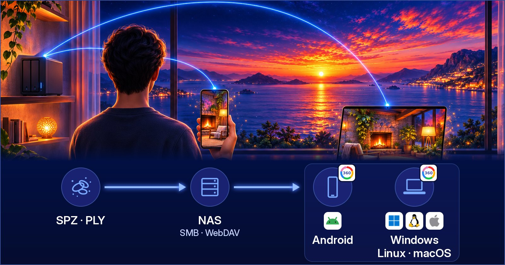

🌐 <b>Български</b> · Други езици (88)
<a href="../README.md">English</a> · <a href="README.af.md">Afrikaans</a> · <a href="README.ar.md">العربية</a> · <a href="README.az.md">Azərbaycanca</a> · <a href="README.be.md">Беларуская</a> · <a href="README.bi.md">Bislama</a> · <a href="README.bn.md">বাংলা</a> · <a href="README.br.md">Brezhoneg</a> · <a href="README.bs.md">Bosanski</a> · <a href="README.ca.md">Català</a> · <a href="README.cs.md">Čeština</a> · <a href="README.cv.md">Чӑвашла</a> · <a href="README.da.md">Dansk</a> · <a href="README.de.md">Deutsch</a> · <a href="README.de_CH.md">Deutsch (Schweiz)</a> · <a href="README.el.md">Ελληνικά</a> · <a href="README.en_GB.md">English (UK)</a> · <a href="README.eo.md">Esperanto</a> · <a href="README.es.md">Español</a> · <a href="README.et.md">Eesti</a> · <a href="README.eu.md">Euskara</a> · <a href="README.fa.md">فارسی</a> · <a href="README.fi.md">Suomi</a> · <a href="README.fil.md">Filipino</a> · <a href="README.fr.md">Français</a> · <a href="README.ga.md">Gaeilge</a> · <a href="README.gl.md">Galego</a> · <a href="README.gsw.md">Alemannisch</a> · <a href="README.gu.md">ગુજરાતી</a> · <a href="README.he.md">עברית</a> · <a href="README.hi.md">हिन्दी</a> · <a href="README.hr.md">Hrvatski</a> · <a href="README.hu.md">Magyar</a> · <a href="README.hy.md">Հայերեն</a> · <a href="README.id.md">Bahasa Indonesia</a> · <a href="README.is.md">Íslenska</a> · <a href="README.it.md">Italiano</a> · <a href="README.ja.md">日本語</a> · <a href="README.ka.md">ქართული</a> · <a href="README.kab.md">Taqbaylit</a> · <a href="README.kk.md">Қазақша</a> · <a href="README.km.md">ខ្មែរ</a> · <a href="README.kmr.md">Kurmancî</a> · <a href="README.kn.md">ಕನ್ನಡ</a> · <a href="README.ko.md">한국어</a> · <a href="README.kxm.md">ภาษาเขมรถิ่นไทย</a> · <a href="README.lb.md">Lëtzebuergesch</a> · <a href="README.lmo.md">Lombard</a> · <a href="README.lt.md">Lietuvių</a> · <a href="README.lv.md">Latviešu</a> · <a href="README.mfa.md">Bahasa Melayu Kelantan</a> · <a href="README.mi.md">Te reo Māori</a> · <a href="README.mk.md">Македонски</a> · <a href="README.ml.md">മലയാളം</a> · <a href="README.mn.md">Монгол</a> · <a href="README.mr.md">मराठी</a> · <a href="README.ms.md">Bahasa Melayu</a> · <a href="README.nb_NO.md">Norsk bokmål</a> · <a href="README.ne.md">नेपाली</a> · <a href="README.nl.md">Nederlands</a> · <a href="README.nn.md">Norsk nynorsk</a> · <a href="README.pa.md">ਪੰਜਾਬੀ</a> · <a href="README.pl.md">Polski</a> · <a href="README.pt.md">Português</a> · <a href="README.pt_BR.md">Português (Brasil)</a> · <a href="README.ro.md">Română</a> · <a href="README.ru.md">Русский</a> · <a href="README.si.md">සිංහල</a> · <a href="README.sk.md">Slovenčina</a> · <a href="README.sl.md">Slovenščina</a> · <a href="README.sq.md">Shqip</a> · <a href="README.sr_Cyrl.md">Српски</a> · <a href="README.sr_Latn.md">Srpski</a> · <a href="README.sv.md">Svenska</a> · <a href="README.sw.md">Kiswahili</a> · <a href="README.swg.md">Schwäbisch</a> · <a href="README.ta.md">தமிழ்</a> · <a href="README.te.md">తెలుగు</a> · <a href="README.th.md">ไทย</a> · <a href="README.tl.md">Tagalog</a> · <a href="README.tr.md">Türkçe</a> · <a href="README.uk.md">Українська</a> · <a href="README.ur.md">اردو</a> · <a href="README.uz.md">Oʻzbekcha</a> · <a href="README.vi.md">Tiếng Việt</a> · <a href="README.yue_Hant.md">粵語</a> · <a href="README.zh_Hans.md">简体中文</a> · <a href="README.zh_Hant.md">繁體中文</a>

  

# Immuch360

**Вашите снимки. Всеки екран. Всеки ъгъл.**

🌐 <a href="https://immuch360.com/bg/"><b>immuch360.com</b></a>

Плоски, 360° и 3D снимки и видеа от вашето устройство, вашия NAS, вашия сървър Immich, вашите камери и вашия дрон. Не е нужен акаунт. Immuch360 е безплатно приложение с отворен код, което чете снимките и видеата ви там, където са, и възпроизвежда всяко в подходящия за него визуализатор: плоско, като сфера, в която се оглеждате, в 3D или навсякъде около вас в слушалки. Работи на телефони, таблети, телевизори, слушалки Meta Quest и компютри. Сайтът му, [immuch360.com](https://immuch360.com/bg/), показва какво прави на всеки екран, на 89 езика.

**Ново в build 53 и build 34 за компютър, версия 3.4.8.** На компютрите [Spatial 2.5D](#see-your-3d-photos-and-videos-in-depth-on-your-computer) дава дълбочина на 3D снимките ви на плоския екран, на Windows, Linux и macOS, и на 3D видеата ви на Windows и macOS: изгледът се движи, докато движите главата си, следена от уеб камерата, щом се съгласите, или с мишката, а кадрите от уеб камерата остават в паметта на компютъра, никога не се запазват и не се изпращат; още непробвано с уеб камера от проекта. Колелцето [увеличава снимка около показалеца](#zoom-into-a-photo-with-the-wheel), а плъзгането я мести. [Подобри (ИИ)](#make-a-photo-sharper-on-your-computer-ai) взема снимките от вашите споделяния, от DLNA, Plex, Jellyfin и Emby и от вашия сървър Immich, подобрява 360° и 3D снимки, без да разваля шева или двете им очи, и предлага Изостри на Mac с чип на Apple (още не е изпробвано на Mac). От телефона [„Пусни на…“](#show-your-photos-and-videos-on-the-tv-from-your-phone) отваря 360° елемент в 360° изгледа на екрана, пуска избрани елементи или албум като слайдшоу, вписва екран във вашия сървър и изпраща снимките и видеата, които са само на телефона; пробвано между емулатори на Android, още непробвано на истински телефон или телевизор. В Meta Quest слайдшоуто на големия екран [прелива плавно или плъзга](#browse-your-photos-on-the-big-screen-of-the-quest) между снимките, върху черен, размит или passthrough фон по ваш избор, още непробвано в слушалки от проекта.

**Ново в builds 33 до 52.** [Филмите продължават оттам, докъдето сте стигнали](#pick-up-a-film-where-you-stopped). Те започват по-рано, а от бавен сървър [продължават да вървят, вместо да спират](#when-a-video-waits-or-will-not-play). Времевата линия [се смалява до месеци и години](#find-a-month-or-a-year-in-a-long-timeline) на телефоните и компютрите. На телефон с Android или Meta Quest [„Преглед на папка“](#browse-a-folder-of-your-phone-or-headset) отваря папка от устройството като споделяне, а TIFF снимките се показват. Android TV [търси по дата с дистанционното](#on-android-tv-and-google-tv), Meta Quest 3 или 3S [отваря Гаусови сплатове](#explore-gaussian-splats-in-a-meta-quest-3-or-3s), които се завъртат с десния джойстик, включително във SPZ версия 4, а компютърът [прави 3D версиите на снимките от вашия NAS](#turn-one-photo-into-3d-a-scene-a-panorama). На лаптоп с Windows и два графични чипа приложението [вече работи на бързия](#when-a-video-waits-or-will-not-play), така че филмите 8K вървят плавно. Гаусовите сплатове вече [се отварят на компютри и на телефони и таблети с Android](#explore-gaussian-splats-on-your-phone-tablet-or-computer), компютър с Windows [създава сплат сцени от вашите снимки или от видео](#make-a-splat-scene-from-your-photos-or-a-video-ai) с ИИ, вашият сървър Immich [ги пази вътре в снимки](#keep-a-splat-scene-on-your-immich-server), които се отварят от хронологията ви, а компютрите [възпроизвеждат AV2 видеа](#play-av2-videos-on-your-computer). От build 42 необработените видеа от камери Insta360, GoPro MAX и DJI Osmo 360, от вашата библиотека в Immich, споделяне или папка, [се възпроизвеждат стабилизирани с жироскопа на камерата](#stabilise-your-360-videos-with-the-cameras-gyroscope) на телефони, таблети и телевизори с Android, създателят на сплат сцени от build 22 за компютър [предлага подробно качество](#make-a-splat-scene-from-your-photos-or-a-video-ai) за сцени, които разглеждате отблизо, а 360° панорама [започва с 3,5 GiB свободни на видеокартата](#turn-one-photo-into-3d-a-scene-a-panorama). Приложението за iPhone и iPad е [в App Store](https://apps.apple.com/us/app/immuch360-360-3d-player/id6817655965), версия 3.4.3. От build 43 известието за обновление в приложението отваря Google Play или App Store на телефоните и таблетите; сайтът му, [immuch360.com](https://immuch360.com/bg/), отвори на 7 ноември. От build 44 и build 24 за компютър Meta Quest 3 или 3S [показва сплатове до 300 000 гаусиани](#explore-gaussian-splats-in-a-meta-quest-3-or-3s), компютрите [избират няколко снимки и видеа с Ctrl и Shift](#use-your-computer-as-the-media-player), телевизор, чийто декодер откаже видео, [възпроизвежда другия файл от сървъра](#when-a-video-waits-or-will-not-play) сам, панорамите работят на избраната видеокарта на лаптоп с две, а известието за обновление на Quest и на компютрите отваря страницата им в магазина или страницата за изтегляне, с много поправки. От build 45 и build 25 за компютър, версия 3.4.0 на всички платформи, приложението следва приложението Immich 3.4.0 с 11 по-късни поправки на Immich, показва [снимките JPEG XL от сървъри Immich 3.4](#keep-your-immich-library-with-more), отваря [вашите филми в Plex по години](#watch-your-plex-films) със страница за всеки филм, изтеглянето им на устройството и възпроизвеждането им на телевизора от телефона, може да поиска оценка във версиите от магазините и на компютрите взема видеокомпонентите си от [собствените им отворени хранилища](#licences-and-credits). От build 46 и build 26 за компютър, версия 3.4.1, необработените видеа от камери 360° също [се възпроизвеждат стабилизирани](#stabilise-your-360-videos-with-the-cameras-gyroscope) на iPhone и iPad, в Meta Quest и на Windows, Meta Quest [възпроизвежда с libmpv филмите от Plex, които собственият му плейър не може да декодира](#watch-your-plex-films), телефон [изпраща такъв филм към Chromecast или Google TV](#watch-your-plex-films), а ИИ релефът на 3D снимка [приема силата, която изберете](#turn-one-photo-into-3d-a-scene-a-panorama); нов сървър може да се добави и чрез вписване с вашия акаунт в Plex, а приложението [пази настройките си във файл](#keep-your-settings-in-a-file). От build 47 и build 27 за компютър, с версия 3.4.2, филм от Plex [възпроизвежда аудиопътечка, която устройството декодира](#watch-your-plex-films), и казва коя, отваря версията, която подхожда на екрана, а при бавна връзка предлага по-лека, Windows и macOS възпроизвеждат звука му Dolby TrueHD, Android [показва изтеглянето му в известие](#watch-your-plex-films), а Android TV също изтегля филми, и [камерите Tapo на батерия се показват на живо](#watch-your-home-cameras-on-the-big-screen); възстановяването на файл с настройки с неговите акаунти вече ви вписва във вашия сървър Immich. От build 48 и build 28 за компютър, версия 3.4.3, компютър с Windows [възпроизвежда видеата ви в PC VR слушалки](#watch-your-videos-in-a-pc-vr-headset-from-windows) през SteamVR, Meta Horizon Link или друга среда за изпълнение OpenXR (още непробвано в слушалки от проекта), [камери от други марки се показват на живо](#cameras-of-other-brands-over-onvif-or-rtsp), намерени чрез ONVIF или добавени с RTSP връзката им (проверени със симулирана камера, още не е изпробвана истинска камера от друга марка), необработените видеа от [DJI Osmo 360 II и GoPro MAX 2 се възпроизвеждат стабилизирани](#open-the-raw-files-of-360-cameras), филмите от Plex [вече не спират от липса на данни на телефоните](#when-a-video-waits-or-will-not-play), телевизорите LG и Samsung [завъртат видео, което лежи настрани](#on-a-samsung-tv-tizen) с един бутон (още непробвано на телевизор LG; телевизорът Samsung от issue 17 отказа завъртането), а „Налична е нова версия за сървъра“ вече не се показва за сървър, който е обновен. От build 49 и build 29 за компютър, версия 3.4.4, приложението [чете само вашите сървъри Jellyfin и Emby](#watch-your-jellyfin-and-emby-libraries) (още непробвано на устройство), открити във вашата мрежа и с вход чрез Quick Connect на телевизор или в слушалки, като оригиналните им файлове се възпроизвеждат, така че 360° видео остава 360°; на големия екран на Meta Quest снимките [запазват размера и мястото, които сте задали, докато ги разглеждате, и се пускат като слайдшоу](#browse-your-photos-on-the-big-screen-of-the-quest) (още непробвано в слушалки от проекта); плейърът за 360° видеа на телефоните и таблетите [получава контролите на 360° снимките](#360-videos-on-your-phone-with-the-controls-of-360-photos), бутон на гироскопа, стискане с два пръста за увеличение и плъзгане право нагоре или надолу (пробвано от потребител на Samsung Galaxy S25 Ultra, още непробвано на iPhone); компютър [превръща вашите 2D видеа в 3D видеа](#turn-your-2d-videos-into-3d-on-your-computer) с ИИ (още непробвано на 3D екран или в слушалки); а телевизорите Samsung [предават на собствения плейър на Samsung видео, което трябва да се завърти](#on-a-samsung-tv-tizen), което телевизорът от issue 17 възпроизвежда, но отказва да завърти. От build 50 и build 30 за компютър, версия 3.4.5, докато видео се възпроизвежда в 2D прозореца на Meta Quest, прозорецът [се прерисува с честотата на дисплея](#step-inside-your-photos-and-videos-with-a-meta-quest) вместо около 10 пъти в секунда, както в builds 48 и 49 (измерено на Meta Quest 3), Android TV [увеличава снимка с дистанционното](#on-android-tv-and-google-tv) и я мести със стрелките (ново, още непробвано на телевизор), а три поправки идват от Android TV форка на mlc70: бързо плъзгане вече не показва подробностите на оставената назад снимка, анимирана снимка освобождава паметта си, а филтърът „Място“ предлага градовете на новата държава. От build 51 и build 31 за компютър, версия 3.4.6, [Подобри (ИИ)](#make-a-photo-sharper-on-your-computer-ai) прави по-рязко копие на мека снимка до оригинала на Windows и Linux, на три нива, всяко пуснато веднъж на един компютър с RTX 4060, Естествено се предлага и на Mac с чип на Apple (още не е изпробвано на Mac), компютър [превръща 360° видео в 360° 3D видео](#a-360-video-turned-into-a-360-3d-video) с ИИ, дълбочината на 3D видеата се оценява от видеокартата на Windows, ИИ функциите вземат видеата от вашия сървър и от споделяне директно, файлът с настройки има [своя карта в Библиотека](#keep-your-settings-in-a-file), телевизор го запазва в мрежово споделяне, Esc връща една стъпка назад на компютрите, версиите от магазините искат оценка [по-рядко и по-деликатно](#privacy), Linux показва TIFF снимки, сплат сцени и 3D видеа с едно око, а два срива са поправени. От build 52 и build 32 за компютър, версия 3.4.7, [„Пусни на…“](#show-your-photos-and-videos-on-the-tv-from-your-phone) изпраща снимките и видеата от вашата библиотека в Immich, от вашите споделяния и от Jellyfin и Emby от телефона към телевизор, Meta Quest, компютър или Chromecast, имената на снимките и видеата ви [остават четливи върху миниатюрите им](#play-the-files-of-a-nas-a-computer-a-media-server-or-plex), ИИ компонентите на компютър [се обновяват с едно щракване](#update-the-ai-components-in-one-click), Linux получава [AppImage](#linux), а приложението за iPhone и iPad е изградено с Xcode 27. Build 33 за компютър поправи [Подобри (ИИ)](#make-a-photo-sharper-on-your-computer-ai), което се проваляше на всяка снимка в build 31 и 32 за компютър ([issue 23](https://github.com/freeKC/Immuch360/issues/23)).

  Неофициално разклонение на мобилното приложение Immich. Не е свързано с Immich или FUTO. Името се чете като „I am much 360“.

<b>Съдържание</b>

- [За кого е](#who-it-is-for)
- [Кои екрани](#which-screens), [какво правят заедно](#use-cases) и [какво прави всеки екран](#what-each-screen-does)
- [Какво можете да правите](#what-you-can-do)
- [Вземете го на устройството си](#get-it-on-your-device)
- [Как се прави](#how-to)
  - [Гледайте снимките и видеата си, със или без сървър](#watch-your-photos-and-videos-with-or-without-a-server)
  - [Разгледайте панорами, 360°, VR180 и 3D](#explore-panoramas-360-vr180-and-3d): [360° видеа на телефони](#360-videos-on-your-phone-with-the-controls-of-360-photos)
  - [Превърнете една снимка в 3D, сцена, панорама](#turn-one-photo-into-3d-a-scene-a-panorama): [ИИ компоненти, обновявани с едно щракване](#update-the-ai-components-in-one-click)
  - [Превърнете вашите 2D видеа в 3D на компютъра си](#turn-your-2d-videos-into-3d-on-your-computer): [360° видеа в 360° 3D](#a-360-video-turned-into-a-360-3d-video)
  - [Направете снимка по-рязка на компютъра си (ИИ)](#make-a-photo-sharper-on-your-computer-ai)
  - [Гледайте на телевизора с дистанционното](#watch-on-the-tv-with-the-remote): [Android TV и Google TV](#on-android-tv-and-google-tv), [LG](#on-an-lg-tv-webos), [Samsung](#on-a-samsung-tv-tizen)
  - [Влезте в телевизор, слушалки или компютър с телефона си](#sign-in-a-tv-a-headset-or-a-computer-with-your-phone)
  - [Покажете снимките и видеата си на телевизора от телефона](#show-your-photos-and-videos-on-the-tv-from-your-phone)
  - [Влезте в снимките и видеата си с Meta Quest](#step-inside-your-photos-and-videos-with-a-meta-quest): [големият екран](#browse-your-photos-on-the-big-screen-of-the-quest), [режим на киоск](#kiosk-mode-for-an-exhibition-or-a-shop)
  - [Разгледайте Гаусови сплатове в Meta Quest 3 или 3S](#explore-gaussian-splats-in-a-meta-quest-3-or-3s)
  - [Разгледайте Гаусови сплатове на телефона, таблета или компютъра си](#explore-gaussian-splats-on-your-phone-tablet-or-computer)
  - [Създайте сплат сцена от вашите снимки или от видео (ИИ)](#make-a-splat-scene-from-your-photos-or-a-video-ai)
  - [Пазете сплат сцена на вашия сървър Immich](#keep-a-splat-scene-on-your-immich-server)
  - [Възпроизвеждайте файловете на NAS, компютър, медиен сървър или Plex](#play-the-files-of-a-nas-a-computer-a-media-server-or-plex): [вашите филми по години](#watch-your-plex-films), [Jellyfin и Emby](#watch-your-jellyfin-and-emby-libraries)
  - [Преглед на папка от телефона или слушалките](#browse-a-folder-of-your-phone-or-headset)
  - [Продължете филм оттам, докъдето сте стигнали](#pick-up-a-film-where-you-stopped)
  - [Когато видео чака или не тръгва](#when-a-video-waits-or-will-not-play)
  - [Запазете библиотеката си в Immich, и още](#keep-your-immich-library-with-more)
  - [Намерете месец или година в дълга времева линия](#find-a-month-or-a-year-in-a-long-timeline)
  - [Гледайте домашните си камери на големия екран](#watch-your-home-cameras-on-the-big-screen): [други марки](#cameras-of-other-brands-over-onvif-or-rtsp)
  - [Вашият дрон DJI](#your-dji-drone): [видео на живо](#see-what-your-drone-sees-on-your-phone), [в Quest или на Android TV](#watch-it-in-a-meta-quest-or-on-an-android-tv), [импортиране](#bring-a-drones-or-a-camera-cards-photos-and-videos-to-immich)
  - [Отваряйте необработените файлове на камери 360°](#open-the-raw-files-of-360-cameras)
  - [Стабилизирайте 360° видеата си с жироскопа на камерата](#stabilise-your-360-videos-with-the-cameras-gyroscope)
  - [Завъртете снимка с един клавиш](#turn-a-photo-with-one-key)
  - [Използвайте компютъра си като медиен плейър](#use-your-computer-as-the-media-player): [увеличение с колелцето](#zoom-into-a-photo-with-the-wheel)
  - [Вижте 3D снимките и видеата си с дълбочина на компютъра](#see-your-3d-photos-and-videos-in-depth-on-your-computer)
  - [Гледайте видеата си в PC VR слушалки, от Windows](#watch-your-videos-in-a-pc-vr-headset-from-windows)
  - [Възпроизвеждайте AV2 видеа на компютъра си](#play-av2-videos-on-your-computer)
  - [Пазете настройките си във файл](#keep-your-settings-in-a-file)
- [В сравнение с Immich](#compared-with-immich)
- [Поверителност](#privacy)
- [Лицензи и благодарности](#licences-and-credits)
- [Пътна карта](#roadmap)
- [Документация](#documentation)

## За кого е

- **Снимате 360° или 3D** и искате да се оглеждате в кадрите си, а не да ги виждате плоски, удвоени или разтеглени, и да въртите 360° видеата си на телефона така, както въртите снимките му: [360°, VR180 и 3D](#explore-panoramas-360-vr180-and-3d), [360° видеа на телефони](#360-videos-on-your-phone-with-the-controls-of-360-photos).
- **Снимате с камера 360° в ръка, на велосипед или на каска** и искате необработените видеа от вашата камера Insta360, GoPro MAX или MAX 2, DJI Osmo 360 или Osmo 360 II, пазени в Immich, в споделяне или в папка, да се възпроизвеждат равно и стабилно на телефона, телевизора, Meta Quest или компютъра ви с Windows: [стабилизирани с жироскопа на камерата](#stabilise-your-360-videos-with-the-cameras-gyroscope).
- **Снимките и филмите ви са на NAS, компютър, Plex или Immich** и ги искате на телевизора, без да копирате нищо: [на телевизора](#watch-on-the-tv-with-the-remote), [NAS, споделяния и Plex](#play-the-files-of-a-nas-a-computer-a-media-server-or-plex).
- **Пазите филмите си на сървър Plex** и искате да изберете филм по година, да видите какво е, преди да започне, да го вземете на път, да го пуснете на телевизора или на Chromecast от телефона си и да пуснете дори филмите, които телефонът ви с Android, телевизорът или Meta Quest не могат да декодират: [вашите филми, по години](#watch-your-plex-films).
- **Пазите филмите си на сървър Jellyfin или Emby** и искате да ги имате в Meta Quest, на телевизора или на телефона, с 360° и 3D запазени такива, каквито са, и мястото, докъдето сте стигнали, пазено на сървъра (още непробвано на устройство): [Jellyfin и Emby](#watch-your-jellyfin-and-emby-libraries).
- **Имате Meta Quest** и искате да влезете в собствените си снимки и видеа: [в слушалките](#step-inside-your-photos-and-videos-with-a-meta-quest), и да разглеждате снимките си на голям екран с размера и на мястото, които сте задали, и като слайдшоу (още непробвано в слушалки от проекта): [големият екран](#browse-your-photos-on-the-big-screen-of-the-quest).
- **Имате PC VR слушалки на компютър с Windows** и искате 360° видеата си около вас и филмите си на голям екран в тях (още непробвано в слушалки от проекта): [в PC VR слушалки](#watch-your-videos-in-a-pc-vr-headset-from-windows).
- **Снимките ви са плоски** и ги искате в 3D, като сцена, към която да се наведете в слушалки, или вътре в 360° панорама, без 3D камера: [превърнете една снимка в 3D, сцена, панорама](#turn-one-photo-into-3d-a-scene-a-panorama), ново, създадено от ИИ на вашия собствен компютър.
- **Видеата ви са плоски**, включително клиповете от телефона ви, и искате да ги имате в 3D за слушалки или 3D екран, а 360° видеата си в 360° 3D, създадени на собствения ви компютър (още непробвано на 3D екран или в слушалки): [2D видеа в 3D](#turn-your-2d-videos-into-3d-on-your-computer), [360° в 360° 3D](#a-360-video-turned-into-a-360-3d-video).
- **Снимките ви са меки**, леко нефокусирани или направени при слаба светлина, и искате по-рязко копие до оригинала, създадено на собствения ви компютър, също и от вашите споделяния и сървъри, като измислените детайли са казани ясно: [Подобри (ИИ)](#make-a-photo-sharper-on-your-computer-ai).
- **Имате 3D снимки или видеа и компютър** и ги искате с дълбочина на плоския му екран, като изгледът се движи, докато движите главата си, следена от уеб камерата, или с мишката (още непробвано с уеб камера от проекта): [Spatial 2.5D на вашия компютър](#see-your-3d-photos-and-videos-in-depth-on-your-computer).
- **Използвате Immich** и искате приложението му, плюс потапящите визуализатори и големите екрани, в които влизате от телефона си: [вашата библиотека в Immich](#keep-your-immich-library-with-more), [в сравнение с Immich](#compared-with-immich).
- **Наблюдавате дома си с камери Tapo**, включително на батерия, или камери от други марки чрез ONVIF или RTSP, и ги искате до снимките си, и на телевизора (проверено срещу симулирана камера): [домашни камери](#watch-your-home-cameras-on-the-big-screen).
- **Летите с дрон DJI** и искате картината му на живо на телефона си без DJI Fly, а в Meta Quest или на Android TV за хората около вас: [вашият дрон](#see-what-your-drone-sees-on-your-phone).
- **Заснемате места и предмети в 3D, като Гаусови сплатове,** или бихте искали да ги създадете от собствените си снимки, и искате да вървите през тях на телефона си, на компютъра си или в слушалки: [на телефон, таблет или компютър](#explore-gaussian-splats-on-your-phone-tablet-or-computer), [създадени от вашите снимки](#make-a-splat-scene-from-your-photos-or-a-video-ai), [пазени в Immich](#keep-a-splat-scene-on-your-immich-server).
- **Имате AV2 видеа**, форматът, който следва AV1, и искате да ги гледате на компютъра си: [AV2 на вашия компютър](#play-av2-videos-on-your-computer).
- **Имате няколко екрана у дома** и искате да работят заедно: [какво правят екраните ви заедно](#use-cases).

Няма акаунт в Immuch360 за създаване и нищо не идва при нас: приложението общува само с вашите устройства и със сървърите, които изберете, от build 45 с Wikipedia за страницата на филм, от build 46 с plex.tv, когато влизате чрез него, и изтегля ИИ компонент или AV2 декодера само когато го поискате.

## Кои екрани

| Платформа | Откъде да го изтеглите | Състояние през ноември 2026 г. |
|---|---|---|
|  **Android** телефони и таблети | [Google Play](https://play.google.com/store/apps/details?id=com.aprogsys.immuch360) · [APK](https://github.com/freeKC/Immuch360/releases) | в Google Play (build 47 публикуван на 16 ноември; build 51 в преглед от Google от 24 ноември; следва build 53), build 53 в GitHub, където [необработените 360° видеа се възпроизвеждат стабилизирани](#stabilise-your-360-videos-with-the-cameras-gyroscope), [филмите продължават оттам, докъдето сте стигнали](#pick-up-a-film-where-you-stopped), [„Преглед на папка“](#browse-a-folder-of-your-phone-or-headset) отваря папка от телефона, а [Гаусовите сплатове се отварят](#explore-gaussian-splats-on-your-phone-tablet-or-computer), от споделяне или [от вашата хронология в Immich](#keep-a-splat-scene-on-your-immich-server), [настройките, пазени във файл](#keep-your-settings-in-a-file), [изтеглянето на филм, показвано в известие](#watch-your-plex-films), от build 48 [камери от други марки, на живо](#cameras-of-other-brands-over-onvif-or-rtsp) (проверени със симулирана камера) и, от build 49, [сървъри Jellyfin и Emby](#watch-your-jellyfin-and-emby-libraries) (още непробвано на устройство) и [контролите на 360° снимките в плейъра за 360° видеа](#360-videos-on-your-phone-with-the-controls-of-360-photos) (пробвано от потребител на Samsung Galaxy S25 Ultra), а от build 51 [картата на файла с настройки в Библиотека](#keep-your-settings-in-a-file), като файлът се запазва и в мрежово споделяне, а от build 52 [снимките и видеата ви, изпратени към телевизор или Chromecast](#show-your-photos-and-videos-on-the-tv-from-your-phone) с „Пусни на…“ (още непробвано на устройство), а от build 53 [360° елементи, избрани елементи или албум и снимките и видеата на самия телефон](#show-your-photos-and-videos-on-the-tv-from-your-phone), изпращани по същия начин (пробвано между емулатори на Android) |
|  **iPhone и iPad** | [App Store](https://apps.apple.com/us/app/immuch360-360-3d-player/id6817655965) | версия 3.4.7 в App Store от 26 ноември, с [месеци и години във времевата линия](#find-a-month-or-a-year-in-a-long-timeline), [филми, които продължават оттам, докъдето сте стигнали](#pick-up-a-film-where-you-stopped), [входа в телевизор, слушалки или компютър](#sign-in-a-tv-a-headset-or-a-computer-with-your-phone) от телефона, сплат сцените, пазени в Immich, показвани като снимката си, поправките на Immich 3.4.0 и неговите снимки JPEG XL, [стабилизирани необработени 360° видеа](#stabilise-your-360-videos-with-the-cameras-gyroscope), [настройките, пазени във файл](#keep-your-settings-in-a-file), [изгледа на живо на камерите Tapo на батерия](#watch-your-home-cameras-on-the-big-screen) и [изгледа на живо на камери от други марки](#cameras-of-other-brands-over-onvif-or-rtsp) (проверени със симулирана камера), а от версия 3.4.4 и със [сървъри Jellyfin и Emby](#watch-your-jellyfin-and-emby-libraries) (още непробвано на устройство) и [контролите на 360° снимките в плейъра за 360° видеа](#360-videos-on-your-phone-with-the-controls-of-360-photos) (още непробвано на iPhone), а от версия 3.4.6 и с [картата на файла с настройки](#keep-your-settings-in-a-file) и възстановяването му от мрежово споделяне, а от версия 3.4.7, изградена с Xcode 27, и с [„Пусни на…“ за снимки и видеа](#show-your-photos-and-videos-on-the-tv-from-your-phone) (още непробвано на iPhone); следва версия 3.4.8, версията за iPhone и iPad на build 53; или [изградете го сами](../docs/immuch360/build.md) |
|  **Android TV и Google TV** | [Google Play](https://play.google.com/store/apps/details?id=com.aprogsys.immuch360) · [APK](#android-tv-and-google-tv) | в Google Play, който предлага приложението на Android TV и Google TV, и build 53 в GitHub: [стабилизирани необработени 360° видеа](#stabilise-your-360-videos-with-the-cameras-gyroscope), [търсене по дата с дистанционното](#on-android-tv-and-google-tv), [вход с телефона](#sign-in-a-tv-a-headset-or-a-computer-with-your-phone) чрез сканиране на QR код, времева лента, звук и субтитри за дистанционното във видеоплейъра и [видео на живо от дрон](#watch-it-in-a-meta-quest-or-on-an-android-tv), препредавано от телефон, [филми, изтеглени на телевизора](#watch-your-plex-films) и, от build 49, [сървъри Jellyfin и Emby](#watch-your-jellyfin-and-emby-libraries) с вход чрез Quick Connect (още непробвано на устройство) и, от build 50, [снимки, увеличавани с дистанционното](#on-android-tv-and-google-tv) (видяно да работи на емулатор на Android TV, още непробвано на телевизор), а от build 51 [файлът с настройки, запазван и възстановяван в мрежово споделяне](#keep-your-settings-in-a-file) (видяно да работи на емулатор на Android TV), а от build 52 [снимките и видеата, които телефон изпраща с „Пусни на…“](#show-your-photos-and-videos-on-the-tv-from-your-phone) (още непробвано на телевизор), а от build 53 и 360° снимките, които телефон изпраща, отваряни в 360° изгледа си, вход от списъка на телефона и снимките и видеата на самия телефон (видяно да работи на емулатор на Android TV) |
| **Телевизори LG** с webOS 5.0 и по-нова | [.ipk, версия 1.0.5](https://github.com/freeKC/Immuch360/releases/tag/webos-v1.0.5) · LG Content Store (в преглед) | версия 1.0.0, подадена в LG Content Store на 24 октомври, в тестове на LG от 26 октомври; версия 1.0.1, в GitHub от 27 октомври, увеличава снимка от стрелките и показва, когато снимка още се зарежда, а версия 1.0.2, в GitHub с build 46, пише „вход“ като ログイン на японски, версия 1.0.3, с build 47, показва кога папка на DLNA сървър съдържа телевизионни канали на живо, които още не може да възпроизвежда, версия 1.0.4, с build 48, [завърта видео, което лежи настрани](#on-an-lg-tv-webos) с един бутон (още непробвано на телевизор LG), а версия 1.0.5, с build 49, посочва Jellyfin с неговата DLNA приставка сред DLNA сървърите; докато LG не публикува приложението, то се инсталира в [Developer Mode](#lg-tvs-webos). Версия 1.0.0 е работила на телевизори с webOS 25 в Cloud Test Lab на LG |
| **Телевизори Samsung** с Tizen 5.5 и по-нова | [.wgt, версия 0.3.6](https://github.com/freeKC/Immuch360/releases/tag/tizen-v0.3.6) | версия 0.3.6 на същото приложение за телевизори, за подписване със собствен сертификат на Samsung и инсталиране в [Developer mode](#samsung-tvs-tizen); 0.1.0 работи на телевизор Samsung на тестер, 0.2.0 съдържа поправките от тази проба, 0.3.0 добавя увеличението на снимките и етикета „Зареждане“ от LG версия 1.0.1, а 0.3.1 японските формулировки от LG версия 1.0.2, 0.3.2 възпроизвежда правилно видео, заснето вертикално на телефон ([issue 17](https://github.com/freeKC/Immuch360/issues/17)), 0.3.3 и 0.3.4 [го завъртат на телевизор, който го отчита като вертикално](#on-a-samsung-tv-tizen) и добавят бутон, който го завърта ръчно, а 0.3.5 и 0.3.6 предават такова видео на собствения плейър на Samsung; на телевизора на автора на доклада 0.3.4 и 0.3.5 оставиха картината настрани, като телевизорът отказа завъртането, а изходът там е видео, което вашият сървър Immich прекодира, записано вертикално; не е в магазина на Samsung |
|  **Meta Quest** 2, Pro, 3 и 3S | [Horizon Store](https://www.meta.com/experiences/immuch360/1384208401440714/) · [APK](#meta-quest) | в Horizon Store (build 50, чийто 2D прозорец се прерисува с честотата на дисплея по време на възпроизвеждане на видео, публикуван на 25 ноември; build 52 в преглед от Meta от 25 ноември; следва build 53), build 53 в GitHub, с [режим на киоск](#kiosk-mode-for-an-exhibition-or-a-shop), [стабилизирани необработени 360° видеа](#stabilise-your-360-videos-with-the-cameras-gyroscope) в потапящия изглед, [филмите, които не може да декодира, възпроизвеждани от libmpv](#watch-your-plex-films), а на Quest 3 и 3S с [Гаусови сплатове](#explore-gaussian-splats-in-a-meta-quest-3-or-3s) и [ИИ релеф](#turn-one-photo-into-3d-a-scene-a-panorama) на плоска снимка, а от build 49 [снимки, разглеждани на големия екран](#browse-your-photos-on-the-big-screen-of-the-quest) с размера, който сте задали, и като слайдшоу (още непробвано в слушалки от проекта), и [сървъри Jellyfin и Emby](#watch-your-jellyfin-and-emby-libraries) с вход чрез Quick Connect (още непробвано на устройство), а от build 51 слушалки, чиято Horizon OS е твърде стара за потапящия изглед, искат обновление, вместо да затварят приложението (непробвано на такива слушалки), а от build 53 [плавно преливане или плъзгане между снимките на големия екран, върху черен, размит или passthrough фон](#browse-your-photos-on-the-big-screen-of-the-quest) (още непробвано в слушалки от проекта) |
|  **Windows** | [Инсталатор или ZIP](https://github.com/freeKC/Immuch360/releases/tag/desktop-v3.4.8-34) | build 34 за компютър, подписан: снимки, плоски и 360° видеа, споделяния, Plex, камери (проверени със симулирана камера), вход с телефона, снимки, завъртани с един клавиш, интерфейсът на 89 езика, и [3D снимки, 3D сцени и 360° панорами, направени от вашите снимки](#turn-one-photo-into-3d-a-scene-a-panorama) с ИИ, включително от снимките на вашия NAS; [Гаусови сплатове](#explore-gaussian-splats-on-your-phone-tablet-or-computer), отваряни, [създавани от вашите снимки или от видео](#make-a-splat-scene-from-your-photos-or-a-video-ai) и [пазени в Immich](#keep-a-splat-scene-on-your-immich-server), [AV2 видеа](#play-av2-videos-on-your-computer), от build 22 за компютър [избор на качество за сплат сцените](#make-a-splat-scene-from-your-photos-or-a-video-ai) и [360° панорами от 3,5 GiB свободна графична памет](#turn-one-photo-into-3d-a-scene-a-panorama), а от build 26 за компютър [стабилизирани необработени 360° видеа](#stabilise-your-360-videos-with-the-cameras-gyroscope) и [3D снимки със сила на релефа и по-остри ръбове](#turn-one-photo-into-3d-a-scene-a-panorama), от build 27 за компютър [звукът Dolby TrueHD и субтитрите Blu-ray на филмите](#watch-your-plex-films), от build 28 за компютър [видеата ви в PC VR слушалки](#watch-your-videos-in-a-pc-vr-headset-from-windows) (още непробвано в слушалки от проекта), а от build 29 за компютър [3D видеа, създадени от вашите 2D видеа](#turn-your-2d-videos-into-3d-on-your-computer) с ИИ (още непробвано на 3D екран или в слушалки), а от build 31 за компютър [по-резки копия на снимките ви](#make-a-photo-sharper-on-your-computer-ai) с ИИ и [360° видеа, превърнати в 360° 3D видеа](#a-360-video-turned-into-a-360-3d-video) с ИИ, дълбочината, оценявана от видеокартата, видеата от вашия сървър и от споделяне, вземани директно, и Esc за връщане една стъпка назад, от build 32 за компютър [ИИ компонентите, обновявани с едно щракване](#update-the-ai-components-in-one-click), от build 33 за компютър [Подобри (ИИ)](#make-a-photo-sharper-on-your-computer-ai), което отново работи, а от build 34 за компютър [увеличението на снимки с колелцето](#zoom-into-a-photo-with-the-wheel), [Spatial 2.5D за 3D снимки и видеа](#see-your-3d-photos-and-videos-in-depth-on-your-computer), с уеб камерата или мишката (още непробвано с уеб камера от проекта), и Подобри (ИИ) за снимките от споделяния и сървъри, включително 360° и 3D снимки |
|   **macOS и Linux** | [.deb, .rpm, AppImage, DMG](https://github.com/freeKC/Immuch360/releases/tag/desktop-v3.4.8-34) | build 34 за компютър: снимки, 360° снимки и плоски видеа (360° видеата се възпроизвеждат плоско), сървър Immich и мрежови споделяния, и [3D снимки и 3D сцени](#turn-one-photo-into-3d-a-scene-a-panorama), направени от ИИ от вашите снимки, а на Linux и 360° панорами с видеокарта с 8 GB, от 3,5 GiB свободни от нея, както и [Гаусови сплатове](#explore-gaussian-splats-on-your-phone-tablet-or-computer) и [AV2 видеа](#play-av2-videos-on-your-computer) (още непробвано на Mac); build 11 за компютър пробван на 26 октомври в контейнер с Ubuntu 24.04 и на Mac; от build 27 за компютър звукът Dolby TrueHD на филмите на macOS; от build 29 за компютър [3D видеа, създадени от вашите 2D видеа](#turn-your-2d-videos-into-3d-on-your-computer) с ИИ на Linux и на Mac с чип на Apple (още непробвано на 3D екран или в слушалки); от build 31 за компютър, на Linux, [по-резки копия на снимките ви](#make-a-photo-sharper-on-your-computer-ai) с ИИ, TIFF снимки, папки, които сами показват новите си файлове, сплат сцени, създадени от снимките ви на видеокарта с 4 GB, и 3D видеа, показвани плоско с едно око, а на Mac с чип на Apple нивото Естествено на Подобри (ИИ) (още непробвано на Mac); от build 32 за компютър [AppImage](#linux) за другите дистрибуции на Linux, проверен от CI на Arch Linux и openSUSE; от build 34 за компютър увеличението с колелцето, [Spatial 2.5D](#see-your-3d-photos-and-videos-in-depth-on-your-computer) за 3D снимки на Linux и macOS и за 3D видеа на macOS (още непробвано на Mac или с уеб камера), а на Mac с чип на Apple нивото Изостри на Подобри (ИИ) (още непробвано на Mac); неподписано на macOS |

*Статусите се обновяват при всяко издание; какво има всеки магазин, какво е в преглед и всеки build са в [Статус на издаването](../docs/immuch360/release-status.md). Сайтът [immuch360.com](https://immuch360.com/bg/) показва какво прави всеки екран, ръководство за всяка функция и връзките към магазините, на 89 езика.*

  

### Какво правят екраните ви заедно

Инсталирайте Immuch360 на всеки екран, на който гледате: всеки сам чете вашите източници, а някои предават на друг снимка, файл или вход. На всяка картина иконата на Immuch360 отбелязва устройствата, на които работи приложението.

#### Вашият NAS на всеки екран

  

**Какво ви трябва:** NAS със споделена папка SMB или WebDAV и Immuch360 на всеки екран, на който гледате.

Добавете споделената папка на всеки екран и всеки от тях възпроизвежда снимките и видеоклиповете там, където са, без нищо да се копира: телефони, таблети, Android TV, Meta Quest, компютри с Windows, Linux и macOS, и телевизори LG, влезли във вашия сървър Immich (SMB от webOS 22). Снимка 360° се върти като сфера на телефона и телевизора и ви обгражда в слушалките. Как се прави: [Възпроизвеждайте файловете на NAS, компютър, медиен сървър или Plex](#play-the-files-of-a-nas-a-computer-a-media-server-or-plex).

#### Вашият сървър Immich на всеки екран, с вход от телефона ви

  

**Какво ви трябва:** сървър Immich, Immuch360 на телефона ви с Android и Immuch360 на екраните, в които влизате: Android TV, Meta Quest, компютър с Windows, Linux или macOS.

На телефона Immuch360 запазва цялото мобилно приложение на Immich, добавя своите визуализатори за 360°, VR180 и 3D и се инсталира до официалното приложение. Влязъл във вашия сървър, той влиза в големите екрани: сканира QR кода на телевизора или компютъра, или вие въвеждате в него кода, който показват слушалките, а паролата ви остава на телефона. Как се прави: [Влезте в телевизор, слушалки или компютър с телефона си](#sign-in-a-tv-a-headset-or-a-computer-with-your-phone).

#### Вашите плоски снимки в 3D, от компютъра до слушалките

  

**Какво ви трябва:** Immuch360 на компютър с Windows, Linux или macOS и в Meta Quest, с вашия NAS между тях или със сървър Immich с включено „Архивирай и ИИ версиите“.

Самият компютър превръща снимките ви в 3D снимки и 3D сцени, а с графична карта от 8 GB на Windows или Linux и в панорами 360°, и ги записва до оригиналите. Слушалките показват 3D снимка в истинско 3D, поставят сцена във вашата стая и панорама навсякъде около вас; телефоните и телевизорите отварят панорамите в своя визуализатор за 360°. Как се прави: [Превърнете една снимка в 3D, сцена, панорама](#turn-one-photo-into-3d-a-scene-a-panorama).

#### Картината на живо от дрона ви в слушалките или на телевизора

  

**Какво ви трябва:** дрон DJI и дистанционното му DJI RC-N3, Immuch360 на телефона с Android, включен в дистанционното, и Immuch360 в Meta Quest или на Android TV.

Телефонът показва видеото на живо от дрона и го препраща през вашата Wi-Fi мрежа или собствената си гореща точка, така че хората около вас гледат полета в слушалките или на телевизора. Само приемане: никаква команда никога не се изпраща към дистанционното или дрона, а дистанционното запазва пълния контрол. Как се прави: [Гледайте го в Meta Quest или на Android TV](#watch-it-in-a-meta-quest-or-on-an-android-tv).

#### Необработените файлове на вашата камера 360°, съшити там, където ги гледате

  

**Какво ви трябва:** камера Insta360, GoPro MAX или MAX 2, DJI Osmo 360 или Osmo 360 II, вашия NAS и Immuch360 на екраните: телефони, таблети, Android TV, Meta Quest, Windows.

Копирайте файловете .insp, .insv, .360 или .osv от картата на камерата в споделена папка SMB или WebDAV на вашия NAS, както са; сървър Immich приема и тези от Insta360. Всеки екран ги съшива, докато се възпроизвеждат, с калибрирането, записано във всеки файл, и нищо не се експортира предварително в приложението на камерата. Как се прави: [Отваряйте необработените файлове на камери 360°](#open-the-raw-files-of-360-cameras).

#### Вашите сървъри Plex и DLNA на телевизора и в слушалките

  

**Какво ви трябва:** Plex Media Server, сървър Jellyfin или Emby, или DLNA сървър като minidlna, и Immuch360 на всеки екран: Android TV, Meta Quest, телефони, таблети, Windows.

Plex дава оригиналните файлове на библиотеките ви, така че видео 360° остава 360°, навсякъде около вас в слушалките, у дома, а извън дома чрез вашето пренасочване на портове; DLNA сървърите се откриват във вашата домашна мрежа. Телевизорите LG, влезли във вашия сървър Immich, също ги възпроизвеждат. От build 45 телефоните, таблетите, Android TV, Quest и компютрите отварят филмова библиотека на Plex с всички филми по години, всеки филм със своята страница, а филм, избран на телефона, се възпроизвежда на Android TV, Quest или компютър, като дистанционното поема управлението. От build 46 Quest възпроизвежда с libmpv филмите, които собственият му плейър не може да декодира, вашият сървър Plex конвертира онези, които никой плейър на устройство с Android не декодира, а телефон изпраща филм към Chromecast или Google TV. От build 47 филм възпроизвежда аудиопътечка, която устройството декодира, и казва коя, отваря версията, която подхожда на екрана, и възпроизвежда звука си Dolby TrueHD на Windows и macOS, а папка с телевизионни канали на живо на DLNA сървър казва, че те още не могат да се възпроизвеждат. От build 49 сървър Jellyfin или Emby също има собствен тип, открива се сам, с вход чрез Quick Connect на телевизор или в слушалките, оригиналните му файлове се възпроизвеждат, така че 360° остава 360°, а мястото, докъдето сте стигнали, се пази на сървъра (още непробвано на устройство). Как се прави: [Възпроизвеждайте файловете на NAS, компютър, медиен сървър или Plex](#play-the-files-of-a-nas-a-computer-a-media-server-or-plex), [Гледайте филмите си от Plex](#watch-your-plex-films) и [Гледайте библиотеките си от Jellyfin и Emby](#watch-your-jellyfin-and-emby-libraries).

#### Вашият телефон или компютър с Windows, отворен в слушалките

  

**Какво ви трябва:** Immuch360 на телефон с Android, iPhone или компютър с Windows и в Meta Quest, в една и съща домашна Wi-Fi мрежа.

Включете „Споделяне на този телефон в мрежата“ на телефона или „Споделяне на този компютър в мрежата“ на компютъра и слушалките възпроизвеждат неговите снимки и видеоклипове, тези в 360° навсякъде около вас: без сървър, без NAS, без качване. На iPhone споделянето работи, докато приложението е на екрана. Как се прави: [Споделяне на този телефон в мрежата](../docs/immuch360/user-guide.md#share-this-phone-on-the-network).

#### Вашите камери Tapo на телевизора и в слушалките

  

**Какво ви трябва:** камери Tapo във вашата домашна мрежа и Immuch360 на телефон с Android, Android TV, Meta Quest или компютър с Windows.

Всеки екран показва камера на живо и възпроизвежда записите от картата ѝ памет ден по ден, до снимките ви, а телефонът изпраща клип към вашия сървър Immich. Приложението говори с камерите само във вашата мрежа, никога през сървърите на TP-Link. От build 47 камерите на батерия също се показват на живо, през медийния си порт, на телефони, таблети, Android TV и Quest. От build 48 камери от други марки също се показват на живо до тях, намерени чрез ONVIF или добавени с RTSP връзката им. Проверено срещу симулирана камера. Как се прави: [Гледайте домашните си камери на големия екран](#watch-your-home-cameras-on-the-big-screen).

#### Гаусови сплатове във вашата стая, в Meta Quest 3 или 3S

  

**Какво ви трябва:** сплат, направен с Polycam, Scaniverse, Luma или друг инструмент, като файл .spz или двоичен .ply на вашия NAS или в слушалките, и Immuch360 в Meta Quest 3 или 3S.

Слушалките поставят мястото или обекта в истинския му размер, пред вас или навсякъде около вас: обикаляйте го, плъзгайте се през него с левия джойстик, завъртайте се с десния. Гаусовите сплатове използват част от Meta Spatial SDK, която Meta нито поддържа, нито гарантира: всеки дефект е отговорност единствено на Immuch360. Как се прави: [Разгледайте Гаусови сплатове в Meta Quest 3 или 3S](#explore-gaussian-splats-in-a-meta-quest-3-or-3s).

#### Meta Quest за вашите посетители

  

**Какво ви трябва:** Meta Quest с Immuch360 и снимка или видео 360° в слушалките, на вашия NAS или на вашия сървър Immich.

В режим на киоск слушалките отварят вашата снимка или видео 360° сами, от началото, всеки път когато посетител ги сложи, а филмът завършва с крайна карта с вашия текст. Посетителите не натискат нищо; вие задържате B или Y за една секунда, за да излезете. Как се прави: [Режим на киоск, за изложба или магазин](#kiosk-mode-for-an-exhibition-or-a-shop).

### Какво прави всеки екран

Една кодова база за телефоните, таблетите, Android TV, Meta Quest и компютрите, и отделно приложение за телевизори LG, пакетирано и за телевизори Samsung, за да го инсталирате сами. Какво има всеки от тях днес:

| Възможност | Android | iPhone, iPad | Android TV | LG webOS | Samsung Tizen | Quest |
|---|:---:|:---:|:---:|:---:|:---:|:---:|
| Галерия, албуми, търсене със сървър Immich | ✅ | ✅ | ✅ визуализатор | ✅ визуализатор | ✅ визуализатор | ✅ |
| Времева линия по месеци и години | ✅ | ✅ | ❌ | ❌ | ❌ | ❌ |
| Вход с телефона (QR код) | ✅ сканира кода | ✅ сканира кода | ✅ | ✅ в браузъра на телефона | ❌ въвежда се на телевизора | ✅ код, въведен на телефона |
| Без сървър: собствените файлове на устройството | ✅ | ✅ | само споделяния | ❌ | ❌ | ✅ |
| Папка от устройството, отворена като споделяне | ✅ папка по ваш избор | ❌ | ❌ | ❌ | ❌ | ✅ |
| Плоски снимки и видеа | ✅ | ✅ | ✅ | ✅ | ✅ | ✅ |
| TIFF снимки | ✅ | ✅ системен декодер | ✅ | ✅ от сървъра | ✅ от сървъра | ✅ и в потапящ изглед |
| Миниатюри и прегледи JPEG XL (Immich 3.4) | ✅ | ✅ от 3.4.0, декодерът на Immich, още непробвано на iPhone | ✅ | ❌ „Прегледът не е наличен“ | ❌ „Прегледът не е наличен“ | ✅ и в потапящ изглед |
| Завъртане на снимка с един клавиш | ✅ | ✅ | ✅ цветни бутони | ✅ цветни бутони | ✅ | ✅ прозорец |
| Снимки 360° като сфера | ✅ | ✅ | ✅ | ✅ | ✅ | ✅ потапящо |
| Видеа 360° | ✅ | ✅ без временна лента | ✅ съобщение, ако не може да се декодира | само плоско | само плоско | ✅ потапящо |
| 360° видеа: бутонът на гироскопа, стискане с два пръста, плъзгане право нагоре и надолу | ✅ от build 49, пробвано от потребител на Samsung Galaxy S25 Ultra | ✅ от версия 3.4.4, още непробвано на iPhone | ❌ | ❌ | ❌ | ❌ |
| Филмите продължават оттам, докъдето сте стигнали | ✅ | ✅ | ✅ | ❌ | ❌ | ✅ и в потапящ изглед |
| Източник на видео: файлът, който това устройство декодира | ✅ | ✅ | ✅ | ❌ | ❌ | ✅ |
| Бавен сървър: колко чака видеото и защо | ✅ | собствено правило за изчакване | ✅ | ❌ | ❌ | ✅ |
| AV2 видеа | ❌ | ❌ | ❌ | ❌ | ❌ | ❌ |
| 3D и VR180 | ✅ едно око | ✅ едно око | ✅ едно око | снимки с едно око, видеа плоско | снимки с едно око, видеа плоско | ✅ истинско 3D |
| Плоско 3D по името на файла, по-резки екрани, които местите | ❌ | ❌ | ❌ | ❌ | ❌ | ✅ |
| Снимки на големия екран: разглеждане, слайдшоу, запазени размер и място | ❌ | ❌ | ❌ | ❌ | ❌ | ✅ от build 49, още непробвано в слушалки |
| Слайдшоуто на големия екран: плавно преливане или плъзгане, черен, размит или passthrough фон | ❌ | ❌ | ❌ | ❌ | ❌ | ✅ от build 53, още непробвано в слушалки |
| Режим на киоск за посетители | ❌ | ❌ | ❌ | ❌ | ❌ | ✅ |
| Spatial 2.5D (следене на главата) | ✅ | ✅ | ❌ | ❌ | ❌ | ❌ |
| Пространствени снимки на Apple | ✅ едно око | ✅ едно око | ✅ едно око | ❌ | ❌ | ✅ 3D |
| Гаусови сплатове, .spz и .ply | ✅ | ❌ | ❌ | ❌ | ❌ | ✅ Quest 3 и 3S |
| Сплат сцени, пазени като снимки в Immich | ✅ | снимката | снимката | снимката | снимката | ✅ Quest 3 и 3S, още непробвано в слушалки |
| 3D снимка от 2D снимка (ИИ) | ✅ чете го, едно до друго | ✅ чете го, едно до друго | ✅ чете го, едно до друго | ✅ чете го, едно до друго | ✅ чете го, едно до друго | ✅ ИИ релеф в слушалките (Quest 3 и 3S), показан в 3D, Лек, Нормален или Силен |
| 3D сцена от 2D снимка (ИИ) | ✅ чете го, като своята снимка | ✅ чете го, като своята снимка | ✅ чете го, като своята снимка | ✅ чете го, като своята снимка | ✅ чете го, като своята снимка | ✅ разглеждана в 3D |
| 360° панорама от 2D снимка (ИИ) | ✅ чете го, с ИИ етикета | ✅ чете го като 360° снимка, етикет 🔜 | ✅ чете го, с ИИ етикета | ✅ чете го като 360° снимка, етикет 🔜 | ✅ чете го като 360° снимка, етикет 🔜 | ✅ чете го навсякъде около вас, с ИИ етикета |
| 3D версии до снимките на споделяне (ИИ) | ✅ чете ги | ✅ чете ги | ✅ чете ги | ✅ чете ги | ❌ | ✅ чете ги |
| Сплат сцена от снимки или видео (ИИ) | ✅ чете го | ❌ | ❌ | ❌ | ❌ | ✅ чете го, Quest 3 и 3S, още непробвано в слушалки |
| 3D видео от 2D видео (ИИ) | ✅ чете го, един до друг | ✅ чете го, един до друг | ✅ чете го, един до друг | плоско видео, един до друг | плоско видео, един до друг | ✅ в 3D на голям екран, още непробвано в слушалки |
| Необработени файлове Insta360, GoPro и DJI | ✅ | ✅ | ✅ | ❌ | ❌ | ✅ |
| Необработени 360° видеа, стабилизирани с жироскопа на камерата | ✅ Insta360, GoPro MAX и MAX 2, DJI Osmo 360 и Osmo 360 II, от вашата библиотека, споделяния и папки | ✅ от версия 3.4.1, още непробвано на iPhone | ✅ Insta360, GoPro MAX и MAX 2, DJI Osmo 360 и Osmo 360 II, от вашата библиотека и споделяния | ❌ | ❌ | ✅ в потапящия изглед, още непробвано в слушалки |
| Споделяния SMB, WebDAV, DLNA | ✅ | ✅ | ✅ | ✅ SMB от webOS 22 | ❌ | ✅ |
| Plex Media Server | ✅ | ✅ | ✅ | ✅ | ❌ | ✅ |
| Вписване с вашия акаунт в Plex (plex.tv) | ✅ в браузъра | ✅ в браузъра | ✅ код на plex.tv/link | ✅ код на plex.tv/link | ❌ | ✅ код на plex.tv/link |
| Филми от Plex, които това устройство не може да декодира | ✅ конвертирани от вашия сървър Plex | ❌ | ✅ конвертирани от вашия сървър Plex | ❌ | ❌ | ✅ libmpv, иначе конвертирани от вашия сървър Plex |
| Филм от Plex, изпратен към Chromecast или Google TV | ✅ | ✅ докато приложението остава отворено | ❌ | ❌ | ❌ | ❌ |
| Вашите снимки и видеа от Immich и тези от споделяне, изпратени към телевизор или Chromecast с „Пусни на…“ (от build 52, още непробвано на устройство) | ✅ изпраща ги, и към Chromecast | същият код, още непробван на iPhone | ✅ показва ги | ❌ | ❌ | ✅ показва ги в прозореца си |
| „Пусни на…“ от build 53: 360° елемент в 360° изгледа на екрана, избрани елементи или албум като слайдшоу, екран, вписан от телефона, снимките и видеата на самия телефон | ✅ изпраща ги, пробвано на емулатор | същият код, още непробвано на iPhone | ✅ показва ги, пробвано на емулатор | ❌ | ❌ | ✅ показва ги, 360° в слушалките или в прозореца |
| Филм от Plex в няколко версии: тази, която подхожда на екрана, изборът ви се запазва | ✅ | ✅ | ✅ | ❌ | ❌ | ✅ |
| Аудиопътечка на филм от Plex, която това устройство не може да декодира: друга пътечка, с известие | ✅ | ✅ | ✅ | ❌ | ❌ | ✅ |
| Сървъри Jellyfin и Emby | ✅ | ✅ от версия 3.4.4 | ✅ първо Quick Connect | ❌ чрез DLNA, с неговата приставка | ❌ | ✅ първо Quick Connect |
| Камери Tapo: записи | ✅ | ✅ | ✅ | 🔜 не преди декември 2026 г. | ❌ | ✅ |
| Камери Tapo: изглед на живо | ✅ | ✅ още непробвано на iPhone | ✅ | ✅ само видео | ❌ | ✅ |
| Камери Tapo на батерия: изглед на живо | ✅ само видео | ✅ със звук, още непробвано на iPhone | ✅ само видео | ❌ | ❌ | ✅ само видео |
| Камери от други марки, ONVIF или RTSP: изглед на живо | ✅ H.264, H.265, MPEG-4 | ✅ H.264, от версия 3.4.3, добавени по адрес или връзка | ✅ | ❌ | ❌ | ✅ |
| Споделяне на това устройство в мрежата | ✅ | ✅ | ❌ | ❌ | ❌ | ❌ |
| Качване в Immich от споделяния и устройството | ✅ | ✅ | ❌ | ❌ | ❌ | ✅ |
| Настройки, запазени във файл и възстановени | ✅ | ✅ чрез Файлове и Споделяне, още непробвано на iPhone | ✅ с избор на файл или, от build 51, мрежово споделяне | ❌ | ❌ | ✅ |
| Импортиране от дрон DJI или карта през USB | ✅ | ❌ | ❌ | ❌ | ❌ | ❌ |
| Видео на живо от дрона DJI | ✅ с RC-N3 | ❌ | ✅ препредавано от телефон | ❌ | ❌ | ✅ препредавано от телефон |
| Тъмна тема | според системата | според системата | ✅ по подразбиране | ✅ единствена тема | ✅ единствена тема | според системата |
| Управление | допир, гироскоп | допир, гироскоп | дистанционно; Left и Right и по време на видео и върху времевата му лента, Menu за подробностите | дистанционно, Magic Remote | дистанционно | контролери, ръце |
| Откъде да го вземете | Google Play, APK | App Store | Google Play, APK | .ipk, LG Content Store (в преглед) | .wgt, подписан от вас | Horizon Store, APK |

| Възможност | Windows | Linux | macOS |
|---|:---:|:---:|:---:|
| Галерия, албуми, търсене със сървър Immich | ✅ | ✅ | ✅ |
| Времева линия по месеци и години | ✅ Ctrl и колелцето | ✅ Ctrl и колелцето | ✅ Command и колелцето |
| Вход с телефона (QR код) | ✅ | ✅ (пробвана е уеб страницата му; показва се под „Въведи код ръчно“, където работи Avahi) | ✅ (кой начин, не е записано) |
| Без сървър: собствените файлове на устройството | ✅ папки | ✅ папки | ✅ папки |
| Папка от устройството, отворена като споделяне | ✅ папки | ✅ папки | ✅ папки |
| Нови файлове в папка, показвани без Опресняване | ✅ | ✅ от build 31 за компютър (много големи дървета: най-дълбоките папки при следващото сканиране) | ✅ още непроверено на Mac |
| Плоски снимки и видеа | ✅ | ✅ | ✅ |
| TIFF снимки | ✅ системен декодер | ✅ от build 31 за компютър, декодерът на приложението (без DNG и други необработени файлове) | ✅ системен декодер |
| Миниатюри и прегледи JPEG XL (Immich 3.4) | ✅ | ✅ | ✅ |
| Завъртане на снимка с един клавиш | ✅ | ✅ | ✅ |
| Снимка, увеличена с колелцето около показалеца и местена с плъзгане (от build 34 за компютър, проверено от тестовете на проекта) | ✅ | ✅ | ✅ |
| Снимки 360° като сфера | ✅ | ✅ | ✅ |
| Видеа 360° | ✅ | само плоско | само плоско |
| Филмите продължават оттам, докъдето сте стигнали | ✅ | ✅ | ✅ |
| Източник на видео: файлът, който това устройство декодира | ✅ | ✅ | ✅ |
| Бавен сървър: колко чака видеото и защо | ✅ | ✅ | ✅ |
| AV2 видеа | ✅ | ✅ | ✅ проверено от CI |
| 3D и VR180 | ✅ едно око | снимки с едно око, видеа с едно око, плоско, от build 31 за компютър | снимки с едно око, видеа с едно око, плоско, от build 31 за компютър, изградено от CI |
| Плоско 3D по името на файла, по-резки екрани, които местите | ❌ | ❌ | ❌ |
| Режим на киоск за посетители | ❌ | ❌ | ❌ |
| PC VR слушалки: 360°, 180° и плоски видеа | ✅ от build 28 за компютър, още непробвано в слушалки | ❌ | ❌ |
| Spatial 2.5D: дълбочина на екрана за 3D снимки и видеа, с уеб камерата или мишката | ✅ от build 34 за компютър, още непробвано с уеб камера | ✅ 3D снимки от build 34 за компютър, още непробвано с уеб камера; 3D видеа 🔜 | ✅ 3D снимки и видеа от build 34 за компютър, изградено от CI, още непробвано на Mac |
| Пространствени снимки на Apple | ✅ едно око | ✅ едно око, от сървър | ✅ едно око |
| Гаусови сплатове, .spz и .ply | ✅ | ✅ | ✅ изградено от CI |
| Сплат сцени, пазени като снимки в Immich | ✅ | ✅ | ✅ изградено от CI |
| 3D снимка от 2D снимка (ИИ) | ✅ три сили на релефа, по-остри ръбове | ✅ три сили на релефа, по-остри ръбове | ✅ изградено от CI, три сили на релефа, по-остри ръбове |
| 3D сцена от 2D снимка (ИИ) | ✅ | ✅ | ✅ изградено от CI |
| 360° панорама от 2D снимка (ИИ) | ✅ видеокарта с 8 GB | ✅ видеокарта с 8 GB, пуснато в малък размер на графика Intel | 🔜 в пътната карта |
| 3D версии до снимките на споделяне (ИИ) | ✅ | ✅ | ✅ 3D снимки и сцени |
| Сплат сцена от снимки или видео (ИИ) | ✅ видеокарта с 4 GB | ✅ от build 31 за компютър, видеокарта с 4 GB, пуснато от CI на процесора, още непробвано на компютър с Linux с видеокарта | ✅ чете го, изградено от CI |
| 3D видео от 2D видео (ИИ) | ✅ на видеокартата от build 31 за компютър, иначе на процесора | ✅ на процесора | ✅ Core ML на чип на Apple, процесорът на Mac с Intel, пуснато от CI, още непробвано на Mac |
| 360° 3D видео от 360° видео (ИИ) | ✅ от build 31 за компютър, на видеокартата | ✅ от build 31 за компютър, на процесора, пуснато от CI | ✅ от build 31 за компютър, изградено от CI, непускано на Mac |
| Подобряване на снимка (ИИ): Изостри, Възстанови детайлите, Естествено | ✅ от build 31 за компютър: Изостри и Възстанови детайлите на видеокарта (Възстанови детайлите: отделна видеокарта с 6 GB), Естествено на процесора (16 GB) | ✅ същото, изградено от CI, непробвано на компютър с Linux с видеокарта | Естествено на чип на Apple, и Изостри от build 34 за компютър (още непробвано на Mac); Възстанови детайлите още не |
| Подобри (ИИ) за снимките от споделяния, DLNA, Plex, Jellyfin, Emby и сървъра Immich, като 360° и 3D снимките се запазват като такива (от build 34 за компютър) | ✅ | ✅ изградено от CI | ✅ изградено от CI, още непробвано на Mac |
| Необработени файлове Insta360, GoPro и DJI | ✅ | ✅ снимки, видеа плоско | ✅ снимки, видеа плоско |
| Необработени 360° видеа, стабилизирани с жироскопа на камерата | ✅ в плейъра 360°, още непробвано с файл от камера | ❌ | ❌ |
| Споделяния SMB, WebDAV, DLNA | ✅ | ✅ | ✅ |
| Plex Media Server | ✅ | 🔧 CI | 🔧 CI |
| Вписване с вашия акаунт в Plex (plex.tv) | ✅ в браузъра | 🔧 CI | 🔧 CI |
| Филм от Plex в няколко версии: тази, която подхожда на екрана, изборът ви се запазва | ✅ | 🔧 CI | 🔧 CI |
| Сървъри Jellyfin и Emby | ✅ | 🔧 CI | 🔧 CI |
| Снимки и видеа, които телефон изпраща с „Пусни на…“ (от build 32 за компютър, още непробвано) | ✅ | 🔧 CI | 🔧 CI |
| ИИ компоненти, обновявани с едно щракване (от build 32 за компютър) | ✅ | ✅ | ✅ изградено от CI |
| Звук Dolby TrueHD и субтитри Blu-ray (PGS) на филмите | ✅ от build 27 за компютър | ✅ системната libmpv | ✅ TrueHD от build 27 за компютър, изградено от CI |
| Камери Tapo: записи | ✅ | 🔧 CI | 🔧 CI |
| Камери Tapo: изглед на живо | ✅ | 🔧 CI | 🔧 CI |
| Камери Tapo на батерия: изглед на живо | 🔜 по-късна версия | 🔜 | 🔜 |
| Камери от други марки, ONVIF или RTSP: изглед на живо | ✅ | 🔧 CI | 🔧 CI |
| Споделяне на това устройство в мрежата | ✅ | ❌ | ❌ |
| Качване в Immich от споделяния и устройството | ✅ | ✅ | ✅ |
| Настройки, запазени във файл и възстановени | ✅ | ✅ | ✅ |
| Избиране на няколко снимки с Ctrl+щракване, Shift+щракване и Ctrl+A, действия с десен бутон | ✅ | ✅ | ✅ с Command, още непробвано на Mac |
| Импортиране от дрон DJI или карта през USB | ❌ | ❌ | ❌ |
| Видео на живо от дрона DJI | ❌ | ❌ | ❌ |
| Тъмна тема | според системата | според системата | според системата |
| Управление | мишка, клавиатура, Esc за връщане назад | мишка, клавиатура, Esc за връщане назад | мишка, клавиатура, тракпад, Esc за връщане назад |
| Откъде да го вземете | инсталатор или ZIP (подписани) | .deb, .rpm, AppImage | DMG или ZIP (неподписани) |

*Linux и macOS: build 11 за компютър, пробван на 26 октомври 2026 г. на Ubuntu 24.04, в контейнер с тестов сървър Immich и тестови споделяния, и от автора на Mac. Редовете за ИИ, с builds на кода на build 13 за компютър, направени за тези проверки, от 27 до 29 октомври 2026 г.: 3D снимки, направени от приложението за Linux в контейнер на компютър с Linux, сцени от приложението за Windows на лаптоп с RTX 4060 и от двигателя на същия компютър с Linux, 360° панорами на същия лаптоп. Редовете на builds 33 до 39: изгледите по месеци и години на компютър с Windows с build 14 за компютър, 3D версиите, записани в споделяне Samba и в споделяне WebDAV на машината за компилиране на проекта, „Преглед на папка“ на емулатор с Android 16, стартът на поточните видеа на емулатор с Android през забавени връзки, режимът на киоск и по-резките плоски екрани в Quest 3 с build 35, файловете със сплатове на build 39 в модула за сплатове на Quest 3 на 31 октомври, а филмите и източникът на видео чрез тестовете на CI и на машината за компилиране на проекта. Редовете на build 41 и build 21 за компютър: сплатовете на Galaxy S24+, в приложението за Windows на лаптоп с RTX 4060 и на Linux в контейнерите на CI, сплат сцените, създадени от този лаптоп, сплат снимките срещу тестови сървъри Immich 3.3.0 и 3.2.4, а AV2 на този лаптоп, в контейнери с Ubuntu 22.04 и 24.04 и, без екран, на Mac машината на CI. Редовете на build 42 и build 22 за компютър: стабилизирането чрез тестовете на CI и на build машината на проекта върху записите на движението от примерни файлове на камери Insta360 X3, X4 и X5, GoPro MAX и DJI Osmo 360, изборът на качество чрез тестовете си и измерване на обучението му на лаптопа с RTX 4060, а колоната за iPhone и iPad от версия 3.3.2 в App Store. Редовете и клетките на build 46 и build 26 за компютър: стабилизирането, силата на релефа и по-острите ръбове, вписването с вашия акаунт в Plex, филмите от Plex, които устройство не може да декодира, Chromecast и файлът с настройки, чрез тестовете на CI и на build машината на проекта, нито едно още на устройство. Редовете и клетките на build 47 и build 27 за компютър: версиите и аудиопътечката на филм от Plex, Dolby TrueHD и субтитрите Blu-ray, и камерите Tapo на батерия, чрез тестовете на CI и на build машината на проекта, нито едно още на устройство. Редовете и клетките на build 48 и build 28 за компютър: камерите от други марки чрез тестовете на CI на проекта и срещу локален RTSP сървър, изгледът в PC VR слушалки чрез тестовете на CI на проекта на Windows, без слушалки, и GoPro MAX 2 и DJI Osmo 360 II чрез тестовете на проекта върху публични примерни файлове, нито едно още на устройство. Редовете и клетките на build 49 и build 29 за компютър: сървърите Jellyfin и Emby срещу Jellyfin 12.4, Jellyfin 10.10 и Emby 4.10 в Docker на build хоста на проекта, контролите на 360° видеата чрез тестовете на проекта на Android и iOS, големият екран на Quest чрез тестовете на проекта и емулатор на неговия CI, а 3D видеата на build хоста и CI на проекта с истинската програма FFmpeg и модела, нито едно още на устройство, и нито едно 3D видео не е гледано на 3D екран или в слушалки.*

✅ в приложението на тази платформа · ❌ не се предлага там · 🔜 планирано · 🔧 CI в изходния код, изграждано и стартирано от CI на проекта на тази система · само плоско: видеото се възпроизвежда плоско, със съобщение, защото рендерът за 360° видео на компютрите е само за Windows; на телевизорите LG тепърва трябва да се измери дали webOS предава видео кадрите на сферата; на телевизор Samsung на тестер браузърът подаваше черни видео кадри на 3D изгледа. „Едно око“ означава, че 3D файл показва лявото си око на плосък екран. Колоните LG и Samsung са едно отделно приложение за телевизори: LG версия 1.0.0, чиито споделяния и Plex са проверени срещу реални сървъри, а камерите му срещу симулирана камера на build хоста на проекта, и версия 0.3.6 за Samsung. Какво е проверено къде, и какво остава да се потвърди, е в [Функции](../docs/immuch360/features.md), [Поддръжка на платформи](../docs/immuch360/platform-support.md) и [Съвместимост](../docs/immuch360/compatibility.md).

В редовете за ИИ „чете го“ означава, че устройството отваря това, което компютър е направил, и само не прави нищо: 3D снимка показва двете си очи едно до друго, сцена се показва като своята снимка с малък знак 3D SCENE, панорама се отваря в 360° визуализатора. ИИ етикетът ѝ е значката „360° ИИ“, изречението „Създадено от ИИ отвъд краищата на снимката“ и очертанието на оригиналната снимка, които пътната карта предвижда за приложенията за iPhone, iPad, LG и Samsung. Само компютрите и Quest правят нещо. Какво е проверено за тези редове, е в [ръководството](#turn-one-photo-into-3d-a-scene-a-panorama).

- **Телефони и таблети с Android**: пълното приложение, допир и гироскоп, всички източници; от build 32 отварят 360° панорамите, направени на компютър, с техния ИИ етикет; от build 38 разглеждат папките на устройството, показват TIFF снимки и продължават филм оттам, докъдето сте стигнали, а от build 39 поточното видео започва веднага щом връзката позволи и казва защо чака. От build 41 те отварят Гаусови сплатове и сплат сцените, пазени в Immich. От build 42 плейърът 360° стабилизира с жироскопа на камерата необработените видеа от камери Insta360, GoPro MAX и DJI Osmo 360, от вашата библиотека в Immich, споделяне или папка на устройството. От build 46 филм от Plex, който това устройство не може да декодира, може да бъде конвертиран от вашия сървър Plex, филм от Plex се възпроизвежда на Chromecast или Google TV от телефона, настройките се пазят във файл, а стабилизираният изглед започва равен и се завърта към посоката на камерата в рамките на около секунда. От build 47 филм от Plex възпроизвежда аудиопътечка, която устройството декодира, и казва коя, отваря версията, която подхожда на екрана, казва защо вашият сървър Plex го конвертира и, при бавна връзка, предлага по-лека версия или конвертиране до това, което връзката пренася; изтеглянето на филм показва напредъка си в известие, а камерите Tapo на батерия се показват на живо, само видео. От build 48 камери от други марки се показват на живо, намерени чрез ONVIF или добавени с RTSP връзката им, необработените видеа от DJI Osmo 360 II или GoPro MAX 2 също се възпроизвеждат стабилизирани, а филм от Plex вече не спира от липса на данни: Galaxy S24 с кандидат за build 48 получаваше 32 до 40 Mbit/s, където build 47 получаваше 4 до 8. От build 49 сървърите Jellyfin и Emby имат собствен тип, а плейърът за 360° видеа следва завъртането на устройството, вместо да налага хоризонтална ориентация, с бутон на гироскопа, общ с 360° снимките и изключен по подразбиране, увеличение със стискане с два пръста и с двойно докосване и плъзгане, което стига право нагоре и надолу; пробвано от потребител на Samsung Galaxy S25 Ultra.
- **iPhone и iPad**: пълното приложение; видеоплейърът 360° има управлението на снимките 360° от версия 3.4.4 (още непробвано на iPhone), а търсенето с DLNA изпраща unicast заявки, докато Apple предостави правото за multicast. Версия 3.3.2, публикувана на 6 ноември 2026 г., донесе частта на телефона за входа с телефона, месеците и годините на времевата линия, филмите, които продължават оттам, докъдето сте стигнали, източника на видео и изгледа на живо от Tapo, още непробван на iPhone. Версия 3.3.3, публикувана на 9 ноември 2026 г., донесе известие за обновление, което отваря App Store. Версия 3.3.4, публикувана на 10 ноември 2026 г., имаше съдържанието на 3.3.3 плюс поправките на build 44. Версия 3.4.0, публикувана на 12 ноември 2026 г., донесе поправките на Immich 3.4.0, снимките JPEG XL от сървъри Immich 3.4, известието за обновление при разлика от цяла основна версия, филмите в Plex по години, страницата им, изтеглянето им, докато приложението остава отворено, и „Пусни на…“ към телевизор или компютър, както и собствената подкана на App Store за оценка на приложението; менютата за аудио и субтитри на Plex още ги няма на iPhone и iPad. Версия 3.4.1, публикувана на 12 ноември 2026 г., стабилизира с жироскопа на камерата необработените 360° видеа от камери Insta360, GoPro MAX и DJI Osmo 360, изпраща филм от Plex към Chromecast или Google TV, докато приложението остава отворено, добавя сървър Plex чрез вписване с вашия акаунт в Plex и пази настройките във файл чрез Файлове и Споделяне; нищо от това още не е пробвано на iPhone. Версия 3.4.2, версията на build 47, в App Store от 14 ноември 2026 г., донесе изгледа на живо на камерите Tapo на батерия със звука им, версиите на филм от Plex, известие в края на изтеглянето му и файл с настройки, възстановен с акаунтите си, който ви вписва във вашия сървър; и това още непробвано на iPhone. Версия 3.4.3, версията на build 48, в App Store от 16 ноември 2026 г., донесе изгледа на живо на камери от други марки в H.264, добавени с адреса си или с RTSP връзката си, тъй като търсенето в мрежата изисква multicast правото на Apple, необработените видеа от DJI Osmo 360 II или GoPro MAX 2, стабилизирани, и края на известието „Налична е нова версия за сървъра“ за сървър, който е обновен; още непробвано на iPhone. Версия 3.4.4, версията на build 49, в App Store от 20 ноември 2026 г., донесе сървъри Jellyfin и Emby, а в плейъра за 360° видеа стискане с два пръста от 15° до 115°, двойно докосване, плъзгане право нагоре и надолу и бутон на гироскопа, изключен по подразбиране, общ с 360° снимките; още непробвано на iPhone. Версия 3.4.5, версията на build 50, беше публикувана на 22 ноември 2026 г. Версия 3.4.6, версията на build 51, публикувана на 25 ноември 2026 г., донесе картата на файла с настройки и възстановяването му от мрежово споделяне. Версия 3.4.7, версията на build 52, в App Store от 26 ноември 2026 г., е изградена с Xcode 27 и носи „Пусни на…“ за снимки и видеа, още непробвано на iPhone; следва версия 3.4.8, версията на build 53.
- **Android TV и Google TV**: същото APK, управлявано с дистанционното, тъмно по подразбиране; визуализатор: резервното копиране, качванията и редакторът са скрити, а подробностите са само за четене, но снимка все пак се завърта с един клавиш. Всеки филтър за търсене работи с дистанционното: Местоположение и Камера отварят изборите си в списък, филтърът по дата показва всичките си избори, а листовете с опции Етикети, Местоположение, Дата, Тип медия, Оценка със звезди и Показване поставят Изчистване и Прилагане до изборите, на едно Right разстояние, върху по-голямата част от височината на екрана. Решетката със снимки използва по-малко памет за изображения, а задържана стрелка я мести най-много около 10 реда в секунда. От build 28 в него се влиза от телефон, чрез QR кода му или краткия му код (пробвано между два емулатора с въведен код). От build 29 времевата лента на видеото получава фокуса на дистанционното, филмите получават менюта за звук и субтитри, а следващият файл от споделяне се отваря със собствени контроли. Проверено на емулатора на Google TV; build 28 работи на реален Android TV на 23 октомври, а откритите там проблеми с видеото са поправките в build 29, проверени на емулатора. От build 30 картата му Drone показва видеото на живо от дрон DJI, препредавано от телефон, със стойностите на дрона и пръстена за препятствия: сдвояването и картината са пробвани на телевизор TCL Android TV на 25 октомври, с накъсване и зелен оттенък при предишното препредаване; на 26 октомври, с build 30, стабилният поток, който решава това, задържа картината на този телевизор по време на полет, със 7 замръзвания. От build 33 търсенето и периодът му работят с дистанционното, снимката показва датата си долу вляво, а бързите натискания по времевата лента превъртат по-бързо; от build 38 филмите продължават оттам, докъдето сте стигнали, и TIFF снимките се показват. От build 42 плейърът 360° стабилизира с жироскопа на камерата необработените видеа от камери Insta360, GoPro MAX и DJI Osmo 360, от вашата библиотека в Immich или споделяне. От build 46 филм от Plex, който телевизорът не може да декодира, може да бъде конвертиран от вашия сървър Plex, а сървър Plex се добавя с код на plex.tv/link. От build 47 филм от Plex се изтегля на телевизора, който първо показва размера на филма и свободното място. От build 48 камери от други марки се показват на живо, а необработените видеа от DJI Osmo 360 II или GoPro MAX 2 също се възпроизвеждат стабилизирани. От build 49 сървър Jellyfin или Emby се добавя с Quick Connect, като кодът му се показва първо, така че с дистанционното не се въвежда нищо; плейърът за 360° запазва стрелките си. От build 53 всяка 360° снимка, изпратена от телефон, се отваря в 360° визуализатора на телевизора, телевизор, който не е вписан в никой сървър, се вписва от списъка на телефона, а снимките и видеата на самия телефон се възпроизвеждат там, видяно на емулатор на Android TV.
- **Телевизори LG с webOS 5.0 и по-нова**: отделно приложение за дистанционното и Magic Remote, изградено върху [immich-tv-webos](https://github.com/Seeky91/immich-tv-webos): визуализатор за Immich със снимките 360° върху сфера, снимка, завъртана с един клавиш, тъмна тема и 89-те езика на приложението (малкото текстове на самото приложение за телевизор засега на английски); мрежовите споделяния, Plex и изгледът на живо от камери Tapo, чрез собствената му услуга на телевизора (SMB от webOS 22); видеата 360° плоско. Версия 1.0.0, подадена в LG Content Store на 24 октомври, работи на телевизори с webOS 25 от три модела в Cloud Test Lab на LG: вход, страницата за вход с телефон, снимки, албуми, видео, изгледът 360°, слайдшоуто, търсене и Back от всяка страница. Версия 0.1.0 работи на телевизор LG на тестер (webOS 22). Споделянията и Plex са проверени срещу реални сървъри, а камерите срещу симулирана камера на build хоста на проекта. Версия 1.0.2, в GitHub с build 46, пише „вход“ като ログイン на японски, както правят приложенията на Immich. Версия 1.0.3, в GitHub с build 47, показва кога папка на DLNA сървър съдържа телевизионни канали на живо, които още не може да възпроизвежда. Версия 1.0.4, в GitHub с build 48, добавя „Завъртане на картината“ и „Напасване на картината“ в горната лента на видеото, за видео, което лежи настрани; на телевизор LG приложението оставя завъртането на видеото на плейъра на телевизора и го завърта, когато поискате, още непробвано на телевизор LG. Версия 1.0.5, в GitHub с build 49, нарича типа DLNA „DLNA медиен сървър (Jellyfin с неговата DLNA приставка, NAS, TV бокс)“, тъй като сървър Jellyfin няма DLNA без тази приставка от Jellyfin 10.9; приложението за телевизори няма собствен тип за Jellyfin.
- **Телевизори Samsung с Tizen 5.5 и по-нова**: приложението за телевизори LG, пакетирано за телевизори Samsung, версия 0.3.6, за подписване и инсталиране от вас: визуализатор на Immich за дистанционното, с вход чрез въвеждане (адресът на сървъра, после имейл и парола или API ключ), със слайдшоуто, 360° снимки върху сфера, снимка, завъртана с един клавиш, и страница „Относно“, която казва какво поддържа телевизорът; входът с телефон, споделянията, Plex и камерите са в пътната му карта; 360° видеа плоско, с известие. Версия 0.1.0 работи на телевизор Samsung на тестер с Tizen 9: снимки и видеа до 4K се възпроизвеждаха, нищо над 4K не се декодираше, а браузърът на телевизора подаваше черни видео кадри на 3D изгледа. Версия 0.2.0 съдържа поправките от тази проба (съобщение за видео над възможностите на декодерите на телевизора или за видео, което блокира, 360° видеа плоско с известие) и е проверена от CI на проекта в браузъри, които заместват телевизора. Версия 0.3.0 добавя увеличението на снимките и етикета „Зареждане“ от LG версия 1.0.1, а 0.3.1 японските формулировки от LG версия 1.0.2. Версия 0.3.2 възпроизвежда правилно видео, заснето вертикално на телефон, където плейърът на Samsung го оставяше легнало настрани ([issue 17](https://github.com/freeKC/Immuch360/issues/17)). Версия 0.3.3 също го завърта на телевизор, който го отчита като вертикално, докато го изчертава настрани, случаят от issue, и добавя „Завъртане на картината“ и „Напасване на картината“ в горната лента на видеото; 0.3.4 има текстовете им на 89-те езика. На телевизора на автора на доклада, GQ65S90C с Tizen 9.0, 0.3.4 все още оставяше картината настрани. Версия 0.3.5, публикувана на 16 ноември, предава видео, което трябва да се завърти, на собствения плейър на Samsung, AVPlay, със стандартния плейър като резервен („Видеоплейърът на Samsung не успя да пусне това видео: пуска го стандартният плейър.“); на телевизора на автора на доклада той възпроизведе видеото, но телевизорът отказа завъртането, така че изходът там е да оставите вашия сървър Immich да прекодира видеото, което го записва вертикално. Версия 0.3.6, с build 49, е 0.3.5 с това известие на 89-те езика. Никой друг телевизор Samsung още не е пускал 0.3.5 или 0.3.6.
- **Meta Quest 2, Pro, 3 и 3S**: приложението като прозорец, плюс потапящия изглед и, от build 30, карта Drone, която показва видеото на живо от дрон DJI, препредавано от телефон, тествана за първи път с build 30; HEVC е сигурният кодек, H.264 спира около 4096x2304 на Quest 3; приложението е проверено на Quest 3. От build 32, на Quest 3 или 3S, ИИ релефът показва плоска снимка в 3D, изчислен в слушалките, а 3D снимките, сцените и панорамите, направени на компютър, се отварят в 3D. От build 33 плоски 3D екрани, които местите, и режим на киоск; от build 38 продължаване на филмите и TIFF снимки в потапящия изглед; от build 39 Гаусови сплатове на Quest 3 и 3S. От build 46 необработените 360° видеа от камери Insta360, GoPro MAX и DJI Osmo 360 се възпроизвеждат стабилизирани в потапящия изглед и филмите от Plex, които слушалките не могат да декодират, се възпроизвеждат с libmpv или чрез конвертирането от вашия сървър Plex, а първият релеф би трябвало да се показва за около 4 s вместо около 7, със силата, която изберете. От build 47 филм от Plex, чиято аудиопътечка слушалките не могат да декодират, например Dolby TrueHD, възпроизвежда друга пътечка и казва коя, филм с Dolby Vision профил 5, възпроизвеждан от mpv, предупреждава, че цветовете му може да са неправилни, а камерите Tapo на батерия се показват на живо, само видео. От build 48 камери от други марки се показват на живо, а необработените видеа от DJI Osmo 360 II или GoPro MAX 2 се възпроизвеждат стабилизирани в потапящия изглед. От build 49 снимките, отворени на голям екран, запазват размера и мястото, които сте задали, докато ги разглеждате с левия джойстик или с панела, и се пускат като слайдшоу; снимка, приближена към вас, вече не се смалява, „Релеф: Нормален“ променя силата на ИИ релефа на показаната снимка, а размито копие на снимката може да запълни рамката зад нея, всичко това още непробвано в слушалки от проекта; сървър Jellyfin или Emby се добавя с Quick Connect. От build 53 слайдшоуто на големия екран прелива плавно или плъзга между снимките, върху черен, размит или passthrough фон, избран в панела, а 360° елемент, изпратен от телефон, се отваря в слушалките или в прозореца, както изберете; още непробвано в слушалки от проекта.
- **Windows 10 и 11**: приложението с папки вместо галерия, собствен видеоплейър (libmpv) за плоски и 360° видеа, необработени файлове, съединявани на графичния чип, файлове и папки, отворени с програмата или пуснати върху прозореца, инсталатор или ZIP, подписани от APROGSYS; от build 13 за компютър „Създай 3D (ИИ)“ превръща снимките ви в 3D снимки и 3D сцени на процесора и в 360° панорами с видеокарта с 8 GB. От build 16 за компютър „Създай 3D (ИИ)“ работи и със снимките на мрежово споделяне, от build 17 за компютър видеото се възпроизвежда от файла, който този компютър декодира, от build 18 за компютър филмите продължават оттам, докъдето сте стигнали, а от build 19 за компютър филм от бавен сървър продължава да върви и казва защо чака. От build 20 за компютър прозорецът се затваря веднага, дори докато филм чака мрежово споделяне: отворените филми запазват мястото, докъдето са стигнали, а дневниците на сесията се записват. От build 21 за компютър приложението работи на бързия графичен чип на лаптоп, който има два, а подробностите за видеото казват как се декодира филмът. Същият build отваря Гаусови сплатове, създава сплат сцени от вашите снимки или от видео с видеокарта с 4 GB и възпроизвежда AV2 видеа. От build 22 за компютър 360° панорама започва с 3,5 GiB свободни на видеокартата, а сплат сцените идват в три качества, Очила, Подробно и Максимум. От build 26 за компютър плейърът 360° стабилизира с жироскопа на камерата необработените 360° видеа от камери Insta360, GoPro MAX и DJI Osmo 360 и 3D снимките приемат сила на релефа и по-остри ръбове, а настройките се пазят във файл. От build 27 за компютър филмите възпроизвеждат звука си Dolby TrueHD и субтитрите си Blu-ray (PGS), филм от Plex предлага версиите си, а филм с Dolby Vision профил 5 предупреждава, че цветовете му може да са неправилни. От build 28 за компютър „Гледане в шлем“ показва 360° и 180° видеата ви около вас и филмите ви на голям екран в PC VR слушалки, през SteamVR, Meta Horizon Link, Virtual Desktop или друга среда за изпълнение OpenXR (още непробвано в слушалки от проекта), камери от други марки се показват на живо, а редът App Version в менюто на профила посочва build за компютър. От build 29 за компютър „Създай 3D (ИИ)“ превръща 2D видео в 3D видео един до друг на процесора, около 10 до 30 минути работа на минута видео по първа оценка, с Пауза и Продължи (още непробвано на 3D екран или в слушалки), а сървърите Jellyfin и Emby имат собствен тип. От build 31 за компютър „Подобри (ИИ)“ прави по-резки копия на снимките ви, 360° видео става 360° 3D видео, дълбочината на 3D видеата се оценява от видеокартата чрез DirectML, видеата от вашия сървър и от споделяне се вземат директно, а Esc връща една стъпка назад. От build 34 за компютър колелцето увеличава снимка около показалеца, а плъзгането я мести, Spatial 2.5D дава дълбочина на екрана на 3D снимки и видеа, като изгледът следва главата ви чрез уеб камерата, или мишката (още непробвано с уеб камера от проекта), а „Подобри (ИИ)“ взема снимките от споделяния и сървъри и запазва 360° и 3D снимките като такива.
- **Linux**: .deb и .rpm, изградени от CI на проекта, инсталирани и проверени на Ubuntu 22.04 и 24.04, Debian 12 и Fedora 40 и 44; снимки, 360° снимки и плоски видеа чрез системната libmpv (360°, 3D и необработените видеа се възпроизвеждат плоско със съобщение), изчертавани по хардуерния път и в сесии X11 от build 7 за компютър нататък; споделяния SMB от Ubuntu 22.04 и Debian 12 нататък; без хранилище за ключове (GNOME Keyring или KWallet) приложението вече не замръзва за 25 с при първото си стартиране: пази паролите само за сесията и го казва в настройките си; от build 13 за компютър „Създай 3D (ИИ)“ прави 3D снимки и сцени на процесора и 360° панорами с видеокарта с 8 GB (пробвано само в малък размер, на графика Intel); проверено под WSLg и в контейнери. От build 16 за компютър „Създай 3D (ИИ)“ работи и със снимките на мрежово споделяне, от build 17 за компютър видеото се възпроизвежда от файла, който този компютър декодира, от build 18 за компютър филмите продължават оттам, докъдето сте стигнали, а от build 19 за компютър филм от бавен сървър продължава да върви и казва защо чака. От build 20 за компютър прозорецът се затваря веднага, дори докато филм чака мрежово споделяне: отворените филми запазват мястото, докъдето са стигнали, а дневниците на сесията се записват. От build 21 за компютър приложението отваря Гаусови сплатове и възпроизвежда AV2 видеа. От build 22 за компютър 360° панорама започва с 3,5 GiB свободни на видеокартата. От build 26 за компютър 3D снимките приемат сила на релефа и по-остри ръбове, а настройките се пазят във файл. От build 27 за компютър филм от Plex предлага версиите си, а филм с Dolby Vision профил 5 предупреждава, че цветовете му може да са неправилни. От build 28 за компютър камери от други марки се възпроизвеждат на живо през libmpv на системата, проверено от CI, а редът App Version в менюто на профила посочва build за компютър. От build 29 за компютър „Създай 3D (ИИ)“ превръща 2D видео в 3D видео един до друг на процесора (още непробвано на 3D екран или в слушалки), а сървърите Jellyfin и Emby имат собствен тип, проверено от CI. От build 31 за компютър се показват TIFF снимки (без DNG и други необработени файлове), новите файлове в папките се появяват без Опресняване, сплат сцени се създават на видеокарта с 4 GB, 3D видеата се възпроизвеждат плоско с едно око, „Подобри (ИИ)“ прави по-резки копия на снимките ви, записът в менюто с приложения иска бързия графичен чип на лаптоп, който има два, а на Fedora със собствения ѝ FFmpeg приложението казва как да се инсталира този от RPM Fusion; TIFF снимките и обявяването чрез Avahi са видени да работят с .deb в контейнери с Ubuntu 24.04. От build 32 за компютър AppImage работи и на другите дистрибуции, проверен от CI в контейнери с Arch Linux, openSUSE Tumbleweed, Ubuntu 22.04, Debian 12 и Fedora 44, и казва кои пакети липсват на системата, с командата, която ги инсталира. От build 34 за компютър същото увеличение, Spatial 2.5D за 3D снимки с уеб камерата чрез V4L2, или мишката (3D видеата в 2.5D идват в по-късна версия), и „Подобри (ИИ)“ от споделяния и сървъри.
- **macOS**: DMG и ZIP, изградени от CI на проекта, универсални, неподписани (Gatekeeper пита веднъж); приложението се стартира, отваря подадените му файлове и папки, включително от Finder, пази тайните си в ключодържателя за вход и възпроизвежда плоски видеа със собствената си libmpv, всичко това първо проверено на Mac машината в CI на проекта; на 26 октомври 2026 г. авторът пробва build 11 за компютър на Mac и той работи. От build 13 за компютър приложението за Mac, изградено от CI на проекта, също прави 3D снимките и сцените на процесора, а 360° панорамите на Mac са в пътната карта. От build 16 за компютър „Създай 3D (ИИ)“ работи и със снимките на мрежово споделяне, от build 17 за компютър видеото се възпроизвежда от файла, който този компютър декодира, от build 18 за компютър филмите продължават оттам, докъдето сте стигнали, а от build 19 за компютър филм от бавен сървър продължава да върви и казва защо чака. От build 20 за компютър прозорецът се затваря веднага, дори докато филм чака мрежово споделяне: отворените филми запазват мястото, докъдето са стигнали, а дневниците на сесията се записват. От build 21 за компютър приложението за Mac, изградено от CI на проекта, също отваря Гаусови сплатове и възпроизвежда AV2 видеа, още непробвано на Mac. От build 26 за компютър неговите 3D снимки приемат сила на релефа и по-остри ръбове, а настройките се пазят във файл. От build 27 за компютър филмите възпроизвеждат звука си Dolby TrueHD, филм от Plex предлага версиите си, а филм с Dolby Vision профил 5 предупреждава, че цветовете му може да са неправилни. От build 28 за компютър камери от други марки се възпроизвеждат на живо, проверено от CI, а редът App Version в менюто на профила посочва build за компютър. От build 29 за компютър, на Mac с чип на Apple, „Създай 3D (ИИ)“ превръща 2D видео в 3D видео един до друг, изградено от CI на проекта и още непробвано на Mac, а сървърите Jellyfin и Emby имат собствен тип. От build 31 за компютър 3D видеата изпълняват модела си за дълбочина чрез Core ML на чип на Apple и се предлагат и на Mac с Intel, бавно, нивото Естествено на „Подобри (ИИ)“ прави по-резки копия на снимките ви на чип на Apple, а CI на проекта пуска тестовете за компютър на Mac; нищо от това още не е пробвано на Mac. От build 34 за компютър същото увеличение, Spatial 2.5D за 3D снимки и видеа чрез Metal, с уеб камерата, щом macOS го позволи, или мишката, и нивото Изостри на „Подобри (ИИ)“ чрез Metal двигател на чип на Apple, пуснато от CI на проекта на виртуален Mac на GitHub; нищо от това още не е пробвано на Mac.

## Какво можете да правите

Всеки ред отваря упътването си по-долу. Пълното ръководство, с всички настройки, съобщения и ограничения, е в [ръководството за потребителя](../docs/immuch360/user-guide.md).

1. [Гледайте снимките и видеата си, със или без сървър](#watch-your-photos-and-videos-with-or-without-a-server): галерия и плейър, само на устройството или с вашия сървър Immich.
2. [Оглеждайте се в 360° снимки и видеа, панорами, VR180 и 3D](#explore-panoramas-360-vr180-and-3d): сфера, която въртите с пръст, с телефона или с дистанционното, а от build 49 [360° видеа на телефони](#360-videos-on-your-phone-with-the-controls-of-360-photos) с контролите на снимките (пробвано от потребител на Samsung Galaxy S25 Ultra, още непробвано на iPhone).
3. [Превърнете една снимка в 3D снимка, 3D сцена или 360° панорама](#turn-one-photo-into-3d-a-scene-a-panorama): направени от ИИ на вашия компютър, гледани в 3D в Meta Quest, който също дава релеф на всяка плоска снимка, със силата, която изберете. *Ново.*
4. [Гледайте на телевизора с дистанционното](#watch-on-the-tv-with-the-remote): Android TV и Google TV, телевизори LG и телевизори Samsung, където го инсталирате сами.
5. [Влезте в телевизор, слушалки или компютър с телефона си](#sign-in-a-tv-a-headset-or-a-computer-with-your-phone): сканирайте QR кода му, потвърдете, гледайте.
6. [Влезте в снимките и видеата си с Meta Quest](#step-inside-your-photos-and-videos-with-a-meta-quest): 360° навсякъде около вас, 3D в истинско 3D, а от build 49 [снимки, разглеждани на голям екран](#browse-your-photos-on-the-big-screen-of-the-quest) с размера, който сте задали, и като слайдшоу, от build 53 с плавно преливане или плъзгане върху фона, който изберете (още непробвано в слушалки от проекта).
7. [Разгледайте Гаусови сплатове в Meta Quest 3 или 3S](#explore-gaussian-splats-in-a-meta-quest-3-or-3s): 3D заснеманията от Polycam, Scaniverse или Luma, във вашата стая.
8. [Разгледайте Гаусови сплатове на телефона, таблета или компютъра си](#explore-gaussian-splats-on-your-phone-tablet-or-computer): на телефон или таблет с Android или на Windows, Linux и macOS, и вие вървите през сцената.
9. [Създайте сплат сцена от вашите снимки или от видео (ИИ)](#make-a-splat-scene-from-your-photos-or-a-video-ai): място или предмет, възстановени на компютър с Windows, за да вървите през тях.
10. [Пазете сплат сцена на вашия сървър Immich](#keep-a-splat-scene-on-your-immich-server): вътре в нейна снимка, отваряна от вашата хронология.
11. [Възпроизвеждайте файловете на NAS, компютър, медиен сървър или Plex](#play-the-files-of-a-nas-a-computer-a-media-server-or-plex): на място, без копиране; и [вашите филми в Plex](#watch-your-plex-films), по години, всеки със своята страница, изтеглени за път, пуснати на телевизора или на Chromecast от телефона ви и възпроизвеждани дори когато вашето устройство с Android или слушалките не могат да ги декодират, с аудиопътечка, която устройството възпроизвежда.
12. [Преглед на папка от телефона или слушалките](#browse-a-folder-of-your-phone-or-headset): папка от устройството, отворена като споделяне, заедно с TIFF снимките ѝ.
13. [Продължете филм оттам, докъдето сте стигнали](#pick-up-a-film-where-you-stopped): лента върху плочката му и той продължава оттам, където сте го оставили.
14. [Когато видео чака или не тръгва](#when-a-video-waits-or-will-not-play): файлът, който това устройство декодира, колко остава до старта и защо.
15. [Запазете библиотеката си в Immich, и още](#keep-your-immich-library-with-more): мобилното приложение Immich, плюс потапящите визуализатори и големите екрани.
16. [Намерете месец или година в дълга времева линия](#find-a-month-or-a-year-in-a-long-timeline): месеци, после години, едно докосване за отваряне.
17. [Гледайте камерите си Tapo](#watch-your-home-cameras-on-the-big-screen): на живо, включително камерите на батерия, и записите от картата им с памет, а от build 48 [камери от други марки](#cameras-of-other-brands-over-onvif-or-rtsp), на живо, чрез ONVIF или RTSP; проверено срещу симулирана камера, още не е пробвана истинска камера от друга марка.
18. [Вижте видеото на живо от дрона си DJI на телефона](#see-what-your-drone-sees-on-your-phone), както и [в Meta Quest или на Android TV](#watch-it-in-a-meta-quest-or-on-an-android-tv): през дистанционно DJI RC-N3, само приемане.
19. [Пренесете снимките и видеата от дрон или карта на камера в Immich](#bring-a-drones-or-a-camera-cards-photos-and-videos-to-immich): през USB, от телефон с Android.
20. [Отваряйте необработените файлове на камери 360°](#open-the-raw-files-of-360-cameras): Insta360, GoPro MAX и MAX 2, DJI Osmo 360 и Osmo 360 II, съединявани от приложението.
21. [Стабилизирайте 360° видеата си с жироскопа на камерата](#stabilise-your-360-videos-with-the-cameras-gyroscope): хоризонтът равен и треперенето премахнато, на телефони, таблети и телевизори с Android, iPhone и iPad, в Meta Quest и на Windows.
22. [Завъртете снимка с един клавиш](#turn-a-photo-with-one-key): бутон, клавиш от клавиатурата или цветен бутон на дистанционното.
23. [Използвайте компютъра си като медиен плейър](#use-your-computer-as-the-media-player): вашите папки, „Отваряне с“, файл, пуснат върху прозореца, няколко снимки, избрани с Ctrl, Shift и Ctrl+A, Esc за връщане една стъпка назад, а от build 34 за компютър [увеличението с колелцето](#zoom-into-a-photo-with-the-wheel) на снимки.
24. [Възпроизвеждайте AV2 видеа на компютъра си](#play-av2-videos-on-your-computer): декодирани от процесора, толкова бързо, колкото позволява компютърът ви.
25. [Пазете настройките си във файл](#keep-your-settings-in-a-file), от картата в Библиотека: вашите сървъри, споделяния, настройки и албуми за архивиране, запазени и после възстановени след преинсталиране, на друго устройство или когато преминавате между build версиите от магазина и от GitHub, също и в мрежово споделяне.
26. [Гледайте видеата си в PC VR слушалки, от Windows](#watch-your-videos-in-a-pc-vr-headset-from-windows): 360° видеа около вас, плоски и 3D филми на голям екран, през SteamVR, Meta Horizon Link или друга среда за изпълнение OpenXR. *Още непробвано в слушалки от проекта.*
27. [Превърнете вашите 2D видеа в 3D на компютъра си](#turn-your-2d-videos-into-3d-on-your-computer): 3D видео един до друг, създадено с ИИ от видео на вашия компютър, вашия сървър или споделяне, и [360° 3D видео от 360° видео](#a-360-video-turned-into-a-360-3d-video), като дълбочината се оценява от видеокартата на Windows, за слушалки или 3D екран, на Windows, Linux и Mac с чип на Apple. *Още непробвано на 3D екран или в слушалки.*
28. [Гледайте библиотеките си от Jellyfin и Emby](#watch-your-jellyfin-and-emby-libraries): филми и сериали със страниците им, оригиналните файлове, така че 360° остава 360°, Quick Connect на телевизор или в слушалки, и мястото, докъдето сте стигнали, пазено на сървъра. *Още непробвано на устройство.*
29. [Направете снимка по-рязка на компютъра си](#make-a-photo-sharper-on-your-computer-ai): по-рязко копие до оригинала, на три нива от вярно до впечатляващо, създадено с ИИ на Windows и Linux, Естествено и, от build 34 за компютър, Изостри и на Mac с чип на Apple, от вашите споделяния и сървъри и за 360° и 3D снимки, като измислените детайли са казани ясно.
30. [Покажете снимките и видеата си на телевизора от телефона](#show-your-photos-and-videos-on-the-tv-from-your-phone): „Пусни на…“ ги изпраща от вашата библиотека в Immich, споделяне, Jellyfin или Emby към Immuch360 на телевизор, Quest или компютър, или към Chromecast, със слайдшоу, което управлявате от телефона, а от build 53 и 360° елемент в 360° изгледа на екрана, избрани елементи или албум като слайдшоу и снимките и видеата на самия телефон. *Пробвано между емулатори на Android, още непробвано на истинско устройство.*
31. [Обновете ИИ компонентите с едно щракване](#update-the-ai-components-in-one-click): на компютър инсталираните от вас компоненти се обновяват, когато по-късен build има по-нови, без да се изтегля нищо ново. *Ново.*
32. [Вижте 3D снимките и видеата си с дълбочина на компютъра](#see-your-3d-photos-and-videos-in-depth-on-your-computer): Spatial 2.5D на Windows, Linux и macOS, като изгледът се движи с главата ви чрез уеб камерата, или с мишката. *Ново, още непробвано с уеб камера от проекта.*
33. [Увеличете снимка с колелцето](#zoom-into-a-photo-with-the-wheel): на компютър, около показалеца, а плъзгането мести увеличената снимка. *Ново.*

## Вземете го на устройството си

Вземете приложението от магазина на вашето устройство, където е публикувано, или дотогава от страницата [Releases](https://github.com/freeKC/Immuch360/releases). [Страницата за изтегляне на сайта](https://immuch360.com/bg/download/) събира същите връзки.

### Телефони и таблети с Android

1. [Google Play](https://play.google.com/store/apps/details?id=com.aprogsys.immuch360), или APK от страницата [Releases](https://github.com/freeKC/Immuch360/releases): `Immuch360-v<version>-arm64-v8a-release.apk` за телефон; универсалният `Immuch360-v<version>-release.apk` работи навсякъде.
2. Приложението се инсталира редом до официалното приложение Immich. APK от GitHub не се обновява сам: следете страницата Releases; след като инсталирате приложението от магазин, вземайте обновленията от него. От build 43 бутонът на известието за обновление в приложението, в менюто на профила, отваря страницата на приложението в Google Play, или в App Store на iPhone и iPad. От build 45 „Налична е нова версия“ се показва, когато вашият сървър Immich е цяла основна версия напред (Immich 4), и вече не при по-нов сървър 3.x или тестова версия на същото издание. Build версията от Google Play и APK от GitHub са подписани с различни ключове: за да преминете от едната към другата, първо деинсталирайте приложението, а от build 46 преди това [запазете настройките си във файл](#keep-your-settings-in-a-file).

### iPhone и iPad

1. [App Store](https://apps.apple.com/us/app/immuch360-360-3d-player/id6817655965): версия 3.4.7, публикувана на 26 ноември 2026 г., версията за iPhone и iPad на build 52; следва версия 3.4.8, версията за iPhone и iPad на build 53. Или изградете приложението с Xcode на Mac, вижте [Изградете го сами](../docs/immuch360/build.md).
2. Докоснете „Използване без сървър“, или „Свързване към Immich сървър“, за да влезете с вашия сървър; и двете са на страницата за посрещане от build 24.

### Android TV и Google TV

1. Google Play предлага приложението на Android TV и Google TV: потърсете Immuch360 в Google Play на телевизора. Без Google Play вземете универсалния `Immuch360-v<version>-release.apk` от страницата [Releases](https://github.com/freeKC/Immuch360/releases).
2. На телевизора включете опциите за разработчици и USB дебъгването (на Google TV: Settings, System, About, изберете „Android TV OS build“ седем пъти, след това Settings, System, Developer options; имената варират при различните телевизори).
3. От компютър в същата мрежа, с adb (Android SDK Platform Tools): `adb connect <address of the TV>`, приемете запитването на телевизора, след това `adb install -r Immuch360-v<version>-release.apk`.
4. Приложението се показва сред приложенията на телевизора, с банера си. Инсталирайте следващото издание по същия начин: `-r` запазва входа и настройките.

### Телевизори LG (webOS)

1. Версия 1.0.0 е в преглед от LG. Докато не е в LG Content Store, тя се инсталира в Developer Mode: нужни са ви телевизор LG с webOS 5.0 или по-нова, компютър в същата мрежа и безплатен акаунт за разработчици на LG. На телевизора инсталирайте Developer Mode от LG Content Store, влезте, включете Dev Mode Status и оставете телевизора да се рестартира; запишете IP адреса му и фразата за достъп, която приложението показва.
2. На компютъра инсталирайте webOS CLI (Node.js 18 или по-нова): `npm install -g @webos-tools/cli`, после регистрирайте телевизора с `ares-setup-device` (IP адресът му, порт 9922, потребител `prisoner`) и `ares-novacom --device <name> --getkey`, която пита за фразата за достъп.
3. От [изданието webOS 1.0.5](https://github.com/freeKC/Immuch360/releases/tag/webos-v1.0.5) изтеглете `Immuch360-webOS-1.0.5.ipk` за телевизор UHD или `Immuch360-webOS-1.0.5-1280x720.ipk` за телевизор Full HD, на който LG дава приложения с 1280x720. Проверете го спрямо `SHA256SUMS.txt`, после `ares-install --device <name> Immuch360-webOS-1.0.5.ipk`. [webOS Dev Manager](https://github.com/webosbrew/dev-manager-desktop) на webosbrew прави същото без команден ред.
4. Сесия в Developer Mode трае 1000 часа и бутонът EXTEND в приложението Developer Mode я подновява; когато изтече, телевизорът премахва приложенията, инсталирани по този начин. Подробностите са в [webos/README.md](../webos/README.md#install-on-a-tv-in-developer-mode).
5. Щом приложението е в LG Content Store, премахнете копието от Developer Mode и го инсталирайте от магазина.

### Телевизори Samsung (Tizen)

1. Версия 0.3.6 не е в магазина на Samsung: инсталирате го сами. Нужни са ви телевизор Samsung с Tizen 5.5 или по-нова (модели от 2020 г. и по-нови), компютър в същата мрежа и акаунт в Samsung. На телевизора: Apps, App Settings, въведете 12345, включете Developer mode, въведете IP адреса на компютъра, после рестартирайте телевизора.
2. Изтеглете `Immuch360-Tizen-0.3.6.wgt` от [изданието 0.3.6 за Tizen](https://github.com/freeKC/Immuch360/releases/tag/tizen-v0.3.6) и го проверете спрямо `SHA256SUMS.txt`. Телевизор Samsung инсталира само приложение, подписано за него, затова пакетът трябва да се подпише отново със сертификат на Samsung, който съдържа DUID на вашия телевизор: [Apps2Samsung](https://github.com/Apps2Samsung/Apps2Samsung), инструмент от общността, прочита DUID, подписва пакета с вашия акаунт в Samsung и го инсталира; Tizen Studio със Samsung Certificate Extension прави същото ръчно.
3. Отворете приложението и влезте, като въведете адреса на сървъра си, после имейла и паролата си или API ключ. „Относно този телевизор“ показва какво поддържа телевизорът, като текст и като QR код: този текст, публикуван в [Issues](https://github.com/freeKC/Immuch360/issues) или [Discussions](https://github.com/freeKC/Immuch360/discussions) заедно с това, което не работи, помага най-много.

### Meta Quest

1. От [Horizon Store](https://www.meta.com/experiences/immuch360/1384208401440714/): версията от магазина, обновявана, докато Meta преглежда всяко подаване.
2. Или инсталирайте ръчно файла `-quest-release.apk` на [издание](https://github.com/freeKC/Immuch360/releases) в режим за разработчици с adb или SideQuest: `adb install -r Immuch360-v<version>-quest-release.apk`, после отворете Библиотеката на слушалките, „Неизвестни източници“.
3. Версията от магазина и APK от GitHub са подписани с различни ключове: за да преминете от едната към другата, първо деинсталирайте приложението, което губи входа, настройките и списъка с мрежови споделяния; от build 46 първо [запазете настройките си във файл](#keep-your-settings-in-a-file), а после ги възстановете. От build 44 известието за обновление на приложението, в менюто на профила, отваря страницата в Horizon Store във версията от магазина и страницата Releases в APK от GitHub.

### Windows

1. Изтеглете `Immuch360-Desktop-3.4.8-desktop.34-windows-x64-setup.exe` от [изданието за desktop](https://github.com/freeKC/Immuch360/releases/tag/desktop-v3.4.8-34) (с `SHA256SUMS.txt`, за да го проверите) и го отворете. Инсталаторът и ZIP файлът са подписани; Windows показва APROGSYS като издател. Докато издателят е нов за SmartScreen, той все още може да попита веднъж: „Повече информация“, после „Изпълнение въпреки това“.
2. Изберете „Install for me only“ (без администраторски права) или „Install for all users“, после езика на инсталатора, който вече е избран от Windows.
3. Стартирайте Immuch360 Desktop от менюто Старт. Снимките и видеата го предлагат в „Отваряне с“ (щракнете с десния бутон на файл, Отваряне с); то никога не се задава като тяхна програма по подразбиране. Първото стартиране на нов build може да отнеме до минута, докато Windows сканира файловете.
4. Windows 10 или 11, 64 бита. За да обновите, отворете инсталатора на следващия build: входът ви, папките и настройките се запазват. От build 24 за компютър известието за обновление в менюто на профила отваря [страницата за изтегляне](https://immuch360.com/bg/download/) на сайта. ZIP-ът на същото издание е същата програма като папка, за разархивиране навсякъде и стартиране на `immuch360.exe` от нея. На компютър, на който build-овете от 4 до 8 за компютър спираха при стартиране с „duplicate column name: group_date“, build 9 отваря тази база данни и запазва данните ви.

### Linux

На Ubuntu 22.04 или по-нова и Debian 12 или по-нова: `sudo apt install ./Immuch360-Desktop-3.4.8-desktop.34-linux-amd64.deb`; на Fedora 40 или по-нова: `sudo dnf install ./Immuch360-Desktop-3.4.8-desktop.34-linux-x86_64.rpm`, и двете от [изданието за desktop](https://github.com/freeKC/Immuch360/releases/tag/desktop-v3.4.8-34). После стартирайте Immuch360 Desktop от приложенията си. Показва папките на компютъра, снимки и 360° снимки като сфера, и плоски видеа чрез системната libmpv, която пакетът инсталира (360°, 3D и необработените видеа се възпроизвеждат плоско, със съобщение); споделянията SMB работят от Ubuntu 22.04 и Debian 12 нататък. На Fedora видеата от камери изискват FFmpeg от RPM Fusion. Без GNOME Keyring или KWallet паролите се пазят само за сесията и настройките на приложението го казват.

На всяка друга дистрибуция, включително Arch Linux и openSUSE, AppImage от същото издание, от build 32 за компютър, работи без инсталиране: направете го изпълним с `chmod +x Immuch360-Desktop-3.4.8-desktop.34-linux-x86_64.AppImage`, после го стартирайте. Той взема GTK 3, WebKitGTK 4.1, libsecret и libmpv от вашата система, а когато някоя от тях липсва, посочва пакетите и дава командата на вашата дистрибуция, в терминала или в прозорец: на Arch Linux например `sudo pacman -S --needed gtk3 libepoxy webkit2gtk-4.1 libsoup3 mpv` на гола система, `sudo dnf install` на Fedora, `sudo apt install` на Debian и Ubuntu, `sudo zypper install` на openSUSE. Без FUSE добавете `--appimage-extract-and-run`. Още не се обновява сам: вземете следващия от изданията. CI го провери в чисти контейнери с Arch Linux, openSUSE Tumbleweed, Ubuntu 22.04, Debian 12 и Fedora 44, където възпроизведе видео; още непробван на настолен Linux.

### macOS

Отворете `Immuch360-Desktop-3.4.8-desktop.34-macos.dmg` от [изданието за desktop](https://github.com/freeKC/Immuch360/releases/tag/desktop-v3.4.8-34) и преместете приложението в Applications (Apple silicon и Intel, macOS 12 или по-нова). Не е подписано, затова macOS ви пита веднъж: задръжте Control и щракнете върху него, после изберете Open на macOS 14 и по-рано, или изберете „Open Anyway“ в System Settings, Privacy & Security на macOS 15 и по-нова. Авторът пробва build 11 за компютър на Mac на 26 октомври 2026 г. и той работи; отзивите от други Mac машини и версии на macOS са добре дошли.

## Как се прави

Всяка точка казва какво получавате, после стъпките, после ограниченията. [Ръководството за потребителя](../docs/immuch360/user-guide.md) съдържа всяка настройка и съобщение.

### Гледайте снимките и видеата си, със или без сървър

Immuch360 е преди всичко галерия и плейър за обикновени снимки и видеа и не му трябват нито акаунт, нито сървър. „Използване без сървър“ отваря приложението върху снимките и видеата на устройството, с всички визуализатори, списъка 360° и мрежовите източници, и нищо не напуска устройството. Със сървър Immich хронологията, албумите, любимите, спомените и търсенето идват от него. Видеата се възпроизвеждат с вграден плейър със звук, превъртане, индикатор за буфериране и избор на аудиопътечки: в плейърите за 360°, за пространствени файлове и за компютъра, а от build 29 и в плоския плейър на приложението за Android, който показва и субтитри.

1. Отворете приложението. Страницата за посрещане показва „Вашите снимки. Всеки екран. Всеки ъгъл.“ и три възможности: докоснете първата, „Използване без сървър“. Сървър може да се свърже по-късно, от Настройки или от раздела „Библиотека“.
2. Разрешете достъп до снимките и видеоклиповете си. Ако откажете, приложението казва „Приложението не вижда снимките на това устройство“ с „Разреши достъп“ и „Отвори настройките“.
3. Разделът „Снимки“ показва хронологията на устройството; „Търсене“ и „Албуми“ остават неактивни, тъй като идват от сървъра. Разделът „Библиотека“ има 360° горе, след това „На това устройство“ (албумите на устройството) и „Мрежови споделяния“. Менюто горе вдясно казва „Само това устройство“: нищо не се изпраща никъде.
4. Докоснете снимка или видео, за да го отворите; плъзнете наляво или надясно за следващия файл, стиснете с два пръста или докоснете двукратно за увеличение. Плъзнете нагоре върху видео за подробностите му: кодек, размер, кадрова честота, битрейт и дали това устройство го декодира.
5. На телефони, таблети и телевизори с Android, от build 29, филм с няколко езика на звука или със субтитри има бутон за звук и бутон за субтитри в контролите си: избраният от вас език на звука се запазва за следващите филми, а субтитрите остават изключени, докато не ги изберете, с изключение на задължителните. Плейърът за Android на приложението Immich няма нито едното, нито другото.

На компютър избраните от вас папки играят ролята на галерия; на телевизор, който няма собствени снимки, тази роля изпълняват мрежовите източници.

Повече: [без сървър или акаунт](../docs/immuch360/user-guide.md#without-a-server-or-an-account), [визуализаторите и видеоплейърът](../docs/immuch360/user-guide.md#watch-your-photos-and-videos), [подробности за видео и декодери](../docs/immuch360/user-guide.md#video-details-decoders-and-why-a-video-stutters).

### Разгледайте панорами, 360°, VR180 и 3D

Immuch360 разпознава плоски снимки и видеа, панорами, 360° снимки и видеа, VR180, стереоскопично 3D, пространствени снимки на Apple и сферите 360° на дронове DJI и отваря всеки файл в подходящия за него визуализатор. Снимка 360° се отваря като сфера, която въртите с пръст или с движение на телефона; видео 360° се възпроизвежда в сферичен плейър със звук; файловете VR180 се изобразяват върху полусфера; стереоскопичните 3D файлове показват едно око на плосък екран и двете очи в слушалки. Частичните панорами запазват изрязването си, а картината започва от гледната точка, записана от камерата. Файл, който сървърът не отбелязва като такъв, може да бъде разгледан като 360° с едно докосване.

  
  

1. Отворете снимката или видеото. Файловете 360° носят значка 360° върху миниатюрата си, а разделът „Библиотека“ съдържа списък 360°, който ги събира, с филтри по период, източник, вид и камера.
2. Докоснете 360° в горната лента. Плъзгайте, за да се огледате, стискайте с два пръста за увеличение, докоснете бутона на гироскопа, за да се огледате чрез завъртане на телефона.
3. Бутонът за 3D преминава през „Моно (не е 3D)“, „3D, горе и долу“ и „3D, един до друг“; бутонът 360°/180° превключва между пълната сфера и полусферата на VR180.
4. За файл, който се показва плосък, макар да е 360°: ⋮ горе вдясно, след това „Преглед като 360°“.

На телефони и таблети стереоскопично видео може също да получи дълбочина на плосък екран: плейърът Spatial 2.5D използва предната камера, за да следи главата ви, и показва гледната точка между двете очи. Пространствени снимки на Apple, направени с iPhone, се разпознават и показват в 3D в Meta Quest.

#### 360° видеа на телефона ви, с контролите на 360° снимките

Оглеждате се в 360° видео на телефона си и искате то да остане вертикално, да следва само пръста ви, да се увеличава и да гледа право нагоре и право надолу. От build 49 на Android и от версия 3.4.4 на iPhone и iPad плейърът за 360° видеа има контролите на 360° снимките: TheBatAss ги пробва на Samsung Galaxy S25 Ultra, а на iPhone още не са пробвани. Поискано от TheBatAss в [issue 20](https://github.com/freeKC/Immuch360/issues/20).

1. Отворете 360° видео, включително необработен файл от Insta360, GoPro или DJI, и докоснете 360°. Плейърът следва завъртането на телефона, вертикално или хоризонтално, както прави останалата част от приложението; при заключено завъртане на телефона остава такъв, какъвто е.
2. Компасът в десния край на горната лента е бутонът на гироскопа на 360° снимките, един избор и за двете, изключен по подразбиране. Изключен, движението на телефона не движи нищо и изгледът следва пръста ви; включен, завъртането на телефона завърта изгледа, а плъзгането се добавя към него. Изборът се запазва за следващите снимки и видеа.
3. Стиснете с два пръста за увеличение, от 15° до 115° зрително поле, или докоснете два пъти, за да увеличите до 45° и обратно до 90°, по време на възпроизвеждане или на пауза.
4. Плъзнете надолу, за да погледнете право нагоре, и нагоре, за да погледнете право надолу: изгледът стига до зенита и надира и остава изправен, с хоризонта прав. VR180 видео спира там, където ръбът на екрана стигне горния или долния край на полусферата му.

Стабилизирането с жироскопа на камерата и съшиването на необработените видеа работят както преди. Android TV запазва стрелките си, а Quest своя потапящ изглед. Едно докосване вече показва контролите малко по-късно, колкото да се различи от двойно докосване. Проверено чрез тестовете на проекта на Android и iOS, спрямо изгледа на Media3 и върху случаите на 360° снимките; пробвано от TheBatAss на Samsung Galaxy S25 Ultra, още непробвано на iPhone.

Повече: [плейърът за 360° видеа](../docs/immuch360/user-guide.md#the-controls-of-360-photos-in-the-360-video-player-from-build-49) в ръководството за потребителя и бележките към [build 49](https://github.com/freeKC/Immuch360/releases/tag/v3.4.4-49).

Повече: [снимки и видеа 360°](../docs/immuch360/user-guide.md#360-photos-and-videos-as-a-sphere), [3D и VR180](../docs/immuch360/user-guide.md#3d-and-vr180-photos-and-videos), [Spatial 2.5D](../docs/immuch360/user-guide.md#depth-on-a-flat-screen-spatial-25d), [пространствени снимки и видеа на Apple](../docs/immuch360/user-guide.md#apple-spatial-photos-and-videos), [списъкът 360°](../docs/immuch360/user-guide.md#find-your-360-shots-the-360-list).

### Превърнете една снимка в 3D, сцена, панорама

Повечето ви снимки са плоски и не можете да се върнете и да ги заснемете отново в 3D. Immuch360 им дава дълбочина. На компютъра ви една снимка става **3D снимка**, **3D сцена**, към която се навеждате в слушалки, или **360° панорама**, която си представя останалата част от мястото около вас. Quest 3 или 3S прави релефа сам, за всяка плоска снимка. Всичко работи на вашия собствен компютър и слушалки: без облак, без акаунт, оригиналите ви никога не се променят. Ново в build 32 и build 13 за компютър, включено по подразбиране. Приложението Immich няма нищо подобно.

  

Реален резултат на приложението от снимка CC0 от Poly Haven, намален, без ретуш: 3D снимка, двете ѝ очи последователно.

**На вашия компютър**, с build 13 за компютър на Windows, Linux или macOS:

1. Изберете една или повече снимки в библиотеката, в папка или в мрежово споделяне, след това „Създай 3D (ИИ)“.
2. Изберете какво искате: „3D снимка“, „3D сцена“, „360° панорама“ или „3D версия на 360° снимка“ за собствените си 360° кадри. Прозорецът казва какво ИИ ще оцени или измисли („Около 96% от тази панорама ще бъдат измислени от ИИ“), колко време приблизително отнема на този компютър и къде отива файлът: „До оригинала“ или „Папка по мой избор“. Тип, който този компютър не може да направи, остава сив, с причината, например „Още не е налично за Mac“ или „Видеокартата има 6.0 GiB памет, а 360° панорамите изискват 7.5 GiB“. От build 15 за компютър „3D версия на 360° снимка“ приема и снимка с кадър 2:1 без етикет 360°, изброена под „Няма етикет 360°, само кадър 2:1: проверете дали всяка е 360° снимка“, за да я проверите първо.
3. Първия път прозорецът предлага компонентите на този тип: „Изтегли“, веднъж. Те работят на този компютър и след това работят офлайн.
4. „Преобразувай“. Задачите се нареждат на опашка в две ленти, процесора и видеокартата, с техните стъпки и оставащото време; „Откажи“ спира всяка от тях по всяко време, а излизането от приложението първо пита.
5. Отворете резултата. 3D снимката се показва като „Ляво око“, „Един до друг“, „Поклащане“ (анимацията по-горе) или „Червено и синьо-зелено“ за очила; сцената има „Преглед в 3D“, въртян с мишката или тъчпада, и „Експорт за други 3D приложения (.glb)“; панорамата се отваря в 360° визуализатора.

**Сила и качество на релефа**, от build 26 за компютър: за 3D снимка прозорецът предлага „Сила на релефа“, колко близките предмети изпъкват пред фона: Лек, Нормален, релефът на по-ранните builds, или Силен, по-впечатляващ, който може по-скоро да умори очите. Всяка сила прави своя собствена версия, а подробностите за 3D снимка казват коя я е направила („Релеф: Силен“). В Настройки, „ИИ и 3D“, „Качество на релефа на 3D снимките“ предлага „v2, по-добри ръбове“, избрано по подразбиране: дълбочината му следва ръбовете на снимката, така че предмет вече не влачи ореол от фона със себе си, а когато компонентите на 360° панорамите са инсталирани, MI-GAN запълва областите, които новото око разкрива. „v1, бърз“ е релефът на по-ранните builds и този, който прави Quest. Измерено на една снимка от 10 Mpx на лаптоп с 24 нишки: v2 отне около 0,25 s повече, а запълването от MI-GAN около 7 s повече.

  
  

  

Една снимка по четири начина: реални резултати на приложението от снимка CC0 от Poly Haven, намалени, без ретуш, със значките на приложението, добавени за тази страница, двата изгледа на сцената изчертани от файла на сцената. Всичко извън очертанието на панорамата е измислено от ИИ.

| | 3D снимка | 3D сцена | 360° панорама |
|---|---|---|---|
| Какво получавате | `<name>_3D_LRF_Full_SBS.jpg`, 3D снимка „едно до друго“: вашата снимка за лявото око, изчислено дясно око | `<name>_scene3D.jpg`, снимка, която носи сцената, на слоеве | `<name>_360.jpg`, 6144 x 3072, а с „Създай и 3D версията“ и `<name>_360_3D.jpg` |
| Какво прави ИИ | оценява релефа на снимката (Depth Anything V2 Small) | оценява формата на мястото (MoGe-2) и запълва това, което снимката крие (LaMa), за сцена на слоеве | измисля всичко отвъд краищата на снимката (FLUX.2 klein 4B и 360° LoRA); вашите собствени пиксели остават там, където са били |
| Колко време | няколко секунди на снимка | от 15 до 45 секунди на снимка | около 5 минути на лаптоп с RTX 4060, още 30 секунди за 3D версията |
| Работи на | процесора на компютър с Windows, Linux или macOS | процесора на компютър с Windows, Linux или macOS | видеокарта с Vulkan и 8 GB собствена памет, в компютър с Windows или Linux с 16 GB памет; проверено с видеокарта NVIDIA, а видеокартите AMD и Intel и Mac са в пътната карта |
| Изтегля се веднъж, когато поискате | около 110 MB | още 349 MB | още около 5.4 GB |
| Къде да го видите | в 3D в Meta Quest; „Поклащане“ или „Червено и синьо-зелено“ на компютър | в Meta Quest, където се навеждате към нея; „Преглед в 3D“ на компютъра | навсякъде около вас в Meta Quest и във всеки 360° визуализатор |

Всеки нов файл отива до оригинала си, никога върху него, или в папка по ваш избор, когато папката на оригинала не приема нов файл; в мрежова папка само след като кажете „да“ за тази папка („Immuch360 записва там нови файлове, никога оригиналите“). Библиотеката свързва всяка версия с оригинала ѝ чрез значката ѝ, „3D ИИ“, „3D сцена“ или „360° ИИ“, в албума „ИИ версии от Immuch360“, който остава извън архива ви в Immich, освен ако не включите „Архивирай и ИИ версиите“; внимание, „Изберете всички“ в албумите за архивиране избира и този албум и включва този превключвател. За да видите файл в Quest, запазете го на NAS, архивирайте го на сървъра си Immich или на Windows включете „Споделяне на този компютър“.

**Снимки от мрежово споделяне**, от build 16 за компютър: изберете ги в споделянето или отворете една и използвайте менюто ѝ ⋮. Приложението първо копира всяка снимка на компютъра, с напредъка ѝ, после записва 3D версията до оригинала в споделяне SMB или WebDAV, щом отговорите „Да, за тази мрежова папка“, никога върху файл. DLNA и Plex не приемат файлове, затова там версията отива в папка по ваш избор. Страницата на снимка от споделяне получава Версии, където са изброени 3D версиите, намерени до нея. Проверено на машината за компилиране на проекта със сървър Samba и сървър WebDAV.

**В Meta Quest**, с build 32:

- **ИИ релеф**: отворете всяка плоска снимка, от библиотеката си или от споделяне, и натиснете „ИИ релеф“ в горната лента: слушалките сами оценяват релефа и показват снимката в 3D, „Релеф, оценен от ИИ“. Моделът, 99.5 MB, се изтегля първия път, когато го натиснете, а релефите се пазят в кеш. „Отваряй ИИ релефите в 2.5D“, в Настройки, Разширено, „ИИ и 3D“, кара близките предмети да се движат пред фона, докато движите главата си. На Quest 2 или Quest Pro бутонът остава сив, „Още не е проверено на този шлем“, докато не включите „ИИ релеф на Quest 2 и Quest Pro (непроверено)“ там. От build 46 „Сила на релефа“, в същите настройки, предлага Лек, Нормален или Силен, а снимка, показана с друга сила, изчислява релефа си отново, около 2 s на Quest 3. Първият релеф на слушалките вече би трябвало да се показва за около 4 s вместо около 7, а графичният им чип се проверява след това, веднъж на всяко обновление на системата: измерено на Quest 3 на 30 октомври 2026 г., преминаването за дълбочина отнема под секунда на графичния чип, цял релеф около 2 s, а снимка, която се връща, 0,2 s; още не е видяно в слушалки с build 46. „Спри релефа“ запазва карта, която е била довършвана, а снимка с кадър 2:1 получава релефа си, освен ако метаданните ѝ не казват, че е 360° снимка.
- **3D снимки и сцени от компютъра**: „Преглед в 3D“ показва 3D снимка в истинско 3D. „Виж 3D сцената“ върху оригинала или „Разгледай 3D сцената“ върху сцената поставя сцената в стаята ви: наведете се или се плъзгайте с левия джойстик в рамките на възстановената зона („Пространство за движение: около 0.5 м във всяка посока“ за стаята, показана по-горе); слоевете се изравняват и потъмняват на ръба ѝ, Нулиране в панела, който се показва с A, X или бутона за хващане, поставя сцената отново пред вас, а B или Y връща назад.
- **Панорами**: генерираната панорама се отваря навсякъде около вас, обърната към снимката ви, с „Създадено от ИИ отвъд краищата на снимката“ и тънко очертание на оригиналната снимка, които избледняват след няколко секунди; 3D версията ѝ е в истинско 3D.

**На телефони, таблети и телевизори** файловете, направени от компютър, се отварят такива, каквито са, и там нищо не се генерира. Панорамата се отваря в 360° визуализатора със значката „360° ИИ“, изречението и очертанието на телефони и таблети с Android и на Android TV; на iPhone, iPad и телевизори LG и Samsung засега се отваря като обикновена 360° снимка. Сцената се показва като своята снимка, с малък знак 3D SCENE в ъгъла; на Android подробностите ѝ добавят „Отворете я на Meta Quest, за да я разгледате“. 3D снимката показва двете си очи едно до друго.

**Кое е истинско и кое не, винаги е казано.** Това е смисълът, не дребният шрифт. Релефът на 3D снимка е оценен от една снимка, а това, което снимката крие, е запълнено и не е истинско. За сцената: „Реконструирано от една снимка, разглеждайте в нейните граници“. Панорамата пази истинските ви пиксели там, където са били, и измисля останалото, около 90% от сферата за типична снимка, а прозорецът казва колко, преди да започнете. Приложението го казва там, където гледате, с „Релеф, оценен от ИИ“, „Създадено от ИИ отвъд краищата на снимката“ и значките, а файловете също го казват: в нашия XMP, а за сцените и панорамите в IPTC digital source type на изображение, направено с ИИ, така че другите приложения да могат да различат генерирана панорама от истинска 360° снимка. Оригиналите ви никога не се променят и нищо не напуска компютъра или слушалките ви. Както казва прозорецът: „Завършеното преобразуване не гарантира добър резултат.“

**Какво е проверено** до 29 октомври 2026 г., с builds на този код, направени за тези проверки: 3D снимки от приложението за Linux в контейнер на компютър с Linux, също и офлайн; сцени от приложението за Windows на лаптоп с RTX 4060 Laptop GPU (десет за 2 мин 39 с) и от двигателя на компютъра с Linux; на същия лаптоп четири панорами, всяка за 4 мин 16 с до 4 мин 44 с, 3D версиите им за около 30 с, с „Откажи“, принудително затворено приложение, друга програма, заемаща видеокартата, и без никаква мрежова връзка на приложението по време на тестовете.

Ограничения: 360° панорамите изискват компютър с Windows или Linux с подходяща видеокарта, а иначе прозорецът казва защо („Още не е налично за Mac“, „Не е намерена видеокарта с Vulkan“, „Вградената графика споделя паметта на компютъра: твърде бавно за панорами“, с „Опитай с вградената графика (непроверено)“, за да опитате все пак); от build 21 за компютър, преди да започне панорама, приложението освобождава графичната памет, която самото то заема, паузирани видеа и кеширани изображения, а от build 22 за компютър след това изисква 3,5 GiB свободни на картата (под около 5,6 GiB генерирането върви на части, по-бавно, със същото изображение, и заема до 8 GB от паметта на компютъра), а иначе чака и казва какво е свободно ([какво може всяка карта](../docs/immuch360/user-guide.md#360-panoramas-and-the-graphics-card-memory)); вътре в панорама ръбът на снимката ви може да се вижда като рязък скок в тона; повечето сцени казват „Зрителното поле е предположено: формите може да са изкривени“; сцена изисква около 2 GB свободна памет (иначе „Няма достатъчно памет“); когато ИИ версиите се архивират, търсачката на дубликати на Immich сдвоява всяка снимка с нейната сцена и често предлага да запазите сцената, по-тежкия файл: запазете оригинала. Телефоните и телевизорите не правят нищо, а слушалките правят само релефи; сцената идва от една снимка, а от няколко снимки или от видео компютър с Windows [създава сплат сцена](#make-a-splat-scene-from-your-photos-or-a-video-ai).

**Компонентите**: на компютъра Настройки, „ИИ и 3D“ изброява компонентите на всяка функция с размера им, „Изтегли“ и „Премахни“, после „Премахни всички ИИ компоненти“ и „Премести ИИ компонентите“ на друг диск; изключено „ИИ функции“ скрива всеки ИИ бутон и не изтегля нищо. Всеки файл се проверява по SHA-256. На Windows те са в `%LOCALAPPDATA%\com.aprogsys\Immuch360 Desktop\ai-components`, която деинсталаторът изтрива (не и папка, в която сте ги преместили); на Linux в `~/.local/share/immuch360/ai-components` на повечето системи, а на Mac в `~/Library/Application Support/com.aprogsys.immuch360.desktop/ai-components`. В Quest „ИИ и 3D“ е в Настройки, Разширено, с кеша на релефите.

Още: бележките към [build 32](https://github.com/freeKC/Immuch360/releases/tag/v3.3.0-rc.0-32), [build 13 за компютър](https://github.com/freeKC/Immuch360/releases/tag/desktop-v3.3.0-rc.0-13), [build 15 за компютър](https://github.com/freeKC/Immuch360/releases/tag/desktop-v3.3.0-rc.0-15), [build 16 за компютър](https://github.com/freeKC/Immuch360/releases/tag/desktop-v3.3.0-rc.0-16), [build 21 за компютър](https://github.com/freeKC/Immuch360/releases/tag/desktop-v3.3.0-rc.0-21), [build 22 за компютър](https://github.com/freeKC/Immuch360/releases/tag/desktop-v3.3.0-rc.0-22), [build 46](https://github.com/freeKC/Immuch360/releases/tag/v3.4.1-46) и [build 26 за компютър](https://github.com/freeKC/Immuch360/releases/tag/desktop-v3.4.1-26), и [моделите, лицензите им, източниците им и контролните им суми](https://github.com/freeKC/Immuch360/blob/immuch360/licenses/ai-components/MODEL-LICENSES.md).

#### Обновете ИИ компонентите с едно щракване

По-късен build на приложението може да донесе по-нова версия на модел или двигател, който сте инсталирали. От build 32 за компютър приложението го казва и ги обновява с едно щракване, на Windows, Linux и macOS: само компонентите, които сте инсталирали, без да се изтегля нищо ново, като всяка инсталирана версия се пази, докато обновлението ѝ не бъде изтеглено и проверено.

1. В горната лента, до преобразуванията, се показва икона за обновление с брой, а в Настройки има значка на „Този компютър“. „ИИ и 3D“ се отваря на реда „2 ИИ компонента могат да се обновят“, с размера за изтегляне.
2. „Обнови всички“ или „Обнови“ на един компонент. Пауза спира изтеглянето и пази изтегленото; Продължи продължава оттам и пита отново, ако междувременно връзката е станала с отчитане на трафика.
3. „Автоматично обновяване на ИИ компонентите“, включено по подразбиране, го прави само след стартирането, никога при връзка с отчитане на трафика, и първо пита над 1 GiB. Неуспешно обновление оставя инсталираната версия такава, каквато е била.
4. „Неизползвани файлове“ изброява какво е оставила по-стара версия, с размера му: Премахни показва списъка и първо пита, тъй като друга версия на Immuch360 на този компютър може още да ги използва.

Build 52 и 53 не променят нито един от компонентите, които компютърът може вече да има (53 добавя Metal двигателя на Изостри за Mac с чип на Apple, ново изтегляне), затова известието се показва за първи път, когато по-късен build донесе по-нова версия на някой от тях. Проверено от тестовете на проекта и от неговия CI на трите системи; връзката с отчитане на трафика на macOS и Linux още не е прочетена на реален компютър.

### Превърнете вашите 2D видеа в 3D на компютъра си

Видеата ви са плоски: клиповете от телефона ви, от камера или от пътуване. На компютъра ви Immuch360 Desktop създава от едно от тях 3D видео един до друг, за гледане в слушалки или на 3D екран: релефът на всеки кадър е оценен от ИИ, стабилен от един кадър към следващия, със звука, датата и мястото на оригинала. Всичко работи на собствения ви компютър, на процесора му или, от build 31 за компютър на Windows, на видеокартата му, оригиналът никога не се променя, а спряна задача продължава оттам, където е спряла. От build 29 за компютър, включено заедно с ИИ функциите, още непробвано на 3D екран или в слушалки. Приложението Immich не прави нищо в 3D.

**Какво ви трябва:** Immuch360 Desktop build 29 на Windows, Linux или Mac с чип на Apple, видео на компютъра или, от build 31 за компютър, от вашия сървър Immich или от споделяне, свободно място на диска му (прозорецът казва колко) и време: компютърът работи около 10 до 30 минути на минута видео, първа оценка по измерванията на проекта.

1. Изберете плоско видео в папка на компютъра, на вашия сървър или в споделяне, или го отворете, после „Създай 3D (ИИ)“ и „3D видео“.
2. Първия път прозорецът предлага двата компонента на 3D видеата, с размера и лиценза им: програмата FFmpeg на проекта, LGPL 2.1 или по-нова, от 8 до 15 MB според системата, и модела Video Depth Anything Small, Apache 2.0, около 111 MB. Изтегли, веднъж; после те работят офлайн.
3. Прозорецът прочита видеото и казва какво ще направи с него („HDR се преобразува в SDR с тонално картографиране“, „Всички аудиозаписи се запазват“), енкодера („H.264, с енкодера на този компютър“), приблизително колко време може да отнеме, първо предположение, и паметта и свободното място, от които се нуждае. Качество: Бързо, Стандартно (по подразбиране) или Фино (16 GB памет или повече); Сила на релефа: Лек (по подразбиране за видеа), Нормален или Силен; Пълно един до друг (по подразбиране) или Половин един до друг. Преобразувай.
4. Панелът показва готовите кадри, темпото и оставащото време, с Пауза и Спри. Пауза запазва работата („Свършената работа се запазва: Продължи продължава оттам, където е спряло“), а видео, останало недовършено заради излизане или рестарт, се предлага за продължаване при следващото стартиране. Компютърът остава буден, докато работи.
5. Файлът `<name>_3D_LRF_Full_SBS.mp4`, или `_Half_SBS`, отива до оригинала или в папка по ваш избор, а „Отвори 3D видеото“ го пуска. В Meta Quest „Преглед в 3D“ го показва в 3D на голям екран (още непробвано в слушалки от проекта); телефон или телевизор го пуска като плоско видео, с двете очи едно до друго.

#### 360° видео, превърнато в 360° 3D видео

От build 31 за компютър 360° видео става 360° 3D видео: релефът на цялата сфера се оценява от ИИ в шест изгледа около вас, лявото око отгоре, а файлът е отбелязан като 360° 3D, така че слушалките и 360° плейърите да го показват навсякъде около вас в 3D. Релефът изтънява до нищо в горната и долната част на сферата и остава умерен.

1. Изберете 360° видеото в библиотеката, в папка, на вашия сървър Immich или в споделяне, после „Създай 3D (ИИ)“ и „3D видео“. Видео 2:1 без отбелязване 360° ви пита: „Да, 360° видео: направи го 360° 3D видео“ или „Не, плоско видео: направи го 3D видео един до друг“.
2. Под „360° 3D видео“ оставете 3072 x 3072, 3072 x 1536 за всяко око: „Пуска се на повечето шлемове, телефони и компютри до 30 кадъра в секунда (H.264 ниво 5.2)“. 2048 x 2048 е по-леко, а 4096 x 4096 по-рязко за плейър, чийто декодер го приема. Преобразувай.
3. Файлът `<name>_360_3D.mp4` отива до оригинала или в папка по ваш избор, с пространствения звук на оригинала, когато има такъв. Видео от вашия сървър или от споделяне се изтегля на диска на неговото 3D видео, преди работата да започне, с напредъка си, Пауза и Продължи, а копието се изтрива, щом 3D видеото е готово.

**Видеокартата**: от build 31 за компютър, на Windows, моделът за дълбочина на 3D видеата, плоски и 360°, работи на видеокартата чрез DirectML, картата, която Windows използва за игри, проверена спрямо процесора, преди да бъде използвана; процесорът поема, ако картата откаже. „Настройки“, „Този компютър“, „ИИ“, „Дълбочина на 3D видеата“ предлага „Видеокарта, избрана автоматично“, карта по името ѝ или „Само процесор“. На Mac с чип на Apple работи чрез Core ML, още непробвано на Mac; на Linux, на процесора. Измерено на един компютър с Windows 11 и RTX 4060 Laptop GPU, с 360° видео от 12 s (362 кадъра) при 3072 x 3072: около 3,1 s на кадър на процесора и 1,1 s на кадър на видеокартата, общо 6 min 37 s. Двете очи на този файл се различават с 1 пиксел на фона и с 3 до 10 пиксела при близките предмети: умерен релеф, още негледан в слушалки.

**Отказани, както казва прозорецът**: VR180 видеа, необработените файлове на 360° камери (експортирайте ги като 360° видео от приложението на камерата), видеа, които вече са в 3D, презредови видеа, Dolby Vision профил 5, завъртане, което не е четвърт оборот, файл, който програмата FFmpeg не може да прочете. Субтитрите, пътечките с данни и обложките не се запазват. Леко трептене може да се появи около всеки 0.7 s върху текстурирани площи, където се срещат прозорците от 32 кадъра на модела.

**Измерено на build хоста на проекта, още невидяно на 3D екран или в слушалки.** На i5-1145G7 с 8 нишки, при качество Стандартно: около 0.9 s на кадър, така че около 26 минути работа на минута филм при 25 или 30 кадъра в секунда; по-бърз компютър би трябвало да отнеме по-малко, още неизмерено. Дълбочината на всеки кадър следва собствената програма на модела до около една хилядна от обхвата си на три тестови клипа, задача, поставена на пауза и продължена, дава същия файл до байт, а резултатите бяха прочетени обратно от FFmpeg и от собствената 3D проба на приложението. Нищо не е гледано на 3D екран или в слушалки: кажете ни как изглежда в [Issues](https://github.com/freeKC/Immuch360/issues).

Повече: [3D видеа](../docs/immuch360/user-guide.md#3d-videos-from-your-2d-videos-from-desktop-build-29) в ръководството за потребителя, бележките към [build 29 за компютър](https://github.com/freeKC/Immuch360/releases/tag/desktop-v3.4.4-29) и [моделите, лицензите им и контролните им суми](https://github.com/freeKC/Immuch360/blob/immuch360/licenses/ai-components/MODEL-LICENSES.md).

### Направете снимка по-рязка на компютъра си (ИИ)

Снимка, леко нефокусирана, направена при слаба светлина или твърде малка: на компютъра ви „Подобри (ИИ)“ прави нейно по-рязко копие, `<name>_enhanced.jpg`, до оригинала, който никога не се променя. Три нива, от вярно до впечатляващо, а приложението казва ясно, че детайлите, които добавя, са измислени. От build 31 за компютър, включено заедно с ИИ функциите: трите нива на Windows и Linux, а на Mac с чип на Apple Естествено и, от build 34 за компютър, Изостри. Приложението Immich не подобрява снимки.

  

Истински резултати от приложението, без ретуш, от CC0 снимка от Poly Haven, размазана нарочно: детайлът, нарисуван в буквите от Възстанови детайлите, е измислен.

**Какво ви трябва:** Immuch360 Desktop build 33 или по-нов (Подобри се проваля в build 31 и 32 за компютър, [issue 23](https://github.com/freeKC/Immuch360/issues/23)), build 34 за споделянията, 360° и 3D снимките и Изостри на Mac; за Изостри видеокарта с Vulkan и 2 GB собствена памет, включително вграден чип; за Възстанови детайлите отделна видеокарта с 6 GB; за Естествено 16 GB памет, на Windows, Linux или Mac с чип на Apple; на Mac с чип на Apple Изостри работи на графиката му.

1. Изберете една или повече снимки в библиотеката, в папка на компютъра, на вашия сървър Immich или, от build 34 за компютър, в споделяне на вашия NAS, на DLNA, Plex, Jellyfin или Emby, или отворете една, после „Подобри (ИИ)“, до „Създай 3D (ИИ)“.
2. Изберете нивото. Изостри: „По-резки контури и фини детайли, на видеокартата. Най-добро за меки или леко нефокусирани снимки.“ Възстанови детайлите: „Поправя размазването, като измисля правдоподобни детайли, на видеокартата. Най-впечатляващото, и най-малко вярното.“ Естествено: „Най-вярното: умерено подобрение, цветовете и композицията се запазват. Работи на процесора, бавно.“ Ниво, което този компютър не може да пусне, остава сиво, с причината си.
3. Силата задава каква част от резултата замества снимката, а останалото остава оригиналът: 60 % за Изостри, 70 % за Възстанови детайлите и 100 % за Естествено по подразбиране. Прозорецът казва приблизително колко време отнема на този компютър, а първия път предлага файловете на нивото за еднократно изтегляне: около 100 MB за Изостри, 4 GB за Възстанови детайлите и 2 GB за Естествено.
4. Подобри. Всяка снимка е задача в панела с преобразуванията, със стъпките си, Пауза, Продължи и Откажи, и „Пауза на подобряването“ за цяла партида. Когато е готово, „Сравни“ отваря „Преди и след“: разделител над двете картини, преместван с мишката или с Наляво и Надясно, и „100 %“, за да видите пикселите едно към едно.
5. Копието отива до оригинала или, за снимките от вашия сървър, в папка по ваш избор и се показва под Версии като „Подобрена снимка (ИИ)“. То запазва датата, мястото и цветовия профил на оригинала, а метаданните му казват, че е подобрено от ИИ, така че други приложения да могат да разберат.

**Какво е измислено, казано ясно.** „Детайлите са измислени от ИИ: лицата, текстът и малките предмети може да не отговарят на действителността.“ За Възстанови детайлите: „Лицата може да станат на друг човек, а цифрите може да се променят: не е за документи, доказателства или идентификация.“ И „Силното разклащане на камерата не се поправя.“ Снимките над 50 мегапиксела засега се пропускат, както и VR180 снимките, пространствените снимки на Apple и необработените 360° снимки.

**От споделяния и сървъри, 360° и 3D снимки** (от build 34 за компютър). Снимка от споделяне се копира веднъж на компютъра, с напредъка си и Отказ, после се подобрява. Резултатът отива до оригинала в споделяне SMB или WebDAV, като `<name>_enhanced.jpg`, никога върху друг файл, след като се съгласите веднъж за тази мрежова папка, а за DLNA, Plex, Jellyfin и Emby, които не приемат нов файл, в папка по ваш избор. „Сравни“ работи за тези резултати и за тези от вашия сървър. При 360° снимка шевът и полюсите се подобряват отделно, за да продължат да се съединяват, и тя запазва своите 360° етикети; при 3D снимка двете очи се подобряват еднакво, за да продължи да се показва в 3D. Възстанови детайлите не се предлага за 3D снимки: „това ниво би измислило различни детайли във всяко око и двете очи вече не биха съвпадали“. Проверено от тестовете на проекта, със споделяне, държано в паметта; още непускано през истинско споделяне.

**На Mac** (от build 34 за компютър): на чип на Apple, M1 или по-нов, Изостри работи чрез Metal двигател, а Естествено чрез Core ML; Възстанови детайлите е задържано („Още не на Mac в тази версия: това ниво досега не е работило на чип на Apple.“), а Mac с Intel казва защо не може. CI на проекта пусна Изостри чрез Metal на виртуален Mac на GitHub; още непробвано на Mac, а времената, които Mac показва, са измерени на лаптоп с Windows.

**Измерено веднъж, на един компютър.** Със собствения двигател на приложението, на компютър с Windows 11 с RTX 4060 Laptop GPU и снимка от 3 мегапиксела: Изостри 32 s и Възстанови детайлите 38 s на видеокартата, а Естествено около 4 min 40 s на 24-те нишки на процесора, пуснато от build версията за Linux под WSL на същия компютър, защото онази вечер Windows имаше твърде малко свободна памет. Още нищо не е пускано на компютър с Linux с видеокарта или на Mac. Моделите: Real-ESRGAN x4plus, SeedVR2 3B чрез stable-diffusion.cpp и VOSR 2.0 чрез ONNX Runtime, всички отворени ([лицензите и контролните им суми](https://github.com/freeKC/Immuch360/blob/immuch360/licenses/ai-components/MODEL-LICENSES.md)). Build 31 и 32 за компютър се проваляха на всяка снимка, преди да се отвори какъвто и да е модел, което homeadmin1 докладва в [issue 23](https://github.com/freeKC/Immuch360/issues/23); build 33 за компютър го поправи, а тестовете сега изпълняват всяко преобразуване така, както го изпълнява приложението.

Още: [Подобри (ИИ)](../docs/immuch360/user-guide.md#enhance-a-photo-from-desktop-build-31) в ръководството за потребителя и бележките към [build 31 за компютър](https://github.com/freeKC/Immuch360/releases/tag/desktop-v3.4.6-31) и [build 34 за компютър](https://github.com/freeKC/Immuch360/releases/tag/desktop-v3.4.8-34).

### Гледайте на телевизора с дистанционното

Снимките ви на големия екран, с дистанционното. Приложенията за телевизори работят по един и същ начин: стрелките местят фокуса, OK отваря, Back връща, а в снимка 360° стрелките оглеждат наоколо. Телевизорът няма собствени снимки, затова показва вашия сървър Immich и, на Android TV и телевизорите LG, мрежовите ви споделяния, вашия сървър Plex и камерите ви.

- **Android TV и Google TV**: самото приложение за Android, в Google Play за Android TV и Google TV, и build 49 в GitHub.
- **Телевизори LG с webOS 5.0 и по-нова**: собствено приложение за телевизори, версия 1.0.0, в преглед от LG за LG Content Store, и версия 1.0.5 в GitHub.
- **Телевизори Samsung с Tizen 5.5 и по-нова**: същото приложение като на телевизорите LG, версия 0.3.6, която подписвате и инсталирате сами.

  

#### На Android TV и Google TV

Същото приложение за Android, с тъмна тема от първото стартиране, като дистанционното е единственото средство за управление. Във визуализатора Left и Right преминават към предишната или следващата снимка или видео, дори докато видео се възпроизвежда, а в снимка или видео 360° стрелките оглеждат наоколо.

  

1. Инсталирайте приложението от Google Play на телевизора или APK с adb, вижте [Инсталиране](#android-tv-and-google-tv). На страницата за посрещане изберете „Добавяне на мрежово споделяне или медиен сървър“ за споделяне, сървър Plex или камера, „Използване без сървър“, или „Свързване към Immich сървър“, чиято страница вписва телевизора, когато сканирате QR кода й с телефона си (вижте [Вход с телефона](#sign-in-a-tv-a-headset-or-a-computer-with-your-phone)).
2. Във визуализатор работят бутоните за възпроизвеждане и пауза, превъртане назад, превъртане напред, предишен и следващ на дистанционното. OK по време на видео показва контролите с избрани възпроизвеждане и пауза, а второ OK поставя на пауза; следват бутоните -10 с и +10 с, после бутоните за звук и субтитри, когато филмът ги има. От build 29 Down от бутона за възпроизвеждане стига до времевата лента: Left и Right превъртат с 10 с при всяко натискане, по-бързо при задържане, а OK възпроизвежда или поставя на пауза. Контролите и датата се скриват 5 с след последния клавиш и тогава Left и Right преминават към предишния или следващия файл; в споделяне този файл се отваря на собствена страница, с контроли, които го управляват. Видеата вече не се повтарят в цикъл на телевизор, освен ако не включите Настройки, Преглед на изображения, Видеоклипове, Циклично.
3. Клавишът Menu, клавишът Info или задържаното OK отваря подробностите за снимката или видеото, само за четене: дата, място, камера, кодек, размер и битрейт. От build 45 те показват таговете на снимката, както в Immich 3.4.0: Down стига до всеки таг, а OK отваря снимките с този таг. Видео, което телевизорът не може да декодира, казва това, с кодека си, размера си и ограничението на декодерите на телевизора, вместо да се зарежда безкрайно; видео 360° над възможностите на декодерите пита, преди да отвори плейъра 360°, а причината се записва на страницата Logs в менюто на профила.
4. Търсене с дистанционното: Назад от резултатите връща в Търсене с фокус върху полето за търсене, а в Дата „Произволен период“ избира първо началната и крайната година, после месеца и деня. В Албуми Изчисти е до полето за търсене. Това е работата на Michael Cloutier ([mlc70](https://github.com/mlc70/Immuch-Android-TV)), с неговите commits.
5. Снимката показва датата и часа си долу вляво, докато контролите ѝ са видими („Показване на датата и часа на снимката“, в Настройки, Преглед на изображения). Върху времевата лента на видео бърза поредица натискания наляво или надясно превърта с 10 с, после с 30 с, после с 60 с на натискане и всяко натискане се брои. Албумът се отваря на първата си снимка, с името си в горната лента.
6. От build 50 снимка се увеличава с дистанционното: клавишите за мащаб или за канали на дистанционното или кръглият бутон „Увеличаване“ вдясно от „Завърти“ (надолу, после надясно) увеличават с една стъпка наведнъж; после стрелките местят снимката, OK все така показва контролите, а Назад отново показва цялата снимка. Видяно да работи на емулатор на Android TV на 23 ноември 2026 г., още непробвано на телевизор. Идва от Android TV форка на Michael Cloutier ([mlc70](https://github.com/mlc70/Immuch-Android-TV)).

  
  

Build 28 работи на реален Android TV на 23 октомври; поправките за видео в build 29 дойдоха от тази проба, а builds 29 до 35 са проверени на емулатора на Google TV, където 13 бързи поредици натискания от 13 попаднаха на правилното време с build 35.

#### На телевизор LG (webOS)

Собствените приложения на Immich не се инсталират на телевизор LG. Immuch360 има собствено приложение за телевизори LG с webOS 5.0 и по-нова (телевизори от 2020 г. нататък), управлявано с дистанционното и Magic Remote: то показва вашия сървър Immich, мрежовите ви споделяния, вашия сървър Plex и камерите ви Tapo и поставя снимките ви 360° върху сфера, която въртите със стрелките. То е изградено върху [immich-tv-webos](https://github.com/Seeky91/immich-tv-webos) на Seeky91, което донесе хронологията, албумите, хората, местата, търсенето, слайдшоуто и влизането с телефон; благодарности на Seeky91. Версия 1.0.0 е подадена в LG Content Store на 24 октомври и работи на телевизори с webOS 25 в Cloud Test Lab на LG; докато LG не я одобри, тя се инсталира в Developer Mode и всеки доклад в [Issues](https://github.com/freeKC/Immuch360/issues) помага.

1. Инсталирайте го на телевизор в Developer Mode, вижте [Инсталиране](#lg-tvs-webos). То има собствен идентификатор на приложение, затова се инсталира до Immich TV на Seeky91.
2. Влезте с телефона си (сканирайте QR кода), с имейла и паролата си или с API ключ.
3. Разглеждайте със стрелките и OK. Във визуализатора Наляво и Надясно преминават към предишната или следващата снимка или видео, и докато видео се възпроизвежда; контролите се скриват 5 с след последния клавиш; Info отваря подробностите; бутоните за канали увеличават и намаляват; показалецът и колелцето на Magic Remote работят. От версия 1.0.1, в GitHub, Нагоре увеличава снимката веднага, после стрелките я местят, а Назад я намалява, и докато снимката още идва, се показва етикет „Зареждане“.
4. Снимка 360° се отваря върху сфера: всяко натискане на стрелка я завърта с една стъпка, а задържан клавиш я върти непрекъснато. „Преглед като 360°“ обхваща снимка 2:1, която сървърът не маркира; снимка VR180 се показва върху полусфера, а 3D снимка с едно око. Жълтият и синият бутон завъртат плоска снимка.
5. След като влезете, „Мрежови споделяния“ в страничната лента на приложението: добавете споделяне SMB, WebDAV или DLNA, сървър Plex (вход с код на plex.tv/link) или камера Tapo. Снимките им се отварят в същия визуализатор, снимките 360° върху сферата.
6. Видео, което лежи настрани (от версия 1.0.4): натиснете нагоре във видеото, после OK на „Завъртане на картината“, както на [телевизорите Samsung](#on-a-samsung-tv-tizen); жълтият и синият бутон го завъртат с четвърт оборот по време на възпроизвеждане, а изборът се запазва за това видео. На телевизор LG приложението оставя завъртането на видеото на плейъра на телевизора и го завърта, когато поискате; още непробвано на телевизор LG.

Версия 1.0.0 е направена за LG Content Store: Back излиза от приложението от Снимки или от началната страница така, както очаква всяка версия на webOS, и първо затваря отворен изскачащ прозорец; сървър, който не отговори до 15 с, завършва със съобщение, което казва защо, и бутон „Повтори“; политиката за поверителност се отваря в приложението, с QR код за четене на [раздела ѝ за телевизори LG](../PRIVACY.md#lg-tvs-webos) на телефон; телевизорът използва своя режим на картината Gallery, както LG изисква от приложенията за снимки; а втори пакет е подходящ за телевизорите Full HD, на които LG дава приложения с 1280x720.

Ограничения: SMB изисква webOS 22 (телевизори от 2022 г.) или по-нова. Споделянията, Plex и камерите идват чрез собствената услуга на приложението на телевизора, която ги чете за приложението, и са проверени срещу реални сървъри и симулирана камера на build хоста на проекта. Изгледът на живо от камера е само видео. Предстоят: записите на камерите (не преди декември 2026 г.) и звука им, видеата 360° върху сферата (те се възпроизвеждат плоско, със съобщение), качване. На webOS преди 25 обратното прокси пред Immich трябва да изпраща заглавки CORS; приложението ги обяснява, когато срещне проблема. Приложението работи на webOS 22 и 25, а webOS 26 е в пътната карта.

#### На телевизор Samsung (Tizen)

Телевизорите Samsung с Tizen 5.5 и по-нова (телевизори от 2020 г. нататък) получават същото приложение за телевизори като версия 0.3.6, която не е в магазина на Samsung: вход чрез въвеждане, хронологията, албумите, визуализаторът и слайдшоуто, 360° снимки върху сферата и снимка, завъртана с един клавиш. В пътната карта: вход с телефон, споделяния, Plex и камери, които на телевизорите LG работят във фонова услуга.

1. Подпишете пакета за вашия телевизор и го инсталирайте в Developer mode, вижте [Инсталиране](#samsung-tvs-tizen).
2. Влезте, като въведете адреса на сървъра си, после имейла и паролата си или API ключ.
3. Разглеждайте със стрелките и OK. Снимка 360° се отваря върху сферата; видео 360° се възпроизвежда плоско, с известие първия път, защото на телевизора на тестер браузърът на телевизора подаваше черни видео кадри на 3D изгледа.
4. Видео над това, което декодерите на телевизора приемат, казва това, с размера, който телевизорът може да възпроизведе, и размера на файла, вместо да се зарежда безкрайно. Видео, което блокира, показва известие с битрейта си и изхода: оставете Immich да прекодира тежките файлове или използвайте по-бърза връзка. „Относно този телевизор“ дава горната граница за видео на телевизора.

Версия 0.1.0 работи на телевизор Samsung на тестер с Tizen 9, а 0.2.0 съдържа поправките от тази проба и е проверена от CI на проекта в браузъри, които заместват телевизора. От версия 0.3.0 Нагоре увеличава снимката веднага, после стрелките я местят, а Назад я намалява, и докато снимката още идва, се показва етикет „Зареждане“, както на телевизорите LG от версия 1.0.1; тестът от край до край на CI проверява увеличението, а никой телевизор Samsung още не е пускал 0.3.0. Версия 0.3.1 променя японските формулировки, нищо друго. Версия 0.3.2 възпроизвежда правилно видео, заснето вертикално на телефон: плейърът на Samsung пренебрегваше завъртането, записано във файла, така че картината лежеше настрани ([issue 17](https://github.com/freeKC/Immuch360/issues/17)). На телевизора на автора на доклада картината пак лежеше настрани: телевизорът отчиташе видеото като вертикално, докато изчертаваше записаната картина настрани, затова версия 0.3.3 го завърта и в този случай и добавя бутоните по-долу, а 0.3.4 има текстовете им на 89-те езика. На телевизора на автора на доклада, GQ65S90C с Tizen 9.0, 0.3.4 правеше картината по-широка или по-тясна, но никога не я завъртя: телевизорът прие размера, който приложението поиска, и пренебрегна завъртането. Ако на вашия телевизор видео още лежи настрани, моля, публикувайте реда „Video turn“ от „Относно този телевизор“ в issue. Текстът на страницата „Относно“, публикуван в [Discussions](https://github.com/freeKC/Immuch360/discussions) или [Issues](https://github.com/freeKC/Immuch360/issues) след проба, помага най-много.

**Завъртане на картината** (от версия 0.3.3, а на телевизорите LG от версия 1.0.4): във видео натиснете нагоре: горната лента на видеото се показва с избрано „Завъртане на картината“ и всяко OK завърта картината с четвърт оборот по часовниковата стрелка; жълтият и синият бутон я завъртат с четвърт оборот в едната или другата посока по време на възпроизвеждане. Когато размерът, който телевизорът съобщава, и размерът на файла се различават по форма, надясно стига до „Напасване на картината“, което превключва между два начина на напасване на завъртяната картина. Тогава горната лента казва „Завъртяно ръчно: 90°, запазено за това видео“, а изборът се връща следващия път, когато отворите това видео. Надолу или „Назад“ връщат към видеото, а следващото „Назад“ го затваря. На телевизора Samsung на автора на доклада това промени формата на картината, без да я завърти, и още не е пробвано на телевизор LG: телевизор може да пренебрегне завъртане, което приложението поиска, а редът „Video turn“ в „Относно този телевизор“ казва какво е приложено. Още: [видео, легнало настрани](../docs/immuch360/user-guide.md#a-video-on-its-side-on-an-lg-or-samsung-tv).

**Собственият плейър на Samsung** (от [версия 0.3.5](https://github.com/freeKC/Immuch360/releases/tag/tizen-v0.3.5), публикувана на 16 ноември, и 0.3.6 с build 49): на телевизор Samsung видео, което трябва да се завърти, заради файла си или заради „Завъртане на картината“, се възпроизвежда чрез AVPlay, видеоплейъра на телевизорите Samsung, който има собствено завъртане, вместо от плейъра на браузъра на телевизора, а „Завъртане на картината“ върху видео на стандартния плейър го премества там от момента, до който е стигнало. Когато AVPlay не може да пусне видео, стандартният плейър го поема от същия момент („Видеоплейърът на Samsung не успя да пусне това видео: пуска го стандартният плейър.“) до края на сесията, а редът „Video turn“ в „Относно този телевизор“ посочва плейъра и какво е отговорил телевизорът. На телевизора на автора на доклада, GQ65S90C с Tizen 9.0, AVPlay възпроизведе видеото, но телевизорът отказа завъртането (`PLAYER_DISPLAY_ROTATION_90 NotSupportedError`), така че картината остана настрани; никой друг телевизор Samsung още не го е пускал. Телевизорите LG запазват своя плейър.

**Когато телевизорът ви откаже завъртането**, оставете вашия сървър Immich да завърти видеото: в уеб приложението му, Administration, Settings, Video Transcoding Settings, задайте „Transcode policy“ на „Videos higher than target resolution or not in an accepted format“ (или „All videos“), изберете „Target resolution“ (1080p е добро начало: конвертиране в 4K е тежко за сървъра), опитайте първо с изключено „Hardware Acceleration“, тъй като то може да запази завъртането като флаг, после в Administration, Jobs пуснете „Transcode videos“ върху „Missing“. Конвертирано видео се записва вертикално и приложението за телевизори го пуска такова, каквото е.

Повече: [гледайте на телевизора си](../docs/immuch360/user-guide.md#watch-on-your-tv-android-tv-and-google-tv), [приложението за webOS: инсталиране, клавиши на дистанционното, заглавки CORS](../webos/README.md), [поддръжка на платформи](../docs/immuch360/platform-support.md).

### Влезте в телевизор, слушалки или компютър с телефона си

**Сканирайте. Влезте. Гледайте.** Въвеждането на адрес на сървър, имейл и парола с дистанционното на телевизора или в слушалки отнема минути. С Immuch360 на телефона ви, влязъл във вашия сървър Immich, телевизор, Meta Quest или компютър влиза за секунди: големият екран показва QR код, телефонът го сканира, вие потвърждавате и екранът отваря библиотеката ви. С приложението на телефона паролата ви остава на телефона. Приложението Immich няма нищо подобно.

  

1. На големия екран (Android TV и Google TV, прозорецът на Meta Quest, Windows, Linux или macOS) изберете „Свързване към Immich сървър“: страницата за вход показва „Вход с телефона“, QR код и код от 10 знака до формуляра за сървъра.
2. На телефона, влязъл във вашия сървър: Настройки, „Свързване на телевизор или компютър“, после „Сканиране на кода“. В Meta Quest, чийто екран телефонът не може да сканира, изберете „Въвеждане на код вместо това“ и въведете кода, който показват слушалките.
3. Телефонът пита „Вход в (екрана)?“ и показва шестцифрено число: проверете дали екранът показва същото число, после докоснете Вход. Екранът отваря вашата хронология.

Как остава сигурно: телефонът и екранът трябва да са в една и съща домашна мрежа, а кодът е валиден най-много две минути и работи веднъж. Телефонът иска от сървъра ви нова сесия за този екран, наречена на него („Immuch360 на телевизора в хола“), и я изпраща на екрана криптирана, така че паролата ви никога не напуска телефона. „Свързване на телевизор или компютър“ показва екраните, в които този телефон е влязъл, всеки с Изход, а Immich ги показва в Настройки на профила, Удостоверени устройства, където също можете да ги отмените. Излизането от телефона излиза и от тях.

Частта на телефона работи на Android, а на iPhone и iPad от версия 3.3.2. Без Immuch360 на телефона сканирайте кода с камерата на телефона: в браузъра се отваря страница, обслужвана от екрана, за вашия имейл и парола, криптирани и използвани веднъж. Телевизорите LG влизат със собствен QR код, в браузъра на телефона; от build 28 скенерът на приложението за телефон го разпознава и отваря тази страница. В телевизорите Samsung засега се влиза чрез въвеждане.

Повече: [вход с телефона](../docs/immuch360/user-guide.md#sign-in-a-tv-a-headset-or-a-computer-with-your-phone), [какво изпращат и пазят екраните](../docs/immuch360/technical-details.md#sign-in-with-your-phone).

### Покажете снимките и видеата си на телевизора от телефона

Искате семейството да види снимките от едно пътуване на телевизора, без да вписвате телевизора в нещо ново и без да копирате файл. От build 52 „Пусни на…“ във визуализатора на телефона изпраща снимката или видеото, което гледате, към Immuch360 на телевизор, Meta Quest или компютър, или към Chromecast или Google TV, а телефонът го управлява: плъзнете към следващата снимка или пуснете слайдшоу. Работи за снимките и видеата от вашата библиотека в Immich, от вашите споделяния SMB, WebDAV и DLNA и от Jellyfin и Emby, както вече за филмите от Plex. От build 53 то също отваря 360° елемент в 360° изгледа на екрана, пуска избрани елементи или албум като слайдшоу, вписва екран във вашия сървър и изпраща снимките и видеата, които са само на телефона.

**Нужни са ви:** Immuch360 build 52 на телефона и на екрана, build 53 и на двете за онова, което дойде с него, и двата в същата домашна мрежа, и екранът, сдвоен веднъж с телефона: когато [впишете екрана с телефона си](#sign-in-a-tv-a-headset-or-a-computer-with-your-phone), оставете включено „Разрешаване на този телефон също да пуска филми, снимки и видеоклипове на него“, или на екрана отворете Настройки, „Пускане от телефон“, „Сдвояване на телефон“. Chromecast, Google TV или телевизор с вграден Cast не изискват нищо инсталирано.

1. На телефона отворете снимка или видео, после „Пусни на…“ в менюто му или иконата Cast. Списъкът показва вашите екрани и Cast устройствата във вашата Wi-Fi мрежа, като за всяко казва дали може да го покаже.
2. Докоснете телевизора. Екран с Immuch360 отваря елемента в обичайния си визуализатор със собствения си акаунт в Immich, така че нито парола, нито сесия напуска телефона; лентата в долната част на телефона казва „Показва се на“ телевизора, с Предишно, Слайдшоу, Следващо и Спри.
3. Плъзнете на телефона: следващата снимка се показва на телевизора. Слайдшоуто продължава на всеки 6 s, пуска видеото до края, преди да продължи, и чака, докато някое е на пауза. Спри го затваря на телевизора, а дистанционното на телевизора продължава да работи.
4. Cast устройство получава JPEG на сървъра за снимка, включително HEIC и RAW, и версията на видео, която може да пусне: тази, която вашият сървър Immich е преобразувал, когато оригиналът не би вървял там („Пуска версията, преобразувана от вашия Immich сървър“). Телефонът я препредава, затова междувременно дръжте Immuch360 отворено на телефона; сесията ви никога не напуска телефона, а препредаването отговаря само на това устройство.
5. Видео от споделяне или от Jellyfin и Emby се отваря на екран, който има същото споделяне или сървър; иначе списъкът казва да го добавите там.
6. От build 53 всяка 360° снимка се отваря в 360° визуализатора на телевизора или компютъра, а 360° видео в неговия 360° плейър; Meta Quest пита веднъж „В шлема“ или „В прозореца“. Следващо и Предишно на телефона затварят този изглед и показват следващия елемент.
7. „Слайдшоу на…“, сред действията за избрани елементи или в лентата на албум, ги изпраща един след друг, като часовникът на телефона ги сменя на всеки 6 s: дръжте телефона буден с отворено приложение.
8. Екран, който не е вписан в никой сървър, казва „Не е вписан в (сървър)“, с „Впиши (екран) в (сървър)“: двете устройства показват едни и същи шест цифри, екранът пита „Вписване в (сървър) с (телефон)?“ и посочва акаунта, а щом приемете и на двете, получава собствена сесия и показва елемента. Екран, който вече е вписан, никога не се отписва по този начин.
9. Снимка или видео, които са само на телефона, некачени, тръгват от самия телефон („Само на този телефон: Immuch360 го изпраща към екрана оттук“), а „Изпрати го от този телефон“ изпраща елемент, който екранът не може да отвори със собствения си акаунт или споделяне. Междувременно Android показва „Изпращане към (екран)“ със Спри; на iPhone и iPad дръжте Immuch360 отворено.

Снимка от заключената папка никога не отива към сдвоен екран, а Cast устройство получава такава, след като потвърдите; архивирана снимка първо пита. Екран, вписан в друг акаунт или сървър, или невписан, казва защо. За екран, който още е на build 51, списъкът на телефона ви моли да обновите Immuch360 на този екран, който все още пуска филми.

**Още го няма**: слайдшоу, водено от часовника на екрана; 360° изглед, завъртан от телефона, а 360° елемент, изпратен от самия телефон, се отваря плоско, където 360° бутонът на екрана го показва; снимка от заключената папка, изпратена от телефона; Cast на снимките и видеата, които са само на телефона; приложенията за телевизори LG и Samsung. На iPhone и iPad работи същият код, още непробван на iPhone; слайдшоуто и Cast изискват приложението да е отпред.

**Пробвано между емулатори на Android, още непробвано на истински телефон, телевизор или Cast устройство.** С build 53, на емулатор на телефон с Android и емулатор на Google TV: снимка от библиотеката в Immich, 360° снимка, която се отвори в 360° визуализатора на телевизора, видео, възпроизведено до края, телевизор, вписан от списъка на телефона, и снимка и видео от самия телефон, изпратени от него, докато телефонът междувременно спеше. Build 52 оставаше на първата снимка, когато плъзгане стигнеше до видео, което build 53 поправя. Телефонът и екранът са пробвани и един срещу друг в тестовете, а пътят на Cast срещу симулирано устройство. Доклад в [Issues](https://github.com/freeKC/Immuch360/issues) със снимка на екрана на списъка помага най-много.

Още: [пуснете филм на телевизора от телефона си](../docs/immuch360/user-guide.md#play-a-film-on-your-tv-from-your-phone) и бележките към [build 52](https://github.com/freeKC/Immuch360/releases/tag/v3.4.7-52) и [build 53](https://github.com/freeKC/Immuch360/releases/tag/v3.4.8-53).

### Влезте в снимките и видеата си с Meta Quest

На Meta Quest същото приложение работи като прозорец с цялата ви библиотека, а бутонът му 360° отваря потапящ изглед, в който снимката или видеото ви обграждат от всички страни: оглеждате се, завъртайки глава, стереоскопичните файлове са в истинско 3D, пространствена снимка на Apple плува пред вас в 3D, а контролерите или ръцете ви управляват временната лента, предишен и следващ файл, и бутона „Завъртане“, който показва отпред онова, което е зад вас, без да се налага да завъртате стола си. Файловете идват от вашия сървър, от самите слушалки, от NAS, медиен сървър, телефон или сървър Plex, възпроизведени на място.

  
  
  

1. Инсталирайте приложението от [Horizon Store](https://www.meta.com/experiences/immuch360/1384208401440714/), или инсталирайте ръчно APK на по-нова версия, вижте [Инсталиране](#meta-quest).
2. На страницата за посрещане докоснете „Използване без сървър“ за собствените снимки и видеа на слушалките, или „Свързване към Immich сървър“: въведете кода, който показват слушалките, в Immuch360 на телефона си ([вход с телефона](#sign-in-a-tv-a-headset-or-a-computer-with-your-phone)), или влезте с адреса на сървъра, имейла и паролата си.
3. Отворете снимка или видео 360° и натиснете 360°: потапящият изглед се отваря. B или Y, или бутонът „Назад“ на информационния панел, връщат прозореца.
4. В потапящия изглед натиснете десния джойстик наляво или надясно, за да завъртите изгледа с 30° в тази посока. От build 29 той се завърта в посоката, в която натискате, както в повечето приложения за слушалки; build-овете от 17 до 28 го завъртаха в обратната посока, а „Reverse thumbstick turn“ в Настройки, Преглед на изображения, Видеоклипове връща тази посока.
5. В прозореца бутнете джойстика надясно за следващата снимка или видео, наляво за предишната, по commits на Gaurav Mukherjee ([gmfun](https://github.com/gmfun/Immuch360)).
6. „Преглед на голям екран“ поставя снимка или видео на голям плосък екран пред вас: задръжте бутон за хващане, за да го местите, бутайте джойстика, за да го приближите или отдалечите, и задръжте двата бутона за хващане, за да промените размера му. Видео с име като `Movie_SBS.mp4`, `Film.Half-OU.mkv` или `clip_LR.mp4` получава „Преглед в 3D“ и се възпроизвежда в 3D на такъв екран („3D по името на файла“), а „По-резки плоски екрани“ изчертава тези екрани със собственото свръхсемплиране и изостряне на слушалките; и двете са в Настройки, Разширено.
7. Когато декодерът спре видео по средата, визуализаторът го пуска отново след частта, която се е провалила, и го казва. Филмът продължава оттам, докъдето сте стигнали, а TIFF снимките се показват и в потапящия изглед.

#### Разглеждайте снимките си на големия екран на Quest

Поставили сте снимка с размера и на мястото, които харесвате, на големия екран и искате следващите също да са там, една по една или като слайдшоу, без да поставяте всяка отново. От build 49 снимките, отворени с „Преглед на голям екран“, в 3D или с „ИИ релеф“, запазват размера и мястото, които сте задали, докато ги разглеждате, и се пускат като слайдшоу в тази рамка, още непробвано в слушалки от проекта. Поискано от LiquidXCode в [issue 19](https://github.com/freeKC/Immuch360/issues/19), който поиска и, за build 53, плавно преливане и избор на прехода и фона.

1. Отворете снимка от албум или от хронологията, после „Преглед на голям екран“, „Преглед в 3D“ или „ИИ релеф“. Задръжте бутон за хващане върху екрана, за да го местите, бутайте джойстика, за да го приближите или отдалечите, задръжте двата бутона за хващане, за да промените размера му. Снимка, приближена към вас, вече запазва размера си и не се смалява, а 3D снимка казва „Първо я намалете: 3D снимка толкова близо уморява очите“, преди да дойде твърде близо.
2. Бутнете левия джойстик надясно или наляво или натиснете Следващ и Предишен на панела: следващите снимки от албума идват със същия размер и на същото място, като видеата и 360° файловете се прескачат. „Запази размера и мястото“, на панела и включено по подразбиране, запазва тази рамка и за следващия път, когато отворите визуализатора; изключено, „Всяка снимка се отваря пред вас“.
3. Натиснете Пусни на панела или спусъка при скрит панел: слайдшоу в същата рамка, всяка снимка за времето на слайдшоуто на приложението, като показаната снимка остава, докато следващата е готова, така че между тях не идва черно премигване. Задържането на бутон за хващане го поставя на пауза, а след последната снимка идва „Край на слайдшоуто“.
4. При ИИ релеф „Релеф: Нормален“ на панела превключва Лек, Нормален и Силен на показаната снимка и го запазва като ваша настройка. Разглеждането от релеф прави всяка снимка релеф, когато дойде, а изгледът 3D, 2.5D или „2D (оригинал)“, който сте избрали, остава, докато разглеждате: снимка, разгледана в 2D, се изчислява само когато натиснете 3D.

От build 53 панелът на снимка на големия екран има „Фон: Размита снимка“ и „Преход: Плавно преливане“: всяко натискане минава към следващия избор, Черно, Размита снимка или Вашата стая, която показва какво виждат камерите на слушалките, и Без, Плавно преливане или Плъзгане, а приложението ги пази за следващия път. Същите избори са в Настройки, Разширени, „Фон на снимките в шлема“ и „Преход между снимките в шлема“, на мястото на превключвателя „Матов фон зад снимките“ от build 49. Преходът се пуска, докато „По-резки плоски екрани“ е включено, както по подразбиране; иначе снимката се сменя веднага. Не в този build: пакетно конвертиране на цяла папка, планирано за по-късен build, видеа в това разглеждане, повторение или разбъркване на слайдшоуто и снимките от споделяне, които се отварят поединично. Проверено чрез тестовете на проекта; още непробвано в слушалки от проекта.

Повече: [големият екран](../docs/immuch360/user-guide.md#photos-on-the-big-screen-browse-slideshow-size-and-place-from-build-49) в ръководството за потребителя и бележките към [build 49](https://github.com/freeKC/Immuch360/releases/tag/v3.4.4-49) и [build 53](https://github.com/freeKC/Immuch360/releases/tag/v3.4.8-53).

#### Режим на киоск, за изложба или магазин

Дайте слушалките на посетителите и те сами отварят вашата 360° снимка или видео, от началото, всеки път когато ги сложат. Идеята идва от изложбените builds на [ppawelstachh-sys](https://github.com/ppawelstachh-sys/Immuch360), пренаписана върху нашия код.

1. В Настройки, Разширено, „Режим на киоск“: изберете „Медия на киоска“, 360° снимка или видео, и ако искате „Текст на финалната карта“ (иначе „Благодарим ви за пътешествието“).
2. При следващото стартиране слушалките показват името на медията на киоска за няколко секунди, с Откажи, после я отварят.
3. Филмът започва отначало всеки път, когато слушалките бъдат сложени, и завършва с картата. Киоскът не приема натискания: задръжте B или Y за една секунда, за да излезете.

Проверено в Quest 3 на 30 октомври с build 35: стерео снимка една до друга на по-рязък плосък екран, 3D сцена и киоскът два пъти, всяко затворено с връщане на прозореца на приложението.

Повече: [в слушалките Meta Quest](../docs/immuch360/user-guide.md#in-the-meta-quest-3-headset), [слушалките: кодеци, магазин и права](../docs/immuch360/platform-support.md#meta-quest).

### Разгледайте Гаусови сплатове в Meta Quest 3 или 3S

Гаусовият сплат е 3D заснемане на място или предмет, направено с Polycam, Scaniverse, Postshot, Luma и други инструменти. В Meta Quest 3 или 3S Immuch360 го поставя пред вас или навсякъде около вас, в реалния му размер, и вие го обикаляте или се плъзгате през него. Включено по подразбиране.

1. Поставете своите .spz или .ply сплатове в споделяне SMB или WebDAV, или в папка на слушалките („Преглед на папка“ или „Отвори сплат файл“ в менюто + на Мрежови споделяния). Те идват след снимките и видеата, със значка „3D сплат“ и броя на гаусианите си.
2. Отворете един, после „Разгледай сплат сцената“. Предметът застава пред вас на нивото на очите, мястото се отваря около вас. Левият джойстик се плъзга през него, а десният джойстик завърта изгледа с 30° около вас и запазва мястото, до което сте стигнали („Обратно завъртане с джойстика“ го завърта в другата посока). Нулиране в панела, който се показва с A, X или бутона за хващане, поставя сплата отново оттам, където стоите, а „Изправи“ обръща този, който идва легнал или обърнат, и го запомня за файла.
3. Сплатът показва най-много 300 000 гаусиани, а по-големият своите 300 000 най-силни („Намален до 300 000 от 452 451 гаусиани“); „Големи сплатове“, в Настройки, Разширено, приема до 1 000 000.
4. Слушалките четат двоични .ply файлове и SPZ от версия 1 до 4, версия 4 от build 40.

Гаусовите сплатове използват част от Meta Spatial SDK, която Meta нито поддържа, нито гарантира: всеки дефект е отговорност единствено на Immuch360. На Quest 2 или Quest Pro сплатовете се изброяват, а „Разгледай сплат сцената“ казва „Гаусовите сплатове изискват Meta Quest 3 или 3S“. Файлове за проба: CC0 примерите на [страницата за преглед на сплатове на InnerScene](https://www.innerscene.com/tools/gaussian-splat-viewer).

Проверено в Quest 3 на 31 октомври: файловете, които кодът на build 39 подготвя от тези примери, се отварят в модула за сплатове на Meta Spatial SDK, същия, който използва приложението, всеки видим и изправен. За build 40 тестовете и CI на проекта провериха завъртането и SPZ версия 4: движенията на джойстика, записани в Quest 3 с build 39 и възпроизведени от тестовете, завъртат изгледа с 30° при всяко бутане и никога не го нулират, завъртането запазва мястото, до което сте се плъзнали, а файловете във версия 4 от тестовете се подготвят за слушалките байт по байт както изходните им файлове във версия 3.

Още: бележките към [build 36](https://github.com/freeKC/Immuch360/releases/tag/v3.3.0-rc.0-36), [build 39](https://github.com/freeKC/Immuch360/releases/tag/v3.3.0-rc.0-39) и [build 40](https://github.com/freeKC/Immuch360/releases/tag/v3.3.0-rc.0-40).

### Разгледайте Гаусови сплатове на телефона, таблета или компютъра си

Сплат, направен с Polycam, Scaniverse, Postshot, Luma или друг инструмент, или такъв, който компютърът ви е създал от вашите снимки, се отваря на телефон или таблет с Android и на Windows, Linux и macOS, и вие вървите през него като в слушалки. Включено по подразбиране. Приложението Immich не отваря сплатове.

  

1. Поставете своите .spz или .ply сплатове в споделяне SMB или WebDAV или в папка на телефона („Преглед на папка“), или изберете един с „Отвори сплат файл“ в менюто + на Мрежови споделяния; на компютър сплат файл, отворен с програмата или пуснат върху прозореца ѝ, се отваря веднага. Сплатовете идват след снимките и видеата, със значка „3D сплат“ и броя на гаусианите си.
2. Отворете един: мястото се отваря около вас, предметът пред вас. На компютър плъзнете, за да се огледате, вървете с W, A, S, D (Z, Q, S, D на AZERTY) или със стрелките, движете се напред и назад с колелцето, нагоре и надолу с E и Q, и натиснете R за нулиране и Esc за връщане; „Обикаляне“ обикаля около предмет, вместо да вървите. На телефон левият ви палец върви, плъзгането оглежда наоколо, щипването движи напред и назад, с два пръста се плъзгате, а двойното докосване нулира; бутонът на жироскопа оглежда наоколо, докато завъртате телефона.
3. Нулиране поставя сцената отново, „Изправи“ обръща тази, която идва легнала или обърната, и я запомня за файла на това устройство, а информационният лист казва колко гаусиани се показват и колко бързо се изчертават.

Колко гаусиани се показват, зависи от устройството. Телефон или таблет показва най-много 150 000, най-силните („Намален до 150 000 от 452 451 гаусиани“), или 500 000 с „Големи сплатове“ в Настройки, Разширено. Компютър със собствена видеокарта показва сплата цял, доколкото го побира паметта му (около 10 милиона гаусиани на лаптоп с 16 GB памет и карта с 8 GB), а отвъд това казва „Твърде голям за този компютър“. С графичен чип, който споделя паметта на компютъра, той показва най-много 1 000 000, освен ако „Запазване на всички гаусиани“, в Настройки, Разширено, не поиска всички. Когато сплат, показан цял, се изчертава твърде бавно, визуализаторът предлага по-леко копие или да се запазят всички и запомня отговора ви за този файл. На Windows „Сплатове на по-мощната видеокарта“, включено по подразбиране, ги изчертава на отделната видеокарта на лаптоп, който има две.

Проверено на Galaxy S24+, където сплатовете от тестовете се показаха почти веднага и се движеха плавно; в приложението за Windows на лаптоп с RTX 4060, който изчерта всеки от тях с около 120 кадъра в секунда, включително стая от 637 401 гаусиани; и на Ubuntu, Debian и Fedora от CI на проекта. iPhone, iPad и телевизорите не отварят сплатове, а на Mac визуализаторът е изграден от CI на проекта, още непробван. На Linux с карта NVIDIA, когато визуализаторът не изчертава нищо, стартирайте Immuch360 с `WEBKIT_DISABLE_DMABUF_RENDERER=1`, както казва приложението.

Още: бележките към [build 41](https://github.com/freeKC/Immuch360/releases/tag/v3.3.0-rc.0-41) и [build 21 за компютър](https://github.com/freeKC/Immuch360/releases/tag/desktop-v3.3.0-rc.0-21), и [кодът на визуализатора и лицензите му](../licenses/splat-viewer/README.md).

### Създайте сплат сцена от вашите снимки или от видео (ИИ)

Заснели сте стая, градина или статуя и бихте искали отново да застанете в нея. На компютър с Windows Immuch360 Desktop я възстановява от вашите снимки или от видео като Гаусов сплат, през който вървите в Meta Quest 3 или 3S или във визуализатора на сплатове по-горе. Всичко работи на вашия компютър: без облак, без акаунт. Включено по подразбиране. Приложението Immich няма нищо подобно.

  

Нужни са ви компютър с Windows със собствена видеокарта, с Vulkan и 4 GB памет или повече, 8 GB памет в компютъра и от 20 до 200 снимки на мястото или предмета, или едно видео с него, от 10 секунди до 5 минути.

1. Снимайте бавно или правете снимка на всяка крачка, като всяка вижда повечето от това, което е видяла предишната. За място вървете покрай стените, като гледате през него, после през средата; за предмет го обиколете два пъти, на неговата височина, после малко отгоре. Равномерна светлина, без зуум, нищо в движение; избягвайте огледала, прозорци срещу светлината и лъскави повърхности.
2. Изберете снимките или видеото, в библиотеката или в папка, после „Създай сплат сцена (ИИ)“, и кажете какво сте заснели: „Място: стая, улица, градина“ или „Предмет, който обиколихте“. Прозорецът казва кои снимки изключва и защо, какво ще получат слушалките (до 150 000 гаусиани), около колко време отнема на този компютър и къде отива файлът: до снимките или в папка по ваш избор. „Запази и .ply за други 3D приложения“ запазва същите гаусиани и като .ply.
3. Прозорецът предлага двата си компонента, които се изтеглят веднъж: [COLMAP](../licenses/colmap/README.md) 4.2.1 (BSD 3 Clause), около 10 MB, който поставя снимките в 3D на процесора, и [Brush](../licenses/brush/README.md) 0.3.0 (Apache 2.0), около 16 MB, който обучава сплата на видеокартата. И двата са изградени от CI на проекта от изходния им код, подписани от APROGSYS и проверени по SHA-256; след това работят офлайн.
4. „Създай сцената“. Панелът показва всяка стъпка, извличането на кадрите, поставянето на снимките в 3D, обучението на сплата, с оставащото време, а „Откажи“ спира създаването. На лаптоп с RTX 4060 около 12 минути за 150 снимки на стая и 8 за видео от една минута на предмет.
5. Сцената, `<name>_splat.spz`, отива до снимките или във вашата папка. Отворете я в слушалките от вашия NAS или от папката им Download, където се показва цялата, или във визуализатора на сплатове на компютър, телефон или таблет, където „Запази в Immich“ я пази на вашия сървър. За слушалките предметът се изрязва около себе си, така че да се отвори пред вас; .ply пази цялата сцена.

**Качество**, от build 22 за компютър: под „Какво заснехте?“ прозорецът предлага три реда, всеки с устройствата, за които е предназначен, с времето, което би отнел на този компютър, и размера на файла си („Около 13 мин на този компютър, файл от около 3,4 MiB“). „Очила (Meta Quest, телефон, таблет, компютър)“ е избрано всеки път, когато прозорецът се отвори.

- „Очила (Meta Quest, телефон, таблет, компютър)“: сцената от стъпките по-горе, до 150 000 гаусиани, 5 до 6 минути обучение на лаптопа с RTX 4060.
- „Подробно (компютър, нов телефон; очилата получават намалено копие)“: снимките и кадрите се подготвят и обучават при 1920 пиксела, до един милион гаусиани, така че ситен текст, решетка или винт излизат ясни там, където Очила ги размазват. На този лаптоп 27 до 31 минути обучение и файл от 3 MB за предмет, 19 до 20 MB за място.
- „Максимум (компютър с видеокарта; очилата и телефонът получават намалено копие)“: Подробно при пълния размер на вашите снимки или видео, доколкото паметта на този компютър го побира; редът казва „Същото като Подробно на този компютър“, когато не го побира, както при видео 1080p.

С Подробно и Максимум `<name>_splat.spz` съдържа цялата сцена, за компютри и телефони, а `<name>_splat.headset.spz` до него, с нейните 300 000 най-силни гаусиани, е копието, което се отваря в слушалките. Цифрите и изборът са описани подробно в [ръководството за потребителя](../docs/immuch360/user-guide.md#splat-scenes-the-quality-choice).

Възстановява се само това, което снимките са видели: местата, които никоя снимка не е видяла, остават празни или размазани. Когато твърде малко снимки могат да бъдат поставени в 3D, приложението казва защо и какво да заснемете отново. Сплат сцените се създават на Windows със собствена видеокарта: вградената графика, 360° снимките и 360° видеата още не се използват.

Проверено на лаптопа на автора с RTX 4060 Laptop GPU: стая от 150 снимки за 12 мин 18 с, а собственото му видео от една минута на предмет, заснето с телефон, 129 от 130 кадъра поставени и предметът изправен, за 7 мин 47 с. Трите качества бяха измерени на този лаптоп само с програмата за обучение, върху този предмет, място, заснето в 8K, и стая от 150 снимки, а прозорецът, файловете и копието за слушалките чрез тестовете на проекта; все още не е създадена сцена Подробно или Максимум в самото приложение и все още не е отворена в слушалки сцена от създателя.

Още: бележките към [build 21 за компютър](https://github.com/freeKC/Immuch360/releases/tag/desktop-v3.3.0-rc.0-21) и [build 22 за компютър](https://github.com/freeKC/Immuch360/releases/tag/desktop-v3.3.0-rc.0-22), и [компонентите и контролните им суми](https://github.com/freeKC/Immuch360/releases/tag/ai-components-4).

### Пазете сплат сцена на вашия сървър Immich

Сървърът Immich не приема файлове .spz или .ply. Immuch360 запазва сплат сцена вътре в нейна снимка, `<name>_splat.jpg`, която всеки сървър Immich пази като всяка друга снимка: тя се показва в хронологията на всичките ви устройства, а Immuch360 отваря сцената от нея. Включено по подразбиране, без нищо за промяна на сървъра.

  

1. Във визуализатора на сплатове на компютър, телефон с Android или таблет отидете до изглед, който ви харесва, после „Запази в Immich“: изгледът, който виждате, става нейна снимка, в хронологията ви на датата на сцената и в албума „Сплат сцени“. Няколко сплата от споделяне или папка: изберете ги, после „Качване в Immich“. .ply се запазва като SPZ, компресиран с лека загуба.
2. Отворете снимката в хронологията си, после „Разгледай сплат сцената“: на компютър, телефон или таблет с Android или на Meta Quest 3 или 3S с build от GitHub. Всяко устройство изтегля сцената веднъж (при мобилни данни пита преди голяма), после я отваря веднага, и офлайн.
3. Снимката носи малък 3D знак в ъгъла, за да я различавате в Immich и в други приложения; „Отбелязвай снимките на запазените сплат сцени“, в Настройки, Разширено, го премахва от следващите.

Редакторът и завъртането с един клавиш са изключени за тези снимки: сплат сцената се завърта във визуализатора си с „Изправи“. Android TV, iPhone и iPad показват снимката и казват къде да я разгледате; телевизорите LG и Samsung и приложенията Immich показват снимката. Снимка, редактирана в Immich, запазва сцената си, която се отваря от оригинала; копие, запазено отново от друга програма, както прави приложение за съобщения, когато компресира снимки, я губи.

Проверено срещу тестови сървъри на Immich 3.3.0 и 3.2.4: сцени от 38 884 до 1 000 000 гаусиани, запазени за 2 до 7 секунди и прочетени обратно байт по байт, също и през прокси, което отхвърля заявките за диапазон, второ запазване на същата сцена я намери вече там, а уеб приложението Immich показа снимката със знака ѝ. Все още не е отворена сплат снимка в слушалки.

Още: бележките към [build 41](https://github.com/freeKC/Immuch360/releases/tag/v3.3.0-rc.0-41) и [build 21 за компютър](https://github.com/freeKC/Immuch360/releases/tag/desktop-v3.3.0-rc.0-21).

### Възпроизвеждайте файловете на NAS, компютър, медиен сървър или Plex

Вашите видеа се намират на NAS, компютър, медиен сървър или Plex. Immuch360 открива сървърите във вашата мрежа сам, разглежда ги и възпроизвежда снимките и видеата им на място, с всички визуализатори на приложението, без да копира нищо: SMB (Samba, споделени ресурси на Windows), WebDAV (Nextcloud, Synology и други) и медийни сървъри DLNA (minidlna, Gerbera, NAS, телевизионна кутия или Jellyfin и Emby с тяхната DLNA приставка), а от build 49 [сървъри Jellyfin и Emby](#watch-your-jellyfin-and-emby-libraries) като собствен тип. Телефон може също да споделя собствената си галерия по Wi-Fi за слушалки или друг клиент на WebDAV, а същото може и компютър с Windows.

  
  

1. Отворете раздела „Библиотека“, после „Мрежови споделяния“, после + и „Мрежово споделяне (NAS, компютър, медиен сървър)“. От build 24 „Добавяне на мрежово споделяне или медиен сървър“ на страницата за посрещане отваря направо „Мрежови споделяния“, без сървър.
2. Докоснете сървър под „Намерени в мрежата“, или попълнете формата ръчно: тип, име или адрес на сървъра, споделяне или път, начална папка, потребителско име и парола.
3. Докоснете „Тестване на връзката“, после Запазване. Докоснете споделянето, за да го разгледате: първо папките, после снимките и видеата, със значка 360° върху файловете, разпознати като 360°.
4. За сървър Plex: в „Мрежови споделяния“ натиснете + и „Plex Media Server“, после докоснете сървъра си под „Намерени в мрежата“, поставете токен веднъж („Как да го получите“ на страницата казва къде да го намерите), или от build 46 докоснете „Вписване с Plex“ (по-долу), после „Тестване на връзката“ и „Запази“.
5. Когато имате свързан сървър Immich, изберете файлове в папка и докоснете „Качване в Immich“, за да ги изпратите към вашия сървър.

Плейърите прочитат необходимите им байтове през вътрешен мост в приложението, с диапазони от байтове, така че превъртането работи и нищо не се съхранява на устройството; видео от SMB се прочита през до шест връзки едновременно за плавно възпроизвеждане. От build 29 филмите, записани като M2TS (Blu-ray, видеокамери AVCHD, телевизионни рекордери), се възпроизвеждат в приложението за Android от споделяния SMB и WebDAV и от сървъри DLNA, които ги описват като транспортни потоци, а сървър DLNA, който посочва размер 0, вече не дава празно видео. От build 52 и build 32 за компютър името на всяка снимка и видео остава върху миниатюрата, щом картината се покаже, на тъмна лента, като краят му се запазва, когато е дълго („PXL_2026…0815.jpg“), а значките 3D, AV2 и 360° и продължителностите стоят върху тъмно хапче, четливи както на бяло небе, така и в тъмна стая; също месеците на хронологията и заглавията на спомените. Още не е видяно на устройство.

Медиен сървър DLNA показва само файловете, които е индексирал: необработените файлове на 360° камери (.insv, .360, .osv) и файловете на сплатове (.ply, .spz) обикновено не се появяват там, затова ги отворете от споделяне SMB или WebDAV или от папка на устройството. От build 47 и build 27 за компютър, а на телевизорите LG от версия 1.0.3, папка с телевизионни канали на живо, например телевизионните канали на Freebox, показва „Телевизионните канали на живо все още не могат да се възпроизвеждат тук“, вместо да се отвори празна.

**Plex Media Server, plex.tv по избор**: приложението се свързва директно с вашия сървър, с токен, който поставяте веднъж, и прочита оригиналните файлове на вашите библиотеки на живо, така че 360° остава 360°, у дома и, чрез вашето пренасочване на портове, извън дома. От build 46 „Вписване с Plex“ на същата страница е другият начин: код, потвърден на plex.tv, попълва вашия сървър и неговия токен, а след това приложението общува само с вашия сървър. Телефон, таблет или компютър отваря plex.tv в браузъра; телевизор или Quest показва код от 4 знака и QR код за plex.tv/link. Още не е пробвано с истински акаунт в Plex. На телевизор LG в Plex се влиза с код на plex.tv/link.

Повече: [мрежови споделяния](../docs/immuch360/user-guide.md#network-shares-a-nas-a-computer-or-a-media-server), [споделете този телефон в мрежата](../docs/immuch360/user-guide.md#share-this-phone-on-the-network), [медийни сървъри DLNA](../docs/immuch360/user-guide.md#dlna-media-servers), [Plex Media Server](../docs/immuch360/user-guide.md#plex-media-server-without-plextv), [Вписване с Plex](../docs/immuch360/user-guide.md#add-a-plex-server), [Сървъри Jellyfin и Emby](../docs/immuch360/user-guide.md#jellyfin-and-emby-servers-from-build-49).

#### Гледайте филмите си от Plex

Пазите филмите си на сървър Plex и искате да ги видите всичките, най-новите отгоре, да знаете какъв е един филм, преди да започне, да вземете някой на път или да го пуснете на телевизора с телефона си. От build 45 и build 25 за компютър филмовата библиотека на Plex се отваря на страницата с филмите, всеки филм има своя страница, а филмът се изтегля на устройството или се възпроизвежда на телевизора от телефона. От build 46 Meta Quest възпроизвежда с libmpv филмите, които собственият му плейър не може да декодира, вашият сървър Plex конвертира онези, които никой плейър на устройство с Android не декодира, а телефонът изпраща филм към Chromecast или Google TV. От build 47 и build 27 за компютър филм възпроизвежда аудиопътечка, която устройството декодира, и казва коя, показва версиите си, казва защо вашият сървър Plex го конвертира и възпроизвежда звука си Dolby TrueHD на Windows и macOS. Включено по подразбиране. Приложението Immich няма Plex клиент, а приложенията на Plex влизат през plex.tv, докато Immuch360 общува направо с вашия сървър.

**Какво ви трябва:** Plex Media Server с филмова библиотека, добавен в „Мрежови споделяния“ както по-горе, и Immuch360 на екраните, на които гледате: телефони, таблети, Android TV, Meta Quest или компютър.

1. **Всеки филм по години**: в „Мрежови споделяния“ отворете сървъра си Plex, после филмовата му библиотека, или докоснете „Филми“ в раздела „Библиотека“. Всички филми са в един списък от най-новата година, под заглавие за всяка година с броя им, всеки плакат със заглавието и годината си, зареждани, докато превъртате; плъзнете лентата за превъртане по десния край до дадена година. „Показване на папките“ в менюто отваря изгледа с папки, където всеки филм вече показва заглавието си под картинката.
2. **Търсене**: напишете няколко букви в „Търсене на заглавие“: показват се филмите, чието заглавие ги съдържа, от build 47 без значение от ударения и апострофи („ecris“ намира „J'écris ton nom“), заедно с това, което собственото търсене на сървъра ви добавя за грешно написано заглавие; × или Back го изчиства.
3. **Филтри**: бутонът за филтри оставя филмите от година или десетилетие, за публика по възраст („12 и повече години“, от класификациите на Plex) или още негледаните. Филтър, а не родителски контрол.
4. **Страницата на филма**: докоснете плакат. Страницата показва това, което пази вашият сървър: плакат, фон, година, продължителност, публика, жанрове, резюме, режисьор, сценаристи, актьори и файла, после „Пусни“ или „Продължаване от 1:12:03“ там, докъдето сте стигнали тук или в приложение на Plex. Под нея е началото на статията за филма в Wikipedia на езика на приложението, намерена по номера му в IMDb или TMDB; „Подробности за филмите от Уикипедия“ в менюто на страницата или в Настройки, Разширено, го изключва. От build 47 филм в няколко версии, например 1080p и 4K, ги показва под „Версии“: „Пусни“ отваря тази, която подхожда на екрана и на декодерите на това устройство, а тази, която докоснете, се запазва за следващия път.
5. **Аудио и субтитри**: в плейъра менютата „Аудио“ и „Субтитри“ показват имената, които Plex дава на пътечките, и изброяват файловете със субтитри, които Plex пази до филма; филмът започва с пътечките, които сте избрали в Plex, а изборът ви се записва в Plex, единственото нещо, което приложението записва на вашия сървър Plex. На компютър менюто „Субтитри“ е до „Аудио“. От build 47, когато това устройство не може да декодира аудиопътечката на филма, например Dolby TrueHD в Meta Quest, приложението възпроизвежда друга, на същия език, когато има такава, и казва коя („Аудио: френски AC3 5.1 (TrueHD не може да се възпроизведе на това устройство)“); филм без звук, който това устройство възпроизвежда, го казва, а на Android предлага „Нека сървърът го конвертира“.
6. **Изтегляне**: „Изтегли на това устройство“, на страницата на филма или в менюто при продължително натискане на плакат, копира целия филм, както е на сървъра, на телефона, таблета, Meta Quest или компютъра, в хранилището на приложението и никога в галерията (на компютър в папката за изтегляния на приложението, по подразбиране Downloads/Immuch360). По подразбиране то изчаква Wi-Fi, с „Изтегли с мобилни данни този път“, продължава оттам, докъдето е спряло след прекъсната връзка, а на Android и при изключен екран. „Мрежови споделяния“, „Изтеглени филми“, го възпроизвежда без сървъра, оттам, докъдето сте стигнали. От build 47 на Android известие следи копирането с напредъка, скоростта и оставащото време, с „Пауза“ и „Откажи“, после казва „Изтеглен“ или защо е спряло, с „Повтори“ (Android 13 и по-нови искат разрешението при първото изтегляне); изтеглянето пита коя версия на филма да се копира, а Android TV също изтегля филми, като първо показва размера им и свободното място. На iPhone и iPad дръжте приложението отворено, докато изтегля; известие съобщава края.
7. **На телевизора от телефона ви**: когато [влизате в телевизора с телефона си](#sign-in-a-tv-a-headset-or-a-computer-with-your-phone), оставете включено „Разрешаване на този телефон също да пуска филми на него“, или на телевизора отворете Настройки, „Пускане от телефон“, „Сдвояване на телефон“. С отворено Immuch360 на телевизора отворете филм на телефона, после „Пусни на…“: телевизорът, прозорецът на Quest или компютърът го възпроизвежда в обичайния си плейър от позицията на телефона, като дистанционното поема управлението, а телефонът става дистанционно с позицията, „Аудио“, „Субтитри“, „Спри на екрана“ и „Продължи на този телефон“. Телефонът изпраща кой филм, никога вашия токен за Plex; телевизор без вашия сървър Plex предлага „Добави (сървър) към (екран)“, след същите шест цифри и на двете устройства.
8. **Филм, който това устройство не може да декодира**: от build 46 приложението избира плейъра, преди филмът да започне. Meta Quest възпроизвежда с libmpv това, което собственият му плейър не може (звук DTS, DivX 3, WMA и WMV, 10 bit H.264), като запазва хардуерното декодиране на видео. На всяко устройство с Android филм, който никой плейър на устройството не декодира, например със звук TrueHD, се конвертира от вашия сървър Plex с неговия процесор или видеокарта: „Разрешаване на Plex сървъра да конвертира каквото това устройство не може да пусне“, в Настройки, Разширено, е включено по подразбиране. Когато плейърът на устройството не успее, приложението превключва само и го казва („Това устройство не успя да пусне филма: mpv поема“). На Quest „Плейър: Автоматично“ в менюто на страницата на видеото и „Плейър за филми“ в Настройки, Разширено, избират Автоматично, Устройство или mpv. От build 47, когато вашият сървър Plex конвертира филм, приложението казва защо за няколко секунди („Конвертирано от Plex сървъра: това устройство не може да възпроизведе DTS“), иконата за конвертиране в плейъра го казва отново при докосване, а страницата на филма го съобщава преди „Пусни“. Филм с Dolby Vision профил 5, чиито цветове libmpv и някои устройства с Android не могат да покажат, казва „Dolby Vision профил 5: цветовете може да са неправилни на това устройство“, а на Android предлага „Нека сървърът го конвертира“.
9. **На Chromecast или Google TV** (от build 46): същият лист „Пусни на…“ изброява „Cast устройства“, устройствата Chromecast, Google TV и телевизорите с вграден Cast във вашата Wi-Fi мрежа, без Immuch360 на тях, всяко с „Би трябвало да пусне този филм“, „Може да не го пусне“ или „Не може да го пусне“ и защо („звук DTS“, „файл AVI“). Докоснете едно от тях: телефонът препредава филма със заглавието, годината и плаката му, а листът и лента на всяка страница държат контролите. Дръжте Immuch360 отворено на телефона, докато филмът се възпроизвежда; вашият токен за Plex никога не напуска телефона.

На телевизор страницата с филмите има по седем плаката на ред и клавиатурата на телевизора за търсенето; от build 47 Android TV също изтегля филми. На компютър Ctrl F, Command F или / отиват на търсенето, а Ctrl или Command с колелцето променят броя на плакатите на ред. iPhone и iPad имат страницата с филмите, страницата на филма, изтеглянето и „Пусни на…“, без менютата за пътечките. Quest пита, преди телефон да пусне филм на него, а „Питане, преди телефон да пусне филм“ прави същото на телевизор или компютър.

Ограничения на builds 46 и 47: страницата с филмите, филтър по година, страницата на филма и файловете със субтитри до филма бяха проверени на истински сървър Plex, а три филма, които не тръгнаха на Quest 3 с build 45 на този сървър (DivX 3 AVI, Dolby Vision MKV, диск, излязъл офлайн), са случаите, на които отговаря build 46. На 13 ноември Galaxy S24 с плейъра на build 46 възпроизведе филми от този сървър: един с плейъра на устройството, филм с DTS и DivX 3 AVI чрез конвертирането на сървъра, със звука им, филм 2160p HEVC в продължение на три минути и изтегляне от 227 MB; това, което показа, доведе до поправките на build 47. „Пусни на…“ към телевизор, libmpv, вписването с истински акаунт в Plex, истинско Cast устройство, както и изборът на аудиопътечка, версиите, известието за конвертиране и известието за изтегляне от build 47 още не са пробвани на устройство, а Dolby TrueHD на Windows и macOS беше проверен в компилациите на libmpv, още не с филм. Телефонът и екранът трябва да са в една и съща домашна мрежа, с отворено Immuch360 на екрана, а на Windows не в мрежа, която системата отбелязва като публична. Файловете със субтитри до филма не се копират с него, субтитрите, изчертани като картинки (PGS, VobSub), са изключени, а приложенията за телевизори LG и Samsung още нямат тези функции.

Повече: [всеки филм по години](../docs/immuch360/user-guide.md#every-film-of-a-plex-library-by-year-from-build-45), [страницата на филма, пътечките и филтрите](../docs/immuch360/user-guide.md#films-of-a-plex-library-from-build-45), [изтеглете филм](../docs/immuch360/user-guide.md#download-a-film-to-this-device), [пуснете филм на телевизора от телефона си](../docs/immuch360/user-guide.md#play-a-film-on-your-tv-from-your-phone), [филм, който това устройство не може да декодира](../docs/immuch360/user-guide.md#a-film-this-device-cannot-decode-from-build-46), [когато сървърът Plex спре да отговаря](../docs/immuch360/user-guide.md#when-the-plex-server-stops-answering-from-build-46), и бележките към [build 45](https://github.com/freeKC/Immuch360/releases/tag/v3.4.0-45), [build 25 за компютър](https://github.com/freeKC/Immuch360/releases/tag/desktop-v3.4.0-25), [build 46](https://github.com/freeKC/Immuch360/releases/tag/v3.4.1-46), [build 26 за компютър](https://github.com/freeKC/Immuch360/releases/tag/desktop-v3.4.1-26), [build 47](https://github.com/freeKC/Immuch360/releases/tag/v3.4.2-47) и [build 27 за компютър](https://github.com/freeKC/Immuch360/releases/tag/desktop-v3.4.2-27).

#### Гледайте библиотеките си от Jellyfin и Emby

Филмите и сериалите ви са на сървър Jellyfin или Emby и искате да ги имате в слушалките, на телевизора или на телефона, 360° видео като сфера и 3D филм в 3D. От Jellyfin 10.9 сървърът няма DLNA, освен ако не добавите приставката му, така че типът DLNA не го открива. От build 49 и build 29 за компютър сървър Jellyfin или Emby има собствен тип, включен по подразбиране, още непробван на устройство: открива се сам, с вход чрез Quick Connect или парола, библиотеките, филмите и сериалите му се разглеждат, оригиналните файлове се възпроизвеждат във всеки визуализатор на приложението, а мястото, докъдето сте стигнали, се пази на сървъра за другите му приложения. Приложението Immich няма клиент за Jellyfin.

**Какво ви трябва:** сървър Jellyfin (Quick Connect е включен по подразбиране в 10.10 и 12.4) или сървър Emby във вашата мрежа, потребител на този сървър и Immuch360 на екраните, на които гледате: телефон или таблет с Android, iPhone или iPad от версия 3.4.4, Android TV, Meta Quest или компютър с Windows, Linux или macOS.

1. Библиотека, Мрежови споделяния, + и „Jellyfin или Emby сървър“. Сървърите във вашата мрежа се показват сами, обозначени с Jellyfin или Emby; докоснете своя или въведете адреса му в „Адрес на сървъра“ (`http://192.168.1.20:8096` или `https://media.example.org/jellyfin` зад обратен прокси), после Свързване.
2. Впишете се. „Quick Connect“ показва шестцифрен код и QR код: на телефон или компютър, вече вписан в сървъра, отворете профила си, после Quick Connect, и въведете кода или сканирайте QR кода. Телевизор и Meta Quest показват първо Quick Connect, така че нищо не се въвежда с дистанционно или в слушалки. Или „Потребител и парола“; Emby няма Quick Connect („Emby няма Quick Connect: впишете се с потребител и парола.“). Запазете: сесията се пази в защитеното хранилище на устройството, а паролата никъде.
3. Отворете библиотека. Филм отваря страницата си: плаката си, годината си, продължителността си, потоците на файла си на един ред, „Продължи от“ там, докъдето сте стигнали, тук или в приложенията на сървъра, и „Пусни от началото“. Сериал показва сезоните и епизодите си, със „Следващ епизод“. Домашните видеа и снимките се показват така, както сървърът ги изброява.
4. Пуснете. Приложението чете файла такъв, какъвто е на диска на сървъра, така че 360° видео се отваря като сфера, 3D филм се пуска в 3D в Quest, а изгледът PC VR на Windows и Android TV го пускат като файл от NAS. Филм, който това устройство не може да декодира, се пуска с libmpv в Quest и на компютрите или, на Android, чрез конвертирането на сървъра, както за Plex („Разрешаване на медийния сървър да конвертира каквото това устройство не може да пусне“, в Настройки, Разширени). Докато филм върви, приложението казва на сървъра докъде сте стигнали, всяка минута и при всяка пауза, така че филм, спрян в слушалките, продължава на телефона. От build 52 [„Пусни на…“](#show-your-photos-and-videos-on-the-tv-from-your-phone) изпраща елемент към екран, който има същия сървър, или към Cast устройство.

**Още го няма**: страницата с филмите по години с филтрите и търсенето си, изтеглянията, избор между версиите на филм, аудиото и субтитрите, записвани обратно на сървъра, музика, телевизия на живо, колекции, плейлисти и книги, самоподписан https сертификат и приложенията за телевизори LG и Samsung, които запазват типа DLNA, Jellyfin с неговата DLNA приставка. Jellyfin и Emby не индексират необработените файлове на 360° камерите: добавете същата папка като споделяне SMB или WebDAV за тях.

**Проверено срещу реални сървъри, още непробвано на устройство.** Проектът изпълни кода на приложението срещу Jellyfin 12.4, Jellyfin 10.10 и Emby 4.10 в Docker на своя build хост: откриването, двата начина за вписване, всяка библиотека, всеки файл, прочетен обратно до последния си байт, 360° и 3D файловете, мястото, записано и прочетено обратно, и конвертирането. Никой телефон, телевизор, слушалки или компютър още не е пускал филм от Jellyfin; доклад в [Issues](https://github.com/freeKC/Immuch360/issues), с реда „Диагностика“ от страницата, помага най-много. Immuch360 не е свързан с проекта Jellyfin или с Emby LLC.

Повече: [Сървъри Jellyfin и Emby](../docs/immuch360/user-guide.md#jellyfin-and-emby-servers-from-build-49) в ръководството за потребителя, [issue 18](https://github.com/freeKC/Immuch360/issues/18), където LiquidXCode го поиска, и бележките към [build 49](https://github.com/freeKC/Immuch360/releases/tag/v3.4.4-49).

### Преглед на папка от телефона или слушалките

На това устройство изброява албумите на устройството един по един, без подпапките им, затова папка с филми в Download/Quest или папка със сплатове не се показва там така, както е подредена. „Преглед на папка“ отваря папка от телефона, таблета или Meta Quest като мрежово споделяне, с всичките ѝ подпапки, и я пази във вашия списък.

  
  

1. Библиотека, На това устройство, „Преглед на папка“ (или Мрежови споделяния, +, „Преглед на папка от това устройство“).
2. Изборът на папки на Android се отваря в Download: изберете папка вътре, например Download/Quest, после „Use this folder“ и „Allow“. Android 11 и по-нови позволяват на приложенията да отварят папка вътре в Download, но не самата Download, а снимките, сложени направо в Download, остават в албума Download.
3. Папката се отваря с подпапките си, снимките и видеата си със значките 360° и 3D и, в слушалките, с Гаусовите си сплатове. Тя остава горе в На това устройство; „Не може да се прочете сега“ означава, че е преместена или изключена, а кръстчето ѝ я маха от списъка, с Отмени, като оставя файловете на устройството.
4. Продължително натискане или Избери, после „Качване в Immich“ изпраща файлове към вашия сървър Immich.

**TIFF снимките** също се показват, на телефони, таблети, Android TV и Quest. От вашия сървър TIFF се показва от JPEG, който сървърът прави от него („Показано като преглед от сървъра: това устройство не декодира TIFF“); от устройството или споделяне приложението го декодира само („Декодиране на TIFF на това устройство“), а изтеглянията пазят оригиналния TIFF. Windows и macOS показват TIFF снимките чрез собствените си декодери, а Linux им дава заместваща плочка.

Проверено на емулатор с Android 16: изборът в Download, папка и подпапките ѝ, снимка, качване, рестарт на приложението, преместена папка и премахването ѝ. TIFF декодерът възстановява 24 тестови файла до пиксел.

Още: бележките към [build 38](https://github.com/freeKC/Immuch360/releases/tag/v3.3.0-rc.0-38).

### Продължете филм оттам, докъдето сте стигнали

Връщате се към филм на следващия ден и не знаете докъде сте стигнали, нито кои филми сте довършили. Immuch360 го помни вместо вас: плочката на филма показва докъде сте гледали и филмът продължава оттам.

1. Видео, по-дълго от 10 минути, се брои за филм. Плочката му показва лента докъде сте гледали и отметка, щом сте го изгледали до последните му 2 минути.
2. Отворете го отново: той продължава оттам, докъдето сте стигнали, с „Продължено от 42:10“ за няколко секунди. Нито бутон, нито изскачащ прозорец, а плъзганията и клавишите на дистанционното работят както преди.
3. „Пускане отначало“ и „Маркиране като негледано“ са в менюто на визуализатора и в подробностите, които казват и „Гледано 42 %“ или „Спряно на 42:10 от 01:40:00“. На телевизор дистанционното ги достига в подробностите.
4. В Настройки, Преглед на изображения, Видеоклипове „Запомняне докъде съм стигнал“ го изключва, а плъзгачът му задава дължината на филм, от 0 (всяко видео) до 60 минути. Филмите вече не се повтарят в цикъл; по-кратките видеа продължават да се повтарят.

Работи във визуализатора на вашата библиотека Immich, в плейъра на мрежовите споделяния и на папките на устройството, в потапящия изглед на Meta Quest и на компютрите; 360° плейърите на телефоните и компютрите започват филма отначало. Изгледаното остава в база данни на устройството и никога не се изпраща на вашия сървър.

Проверено от CI на проекта и на неговата машина за компилиране, с build 38 и build 18 за компютър: целият набор от тестове на Dart премина, с тестовете, написани за филмите, от лентата върху плочка до продължаването в потапящия изглед на Quest.

Още: бележките към [build 38](https://github.com/freeKC/Immuch360/releases/tag/v3.3.0-rc.0-38) и [build 18 за компютър](https://github.com/freeKC/Immuch360/releases/tag/desktop-v3.3.0-rc.0-18).

### Когато видео чака или не тръгва

Филм от вашия сървър или NAS се възпроизвежда от файла, който това устройство декодира, а когато трябва да чака, казва защо и колко.

- **Възпроизвежда се файлът, който се декодира.** Immich пази оригинала на видеото и, когато транскодира, копие. Приложението пуска това, което устройството декодира: „Възпроизвежда се оригиналът: копието от сървъра (H.264 5760 x 2880) надхвърля възможностите на декодера на това устройство“. Когато сървърът не може да предава поточно този оригинал, приложението първо го изтегля („Оригиналът се изтегля, за да се възпроизведе: 45 %“); когато нито един от двата файла не се декодира, то казва какво да промените в Immich. От build 44 на Android, когато декодер откаже файл, за който устройството е казало, че го приема (HEVC декодерът на телевизор при 5760 x 2880), приложението веднъж пуска другия файл, казва го и запазва този избор, докато се затвори. Плъзнете нагоре върху видео: плочката „Източник на видео“ казва кой файл се възпроизвежда и защо, а бутонът ѝ пуска другия.
- **Бавна връзка.** Под индикатора за зареждане „Зареждане: 2 Mbit/s от 8.1 Mbit/s, нужни на това видео“ и „Започва след около 37 с“: приложението чака това, което връзката носи, после пуска по-дълги откъси. „Сървърът изпраща това видео с 2 Mbit/s, а то се нуждае от 8.1 Mbit/s: ще спира от време на време“ идва с изхода: в Immich, Administration, Video transcoding, по-ниска целева разделителна способност или максимален битрейт. От build 47 за филм от Plex полето предлага и по-лека версия на филма, когато има такава („Пусни версията 1080p HEVC, 3,0 GiB“), от същия момент, а на Android „Нека сървърът го конвертира до 6.3 Mbit/s“, около 70 % от това, което връзката пренася.
- **Сървър, който е спрял.** „Сървърът спря да изпраща това видео. Ще продължи веднага щом сървърът отговори“: филмът чака сървъра и продължава, щом той отговори. Същото важи за споделяне.
- **Сървър Plex, който спре да отговаря.** От build 46, докато се рестартира например, страницата казва „Plex сървърът спря да отговаря“ с „Повтори“, вместо съвета за отдалечен достъп; приложението го пита отново на всеки няколко секунди, никога на пориви, а страницата се връща сама, щом той отговори. Филм чака до три минути сървър, който бавно изпраща началото му („Изчакване на сървъра…“, с „Откажи“), филм, чийто файл сървърът не може да прочете в момента, защото дискът му е офлайн след рестартиране на NAS, казва това вместо „вече не е на сървъра“, а грешка при възпроизвеждане показва причината на сървъра вместо „Response code: 500“. Проверено от тестовете на проекта; още не е пробвано със сървър, който наистина спира.
- **Филм от Plex, който телефонът получава твърде бавно.** От build 48 телефонът чете филм от Plex извън частта на приложението, която изчертава екрана, а плейърът му съобщава позицията си десет пъти в секунда вместо 125: на 14 ноември Galaxy S24 с кандидат за build 48 получаваше филм от 21 Mbit/s с 32 до 40 Mbit/s, където build 47 получаваше 4 до 8 и спираше на всеки няколко секунди. Нищо за настройване. Телевизорите, Quest и компютрите четат Plex по същия начин, там още не е измерено.
- **Филм от Plex, който това устройство не може да декодира**, се възпроизвежда въпреки това от build 46: Meta Quest го предава на libmpv, а вашият сървър Plex може да го конвертира за всяко устройство с Android, вижте [Гледайте филмите си от Plex](#watch-your-plex-films).
- **Лаптоп с два графични чипа.** От build 21 за компютър приложението за Windows работи на бързия чип: на лаптопа на автора филм 8K HEVC, който на вградения чип показваше от 15 до 19 кадъра в секунда, с черни кадри, сега показва около 30, без нито един черен. В подробностите за филм, който върви (клавиш I), „Декодиране на видео“ назовава графичната карта и декодера („Хардуерно, на NVIDIA GeForce RTX 4060 Laptop GPU • d3d11va“), а за филм 4K или 8K, когато Пестене на енергия в графичните настройки на Windows държи приложението на вградения чип, редът казва къде да изберете Висока производителност: Настройки на Windows, Система, Дисплей, Графика, след което рестартирайте приложението. На батерия Пестене на енергия там държи приложението на вградения чип и пести енергия, с цената на възпроизвеждането в 4K и 8K. На вграден чип 8K върви по-добре, отколкото с build 20 за компютър, но не плавно: около 23 кадъра в секунда, с няколко черни кадъра.

iPhone и iPad запазват системните си декодери и собственото си правило за изчакване. Проверено на емулатор с Android срещу сървър и споделяне, забавени до между 0.6 и 3 Mbit/s: филмите, от които build 38 се отказваше след 20 с, сега вървят, а филм, чийто сървър мълча една минута, продължи 1.3 с след като сървърът отговори.

Още: бележките към [build 37](https://github.com/freeKC/Immuch360/releases/tag/v3.3.0-rc.0-37), [build 17 за компютър](https://github.com/freeKC/Immuch360/releases/tag/desktop-v3.3.0-rc.0-17), [build 39](https://github.com/freeKC/Immuch360/releases/tag/v3.3.0-rc.0-39), [build 19 за компютър](https://github.com/freeKC/Immuch360/releases/tag/desktop-v3.3.0-rc.0-19), [build 21 за компютър](https://github.com/freeKC/Immuch360/releases/tag/desktop-v3.3.0-rc.0-21), [build 46](https://github.com/freeKC/Immuch360/releases/tag/v3.4.1-46), [build 47](https://github.com/freeKC/Immuch360/releases/tag/v3.4.2-47) и [build 48](https://github.com/freeKC/Immuch360/releases/tag/v3.4.3-48), и [когато сървърът Plex спре да отговаря](../docs/immuch360/user-guide.md#when-the-plex-server-stops-answering-from-build-46).

### Запазете библиотеката си в Immich, и още

Със сървър [Immich](https://github.com/immich-app/immich) Immuch360 е мобилното приложение за Immich, със същия сървър и същия акаунт като уеб приложението: резервно копиране, хронология, албуми, търсене, хора, спомени, споделяне, партньори, всичко синхронизирано с вашия сървър. Инсталира се редом до официалното приложение. Над това: значката и списъкът 360°, всеки потапящ визуализатор, избор между оригиналния файл и прекодирания от сървъра поток за всяко видео, техническите подробности на видео, и файловете от споделяне или от устройството, изпратени към вашия сървър ръчно.

1. На страницата за посрещане докоснете „Свързване към Immich сървър“, после влезте с адреса на сървъра, имейла и паролата си, както в приложението Immich; Назад връща към страницата за посрещане. До build 23 страницата за вход се отваряше направо. Библиотеката, албумите и настройките за резервно копиране са тези на вашия акаунт.
2. В Настройки, Визуализатор на файлове, Видеа, „Източник на видео“ избира оригинала, когато това устройство го декодира, винаги оригинала, или винаги прекодирания поток.
3. За да покажете снимка 360° на някой без приложението, споделете я с връзка за споделяне на Immich: уеб приложението Immich я показва като сфера в браузъра им.
4. Ако сървърът ви работи с Immich 3.4 или по-нова, администраторът му може да избере JPEG XL в Администрация, Настройки, Настройки за изображенията, Формат на Настройки на миниатюрите и на Настройки на прегледа: по-малки файлове за същата картина. От build 45 и build 25 за компютър Immuch360 ги показва на телефони, таблети и телевизори с Android, в Meta Quest (прозореца и потапящия изглед), в джаджата на началния екран, на Windows, Linux и macOS, и на iPhone и iPad от версия 3.4.0, със собствения декодер на Immich. Приложенията за телевизори LG и Samsung не могат да показват JPEG XL: снимките им казват „Прегледът не е наличен“, затова запазете WebP или JPEG, ако гледате на тези телевизори. Проверено от лабораторията на CI на емулатор с Android 14 срещу тестов сървър, който отговаря с JPEG XL, и от тестовете за компютър на Windows и Linux; още не срещу истински сървър Immich 3.4, настроен на JPEG XL, нито в Quest, на TV приставка или на компютър на ръка, нито на iPhone или iPad.

Текущият build, build 49, с версия 3.4.4, следва приложението Immich 3.4.0 с 11 по-късни поправки на Immich, както builds 45 до 48, за сървъри Immich 3.3 и 3.4; лабораторията на CI го изпълнява срещу симулиран сървър Immich 3.3.5, builds 45 и 46 работеха на телефона на автора с неговия собствен сървър Immich от 11 и 12 ноември, build 47 от 14 ноември, а кандидат за build 48 възпроизвеждаше там филми от Plex на 14 ноември. Входът с ключ за достъп (passkey) на Immich 3.4.0 остава изключен в Immuch360. От build 48 и build 28 за компютър „Налична е нова версия за сървъра“ вече не се показва, когато сървърът ви работи с последното издание на Immich и се различава от приложението в последната си цифра, като сървър Immich 3.4.1 с приложение 3.4.2 в [issue 16](https://github.com/freeKC/Immuch360/issues/16); показва се, когато сървърът съобщи за по-ново издание на Immich или когато изостава от приложението с второстепенно или основно издание. Builds от 28 до 44 се базираха на Immich `main` от 10 октомври 2026 г. (версия 3.3.0-rc.0); build 28 е тестван срещу сървър, изграден от същия `main` на Immich, а build 27 и срещу сървър Immich 3.2.4. Моля, съобщавайте за проблеми в [Issues](https://github.com/freeKC/Immuch360/issues), а не към проекта Immich.

Какво е същото и какво добавя Immuch360 е в [В сравнение с Immich](#compared-with-immich).

Повече: [всичко останало е Immich](../docs/immuch360/user-guide.md#everything-else-is-immich), [в сравнение с приложението Immich](../docs/immuch360/compatibility.md#compared-with-the-immich-app).

### Намерете месец или година в дълга времева линия

Десет години снимки са дълго превъртане. Свийте с пръсти отвъд най-малките плочки и времевата линия показва по един блок на месец, с няколко мънички миниатюри и броя, после по един блок на година с дванайсетте ѝ месеца. Поискано от ChazyChaxxx в [Discussion 10](https://github.com/freeKC/Immuch360/discussions/10).

1. На телефон или таблет свийте с пръсти; на компютър задръжте Ctrl и завъртете колелцето на мишката (Command на Mac) или свийте с пръсти върху тъчпада. Показва се „Месеци“, после „Години“.
2. Докоснете или щракнете месец или година, за да ги отворите в обичайния си мащаб; от месеците и годините Назад връща към решетката.
3. Лентата за превъртане вдясно показва годината и месеца под пръста ви и забавя, когато я държите неподвижно.

Проверено на телефона на автора и, стъпка по стъпка, на компютър с Windows с build 14 за компютър. Приложението винаги се отваря на решетката, а телевизорите и прозорецът на Meta Quest запазват решетката.

Още: бележките към [build 33](https://github.com/freeKC/Immuch360/releases/tag/v3.3.0-rc.0-33) и [build 14 за компютър](https://github.com/freeKC/Immuch360/releases/tag/desktop-v3.3.0-rc.0-14).

### Гледайте домашните си камери на големия екран

  

Илюстрация. Поддръжката на Tapo е проверена срещу симулирана камера.

Вашите камери Tapo от TP-Link, до снимките ви, без приложението Tapo. Приложението показва камера на живо (телефони и таблети с Android, Android TV, Meta Quest, Windows и, само видео, телевизори LG; iPhone и iPad от версия 3.3.2, още непробвано на тях) и показва записите на нейната карта с памет ден по ден (телефони, таблети, Android TV, Quest и компютри). Клип се извлича от камерата, възпроизвежда се като всяко видео и може да бъде изпратен към Immich. Приложението общува с камерата само във вашата мрежа, никога със сървърите на TP-Link, и никога не променя нищо в камерата. От build 48 камери от други марки също се показват на живо: вижте [Камери от други марки](#cameras-of-other-brands-over-onvif-or-rtsp).

**Проверено срещу симулирана камера.** Протоколът е написан по прихванат трафик на C510W с фърмуер 1.3.4. Доклад с модела и фърмуера, които показва „Тестване на камерата“, помага много.

1. Първо в приложението Tapo: създайте акаунта на камерата (настройки на камерата, Advanced Settings, Camera Account), използван за изгледа на живо на камера със захранване от мрежата, и включете Third-Party Compatibility, в Me, после Tapo Lab.
2. В Immuch360: „Библиотека“, „Мрежови споделяния“, + и „Камера Tapo“. Докоснете камерата си под „Намерени в мрежата“ или въведете адреса ѝ.
3. Въведете паролата на акаунта си в TP-Link за записите, на акаунта на камерата за изгледа на живо, или и двете; после „Тестване на камерата“ и „Запази“.
4. Докоснете камерата: изгледът ѝ на живо е най-горе на страницата ѝ, със звука, SD или HD и „Цял екран“; под него са дните със записи. Докоснете клип, за да го изтеглите и възпроизведете; менюто му ⋮ има „Качване в Immich“.

**Камери на батерия** (от build 47): C400 до C460 няма акаунт на камерата и RTSP поток, затова изгледът ѝ на живо идва през медийния порт на камерата с паролата на акаунта ви в TP-Link, както в приложението Tapo, на телефони, таблети, Android TV и Quest, със звука ѝ на iPhone и iPad, засега само видео на Android. Заспала камера получава няколко опита; ако пак не отговори, приложението казва да отворите изгледа ѝ на живо в приложението Tapo, за да я събудите, с „Повтори“. На тези екрани камера със захранване от мрежата без акаунт на камерата получава същия изглед на живо, когато паролата за TP-Link е въведена, а C410 с фърмуер 1.3.5 вече влиза в медийния си порт, и за записите си. Изглед на живо, който не успее, казва защо, с „Повтори“ и ред „Диагностика:“, който да публикувате в [Issues](https://github.com/freeKC/Immuch360/issues). Още не е пробвано с реална камера; на компютри този изглед на живо идва в по-късна версия, а камера, сдвоена с Tapo hub, още не може да предава през него.

**От build 48** входът следва това, което pytapo, Home Assistant Tapo Control и python-kasa научиха до 13 ноември 2026 г.: камера, която прекъсва сесията си приблизително на всеки десет минути, например C100, C200 или C220 с фърмуер 1.4, се вписва отново веднага, по-новите форми на паролата, които някои фърмуери искат, се разбират, отхвърлена парола опитва следващата форма, преди да спре, а за камера, заключена след твърде много опити, се казва точно това. Проверено срещу симулирана камера, още не с реална.

Повече: [камери Tapo](../docs/immuch360/user-guide.md#tapo-cameras-live-view-and-the-recordings-of-the-memory-card), [камери на батерия](../docs/immuch360/user-guide.md#battery-cameras-from-build-47) и бележките към [build 47](https://github.com/freeKC/Immuch360/releases/tag/v3.4.2-47) и [build 48](https://github.com/freeKC/Immuch360/releases/tag/v3.4.3-48).

#### Камери от други марки, чрез ONVIF или RTSP

Вашите камери от други марки, Reolink, Hikvision, Dahua, Axis и други, на живо до снимките ви, без приложенията им, от build 48 и build 28 за компютър. Приложението намира камерите, които говорят ONVIF във вашата мрежа, или взема адреса, който въведете, или RTSP връзка, която поставите, като тези, които дават UniFi Protect, Frigate или go2rtc. Изгледът на живо, засега без записите, и нищо не се записва в камерата. Приложението Immich не показва камери.

**Какво ви трябва:** камера с включени ONVIF или RTSP и собствен акаунт, често отделен потребител за ONVIF или RTSP, а не този от облачното ѝ приложение; и Immuch360 на екран в мрежата на камерата: телефон или таблет с Android, Android TV, Meta Quest, компютър с Windows, Linux или macOS, или iPhone или iPad от версия 3.4.3.

1. Включете ONVIF или RTSP в камерата или в приложението ѝ; страницата на Immuch360 казва къде за всяка марка: Reolink, Server Settings (ONVIF порт 8000); Hikvision, Integration Protocol, с потребител за ONVIF; Dahua и Amcrest, страницата ONVIF в Network; Imou и Ezviz, кодът им за сигурност или за потвърждение като парола; Tapo, Camera Account (ONVIF порт 2020); Aqara G5 Pro, RTSP в приложението Aqara (порт 8554); UniFi Protect, превключвателят RTSP на всяка камера, после връзката ѝ.
2. В Immuch360: „Библиотека“, „Мрежови споделяния“, + и „Камера от друга марка (ONVIF или RTSP)“. До около 3 с камерите, които отговорят, се показват под „Намерени камери в мрежата (ONVIF)“: докоснете своята. Или въведете адреса ѝ в „Адрес или RTSP връзка“ (192.168.1.40 или 192.168.1.40:8000 за друг порт ONVIF), или поставете цяла връзка rtsp:// или rtsps://. На iPhone и iPad списъкът остава празен, тъй като търсенето изисква multicast правото на Apple: въведете адреса или поставете връзката.
3. Въведете „Акаунт на камерата“, ако камерата има такъв, после „Прочитане на камерата“: страницата назовава модела и фърмуера му, основния и допълнителния поток („Основен поток H.264 2304 x 1296, допълнителен поток H.264 640 x 360“) и дали този екран ги възпроизвежда, или защо не. „Запази“.
4. Докоснете камерата: изгледът ѝ на живо започва с допълнителния поток на телефони и телевизори, с HD за основния, и с основния поток в Quest.

| Екран | Видео | Звук | Връзки |
|---|---|---|---|
| Телефони и таблети с Android, Android TV, Meta Quest | H.264, H.265, когато устройството го декодира, MPEG-4 | AAC, G.711 | rtsp://, и връзки rtsps:// на UniFi през обикновения му порт 7447 |
| iPhone и iPad, от версия 3.4.3 | H.264 | G.711; поток AAC се възпроизвежда без звук | rtsp://, и връзки rtsps:// на UniFi през 7447 |
| Windows, Linux и macOS | каквото декодира FFmpeg: H.264, H.265, MJPEG, MPEG-4 | AAC, G.711, G.726 | rtsp:// и rtsps:// |
| Телевизори LG и Samsung | още не | | |

Поток, който този екран не може да възпроизведе, казва това, преди да започне („Това устройство не възпроизвежда MJPEG от камера. Превключете камерата на H.264 или я гледайте в компютърното приложение.“), както и камера, която не може да бъде достигната, отхвърля акаунта или не е камера ONVIF.

**Марките.** Очаква се да работят, според документацията им: Tapo със захранване от мрежата (добавена тук, Tapo показва само изгледа си на живо; добавена като „Камера Tapo“, пази и записите си), кабелните и PoE камери на Reolink, NVR и Home Hub, Hikvision и Ezviz с потребител за ONVIF, Dahua, Amcrest, Imou и Lorex, Axis, Vivotek и D-Link, а чрез поставена връзка Aqara G5 Pro, G100 и G350, UniFi Protect, Frigate, go2rtc и препредаванията на MediaMTX, и Eufy с RTSP на своя HomeBase. Нито една от тях още не е видяна от проекта на реално устройство: приложението е проверено срещу симулирана камера ONVIF, написана по документацията на марките, а потоците му срещу локален RTSP сървър. Отказани, както казва страницата: Ring, Nest, Blink, Arlo, Wyze и камерите на батерия Reolink без hub, които предават само през облака си; ако Home Assistant или Frigate вече ги показва, поставете RTSP връзката, която дава.

**Акаунтът.** Не се изпраща акаунт, преди камерата да поиска такъв, а камера, която приема само удостоверяване Basic, което изпраща паролата некриптирана, се отказва, когато бъде прочетена („Камерата приема само удостоверяване Basic, което изпраща паролата некриптирана: Immuch360 не прави това.“). Паролата и адресът на потока, който може да съдържа токен, остават в защитеното хранилище на устройството, а дневниците маскират адресите. Файл с настройки с неговите акаунти ги носи; ако е възстановен без тях, страницата на камерата ви моли да прочетете камерата отново.

Ограничения: без записи (ONVIF Profile G), без картина на плочката, без PTZ; RTSP през TCP, никога UDP; MJPEG на компютри и нито H.265, нито звук AAC на iPhone и iPad; още не на телевизорите LG и Samsung. Камера в друга мрежа от тази на екрана получава „Нищо не отговаря на“ адреса си. Уеб сървър на порт 80, който иска акаунт, може да спре търсенето преди порта ONVIF: въведете адрес:порт.

Още: [камери от други марки](../docs/immuch360/user-guide.md#cameras-of-other-brands-onvif-or-rtsp-from-build-48) и бележките към [build 48](https://github.com/freeKC/Immuch360/releases/tag/v3.4.3-48).

### Вашият дрон DJI

Карта Drone в Библиотека, включена по подразбиране, събира това, което Immuch360 прави с дрон DJI: на телефон с Android видеото на живо от дрона през дистанционното му и снимките и видеата му, пренесени в Immich през USB; в Meta Quest или на Android TV това видео на живо, препредавано от телефона, за гледане. Immuch360 не е продукт на DJI и не е одобрен от DJI, и нищо не се изпраща към DJI.

#### Вижте какво вижда дронът ви, на телефона си

  

Вижте какво вижда вашият дрон DJI на телефона си с Android, без DJI Fly и без какъвто и да е акаунт: свържете дистанционно DJI RC-N3 към телефона с кабела му и Immuch360 показва видеото на живо от дрона на цял екран в хоризонтален режим, H.265 в 1080p, с полетните стойности, прочетени от кабела. Дистанционното запазва пълния контрол над дрона. Пробвано е с RC-N3, DJI Neo 2 и Samsung Galaxy S24+: на земята с build 29 и в полет с ранни builds на build 30 на 24 и 25 октомври, после с build 30 на 26 октомври.

**Кои дистанционни и дронове**, към 26 октомври 2026 г.: видеото на живо идва през дистанционно DJI, към което телефонът е свързан с кабела му. Пробвали сте друга двойка? На екрана с видеото на живо отворете „Разширено“, после „Диагностика“, и ни кажете в [Issues](https://github.com/freeKC/Immuch360/issues) кой дрон и кое дистанционно сте използвали и какво показва „Диагностика“.

- **Тествано**: DJI Neo 2 с монтиран Digital Transceiver, който му е нужен, за да лети с какъвто и да е дистанционно, и DJI RC-N3, със Samsung Galaxy S24+; на земята на 23 октомври и в полет, на закрито, от 24 до 26 октомври.
- **Очаква се да работят**: RC-N3 с другите дронове, които DJI посочва за него (Neo, Flip, Mini 4 Pro, Mini 5 Pro, Air 3, Air 3S, Lito 1, Lito X1, а Avata 360 според собственото му ръководство), и RC-N2, към който телефонът се свързва със същия кабел, със същите дронове и Neo 2. Приложението показва само видео H.265, а полетните стойности са доказани само на Neo 2: с друг дрон картината или стойностите може да липсват.
- **Не се поддържа**: дистанционни със собствен екран (DJI RC, RC 2, RC Pro 2), а следователно и Mavic 4 Pro, който DJI доставя с едно от тях; очила DJI; RC-N1, RC-N1C и по-старите дистанционни; дрон, управляван от телефона през Wi-Fi, без дистанционно.

Тя само слуша. Никаква команда никога не се изпраща към дистанционното или дрона: единственият байт, който страницата записва всяка секунда, започвайки 20 секунди след отварянето на дистанционното, само показва дали дистанционното приема данни и не носи никаква команда.

На екрана на живо: батерията на дрона и времето на моторите и, в полет, височината над точката на излитане, вертикалната скорост, скоростта и разстоянието под дрона. Стойност се показва там едва след като нашите собствени записи от полети я докажат: височината, скоростите и разстоянието отдолу са доказани на записите от два полета на закрито на 25 октомври, до 1.8 m височина и 1.5 m/s, все още не отвъд; показването им там е ново в build 30 и се тества за първи път с него. Височината се появява около 1.5 s след излитането, щом дронът се отдели от земята или ръката, и остава скрита до спирането на моторите, ако някога скочи така, както никой летателен апарат не може. Advanced добавя напрежението и температурата на батерията, курса (нулата му не е проверена спрямо север) и моторите, а Diagnostics всяко число, което дава връзката, включително тока на батерията. Не се показват сателити, позиция или разстояние от началната точка. Числата все още не са сравнени с DJI Fly: не летете по тях.

**Пръстен за препятствия**, включен по подразбиране: когато сензорите на дрона видят нещо наблизо, около центъра на картината се появява полупрозрачен кръг с дъга към препятствието, кехлибарена, която почервенява с приближаването, разстоянието до него отстрани и кратко тиктакане, което се ускорява; когато наблизо няма нищо, не се показва нищо. Кръгът и посоката на дъгата са проверени в полет, на закрито, на 25 октомври, на build, където посоката беше опция; показването по подразбиране се тества за първи път с build 30. В Advanced задавате разстоянията („Glow from“, 3.0 m, и „Strong glow from“, 1.0 m), избирате рамка по краищата на картината вместо кръга или изключвате пръстена, звука му или вибрацията му. Той показва само това, което съобщават сензорите на дрона: нищо в режим Sport или с изключено избягване на препятствия, а липсата на светене не означава, че пътят е свободен. Само за информация: Immuch360 никога не управлява и не спира дрона.

1. Картата Drone е в Библиотека, а „DJI live video“ е на страницата ѝ: „DJI live video“, в Настройки, Разширени, е включено по подразбиране.
2. Включете дрона и дистанционното, затворете DJI Fly, после отворете „DJI live video“ и прочетете бележката за безопасност.
3. Свържете дистанционното към телефона с кабела му. Ако Android попита кое приложение да го отвори, изберете Immuch360 без „Винаги“, което би отнело дистанционното от DJI Fly; ако попита за режим на USB, изберете само зареждане. След това свързването на дистанционното отваря този екран само („Open this screen when the remote is plugged in“, включено по подразбиране в Advanced).
4. Remote, Drone и Picture светват едно след друго и картината идва на цял екран до няколко секунди. Три бутона (изход, „Send to a headset or a TV“ и Advanced) и стойностите са в черните ленти до картината. Бележките, като „Live“, избледняват след около пет секунди; докосване където и да е ги връща, и нищо върху картината не въздейства на дрона. Грешка, която изисква действие от вас, остава.
5. Advanced има „Save a capture for a bug report“, което записва прихващането на връзката в `Download/Immuch360/dji-link`, „Play a saved capture“, за да го пуснете отново без дистанционното, и Diagnostics, с всяко число, което дава връзката.

Снимките и видеата на дрона не могат да се достигнат през дистанционното, което не отваря хранилището на дрона: копирайте ги от самия дрон през USB или от картата му, както [по-долу](#bring-a-drones-or-a-camera-cards-photos-and-videos-to-immich). Задръжте запазените прихващания за себе си, както казва страницата: те съдържат видеото от дрона и серийните номера на дистанционното и на летателния апарат и може да съдържат позицията му; доклад в [Issues](https://github.com/freeKC/Immuch360/issues) с това, което показва Diagnostics, помага, особено с други дистанционни на DJI.

#### Гледайте го в Meta Quest или на Android TV

Телефонът, свързан към дистанционното, може да изпраща картината и стойностите на дрона към Immuch360 в Meta Quest или на Android TV или Google TV в същата локална мрежа, за хората около вас. Слушалките ги показват в прозорец или, по-голямо, в полетен изглед пред вас, а телевизорът на цял екран, със същите стойности и пръстен за препятствия като телефона. Те само гледат: нищо, което правят слушалките или телевизорът, не стига до дистанционното или дрона. Бележките им, като „Само гледане“, избледняват след няколко секунди и се връщат с клавиш, докосване или бутон. Картината на дрона стигна веднъж до Quest 3, на 24 октомври, през домашна Wi-Fi мрежа; прозорецът в слушалките и полетният изглед със стойностите и пръстена за препятствия се тестват за първи път с build 30. Ако кръгът скрива центъра на картината в слушалките, „Рамка по краищата“ в менюто им оставя центъра свободен. На телевизор TCL Android TV сдвояването и картината са пробвани на 25 октомври, с накъсване и зелен оттенък при предишното препредаване; на 26 октомври, с build 30, след преминаването към стабилния поток телевизорът продължи да показва картината през целия полет, в който дронът изпращаше 18 Mbit/s, със 7 замръзвания, най-дългото 1.7 s; как изглеждаше картината, не е записано. От build 31 предупреждението за безопасност на телевизора задържа фокуса на дистанционното (проверено с widget тестове); в build 30 изгледът под него можеше да вземе фокуса, така че предупреждението не можеше нито да се прочете, нито да се приеме, а единственият изход беше Back, който напуска страницата. Летенето, докато гледате слушалките или телевизора, изисква наблюдател до вас, който държи дрона в полезрението си (отворена категория в ЕС); без такъв гледайте дрона.

1. На телефона, на екрана на живо, докоснете „Send to a headset or a TV“ и го включете.
2. **Meta Quest**: отворете Immuch360, „Библиотека“, Drone и изберете телефона; въведете кода, който показва телефонът, веднъж за този телефон. Картината се отваря в прозореца; „Open the flight view“ я уголемява, а B или Y връща прозореца.
3. **Android TV и Google TV**: отворете Immuch360, „Библиотека“, Drone. Под „Let this TV watch“ телевизорът показва код и неговия QR код: на телефона, в същия панел, докоснете „Add a TV“ и го сканирайте или го въведете. После изберете телефона на телевизора и натиснете OK: картината идва на цял екран; OK показва или скрива числата, а Menu отваря опциите.
4. Телефонът и екранът трябва да са в същата локална мрежа. Извън дома включете точката за достъп на телефона, в честотната лента 5 GHz, ако я предлага, и се свържете с нея от слушалките или телевизора.
5. За доклад за грешка менюто на слушалките и Options на телевизора имат Diagnostics и „Save a reception record“, което пази това, което този екран е получил.

**Качество на препредаването**, ново в build 30, в „Разширено“ на телефона: в полет дронът изпраща около 18 Mbit/s, а на 25 октомври домашен Wi-Fi път от телефона през рутера до телевизора пренасяше този пълен поток само една трета от времето на полета; през останалото време картината на телевизора се накъсваше, разпадаше и придобиваше зелен оттенък. С „Автоматично“, по подразбиране, екран, чиято Wi-Fi мрежа не смогва, получава стабилна картина, която телефонът прекодира за него, до 1080p при 30 кадъра в секунда и при скоростта, която пренася неговата Wi-Fi мрежа, направена да остане чиста, с по-малко детайли, вместо да се разпада; тя се връща към собствената картина на дрона при следващото кацане или излитане, щом неговата Wi-Fi мрежа е пренасяла стабилната картина 30 s без засичане; на 26 октомври Wi-Fi мрежата на този телевизор така и не успя и телевизорът остана на стабилната картина, при 15 кадъра в секунда за 44 от своите 59 секунди. „Пълен поток“ винаги изпраща картината на дрона такава, каквато идва, „Стабилен поток“ винаги тази на телефона. Стабилната картина за първи път работи на телефон на 26 октомври, с build 30: Galaxy S24+, който я кодира хардуерно в HEVC с постоянен битрейт. Телевизор с Ethernet кабел или екран, свързан към собствената точка за достъп на телефона, оставя един Wi-Fi скок вместо два.

Не са в този build: дронът на iPhone и iPad (не е започнат), препредаването към телевизори LG и Samsung и доказването на стойностите над 1.8 m и 1.5 m/s, после сателитите и разстоянието от началната точка, които чакат полет на открито.

#### Пренесете снимките и видеата от дрон или карта на камера в Immich

Импортирайте снимките и видеата от дрон DJI през USB, направо във вашия сървър Immich: свържете дрона или четец на карти към телефон с Android, изберете новите файлове и ги изпратете, като видеата се поставят на картата според полетните данни на дрона, а сферите 360° на дрона се показват като 360°. Приложението Immich архивира само това, което вече е в галерията на телефона, а сървърът Immich все още не може да прочете мястото на видео от DJI Neo 2. Тази страница е само на телефони и таблети с Android, и е проверена на емулатор с Android с тестови файлове; проба с реален DJI Neo 2 е в пътната карта.

  

1. Отворете картата Drone в Библиотека, после „Photos and videos from the drone“. Настройката ѝ, „DJI drones“ в Настройки, Разширени, е включена по подразбиране; изключете я там, за да скриете тази страница.
2. Свържете дрона (Neo 2 може да остане изключен) или четец на карти към телефона с USB-C кабел за данни; дистанционно на DJI без екран (RC-N1, RC-N2, RC-N3) не съдържа снимки. На страницата за дрон DJI докоснете „Изберете дрона или картата“, изберете го в страничното меню на инструмента за избор, отворете папката му DCIM или оставете целия диск, след това „Използване на тази папка“ и Разрешаване.
3. Страницата показва снимките и видеата по дни, без помощните файлове .LRF, .SRT, .THM и .m4a. Докоснете „Избор на всички нови“, после „Качване в Immich“; файловете, изпратени по-рано, носят знак за облак и се пропускат. „Запазване на устройството“ вместо това копира файловете в галерията на телефона, в албума „Immuch360 import“.
4. За да попадне видео на картата, включете Video Subtitles в DJI Fly (видео режим, Settings, Camera), преди да полетите: тогава дронът записва файл .SRT до всяко видео, приложението прочита мястото от него и го задава на сървъра ви след качването, когато Immich не е намерил място.

Сферите 360° на дроновете DJI (Mini, Air, Mavic и други, разпознати по камерата им) се показват като 360° в Immuch360 дори без тагове 360°. На Immich тези тагове са нужни: опцията при качване „Маркиране на сферите от дрон като 360° за Immich“, изключена по подразбиране, изпраща снимката непроменена с малък файл .xmp до нея, така че и Immich да я показва като сфера. Neo 2 няма режим за сфера или панорама: снимките и видеата му са плоски. Когато телефонът е записал звука на клип от Neo 2, този звук е в отделен файл .m4a: страницата отбелязва клипа и Immich го получава без звук (изтеглете го с DJI Fly, за да запазите звука). Всяка карта от камера с папка DCIM работи по същия начин в четец на карти. Нищо не се изпраща към DJI.

Повече: [дронове DJI през USB](../docs/immuch360/user-guide.md#dji-drones-photos-and-videos-over-usb), [диагностика на връзката с DJI](../docs/immuch360/user-guide.md#dji-link-diagnostics).

### Отваряйте необработените файлове на камери 360°

Необработените снимки .insp и видеа .insv на камерите Insta360 (с един или два обектива, в една пътечка, две пътечки или два файла), файловете .360 на GoPro MAX и MAX 2 и файловете .osv на DJI Osmo 360 и Osmo 360 II се съединяват от приложението по време на възпроизвеждане, с калибрацията, записана във файла, без нищо за инсталиране никъде.

1. Поставете необработените файлове там, където приложението ги чете: споделяне SMB или WebDAV, вашия сървър Immich (той приема само .insp и .insv) или папките на компютър. Галерията на телефон с Android не показва необработени файлове, затова необработен файл, копиран на телефона, не се вижда нито в галерията му, нито в приложението.
2. Дръжте двата файла на запис, съставен от два файла, заедно: приложението търси другия до първия.
3. Отворете файла и докоснете 360°. Снимка показва „Raw 360° file, stitched by the app“ с източника на калибрацията си; видео се съединява по време на възпроизвеждане. На телефони, таблети и телевизори с Android, а от build 46 на iPhone и iPad, в Meta Quest и на Windows, видео Insta360, GoPro MAX или MAX 2, DJI Osmo 360 или Osmo 360 II също се възпроизвежда [стабилизирано с жироскопа на камерата](#stabilise-your-360-videos-with-the-cameras-gyroscope).

| Камера | Необработени файлове | Съединени | Стабилизирани | Проверено на |
|---|---|---|---|---|
| Insta360 X3, X4 и X5 | .insp, .insv | ✅ | ✅ от build 42 | примерни файлове от всяка камера |
| Insta360 X6 и X4 Air | .insp, .insv | очаквано | очаквано | още не е намерен файл: непроверено на реален файл |
| Insta360 ONE X2 | .insp, .insv в два файла | ✅ | ✅ от build 48, времената на кадрите му се четат правилно | публична двойка видеа и снимка от една камера |
| Insta360 ONE RS 1-Inch 360 | .insp, .insv в два файла | ✅ вертикално от build 48, настрани преди това | ✅ от build 48 | публични файлове от една камера; модулът с обектив ONE RS 360 получава същите оси, непроверено |
| GoPro MAX | .360 | ✅ | ✅ от build 42 | един файл |
| GoPro MAX 2 | .360 | ✅ | ✅ от build 48 | три публични файла с фърмуер H24.02.01.09.71; 8-битовият му режим не е виждан |
| DJI Osmo 360 | .osv | ✅ | ✅ от build 42 | примерни файлове |
| DJI Osmo 360 II | .osv | ✅ със собствената си калибровка от build 48 | ✅ от build 48 | един публичен файл при 25 кадъра в секунда, фърмуер 01.01.02.10; режимите му с 50 и 60 кадъра не са виждани |

*Проверено чрез тестовете на проекта върху публични примерни файлове: калибровката, записът на движението и, спрямо картината, осите и времената му; все още не е записано пускане на тези файлове на устройство. Новите редове се стабилизират на екраните, които вече стабилизират: телефони, таблети и телевизори с Android, iPhone и iPad, Quest и Windows.*

Linux и macOS възпроизвеждат необработените видеа плоско, а файловете .dng с двоен fisheye засега се показват плоско.

Повече: [необработени файлове от камери 360°](../docs/immuch360/user-guide.md#raw-360-camera-files-without-the-cameras-app).

### Стабилизирайте 360° видеата си с жироскопа на камерата

360° видео, заснето в ръка, на велосипед или на каска, трепери, а хоризонтът му се накланя. Камерите записват собственото си движение в необработения файл, без да стабилизират пикселите му. От build 42 плейърът 360° на телефони, таблети и телевизори с Android чете това движение, записано от жироскопа на камерата, и завърта всеки кадър обратно: хоризонтът остава равен, треперенето изчезва и изгледът следва пътя, когато завивате. От build 46 и build 26 за компютър плейърът 360° на iPhone и iPad, потапящият изглед на Meta Quest и плейърът 360° на Windows правят същото. Включено по подразбиране. Приложението Immich няма нищо подобно.

1. Поставете необработените видеа там, откъдето приложението ги чете: сървърът ви Immich приема видеата .insv от Insta360 X3, X4 или X5 такива, каквито са, а мрежово споделяне или папка на устройството пази и видеата от GoPro MAX и MAX 2 (.360) и DJI Osmo 360 и Osmo 360 II (.osv), които сървърът Immich не приема. Пазете заедно двата файла на запис, съставен от два файла, както в [Отваряйте необработените файлове на камери 360°](#open-the-raw-files-of-360-cameras).
2. Отворете видеото от времевата си линия, от споделяне или от [„Преглед на папка“](#browse-a-folder-of-your-phone-or-headset) и докоснете 360°: то започва веднага и за няколко секунди се показва „Стабилизирано с жироскопа на камерата“.
3. Бутонът за стабилизиране, в горната лента на плейъра до бутоните за аудио, 360° и 3D, го изключва, за да видите видеото такова, каквото е заснето, и го включва отново. „Стабилизиране с жироскопа на камерата“, в Настройки, Преглед на изображения, Видеоклипове, следва бутона и пази избора ви за следващите видеа. На iPhone и iPad бутонът е и в горната лента на плейъра 360°, на Windows в горната част на плейъра 360°, а в Meta Quest „Стабилизиране с жироскопа на камерата“ е в панела на потапящия изглед.

Видео от GoPro MAX е проверено с един файл: хоризонтът и треперенето се коригират, освен докато камерата сочи почти право нагоре или надолу, където част от треперенето остава. Видео от DJI Osmo 360 преминава от необработената картина към стабилизираната през първите си 5 секунди, защото записът на камерата за тези секунди може да е наклонен до 20°. От build 48 видео от GoPro MAX 2 също се стабилизира, като записите му се четат с осите на изгледа, а видео от DJI Osmo 360 II се съединява със собствената си калибровка и се стабилизира, като положението му се чете от собствения му запис; [таблицата на камерите](#open-the-raw-files-of-360-cameras) казва за кои файлове. Файл, който приложението не може да чете от произволна позиция, се възпроизвежда както преди, без бутона: файл от DLNA или Plex сървър, който не съобщава размера му, сървър, който при заявка за част изпраща целия файл, устройство, което изпраща всеки файл от началото му. Видео без запис на движението се възпроизвежда както преди, без бутона, и изгледът може да започне завъртян настрани, с равен хоризонт. Linux и macOS възпроизвеждат тези видеа плоско, без стабилизиране. В Meta Quest изгледът следва посоката на камерата за около 2 секунди, никога по-бързо от 30 градуса в секунда, защото в слушалки внезапното завъртане на света е по-лошо от треперенето. От build 46 на Android изгледът започва равен с предната страна на камерата и се завърта към посоката ѝ в рамките на около секунда, докато преди можеше да остане отклонен до 49 градуса при каране с Insta360 X5, видео на пауза показва веднага стабилизирания кадър, а плейър, който Android е затворил във фонов режим, се връща стабилизиран.

Измерено на шест файла Insta360: жироскопът съвпада с движението, видимо в картината, в рамките на 0,1 до 0,3° на кадър, срещу треперене от 0,65 до 1,0° на кадър при каране на мотоциклет. Проверено чрез тестовете и CI на проекта върху записите на движението от примерни файлове на камери Insta360 X3, X4 и X5, GoPro MAX (един файл) и DJI Osmo 360, прочетени от библиотеката в Immich и от споделяне. Плейърите на iPhone и iPad, на Quest и на Windows бяха проверени чрез тестовете и CI на проекта: тестовете Swift на съединяването с Metal, завъртането при съединяването в слушалките спрямо това на телефона върху примерни файлове от всяка камера и времената на кадрите на плейъра за Windows при 18 052 изчертавания, всяко в рамките на един кадър. От build 48, спрямо картината на публични примерни файлове: Insta360 ONE X2 в рамките на 0,25° на кадър, Insta360 ONE RS 1-Inch 360 в рамките на 0,03° при малко движение и DJI Osmo 360 II в рамките на 0,18 до 0,20°, срещу 0,55° на кадър движение в картината му. Все още не е записано пускане на стабилизираната картина на телефон, телевизор, iPhone, слушалки или компютър.

Още: бележките към [build 42](https://github.com/freeKC/Immuch360/releases/tag/v3.3.0-rc.0-42), [build 46](https://github.com/freeKC/Immuch360/releases/tag/v3.4.1-46), [build 26 за компютър](https://github.com/freeKC/Immuch360/releases/tag/desktop-v3.4.1-26) и [build 48](https://github.com/freeKC/Immuch360/releases/tag/v3.4.3-48), и [issue 14](https://github.com/freeKC/Immuch360/issues/14), където Aoaodacat го поиска.

### Завъртете снимка с един клавиш

Завъртете снимка на 90° с едно натискане, без да отваряте редактор: бутон, клавиш от клавиатурата или цветен бутон на дистанционното на телевизора, на всяка платформа. Приложението Immich завърта снимка в своя редактор; Immuch360 го прави с един клавиш, а за вашите собствени снимки на сървър Immich 2.6 или по-нов минава през същия редактор на сървъра, така че уеб приложението и другите ви устройства ги показват завъртени. Всяка друга снимка се завърта само на това устройство. Снимките 360°, 180° и 3D никога не се завъртат, за да остават потапящите изгледи хоризонтални.

  

1. **Телефони, таблети и прозорецът на Meta Quest**: отворете снимката и докоснете Завъртане в долния ред, преди Редактиране, за да я завъртите по часовниковата стрелка; продължителното натискане я завърта в другата посока. С клавиатура, R и Shift+R.
2. **Android TV и Google TV**: жълтият бутон на дистанционното завърта снимката по часовниковата стрелка, а синият обратно на нея, където и да е фокусът във визуализатора. На дистанционно без цветни бутони натиснете Надолу: лентата под снимката се показва с избрано Завъртане (с едно Надясно повече, когато снимката има текстов бутон), и всяко OK завърта снимката.
3. **Телевизори LG (webOS)**: жълтият и синият, както на Android TV, R и Shift+R на клавиатура или бутонът за завъртане в контролите на снимката. Телевизорите Samsung също завъртат снимка с един клавиш.
4. **Windows, Linux и macOS**: R завърта по часовниковата стрелка, Shift+R обратно на нея, или бутонът за завъртане в горната лента, преди цял екран.
5. **Снимки от мрежово споделяне, Plex или камера**: бутонът за завъртане първи в горната лента, R и Shift+R или жълтият и синият бутон.

Къде се запазва завъртането: снимка от вашия собствен акаунт в Immich 2.6 или по-нов се завърта чрез редактора на снимки на сървъра, който пази оригиналния файл и създава завъртяно изображение (докато работи, се показва тънка лента; четири завъртания или едно обратно връщат оригинала). Снимките на устройството, на споделяне, на партньор или споделен албум, както и всяка снимка на по-стар сървър, се завъртат само на това устройство, за тази снимка, и файлът никога не се променя; приложението го казва веднъж за снимка от Immich. В приложенията за Android, iOS и компютър завъртане, запазено на устройството, се вижда във визуализатора, но още не в миниатюрите, слайдшоуто и спомените. Видеата, заключената папка и всяка снимка 360°, 180° или 3D нямат Завъртане.

### Използвайте компютъра си като медиен плейър

На компютър с Windows Immuch360 Desktop прочита избраните от вас папки без никакъв сървър, възпроизвежда плоски и 360° видеа със собствен плейър, разглежда същите споделяния и сървъри и може да сподели компютъра със слушалки у дома. Linux и macOS също го имат, с 360° видеа, възпроизвеждани плоско.

  

1. Инсталирайте го или го разархивирайте и стартирайте `immuch360.exe`, вижте [Инсталиране](#windows). На страницата за посрещане „Използване без сървър“ отваря избора на вашите папки, а „Свързване към Immich сървър“ отваря страницата за вход, с QR кода й за телефона ви.
2. Снимка, видео или папка, отворени с програмата или пуснати върху прозореца й, се отварят веднага, а 360° файл се отваря в своя 360° изглед; няколко файла се отварят заедно на една страница. Снимките и видеата я получават в „Отваряне с“; тя никога не се прави програма по подразбиране за тях.
3. Във визуализатора управлява клавиатурата: интервал възпроизвежда и поставя на пауза, J и L превъртат назад и напред, F е цял екран, а R и Shift+R завъртат снимка.
4. За да качите, споделите или преобразувате много снимки и видеа наведнъж, изберете ги като във файлов мениджър, от build 24 за компютър: във времевата линия, в албум, в папка на компютъра или на споделяне Ctrl+щракване добавя снимка или видео или го премахва, Shift+щракване добавя всичко от последния щракнат, Ctrl+A избира цялата мрежа, а Esc изчиства избора. Щракване с десния бутон отваря действията за целия избор, начело с „Качване в Immich“. Проверено от тестовете на проекта на Windows и Linux; на Mac Command заема мястото на Ctrl, още непробвано там.
5. От build 31 за компютър Esc връща една стъпка назад: затваря меню или диалог, освобождава текстово поле, изчиства избор, излиза от цял екран, затваря прегледа, после връща една страница назад и не прави нищо на главната страница. Alt+Left, Command+[ на Mac и бутонът за назад на мишка също връщат назад. Започнато 3D преобразуване продължава.

Повече: [на компютър с Windows](../docs/immuch360/user-guide.md#on-a-windows-computer-immuch360-desktop), [поддръжка на платформи](../docs/immuch360/platform-support.md).

#### Увеличете снимка с колелцето

Голяма снимка на екрана на компютър, а искате да разгледате детайл. От build 34 за компютър колелцето увеличава снимка около показалеца, а плъзгането мести увеличената снимка, във визуализатора на вашата библиотека и папки, в снимките от споделяне и в „Сравни“ на Подобри (ИИ), на Windows, Linux и macOS.

1. Завъртете колелцето над детайла: той остава под показалеца, а нивото се показва за момент долу. Завъртяно обратно, колелцето спира при цялата снимка.
2. При увеличение плъзгайте с левия бутон, за да местите снимката, която спира при ръбовете си; на тъчпад съберете пръсти, за да увеличите, и я местете с два пръста.
3. Двойно щракване показва 100 %, пикселите на оригинала, там, където сте щракнали, а още едно цялата снимка. Клавишите плюс и минус увеличават и намаляват, 1 показва 100 %, 0 цялата снимка, стрелките местят увеличена снимка, а Esc я показва цяла, преди да затвори визуализатора.
4. При увеличение визуализаторът зарежда оригиналната снимка, така че детайлите остават резки дори с изключено „Зареждане на оригинално изображение“.

В цял размер стрелките и шевроните пак минават към следващата снимка, а 360° снимките запазват собственото си колелце и плъзгане. Проверено от тестовете на проекта и от неговия CI на трите системи; още непробвано на ръка на компютър.

### Вижте 3D снимките и видеата си с дълбочина на компютъра

Имате 3D снимки, една до друга или една над друга, от 3D камера или направени със „Създай 3D (ИИ)“, и компютър с плосък екран. От build 34 за компютър Spatial 2.5D ги показва с дълбочина на този екран: приложението измерва дълбочината от двете очи и рисува сцената оттам, където сте, така че тя се движи като видяна през прозорец, когато движите главата си, следена от уеб камерата, или мишката. Снимки на Windows, Linux и macOS, от вашата библиотека, папка или споделяне, и 3D видеа на Windows и macOS, включително VR180 и 360° 3D.

**Какво ви трябва:** Immuch360 Desktop build 34; уеб камера за главата ви, вградена или през USB, или мишката.

1. Отворете 3D снимка или, на Windows и macOS, 3D видео, после „Spatial 2.5D“ в горната лента (въртяща се 3D икона). Тя е там, докато „Spatial 2.5D“ в Настройки, Преглед на изображения, Видеоклипове е включено, както е по подразбиране; снимка с половин ширина от библиотеката я показва, щом изберете нейния режим на изглед.
2. Първия път картата „Да се следва ли главата ви с уеб камерата?“ казва какво прави: „Използвай уеб камерата“ я отваря, „Използвай мишката“ я оставя затворена, а показалецът, движен върху картината, мести изгледа. На Mac след това macOS пита дали Immuch360 може да използва камерата.
3. Докато уеб камерата е включена, на страницата се показва икона на камера („Уеб камерата е включена: кадрите ѝ остават в паметта, използва се само положението на лицето ви“). R центрира отново изгледа там, където седите, D показва дълбочината, а „Местене на изгледа с“ избира „Глава (уеб камера)“, „Мишка“, „Автоматично полюшване“ или „Само клавиши“. Esc затваря страницата, а с нея и уеб камерата.
4. Видео се пуска и спира с Интервал или K, M изключва звука му, а стрелките превъртат; 360° 3D или VR180 видео се завърта с плъзгане и се увеличава с колелцето.
5. В Настройки, Преглед на изображения, Видеоклипове: „Използвай уеб камерата за проследяване на главата“ (изключено, мишката мести изгледа), уеб камерата, която да се използва, „Сила на движението“ и „Обратна посока“.

**Уеб камерата, казано ясно.** Тя се отваря след вашето да, докато на екрана има страница Spatial 2.5D, и се затваря, когато страницата се затвори или бъде покрита, когато прозорецът се минимизира и когато компютърът се заключи или екранът му заспи. Кадрите ѝ се обработват в паметта на компютъра от детектор на лица, вграден в приложението ([libfacedetection](../licenses/libfacedetection/README.md)), който пази положението на лицето ви и нищо друго: никой кадър не се записва във файл, не се записва като видео и не се изпраща никъде. Друго приложение, което държи уеб камерата, достъп до камерата, изключен в системата, или Center Stage на Mac се казват с думи, а мишката поема. На Linux под Wayland минимизиран прозорец може да държи уеб камерата включена, докато страницата не се затвори.

**Още го няма**: 3D видеа в 2.5D на Linux („Под Linux Spatial 2.5D показва 3D снимки: 3D видеата идват в по-късна версия“), 360° 3D снимки и пространствени снимки на Apple в 2.5D, а на Linux уеб камера, която изпраща само компресирани кадри.

**Проверено от тестовете на проекта и от неговия CI, още непробвано с уеб камера от проекта.** Проследяването на главата следваше записана глава в CI на трите системи, а преминаванията на 3D видеата се изпълниха в изградено приложение на Windows, на софтуерния му рендерер, и на виртуален Mac на GitHub; още нищо не е работило на истинска видеокарта, на истински Mac или пред човек. Доклад в [Issues](https://github.com/freeKC/Immuch360/issues) помага най-много.

Повече: [Spatial 2.5D на компютър](../docs/immuch360/user-guide.md#on-a-computer-from-desktop-build-34) в ръководството за потребителя и бележките към [build 34 за компютър](https://github.com/freeKC/Immuch360/releases/tag/desktop-v3.4.8-34).

### Гледайте видеата си в PC VR слушалки, от Windows

Вашите 360° и 180° видеа навсякъде около вас и филмите ви на голям екран, в PC VR слушалките на компютъра ви с Windows: Immuch360 Desktop изпраща видеото, което възпроизвежда, към слушалките чрез OpenXR, стандарта, който говорят SteamVR, Meta Horizon Link и Virtual Desktop, от вашата библиотека в Immich, вашите папки, вашия NAS или вашия сървър Plex. От build 28 за компютър, включено по подразбиране, и **още непробвано в слушалки от проекта**. Прозорецът запазва всички контроли. Приложението Immich няма нищо подобно.

**Какво ви трябва:** Windows 10 или 11 с видеокарта, способна да задвижва PC VR слушалки; PC VR среда за изпълнение, зададена като среда за изпълнение OpenXR на компютъра, например SteamVR, Meta Horizon Link за Meta Quest или Virtual Desktop; слушалките, свързани с нея, с кабела си, Air Link, Steam Link или Virtual Desktop; и Immuch360 Desktop build 28 за Windows.

1. Направете средата за изпълнение средата за изпълнение OpenXR на компютъра: в Meta Horizon Link, Settings, General, „OpenXR Runtime“, „Set Meta Horizon Link as active“; в SteamVR, Settings, OpenXR, „Set SteamVR as OpenXR runtime“. После свържете слушалките.
2. В Immuch360, „Настройки“, „Преглед на изображения“, „Видеоклипове“: „Шлем PC VR“ е включено, а редът под него назовава средата за изпълнение („Среда за изпълнение: SteamVR“); „На този компютър не е намерена среда за изпълнение PC VR.“ означава, че не е зададена никоя, и тогава бутонът остава скрит. „Съгласуване на шлема с видеото“ иска 72 или 120 Hz за филм с 24 fps, когато слушалките го позволяват, а „Пауза при сваляне на шлема“ прави това, което казва. „Тестово изображение при 24 кадъра в секунда“ и това при 30 показват червено петно на лявото око, синьо на дясното и сива скала, за да проверите всяко око и стъпките на картината.
3. Отворете видео от библиотеката си, папка, споделяне или Plex, после „Гледане в шлем“, до бутоните за аудио и субтитри, или натиснете H. За 360° видео „Около вас“ или „На плосък екран“; за плосък филм „На плосък екран“, „На плосък екран, 3D един до друг“ или „На плосък екран, 3D горе и долу“, като вече е отбелязан този, който казва името на файла му (`Avatar.2009.3D.HOU.mkv` получава 3D горе и долу). Сложете слушалките: прозорецът продължава да показва филма и запазва контролите си.
4. С контролерите: спусъкът пуска и спира на пауза; джойстикът превърта с 10 с, после с 30 с наведнъж, когато е задържан 2 с; натискането му центрира отново картината пред вас, а задържането му 1 с поставя картината пред погледа ви, за да гледате легнали; задържането на Menu 1 с излиза. Контролерите с тракпад превъртат с тракпада и центрират отново с грипа. Лента под видеото показва заглавието, времето, тези подсказки по време на пауза и субтитрите. На клавиатурата Shift+H центрира отново, а менюто на бутона има „Центриране отново“, „Легнало положение“ и „Спиране на изгледа в шлема“.
5. Отворете следващото видео в прозореца: слушалките го показват без ново стартиране, а обратно в библиотеката казват „Изберете видео в прозореца“. Отново H или „Спиране на изгледа в шлема“ прекратява изгледа. Свалянето на слушалките спира видеото на пауза и нищо не продължава, докато не натиснете спусъка или не използвате прозореца.

**Още не в слушалките**: снимки, AV2 видеа, стабилизирането и необработените 360° файлове, които приложението изчертава с два плейъра, по един на обектив (тогава менюто казва „Все още не е налично за този файл“). Засега Windows: на Linux и macOS настройката казва „Засега само за Windows.“. Когато средата за изпълнение спре, видеото спира на пауза в прозореца („Средата за изпълнение VR спря. Видеото е на пауза в прозореца.“), а ако изглед в слушалките затвори приложението два пъти подред, „Гледане в шлем“ се изключва, докато не го включите отново в същата настройка. Приложението идва от GitHub и сайта, не от Steam.

**Още непробвано в слушалки от проекта.** Изгледът в слушалките е проверен чрез тестовете на проекта и неговия CI на Windows, без слушалки и без среда за изпълнение: това, което получава всяко око, исканата честота на опресняване, контролерите и лентата следват кода и стандарта OpenXR, а не това, което слушалки са показали. Всеки изглед записва дневник в папката, която отваря „Отваряне на папката с дневниците на шлема“, в същата настройка: средата за изпълнение, слушалките, честотите на опресняване и защо изгледът е спрял, никога адрес, път, токен или заглавие. Този дневник и няколко реда за това, което сте видели, публикувани в [Issues](https://github.com/freeKC/Immuch360/issues), помагат най-много.

Още: [PC VR слушалки](../docs/immuch360/user-guide.md#a-pc-vr-headset-from-desktop-build-28) в ръководството за потребителя и бележките към [build 28 за компютър](https://github.com/freeKC/Immuch360/releases/tag/desktop-v3.4.3-28).

### Възпроизвеждайте AV2 видеа на компютъра си

AV2 е видеоформатът, който следва AV1, финализиран от Alliance for Open Media през 2026 г., и още нито един телефон, телевизор или видеокарта, за които знаем, не го декодира. Immuch360 Desktop чете AV2 файлове със софтуерно декодиране: процесорът на вашия компютър ги декодира с dav2d на VideoLAN, толкова бързо, колкото позволява компютърът ви. Immich не ги възпроизвежда. Включено по подразбиране, на Windows и Linux; на macOS проверено само от CI на проекта, още не е пробвано на Mac.

  

1. Поставете своите AV2 файлове `.ivf` или `.obu` в папка от библиотеката си, или отворете споделянето, което ги съдържа, или отворете един с Immuch360 Desktop от файловия си мениджър. Плочките им носят значка AV2.
2. Отворете един. Веднъж „Изтегли и пусни“ изтегля AV2 декодера (около 1 MB, 1,7 MB на Mac; този за Windows е подписан от APROGSYS) и го проверява по SHA-256; след това той работи офлайн и вашите AV2 видеа получават миниатюрите си. От build 25 за компютър той идва от [av2-companion](https://github.com/immuch360/av2-companion), а декодер, инсталиран от по-ранен build, се премахва при стартиране на приложението, така че следващото AV2 видео отново предлага „Изтегли и пусни“.
3. „Декодиране на видео“, в подробностите за видеото (клавиш I), показва колко бързо този компютър го декодира. На лаптопа на автора, с Intel Core i9-13980HX, 8 битовите видеа до 1080p вървят плавно, 10 битовото 1080p едва смогва, а 4K не смогва, нито в 8 бита, нито в 10 бита: такова видео спира на пауза, за да навакса. Видео, което този компютър декодира твърде бавно, го казва, преди да започне, с „Пусни въпреки това“.

За да го изключите: Настройки, Преглед на изображения, „AV2 видеоклипове“; там е и „Премахни AV2 декодера“. Декодирането използва всички ядра на процесора и затопля компютъра. Телефоните, телевизорът и Quest още не възпроизвеждат AV2, а сървърът Immich не приема файлове `.ivf` и `.obu`.

Още: бележките към [build 21 за компютър](https://github.com/freeKC/Immuch360/releases/tag/desktop-v3.3.0-rc.0-21) и [build 25 за компютър](https://github.com/freeKC/Immuch360/releases/tag/desktop-v3.4.0-25), и [AV2 декодерът, изходният му код и лицензите му](https://github.com/immuch360/av2-companion), издание [v1.0.1](https://github.com/immuch360/av2-companion/releases/tag/v1.0.1) (MIT, програмата за Windows е подписана от APROGSYS).

### Пазете настройките си във файл

Build версията от Google Play и APK от GitHub са подписани с различни ключове, затова Android инсталира едната върху другата след деинсталиране, което изтрива данните на приложението; преинсталиране, „Restore the app“ в магазина на Quest или нов телефон правят същото. От build 46 и build 26 за компютър приложението запазва във файл своите сървъри, споделяния, сървъри Plex, камери, настройки и албуми за архивиране и ги възстановява от него. Поискано от gthrepwood в [issue 16](https://github.com/freeKC/Immuch360/issues/16). Приложението Immich няма експорт на настройките.

1. Картата „Файл с настройки“ в Библиотека, от build 51, или Настройки, „Файл с настройки“, после „Експорт на настройките“. Изберете „Само настройки“: адресът на сървъра, източниците без паролите им, настройките и албумите за архивиране, във файл, който всеки, който го има, може да прочете. Или изберете „Настройки, акаунти и пароли“: също сесията на вашия акаунт в Immich, паролите на споделянията, токените за Plex и паролите на камерите, като целият файл е криптиран с паролна фраза, която въвеждате два пъти (AES-256-GCM, ключът му е изведен с Argon2id). Без паролната фраза никой не отваря файла, а паролната фраза не може да бъде възстановена.
2. „Споделяне“ към вашето облачно хранилище или имейл до себе си (на iPhone и iPad „Save to Files“), или „Запази във файл“ на Android, Quest, телевизорите и компютрите. От build 51 „Запази в споделена мрежова папка“ го записва в SMB или WebDAV споделяне на приложението: изберете споделянето, папка, после „Запази тук“; на телевизор без избор на файл това е предлаганият начин. Файлът остава на устройството, докато не го направите.
3. При новата инсталация „Възстановяване на настройки от файл“ на страницата за посрещане или картата „Файл с настройки“ в Библиотека, или Настройки, „Файл с настройки“: изберете файла или, от build 51, „Отвори от споделена мрежова папка“, което показва папките и файловете с настройки на споделяне, (на iPhone и iPad го отворете в приложението Файлове, докоснете Споделяне, после Immuch360), въведете паролната фраза, ако има такава, и прочетете какво съдържа, преди нещо да бъде записано. „Обединяване“ добавя съдържанието на файла и запазва източниците, които вече са там; „Замяна“ първо премахва източниците, настройките и избора на албуми за архивиране на приложението. Отчет казва какво е възстановено и защо нещо не е.

Акаунтът се връща в приложение, което не е влязло в никакъв сървър, като сесията на приложението, създало файла: ако това приложение още се използва, излизането от едното изписва и другото. От build 47 възстановяването ви вписва във вашия сървър Immich, където build 46 оставяше приложението изписано, а отчетът казва „Вписан като“ с вашето име и имейл; когато сървърът вече не приема сесията, отчетът го казва и отваря формата за вход с попълнен адрес, а когато сървърът не отговаря, акаунтът се запазва и приложението влиза, щом той отговори. Никога във файла: връзките „Пусни на“ между телефона ви и екраните ви, кодовете за препредаване на DJI, самоличността на това устройство за Plex, ПИН кодът на заключената папка и изтеглените филми; свържете телевизорите отново с едно сканиране. Телевизор без избор на файл казва това: възстановете настройките на телефона, после влезте в телевизора с него.

Проверено чрез тестовете на проекта, криптирането спрямо друга реализация на Argon2id; от build 51 картата, запазването в WebDAV споделяне и възстановяването от него са видени да работят на емулатор на Android TV, още няма пускане на истинско устройство, а възстановяването на iPhone чрез приложението Файлове не е проверено.

Още: [пазете настройките си във файл](../docs/immuch360/user-guide.md#keep-your-settings-in-a-file-from-build-46) и бележките към [build 46](https://github.com/freeKC/Immuch360/releases/tag/v3.4.1-46), [build 26 за компютър](https://github.com/freeKC/Immuch360/releases/tag/desktop-v3.4.1-26) и [build 47](https://github.com/freeKC/Immuch360/releases/tag/v3.4.2-47).

## В сравнение с Immich

Immuch360 запазва цялото мобилно приложение Immich и добавя това, което е около него. Накратко:

| | Immuch360, в сравнение с приложението Immich |
|---|---|
| **Същото** | вашият сървър и акаунт в Immich: резервно копиране, хронология, албуми, търсене, хора, спомени, споделяне и партньори, всичко синхронизирано с вашия сървър. Инсталира се до официалното приложение. |
| **Не е нужен сървър** | работи и без сървър или акаунт, върху снимките и видеата на устройството, папките на компютър и мрежовите споделяния; Plex и камерите използват собствен вход, никога акаунт в Immuch360. |
| **360° и потапяне** | 360° снимки и видеа като сфера, панорами, VR180 и 3D, потапящ изглед в Meta Quest, значка 360° и списък 360°, а на телефони, таблети, телевизори, Meta Quest и Windows необработените видеа от камери Insta360, GoPro MAX и MAX 2, и DJI Osmo 360 и Osmo 360 II, стабилизирани с жироскопа на камерата, а от build 28 за компютър видеата ви в PC VR слушалки на Windows (още непробвано в слушалки от проекта), а от build 49 видеата 360° на телефоните с контролите на 360° снимките, а в Quest снимките на големия екран, разглеждани с размера, който сте задали, и пускани като слайдшоу (видеата 360° са пробвани от потребител на Samsung Galaxy S25 Ultra, големият екран още непробван в слушалки от проекта). Гледането на 360° в мобилното приложение Immich е поискано от януари 2024 г. и все още го няма. |
| **3D от вашите снимки** | на компютър една снимка става 3D снимка, 3D сцена или 360° панорама, а в Meta Quest 3 или 3S всяка плоска снимка получава релеф със силата, която изберете: създадено от ИИ на вашия собствен компютър и слушалки, обозначено като такова в приложението и във файловете, оригиналът никога не се променя; от build 29 за компютър 2D видео става 3D видео един до друг на компютъра (още непробвано на 3D екран или в слушалки), а от build 31 за компютър 360° видео става 360° 3D видео. Приложението Immich не прави нищо в 3D. |
| **По-резки снимки** | от build 31 за компютър „Подобри (ИИ)“ прави по-рязко копие на снимка до оригинала, на собствения ви компютър, на три нива, като измислените детайли са казани ясно, а от build 34 за компютър и за снимките от споделяния и сървъри и за 360° и 3D снимки. Приложението Immich не подобрява снимки. |
| **Дълбочина на екрана на компютър** | от build 34 за компютър Spatial 2.5D показва 3D снимки, а 3D видеа на Windows и macOS, с дълбочина на плоския екран на компютър, като изгледът се движи с главата ви чрез уеб камерата, или с мишката (още непробвано с уеб камера от проекта). Приложението Immich няма нищо подобно. |
| **Гаусови сплатове** | отваряни на телефони и таблети с Android, на компютри и на Meta Quest 3 и 3S, създавани от вашите снимки или от видео на компютър с Windows и пазени на вашия сървър Immich вътре в снимка, тъй като сървърът не приема файлове .spz или .ply. Приложението Immich не отваря сплатове. |
| **На телевизора** | същото приложение на Android TV и Google TV и приложение за телевизори LG, пакетирано и за телевизори Samsung, за да го инсталирате сами. Собствените приложения на Immich не се инсталират на телевизор LG. |
| **Вход с телефона** | в телевизор, слушалки или компютър се влиза, когато телефонът ви сканира QR кода му, а паролата ви остава на телефона. Приложението Immich няма нищо подобно. От build 52 „Пусни на…“ изпраща снимка или видео към този екран, който го отваря със собствения си акаунт, или към Chromecast през телефона, като сесията ви остава на телефона, докато Cast на приложението Immich дава на устройството адрес с ключ на сесията. От build 53 телефонът също вписва екран от този списък и изпраща снимките и видеата, които има само той. |
| **Споделяния и Plex** | споделяния SMB, WebDAV и DLNA и сървъри Plex, възпроизвеждани на място, а файловете им се изпращат към вашия сървър ръчно; от build 45 филмите на библиотека в Plex по години, страница за всеки филм, изтеглянето им на устройството и възпроизвеждането им на телевизора от телефона; от build 46 вписването с вашия акаунт в Plex, филмите, които устройство не може да декодира, възпроизвеждани от libmpv в Quest или конвертирани от вашия сървър Plex, и филм, изпратен към Chromecast; от build 47 аудиопътечка, която устройството възпроизвежда, версиите на филм и, на Android, изтеглянето му, показвано в известие; от build 49 сървърите Jellyfin и Emby като собствен тип, открити сами, с вход чрез Quick Connect, оригиналните им файлове възпроизвеждани и мястото, докъдето сте стигнали, пазено на сървъра (още непробвано на устройство). Приложението Immich няма Plex или Jellyfin клиент. |
| **Камери Tapo** | изгледът на живо, от build 47 и на камерите на батерия, и записите от картата с памет, до снимките ви; проверено срещу симулирана камера. |
| **Камери от други марки** | от build 48 изгледът на живо на камери ONVIF и RTSP, намерени във вашата мрежа или добавени с връзката им, до снимките ви; проверено срещу симулирана камера. Приложението Immich не показва камери. |
| **Завъртане с един клавиш** | приложението Immich завърта снимка в своя редактор; Immuch360 я завърта с един клавиш, а за вашите собствени снимки в Immich 2.6 или по-нов минава през същия редактор на сървъра, така че уеб приложението и другите ви устройства ги показват завъртени. |
| **Видеа** | менюта за звук и субтитри в плейъра за Android, каквито плейърът за Android на приложението Immich няма; оригиналният файл или прекодираният поток, избран за всяко видео; техническите подробности за видео; филми, които продължават оттам, докъдето сте стигнали; файлът, който това устройство декодира, избран вместо вас, и бавен сървър, разграничен от спрял сървър; на компютри AV2 видеа, декодирани от процесора, а от build 27 за компютър звукът Dolby TrueHD на филмите на Windows и macOS. |
| **Вашите настройки** | от build 46, запазени във файл и възстановени след преинсталиране или на ново устройство, като акаунтите и паролите са криптирани с паролна фраза, която изберете; приложението Immich няма експорт на настройките. |
| **Вашият дрон** | снимките и видеата на дрон DJI, изпратени през USB, с видеата, поставени на картата според полетните му данни, докато приложението Immich архивира само това, което вече е в галерията на телефона; и видеото на живо от дрона през дистанционно RC-N3, с полетните му стойности и пръстен за препятствия, на телефона и препредавано към Meta Quest или Android TV. |
| **Къде да съобщавате** | [Immuch360 Issues](https://github.com/freeKC/Immuch360/issues), не на проекта Immich. |

Сравнението функция по функция е в [В сравнение с приложението Immich](../docs/immuch360/compatibility.md#compared-with-the-immich-app).

## Поверителност

Нищо не отива при разработчика: без акаунт, без анализи, без услуга за докладване на сривове, без реклама. От build 51 версиите от магазините искат оценка по-рядко и по-деликатно, след като приложението е отворено четири пъти в рамките на три дни и две гледания са завършили добре, едно от тях в 360°, в 3D или в потапящ режим: собствената карта на Google Play на телефони и таблети с Android, собствената подкана на App Store на iPhone и iPad, а във версията на Quest от Horizon Store ред, който изчезва сам след 8 секунди, с „Оцени“; никога на телевизор, управляван с дистанционно, във версиите от GitHub или на компютри, никога в рамките на 24 часа след обновление или 3 дни след срив, най-много три пъти, през 60 дни, и никога повече след „Оцени“ или „Не, благодаря“. В Настройки има „Оценете Immuch360“ във версиите от магазините и „Нещо не работи?“, което отваря Issues на проекта, във всяка версия; броячите зад това остават на устройството. Приложението общува само със сървърите, които изберете (вашия сървър Immich, вашите споделяния, вашия сървър Plex, вашите камери), от build 45 с Wikipedia, когато отворите страницата на филм от Plex, от build 46 с plex.tv по време на „Вписване с Plex“, ако го изберете, а без сървър, с нищо друго. Паролите и токените остават в сигурното хранилище на устройството; телевизорите LG и Samsung нямат такова за приложението, затова там те остават в собственото хранилище на приложението, некриптирани. От build 45 излизането от акаунта изчиства и бисквитките на приложението, на телефони, телевизори и компютри. Камерата се използва само на устройството, от плейъра Spatial 2.5D на телефоните и, от build 34 за компютър, от Spatial 2.5D на компютрите, след като се съгласите, и за сканиране на кода на екран, в който влизате; изображенията ѝ никога не се съхраняват и никога не се изпращат никъде. Екран, в който се влиза от вашия телефон, получава собствена сесия, изпратена криптирана във вашата домашна мрежа, никога вашата парола; в телевизор LG се влиза чрез страница в браузъра на телефона, която изпраща имейла и паролата ви към телевизора некриптирани във вашата домашна мрежа, а телевизорът пази само сесията. Прихващанията и записите на приема от страниците за дрона остават на устройството, освен ако не ги споделите: те съдържат видеото от дрона и може да съдържат позицията му, а прихващането и серийните номера на дистанционното и на летателния апарат. Картината и стойностите на дрона отиват от телефона само към слушалките и телевизорите, които сдвоите, във вашата локална мрежа, некриптирани, както при телефон, споделен по Wi-Fi. Нищо не се изпраща към DJI, нито към TP-Link: от build 47 изгледът на живо на камера Tapo на батерия изпраща паролата на акаунта ви в TP-Link до самата камера, във вашата мрежа, както вече правят записите. Пълната политика е в [PRIVACY.md](../PRIVACY.md), а подробностите за всеки източник са в [ръководството за потребителя](../docs/immuch360/user-guide.md#privacy). Какво сте гледали от филмите си се пази в база данни на устройството и никога не се изпраща на вашия сървър.

**Филмите от Plex и Wikipedia** (от build 45): страницата на филм от Plex пита Wikidata и Wikipedia, поддържани от Wikimedia Foundation, за статията за този филм, като изпраща номера на филма в IMDb или TMDB и заглавието на статията, никога вашия токен за Plex, адреса на сървъра ви или нещо друго от библиотеката ви; намерените статии се пазят на устройството 30 дни, а „Подробности за филмите от Уикипедия“ в Настройки, Разширено, го изключва и ги изтрива. Приложението записва едно нещо на вашия сървър Plex: аудиопътечката и субтитрите, които изберете за филм. Филм, изпратен от телефона ви към телевизор, минава по връзка, създадена веднъж с проверката с шест цифри, криптирана във вашата домашна мрежа, и не носи токен.

**Вписване с Plex, Chromecast и файлът с настройки** (от build 46): „Вписване с Plex“ общува с plex.tv веднъж, когато го изберете на страницата на нов сървър, за да получи вашия токен и списъка с вашите сървъри; след това приложението общува само с вашия сървър. Филм, изпратен към Chromecast или Google TV, минава от телефона ви през вашата домашна мрежа, със заглавието, годината и плаката си: устройството зарежда стандартния медиен приемник на Google, както за всяко Cast приложение, а вашият токен за Plex остава на телефона. Файлът с настройки остава на устройството, докато не го споделите или запазите; „Само настройки“ не съдържа парола, а „Настройки, акаунти и пароли“ е криптиран с вашата паролна фраза.

**Камери от други марки и PC VR слушалките** (от build 48): приложението общува с камера във вашата мрежа, никога със сървърите на производителя ѝ; не изпраща акаунт, преди камерата да поиска такъв, отказва камера, която приема само удостоверяване Basic, което би изпратило паролата некриптирана, и не записва нищо в камерата. Паролата на камера и адресът на потока ѝ, който може да съдържа токен, остават в защитеното хранилище на устройството, а дневниците маскират адресите. Изгледът в слушалките работи между компютъра, неговата среда за изпълнение и слушалките, а дневниците му не съдържат адрес, път, токен или заглавие.

**Jellyfin, Emby и 3D видеата** (от build 49): приложението общува само с вашия сървър Jellyfin или Emby, пази сесията си в защитеното хранилище на устройството и никога паролата, и казва на сървъра докъде е стигнал филмът, както правят собствените му приложения; http адрес извън домашната ви мрежа получава предупреждение. 3D видео се създава на вашия компютър и не се изпраща никъде, а двата му компонента се изтеглят, когато ги поискате, от изданията на проекта, всеки проверен по своя SHA-256. От build 52 „Пусни на…“ изпраща на сдвоен екран идентификатора на снимка или видео и хеш на адреса на вашия сървър, никога парола, сесия или самия адрес; към Cast устройство телефонът препредава картината или видеото на адрес, създаден за този елемент, който отговаря само на това устройство. Обновяването на ИИ компонентите изтегля по-новите версии на компонентите, които сте инсталирали, и нищо друго, от същите издания, всяка проверена по своя SHA-256. От build 53 снимка или видео, които са само на телефона, отиват от телефона към екрана на адрес, създаден за този екран, обвързан с мрежовия му адрес и проверяван с ключ на връзката, който никое друго устройство не може да прочете; екран, вписан от списъка на „Пусни на…“, получава собствена сесия, както при входа с вашия телефон.

**ИИ функциите** работят само на вашите устройства. Снимката, релефът, сцената и панорамата ѝ се изчисляват на компютъра ви или в слушалките ви и не се изпращат никъде. Приложението се свързва само за да изтегли компонент, който сте поискали, от изданията на този проект в GitHub или, ако това не успее, от официалната страница на модела, когато има такава, проверява всеки файл по SHA-256 и след това работи офлайн. ONNX Runtime, който изпълнява моделите на компютър, изпраща телеметрия до Microsoft в официалните си builds; Immuch360 я изключва. Новите файлове отиват до оригиналите ви, никога върху тях, и стигат до сървъра ви Immich само ако включите „Архивирай и ИИ версиите“ („Изберете всички“ в албумите за архивиране също го включва).

**Spatial 2.5D на компютрите** (от build 34 за компютър): уеб камерата се отваря, след като се съгласите в картата ѝ, докато на екрана има страница Spatial 2.5D и прозорецът се вижда, и се затваря със страницата, когато прозорецът се минимизира и когато компютърът се заключи; докато е включена, се показва икона на камера. Кадрите ѝ се обработват в паметта на компютъра от вградения в приложението детектор на лица, който пази положението на лицето ви: никой кадър не се запазва, не се записва и не се изпраща. „Използвай уеб камерата за проследяване на главата“ в Настройки, Преглед на изображения, Видеоклипове я изключва.

## Лицензи и благодарности

Immuch360 е неофициално разклонение на мобилното приложение [Immich](https://github.com/immich-app/immich), под [GNU AGPL v3](../LICENSE), без връзка с екипа на Immich или FUTO, и без тяхна подкрепа. Разклонението съществува, защото прегледът на 360° на мобилни устройства се иска в Immich от януари 2024 г. и все още не е в официалното приложение; то го предлага вече сега, събира обратна връзка от реални устройства и ще предложи обратно на Immich, в малки заявки за сливане, каквото пожелаят поддръжниците. Всичко, което прави официалното приложение, е запазено; разклоненията, веригата за изграждане и CI са описани в [Изградете го сами](../docs/immuch360/build.md).

Визуализаторът на снимки 360° се основава на заявката за сливане в оригиналния проект [immich-app/immich#31169](https://github.com/immich-app/immich/pull/31169) на dmitry-brazhenko, изградена самата от прототипа на bencefr в [#30192](https://github.com/immich-app/immich/pull/30192); благодарности на двамата. Поправките за дистанционното във филтрите за търсене и в подреждането на албумите на телевизорите започнаха от работата на mlc70 в [mlc70/Immuch-Android-TV#1](https://github.com/mlc70/Immuch-Android-TV/pull/1), а лентата с действия и листовете с филтри на 80 процента от височината на екрана идват от [mlc70/Immuch-Android-TV#3](https://github.com/mlc70/Immuch-Android-TV/pull/3) на mlc70, със запазено авторство; благодарности на mlc70. Приложението за LG webOS, пакетирано и за телевизори Samsung, е изградено върху [immich-tv-webos](https://github.com/Seeky91/immich-tv-webos) на Seeky91, под лиценза MIT, запазено в своята папка; благодарности на Seeky91. Камерите Tapo са написани според документацията на [pytapo](https://github.com/JurajNyiri/pytapo), [Home Assistant Tapo Control](https://github.com/JurajNyiri/HomeAssistant-Tapo-Control) и [python-kasa](https://github.com/python-kasa/python-kasa), и отново следвана до 13 ноември 2026 г. за build 48; клиентът за камерите от други марки е собствен на проекта, написан по спецификациите на ONVIF, както и клиентът за сървърите Jellyfin и Emby на build 49, написан по техния HTTP API; Immuch360 не е свързан с проекта Jellyfin или с Emby LLC. Изгледът за Meta Quest разчита на Meta Spatial SDK, който не е с отворен код, затова остава само в това разклонение. Споделянията SMB използват libsmb2, под LGPL 2.1 или по-нова: от build 27 и build 7 за компютър нататък всеки build носи нейното известие, текстовете на лицензите ѝ и архива с изходния ѝ код, `Immuch360-libsmb2-sources.tar.gz`, който е приложен и към всяко издание. Build версиите за Windows и macOS носят libmpv (библиотеката на [mpv](https://mpv.io), с [FFmpeg](https://ffmpeg.org)), изграден от проекта в [libmpv-builds](https://github.com/immuch360/libmpv-builds), под LGPL, с лицензите и изходния му код, изброени на страницата с лицензи в приложението (Licenses, в дъното на менюто на профила); от build 27 за компютър те съдържат декодерите TrueHD, MLP и PGS на FFmpeg, които също са части под LGPL. От build 28 за компютър версията за Windows носи OpenXR loader на Khronos Group, `openxr_loader.dll`, под лиценза Apache 2.0 или MIT, с бележката му, за изгледа в слушалките. От build 29 за компютър 3D видеата изтеглят, когато поискате, програмата FFmpeg, изградена от проекта в [libmpv-builds](https://github.com/immuch360/libmpv-builds) без частите си под GPL, под LGPL 2.1 или по-нова, с източниците си. От build 46 APK файлът за Quest също носи libmpv, за филмите от Plex, които слушалките не могат да декодират: build версията на [libmpv-android-video-build](https://github.com/media-kit/libmpv-android-video-build) v1.1.7 на media-kit, под LGPL версия 3 или по-нова, динамична библиотека, с FFmpeg, изграден без частите си под GPL, с изходния код, публикуван в [libmpv-builds](https://github.com/immuch360/libmpv-builds), и лицензите в [бележките му](../licenses/libmpv-android/README.md). От build 40 APK файлът за Quest носи zstd-jni 1.5.7-3 (BSD 2-Clause) заедно със zstd 1.5.7 под неговия лиценз BSD, за да чете сплатове във SPZ версия 4, а страницата с лицензи в приложението ги показва под „zstd-jni“. От build 41 и build 21 за компютър визуализаторът на сплатове на компютрите, телефоните и таблетите носи Spark 2.4.0 (MIT, World Labs), изграден от CI на проекта от изходния му код, и three.js 0.180.0 (MIT), изброени в [бележките му](../licenses/splat-viewer/README.md); AV2 декодерът, изтеглян само когато поискате, от [av2-companion](https://github.com/immuch360/av2-companion) (MIT, от build 25 за компютър), е изграден върху dav2d на VideoLAN (BSD 2-Clause), под Alliance for Open Media Patent License 1.0 ([лицензите му](https://github.com/immuch360/av2-companion/tree/v1.0.1/licenses)). Подробностите и търговските марки на платформите, споменати на тази страница, са в [Лиценз и търговски марки](../docs/immuch360/platform-support.md#license-and-trademarks).

**Видеокомпонентите са самостоятелни отворени проекти**, от build 25 за компютър: приложението изтегля своя AV2 декодер от [av2-companion](https://github.com/immuch360/av2-companion) v1.0.1, взема libmpv на своите build версии за Windows и macOS от [libmpv-builds](https://github.com/immuch360/libmpv-builds), а пакетите на видеоплейъра си с рендерера за 360°, VR180 и 3D от [media_kit_360](https://github.com/immuch360/media_kit_360), v1.1.0 от build 26 за компютър за стабилизирането на необработените 360° видеа, v1.1.1 от build 27 за компютър за Dolby TrueHD и субтитрите Blu-ray (PGS) и, от build 28 за компютър, изгледа му в OpenXR слушалки, и v1.3.0 от build 34 за компютър за Spatial 2.5D на Windows и macOS, хранилища на организацията [immuch360](https://github.com/immuch360), под лиценза MIT за собствения им код. Те съдържаха същите mpv, FFmpeg и рендерер като преди, когато се преместиха там, и други приложения могат да ги използват; [страницата с компонентите](https://immuch360.com/bg/components/) на сайта ги изброява.

Build 33 носи навигацията на Търсене от Michael Cloutier ([mlc70](https://github.com/mlc70/Immuch-Android-TV)) с неговите commits, commits и идеи на Gaurav Mukherjee ([gmfun](https://github.com/gmfun/Immuch360)), както и идеи от изложбените builds на [ppawelstachh-sys](https://github.com/ppawelstachh-sys/Immuch360), пренаписани върху нашия код; изгледите по месеци и години отговарят на ChazyChaxxx в [Discussion 10](https://github.com/freeKC/Immuch360/discussions/10). Благодарим им. Build 42 отговаря на искането на Aoaodacat за стабилизиране на 360° видеа в [issue 14](https://github.com/freeKC/Immuch360/issues/14) и на докладите на gthrepwood в [issue 13](https://github.com/freeKC/Immuch360/issues/13), довели до паметта за панорами в build 22 за компютър; благодарим и на двамата. Build 46 отново отговаря на gthrepwood, който поиска в [issue 16](https://github.com/freeKC/Immuch360/issues/16) начин да се запазят настройките при преинсталиране, и носи стабилизирането от issue 14 на iPhone и iPad, Quest и Windows. Build 47 отговаря на DeltaTango69, чийто доклад в [issue 17](https://github.com/freeKC/Immuch360/issues/17) показа вертикални видеа, легнали настрани на телевизор Samsung; благодарим на DeltaTango69. Build 48 отново отговаря на gthrepwood, чийто доклад в issue 16 показа известие „Налична е нова версия за сървъра“ за сървър, който беше обновен, и отново на DeltaTango69, чийто ред „Video turn“ в issue 17 доведе до завъртането във версия 0.3.3 за Samsung; благодарим и на двамата. Build 49 отговаря на LiquidXCode, който поиска Jellyfin в [issue 18](https://github.com/freeKC/Immuch360/issues/18) и големия екран на Quest в [issue 19](https://github.com/freeKC/Immuch360/issues/19), на TheBatAss, който поиска контролите на 360° снимките в плейъра за 360° видеа в [issue 20](https://github.com/freeKC/Immuch360/issues/20), и отново на DeltaTango69, чиито проби на версиите 0.3.4 и 0.3.5 за Samsung показаха, че телевизорът му отказва завъртането; благодарим на всички тях.

Build 50 носи четири пренасяния от Android TV форка на Michael Cloutier ([mlc70](https://github.com/mlc70/Immuch-Android-TV)), написани отново върху нашия код, като mlc70 е посочен за съавтор на всеки commit: увеличението на снимка с дистанционното, подробностите на оставена назад снимка, които вече не се показват след закъснял отговор, освободената памет на анимирана снимка и градовете на нова държава във филтъра „Място“. TheBatAss пробва контролите на 360° видеата от build 49 на Samsung Galaxy S25 Ultra и ни каза в issue 20. Благодарим и на двамата. Build 52 отново отговаря на gthrepwood, който поиска обновяване на ИИ компонентите с едно щракване в [issue 21](https://github.com/freeKC/Immuch360/issues/21), и на PTALTS-LK, който поиска AppImage в [issue 22](https://github.com/freeKC/Immuch360/issues/22); благодарим и на двамата. Build 53 отново отговаря на LiquidXCode, който поиска избор на прехода и фона на слайдшоуто в Quest в [issue 19](https://github.com/freeKC/Immuch360/issues/19), и на homeadmin1, чийто доклад в [issue 23](https://github.com/freeKC/Immuch360/issues/23) доведе до поправката на Подобри (ИИ) в build 33 за компютър; благодарим и на двамата.

ИИ функциите изпълняват модели и двигатели, направени от други, изтегляни само когато поискате, от изданията [ai-components-1](https://github.com/freeKC/Immuch360/releases/tag/ai-components-1), [ai-components-2](https://github.com/freeKC/Immuch360/releases/tag/ai-components-2), [ai-components-3](https://github.com/freeKC/Immuch360/releases/tag/ai-components-3), [ai-components-4](https://github.com/freeKC/Immuch360/releases/tag/ai-components-4), от build 29 за компютър, [ai-components-5](https://github.com/freeKC/Immuch360/releases/tag/ai-components-5) и, от build 31 за компютър, [ai-components-6](https://github.com/freeKC/Immuch360/releases/tag/ai-components-6) и [ai-components-7](https://github.com/freeKC/Immuch360/releases/tag/ai-components-7) на това хранилище; всеки файл, източникът му, лицензът му и SHA-256 са в [MODEL-LICENSES.md](https://github.com/freeKC/Immuch360/blob/immuch360/licenses/ai-components/MODEL-LICENSES.md). Благодарим на авторите им:

- **3D снимки**: Depth Anything V2 Small (Apache 2.0), изпълняван от ONNX Runtime (MIT) на компютър и от LiteRT 2.3.0 (Apache 2.0), вътре в APK за Quest, в слушалките.
- **3D сцени**: MoGe-2 ViT-S (MIT), експортиран в ONNX от проекта от неговите тегла под MIT, и LaMa (Apache 2.0).
- **360° панорами**: FLUX.2 klein base 4B с неговия VAE (Apache 2.0), Qwen3 4B (Apache 2.0), 360° LoRA на nomadoor (Apache 2.0), MI-GAN (MIT) и Real-ESRGAN x4plus (BSD 3 Clause), изпълнявани от stable-diffusion.cpp и ggml (MIT), изградени от CI на проекта и подписани на Windows.
- **Сплат сцени**: COLMAP 4.2.1 (BSD 3 Clause), изграден без частите си под GPL, и Brush 0.3.0 (Apache 2.0), и двата изградени от CI на проекта и подписани на Windows.
- **3D видеа**: Video Depth Anything Small (Apache 2.0), изпълняван от ONNX Runtime (MIT), и програмата FFmpeg от [libmpv-builds](https://github.com/immuch360/libmpv-builds) (LGPL 2.1 или по-нова), изградена от CI на проекта.
- **Подобри (ИИ)**, от build 31 за компютър: Real-ESRGAN x4plus (BSD 3 Clause), изпълняван от stable-diffusion.cpp (MIT), SeedVR2 3B на ByteDance Seed (Apache 2.0), изпълняван от stable-diffusion.cpp, и VOSR 2.0 1.4B (Apache 2.0), изпълняван от ONNX Runtime, от build 34 за компютър с Metal build на stable-diffusion.cpp за Изостри на Mac с чип на Apple, направен от CI на проекта; на Windows дълбочината на 3D видеата минава през DirectML build на ONNX Runtime 1.24.4 (MIT) и DirectML на Windows.

360° LoRA на nomadoor е под Apache 2.0 според картата си и е обучен върху изображения CC0 и обществено достояние, с част под CC BY: атрибуцията на тази част идва в по-късна версия на MODEL-LICENSES.md. Нищо тук не е под некомерсиален лиценз и нищо не изисква CUDA. ONNX Runtime и LiteRT съдържат други библиотеки, изброени в известията им, сред тях Eigen под MPL 2.0, слаб copyleft лиценз.

**Проследяването на главата** на компютрите, от build 34 за компютър, намира лицето ви с [libfacedetection](https://github.com/ShiqiYu/libfacedetection) на Shiqi Yu (BSD 3 Clause), чийто код и тегла са вградени в приложението, нищо не се изтегля. Теглата му са обучени върху изображенията WIDER FACE с ориентири от InsightFace, данни, които авторите им запазват за некомерсиални изследвания; Immuch360 е безплатно приложение без продажби и без реклама, а [неговата бележка](../licenses/libfacedetection/README.md) записва тези факти и решението на проекта да го включи.

Екранните снимки на тази страница са реални снимки на приложението: тези от телефон на build за Android в емулатор, тези от Android TV на емулатора на Google TV, тези от LG и Samsung в браузър, който замества телевизора, тези от Windows на компютър с Windows 11, а прозорецът в Meta Quest в Quest 3, всички с панорами CC0 от [Poly Haven](https://polyhaven.com); потапящите снимки от слушалките са направени на Quest 3 със собствените медии на автора, а тази от iPad в симулатора на iPad, с панорама CC0 от Poly Haven. Картините на ИИ създателя са реални резултати на приложението, направени от снимки CC0 от Poly Haven, с две реални екранни снимки на приложението за Windows. Началното изображение и картините на телевизора, входа, завъртането, камерите и дрона са илюстрации, направени за проекта: те не показват нито един екран на приложението, нито едно лого на друга компания и нито едно лице. Картите на случаите на употреба поставят такава илюстрация над ред, нарисуван за проекта, с логата на платформите, иконата на приложението, реални екранни снимки на приложението в две карти и снимки CC0 от Poly Haven в две; освен логата на платформите, те не показват нито едно лого на друга компания и нито едно лице. Четирите карти с инструкции за сплатовете и AV2 са направени по същия начин, без нито една екранна снимка на приложението; картата за AV2 показва кадър от филм CC0 от Wikimedia Commons. Всяко изображение, с източника, датата и лиценза си, е изброено в [CAPTURES.md](../.github/readme/CAPTURES.md).

## Пътна карта

Това, което още не е направено, като най-вероятното е първо. Нищо тук не е обещание, а обратната връзка в [системата за проблеми](https://github.com/freeKC/Immuch360/issues) помага да се реши какво ще е първо.

- **Магазините**: Google Play с build 51 (в преглед от Google от 24 ноември, build 47 публикуван на 16 ноември), после build 53, Meta Horizon Store с build 52 (в преглед от Meta от 25 ноември, build 50 публикуван на 25 ноември), после build 53, App Store с версия 3.4.8 на build 53 (3.4.7 публикувана на 26 ноември), LG Content Store (версия 1.0.0 в преглед от LG от 24 октомври, после версия 1.0.5), а по-късно магазинът на Samsung.
- **ИИ създател**: 3D видеата и 360° 3D видеата, гледани на 3D екран и в слушалки, после VR180 и необработените файлове на 360° камери, с въпрос при работа на батерия; Възстанови детайлите на Подобри (ИИ) на Mac, щом е работило на чип на Apple, Подобри, пуснато през истинско споделяне, после VR180, пространствени снимки на Apple и видеа; 360° панорами на Mac; сплат сцени, създавани на Linux, с вградена графика и от 360° снимки и видеа; копието за слушалките на сплат сцените Подробно и Максимум, измерено в слушалки; ИИ етикетите в приложенията за iOS, LG и Samsung; панорами, пробвани на компютър с Linux с видеокарта и на карти AMD и Intel.
- **Дронове**: полет на открито, за да се докажат височината и скоростите над 1.8 m и 1.5 m/s и разстоянията до препятствия спрямо ролетка, после за да се покажат сателитите и разстоянието от началната точка; стабилната картина на препредаването, проверена в слушалки; препредаването към телевизори LG и Samsung; дронът на iPhone и iPad, не е започнат; тест на страницата за импортиране с реален DJI Neo 2, после звукът, записан от телефона, слят в клипа му. Нищо, което изпраща команда към дрон, не е планирано преди тези тестове.
- **Телевизори**: build 29 на реален Android TV, включително контролите за видео и входа с телефона; споделянията, Plex и изгледът на живо на приложението за LG на реален телевизор LG, и webOS 26; версия 0.3.6 за Samsung на още телевизори Samsung, включително завъртането от issue 17, а за телевизорите, които отказват завъртането, проучване на завъртането на картината вътре в приложението, после входът с телефон, споделянията, Plex и камерите на телевизорите Samsung; после видеата 360° върху сферата на телевизорите LG, звукът на камерите и записите им (не преди декември 2026 г.).
- **Камери**: камерите Tapo, проверени с реална камера, включително на батерия; изгледът на живо на камерите на батерия на компютри, със звука му на Android, и през Tapo hub; камерите от други марки, проверени с реални камери, записите им (ONVIF Profile G), MJPEG на телефони и телевизори, H.265 и звук AAC на iPhone и iPad, и на телевизорите LG и Samsung.
- **Компютри**: ръчна проверка на всяка функция на компютър с Windows, включително входа с телефона; изгледът в PC VR слушалки, пробван в слушалки, през Meta Horizon Link и Steam Link, после снимки, необработените файлове с два обектива и стабилизирането в слушалките; Spatial 2.5D, пробван с уеб камера на Windows, Linux и macOS, после неговите 3D видеа на Linux, неговите 360° 3D снимки и по-ниска честота на кадрите за бавни видеокарти; после рендерът за 360° видео на Linux и macOS, проверка на реален компютър с Linux; после автоматични обновления на приложението, включително AppImage, собствена libmpv в AppImage и пакетът AUR за Arch Linux, и подписано приложение за macOS; AV2 във файлове MKV, WebM и MP4, които сървърът Immich приема; Dolby Vision профил 5 в собствените му цветове и конвертирането от сървъра Plex на компютри.
- **Телефони и таблети**: контролите на 360° снимките в плейъра за 360° видеа, пробвани на iPhone; времева лента в плейъра за видео 360° на iOS, предишен и следващ в плейърите 360° на телефони, менюта за аудиопътечка и субтитри в плоския плейър на iOS; визуализаторът на сплатове на iPhone и iPad; libmpv за филмите на телефони, таблети и телевизори, както в Quest, и Dolby TrueHD в libmpv на Quest.
- **Потапящи файлове**: двойно fisheye .dng, стабилизирането на необработените видеа на Linux и macOS, Insta360 X6 и Osmo 360 II при 50 и 60 кадъра в секунда, проверени на реални файлове, и оглеждането му на iPhone, в Quest и на Windows, пространствени видеа в 3D на Quest, ако декодерите му го позволяват, предишен и следващ между пространствени снимки в слушалките; големият екран на Quest и преходите му, пробвани в слушалки, после пакетно конвертиране на папка в ИИ релефи и снимките от споделяне на големия екран.
- **Източници**: Jellyfin и Emby, пробвани с реален сървър на всеки екран, после страницата им с филмите по години, изтеглянията им и приложенията за телевизори LG и Samsung; плъзгане между файловете на папка в споделяне, удостоверяване Digest за WebDAV, Вписване с Plex на вече добавен сървър, „Пусни на…“, пробвано на истински телефон, телевизор и Cast устройство, после 360° изгледът, завъртан от телефона, заключената папка и Cast за снимките, които не са качени, и на телевизорите LG и Samsung; IPv6 за Plex, записи H.265 на Tapo, телевизионните канали на живо на DLNA сървър, канали на началния екран на телевизора.
- **Upstream**: малки pull request заявки към Immich за частите, които поддържащите го искат, като се започне с прегледа на 360° снимки.

Пълният списък, с проверките на устройства, които остават за всяка функция, е в [Статус на издаването](../docs/immuch360/release-status.md#roadmap).

## Документация

- [Функции: пълният инвентар и матрицата функции по платформа](../docs/immuch360/features.md)
- [Ръководство за потребителя: всяка функция, стъпка по стъпка, с настройките и съобщенията й](../docs/immuch360/user-guide.md)
- [Съвместимост: проверени формати, кодеци, декодери, сървъри и устройства, ограничения](../docs/immuch360/compatibility.md)
- [Поддръжка на платформи: какво има всяка система, как се инсталира, какво е различно](../docs/immuch360/platform-support.md)
- [Известни проблеми](../docs/immuch360/known-issues.md) и [Отстраняване на проблеми](../docs/immuch360/troubleshooting.md), с логовете, които да приложите към доклад
- [Технически подробности: архитектура, Flutter и native модули, мостът за файлове, процесът на съединяване, декодерите](../docs/immuch360/technical-details.md)
- [ИИ компонентите: всеки модел, източникът му, лицензът му, размерът му и контролната му сума](https://github.com/freeKC/Immuch360/blob/immuch360/licenses/ai-components/MODEL-LICENSES.md)
- [Настолният визуализатор на видео 360°: libmpv, проходът на проекцията и измерванията зад него](../docs/immuch360/desktop-360-video-renderer.md)
- [Статус на издаването: версии, магазини и какво има всеки магазин](../docs/immuch360/release-status.md)
- [Изградете го сами: телефони, слушалки, телевизори и компютри](../docs/immuch360/build.md)
- [Immuch360 за телевизори LG с webOS: инсталиране в Developer Mode, бутоните на дистанционното, CORS заглавките](../webos/README.md)

### Разширени функции

Какво може да прочита и възпроизвежда приложението, за читателя, който иска пълния обхват. Всеки ред е описан подробно в [ръководството за потребителя](../docs/immuch360/user-guide.md) и в [страницата за съвместимост](../docs/immuch360/compatibility.md).

<b>Формати, източници, възпроизвеждане и хардуер, в подробности</b>

- **Формати**: плоски снимки и видеа (каквото устройството декодира: MP4, MOV, MKV и други); еквиректангулярни снимки и видеа 360°; частични панорами (изрязване GPano); VR180; стереоскопично 3D, горе и долу или един до друг, прочетено от файла (блокът st3d) или отгатнато от кадъра; пространствени снимки на Apple (двойки HEIC стерео) и пространствени видеа (MV-HEVC, едно око); необработени Insta360 .insp и .insv, GoPro .360, DJI .osv; 10 битови източници HLG и PQ, преобразувани по тон върху сферата; TIFF, декодиран от приложението на Android (8 и 16 бита, сиво, RGB, палитра и CMYK, некомпресиран или с компресия LZW, Deflate, PackBits или JPEG); миниатюри и прегледи JPEG XL от сървъри Immich 3.4, от build 45 и build 25 за компютър, декодирани от собственото ядро на Immich на Rust (jxl-rs) на Android, в Quest и, чрез dart:ffi, на компютрите; Гаусови сплатове в .spz версии от 1 до 4 и двоичен .ply, в Meta Quest 3 и 3S и, от build 41 и build 21 за компютър, на телефони и таблети с Android и на компютри, както и вътре в снимките `_splat.jpg`, които приложението запазва в Immich; AV2 във файлове .ivf и .obu на компютри; от build 49 и build 29 за компютър видео един до друг, чието име казва Full SBS, запазва две пълни очи, каквато и да е рамката му, като 3D видеата, създадени от вертикални клипове от телефон.
- **Проекция и метаданни**: метаданни GPano и сферични метаданни, прочетени от файла, с диапазонни заявки на сървър или споделяне; началната гледна точка на камерата; сферите на дроновете DJI, разпознати по камерата им, с незадължителен придружаващ файл .xmp, за да ги маркира и Immich; „Преглед като 360°“, запомнено на устройството; VR180 разпознато от файла или името му; мястото на видео от дрон, прочетено от полетния му дневник .SRT; метаданните остават непокътнати, защото се възпроизвежда оригиналният файл, никога преобразувано копие; завъртане на четвърт оборот, запазено чрез редактора на Immich или на устройството, никога върху потапящ файл.
- **Вградено възпроизвеждане**: Media3 на Android и телевизора, SceneKit и AVFoundation на iOS, Meta Spatial SDK в слушалките, libmpv на Windows, от [libmpv-builds](https://github.com/immuch360/libmpv-builds), и пакетите на [media_kit_360](https://github.com/immuch360/media_kit_360) от build 25 за компютър; libmpv в Quest от build 46 за филмите от Plex, които собствените му декодери отказват, с хардуерното декодиране запазено (mediacodec-copy) и FFmpeg за всеки поток, и HLS конвертирането на сървъра Plex, възпроизвеждано от Media3, когато никой плейър на устройството не декодира даден филм; от build 47 и build 27 за компютър аудиопътечка, която плейърът декодира, избрана преди звукът да започне или когато mpv съобщи за декодер, който се е провалил или мълчи 8 s, версията на филм от Plex, избрана според екрана и декодерите, бавна връзка, на която се отговаря с по-лека версия или конвертиране при 70 % от измерената скорост, и декодерите TrueHD, MLP и PGS на FFmpeg в libmpv на Windows и macOS; от build 28 за компютър на Windows кадрите на 360° рендерера на media_kit_360, изчертани за всяко око в OpenXR сесия, 360° и 180° видеа около вас и плоски или 3D филми на екран, а честотата на опресняване на слушалките се иска като кратно на кадровата честота на видеото (още непробвано в слушалки от проекта); избор на оригинала или прекодирания поток според това, което устройството декодира, а от build 44 на Android другият, когато декодер откаже възпроизвеждания; списък на видеодекодерите на устройството в Настройки, Разширени; от build 49 плейърът за 360° видеа на телефоните с Android сам управлява изгледа на Media3, с географска дължина, ширина до 90° в двете посоки и увеличение в пространството на окото, а този на iOS завърта камерата си според скоростта на въртене на телефона, с гироскоп, изключен по подразбиране; избор на аудиопътечка, субтитри в плейъра за Android и индикатор за буфериране, а от build 45 за филм от Plex имената, които Plex дава на пътечките му, файловете със субтитри, които Plex пази до него, подавани от медийния мост, изборът, записан обратно на сървъра, и меню „Субтитри“ на компютрите; стартът на поточно видео, определен от това, което връзката носи, спрямо това, което видеото изисква, и видео, което се изчаква, докато сървърът му мълчи; AV2, декодиран на процесора от dav2d на VideoLAN, в малка програма на проекта, [av2-companion](https://github.com/immuch360/av2-companion) от build 25 за компютър, която подава кадрите на libmpv, само на компютъра; Гаусови сплатове на компютри, телефони и таблети, изчертавани от Spark 2.4.0 върху three.js в уеб изгледа на системата (WebView2, WebKitGTK, WKWebView, Android System WebView), обслужвани от приложението само в рамките на устройството.
- **Необработени файлове, съединявани на устройството**: фрагментен шейдър на Flutter за снимките; ефект на GPU в плейъра за видеа с една пътечка; два хардуерни декодера едновременно и компоситор на GPU за видеа с един обектив на пътечка или на файл (OpenGL ES 3 на Android и Quest, Metal на iOS, а на Windows, от desktop build 5, два плейъра libmpv, чиито кадри приложението сдвоява на графичния чип); собствената калибрация на камерата (моделите Mei, V6 и еквидистантни) и записът на акселерометъра; резервни варианти към един обектив, прекодирания поток, копието LRV на камерата или несъединеното видео, когато устройството не може да стартира два декодера. От build 42 записът на движението на камерата (жироскопът на Insta360, ориентацията и гравитацията на GoPro MAX, положението на DJI Osmo 360, а от build 48 записът camd на Osmo 360 II, осите на GoPro MAX 2, времената на кадрите на ONE X2 в милисекунди и осите на IMU на ONE RS), прочетен във файла и превърнат в едно завъртане на кадър, което плейърът 360° на Android предава на Media3 с всеки кадър; от build 46 съединяването с Metal на iPhone и iPad завърта всеки кадър в момента на композирането му, Quest го завърта в своето съединяване с по-бавно следване на посоката, а от build 26 за компютър 360° обработката на Windows го завърта в собственото време на кадъра.
- **Източници**: галерията на устройството; папките на компютър; дрон или карта от камера през USB, чрез системния инструмент за избор на папки (Android); дистанционно DJI RC-N3 през кабела му за видеото на живо от дрона (Android), препредавано в локалната мрежа към Meta Quest или Android TV; сървър Immich; SMB 2 и 3, WebDAV, DLNA/UPnP, с разпознаване на телевизионните му канали на живо от build 47; Plex през HTTPS, проверен спрямо собствения сертификат на сървъра, а от build 45 филмовите му библиотеки по години, на страници по 100 с предварително прочетени години, страница за всеки филм, копирането на филм на устройството с продължаване на байтовите диапазони и филм, изпратен от телефон към телевизор по връзка, създадена веднъж с проверка с шест цифри, с команди под AES-256-GCM; от build 46 вписването с ПИН на plex.tv и филм от Plex, препредаден от телефона към Cast устройство на адрес, създаден за този филм, като токенът остава на телефона; камери Tapo в локалната мрежа (HTTPS и RTSP), а от build 47 медийният им порт, като потокът на живо на камера на батерия се превръща в HLS плейлист на устройството; от build 48 камери от други марки, откривани чрез WS-Discovery и четени чрез извиквания ONVIF Media 1, които никога не записват (устройството, профилите му, адресите на потока и на снимката), като на акаунта се отговаря с ONVIF UsernameToken digest и HTTP Digest (MD5, SHA-256), никога Basic, а RTSP потокът им през TCP се възпроизвежда от Media3, от libmpv или, на iPhone и iPad, през HLS плейлист, създаден на устройството; от build 49 сървъри Jellyfin 10.9 и по-нови и Emby, открити чрез своя UDP въпрос на порт 7359 и сканиране на порт 8096, с вход чрез Quick Connect или парола, прочитани чрез своя HTTP API, оригиналните им файлове, предавани поточно с байтови диапазони, мястото, докладвано обратно в една сесия за възпроизвеждане на гледане, и HLS конвертирането им, прочитано със сесията в заглавка, никога в адреса му; телефон или компютър, споделен по Wi-Fi като сървър WebDAV; сървъри, откривани чрез Bonjour/mDNS, сканиране на локалната мрежа, SSDP, GDM и откриването на TP-Link, и следвани при смяна на адреса им; папките на телефон, таблет или Meta Quest с Android чрез системния избор на папки.
- **Четене при поискване**: вътрешен мост обслужва плейърите с диапазони от байтове и токен за сесия; големи блокове, предварително прочитане и до шест връзки SMB едновременно; миниатюри от кадър на всяко видео; нищо не се копира на устройството.
- **Хардуер**: хардуерни декодери, използвани където съществуват, с измерените им граници (таванът на H.264 на Quest 3, най-много два обектива 2048x2048 за софтуерни декодери); на Windows изгледът 360° се изчертава от графичния чип от всеки декодиран кадър, размерът на кадъра се измерва на всеки компютър, интегрираният или дискретният чип се разпознава, а от build 21 за компютър дискретният се изисква от драйверите на лаптоп, който има два; на компютър гаусианите на сплат се отчитат спрямо паметта на компютъра и на видеокартата му.
- **Специфики на платформите**: гироскопът, един избор за 360° снимките и, от build 49, 360° видеата, и плейърът Spatial 2.5D на телефоните; потапящият изглед, контролерите и ръцете на Quest; оформлението за дистанционно, диалогът с клавиатурата и банерът на телевизора на Android TV; на компютъра: мишка и клавиатура, избор с Ctrl+щракване, Shift+щракване и Ctrl+A от build 24 за компютър, цял екран, един прозорец, файлове и папки, отворени с програмата или пуснати върху прозореца й, прочитани както файловете на вашите папки, снимки HEIC, AVIF, TIFF и необработени снимки от камера от папките, когато Windows има декодер за тях, и защитата на данните на Windows за пароли и токени.
- **ИИ създател**: 3D снимки като JPEG файлове „едно до друго“ в пълна ширина, първо лявото око, релефът от Depth Anything V2 Small чрез ONNX Runtime 1.31.0 на процесора (1.23.2 на Intel Mac), от build 26 за компютър с паралакс 1,5, 2 или 3 %, записан в XMP, а с relief-v2 дълбочината се увеличава под ръководството на цветовете на снимката (joint bilateral) и разкритите области се запълват от MI-GAN, когато е инсталиран; сцени като JPEG, който носи glTF сцена на слоеве, срязани там, където дълбочината се прекъсва, от MoGe-2 ViT-S и LaMa, с експорт в .glb; 360° панорами 6144 x 3072, генерирани от FLUX.2 klein base 4B и 360° LoRA чрез stable-diffusion.cpp върху Vulkan, шевът съединен от MI-GAN, детайлът повишен от Real-ESRGAN и истинските пиксели върнати на мястото си; 3D версии на 360° снимки, горе и долу; във всеки файл нашият XMP (вид, произход, SHA-1 на оригинала, флагове за качество), а в сцените и панорамите IPTC digital source type; релефът на Quest чрез LiteRT, на графичния му чип или процесора му, пазен в кеш, със същите три сили от build 46, като картата на процесора се показва веднага, а графичният чип се проверява спрямо нея след това; на компютъра опашка в две ленти и бариера, която чете видеокартата чрез Vulkan, освобождава собствения дял на приложението от нея преди панорама, изисква 3,5 GiB свободни от нея от build 22 за компютър, като под около 5,6 GiB генерирането се разделя на части, чака, докато други програми заемат паметта ѝ, и от build 24 за компютър пуска генератора на тази видеокарта, намерена по името ѝ в собствения списък с видеокарти на генератора; всеки компонент проверен по SHA-256, генераторът за Windows подписан; 3D версиите на снимките от споделяне, записани до тях в SMB и WebDAV; сплат сцени от 20 до 200 снимки или видео, камерите поставени от COLMAP 4.2.1 на процесора, а сплатът обучен от Brush 0.3.0 върху Vulkan, предметът изправен върху повърхността, на която стои, записани като SPZ версия 2 с до 150 000 гаусиани или, от build 22 за компютър, с Подробно и Максимум, цялата сцена и копие с нейните 300 000 най-силни гаусиани за слушалките, и, при поискване, .ply; от build 29 за компютър 3D видеа, създавани на процесора от Video Depth Anything Small, по 32 кадъра наведнъж, като всеки прозорец се подравнява по кадрите, които споделя с предишния, и започва отново при смяна на сцената, дясното око, изчертано като това на 3D снимките, кадрите, декодирани и кодирани от програмата FFmpeg на проекта, H.264 от енкодера на компютъра или иначе AV1, на сегменти от около 30 s, от които спряна задача продължава, после мултиплексирани с всяка аудиопътечка и кутията st3d на видео ляво дясно; от build 31 за компютър 360° 3D видеа, дълбочината, оценена на шест страни на куб и записана горе и долу с маркировките на 360° 3D видео, моделът за дълбочина на 3D видеата на видеокартата чрез DirectML на Windows и Core ML на Mac, и подобрени снимки от Real-ESRGAN x4plus, SeedVR2 3B или VOSR 2.0, на плочки, смесени с оригинала, с нашия XMP и IPTC digital source type.
- **Поверителност по замисъл**: без акаунт, без облак, без анализи; пароли и токени в сигурното хранилище на устройството (на телевизорите LG и Samsung, които нямат такова за приложението, в собственото хранилище на приложението, некриптирани); екран, в който се влиза от телефон, получава собствена сесия, изпратена криптирана в домашната мрежа, никога паролата (телевизор LG получава паролата от страница в браузъра на телефона, некриптирана в домашната мрежа, и пази само сесията); камерата на плейъра Spatial и на скенера за кодове се използва само на устройството; споделяния, Plex и камери, достигани само във вашата мрежа; ИИ, изчисляван на устройството, компонентите му изтегляни само когато поискате и проверявани по SHA-256, телеметрията на ONNX Runtime изключена; изгледаното от филмите ви се пази на устройството; от build 45 номерът в IMDb или TMDB на филм от Plex и заглавието на статията му се изпращат към Wikipedia за страницата му, нищо от вашия сървър, а броячите зад поканата за оценка също се пазят на устройството; от build 46 plex.tv се пита за токен веднъж, когато изберете „Вписване с Plex“, и файл с настройки, който съдържа акаунти и пароли, е криптиран с AES-256-GCM с ключ, изведен от вашата паролна фраза чрез Argon2id; от build 48 паролата и адресът на потока на камера от друга марка са в защитеното хранилище, не се изпраща акаунт, преди камерата да поиска, а дневниците на изгледа в слушалките са без адрес, път, токен или заглавие; от build 49 сесията на сървър Jellyfin или Emby в защитеното хранилище, никога паролата му, и 3D видеата, създадени на компютъра, неизпращани никъде.

