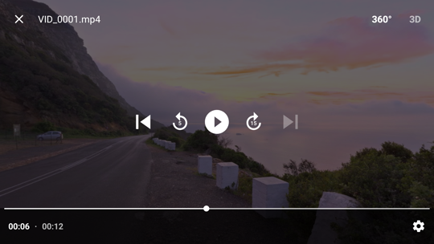

🌐 <b>Bislama</b> · Ol narafala lanwis (88)
<a href="../README.md">English</a> · <a href="README.af.md">Afrikaans</a> · <a href="README.ar.md">العربية</a> · <a href="README.az.md">Azərbaycanca</a> · <a href="README.be.md">Беларуская</a> · <a href="README.bg.md">Български</a> · <a href="README.bn.md">বাংলা</a> · <a href="README.br.md">Brezhoneg</a> · <a href="README.bs.md">Bosanski</a> · <a href="README.ca.md">Català</a> · <a href="README.cs.md">Čeština</a> · <a href="README.cv.md">Чӑвашла</a> · <a href="README.da.md">Dansk</a> · <a href="README.de.md">Deutsch</a> · <a href="README.de_CH.md">Deutsch (Schweiz)</a> · <a href="README.el.md">Ελληνικά</a> · <a href="README.en_GB.md">English (UK)</a> · <a href="README.eo.md">Esperanto</a> · <a href="README.es.md">Español</a> · <a href="README.et.md">Eesti</a> · <a href="README.eu.md">Euskara</a> · <a href="README.fa.md">فارسی</a> · <a href="README.fi.md">Suomi</a> · <a href="README.fil.md">Filipino</a> · <a href="README.fr.md">Français</a> · <a href="README.ga.md">Gaeilge</a> · <a href="README.gl.md">Galego</a> · <a href="README.gsw.md">Alemannisch</a> · <a href="README.gu.md">ગુજરાતી</a> · <a href="README.he.md">עברית</a> · <a href="README.hi.md">हिन्दी</a> · <a href="README.hr.md">Hrvatski</a> · <a href="README.hu.md">Magyar</a> · <a href="README.hy.md">Հայերեն</a> · <a href="README.id.md">Bahasa Indonesia</a> · <a href="README.is.md">Íslenska</a> · <a href="README.it.md">Italiano</a> · <a href="README.ja.md">日本語</a> · <a href="README.ka.md">ქართული</a> · <a href="README.kab.md">Taqbaylit</a> · <a href="README.kk.md">Қазақша</a> · <a href="README.km.md">ខ្មែរ</a> · <a href="README.kmr.md">Kurmancî</a> · <a href="README.kn.md">ಕನ್ನಡ</a> · <a href="README.ko.md">한국어</a> · <a href="README.kxm.md">ภาษาเขมรถิ่นไทย</a> · <a href="README.lb.md">Lëtzebuergesch</a> · <a href="README.lmo.md">Lombard</a> · <a href="README.lt.md">Lietuvių</a> · <a href="README.lv.md">Latviešu</a> · <a href="README.mfa.md">Bahasa Melayu Kelantan</a> · <a href="README.mi.md">Te reo Māori</a> · <a href="README.mk.md">Македонски</a> · <a href="README.ml.md">മലയാളം</a> · <a href="README.mn.md">Монгол</a> · <a href="README.mr.md">मराठी</a> · <a href="README.ms.md">Bahasa Melayu</a> · <a href="README.nb_NO.md">Norsk bokmål</a> · <a href="README.ne.md">नेपाली</a> · <a href="README.nl.md">Nederlands</a> · <a href="README.nn.md">Norsk nynorsk</a> · <a href="README.pa.md">ਪੰਜਾਬੀ</a> · <a href="README.pl.md">Polski</a> · <a href="README.pt.md">Português</a> · <a href="README.pt_BR.md">Português (Brasil)</a> · <a href="README.ro.md">Română</a> · <a href="README.ru.md">Русский</a> · <a href="README.si.md">සිංහල</a> · <a href="README.sk.md">Slovenčina</a> · <a href="README.sl.md">Slovenščina</a> · <a href="README.sq.md">Shqip</a> · <a href="README.sr_Cyrl.md">Српски</a> · <a href="README.sr_Latn.md">Srpski</a> · <a href="README.sv.md">Svenska</a> · <a href="README.sw.md">Kiswahili</a> · <a href="README.swg.md">Schwäbisch</a> · <a href="README.ta.md">தமிழ்</a> · <a href="README.te.md">తెలుగు</a> · <a href="README.th.md">ไทย</a> · <a href="README.tl.md">Tagalog</a> · <a href="README.tr.md">Türkçe</a> · <a href="README.uk.md">Українська</a> · <a href="README.ur.md">اردو</a> · <a href="README.uz.md">Oʻzbekcha</a> · <a href="README.vi.md">Tiếng Việt</a> · <a href="README.yue_Hant.md">粵語</a> · <a href="README.zh_Hans.md">简体中文</a> · <a href="README.zh_Hant.md">繁體中文</a>

  

# Immuch360

**Media blong yu. Eni skrin. Evri saed blong lukluk.**

🌐 <a href="https://immuch360.com/bi/"><b>immuch360.com</b></a>

Flat, 360° mo 3D foto mo video from divaes blong yu, NAS blong yu, Immich server blong yu, ol kamera blong yu mo dron blong yu. I no nidim akaon. Immuch360 i wan fri mo open sos app we i ridim ol foto mo video blong yu long ples we oli stap mo i pleiem evriwan long vyua we i fitim hem: flat, olsem wan sfia we yu lukluk raonabaot insaed, long 3D, o raonabaot long yu long wan hedset. Hem i ron long fon, tablet, TV, Meta Quest hedset mo kompiuta. Websaet blong hem, [immuch360.com](https://immuch360.com/bi/), i soem wanem hem i mekem long evri skrin, long 89 lanwis.

**Niu long build 53 mo desktop build 34, version 3.4.8.** Long ol kompiuta, [Spatial 2.5D](#see-your-3d-photos-and-videos-in-depth-on-your-computer) blong build ia i givim dip long ol 3D foto blong yu long flat skrin, long Windows, Linux mo macOS, mo long ol 3D video blong yu long Windows mo macOS: vyu i muv taem yu muvum hed blong yu, webkam i folem taem yu agri, o wetem maos, mo ol pikja blong webkam oli stap long memori blong kompiuta, oli neva sev o sendem; projek i no traem yet wetem wan webkam. Wil i [zum insaed long wan foto raon long poenta](#zoom-into-a-photo-with-the-wheel) mo wan dreg i muvum hem. [Mekem i gud moa (AI)](#make-a-photo-sharper-on-your-computer-ai) i tekem ol foto blong ol sea blong yu, blong DLNA, Plex, Jellyfin mo Emby mo blong Immich server blong yu, i mekem ol 360° mo 3D foto oli gud moa wetaot brekem join blong olgeta o tufala ae blong olgeta, mo i ofa Mekem i klia moa long wan Mac wetem wan Apple jip (oli no traem long wan Mac yet). From fon, ["Plei long…"](#show-your-photos-and-videos-on-the-tv-from-your-phone) i openem wan 360° samting long 360° vyu blong skrin, i pleiem wan jois o wan album olsem wan slaedso, i log in wan skrin long server blong yu mo i sendem ol foto mo video we oli stap long fon nomo; oli traem bitwin ol Android emuleta, i no yet long wan trufala fon o TV. Long wan Meta Quest, slaedso blong bigfala skrin i [kros fed o slaed](#browse-your-photos-on-the-big-screen-of-the-quest) bitwin ol foto, antap long wan blak baekgraon, wan baekgraon we i no klia o wan passthrough baekgraon we yu jusum, projek i no traem yet long wan hedset.

**Niu samting long build 33 kasem 52.** [Ol fim oli gohed long ples we yu stop](#pick-up-a-film-where-you-stopped). Oli stat kwik moa, mo from wan slo seva [oli gohed blong plei long ples blong stop](#when-a-video-waits-or-will-not-play). Taemlaen [i smol i go kasem ol manis mo ol yia](#find-a-month-or-a-year-in-a-long-timeline) long ol fon mo kompiuta. Long wan Android fon o wan Meta Quest, ["Lukluk long wan folda"](#browse-a-folder-of-your-phone-or-headset) i openem wan folda blong divaes olsem wan sea, mo ol TIFF foto oli soem. Android TV [i lukaotem from deit wetem rimot](#on-android-tv-and-google-tv), wan Meta Quest 3 o 3S [i openem ol Gaussian splat](#explore-gaussian-splats-in-a-meta-quest-3-or-3s), we yu tanem wetem raet tambstik, wetem SPZ vesen 4 tu, mo wan kompiuta [i mekem ol 3D vesen blong ol foto long NAS blong yu](#turn-one-photo-into-3d-a-scene-a-panorama). Long wan Windows laptop we i gat tu grafiks jip, app [naoia i ron long jip we i kwik](#when-a-video-waits-or-will-not-play), ale ol fim 8K oli plei gud nomo. Naoia ol Gaussian splat [oli open long ol kompiuta mo long ol fon mo tablet Android](#explore-gaussian-splats-on-your-phone-tablet-or-computer), wan Windows kompiuta [i mekem ol splat sin from ol foto blong yu o wan video](#make-a-splat-scene-from-your-photos-or-a-video-ai) wetem AI, Immich server blong yu [i kipim olgeta insaed long ol foto](#keep-a-splat-scene-on-your-immich-server) we oli open from taemlaen blong yu, mo ol kompiuta [oli pleiem ol video AV2](#play-av2-videos-on-your-computer). Stat long build 42, ol rao video blong ol kamera Insta360, GoPro MAX mo DJI Osmo 360, from Immich laebri blong yu, wan sea o wan folda, [oli plei stedi wetem gyroscope blong kamera](#stabilise-your-360-videos-with-the-cameras-gyroscope) long ol Android fon, tablet mo TV, splat meka blong desktop build 22 [i ofarem wan kwaliti Ful ditel](#make-a-splat-scene-from-your-photos-or-a-video-ai) blong ol sin we yu lukluk klosap long olgeta, mo wan 360° panorama [i stat wetem 3.5 GiB fri long grafik kad](#turn-one-photo-into-3d-a-scene-a-panorama). iPhone mo iPad app i stap [long App Store](https://apps.apple.com/us/app/immuch360-360-3d-player/id6817655965), version 3.4.3. Stat long build 43, apdet notis blong app i openem Google Play o App Store long ol fon mo tablet; websaet blong hem, [immuch360.com](https://immuch360.com/bi/), i open long 7 Novemba. Stat long build 44 mo desktop build 24, wan Meta Quest 3 o 3S [i soem ol splat kasem 300,000 gaussian](#explore-gaussian-splats-in-a-meta-quest-3-or-3s), ol kompiuta [oli jusum plante foto mo video wetem Ctrl mo Shift](#use-your-computer-as-the-media-player), wan TV we dikoda blong hem i no wantem wan video [i pleim nara fael blong seva](#when-a-video-waits-or-will-not-play) hem wan, ol panorama oli ron long grafik kad we yu jusum long wan laptop we i gat tu, mo apdet notis blong Quest mo ol kompiuta i openem pej blong stoa o pej blong daonlod blong olgeta, wetem plante fiks. Stat long build 45 mo desktop build 25, version 3.4.0 long evri platform, app i folem Immich 3.4.0 app wetem 11 fiks blong Immich we oli kam afta, i soem ol [JPEG XL foto blong ol Immich 3.4 server](#keep-your-immich-library-with-more), i openem [ol Plex fim blong yu from yia](#watch-your-plex-films) wetem wan pej blong evri fim, daonlod blong olgeta long divaes mo plei blong olgeta long TV from fon, i save askem wan reting long ol stoa build, mo long ol kompiuta i tekem ol video kompanen blong hem from [ol open ripositori blong olgeta wan](#licences-and-credits). Stat long build 46 mo desktop build 26, version 3.4.1, ol rao video blong 360° kamera oli [plei stedi](#stabilise-your-360-videos-with-the-cameras-gyroscope) tu long iPhone mo iPad, insaed long wan Meta Quest mo long Windows, wan Meta Quest [i pleiem wetem libmpv ol Plex fim we pleia blong hem wan i no save dikodem](#watch-your-plex-films), wan fon [i sendem kaen fim olsem i go long wan Chromecast o wan Google TV](#watch-your-plex-films), mo AI dip blong wan 3D foto [i tekem strong we yu jusum](#turn-one-photo-into-3d-a-scene-a-panorama); yu save ademap wan niu server tu taem yu saen in wetem Plex akaon blong yu, mo app [i kipim ol seting blong hem long wan fael](#keep-your-settings-in-a-file). Stat long build 47 mo desktop build 27, version 3.4.2, wan Plex fim [i pleiem wan saon trak we divaes i save dikodem](#watch-your-plex-films) mo i talem wijwan, i openem vesen we i fitim skrin mo, long wan slo laen, i ofarem wan we i moa laet, Windows mo macOS oli pleiem Dolby TrueHD saon blong hem, Android [i soem daonlod blong hem long wan notifikesen](#watch-your-plex-films) mo Android TV i daonlodem ol fim tu, mo [ol Tapo kamera blong batri oli soem laef](#watch-your-home-cameras-on-the-big-screen); naoia, taem yu putum bak wan fael blong seting wetem ol akaon blong hem, app i log in long Immich server blong yu. Stat long build 48 mo desktop build 28, version 3.4.3, wan Windows kompiuta [i pleiem ol video blong yu long wan PC VR hedset](#watch-your-videos-in-a-pc-vr-headset-from-windows) tru SteamVR, Meta Horizon Link o wan narafala OpenXR rantaem (projek i no traem yet long wan hedset), [ol kamera blong narafala brand oli soem laef](#cameras-of-other-brands-over-onvif-or-rtsp), we app i faenem tru ONVIF o yu ademap wetem RTSP link blong olgeta (oli jekem wetem wan kamera we i no trufala, oli no traem yet wan trufala kamera blong narafala brand), ol rao video blong [DJI Osmo 360 II mo GoPro MAX 2 oli plei stedi](#open-the-raw-files-of-360-cameras), ol Plex fim [oli no moa kam tu slo long ol fon](#when-a-video-waits-or-will-not-play), ol LG mo Samsung TV [oli tanem wan video we i slip long saed blong hem](#on-a-samsung-tv-tizen) wetem wan baten (oli no traem long wan LG TV yet; Samsung TV blong issue 17 i no wantem tanem), mo "Server update is available" i no moa soem blong wan server we i apdet finis. Stat long build 49 mo desktop build 29, version 3.4.4, app [i ridim ol Jellyfin mo Emby server blong yu](#watch-your-jellyfin-and-emby-libraries) hem wan (oli no traem yet long wan divaes), we i faenem olgeta long netwok blong yu mo i log in wetem Quick Connect long wan TV o long wan hedset, mo i pleiem ol orijinol fael blong olgeta mekem se wan 360° video i stap 360°; long bigfala skrin blong wan Meta Quest, ol foto [oli kipim saes mo ples we yu putum taem yu lukluk olgeta, mo oli plei olsem wan slaedsoh](#browse-your-photos-on-the-big-screen-of-the-quest) (projek i no traem yet long wan hedset); 360° video pleia blong ol fon mo tablet [i kasem ol kontrol blong ol 360° foto](#360-videos-on-your-phone-with-the-controls-of-360-photos), wan baten blong gyroscope, pinj blong zum mo wan dreg we i go stret antap o daon (wan yusa i traem long wan Samsung Galaxy S25 Ultra, oli no traem yet long wan iPhone); wan kompiuta [i tanem ol 2D video blong yu i kam 3D video](#turn-your-2d-videos-into-3d-on-your-computer) wetem AI (oli no traem yet long wan 3D skrin o long wan hedset); mo ol Samsung TV [oli givim wan video we i nidim wan tanem long pleia blong Samsung hem wan](#on-a-samsung-tv-tizen), we TV blong issue 17 i pleiem be i no wantem tanem. Stat long build 50 mo desktop build 30, version 3.4.5, taem wan video i plei long 2D windo blong wan Meta Quest, windo [i drowem bakegen long spid blong skrin](#step-inside-your-photos-and-videos-with-a-meta-quest), i no samples 10 taem long wan seken olsem long build 48 mo 49 (oli mesarem long wan Meta Quest 3), Android TV [i zum insaed long wan foto wetem rimot](#on-android-tv-and-google-tv) mo i muvum wetem ol aro (niu, oli no traem yet long wan TV), mo tri stretem oli kam long Android TV fork blong mlc70: wan kwik swaep i no moa soem ol ditel blong foto we i stap biaen, wan foto we i muv i fri memori blong hem, mo filta blong Ples i ofa ol taon blong niu kantri. Stat long build 51 mo desktop build 31, version 3.4.6, [Mekem i gud moa (AI)](#make-a-photo-sharper-on-your-computer-ai) i mekem wan kopi we i klia moa blong wan foto we i no klia gud klosap long orijinal long Windows mo Linux, long tri level, evriwan i ron wan taem nomo long wan PC wetem wan RTX 4060, Naturol i stap tu long wan Mac wetem wan Apple jip (oli no traem yet long wan Mac), wan kompiuta [i tanem wan 360° video i kam wan 360° 3D video](#a-360-video-turned-into-a-360-3d-video) wetem AI, grafik kad i gesem dip blong ol 3D video long Windows, ol AI fija oli tekem ol video blong server blong yu mo blong wan sea stret, fael blong seting i gat [kad blong hem long Laebri](#keep-your-settings-in-a-file), wan TV i seftem hem long wan netwok sea, Escape i go bak wan step long ol kompiuta, ol stoa build oli askem wan reting [smol taem nomo mo moa kaen](#privacy), Linux i soem ol TIFF foto, ol splat sin mo ol 3D video wetem wan lek, mo tu kras oli stret finis. Stat long build 52 mo desktop build 32, version 3.4.7, ["Plei long…"](#show-your-photos-and-videos-on-the-tv-from-your-phone) i sendem ol foto mo video blong Immich laebri blong yu, blong ol sea blong yu mo blong Jellyfin mo Emby from fon i go long wan TV, wan Meta Quest, wan kompiuta o wan Chromecast, ol nem blong ol foto mo video blong yu [oli stap klia antap long ol smol pikja blong olgeta](#play-the-files-of-a-nas-a-computer-a-media-server-or-plex), ol AI kompanen blong wan kompiuta [oli apdet wetem wan klik](#update-the-ai-components-in-one-click), Linux i kasem [wan AppImage](#linux), mo iPhone mo iPad app i stap build wetem Xcode 27. Desktop build 33 i stretem [Mekem i gud moa (AI)](#make-a-photo-sharper-on-your-computer-ai), we i foldaon long evri foto long desktop build 31 mo 32 ([issue 23](https://github.com/freeKC/Immuch360/issues/23)).

  Hem i wan fork we i no ofisol blong Immich mobile app. Hem i no join wetem Immich o FUTO. Nem ia i ridim olsem "I am much 360".

<b>Ol samting insaed</b>

- [Hem i blong hu](#who-it-is-for)
- [Wanem skrin](#which-screens), [wanem oli mekem tugeta](#use-cases) mo [wanem evri skrin i mekem](#what-each-screen-does)
- [Wanem yu save mekem](#what-you-can-do)
- [Kasem long divaes blong yu](#get-it-on-your-device)
- [Olsem wanem blong mekem](#how-to)
  - [Lukluk ol foto mo video blong yu, wetem o wetaot wan server](#watch-your-photos-and-videos-with-or-without-a-server)
  - [Eksploerem ol panorama, 360°, VR180 mo 3D](#explore-panoramas-360-vr180-and-3d): [ol 360° video long ol fon](#360-videos-on-your-phone-with-the-controls-of-360-photos)
  - [Tanem wan foto i kam 3D, wan sin, wan panorama](#turn-one-photo-into-3d-a-scene-a-panorama): [ol AI kompanen we oli apdet wetem wan klik](#update-the-ai-components-in-one-click)
  - [Tanem ol 2D video blong yu i kam 3D long kompiuta blong yu](#turn-your-2d-videos-into-3d-on-your-computer): [360° video i kam 360° 3D](#a-360-video-turned-into-a-360-3d-video)
  - [Mekem wan foto i klia moa long kompiuta blong yu (AI)](#make-a-photo-sharper-on-your-computer-ai)
  - [Lukluk long TV wetem rimot](#watch-on-the-tv-with-the-remote): [Android TV mo Google TV](#on-android-tv-and-google-tv), [LG](#on-an-lg-tv-webos), [Samsung](#on-a-samsung-tv-tizen)
  - [Log in long wan TV, wan hedset o wan kompiuta wetem fon blong yu](#sign-in-a-tv-a-headset-or-a-computer-with-your-phone)
  - [Soem ol foto mo video blong yu long TV from fon blong yu](#show-your-photos-and-videos-on-the-tv-from-your-phone)
  - [Go insaed long ol foto mo video blong yu wetem wan Meta Quest](#step-inside-your-photos-and-videos-with-a-meta-quest): [bigfala skrin](#browse-your-photos-on-the-big-screen-of-the-quest), [kiosk mod](#kiosk-mode-for-an-exhibition-or-a-shop)
  - [Lukluk ol Gaussian splat long wan Meta Quest 3 o 3S](#explore-gaussian-splats-in-a-meta-quest-3-or-3s)
  - [Lukluk ol Gaussian splat long fon, tablet o kompiuta blong yu](#explore-gaussian-splats-on-your-phone-tablet-or-computer)
  - [Mekem wan splat sin from ol foto blong yu o wan video (AI)](#make-a-splat-scene-from-your-photos-or-a-video-ai)
  - [Kipim wan splat sin long Immich server blong yu](#keep-a-splat-scene-on-your-immich-server)
  - [Pleiem ol fael blong wan NAS, wan kompiuta, wan media server o Plex](#play-the-files-of-a-nas-a-computer-a-media-server-or-plex): [ol fim blong yu from yia](#watch-your-plex-films), [Jellyfin mo Emby](#watch-your-jellyfin-and-emby-libraries)
  - [Lukluk long wan folda blong fon o hedset blong yu](#browse-a-folder-of-your-phone-or-headset)
  - [Gohed wetem wan fim long ples we yu stop](#pick-up-a-film-where-you-stopped)
  - [Taem wan video i wet o i no wantem plei](#when-a-video-waits-or-will-not-play)
  - [Kipim Immich laebri blong yu, wetem moa samting](#keep-your-immich-library-with-more)
  - [Faenem wan manis o wan yia long wan longfala taemlaen](#find-a-month-or-a-year-in-a-long-timeline)
  - [Lukluk ol kamera blong haos long big skrin](#watch-your-home-cameras-on-the-big-screen): [narafala brand](#cameras-of-other-brands-over-onvif-or-rtsp)
  - [DJI dron blong yu](#your-dji-drone): [laef video](#see-what-your-drone-sees-on-your-phone), [long wan Quest o long Android TV](#watch-it-in-a-meta-quest-or-on-an-android-tv), [tekem i kam](#bring-a-drones-or-a-camera-cards-photos-and-videos-to-immich)
  - [Openem ol rao fael blong 360° kamera](#open-the-raw-files-of-360-cameras)
  - [Stedem ol 360° video blong yu wetem gyroscope blong kamera](#stabilise-your-360-videos-with-the-cameras-gyroscope)
  - [Tanem wan foto wetem wan ki](#turn-a-photo-with-one-key)
  - [Yusum kompiuta blong yu olsem media pleia](#use-your-computer-as-the-media-player): [zum wetem wil](#zoom-into-a-photo-with-the-wheel)
  - [Lukim ol 3D foto mo video blong yu wetem dip long kompiuta blong yu](#see-your-3d-photos-and-videos-in-depth-on-your-computer)
  - [Lukluk ol video blong yu long wan PC VR hedset, from Windows](#watch-your-videos-in-a-pc-vr-headset-from-windows)
  - [Pleiem ol video AV2 long kompiuta blong yu](#play-av2-videos-on-your-computer)
  - [Kipim ol seting blong yu long wan fael](#keep-your-settings-in-a-file)
- [Bitwin wetem Immich](#compared-with-immich)
- [Praevesi](#privacy)
- [Laesens mo tankiu](#licences-and-credits)
- [Plan blong fiuja](#roadmap)
- [Dokumen](#documentation)

## Hem i blong hu

- **Yu tekem foto 360° o 3D** mo yu wantem lukluk raonabaot insaed long ol foto blong yu, i no luk olgeta flat, dabol o longfala, mo yu wantem tanem ol 360° video blong yu long fon olsem yu tanem ol foto blong hem: [360°, VR180 mo 3D](#explore-panoramas-360-vr180-and-3d), [ol 360° video long ol fon](#360-videos-on-your-phone-with-the-controls-of-360-photos).
- **Yu filmem wetem wan 360° kamera long han blong yu, long wan baesikol o long wan helmet** mo yu wantem se ol rao video blong Insta360, GoPro MAX o MAX 2, DJI Osmo 360 o Osmo 360 II kamera blong yu, we yu kipim long Immich, long wan sea o long wan folda, oli plei stret mo stedi long fon blong yu, long TV blong yu, long Meta Quest blong yu o long Windows kompiuta blong yu: [we oli stedi wetem gyroscope blong kamera](#stabilise-your-360-videos-with-the-cameras-gyroscope).
- **Ol foto mo fim blong yu oli stap long wan NAS, wan kompiuta, Plex o Immich** mo yu wantem luk olgeta long TV wetaot kopiem eni samting: [long TV](#watch-on-the-tv-with-the-remote), [NAS, sea mo Plex](#play-the-files-of-a-nas-a-computer-a-media-server-or-plex).
- **Ol fim blong yu oli stap long wan Plex server** mo yu wantem jusum wan from yia, save wanem hem bifo i stat, tekem hem long wan trip, statem hem long TV o long wan Chromecast from fon blong yu, mo pleiem tu ol fim we Android fon, TV o Meta Quest blong yu i no save dikodem: [ol fim blong yu, from yia](#watch-your-plex-films).
- **Ol fim blong yu oli stap long wan Jellyfin o Emby server** mo yu wantem olgeta long Meta Quest blong yu, long TV o long fon, 360° mo 3D oli stap olsem we oli stap, mo ples blong yu i stap long server (oli no traem yet long wan divaes): [Jellyfin mo Emby](#watch-your-jellyfin-and-emby-libraries).
- **Yu gat wan Meta Quest** mo yu wantem go insaed long ol foto mo video blong yu wan: [long hedset](#step-inside-your-photos-and-videos-with-a-meta-quest), mo lukluk ol foto blong yu long wan bigfala skrin long saes mo ples we yu putum, olsem wan slaedsoh tu (projek i no traem long wan hedset yet): [bigfala skrin](#browse-your-photos-on-the-big-screen-of-the-quest).
- **Yu gat wan PC VR hedset long wan Windows kompiuta** mo yu wantem ol 360° video blong yu raon long yu mo ol fim blong yu long wan big skrin insaed long hem (projek i no traem long wan hedset yet): [long wan PC VR hedset](#watch-your-videos-in-a-pc-vr-headset-from-windows).
- **Ol foto blong yu oli flat** mo yu wantem olgeta long 3D, olsem wan sin we yu save lin i go insaed long wan hedset, o insaed long wan 360° panorama, wetaot wan 3D kamera: [tanem wan foto i kam 3D, wan sin, wan panorama](#turn-one-photo-into-3d-a-scene-a-panorama), niu, AI i mekem long kompiuta blong yu wan.
- **Ol video blong yu oli flat**, ol klip blong fon blong yu tu, mo yu wantem olgeta long 3D blong wan hedset o wan 3D skrin, mo ol 360° video blong yu long 360° 3D, we oli mekem long kompiuta blong yu wan (oli no traem yet long wan 3D skrin o long wan hedset): [2D video i kam 3D](#turn-your-2d-videos-into-3d-on-your-computer), [360° i kam 360° 3D](#a-360-video-turned-into-a-360-3d-video).
- **Ol foto blong yu oli no klia gud**, oli no fokus gud smol o oli tekem long tudak, mo yu wantem wan kopi we i klia moa klosap long orijinal, we oli mekem long kompiuta blong yu wan, from ol sea mo server blong yu tu, mo app i talem stret wanem ditel i mekemap: [Mekem i gud moa (AI)](#make-a-photo-sharper-on-your-computer-ai).
- **Yu gat ol 3D foto o video mo wan kompiuta** mo yu wantem olgeta wetem dip long flat skrin blong hem, vyu i muv taem yu muvum hed blong yu, webkam i folem, o wetem maos (projek i no traem yet wetem wan webkam): [Spatial 2.5D long kompiuta blong yu](#see-your-3d-photos-and-videos-in-depth-on-your-computer).
- **Yu ronem Immich** mo yu wantem app blong hem, wetem ol imesiv vyua mo ol big skrin we yu log in from fon blong yu: [Immich laebri blong yu](#keep-your-immich-library-with-more), [bitwin wetem Immich](#compared-with-immich).
- **Yu lukaot long haos blong yu wetem Tapo kamera**, olgeta blong batri tu, o ol kamera blong narafala brand tru ONVIF o RTSP, mo yu wantem olgeta klosap long ol foto blong yu, long TV tu (oli jekem agensem wan simuletem kamera): [kamera blong haos](#watch-your-home-cameras-on-the-big-screen).
- **Yu flaem wan DJI dron** mo yu wantem laef pikja blong hem long fon blong yu wetaot DJI Fly, mo long wan Meta Quest o long wan Android TV blong ol man we oli stap wetem yu: [dron blong yu](#see-what-your-drone-sees-on-your-phone).
- **Yu tekem ol ples mo ol samting long 3D, olsem ol Gaussian splat,** o yu wantem mekem olgeta from ol foto blong yu wan, mo yu wantem wokbaot tru long olgeta long fon blong yu, kompiuta blong yu o long wan hedset: [long wan fon, tablet o kompiuta](#explore-gaussian-splats-on-your-phone-tablet-or-computer), [we oli mekem from ol foto blong yu](#make-a-splat-scene-from-your-photos-or-a-video-ai), [we oli kipim long Immich](#keep-a-splat-scene-on-your-immich-server).
- **Yu gat ol video AV2**, fomat we i kam afta AV1, mo yu wantem lukluk olgeta long kompiuta blong yu: [AV2 long kompiuta blong yu](#play-av2-videos-on-your-computer).
- **Yu gat plante skrin long haos** mo yu wantem olgeta oli wok tugeta: [wanem ol skrin blong yu oli mekem tugeta](#use-cases).

I no gat Immuch360 akaon blong mekem, mo i no gat samting i kam long mifala: app i tok nomo wetem ol divaes blong yu mo ol server we yu jusum, stat long build 45 wetem Wikipedia blong pej blong wan fim, stat long build 46 wetem plex.tv taem yu saen in wetem hem, mo i daonlodem wan AI kompanen o AV2 dekoda nomo taem yu askem.

## Wanem skrin

| Platfom | Wea blong kasem | Stejes long Novemba 2026 |
|---|---|---|
|  **Android** fon mo tablet | [Google Play](https://play.google.com/store/apps/details?id=com.aprogsys.immuch360) · [APK](https://github.com/freeKC/Immuch360/releases) | long Google Play (build 47 oli pablisim long 16 Novemba; build 51 i stap long rivyu blong Google stat long 24 Novemba; build 53 i kam afta), build 53 long GitHub, we [ol rao 360° video oli plei stedi](#stabilise-your-360-videos-with-the-cameras-gyroscope), [ol fim oli gohed long ples we yu stop](#pick-up-a-film-where-you-stopped), ["Lukluk long wan folda"](#browse-a-folder-of-your-phone-or-headset) i openem wan folda blong fon mo [ol Gaussian splat oli open](#explore-gaussian-splats-on-your-phone-tablet-or-computer), from wan sea o [from Immich taemlaen blong yu](#keep-a-splat-scene-on-your-immich-server), [ol seting we oli kipim long wan fael](#keep-your-settings-in-a-file), [daonlod blong wan fim we i soem long wan notifikesen](#watch-your-plex-films), stat long build 48 [ol kamera blong narafala brand, laef](#cameras-of-other-brands-over-onvif-or-rtsp) (oli jekem wetem wan kamera we i no trufala) mo, stat long build 49, [ol Jellyfin mo Emby server](#watch-your-jellyfin-and-emby-libraries) (oli no traem yet long wan divaes) mo [ol kontrol blong ol 360° foto long 360° video pleia](#360-videos-on-your-phone-with-the-controls-of-360-photos) (wan yusa i traem long wan Samsung Galaxy S25 Ultra), mo stat long build 51 [kad blong fael blong seting long Laebri](#keep-your-settings-in-a-file), we fael blong hem i save seftem long wan netwok sea tu, mo stat long build 52 [ol foto mo video blong yu we oli sendem i go long wan TV o wan Chromecast](#show-your-photos-and-videos-on-the-tv-from-your-phone) wetem "Plei long…" (oli no traem yet long wan divaes), mo stat long build 53 [ol 360° samting, wan jois o wan album mo ol foto mo video blong fon hem wan](#show-your-photos-and-videos-on-the-tv-from-your-phone) we oli sendem long sem fasin (oli traem bitwin ol Android emuleta) |
|  **iPhone mo iPad** | [App Store](https://apps.apple.com/us/app/immuch360-360-3d-player/id6817655965) | version 3.4.7 long App Store stat long 26 Novemba, wetem [ol manis mo ol yia long taemlaen](#find-a-month-or-a-year-in-a-long-timeline), [ol fim we oli gohed long ples we yu stop](#pick-up-a-film-where-you-stopped), [log in blong wan TV, wan hedset o wan kompiuta](#sign-in-a-tv-a-headset-or-a-computer-with-your-phone) from fon, ol splat sin we oli kipim long Immich, we oli soem olsem foto blong olgeta, ol fiks blong Immich 3.4.0 mo ol JPEG XL foto blong hem, [ol rao 360° video we oli stedi](#stabilise-your-360-videos-with-the-cameras-gyroscope), [ol seting we oli kipim long wan fael](#keep-your-settings-in-a-file), [laef vyu blong ol Tapo kamera blong batri](#watch-your-home-cameras-on-the-big-screen) mo [laef vyu blong ol kamera blong narafala brand](#cameras-of-other-brands-over-onvif-or-rtsp) (oli jekem wetem wan kamera we i no trufala), mo stat long version 3.4.4 [ol Jellyfin mo Emby server](#watch-your-jellyfin-and-emby-libraries) (oli no traem yet long wan divaes) mo [ol kontrol blong ol 360° foto long 360° video pleia](#360-videos-on-your-phone-with-the-controls-of-360-photos) (oli no traem yet long wan iPhone), mo stat long version 3.4.6 [kad blong fael blong seting](#keep-your-settings-in-a-file) mo fasin blong putum hem bak from wan netwok sea, mo stat long version 3.4.7, we oli buildim wetem Xcode 27, ["Plei long…" blong ol foto mo video](#show-your-photos-and-videos-on-the-tv-from-your-phone) (oli no traem long wan iPhone yet); version 3.4.8, iPhone mo iPad version blong build 53, i kam afta; o [buildim hem yu wan](../docs/immuch360/build.md) |
|  **Android TV mo Google TV** | [Google Play](https://play.google.com/store/apps/details?id=com.aprogsys.immuch360) · [APK](#android-tv-and-google-tv) | long Google Play, we i ofa app ia long Android TV mo Google TV, mo build 53 long GitHub: [ol rao 360° video we oli stedi](#stabilise-your-360-videos-with-the-cameras-gyroscope), [lukaotem from deit wetem rimot](#on-android-tv-and-google-tv), [log in wetem fon blong yu](#sign-in-a-tv-a-headset-or-a-computer-with-your-phone) taem yu skanem wan QR kod, wan ba blong taem, odio mo sabtaetol blong rimot insaed long video pleia, mo [laef video blong wan dron](#watch-it-in-a-meta-quest-or-on-an-android-tv) we wan fon i pasem, [ol fim we oli daonlod long TV](#watch-your-plex-films) mo, stat long build 49, [ol Jellyfin mo Emby server](#watch-your-jellyfin-and-emby-libraries) we oli log in wetem Quick Connect (oli no traem yet long wan divaes) mo, stat long build 50, [ol foto we oli zum wetem rimot](#on-android-tv-and-google-tv) (oli luk se i wok long wan Android TV emuleta, oli no traem yet long wan TV), mo stat long build 51 [fael blong seting we oli seftem long wan netwok sea mo putum bak from hem](#keep-your-settings-in-a-file) (oli luk se i wok long wan Android TV emuleta), mo stat long build 52 [ol foto mo video we wan fon i sendem wetem "Plei long…"](#show-your-photos-and-videos-on-the-tv-from-your-phone) (oli no traem yet long wan TV), mo stat long build 53 ol 360° foto we wan fon i sendem oli open long 360° vyu blong olgeta, wan log in from lis blong fon mo ol foto mo video blong fon hem wan (oli luk se i wok long wan Android TV emuleta) |
| **LG TV** wetem webOS 5.0 mo niufala | [.ipk, version 1.0.5](https://github.com/freeKC/Immuch360/releases/tag/webos-v1.0.5) · LG Content Store (stap long rivyu) | version 1.0.0, oli sendem i go long LG Content Store long 24 Oktoba, i stap long ol test blong LG stat long 26 Oktoba; version 1.0.1, long GitHub stat long 27 Oktoba, i zum long wan foto wetem ol ero mo i talem taem wan foto i stil lod, mo version 1.0.2, long GitHub wetem build 46, i raetem "log in" olsem ログイン long Japanis, version 1.0.3, wetem build 47, i talem taem wan folda blong wan DLNA server i holem ol laef TV janel, we hem i no save pleim yet, version 1.0.4, wetem build 48, [i tanem wan video we i slip long saed blong hem](#on-an-lg-tv-webos) wetem wan baten (oli no traem long wan LG TV yet), mo version 1.0.5, wetem build 49, i nemem Jellyfin wetem DLNA plagin blong hem long ol DLNA server; kasem taem LG i pablisim app, hem i instol long [Developer Mode](#lg-tvs-webos). Version 1.0.0 i ron long ol webOS 25 TV blong Cloud Test Lab blong LG |
| **Samsung TV** wetem Tizen 5.5 mo niufala | [.wgt, version 0.3.6](https://github.com/freeKC/Immuch360/releases/tag/tizen-v0.3.6) | version 0.3.6 blong sem TV app, blong saenem wetem Samsung setifiket blong yu mo instolem long [Developer mode](#samsung-tvs-tizen); 0.1.0 i ron long Samsung TV blong wan testa, 0.2.0 i holem ol fiks from test ia, 0.3.0 i ademap foto zum mo smol mak Loading blong LG version 1.0.1, mo 0.3.1 i tekem ol tok long Japanis blong LG version 1.0.2, 0.3.2 i pleiem wan video we oli filmim stanap long wan fon long rod we i stret ([issue 17](https://github.com/freeKC/Immuch360/issues/17)), 0.3.3 mo 0.3.4 [oli tanem hem long wan TV we i talem se hem i stanap](#on-a-samsung-tv-tizen) mo oli ademap wan baten we i tanem hem wetem han, mo 0.3.5 mo 0.3.6 oli givim kaen video ia long pleia blong Samsung hem wan; long TV blong man we i ripotem, 0.3.4 mo 0.3.5 oli livim pikja long saed blong hem, from TV i no wantem tanem, mo rod blong aot long ples ia hemia wan video we Immich server blong yu i transkodem, we i stap stanap stret; i no stap long stoa blong Samsung |
|  **Meta Quest** 2, Pro, 3 mo 3S | [Horizon Store](https://www.meta.com/experiences/immuch360/1384208401440714/) · [APK](#meta-quest) | long Horizon Store (build 50, we 2D windo blong hem i drowem bakegen long spid blong skrin taem wan video i plei, oli pablisim long 25 Novemba; build 52 i stap long rivyu blong Meta stat long 25 Novemba; build 53 i kam afta), build 53 long GitHub, wetem wan [kiosk mod](#kiosk-mode-for-an-exhibition-or-a-shop), [ol rao 360° video we oli stedi](#stabilise-your-360-videos-with-the-cameras-gyroscope) long imesiv vyu, [ol fim we hem i no save dikodem we libmpv i pleiem](#watch-your-plex-films) mo, long Quest 3 mo 3S, ol [Gaussian splat](#explore-gaussian-splats-in-a-meta-quest-3-or-3s) mo [AI dip](#turn-one-photo-into-3d-a-scene-a-panorama) blong wan flat foto, mo stat long build 49 [ol foto we yu lukluk long bigfala skrin](#browse-your-photos-on-the-big-screen-of-the-quest) long saes we yu putum, olsem wan slaedsoh tu (projek i no traem yet long wan hedset), mo [ol Jellyfin mo Emby server](#watch-your-jellyfin-and-emby-libraries) we oli log in wetem Quick Connect (oli no traem yet long wan divaes), mo stat long build 51 wan hedset we Horizon OS blong hem i tu olfala blong imesiv vyu i askem wan apdet, i no klosem app (oli no traem long kaen hedset ia), mo stat long build 53 [wan kros fed o wan slaed bitwin ol foto blong bigfala skrin, antap long wan blak baekgraon, wan baekgraon we i no klia o wan passthrough baekgraon](#browse-your-photos-on-the-big-screen-of-the-quest) (projek i no traem yet long wan hedset) |
|  **Windows** | [Installer o ZIP](https://github.com/freeKC/Immuch360/releases/tag/desktop-v3.4.8-34) | desktop build 34, oli saenem: foto, flat mo 360° video, sea, Plex, kamera (oli jekem wetem wan kamera we i no trufala), log in wetem fon blong yu, foto we oli tanem wetem wan ki, intefes long 89 lanwis, mo [3D foto, 3D sin mo 360° panorama we AI i mekem from ol foto blong yu](#turn-one-photo-into-3d-a-scene-a-panorama), wetem ol foto blong NAS blong yu tu; [ol Gaussian splat](#explore-gaussian-splats-on-your-phone-tablet-or-computer) we oli open, [we oli mekem from ol foto blong yu o wan video](#make-a-splat-scene-from-your-photos-or-a-video-ai) mo [we oli kipim long Immich](#keep-a-splat-scene-on-your-immich-server), [ol video AV2](#play-av2-videos-on-your-computer), stat long desktop build 22 wan [jois blong Kwaliti blong ol splat sin](#make-a-splat-scene-from-your-photos-or-a-video-ai) mo [ol 360° panorama we oli stat wetem 3.5 GiB fri grafik memori](#turn-one-photo-into-3d-a-scene-a-panorama), mo stat long desktop build 26 [ol rao 360° video we oli stedi](#stabilise-your-360-videos-with-the-cameras-gyroscope) mo [ol 3D foto wetem wan strong blong dip mo ol ej we oli klia moa](#turn-one-photo-into-3d-a-scene-a-panorama), stat long desktop build 27 [Dolby TrueHD saon mo ol Blu-ray sabtaetol blong ol fim](#watch-your-plex-films), stat long desktop build 28 [ol video blong yu long wan PC VR hedset](#watch-your-videos-in-a-pc-vr-headset-from-windows) (projek i no traem yet long wan hedset), mo stat long desktop build 29 [ol 3D video we oli mekem from ol 2D video blong yu](#turn-your-2d-videos-into-3d-on-your-computer) wetem AI (oli no traem yet long wan 3D skrin o long wan hedset), mo stat long desktop build 31 [ol kopi blong ol foto blong yu we oli klia moa](#make-a-photo-sharper-on-your-computer-ai) wetem AI mo [ol 360° video we oli tanem i kam 360° 3D video](#a-360-video-turned-into-a-360-3d-video) wetem AI, grafik kad i gesem dip, ol video blong server blong yu mo blong wan sea we app i tekem stret, Escape blong go bak wan step, stat long desktop build 32 [ol AI kompanen we oli apdet wetem wan klik](#update-the-ai-components-in-one-click), stat long desktop build 33 [Mekem i gud moa (AI)](#make-a-photo-sharper-on-your-computer-ai) we i wok bakegen, mo stat long desktop build 34 [zum blong ol foto wetem wil](#zoom-into-a-photo-with-the-wheel), [Spatial 2.5D blong ol 3D foto mo video](#see-your-3d-photos-and-videos-in-depth-on-your-computer), wetem webkam o maos (projek i no traem yet wetem wan webkam), mo Mekem i gud moa (AI) long ol foto blong ol sea mo server, ol 360° mo 3D foto tu |
|   **macOS mo Linux** | [.deb, .rpm, AppImage, DMG](https://github.com/freeKC/Immuch360/releases/tag/desktop-v3.4.8-34) | desktop build 34: foto, 360° foto mo flat video (360° video i plei flat), wan Immich server mo ol netwok sea, mo [3D foto mo 3D sin](#turn-one-photo-into-3d-a-scene-a-panorama) we AI i mekem from ol foto blong yu, wetem 360° panorama long Linux long wan grafik kad we i gat 8 GB, we oli stat wetem 3.5 GiB fri long hem, mo [ol Gaussian splat](#explore-gaussian-splats-on-your-phone-tablet-or-computer) mo [ol video AV2](#play-av2-videos-on-your-computer) (oli no traem long wan Mac yet); oli traem desktop build 11 long 26 Oktoba long wan Ubuntu 24.04 kontena mo long wan Mac; stat long desktop build 27, Dolby TrueHD saon blong ol fim long macOS; stat long desktop build 29, [ol 3D video we oli mekem from ol 2D video blong yu](#turn-your-2d-videos-into-3d-on-your-computer) wetem AI long Linux mo long wan Mac wetem wan Apple jip (oli no traem yet long wan 3D skrin o long wan hedset); stat long desktop build 31, long Linux, [ol kopi blong ol foto blong yu we oli klia moa](#make-a-photo-sharper-on-your-computer-ai) wetem AI, ol TIFF foto, ol folda we oli soem ol niu fael blong olgeta olsem nomo, ol splat sin we oli mekem from ol foto blong yu long wan grafik kad blong 4 GB mo ol 3D video we oli soem flat wetem wan lek, mo long wan Mac wetem wan Apple jip level Naturol blong Mekem i gud moa (AI) (oli no traem long wan Mac yet); stat long desktop build 32, [wan AppImage](#linux) blong ol narafala Linux distribiusen, CI i jekem long Arch Linux mo openSUSE; stat long desktop build 34, zum wetem wil, [Spatial 2.5D](#see-your-3d-photos-and-videos-in-depth-on-your-computer) blong ol 3D foto long Linux mo macOS mo blong ol 3D video long macOS (oli no traem long wan Mac o wetem wan webkam yet), mo long wan Mac wetem wan Apple jip level Mekem i klia moa blong Mekem i gud moa (AI) (oli no traem long wan Mac yet); i no saenem long macOS |

*Oli apdetem ol stejes long evri release; wanem we evri stoa i gat, wanem i stap long rivyu blong hem mo evri build oli stap long [Release status](../docs/immuch360/release-status.md). Websaet [immuch360.com](https://immuch360.com/bi/) i soem wanem evri skrin i mekem, wan Olsem wanem blong mekem blong evri fija mo ol link blong ol stoa, long 89 lanwis.*

  

### Wanem ol skrin blong yu oli mekem tugeta

Instolem Immuch360 long evri skrin we yu lukluk long hem: evriwan i ridim ol sos blong yu hemwan, mo samfala oli givim wan pikja, wan fael o wan log in long narafala. Long evri pikja, aekon blong Immuch360 i soem ol masin we oli ranem app.

#### NAS blong yu long evri skrin

  

**Yu nidim:** wan NAS wetem wan fola we oli serem long SMB o WebDAV, mo Immuch360 long evri skrin we yu lukluk long hem.

Ademap fola ia long evri skrin, mo evriwan i pleiem ol foto mo video long ples we oli stap, oli no kopiem eni samting: ol fon, ol tablet, Android TV, wan Meta Quest, ol kompiuta Windows, Linux mo macOS, mo ol LG TV we oli log in long Immich server blong yu (SMB from webOS 22). Wan 360° foto i tanem olsem wan bol long fon mo long TV, mo i raonem yu long hedset. Olsem wanem blong mekem: [Pleiem ol fael blong wan NAS, wan kompiuta, wan media server o Plex](#play-the-files-of-a-nas-a-computer-a-media-server-or-plex).

#### Immich server blong yu long evri skrin, wetem log in from fon blong yu

  

**Yu nidim:** wan Immich server, Immuch360 long Android fon blong yu, mo Immuch360 long ol skrin we yu log in: Android TV, wan Meta Quest, wan kompiuta Windows, Linux o macOS.

Long fon, Immuch360 i kipim fulwan Immich mobael app, i ademap ol 360°, VR180 mo 3D viuwa blong hem, mo i instol klosap long ofisol app. Taem i log in long server blong yu, i log in ol big skrin: i skanem QR kod blong TV o kompiuta, o yu taepem long hem kod we hedset i soem, mo pasword blong yu i stap long fon. Olsem wanem blong mekem: [Log in long wan TV, wan hedset o wan kompiuta wetem fon blong yu](#sign-in-a-tv-a-headset-or-a-computer-with-your-phone).

#### Ol flat foto blong yu long 3D, from kompiuta blong yu i go long hedset

  

**Yu nidim:** Immuch360 long wan kompiuta Windows, Linux o macOS mo long wan Meta Quest, wetem NAS blong yu long medel blong tufala, o Immich server blong yu wetem "Bakap ol AI vesen tu" i on.

Kompiuta hemwan i tanem ol foto blong yu i kam 3D foto mo 3D sin, mo i kam 360° panorama wetem wan grafik kad blong 8 GB long Windows o Linux, mo i sevem olgeta klosap long ol orijinol. Hedset i soem wan 3D foto long trufala 3D, i putum wan sin long rum blong yu mo wan panorama raon long yu; ol fon mo TV oli openem ol panorama long 360° viuwa blong olgeta. Olsem wanem blong mekem: [Tanem wan foto i kam 3D, wan sin, wan panorama](#turn-one-photo-into-3d-a-scene-a-panorama).

#### Laef vyu blong dron blong yu long wan hedset o long TV

  

**Yu nidim:** wan DJI dron mo DJI RC-N3 rimot blong hem, Immuch360 long Android fon we i plag long rimot, mo Immuch360 long wan Meta Quest o long wan Android TV.

Fon i soem laef video blong dron mo i pasem, tru long Wi-Fi blong yu o hotspot blong hem, blong ol man we oli stap wetem yu oli lukluk flae long hedset o long TV. Hem i risivim nomo: neva wan oda i go long rimot o dron, mo rimot i kipim ful kontrol. Olsem wanem blong mekem: [Lukluk long wan Meta Quest o long wan Android TV](#watch-it-in-a-meta-quest-or-on-an-android-tv).

#### Ol rao fael blong 360° kamera blong yu, oli joenem long ples we yu lukluk olgeta

  

**Yu nidim:** wan Insta360, GoPro MAX o MAX 2, DJI Osmo 360 o Osmo 360 II kamera, NAS blong yu, mo Immuch360 long ol skrin: ol fon, ol tablet, Android TV, wan Meta Quest, Windows.

Kopiem ol fael .insp, .insv, .360 o .osv from kad blong kamera i go long wan fola blong NAS blong yu we oli serem long SMB o WebDAV, olsem we oli stap; wan Immich server i tekem olgeta blong Insta360 tu. Evri skrin i joenem olgeta taem oli plei, wetem kalibresen we i stap raet long evri fael, mo oli no eksportem eni samting fastaem long app blong kamera. Olsem wanem blong mekem: [Openem ol rao fael blong 360° kamera](#open-the-raw-files-of-360-cameras).

#### Ol Plex mo DLNA server blong yu long TV mo long hedset

  

**Yu nidim:** wan Plex Media Server, wan Jellyfin o Emby server, o wan DLNA server olsem minidlna, mo Immuch360 long evri skrin: Android TV, wan Meta Quest, ol fon, ol tablet, Windows.

Plex i givim ol orijinol fael blong ol laebri blong yu, ale wan 360° video i stap 360°, raon long yu long hedset, long haos mo, tru long port forwading blong yu, taem yu no stap long haos; ol DLNA server oli faenem long netwok blong haos blong yu. Ol LG TV we oli log in long Immich server blong yu oli pleiem olgeta tu. Stat long build 45, ol fon, tablet, Android TV, Quest mo ol kompiuta oli openem wan Plex laebri blong fim long evri fim from yia, evri fim wetem pej blong hem, mo wan fim we yu jusum long fon i plei long Android TV, Quest o wan kompiuta, mo rimot i kontrolem. Stat long build 46, Quest i pleiem wetem libmpv ol fim we pleia blong hem wan i no save dikodem, Plex server blong yu i konvetem olgeta we i no gat pleia blong wan Android divaes i save dikodem, mo wan fon i sendem wan fim i go long wan Chromecast o wan Google TV. Stat long build 47, wan fim i pleiem wan saon trak we divaes i save dikodem mo i talem wijwan, i openem vesen we i fitim skrin mo i pleiem Dolby TrueHD saon blong hem long Windows mo macOS, mo wan folda blong laef TV janel blong wan DLNA server i talem se oli no save plei yet. Stat long build 49, wan Jellyfin o Emby server i gat kaen blong hem wan tu, we i faenem hem wan, i log in wetem Quick Connect long wan TV o long hedset, i pleiem ol orijinol fael blong hem mekem se 360° i stap 360°, mo i kipim ples blong yu long server (oli no traem yet long wan divaes). Olsem wanem blong mekem: [Pleiem ol fael blong wan NAS, wan kompiuta, wan media server o Plex](#play-the-files-of-a-nas-a-computer-a-media-server-or-plex), [Lukluk ol Plex fim blong yu](#watch-your-plex-films) mo [Lukluk ol Jellyfin mo Emby laebri blong yu](#watch-your-jellyfin-and-emby-libraries).

#### Fon blong yu o Windows kompiuta blong yu, we i open long hedset

  

**Yu nidim:** Immuch360 long wan Android fon, wan iPhone o wan Windows kompiuta, mo long wan Meta Quest, long sem Wi-Fi blong haos.

Tanem on "Serem fon ia long netwok" long fon, o "Serem kompiuta ia long netwok" long kompiuta, mo hedset i pleiem ol foto mo video blong hem, olgeta blong 360° raon long yu: i no gat server, i no gat NAS, i no gat aplod. Long wan iPhone, fon i serem taem app i stap long skrin. Olsem wanem blong mekem: [Serem fon ia long netwok](../docs/immuch360/user-guide.md#share-this-phone-on-the-network).

#### Ol Tapo kamera blong yu long TV mo long hedset

  

**Yu nidim:** ol Tapo kamera long netwok blong haos blong yu, mo Immuch360 long wan Android fon, wan Android TV, wan Meta Quest o wan Windows kompiuta.

Evri skrin i soem wan kamera laef mo i pleiem ol rikod blong memori kad blong hem dei afta dei, klosap long ol foto blong yu, mo fon i sendem wan klip i go long Immich server blong yu. App i toktok long ol kamera long netwok blong yu nomo, neva tru long ol server blong TP-Link. Stat long build 47, ol kamera blong batri oli soem laef tu, tru media pot blong olgeta, long ol fon, tablet, Android TV mo Quest. Stat long build 48, ol kamera blong narafala brand oli soem laef klosap long olgeta, we app i faenem tru ONVIF o yu ademap wetem RTSP link blong olgeta. Oli jekem agensem wan simuletem kamera. Olsem wanem blong mekem: [Lukluk ol kamera blong haos long big skrin](#watch-your-home-cameras-on-the-big-screen).

#### Ol Gaussian splat long rum blong yu, long wan Meta Quest 3 o 3S

  

**Yu nidim:** wan splat we oli mekem wetem Polycam, Scaniverse, Luma o narafala tul, olsem wan .spz o binari .ply fael long NAS blong yu o long hedset, mo Immuch360 long wan Meta Quest 3 o 3S.

Hedset i putum ples o samting long trufala saes blong hem, fored long yu o raon long yu: wokbaot raon long hem, slaed tru long hem wetem lef tamstik, tanem wetem raet wan. Ol Gaussian splat oli yusum wan pat blong Meta Spatial SDK we Meta i no sapotem mo i no promes long hem: sapos i gat wan problem, hem i blong Immuch360 nomo. Olsem wanem blong mekem: [Lukluk ol Gaussian splat long wan Meta Quest 3 o 3S](#explore-gaussian-splats-in-a-meta-quest-3-or-3s).

#### Wan Meta Quest blong ol visita blong yu

  

**Yu nidim:** wan Meta Quest wetem Immuch360, mo wan 360° foto o video long hedset, long NAS blong yu o long Immich server blong yu.

Long kiosk mod, hedset i openem 360° foto o video blong yu hemwan, from stat, evri taem we wan visita i putum hem, mo wan film i finis long wan kad wetem tekst blong yu. Ol visita oli no presem eni samting; yu holem B o Y wan seken blong aot. Olsem wanem blong mekem: [Kiosk mod, blong wan eksibisen o wan stoa](#kiosk-mode-for-an-exhibition-or-a-shop).

### Wanem evri skrin i mekem

Wan kod bes blong ol fon, tablet, Android TV, Meta Quest mo ol kompiuta, mo wan narafala TV app blong ol LG TV, we oli pakejem tu blong ol Samsung TV, blong yu instolem yu wan. Wanem evriwan i gat tedei:

| Fija | Android | iPhone, iPad | Android TV | LG webOS | Samsung Tizen | Quest |
|---|:---:|:---:|:---:|:---:|:---:|:---:|
| Laebri, albam, sij wetem wan Immich server | ✅ | ✅ | ✅ vyua | ✅ vyua | ✅ vyua | ✅ |
| Taemlaen long ol manis mo ol yia | ✅ | ✅ | ❌ | ❌ | ❌ | ❌ |
| Log in wetem fon blong yu (QR kod) | ✅ i skanem kod | ✅ i skanem kod | ✅ | ✅ long browsa blong fon | ❌ yu taepem long TV | ✅ kod we yu raetem long fon |
| Wetaot wan server: media blong divaes hem wan | ✅ | ✅ | sea nomo | ❌ | ❌ | ✅ |
| Wan folda blong divaes, we i open olsem wan sea | ✅ wan folda we yu jusum | ❌ | ❌ | ❌ | ❌ | ✅ |
| Flat foto mo video | ✅ | ✅ | ✅ | ✅ | ✅ | ✅ |
| TIFF foto | ✅ | ✅ dikoda blong sistem | ✅ | ✅ from seva | ✅ from seva | ✅ long imesiv vyu tu |
| JPEG XL smol pikja mo privyu (Immich 3.4) | ✅ | ✅ stat long 3.4.0, dikoda blong Immich, oli no traem long wan iPhone yet | ✅ | ❌ "I no save luk fastaem" | ❌ "I no save luk fastaem" | ✅ long imesiv vyu tu |
| Tanem wan foto wetem wan ki | ✅ | ✅ | ✅ kala ki | ✅ kala ki | ✅ | ✅ windo |
| 360° foto olsem wan sfia | ✅ | ✅ | ✅ | ✅ | ✅ | ✅ imesiv |
| 360° video | ✅ | ✅ no gat ba blong taem | ✅ mesej sapos i no save dikodem | flat nomo | flat nomo | ✅ imesiv |
| 360° video: baten blong gyroscope, pinj, wan dreg stret antap mo daon | ✅ stat long build 49, wan yusa i traem long wan Samsung Galaxy S25 Ultra | ✅ stat long version 3.4.4, oli no traem long wan iPhone yet | ❌ | ❌ | ❌ | ❌ |
| Ol fim oli gohed long ples we yu stop | ✅ | ✅ | ✅ | ❌ | ❌ | ✅ long imesiv vyu tu |
| Sos blong video: fael we divaes ia i save ridim | ✅ | ✅ | ✅ | ❌ | ❌ | ✅ |
| Wan slo seva: hamas taem wan video i wet, mo from wanem | ✅ | rul blong wet blong hem wan | ✅ | ❌ | ❌ | ✅ |
| Ol video AV2 | ❌ | ❌ | ❌ | ❌ | ❌ | ❌ |
| 3D mo VR180 | ✅ wan lek | ✅ wan lek | ✅ wan lek | foto wan lek, video flat | foto wan lek, video flat | ✅ trufala 3D |
| Flat 3D from nem blong fael, ol skrin we oli moa klia we yu muvum | ❌ | ❌ | ❌ | ❌ | ❌ | ✅ |
| Ol foto long bigfala skrin: lukluk, slaedsoh, saes mo ples i stap | ❌ | ❌ | ❌ | ❌ | ❌ | ✅ stat long build 49, oli no traem long wan hedset yet |
| Slaedso blong bigfala skrin: kros fed o slaed, wan blak baekgraon, wan baekgraon we i no klia o wan passthrough baekgraon | ❌ | ❌ | ❌ | ❌ | ❌ | ✅ stat long build 53, oli no traem yet long wan hedset |
| Kiosk mod blong ol visita | ❌ | ❌ | ❌ | ❌ | ❌ | ✅ |
| Spatial 2.5D (trakim hed) | ✅ | ✅ | ❌ | ❌ | ❌ | ❌ |
| Apple spatial foto | ✅ wan lek | ✅ wan lek | ✅ wan lek | ❌ | ❌ | ✅ 3D |
| Gaussian splat, .spz mo .ply | ✅ | ❌ | ❌ | ❌ | ❌ | ✅ Quest 3 mo 3S |
| Ol splat sin we oli kipim olsem foto long Immich | ✅ | foto | foto | foto | foto | ✅ Quest 3 mo 3S, oli no traem long wan hedset yet |
| 3D foto from wan 2D foto (AI) | ✅ i ridim, saed long saed | ✅ i ridim, saed long saed | ✅ i ridim, saed long saed | ✅ i ridim, saed long saed | ✅ i ridim, saed long saed | ✅ AI dip long hedset (Quest 3 mo 3S), i soem long 3D, Smol, Nomol o Strong |
| 3D sin from wan 2D foto (AI) | ✅ i ridim, olsem foto blong hem | ✅ i ridim, olsem foto blong hem | ✅ i ridim, olsem foto blong hem | ✅ i ridim, olsem foto blong hem | ✅ i ridim, olsem foto blong hem | ✅ lukluk raon long 3D |
| 360° panorama from wan 2D foto (AI) | ✅ i ridim, wetem AI mak blong hem | ✅ i ridim olsem wan 360° foto, mak 🔜 | ✅ i ridim, wetem AI mak blong hem | ✅ i ridim olsem wan 360° foto, mak 🔜 | ✅ i ridim olsem wan 360° foto, mak 🔜 | ✅ i ridim raon long yu fulwan, wetem AI mak blong hem |
| 3D vesen saed long ol foto blong wan sea (AI) | ✅ i ridim olgeta | ✅ i ridim olgeta | ✅ i ridim olgeta | ✅ i ridim olgeta | ❌ | ✅ i ridim olgeta |
| Splat sin from ol foto o wan video (AI) | ✅ i ridim | ❌ | ❌ | ❌ | ❌ | ✅ i ridim, Quest 3 mo 3S, oli no traem long wan hedset yet |
| 3D video from wan 2D video (AI) | ✅ i ridim, saed long saed | ✅ i ridim, saed long saed | ✅ i ridim, saed long saed | wan flat video, saed long saed | wan flat video, saed long saed | ✅ long 3D long wan bigfala skrin, oli no traem long wan hedset yet |
| Rao fael blong Insta360, GoPro mo DJI | ✅ | ✅ | ✅ | ❌ | ❌ | ✅ |
| Rao 360° video we oli stedi wetem gyroscope blong kamera | ✅ Insta360, GoPro MAX mo MAX 2, DJI Osmo 360 mo Osmo 360 II, from laebri blong yu, ol sea mo ol folda | ✅ stat long version 3.4.1, oli no traem long wan iPhone yet | ✅ Insta360, GoPro MAX mo MAX 2, DJI Osmo 360 mo Osmo 360 II, from laebri blong yu mo ol sea | ❌ | ❌ | ✅ long imesiv vyu, oli no traem long wan hedset yet |
| SMB, WebDAV, DLNA sea | ✅ | ✅ | ✅ | ✅ SMB stat long webOS 22 | ❌ | ✅ |
| Plex Media Server | ✅ | ✅ | ✅ | ✅ | ❌ | ✅ |
| Saen in wetem Plex akaon blong yu (plex.tv) | ✅ long braosa | ✅ long braosa | ✅ kod long plex.tv/link | ✅ kod long plex.tv/link | ❌ | ✅ kod long plex.tv/link |
| Ol Plex fim we divaes ia i no save dikodem | ✅ Plex server blong yu i konvetem | ❌ | ✅ Plex server blong yu i konvetem | ❌ | ❌ | ✅ libmpv, o Plex server blong yu i konvetem |
| Wan Plex fim we oli sendem i go long wan Chromecast o wan Google TV | ✅ | ✅ taem app i stap open | ❌ | ❌ | ❌ | ❌ |
| Ol Immich foto mo video blong yu, mo olgeta blong wan sea, we oli sendem i go long wan TV o wan Chromecast wetem "Plei long…" (stat long build 52, oli no traem yet long wan divaes) | ✅ i sendem olgeta, i go long wan Chromecast tu | sem kod, oli no traem yet long wan iPhone | ✅ i soem olgeta | ❌ | ❌ | ✅ i soem olgeta long windo blong hem |
| "Plei long…" stat long build 53: wan 360° samting long 360° vyu blong skrin, wan jois o wan album olsem wan slaedso, wan skrin we i log in from fon, ol foto mo video blong fon hem wan | ✅ i sendem olgeta, oli traem long wan emuleta | sem kod, oli no traem yet long wan iPhone | ✅ i soem olgeta, oli traem long wan emuleta | ❌ | ❌ | ✅ i soem olgeta, 360° long hedset o long windo |
| Wan Plex fim long plante vesen: hemia we i fitim skrin, jois blong yu i stap | ✅ | ✅ | ✅ | ❌ | ❌ | ✅ |
| Saon trak blong wan Plex fim we divaes ia i no save dikodem: wan narafala trak, wetem wan notis | ✅ | ✅ | ✅ | ❌ | ❌ | ✅ |
| Ol Jellyfin mo Emby server | ✅ | ✅ stat long version 3.4.4 | ✅ Quick Connect fastaem | ❌ tru DLNA, wetem plagin blong hem | ❌ | ✅ Quick Connect fastaem |
| Tapo kamera: rikoding | ✅ | ✅ | ✅ | 🔜 i no bifo Disemba 2026 | ❌ | ✅ |
| Tapo kamera: laef vyu | ✅ | ✅ oli no traem long wan iPhone yet | ✅ | ✅ video nomo | ❌ | ✅ |
| Tapo kamera blong batri: laef vyu | ✅ video nomo | ✅ wetem saon, oli no traem long wan iPhone yet | ✅ video nomo | ❌ | ❌ | ✅ video nomo |
| Kamera blong narafala brand, ONVIF o RTSP: laef vyu | ✅ H.264, H.265, MPEG-4 | ✅ H.264, stat long version 3.4.3, yu ademap wetem adres o link | ✅ | ❌ | ❌ | ✅ |
| Seaem divaes ia long netwok | ✅ | ✅ | ❌ | ❌ | ❌ | ❌ |
| Aplod i go long Immich from sea mo divaes | ✅ | ✅ | ❌ | ❌ | ❌ | ✅ |
| Ol seting we oli seftem long wan fael mo oli putum bak | ✅ | ✅ tru long Files mo Serem, oli no traem long wan iPhone yet | ✅ wetem wan fael pika o, stat long build 51, wan netwok sea | ❌ | ❌ | ✅ |
| Tekem from wan DJI dron o wan kad tru USB | ✅ | ❌ | ❌ | ❌ | ❌ | ❌ |
| Laef video blong DJI dron | ✅ wetem wan RC-N3 | ❌ | ✅ wan fon i pasem | ❌ | ❌ | ✅ wan fon i pasem |
| Dak tim | olsem sistem | olsem sistem | ✅ stret long stat | ✅ tim ia nomo | ✅ tim ia nomo | olsem sistem |
| Input | tajim, gyroscope | tajim, gyroscope | rimot; Left mo Right tu taem wan video i plei mo long ba blong taem blong hem, Menu blong ol ditel | rimot, Magic Remote | rimot | kontrola, han |
| Wea blong kasem hem | Google Play, APK | App Store | Google Play, APK | .ipk, LG Content Store (stap long rivyu) | .wgt, yu nao i saenem | Horizon Store, APK |

| Fija | Windows | Linux | macOS |
|---|:---:|:---:|:---:|
| Laebri, albam, sij wetem wan Immich server | ✅ | ✅ | ✅ |
| Taemlaen long ol manis mo ol yia | ✅ Ctrl mo wil | ✅ Ctrl mo wil | ✅ Command mo wil |
| Log in wetem fon blong yu (QR kod) | ✅ | ✅ (oli traem web pej blong hem; i stap aninit long Taepem wan kod long ples we Avahi i ron) | ✅ (oli no raetem wanem rod) |
| Wetaot wan server: media blong divaes hem wan | ✅ folda | ✅ folda | ✅ folda |
| Wan folda blong divaes, we i open olsem wan sea | ✅ folda | ✅ folda | ✅ folda |
| Ol niu fael blong wan folda oli soem wetaot Refresh | ✅ | ✅ stat long desktop build 31 (ol tri we oli bigwan tumas: ol folda we oli stap daon olgeta long nekis skan) | ✅ oli no jekem long wan Mac yet |
| Flat foto mo video | ✅ | ✅ | ✅ |
| TIFF foto | ✅ dikoda blong sistem | ✅ stat long desktop build 31, dikoda blong app (i no blong DNG mo ol narafala rao fael) | ✅ dikoda blong sistem |
| JPEG XL smol pikja mo privyu (Immich 3.4) | ✅ | ✅ | ✅ |
| Tanem wan foto wetem wan ki | ✅ | ✅ | ✅ |
| Wan foto we yu zum wetem wil raon long poenta mo yu muvum wetem wan dreg (stat long desktop build 34, ol test blong projek oli jekem) | ✅ | ✅ | ✅ |
| 360° foto olsem wan sfia | ✅ | ✅ | ✅ |
| 360° video | ✅ | flat nomo | flat nomo |
| Ol fim oli gohed long ples we yu stop | ✅ | ✅ | ✅ |
| Sos blong video: fael we divaes ia i save ridim | ✅ | ✅ | ✅ |
| Wan slo seva: hamas taem wan video i wet, mo from wanem | ✅ | ✅ | ✅ |
| Ol video AV2 | ✅ | ✅ | ✅ CI i jekem |
| 3D mo VR180 | ✅ wan lek | foto wan lek, video wan lek, flat, stat long desktop build 31 | foto wan lek, video wan lek, flat, stat long desktop build 31, CI i buildim |
| Flat 3D from nem blong fael, ol skrin we oli moa klia we yu muvum | ❌ | ❌ | ❌ |
| Kiosk mod blong ol visita | ❌ | ❌ | ❌ |
| Wan PC VR hedset: 360°, 180° mo flat video | ✅ stat long desktop build 28, oli no traem long wan hedset yet | ❌ | ❌ |
| Spatial 2.5D: dip long skrin blong ol 3D foto mo video, wetem webkam o maos | ✅ stat long desktop build 34, oli no traem yet wetem wan webkam | ✅ ol 3D foto stat long desktop build 34, oli no traem yet wetem wan webkam; ol 3D video 🔜 | ✅ ol 3D foto mo video stat long desktop build 34, CI i buildim, oli no traem long wan Mac yet |
| Apple spatial foto | ✅ wan lek | ✅ wan lek, from wan server | ✅ wan lek |
| Gaussian splat, .spz mo .ply | ✅ | ✅ | ✅ CI i buildim |
| Ol splat sin we oli kipim olsem foto long Immich | ✅ | ✅ | ✅ CI i buildim |
| 3D foto from wan 2D foto (AI) | ✅ tri strong, ol ej we oli klia moa | ✅ tri strong, ol ej we oli klia moa | ✅ CI i buildim, tri strong, ol ej we oli klia moa |
| 3D sin from wan 2D foto (AI) | ✅ | ✅ | ✅ CI i buildim |
| 360° panorama from wan 2D foto (AI) | ✅ grafik kad blong 8 GB | ✅ grafik kad blong 8 GB, i ron long smol saes long Intel grafik | 🔜 i stap long plan blong fiuja |
| 3D vesen saed long ol foto blong wan sea (AI) | ✅ | ✅ | ✅ 3D foto mo sin |
| Splat sin from ol foto o wan video (AI) | ✅ grafik kad blong 4 GB | ✅ stat long desktop build 31, grafik kad blong 4 GB, CI i ronem long prosesa, oli no traem yet long wan Linux PC wetem wan grafik kad | ✅ i ridim, CI i buildim |
| 3D video from wan 2D video (AI) | ✅ long grafik kad stat long desktop build 31, o long prosesa | ✅ long prosesa | ✅ Core ML long wan Apple jip, prosesa long wan Intel Mac, CI i buildim mo i ronem, oli no traem long wan Mac yet |
| 360° 3D video from wan 360° video (AI) | ✅ stat long desktop build 31, long grafik kad | ✅ stat long desktop build 31, long prosesa, CI i ronem | ✅ stat long desktop build 31, CI i buildim, i no ron long wan Mac |
| Mekem wan foto i gud moa (AI): Mekem i klia moa, Wokem bakegen ol ditel, Naturol | ✅ stat long desktop build 31: Mekem i klia moa mo Wokem bakegen ol ditel long wan grafik kad (Wokem bakegen ol ditel: wan kad blong hem wan blong 6 GB), Naturol long prosesa (16 GB) | ✅ sem mak, CI i buildim, oli no traem long wan Linux PC wetem wan grafik kad | Naturol long wan Apple jip, mo Mekem i klia moa stat long desktop build 34 (oli no traem long wan Mac yet); Wokem bakegen ol ditel i no yet |
| Mekem i gud moa (AI) long ol foto blong ol sea, DLNA, Plex, Jellyfin, Emby mo Immich server, ol 360° mo 3D foto oli stap olsem we oli stap (stat long desktop build 34) | ✅ | ✅ CI i buildim | ✅ CI i buildim, oli no traem long wan Mac yet |
| Rao fael blong Insta360, GoPro mo DJI | ✅ | ✅ foto, video flat | ✅ foto, video flat |
| Rao 360° video we oli stedi wetem gyroscope blong kamera | ✅ long 360° pleia, oli no traem long wan fael blong kamera yet | ❌ | ❌ |
| SMB, WebDAV, DLNA sea | ✅ | ✅ | ✅ |
| Plex Media Server | ✅ | 🔧 CI | 🔧 CI |
| Saen in wetem Plex akaon blong yu (plex.tv) | ✅ long braosa | 🔧 CI | 🔧 CI |
| Wan Plex fim long plante vesen: hemia we i fitim skrin, jois blong yu i stap | ✅ | 🔧 CI | 🔧 CI |
| Ol Jellyfin mo Emby server | ✅ | 🔧 CI | 🔧 CI |
| Ol foto mo video we wan fon i sendem wetem "Plei long…" (stat long desktop build 32, oli no traem yet) | ✅ | 🔧 CI | 🔧 CI |
| Ol AI kompanen we oli apdet wetem wan klik (stat long desktop build 32) | ✅ | ✅ | ✅ CI i buildim |
| Dolby TrueHD saon mo Blu-ray (PGS) sabtaetol blong ol fim | ✅ stat long desktop build 27 | ✅ libmpv blong sistem | ✅ TrueHD stat long desktop build 27, we CI i buildim |
| Tapo kamera: rikoding | ✅ | 🔧 CI | 🔧 CI |
| Tapo kamera: laef vyu | ✅ | 🔧 CI | 🔧 CI |
| Tapo kamera blong batri: laef vyu | 🔜 wan version we i kam afta | 🔜 | 🔜 |
| Kamera blong narafala brand, ONVIF o RTSP: laef vyu | ✅ | 🔧 CI | 🔧 CI |
| Seaem divaes ia long netwok | ✅ | ❌ | ❌ |
| Aplod i go long Immich from sea mo divaes | ✅ | ✅ | ✅ |
| Ol seting we oli seftem long wan fael mo oli putum bak | ✅ | ✅ | ✅ |
| Jusum plante foto wetem Ctrl+klik, Shift+klik mo Ctrl+A, ol aksen long raet klik | ✅ | ✅ | ✅ wetem Command, oli no traem long wan Mac yet |
| Tekem from wan DJI dron o wan kad tru USB | ❌ | ❌ | ❌ |
| Laef video blong DJI dron | ❌ | ❌ | ❌ |
| Dak tim | olsem sistem | olsem sistem | olsem sistem |
| Input | maos, kiboad, Escape blong go bak | maos, kiboad, Escape blong go bak | maos, kiboad, trakpad, Escape blong go bak |
| Wea blong kasem hem | Installer o ZIP (oli saenem) | .deb, .rpm, AppImage | DMG o ZIP (i no saenem) |

*Linux mo macOS: desktop build 11, oli traem long 26 Oktoba 2026 long Ubuntu 24.04, insaed wan kontena wetem wan Immich server mo ol test sea, mo man we i raetem i traem long wan Mac. Ol AI laen, wetem ol build blong kod blong desktop build 13 we oli mekem blong ol jek ia, from 27 kasem 29 Oktoba 2026: Linux app i mekem ol 3D foto insaed wan kontena long wan Linux PC, Windows app i mekem ol sin long wan laptop wetem wan RTX 4060 mo enjin i mekem tu long Linux PC ia, mo ol 360° panorama long laptop ia. Ol laen blong build 33 kasem 39: ol vyu blong manis mo yia long wan Windows PC wetem desktop build 14, ol 3D vesen we oli raetem long wan Samba sea mo wan WebDAV sea long build masin blong projek, "Lukluk long wan folda" long wan Android 16 emiuleta, stat blong ol video we oli strim long wan Android emiuleta biaen long ol konekson we oli mekem slo, kiosk mo ol flat skrin we oli moa klia insaed wan Quest 3 wetem build 35, ol splat fael blong build 39 long splat modiul blong wan Quest 3 long 31 Oktoba, mo ol fim mo sos blong video tru long ol test blong CI mo build masin blong projek. Ol laen blong build 41 mo desktop build 21: ol splat long wan Galaxy S24+, long Windows app long wan laptop wetem wan RTX 4060 mo long Linux long ol kontena blong CI, ol splat sin we laptop ia i mekem, ol splat foto agensem ol test Immich server 3.3.0 mo 3.2.4, mo AV2 long laptop ia, long ol Ubuntu 22.04 mo 24.04 kontena mo, wetaot skrin, long Mac blong CI. Ol laen blong build 42 mo desktop build 22: oli jekem fasin blong stedem video wetem ol test blong CI mo build host blong projek long ol trak blong mufmen blong ol sampol fael blong ol kamera Insta360 X3, X4 mo X5, GoPro MAX mo DJI Osmo 360, jois blong Kwaliti wetem ol test blong hem mo wan mesa blong trening blong hem long laptop wetem wan RTX 4060, mo kolum blong iPhone mo iPad from version 3.3.2 blong App Store. Ol laen mo ol sel blong build 46 mo desktop build 26: fasin blong stedem video, strong blong dip mo ol ej we oli klia moa, saen in wetem Plex akaon blong yu, ol Plex fim we wan divaes i no save dikodem, Chromecast mo fael blong seting, oli jekem wetem ol test blong CI mo build host blong projek, i no long wan divaes yet. Ol laen mo ol sel blong build 47 mo desktop build 27: ol vesen mo saon trak blong wan Plex fim, Dolby TrueHD mo ol Blu-ray sabtaetol, mo ol Tapo kamera blong batri, oli jekem wetem ol test blong CI mo build host blong projek, i no long wan divaes yet. Ol laen mo ol sel blong build 48 mo desktop build 28: ol kamera blong narafala brand, oli jekem wetem ol test blong CI blong projek mo agensem wan lokol RTSP server, PC VR hedset vyu wetem ol test blong CI blong projek long Windows, wetaot hedset, mo GoPro MAX 2 mo DJI Osmo 360 II wetem ol test blong projek long ol pablik sampol fael, i no long wan divaes yet. Ol rao mo sel blong build 49 mo desktop build 29: ol Jellyfin mo Emby server agensem Jellyfin 12.4, Jellyfin 10.10 mo Emby 4.10 long Docker long build host blong projek, ol 360° video kontrol wetem ol test blong projek long Android mo iOS, bigfala skrin blong Quest wetem ol test blong projek mo wan emuleta blong CI blong hem, mo ol 3D video long build host mo CI blong projek wetem trufala FFmpeg program mo model, i no long wan divaes yet, mo oli no lukluk eni 3D video long wan 3D skrin o long wan hedset.*

✅ i stap long app long platform ia · ❌ i no stap ofa long hem · 🔜 oli plan blong mekem · 🔧 CI i stap long sos, CI blong projek i buildim mo statem long sistem ia · flat nomo: video i plei flat, wetem wan mesej, from we enjin blong 360° video long ol kompiuta i blong Windows nomo; long ol LG TV oli mas mesarem yet sapos webOS i givim ol frem blong video i go long sfia; long Samsung TV blong wan testa, braosa i givim ol blak frem blong video long 3D vyu. "Wan lek" i minim wan 3D fael i soem lef ae blong hem nomo long wan flat skrin. Kolum blong LG mo Samsung oli wan narafala TV app: LG version 1.0.0, we oli jekem ol sea mo Plex blong hem agensem trufala server mo ol kamera blong hem agensem wan simuletem kamera long build host blong projek, mo Samsung version 0.3.6. Wanem we oli jekem wea, mo wanem i stap yet blong konfem, i stap long [Features](../docs/immuch360/features.md), [Platform support](../docs/immuch360/platform-support.md) mo [Compatibility](../docs/immuch360/compatibility.md).

Long ol AI laen, "i ridim" i minim se divaes i openem samting we wan kompiuta i mekem, mo hem i no mekem eni samting: wan 3D foto i soem tu ae blong hem saed long saed, wan sin i soem olsem foto blong hem wetem wan smol mak 3D SCENE, wan panorama i open long 360° vyua. AI mak blong hem i baj "360° blong AI", sentens "AI i mekem afsaed long ol saed blong foto" mo laen raon long orijinal foto, we plan blong fiuja i karem i go long ol app blong iPhone, iPad, LG mo Samsung. Ol kompiuta mo Quest nomo oli mekem samting. Samting we oli jekem blong ol laen ia i stap long [hao blong mekem](#turn-one-photo-into-3d-a-scene-a-panorama).

- **Android fon mo tablet**: fulwan app, tajim mo gyroscope, evri sos; stat long build 32 oli openem ol 360° panorama we wan kompiuta i mekem wetem AI mak blong olgeta; stat long build 38 oli lukluk long ol folda blong divaes, oli soem ol TIFF foto mo oli gohed wetem wan fim long ples we yu stop, mo stat long build 39 wan video we i strim i stat kwiktaem we laen i letem mo i talem from wanem i wet. Stat long build 41 oli openem ol Gaussian splat, mo ol splat sin we oli kipim long Immich. Stat long build 42, 360° pleia i stedem ol rao video blong ol kamera Insta360, GoPro MAX mo DJI Osmo 360 wetem gyroscope blong kamera, from Immich laebri blong yu, wan sea o wan folda blong divaes. Stat long build 46, Plex server blong yu i save konvetem wan Plex fim we divaes ia i no save dikodem, wan Plex fim i plei long wan Chromecast o wan Google TV from fon, ol seting oli stap long wan fael, mo stedi vyu i stat stret mo i tanem i go long saed we kamera i stap luk long hem insaed long klosap wan sekon. Stat long build 47, wan Plex fim i pleiem wan saon trak we divaes i save dikodem mo i talem wijwan, i openem vesen we i fitim skrin, i talem from wanem Plex server blong yu i konvetem hem mo, long wan slo laen, i ofarem wan vesen we i moa laet o wan konvesen i go long samting we laen i karem; daonlod blong wan fim i soem progres blong hem long wan notifikesen, mo ol Tapo kamera blong batri oli soem laef, video nomo. Stat long build 48, ol kamera blong narafala brand oli soem laef, we app i faenem tru ONVIF o yu ademap wetem RTSP link blong olgeta, ol rao video blong wan DJI Osmo 360 II o wan GoPro MAX 2 oli plei stedi tu, mo wan Plex fim i no moa kam tu slo: wan Galaxy S24 wetem wan kandidet blong build 48 i kasem 32 kasem 40 Mbit/s long ples we build 47 i kasem 4 kasem 8. Stat long build 49, ol Jellyfin mo Emby server oli gat kaen blong olgeta, mo 360° video pleia i folem tanem blong divaes, i no fosem landskep, wetem wan baten blong gyroscope we i sem mo ol 360° foto mo i of stret long stat, pinj mo dabol tap blong zum, mo wan dreg we i kasem stret antap mo daon; wan yusa i traem long wan Samsung Galaxy S25 Ultra.
- **iPhone mo iPad**: fulwan app; 360° video pleia i gat ol kontrol blong ol foto 360° stat long version 3.4.4 (oli no traem long wan iPhone yet), mo DLNA sij i sendem unicast rikwes kasem taem Apple i givim multicast intaetelmen. Version 3.3.2, we oli pablisim long 6 Novemba 2026, i bin karem pat blong fon blong log in wetem fon blong yu, ol manis mo ol yia blong taemlaen, ol fim we oli gohed long ples we yu stop, sos blong video mo Tapo laef vyu, oli no traem long wan iPhone yet. Version 3.3.3, we oli pablisim long 9 Novemba 2026, i bin karem wan apdet notis we i openem App Store. Version 3.3.4, we oli pablisim long 10 Novemba 2026, i bin gat samting blong 3.3.3 wetem ol fiks blong build 44. Version 3.4.0, we oli pablisim long 12 Novemba 2026, i bin karem ol fiks blong Immich 3.4.0, ol JPEG XL foto blong ol Immich 3.4 server, apdet notis blong wan bigfala version we i difren, ol Plex fim from yia, pej blong olgeta, daonlod blong olgeta taem app i stap open mo "Plei long…" i go long wan TV o wan kompiuta, mo smol askem blong App Store hem wan blong givim wan reting long app; ol Plex menu blong odio mo sabtaetol oli no stap long iPhone mo iPad yet. Version 3.4.1, we oli pablisim long 12 Novemba 2026, i stedem ol rao 360° video blong ol kamera Insta360, GoPro MAX mo DJI Osmo 360 wetem gyroscope blong kamera, i sendem wan Plex fim i go long wan Chromecast o wan Google TV taem app i stap open, i ademap wan Plex server taem yu saen in wetem Plex akaon blong yu mo i kipim ol seting long wan fael tru long Files mo Serem; oli no traem eni samting long hem long wan iPhone yet. Version 3.4.2, version blong build 47, long App Store stat long 14 Novemba 2026, i bin karem laef vyu blong ol Tapo kamera blong batri wetem saon blong olgeta, ol vesen blong wan Plex fim, wan notifikesen long en blong daonlod blong hem, mo wan fael blong seting we yu putum bak wetem ol akaon blong hem we i log in long server blong yu; oli no traem long wan iPhone yet tu. Version 3.4.3, version blong build 48, we i stap long App Store stat long 16 Novemba 2026, i karem laef vyu blong ol kamera blong narafala brand long H.264, we yu ademap wetem adres blong olgeta o RTSP link blong olgeta, from we sij blong netwok i nidim multicast intaetelmen blong Apple, ol rao video blong wan DJI Osmo 360 II o wan GoPro MAX 2 we oli stedi, mo en blong wan notis "Server update is available" blong wan server we i apdet finis; oli no traem long wan iPhone yet. Version 3.4.4, version blong build 49, we i stap long App Store stat long 20 Novemba 2026, i karem ol Jellyfin mo Emby server, mo long 360° video pleia wan pinj stat long 15° kasem 115°, wan dabol tap, wan dreg stret antap mo daon mo wan baten blong gyroscope we i of stret long stat, we i sem mo ol 360° foto; oli no traem long wan iPhone yet. Version 3.4.5, version blong build 50, oli pablisim long 22 Novemba 2026. Version 3.4.6, version blong build 51, oli pablisim long 25 Novemba 2026, i karem kad blong fael blong seting mo fasin blong putum hem bak from wan netwok sea. Version 3.4.7, version blong build 52, i stap long App Store stat long 26 Novemba 2026, oli buildim wetem Xcode 27 mo i karem "Plei long…" blong ol foto mo video, oli no traem long wan iPhone yet; version 3.4.8, version blong build 53, i kam afta.
- **Android TV mo Google TV**: sem APK, rimot i draevem, dak stret long stat; wan vyua: bakap, aplod mo edita oli haed mo ol ditel oli blong ridim nomo, be wan foto i save tanem yet wetem wan ki. Evri sij filta i wok wetem rimot: Ples mo Kamera oli openem ol jus blong olgeta long wan lis, deit filta i soem evri jus blong hem, mo ol opsen pej blong Tag, Ples, Deit, Kaen Media, Sta Reting mo Soem oli putum Klia mo Aplae saed long ol jus, wan Right nomo, long bigfala pat blong haet blong skrin. Foto grid i yusum smol memori blong pikja, mo wan ero we yu holem i mufum hem kasem 10 ro long wan seken nomo. Stat long build 28 hem i log in from wan fon, wetem QR kod blong hem o sot kod blong hem (oli traem bitwin tu emiuleta wetem kod we oli raetem). Stat long build 29, ba blong taem blong wan video i tekem fokus blong rimot, ol fim oli kasem menu blong odio mo sabtaetol, mo nekis fael blong wan sea i open wetem ol kontrol blong hem wan. Oli jekem long Google TV emiuleta; build 28 i ron long wan trufala Android TV long 23 Oktoba, mo ol video problem we oli faenem long hem oli ol fiks blong build 29, we oli jekem long emiuleta. Stat long build 30, Drone kad blong hem i soem laef video blong wan DJI dron we wan fon i pasem, wetem ol namba blong dron mo ring blong ol samting we i blokem rod: oli traem pea mo pikja long wan TCL Android TV long 25 Oktoba, wetem pikja we i stap stop mo wan grin kala long fasin blong pasem we i olfala; long 26 Oktoba, wetem build 30, stedi strim we i stretem samting ia i kipim pikja i kam long TV ia taem dron i flae, wetem 7 taem we pikja i fris. Stat long build 33, Sij mo deit renj blong hem i wok wetem rimot, wan foto i soem deit blong hem long botom long lef, mo ol kwik pres long ba blong taem oli muv kwik moa; stat long build 38, ol fim oli gohed long ples we yu stop mo ol TIFF foto oli soem. Stat long build 42, 360° pleia i stedem ol rao video blong ol kamera Insta360, GoPro MAX mo DJI Osmo 360 wetem gyroscope blong kamera, from Immich laebri blong yu o wan sea. Stat long build 46, Plex server blong yu i save konvetem wan Plex fim we TV i no save dikodem, mo yu ademap wan Plex server wetem wan kod long plex.tv/link. Stat long build 47, wan Plex fim i daonlod long TV, we i soem saes blong fim mo ples we i fri fastaem. Stat long build 48, ol kamera blong narafala brand oli soem laef, mo ol rao video blong wan DJI Osmo 360 II o wan GoPro MAX 2 oli plei stedi tu. Stat long build 49, yu ademap wan Jellyfin o Emby server wetem Quick Connect, we i soem kod blong hem fastaem mekem se rimot i no taepem eni samting; 360° pleia i kipim ol aro blong hem. Stat long build 53, wan 360° foto we wan fon i sendem i open long 360° vyua blong TV, wan TV we i no log in long eni server i log in from lis blong fon, mo ol foto mo video blong fon hem wan oli plei long ples ia, oli luk long wan Android TV emuleta.
- **LG TV wetem webOS 5.0 mo niufala**: wan narafala app blong rimot mo Magic Remote, we oli bildim long [immich-tv-webos](https://github.com/Seeky91/immich-tv-webos): wan Immich vyua wetem ol 360° foto long wan sfia, wan foto we i tanem wetem wan ki, wan dak tim mo 89 lanwis blong app (ol smol tekis blong TV app hem wan oli stap long Inglis blong naoia); ol netwok sea, Plex mo laef vyu blong ol Tapo kamera, tru long savis blong hem wan long TV (SMB stat long webOS 22); 360° video flat. Version 1.0.0, we oli sendem i go long LG Content Store long 24 Oktoba, i ron long ol webOS 25 TV blong tri model long Cloud Test Lab blong LG: log in, pej blong log in wetem fon, ol foto, ol albam, wan video, 360° vyu, slaedsoe, wan sij mo Back from evri pej. Version 0.1.0 i ron long LG TV blong wan testa (webOS 22). Oli jekem ol sea mo Plex agensem trufala server mo ol kamera agensem wan simuletem kamera long build host blong projek. Version 1.0.2, long GitHub wetem build 46, i raetem "log in" olsem ログイン long Japanis, olsem ol Immich app oli mekem. Version 1.0.3, long GitHub wetem build 47, i talem taem wan folda blong wan DLNA server i holem ol laef TV janel, we hem i no save pleim yet. Version 1.0.4, long GitHub wetem build 48, i ademap "Tanem pikja" mo "Fitim pikja" long top ba blong wan video, blong wan video we i slip long saed blong hem; long wan LG TV, app i livim tanem blong wan video long pleia blong TV mo i tanem hem taem yu askem, oli no traem long wan LG TV yet. Version 1.0.5, long GitHub wetem build 49, i nemem DLNA kaen "Seva blong media DLNA (Jellyfin wetem DLNA plagin blong hem, NAS, TV bokis)", from we wan Jellyfin server i no gat DLNA sapos i no gat plagin ia stat long Jellyfin 10.9; TV app i no gat Jellyfin kaen blong hem wan.
- **Samsung TV wetem Tizen 5.5 mo niufala**: LG TV app we oli pakejem blong Samsung TV, version 0.3.6, blong saenem mo instolem yu wan: wan Immich vyua blong rimot, log in taem yu taepem (adres blong server, afta wan imel mo pasword o wan API ki), wetem slaedsoe, ol 360° foto long wan sfia, wan foto we i tanem wetem wan ki mo wan pej Abaot we i talem wanem TV i sapotem; log in wetem wan fon, sea, Plex mo kamera oli stap long plan blong fiuja blong hem; 360° video i flat, wetem wan notis. Version 0.1.0 i ron long Samsung TV blong wan testa long Tizen 9: ol foto mo video kasem 4K oli plei, i no gat samting antap long 4K we i dikod, mo braosa blong TV i givim ol blak frem blong video long 3D vyu. Version 0.2.0 i holem ol fiks from test ia (wan mesej blong wan video we i bigwan tumas blong ol dikoda blong TV o wan video we i stap stop, 360° video flat wetem wan notis) mo CI blong projek i jekem long ol braosa we oli tekem ples blong TV. Version 0.3.0 i ademap foto zum mo smol mak Loading blong LG version 1.0.1, mo 0.3.1 i tekem ol tok long Japanis blong LG version 1.0.2. Version 0.3.2 i pleiem wan video we oli filmim stanap long wan fon long rod we i stret, long ples we pleia blong Samsung i livim hem i slip long saed blong hem ([issue 17](https://github.com/freeKC/Immuch360/issues/17)). Version 0.3.3 i tanem hem tu long wan TV we i talem se hem i stanap be i droem hem i slip long saed blong hem, hemia nao kes blong issue, mo i ademap "Tanem pikja" mo "Fitim pikja" long top ba blong wan video; 0.3.4 i gat ol tekis blong olgeta long 89 lanwis. Long TV blong man we i ripotem, wan GQ65S90C long Tizen 9.0, 0.3.4 i stil livim pikja long saed blong hem. Version 0.3.5, we oli pablisim long 16 Novemba, i givim wan video we i nidim wan tanem long pleia blong Samsung hem wan, AVPlay, wetem standet pleya olsem bakap ("Video pleya blong Samsung i no save pleim video ia: standet pleya i pleim."); long TV blong man we i ripotem, hem i pleiem video, be TV i no wantem tanem, taswe rod blong aot long ples ia hemia blong letem Immich server blong yu i transkodem video, we i sevem hem i stanap stret. Version 0.3.6, wetem build 49, hemia 0.3.5 wetem notis ia long 89 lanwis. I no gat narafala Samsung TV we i ronem 0.3.5 o 0.3.6 yet.
- **Meta Quest 2, Pro, 3 mo 3S**: app olsem wan window, plas imesiv vyu mo, stat long build 30, wan Drone kad we i soem laef video blong wan DJI dron we wan fon i pasem, we oli testem fastaem wetem build 30; HEVC hem seif kodek, H.264 i stop raonabaot 4096x2304 long Quest 3; oli jekem app long wan Quest 3. Stat long build 32, long wan Quest 3 o 3S, AI dip i soem wan flat foto long 3D, we hedset i kalkuletem, mo ol 3D foto, sin mo panorama we wan kompiuta i mekem oli open long 3D. Stat long build 33, ol flat 3D skrin we yu muvum mo wan kiosk mod; stat long build 38, ol fim we oli gohed mo ol TIFF foto long imesiv vyu; stat long build 39, ol Gaussian splat long Quest 3 mo 3S. Stat long build 46, ol rao 360° video blong ol kamera Insta360, GoPro MAX mo DJI Osmo 360 oli plei stedi long imesiv vyu mo ol Plex fim we hedset i no save dikodem oli plei wetem libmpv o tru long konvesen blong Plex server blong yu, mo faswan dip i sud soem long klosap 4 s, i no moa klosap 7, long strong we yu jusum. Stat long build 47, wan Plex fim we hedset i no save dikodem saon trak blong hem, Dolby TrueHD olsem eksampol, i pleiem wan narafala trak mo i talem wijwan, wan Dolby Vision profael 5 fim we mpv i pleiem i wonem se maet ol kala blong hem oli no stret, mo ol Tapo kamera blong batri oli soem laef, video nomo. Stat long build 48, ol kamera blong narafala brand oli soem laef, mo ol rao video blong wan DJI Osmo 360 II o wan GoPro MAX 2 oli plei stedi long imesiv vyu. Stat long build 49, ol foto we oli open long wan bigfala skrin oli kipim saes mo ples we yu putum taem yu lukluk olgeta wetem lef tambstik o panel, mo oli plei olsem wan slaedsoh; wan foto we yu karem i kam kolosap i no moa kam smol, "Dip: Nomol" i jenisim strong blong wan AI dip long foto we i soem, mo wan kopi we i no klia blong foto i save fulumap frem biaen long hem, evriwan projek i no traem long wan hedset yet; yu ademap wan Jellyfin o Emby server wetem Quick Connect. Stat long build 53, slaedso blong bigfala skrin i kros fed o slaed bitwin ol foto, antap long wan blak baekgraon, wan baekgraon we i no klia o wan passthrough baekgraon we yu jusum long panel, mo wan 360° samting we wan fon i sendem i open long hedset o long windo, olsem yu jusum; projek i no traem yet long wan hedset.
- **Windows 10 mo 11**: app ia, wetem ol folda we oli mekem wok blong wan laebri, wan video pleia blong hem wan (libmpv) blong flat mo 360° video, rao fael we oli joenem long grafiks jip, fael mo folda we oli openem wetem program o draptem long window, wan installer o wan ZIP, we APROGSYS i saenem; stat long desktop build 13, "Mekem 3D (AI)" i tanem ol foto blong yu i kam 3D foto mo 3D sin long prosesa, mo 360° panorama long wan grafik kad blong 8 GB. Stat long desktop build 16, "Mekem 3D (AI)" i wok long ol foto blong wan netwok sea tu, stat long desktop build 17 wan video i plei from fael we kompiuta ia i dikodem, stat long desktop build 18 ol fim oli gohed long ples we yu stop, mo stat long desktop build 19 wan fim from wan slo seva i gohed blong plei mo i talem from wanem hem i wet. Stat long desktop build 20, window i sat wantaem, nating se wan fim i stap wet long wan netwok sea: ol fim we oli open oli kipim ples we oli stop, mo oli raetem ol log blong seson. Stat long desktop build 21, app i ron long kwik grafiks jip blong wan laptop we i gat tu, mo ol detel blong video oli talem olsem wanem oli dikodem wan fim. Sem build ia i openem ol Gaussian splat, i mekem ol splat sin from ol foto blong yu o wan video long wan grafik kad blong 4 GB, mo i pleiem ol video AV2. Stat long desktop build 22, wan 360° panorama i stat wetem 3.5 GiB fri long grafik kad, mo ol splat sin oli kam long tri kwaliti, Hedset, Ful ditel mo Antap olgeta. Stat long desktop build 26, 360° pleia i stedem ol rao 360° video blong ol kamera Insta360, GoPro MAX mo DJI Osmo 360 wetem gyroscope blong kamera mo ol 3D foto oli tekem wan strong blong dip mo ol ej we oli klia moa, mo ol seting oli stap long wan fael. Stat long desktop build 27, ol fim oli pleiem Dolby TrueHD saon blong olgeta mo ol Blu-ray (PGS) sabtaetol blong olgeta, wan Plex fim i ofarem ol vesen blong hem, mo wan Dolby Vision profael 5 fim i wonem se maet ol kala blong hem oli no stret. Stat long desktop build 28, "Luk long hedset" i soem ol 360° mo 180° video blong yu raon long yu mo ol fim blong yu long wan big skrin insaed long wan PC VR hedset, tru SteamVR, Meta Horizon Link, Virtual Desktop o wan narafala OpenXR rantaem (projek i no traem yet long wan hedset), ol kamera blong narafala brand oli soem laef, mo laen App Version blong profael menu i nemem desktop build. Stat long desktop build 29, "Mekem 3D (AI)" i tanem wan 2D video i kam wan saed long saed 3D video long prosesa, klosap 10 kasem 30 minit wok blong evri minit blong video, wan fes estimet, wetem Stop smol mo Gohed (oli no traem yet long wan 3D skrin o long wan hedset), mo ol Jellyfin mo Emby server oli gat kaen blong olgeta. Stat long desktop build 31, "Mekem i gud moa (AI)" i mekem ol kopi blong ol foto blong yu we oli klia moa, wan 360° video i kam wan 360° 3D video, grafik kad i gesem dip blong ol 3D video tru DirectML, app i tekem stret ol video blong server blong yu mo blong wan sea, mo Escape i go bak wan step. Stat long desktop build 34, wil i zum wan foto raon long poenta mo wan dreg i muvum hem, Spatial 2.5D i givim dip long skrin long ol 3D foto mo video, vyu i folem hed blong yu tru webkam, o maos (projek i no traem yet wetem wan webkam), mo "Mekem i gud moa (AI)" i tekem ol foto blong ol sea mo server mo i kipim ol 360° mo 3D foto olsem we oli stap.
- **Linux**: wan .deb mo wan .rpm we CI blong projek i buildim, oli instolem mo jekem long Ubuntu 22.04 mo 24.04, Debian 12 mo Fedora 40 mo 44; foto, 360° foto mo flat video tru long libmpv blong sistem (360°, 3D mo rao video i plei flat wetem wan mesej), we hadwea i droem long X11 seson tu stat long desktop build 7; SMB sea stat long Ubuntu 22.04 mo Debian 12 i go antap; wetaot wan kiring (GNOME Keyring o KWallet) app i no moa fris 25 s long faswan stat blong hem: i kipim ol paswod blong seson nomo mo i talem olsem long ol seting blong hem; stat long desktop build 13, "Mekem 3D (AI)" i mekem 3D foto mo sin long prosesa, mo 360° panorama long wan grafik kad blong 8 GB (oli traem long smol saes nomo, long Intel grafik); oli jekem aninit long WSLg mo insaed long ol kontena. Stat long desktop build 16, "Mekem 3D (AI)" i wok long ol foto blong wan netwok sea tu, stat long desktop build 17 wan video i plei from fael we kompiuta ia i dikodem, stat long desktop build 18 ol fim oli gohed long ples we yu stop, mo stat long desktop build 19 wan fim from wan slo seva i gohed blong plei mo i talem from wanem hem i wet. Stat long desktop build 20, window i sat wantaem, nating se wan fim i stap wet long wan netwok sea: ol fim we oli open oli kipim ples we oli stop, mo oli raetem ol log blong seson. Stat long desktop build 21, hem i openem ol Gaussian splat mo i pleiem ol video AV2. Stat long desktop build 22, wan 360° panorama i stat wetem 3.5 GiB fri long grafik kad. Stat long desktop build 26, ol 3D foto oli tekem wan strong blong dip mo ol ej we oli klia moa, mo ol seting oli stap long wan fael. Stat long desktop build 27, wan Plex fim i ofarem ol vesen blong hem, mo wan Dolby Vision profael 5 fim i wonem se maet ol kala blong hem oli no stret. Stat long desktop build 28, ol kamera blong narafala brand oli plei laef tru libmpv blong sistem, CI i jekem, mo laen App Version blong profael menu i nemem desktop build. Stat long desktop build 29, "Mekem 3D (AI)" i tanem wan 2D video i kam wan saed long saed 3D video long prosesa (oli no traem yet long wan 3D skrin o long wan hedset), mo ol Jellyfin mo Emby server oli gat kaen blong olgeta, CI i jekem. Stat long desktop build 31, ol TIFF foto oli soem (i no blong DNG mo ol narafala rao fael), ol niu fael blong ol folda oli kamaot wetaot Refresh, oli mekem ol splat sin long wan grafik kad blong 4 GB, ol 3D video oli plei flat wetem wan lek, "Mekem i gud moa (AI)" i mekem ol kopi blong ol foto blong yu we oli klia moa, desktop entri i askem fasfala grafik jip blong wan laptop we i gat tu, mo long Fedora wetem FFmpeg blong hem wan, app i talem olsem wanem blong instolem hemia blong RPM Fusion; oli luk se ol TIFF foto mo Avahi anaonsmen oli wok wetem .deb insaed long ol Ubuntu 24.04 kontena. Stat long desktop build 32, wan AppImage i ron long ol narafala distribiusen tu, CI i jekem insaed long ol Arch Linux, openSUSE Tumbleweed, Ubuntu 22.04, Debian 12 mo Fedora 44 kontena, mo i talem wanem pakej we wan sistem i no gat, wetem komand we i instolem olgeta. Stat long desktop build 34, sem zum, Spatial 2.5D blong ol 3D foto wetem webkam tru V4L2, o maos (ol 3D video long 2.5D bambae oli kam long wan nekis version), mo "Mekem i gud moa (AI)" from ol sea mo server.
- **macOS**: wan DMG mo wan ZIP we CI blong projek i buildim, yunivesol, oli no saenem (Gatekeeper i askem wan taem nomo); app i stat, i openem ol fael mo folda we oli givim long hem, wetem Finder tu, i kipim ol sikret blong hem long login keychain mo i pleiem flat video wetem libmpv blong hem wan, oli jekem fastaem long CI Mac blong projek; long 26 Oktoba 2026 man we i raetem i traem desktop build 11 long wan Mac, mo i wok. Stat long desktop build 13, Mac app we CI blong projek i buildim i mekem 3D foto mo sin long prosesa tu, mo 360° panorama long Mac i stap long plan blong fiuja. Stat long desktop build 16, "Mekem 3D (AI)" i wok long ol foto blong wan netwok sea tu, stat long desktop build 17 wan video i plei from fael we kompiuta ia i dikodem, stat long desktop build 18 ol fim oli gohed long ples we yu stop, mo stat long desktop build 19 wan fim from wan slo seva i gohed blong plei mo i talem from wanem hem i wet. Stat long desktop build 20, window i sat wantaem, nating se wan fim i stap wet long wan netwok sea: ol fim we oli open oli kipim ples we oli stop, mo oli raetem ol log blong seson. Stat long desktop build 21, Mac app we CI blong projek i buildim i openem ol Gaussian splat mo i pleiem ol video AV2 tu, oli no traem long wan Mac yet. Stat long desktop build 26, ol 3D foto blong hem oli tekem wan strong blong dip mo ol ej we oli klia moa, mo ol seting oli stap long wan fael. Stat long desktop build 27, ol fim oli pleiem Dolby TrueHD saon blong olgeta, wan Plex fim i ofarem ol vesen blong hem, mo wan Dolby Vision profael 5 fim i wonem se maet ol kala blong hem oli no stret. Stat long desktop build 28, ol kamera blong narafala brand oli plei laef, CI i jekem, mo laen App Version blong profael menu i nemem desktop build. Stat long desktop build 29, long wan Mac wetem wan Apple jip, "Mekem 3D (AI)" i tanem wan 2D video i kam wan saed long saed 3D video, CI blong projek i buildim mo oli no traem long wan Mac yet, mo ol Jellyfin mo Emby server oli gat kaen blong olgeta. Stat long desktop build 31, ol 3D video oli ronem dip model blong olgeta tru Core ML long wan Apple jip mo oli stap long wan Intel Mac tu, i slo, level Naturol blong "Mekem i gud moa (AI)" i mekem ol kopi blong ol foto blong yu we oli klia moa long wan Apple jip, mo CI blong projek i ronem ol desktop test long wan Mac; oli no traem eni long olgeta long wan Mac yet. Stat long desktop build 34, sem zum, Spatial 2.5D blong ol 3D foto mo video tru Metal, wetem webkam taem macOS i letem, o maos, mo level Mekem i klia moa blong "Mekem i gud moa (AI)" tru wan Metal enjin long wan Apple jip, we CI blong projek i ronem long wan virtual Mac blong GitHub; oli no traem eni long olgeta long wan Mac yet.

## Wanem yu save mekem

Evri laen i openem eksplenesen blong hem aninit. Fulfala gaed, wetem evri opsen, mesej mo limit, i stap long [user guide](../docs/immuch360/user-guide.md).

1. [Lukluk ol foto mo video blong yu, wetem o wetaot wan server](#watch-your-photos-and-videos-with-or-without-a-server): wan laebri mo wan pleia, long divaes nomo o wetem Immich server blong yu.
2. [Lukluk raonabaot long 360° foto mo video, panorama, VR180 mo 3D](#explore-panoramas-360-vr180-and-3d): wan sfia we yu tanem wetem fingga, fon o rimot, mo stat long build 49 [ol 360° video long ol fon](#360-videos-on-your-phone-with-the-controls-of-360-photos) wetem ol kontrol blong ol foto (wan yusa i traem long wan Samsung Galaxy S25 Ultra, oli no traem yet long wan iPhone).
3. [Tanem wan foto i kam wan 3D foto, wan 3D sin o wan 360° panorama](#turn-one-photo-into-3d-a-scene-a-panorama): AI i mekem long kompiuta blong yu, yu lukluk long 3D long wan Meta Quest, we i givim dip tu long eni flat foto, long strong we yu jusum. *Niu.*
4. [Lukluk long TV wetem rimot](#watch-on-the-tv-with-the-remote): Android TV mo Google TV, LG TV, mo Samsung TV, we yu instolem hem yu wan.
5. [Log in long wan TV, wan hedset o wan kompiuta wetem fon blong yu](#sign-in-a-tv-a-headset-or-a-computer-with-your-phone): skanem QR kod blong hem, konfemem, lukluk.
6. [Go insaed long ol foto mo video blong yu wetem wan Meta Quest](#step-inside-your-photos-and-videos-with-a-meta-quest): 360° raonabaot long yu, 3D long trufala 3D, mo stat long build 49 [ol foto we yu lukluk long wan bigfala skrin](#browse-your-photos-on-the-big-screen-of-the-quest) long saes we yu putum, olsem wan slaedsoh tu, stat long build 53 wetem wan kros fed o wan slaed antap long baekgraon we yu jusum (projek i no traem long wan hedset yet).
7. [Lukluk ol Gaussian splat long wan Meta Quest 3 o 3S](#explore-gaussian-splats-in-a-meta-quest-3-or-3s): ol 3D kapja blong Polycam, Scaniverse o Luma, insaed long rum blong yu.
8. [Lukluk ol Gaussian splat long fon, tablet o kompiuta blong yu](#explore-gaussian-splats-on-your-phone-tablet-or-computer): long wan fon o tablet Android, o long Windows, Linux mo macOS, mo yu wokbaot tru long sin.
9. [Mekem wan splat sin from ol foto blong yu o wan video (AI)](#make-a-splat-scene-from-your-photos-or-a-video-ai): wan ples o wan samting we oli wokem bakegen long wan Windows kompiuta, blong yu wokbaot tru long hem.
10. [Kipim wan splat sin long Immich server blong yu](#keep-a-splat-scene-on-your-immich-server): insaed long wan foto blong hem, we i open from taemlaen blong yu.
11. [Pleiem ol fael blong wan NAS, wan kompiuta, wan media server o Plex](#play-the-files-of-a-nas-a-computer-a-media-server-or-plex): long ples blong olgeta, i no kopiem eni samting; mo [ol Plex fim blong yu](#watch-your-plex-films), from yia, evriwan wetem pej blong hem, we yu daonlodem blong wan trip, pleiem long TV o long wan Chromecast from fon blong yu, mo pleiem tu taem Android divaes o hedset blong yu i no save dikodem olgeta, wetem wan saon trak we divaes i save pleim.
12. [Lukluk long wan folda blong fon o hedset blong yu](#browse-a-folder-of-your-phone-or-headset): wan folda blong divaes we i open olsem wan sea, wetem ol TIFF foto blong hem tu.
13. [Gohed wetem wan fim long ples we yu stop](#pick-up-a-film-where-you-stopped): wan ba long tael blong hem, mo i gohed blong plei long ples we yu livim.
14. [Taem wan video i wet o i no wantem plei](#when-a-video-waits-or-will-not-play): fael we divaes ia i save ridim, hamas taem bifo i stat, mo from wanem.
15. [Kipim Immich laebri blong yu, wetem moa samting](#keep-your-immich-library-with-more): Immich mobael app, wetem ol imesiv vyua mo ol big skrin.
16. [Faenem wan manis o wan yia long wan longfala taemlaen](#find-a-month-or-a-year-in-a-long-timeline): ol manis, afta ol yia, wan taj blong openem.
17. [Lukluk ol Tapo kamera blong yu](#watch-your-home-cameras-on-the-big-screen): laef, ol kamera blong batri tu, mo ol rikoding blong memori kad blong olgeta, mo stat long build 48 [ol kamera blong narafala brand](#cameras-of-other-brands-over-onvif-or-rtsp), laef, tru ONVIF o RTSP; oli jekem agensem wan simuletem kamera, oli no traem eni trufala kamera blong narafala brand yet.
18. [Lukluk laef video blong DJI dron blong yu long fon blong yu](#see-what-your-drone-sees-on-your-phone), mo [long wan Meta Quest o long wan Android TV](#watch-it-in-a-meta-quest-or-on-an-android-tv): tru wan DJI RC-N3 rimot, i kasem nomo.
19. [Tekem ol foto mo video blong wan dron o wan kad blong kamera i go long Immich](#bring-a-drones-or-a-camera-cards-photos-and-videos-to-immich): tru USB, from wan Android fon.
20. [Openem ol rao fael blong 360° kamera](#open-the-raw-files-of-360-cameras): Insta360, GoPro MAX mo MAX 2, DJI Osmo 360 mo Osmo 360 II, we app i joenem.
21. [Stedem ol 360° video blong yu wetem gyroscope blong kamera](#stabilise-your-360-videos-with-the-cameras-gyroscope): horaesen i stret mo seksek i lus, long ol Android fon, tablet mo TV, iPhone mo iPad, insaed long wan Meta Quest mo long Windows.
22. [Tanem wan foto wetem wan ki](#turn-a-photo-with-one-key): wan baten, wan ki blong kiboad o wan kala ki blong rimot.
23. [Yusum kompiuta blong yu olsem media pleia](#use-your-computer-as-the-media-player): ol folda blong yu, Open with, wan fael we yu draptem long window, plante foto we yu jusum wetem Ctrl, Shift mo Ctrl+A, Escape blong go bak wan step, mo stat long desktop build 34 [zum wetem wil](#zoom-into-a-photo-with-the-wheel) blong ol foto.
24. [Pleiem ol video AV2 long kompiuta blong yu](#play-av2-videos-on-your-computer): prosesa i dekodem, kwik olsem kompiuta blong yu i letem.
25. [Kipim ol seting blong yu long wan fael](#keep-your-settings-in-a-file), from kad blong Laebri: ol server, sea, seting mo bakap albam blong yu oli seftem, afta oli putum bak afta wan instol bakegen, long wan narafala divaes o taem yu jenis bitwin ol build blong stoa mo blong GitHub, long wan netwok sea tu.
26. [Lukluk ol video blong yu long wan PC VR hedset, from Windows](#watch-your-videos-in-a-pc-vr-headset-from-windows): ol 360° video raon long yu, ol flat mo 3D fim long wan big skrin, tru SteamVR, Meta Horizon Link o wan narafala OpenXR rantaem. *Projek i no traem long wan hedset yet.*
27. [Tanem ol 2D video blong yu i kam 3D long kompiuta blong yu](#turn-your-2d-videos-into-3d-on-your-computer): wan saed long saed 3D video we AI i mekem from wan video blong kompiuta blong yu, server blong yu o wan sea, mo [wan 360° 3D video from wan 360° video](#a-360-video-turned-into-a-360-3d-video), grafik kad i gesem dip long Windows, blong wan hedset o wan 3D skrin, long Windows, Linux mo wan Mac wetem wan Apple jip. *Oli no traem yet long wan 3D skrin o long wan hedset.*
28. [Lukluk ol Jellyfin mo Emby laebri blong yu](#watch-your-jellyfin-and-emby-libraries): ol fim mo ol sirias wetem ol pej blong olgeta, ol orijinol fael mekem se 360° i stap 360°, Quick Connect long wan TV o long wan hedset, mo ples blong yu i stap long server. *Oli no traem yet long wan divaes.*
29. [Mekem wan foto i klia moa long kompiuta blong yu](#make-a-photo-sharper-on-your-computer-ai): wan kopi we i klia moa klosap long orijinal, long tri level from stret long orijinal kasem bigwan, we AI i mekem long Windows mo Linux, Naturol mo, stat long desktop build 34, Mekem i klia moa long wan Mac wetem wan Apple jip tu, from ol sea mo server blong yu mo long ol 360° mo 3D foto, mo app i talem stret wanem ditel i mekemap.
30. [Soem ol foto mo video blong yu long TV from fon blong yu](#show-your-photos-and-videos-on-the-tv-from-your-phone): "Plei long…" i sendem olgeta from Immich laebri blong yu, wan sea, Jellyfin o Emby i go long Immuch360 long wan TV, wan Quest o wan kompiuta, o i go long wan Chromecast, wetem wan slaedso we yu kontrolem from fon, mo stat long build 53 wan 360° samting long 360° vyu blong skrin, wan jois o wan album olsem wan slaedso, mo ol foto mo video blong fon hem wan. *Oli traem bitwin ol Android emuleta, i no yet long wan trufala divaes.*
31. [Apdetem ol AI kompanen wetem wan klik](#update-the-ai-components-in-one-click): long wan kompiuta, ol kompanen we yu instolem oli kam niu taem wan build we i kam biaen i gat niufala wan, i no daonlodem eni niu samting. *Niu.*
32. [Lukim ol 3D foto mo video blong yu wetem dip long kompiuta blong yu](#see-your-3d-photos-and-videos-in-depth-on-your-computer): Spatial 2.5D long Windows, Linux mo macOS, vyu i muv wetem hed blong yu tru webkam, o wetem maos. *Niu, projek i no traem yet wetem wan webkam.*
33. [Zum insaed long wan foto wetem wil](#zoom-into-a-photo-with-the-wheel): long wan kompiuta, raon long poenta, mo wan dreg i muvum foto we yu zum. *Niu.*

## Kasem long divaes blong yu

Tekem app from stoa blong divaes blong yu, long ples we oli pablisim hem, o from pej [Releases](https://github.com/freeKC/Immuch360/releases) long miantaem. [Daonlod pej blong websaet](https://immuch360.com/bi/download/) i joenem sem ol link tugeta.

### Android fon mo tablet

1. [Google Play](https://play.google.com/store/apps/details?id=com.aprogsys.immuch360), o APK long pej [Releases](https://github.com/freeKC/Immuch360/releases): `Immuch360-v<version>-arm64-v8a-release.apk` blong wan fon; `Immuch360-v<version>-release.apk` yunivesol i wok eniwea.
2. App i instol klosap long ofisol Immich app. APK long GitHub i no save apdetem hem wan: wajem pej Releases; taem yu finis instolem app from wan stoa, kasem ol apdet from stoa ia. Stat long build 43, baten blong apdet notis blong app, long profael menu, i openem pej blong app long Google Play, o long App Store long iPhone mo iPad. Stat long build 45, "Wan apdet blong app i stap" i soem taem Immich server blong yu i stap wan ful bigfala version antap (Immich 4), mo i no moa soem blong wan niufala 3.x server o wan test version blong sem rilis. Google Play build mo APK blong GitHub oli saen wetem defren ki: blong jenis from wan i go long nara wan, aninstol app fastaem, mo stat long build 46 [kipim ol seting blong yu long wan fael](#keep-your-settings-in-a-file) bifo.

### iPhone mo iPad

1. [App Store](https://apps.apple.com/us/app/immuch360-360-3d-player/id6817655965): version 3.4.7, oli pablisim long 26 Novemba 2026, iPhone mo iPad version blong build 52; version 3.4.8, iPhone mo iPad version blong build 53, i kam afta. O buildim app wetem Xcode long wan Mac, luk [Buildim hem yu wan](../docs/immuch360/build.md).
2. Tajem "Yusum wetaot wan server", o "Konek long wan Immich server" blong log in wetem server blong yu; tufala i stap long velkam pej from build 24.

### Android TV mo Google TV

1. Google Play i ofa app ia long Android TV mo Google TV: lukaotem Immuch360 long Google Play long TV. Sapos i no gat Google Play, kasem `Immuch360-v<version>-release.apk` yunivesol long pej [Releases](https://github.com/freeKC/Immuch360/releases).
2. Long TV, tanem on ol developer opsen mo USB debugging (long wan Google TV: Settings, System, About, jusum "Android TV OS build" seven taem, afta Settings, System, Developer options; ol nem oli no sem long evri TV).
3. Long wan kompiuta long sem netwok, wetem adb (Android SDK Platform Tools): `adb connect <address of the TV>`, akseptem kwestin long TV, afta `adb install -r Immuch360-v<version>-release.apk`.
4. App i soem long ol app blong TV, wetem banner blong hem. Instolem nekis release long sem fasin: `-r` i kipim login mo ol seting.

### LG TV (webOS)

1. Version 1.0.0 i stap long rivyu blong LG. Kasem taem hem i stap long LG Content Store, hem i instol long Developer Mode: yu nidim wan LG TV wetem webOS 5.0 o niufala, wan kompiuta long sem netwok mo wan fri LG developer akaon. Long TV, instolem Developer Mode from LG Content Store, login, tanem on Dev Mode Status mo letem TV i stat bakegen; raetem IP adres blong hem mo paspres we app i soem.
2. Long kompiuta, instolem webOS CLI (Node.js 18 o niufala): `npm install -g @webos-tools/cli`, afta rejistarem TV wetem `ares-setup-device` (IP adres blong hem, pot 9922, yusa `prisoner`) mo `ares-novacom --device <name> --getkey`, we i askem paspres.
3. From [webOS 1.0.5 rilis](https://github.com/freeKC/Immuch360/releases/tag/webos-v1.0.5), daonlodem `Immuch360-webOS-1.0.5.ipk` blong wan UHD TV, o `Immuch360-webOS-1.0.5-1280x720.ipk` blong wan Full HD TV, we LG i givim ol app blong 1280x720 long hem. Jekem hem agensem `SHA256SUMS.txt`, afta `ares-install --device <name> Immuch360-webOS-1.0.5.ipk`. [webOS Dev Manager](https://github.com/webosbrew/dev-manager-desktop) blong webosbrew i mekem sem samting wetaot komand laen.
4. Wan Developer Mode seson i stap 1000 aoa mo EXTEND baten blong Developer Mode app i mekem i niu bakegen; taem i finis, TV i tekemaot ol app we oli instolem long fasin ia. Ol ditel oli stap long [webos/README.md](../webos/README.md#install-on-a-tv-in-developer-mode).
5. Taem app i stap long LG Content Store, tekemaot kopi blong Developer Mode mo instolem from stoa.

### Samsung TV (Tizen)

1. Version 0.3.6 i no stap long stoa blong Samsung: yu instolem yu wan. Yu nidim wan Samsung TV wetem Tizen 5.5 o niufala (ol model blong 2020 mo niufala), wan kompiuta long sem netwok mo wan Samsung akaon. Long TV: Apps, App Settings, taepem 12345, tanem on Developer mode, putum IP adres blong kompiuta, afta statem bakegen TV.
2. Daonlodem `Immuch360-Tizen-0.3.6.wgt` from [Tizen 0.3.6 rilis](https://github.com/freeKC/Immuch360/releases/tag/tizen-v0.3.6) mo jekem hem agensem `SHA256SUMS.txt`. Wan Samsung TV i instolem nomo wan app we oli saenem blong hem, taswe pakej i mas saen bakegen wetem wan Samsung setifiket we i listem DUID blong TV blong yu: [Apps2Samsung](https://github.com/Apps2Samsung/Apps2Samsung), wan tul blong komuniti, i ridim DUID, i saenem pakej wetem Samsung akaon blong yu mo i instolem hem; Tizen Studio wetem Samsung Certificate Extension i mekem sem samting wetem han.
3. Openem app mo log in taem yu taepem adres blong server blong yu, afta imel mo pasword blong yu o wan API ki. Pej Abaot TV ia i soem wanem TV i sapotem, olsem tekis mo olsem wan QR kod: tekis ia, we yu postem long [Issues](https://github.com/freeKC/Immuch360/issues) o [Discussions](https://github.com/freeKC/Immuch360/discussions) wetem wanem we i no wok, i givhan moa.

### Meta Quest

1. From [Horizon Store](https://www.meta.com/experiences/immuch360/1384208401440714/): vesen blong stoa, we oli apdetem taem Meta i rivyu evri sabmisen.
2. O saedlod fael `-quest-release.apk` blong wan [release](https://github.com/freeKC/Immuch360/releases) long developer mod wetem adb o SideQuest: `adb install -r Immuch360-v<version>-quest-release.apk`, afta openem Library blong hedset, "Unknown sources".
3. Vesen blong stoa mo APK blong GitHub oli saen wetem defren ki: blong jenisim from wan i go long nara wan, aninstol app fastaem, we bambae i lusum login, seting mo lis blong netwok sea; stat long build 46, [kipim ol seting blong yu long wan fael](#keep-your-settings-in-a-file) fastaem, mo putum olgeta bak afta. Stat long build 44, apdet notis blong app, long menu blong profael, i openem pej blong Horizon Store long vesen blong stoa, mo pej Releases long APK blong GitHub.

### Windows

1. Daonlodem `Immuch360-Desktop-3.4.8-desktop.34-windows-x64-setup.exe` from [desktop rilis](https://github.com/freeKC/Immuch360/releases/tag/desktop-v3.4.8-34) (wetem `SHA256SUMS.txt` blong jekem hem) mo openem hem. Installer mo ZIP oli saen finis; Windows i soem APROGSYS olsem pablisa. Taem pablisa i niu yet long SmartScreen, hem i save askem wan taem: "More info", afta "Run anyway".
2. Jusum "Install for me only" (no gat raet blong administrator) o "Install for all users", afta lanwis blong installer, wan we Windows i jusum finis.
3. Statem Immuch360 Desktop from Start menu. Foto mo video oli kasem hem long "Open with" (raet klik long wan fael, Open with); hem i neva kam program default blong olgeta. Fas taem blong statem wan niufala build i save kasem wan minit taem Windows i skan ol fael.
4. Windows 10 o 11, 64 bit. Blong apdetem, openem installer blong nekis build: login, folda mo seting blong yu i stap olsem. Stat long desktop build 24, apdet notis blong menu blong profael i openem [pej blong daonlod](https://immuch360.com/bi/download/) blong websaet. ZIP blong sem release hem sem progam olsem wan folda, blong anzipem eniwea mo statem `immuch360.exe` from hem. Long wan kompiuta we desktop build 4 kasem 8 oli stop long stat wetem "duplicate column name: group_date", build 9 i openem database ia mo i kipim data blong yu.

### Linux

Long Ubuntu 22.04 o niufala mo Debian 12 o niufala: `sudo apt install ./Immuch360-Desktop-3.4.8-desktop.34-linux-amd64.deb`; long Fedora 40 o niufala: `sudo dnf install ./Immuch360-Desktop-3.4.8-desktop.34-linux-x86_64.rpm`, tufala from [desktop rilis](https://github.com/freeKC/Immuch360/releases/tag/desktop-v3.4.8-34). Afta statem Immuch360 Desktop from ol app blong yu. Hem i soem ol folda blong kompiuta, foto mo 360° foto olsem wan sfia, mo flat video tru long libmpv blong sistem, we pakej i instolem (360°, 3D mo rao video i plei flat, wetem wan mesej); SMB sea i wok stat long Ubuntu 22.04 mo Debian 12 i go antap. Long Fedora, ol kamera video oli nidim FFmpeg blong RPM Fusion. Wetaot GNOME Keyring o KWallet, ol paswod oli stap blong seson nomo, mo ol seting blong app i talem olsem.

Long eni narafala distribiusen, Arch Linux mo openSUSE wetem, AppImage blong sem rilis, stat long desktop build 32, i ron wetaot instol: mekem i save ron wetem `chmod +x Immuch360-Desktop-3.4.8-desktop.34-linux-x86_64.AppImage`, afta statem hem. Hem i tekem GTK 3, WebKitGTK 4.1, libsecret mo libmpv from sistem blong yu, mo taem wan i no stap, hem i talem nem blong ol pakej mo i givim komand blong distribiusen blong yu, long temnol o long wan windo: long Arch Linux, olsem, `sudo pacman -S --needed gtk3 libepoxy webkit2gtk-4.1 libsoup3 mpv` long wan sistem we i emti, `sudo dnf install` long Fedora, `sudo apt install` long Debian mo Ubuntu, `sudo zypper install` long openSUSE. Sapos i no gat FUSE, ademap `--appimage-extract-and-run`. Hem i no apdetem hem wan yet: tekem nekis wan from ol rilis. CI i jekem hem insaed long ol klin kontena blong Arch Linux, openSUSE Tumbleweed, Ubuntu 22.04, Debian 12 mo Fedora 44, we hem i pleiem wan video; oli no traem yet long wan Linux desktop.

### macOS

Openem `Immuch360-Desktop-3.4.8-desktop.34-macos.dmg` from [desktop rilis](https://github.com/freeKC/Immuch360/releases/tag/desktop-v3.4.8-34) mo draptem app i go long Applications (Apple silicon mo Intel, macOS 12 o niufala). Hem i no saen, ale macOS i askem yu wan taem: Control click long hem mo jusum Open long macOS 14 mo bifo, o jusum "Open Anyway" long System Settings, Privacy & Security long macOS 15 mo niufala. Man we i raetem i traem desktop build 11 long wan Mac long 26 Oktoba 2026, mo i wok; ol ripot from ol narafala Mac mo macOS version oli velkam.

## Olsem wanem blong mekem

Evri pat i talem wanem yu kasem, afta ol step, afta ol limit. [User guide](../docs/immuch360/user-guide.md) i gat evri opsen mo mesej.

### Lukluk ol foto mo video blong yu, wetem o wetaot wan server

Immuch360 fastaem hem wan laebri mo wan pleia blong ol stret foto mo video, mo hem i no nidim akaon o server. "Yusum wetaot wan server" i openem app long ol foto mo video blong divaes, wetem evri vyua, 360° lis mo ol netwok sos, mo i no gat samting i aot long divaes. Wetem wan Immich server, taemlaen, ol albam, ol fevorit, ol memori mo sij oli kam from hem. Video oli plei long wan netif pleia wetem saon, sijing, wan baferin saen mo wan jusum blong odio trak, long 360°, Spatial mo kompiuta pleia mo, stat long build 29, long flat pleia blong Android app, we i soem sabtaetol tu.

1. Openem app. Velkam pej i soem "Media blong yu. Eni skrin. Evri saed blong lukluk." mo tri opsen: tajem fas wan, "Yusum wetaot wan server". Yu save konekem wan server bambae, from Seting o Laebri tab.
2. Letem akses long ol foto mo video blong yu. Sapos yu talem no, app i talem "App ia i no save luk ol foto blong divaes ia", wetem "Letem akses" mo "Openem ol seting".
3. Photos (Ol foto) tab i soem taemlaen blong divaes; Search (Lukaotem) mo Albums (Ol album) oli stap gri, from we oli kam long seva. Laebri tab i gat 360° antap, afta On this device (Long divaes ia: ol album blong divaes) mo Ol netwok sea. Menu antap long raet i talem "Divaes ia nomo": i no gat samting i go eniwea.
4. Tajem wan foto o wan video blong openem; swaep lef mo raet blong go long nekis wan, pinj o dabol tap blong zum. Swaep i go antap long wan video blong luk ol ditel blong hem: kodek, saes, frem reit, bit reit, mo sapos divaes ia i save dikodem.
5. Long Android fon, tablet mo TV, stat long build 29, wan fim we i gat plante odio lanwis o sabtaetol i gat wan odio baten mo wan sabtaetol baten long ol kontrol blong hem: odio lanwis we yu jusum i stap blong ol nekis fim, mo sabtaetol i stap of kasem we yu jusum olgeta, be i no ol sabtaetol we fim i fosem. Android pleia blong Immich app i no gat wan long tufala ia.

Long wan kompiuta, ol folda we yu jusum oli mekem wok blong laebri; long wan TV, we i no gat foto blong hem wan, ol netwok sos oli mekem wok ia.

Mo moa: [wetaot server o akaon](../docs/immuch360/user-guide.md#without-a-server-or-an-account), [ol vyua mo video pleia](../docs/immuch360/user-guide.md#watch-your-photos-and-videos), [ditel blong video mo ol dikoda](../docs/immuch360/user-guide.md#video-details-decoders-and-why-a-video-stutters).

### Eksploerem ol panorama, 360°, VR180 mo 3D

Immuch360 i save flat foto mo video, panorama, 360° foto mo video, VR180, stereoskopik 3D, Apple spatial foto mo ol 360° sfia blong DJI dron, mo i openem evriwan long vyua we i fitim hem. Wan 360° foto i open olsem wan sfia we yu tanem wetem fingga o taem yu mufum fon; wan 360° video i plei long wan sfirikol pleia wetem saon; ol VR180 fael oli dro long haf sfia; ol stereoskopik 3D fael oli soem wan lek long wan flat skrin mo tu lek long wan hedset. Ol haf panorama oli kipim krop blong olgeta, mo pikja i stat long vyu we kamera i rikodem. Wan fael we server i no flagem i save soem olsem 360° wetem wan tap nomo.

  
  

1. Openem foto o video. Ol 360° fael oli gat wan 360° baj long tambnael blong olgeta, mo Laebri tab i gat wan 360° lis we i hipimap olgeta, wetem ol filta from piriod, sos, kaen mo kamera.
2. Tajem 360° long ba antap. Dreg blong lukluk raonabaot, pinj blong zum, tajem baten blong gyroscope blong lukluk raonabaot taem yu tanem fon.
3. Baten blong 3D i jenisaekol i go: "Mono (i no 3D)", "3D, antap mo andanit" mo "3D, saed long saed"; baten blong 360°/180° i jenisim bitwin fulwan sfia mo haf sfia blong VR180.
4. Blong wan fael we i soem flat nomo be hem i wan 360° fael: ⋮ long antap raet, afta "Lukum olsem 360°".

Long ol fon mo tablet, wan stereoskopik video i save kasem dep tu long flat skrin: Spatial 2.5D pleia i yusum kamera long fored blong folom hed blong yu mo soem vyu i stap long medel blong tu lek. Apple spatial foto we oli tekem wetem wan iPhone, app i save luksave olgeta mo soem olgeta long 3D long wan Meta Quest.

#### Ol 360° video long fon blong yu, wetem ol kontrol blong ol 360° foto

Yu lukluk raonabaot long wan 360° video long fon blong yu mo yu wantem se i stap long portrait, i folem fingga blong yu nomo, i zum, mo i lukluk stret antap mo stret daon. Stat long build 49 long Android, mo stat long version 3.4.4 long iPhone mo iPad, 360° video pleia i gat ol kontrol blong ol 360° foto: TheBatAss i traem olgeta long wan Samsung Galaxy S25 Ultra, mo oli no traem olgeta yet long wan iPhone. TheBatAss i askem long [issue 20](https://github.com/freeKC/Immuch360/issues/20).

1. Openem wan 360° video, wan rao fael blong Insta360, GoPro o DJI tu, mo tajem 360°. Pleia i folem tanem blong fon, portrait o landskep, olsem evri narafala pat blong app; taem tanem blong fon i lok, i stap olsem we i stap.
2. Kompas long raet en blong ba antap hemia baten blong gyroscope blong ol 360° foto, wan jois blong tufala, i of stret long stat. Taem i of, sapos yu muvum fon i no muvum samting mo vyu i folem fingga blong yu; taem i on, sapos yu tanem fon vyu i tanem, mo wan dreg i ademap long hem. App i kipim jois ia blong ol nekis foto mo video.
3. Pinj blong zum, stat long 15° kasem 115° blong vyu, o dabol tap blong zum i kam long 45° mo i go bak long 90°, taem i stap plei o i stop smol.
4. Dreg i go daon blong lukluk stret antap, mo i go antap blong lukluk stret daon: vyu i kasem zenit mo nadir mo i stap stanap, horaesen i stret. Wan VR180 video i stop long ples we saed blong skrin i kasem antap o daon blong haf sfia blong hem.

Stedi wetem gyroscope blong kamera mo fasin blong joenem ol rao video oli plei olsem bifo. Android TV i kipim ol aro blong hem, mo Quest i kipim imesiv vyu blong hem. Naoia wan tap nomo i soem ol kontrol smol taem afta, taem blong save se i no wan dabol tap. Ol test blong projek long Android mo iOS oli jekem, agensem vyu blong Media3 mo long ol kes blong ol 360° foto; TheBatAss i traem long wan Samsung Galaxy S25 Ultra, oli no traem yet long wan iPhone.

Moa: [360° video pleia](../docs/immuch360/user-guide.md#the-controls-of-360-photos-in-the-360-video-player-from-build-49) long gaed blong yusa, mo ol not blong [build 49](https://github.com/freeKC/Immuch360/releases/tag/v3.4.4-49).

Mo moa: [360° foto mo video](../docs/immuch360/user-guide.md#360-photos-and-videos-as-a-sphere), [3D mo VR180](../docs/immuch360/user-guide.md#3d-and-vr180-photos-and-videos), [Spatial 2.5D](../docs/immuch360/user-guide.md#depth-on-a-flat-screen-spatial-25d), [Apple spatial foto mo video](../docs/immuch360/user-guide.md#apple-spatial-photos-and-videos), [360° lis](../docs/immuch360/user-guide.md#find-your-360-shots-the-360-list).

### Tanem wan foto i kam 3D, wan sin, wan panorama

Plante foto blong yu oli flat, mo yu no save go bak mo tekem olgeta bakegen long 3D. Immuch360 i givim dip long olgeta. Long kompiuta blong yu, wan foto i kam wan **3D foto**, wan **3D sin** we yu lin i go insaed long wan hedset, o wan **360° panorama** we i tingting long ol narafala haf blong ples raon long yu. Wan Quest 3 o 3S i mekem dip hem wan, blong eni flat foto. Evri samting i ron long kompiuta mo hedset blong yu wan: no klaod, no akaon, oli neva jenisim ol orijinal blong yu. Niu long build 32 mo desktop build 13, i on stret. Immich app i no gat samting olsem.

  

Wan trufala risal blong app from wan CC0 foto blong Poly Haven, we oli mekem i smol, oli no jenisim: wan 3D foto, tu ae blong hem oli jenis.

**Long kompiuta blong yu**, wetem desktop build 13 long Windows, Linux o macOS:

1. Jusum wan o plante foto long laebri, long wan folda o long wan netwok sea, afta "Mekem 3D (AI)".
2. Jusum wanem yu wantem: "3D foto", "3D sin", "360° panorama", o "3D vesen blong wan 360° foto" blong ol 360° foto blong yu wan. Bokis i talem wanem AI bambae i gesem o mekemap ("Klosap 96% blong panorama ia bambae AI i mekemap"), klosap hamas taem i tekem long kompiuta ia, mo wea fael i go: "Klosap long orijinal" o "Wan folda we mi jusum". Wan kaen we kompiuta ia i no save mekem i stap gri, wetem risen blong hem, olsem "I no stap long Mac yet" o "Grafik kad i gat 6.0 GiB memori, ol 360° panorama oli nidim 7.5 GiB". Stat long desktop build 15, "3D vesen blong wan 360° foto" i tekem tu wan foto wetem wan frem 2:1 mo i no gat 360° tag, we oli putum aninit long "I no gat 360° tag, frem 2:1 nomo: jekem se evriwan i 360° foto" blong yu jekem fastaem.
3. Faswan taem, bokis i givim ol kompanen blong kaen ia: "Daonlod", wan taem nomo. Oli ron long kompiuta ia mo afta oli wok wetaot intenet.
4. Konvetem. Ol wok oli stap long laen long tu rod, prosesa mo grafik kad, wetem ol step mo taem we i stap; Kansel i stopem wan long eni taem, mo taem yu wantem lego app, hem i askem fastaem.
5. Openem risal. Wan 3D foto i soem olsem "Lef ae", "Saed long saed", "Seksek" (animesen antap) o "Red mo blu-grin" blong ol glas; wan sin i gat "Luk fastaem long 3D", we yu tanem wetem maos o tajpad, mo "Eksportem blong ol narafala 3D app (.glb)"; wan panorama i open long 360° vyua.

**Strong mo kwaliti blong dip**, stat long desktop build 26: blong wan 3D foto, boks i ofarem "Strong blong dip", hamas ol samting we oli klosap oli stanap aot long bakgraon: Smol, Nomol, dip blong ol build bifo, o Strong, we i strong moa long ae mo i save mekem ae i taed kwik moa. Evri strong i mekem wan vesen blong hem wan, mo ol ditel blong wan 3D foto oli talem wanem wan i mekem ("Dip: Strong"). Long Seting, "AI mo 3D", "Kwaliti blong dip blong ol 3D foto" i ofarem "v2, ol ej oli gud moa", we app i jusum stret: dip blong hem i folem ol ej blong foto, mekem se wan samting i no moa pulum wan haelo blong bakgraon wetem hem, mo taem ol kompanen blong ol 360° panorama oli instol, MI-GAN i fulumap ol ples we niu ae i soem. "v1, kwik" hemia dip blong ol build bifo, mo hemia we Quest i mekem. Oli mesarem long wan foto blong 10 Mpx long wan laptop wetem 24 tred: v2 i tekem klosap 0.25 s moa, mo MI-GAN i tekem klosap 7 s moa blong fulumap.

  
  

  

Wan foto long fo wei: trufala risal blong app from wan CC0 foto blong Poly Haven, we oli mekem i smol, oli no jenisim, wetem ol baj blong app we oli putum blong pej ia, tu vyu blong sin oli droem from fael blong sin. Evri samting afsaed long laen blong panorama, AI nao i mekemap.

| | 3D foto | 3D sin | 360° panorama |
|---|---|---|---|
| Wanem yu kasem | `<name>_3D_LRF_Full_SBS.jpg`, wan saed long saed 3D foto: foto blong yu blong lef ae, wan raet ae we app i kalkuletem | `<name>_scene3D.jpg`, wan foto we i karem sin, long ol leya | `<name>_360.jpg`, 6144 x 3072, mo wetem "Mekem 3D vesen tu", `<name>_360_3D.jpg` |
| Wanem AI i mekem | i gesem dip blong foto (Depth Anything V2 Small) | i gesem sep blong ples (MoGe-2) mo i fulumap samting we foto i haedem (LaMa), blong wan sin long ol leya | i mekemap evri samting afsaed long ol saed blong foto (FLUX.2 klein 4B mo wan 360° LoRA); ol piksel blong yu oli stap long ples blong olgeta |
| Hamas taem | sam sekon blong wan foto | 15 kasem 45 sekon blong wan foto | klosap 5 minit long wan laptop wetem wan RTX 4060, 30 sekon moa blong 3D vesen blong hem |
| I ron long | prosesa blong wan Windows, Linux o macOS kompiuta | prosesa blong wan Windows, Linux o macOS kompiuta | wan grafik kad wetem Vulkan mo 8 GB memori blong hem wan, long wan Windows o Linux kompiuta wetem 16 GB memori; oli jekem wetem wan NVIDIA kad, mo AMD mo Intel kad mo Mac oli stap long plan blong fiuja |
| Daonlod wan taem, taem yu askem | klosap 110 MB | 349 MB moa | klosap 5.4 GB moa |
| Wea blong lukluk | long 3D long wan Meta Quest; "Seksek" o "Red mo blu-grin" long wan kompiuta | long wan Meta Quest, we yu lin i go insaed; "Luk fastaem long 3D" long kompiuta | raon long yu fulwan long wan Meta Quest, mo long evri 360° vyua |

Evri niu fael i go klosap long orijinal blong hem, i neva go antap long hem, o i go long wan folda we yu jusum taem folda blong orijinal i no tekem niu fael; long wan netwok folda, nomo taem yu talem yes blong folda ia ("Immuch360 i raetem ol niu fael long ples ia, i neva tajem ol orijinal"). Laebri i joenem evri vesen wetem orijinal blong hem wetem baj blong hem, "3D blong AI", "3D sin" o "360° blong AI", long album "Ol AI vesen blong Immuch360", we i stap afsaed long Immich bakap blong yu sapos yu no tanem on "Bakap ol AI vesen tu"; lukaot, "Jusum olgeta" long ol bakap album i jusum album ia tu mo i tanem on swij ia. Blong luk wan fael long Quest, sevem long NAS blong yu, bakapem i go long Immich server blong yu o, long Windows, tanem on "Serem kompiuta ia".

**Ol foto blong wan netwok sea**, stat long desktop build 16: jusum olgeta long sea, o openem wan mo yusum ⋮ menu blong hem. App i kopi evri foto i go long kompiuta fastaem, wetem progres blong hem, afta i raetem 3D vesen saed long orijinal long wan SMB o WebDAV sea taem yu ansa "Yes, blong netwok folda ia", i no raetem antap long wan fael. DLNA mo Plex oli no tekem fael, ale long ples ia vesen i go long folda we yu jusum. Pej blong wan foto blong wan sea i kasem Ol vesen, we i soem ol 3D vesen we oli faenem saed long hem. Oli jekem long build masin blong projek wetem wan Samba seva mo wan WebDAV seva.

**Long wan Meta Quest**, wetem build 32:

- **AI dip**: openem eni flat foto, from laebri blong yu o wan sea, mo prem "AI dip" long bar antap: hedset i gesem dip hem wan mo i soem foto long 3D, "AI i gesem dip". Model, 99.5 MB, i daonlod faswan taem we yu prem, mo ol dip oli stap long wan kas. "Openem ol AI dip long 2.5D", long Seting, Advans, "AI mo 3D", i mekem ol samting we oli klosap oli muv fored long bakgraon taem yu muvum hed blong yu. Long wan Quest 2 o wan Quest Pro, baten i stap gri, "I no testem long hedset ia yet", kasem taem yu tanem on "AI dip long Quest 2 mo Quest Pro (i no testem yet)" long ples ia. Stat long build 46, "Strong blong dip", long sem seting, i ofarem Smol, Nomol o Strong, mo wan foto we yu soem long wan narafala strong i kalkuletem dip blong hem bakegen, klosap 2 s long wan Quest 3. Faswan dip long wan hedset i sud soem naoia long klosap 4 s, i no moa klosap 7, mo oli jekem grafiks jip blong hem afta, wan taem long evri sistem apdet: oli mesarem long wan Quest 3 long 30 Oktoba 2026, dip pas i tekem andanit long wan sekon long grafiks jip, wan fulwan dip klosap 2 s, mo wan foto we i kam bak 0.2 s; oli no luk yet long wan hedset wetem build 46. "Stopem dip" i kipim wan map we i stap finis, mo wan foto wetem wan frem 2:1 i kasem dip blong hem sapos metadata blong hem i no talem se hem i wan 360° foto.
- **3D foto mo sin from kompiuta**: "Luk long 3D" i soem wan 3D foto long trufala 3D. "Lukluk 3D sin" long orijinal, o "Lukluk raon long 3D sin" long sin, i putum sin long rum blong yu: lin i go insaed, o slaed wetem lef jostik insaed long eria we oli wokem bakegen ("Ples blong muv: klosap 0.5 m long evri saed" blong rum we yu luk antap); ol leya oli kam flat mo tudak long saed blong hem, "Riset", long panel we A, X o grip i soem, i putum sin bakegen fored long yu, mo B o Y i go bak.
- **Ol panorama**: wan panorama we AI i mekem i open raon long yu fulwan, i fesem foto blong yu, wetem "AI i mekem afsaed long ol saed blong foto" mo wan tin laen raon long orijinal foto, we oli lus afta sam sekon; 3D vesen blong hem i long trufala 3D.

**Long ol fon, tablet mo TV**, ol fael we wan kompiuta i mekem oli open olsem we oli stap, mo i no mekem eni samting long ples ia. Wan panorama i open long 360° vyua wetem baj "360° blong AI", sentens mo laen long ol Android fon, tablet mo Android TV; long iPhone, iPad, LG mo Samsung TV, naoia i open olsem wan nomol 360° foto. Wan sin i soem olsem foto blong hem, wetem wan smol mak 3D SCENE long kona blong hem; long Android, ol ditel blong hem i ademap "Openem long wan Meta Quest blong lukluk raon long hem". Wan 3D foto i soem tu ae blong hem saed long saed.

**Wanem i trufala mo wanem i no trufala, oltaem oli talem.** Hemia nao mein poen, i no smol raeting. Dip blong wan 3D foto i kam from wan foto nomo, mo samting we foto i haedem, oli fulumap mo i no trufala. Wan sin i "Oli wokem bakegen long wan foto nomo, lukluk raon insaed long ol mak blong hem". Wan panorama i kipim ol trufala piksel blong yu long ples blong olgeta mo i mekemap ol narafala, klosap 90% blong bol blong wan nomol foto, mo bokis i talem hamas bifo yu stat. App i talem long ples we yu lukluk, wetem "AI i gesem dip", "AI i mekem afsaed long ol saed blong foto" mo ol baj, mo ol fael oli talem tu: long XMP blong mifala, mo blong ol sin mo ol panorama long IPTC digital source type blong wan pikja we AI i mekem, blong ol narafala app oli save luksave wan panorama we AI i mekem from wan trufala 360° foto. Oli neva jenisim ol orijinal blong yu, mo i no gat samting i aot long kompiuta o hedset blong yu. Olsem bokis i talem: "Wan konvesen we i finis i no promes wan gud risal."

**Wanem oli jekem**, kasem 29 Oktoba 2026, wetem ol build blong kod ia we oli mekem blong ol jek ia: 3D foto wetem Linux app insaed wan kontena long wan Linux PC, wetaot intenet tu; ol sin wetem Windows app long wan laptop wetem wan RTX 4060 Laptop GPU (ten long 2 min 39 s) mo wetem enjin long Linux PC; long laptop ia, fo panorama long 4 min 16 s kasem 4 min 44 s evriwan, 3D vesen blong olgeta long klosap 30 s, wetem Kansel, wan app we oli kilim, wan narafala program we i holem grafik kad, mo app i no konek long netwok taem blong ol test.

Ol limit: ol 360° panorama oli nidim wan Windows o Linux kompiuta wetem wan gud grafik kad, mo sapos no, bokis i talem from wanem ("I no stap long Mac yet", "I no faenem wan grafik kad wetem Vulkan", "Grafik we i stap insaed i serem memori blong kompiuta: i slo tumas blong ol panorama", wetem "Traem long grafik we i stap insaed (i no testem yet)" blong traem nomo); stat long desktop build 21, bifo wan panorama i stat, app i fri grafik memori we hem wan i holem, ol video we oli stap stop mo ol pikja we oli stap long kas, mo stat long desktop build 22 afta i askem 3.5 GiB fri long kad (andanit long klosap 5.6 GiB, wok blong mekem i go long ol pis, i slo moa, wetem sem pikja, mo i tekem kasem 8 GB blong memori blong kompiuta), mo sapos no i wet, mo i talem hamas i fri ([wanem evri kad i save mekem](../docs/immuch360/user-guide.md#360-panoramas-and-the-graphics-card-memory)); insaed long wan panorama, saed blong foto blong yu i save soem olsem wan step blong kala; plante sin oli talem "App i gesem fil blong lukluk: ol sep oli maet i no stret"; wan sin i nidim klosap 2 GB fri memori (sapos no, "I no gat inaf memori"); sapos ol AI vesen oli bakap, Immich i faenem dabol mo i joenem evri foto wetem sin blong hem mo plante taem i talem blong kipim sin, fael we i hevi moa: kipim orijinal. Ol fon mo TV oli no mekem eni samting, mo hedset i mekem dip nomo; wan sin i kam from wan foto, mo from plante foto o wan video wan Windows kompiuta [i mekem wan splat sin](#make-a-splat-scene-from-your-photos-or-a-video-ai).

**Ol kompanen**: long kompiuta, Seting, "AI mo 3D" i soem ol kompanen blong evri fija wetem saes blong olgeta, Daonlod mo Tekemaot, afta "Tekemaot olgeta AI kompanen" mo "Muvum ol AI kompanen" i go long wan narafala draev; "Ol AI fija" i of i haedem evri AI baten mo i no daonlodem eni samting. Oli jekem evri fael wetem SHA-256 blong hem. Long Windows oli stap long `%LOCALAPPDATA%\com.aprogsys\Immuch360 Desktop\ai-components`, we uninstaller i rimuvum (i no wan folda we yu muvum olgeta i go long hem); long Linux long `~/.local/share/immuch360/ai-components` long plante sistem, mo long wan Mac long `~/Library/Application Support/com.aprogsys.immuch360.desktop/ai-components`. Long Quest, "AI mo 3D" i stap long Seting, Advans, wetem kas blong dip.

Moa: ol not blong [build 32](https://github.com/freeKC/Immuch360/releases/tag/v3.3.0-rc.0-32), [desktop build 13](https://github.com/freeKC/Immuch360/releases/tag/desktop-v3.3.0-rc.0-13), [desktop build 15](https://github.com/freeKC/Immuch360/releases/tag/desktop-v3.3.0-rc.0-15), [desktop build 16](https://github.com/freeKC/Immuch360/releases/tag/desktop-v3.3.0-rc.0-16), [desktop build 21](https://github.com/freeKC/Immuch360/releases/tag/desktop-v3.3.0-rc.0-21), [desktop build 22](https://github.com/freeKC/Immuch360/releases/tag/desktop-v3.3.0-rc.0-22), [build 46](https://github.com/freeKC/Immuch360/releases/tag/v3.4.1-46) mo [desktop build 26](https://github.com/freeKC/Immuch360/releases/tag/desktop-v3.4.1-26), mo [ol model, laesens, sos mo jeksam blong olgeta](https://github.com/freeKC/Immuch360/blob/immuch360/licenses/ai-components/MODEL-LICENSES.md).

#### Apdetem ol AI kompanen wetem wan klik

Wan build blong app we i kam biaen i save karem wan niufala version blong wan model o wan enjin we yu instolem. Stat long desktop build 32, app i talem samting ia mo i apdetem olgeta wetem wan klik, long Windows, Linux mo macOS: ol kompanen nomo we yu instolem, i no daonlodem eni niu samting, mo evri version we i instol i stap kasem we oli daonlodem mo jekem apdet blong hem.

1. Wan apdet aekon wetem wan namba i soem long top ba, klosap long ol konvesen, mo wan mak long "Kompiuta ia" long Seting. "AI mo 3D" i open long laen "2 AI kompanen oli save apdet", wetem saes blong daonlod.
2. "Apdetem olgeta", o "Apdetem" long wan kompanen. Pause i stopem daonlod mo i holem samting we i kam finis; Resume i gohed from ples ia, mo i askem bakegen sapos konekson i kam wan we oli kaontem long taem ia.
3. "Apdetem ol AI kompanen otomatik", we i on stret long stat, i mekem hem wan afta stat, neva long wan konekson we oli kaontem, mo i askem fastaem sapos i bitim 1 GiB. Wan apdet we i no wok i livim version we i instol olsem we i stap.
4. "Ol fael we i no moa yusum" i listem samting we wan olfala version i livim, wetem saes blong hem: Remove i soem lis mo i askem fastaem, from we wan narafala version blong Immuch360 long kompiuta ia i save yusum olgeta yet.

Build 52 mo 53 oli no jenisim eni long ol kompanen we wan kompiuta i maet gat finis (53 i ademap Metal enjin blong Mekem i klia moa blong wan Mac wetem wan Apple jip, wan niu daonlod), taswe notis i soem fastaem taem wan build we i kam biaen i karem wan niufala version blong wan. Ol test blong projek mo CI blong hem oli jekem long tri sistem; oli no ridim yet konekson we oli kaontem blong macOS mo Linux long wan trufala kompiuta.

### Tanem ol 2D video blong yu i kam 3D long kompiuta blong yu

Ol video blong yu oli flat: ol klip blong fon blong yu, blong wan kamera o blong wan trip. Long kompiuta blong yu, Immuch360 Desktop i mekem wan saed long saed 3D video from wan, blong lukluk long wan hedset o long wan 3D skrin: AI i gesem dip blong evri frem, i stedi from wan frem i go long nekis, wetem saon, deit mo ples blong orijinal. Evri samting i ron long kompiuta blong yu wan, long prosesa blong hem o, stat long desktop build 31 long Windows, long grafik kad blong hem, oli neva jenisim orijinal, mo wan wok we i stop i gohed long ples we i stop. Stat long desktop build 29, i on wetem ol AI fija, oli no traem yet long wan 3D skrin o long wan hedset. Immich app i no mekem eni samting long 3D.

**Yu nidim:** Immuch360 Desktop build 29 long Windows, Linux o wan Mac wetem wan Apple jip, wan video blong kompiuta, o stat long desktop build 31 blong Immich server blong yu o blong wan sea, fri ples long draev blong hem (bokis i talem hamas), mo taem: kompiuta i wok klosap 10 kasem 30 minit blong evri minit blong video, wan fes estimet from ol mesa blong projek.

1. Jusum wan flat video long wan folda blong kompiuta, long server blong yu o long wan sea, o openem hem, afta "Mekem 3D (AI)" mo "3D video".
2. Faswan taem, bokis i givim tu kompanen blong ol 3D video, wetem saes mo laesens blong olgeta: FFmpeg program blong projek, LGPL 2.1 o wan we i kam afta, 8 kasem 15 MB, i dipen long sistem, mo model Video Depth Anything Small, Apache 2.0, klosap 111 MB. "Daonlod", wan taem nomo; afta oli wok wetaot intenet.
3. Bokis i ridim video mo i talem wanem bambae i mekem long hem ("Oli jenisim HDR i kam SDR (ton maping)", "Evri saon trak i stap"), enkoda ("H.264, wetem enkoda blong kompiuta ia"), klosap hamas taem bambae i tekem, wan fes ges, mo memori mo fri ples we i nidim. Kwaliti: Kwik, Standet (hemia we i stap stret) o Smosmol (16 GB memori o moa); Strong blong dip: Smol (hemia we i stap stret blong ol video), Nomol o Strong; Saed long saed fulwan (hemia we i stap stret) o Saed long saed haf. Konvetem.
4. Panel i soem ol frem we i mekem finis, spid mo taem we i stap, wetem Stop smol mo Stop. Stop smol i kipim wok ("Wok we i mekem finis i stap: Gohed bae i go moa long ples we i stop"), mo wan video we i no finis from yu satem app o yu ristatem i kam olsem wan ofa blong gohed long nekis stat. Kompiuta i no slip taem i stap wok.
5. Fael `<name>_3D_LRF_Full_SBS.mp4`, o `_Half_SBS`, i go klosap long orijinal o long wan folda we yu jusum, mo "Openem 3D video" i pleiem. Long wan Meta Quest, "Luk long 3D" i soem hem long 3D long wan bigfala skrin (projek i no traem long wan hedset yet); wan fon o wan TV i pleiem olsem wan flat video, tu ae blong hem saed long saed.

#### Wan 360° video we i kam wan 360° 3D video

Stat long desktop build 31, wan 360° video i kam wan 360° 3D video: AI i gesem dip blong fulwan sfia long sikis vyu raon long yu, lef ae i stap antap, mo fael i gat mak 360° 3D blong ol hedset mo 360° pleia oli soem hem raon long yu long 3D. Dip i lus smol smol kasem i no gat nating long antap mo long daon blong sfia, mo i stap kwaet.

1. Jusum 360° video long laebri, long wan folda, long Immich server blong yu o long wan sea, afta "Mekem 3D (AI)" mo "3D video". Wan 2:1 video we i no gat 360° mak i askem yu: "Yes, wan 360° video: mekem i kam wan 360° 3D video" o "No, wan flat video: mekem i kam wan 3D video saed long saed".
2. Aninit long "360° 3D video", kipim 3072 x 3072, 3072 x 1536 blong evri ae: "I plei long bighaf blong ol hedset, fon mo kompiuta, kasem 30 frem long wan seken (H.264 level 5.2)". 2048 x 2048 i laet moa, mo 4096 x 4096 i klia moa blong wan pleia we dikoda blong hem i save tekem. Konvetem.
3. Fael `<name>_360_3D.mp4` i go klosap long orijinal o long wan folda we yu jusum, wetem spesol saon blong orijinal sapos i gat. Wan video blong server blong yu o blong wan sea i daonlod long draev blong 3D video blong hem bifo wok i stat, wetem progres blong hem, Stop smol mo Gohed, mo app i rimuvum kopi taem 3D video i finis.

**Grafik kad**: stat long desktop build 31, long Windows, dip model blong ol 3D video, flat mo 360°, i ron long grafik kad tru DirectML, kad we Windows i yusum blong ol gem, we app i jekem agensem prosesa bifo i yusum; prosesa i tekem ples sapos kad i fel. Seting, Kompiuta ia, AI, "Dip blong ol 3D video" i ofarem "Grafik kad, app i jusum hem wan", wan kad wetem nem blong hem, o "Prosesa nomo". Long wan Mac wetem wan Apple jip i ron tru Core ML, oli no traem long wan Mac yet; long Linux, long prosesa. Oli mesarem long wan Windows 11 PC wetem wan RTX 4060 Laptop GPU, long wan 360° video blong 12 s (362 frem) long 3072 x 3072: klosap 3.1 s blong wan frem long prosesa, mo 1.1 s blong wan frem long grafik kad, 6 min 37 s olgeta. Tu ae blong fael ia oli difren long 1 piksel long baekgraon mo 3 kasem 10 piksel long ol samting we oli klosap: wan dip we i kwaet, oli no lukluk long wan hedset yet.

**Oli no akseptem, olsem bokis i talem**: ol VR180 video, ol rao fael blong ol 360° kamera (ekspotem olgeta olsem wan 360° video from app blong kamera), ol video we oli stap long 3D finis, ol interlaced video, Dolby Vision profael 5, wan tanem we i no wan kwota tanem, wan fael we FFmpeg program i no save ridim. Oli no kipim ol sabtaetol, data trak mo kava pikja. Wan smol saen i save soem klosap evri 0.7 s long ol ples we i gat tekstia, long ples we ol windo blong 32 frem blong model i mit.

**Oli mesarem long build host blong projek, oli no luk yet long wan 3D skrin o long wan hedset.** Long wan i5-1145G7 wetem 8 tred, long kwaliti Standet: klosap 0.9 s long evri frem, ale klosap 26 minit wok blong evri minit blong wan fim long 25 o 30 frem long wan seken; wan kompiuta we i kwik moa i sud tekem smol taem moa, oli no mesarem yet. Dip blong evri frem i folem program blong model hem wan kasem klosap wan long wan taosen blong renj blong hem long tri test klip, wan wok we i stop smol mo i gohed i givim sem fael kasem laswan byte, mo FFmpeg mo 3D probe blong app oli ridim bak ol aotput. Oli no lukluk eni samting long wan 3D skrin o long wan hedset: talem long mifala olsem wanem i luk long [Issues](https://github.com/freeKC/Immuch360/issues).

Moa: [ol 3D video](../docs/immuch360/user-guide.md#3d-videos-from-your-2d-videos-from-desktop-build-29) long gaed blong yusa, ol not blong [desktop build 29](https://github.com/freeKC/Immuch360/releases/tag/desktop-v3.4.4-29), mo [ol model, laesens blong olgeta mo sam blong olgeta](https://github.com/freeKC/Immuch360/blob/immuch360/licenses/ai-components/MODEL-LICENSES.md).

### Mekem wan foto i klia moa long kompiuta blong yu (AI)

Wan foto we i no fokus gud smol, we oli tekem long tudak o we i smol tumas: long kompiuta blong yu, "Mekem i gud moa (AI)" i mekem wan kopi blong hem we i klia moa, `<name>_enhanced.jpg`, klosap long orijinal, we oli neva jenisim. Tri level, from stret long orijinal kasem bigwan, mo app i talem stret se ol ditel we i ademap oli mekemap. Stat long desktop build 31, i on wetem ol AI fija: tri level long Windows mo Linux, mo long wan Mac wetem wan Apple jip Naturol mo, stat long desktop build 34, Mekem i klia moa. Immich app i no mekem ol foto oli gud moa.

  

Trufala rizal blong app, oli no jenisim, from wan CC0 foto blong Poly Haven we oli mekem i no klia long plan: ditel we Wokem bakegen ol ditel i droem insaed long ol leta i mekemap.

**Yu nidim:** Immuch360 Desktop build 33 o niufala (Mekem i gud moa i foldaon long desktop build 31 mo 32, [issue 23](https://github.com/freeKC/Immuch360/issues/23)), build 34 blong ol sea, ol 360° mo 3D foto mo Mekem i klia moa long wan Mac; blong Mekem i klia moa, wan grafik kad wetem Vulkan mo 2 GB memori blong hem wan, wan jip we i stap insaed tu; blong Wokem bakegen ol ditel, wan grafik kad blong hem wan blong 6 GB; blong Naturol, 16 GB memori, long Windows, Linux o wan Mac wetem wan Apple jip; long wan Mac wetem wan Apple jip, Mekem i klia moa i ron long grafik blong hem.

1. Jusum wan o plante foto long laebri, long wan folda blong kompiuta, long Immich server blong yu o, stat long desktop build 34, long wan sea blong NAS blong yu, blong DLNA, Plex, Jellyfin o Emby, o openem wan, afta "Mekem i gud moa (AI)", klosap long "Mekem 3D (AI)".
2. Jusum level. Mekem i klia moa: "Ol ej mo ol smosmol ditel oli klia moa, long grafik kad. I gud moa long ol foto we oli no klia smol o oli no fokus gud smol." Wokem bakegen ol ditel: "I stretem pikja we i no klia taem i mekemap ol ditel we oli luk olsem tru, long grafik kad. Hem i soem moa bigwan, be hem nao i stap tru smol moa long orijinal." Naturol: "Hemia we i stap tru moa long orijinal: i gud moa smol nomo, ol kala mo ples blong ol samting long pikja oli no jenis. I ron long prosesa, i slo." Wan level we kompiuta ia i no save ronem i stap gri, wetem risen blong hem.
3. Strong i talem hamas blong rizal i tekem ples blong foto, mo stamba i stap orijinal: 60 % blong Mekem i klia moa, 70 % blong Wokem bakegen ol ditel mo 100 % blong Naturol, olsem stat. Bokis i talem klosap hamas taem i tekem long kompiuta ia, mo fes taem i ofarem ol fael blong level, blong daonlodem wan taem nomo: klosap 100 MB blong Mekem i klia moa, 4 GB blong Wokem bakegen ol ditel mo 2 GB blong Naturol.
4. Mekem i gud moa. Evri foto i wan wok long panel blong ol konvesen, wetem ol step blong hem, Stop smol, Gohed mo Kansel, mo "Stop smol mekem i gud" blong fulwan grup. Taem i finis, "Komperem" i openem "Bifo mo afta": wan laen antap long tu pikja, we yu muvum wetem maos o wetem Lef mo Raet, mo "100 %" blong luk ol piksel wan blong wan.
5. Kopi i go klosap long orijinal, o long wan folda we yu jusum blong ol foto blong server blong yu, mo i soem aninit long Ol vesen olsem "Foto we i gud moa (AI)". Hem i kipim deit, ples mo kala profael blong orijinal, mo metadata blong hem i talem se AI i mekem i gud moa, blong ol narafala app oli save.

**Wanem we i mekemap, oli talem stret.** "AI i mekemap ol ditel: ol fes, raeting mo ol smol samting oli maet no sem olsem we oli stap tru." Blong Wokem bakegen ol ditel: "Ol fes oli maet kam fes blong narafala man mo ol namba oli maet jenis: i no blong ol pepa, pruf blong kot o blong save hu nao man ia." Mo "Taem kamera i seksek strong, app i no save stretem." Ol foto we oli bigwan moa long 50 megapiksel, app i livim olgeta naoia, mo sem mak ol VR180 foto, ol Apple spatial foto mo ol rao 360° foto.

**From ol sea mo server, ol 360° mo 3D foto** (stat long desktop build 34). Wan foto blong wan sea i kopi long kompiuta wan taem, wetem progres blong hem mo Cancel, afta app i mekem i gud moa. Risal i go klosap long orijinal long wan SMB o WebDAV sea, olsem `<name>_enhanced.jpg`, neva antap long wan narafala fael, afta we yu agri wan taem blong netwok folda ia, mo i go long wan folda we yu jusum blong DLNA, Plex, Jellyfin mo Emby, we oli no tekem niu fael. "Komperem" i wok blong ol risal ia mo blong olgeta blong server blong yu. Wan 360° foto i gat join mo ol pol blong hem we app i mekem oli gud moa sefsaed, blong oli stap joen yet, mo i kipim ol 360° tag blong hem; wan 3D foto i gat tufala ae blong hem we app i mekem oli gud moa long sem fasin, blong i soem long 3D yet. App i no ofa Wokem bakegen ol ditel long ol 3D foto: "bae i mekemap ol defren ditel long wanwan ae, mo tufala ae oli no moa sem". Ol test blong projek oli jekem, long wan sea we i stap long memori; oli no ronem yet tru wan trufala sea.

**Long wan Mac** (stat long desktop build 34): long wan Apple jip, M1 o niufala, Mekem i klia moa i ron tru wan Metal enjin mo Naturol tru Core ML; Wokem bakegen ol ditel i stap holem ("I no stap long Mac long vesen ia yet: i no ron yet long wan Apple jip."), mo wan Intel Mac i talem from wanem hem i no save. CI blong projek i ronem Mekem i klia moa tru Metal long wan virtual Mac blong GitHub; oli no traem long wan Mac yet, mo ol taem we wan Mac i soem oli mesarem long wan Windows laptop.

**Oli mesarem wan taem nomo, long wan PC.** Wetem enjin blong app hem wan, long wan Windows 11 PC wetem wan RTX 4060 Laptop GPU mo wan foto blong 3 megapiksel: Mekem i klia moa 32 s mo Wokem bakegen ol ditel 38 s long grafik kad, mo Naturol klosap 4 min 40 s long 24 tred blong prosesa, we Linux build i ronem aninit long WSL long sem PC from we Windows i gat smol fri memori nomo long naet ia. I no gat samting i ron yet long wan Linux PC wetem wan grafik kad o long wan Mac. Ol model: Real-ESRGAN x4plus, SeedVR2 3B tru stable-diffusion.cpp, mo VOSR 2.0 tru ONNX Runtime, evriwan i open ([ol laesens mo sam blong olgeta](https://github.com/freeKC/Immuch360/blob/immuch360/licenses/ai-components/MODEL-LICENSES.md)). Desktop build 31 mo 32 oli foldaon long evri foto bifo eni model i open, we homeadmin1 i ripotem long [issue 23](https://github.com/freeKC/Immuch360/issues/23); desktop build 33 i stretem, mo naoia ol test oli ronem evri konvesen long sem fasin we app i ronem.

Moa: [Mekem i gud moa (AI)](../docs/immuch360/user-guide.md#enhance-a-photo-from-desktop-build-31) long gaed blong yusa, mo ol not blong [desktop build 31](https://github.com/freeKC/Immuch360/releases/tag/desktop-v3.4.6-31) mo [desktop build 34](https://github.com/freeKC/Immuch360/releases/tag/desktop-v3.4.8-34).

### Lukluk long TV wetem rimot

Ol foto blong yu long big skrin, wetem rimot. Ol TV app oli wok long sem fasin: ol ero oli mufum frem, OK i open, Back i go bak, mo long wan 360° foto ol ero oli lukluk raonabaot. Wan TV i no gat foto blong hem wan, taswe hem i soem Immich server blong yu mo, long Android TV mo LG TV, ol netwok sea, Plex server mo ol kamera blong yu.

- **Android TV mo Google TV**: Android app hem wan, long Google Play blong Android TV mo Google TV, mo build 49 long GitHub.
- **LG TV wetem webOS 5.0 mo niufala**: wan TV app blong hem wan, version 1.0.0, we i stap long rivyu blong LG blong LG Content Store, mo version 1.0.5 long GitHub.
- **Samsung TV wetem Tizen 5.5 mo niufala**: sem TV app olsem long LG TV, version 0.3.6, we yu saenem mo instolem yu wan.

  

#### Long Android TV mo Google TV

Sem Android app, long wan dak tim stat long faswan taem, wetem rimot nomo olsem input. Long vyua, Left mo Right i go long foto o video bifo o nekis, nomata wan video i stap plei, mo long wan 360° foto o video ol ero oli mekem lukluk raonabaot.

  

1. Instolem app from Google Play long TV, o APK wetem adb, luk [Instolem](#android-tv-and-google-tv). Long velkam pej, jusum "Ademap wan netwok sea o wan seva blong media" blong wan sea, wan Plex server o wan kamera, "Yusum wetaot wan server", o "Konek long wan Immich server", we pej blong hem i log in TV taem yu skanem QR kod blong hem wetem fon blong yu (luk [Log in wetem fon blong yu](#sign-in-a-tv-a-headset-or-a-computer-with-your-phone)).
2. Insaed long wan vyua, baten blong plei mo stop smol, go bak, go fored, bifo mo nekis blong rimot oli wok. OK taem wan video i plei i soem ol kontrol wetem plei mo stop smol we i jusum finis, mo seken OK i stopem smol; afta i gat ol baten -10 s mo +10 s, afta odio mo sabtaetol baten sapos fim i gat olgeta. Stat long build 29, Down from plei i kasem ba blong taem: Left mo Right i mufum 10 s long evri presem, i go kwik moa taem yu holem, mo OK i plei o i stopem smol. Ol kontrol mo deit oli haed 5 s afta las ki, mo afta Left mo Right i go long fael bifo o nekis; long wan sea, fael ia i open long wan pej blong hem wan, wetem ol kontrol we oli draevem hem. Ol video oli no plei bakegen oltaem long wan TV, sapos yu no tanem on Settings, Asset Viewer, Videos, Looping.
3. Menu ki, Info ki o OK we yu holem i openem ol ditel blong foto o video, blong ridim nomo: deit, ples, kamera, kodek, saes mo bit reit. Stat long build 45 oli soem ol tag blong wan foto, olsem long Immich 3.4.0: Down i kasem evri tag, mo OK i openem ol foto wetem tag ia. Wan video we TV i no save dikodem i talem olsem, wetem kodek blong hem, saes blong hem mo limit blong ol dikoda blong TV, i no lodim oltaem nomo; wan 360° video we i bigwan tumas blong ol dikoda i askem fastaem bifo i openem 360° pleia, mo risen i stap raet long Logs pej blong profael menu.
4. Sij wetem rimot: Back from ol risal i karem yu i go bak long Sij, wetem fokus long ples blong raetem sij, mo long Deit, "Custom range" i jusum stat yia mo en yia fastaem, afta manis mo dei. Long Albums, Klia i stap saed long ples blong raetem sij. Hemia wok blong Michael Cloutier ([mlc70](https://github.com/mlc70/Immuch-Android-TV)), wetem ol commit blong hem.
5. Wan foto i soem deit mo taem blong hem long botom long lef taem ol kontrol blong hem oli soem ("Soem det mo taem blong foto", long Settings, Asset Viewer). Long ba blong taem blong wan video, wan kwik seri blong pres long Left o Right i muv 10 s, afta 30 s, afta 60 s long evri pres, mo evri pres i kaon. Wan album i open long faswan foto blong hem, wetem nem blong hem long ba antap.
6. Stat long build 50, wan foto i zum wetem rimot: ol ki blong zum o blong janel long rimot, o raon baten "Mekem i bigwan" long raet saed blong Tanem (Daon, afta Raet), oli zum insaed wan step long wan taem; afta ol aro oli muvum foto, OK i stil soem ol kontrol, mo Bak i soem fulwan foto bakegen. Oli luk se i wok long wan Android TV emuleta long 23 Novemba 2026, oli no traem yet long wan TV. Hem i kam long Android TV fork blong Michael Cloutier ([mlc70](https://github.com/mlc70/Immuch-Android-TV)).

  
  

Build 28 i ron long wan trufala Android TV long 23 Oktoba; ol video fiks blong build 29 oli kam from test ia, mo oli jekem build 29 kasem 35 long Google TV emiuleta, we 13 kwik seri blong pres long 13 oli kasem stret taem wetem build 35.

#### Long wan LG TV (webOS)

Ol app blong Immich hem wan oli no save instol long wan LG TV. Immuch360 i gat wan TV app blong hem wan blong ol LG TV wetem webOS 5.0 mo niufala (ol TV stat long 2020), we rimot mo Magic Remote i draevem: hem i soem Immich server blong yu, ol netwok sea, Plex server mo ol Tapo kamera blong yu, mo i putum ol 360° foto blong yu long wan sfia we yu tanem wetem ol ero. Oli bildim app ia long [immich-tv-webos](https://github.com/Seeky91/immich-tv-webos) blong Seeky91, we i karem taemlaen, ol albam, ol man, ol ples, sij, slaedsoe mo login wetem wan fon; tankiu long Seeky91. Oli sendem version 1.0.0 i go long LG Content Store long 24 Oktoba mo hem i ron long ol webOS 25 TV blong Cloud Test Lab blong LG; kasem taem LG i agri long hem, hem i instol long Developer Mode, mo evri ripot long [Issues](https://github.com/freeKC/Immuch360/issues) i halpem.

1. Instolem long wan TV long Developer Mode, luk [Instolem](#lg-tvs-webos). Hem i gat app id blong hem wan, taswe i instol saed long Immich TV blong Seeky91.
2. Login wetem fon blong yu (skanem QR kod), wetem imel mo paswod blong yu, o wetem wan API ki.
3. Braos wetem ol ero mo OK. Long vyua, Lef mo Raet i go long foto o video bifo o nekis, tu taem wan video i plei; ol kontrol oli haed 5 s afta las ki; Info i openem ol ditel; ol ki blong janel oli zum; poenta mo wil blong Magic Remote oli wok. Stat long version 1.0.1, long GitHub, Antap i zum long wan foto stret, afta ol ero i muvum mo Bak i zum aot, mo wan smol mak Loading i soem taem wan foto i stil kam.
4. Wan 360° foto i open long wan sfia: evri taem yu presem wan ero i tanem hem smol, mo wan ki we yu holem i kipim hem i tanem. "Lukum olsem 360°" i kavremap wan 2:1 foto we server i no makem; wan VR180 foto i soem long haf sfia mo wan 3D foto wetem wan lek. Yelo mo blu ki oli tanem wan flat foto.
5. Taem yu log in finis, "Ol netwok sea" long saed ba blong app: adem wan SMB, WebDAV o DLNA sea, wan Plex server (log in wetem wan kod long plex.tv/link) o wan Tapo kamera. Ol foto blong olgeta oli open long sem vyua, ol 360° foto long sfia.
6. Wan video we i slip long saed blong hem (stat long version 1.0.4): pres Up long video, afta OK long "Tanem pikja", olsem long [Samsung TV](#on-a-samsung-tv-tizen); ol ki yelo mo blu oli tanem hem wan kwota taem i stap plei, mo app i kipim jois blong video ia. Long wan LG TV, app i livim tanem blong wan video long pleia blong TV mo i tanem hem taem yu askem; oli no traem long wan LG TV yet.

Oli mekem version 1.0.0 blong LG Content Store: Back i lego app from Foto o velkam pej long fasin we evri webOS version i wantem, mo i satem fastaem wan popap we i open; wan server we i no ansa insaed long 15 s i finis wetem wan mesej we i talem from wanem mo wan baten blong Traem bakegen; praevesi polisi i open insaed long app, wetem wan QR kod blong ridim [seksen blong hem long LG TV](../PRIVACY.md#lg-tvs-webos) long wan fon; TV i yusum Gallery pikja mod blong hem, olsem LG i askem long ol foto app; mo wan seken pakej i fitim ol Full HD TV we LG i givim ol app blong 1280x720 long olgeta.

Ol limit: SMB i nidim webOS 22 (ol TV blong 2022) o niufala. Ol sea, Plex mo kamera oli kam tru savis blong app hem wan long TV, we i ridim olgeta blong app, mo oli jekem olgeta agensem trufala server mo wan simuletem kamera long build host blong projek. Laef vyu blong wan kamera i video nomo. I stap kam: ol rikoding blong kamera (i no bifo Disemba 2026) mo saon blong olgeta, 360° video long sfia (oli plei flat, wetem wan mesej), aplod. Long webOS bifo 25, rives proksi fored long Immich i mas sendem CORS heda; app i eksplenem olgeta taem hem i kasem problem ia. App i ron long webOS 22 mo 25, mo webOS 26 i stap long plan blong fiuja.

#### Long wan Samsung TV (Tizen)

Ol Samsung TV wetem Tizen 5.5 mo niufala (ol TV stat long 2020) oli kasem sem TV app olsem version 0.3.6, we i no stap long stoa blong Samsung: log in taem yu taepem, taemlaen, ol albam, vyua mo slaedsoe, 360° foto long sfia mo wan foto we i tanem wetem wan ki. Long plan blong fiuja: log in wetem wan fon, sea, Plex mo kamera, we oli ron long wan bakgraon savis long LG TV.

1. Saenem pakej blong TV blong yu mo instolem long Developer mode, luk [Instolem](#samsung-tvs-tizen).
2. Log in taem yu taepem adres blong server blong yu, afta imel mo pasword blong yu o wan API ki.
3. Braos wetem ol ero mo OK. Wan 360° foto i open long sfia; wan 360° video i plei flat, wetem wan notis long faswan taem, from we long TV blong wan testa braosa blong TV i givim ol blak frem blong video long 3D vyu.
4. Wan video we i bigwan tumas long ol dikoda blong TV i talem olsem, wetem saes we TV i save pleiem mo saes blong fael, i no lodim oltaem nomo. Wan video we i stap stop i soem wan notis wetem bit reit blong hem mo rod blong aot: letem Immich i transkodem ol hevi fael, o yusum wan konekson we i kwik moa. Abaot TV ia i givim antap limit blong video blong TV.

Version 0.1.0 i ron long Samsung TV blong wan testa long Tizen 9, mo 0.2.0 i holem ol fiks from test ia, we CI blong projek i jekem long ol braosa we oli tekem ples blong TV. Stat long version 0.3.0, Antap i zum long wan foto stret, afta ol ero i muvum mo Bak i zum aot, mo wan smol mak Loading i soem taem wan foto i stil kam, olsem long ol LG TV stat long version 1.0.1; test blong CI from stat kasem en i jekem zum, mo i no gat Samsung TV yet we i ronem 0.3.0. Version 0.3.1 i jenisim ol tok long Japanis, i no jenisim narafala samting. Version 0.3.2 i pleiem wan video we oli filmim stanap long wan fon long rod we i stret: pleia blong Samsung i no lukaotem tanem we i stap long fael, ale pikja i slip long saed blong hem ([issue 17](https://github.com/freeKC/Immuch360/issues/17)). Long TV blong man we i ripotem, pikja i stil slip long saed blong hem: TV i talem se video i stanap be i droem pikja we i stap long fael i slip long saed blong hem, taswe version 0.3.3 i tanem hem long kes ia tu mo i ademap ol baten we oli stap daon, mo 0.3.4 i gat ol tekis blong olgeta long 89 lanwis. Long TV blong man we i ripotem, wan GQ65S90C long Tizen 9.0, 0.3.4 i mekem pikja i bigwan moa o i smol moa be i neva tanem hem: TV i tekem saes we app i askem mo i no lukaotem tanem. Sapos wan video i stil slip long saed blong hem long TV blong yu, plis postem laen "Video turn" blong About this TV long issue ia. Tekis blong pej Abaot, we yu postem long [Discussions](https://github.com/freeKC/Immuch360/discussions) o [Issues](https://github.com/freeKC/Immuch360/issues) afta wan test, i givhan moa.

**Tanem pikja** (stat long version 0.3.3, mo long LG TV stat long version 1.0.4): long wan video, pres Up: top ba blong video i soem wetem "Tanem pikja" we i jusum finis, mo evri OK i tanem pikja wan kwota olsem han blong klok; ol ki yelo mo blu oli tanem hem wan kwota long eni saed taem i stap plei. Taem saes we TV i talem mo saes blong fael i no gat sem sep, Right i kasem "Fitim pikja", we i jenis bitwin tu fasin blong fitim pikja we i tanem. Afta top ba i talem "Tanem wetem han: 90°, i stap blong video ia", mo jois i kam bak nekis taem yu openem video ia. Down o Back i go bak long video, mo nekis Back i satem hem. Long Samsung TV blong man we i ripotem, hem i jenisim fasin blong pikja be i no tanem hem, mo oli no traem long wan LG TV yet: wan TV i save no lukaotem wan tanem we app i askem, mo laen "Video turn" blong About this TV i talem wanem we i aplae. Moa: [wan video long saed blong hem](../docs/immuch360/user-guide.md#a-video-on-its-side-on-an-lg-or-samsung-tv).

**Pleia blong Samsung hem wan** (stat long [version 0.3.5](https://github.com/freeKC/Immuch360/releases/tag/tizen-v0.3.5), we oli pablisim long 16 Novemba, mo 0.3.6 wetem build 49): long wan Samsung TV, wan video we i nidim wan tanem, from fael blong hem o from "Tanem pikja", i plei tru AVPlay, video pleia blong ol Samsung TV, we i gat tanem blong hem wan, i no pleia blong braosa blong TV, mo "Tanem pikja" long wan video blong standet pleya i muvum hem i go long ples ia long taem we i kasem. Taem AVPlay i no save pleim wan video, standet pleya i tekem long sem taem ("Video pleya blong Samsung i no save pleim video ia: standet pleya i pleim.") kasem en blong sesen, mo laen "Video turn" blong About this TV i nemem pleia mo wanem we TV i ansa. Long TV blong man we i ripotem, wan GQ65S90C long Tizen 9.0, AVPlay i pleiem video, be TV i no wantem tanem (`PLAYER_DISPLAY_ROTATION_90 NotSupportedError`), taswe pikja i stap long saed blong hem; i no gat narafala Samsung TV we i ronem yet. Ol LG TV oli kipim pleia blong olgeta.

**Taem TV blong yu i no wantem tanem**, letem Immich server blong yu i tanem video: long web app blong hem, Administration, Settings, Video Transcoding Settings, putum "Transcode policy" long "Videos higher than target resolution or not in an accepted format" (o "All videos"), jusum wan "Target resolution" (1080p hemia wan gud stat: wan 4K konvesen i hevi blong server), traem wetem "Hardware Acceleration" i of fastaem, from se maet i kipim tanem olsem wan flag, afta long Administration, Jobs, ronem "Transcode videos" long "Missing". Wan video we oli konvetem i stap stanap stret, mo TV app i pleiem olsem we i stap.

Mo moa: [lukluk long TV blong yu](../docs/immuch360/user-guide.md#watch-on-your-tv-android-tv-and-google-tv), [webOS app: instolem, ol ki blong rimot, CORS heda](../webos/README.md), [sapot blong platform](../docs/immuch360/platform-support.md).

### Log in long wan TV, wan hedset o wan kompiuta wetem fon blong yu

**Skanem. Log in. Lukluk.** Blong raetem adres blong server, wan imel mo wan pasword wetem rimot blong TV, o insaed long wan hedset, i tekem sam minit. Wetem Immuch360 long fon blong yu, we i log in finis long Immich server blong yu, wan TV, wan Meta Quest o wan kompiuta i log in insaed long sam seken: big skrin i soem wan QR kod, fon i skanem, yu konfemem, mo skrin i open long laebri blong yu. Wetem fon app, pasword blong yu i stap long fon nomo. Immich app i no gat samting olsem.

  

1. Long big skrin (Android TV mo Google TV, window blong Meta Quest, Windows, Linux o macOS), jusum "Konek long wan Immich server": login pej i soem "Log in wetem fon blong yu", wan QR kod mo wan kod blong 10 karakta, saed long fom blong server.
2. Long fon we i log in finis long server blong yu: Seting, "Konektem wan TV o kompiuta", afta "Skanem kod". Long wan Meta Quest, we fon i no save skanem skrin blong hem, jusum "Raetem wan kod nomo" mo raetem kod we hedset i soem.
3. Fon i askem "Log in long (skrin)?" mo i soem wan namba blong sikis didjit: jekem se skrin i soem sem namba, afta tajem Log in. Skrin i open long taemlaen blong yu.

Olsem wanem i stap sef: fon mo skrin i mas stap long sem netwok blong haos, mo kod i stap tu minit nomo mo i wok wan taem nomo. Fon i askem server blong yu blong wan niufala seson blong skrin ia, we i karem nem blong hem ("Immuch360 long TV blong saloon"), mo i sendem i go long skrin we i enkriptem, taswe pasword blong yu i neva lego fon. "Konektem wan TV o kompiuta" i lisim ol skrin we fon ia i log in, evriwan wetem Log aot, mo Immich i lisim olgeta long Seting blo Akaont, Ol divaes we oli gat raet, we yu save tekemaot raet blong olgeta tu. Taem yu log aot long fon, olgeta tu oli log aot.

Pat blong fon i ron long Android, mo long iPhone mo iPad stat long version 3.3.2. Sapos i no gat Immuch360 long fon, skanem kod wetem kamera blong fon: wan pej we skrin i soem i open long browsa, blong imel mo pasword blong yu, we i enkriptem mo i yusum wan taem nomo. Ol LG TV oli log in wetem QR kod blong olgeta wan, long browsa blong fon; stat long build 28, skana blong fon app i save luksave mo i openem pej ia. Ol Samsung TV oli log in taem yu taepem blong naoia.

Mo moa: [log in wetem fon blong yu](../docs/immuch360/user-guide.md#sign-in-a-tv-a-headset-or-a-computer-with-your-phone), [wanem ol skrin oli sendem mo kipim](../docs/immuch360/technical-details.md#sign-in-with-your-phone).

### Soem ol foto mo video blong yu long TV from fon blong yu

Yu wantem se famle i luk ol foto blong wan trip long TV, wetaot blong log in TV long eni niu samting o blong kopi wan fael. Stat long build 52, "Plei long…", long vyua blong fon, i sendem foto o video we yu stap luk i go long Immuch360 long wan TV, wan Meta Quest o wan kompiuta, o i go long wan Chromecast o wan Google TV, mo fon i kontrolem hem: swaep i go long nekis foto, o statem wan slaedso. Hem i wok blong ol foto mo video blong Immich laebri blong yu, blong ol SMB, WebDAV mo DLNA sea blong yu, mo blong Jellyfin mo Emby, olsem we hem i wok finis blong ol Plex fim. Stat long build 53, hem i openem tu wan 360° samting long 360° vyu blong skrin, i pleiem wan jois o wan album olsem wan slaedso, i log in wan skrin long server blong yu, mo i sendem ol foto mo video we oli stap long fon nomo.

**Yu nidim:** Immuch360 build 52 long fon mo long skrin, build 53 long tufala blong ol samting we i kam wetem hem, tufala long sem netwok long haos, mo skrin i joen wetem fon wan taem: taem yu [log in skrin wetem fon blong yu](#sign-in-a-tv-a-headset-or-a-computer-with-your-phone), livim "Letem fon ia tu i plei ol film, foto mo video long hem" i on, o long skrin openem Seting, "Plei wetem wan fon", "Joenem wan fon". Wan Chromecast, wan Google TV o wan TV we Cast i stap insaed long hem i no nidim eni samting blong instol.

1. Long fon, openem wan foto o wan video, afta "Plei long…" long menu blong hem, o Cast aekon. Lis i soem ol skrin blong yu mo ol Cast divaes blong Wi-Fi blong yu, mo evriwan i talem sapos hem i save soem hem.
2. Tajem TV. Wan skrin we i ronem Immuch360 i openem samting ia long vyua blong hem we i stap oltaem wetem Immich akaon blong hem wan, taswe i no gat pasword o sesen we i lego fon; ba long botom blong fon i talem "I stap soem long" TV, wetem Bifo, Slaedso, Nekis mo Stop.
3. Swaep long fon: nekis foto i soem long TV. Slaedso i muv evri 6 s, i pleiem wan video kasem en blong hem bifo i muv, mo i wet taem wan i stop smol. Stop i satem hem long TV, mo rimot blong TV i wok yet.
4. Wan Cast divaes i kasem JPEG blong server blong wan foto, HEIC mo RAW wetem, mo version blong wan video we hem i save pleim: hemia we Immich server blong yu i konvetem taem orijinol i no save plei long hem ("I pleim vesen we seva Immich blong yu i konvetem"). Fon i pasem hem, taswe livim Immuch360 i open long fon long taem ia; sesen blong yu i neva lego fon, mo fasin blong pasem i ansa long divaes ia nomo.
5. Wan video blong wan sea o blong Jellyfin mo Emby i open long wan skrin we i gat sem sea o sem server; sapos no, lis i talem blong ademap hem long ples ia.
6. Stat long build 53, wan 360° foto i open long 360° vyua blong TV o kompiuta, mo wan 360° video long 360° pleia blong hem; wan Meta Quest i askem wan taem "Long hedset" o "Long windo". Nekis mo Bifo long fon oli klosem vyu ia mo oli soem nekis samting.
7. "Slaedso long…", long ol akson blong wan jois o long ba blong wan album, i sendem olgeta wan afta wan, klok blong fon i muv evri 6 s: kipim fon i wekap wetem app i open.
8. Wan skrin we i no log in long eni server i talem "I no saen in long (server)", wetem "Saen in (skrin) long (server)": tufala divaes oli soem sem sikis namba, skrin i askem "Saen in long (server) wetem (fon)?" mo i talem nem blong akaon, mo taem yu agri long tufala, hem i kasem sesen blong hem wan mo i soem samting ia. Wan skrin we i log in finis, oli neva log aot hem long fasin ia.
9. Wan foto o wan video we i stap long fon nomo, we oli no aplodem, i go from fon hem wan ("Long fon ia nomo: Immuch360 i sendem i go long skrin long ples ia"), mo "Sendem long fon ia" i sendem wan samting we skrin i no save openem wetem akaon o sea blong hem wan. Long taem ia Android i soem "I stap sendem i go long (skrin)" wetem Stop; long iPhone mo iPad, kipim Immuch360 i open.

Wan foto blong lok folda i neva go long wan skrin we i joen, mo wan Cast divaes i kasem wan afta we yu agri; wan foto we oli putum long akaev i askem fastaem. Wan skrin we i log in long wan narafala akaon o server, o we i no log in, i talem from wanem. Blong wan skrin we i stap long build 51 yet, lis long fon i askem yu blong apdetem Immuch360 long skrin ia, we i plei ol fim yet.

**I no stap yet**: wan slaedso we klok blong skrin i draevem; wan 360° vyu we yu tanem from fon, mo wan 360° samting we oli sendem from fon hem wan i open flat, we 360° baten blong skrin i soem hem; wan foto blong lok folda we oli sendem from fon; Cast blong ol foto mo video we oli stap long fon nomo; ol LG mo Samsung TV app. Long iPhone mo iPad sem kod i ron, oli no traem yet long wan iPhone; slaedso mo Cast oli nidim app i stap long fored.

**Oli traem bitwin ol Android emuleta, i no yet long wan trufala fon, TV o Cast divaes.** Wetem build 53, long wan Android fon emuleta mo wan Google TV emuleta we tufala i ronem sem build: wan foto blong Immich laebri, wan 360° foto we i open long 360° vyua blong TV, wan video we i plei kasem en blong hem, wan TV we i log in from lis blong fon, mo wan foto mo wan video blong fon hem wan we oli sendem from hem, taem fon i slip. Build 52 i stap long fes foto taem wan swaep i kasem wan video, mo build 53 i stretem hemia. Oli traem fon mo skrin agensem tufala long ol test tu, mo rod blong Cast agensem wan divaes we i no trufala. Wan ripot long [Issues](https://github.com/freeKC/Immuch360/issues), wetem wan pikja blong lis, i helpem moa.

Mo moa: [pleim wan fim long TV blong yu from fon blong yu](../docs/immuch360/user-guide.md#play-a-film-on-your-tv-from-your-phone), mo ol not blong [build 52](https://github.com/freeKC/Immuch360/releases/tag/v3.4.7-52) mo [build 53](https://github.com/freeKC/Immuch360/releases/tag/v3.4.8-53).

### Go insaed long ol foto mo video blong yu wetem wan Meta Quest

Long wan Meta Quest sem app i ron olsem wan window wetem fulwan laebri blong yu, mo baten blong 360° blong hem i openem wan imesiv vyu we foto o video i stap raonabaot yu: yu lukluk raonabaot taem yu tanem hed blong yu, ol stereoskopik fael oli long trufala 3D, wan Apple spatial foto i flot long fored blong yu long 3D, mo ol kontrola o han blong yu oli draevem ba blong taem, bifo mo nekis, mo baten blong Tan we i bringim wanem i stap bihaenem yu i kam long fored wetaot yu tanem jea blong yu. Media i kamaot long server blong yu, hedset hem wan, wan NAS, wan media server, wan fon o wan Plex server, mo i plei stret long ples.

  
  
  

1. Instolem app from [Horizon Store](https://www.meta.com/experiences/immuch360/1384208401440714/), o saedlod APK blong wan niufala build, luk [Instolem](#meta-quest).
2. Long velkam pej, tajem "Yusum wetaot wan server" blong foto mo video blong hedset hem wan, o "Konek long wan Immich server": raetem kod we hedset i soem long Immuch360 long fon blong yu ([log in wetem fon blong yu](#sign-in-a-tv-a-headset-or-a-computer-with-your-phone)), o log in wetem adres blong server, imel mo pasword blong yu.
3. Openem wan 360° foto o video mo pres 360°: imesiv vyu i open. B o Y, o baten Go bak blong info panel, i bringim window i kam bak.
4. Long imesiv vyu, pusum raet stik blong kontrola i go lef o raet blong tanem vyu 30° long saed ia. Stat long build 29 hem i tanem long saed we yu pusum, olsem long plante hedset app; build 17 kasem 28 oli tanem long narafala saed, mo Settings, Asset Viewer, Videos, "Reverse thumbstick turn" i tekem saed ia i kam bak.
5. Long window, pusum wan tambstik i go long raet blong nekis foto o video, i go long lef blong hemia bifo, from ol commit blong Gaurav Mukherjee ([gmfun](https://github.com/gmfun/Immuch360)).
6. "Luk long wan bigfala skrin" i putum wan foto o wan video long wan bigfala flat skrin fored long yu: holem wan grip blong muvum, pusum tambstik blong karem i kam kolosap o i go longwe, mo holem tufala grip blong jenisim saes blong hem. Wan video we nem blong hem i olsem `Movie_SBS.mp4`, `Film.Half-OU.mkv` o `clip_LR.mp4` i kasem "Luk long 3D" mo i plei long 3D long kaen skrin ia ("3D from nem blong fael"), mo "Ol flat skrin we oli moa klia" i droem ol skrin ia tru long supa sampling mo sapening blong hedset hem wan; tufala i stap long Settings, Advanced.
7. Taem dikoda i stopem wan video long medel, vyua i pleim bakegen afta pat we i no wok, mo i talem. Wan fim i gohed long ples we yu stop, mo ol TIFF foto oli soem long imesiv vyu tu.

#### Lukluk ol foto blong yu long bigfala skrin blong Quest

Yu putum wan foto long saes mo ples we yu laekem long bigfala skrin, mo yu wantem ol nekis foto oli stap long ples ia tu, wan afta wan o olsem wan slaedsoh, wetaot putum evriwan bakegen. Stat long build 49, ol foto we oli open wetem "Luk long wan bigfala skrin", long 3D o wetem "AI dip" oli kipim saes mo ples we yu putum taem yu lukluk olgeta, mo oli plei olsem wan slaedsoh long frem ia, projek i no traem long wan hedset yet. LiquidXCode i askem long [issue 19](https://github.com/freeKC/Immuch360/issues/19), mo hem i askem tu, blong build 53, wan kros fed mo wan jois blong transisen mo baekgraon.

1. Openem wan foto blong wan album o blong taemlaen, afta "Luk long wan bigfala skrin", "Luk long 3D" o "AI dip". Holem wan grip long skrin blong muvum, pusum tambstik blong karem i kam kolosap o i go longwe, holem tufala grip blong jenisim saes blong hem. Naoia wan foto we yu karem i kam kolosap i kipim saes blong hem mo i no moa kam smol, mo wan 3D foto i talem "Mekem i smol fastaem: wan 3D foto we i kolosap olsem i mekem ae i taed" bifo i kam tu kolosap.
2. Pusum lef tambstik i go raet o lef, o presem Nekis mo Bifo long panel: ol nekis foto blong album oli kam long sem saes mo ples, mo app i pas long ol video mo ol 360° media. "Kipim saes mo ples", long panel mo i on stret long stat, i kipim frem ia tu blong nekis taem yu openem vyua; taem i of, "Evri foto i open long fes blong yu".
3. Presem Plei long panel, o triga taem panel i haed: wan slaedsoh long sem frem, evri foto blong taem blong slaedsoh blong app, mo foto we i soem i stap kasem nekis wan i redi, mekem se i no gat blak flas bitwin olgeta. Sapos yu holem wan grip i stop smol, mo afta laswan foto "Slaedsoh i finis" i kam.
4. Long wan AI dip, "Dip: Nomol" long panel i jenisim Smol, Nomol mo Strong long foto we i soem mo i kipim olsem seting blong yu. Taem yu lukluk from wan dip, evri foto i kam wan dip taem i kam, mo vyu 3D, 2.5D o "2D (orijinal)" we yu jusum i stap taem yu lukluk: wan foto we yu lukluk long 2D i kalkulet nomo taem yu presem 3D.

Stat long build 53, panel blong wan foto long bigfala skrin i gat "Baekgraon: Foto we i no klia" mo "Transisen: Kros fed": evri taem yu presem i go long nekis jois, Blak, Foto we i no klia o Rum blong yu, we i soem wanem ol kamera blong hedset oli luk, mo Nating, Kros fed o Slaed, mo app i kipim olgeta blong nekis taem. Sem jois oli stap long Seting, Advans, "Baekgraon blong ol foto long hedset" mo "Transisen bitwin ol foto long hedset", long ples blong swij "Baksaed we i no klia biaen long ol foto" blong build 49. Transisen i plei taem "Ol flat skrin we oli moa klia" i on, olsem long stat; sapos no, foto i jenis kwiktaem. I no stap long build ia: wan konvesen blong wan fulwan folda, we oli plan blong wan build we i kam afta, ol video long fasin ia blong lukluk, wan ripit o shafel blong slaedsoh, mo ol foto blong wan sea, we oli open oli wan. Ol test blong projek oli jekem; projek i no traem long wan hedset yet.

Moa: [bigfala skrin](../docs/immuch360/user-guide.md#photos-on-the-big-screen-browse-slideshow-size-and-place-from-build-49) long gaed blong yusa, mo ol not blong [build 49](https://github.com/freeKC/Immuch360/releases/tag/v3.4.4-49) mo [build 53](https://github.com/freeKC/Immuch360/releases/tag/v3.4.8-53).

#### Kiosk mod, blong wan eksibisen o wan stoa

Givim hedset long ol visita mo hem i openem 360° foto o video blong yu hem wan, long stat, evri taem we wan i putum. Tingting ia i kam from ol eksibisen build blong [ppawelstachh-sys](https://github.com/ppawelstachh-sys/Immuch360), we oli raetem bakegen long kod blong mifala.

1. Long Settings, Advanced, "Kiosk mod": jusum "Media blong kiosk", wan 360° foto o video, mo sapos yu wantem wan "Tekis blong las kad" ("Tangkyu tumas from trip ia" sapos no).
2. Long nekis stat, hedset i talem nem blong media blong kiosk smol taem, wetem Cancel, afta i openem.
3. Fim i stat bakegen evri taem we wan i putum hedset mo i finis long kad. Wan kiosk i no tekem eni pres: holem B o Y wan seken blong aot.

Oli jekem long wan Quest 3 long 30 Oktoba wetem build 35: wan foto saed bae saed long wan flat skrin we i moa klia, wan 3D sin mo kiosk tu taem, evriwan i klos mo window blong app i kam bak.

Mo moa: [insaed long Meta Quest hedset](../docs/immuch360/user-guide.md#in-the-meta-quest-3-headset), [hedset: kodek, stoa mo pemison](../docs/immuch360/platform-support.md#meta-quest).

### Lukluk ol Gaussian splat long wan Meta Quest 3 o 3S

Wan Gaussian splat hem i wan 3D kapja blong wan ples o wan samting, we Polycam, Scaniverse, Postshot, Luma mo ol narafala tul oli mekem. Long wan Meta Quest 3 o 3S, Immuch360 i putum fored long yu o raon long yu, long trufala saes blong hem, mo yu wokbaot raon long hem o yu slaed i go tru long hem. I on stret long stat.

1. Putum ol .spz o .ply splat blong yu long wan SMB o WebDAV sea, o long wan folda blong hedset ("Lukluk long wan folda", o "Openem wan splat fael" long + menu blong Ol netwok sea). Oli kam afta ol foto mo video, wetem wan "3D splat" mak mo hamas gaussian oli gat.
2. Openem wan, afta "Lukluk long sin blong splat". Wan samting i stanap fored long yu long saes blong ae, wan ples i open raon long yu. Lef tambstik i slaed i go tru long hem, mo raet tambstik i tanem vyu 30° raon long yu, mo i kipim ples we yu kasem ("Tanem tamstik long narafala saed" i tanem i go long narafala saed). "Riset", long panel we A, X o grip i soem, i putum bakegen long ples we yu stap, mo "Stretem i stanap" i tanem wan we i kam i silip o i kam antap daon, mo i tingbaot blong fael ia.
3. Wan splat i soem 300,000 gaussian nomo, mo wan we i bigwan moa i soem 300,000 we oli strong moa ("I katem i go kasem 300,000 long 452,451 gaussian"); "Ol bigfala splat", long Settings, Advanced, i tekem kasem 1,000,000.
4. Hedset i ridim ol binari .ply fael mo SPZ vesen 1 kasem 4, vesen 4 stat long build 40.

Ol Gaussian splat oli yusum wan pat blong Meta Spatial SDK we Meta i no sapotem mo i no promes long hem: sapos i gat wan problem, hem i blong Immuch360 nomo. Long wan Quest 2 o wan Quest Pro, ol splat oli stap long lis, mo "Lukluk long sin blong splat" i talem "Ol Gaussian splat oli nidim wan Meta Quest 3 o 3S". Fael blong traem: ol CC0 sampol long [splat vyua pej blong InnerScene](https://www.innerscene.com/tools/gaussian-splat-viewer).

Oli jekem long wan Quest 3 long 31 Oktoba: ol fael we kod blong build 39 i rerem from ol sampol ia oli open long splat modul blong Meta Spatial SDK, sem modul we app i yusum, evriwan i soem gud mo i stanap stret. Blong build 40, ol test mo CI blong projek oli jekem tanem mo SPZ vesen 4: ol muv blong tambstik we oli rekodem long wan Quest 3 wetem build 39, taem oli pleiem bakegen, oli tanem vyu 30° long evri pus mo neva oli setem vyu bakegen, wan tanem i kipim ples we yu slaed i go kasem, mo ol vesen 4 fael blong ol test oli rere blong hedset sem mak long evri bait olsem ol vesen 3 sos blong olgeta.

Moa: ol not blong [build 36](https://github.com/freeKC/Immuch360/releases/tag/v3.3.0-rc.0-36), [build 39](https://github.com/freeKC/Immuch360/releases/tag/v3.3.0-rc.0-39) mo [build 40](https://github.com/freeKC/Immuch360/releases/tag/v3.3.0-rc.0-40).

### Lukluk ol Gaussian splat long fon, tablet o kompiuta blong yu

Wan splat we Polycam, Scaniverse, Postshot, Luma o narafala tul i mekem, o wan we kompiuta blong yu i mekem from ol foto blong yu, i open long wan fon o tablet Android mo long Windows, Linux mo macOS, mo yu wokbaot tru long hem olsem long wan hedset. I on stret long stat. Immich app i no openem eni splat.

  

1. Putum ol .spz o .ply splat blong yu long wan SMB o WebDAV sea o long wan folda blong fon ("Lukluk long wan folda"), o jusum wan wetem "Openem wan splat fael" long + menu blong Ol netwok sea; long wan kompiuta, wan splat fael we yu openem wetem program o yu dropem long window blong hem i open wantaem. Ol splat oli kam afta ol foto mo video, wetem wan "3D splat" mak mo hamas gaussian oli gat.
2. Openem wan: wan ples i open raon long yu, wan samting fored long yu. Long wan kompiuta, pulum blong lukluk raon, wokbaot wetem W, A, S, D (Z, Q, S, D long AZERTY) o ol ero, go fored mo bak wetem wil, go antap mo daon wetem E mo Q, mo presem R blong riset mo Esc blong go bak; "Tanem raon" i tanem raon long wan samting, i no wokbaot. Long wan fon, lef tamb blong yu i wokbaot, wan pul i lukluk raon, wan pinj i go fored mo bak, tu fingga oli slaed mo wan dabol tap i riset; gyroskop baten i lukluk raon taem yu tanem fon.
3. "Riset" i putum sin bakegen, "Stretem i stanap" i tanem wan we i kam i silip o i kam antap daon, mo i tingbaot blong fael ia long divaes ia, mo info sit i talem hamas gaussian oli soem mo hao kwik oli droem olgeta.

Hamas gaussian oli soem i dipen long divaes. Wan fon o wan tablet i soem 150,000 nomo, olgeta we oli strong moa ("I katem i go kasem 150,000 long 452,451 gaussian"), o 500,000 wetem "Ol bigfala splat" long Settings, Advanced. Wan kompiuta we i gat grafik kad blong hem wan i soem wan splat fulwan, kasem samting we memori blong hem i save holem (klosap 10 milian gaussian long wan laptop wetem 16 GB memori mo wan kad blong 8 GB), mo i talem "I bigwan tumas blong kompiuta ia" sapos i bigwan moa. Wetem wan grafiks jip we i serem memori blong kompiuta, hem i soem 1,000,000 nomo, sapos "Kipim evri gaussian", long Settings, Advanced, i no askem evriwan. Taem wan splat we i soem fulwan i dro tumas slo, vyua i givim wan kopi we i laet moa o blong kipim evriwan, mo i tingbaot ansa blong yu blong fael ia. Long Windows, "Ol splat long grafik kad we i strong moa", we i on stret long stat, i droem olgeta long kad we i stanap hem wan blong wan laptop we i gat tu.

Oli jekem long wan Galaxy S24+, we ol splat blong ol test oli soem klosap wantaem mo oli muv gud nomo; long Windows app long wan laptop wetem wan RTX 4060, we i droem evriwan long klosap 120 frem long wan sekon, wetem wan rum blong 637,401 gaussian tu; mo long Ubuntu, Debian mo Fedora, CI blong projek i jekem. iPhone, iPad mo ol TV oli no openem ol splat, mo long wan Mac, CI blong projek i buildim vyua, oli no traem yet. Long Linux wetem wan NVIDIA kad, taem vyua i no droem eni samting, statem Immuch360 wetem `WEBKIT_DISABLE_DMABUF_RENDERER=1`, olsem app i talem.

Moa: ol not blong [build 41](https://github.com/freeKC/Immuch360/releases/tag/v3.3.0-rc.0-41) mo [desktop build 21](https://github.com/freeKC/Immuch360/releases/tag/desktop-v3.3.0-rc.0-21), mo [kod mo ol laesens blong vyua](../licenses/splat-viewer/README.md).

### Mekem wan splat sin from ol foto blong yu o wan video (AI)

Yu bin filmem wan rum, wan garen o wan statiu mo yu wantem stanap insaed bakegen. Long wan Windows kompiuta, Immuch360 Desktop i wokem bakegen from ol foto blong yu o wan video olsem wan Gaussian splat, we yu wokbaot tru long hem long wan Meta Quest 3 o 3S o long splat vyua antap. Evri samting i ron long kompiuta blong yu: i no gat klaod, i no gat akaon. I on stret long stat. Immich app i no gat samting olsem.

  

Yu nidim wan Windows kompiuta wetem grafik kad blong hem wan, wetem Vulkan mo 4 GB memori o moa, 8 GB memori long kompiuta, mo 20 kasem 200 foto blong ples o samting, o wan video blong hem, from 10 sekon kasem 5 minit.

1. Filmem slo, o tekem wan foto long evri step, mo evriwan i luk mos samting we hemia bifo i luk. Blong wan ples, wokbaot long ol wol mo lukluk i go long narasaed, afta tru long medel; blong wan samting, wokbaot raon long hem tu taem, long haet blong hem afta smol antap. Laet i sem mak, i no gat zum, i no gat samting i muv; stap longwe long ol lukluk glas, ol windo agensem laet mo ol saed we i saen.
2. Jusum ol foto o video, long laebri o long wan folda, afta "Mekem wan splat sin (AI)", mo talem wanem yu filmem: "Wan ples: wan rum, wan rod, wan garen" o "Wan samting, we yu wokbaot raon long hem". Bokis i talem wanem foto hem i lego mo from wanem, wanem hedset bambae i kasem (kasem 150,000 gaussian), klosap hamas taem i tekem long kompiuta ia, mo wea fael i go: saed long ol foto, o wan folda we yu jusum. "Sevem wan .ply tu blong ol narafala 3D app" i kipim sem gaussian olsem wan .ply tu.
3. Bokis i givim tu kompanen blong hem, blong daonlodem wan taem nomo: [COLMAP](../licenses/colmap/README.md) 4.2.1 (BSD 3 Clause), klosap 10 MB, we i putum ol foto long 3D long prosesa, mo [Brush](../licenses/brush/README.md) 0.3.0 (Apache 2.0), klosap 16 MB, we i trenem splat long grafik kad. CI blong projek i buildim tufala from sos blong olgeta, APROGSYS i saenem mo oli jekem wetem SHA-256 blong olgeta; afta oli wok wetaot intenet.
4. "Mekem sin". Panel i soem evri step, tekem ol frem, putum ol foto long 3D, trenem splat, wetem taem we i stap, mo Kansel i stopem. Long wan laptop wetem wan RTX 4060, klosap 12 minit blong 150 foto blong wan rum, mo 8 blong wan video blong wan minit blong wan samting.
5. Sin, `<name>_splat.spz`, i go saed long ol foto o insaed long folda blong yu. Openem long hedset from NAS blong yu o from Download folda blong hem, we i soem fulwan, o long splat vyua blong wan kompiuta, wan fon o wan tablet, we "Seftem long Immich" i kipim long server blong yu. Wan samting oli katem raon long hem blong hedset, blong i open fored long yu; .ply i kipim fulwan sin.

**Kwaliti**, stat long desktop build 22: andanit long "Yu tekem video blong wanem?", bokis i ofarem tri laen, evriwan i talem nem blong ol divaes we oli mekem hem blong olgeta, wetem taem we bambae i tekem long kompiuta ia mo saes blong fael blong hem ("Samples 13 min long kompiuta ia, wan fael blong samples 3.4 MiB"). App i jusum "Hedset (Meta Quest, fon, tablet, PC)" evri taem we bokis i open.

- "Hedset (Meta Quest, fon, tablet, PC)": sin blong ol step antap, kasem 150,000 gaussian, 5 kasem 6 minit blong trening long laptop wetem wan RTX 4060.
- "Ful ditel (PC, niufala fon; hedset i kasem wan smol kopi)": ol foto mo ol frem oli rerem mo trenem long 1,920 piksel, kasem wan milian gaussian, blong ol smol raeting, wan grid o wan skru oli kamaot klia long ples we Hedset i mekem olgeta oli no klia. Long laptop ia, 27 kasem 31 minit blong trening, mo wan fael blong 3 MB blong wan samting, 19 kasem 20 MB blong wan ples.
- "Antap olgeta (PC wetem grafik kad; hedset mo fon i kasem wan smol kopi)": Ful ditel long ful saes blong ol foto o video blong yu, kasem mak we memori blong kompiuta ia i save holem; laen i talem "Semak Ful ditel long kompiuta ia" taem i no save, olsem blong wan 1080p video.

Wetem Ful ditel mo Antap olgeta, `<name>_splat.spz` i holem fulwan sin, blong ol kompiuta mo ol fon, mo `<name>_splat.headset.spz` saed long hem, 300,000 gaussian blong hem we oli strong olgeta, hem i kopi blong openem long hedset. Ol namba mo jois oli eksplenem long [gaed blong yusa](../docs/immuch360/user-guide.md#splat-scenes-the-quality-choice).

Hemia nomo we ol foto oli luk oli wokem bakegen: ol ples we i no gat foto i luk, oli stap emti o oli no klia. Taem i gat smol tumas foto we oli save putum long 3D, app i talem from wanem mo wanem blong filmem bakegen. Oli mekem ol splat sin long Windows wetem grafik kad blong hem wan: grafik we i stap insaed, ol 360° foto mo ol 360° video oli no wok yet.

Oli jekem long laptop blong man we i raetem wetem wan RTX 4060 Laptop GPU: wan rum from 150 foto long 12 min 18 s, mo video blong hem wan blong wan minit blong wan samting, we hem i filmem wetem wan fon, 129 long 130 frem oli putum mo samting i stanap stret, long 7 min 47 s. Oli mesarem tri kwaliti long laptop ia wetem program blong trening nomo, long samting ia, wan ples we oli filmem long 8K mo wan rum blong 150 foto, mo ol test blong projek oli jekem bokis, ol fael mo kopi blong hedset; i no gat wan sin Ful ditel o Antap olgeta we oli mekem insaed long app hem wan yet, mo i no gat wan sin blong meka we oli openem long wan hedset yet.

Moa: ol not blong [desktop build 21](https://github.com/freeKC/Immuch360/releases/tag/desktop-v3.3.0-rc.0-21) mo [desktop build 22](https://github.com/freeKC/Immuch360/releases/tag/desktop-v3.3.0-rc.0-22), mo [ol kompanen mo ol jeksam blong olgeta](https://github.com/freeKC/Immuch360/releases/tag/ai-components-4).

### Kipim wan splat sin long Immich server blong yu

Wan Immich server i no tekem ol .spz o .ply fael. Immuch360 i sevem wan splat sin insaed long wan foto blong hem, `<name>_splat.jpg`, we eni Immich server i kipim olsem eni narafala foto: i soem long taemlaen blong evri divaes blong yu, mo Immuch360 i openem sin from hem. I on stret long stat, i no gat samting blong jenisim long server.

  

1. Long splat vyua blong wan kompiuta, wan Android fon o wan tablet, wokbaot i go long wan vyu we yu laekem, afta "Seftem long Immich": vyu we yu luk i kam foto blong hem, long taemlaen blong yu long deit blong sin mo long albam "Ol sin blong splat". Plante splat blong wan sea o wan folda: jusum olgeta, afta "Aplodem i go long Immich". Oli sevem wan .ply olsem wan SPZ, we oli kompresem wetem smol lus.
2. Openem foto long taemlaen blong yu, afta "Lukluk long sin blong splat": long wan kompiuta, wan fon o tablet Android, o wan Meta Quest 3 o 3S wetem GitHub build. Evri divaes i daonlodem sin wan taem (long mobael data, hem i askem fastaem bifo wan bigwan), afta i openem wantaem, wetaot intenet tu.
3. Foto i karem wan smol 3D mak long wan kona, blong yu save luksave long Immich mo long ol narafala app; "Makem ol foto blong ol sin blong splat we oli seftem", long Settings, Advanced, i no putum long ol nekis wan.

Edita mo tanem wetem wan ki oli of long ol foto ia: wan splat sin i tanem long vyua blong hem, wetem "Stretem i stanap". Android TV, iPhone mo iPad oli soem foto mo oli talem wea blong lukluk long sin; LG mo Samsung TV mo ol Immich app oli soem foto. Wan foto we oli editem long Immich i kipim sin blong hem, we i open from orijinal; wan kopi we narafala program i sevem bakegen, olsem wan mesej app i mekem taem i kompresem ol foto, i lusum sin.

Oli jekem agensem ol test server blong Immich 3.3.0 mo 3.2.4: ol sin blong 38,884 kasem 1,000,000 gaussian oli seftem long 2 kasem 7 sekon mo oli ridim bakegen sem mak long evri bait, tru long wan proxy tu we i lego ol range rikwes, nambatu sev blong sem sin i faenem se i stap finis, mo Immich web app i soem foto wetem mak blong hem. Oli no openem wan splat foto long wan hedset yet.

Moa: ol not blong [build 41](https://github.com/freeKC/Immuch360/releases/tag/v3.3.0-rc.0-41) mo [desktop build 21](https://github.com/freeKC/Immuch360/releases/tag/desktop-v3.3.0-rc.0-21).

### Pleiem ol fael blong wan NAS, wan kompiuta, wan media server o Plex

Ol video blong yu i stap long wan NAS, wan kompiuta, wan media server o Plex. Immuch360 i faenem ol server blong netwok blong yu hem wan, braosem olgeta mo plei ol foto mo video blong olgeta stret long ples, long evri vyua blong app, wetaot kopiem eni samting: SMB (Samba, Windows sea), WebDAV (Nextcloud, Synology mo sam moa) mo DLNA media server (minidlna, Gerbera, wan NAS, wan TV bokis, o Jellyfin mo Emby wetem DLNA plagin blong olgeta), mo stat long build 49 [ol Jellyfin mo Emby server](#watch-your-jellyfin-and-emby-libraries) olsem wan kaen blong olgeta. Wan fon i save sea tu laebri blong hem wan long Wi-Fi blong wan hedset o eni WebDAV klaent, mo wan Windows kompiuta i save mekem sem samting.

  
  

1. Openem Laebri tab, afta Netwok sea, afta + mo "Wan netwok sea (NAS, kompiuta, seva blong media)". From build 24, "Ademap wan netwok sea o wan seva blong media" long velkam pej i openem Netwok sea stret, wetaot wan server.
2. Tajem wan server aninit long "I faenem long netwok", o fulumap fom wetem hand: kaen, nem o adres blong server, sea o pat, folda blong stat, nem blong yusa mo pasword.
3. Tajem "Testem konekson", afta Save. Tajem sea blong braosem hem: folda fastaem, afta ol foto mo video, wetem 360° baj long ol fael we oli luksave olsem 360°.
4. Blong wan Plex server: long Ol netwok sea, + mo "Wan Plex Media Server", afta tajem server blong yu aninit long "I faenem long netwok", pestem wan token wan taem nomo ("Olsem wanem blong kasem" long pej i talem wea blong faenem), o stat long build 46 tajem "Saen in wetem Plex" (luk daon), afta "Testem konekson" mo Seftem.
5. Taem wan Immich server i konekem, jusum ol fael long wan folda mo tajem "Aplodem i go long Immich" blong sendem olgeta i go long server blong yu.

Ol pleia oli ridim ol bytes we oli nidim tru wan brij insaed long app, wetem byte renj, mekem se sijing i save wok mo i no gat samting i sev long divaes; wan SMB video oli ridim tru hamas olsem sikis konekson wantaem blong mekem playbak i smut. Stat long build 29, ol fim we oli rekodem olsem M2TS (Blu-ray, AVCHD kamkoda, TV rekoda) oli plei long Android app from SMB mo WebDAV sea mo from ol DLNA server we oli listem olgeta olsem transpot strim, mo wan DLNA server we i listem saes 0 i no moa givim wan emti video. Stat long build 52 mo desktop build 32, nem blong evri foto mo video i stap antap long smol pikja blong hem taem pikja i soem, long wan dak ba, en blong hem i stap taem i longfala ("PXL_2026…0815.jpg"), mo ol mak 3D, AV2 mo 360° mo ol taem blong video oli stap long wan dak smol bokis, we i klia long wan waet skae olsem long wan dak rum; ol manis blong taemlaen mo ol taetol blong ol memori tu. Oli no luk yet long wan divaes.

Wan DLNA media seva i listem ol fael nomo we hem i indeksem: ol rao fael blong ol 360° kamera (.insv, .360, .osv) mo ol splat fael (.ply, .spz) oli no save soem long ples ia plante taem, ale openem olgeta from wan SMB o WebDAV sea o wan folda blong divaes. Stat long build 47 mo desktop build 27, mo long ol LG TV stat long version 1.0.3, wan folda blong laef TV janel, olsem ol TV janel blong wan Freebox, i talem "Ol laef TV janel oli no save plei long ples ia yet" i no openem wan folda we i emti.

**Plex Media Server, plex.tv sapos yu wantem**: app i pea stret wetem server blong yu, wetem wan token we yu pest wan taem, mo i ridim ol orijinol fael blong laebri blong yu laef, mekem se 360° i stap 360°, long haos mo, tru port forwarding blong yu, farawe long haos. Stat long build 46, "Saen in wetem Plex" long sem pej hemia nara rod: wan kod we yu konfemem long plex.tv i fulumap server blong yu mo token blong hem, mo afta app i tok wetem server blong yu nomo. Wan fon, wan tablet o wan kompiuta i openem plex.tv long braosa; wan TV o wan Quest i soem wan kod blong 4 leta mo wan QR kod blong plex.tv/link. Oli no traem wetem wan trufala Plex akaon yet. Long wan LG TV, Plex i log in wetem wan kod long plex.tv/link.

Mo moa: [netwok sea](../docs/immuch360/user-guide.md#network-shares-a-nas-a-computer-or-a-media-server), [seaem fon ia long netwok](../docs/immuch360/user-guide.md#share-this-phone-on-the-network), [DLNA media server](../docs/immuch360/user-guide.md#dlna-media-servers), [Plex Media Server](../docs/immuch360/user-guide.md#plex-media-server-without-plextv), [Saen in wetem Plex](../docs/immuch360/user-guide.md#add-a-plex-server), [ol Jellyfin mo Emby server](../docs/immuch360/user-guide.md#jellyfin-and-emby-servers-from-build-49).

#### Lukluk ol Plex fim blong yu

Ol fim blong yu oli stap long wan Plex server mo yu wantem luk olgeta evriwan, niuwan antap, blong save wanem wan fim i bifo i stat, blong tekem wan long wan trip, o blong statem hem long TV wetem fon blong yu. Stat long build 45 mo desktop build 25, wan Plex laebri blong fim i open long pej blong ol fim, evri fim i gat pej blong hem wan, mo wan fim i daonlod long divaes o i plei long TV from fon. Stat long build 46, wan Meta Quest i pleiem wetem libmpv ol fim we pleia blong hem wan i no save dikodem, Plex server blong yu i konvetem olgeta we i no gat pleia blong wan Android divaes i save dikodem, mo fon i sendem wan fim i go long wan Chromecast o wan Google TV. Stat long build 47 mo desktop build 27, wan fim i pleiem wan saon trak we divaes i save dikodem mo i talem wijwan, i soem ol vesen blong hem, i talem from wanem Plex server blong yu i konvetem hem, mo i pleiem Dolby TrueHD saon blong hem long Windows mo macOS. I on stret long stat. Immich app i no gat Plex klaen, mo ol Plex app oli log in tru plex.tv, be Immuch360 i tok stret wetem server blong yu.

**Yu nidim:** wan Plex Media Server wetem wan laebri blong fim, we yu adem long Ol netwok sea olsem antap, mo Immuch360 long ol skrin we yu lukluk long olgeta: ol fon, ol tablet, Android TV, wan Meta Quest o wan kompiuta.

1. **Evri fim from yia**: long Ol netwok sea, openem Plex server blong yu, afta laebri blong fim blong hem, o tajem Ol film long Laebri tab. Evri fim i stap long wan lis stat long yia we i niu moa, aninit long wan hed blong evri yia wetem namba blong hem, evri posta wetem taetol mo yia blong hem, we i lod taem yu skrol; draptem skraba long raet saed i go long wan yia. "Soem ol folda", long menu, i openem folda vyu, we naoia evri fim i soem taetol blong hem aninit long pikja blong hem.
2. **Lukaotem**: taepem smol leta long "Lukaotem wan taetel": ol fim we taetol blong olgeta i holem olgeta oli soem, stat long build 47 i no lukaotem ol aksen o ol apostrof ("ecris" i faenem "J'écris ton nom"), wetem samting we sij blong server blong yu hem wan i adem blong wan taetol we i rong spel; × o Back i klinim.
3. **Ol filta**: filta baten i kipim ol fim blong wan yia o wan ten yia, blong wan odiens from ej ("12 yia mo antap", from ol reting blong Plex), o we yu no lukim yet. Wan filta, i no wan lok blong ol papa mama.
4. **Pej blong fim**: tajem wan posta. Pej i soem samting we server blong yu i holem: posta, bakgraon, yia, taem blong hem, odiens, ol kaen, stori, dairekta, ol raeta, ol akta mo fael, afta Plei, o "Gohed long 1:12:03" long ples we yu stop long ples ia o long wan Plex app. Aninit long hem, stat blong Wikipedia atikol blong fim long lanwis blong app, we i faenem wetem IMDb o TMDB namba blong hem; "Ol ditel blong film long Wikipedia", long pej menu o long Settings, Advanced, i tanem i of. Stat long build 47, wan fim long plante vesen, 1080p mo 4K olsem eksampol, i soem olgeta aninit long "Ol vesen": Plei i openem hemia we i fitim skrin mo ol dikoda blong divaes ia, mo hemia we yu tajem i stap blong nekis taem.
5. **Odio mo sabtaetol**: long pleia, menu Odio mo Ol sabtaetel oli soem ol nem we Plex i givim long ol trak mo oli lisim ol fael blong sabtaetol we Plex i kipim klosap long fim; fim i stat wetem ol trak we yu jusum long Plex, mo jois blong yu i sev long Plex, hemia nomo samting we app i raetem long Plex server blong yu. Long wan kompiuta, menu Ol sabtaetel i stap klosap long Odio. Stat long build 47, taem divaes ia i no save dikodem saon trak blong fim, Dolby TrueHD long wan Meta Quest olsem eksampol, app i pleiem wan narawan, long sem lanwis sapos i gat, mo i talem wijwan ("Odio: Franis AC3 5.1 (divaes ia i no save pleim TrueHD)"); wan fim we i no gat saon we divaes ia i save pleim i talem olsem, mo long Android i ofarem "Letem seva i konvetem".
6. **Daonlod**: "Daonlodem long divaes ia", long pej blong fim o long menu blong long pres blong wan posta, i kopiem fulwan fim, olsem we i stap long server, i go long fon, tablet, Meta Quest o kompiuta, insaed long stored blong app mo neva long galeri (long wan kompiuta, daonlod folda blong app, Downloads/Immuch360 stret long stat). Stret long stat hem i wet long Wi-Fi, wetem "Daonlodem wetem mobael data long taem ia nomo", i gohed long ples we i stop afta we link i lus mo, long Android, taem skrin i of. Ol netwok sea, "Ol film we i daonlod finis", i pleiem wetaot server, long ples we yu stop. Stat long build 47, long Android, wan notifikesen i folem kopi wetem progres blong hem, spid blong hem mo taem we i stap yet, wetem Pos mo Kanselem, afta i talem "I daonlod finis" o from wanem i stop, wetem Traem bakegen (Android 13 mo niufala oli askem pemisen long faswan daonlod); Daonlod i askem wijwan vesen blong wan fim blong kopiem, mo Android TV i daonlodem ol fim tu, i soem saes blong olgeta mo ples we i fri fastaem. Long iPhone mo iPad, kipim app i open taem i daonlod; wan notifikesen i talem taem i finis.
7. **Long TV from fon blong yu**: taem yu [log in long TV wetem fon blong yu](#sign-in-a-tv-a-headset-or-a-computer-with-your-phone), livim "Letem fon ia tu i plei ol film, foto mo video long hem" i on, o long TV openem Settings, "Plei wetem wan fon", "Joenem wan fon". Taem Immuch360 i open long TV, openem wan fim long fon, afta "Plei long…": TV, Quest windo o wan kompiuta i pleiem long pleia blong hem we i yusum oltaem, long posisen blong fon, mo rimot i kontrolem, mo fon i kam wan rimot wetem posisen, Odio, Ol sabtaetel, "Stopem long skrin" mo "Gohed long fon ia". Fon i sendem wanem fim nomo, neva Plex token blong yu; wan TV we i no gat Plex server blong yu i ofarem "Ademap (server) long (skrin)", afta sem siks namba long tufala.
8. **Wan fim we divaes ia i no save dikodem**: stat long build 46 app i jusum pleia bifo fim i stat. Wan Meta Quest i pleiem wetem libmpv samting we pleia blong hem wan i no save pleiem (DTS saon, DivX 3, WMA mo WMV, 10 bit H.264), mo i kipim hadwea video dikoding blong hem. Long evri Android divaes, wan fim we i no gat pleia blong divaes i save dikodem, TrueHD saon olsem eksampol, Plex server blong yu i konvetem wetem prosesa o grafik kad blong hem: "Letem Plex seva i konvetem samting we divaes ia i no save pleim", long Seting, Advans, i on stret long stat. Taem pleia blong divaes i fel, app i jenis hem wan mo i talem ("Divaes ia i no save pleim film: mpv i tekem ples"). Long Quest, "Pleya: Otomatik" long menu blong pej blong video, mo "Pleya blong film" long Seting, Advans, i jusum Otomatik, Divaes o mpv. Stat long build 47, taem Plex server blong yu i konvetem wan fim, app i talem from wanem blong smol sekon ("Plex seva i konvetem: divaes ia i no save pleim DTS"), aekon blong konvesen blong pleia i talem bakegen taem yu tajem, mo pej blong fim i talem bifo Plei. Wan Dolby Vision profael 5 fim, we libmpv mo sam Android divaes oli no save soem ol kala blong hem, i talem "Dolby Vision profael 5: maet ol kala oli no stret long divaes ia", mo long Android i ofarem "Letem seva i konvetem".
9. **Long wan Chromecast o wan Google TV** (stat long build 46): sem lis "Plei long…" i soem "Ol divaes Cast", ol Chromecast, Google TV mo TV we Cast i stap insaed long olgeta long Wi-Fi blong yu, we Immuch360 i no stap long olgeta, evriwan wetem "Hem i sud pleim film ia", "Maet i no save pleim" o "I no save pleim" mo from wanem ("saon DTS", "fael AVI"). Tajem wan: fon i pasem fim wetem taetol, yia mo posta blong hem, mo lis ia mo wan ba long evri pej i holem ol kontrol. Kipim Immuch360 i open long fon taem fim i plei; Plex token blong yu i neva lego fon.

Long wan TV, pej blong ol fim i gat seven posta long wan laen mo TV kibod blong sij; stat long build 47, Android TV i daonlodem ol fim tu. Long wan kompiuta, Ctrl F, Command F o / i go long sij, mo Ctrl o Command wetem wil i jenisim hamas posta long wan laen. iPhone mo iPad oli gat pej blong ol fim, pej blong fim, daonlod mo "Plei long…", wetaot ol trak menu. Quest i askem fastaem bifo wan fon i pleiem wan fim long hem, mo "Askem fastaem bifo wan fon i plei" i mekem sem samting long wan TV o wan kompiuta.

Ol limit blong build 46 mo 47: oli jekem pej blong ol fim, wan filta blong yia, pej blong fim mo ol fael blong sabtaetol klosap long wan fim long wan trufala Plex server, mo tri fim we oli fel long wan Quest 3 wetem build 45 long server ia (wan DivX 3 AVI, wan Dolby Vision MKV, wan disk we i go of laen) hemia ol keis we build 46 i ansa. Long 13 Novemba, wan Galaxy S24 wetem pleia blong build 46 i pleiem ol fim blong server ia: wan wetem pleia blong divaes, wan DTS fim mo wan DivX 3 AVI tru konvesen blong server, wetem saon blong olgeta, wan 2160p HEVC fim blong trifala minit, mo wan daonlod blong 227 MB; samting we hem i soem i lidim i go long ol fiks blong build 47. "Plei long…" i go long wan TV, libmpv, saen in wetem wan trufala Plex akaon, wan trufala Cast divaes, mo jois blong saon trak, ol vesen, notis blong konvesen mo notifikesen blong daonlod blong build 47 oli no traem long wan divaes yet, mo oli jekem Dolby TrueHD long Windows mo macOS long ol libmpv build, i no wetem wan fim yet. Fon mo skrin i mas stap long sem netwok blong haos, wetem Immuch360 i open long skrin, mo long Windows i no long wan netwok we sistem i makem olsem pablik. Ol fael blong sabtaetol klosap long wan fim oli no kopi wetem hem, ol sabtaetol we oli droem olsem pikja (PGS, VobSub) oli no stap, mo ol LG mo Samsung TV app oli no gat ol fanksen ia yet.

Moa: [evri fim from yia](../docs/immuch360/user-guide.md#every-film-of-a-plex-library-by-year-from-build-45), [pej blong fim, ol trak mo ol filta](../docs/immuch360/user-guide.md#films-of-a-plex-library-from-build-45), [daonlodem wan fim](../docs/immuch360/user-guide.md#download-a-film-to-this-device), [pleiem wan fim long TV blong yu from fon blong yu](../docs/immuch360/user-guide.md#play-a-film-on-your-tv-from-your-phone), [wan fim we divaes ia i no save dikodem](../docs/immuch360/user-guide.md#a-film-this-device-cannot-decode-from-build-46), [taem Plex server i stop blong ansa](../docs/immuch360/user-guide.md#when-the-plex-server-stops-answering-from-build-46), mo ol not blong [build 45](https://github.com/freeKC/Immuch360/releases/tag/v3.4.0-45), [desktop build 25](https://github.com/freeKC/Immuch360/releases/tag/desktop-v3.4.0-25), [build 46](https://github.com/freeKC/Immuch360/releases/tag/v3.4.1-46), [desktop build 26](https://github.com/freeKC/Immuch360/releases/tag/desktop-v3.4.1-26), [build 47](https://github.com/freeKC/Immuch360/releases/tag/v3.4.2-47) mo [desktop build 27](https://github.com/freeKC/Immuch360/releases/tag/desktop-v3.4.2-27).

#### Lukluk ol Jellyfin mo Emby laebri blong yu

Ol fim mo sirias blong yu oli stap long wan Jellyfin o wan Emby server, mo yu wantem olgeta long hedset, long TV o long fon, wan 360° video olsem wan sfia mo wan 3D fim long 3D. Stat long Jellyfin 10.9 wan server i no gat DLNA sapos yu no ademap plagin blong hem, taswe DLNA kaen i no faenem hem. Stat long build 49 mo desktop build 29, wan Jellyfin o Emby server i gat kaen blong hem wan, i on stret long stat, oli no traem yet long wan divaes: i faenem hem wan, i log in wetem Quick Connect o wan pasword, yu lukluk ol laebri, fim mo sirias blong hem, ol orijinol fael oli plei long evri vyua blong app, mo ples blong yu i stap long server blong ol narafala app blong hem. Immich app i no gat Jellyfin klaen.

**Yu nidim:** wan Jellyfin server (Quick Connect i on stret long stat long 10.10 mo 12.4) o wan Emby server long netwok blong yu, wan yusa blong server ia, mo Immuch360 long ol skrin we yu lukluk long olgeta: wan Android fon o tablet, wan iPhone o iPad stat long version 3.4.4, Android TV, wan Meta Quest, o wan Windows, Linux o macOS kompiuta.

1. Laebri, Ol netwok sea, + mo "Wan Jellyfin o Emby seva". Ol server blong netwok blong yu oli soem olgeta wan, wetem mak Jellyfin o Emby; tajem hemia blong yu, o taepem adres blong hem long "Adres blong seva" (`http://192.168.1.20:8096`, o `https://media.example.org/jellyfin` biaen long wan rivas proksi), afta "Konektem".
2. Saen in. "Quick Connect" i soem wan kod blong siks namba mo wan QR kod: long wan fon o wan kompiuta we i saen in finis long server, openem profael blong yu, afta Quick Connect, mo putum kod, o skanem QR kod. Wan TV mo Meta Quest i soem Quick Connect fastaem, mekem se yu no taepem eni samting wetem wan rimot o long wan hedset. O "Yusa mo pasword"; Emby i no gat Quick Connect ("Emby i no gat Quick Connect: saen in wetem yusa mo pasword."). Sevem: sesen i stap long sekiua stored blong divaes, mo pasword i no stap long eni ples.
3. Openem wan laebri. Wan fim i openem pej blong hem: posta, yia, taem blong hem, ol strim blong fael blong hem long wan laen, "Gohed long" long ples we yu livim, long ples ia o long ol app blong server, mo "Pleim stat long fes". Wan sirias i soem ol sisen mo ol episod blong hem, wetem "Nekis pat". Ol hom video mo foto oli soem olsem server i lisim olgeta.
4. Plei. App i ridim fael olsem we i stap long disk blong server, taswe wan 360° video i open olsem wan sfia, wan 3D fim i plei long 3D long Quest, mo PC VR vyu blong Windows mo Android TV oli pleiem olsem wan fael blong wan NAS. Wan fim we divaes ia i no save dikodem i plei wetem libmpv long Quest mo long ol kompiuta o, long Android, tru konvesen blong server, olsem blong Plex ("Letem seva blong media i konvetem samting we divaes ia i no save pleim", long Seting, Advans). Taem wan fim i plei, app i talem long server wea yu stap, evri minit mo long evri stop smol, taswe wan fim we i stop long hedset i gohed long fon. Stat long build 52, ["Plei long…"](#show-your-photos-and-videos-on-the-tv-from-your-phone) i sendem wan samting i go long wan skrin we i gat sem server, o i go long wan Cast divaes.

**I no stap yet**: pej blong ol fim from yia wetem ol filta mo sej blong hem, ol daonlod, wan jois bitwin ol vesen blong wan fim, odio mo sabtaetol we oli raetem bak long server, myusik, laef TV, ol koleksen, pleilis mo buk, wan https setifiket we i saenem hem wan, mo ol LG mo Samsung TV app, we oli kipim DLNA kaen, Jellyfin wetem DLNA plagin blong hem. Jellyfin mo Emby oli no indexem ol rao fael blong ol 360° kamera: ademap sem folda olsem wan SMB o WebDAV sea blong olgeta.

**Oli jekem agensem ol trufala server, oli no traem yet long wan divaes.** Projek i ronem kod blong app agensem Jellyfin 12.4, Jellyfin 10.10 mo Emby 4.10 long Docker long build host blong hem: fasin blong faenem, tufala rod blong saen in, evri laebri, evri fael we i ridim bak kasem laswan byte blong hem, ol 360° mo 3D fael, ples we i raetem mo i ridim bak, mo konvesen. I no gat fon, TV, hedset o kompiuta we i pleiem wan Jellyfin fim yet; wan ripot long [Issues](https://github.com/freeKC/Immuch360/issues), wetem laen "Jekemap" blong pej, i givhan moa olgeta. Immuch360 i no joen wetem Jellyfin projek o wetem Emby LLC.

Moa: [ol Jellyfin mo Emby server](../docs/immuch360/user-guide.md#jellyfin-and-emby-servers-from-build-49) long gaed blong yusa, [issue 18](https://github.com/freeKC/Immuch360/issues/18), we LiquidXCode i askem, mo ol not blong [build 49](https://github.com/freeKC/Immuch360/releases/tag/v3.4.4-49).

### Lukluk long wan folda blong fon o hedset blong yu

On this device i soem ol album blong divaes wanwan, wetaot ol smol folda blong olgeta, ale wan folda blong fim long Download/Quest o wan folda blong splat i no soem long ples ia olsem we i stap. "Lukluk long wan folda" i openem wan folda blong fon, tablet o Meta Quest olsem wan netwok sea, wetem evri smol folda blong hem, mo i kipim long lis blong yu.

  
  

1. Laebri, On this device, "Lukluk long wan folda" (o Ol netwok sea, +, "Lukluk long wan folda blong divaes ia").
2. Folda pika blong Android i open long Download: jusum wan folda insaed, olsem Download/Quest, afta "Use this folder" mo "Allow". Android 11 mo ol niu wan oli letem ol app oli openem wan folda insaed long Download, be i no Download hem wan, mo ol foto we oli putum stret long Download oli stap long Download album.
3. Folda i open wetem ol smol folda blong hem, ol foto mo video wetem 360° mo 3D mak blong olgeta mo, long hedset, ol Gaussian splat blong hem. Hem i stap antap long On this device; "I no save ridim naoia" i minim se oli muvum o oli tekemaot plag, mo kros blong hem i tekemaot long lis, wetem Undo, mo i livim ol fael long divaes.
4. Wan long pres, o Select, afta "Aplodem i go long Immich" i sendem ol fael i go long Immich seva blong yu.

**Ol TIFF foto** oli soem tu, long ol fon, tablet, Android TV mo Quest. From seva blong yu, wan TIFF i soem from JPEG we seva blong yu i mekem from hem ("Soem olsem pikja blong seva: masin ia i no save ridim TIFF"); from divaes o wan sea, app i ridim hem wan ("Stap ridim TIFF long masin ia"), mo ol daonlod oli kipim orijinal TIFF. Windows mo macOS oli soem ol TIFF foto tru long ol dikoda blong olgeta, mo Linux i givim wan tael we i holem ples blong olgeta.

Oli jekem long wan Android 16 emiuleta: pika long Download, wan folda mo ol smol folda blong hem, wan foto, wan aplod, wan ristat blong app, wan folda we oli muvum mo taem oli rimuvum. TIFF dikoda i givim bak 24 test fael stret kasem pikses.

Moa: ol not blong [build 38](https://github.com/freeKC/Immuch360/releases/tag/v3.3.0-rc.0-38).

### Gohed wetem wan fim long ples we yu stop

Yu kam bak long wan fim nekis dei mo yu no save wea yu stop, mo wanem fim yu finisim. Immuch360 i tingbaot blong yu: tael blong wan fim i soem hamas yu lukim, mo fim i gohed long ples ia.

1. Wan video we i longfala moa long 10 minit hem i wan fim. Tael blong hem i soem wan ba blong hamas yu lukim, mo wan jek taem yu lukim kasem 2 las minit blong hem.
2. Openem bakegen: hem i gohed long ples we yu stop, wetem "I gohed long 42:10" smol taem. I no gat baten, i no gat popap, mo ol swaep mo ol ki blong rimot oli wok olsem bifo.
3. "Plei long stat" mo "Makem se yu no lukim yet" oli stap long menu blong vyua mo long ol ditel, we oli talem tu "Yu lukim 42 %" o "I stop long 42:10 long 01:40:00". Long wan TV, rimot i kasem olgeta long ol ditel.
4. Long Settings, Asset Viewer, Videos, "Tingbaot ples we mi stop" i ofem, mo slaeda blong hem i setem longfala blong wan fim, from 0 (evri video) kasem 60 minit. Ol fim oli no moa plei bakegen bakegen; ol sot video oli gohed blong plei bakegen.

Hem i wok long vyua blong Immich laebri blong yu, long pleia blong ol netwok sea mo ol folda blong divaes, long imesiv vyu blong Meta Quest mo long ol kompiuta; ol 360° pleia blong ol fon mo kompiuta oli stat wan fim long stat. Samting we yu lukim i stap long wan database long divaes mo oli no sendem i go long seva blong yu.

CI blong projek i jekem, mo long build host blong hem tu, wetem build 38 mo desktop build 18: evri test blong Dart oli pas, wetem ol test we oli raetem blong ol fim, from ba long wan tael kasem taem we fim i gohed long imesiv vyu blong Quest.

Moa: ol not blong [build 38](https://github.com/freeKC/Immuch360/releases/tag/v3.3.0-rc.0-38) mo [desktop build 18](https://github.com/freeKC/Immuch360/releases/tag/desktop-v3.3.0-rc.0-18).

### Taem wan video i wet o i no wantem plei

Wan fim from seva blong yu o NAS blong yu i plei from fael we divaes ia i save ridim, mo taem hem i mas wet, i talem from wanem mo hamas taem.

- **Fael we i save ridim i plei.** Immich i kipim orijinal blong wan video mo, taem i jenisim fomat, wan kopi. App i pleim hemia we divaes ia i save ridim: "I plei orijinal: kopi blong seva (H.264 5760 x 2880) i bitim wanem dikoda blong divaes ia i save mekem". Taem seva i no save strimim orijinal ia, app i daonlodem fastaem ("I stap daonlodem orijinal blong pleim: 45 %"); taem tufala fael i no save ridim, i talem wanem blong jenisim long Immich. Stat long build 44 long Android, taem wan dikoda i no wantem wan fael we divaes i bin talem se hem i save tekem (HEVC dikoda blong wan TV long 5760 x 2880), app i pleim nara fael wan taem, i talem olsem, mo i kipim jois ia kasem taem app i klos. Swaep i go antap long wan video: "Sos blong video" tael i talem wanem fael i plei mo from wanem, mo baten blong hem i pleim narawan.
- **Wan slo laen.** Aninit long spina, "I stap lod: 2 Mbit/s long 8.1 Mbit/s we video ia i nidim" mo "Bambae i stat afta klosap 37 s": app i wet long samting we laen i karem, afta i pleim ol longfala pat. "Seva i sendem video ia long 2 Mbit/s, i nidim 8.1 Mbit/s: bambae i stop smol taem samtaem" i kam wetem rod blong aot: long Immich, Administration, Video transcoding, wan lowa resolusen o wan maksimum bit reit. Stat long build 47, blong wan Plex fim, boks i ofarem tu wan vesen blong fim we i moa laet sapos i gat ("Pleim vesen 1080p HEVC, 3.0 GiB"), stat long sem taem, mo long Android "Letem seva i konvetem i go long 6.3 Mbit/s", klosap 70 % blong samting we laen i karem.
- **Wan seva we i stop.** "Seva i stop blong sendem video ia. Bambae i gohed blong pleim taem seva i ansa": fim i wet long seva mo i gohed taem hem i ansa. Sem samting long wan sea.
- **Wan Plex server we i stop blong ansa.** Stat long build 46, olsem taem hem i stat bakegen, pej i talem "Plex seva i no moa ansa" wetem Traem bakegen, i no moa advaes blong rimot akses; app i askem hem bakegen evri sam sekon, neva plante taem wantaem, mo pej i kam bak hem wan taem server i ansa. Wan fim i wet kasem tri minit blong wan server we i slo blong sendem stat blong hem ("I stap wet long seva…", wetem Kansel), wan fim we server i no save ridim fael blong hem naoia, from disk blong hem i of laen afta NAS i stat bakegen, i talem olsem, i no moa "i no stap long server", mo wan eror blong plei i soem risen blong server, i no moa "Response code: 500". Ol test blong projek oli jekem; oli no traem yet wetem wan server we i stop trufala.
- **Wan Plex fim we wan fon i kasem tu slo.** Stat long build 48, wan fon i ridim wan Plex fim longwe long pat blong app we i droem skrin, mo pleia blong hem i talem ples blong hem ten taem long wan seken, i no moa 125: long 14 Novemba, wan Galaxy S24 wetem wan kandidet blong build 48 i kasem wan fim blong 21 Mbit/s long 32 kasem 40 Mbit/s, long ples we build 47 i kasem 4 kasem 8 mo i stop smol evri sam seken. I no gat samting blong setem. Ol TV, Quest mo ol kompiuta oli ridim Plex long sem fasin, oli no mesarem long ples ia yet.
- **Wan Plex fim we divaes ia i no save dikodem** i plei nomata stat long build 46: wan Meta Quest i givim long libmpv, mo Plex server blong yu i save konvetem hem blong eni Android divaes, luk [Lukluk ol Plex fim blong yu](#watch-your-plex-films).
- **Wan laptop we i gat tu grafiks jip.** Stat long desktop build 21, Windows app i ron long kwik jip: long laptop blong man we i raetem, wan fim 8K HEVC we i soem 15 kasem 19 pikja long wan sekon long intigretem jip, wetem ol blak pikja, naoia i soem klosap 30, i no gat wan blak pikja nating. Long ol detel blong wan fim we i stap plei (I ki), "Dekoding blong video" i talem nem blong grafik kad mo dikoda ("Hardware, long NVIDIA GeForce RTX 4060 Laptop GPU • d3d11va"), mo blong wan fim 4K o 8K, taem Power saving long ol grafiks seting blong Windows i holem app long intigretem jip, laen ia i talem wea blong jusum High performance: Windows Settings, System, Display, Graphics, afta stat app bakegen. Long bateri, Power saving long ples ia i holem app long intigretem jip mo i sevem paoa, be 4K mo 8K plei i lus. Long wan intigretem jip, 8K i plei moa gud bitim wetem desktop build 20, be i no plei gud nomo: klosap 23 pikja long wan sekon, wetem sam blak pikja.

iPhone mo iPad oli kipim ol sistem dikoda blong olgeta mo rul blong wet blong olgeta. Oli jekem long wan Android emiuleta wetem wan seva mo wan sea we oli mekem slo i go bitwin 0.6 mo 3 Mbit/s: ol fim we build 38 i lego afta 20 s oli plei naoia, mo wan fim we seva blong hem i kwaet wan minit i gohed blong plei 1.3 s afta we seva i ansa.

Moa: ol not blong [build 37](https://github.com/freeKC/Immuch360/releases/tag/v3.3.0-rc.0-37), [desktop build 17](https://github.com/freeKC/Immuch360/releases/tag/desktop-v3.3.0-rc.0-17), [build 39](https://github.com/freeKC/Immuch360/releases/tag/v3.3.0-rc.0-39), [desktop build 19](https://github.com/freeKC/Immuch360/releases/tag/desktop-v3.3.0-rc.0-19), [desktop build 21](https://github.com/freeKC/Immuch360/releases/tag/desktop-v3.3.0-rc.0-21), [build 46](https://github.com/freeKC/Immuch360/releases/tag/v3.4.1-46), [build 47](https://github.com/freeKC/Immuch360/releases/tag/v3.4.2-47) mo [build 48](https://github.com/freeKC/Immuch360/releases/tag/v3.4.3-48), mo [taem Plex server i stop blong ansa](../docs/immuch360/user-guide.md#when-the-plex-server-stops-answering-from-build-46).

### Kipim Immich laebri blong yu, wetem moa samting

Wetem wan [Immich](https://github.com/immich-app/immich) server, Immuch360 hem wan Immich mobile app, wetem sem server mo sem akaon olsem web app: bakap, taemlaen, albam, sij, pipol, memori, seaing, patna, evri samting sinkem wetem server blong yu. Hem i instol klosap long ofisol app. Antap long hem: 360° baj mo lis, evri imesiv vyua, jusum bitwin orijinol fael mo transkod strim blong server blong evri video, teknikol ditel blong wan video, mo ol fael blong wan sea o blong divaes we yu sendem long server blong yu wetem hand.

1. Long velkam pej, tajem "Konek long wan Immich server", afta log in wetem adres blong server, imel mo pasword blong yu, sem fasin long Immich app; Bak i go bak long velkam pej. Kasem build 23, login pej i open stret. Laebri, albam mo bakap seting, hemia blong akaon blong yu.
2. Long Settings, Asset Viewer, Videos, "Sos blong video" i jusum orijinol taem divaes ia i save dikodem, oltaem orijinol, o oltaem transkod strim.
3. Blong soem wan 360° foto long wan man we i no gat app, seaem hem wetem wan Immich sea link: Immich web app i soem hem olsem wan sfia long browsa blong hem.
4. Sapos server blong yu i ron Immich 3.4 o niufala, admin blong hem i save jusum JPEG XL long Administration, Settings, Image Settings, Format blong Thumbnail Settings mo blong Preview Settings: ol fael we oli smol moa blong sem pikja. Stat long build 45 mo desktop build 25, Immuch360 i soem olgeta long ol Android fon, tablet mo TV, long Meta Quest (windo mo imesiv vyu), long widget blong hom skrin, long Windows, Linux mo macOS, mo long iPhone mo iPad stat long version 3.4.0, wetem dikoda blong Immich hem wan. Ol LG mo Samsung TV app oli no save soem JPEG XL: ol foto blong olgeta oli talem "I no save luk fastaem", taswe kipim WebP o JPEG sapos yu lukluk long ol TV ia. Lab blong CI i jekem long wan Android 14 emuleta agensem wan test server we i ansa long JPEG XL, mo ol desktop test i jekem long Windows mo Linux; i no yet agensem wan trufala Immich 3.4 server we i set long JPEG XL, mo i no long wan Quest, long wan TV boks o long wan kompiuta wetem han, mo i no long wan iPhone o iPad.

Build we i stap naoia, build 49, version 3.4.4, i folem Immich 3.4.0 app wetem 11 fiks blong Immich we oli kam afta, olsem build 45 kasem 48, blong ol Immich 3.3 mo 3.4 server; lab blong CI i ronem agensem wan Immich 3.3.5 server we i no trufala, build 45 mo 46 oli bin ron long fon blong man we i raetem wetem Immich server blong hem wan stat long 11 mo 12 Novemba, build 47 stat long 14 Novemba, mo wan kandidet blong build 48 i pleiem ol Plex fim long ples ia long 14 Novemba. Passkey log in blong Immich 3.4.0 i stap of long Immuch360. Stat long build 48 mo desktop build 28, "Server update is available" i no moa soem taem server blong yu i ronem laswan Immich rilis mo i difren long app long laswan namba blong hem nomo, olsem wan Immich 3.4.1 server wetem app 3.4.2 long [issue 16](https://github.com/freeKC/Immuch360/issues/16); i soem taem server i talem se i gat wan niufala Immich rilis, o taem hem i stap biaen long app long wan smol o bigfala rilis. Build 28 kasem 44 oli bin aotem long Immich `main` blong 10 Oktoba 2026 (version 3.3.0-rc.0); oli testem build 28 agensem wan server we oli buildim from sem Immich `main`, mo build 27 tu agensem wan Immich 3.2.4 server. Plis ripotem ol problem long [Issues](https://github.com/freeKC/Immuch360/issues), no long projek blong Immich.

Wanem i sem mo wanem Immuch360 i adem i stap long [Bitwin wetem Immich](#compared-with-immich).

Mo moa: [evri narafala samting hem Immich](../docs/immuch360/user-guide.md#everything-else-is-immich), [bitwin wetem Immich app](../docs/immuch360/compatibility.md#compared-with-the-immich-app).

### Faenem wan manis o wan yia long wan longfala taemlaen

Ten yia blong foto i wan longfala skrol. Pinjim i pas long ol smol tael mo taemlaen i soem wan blok long evri manis, wetem sam smol pikja mo namba, afta wan blok long evri yia wetem 12 manis blong hem. ChazyChaxxx i askem long [Discussion 10](https://github.com/freeKC/Immuch360/discussions/10).

1. Long wan fon o wan tablet, pinjim; long wan kompiuta, holem Ctrl mo tanem wil blong maos (Command long wan Mac), o pinjim long tajpad. "Ol manis" i soem, afta "Ol yia".
2. Tajem o kliksim wan manis o wan yia blong openem long saes we yu yusum oltaem; from ol manis mo ol yia, Back i karem yu bak long grid.
3. Skrol ba long raet i soem yia mo manis aninit long fingga blong yu, mo i go slo taem yu holem i stap.

Oli jekem long fon blong man we i raetem mo, step bae step, long wan Windows PC wetem desktop build 14. App i open long grid oltaem, mo ol TV mo window blong Meta Quest oli kipim grid.

Moa: ol not blong [build 33](https://github.com/freeKC/Immuch360/releases/tag/v3.3.0-rc.0-33) mo [desktop build 14](https://github.com/freeKC/Immuch360/releases/tag/desktop-v3.3.0-rc.0-14).

### Lukluk ol kamera blong haos long big skrin

  

Wan pikja we oli droem. Oli jekem Tapo sapot agensem wan simuletem kamera.

Ol Tapo kamera blong yu from TP-Link, klosap long ol foto blong yu, wetaot Tapo app. App i soem wan kamera laef (Android fon mo tablet, Android TV, Meta Quest, Windows mo, video nomo, LG TV; iPhone mo iPad stat long version 3.3.2, oli no traem long olgeta yet) mo lisim ol rikoding blong memori kad blong hem dei long dei (fon, tablet, Android TV, Quest mo kompiuta). Wan klip i kam from kamera, i plei olsem eni video mo i save sendem i go long Immich. App i tok nomo wetem kamera long netwok blong yu, neva wetem ol server blong TP-Link, mo i neva jenisim eni samting long kamera. Stat long build 48, ol kamera blong narafala brand oli soem laef tu: luk [Kamera blong narafala brand](#cameras-of-other-brands-over-onvif-or-rtsp).

**Oli jekem agensem wan simuletem kamera.** Oli raetem protokol from ol rikod blong wan C510W wetem firmwea 1.3.4. Wan ripot wetem model mo firmwea we "Testem kamera" i soem i givhan bigwan.

1. Fastaem long Tapo app: mekem akaon blong kamera (seting blong kamera, Advanced Settings, Camera Account), we yu yusum blong laef vyu blong wan kamera we i ron long paoa, mo tanem on Third-Party Compatibility, aninit long Me, afta Tapo Lab.
2. Long Immuch360: Laebri, Ol netwok sea, + mo "Wan Tapo kamera". Tajem kamera blong yu aninit long "I faenem long netwok", o taepem adres blong hem.
3. Taepem pasword blong TP-Link akaon blong yu blong ol rikoding, akaon blong kamera blong laef vyu, o tufala; afta "Testem kamera", mo Seftem.
4. Tajem kamera: laef vyu blong hem i stap antap long pej blong hem, wetem saon, SD o HD mo Ful skrin; aninit i gat ol dei we i gat rikoding. Tajem wan klip blong tekem mo pleiem; ⋮ menu blong hem i gat "Aplodem i go long Immich".

**Kamera blong batri** (stat long build 47): wan C400 kasem C460 i no gat akaon blong kamera mo i no gat RTSP strim, taswe laef vyu blong hem i kam tru media pot blong kamera wetem pasword blong TP-Link akaon blong yu, olsem long Tapo app, long ol fon, tablet, Android TV mo Quest, wetem saon blong hem long iPhone mo iPad, video nomo long Android blong naoia. App i traem sam taem wetem wan kamera we i slip; sapos i stil no ansa, app i talem blong openem laef vyu blong hem long Tapo app blong wekemap hem, wetem Traem bakegen. Long ol skrin ia, wan kamera we i ron long paoa we i no gat akaon blong kamera i kasem sem laef vyu taem pasword blong TP-Link i stap, mo wan C410 wetem firmwea 1.3.5 naoia i log in long media pot blong hem, blong ol rikoding blong hem tu. Wan laef vyu we i fel i talem from wanem, wetem Traem bakegen mo wan laen "Daegnostik:" blong postem long [Issues](https://github.com/freeKC/Immuch360/issues). Oli no traem wetem wan trufala kamera yet; long ol kompiuta, laef vyu ia i kam long wan version we i kam afta, mo wan kamera we i joen wetem wan Tapo hub i no save strim tru long hem yet.

**Stat long build 48**, log in i folem wanem we pytapo, Home Assistant Tapo Control mo python-kasa oli lanem kasem 13 Novemba 2026: wan kamera we i lusum seson blong hem klosap evri ten minit, wan C100, C200 o C220 wetem firmwea 1.4 olsem eksampol, i log in bakegen wantaem, app i save ol niufala fasin blong pasword we sam firmwea i askem, wan pasword we kamera i no akseptem i traem nekis fasin bifo i stop, mo app i talem klia taem wan kamera i lok afta tumas traem. Oli jekem agensem wan simuletem kamera, oli no jekem wetem wan trufala kamera yet.

Mo moa: [Tapo kamera](../docs/immuch360/user-guide.md#tapo-cameras-live-view-and-the-recordings-of-the-memory-card), [kamera blong batri](../docs/immuch360/user-guide.md#battery-cameras-from-build-47), mo ol not blong [build 47](https://github.com/freeKC/Immuch360/releases/tag/v3.4.2-47) mo [build 48](https://github.com/freeKC/Immuch360/releases/tag/v3.4.3-48).

#### Kamera blong narafala brand, tru ONVIF o RTSP

Ol kamera blong yu blong narafala brand, Reolink, Hikvision, Dahua, Axis mo ol narawan, laef klosap long ol foto blong yu, wetaot ol app blong olgeta, stat long build 48 mo desktop build 28. App i faenem ol kamera we oli toktok ONVIF long netwok blong yu, o i tekem adres we yu taepem o wan RTSP link we yu pestem, olsem olgeta we UniFi Protect, Frigate o go2rtc oli givim. Laef vyu nomo, wetaot ol rikoding blong naoia, mo app i no raetem eni samting long kamera. Immich app i no soem eni kamera.

**Yu nidim:** wan kamera wetem ONVIF o RTSP we i on mo akaon blong hem wan, plante taem wan narafala ONVIF o RTSP yusa, i no hemia blong klaod app blong hem; mo Immuch360 long wan skrin long netwok blong kamera: wan Android fon o tablet, Android TV, wan Meta Quest, wan Windows, Linux o macOS kompiuta, o wan iPhone o iPad stat long version 3.4.3.

1. Tanem on ONVIF o RTSP, long kamera o long app blong hem; pej blong Immuch360 i talem wea blong evri brand: Reolink, Server Settings (ONVIF pot 8000); Hikvision, Integration Protocol, wetem wan ONVIF yusa; Dahua mo Amcrest, ONVIF pej blong Network; Imou mo Ezviz, sefti kod o veifikesen kod blong olgeta olsem pasword; Tapo, Camera Account (ONVIF pot 2020); Aqara G5 Pro, RTSP long Aqara app (pot 8554); UniFi Protect, RTSP swij blong evri kamera, afta link blong hem.
2. Long Immuch360: Laebri, Ol netwok sea, + mo "Wan kamera blong narafala brand (ONVIF o RTSP)". Insaed long klosap 3 s ol kamera we oli ansa oli soem aninit long "Ol kamera we oli faenem long netwok (ONVIF)": tajem kamera blong yu. O taepem adres blong hem long "Adres o RTSP link" (192.168.1.40, o 192.168.1.40:8000 blong wan narafala ONVIF pot), o pestem wan fulwan rtsp:// o rtsps:// link. Long iPhone mo iPad lis i stap emti, from we sij i nidim multicast intaetelmen blong Apple: taepem adres o pestem link.
3. Taepem "Akaon blong kamera" sapos kamera i gat wan, afta "Ridim kamera": pej i nemem model mo firmwea blong hem, mein strim mo smol strim ("Mein strim H.264 2304 x 1296, smol strim H.264 640 x 360") mo sapos skrin ia i pleiem olgeta, o from wanem i no pleiem. Seftem.
4. Tajem kamera: laef vyu blong hem i stat long smol strim long ol fon mo TV, wetem HD blong mein strim, mo long mein strim insaed long Quest.

| Skrin | Video | Saon | Link |
|---|---|---|---|
| Android fon mo tablet, Android TV, Meta Quest | H.264, H.265 taem divaes i save dikodem, MPEG-4 | AAC, G.711 | rtsp://, mo ol UniFi rtsps:// link tru pleen pot 7447 blong hem |
| iPhone mo iPad, stat long version 3.4.3 | H.264 | G.711; wan AAC strim i plei wetaot saon | rtsp://, mo ol UniFi rtsps:// link tru 7447 |
| Windows, Linux mo macOS | wanem we FFmpeg i dikodem: H.264, H.265, MJPEG, MPEG-4 | AAC, G.711, G.726 | rtsp:// mo rtsps:// |
| LG mo Samsung TV | i no yet | | |

Wan strim we skrin ia i no save pleim i talem olsem bifo i stat ("Divaes ia i no pleiem MJPEG from wan kamera. Jenisim kamera i go long H.264, o lukim long app blong kompiuta."), mo i semak long wan kamera we app i no save kasem, we i no akseptem akaon o we i no wan ONVIF kamera.

**Ol brand.** Oli ting se bambae i wok, from dokumen blong olgeta: Tapo we i ron long paoa (we yu ademap long ples ia, wan Tapo i soem laef vyu blong hem nomo; we yu ademap olsem "Wan Tapo kamera", i kipim ol rikoding blong hem tu), Reolink kamera wetem waea mo PoE, ol NVR mo Home Hub, Hikvision mo Ezviz wetem wan ONVIF yusa, Dahua, Amcrest, Imou mo Lorex, Axis, Vivotek mo D-Link, mo wetem wan link we yu pestem Aqara G5 Pro, G100 mo G350, ol restrim blong UniFi Protect, Frigate, go2rtc mo MediaMTX, mo Eufy wetem RTSP long HomeBase blong hem. Projek i no luk eni long olgeta long wan trufala divaes yet: oli jekem app agensem wan simuletem ONVIF kamera we oli raetem from dokumen blong ol brand, mo ol strim blong hem agensem wan lokol RTSP server. App i no akseptem, olsem pej i talem: Ring, Nest, Blink, Arlo, Wyze mo Reolink kamera blong batri wetaot hub, we oli strim tru klaod blong olgeta nomo; sapos Home Assistant o Frigate i soem olgeta finis, pestem RTSP link we oli givim.

**Akaon.** App i no sendem eni akaon bifo kamera i askem, mo wan kamera we i akseptem Basic otentikesen nomo, we i sendem pasword we i no haed, app i no akseptem taem yu ridim hem ("Kamera i akseptem Basic otentikesen nomo, we i sendem pasword we i no haed: Immuch360 i no mekem olsem."). Pasword mo adres blong strim, we i save holem wan token, oli stap long sekiua stored blong divaes, mo ol log oli haedem ol adres. Wan fael blong seting wetem ol akaon blong hem i karem olgeta; sapos yu putum bak wetaot olgeta, pej blong kamera i askem yu blong ridim kamera bakegen.

Ol limit: i no gat rikoding (ONVIF Profile G), i no gat pikja long tael, i no gat PTZ; RTSP tru TCP, neva UDP; MJPEG long ol kompiuta, mo i no gat H.265 o AAC saon long iPhone mo iPad; i no stap long LG mo Samsung TV yet. Wan kamera long wan narafala netwok we i no sem long skrin i kasem "I no gat samting i ansa long" adres blong hem. Wan web server long pot 80 we i askem wan akaon i save stopem sij bifo ONVIF pot: taepem adres:pot.

Moa: [kamera blong narafala brand](../docs/immuch360/user-guide.md#cameras-of-other-brands-onvif-or-rtsp-from-build-48), mo ol not blong [build 48](https://github.com/freeKC/Immuch360/releases/tag/v3.4.3-48).

### DJI dron blong yu

Wan Drone kad long Laebri, i on finis, i karem tugeta wanem Immuch360 i mekem wetem wan DJI dron: long wan Android fon, laef video blong dron tru rimot kontrola blong hem, mo ol foto mo video blong hem we i go long Immich tru USB; long wan Meta Quest o long wan Android TV, sem laef video ia we fon i pasem, blong lukluk. Immuch360 i no wan prodak blong DJI mo DJI i no agri long hem, mo i no gat samting i go long DJI.

#### Luk wanem dron blong yu i luk, long fon blong yu

  

Luk wanem DJI dron blong yu i luk long Android fon blong yu, wetaot DJI Fly mo wetaot eni akaon: plagem wan DJI RC-N3 rimot kontrola long fon wetem kebol blong hem, mo Immuch360 i soem laef video blong dron long ful skrin long saed fasin, H.265 long 1080p, wetem ol namba blong flaet we i ridim from kebol. Rimot i kipim ful kontrol blong dron. Oli traem hem wetem wan RC-N3, wan DJI Neo 2 mo wan Samsung Galaxy S24+: long graon wetem build 29, mo taem i flae wetem ol fastaem build blong build 30 long 24 mo 25 Oktoba, afta wetem build 30 long 26 Oktoba.

**Wanem rimot mo dron**, long 26 Oktoba 2026: laef video i kam tru wan DJI rimot we fon i plag long hem wetem kebol blong hem. Yu traem wan narafala pea? Long laef skrin, openem Advans, afta Daeagnostik, mo talem long mifala long [Issues](https://github.com/freeKC/Immuch360/issues) wanem dron mo rimot yu yusum mo wanem Daeagnostik i soem.

- **Oli testem**: wan DJI Neo 2 wetem Digital Transceiver blong hem, we hem i nidim blong flae wetem eni rimot, mo wan DJI RC-N3, wetem wan Samsung Galaxy S24+; long graon long 23 Oktoba mo taem i flae, insaed long haos, from 24 kasem 26 Oktoba.
- **Oli ting se i wok**: RC-N3 wetem ol narafala dron we DJI i putum long lis blong hem (Neo, Flip, Mini 4 Pro, Mini 5 Pro, Air 3, Air 3S, Lito 1, Lito X1, mo Avata 360 folem gaed blong hem wan), mo RC-N2, we fon i plag long hem wetem sem kebol, wetem sem ol dron mo Neo 2. App i soem H.265 video nomo, mo ol namba blong flaet oli pruvum long Neo 2 nomo: wetem wan narafala dron, pikja o ol namba oli save no stap.
- **I no wok**: ol rimot we oli gat skrin blong olgeta (DJI RC, RC 2, RC Pro 2), from samting ia Mavic 4 Pro tu, we DJI i salem wetem wan long olgeta; ol DJI goggles; RC-N1, RC-N1C mo ol olfala rimot; wan dron we oli flaem from fon tru Wi-Fi, wetaot wan rimot.

Hem i lisin nomo. Neva wan oda i go long rimot o dron: wan baet we pej i raetem evri seken, stat long 20 seken afta rimot i open, i talem nomo sapos rimot i tekem data, mo i no karem eni oda.

Long laef skrin: bateri blong dron mo taem blong ol mota mo, taem i flae, haet antap long ples we i flae aot, spid i go antap o daon, spid mo distens aninit long dron. Wan namba i kam long ples ia nomo taem ol flaet rikod blong mifala oli pruvum: haet, ol spid mo distens aninit oli pruv long ol rikod blong tu flaet insaed long haos long 25 Oktoba, kasem 1.8 m haet mo 1.5 m/s, i no moa yet; blong soem olgeta long ples ia i niu long build 30 mo oli testem fastaem wetem hem. Haet i soem raonabaot 1.5 s afta dron i flae aot, taem dron i lego graon o han, mo i stap haed kasem ol mota oli stop sapos hem i jam long wan fasin we i no gat eroplen i save mekem. Advanced i adem volt mo hot blong bateri, direksen (zero blong hem oli no jekem agensem not) mo ol mota, mo Diagnostics i adem evri namba we link i givim, wetem karen blong bateri tu. I no soem satelaet, posisen o distens from hom. Oli no konparem yet ol namba wetem DJI Fly: yu no flae folem olgeta.

**Ring blong ol samting we i blokem rod**, i on finis: taem ol sensa blong dron oli luk samting we i klosap, wan sekol we yu save luk tru i soem raonabaot long medel blong pikja, wetem wan pat blong sekol i poen i go long samting ia, yelo we i kam red taem i kam klosap, distens blong hem saed long hem mo wan sot saon we i go kwik moa; taem i no gat samting klosap, i no soem eni samting. Oli jekem sekol mo direksen blong pat blong sekol taem dron i flae, insaed long haos, long 25 Oktoba, long wan build we direksen i wan opsen; blong soem hem olsem stret fasin, oli testem fastaem wetem build 30. Long Advanced yu setem ol distens ("Glow from", 3.0 m, mo "Strong glow from", 1.0 m), jusum wan frem long ol saed blong pikja i no sekol, o tanem of ring, saon blong hem o seksek blong hem. Hem i soem nomo wanem ol sensa blong dron oli ripotem: i no gat samting long Sport mod o taem obstacle avoidance i of, mo sapos i no gat laet, i no minim se rod i klia. Infomesen nomo: Immuch360 i neva stiarem o stopem dron.

1. Drone kad i stap long Laebri, mo "DJI live video" i stap long pej blong hem: "DJI live video", long Seting, Advans, i on finis.
2. Tanem on dron mo rimot, satem DJI Fly, afta openem "DJI live video" mo ridim notis blong sefti.
3. Plagem rimot long fon wetem kebol blong hem. Sapos Android i askem wanem app i mas openem, jusum Immuch360 wetaot "Oltaem", from we hemia bambae i tekemaot rimot from DJI Fly; sapos i askem wan USB mod, jusum jaj nomo. Afta, taem yu plagem rimot, skrin ia i open hem wan ("Open this screen when the remote is plugged in", i on finis long Advanced).
4. Remote, Drone mo Picture oli laet wan afta narawan, mo pikja i kam long ful skrin insaed long sam seken. Tri baten (aot, "Send to a headset or a TV" mo Advanced) mo ol namba oli stap long ol blak ba saed long pikja. Ol not, olsem "Live", oli lus afta faef seken samting; wan taj eniples i karem olgeta i kam bak, mo i no gat samting long pikja we i jenisim dron. Wan ero we i askem yu blong mekem samting i stap.
5. Advanced i gat "Save a capture for a bug report", we i raetem rikod blong link long `Download/Immuch360/dji-link`, "Play a saved capture", blong pleiem bakegen wetaot rimot, mo Diagnostics, wetem evri namba we link i givim.

Yu no save kasem ol foto mo video blong dron tru rimot, from we rimot i no openem stored blong dron: kopiem olgeta from dron hem wan tru USB o from kad blong hem, olsem [aninit](#bring-a-drones-or-a-camera-cards-photos-and-videos-to-immich). Kipim ol rikod we yu seftem blong yu nomo, olsem pej i talem: oli holem video blong dron mo siriol namba blong rimot mo blong dron, mo oli save holem posisen blong hem; wan ripot long [Issues](https://github.com/freeKC/Immuch360/issues) wetem wanem Diagnostics i soem i givhan, moa long ol narafala DJI rimot.

#### Lukluk long wan Meta Quest o long wan Android TV

Fon we i plag long rimot i save sendem pikja mo ol namba blong dron i go long Immuch360 long wan Meta Quest o long wan Android TV o Google TV long sem lokol netwok, blong ol man we oli stap wetem yu. Wan hedset i soem olgeta long wan window o, bigwan moa, long wan flaet vyu fored long yu, mo wan TV long ful skrin, wetem sem namba mo ring blong ol samting we i blokem rod olsem fon. Oli lukluk nomo: i no gat samting we wan hedset o wan TV i mekem we i kasem rimot o dron. Ol not blong olgeta, olsem "Lukluk nomo", oli lus afta sam seken mo oli kam bak wetem wan ki, wan taj o wan baten. Pikja blong dron i kasem wan Quest 3 wan taem, long 24 Oktoba, tru wan Wi-Fi blong haos; window blong hedset mo flaet vyu wetem ol namba mo ring, oli testem fastaem wetem build 30. Sapos sekol i haedem medel blong pikja long hedset, "Frem long ol saed" long menu blong hem i kipim medel i klia. Long wan TCL Android TV, oli traem pea mo pikja long 25 Oktoba, wetem pikja we i stap stop mo wan grin kala long fasin blong pasem we i olfala; long 26 Oktoba, wetem build 30, afta we oli jenis i go long stedi strim, TV i kipim pikja i stap tru wan flaet we dron i sendem 18 Mbit/s, wetem 7 taem we pikja i fris, longfala wan i 1.7 s; oli no raetem olsem wanem pikja i luk. Stat long build 31, sefti not long TV i kipim fokus blong rimot (oli jekem wetem widget test); long build 30, vyu we i stap aninit long hem i save tekem fokus, ale yu no save ridim o akseptem not, mo rod blong aot nomo hem i Back, we i livim pej. Blong flae taem yu lukluk long hedset o TV, yu nidim wan man klosap long yu we i kipim ae blong hem long dron (EU open kategori); sapos i no gat wan, lukluk long dron.

1. Long fon, long laef skrin, tajem "Send to a headset or a TV" mo tanem on.
2. **Meta Quest**: openem Immuch360, Laebri, Drone, mo jusum fon; taepem kod we fon i soem, wan taem nomo blong fon ia. Pikja i open long window; "Open the flight view" i mekem hem i kam bigwan, mo B o Y i karem window i kam bak.
3. **Android TV mo Google TV**: openem Immuch360, Laebri, Drone. Aninit long "Let this TV watch", TV i soem wan kod mo QR kod blong hem: long fon, long sem panel, tajem "Add a TV" mo skanem, o taepem. Afta jusum fon long TV mo presem OK: pikja i kam long ful skrin; OK i soem o i haedem ol namba, mo Menu i openem ol opsen.
4. Fon mo skrin oli mas stap long sem lokol netwok. Farawe long haos, tanem on hotspot blong fon, long 5 GHz ban sapos hem i gat, mo joen long hem from hedset o TV.
5. Blong wan ripot blong problem, menu blong hedset mo Options blong TV oli gat Diagnostics mo "Save a reception record", we i kipim wanem skrin ia i kasem.

**Kwaliti blong sendem**, niu long build 30, long Advans long fon: taem i flae, dron i sendem raonabaot 18 Mbit/s, mo long 25 Oktoba wan rod blong Wi-Fi long haos from fon tru rauta i go long TV i karem ful strim ia long wan pat long tri blong taem blong flaet nomo; long narafala taem pikja blong TV i stap stop, i brok mo i kasem wan grin kala. Wetem Otomatik, we i stret fasin, wan skrin we Wi-Fi blong hem i no save folem i kasem wan stedi pikja we fon i enkodem bakegen blong hem, kasem 1080p long 30 pikja long wan seken mo long spid we Wi-Fi blong hem i save karem, we oli mekem blong i stap klin, wetem smol ditel, i no brok; hem i go bak long pikja blong dron hem wan long nekis taem dron i lan o i flae aot, taem Wi-Fi blong hem i karem stedi pikja blong 30 s wetaot wan stop; long 26 Oktoba Wi-Fi blong TV ia i no mekem samting ia nating, mo TV i stap long stedi pikja, long 15 pikja long wan seken blong 44 long 59 seken blong hem. Ful stream i sendem oltaem pikja blong dron olsem we i kam, Stedi stream oltaem pikja blong fon. Stedi pikja i ron fastaem long wan fon long 26 Oktoba, wetem build 30: wan Galaxy S24+, we i enkodem long hardwea HEVC long wan stret bit reit. Wan TV long wan Ethernet kebol, o wan skrin we i joen long hotspot blong fon hem wan, i livim wan Wi-Fi jam nomo i no tu.

I no stap long build ia: dron long iPhone mo iPad (oli no stat yet), pasem i go long LG mo Samsung TV, mo pruf blong ol namba antap long 1.8 m mo 1.5 m/s, afta ol satelaet mo distens from hom, we oli wet blong wan flaet aotsaed.

#### Tekem ol foto mo video blong wan dron o wan kad blong kamera i go long Immich

Tekem ol foto mo video blong wan DJI dron tru USB, stret i go long Immich server blong yu: plagem dron o wan kad rida long wan Android fon, jusum ol niu fael mo sendem olgeta, wetem ol video we app i putum long map from flaet data blong dron, mo ol 360° sfia blong dron oli soem olsem 360°. Immich app i bakap nomo wanem we i stap finis long laebri blong fon, mo Immich server i no save ridim yet ples blong wan DJI Neo 2 video. Pej ia i stap long Android fon mo tablet nomo, mo oli jekem long wan Android emiuleta wetem ol test fael; wan test wetem wan trufala DJI Neo 2 i stap long plan blong fiuja.

  

1. Openem Drone kad long Laebri, afta "Photos and videos from the drone". Seting blong hem, "DJI drones" long Seting, Advans, i on finis; tanem i of long ples ia blong haedem pej ia.
2. Plagem dron (wan Neo 2 i save stap of) o wan kad rida long fon wetem wan USB-C data kebol; wan DJI rimot we i no gat skrin (RC-N1, RC-N2, RC-N3) i no holem eni foto. Long DJI dron pej, tajem "Jusum dron o kad", jusum hem long saed menu blong pika, openem DCIM folda blong hem o kipim ful draev, afta "Yusum folda ia" mo Alaodem.
3. Pej i soem ol foto mo video long evri dei, wetaot ol saed fael .LRF, .SRT, .THM mo .m4a. Tajem "Jusum evri niu", afta "Aplod long Immich"; ol fael we oli sendem bifo oli gat wan klaod mak mo app i livim olgeta. "Kipim long divaes" i kopi ol fael i go long laebri blong fon, long albam "Immuch360 import".
4. Blong wan video i go long map, tanem on Video Subtitles long DJI Fly (video mod, Settings, Camera) bifo yu flae: dron bambae i raetem wan .SRT fael saed long evri video, app i ridim ples from hem mo i putum long server blong yu afta aplod, sapos Immich i no faenem wan ples.

Ol 360° sfia blong DJI dron (Mini, Air, Mavic mo ol narafala, we app i luksave from kamera blong olgeta) oli soem olsem 360° long Immuch360 nomata oli no gat 360° tag. Immich i nidim ol tag ia: aplod opsen "Makem dron sfia olsem 360° blong Immich", we i of stret long stat, i sendem foto we i no jenis wetem wan smol .xmp fael saed long hem, blong Immich i soem hem olsem wan sfia tu. Neo 2 i no gat sfia o panorama mod: ol foto mo video blong hem oli flat. Taem fon i rekodem saon blong wan Neo 2 klip, saon ia i stap long wan narafala .m4a fael: pej i makem klip, mo Immich i kasem wetaot saon (daonlodem wetem DJI Fly blong kipim saon). Eni kamera kad wetem wan DCIM folda i wok long sem fasin long wan kad rida. Nating i no go long DJI.

Mo moa: [DJI dron tru USB](../docs/immuch360/user-guide.md#dji-drones-photos-and-videos-over-usb), [daegnostik blong DJI konek](../docs/immuch360/user-guide.md#dji-link-diagnostics).

### Openem ol rao fael blong 360° kamera

Ol rao foto .insp mo video .insv blong Insta360 kamera (wan o tu lens, insaed wan trak, tu trak o tu fael), ol fael .360 blong GoPro MAX mo MAX 2 mo ol fael .osv blong DJI Osmo 360 mo Osmo 360 II, app i joenem olgeta taem oli plei, wetem kalibresen we i raetem insaed fael, mo i no gat samting blong instolem eniwea.

1. Putum ol rao fael long ples we app i ridim olgeta: wan SMB o WebDAV sea, Immich server blong yu (hem i tekem .insp mo .insv nomo), o ol folda blong wan kompiuta. Laebri blong wan Android fon i no soem rao fael, taswe wan rao fael we yu kopiem i go long fon i no soem long laebri blong hem mo i no soem long app tu.
2. Kipim tufala fael blong wan rikoding we i gat tu fael tugeta: app i lukaotem narawan klosap long faswan.
3. Openem fael mo tajem 360°. Wan foto i soem "Raw 360° file, stitched by the app" wetem ples we kalibresen blong hem i kam from; wan video i joen taem i plei. Long ol Android fon, tablet mo TV, mo stat long build 46 long iPhone mo iPad, insaed long wan Meta Quest mo long Windows, wan Insta360, GoPro MAX o MAX 2, DJI Osmo 360 o Osmo 360 II video i plei tu [we i stedi wetem gyroscope blong kamera](#stabilise-your-360-videos-with-the-cameras-gyroscope).

| Kamera | Rao fael | Joen | Stedi | Oli jekem long |
|---|---|---|---|---|
| Insta360 X3, X4 mo X5 | .insp, .insv | ✅ | ✅ stat long build 42 | sampol fael blong evri kamera |
| Insta360 X6 mo X4 Air | .insp, .insv | oli ting se i wok | oli ting se i wok | oli no faenem eni fael yet: oli no jekem long wan trufala fael |
| Insta360 ONE X2 | .insp, .insv long tu fael | ✅ | ✅ stat long build 48, app i ridim stret ol taem blong frem blong hem | wan pablik pea blong video mo wan foto blong wan kamera |
| Insta360 ONE RS 1-Inch 360 | .insp, .insv long tu fael | ✅ stanap stat long build 48, long saed blong olgeta bifo | ✅ stat long build 48 | pablik fael blong wan kamera; ONE RS 360 lens modiul i kasem sem aksis, oli no jekem |
| GoPro MAX | .360 | ✅ | ✅ stat long build 42 | wan fael |
| GoPro MAX 2 | .360 | ✅ | ✅ stat long build 48 | tri pablik fael blong firmwea H24.02.01.09.71; 8 bit mod blong hem oli no luk |
| DJI Osmo 360 | .osv | ✅ | ✅ stat long build 42 | sampol fael |
| DJI Osmo 360 II | .osv | ✅ wetem kalibresen blong hem wan stat long build 48 | ✅ stat long build 48 | wan pablik fael long 25 frem long wan seken, firmwea 01.01.02.10; 50 mo 60 frem mod blong hem oli no luk |

*Ol test blong projek oli jekem long ol pablik sampol fael: kalibresen, trak blong mufmen mo, agensem pikja, ol aksis mo taem blong hem; i no gat rikod yet blong wan ron blong ol fael ia long wan divaes. Ol niu laen oli stedi long ol skrin we oli stedem finis: Android fon, tablet mo TV, iPhone mo iPad, Quest mo Windows.*

Linux mo macOS i plei rao video flat, mo ol dual fisheye .dng fael oli soem flat blong naoia.

Mo moa: [rao fael blong 360° kamera](../docs/immuch360/user-guide.md#raw-360-camera-files-without-the-cameras-app).

### Stedem ol 360° video blong yu wetem gyroscope blong kamera

Wan 360° video we yu filmem long han, long wan baesikol o long wan helmet i seksek, mo horaesen blong hem i lin. Ol kamera oli rekodem mufmen blong olgeta wan insaed long rao fael, be oli no stedem ol piksel blong hem. Stat long build 42, 360° pleia blong ol Android fon, tablet mo TV i ridim mufmen ia, we gyroscope blong kamera i rekodem, mo i tanem bak evri frem: horaesen i stap stret, seksek i lus mo luk i folem rod taem yu tanem. Stat long build 46 mo desktop build 26, 360° pleia blong iPhone mo iPad, imesiv vyu blong wan Meta Quest mo 360° pleia blong Windows oli mekem tu. I on stret long stat. Immich app i no gat samting olsem.

1. Putum ol rao video long ples we app i ridim olgeta: Immich server blong yu i tekem ol .insv video blong wan Insta360 X3, X4 o X5 olsem we oli stap, mo wan netwok sea o wan folda blong divaes i kipim tu ol video blong GoPro MAX mo MAX 2 (.360) mo DJI Osmo 360 mo Osmo 360 II (.osv), we wan Immich server i no tekem. Kipim tufala fael blong wan rikoding we i gat tu fael tugeta, olsem long [Openem ol rao fael blong 360° kamera](#open-the-raw-files-of-360-cameras).
2. Openem video from taemlaen blong yu, wan sea o ["Lukluk long wan folda"](#browse-a-folder-of-your-phone-or-headset) mo tajem 360°: i stat wantaem, mo "Video i stedi wetem gyroscope blong kamera" i soem blong sam sekon.
3. Baten blong stedem, long ba antap blong pleia klosap long ol baten blong odio, 360° mo 3D, i ofem blong yu luk video olsem we oli filmem, mo i onem bakegen. "Stedem video wetem gyroscope blong kamera", long Settings, Asset Viewer, Videos, i folem baten mo i kipim jois blong yu blong ol nekis video. Long iPhone mo iPad baten i stap long ba antap blong 360° pleia tu, long Windows long antap blong 360° pleia, mo insaed long wan Meta Quest "Stedem video wetem gyroscope blong kamera" i stap long panel blong imesiv vyu.

Oli jekem wan GoPro MAX video long wan fael: horaesen mo seksek oli kam stret, be i no taem we kamera i poen klosap stret i go antap o i go daon, long ples ia sam seksek i stap yet. Wan DJI Osmo 360 video i jenis from rao pikja i go long stedi pikja long fes 5 sekon blong hem, from se rikod blong kamera blong ol sekon ia i save slak kasem 20°. Stat long build 48, wan GoPro MAX 2 video i stedi tu, app i ridim ol trak blong hem wetem ol aksis blong vyu, mo wan DJI Osmo 360 II video i joen wetem kalibresen blong hem wan mo i stedi, app i ridim aetitiud blong hem from trak blong hem wan; [tabol blong ol kamera](#open-the-raw-files-of-360-cameras) i talem long wanem fael. Wan fael we app i no save ridim long eni ples i plei olsem bifo, wetaot baten: wan fael blong wan DLNA o Plex server we i no talem saes blong hem, wan server we i sendem fulwan fael taem yu askem wan pat nomo, wan divaes we i sendem evri fael stat long stat blong hem. Wan video we i no gat trak blong mufmen i plei olsem bifo, wetaot baten, mo luk i save stat we i tanem i go long wan saed, horaesen i stret. Linux mo macOS oli pleiem ol video ia flat, wetaot stedem. Insaed long wan Meta Quest, luk i folem saed we kamera i stap luk long hem long klosap 2 sekon, neva kwik moa long 30 digri long wan sekon, from long wan hedset wan kwik tanem blong wol i nogud moa long seksek. Stat long build 46 long Android, luk i stat stret wetem fored blong kamera mo i tanem i go long saed blong hem insaed long klosap wan sekon, we bifo i save stap kasem 49 digri i no stret long wan raed wetem Insta360 X5, wan video we i pos i soem stedi frem wantaem, mo wan pleia we Android i satem long bakgraon i kam bak stedi.

Oli mesarem long sikis Insta360 fael: gyroscope i stret wetem mufmen we yu luk long pikja insaed long 0.1 kasem 0.3° long evri frem, agensem wan seksek blong 0.65 kasem 1.0° long evri frem long ol raed long motobaek. Ol test mo CI blong projek oli jekem long ol trak blong mufmen blong ol sampol fael blong ol kamera Insta360 X3, X4 mo X5, GoPro MAX (wan fael) mo DJI Osmo 360, we oli ridim from Immich laebri mo from wan sea. Ol test mo CI blong projek oli jekem ol pleia blong iPhone mo iPad, blong Quest mo blong Windows: ol Swift test blong Metal stitch, tanem blong stitch blong hedset agensem hemia blong fon long ol sampol fael blong evri kamera, mo ol taem blong frem blong Windows pleia long 18,052 droing, evriwan insaed long wan frem. Stat long build 48, agensem pikja blong ol pablik sampol fael: wan Insta360 ONE X2 insaed long 0.25° long evri frem, wan Insta360 ONE RS 1-Inch 360 insaed long 0.03° long wan smol mufmen, mo wan DJI Osmo 360 II insaed long 0.18 kasem 0.20°, agensem 0.55° long evri frem blong mufmen long pikja blong hem. I no gat rikod yet blong wan plei blong stedi pikja long wan fon, wan TV, wan iPhone, wan hedset o wan kompiuta.

Moa: ol not blong [build 42](https://github.com/freeKC/Immuch360/releases/tag/v3.3.0-rc.0-42), [build 46](https://github.com/freeKC/Immuch360/releases/tag/v3.4.1-46), [desktop build 26](https://github.com/freeKC/Immuch360/releases/tag/desktop-v3.4.1-26) mo [build 48](https://github.com/freeKC/Immuch360/releases/tag/v3.4.3-48), mo [issue 14](https://github.com/freeKC/Immuch360/issues/14), we Aoaodacat i askem.

### Tanem wan foto wetem wan ki

Tanem wan foto 90° wetem wan pres nomo, wetaot blong openem wan edita: wan baten, wan ki blong kiboad o wan kala ki blong rimot blong TV, long evri platfom. Immich app i tanem wan foto insaed long edita blong hem; Immuch360 i mekem wetem wan ki, mo blong ol foto blong yu wan long wan Immich server 2.6 o niufala, hem i pas tru long sem edita blong server ia, taswe web app mo ol narafala divaes blong yu oli soem olgeta we oli tanem finis. Eni narafala foto i tanem long divaes ia nomo. Ol 360°, 180° mo 3D foto oli neva tanem, blong ol imesiv vyu oli stap stret.

  

1. **Fon, tablet mo windo blong Meta Quest**: openem foto mo tajem Tanem long ro long botom, bifo Edit, blong tanem i go olsem klok; sapos yu presem longtaem, i tanem i go long narasaed. Wetem wan kiboad, R mo Shift+R.
2. **Android TV mo Google TV**: yelo ki blong rimot i tanem foto olsem klok mo blu ki i tanem agensem klok, nomata wea fokas i stap long vyua. Long wan rimot we i no gat kala ki, presem Daon: ba aninit long foto i soem wetem Tanem we i jusum finis (wan Raet moa sapos foto i gat wan baten wetem tekis), mo evri OK i tanem foto.
3. **LG TV (webOS)**: yelo mo blu olsem long Android TV, R mo Shift+R long wan kiboad, o baten blong tanem long ol kontrol blong foto. Ol Samsung TV oli tanem wan foto wetem wan ki tu.
4. **Windows, Linux mo macOS**: R i tanem olsem klok, Shift+R agensem klok, o baten blong tanem long ba antap, bifo ful skrin.
5. **Foto blong wan netwok sea, Plex o wan kamera**: baten blong tanem i fas long ba antap, R mo Shift+R, o yelo mo blu ki.

Wea oli seivem tanem: wan foto blong akaon blong yu wan long Immich 2.6 o niufala i tanem tru long foto edita blong server, we i kipim orijinol fael mo i mekem wan pikja we i tanem (wan smol ba i soem taem i wok; foa tanem, o wan tanem i go bak, i kasem orijinol bakegen). Ol foto blong divaes, blong wan sea, blong wan patna o wan albam we oli seaem, mo evri foto long wan olfala server oli tanem long divaes ia nomo, blong foto ia nomo, mo fael i neva jenis; app i talem wan taem nomo blong wan Immich foto. Long Android, iOS mo kompiuta app, wan tanem we i stap long divaes i soem long vyua, be i no yet long ol smol pikja, slaedsoh mo ol memori. Ol video, lok folda mo evri 360°, 180° o 3D foto i no gat Tanem.

### Yusum kompiuta blong yu olsem media pleia

Long wan Windows kompiuta, Immuch360 Desktop i ridim ol folda we yu jusum wetaot eni server, i plei flat mo 360° video long pleia blong hem wan, braosem sem sea mo server, mo i save seaem kompiuta wetem wan hedset long haos. Linux mo macOS oli gat hem tu, wetem 360° video we i plei flat.

  

1. Instolem hem, o anzipem hem mo statem `immuch360.exe`, luk [Instolem](#windows). Long velkam pej, "Yusum wetaot wan server" i openem jusum blong ol folda blong yu, mo "Konek long wan Immich server" i openem login pej, wetem QR kod blong hem blong fon blong yu.
2. Wan foto, wan video o wan folda we oli openem wetem program, o draptem long window blong hem, i open wantaem, wan 360° wan i open long 360° vyu blong hem; sam fael oli open wantaem long wan pej. Ol foto mo video oli kasem hem long "Open with"; hem i neva mekem hem wan i stap program blong olgeta oltaem.
3. Long wan vyua, kiboad i draevem: Spes i plei mo i stopem smol, J mo L i go bak mo fored, F i ful skrin, mo R mo Shift+R i tanem wan foto.
4. Blong aplodem, serem o jenisim plante foto mo video wantaem, jusum olgeta olsem long wan fael manija, stat long desktop build 24: long taemlaen, wan album, wan folda blong kompiuta o blong wan sea, Ctrl+klik i ademap wan foto o wan video o i tekemaot, Shift+klik i ademap evri samting from laswan we yu klik long hem, Ctrl+A i jusum fulwan grid mo Esc i klinim jois. Wan raet klik i openem ol aksen blong fulwan jois, stat wetem "Aplodem i go long Immich". Ol test blong projek oli jekem long Windows mo Linux; long wan Mac, Command i tekem ples blong Ctrl, oli no traem long ples ia yet.
5. Stat long desktop build 31, Escape i go bak wan step: i klosem wan menu o wan bokis, i livim wan tekis fil, i klinim wan jois, i lego ful skrin, i klosem vyu, afta i go bak wan pej, mo i no mekem nating long mein pej. Alt+Left, Command+[ long wan Mac, mo baten blong go bak long wan maos oli go bak tu. Wan 3D konvesen we i stap ron i gohed.

Mo moa: [long wan Windows kompiuta](../docs/immuch360/user-guide.md#on-a-windows-computer-immuch360-desktop), [sapot blong platform](../docs/immuch360/platform-support.md).

#### Zum insaed long wan foto wetem wil

Wan bigfala foto long skrin blong wan kompiuta, mo yu wantem lukluk wan ditel. Stat long desktop build 34, wil i zum insaed long wan foto raon long poenta mo wan dreg i muvum foto we yu zum, long vyua blong laebri mo ol folda blong yu, long ol foto blong wan sea mo long "Komperem" blong Mekem i gud moa (AI), long Windows, Linux mo macOS.

1. Tanem wil antap long ditel: hem i stap aninit long poenta, mo level i soem long botom smol taem. Taem yu tanem wil i go bak, hem i stop long fulwan foto.
2. Taem yu zum, dreg wetem lef baten blong muvum foto, we i stop long saed blong hem; long wan tajpad, pinjim blong zum mo muvum wetem tu fingga.
3. Wan dabol klik i soem 100 %, ol piksel blong orijinal, long ples we yu klik, mo narawan i soem fulwan foto. Ol ki plas mo maenas oli zum, 1 i soem 100 %, 0 fulwan foto, ol aro oli muvum wan foto we yu zum, mo Escape i soem hem fulwan bifo hem i klosem vyua.
4. Taem yu zum, vyua i lodem orijinal foto, taswe ol ditel oli stap klia nomata "Load original image" i of.

Long ful saes, ol aro mo ol shevron oli go long nekis foto yet, mo ol 360° foto oli kipim wil mo dreg blong olgeta wan. Ol test blong projek mo CI blong hem oli jekem long tri sistem; oli no traem yet wetem hand long wan kompiuta.

### Lukim ol 3D foto mo video blong yu wetem dip long kompiuta blong yu

Yu gat ol 3D foto, saed long saed o antap mo daon, from wan 3D kamera o we "Mekem 3D (AI)" i mekem, mo wan kompiuta wetem wan flat skrin. Stat long desktop build 34, Spatial 2.5D i soem olgeta wetem dip long skrin ia: app i mesarem dip from tufala ae mo i drowem sin from ples we yu stap, taswe i muv olsem we yu lukluk tru wan windo taem yu muvum hed blong yu, webkam i folem, o maos. Ol foto long Windows, Linux mo macOS, from laebri blong yu, wan folda o wan sea, mo ol 3D video long Windows mo macOS, VR180 mo 360° 3D tu.

**Yu nidim:** Immuch360 Desktop build 34; wan webkam blong hed blong yu, we i stap insaed o long USB, o maos.

1. Openem wan 3D foto o, long Windows mo macOS, wan 3D video, afta "Spatial 2.5D" long ba antap (wan 3D aekon we i tanem). Hem i stap taem "Spatial 2.5D", long Seting, Asset Viewer, Videos, i on, olsem long stat; wan foto blong haf wid blong laebri i soem hem taem yu jusum vyu mod blong hem.
2. Fes taem, kad "Folem hed blong yu wetem webkam?" i talem wanem hem i mekem: "Yusum webkam" i openem, "Yusum maos" i livim i klos, mo poenta we yu muvum antap long pikja i muvum vyu. Long wan Mac, macOS i askem afta sapos Immuch360 i save yusum kamera.
3. Taem webkam i on, wan kamera aekon i soem long pej ("Webkam i on: ol pikja blong hem oli stap long memori, app i yusum ples blong fes blong yu nomo"). R i putum vyu bakegen long medel long ples we yu sidaon, D i soem dip, mo "Muvum viu wetem" i jusum "Hed (webkam)", "Maos", "Muv otomatik" o "Ol ki nomo". Escape i klosem pej, mo webkam wetem.
4. Wan video i plei mo i stop smol wetem Space o K, M i mutem, mo ol aro oli go fored o bak; wan 360° 3D o VR180 video i tanem wetem wan dreg mo i zum wetem wil.
5. Long Seting, Asset Viewer, Videos: "Yusum webkam blong folem hed" (taem i of, maos i muvum vyu), webkam blong yusum, "Strong blong muv" mo "Tanem narafala saed".
6. Wan nomol foto blong laebri blong yu o blong wan sea i kasem "Spatial 2.5D" tu taem "Mekem 3D (AI)" i tekem hem: wan pres i mekem 3D foto blong hem wetem "Mekem 3D (AI)", long sem daelog, i folem wok wetem baten Kansel, afta i openem risal long 2.5D, mo nekis pres i openem kwiktaem. Projek i jekem wetem ol test blong hem; trufala jenis we i finis long vyu blong 2.5D i no ronem yet long wan kompiuta we i gat grafik kad.

**Webkam, oli talem stret.** Hem i open afta yu talem yes, taem wan Spatial 2.5D pej i stap long skrin, mo i klos taem pej i klos o samting i kavremap, taem windo i minimaes, mo taem kompiuta i lok o skrin blong hem i slip. Wan fes faenda we i stap insaed long app ([libfacedetection](../licenses/libfacedetection/README.md)) i wokem ol pikja blong hem long memori blong kompiuta, mo i kipim ples blong fes blong yu nomo: i no gat pikja we oli raetem long wan fael, rikodem o sendem i go eniwea. Sapos wan narafala app i holem webkam, sapos kamera akses i of long sistem, o sapos Center Stage i stap long wan Mac, app i talem wetem toktok, mo maos i tekem ples. Long Linux aninit long Wayland, wan windo we i minimaes i maet kipim webkam i on kasem we pej i klos.

**I no stap yet**: ol 3D video long 2.5D long Linux ("Long Linux, Spatial 2.5D i soem ol 3D foto: ol 3D video bambae oli kam long wan nekis vesen"), ol 360° 3D foto mo ol Apple spatial foto long 2.5D, mo long Linux wan webkam we i sendem ol pikja we oli kompresem nomo.

**Ol test blong projek mo CI blong hem oli jekem, projek i no traem yet wetem wan webkam.** Fasin blong folem hed i folem wan hed we oli rikodem long CI blong tri sistem, mo ol pas blong ol 3D video oli ron long wan app we oli buildim long Windows, long sofwea renda blong hem, mo long wan virtual Mac blong GitHub; i no gat samting i ron yet long wan trufala grafik kad, wan trufala Mac o long fes blong wan man. Wan ripot long [Issues](https://github.com/freeKC/Immuch360/issues) i helpem moa.

Moa: [Spatial 2.5D long wan kompiuta](../docs/immuch360/user-guide.md#on-a-computer-from-desktop-build-34) long gaed blong yusa, mo ol not blong [desktop build 34](https://github.com/freeKC/Immuch360/releases/tag/desktop-v3.4.8-34).

### Lukluk ol video blong yu long wan PC VR hedset, from Windows

Ol 360° mo 180° video blong yu raon long yu, mo ol fim blong yu long wan big skrin, insaed long PC VR hedset blong Windows kompiuta blong yu: Immuch360 Desktop i sendem video we i stap plei i go long hedset tru OpenXR, standad we SteamVR, Meta Horizon Link mo Virtual Desktop oli toktok, from Immich laebri blong yu, ol folda blong yu, NAS blong yu o Plex server blong yu. Stat long desktop build 28, i on stret long stat, mo **projek i no traem long wan hedset yet**. Window i kipim evri kontrol. Immich app i no gat wan samting olsem.

**Yu nidim:** Windows 10 o 11 wetem wan grafik kad we i save draevem wan PC VR hedset; wan PC VR rantaem we i set olsem OpenXR rantaem blong kompiuta, olsem SteamVR, Meta Horizon Link blong wan Meta Quest, o Virtual Desktop; hedset we i konek long hem, tru kebol blong hem, Air Link, Steam Link o Virtual Desktop; mo Immuch360 Desktop build 28 blong Windows.

1. Mekem rantaem i kam OpenXR rantaem blong kompiuta: long Meta Horizon Link, Settings, General, "OpenXR Runtime", "Set Meta Horizon Link as active"; long SteamVR, Settings, OpenXR, "Set SteamVR as OpenXR runtime". Afta konektem hedset.
2. Long Immuch360, Settings, Asset Viewer, Videos: "PC VR hedset" i on, mo laen aninit long hem i nemem rantaem ("Rantaem: SteamVR"); "I no faenem eni PC VR rantaem long kompiuta ia." i minim se i no gat wan we i set, mo baten i stap haed. "Fitim hedset wetem video" i askem 72 o 120 Hz blong wan 24 fps fim taem hedset i letem, mo "Pos taem oli tekemaot hedset" i mekem wanem we i talem. "Test pikja long 24 frem long wan seken", mo hemia long 30, i soem wan red pis long lef ae, wan blu wan long raet ae mo wan gri remp, blong jekem evri ae mo ol step blong pikja.
3. Openem wan video from laebri blong yu, wan folda, wan sea o Plex, afta "Luk long hedset", klosap long ol baten blong odio mo sabtaetol, o pres H. Blong wan 360° video, "Raon long yu" o "Long wan flat skrin"; blong wan flat fim, "Long wan flat skrin", "Long wan flat skrin, 3D saed long saed" o "Long wan flat skrin, 3D antap mo andanit", mo hemia we nem blong fael i talem i mak finis (`Avatar.2009.3D.HOU.mkv` i kasem 3D antap mo andanit). Putum hedset: window i stil soem fim mo i kipim ol kontrol blong hem.
4. Wetem ol kontrola: triga i plei mo i pos; stik i jamp 10 s, afta 30 s long wan taem taem yu holem 2 s; taem yu presem hem i putum pikja long medel bakegen long fored blong yu, mo taem yu holem hem 1 s i letem pikja i ledaon long fored blong ae blong yu, blong lukluk taem yu ledaon; taem yu holem Menu 1 s yu aot. Ol kontrola wetem wan trakpad oli jamp wetem pad mo oli putum long medel bakegen wetem grip. Wan strip aninit long video i soem taetol, taem, ol tip ia taem i pos, mo ol sabtaetol. Long kiboad, Shift+H i putum long medel bakegen, mo menu blong baten i gat Putum long medel bakegen, "Ledaon" mo "Stopem luk long hedset".
5. Openem nekis video long window: hedset i soem hem wetaot wan niu stat, mo taem yu go bak long laebri hem i talem "Jusum wan video long windo". H bakegen, o "Stopem luk long hedset", i finisim vyu. Taem yu tekemaot hedset, video i pos, mo i no gat samting i plei bakegen kasem taem yu presem triga o yusum window.

**I no stap long hedset yet**: ol foto, ol video AV2, fasin blong stedem video, mo ol rao 360° fael we app i droem wetem tu pleia, wan blong evri lens (menu i talem "I no stap yet blong fael ia"). Windows nomo blong naoia: long Linux mo macOS seting i talem "Windows nomo naoia.". Taem rantaem i stop, video i pos long window ("VR rantaem i stop. Video i stap pos long windo."), mo sapos wan hedset vyu i satem app tu taem wan afta narawan, Luk long hedset i tanem hem wan i of kasem taem yu tanem i on bakegen long sem seting. App i kam from GitHub mo websaet, i no from Steam.

**Projek i no traem long wan hedset yet.** Ol test blong projek mo CI blong hem oli jekem hedset vyu long Windows, wetaot hedset mo wetaot rantaem: wanem we evri ae i kasem, refres reit we app i askem, ol kontrola mo strip oli folem kod mo OpenXR standad, i no wanem we wan hedset i soem. Evri vyu i raetem wan log long folda we "Openem foldo blong ol log blong hedset" i openem, long sem seting: rantaem, hedset, ol refres reit mo from wanem vyu i stop, neva wan adres, wan rod blong fael, wan token o wan taetol. Log ia mo sam laen abaot wanem we yu luk, we yu postem long [Issues](https://github.com/freeKC/Immuch360/issues), oli givhan moa.

Moa: [wan PC VR hedset](../docs/immuch360/user-guide.md#a-pc-vr-headset-from-desktop-build-28) long gaed blong yusa, mo ol not blong [desktop build 28](https://github.com/freeKC/Immuch360/releases/tag/desktop-v3.4.3-28).

### Pleiem ol video AV2 long kompiuta blong yu

AV2 hem i video fomat we i kam afta AV1, we Alliance for Open Media i finisim long 2026, mo i no gat wan fon, TV o grafik kad we mifala i save long hem i dekodem yet. Immuch360 Desktop i ridim ol AV2 fael wetem softwea dekoding: prosesa blong kompiuta blong yu i dekodem olgeta wetem dav2d blong VideoLAN, kwik olsem kompiuta blong yu i letem. Immich i no pleiem olgeta. I on stret long stat, long Windows mo Linux; long macOS, CI blong projek nomo i jekem, oli no traem long wan Mac yet.

  

1. Putum ol `.ivf` o `.obu` AV2 fael blong yu long wan folda blong laebri blong yu, o openem sea we i holem olgeta, o openem wan wetem Immuch360 Desktop from fael maneja blong yu. Ol tael blong olgeta oli karem wan AV2 mak.
2. Openem wan. Wan taem, "Daonlod mo plei" i kasem AV2 dekoda (klosap 1 MB, 1.7 MB long wan Mac; hemia blong Windows APROGSYS i saenem) mo i jekem wetem SHA-256 blong hem; afta hem i wok wetaot intenet, mo ol video AV2 blong yu oli kasem ol smol pikja blong olgeta. Stat long desktop build 25 hem i kam from [av2-companion](https://github.com/immuch360/av2-companion), mo wan dekoda we wan build bifo i instolem, app i rimuvum taem hem i stat, taswe nekis AV2 video i ofarem "Daonlod mo plei" bakegen.
3. "Dekoding blong video", long ol detel blong video (I ki), i soem hao kwik kompiuta ia i dekodem. Long laptop blong man we i raetem, wetem wan Intel Core i9-13980HX, ol video 8 bit kasem 1080p oli plei gud nomo, 10 bit 1080p i jes kasem, mo 4K i no kasem, long 8 bit olsem long 10 bit: kaen video olsem i stop smol blong kasem bakegen. Wan video we kompiuta ia i dekodem tumas slo i talem bifo i plei, wetem "Plei nomo".

Blong ofem: Settings, Asset Viewer, "Ol video AV2"; "Tekemaot AV2 dekoda" i stap long ples ia tu. Dekoding i yusum evri kor blong prosesa mo i mekem kompiuta i hot. Ol fon, TV mo Quest oli no pleiem AV2 yet, mo Immich server i no tekem ol `.ivf` mo `.obu` fael.

Moa: ol not blong [desktop build 21](https://github.com/freeKC/Immuch360/releases/tag/desktop-v3.3.0-rc.0-21) mo [desktop build 25](https://github.com/freeKC/Immuch360/releases/tag/desktop-v3.4.0-25), mo [AV2 dekoda, sos blong hem mo ol laesens blong hem](https://github.com/immuch360/av2-companion), rilis [v1.0.1](https://github.com/immuch360/av2-companion/releases/tag/v1.0.1) (MIT, Windows program we APROGSYS i saenem).

### Kipim ol seting blong yu long wan fael

Google Play build mo APK blong GitHub oli saen wetem defren ki, taswe Android i instolem wan antap long nara wan afta wan aninstol nomo, we i rimuvum data blong app; wan instol bakegen, "Restore the app" long stoa blong wan Quest o wan niu fon oli mekem sem samting. Stat long build 46 mo desktop build 26, app i seftem ol server, sea, Plex server, kamera, seting mo bakap albam blong hem long wan fael, mo i putum olgeta bak from hem. gthrepwood i askem long [issue 16](https://github.com/freeKC/Immuch360/issues/16). Immich app i no gat ekspot blong seting.

1. Kad "Fael blong seting" blong Laebri, stat long build 51, o Seting, "Fael blong seting", afta "Ekspotem ol seting". Jusum "Seting nomo": adres blong server, ol sos wetaot pasword blong olgeta, ol seting mo ol bakap albam, long wan fael we eniwan we i gat hem i save ridim. O jusum "Seting, akaont mo pasword": tu seson blong Immich akaon blong yu, ol pasword blong ol sea, ol Plex token mo ol pasword blong kamera, mo fulwan fael i enkript wetem wan pasfrase we yu taepem tu taem (AES-256-GCM, ki blong hem i kam from Argon2id). Wetaot pasfrase i no gat man i save openem fael, mo i no gat rod blong kasem bak pasfrase.
2. "Serem" hem, i go long klaod draev blong yu o long wan imel long yu wan (long iPhone mo iPad, "Save to Files"), o "Seftem long wan fael" long Android, Quest, ol TV mo ol kompiuta. Stat long build 51, "Seftem long wan netwok sea" i raetem hem long wan SMB o WebDAV sea blong app: jusum sea, wan folda, afta "Seftem long ples ia"; long wan TV we i no gat fael pika, hemia nao rod we app i ofarem. Fael i stap long divaes kasem taem yu mekem.
3. Long niu instol, "Putum bak ol seting long wan fael" long velkam pej, o kad "Fael blong seting" blong Laebri, o Seting, "Fael blong seting": jusum fael, o stat long build 51 "Openem long wan netwok sea", we i soem ol folda mo ol fael blong seting blong wan sea, (long iPhone mo iPad, openem long Files app, tajem Serem, afta Immuch360), taepem pasfrase sapos i gat, mo ridim wanem i stap insaed bifo app i raetem eni samting. "Miksim" i ademap samting we i stap long fael mo i kipim ol sos we oli stap finis; "Jenisim olgeta" i rimuvum ol sos, seting mo jois blong bakap albam blong app fastaem. Wan ripot i talem wanem i kam bak, mo from wanem wan samting i no kam bak.

Akaon i kam bak long wan app we i no log in long eni server, olsem seson blong app we i mekem fael: sapos app ia i stap wok yet, taem yu log aot long wan, nara wan i log aot tu. Stat long build 47, taem yu putum bak, app i log in long Immich server blong yu, long ples we build 46 i livim app i log aot, mo ripot i talem "I saen in olsem" wetem nem mo imel blong yu; taem server i no moa akseptem seson, ripot i talem olsem mo i openem fom blong log in wetem adres we i fulap finis, mo taem server i no ansa, akaon i stap mo app i log in taem hem i ansa. I neva stap long fael: ol link blong "Plei long…" bitwin fon blong yu mo ol skrin blong yu, ol relei kod blong DJI, aedentiti blong divaes ia blong Plex, PIN blong lok folda mo ol fim we yu daonlodem; linkim ol TV bakegen wetem wan skan. Wan TV we i no gat fael pika i talem olsem: putum bak ol seting long fon, afta log in long TV wetem hem.

Ol test blong projek oli jekem, mo enkripsen agensem wan narafala implementesen blong Argon2id; stat long build 51 oli luk se kad, fasin blong seftem long wan WebDAV sea mo blong putum bak from hem oli wok long wan Android TV emuleta, i no gat plei long wan trufala divaes yet, mo oli no jekem fasin blong putum bak long wan iPhone tru long Files app.

Moa: [kipim ol seting blong yu long wan fael](../docs/immuch360/user-guide.md#keep-your-settings-in-a-file-from-build-46), mo ol not blong [build 46](https://github.com/freeKC/Immuch360/releases/tag/v3.4.1-46), [desktop build 26](https://github.com/freeKC/Immuch360/releases/tag/desktop-v3.4.1-26) mo [build 47](https://github.com/freeKC/Immuch360/releases/tag/v3.4.2-47).

## Bitwin wetem Immich

Immuch360 i kipim ful Immich mobael app mo i adem samting raonabaot long hem. Sotwan:

| | Immuch360, bitwin wetem Immich app |
|---|---|
| **Sem samting** | Immich server mo akaon blong yu: bakap, taemlaen, albam, sij, ol man, memori, sea mo patna, evriwan i sink wetem server blong yu. Hem i instol klosap long ofisol app. |
| **I no nidim server** | hem i ron tu wetaot server o akaon, long ol foto mo video blong divaes, ol folda blong wan kompiuta mo ol netwok sea; Plex mo ol kamera oli yusum log in blong olgeta wan, neva wan Immuch360 akaon. |
| **360° mo imesiv** | 360° foto mo video olsem wan sfia, panorama, VR180 mo 3D, wan imesiv vyu long wan Meta Quest, wan 360° saen mo wan 360° lis, mo long ol fon, tablet, TV, Meta Quest mo Windows ol rao video blong ol kamera Insta360, GoPro MAX mo MAX 2, mo DJI Osmo 360 mo Osmo 360 II we oli stedi wetem gyroscope blong kamera, mo stat long desktop build 28 ol video blong yu long wan PC VR hedset long Windows (projek i no traem yet long wan hedset), mo stat long build 49 ol 360° video blong ol fon wetem ol kontrol blong ol 360° foto, mo long Quest ol foto blong bigfala skrin we yu lukluk long saes we yu putum mo we oli plei olsem wan slaedsoh (wan yusa i traem ol 360° video long wan Samsung Galaxy S25 Ultra, projek i no traem bigfala skrin long wan hedset yet). Ol man oli askem 360° vyu long Immich mobael app stat long Janewari 2024 mo i no stap yet. |
| **3D from ol foto blong yu** | long wan kompiuta, wan foto i kam wan 3D foto, wan 3D sin o wan 360° panorama, mo long wan Meta Quest 3 o 3S eni flat foto i kasem dip blong hem, long strong we yu jusum: AI i mekem long kompiuta mo hedset blong yu wan, i gat mak blong hem long app mo long ol fael, oli neva jenisim orijinal; stat long desktop build 29, wan 2D video i kam wan saed long saed 3D video long kompiuta (oli no traem yet long wan 3D skrin o long wan hedset), mo stat long desktop build 31 wan 360° video i kam wan 360° 3D video. Immich app i no mekem eni samting long 3D. |
| **Foto we oli klia moa** | stat long desktop build 31, "Mekem i gud moa (AI)" i mekem wan kopi blong wan foto we i klia moa klosap long orijinal, long kompiuta blong yu wan, long tri level, mo app i talem stret wanem ditel i mekemap, mo stat long desktop build 34 long ol foto blong ol sea mo server mo long ol 360° mo 3D foto. Immich app i no mekem ol foto oli gud moa. |
| **Dip long skrin blong wan kompiuta** | stat long desktop build 34, Spatial 2.5D i soem ol 3D foto, mo ol 3D video long Windows mo macOS, wetem dip long flat skrin blong wan kompiuta, vyu i muv wetem hed blong yu tru webkam, o wetem maos (projek i no traem yet wetem wan webkam). Immich app i no gat samting olsem. |
| **Gaussian splat** | oli open long ol fon mo tablet Android, ol kompiuta mo Meta Quest 3 mo 3S, oli mekem from ol foto blong yu o wan video long wan Windows kompiuta, mo oli kipim long Immich server blong yu insaed long wan foto, from we server i no tekem eni .spz o .ply fael. Immich app i no openem eni splat. |
| **Long TV** | sem app long Android TV mo Google TV, mo wan TV app blong ol LG TV, we oli pakejem tu blong ol Samsung TV, blong yu instolem yu wan. Ol app blong Immich hem wan oli no save instol long wan LG TV. |
| **Log in wetem fon blong yu** | wan TV, wan hedset o wan kompiuta i log in taem fon blong yu i skanem QR kod blong hem, mo pasword blong yu i stap long fon. Immich app i no gat samting olsem. Stat long build 52, "Plei long…" i sendem wan foto o wan video i go long skrin ia, we i openem hem wetem akaon blong hem wan, o i go long wan Chromecast tru long fon, sesen blong yu i stap long fon, be Cast blong Immich app i givim long divaes wan adres wetem wan sesen ki. Stat long build 53, fon i log in wan skrin tu from lis ia, mo i sendem ol foto mo video we hem nomo i gat. |
| **Sea mo Plex** | SMB, WebDAV mo DLNA sea mo Plex server, we i plei long ples blong olgeta, mo ol fael blong olgeta yu sendem wetem han i go long server blong yu; stat long build 45, ol fim blong wan Plex laebri from yia, wan pej blong evri fim, daonlod blong olgeta long divaes mo plei blong olgeta long TV from fon; stat long build 46, saen in wetem Plex akaon blong yu, ol fim we wan divaes i no save dikodem, we libmpv i pleiem long Quest o Plex server blong yu i konvetem, mo wan fim we oli sendem i go long wan Chromecast; stat long build 47, wan saon trak we divaes i save pleim, ol vesen blong wan fim mo, long Android, daonlod blong hem we i soem long wan notifikesen; stat long build 49, ol Jellyfin mo Emby server olsem wan kaen blong olgeta, we i faenem olgeta hem wan, i log in wetem Quick Connect, i pleiem ol orijinol fael blong olgeta mo i kipim ples blong yu long server (oli no traem yet long wan divaes). Immich app i no gat Plex o Jellyfin klaen. |
| **Tapo kamera** | laef vyu, blong ol kamera blong batri tu stat long build 47, mo ol rikoding blong memori kad, klosap long ol foto blong yu; oli jekem agensem wan simuletem kamera. |
| **Kamera blong narafala brand** | stat long build 48, laef vyu blong ol ONVIF mo RTSP kamera, we app i faenem long netwok blong yu o yu ademap wetem link blong olgeta, klosap long ol foto blong yu; oli jekem agensem wan simuletem kamera. Immich app i no soem eni kamera. |
| **Tanem wetem wan ki** | Immich app i tanem wan foto insaed long edita blong hem; Immuch360 i tanem wetem wan ki, mo blong ol foto blong yu wan long Immich 2.6 o niufala, hem i pas tru long sem edita blong server ia, taswe web app mo ol narafala divaes blong yu oli soem olgeta we oli tanem finis. |
| **Video** | odio mo sabtaetol menu long Android pleia, we Android pleia blong Immich app i no gat; orijinol fael o transkod strim, we yu jusum blong evri video; ol teknikol ditel blong wan video; ol fim we oli gohed long ples we yu stop; fael we divaes ia i save ridim, we app i jusum blong yu, mo wan slo seva we oli save talem i defren long wan we i stop; long ol kompiuta, ol video AV2 we prosesa i dekodem, mo stat long desktop build 27 Dolby TrueHD saon blong ol fim long Windows mo macOS. |
| **Ol seting blong yu** | stat long build 46, oli seftem long wan fael mo oli putum bak afta wan instol bakegen o long wan niu divaes, ol akaon mo pasword oli enkript wetem wan pasfrase we yu jusum; Immich app i no gat ekspot blong seting. |
| **Dron blong yu** | ol foto mo video blong wan DJI dron we i go tru USB, wetem ol video we app i putum long map from flaet data blong hem, be Immich app i bakap nomo wanem we i stap finis long laebri blong fon; mo laef video blong dron tru wan RC-N3 rimot, wetem ol flaet namba mo wan ring blong ol samting we i blokem rod, long fon mo we fon i pasem i go long wan Meta Quest o wan Android TV. |
| **Wea blong ripot** | [Immuch360 Issues](https://github.com/freeKC/Immuch360/issues), i no projek blong Immich. |

Fasin blong bitwin, fija long fija, i stap long [Compared with the Immich app](../docs/immuch360/compatibility.md#compared-with-the-immich-app).

## Praevesi

I no gat samting i go long developa: no akaon, no analitiks, no savis blong ripotem kras, no advataesmen. Stat long build 51 ol stoa build oli askem wan reting smol taem nomo mo moa kaen, afta we yu openem app fo taem long tri dei mo tu lukluk oli finis gud, wan long olgeta long 360°, long 3D o imesiv: kad blong Google Play hem wan long ol Android fon mo tablet, smol askem blong App Store hem wan long iPhone mo iPad, mo long Horizon Store version blong Quest wan laen we i lus hem wan afta 8 seken, wetem "Givim reting"; neva long wan TV we rimot i kontrolem, long ol GitHub build o long ol kompiuta, neva insaed long 24 aoa afta wan apdet o 3 dei afta wan kras, tri taem nomo antap, wetem 60 dei bitwin, mo neva bakegen afta "Givim reting" o "No tangkyu". Seting i gat "Givim reting long Immuch360" long ol stoa build, mo "Wan samting i no wok?", we i openem ol Issues blong projek, long evri build; ol kaonting we i stap biaen long hem oli stap long divaes. App i tok nomo wetem ol server we yu jusum (Immich server, sea, Plex server, kamera blong yu), stat long build 45 wetem Wikipedia taem yu openem pej blong wan Plex fim, stat long build 46 wetem plex.tv long "Saen in wetem Plex" sapos yu jusum, mo, taem i no gat server, i no tok wetem eni samting. Pasword mo token oli stap long sekiua stored blong divaes; ol LG mo Samsung TV oli no gat wan blong app, taswe long olgeta oli stap long stored blong app hem wan, we i no enkriptem. Stat long build 45, taem yu log aot, app i klinim ol kuki blong hem tu, long ol fon, TV mo kompiuta. App i yusum kamera long divaes nomo, long Spatial 2.5D pleia blong ol fon mo, stat long desktop build 34, long Spatial 2.5D long ol kompiuta afta yu agri, mo blong skanem kod blong wan skrin we yu log in; ol pikja blong hem, oli neva sev mo neva sendem i go eniwea. Wan skrin we i log in from fon blong yu i kasem seson blong hem wan, we oli sendem i enkriptem long netwok blong haos blong yu, neva pasword blong yu; wan LG TV i log in tru wan pej long braosa blong fon, we i sendem imel mo pasword blong yu i go long TV we i no enkriptem long netwok blong haos blong yu, mo TV i kipim seson nomo. Ol rikod mo ol risepsen rikod blong ol pej blong dron oli stap long divaes sapos yu no seaem olgeta: oli holem video blong dron mo oli save holem posisen blong hem, mo wan rikod i holem siriol namba blong rimot mo blong dron. Pikja mo ol namba blong dron i go from fon nomo long ol hedset mo TV we yu pearem, long lokol netwok blong yu, we i no enkriptem, olsem wetem wan fon we yu seaem long Wi-Fi. I no gat samting i go long DJI, o long TP-Link: stat long build 47, laef vyu blong wan Tapo kamera blong batri i sendem pasword blong TP-Link akaon blong yu i go long kamera hem wan, long netwok blong yu, olsem ol rikoding oli mekem finis. Fulwan policy i stap long [PRIVACY.md](../PRIVACY.md), mo ol ditel blong evri sos long [user guide](../docs/immuch360/user-guide.md#privacy). Samting we yu lukim long ol fim blong yu i stap long wan database long divaes mo oli no sendem i go long seva blong yu.

**Plex fim mo Wikipedia** (stat long build 45): pej blong wan Plex fim i askem Wikidata mo Wikipedia, we Wikimedia Foundation i ronem, blong atikol abaot fim ia, i sendem IMDb o TMDB namba blong fim mo taetol blong atikol, neva Plex token blong yu, adres blong server blong yu o eni narafala samting blong laebri blong yu; ol atikol we i faenem oli stap long divaes blong 30 dei, mo "Ol ditel blong film long Wikipedia", long Settings, Advanced, i tanem i of mo i rimuvum olgeta. App i raetem wan samting nomo long Plex server blong yu: odio trak mo sabtaetol we yu jusum blong wan fim. Wan fim we yu sendem from fon blong yu i go long wan TV i pas long wan link we yu mekem wan taem wetem jek blong siks namba, we i enkriptem long netwok blong haos blong yu, mo i no karem eni token.

**Saen in wetem Plex, Chromecast mo fael blong seting** (stat long build 46): "Saen in wetem Plex" i tok wetem plex.tv wan taem, taem yu jusum long pej blong wan niu server, blong kasem token blong yu mo lis blong ol server blong yu; afta app i tok wetem server blong yu nomo. Wan fim we yu sendem i go long wan Chromecast o wan Google TV i go from fon blong yu tru long netwok blong haos blong yu, wetem taetol, yia mo posta blong hem: divaes i lodem defol media risiva blong Google, olsem blong eni Cast app, mo Plex token blong yu i stap long fon. Wan fael blong seting i stap long divaes kasem taem yu serem o seftem; "Seting nomo" i no holem eni pasword, mo "Seting, akaont mo pasword" i enkript wetem pasfrase blong yu.

**Kamera blong narafala brand mo PC VR hedset** (stat long build 48): app i toktok long wan kamera long netwok blong yu, neva long ol server blong kampani we i mekem; i no sendem eni akaon bifo kamera i askem, i no akseptem wan kamera we i akseptem Basic otentikesen nomo, we bambae i sendem pasword we i no haed, mo i no raetem eni samting long kamera. Pasword blong wan kamera mo adres blong strim blong hem, we i save holem wan token, oli stap long sekiua stored blong divaes, mo ol log oli haedem ol adres. Hedset vyu i ron bitwin kompiuta, rantaem blong hem mo hedset, mo ol log blong hem oli no holem eni adres, rod blong fael, token o taetol.

**Jellyfin, Emby mo ol 3D video** (stat long build 49): app i toktok long Jellyfin o Emby server blong yu nomo, i kipim sesen blong hem long sekiua stored blong divaes mo neva pasword, mo i talem long server wea wan fim i stop, olsem ol app blong hem oli mekem; wan http adres aotsaed long netwok blong haos blong yu i kasem wan woning. Wan 3D video oli mekem long kompiuta blong yu mo oli no sendem i go eni ples, mo tufala kompanen blong hem oli daonlod taem yu askem, from ol rilis blong projek, evriwan i jek wetem SHA-256 blong hem. Stat long build 52, "Plei long…" i sendem long wan skrin we i joen aedi blong wan foto o wan video mo wan hash blong adres blong server blong yu, neva wan pasword, wan sesen o adres hem wan; long wan Cast divaes fon i pasem pikja o video andanit long wan adres we oli mekem blong samting ia, we i ansa long divaes ia nomo. Apdet blong ol AI kompanen i daonlodem ol niufala version blong ol kompanen we yu instolem mo i no tekem narafala samting, from sem rilis, evriwan i jek wetem SHA-256 blong hem. Stat long build 53, wan foto o wan video we i stap long fon nomo i go from fon i go long skrin andanit long wan adres we oli mekem blong skrin ia, we i fas long netwok adres blong hem mo oli jekem wetem wan ki blong joen, we i no gat narafala divaes i save ridim; wan skrin we i log in from lis blong "Plei long…" i kasem sesen blong hem wan, olsem wetem log in wetem fon blong yu.

**Ol AI fija** oli wok long ol divaes blong yu nomo. Foto, dip blong hem, sin blong hem mo panorama blong hem, kompiuta o hedset blong yu i kalkuletem mo i no sendem i go long eni ples. App i konek nomo blong daonlodem wan kompanen we yu askem, from ol rilis blong projek ia long GitHub o, sapos i no wok, from ofisol pej blong model sapos i gat wan, i jekem evri fael wetem SHA-256 blong hem, mo afta i wok wetaot intenet. ONNX Runtime, we i ronem ol model long wan kompiuta, i sendem telemetri i go long Microsoft long ol ofisol build blong hem; Immuch360 i tanem i of. Ol niu fael oli go klosap long ol orijinal blong yu, i neva antap long olgeta, mo oli kasem Immich server blong yu nomo sapos yu tanem on "Bakap ol AI vesen tu" ("Jusum olgeta" long ol bakap album i tanem on tu).

**Spatial 2.5D long ol kompiuta** (stat long desktop build 34): webkam i open afta yu agri long kad blong hem, taem wan Spatial 2.5D pej i stap long skrin mo windo i soem, mo i klos wetem pej, taem windo i minimaes mo taem kompiuta i lok; wan kamera aekon i soem taem hem i on. Fes faenda we i stap insaed long app i wokem ol pikja blong hem long memori blong kompiuta, mo i kipim ples blong fes blong yu: i no gat pikja we oli sev, rikodem o sendem. "Yusum webkam blong folem hed", long Seting, Asset Viewer, Videos, i tanem i of.

## Laesens mo tankiu

Immuch360 hem wan fork we i no ofisol blong [Immich](https://github.com/immich-app/immich) mobile app, aninit long [GNU AGPL v3](../LICENSE), hem i no join wetem, mo tim blong Immich o FUTO i no sapotem hem. Fork ia i exist from we pipol oli askem blong lukluk 360° long mobael insaed long Immich stat long Jenuari 2024 mo i no stap yet long ofisol app; naoia fork ia i sipim finis, hipimap fidbak from trufala divaes, mo bambae i ofa i go bak long Immich, long smol pull request, wanem mentena oli wantem. Evri samting we ofisol app i mekem, i stap kip; ol branj, jen blong build mo CI, oli eksplenem long [Buildim hem yu wan](../docs/immuch360/build.md).

360° foto vyua i aotem long apstrim pull request [immich-app/immich#31169](https://github.com/immich-app/immich/pull/31169) blong dmitry-brazhenko, we hem wan i bildim long prototaep blong bencefr long [#30192](https://github.com/immich-app/immich/pull/30192); tankiu long tufala. Ol fiks blong rimot long ol sij filta mo long fasin blong sotem albam long TV oli stat long wok blong mlc70 long [mlc70/Immuch-Android-TV#1](https://github.com/mlc70/Immuch-Android-TV/pull/1), mo aksen ba mo ol filta pej long 80 pesen blong haet blong skrin oli kam from [mlc70/Immuch-Android-TV#3](https://github.com/mlc70/Immuch-Android-TV/pull/3) blong mlc70, wetem nem blong ota we oli kipim; tankiu long mlc70. LG webOS app, we oli pakejem tu blong ol Samsung TV, oli bildim long [immich-tv-webos](https://github.com/Seeky91/immich-tv-webos) blong Seeky91, aninit long MIT laesens, we i stap long folda blong hem; tankiu long Seeky91. Tapo kamera, oli raetem olgeta from wanem [pytapo](https://github.com/JurajNyiri/pytapo), [Home Assistant Tapo Control](https://github.com/JurajNyiri/HomeAssistant-Tapo-Control) mo [python-kasa](https://github.com/python-kasa/python-kasa) oli dokumenem, mo oli folem olgeta bakegen kasem 13 Novemba 2026 blong build 48; klaen blong ol kamera blong narafala brand i blong projek hem wan, oli raetem from ol ONVIF spesifikesen, mo i sem mak blong klaen blong ol Jellyfin mo Emby server blong build 49, we oli raetem from HTTP API blong olgeta; Immuch360 i no joen wetem Jellyfin projek o wetem Emby LLC. Meta Quest vyu i rilae long Meta Spatial SDK, we i no open source, taswe i stap insaed long fork ia nomo. SMB sea i yusum libsmb2, aninit long LGPL 2.1 o niufala: stat long build 27 mo desktop build 7, evri build i karem notis blong hem, ol laesens tekis blong hem mo sos akaev blong hem, `Immuch360-libsmb2-sources.tar.gz`, we i stap tu wetem evri release. Windows mo macOS build i karem libmpv (laebri blong [mpv](https://mpv.io), wetem [FFmpeg](https://ffmpeg.org)) we projek i buildim long [libmpv-builds](https://github.com/immuch360/libmpv-builds), aninit long LGPL, wetem ol laesens mo sos blong hem, we oli stap long laesens pej blong app (Licenses, long botom blong profael menu); stat long desktop build 27 oli holem ol TrueHD, MLP mo PGS dekoda blong FFmpeg, we oli ol pat blong LGPL tu. Stat long desktop build 28, Windows build i karem OpenXR loda blong Khronos Group, `openxr_loader.dll`, aninit long Apache 2.0 o MIT laesens, wetem notis blong hem, blong hedset vyu. Stat long desktop build 29, ol 3D video oli daonlodem, taem yu askem, FFmpeg program we projek i buildim long [libmpv-builds](https://github.com/immuch360/libmpv-builds) wetaot ol GPL pat blong hem, aninit long LGPL 2.1 o wan we i kam afta, wetem ol sos blong hem. Stat long build 46, Quest APK i karem libmpv tu, blong ol Plex fim we hedset i no save dikodem: build blong [libmpv-android-video-build](https://github.com/media-kit/libmpv-android-video-build) v1.1.7 blong media-kit, aninit long LGPL version 3 o wan niufala, wan dinamik laebri, wetem FFmpeg we oli buildim wetaot ol GPL pat blong hem, ol sos blong hem oli pablisim long [libmpv-builds](https://github.com/immuch360/libmpv-builds) mo ol laesens blong hem long [ol not blong hem](../licenses/libmpv-android/README.md). Stat long build 40, Quest APK i karem zstd-jni 1.5.7-3 (BSD 2-Clause), wetem zstd 1.5.7 aninit long BSD laesens blong hem, blong ridim ol SPZ vesen 4 splat, mo laesens pej blong app i soem olgeta aninit long "zstd-jni". Stat long build 41 mo desktop build 21, splat vyua blong ol kompiuta, fon mo tablet i karem Spark 2.4.0 (MIT, World Labs), we CI blong projek i buildim from sos blong hem, mo three.js 0.180.0 (MIT), we i stap long lis long [ol not blong hem](../licenses/splat-viewer/README.md); AV2 dekoda, we oli daonlodem nomo taem yu askem from [av2-companion](https://github.com/immuch360/av2-companion) (MIT, stat long desktop build 25), oli bildim long dav2d blong VideoLAN (BSD 2-Clause), aninit long Alliance for Open Media Patent License 1.0 ([ol laesens blong hem](https://github.com/immuch360/av2-companion/tree/v1.0.1/licenses)). Ol ditel mo ol tredmak blong ol platform we oli nemem long pej ia, oli stap long [Laesens mo ol tredmak](../docs/immuch360/platform-support.md#license-and-trademarks).

**Ol video kompanen oli open projek blong olgeta wan**, stat long desktop build 25: app i daonlodem AV2 dekoda blong hem from [av2-companion](https://github.com/immuch360/av2-companion) v1.0.1, i tekem libmpv blong ol Windows mo macOS build blong hem from [libmpv-builds](https://github.com/immuch360/libmpv-builds), mo ol pakej blong video pleia blong hem wetem renda blong 360°, VR180 mo 3D from [media_kit_360](https://github.com/immuch360/media_kit_360), v1.1.0 stat long desktop build 26 blong stedem ol rao 360° video, v1.1.1 stat long desktop build 27 blong Dolby TrueHD mo ol Blu-ray (PGS) sabtaetol mo, stat long desktop build 28, OpenXR hedset vyu blong hem, mo v1.3.0 stat long desktop build 34 blong Spatial 2.5D long Windows mo macOS, ol ripositori blong [immuch360](https://github.com/immuch360) oganaesesen, aninit long MIT laesens blong kod blong olgeta. Oli bin holem sem mpv, FFmpeg mo renda olsem bifo taem oli muv i go long ples ia, mo ol narafala app oli save yusum olgeta; [pej blong ol kompanen](https://immuch360.com/bi/components/) blong websaet i lisim olgeta.

Build 33 i karem Sij navigesen blong Michael Cloutier ([mlc70](https://github.com/mlc70/Immuch-Android-TV)) wetem ol commit blong hem, ol commit mo ol tingting blong Gaurav Mukherjee ([gmfun](https://github.com/gmfun/Immuch360)), mo ol tingting blong ol eksibisen build blong [ppawelstachh-sys](https://github.com/ppawelstachh-sys/Immuch360), we oli raetem bakegen long kod blong mifala; ol vyu blong manis mo yia oli ansa long ChazyChaxxx long [Discussion 10](https://github.com/freeKC/Immuch360/discussions/10). Tangkyu long olgeta. Build 42 i ansa long Aoaodacat, we i askem blong stedem ol 360° video long [issue 14](https://github.com/freeKC/Immuch360/issues/14), mo long gthrepwood, we ol ripot blong hem long [issue 13](https://github.com/freeKC/Immuch360/issues/13) oli lidim i go long panorama memori blong desktop build 22; tangkyu long tufala. Build 46 i ansa long gthrepwood bakegen, we i askem long [issue 16](https://github.com/freeKC/Immuch360/issues/16) wan rod blong kipim ol seting taem yu instolem app bakegen, mo i karem fasin blong stedem video blong issue 14 i go long iPhone mo iPad, Quest mo Windows. Build 47 i ansa long DeltaTango69, we ripot blong hem long [issue 17](https://github.com/freeKC/Immuch360/issues/17) i soem ol video we oli filmim stanap oli slip long saed blong olgeta long wan Samsung TV; tangkyu long DeltaTango69. Build 48 i ansa long gthrepwood bakegen, we ripot blong hem long issue 16 i soem wan notis "Server update is available" blong wan server we i apdet finis, mo long DeltaTango69 bakegen, we laen "Video turn" blong hem long issue 17 i lidim i go long tanem blong Samsung version 0.3.3; tangkyu long tufala. Build 49 i ansa long LiquidXCode, we i askem Jellyfin long [issue 18](https://github.com/freeKC/Immuch360/issues/18) mo bigfala skrin blong Quest long [issue 19](https://github.com/freeKC/Immuch360/issues/19), long TheBatAss, we i askem ol kontrol blong ol 360° foto long 360° video pleia long [issue 20](https://github.com/freeKC/Immuch360/issues/20), mo long DeltaTango69 bakegen, we ol ron blong hem blong Samsung version 0.3.4 mo 0.3.5 oli soem se TV blong hem i no wantem tanem; tangkyu long olgeta.

Build 50 i karem fo samting we oli tekem long Android TV fork blong Michael Cloutier ([mlc70](https://github.com/mlc70/Immuch-Android-TV)), we oli raetem bakegen long kod blong mifala wetem mlc70 olsem ko-otha blong evri commit: zum blong wan foto wetem rimot, ol ditel blong wan foto we i stap biaen we oli no moa soem afta wan lat ansa, memori blong wan foto we i muv we i fri, mo ol taon blong wan niu kantri long filta blong Ples. TheBatAss i traem ol 360° video kontrol blong build 49 long wan Samsung Galaxy S25 Ultra mo i talem long mifala long issue 20. Tangkyu long tufala. Build 52 i ansa bakegen long gthrepwood, we i askem wan apdet wetem wan klik blong ol AI kompanen long [issue 21](https://github.com/freeKC/Immuch360/issues/21), mo long PTALTS-LK, we i askem wan AppImage long [issue 22](https://github.com/freeKC/Immuch360/issues/22); tangkyu long tufala. Build 53 i ansa bakegen long LiquidXCode, we i askem wan jois blong transisen mo baekgraon blong slaedso blong Quest long [issue 19](https://github.com/freeKC/Immuch360/issues/19), mo long homeadmin1, we ripot blong hem long [issue 23](https://github.com/freeKC/Immuch360/issues/23) i lidim i go long stretem blong Mekem i gud moa (AI) long desktop build 33; tangkyu long tufala.

Ol AI fija oli ronem ol model mo enjin we ol narafala oli mekem, we oli daonlod nomo taem yu askem, from ol rilis [ai-components-1](https://github.com/freeKC/Immuch360/releases/tag/ai-components-1), [ai-components-2](https://github.com/freeKC/Immuch360/releases/tag/ai-components-2), [ai-components-3](https://github.com/freeKC/Immuch360/releases/tag/ai-components-3), [ai-components-4](https://github.com/freeKC/Immuch360/releases/tag/ai-components-4), stat long desktop build 29, [ai-components-5](https://github.com/freeKC/Immuch360/releases/tag/ai-components-5) mo, stat long desktop build 31, [ai-components-6](https://github.com/freeKC/Immuch360/releases/tag/ai-components-6) mo [ai-components-7](https://github.com/freeKC/Immuch360/releases/tag/ai-components-7) blong repositori ia; evri fael, sos blong hem, laesens blong hem mo SHA-256 blong hem oli stap long [MODEL-LICENSES.md](https://github.com/freeKC/Immuch360/blob/immuch360/licenses/ai-components/MODEL-LICENSES.md). Tangkyu long ol man we oli mekem:

- **3D foto**: Depth Anything V2 Small (Apache 2.0), we ONNX Runtime (MIT) i ronem long wan kompiuta mo LiteRT 2.3.0 (Apache 2.0) i ronem, insaed long Quest APK, long hedset.
- **3D sin**: MoGe-2 ViT-S (MIT), we projek i eksportem i go long ONNX from ol MIT wet blong hem, mo LaMa (Apache 2.0).
- **360° panorama**: FLUX.2 klein base 4B wetem VAE blong hem (Apache 2.0), Qwen3 4B (Apache 2.0), 360° LoRA blong nomadoor (Apache 2.0), MI-GAN (MIT) mo Real-ESRGAN x4plus (BSD 3 Clause), we stable-diffusion.cpp mo ggml (MIT) i ronem, we CI blong projek i buildim mo oli saenem long Windows.
- **Splat sin**: COLMAP 4.2.1 (BSD 3 Clause), we oli buildim wetaot ol GPL pat blong hem, mo Brush 0.3.0 (Apache 2.0), we CI blong projek i buildim tufala mo oli saenem long Windows.
- **3D video**: Video Depth Anything Small (Apache 2.0), we ONNX Runtime (MIT) i ronem, mo FFmpeg program blong [libmpv-builds](https://github.com/immuch360/libmpv-builds) (LGPL 2.1 o wan we i kam afta), we CI blong projek i buildim.
- **Mekem i gud moa (AI)**, stat long desktop build 31: Real-ESRGAN x4plus (BSD 3 Clause) we stable-diffusion.cpp (MIT) i ronem, SeedVR2 3B blong ByteDance Seed (Apache 2.0) we stable-diffusion.cpp i ronem, mo VOSR 2.0 1.4B (Apache 2.0) we ONNX Runtime i ronem, stat long desktop build 34 wetem wan Metal build blong stable-diffusion.cpp blong Mekem i klia moa long wan Mac wetem wan Apple jip, we CI blong projek i mekem; long Windows, dip blong ol 3D video i ron tru DirectML build blong ONNX Runtime 1.24.4 (MIT) mo DirectML blong Windows.

360° LoRA blong nomadoor i Apache 2.0 long kad blong hem mo oli trenem long ol CC0 mo pablik domen pikja, wetem wan haf aninit long CC BY: atribusen blong haf ia i kam long wan nekis vesen blong MODEL-LICENSES.md. I no gat samting long ples ia we i gat wan laesens blong no mekem mane, mo i no gat samting we i nidim CUDA. ONNX Runtime mo LiteRT oli gat ol narafala laebri insaed, we oli stap long lis long ol notis blong olgeta, wetem Eigen aninit long MPL 2.0, wan wik copyleft laesens.

**Folem hed** long ol kompiuta, stat long desktop build 34, i faenem fes blong yu wetem [libfacedetection](https://github.com/ShiqiYu/libfacedetection) blong Shiqi Yu (BSD 3 Clause), kod mo ol weit blong hem oli stap insaed long app, i no daonlodem eni samting. Oli trenem ol weit blong hem long ol pikja blong WIDER FACE wetem ol landmak blong InsightFace, data we ol man we oli mekem oli kipim blong risej we i no blong bisnis nomo; Immuch360 i wan fri app we i no gat sel mo i no gat advataesing, mo [not blong hem](../licenses/libfacedetection/README.md) i raetem ol trutok ia mo desisen blong projek blong putum hem insaed.

Ol skrinsot blong pej ia oli trufala skrinsot blong app: olgeta blong fon long Android build long wan emiuleta, olgeta blong Android TV long Google TV emiuleta, olgeta blong LG mo Samsung long wan braosa we i tekem ples blong TV, olgeta blong Windows long wan Windows 11 PC mo Meta Quest window long wan Quest 3, evriwan wetem CC0 panorama from [Poly Haven](https://polyhaven.com); ol imesiv skrinsot blong hedset oli tekem long wan Quest 3 wetem media blong man we i raetem, mo hemia blong iPad long iPad simuleta, wetem wan CC0 panorama blong Poly Haven. Ol pikja blong AI meka oli trufala risal blong app, we oli mekem from ol CC0 foto blong Poly Haven, wetem tu trufala skrinsot blong Windows app. Fas pikja mo ol pikja blong TV, log in, tanem, kamera mo dron oli pikja we oli droem blong projek: oli no soem eni skrin blong app, eni logo blong narafala kampani mo eni fes. Ol kad we oli soem wanem ol skrin oli mekem tugeta oli putum wan pikja olsem antap long wan laen we oli droem blong projek, wetem ol logo blong ol platfom, aekon blong app, trufala skrinsot blong app long tu kad mo ol CC0 foto blong Poly Haven long tu; aotsaed long ol logo blong platfom, oli no soem eni logo blong narafala kampani mo eni fes. Oli mekem fo kad blong olsem wanem blong mekem blong ol splat mo AV2 long sem fasin, i no gat skrinsot blong app; AV2 kad i soem wan frem blong wan CC0 fim blong Wikimedia Commons. Evri pikja, wetem sos, deit mo laesens blong hem, i stap long lis long [CAPTURES.md](../.github/readme/CAPTURES.md).

## Plan blong fiuja

Ol samting we oli no finis yet, olgeta we bambae i kam fastaem i stap antap. I no gat wan samting long ples ia we i wan promis, mo toktok long [lis blong ol problem](https://github.com/freeKC/Immuch360/issues) i halpem blong jusum wanem i kam fastaem.

- **Ol stoa**: Google Play wetem build 51 (long rivyu blong Google stat long 24 Novemba, build 47 oli pablisim long 16 Novemba), afta build 53, Meta Horizon Store wetem build 52 (long rivyu blong Meta stat long 25 Novemba, build 50 oli pablisim long 25 Novemba), afta build 53, App Store wetem version 3.4.8 blong build 53 (3.4.7 oli pablisim long 26 Novemba), LG Content Store (version 1.0.0 long rivyu blong LG stat long 24 Oktoba, afta version 1.0.5), mo bambae stoa blong Samsung.
- **AI meka**: ol 3D video mo ol 360° 3D video we oli lukluk long wan 3D skrin mo long wan hedset, afta VR180 mo ol rao fael blong ol 360° kamera, wetem wan kwestin long batri; Wokem bakegen ol ditel blong Mekem i gud moa (AI) long wan Mac taem i ron finis long wan Apple jip, Mekem i gud moa we oli ronem tru wan trufala sea, afta VR180, ol Apple spatial foto mo ol video; 360° panorama long wan Mac; ol splat sin we oli mekem long Linux, wetem grafik we i stap insaed mo from ol 360° foto mo video; kopi blong hedset blong ol splat sin Ful ditel mo Antap olgeta we oli mesarem long wan hedset; ol AI mak long ol app blong iOS, LG mo Samsung; panorama we oli traem long wan Linux PC wetem wan grafik kad, mo long AMD mo Intel kad.
- **Dron**: wan flaet aotsaed blong pruvum haet mo ol spid antap long 1.8 m mo 1.5 m/s mo ol distens blong ol samting we i blokem rod agensem wan teip blong mesarem, afta blong soem ol satelaet mo distens from hom; stedi pikja blong pasem we oli jekem long wan hedset; pasem i go long LG mo Samsung TV; dron long iPhone mo iPad, oli no stat yet; wan test blong impot pej wetem wan trufala DJI Neo 2, afta saon we fon i rekodem i joen long klip blong hem. I no gat plan blong eni samting we i sendem oda i go long wan dron bifo ol test ia.
- **TV**: build 29 long wan trufala Android TV, wetem ol video kontrol blong hem mo log in wetem fon tu; ol sea, Plex mo laef vyu blong LG app long wan trufala LG TV, mo webOS 26; Samsung version 0.3.6 long moa Samsung TV, wetem tanem blong issue 17 tu, mo blong ol TV we oli no wantem tanem, wan stadi blong tanem pikja insaed long app, afta log in wetem wan fon, ol sea, Plex mo kamera long ol Samsung TV; afta ol 360° video long sfia blong ol LG TV, saon blong ol kamera mo ol rikoding blong olgeta (i no bifo Disemba 2026).
- **Kamera**: ol Tapo kamera we oli jekem wetem wan trufala kamera, wetem olgeta blong batri tu; laef vyu blong ol kamera blong batri long ol kompiuta, wetem saon blong hem long Android, mo tru wan Tapo hub; ol kamera blong narafala brand we oli jekem wetem trufala kamera, ol rikoding blong olgeta (ONVIF Profile G), MJPEG long ol fon mo TV, H.265 mo AAC saon long iPhone mo iPad, mo long LG mo Samsung TV.
- **Kompiuta**: test blong evri fonksen wetem hand long wan Windows PC, wetem log in wetem fon tu; traem PC VR hedset vyu long wan hedset, tru Meta Horizon Link mo Steam Link, afta ol foto, ol rao fael blong tu lens mo fasin blong stedem video insaed long hedset; Spatial 2.5D we oli traem wetem wan webkam long Windows, Linux mo macOS, afta ol 3D video blong hem long Linux, ol 360° 3D foto blong hem mo wan frem reit we i daon moa blong ol grafik kad we oli slo; afta enjin blong 360° video long Linux mo macOS, wan test long wan trufala Linux PC; afta apdet otomatik blong app, AppImage tu, wan libmpv blong hem wan long AppImage mo AUR pakej blong Arch Linux, mo wan macOS app we oli saenem; AV2 long ol MKV, WebM mo MP4 fael, we wan Immich server i tekem; Dolby Vision profael 5 wetem ol kala blong hem, mo konvesen blong Plex server long ol kompiuta.
- **Fon mo tablet**: ol kontrol blong ol 360° foto long 360° video pleia we oli traem long wan iPhone; wan ba blong taem insaed long iOS 360° video pleia, bifo mo nekis long 360° pleia blong fon, menu blong odio trak mo sabtaetol insaed long iOS flat pleia; splat vyua long iPhone mo iPad; libmpv blong ol fim blong ol fon, tablet mo TV, olsem long Quest, mo Dolby TrueHD long libmpv blong Quest.
- **Imesiv media**: dual fisheye .dng, stedem ol rao video long Linux mo macOS, Insta360 X6 mo Osmo 360 II long 50 mo 60 frem long wan seken we oli jekem long trufala fael, mo wan luk long hem long wan iPhone, insaed long wan Quest mo long Windows, spatial video long 3D long Quest sapos dikoda i letem, bifo mo nekis bitwin spatial foto insaed long hedset; bigfala skrin blong Quest mo ol transisen blong hem we oli traem long wan hedset, afta wan konvesen blong wan fulwan folda i kam AI dip mo ol foto blong wan sea long bigfala skrin.
- **Sos**: Jellyfin mo Emby we oli traem wetem wan trufala server long evri skrin, afta pej blong fim blong olgeta from yia, daonlod blong olgeta mo ol LG mo Samsung TV app; swaepim bitwin ol fael blong wan folda blong sea, Digest athentikesen blong WebDAV, Saen in wetem Plex long wan server we i stap finis, "Plei long…" we oli traem long wan trufala fon, TV mo Cast divaes, afta 360° vyu we yu tanem from fon, lok folda mo Cast blong ol foto we oli no aplodem, mo long ol LG mo Samsung TV; IPv6 blong Plex, H.265 Tapo rikoding, ol laef TV janel blong wan DLNA server, janel long hom skrin blong TV.
- **Upstream**: ol smol pull request i go long Immich blong ol pat we ol mentena oli wantem, stat wetem 360° foto vyua.

Fulwan lis, wetem ol jek blong divaes we i stap wet yet blong evri fija, i stap long [Release status](../docs/immuch360/release-status.md#roadmap).

## Dokumen

- [Features: fulwan lis mo tebol blong fija long evri platform](../docs/immuch360/features.md)
- [User guide: evri fonksen, step by step, wetem ol opsen mo mesej blong hem](../docs/immuch360/user-guide.md)
- [Compatibility: ol fomat, kodek, dikoda, server mo divaes we oli jekem, ol limit](../docs/immuch360/compatibility.md)
- [Platform support: wanem evri sistem i gat, haomaj blong instolem, wanem i defren](../docs/immuch360/platform-support.md)
- [Known issues](../docs/immuch360/known-issues.md) mo [Troubleshooting](../docs/immuch360/troubleshooting.md), wetem ol log blong atajem long wan ripot
- [Technical details: akitekja, Flutter mo netif modul, brij blong media, paeplaen blong joenem, ol dikoda](../docs/immuch360/technical-details.md)
- [Ol AI kompanen: evri model, sos blong hem, laesens blong hem, saes blong hem mo jeksam blong hem](https://github.com/freeKC/Immuch360/blob/immuch360/licenses/ai-components/MODEL-LICENSES.md)
- [Desktop 360° video rendera: libmpv, pas blong projeksen mo ol mijamen bihaen hem](../docs/immuch360/desktop-360-video-renderer.md)
- [Release status: ol build, ol stoa mo wanem evri stoa i gat](../docs/immuch360/release-status.md)
- [Buildim hem yu wan: fon, hedset, TV mo kompiuta](../docs/immuch360/build.md)
- [Immuch360 blong LG webOS TV: instolem long Developer Mode, ol ki blong rimot, ol CORS heda](../webos/README.md)

### Ol advans fija

Wanem app i save ridim mo plei, blong rida we i wantem fulwan ekstent. Evri laen oli eksplenem moa long [user guide](../docs/immuch360/user-guide.md) mo [compatibility pej](../docs/immuch360/compatibility.md).

<b>Fomat, sos, plei mo hadwea, long ditel</b>

- **Fomat**: flat foto mo video (wanem divaes i save dikodem: MP4, MOV, MKV mo moa); ekwirektangiula 360° foto mo video; haf panorama (GPano krop); VR180; stereoskopik 3D, antap mo andanit o saed long saed, oli ridim from fael (st3d boks) o gesim from frem; Apple spatial foto (HEIC stereo pea) mo spatial video (MV-HEVC, wan lek); rao Insta360 .insp mo .insv, GoPro .360, DJI .osv; 10 bit HLG mo PQ sos we oli ton-mapem long sfia; TIFF we app i ridim long Android (8 mo 16 bit, gri, RGB, paelet mo CMYK, we i no kompres o wetem LZW, Deflate, PackBits o JPEG kompresen); JPEG XL smol pikja mo privyu blong ol Immich 3.4 server, stat long build 45 mo desktop build 25, we Rust kor blong Immich hem wan (jxl-rs) i dikodem long Android, Quest mo, tru long dart:ffi, long ol kompiuta; ol Gaussian splat long .spz vesen 1 kasem 4 mo binari .ply, long Meta Quest 3 mo 3S mo, stat long build 41 mo desktop build 21, long ol fon mo tablet Android mo long ol kompiuta, mo insaed long ol `_splat.jpg` foto we app i sevem long Immich; AV2 long ol .ivf mo .obu fael long ol kompiuta; stat long build 49 mo desktop build 29, wan saed long saed video we nem blong hem i talem Full SBS i kipim tu ful ae nomata wanem frem blong hem, olsem ol 3D video we oli mekem from ol fon klip long portrait.
- **Projeksen mo metadata**: GPano mo sfirikol metadata, oli ridim from fael, wetem renj rikwes long wan server o wan sea; vyu we kamera i stat long hem; ol sfia blong DJI dron we app i luksave from kamera blong olgeta, wetem wan .xmp saed fael we yu save jusum blong Immich i makem olgeta tu; "Lukum olsem 360°" i rimemba long divaes; VR180 oli luksave from fael o nem blong hem; ples blong wan dron video we app i ridim from .SRT flaet log blong hem; metadata i stap intek from we orijinol fael i plei, neva wan fael we oli jenisim; wan kwota tanem we oli seivem tru Immich edita o kipim long divaes, neva long wan imesiv fael.
- **Netif pleibak**: Media3 long Android mo TV, SceneKit mo AVFoundation long iOS, Meta Spatial SDK insaed hedset, libmpv long Windows, from [libmpv-builds](https://github.com/immuch360/libmpv-builds) mo ol pakej blong [media_kit_360](https://github.com/immuch360/media_kit_360) stat long desktop build 25; libmpv long Quest stat long build 46 blong ol Plex fim we ol dikoda blong hem oli no wantem, wetem hadwea dikoding blong hem (mediacodec-copy) mo FFmpeg long evri strim, mo HLS konvesen blong Plex server we Media3 i pleiem taem i no gat pleia blong divaes i save dikodem wan fim; stat long build 47 mo desktop build 27, wan saon trak we pleia i save dikodem we app i jusum bifo saon i stat, o taem mpv i ripotem wan dikoda we i fel o i kwaet 8 s, vesen blong wan Plex fim we app i jusum from skrin mo ol dikoda, wan slo laen we i kasem ansa wetem wan vesen we i moa laet o wan konvesen long 70 % blong reit we oli mesarem, mo ol TrueHD, MLP mo PGS dikoda blong FFmpeg long libmpv blong Windows mo macOS; stat long desktop build 28 long Windows, ol frem blong 360° renda blong media_kit_360 we oli droem blong evri ae insaed long wan OpenXR seson, ol 360° mo 180° video raon long yu mo ol flat o 3D fim long wan skrin, refres reit blong hedset we app i askem olsem wan multipol blong frem reit blong video (projek i no traem yet long wan hedset); oli jusum orijinol o transkod strim from wanem divaes i save dikodem, mo stat long build 44 long Android narawan taem wan dikoda i no wantem hemia we i stap plei; wan lis blong ol dikoda blong video blong divaes i stap long Settings, Advanced; stat long build 49, 360° video pleia blong ol Android fon i draevem vyu blong Media3 hem wan, wan longitud, wan latitud kasem 90° long tufala saed mo wan zum long ae spes, mo hemia blong iOS i tanem kamera blong hem from spid blong tanem blong fon, gyroscope i of stret long stat; jusum odio trak, sabtaetol long Android pleia mo wan baferin saen, mo stat long build 45 blong wan Plex fim ol nem we Plex i givim long ol trak blong hem, ol fael blong sabtaetol we Plex i kipim klosap long hem, we media brij i givim, jois we i raet bak long server, mo wan menu Ol sabtaetel long ol kompiuta; stat blong wan video we i strim i folem samting we laen i karem agensem samting we video i nidim, mo wan video we i wet taem seva blong hem i kwaet; AV2 we dav2d blong VideoLAN i dekodem long prosesa, insaed long wan smol program blong projek, [av2-companion](https://github.com/immuch360/av2-companion) stat long desktop build 25, we i givim ol frem long libmpv long kompiuta nomo; ol Gaussian splat long ol kompiuta, fon mo tablet we Spark 2.4.0 i droem long three.js insaed long web vyu blong sistem (WebView2, WebKitGTK, WKWebView, Android System WebView), we app i givim long divaes nomo.
- **Rao fael we oli joenem long divaes**: wan fragment shader blong Flutter blong ol foto; wan GPU efek insaed pleia blong video wetem wan trak nomo; tu hadwea dikoda long sem taem mo wan GPU compositor blong video wetem wan lens long wan trak o long wan fael (OpenGL ES 3 long Android mo Quest, Metal long iOS, mo long Windows, stat long desktop build 5, tu libmpv pleia we app i pairim frem blong olgeta long grafiks jip); kalibresen blong kamera blong hem wan (Mei, V6 mo ikwidistant model) mo rekod blong aksilerometa; taem divaes i no save ron tu dikoda, hem i yusum wan lens nomo, transkod strim, kopi LRV blong kamera, o video we i no joen yet. Stat long build 42, trak blong mufmen blong kamera (Insta360 gyroscope, orientesen mo graviti blong GoPro MAX, aetitiud blong DJI Osmo 360, mo stat long build 48 camd trak blong Osmo 360 II, ol aksis blong GoPro MAX 2, ol taem blong frem blong ONE X2 long milisekon mo ol IMU aksis blong ONE RS) we oli ridim long fael mo oli tanem i kam wan rotesen long evri frem, we 360° pleia blong Android i givim long Media3 wetem evri frem; stat long build 46 Metal stitch blong iPhone mo iPad i tanem evri frem long taem blong komposisen blong hem, Quest i tanem frem insaed long stitch blong hem wetem wan hiding we i slo moa, mo stat long desktop build 26, 360° pas blong Windows i tanem frem long taem blong frem hem wan.
- **Sos**: laebri blong divaes; ol folda blong wan kompiuta; wan dron o wan kamera kad tru USB, tru folda pika blong sistem (Android); wan DJI RC-N3 rimot kontrola tru kebol blong hem blong laef video blong dron (Android), we fon i pasem long lokol netwok i go long wan Meta Quest o wan Android TV; wan Immich server; SMB 2 mo 3, WebDAV, DLNA/UPnP, mo stat long build 47 app i save difren ol laef TV janel blong hem; Plex tru HTTPS we oli jekem agensem sem setifiket blong server, mo stat long build 45 ol laebri blong fim blong hem from yia, long ol pej blong 100 wetem ol yia we i ridim fastaem, wan pej blong evri fim, kopi blong wan fim long divaes wetem ol bait renj we i gohed, mo wan fim we i sendem from wan fon i go long wan TV tru wan link we yu mekem wan taem wetem wan jek blong siks namba, ol koman blong hem aninit long AES-256-GCM; stat long build 46, PIN log in blong plex.tv, mo wan Plex fim we fon i pasem i go long wan Cast divaes long wan adres we oli mekem blong fim ia nomo, token i stap long fon; Tapo kamera tru lokol netwok (HTTPS mo RTSP), mo stat long build 47 media pot blong olgeta, laef strim blong wan kamera blong batri we i kam wan HLS pleilis long divaes; stat long build 48, ol kamera blong narafala brand we WS-Discovery i faenem mo ONVIF Media 1 kol we neva oli raet i ridim (divaes, ol profael blong hem, ol adres blong strim mo snapsot blong hem), akaon we ONVIF UsernameToken digest mo HTTP Digest (MD5, SHA-256) i ansa, neva Basic, mo RTSP strim blong olgeta tru TCP we Media3 i pleiem, o libmpv, o, long iPhone mo iPad, tru wan HLS pleilis we oli mekem long divaes; stat long build 49, ol Jellyfin 10.9 mo moa niu mo ol Emby server we oli faenem wetem UDP kwestin blong olgeta long port 7359 mo wan skan blong port 8096, we oli log in wetem Quick Connect o wan pasword, oli ridim tru HTTP API blong olgeta, ol orijinol fael blong olgeta oli strim wetem ol byte renj, ples i ripot bak aninit long wan plei sesen long evri luk, mo HLS konvesen blong olgeta oli ridim wetem sesen long wan heda, neva long adres blong hem; wan fon o wan kompiuta we oli seaem long Wi-Fi olsem wan WebDAV server; ol server we oli faenem wetem Bonjour/mDNS, wan skan blong lokol netwok, SSDP, GDM mo TP-Link diskaveri, mo app i folom taem olgeta jenisim adres; ol folda blong wan Android fon, tablet o Meta Quest tru long folda pika blong sistem.
- **Ridim taem i nid**: wan lokol brij i sevem ol pleia wetem byte renj mo wan token blong evri sesen; bigfala blok, ridim fastaem mo hamas olsem sikis SMB konekson wantaem; tambnael from wan frem blong evri video; i no gat samting i kopi i go long divaes.
- **Hadwea**: hadwea dikoda, app i yusum eniwea we oli stap, wetem limit we oli mijaim (Quest 3 H.264 i gat siling, tu lens 2048x2048 nomo blong softwea dikoda); long Windows 360° vyu i dro wetem grafiks jip from evri frem we oli dikodem, saes blong frem oli mijaim long evri kompiuta, oli luksave intigretem o dediketed jip, mo stat long desktop build 21 oli askem draeva blong dediketed jip long wan laptop we i gat tu; long wan kompiuta, oli kaontem ol gaussian blong wan splat agensem memori blong kompiuta mo blong grafik kad blong hem.
- **Ditel blong evri platform**: gyroscope, wan jois blong ol 360° foto mo, stat long build 49, ol 360° video, mo Spatial 2.5D pleia long fon; imesiv vyu, kontrola mo han long Quest; leaot blong rimot, dialog blong kiboad mo banner blong TV long Android TV; long kompiuta, maos mo kiboad, wan jois wetem Ctrl+klik, Shift+klik mo Ctrl+A stat long desktop build 24, fulwan skrin, wan window nomo, fael mo folda we oli openem wetem program o draptem long window blong hem, we oli ridim olsem fael blong ol folda blong yu, foto HEIC, AVIF, TIFF mo rao foto blong kamera blong ol folda taem Windows i gat wan dikoda blong olgeta, mo sekiua stored blong Windows blong pasword mo token.
- **AI meka**: 3D foto olsem ol fulwaed saed long saed JPEG, lef ae fastaem, dip from Depth Anything V2 Small tru long ONNX Runtime 1.31.0 long prosesa (1.23.2 long wan Intel Mac), stat long desktop build 26 wetem wan parallax blong 1.5, 2 o 3 % we oli raetem long XMP, mo wetem relief-v2 dip i kam bigwan moa we kala blong foto i lidim (joint bilateral) mo MI-GAN i fulumap ol ples we oli kam aot taem hem i instol; ol sin olsem wan JPEG we i karem wan glTF sin long ol leya we oli katem long ples we dip i brok, from MoGe-2 ViT-S mo LaMa, wetem wan .glb eksport; 360° panorama blong 6144 x 3072, we FLUX.2 klein base 4B mo wan 360° LoRA oli mekem tru long stable-diffusion.cpp long Vulkan, MI-GAN i joenem sim, Real-ESRGAN i leftemap ditel mo ol trufala piksel oli go bak long ples blong olgeta; 3D vesen blong ol 360° foto, antap mo daon; long evri fael XMP blong mifala (kaen, ples we i kam from, SHA-1 blong orijinal, ol flag blong kwaliti), mo long ol sin mo ol panorama IPTC digital source type; dip blong Quest wetem LiteRT, long grafiks jip o prosesa blong hem, we i stap long wan kas, long sem tri strong stat long build 46, map blong prosesa i soem wantaem mo oli jekem grafiks jip agensem hem afta; long kompiuta, wan laen long tu rod mo wan get we i ridim grafik kad tru long Vulkan, i fri pat blong app wan long memori blong hem bifo wan panorama, i askem 3.5 GiB fri long hem stat long desktop build 22, wetem wok blong mekem we oli katem long ol pis andanit long klosap 5.6 GiB, i wet taem ol narafala program oli holem memori blong hem mo, stat long desktop build 24, i ronem jenereta long kad ia, we i faenem from nem blong hem long lis blong kad blong jenereta hem wan; oli jekem evri kompanen wetem SHA-256 blong hem, oli saenem Windows jenereta; ol 3D vesen blong ol foto blong wan sea we oli raetem saed long olgeta long SMB mo WebDAV; ol splat sin from 20 kasem 200 foto o wan video, ol kamera we COLMAP 4.2.1 i putum long prosesa mo splat we Brush 0.3.0 i trenem long Vulkan, wan samting we oli stretem i stanap long ples we i stanap long hem, we oli raetem olsem wan SPZ blong vesen 2 blong kasem 150,000 gaussian, o stat long desktop build 22, wetem Ful ditel mo Antap olgeta, fulwan sin mo wan kopi blong 300,000 gaussian blong hem we oli strong olgeta blong hedset, mo, sapos yu askem, wan .ply; stat long desktop build 29, ol 3D video we oli mekem long prosesa wetem Video Depth Anything Small, 32 frem long wan taem, evri windo i laen long ol frem we i serem wetem hemia bifo mo i stat bakegen long wan sin kat, raet ae i droem olsem hemia blong ol 3D foto, ol frem we FFmpeg program blong projek i dikodem mo enkodem, H.264 wetem enkoda blong kompiuta o AV1, long ol pat blong klosap 30 s we wan wok we i stop i gohed from, afta oli maksem wetem evri saon trak mo st3d boks blong wan lef raet video; stat long desktop build 31, ol 360° 3D video, dip we oli gesem long sikis saed blong wan kiub mo oli raetem antap mo daon wetem ol mak blong wan 360° 3D video, dip model blong ol 3D video long grafik kad tru DirectML long Windows mo Core ML long wan Mac, mo ol foto we oli kam gud moa wetem Real-ESRGAN x4plus, SeedVR2 3B o VOSR 2.0, long ol tael, we oli miksim wetem orijinal, wetem XMP blong mifala mo IPTC digital sos taep.
- **Praevesi stret long bildap**: no akaon, no klaod, no analitiks; pasword mo token oli stap long sekiua stored blong divaes (long LG mo Samsung TV, we oli no gat wan blong app, long stored blong app hem wan, we i no enkriptem); wan skrin we i log in from wan fon i kasem seson blong hem wan, we oli sendem i enkriptem long netwok blong haos, neva pasword (wan LG TV i kasem pasword from wan pej long braosa blong fon, we i no enkriptem long netwok blong haos, mo i kipim seson nomo); kamera blong Spatial pleia mo blong kod skana, app i yusum long divaes nomo; app i kasem sea, Plex mo kamera long netwok blong yu nomo; AI i kalkuletem long divaes, ol kompanen blong hem oli daonlod nomo taem yu askem mo oli jekem wetem SHA-256 blong olgeta, telemetri blong ONNX Runtime i of; samting we yu lukim long ol fim blong yu i stap long divaes; stat long build 45, IMDb o TMDB namba blong wan Plex fim mo taetol blong atikol blong hem oli sendem i go long Wikipedia blong pej blong hem, i no gat samting blong server blong yu, mo ol kaonting biaen long invitesen blong reting oli stap long divaes tu; stat long build 46, oli askem plex.tv wan taem blong wan token taem yu jusum "Saen in wetem Plex", mo wan fael blong seting we i holem akaon mo pasword i enkript wetem AES-256-GCM aninit long wan ki we Argon2id i mekem from pasfrase blong yu; stat long build 48, pasword mo adres blong strim blong wan kamera blong narafala brand long sekiua stored, i no sendem eni akaon bifo kamera i askem, mo ol log blong hedset vyu wetaot adres, rod blong fael, token o taetol; stat long build 49, sesen blong wan Jellyfin o Emby server long sekiua stored, neva pasword blong hem, mo ol 3D video we oli mekem long kompiuta, oli no sendem i go eni ples.

