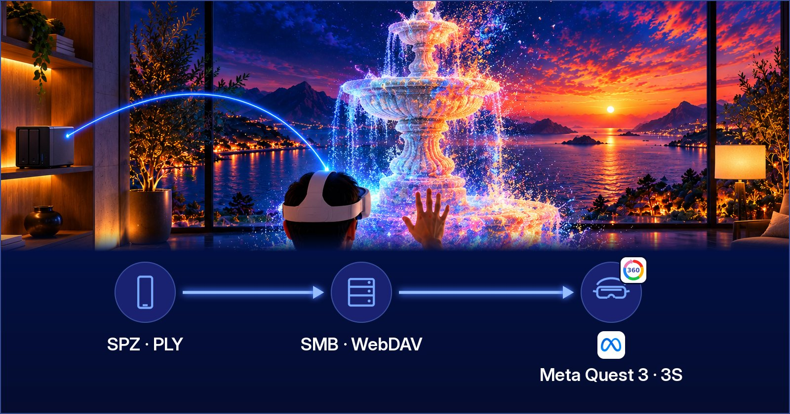
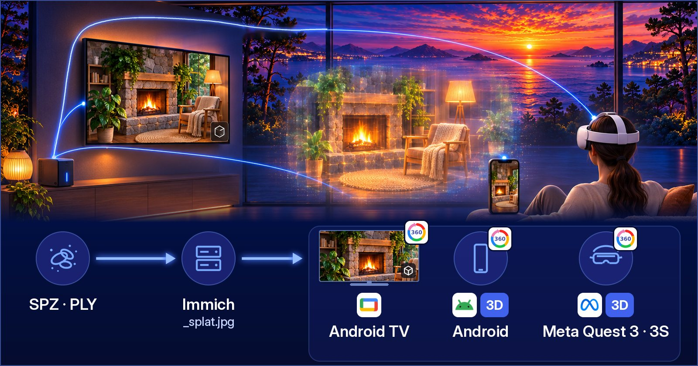

🌐 <b>বাংলা</b> · অন্যান্য ভাষা (88)
<a href="../README.md">English</a> · <a href="README.af.md">Afrikaans</a> · <a href="README.ar.md">العربية</a> · <a href="README.az.md">Azərbaycanca</a> · <a href="README.be.md">Беларуская</a> · <a href="README.bg.md">Български</a> · <a href="README.bi.md">Bislama</a> · <a href="README.br.md">Brezhoneg</a> · <a href="README.bs.md">Bosanski</a> · <a href="README.ca.md">Català</a> · <a href="README.cs.md">Čeština</a> · <a href="README.cv.md">Чӑвашла</a> · <a href="README.da.md">Dansk</a> · <a href="README.de.md">Deutsch</a> · <a href="README.de_CH.md">Deutsch (Schweiz)</a> · <a href="README.el.md">Ελληνικά</a> · <a href="README.en_GB.md">English (UK)</a> · <a href="README.eo.md">Esperanto</a> · <a href="README.es.md">Español</a> · <a href="README.et.md">Eesti</a> · <a href="README.eu.md">Euskara</a> · <a href="README.fa.md">فارسی</a> · <a href="README.fi.md">Suomi</a> · <a href="README.fil.md">Filipino</a> · <a href="README.fr.md">Français</a> · <a href="README.ga.md">Gaeilge</a> · <a href="README.gl.md">Galego</a> · <a href="README.gsw.md">Alemannisch</a> · <a href="README.gu.md">ગુજરાતી</a> · <a href="README.he.md">עברית</a> · <a href="README.hi.md">हिन्दी</a> · <a href="README.hr.md">Hrvatski</a> · <a href="README.hu.md">Magyar</a> · <a href="README.hy.md">Հայերեն</a> · <a href="README.id.md">Bahasa Indonesia</a> · <a href="README.is.md">Íslenska</a> · <a href="README.it.md">Italiano</a> · <a href="README.ja.md">日本語</a> · <a href="README.ka.md">ქართული</a> · <a href="README.kab.md">Taqbaylit</a> · <a href="README.kk.md">Қазақша</a> · <a href="README.km.md">ខ្មែរ</a> · <a href="README.kmr.md">Kurmancî</a> · <a href="README.kn.md">ಕನ್ನಡ</a> · <a href="README.ko.md">한국어</a> · <a href="README.kxm.md">ภาษาเขมรถิ่นไทย</a> · <a href="README.lb.md">Lëtzebuergesch</a> · <a href="README.lmo.md">Lombard</a> · <a href="README.lt.md">Lietuvių</a> · <a href="README.lv.md">Latviešu</a> · <a href="README.mfa.md">Bahasa Melayu Kelantan</a> · <a href="README.mi.md">Te reo Māori</a> · <a href="README.mk.md">Македонски</a> · <a href="README.ml.md">മലയാളം</a> · <a href="README.mn.md">Монгол</a> · <a href="README.mr.md">मराठी</a> · <a href="README.ms.md">Bahasa Melayu</a> · <a href="README.nb_NO.md">Norsk bokmål</a> · <a href="README.ne.md">नेपाली</a> · <a href="README.nl.md">Nederlands</a> · <a href="README.nn.md">Norsk nynorsk</a> · <a href="README.pa.md">ਪੰਜਾਬੀ</a> · <a href="README.pl.md">Polski</a> · <a href="README.pt.md">Português</a> · <a href="README.pt_BR.md">Português (Brasil)</a> · <a href="README.ro.md">Română</a> · <a href="README.ru.md">Русский</a> · <a href="README.si.md">සිංහල</a> · <a href="README.sk.md">Slovenčina</a> · <a href="README.sl.md">Slovenščina</a> · <a href="README.sq.md">Shqip</a> · <a href="README.sr_Cyrl.md">Српски</a> · <a href="README.sr_Latn.md">Srpski</a> · <a href="README.sv.md">Svenska</a> · <a href="README.sw.md">Kiswahili</a> · <a href="README.swg.md">Schwäbisch</a> · <a href="README.ta.md">தமிழ்</a> · <a href="README.te.md">తెలుగు</a> · <a href="README.th.md">ไทย</a> · <a href="README.tl.md">Tagalog</a> · <a href="README.tr.md">Türkçe</a> · <a href="README.uk.md">Українська</a> · <a href="README.ur.md">اردو</a> · <a href="README.uz.md">Oʻzbekcha</a> · <a href="README.vi.md">Tiếng Việt</a> · <a href="README.yue_Hant.md">粵語</a> · <a href="README.zh_Hans.md">简体中文</a> · <a href="README.zh_Hant.md">繁體中文</a>

  

# Immuch360

**আপনার মিডিয়া। যেকোনো স্ক্রিন। প্রতিটি দৃষ্টিকোণ।**

🌐 <a href="https://immuch360.com/bn/"><b>immuch360.com</b></a>

আপনার ডিভাইস, আপনার NAS, আপনার Immich সার্ভার, আপনার ক্যামেরা ও আপনার ড্রোন থেকে ফ্ল্যাট, 360° ও 3D ছবি ও ভিডিও। কোনো অ্যাকাউন্ট লাগে না। Immuch360 একটি বিনামূল্যের ও ওপেন সোর্স অ্যাপ, যা আপনার ছবি ও ভিডিও যেখানে আছে সেখান থেকেই পড়ে এবং প্রতিটিকে তার উপযুক্ত ভিউয়ারে চালায়: ফ্ল্যাট, চারপাশে তাকানোর মতো একটি গোলক হিসেবে, 3D-তে, বা একটি হেডসেটে আপনার চারদিকে। এটি চলে ফোন, ট্যাবলেট, টিভি, Meta Quest হেডসেট ও কম্পিউটারে। এর ওয়েবসাইট, [immuch360.com](https://immuch360.com/bn/), 89টি ভাষায় দেখায় প্রতিটি স্ক্রিনে এটি কী করে।

**বিল্ড 53 ও ডেস্কটপ বিল্ড 34-এ নতুন, সংস্করণ 3.4.8।** কম্পিউটারে, [Spatial 2.5D](#see-your-3d-photos-and-videos-in-depth-on-your-computer) আপনার 3D ছবিকে ফ্ল্যাট স্ক্রিনে গভীরতা দেয়, 360° ও VR180 3D ছবিসহ, Windows, Linux ও macOS-এ, এবং আপনার 3D ভিডিওকে Windows ও macOS-এ: আপনি মাথা নাড়লে দৃশ্য সরে, আপনি রাজি হলে ওয়েবক্যাম অনুসরণ করে, অথবা মাউস দিয়ে, এবং ওয়েবক্যামের ছবি কম্পিউটারের মেমরিতেই থাকে, কখনো সংরক্ষিত বা পাঠানো হয় না; একটি USB ওয়েবক্যামসহ একটি Windows ল্যাপটপে চেষ্টা করা হয়েছে, 3D ভিডিও তার গ্রাফিক্স কার্ডে, এখনো কোনো Mac বা Linux ডেস্কটপে নয়। মাউসের চাকা [পয়েন্টারের চারপাশে একটি ছবি জুম করে](#zoom-into-a-photo-with-the-wheel) এবং টেনে সরানো যায়। [উন্নত করুন (এআই)](#make-a-photo-sharper-on-your-computer-ai) আপনার শেয়ার, DLNA, Plex, Jellyfin ও Emby এবং আপনার Immich সার্ভারের ছবি নেয়, 360° ও 3D ছবি তাদের জোড় বা দুই চোখ না ভেঙে উন্নত করে, এবং Apple চিপসহ একটি Mac-এ তীক্ষ্ণ করুন দেয় (এখনো কোনো Mac-এ চেষ্টা করা হয়নি)। ফোন থেকে, ["এতে চালান…"](#show-your-photos-and-videos-on-the-tv-from-your-phone) একটি 360° আইটেম স্ক্রিনের 360° ভিউতে খোলে, একটি বাছাই বা একটি অ্যালবাম স্লাইডশো হিসেবে চালায়, একটি স্ক্রিনকে আপনার সার্ভারে সাইন ইন করায় এবং শুধু ফোনেই থাকা ছবি ও ভিডিও পাঠায়; Android এমুলেটরের মধ্যে চেষ্টা করা, এখনো সত্যিকারের কোনো ফোন বা টিভিতে নয়। একটি Meta Quest-এ, বড় স্ক্রিনের স্লাইডশো ছবির মধ্যে [ক্রস ফেড বা স্লাইড করে বদলায়](#browse-your-photos-on-the-big-screen-of-the-quest), আপনার বেছে নেওয়া কালো, ঝাপসা বা passthrough পটভূমির ওপর, প্রজেক্ট এখনো কোনো হেডসেটে চেষ্টা করেনি।

**বিল্ড 33 থেকে 52-এ নতুন।** [ফিল্ম সেখান থেকেই চলে যেখানে আপনি থেমেছিলেন](#pick-up-a-film-where-you-stopped)। সেগুলো আগে শুরু হয়, আর ধীর সার্ভার থেকে সেগুলো [থেমে না গিয়ে চলতে থাকে](#when-a-video-waits-or-will-not-play)। ফোন ও কম্পিউটারে টাইমলাইন [মাস ও বছরে ছোট হয়ে আসে](#find-a-month-or-a-year-in-a-long-timeline)। একটি Android ফোন বা Meta Quest-এ ["একটি ফোল্ডার ব্রাউজ করুন"](#browse-a-folder-of-your-phone-or-headset) ডিভাইসের একটি ফোল্ডারকে শেয়ারের মতো খোলে, আর TIFF ছবিও দেখা যায়। Android TV [রিমোট দিয়ে তারিখ অনুযায়ী খোঁজে](#on-android-tv-and-google-tv), একটি Meta Quest 3 বা 3S [গাউসিয়ান স্প্ল্যাট খোলে](#explore-gaussian-splats-in-a-meta-quest-3-or-3s), যা ডান থাম্বস্টিক দিয়ে ঘোরানো যায়, SPZ সংস্করণ 4 সহ, আর একটি কম্পিউটার [আপনার NAS-এর ছবির 3D সংস্করণ তৈরি করে](#turn-one-photo-into-3d-a-scene-a-panorama)। দুটি গ্রাফিক্স চিপওয়ালা Windows ল্যাপটপে অ্যাপ [এখন দ্রুত চিপে চলে](#when-a-video-waits-or-will-not-play), তাই 8K ফিল্ম মসৃণভাবে চলে। গাউসিয়ান স্প্ল্যাট এখন [কম্পিউটার এবং Android ফোন ও ট্যাবলেটে খোলে](#explore-gaussian-splats-on-your-phone-tablet-or-computer), একটি Windows কম্পিউটার এআই দিয়ে [আপনার ছবি বা একটি ভিডিও থেকে স্প্ল্যাট দৃশ্য তৈরি করে](#make-a-splat-scene-from-your-photos-or-a-video-ai), আপনার Immich সার্ভার [সেগুলো ছবির ভেতরে রাখে](#keep-a-splat-scene-on-your-immich-server) যা আপনার টাইমলাইন থেকে খোলে, আর কম্পিউটার [AV2 ভিডিও চালায়](#play-av2-videos-on-your-computer)। বিল্ড 42 থেকে, Insta360, GoPro MAX ও DJI Osmo 360 ক্যামেরার রো ভিডিও, আপনার Immich লাইব্রেরি, একটি শেয়ার বা একটি ফোল্ডার থেকে, Android ফোন, ট্যাবলেট ও টিভিতে [ক্যামেরার জাইরোস্কোপ দিয়ে স্থিতিশীল হয়ে চলে](#stabilise-your-360-videos-with-the-cameras-gyroscope), ডেস্কটপ বিল্ড 22-এর স্প্ল্যাট নির্মাতা যে দৃশ্য আপনি কাছ থেকে দেখেন তার জন্য [একটি বিস্তারিত গুণমান দেয়](#make-a-splat-scene-from-your-photos-or-a-video-ai), এবং একটি 360° প্যানোরামা [গ্রাফিক্স কার্ডের 3.5 GiB খালি নিয়ে শুরু হয়](#turn-one-photo-into-3d-a-scene-a-panorama)। iPhone ও iPad অ্যাপটি [App Store-এ আছে](https://apps.apple.com/us/app/immuch360-360-3d-player/id6817655965), সংস্করণ 3.4.3। বিল্ড 43 থেকে, ফোন ও ট্যাবলেটে অ্যাপের আপডেট নোটিশ Google Play বা App Store খোলে; এর ওয়েবসাইট, [immuch360.com](https://immuch360.com/bn/), 7 নভেম্বর চালু হয়েছে। বিল্ড 44 ও ডেস্কটপ বিল্ড 24 থেকে, একটি Meta Quest 3 বা 3S [300,000 পর্যন্ত গাউসিয়ানের স্প্ল্যাট দেখায়](#explore-gaussian-splats-in-a-meta-quest-3-or-3s), কম্পিউটার [Ctrl ও Shift দিয়ে একাধিক ছবি ও ভিডিও বেছে নেয়](#use-your-computer-as-the-media-player), যে টিভির ডিকোডার একটি ভিডিও প্রত্যাখ্যান করে সেটি নিজে থেকেই [সার্ভারের অন্য ফাইলটি চালায়](#when-a-video-waits-or-will-not-play), দুটি গ্রাফিক্স কার্ডওয়ালা ল্যাপটপের বেছে নেওয়া গ্রাফিক্স কার্ডে প্যানোরামা চলে, এবং Quest ও কম্পিউটারের আপডেট নোটিশ তাদের স্টোর বা ডাউনলোড পেজ খোলে, অনেক সংশোধনসহ। বিল্ড 45 ও ডেস্কটপ বিল্ড 25 থেকে, প্রতিটি প্ল্যাটফর্মে সংস্করণ 3.4.0, অ্যাপটি Immich 3.4.0 অ্যাপকে অনুসরণ করে, সঙ্গে Immich-এর পরের 11টি সংশোধন, [Immich 3.4 সার্ভারের JPEG XL ছবি](#keep-your-immich-library-with-more) দেখায়, [বছর অনুযায়ী আপনার Plex ফিল্ম](#watch-your-plex-films) খোলে, প্রতিটি ফিল্মের জন্য একটি পেজ, ডিভাইসে সেগুলোর ডাউনলোড ও ফোন থেকে টিভিতে সেগুলোর প্লেব্যাকসহ, স্টোর বিল্ডে একটি রেটিং চাইতে পারে, এবং কম্পিউটারে তার ভিডিও উপাদানগুলো নেয় [তাদের নিজস্ব ওপেন রিপোজিটরি](#licences-and-credits) থেকে। বিল্ড 46 ও ডেস্কটপ বিল্ড 26 থেকে, সংস্করণ 3.4.1, 360° ক্যামেরার রো ভিডিও iPhone ও iPad-এ, একটি Meta Quest-এ এবং Windows-এ [স্থিতিশীল হয়েও চলে](#stabilise-your-360-videos-with-the-cameras-gyroscope), একটি Meta Quest [libmpv দিয়ে সেই Plex ফিল্মগুলো চালায় যেগুলো তার নিজের প্লেয়ার ডিকোড করতে পারে না](#watch-your-plex-films), একটি ফোন [এমন একটি ফিল্ম একটি Chromecast বা একটি Google TV-তে পাঠায়](#watch-your-plex-films), এবং একটি 3D ছবির এআই গভীরতা [আপনার বেছে নেওয়া মাত্রা নেয়](#turn-one-photo-into-3d-a-scene-a-panorama); আপনার Plex অ্যাকাউন্ট দিয়ে সাইন ইন করেও একটি নতুন সার্ভার যোগ করা যায়, এবং অ্যাপটি [তার সেটিংস একটি ফাইলে রাখে](#keep-your-settings-in-a-file)। বিল্ড 47 ও ডেস্কটপ বিল্ড 27 থেকে, সংস্করণ 3.4.2, একটি Plex ফিল্ম [ডিভাইস যে অডিও ট্র্যাক ডিকোড করে সেটি চালায়](#watch-your-plex-films) ও কোনটি তা জানায়, স্ক্রিনের উপযোগী সংস্করণটি খোলে এবং, একটি ধীর সংযোগে, একটি হালকা সংস্করণ দেয়, Windows ও macOS তার Dolby TrueHD সাউন্ড চালায়, Android [তার ডাউনলোড একটি নোটিফিকেশনে দেখায়](#watch-your-plex-films) এবং Android TV-ও ফিল্ম ডাউনলোড করে, আর [ব্যাটারিচালিত Tapo ক্যামেরা লাইভ দেখায়](#watch-your-home-cameras-on-the-big-screen); অ্যাকাউন্টসহ একটি সেটিংস ফাইল পুনরুদ্ধার করলে এখন আপনি আপনার Immich সার্ভারে সাইন ইন হয়ে যান। বিল্ড 48 ও ডেস্কটপ বিল্ড 28 থেকে, সংস্করণ 3.4.3, একটি Windows কম্পিউটার SteamVR, Meta Horizon Link বা অন্য কোনো OpenXR রানটাইমের মাধ্যমে [একটি PC VR হেডসেটে আপনার ভিডিও চালায়](#watch-your-videos-in-a-pc-vr-headset-from-windows) (প্রজেক্ট এখনো কোনো হেডসেটে চেষ্টা করেনি), [অন্য ব্র্যান্ডের ক্যামেরা লাইভ দেখায়](#cameras-of-other-brands-over-onvif-or-rtsp), ONVIF দিয়ে খুঁজে পাওয়া বা তাদের RTSP লিঙ্ক দিয়ে যোগ করা (একটি সিমুলেটেড ক্যামেরা দিয়ে যাচাই করা, অন্য ব্র্যান্ডের কোনো আসল ক্যামেরা এখনও চেষ্টা করা হয়নি), [DJI Osmo 360 II ও GoPro MAX 2-এর রো ভিডিও স্থিতিশীল হয়ে চলে](#open-the-raw-files-of-360-cameras), Plex ফিল্ম [ফোনে আর ধীরে এসে আটকে যায় না](#when-a-video-waits-or-will-not-play), LG ও Samsung টিভি একটি বাটনে [কাত হয়ে থাকা একটি ভিডিও ঘোরায়](#on-a-samsung-tv-tizen) (এখনো কোনো LG টিভিতে চেষ্টা করা হয়নি; issue 17-এর Samsung টিভি ঘোরানো প্রত্যাখ্যান করেছে), এবং আপ টু ডেট একটি সার্ভারের জন্য "সার্ভার আপডেট উপলব্ধ" আর দেখায় না। বিল্ড 49 ও ডেস্কটপ বিল্ড 29 থেকে, সংস্করণ 3.4.4, অ্যাপটি নিজেই [আপনার Jellyfin ও Emby সার্ভার পড়ে](#watch-your-jellyfin-and-emby-libraries) (এখনো কোনো ডিভাইসে চেষ্টা করা হয়নি), আপনার নেটওয়ার্কে খুঁজে পাওয়া এবং একটি টিভিতে বা হেডসেটে Quick Connect দিয়ে সাইন ইন করা, তাদের মূল ফাইল এমনভাবে চালানো যাতে একটি 360° ভিডিও 360°-ই থাকে; একটি Meta Quest-এর বড় স্ক্রিনে, ছবিগুলো [ব্রাউজ করার সময় আপনার ঠিক করা আকার ও জায়গা রাখে, এবং স্লাইডশো হিসেবে চলে](#browse-your-photos-on-the-big-screen-of-the-quest) (প্রজেক্ট এখনো কোনো হেডসেটে চেষ্টা করেনি); ফোন ও ট্যাবলেটের 360° ভিডিও প্লেয়ার [360° ছবির কন্ট্রোল পায়](#360-videos-on-your-phone-with-the-controls-of-360-photos), একটি জাইরোস্কোপ বাটন, পিঞ্চ করে জুম এবং সোজা উপরে বা নিচে টানা (একজন ব্যবহারকারী একটি Samsung Galaxy S25 Ultra-তে চেষ্টা করেছেন, এখনো কোনো iPhone-এ চেষ্টা করা হয়নি); একটি কম্পিউটার এআই দিয়ে [আপনার 2D ভিডিওকে 3D ভিডিওতে বদলায়](#turn-your-2d-videos-into-3d-on-your-computer) (এখনো কোনো 3D স্ক্রিনে বা হেডসেটে চেষ্টা করা হয়নি); এবং Samsung টিভি [ঘোরানো দরকার এমন একটি ভিডিও Samsung-এর নিজস্ব প্লেয়ারকে দেয়](#on-a-samsung-tv-tizen), যা issue 17-এর টিভি চালায় কিন্তু ঘোরাতে অস্বীকার করে। বিল্ড 50 ও ডেস্কটপ বিল্ড 30 থেকে, সংস্করণ 3.4.5, একটি Meta Quest-এর 2D উইন্ডোতে ভিডিও চলার সময় উইন্ডোটি [ডিসপ্লের হারে নতুন করে আঁকা হয়](#step-inside-your-photos-and-videos-with-a-meta-quest), বিল্ড 48 ও 49-এর মতো সেকেন্ডে প্রায় 10 বার নয় (একটি Meta Quest 3-এ মাপা), Android TV [রিমোট দিয়ে একটি ছবিতে জুম করে](#on-android-tv-and-google-tv) এবং অ্যারো কি দিয়ে সেটি সরায় (নতুন, এখনো কোনো টিভিতে চেষ্টা করা হয়নি), এবং তিনটি সংশোধন আসে mlc70-এর Android TV ফর্ক থেকে: দ্রুত সোয়াইপ আর পেছনে ফেলে আসা ছবির বিবরণ দেখায় না, একটি অ্যানিমেটেড ছবি তার মেমরি ছেড়ে দেয়, এবং অবস্থান ফিল্টার নতুন দেশের শহরগুলো দেখায়। বিল্ড 51 ও ডেস্কটপ বিল্ড 31 থেকে, সংস্করণ 3.4.6, Windows ও Linux-এ [উন্নত করুন (এআই)](#make-a-photo-sharper-on-your-computer-ai) একটি নরম ছবির আরও তীক্ষ্ণ একটি কপি মূলটির পাশে তৈরি করে, তিনটি স্তরে, প্রতিটি একটি RTX 4060-সহ একটি PC-তে একবার চালানো, স্বাভাবিক Apple চিপসহ একটি Mac-এও দেওয়া হয় (এখনও Mac-এ চালিয়ে দেখা হয়নি), একটি কম্পিউটার এআই দিয়ে [একটি 360° ভিডিওকে একটি 360° 3D ভিডিওতে বদলায়](#a-360-video-turned-into-a-360-3d-video), Windows-এ 3D ভিডিওর গভীরতা গ্রাফিক্স কার্ড অনুমান করে, এআই ফিচারগুলো আপনার সার্ভারের ও একটি শেয়ারের ভিডিও সরাসরি নেয়, সেটিংস ফাইলের [লাইব্রেরিতে নিজস্ব কার্ড আছে](#keep-your-settings-in-a-file), একটি টিভি এটি একটি নেটওয়ার্ক শেয়ারে সংরক্ষণ করে, কম্পিউটারে Escape এক ধাপ পিছনে যায়, স্টোর বিল্ডগুলো [আরও কম ও আরও নরমভাবে](#privacy) রেটিং চায়, Linux দেখায় TIFF ছবি, স্প্ল্যাট দৃশ্য ও এক চোখে 3D ভিডিও, এবং দুটি ক্র্যাশ ঠিক করা হয়েছে। বিল্ড 52 ও ডেস্কটপ বিল্ড 32 থেকে, সংস্করণ 3.4.7, ["এতে চালান…"](#show-your-photos-and-videos-on-the-tv-from-your-phone) আপনার Immich লাইব্রেরি, আপনার শেয়ার এবং Jellyfin ও Emby-এর ছবি ও ভিডিও ফোন থেকে একটি টিভি, একটি Meta Quest, একটি কম্পিউটার বা একটি Chromecast-এ পাঠায়, আপনার ছবি ও ভিডিওর নাম [তাদের থাম্বনেইলের ওপর পড়ার মতো থাকে](#play-the-files-of-a-nas-a-computer-a-media-server-or-plex), একটি কম্পিউটারের এআই উপাদান [এক ক্লিকে আপডেট হয়](#update-the-ai-components-in-one-click), Linux পায় [একটি AppImage](#linux), এবং iPhone ও iPad অ্যাপটি Xcode 27 দিয়ে তৈরি। ডেস্কটপ বিল্ড 33 [উন্নত করুন (এআই)](#make-a-photo-sharper-on-your-computer-ai) ঠিক করেছে, যা ডেস্কটপ বিল্ড 31 ও 32-এ প্রতিটি ছবিতে ব্যর্থ হচ্ছিল ([issue 23](https://github.com/freeKC/Immuch360/issues/23))।

  Immich মোবাইল অ্যাপের একটি অনানুষ্ঠানিক ফর্ক। Immich বা FUTO-র সঙ্গে সংযুক্ত নয়। নামটি পড়তে হয় "I am much 360" হিসেবে।

<b>সূচিপত্র</b>

- [এটি কার জন্য](#who-it-is-for)
- [কোন কোন স্ক্রিন](#which-screens), [সেগুলো একসঙ্গে কী করে](#use-cases) এবং [প্রতিটি স্ক্রিন কী করে](#what-each-screen-does)
- [আপনি যা করতে পারেন](#what-you-can-do)
- [আপনার ডিভাইসে পান](#get-it-on-your-device)
- [কীভাবে করবেন](#how-to)
  - [আপনার ছবি ও ভিডিও দেখুন, সার্ভারসহ বা সার্ভার ছাড়া](#watch-your-photos-and-videos-with-or-without-a-server)
  - [প্যানোরামা, 360°, VR180 ও 3D অন্বেষণ করুন](#explore-panoramas-360-vr180-and-3d): [ফোনে 360° ভিডিও](#360-videos-on-your-phone-with-the-controls-of-360-photos)
  - [একটি ছবিকে 3D, দৃশ্য, প্যানোরামায় রূপান্তর করুন](#turn-one-photo-into-3d-a-scene-a-panorama): [এক ক্লিকে আপডেট হওয়া এআই উপাদান](#update-the-ai-components-in-one-click)
  - [আপনার কম্পিউটারে আপনার 2D ভিডিওকে 3D-তে বদলান](#turn-your-2d-videos-into-3d-on-your-computer): [360° ভিডিও থেকে 360° 3D](#a-360-video-turned-into-a-360-3d-video)
  - [আপনার কম্পিউটারে একটি ছবি আরও তীক্ষ্ণ করুন (এআই)](#make-a-photo-sharper-on-your-computer-ai)
  - [রিমোট দিয়ে টিভিতে দেখুন](#watch-on-the-tv-with-the-remote): [Android TV ও Google TV](#on-android-tv-and-google-tv), [LG](#on-an-lg-tv-webos), [Samsung](#on-a-samsung-tv-tizen)
  - [আপনার ফোন দিয়ে একটি টিভি, হেডসেট বা কম্পিউটারে সাইন ইন করুন](#sign-in-a-tv-a-headset-or-a-computer-with-your-phone)
  - [আপনার ফোন থেকে টিভিতে আপনার ছবি ও ভিডিও দেখান](#show-your-photos-and-videos-on-the-tv-from-your-phone)
  - [একটি Meta Quest দিয়ে আপনার ছবি ও ভিডিওর ভেতরে ঢুকুন](#step-inside-your-photos-and-videos-with-a-meta-quest): [বড় স্ক্রিন](#browse-your-photos-on-the-big-screen-of-the-quest), [কিয়স্ক মোড](#kiosk-mode-for-an-exhibition-or-a-shop)
  - [Meta Quest 3 বা 3S-এ গাউসিয়ান স্প্ল্যাট ঘুরে দেখুন](#explore-gaussian-splats-in-a-meta-quest-3-or-3s)
  - [আপনার ফোন, ট্যাবলেট বা কম্পিউটারে গাউসিয়ান স্প্ল্যাট ঘুরে দেখুন](#explore-gaussian-splats-on-your-phone-tablet-or-computer)
  - [আপনার ছবি বা একটি ভিডিও থেকে একটি স্প্ল্যাট দৃশ্য বানান (এআই)](#make-a-splat-scene-from-your-photos-or-a-video-ai)
  - [আপনার Immich সার্ভারে একটি স্প্ল্যাট দৃশ্য রাখুন](#keep-a-splat-scene-on-your-immich-server)
  - [একটি NAS, কম্পিউটার, মিডিয়া সার্ভার বা Plex-এর ফাইল চালান](#play-the-files-of-a-nas-a-computer-a-media-server-or-plex): [বছর অনুযায়ী আপনার ফিল্ম](#watch-your-plex-films), [Jellyfin ও Emby](#watch-your-jellyfin-and-emby-libraries)
  - [আপনার ফোন বা হেডসেটের একটি ফোল্ডার ব্রাউজ করুন](#browse-a-folder-of-your-phone-or-headset)
  - [যেখানে থেমেছিলেন সেখান থেকে ফিল্ম আবার শুরু করুন](#pick-up-a-film-where-you-stopped)
  - [যখন একটি ভিডিও অপেক্ষা করে বা চলে না](#when-a-video-waits-or-will-not-play)
  - [আপনার Immich লাইব্রেরি রাখুন, আরও কিছুসহ](#keep-your-immich-library-with-more)
  - [একটি লম্বা টাইমলাইনে একটি মাস বা বছর খুঁজুন](#find-a-month-or-a-year-in-a-long-timeline)
  - [বড় স্ক্রিনে আপনার হোম ক্যামেরা দেখুন](#watch-your-home-cameras-on-the-big-screen): [অন্য ব্র্যান্ড](#cameras-of-other-brands-over-onvif-or-rtsp)
  - [আপনার DJI ড্রোন](#your-dji-drone): [লাইভ ভিডিও](#see-what-your-drone-sees-on-your-phone), [একটি Quest-এ বা Android TV-তে](#watch-it-in-a-meta-quest-or-on-an-android-tv), [ইমপোর্ট](#bring-a-drones-or-a-camera-cards-photos-and-videos-to-immich)
  - [360° ক্যামেরার রো ফাইল খুলুন](#open-the-raw-files-of-360-cameras)
  - [ক্যামেরার জাইরোস্কোপ দিয়ে আপনার 360° ভিডিও স্থিতিশীল করুন](#stabilise-your-360-videos-with-the-cameras-gyroscope)
  - [এক কি চাপে একটি ছবি ঘোরান](#turn-a-photo-with-one-key)
  - [আপনার কম্পিউটারকে মিডিয়া প্লেয়ার হিসেবে ব্যবহার করুন](#use-your-computer-as-the-media-player): [চাকা দিয়ে জুম](#zoom-into-a-photo-with-the-wheel)
  - [আপনার কম্পিউটারে আপনার 3D ছবি ও ভিডিও গভীরতাসহ দেখুন](#see-your-3d-photos-and-videos-in-depth-on-your-computer)
  - [Windows থেকে একটি PC VR হেডসেটে আপনার ভিডিও দেখুন](#watch-your-videos-in-a-pc-vr-headset-from-windows)
  - [আপনার কম্পিউটারে AV2 ভিডিও চালান](#play-av2-videos-on-your-computer)
  - [আপনার সেটিংস একটি ফাইলে রাখুন](#keep-your-settings-in-a-file)
- [Immich-এর সাথে তুলনা](#compared-with-immich)
- [গোপনীয়তা](#privacy)
- [লাইসেন্স ও কৃতজ্ঞতা](#licences-and-credits)
- [রোডম্যাপ](#roadmap)
- [ডকুমেন্টেশন](#documentation)

## এটি কার জন্য

- **আপনি 360° বা 3D তোলেন** এবং আপনার শটগুলোর ভেতরে চারপাশে তাকাতে চান, সেগুলো ফ্ল্যাট, দ্বিগুণ বা টানা অবস্থায় দেখতে নয়, এবং ফোনে আপনার 360° ভিডিও ঠিক তার ছবির মতো ঘোরাতে চান: [360°, VR180 ও 3D](#explore-panoramas-360-vr180-and-3d), [ফোনে 360° ভিডিও](#360-videos-on-your-phone-with-the-controls-of-360-photos)।
- **আপনি হাতে, বাইকে বা হেলমেটে একটি 360° ক্যামেরা নিয়ে ভিডিও করেন** এবং চান Immich-এ, একটি শেয়ারে বা একটি ফোল্ডারে রাখা আপনার Insta360, GoPro MAX বা MAX 2, DJI Osmo 360 বা Osmo 360 II ক্যামেরার রো ভিডিও আপনার ফোনে, আপনার টিভিতে, আপনার Meta Quest-এ বা আপনার Windows কম্পিউটারে সমতল ও স্থির হয়ে চলুক: [ক্যামেরার জাইরোস্কোপ দিয়ে স্থিতিশীল](#stabilise-your-360-videos-with-the-cameras-gyroscope)।
- **আপনার ছবি ও ফিল্ম আছে একটি NAS, কম্পিউটার, Plex বা Immich-এ** এবং কিছু কপি না করেই সেগুলো টিভিতে দেখতে চান: [টিভিতে](#watch-on-the-tv-with-the-remote), [NAS, শেয়ার ও Plex](#play-the-files-of-a-nas-a-computer-a-media-server-or-plex)।
- **আপনি আপনার ফিল্ম একটি Plex সার্ভারে রাখেন** এবং বছর অনুযায়ী একটি বেছে নিতে চান, শুরুর আগে দেখতে চান সেটি কী, ভ্রমণে সঙ্গে নিতে চান, আপনার ফোন থেকে টিভিতে বা একটি Chromecast-এ চালু করতে চান, এবং এমন ফিল্মও চালাতে চান যা আপনার Android ফোন, টিভি বা Meta Quest ডিকোড করতে পারে না: [আপনার ফিল্ম, বছর অনুযায়ী](#watch-your-plex-films)।
- **আপনি আপনার ফিল্ম একটি Jellyfin বা Emby সার্ভারে রাখেন** এবং সেগুলো আপনার Meta Quest-এ, টিভিতে বা ফোনে চান, 360° ও 3D যেমন আছে তেমনই রেখে, আর সার্ভারে আপনার থামার জায়গা রেখে (এখনো কোনো ডিভাইসে চেষ্টা করা হয়নি): [Jellyfin ও Emby](#watch-your-jellyfin-and-emby-libraries)।
- **আপনার একটি Meta Quest আছে** এবং নিজের ছবি ও ভিডিওর ভেতরে ঢুকতে চান: [হেডসেটে](#step-inside-your-photos-and-videos-with-a-meta-quest), এবং আপনার ঠিক করা আকার ও জায়গায় একটি বড় স্ক্রিনে আপনার ছবি ব্রাউজ করতে চান, স্লাইডশো হিসেবেও (প্রজেক্ট এখনো কোনো হেডসেটে চেষ্টা করেনি): [বড় স্ক্রিন](#browse-your-photos-on-the-big-screen-of-the-quest)।
- **আপনার একটি Windows কম্পিউটারে একটি PC VR হেডসেট আছে** এবং তাতে আপনার 360° ভিডিও আপনার চারপাশে ও আপনার ফিল্ম একটি বড় স্ক্রিনে চান (প্রজেক্ট এখনো কোনো হেডসেটে চেষ্টা করেনি): [একটি PC VR হেডসেটে](#watch-your-videos-in-a-pc-vr-headset-from-windows)।
- **আপনার ছবিগুলো ফ্ল্যাট** আর আপনি চান সেগুলো 3D তে, হেডসেটে ঝুঁকে দেখার মতো একটি দৃশ্য হিসেবে, বা একটি 360° প্যানোরামার ভেতরে, কোনো 3D ক্যামেরা ছাড়াই: [একটি ছবিকে 3D, দৃশ্য, প্যানোরামায় রূপান্তর করুন](#turn-one-photo-into-3d-a-scene-a-panorama), নতুন, আপনার নিজের কম্পিউটারে এআই দিয়ে তৈরি।
- **আপনার ভিডিও ফ্ল্যাট**, আপনার ফোনের ক্লিপও, এবং আপনি সেগুলো একটি হেডসেট বা একটি 3D স্ক্রিনের জন্য 3D-তে চান, আর আপনার 360° ভিডিও 360° 3D-তে, আপনার নিজের কম্পিউটারে তৈরি (এখনো কোনো 3D স্ক্রিনে বা হেডসেটে চেষ্টা করা হয়নি): [2D ভিডিও থেকে 3D](#turn-your-2d-videos-into-3d-on-your-computer), [360° থেকে 360° 3D](#a-360-video-turned-into-a-360-3d-video)।
- **আপনার ছবি নরম**, সামান্য ফোকাসের বাইরে বা কম আলোয় তোলা, এবং আপনি মূলটির পাশে একটি আরও তীক্ষ্ণ কপি চান, আপনার নিজের কম্পিউটারে তৈরি, আপনার শেয়ার ও সার্ভার থেকেও, বানানো খুঁটিনাটি সোজাসুজি জানিয়ে: [উন্নত করুন (এআই)](#make-a-photo-sharper-on-your-computer-ai)।
- **আপনার 3D ছবি, 360° 3D ছবি বা ভিডিও ও একটি কম্পিউটার আছে** এবং সেগুলো তার ফ্ল্যাট স্ক্রিনে গভীরতাসহ চান, আপনি মাথা নাড়লে দৃশ্য সরবে, ওয়েবক্যাম অনুসরণ করবে, অথবা মাউস দিয়ে (একটি ওয়েবক্যামসহ একটি Windows ল্যাপটপে চেষ্টা করা হয়েছে, এখনো কোনো Mac বা Linux ডেস্কটপে নয়): [আপনার কম্পিউটারে Spatial 2.5D](#see-your-3d-photos-and-videos-in-depth-on-your-computer)।
- **আপনি Immich চালান** এবং তার অ্যাপ চান, সঙ্গে ইমার্সিভ ভিউয়ার ও বড় স্ক্রিন, যেগুলোতে আপনি ফোন থেকে সাইন ইন করান: [আপনার Immich লাইব্রেরি](#keep-your-immich-library-with-more), [Immich-এর সাথে তুলনা](#compared-with-immich)।
- **আপনি Tapo ক্যামেরা দিয়ে বাড়ির খেয়াল রাখেন**, ব্যাটারিচালিতগুলোও, বা ONVIF বা RTSP দিয়ে অন্য ব্র্যান্ডের ক্যামেরা, এবং সেগুলো আপনার ছবির পাশে, টিভিতেও চান (একটি সিমুলেটেড ক্যামেরার সঙ্গে যাচাই করা): [হোম ক্যামেরা](#watch-your-home-cameras-on-the-big-screen)।
- **আপনি একটি DJI ড্রোন ওড়ান** এবং DJI Fly ছাড়াই তার লাইভ ছবি আপনার ফোনে চান, আর আপনার সঙ্গের মানুষদের জন্য একটি Meta Quest-এ বা একটি Android TV-তে: [আপনার ড্রোন](#see-what-your-drone-sees-on-your-phone)।
- **আপনি জায়গা ও বস্তু 3D তে, গাউসিয়ান স্প্ল্যাট হিসেবে, ক্যাপচার করেন,** বা নিজের ছবি থেকে সেগুলো তৈরি করতে চান, আর আপনার ফোনে, আপনার কম্পিউটারে বা একটি হেডসেটে সেগুলোর ভেতর দিয়ে হাঁটতে চান: [একটি ফোন, ট্যাবলেট বা কম্পিউটারে](#explore-gaussian-splats-on-your-phone-tablet-or-computer), [আপনার ছবি থেকে তৈরি](#make-a-splat-scene-from-your-photos-or-a-video-ai), [Immich-এ রাখা](#keep-a-splat-scene-on-your-immich-server)।
- **আপনার কাছে AV2 ভিডিও আছে**, যে ফরম্যাট AV1-এর পরে আসে, আর আপনি সেগুলো আপনার কম্পিউটারে দেখতে চান: [আপনার কম্পিউটারে AV2](#play-av2-videos-on-your-computer)।
- **আপনার বাড়িতে কয়েকটি স্ক্রিন আছে** এবং আপনি চান সেগুলো একসঙ্গে কাজ করুক: [আপনার স্ক্রিনগুলো একসঙ্গে কী করে](#use-cases)।

তৈরি করার মতো কোনো Immuch360 অ্যাকাউন্ট নেই, এবং আমাদের কাছে কিছুই আসে না: অ্যাপটি শুধু আপনার ডিভাইস ও আপনার বেছে নেওয়া সার্ভারের সাথে কথা বলে, বিল্ড 45 থেকে একটি ফিল্মের পেজের জন্য Wikipedia-র সাথেও, বিল্ড 46 থেকে আপনি এটি দিয়ে সাইন ইন করলে plex.tv-এর সাথে, এবং শুধু আপনি চাইলে তবেই একটি এআই উপাদান বা AV2 ডিকোডার ডাউনলোড করে।

## কোন কোন স্ক্রিন

| প্ল্যাটফর্ম | কোথায় পাবেন | নভেম্বর 2026-এ অবস্থা |
|---|---|---|
|  **Android** ফোন ও ট্যাবলেট | [Google Play](https://play.google.com/store/apps/details?id=com.aprogsys.immuch360) · [APK](https://github.com/freeKC/Immuch360/releases) | Google Play-এ (বিল্ড 47, 16 নভেম্বর প্রকাশিত; বিল্ড 51, 24 নভেম্বর থেকে Google-এর পর্যালোচনায়; বিল্ড 53 এরপর আসছে), GitHub-এ বিল্ড 53, যেখানে [রো 360° ভিডিও স্থিতিশীল হয়ে চলে](#stabilise-your-360-videos-with-the-cameras-gyroscope), [ফিল্ম সেখান থেকেই চলে যেখানে আপনি থেমেছিলেন](#pick-up-a-film-where-you-stopped), ["একটি ফোল্ডার ব্রাউজ করুন"](#browse-a-folder-of-your-phone-or-headset) ফোনের একটি ফোল্ডার খোলে এবং [গাউসিয়ান স্প্ল্যাট খোলে](#explore-gaussian-splats-on-your-phone-tablet-or-computer), একটি শেয়ার থেকে বা [আপনার Immich টাইমলাইন থেকে](#keep-a-splat-scene-on-your-immich-server), [একটি ফাইলে রাখা সেটিংস](#keep-your-settings-in-a-file), [একটি নোটিফিকেশনে দেখানো একটি ফিল্মের ডাউনলোড](#watch-your-plex-films), বিল্ড 48 থেকে [অন্য ব্র্যান্ডের ক্যামেরা, লাইভ](#cameras-of-other-brands-over-onvif-or-rtsp) (একটি সিমুলেটেড ক্যামেরা দিয়ে যাচাই করা) এবং, বিল্ড 49 থেকে, [Jellyfin ও Emby সার্ভার](#watch-your-jellyfin-and-emby-libraries) (এখনো কোনো ডিভাইসে চেষ্টা করা হয়নি) ও [360° ভিডিও প্লেয়ারে 360° ছবির কন্ট্রোল](#360-videos-on-your-phone-with-the-controls-of-360-photos) (একজন ব্যবহারকারী একটি Samsung Galaxy S25 Ultra-তে চেষ্টা করেছেন), এবং বিল্ড 51 থেকে [লাইব্রেরিতে সেটিংস ফাইলের কার্ড](#keep-your-settings-in-a-file), তার ফাইল একটি নেটওয়ার্ক শেয়ারেও সংরক্ষিত, এবং বিল্ড 52 থেকে "এতে চালান…" দিয়ে [একটি টিভি বা একটি Chromecast-এ পাঠানো আপনার ছবি ও ভিডিও](#show-your-photos-and-videos-on-the-tv-from-your-phone) (এখনো কোনো ডিভাইসে চেষ্টা করা হয়নি), এবং বিল্ড 53 থেকে [360° আইটেম, একটি বাছাই বা একটি অ্যালবাম এবং ফোনের নিজের ছবি ও ভিডিও](#show-your-photos-and-videos-on-the-tv-from-your-phone) একইভাবে পাঠানো (Android এমুলেটরের মধ্যে চেষ্টা করা) |
|  **iPhone ও iPad** | [App Store](https://apps.apple.com/us/app/immuch360-360-3d-player/id6817655965) | সংস্করণ 3.4.7, 26 নভেম্বর থেকে App Store-এ, সঙ্গে [টাইমলাইনে মাস ও বছর](#find-a-month-or-a-year-in-a-long-timeline), [যে ফিল্ম সেখান থেকেই চলে যেখানে আপনি থেমেছিলেন](#pick-up-a-film-where-you-stopped), ফোন থেকে [একটি টিভি, হেডসেট বা কম্পিউটারের সাইন ইন](#sign-in-a-tv-a-headset-or-a-computer-with-your-phone), Immich-এ রাখা স্প্ল্যাট দৃশ্য তাদের ছবি হিসেবে দেখানো, Immich 3.4.0-এর সংশোধন ও তার JPEG XL ছবি, [স্থিতিশীল রো 360° ভিডিও](#stabilise-your-360-videos-with-the-cameras-gyroscope), [একটি ফাইলে রাখা সেটিংস](#keep-your-settings-in-a-file), [ব্যাটারিচালিত Tapo ক্যামেরার লাইভ ভিউ](#watch-your-home-cameras-on-the-big-screen) ও [অন্য ব্র্যান্ডের ক্যামেরার লাইভ ভিউ](#cameras-of-other-brands-over-onvif-or-rtsp) (একটি সিমুলেটেড ক্যামেরা দিয়ে যাচাই করা), এবং সংস্করণ 3.4.4 থেকে [Jellyfin ও Emby সার্ভার](#watch-your-jellyfin-and-emby-libraries) (এখনো কোনো ডিভাইসে চেষ্টা করা হয়নি) ও [360° ভিডিও প্লেয়ারে 360° ছবির কন্ট্রোল](#360-videos-on-your-phone-with-the-controls-of-360-photos)সহ (এখনো কোনো iPhone-এ চেষ্টা করা হয়নি), এবং সংস্করণ 3.4.6 থেকে [সেটিংস ফাইলের কার্ড](#keep-your-settings-in-a-file) ও একটি নেটওয়ার্ক শেয়ার থেকে তার পুনরুদ্ধার, এবং Xcode 27 দিয়ে তৈরি সংস্করণ 3.4.7 থেকে [ছবি ও ভিডিওর জন্য "এতে চালান…"](#show-your-photos-and-videos-on-the-tv-from-your-phone) (এখনো কোনো iPhone-এ চেষ্টা করা হয়নি); সংস্করণ 3.4.8, বিল্ড 53-এর iPhone ও iPad সংস্করণ, এরপর আসছে; অথবা [নিজেই তৈরি করুন](../docs/immuch360/build.md) |
|  **Android TV ও Google TV** | [Google Play](https://play.google.com/store/apps/details?id=com.aprogsys.immuch360) · [APK](#android-tv-and-google-tv) | Google Play-এ, যা Android TV ও Google TV-তে অ্যাপটি দেয়, এবং GitHub-এ বিল্ড 53: [রো 360° ভিডিও স্থিতিশীল](#stabilise-your-360-videos-with-the-cameras-gyroscope), [রিমোট দিয়ে তারিখ অনুযায়ী অনুসন্ধান](#on-android-tv-and-google-tv), একটি QR কোড স্ক্যান করে [আপনার ফোন দিয়ে সাইন ইন](#sign-in-a-tv-a-headset-or-a-computer-with-your-phone), ভিডিও প্লেয়ারে রিমোটের জন্য একটি টাইম বার, অডিও ও সাবটাইটেল, এবং একটি ফোনের রিলে করা [ড্রোনের লাইভ ভিডিও](#watch-it-in-a-meta-quest-or-on-an-android-tv), [টিভিতে ডাউনলোড করা ফিল্ম](#watch-your-plex-films) এবং, বিল্ড 49 থেকে, Quick Connect দিয়ে সাইন ইন করা [Jellyfin ও Emby সার্ভার](#watch-your-jellyfin-and-emby-libraries) (এখনো কোনো ডিভাইসে চেষ্টা করা হয়নি) এবং, বিল্ড 50 থেকে, [রিমোট দিয়ে জুম করা ছবি](#on-android-tv-and-google-tv) (একটি Android TV এমুলেটরে কাজ করতে দেখা গেছে, এখনো কোনো টিভিতে চেষ্টা করা হয়নি), এবং বিল্ড 51 থেকে [একটি নেটওয়ার্ক শেয়ারে সংরক্ষিত ও পুনরুদ্ধার করা সেটিংস ফাইল](#keep-your-settings-in-a-file) (একটি Android TV এমুলেটরে কাজ করতে দেখা গেছে), এবং বিল্ড 52 থেকে [একটি ফোন "এতে চালান…" দিয়ে যে ছবি ও ভিডিও পাঠায়](#show-your-photos-and-videos-on-the-tv-from-your-phone) (এখনো কোনো টিভিতে চেষ্টা করা হয়নি), এবং বিল্ড 53 থেকে একটি ফোনের পাঠানো 360° ছবি তাদের 360° ভিউতে খোলা, ফোনের শিট থেকে সাইন ইন এবং ফোনের নিজের ছবি ও ভিডিও (একটি Android TV এমুলেটরে কাজ করতে দেখা গেছে) |
| **LG টিভি**, webOS 5.0 ও তার পরের সংস্করণসহ | [.ipk, সংস্করণ 1.0.5](https://github.com/freeKC/Immuch360/releases/tag/webos-v1.0.5) · LG Content Store (পর্যালোচনায়) | সংস্করণ 1.0.0, 24 অক্টোবর LG Content Store-এ জমা দেওয়া হয়েছে, 26 অক্টোবর থেকে LG-এর পরীক্ষায় আছে; সংস্করণ 1.0.1, 27 অক্টোবর থেকে GitHub-এ, অ্যারো দিয়ে ছবি জুম করে এবং কোনো ছবি এখনও লোড হচ্ছে কি না জানায়, এবং সংস্করণ 1.0.2, বিল্ড 46-এর সঙ্গে GitHub-এ, জাপানি ভাষায় "সাইন ইন" লেখে ログイン হিসেবে, সংস্করণ 1.0.3, বিল্ড 47-এর সঙ্গে, জানায় কখন একটি DLNA সার্ভারের একটি ফোল্ডারে লাইভ টিভি চ্যানেল থাকে, যা এটি এখনো চালাতে পারে না, সংস্করণ 1.0.4, বিল্ড 48-এর সঙ্গে, একটি বাটনে [কাত হয়ে থাকা একটি ভিডিও ঘোরায়](#on-an-lg-tv-webos) (এখনো কোনো LG টিভিতে চেষ্টা করা হয়নি), এবং সংস্করণ 1.0.5, বিল্ড 49-এর সঙ্গে, DLNA সার্ভারের মধ্যে DLNA প্লাগইনসহ Jellyfin-এর নাম দেয়; LG অ্যাপটি প্রকাশ না করা পর্যন্ত এটি [Developer Mode](#lg-tvs-webos)-এ ইনস্টল হয়। সংস্করণ 1.0.0 LG-এর Cloud Test Lab-এর webOS 25 টিভিতে চলেছে |
| **Samsung টিভি**, Tizen 5.5 ও তার পরের সংস্করণসহ | [.wgt, সংস্করণ 0.3.6](https://github.com/freeKC/Immuch360/releases/tag/tizen-v0.3.6) | একই টিভি অ্যাপের সংস্করণ 0.3.6, আপনার নিজের Samsung সার্টিফিকেট দিয়ে সাইন করে [Developer mode](#samsung-tvs-tizen)-এ ইনস্টল করার জন্য; 0.1.0 একজন টেস্টারের Samsung টিভিতে চলেছে, 0.2.0-এ সেই পরীক্ষার সংশোধন আছে, 0.3.0 যোগ করে LG সংস্করণ 1.0.1-এর ছবি জুম ও "লোড হচ্ছে" চিহ্ন, এবং 0.3.1 যোগ করে LG সংস্করণ 1.0.2-এর জাপানি শব্দচয়ন, 0.3.2 একটি ফোনে খাড়া করে তোলা একটি ভিডিও সঠিকভাবে সোজা করে চালায় ([issue 17](https://github.com/freeKC/Immuch360/issues/17)), 0.3.3 ও 0.3.4 [যে টিভি ভিডিওটিকে খাড়া বলে জানায় তাতে সেটি ঘোরায়](#on-a-samsung-tv-tizen) ও হাতে ঘোরানোর একটি বাটন যোগ করে, এবং 0.3.5 ও 0.3.6 এমন একটি ভিডিও Samsung-এর নিজস্ব প্লেয়ারকে দেয়; রিপোর্টারের টিভিতে 0.3.4 ও 0.3.5 ছবিটি কাত করেই রেখেছে, টিভি ঘোরানো অস্বীকার করেছে, এবং সেখানে উপায় হলো আপনার Immich সার্ভার যে ভিডিও ট্রান্সকোড করে, যা খাড়া করে রাখা হয়; Samsung-এর স্টোরে নেই |
|  **Meta Quest** 2, Pro, 3 ও 3S | [Horizon Store](https://www.meta.com/experiences/immuch360/1384208401440714/) · [APK](#meta-quest) | Horizon Store-এ (বিল্ড 52, 26 নভেম্বর প্রকাশিত, বিল্ড 50-এর পরে, যার 2D উইন্ডো ভিডিও চলার সময় ডিসপ্লের হারে নতুন করে আঁকা হয়; বিল্ড 53 এরপর আসছে), GitHub-এ বিল্ড 53, একটি [কিয়স্ক মোড](#kiosk-mode-for-an-exhibition-or-a-shop), ইমার্সিভ ভিউতে [স্থিতিশীল রো 360° ভিডিও](#stabilise-your-360-videos-with-the-cameras-gyroscope) ও [libmpv দিয়ে চালানো সেই ফিল্ম যা এটি ডিকোড করতে পারে না](#watch-your-plex-films)সহ, আর Quest 3 ও 3S-এ [গাউসিয়ান স্প্ল্যাট](#explore-gaussian-splats-in-a-meta-quest-3-or-3s) ও একটি ফ্ল্যাট ছবির [এআই গভীরতা](#turn-one-photo-into-3d-a-scene-a-panorama)সহ, এবং বিল্ড 49 থেকে আপনার ঠিক করা আকারে [বড় স্ক্রিনে ব্রাউজ করা ছবি](#browse-your-photos-on-the-big-screen-of-the-quest), স্লাইডশো হিসেবেও (প্রজেক্ট এখনো কোনো হেডসেটে চেষ্টা করেনি), এবং Quick Connect দিয়ে সাইন ইন করা [Jellyfin ও Emby সার্ভার](#watch-your-jellyfin-and-emby-libraries) (এখনো কোনো ডিভাইসে চেষ্টা করা হয়নি), এবং বিল্ড 51 থেকে যে হেডসেটের Horizon OS ইমার্সিভ ভিউয়ারের জন্য খুব পুরোনো সেটি অ্যাপ বন্ধ করার বদলে একটি আপডেট চায় (এমন হেডসেটে চেষ্টা করা হয়নি), এবং বিল্ড 53 থেকে [বড় স্ক্রিনের ছবির মধ্যে একটি ক্রস ফেড বা একটি স্লাইড, কালো, ঝাপসা বা passthrough পটভূমির ওপর](#browse-your-photos-on-the-big-screen-of-the-quest) (প্রজেক্ট এখনো কোনো হেডসেটে চেষ্টা করেনি) |
|  **Windows** | [Installer বা ZIP](https://github.com/freeKC/Immuch360/releases/tag/desktop-v3.4.8-34) | ডেস্কটপ বিল্ড 34, সাইন করা: ছবি, ফ্ল্যাট ও 360° ভিডিও, শেয়ার, Plex, ক্যামেরা (একটি সিমুলেটেড ক্যামেরা দিয়ে যাচাই করা), ফোন দিয়ে সাইন ইন, এক কি চাপে ঘোরানো ছবি, 89টি ভাষায় ইন্টারফেস, এবং এআই দিয়ে [আপনার ছবি থেকে তৈরি 3D ছবি, 3D দৃশ্য ও 360° প্যানোরামা](#turn-one-photo-into-3d-a-scene-a-panorama), আপনার NAS-এর ছবি থেকেও; [গাউসিয়ান স্প্ল্যাট](#explore-gaussian-splats-on-your-phone-tablet-or-computer) খোলা, [আপনার ছবি বা একটি ভিডিও থেকে তৈরি](#make-a-splat-scene-from-your-photos-or-a-video-ai) ও [Immich-এ রাখা](#keep-a-splat-scene-on-your-immich-server), [AV2 ভিডিও](#play-av2-videos-on-your-computer), ডেস্কটপ বিল্ড 22 থেকে [স্প্ল্যাট দৃশ্যের জন্য একটি গুণমান বাছাই](#make-a-splat-scene-from-your-photos-or-a-video-ai) ও [3.5 GiB খালি গ্রাফিক্স মেমরি থেকে 360° প্যানোরামা](#turn-one-photo-into-3d-a-scene-a-panorama), এবং ডেস্কটপ বিল্ড 26 থেকে [স্থিতিশীল রো 360° ভিডিও](#stabilise-your-360-videos-with-the-cameras-gyroscope) ও [গভীরতার মাত্রা ও আরও তীক্ষ্ণ কিনারাসহ 3D ছবি](#turn-one-photo-into-3d-a-scene-a-panorama), ডেস্কটপ বিল্ড 27 থেকে [ফিল্মের Dolby TrueHD সাউন্ড ও Blu-ray সাবটাইটেল](#watch-your-plex-films), ডেস্কটপ বিল্ড 28 থেকে [একটি PC VR হেডসেটে আপনার ভিডিও](#watch-your-videos-in-a-pc-vr-headset-from-windows) (প্রজেক্ট এখনো কোনো হেডসেটে চেষ্টা করেনি), ডেস্কটপ বিল্ড 29 থেকে এআই দিয়ে [আপনার 2D ভিডিও থেকে তৈরি 3D ভিডিও](#turn-your-2d-videos-into-3d-on-your-computer) (এখনো কোনো 3D স্ক্রিনে বা হেডসেটে চেষ্টা করা হয়নি), এবং ডেস্কটপ বিল্ড 31 থেকে এআই দিয়ে [আপনার ছবির আরও তীক্ষ্ণ কপি](#make-a-photo-sharper-on-your-computer-ai) ও এআই দিয়ে [360° 3D ভিডিওতে বদলানো 360° ভিডিও](#a-360-video-turned-into-a-360-3d-video), গ্রাফিক্স কার্ডের অনুমান করা গভীরতা, আপনার সার্ভারের ও একটি শেয়ারের ভিডিও সরাসরি নেওয়া, এবং এক ধাপ পিছনে যেতে Escape, ডেস্কটপ বিল্ড 32 থেকে [এক ক্লিকে আপডেট হওয়া এআই উপাদান](#update-the-ai-components-in-one-click), ডেস্কটপ বিল্ড 33 থেকে আবার কাজ করা [উন্নত করুন (এআই)](#make-a-photo-sharper-on-your-computer-ai), এবং ডেস্কটপ বিল্ড 34 থেকে [চাকা দিয়ে ছবির জুম](#zoom-into-a-photo-with-the-wheel), ওয়েবক্যাম বা মাউস দিয়ে [3D ছবি ও ভিডিওর জন্য Spatial 2.5D](#see-your-3d-photos-and-videos-in-depth-on-your-computer) (প্রজেক্ট এখনো কোনো ওয়েবক্যামে চেষ্টা করেনি), এবং শেয়ার ও সার্ভারের ছবিতে, 360° ও 3D ছবিতেও উন্নত করুন (এআই) |
|   **macOS ও Linux** | [.deb, .rpm, AppImage, DMG](https://github.com/freeKC/Immuch360/releases/tag/desktop-v3.4.8-34) | ডেস্কটপ বিল্ড 34: ছবি, 360° ছবি ও ফ্ল্যাট ভিডিও (360° ভিডিও ফ্ল্যাট চলে), একটি Immich সার্ভার ও নেটওয়ার্ক শেয়ার, এবং আপনার ছবি থেকে এআই দিয়ে তৈরি [3D ছবি ও 3D দৃশ্য](#turn-one-photo-into-3d-a-scene-a-panorama), আর Linux-এ 8 GB গ্রাফিক্স কার্ডে 360° প্যানোরামা, তার 3.5 GiB খালি থাকলে, এবং [গাউসিয়ান স্প্ল্যাট](#explore-gaussian-splats-on-your-phone-tablet-or-computer) ও [AV2 ভিডিও](#play-av2-videos-on-your-computer) (এখনো কোনো Mac-এ চেষ্টা করা হয়নি); ডেস্কটপ বিল্ড 11, 26 অক্টোবর একটি Ubuntu 24.04 কন্টেইনারে ও একটি Mac-এ চেষ্টা করা হয়েছে; ডেস্কটপ বিল্ড 27 থেকে, macOS-এ ফিল্মের Dolby TrueHD সাউন্ড; ডেস্কটপ বিল্ড 29 থেকে, Linux-এ ও Apple চিপসহ একটি Mac-এ এআই দিয়ে [আপনার 2D ভিডিও থেকে তৈরি 3D ভিডিও](#turn-your-2d-videos-into-3d-on-your-computer) (এখনো কোনো 3D স্ক্রিনে বা হেডসেটে চেষ্টা করা হয়নি); ডেস্কটপ বিল্ড 31 থেকে, Linux-এ, এআই দিয়ে [আপনার ছবির আরও তীক্ষ্ণ কপি](#make-a-photo-sharper-on-your-computer-ai), TIFF ছবি, যে ফোল্ডার নিজে থেকেই তাদের নতুন ফাইল দেখায়, একটি 4 GB গ্রাফিক্স কার্ডে আপনার ছবি থেকে তৈরি স্প্ল্যাট দৃশ্য এবং এক চোখে ফ্ল্যাট দেখানো 3D ভিডিও, আর Apple চিপসহ একটি Mac-এ উন্নত করুন (এআই)-এর স্বাভাবিক স্তর (এখনো কোনো Mac-এ চেষ্টা করা হয়নি); ডেস্কটপ বিল্ড 32 থেকে, অন্য Linux ডিস্ট্রিবিউশনের জন্য [একটি AppImage](#linux), CI দিয়ে Arch Linux ও openSUSE-এ যাচাই করা; ডেস্কটপ বিল্ড 34 থেকে, চাকা দিয়ে জুম, Linux ও macOS-এ 3D ছবির জন্য এবং macOS-এ 3D ভিডিওর জন্য [Spatial 2.5D](#see-your-3d-photos-and-videos-in-depth-on-your-computer) (এখনো কোনো Mac-এ বা ওয়েবক্যামে চেষ্টা করা হয়নি), এবং Apple চিপসহ একটি Mac-এ উন্নত করুন (এআই)-এর তীক্ষ্ণ করুন স্তর (এখনো কোনো Mac-এ চেষ্টা করা হয়নি); macOS-এ সাইন করা নয় |

*প্রতিটি রিলিজে স্ট্যাটাস আপডেট করা হয়; প্রতিটি স্টোরে কী আছে, কী তার পর্যালোচনায় আছে এবং প্রতিটি বিল্ড আছে [Release status](../docs/immuch360/release-status.md)-এ। ওয়েবসাইট [immuch360.com](https://immuch360.com/bn/) 89টি ভাষায় দেখায় প্রতিটি স্ক্রিন কী করে, প্রতিটি ফাংশনের জন্য একটি কীভাবে করবেন এবং স্টোরের লিঙ্ক।*

  

### আপনার স্ক্রিনগুলো একসঙ্গে কী করে

আপনি যে স্ক্রিনে দেখেন তার প্রতিটিতে Immuch360 ইনস্টল করুন: প্রতিটি নিজেই আপনার উৎসগুলো পড়ে, আর কয়েকটি অন্যটিকে একটি ছবি, একটি ফাইল বা একটি সাইন ইন দিয়ে দেয়। প্রতিটি ছবিতে, Immuch360 আইকন সেই ডিভাইসগুলো চিহ্নিত করে যেগুলোতে অ্যাপটি চলে।

#### প্রতিটি স্ক্রিনে আপনার NAS

  

**যা লাগবে:** SMB বা WebDAV শেয়ারসহ একটি NAS, এবং আপনি যে স্ক্রিনে দেখেন তার প্রতিটিতে Immuch360।

প্রতিটি স্ক্রিনে শেয়ারটি যোগ করুন, আর প্রতিটি ছবি ও ভিডিওগুলো যেখানে আছে সেখান থেকেই চালায়, কিছুই কপি না করে: ফোন, ট্যাবলেট, Android TV, একটি Meta Quest, Windows, Linux ও macOS কম্পিউটার, এবং আপনার Immich সার্ভারে সাইন ইন করা LG টিভি (webOS 22 থেকে SMB)। একটি 360° ছবি ফোনে ও টিভিতে একটি গোলকের মতো ঘোরে, আর হেডসেটে আপনাকে ঘিরে থাকে। কীভাবে করবেন: [একটি NAS, কম্পিউটার, মিডিয়া সার্ভার বা Plex-এর ফাইল চালান](#play-the-files-of-a-nas-a-computer-a-media-server-or-plex)।

#### প্রতিটি স্ক্রিনে আপনার Immich সার্ভার, আপনার ফোন থেকে সাইন ইন করা

  

**যা লাগবে:** একটি Immich সার্ভার, আপনার Android ফোনে Immuch360, এবং যে স্ক্রিনগুলোতে আপনি সাইন ইন করান সেগুলোতে Immuch360: Android TV, একটি Meta Quest, একটি Windows, Linux বা macOS কম্পিউটার।

ফোনে, Immuch360 পুরো Immich মোবাইল অ্যাপটি রাখে, তার সঙ্গে নিজের 360°, VR180 ও 3D ভিউয়ার যোগ করে, এবং অফিশিয়াল অ্যাপের পাশে ইনস্টল হয়। আপনার সার্ভারে সাইন ইন করা অবস্থায়, এটি বড় স্ক্রিনগুলোতে সাইন ইন করায়: এটি টিভি বা কম্পিউটারের QR কোড স্ক্যান করে, অথবা হেডসেট যে কোড দেখায় তা আপনি এতে টাইপ করেন, আর আপনার পাসওয়ার্ড ফোনেই থাকে। কীভাবে করবেন: [আপনার ফোন দিয়ে একটি টিভি, হেডসেট বা কম্পিউটারে সাইন ইন করুন](#sign-in-a-tv-a-headset-or-a-computer-with-your-phone)।

#### আপনার সাধারণ ছবি 3D-তে, আপনার কম্পিউটার থেকে হেডসেটে

  

**যা লাগবে:** একটি Windows, Linux বা macOS কম্পিউটারে এবং একটি Meta Quest-এ Immuch360, তাদের মাঝে আপনার NAS, বা "এআই সংস্করণগুলোরও ব্যাকআপ নিন" চালু থাকা আপনার Immich সার্ভার।

কম্পিউটার নিজেই আপনার ছবিগুলোকে 3D ছবি ও 3D দৃশ্যে রূপান্তর করে, আর Windows বা Linux-এ 8 GB-এর একটি গ্রাফিক্স কার্ড থাকলে 360° প্যানোরামাতেও, এবং সেগুলো মূল ফাইলের পাশে সংরক্ষণ করে। হেডসেট একটি 3D ছবি সত্যিকারের 3D-তে দেখায়, একটি দৃশ্য আপনার ঘরে বসায় এবং একটি প্যানোরামা আপনার চারপাশে; ফোন ও টিভি প্যানোরামাগুলো তাদের 360° ভিউয়ারে খোলে। কীভাবে করবেন: [একটি ছবিকে 3D, দৃশ্য, প্যানোরামায় রূপান্তর করুন](#turn-one-photo-into-3d-a-scene-a-panorama)।

#### হেডসেটে বা টিভিতে আপনার ড্রোনের লাইভ ভিউ

  

**যা লাগবে:** একটি DJI ড্রোন ও তার DJI RC-N3 রিমোট, রিমোটে লাগানো Android ফোনে Immuch360, এবং একটি Meta Quest-এ বা একটি Android TV-তে Immuch360।

ফোনটি ড্রোনের লাইভ ভিডিও দেখায় এবং আপনার Wi-Fi বা নিজের হটস্পটের মাধ্যমে তা আবার পাঠায়, যাতে আপনার সঙ্গের মানুষেরা হেডসেটে বা টিভিতে ফ্লাইটটি দেখতে পারেন। শুধু গ্রহণ: রিমোট বা ড্রোনে কখনো কোনো কমান্ড পাঠানো হয় না, এবং রিমোটের পুরো নিয়ন্ত্রণ বজায় থাকে। কীভাবে করবেন: [একটি Meta Quest-এ বা একটি Android TV-তে দেখুন](#watch-it-in-a-meta-quest-or-on-an-android-tv)।

#### আপনার 360° ক্যামেরার রো ফাইল, যেখানে দেখেন সেখানেই জোড়া লাগানো

  

**যা লাগবে:** একটি Insta360, GoPro MAX বা MAX 2, DJI Osmo 360 বা Osmo 360 II ক্যামেরা, আপনার NAS, এবং স্ক্রিনগুলোতে Immuch360: ফোন, ট্যাবলেট, Android TV, একটি Meta Quest, Windows।

ক্যামেরার কার্ড থেকে .insp, .insv, .360 বা .osv ফাইলগুলো যেমন আছে তেমনই আপনার NAS-এর একটি SMB বা WebDAV শেয়ারে কপি করুন; একটি Immich সার্ভারও Insta360-এর ফাইলগুলো নেয়। প্রতিটি স্ক্রিন চালানোর সময় সেগুলো জোড়া লাগায়, প্রতিটি ফাইলে লেখা ক্যালিব্রেশন দিয়ে, এবং আগে ক্যামেরার অ্যাপে কিছুই এক্সপোর্ট করতে হয় না। কীভাবে করবেন: [360° ক্যামেরার রো ফাইল খুলুন](#open-the-raw-files-of-360-cameras)।

#### টিভিতে ও হেডসেটে আপনার Plex ও DLNA সার্ভার

  

**যা লাগবে:** একটি Plex Media Server, একটি Jellyfin বা Emby সার্ভার, বা minidlna-এর মতো একটি DLNA সার্ভার, এবং প্রতিটি স্ক্রিনে Immuch360: Android TV, একটি Meta Quest, ফোন, ট্যাবলেট, Windows।

Plex আপনার লাইব্রেরির মূল ফাইলগুলো দেয়, তাই একটি 360° ভিডিও 360°-ই থাকে, হেডসেটে আপনার চারপাশে, বাড়িতে এবং আপনার পোর্ট ফরওয়ার্ডিংয়ের মাধ্যমে বাড়ির বাইরেও; DLNA সার্ভারগুলো আপনার হোম নেটওয়ার্কে খুঁজে পাওয়া যায়। আপনার Immich সার্ভারে সাইন ইন করা LG টিভিও সেগুলো চালায়। বিল্ড 45 থেকে, ফোন, ট্যাবলেট, Android TV, Quest ও কম্পিউটার একটি Plex ফিল্ম লাইব্রেরিকে বছর অনুযায়ী সব ফিল্মসহ খোলে, প্রতিটি ফিল্মের নিজের পেজসহ, এবং ফোনে বেছে নেওয়া একটি ফিল্ম Android TV, Quest বা একটি কম্পিউটারে চলে, নিয়ন্ত্রণ থাকে রিমোটের হাতে। বিল্ড 46 থেকে, Quest তার নিজের প্লেয়ার যে ফিল্ম ডিকোড করতে পারে না সেগুলো libmpv দিয়ে চালায়, একটি Android ডিভাইসের কোনো প্লেয়ার যে ফিল্ম ডিকোড করে না সেগুলো আপনার Plex সার্ভার রূপান্তর করে, এবং একটি ফোন একটি ফিল্ম একটি Chromecast বা একটি Google TV-তে পাঠায়। বিল্ড 47 থেকে, একটি ফিল্ম ডিভাইস যে অডিও ট্র্যাক ডিকোড করে সেটি চালায় ও কোনটি তা জানায়, স্ক্রিনের উপযোগী সংস্করণটি খোলে এবং Windows ও macOS-এ তার Dolby TrueHD সাউন্ড চালায়, আর একটি DLNA সার্ভারের লাইভ টিভি চ্যানেলের একটি ফোল্ডার জানায় যে সেগুলো এখনো চালানো যায় না। বিল্ড 49 থেকে, একটি Jellyfin বা Emby সার্ভারেরও নিজস্ব ধরন আছে, নিজে থেকেই খুঁজে পাওয়া, একটি টিভিতে বা হেডসেটে Quick Connect দিয়ে সাইন ইন করা, তার মূল ফাইল এমনভাবে চালানো যাতে 360° 360°-ই থাকে এবং সার্ভারে আপনার থামার জায়গা রাখা (এখনো কোনো ডিভাইসে চেষ্টা করা হয়নি)। কীভাবে করবেন: [একটি NAS, কম্পিউটার, মিডিয়া সার্ভার বা Plex-এর ফাইল চালান](#play-the-files-of-a-nas-a-computer-a-media-server-or-plex), [আপনার Plex ফিল্ম দেখুন](#watch-your-plex-films) এবং [আপনার Jellyfin ও Emby লাইব্রেরি দেখুন](#watch-your-jellyfin-and-emby-libraries)।

#### আপনার ফোন বা আপনার Windows কম্পিউটার, হেডসেটে খোলা

  

**যা লাগবে:** একটি Android ফোন, একটি iPhone বা একটি Windows কম্পিউটারে এবং একটি Meta Quest-এ Immuch360, একই হোম Wi-Fi-তে।

ফোনে "এই ফোনটি নেটওয়ার্কে শেয়ার করুন" বা কম্পিউটারে "এই কম্পিউটারটি নেটওয়ার্কে শেয়ার করুন" চালু করুন, আর হেডসেট তার ছবি ও ভিডিও চালায়, 360°-গুলো আপনার চারপাশে: কোনো সার্ভার নেই, কোনো NAS নেই, কোনো আপলোড নেই। একটি iPhone-এ, অ্যাপ স্ক্রিনে থাকা পর্যন্ত শেয়ার চলে। কীভাবে করবেন: [এই ফোনটি নেটওয়ার্কে শেয়ার করুন](../docs/immuch360/user-guide.md#share-this-phone-on-the-network)।

#### টিভিতে ও হেডসেটে আপনার Tapo ক্যামেরা

  

**যা লাগবে:** আপনার হোম নেটওয়ার্কে Tapo ক্যামেরা, এবং একটি Android ফোন, একটি Android TV, একটি Meta Quest বা একটি Windows কম্পিউটারে Immuch360।

প্রতিটি স্ক্রিন একটি ক্যামেরা লাইভ দেখায় এবং তার মেমরি কার্ডের রেকর্ডিং দিন ধরে ধরে চালায়, আপনার ছবির পাশে, আর ফোনটি আপনার Immich সার্ভারে একটি ক্লিপ পাঠায়। অ্যাপটি শুধু আপনার নেটওয়ার্কে ক্যামেরাগুলোর সঙ্গে কথা বলে, কখনো TP-Link-এর সার্ভারের মাধ্যমে নয়। বিল্ড 47 থেকে, ব্যাটারিচালিত ক্যামেরাও লাইভ দেখায়, তাদের মিডিয়া পোর্টের মাধ্যমে, ফোন, ট্যাবলেট, Android TV ও Quest-এ। বিল্ড 48 থেকে, অন্য ব্র্যান্ডের ক্যামেরা তাদের পাশে লাইভ দেখায়, ONVIF দিয়ে খুঁজে পাওয়া বা তাদের RTSP লিঙ্ক দিয়ে যোগ করা। একটি সিমুলেটেড ক্যামেরার সঙ্গে যাচাই করা। কীভাবে করবেন: [বড় স্ক্রিনে আপনার হোম ক্যামেরা দেখুন](#watch-your-home-cameras-on-the-big-screen)।

#### আপনার ঘরে গাউসিয়ান স্প্ল্যাট, একটি Meta Quest 3 বা 3S-এ

  

**যা লাগবে:** Polycam, Scaniverse, Luma বা অন্য কোনো টুল দিয়ে তৈরি একটি স্প্ল্যাট, আপনার NAS-এ বা হেডসেটে একটি .spz বা বাইনারি .ply ফাইল হিসেবে, এবং একটি Meta Quest 3 বা 3S-এ Immuch360।

হেডসেট জায়গাটি বা বস্তুটি তার নিজের আকারে বসায়, আপনার সামনে বা আপনার চারপাশে: এর চারপাশে হাঁটুন, বাঁ থাম্বস্টিক দিয়ে এর ভেতর দিয়ে ভেসে যান, ডানটি দিয়ে ঘুরুন। গাউসিয়ান স্প্ল্যাট Meta Spatial SDK-এর এমন একটি অংশ ব্যবহার করে যা Meta সমর্থন করে না এবং যার নিশ্চয়তাও দেয় না: যেকোনো ত্রুটির দায় শুধু Immuch360-এর। কীভাবে করবেন: [Meta Quest 3 বা 3S-এ গাউসিয়ান স্প্ল্যাট ঘুরে দেখুন](#explore-gaussian-splats-in-a-meta-quest-3-or-3s)।

#### আপনার দর্শনার্থীদের জন্য একটি Meta Quest

  

**যা লাগবে:** Immuch360-সহ একটি Meta Quest, এবং হেডসেটে, আপনার NAS-এ বা আপনার Immich সার্ভারে একটি 360° ছবি বা ভিডিও।

কিয়স্ক মোডে, প্রতিবার একজন দর্শনার্থী হেডসেটটি পরলে এটি নিজে থেকেই আপনার 360° ছবি বা ভিডিও শুরু থেকে খোলে, এবং একটি ফিল্ম আপনার লেখাসহ একটি কার্ডে শেষ হয়। দর্শনার্থীরা কিছুই চাপেন না; বেরোতে আপনি B বা Y এক সেকেন্ড চেপে ধরে রাখেন। কীভাবে করবেন: [কিয়স্ক মোড, একটি প্রদর্শনী বা দোকানের জন্য](#kiosk-mode-for-an-exhibition-or-a-shop)।

### প্রতিটি স্ক্রিন কী করে

ফোন, ট্যাবলেট, Android TV, Meta Quest ও কম্পিউটারের জন্য একটি কোড বেস, এবং LG টিভির জন্য একটি আলাদা টিভি অ্যাপ, যা Samsung টিভির জন্যও প্যাকেজ করা, নিজে ইনস্টল করার জন্য। আজ প্রত্যেকটিতে যা আছে:

| সক্ষমতা | Android | iPhone, iPad | Android TV | LG webOS | Samsung Tizen | Quest |
|---|:---:|:---:|:---:|:---:|:---:|:---:|
| একটি Immich সার্ভার দিয়ে গ্যালারি, অ্যালবাম, সার্চ | ✅ | ✅ | ✅ ভিউয়ার | ✅ ভিউয়ার | ✅ ভিউয়ার | ✅ |
| মাস ও বছর অনুযায়ী টাইমলাইন | ✅ | ✅ | ❌ | ❌ | ❌ | ❌ |
| ফোন দিয়ে সাইন ইন (QR কোড) | ✅ কোড স্ক্যান করে | ✅ কোড স্ক্যান করে | ✅ | ✅ ফোনের ব্রাউজারে | ❌ টিভিতে টাইপ করা | ✅ কোড ফোনে টাইপ করা |
| সার্ভার ছাড়া: ডিভাইসের নিজস্ব মিডিয়া | ✅ | ✅ | শুধু শেয়ার | ❌ | ❌ | ✅ |
| ডিভাইসের একটি ফোল্ডার, শেয়ারের মতো খোলা | ✅ আপনার বেছে নেওয়া একটি ফোল্ডার | ❌ | ❌ | ❌ | ❌ | ✅ |
| ফ্ল্যাট ছবি ও ভিডিও | ✅ | ✅ | ✅ | ✅ | ✅ | ✅ |
| TIFF ছবি | ✅ | ✅ সিস্টেম ডিকোডার | ✅ | ✅ সার্ভার থেকে | ✅ সার্ভার থেকে | ✅ ইমার্সিভেও |
| JPEG XL থাম্বনেল ও প্রিভিউ (Immich 3.4) | ✅ | ✅ 3.4.0 থেকে, Immich-এর ডিকোডার, এখনো কোনো iPhone-এ চেষ্টা করা হয়নি | ✅ | ❌ "প্রিভিউ উপলব্ধ নয়" | ❌ "প্রিভিউ উপলব্ধ নয়" | ✅ ইমার্সিভেও |
| এক কি চাপে একটি ছবি ঘোরানো | ✅ | ✅ | ✅ রঙিন কি | ✅ রঙিন কি | ✅ | ✅ উইন্ডো |
| গোলক হিসেবে 360° ছবি | ✅ | ✅ | ✅ | ✅ | ✅ | ✅ ইমার্সিভ |
| 360° ভিডিও | ✅ | ✅ টাইম বার নেই | ✅ ডিকোড করা না গেলে বার্তা | শুধু ফ্ল্যাট | শুধু ফ্ল্যাট | ✅ ইমার্সিভ |
| 360° ভিডিও: জাইরোস্কোপ বাটন, পিঞ্চ, সোজা উপরে ও নিচে টানা | ✅ বিল্ড 49 থেকে, একজন ব্যবহারকারী একটি Samsung Galaxy S25 Ultra-তে চেষ্টা করেছেন | ✅ সংস্করণ 3.4.4 থেকে, এখনো কোনো iPhone-এ চেষ্টা করা হয়নি | ❌ | ❌ | ❌ | ❌ |
| ফিল্ম সেখান থেকেই চলে যেখানে আপনি থেমেছিলেন | ✅ | ✅ | ✅ | ❌ | ❌ | ✅ ইমার্সিভেও |
| ভিডিওর উৎস: যে ফাইল এই ডিভাইস ডিকোড করে | ✅ | ✅ | ✅ | ❌ | ❌ | ✅ |
| একটি ধীর সার্ভার: ভিডিও কতক্ষণ অপেক্ষা করে, এবং কেন | ✅ | নিজস্ব অপেক্ষার নিয়ম | ✅ | ❌ | ❌ | ✅ |
| AV2 ভিডিও | ❌ | ❌ | ❌ | ❌ | ❌ | ❌ |
| 3D ও VR180 | ✅ এক চোখ | ✅ এক চোখ | ✅ এক চোখ | ছবি এক চোখ, ভিডিও ফ্ল্যাট | ছবি এক চোখ, ভিডিও ফ্ল্যাট | ✅ সত্যিকারের 3D |
| ফাইলের নাম অনুযায়ী ফ্ল্যাট 3D, আরও স্পষ্ট স্ক্রিন যা আপনি সরান | ❌ | ❌ | ❌ | ❌ | ❌ | ✅ |
| বড় স্ক্রিনে ছবি: ব্রাউজ, স্লাইডশো, আকার ও জায়গা রাখা | ❌ | ❌ | ❌ | ❌ | ❌ | ✅ বিল্ড 49 থেকে, এখনো কোনো হেডসেটে চেষ্টা করা হয়নি |
| বড় স্ক্রিনের স্লাইডশো: ক্রস ফেড বা স্লাইড, একটি কালো, ঝাপসা বা passthrough পটভূমি | ❌ | ❌ | ❌ | ❌ | ❌ | ✅ বিল্ড 53 থেকে, এখনো কোনো হেডসেটে চেষ্টা করা হয়নি |
| দর্শনার্থীদের জন্য কিয়স্ক মোড | ❌ | ❌ | ❌ | ❌ | ❌ | ✅ |
| Spatial 2.5D (হেড ট্র্যাকিং) | ✅ | ✅ | ❌ | ❌ | ❌ | ❌ |
| Apple স্পেশিয়াল ছবি | ✅ এক চোখ | ✅ এক চোখ | ✅ এক চোখ | ❌ | ❌ | ✅ 3D |
| গাউসিয়ান স্প্ল্যাট, .spz ও .ply | ✅ | ❌ | ❌ | ❌ | ❌ | ✅ Quest 3 ও 3S |
| Immich-এ ছবি হিসেবে রাখা স্প্ল্যাট দৃশ্য | ✅ | ছবিটি | ছবিটি | ছবিটি | ছবিটি | ✅ Quest 3 ও 3S, এখনো কোনো হেডসেটে চেষ্টা করা হয়নি |
| 2D ছবি থেকে 3D ছবি (এআই) | ✅ পড়ে, পাশাপাশি | ✅ পড়ে, পাশাপাশি | ✅ পড়ে, পাশাপাশি | ✅ পড়ে, পাশাপাশি | ✅ পড়ে, পাশাপাশি | ✅ হেডসেটে এআই গভীরতা (Quest 3 ও 3S), 3D তে দেখানো, হালকা, সাধারণ বা জোরালো |
| 2D ছবি থেকে 3D দৃশ্য (এআই) | ✅ পড়ে, তার ছবি হিসেবে | ✅ পড়ে, তার ছবি হিসেবে | ✅ পড়ে, তার ছবি হিসেবে | ✅ পড়ে, তার ছবি হিসেবে | ✅ পড়ে, তার ছবি হিসেবে | ✅ 3D তে ঘুরে দেখা |
| 2D ছবি থেকে 360° প্যানোরামা (এআই) | ✅ পড়ে, এআই লেবেলসহ | ✅ 360° ছবি হিসেবে পড়ে, লেবেল 🔜 | ✅ পড়ে, এআই লেবেলসহ | ✅ 360° ছবি হিসেবে পড়ে, লেবেল 🔜 | ✅ 360° ছবি হিসেবে পড়ে, লেবেল 🔜 | ✅ আপনার চারপাশ জুড়ে পড়ে, এআই লেবেলসহ |
| একটি শেয়ারের ছবির পাশে 3D সংস্করণ (এআই) | ✅ পড়ে | ✅ পড়ে | ✅ পড়ে | ✅ পড়ে | ❌ | ✅ পড়ে |
| ছবি বা একটি ভিডিও থেকে স্প্ল্যাট দৃশ্য (এআই) | ✅ পড়ে | ❌ | ❌ | ❌ | ❌ | ✅ পড়ে, Quest 3 ও 3S, এখনো কোনো হেডসেটে চেষ্টা করা হয়নি |
| 2D ভিডিও থেকে 3D ভিডিও (এআই) | ✅ পড়ে, পাশাপাশি | ✅ পড়ে, পাশাপাশি | ✅ পড়ে, পাশাপাশি | একটি ফ্ল্যাট ভিডিও, পাশাপাশি | একটি ফ্ল্যাট ভিডিও, পাশাপাশি | ✅ একটি বড় স্ক্রিনে 3D তে, এখনো কোনো হেডসেটে চেষ্টা করা হয়নি |
| Insta360, GoPro ও DJI-এর রো ফাইল | ✅ | ✅ | ✅ | ❌ | ❌ | ✅ |
| ক্যামেরার জাইরোস্কোপ দিয়ে স্থিতিশীল করা রো 360° ভিডিও | ✅ Insta360, GoPro MAX ও MAX 2, DJI Osmo 360 ও Osmo 360 II, আপনার লাইব্রেরি, শেয়ার ও ফোল্ডার থেকে | ✅ সংস্করণ 3.4.1 থেকে, এখনো কোনো iPhone-এ চেষ্টা করা হয়নি | ✅ Insta360, GoPro MAX ও MAX 2, DJI Osmo 360 ও Osmo 360 II, আপনার লাইব্রেরি ও শেয়ার থেকে | ❌ | ❌ | ✅ ইমার্সিভ ভিউতে, এখনো কোনো হেডসেটে চেষ্টা করা হয়নি |
| SMB, WebDAV, DLNA শেয়ার | ✅ | ✅ | ✅ | ✅ webOS 22 থেকে SMB | ❌ | ✅ |
| Plex Media Server | ✅ | ✅ | ✅ | ✅ | ❌ | ✅ |
| আপনার Plex অ্যাকাউন্ট দিয়ে সাইন ইন (plex.tv) | ✅ ব্রাউজারে | ✅ ব্রাউজারে | ✅ plex.tv/link-এ কোড | ✅ plex.tv/link-এ কোড | ❌ | ✅ plex.tv/link-এ কোড |
| এই ডিভাইস যে Plex ফিল্ম ডিকোড করতে পারে না | ✅ আপনার Plex সার্ভার দিয়ে রূপান্তরিত | ❌ | ✅ আপনার Plex সার্ভার দিয়ে রূপান্তরিত | ❌ | ❌ | ✅ libmpv, নইলে আপনার Plex সার্ভার দিয়ে রূপান্তরিত |
| একটি Chromecast বা একটি Google TV-তে পাঠানো একটি Plex ফিল্ম | ✅ | ✅ অ্যাপ খোলা থাকা অবস্থায় | ❌ | ❌ | ❌ | ❌ |
| আপনার Immich ছবি ও ভিডিও, এবং একটি শেয়ারের ছবি ও ভিডিও, "এতে চালান…" দিয়ে একটি টিভি বা একটি Chromecast-এ পাঠানো (বিল্ড 52 থেকে, এখনো কোনো ডিভাইসে চেষ্টা করা হয়নি) | ✅ সেগুলো পাঠায়, একটি Chromecast-এও | একই কোড, এখনো কোনো iPhone-এ চেষ্টা করা হয়নি | ✅ সেগুলো দেখায় | ❌ | ❌ | ✅ তার উইন্ডোতে সেগুলো দেখায় |
| বিল্ড 53 থেকে "এতে চালান…": স্ক্রিনের 360° ভিউতে একটি 360° আইটেম, স্লাইডশো হিসেবে একটি বাছাই বা একটি অ্যালবাম, ফোন থেকে সাইন ইন করানো একটি স্ক্রিন, ফোনের নিজের ছবি ও ভিডিও | ✅ পাঠায়, একটি এমুলেটরে চেষ্টা করা | একই কোড, এখনো কোনো iPhone-এ চেষ্টা করা হয়নি | ✅ দেখায়, একটি এমুলেটরে চেষ্টা করা | ❌ | ❌ | ✅ দেখায়, হেডসেটে বা উইন্ডোতে 360° |
| বিভিন্ন সংস্করণে একটি Plex ফিল্ম: স্ক্রিনের উপযোগীটি, আপনার বাছাই মনে রাখা | ✅ | ✅ | ✅ | ❌ | ❌ | ✅ |
| এই ডিভাইস ডিকোড করতে পারে না এমন একটি Plex ফিল্মের অডিও ট্র্যাক: অন্য একটি ট্র্যাক, একটি নোটিশসহ | ✅ | ✅ | ✅ | ❌ | ❌ | ✅ |
| Jellyfin ও Emby সার্ভার | ✅ | ✅ সংস্করণ 3.4.4 থেকে | ✅ আগে Quick Connect | ❌ DLNA দিয়ে, তার প্লাগইনসহ | ❌ | ✅ আগে Quick Connect |
| Tapo ক্যামেরা: রেকর্ডিং | ✅ | ✅ | ✅ | 🔜 ডিসেম্বর 2026-এর আগে নয় | ❌ | ✅ |
| Tapo ক্যামেরা: লাইভ ভিউ | ✅ | ✅ এখনো কোনো iPhone-এ চেষ্টা করা হয়নি | ✅ | ✅ শুধু ভিডিও | ❌ | ✅ |
| Tapo ব্যাটারিচালিত ক্যামেরা: লাইভ ভিউ | ✅ শুধু ভিডিও | ✅ সাউন্ডসহ, এখনো কোনো iPhone-এ চেষ্টা করা হয়নি | ✅ শুধু ভিডিও | ❌ | ❌ | ✅ শুধু ভিডিও |
| অন্য ব্র্যান্ডের ক্যামেরা, ONVIF বা RTSP: লাইভ ভিউ | ✅ H.264, H.265, MPEG-4 | ✅ H.264, সংস্করণ 3.4.3 থেকে, অ্যাড্রেস বা লিঙ্ক দিয়ে যোগ করা | ✅ | ❌ | ❌ | ✅ |
| এই ডিভাইসটি নেটওয়ার্কে শেয়ার করুন | ✅ | ✅ | ❌ | ❌ | ❌ | ❌ |
| শেয়ার ও ডিভাইস থেকে Immich-এ আপলোড | ✅ | ✅ | ❌ | ❌ | ❌ | ✅ |
| একটি ফাইলে সংরক্ষণ ও পুনরুদ্ধার করা সেটিংস | ✅ | ✅ Files ও শেয়ারের মাধ্যমে, এখনো কোনো iPhone-এ চেষ্টা করা হয়নি | ✅ একটি ফাইল পিকার দিয়ে বা, বিল্ড 51 থেকে, একটি নেটওয়ার্ক শেয়ার দিয়ে | ❌ | ❌ | ✅ |
| USB দিয়ে একটি DJI ড্রোন বা কার্ড থেকে ইমপোর্ট | ✅ | ❌ | ❌ | ❌ | ❌ | ❌ |
| DJI ড্রোনের লাইভ ভিডিও | ✅ একটি RC-N3 দিয়ে | ❌ | ✅ একটি ফোনের রিলে করা | ❌ | ❌ | ✅ একটি ফোনের রিলে করা |
| ডার্ক থিম | সিস্টেমের মতো | সিস্টেমের মতো | ✅ ডিফল্টভাবে | ✅ একমাত্র থিম | ✅ একমাত্র থিম | সিস্টেমের মতো |
| ইনপুট | টাচ, জাইরোস্কোপ | টাচ, জাইরোস্কোপ | রিমোট; ভিডিও চলার সময় ও তার টাইম বারেও Left ও Right, বিস্তারিত তথ্যের জন্য Menu | রিমোট, Magic Remote | রিমোট | কন্ট্রোলার, হাত |
| কোথায় পাবেন | Google Play, APK | App Store | Google Play, APK | .ipk, LG Content Store (পর্যালোচনায়) | .wgt, আপনার সাইন করা | Horizon Store, APK |

| সক্ষমতা | Windows | Linux | macOS |
|---|:---:|:---:|:---:|
| একটি Immich সার্ভার দিয়ে গ্যালারি, অ্যালবাম, সার্চ | ✅ | ✅ | ✅ |
| মাস ও বছর অনুযায়ী টাইমলাইন | ✅ Ctrl ও চাকা | ✅ Ctrl ও চাকা | ✅ Command ও চাকা |
| ফোন দিয়ে সাইন ইন (QR কোড) | ✅ | ✅ (এর ওয়েব পেজ চেষ্টা করা হয়েছে; যেখানে Avahi চলে সেখানে "এর বদলে কোড লিখুন"-এ তালিকাভুক্ত) | ✅ (কোন পথে, তা লেখা হয়নি) |
| সার্ভার ছাড়া: ডিভাইসের নিজস্ব মিডিয়া | ✅ ফোল্ডার | ✅ ফোল্ডার | ✅ ফোল্ডার |
| ডিভাইসের একটি ফোল্ডার, শেয়ারের মতো খোলা | ✅ ফোল্ডার | ✅ ফোল্ডার | ✅ ফোল্ডার |
| রিফ্রেশ ছাড়াই দেখানো একটি ফোল্ডারের নতুন ফাইল | ✅ | ✅ ডেস্কটপ বিল্ড 31 থেকে (খুব বড় ট্রি: সবচেয়ে গভীর ফোল্ডারগুলো পরের রিস্ক্যানে) | ✅ এখনো কোনো Mac-এ যাচাই করা হয়নি |
| ফ্ল্যাট ছবি ও ভিডিও | ✅ | ✅ | ✅ |
| TIFF ছবি | ✅ সিস্টেম ডিকোডার | ✅ ডেস্কটপ বিল্ড 31 থেকে, অ্যাপের ডিকোডার (DNG ও অন্যান্য রো ফাইল বাদে) | ✅ সিস্টেম ডিকোডার |
| JPEG XL থাম্বনেল ও প্রিভিউ (Immich 3.4) | ✅ | ✅ | ✅ |
| এক কি চাপে একটি ছবি ঘোরানো | ✅ | ✅ | ✅ |
| পয়েন্টারের চারপাশে চাকা দিয়ে জুম করা এবং টেনে সরানো একটি ছবি (ডেস্কটপ বিল্ড 34 থেকে, প্রজেক্টের টেস্ট দিয়ে যাচাই করা) | ✅ | ✅ | ✅ |
| গোলক হিসেবে 360° ছবি | ✅ | ✅ | ✅ |
| 360° ভিডিও | ✅ | শুধু ফ্ল্যাট | শুধু ফ্ল্যাট |
| ফিল্ম সেখান থেকেই চলে যেখানে আপনি থেমেছিলেন | ✅ | ✅ | ✅ |
| ভিডিওর উৎস: যে ফাইল এই ডিভাইস ডিকোড করে | ✅ | ✅ | ✅ |
| একটি ধীর সার্ভার: ভিডিও কতক্ষণ অপেক্ষা করে, এবং কেন | ✅ | ✅ | ✅ |
| AV2 ভিডিও | ✅ | ✅ | ✅ CI দিয়ে যাচাই করা |
| 3D ও VR180 | ✅ এক চোখ | ছবি এক চোখ, ভিডিও এক চোখ, ফ্ল্যাট, ডেস্কটপ বিল্ড 31 থেকে | ছবি এক চোখ, ভিডিও এক চোখ, ফ্ল্যাট, ডেস্কটপ বিল্ড 31 থেকে, CI দিয়ে তৈরি |
| ফাইলের নাম অনুযায়ী ফ্ল্যাট 3D, আরও স্পষ্ট স্ক্রিন যা আপনি সরান | ❌ | ❌ | ❌ |
| দর্শনার্থীদের জন্য কিয়স্ক মোড | ❌ | ❌ | ❌ |
| একটি PC VR হেডসেট: 360°, 180° ও ফ্ল্যাট ভিডিও | ✅ ডেস্কটপ বিল্ড 28 থেকে, এখনো কোনো হেডসেটে চেষ্টা করা হয়নি | ❌ | ❌ |
| Spatial 2.5D: 3D ছবি ও ভিডিওর জন্য স্ক্রিনে গভীরতা, ওয়েবক্যাম বা মাউস দিয়ে | ✅ ডেস্কটপ বিল্ড 34 থেকে, 360° 3D ছবিসহ, একটি ওয়েবক্যামসহ একটি ল্যাপটপে চেষ্টা করা হয়েছে | ✅ ডেস্কটপ বিল্ড 34 থেকে 3D ছবি, 360° 3D ছবিসহ, এখনো কোনো Linux ডেস্কটপে চেষ্টা করা হয়নি; 3D ভিডিও 🔜 | ✅ ডেস্কটপ বিল্ড 34 থেকে 3D ছবি ও ভিডিও, CI দিয়ে তৈরি, এখনো কোনো Mac-এ চেষ্টা করা হয়নি |
| Apple স্পেশিয়াল ছবি | ✅ এক চোখ | ✅ এক চোখ, একটি সার্ভার থেকে | ✅ এক চোখ |
| গাউসিয়ান স্প্ল্যাট, .spz ও .ply | ✅ | ✅ | ✅ CI দিয়ে তৈরি |
| Immich-এ ছবি হিসেবে রাখা স্প্ল্যাট দৃশ্য | ✅ | ✅ | ✅ CI দিয়ে তৈরি |
| 2D ছবি থেকে 3D ছবি (এআই) | ✅ তিনটি মাত্রা, আরও তীক্ষ্ণ কিনারা | ✅ তিনটি মাত্রা, আরও তীক্ষ্ণ কিনারা | ✅ CI দিয়ে তৈরি, তিনটি মাত্রা, আরও তীক্ষ্ণ কিনারা |
| 2D ছবি থেকে 3D দৃশ্য (এআই) | ✅ | ✅ | ✅ CI দিয়ে তৈরি |
| 2D ছবি থেকে 360° প্যানোরামা (এআই) | ✅ 8 GB গ্রাফিক্স কার্ড | ✅ 8 GB গ্রাফিক্স কার্ড, Intel গ্রাফিক্সে ছোট আকারে চালানো হয়েছে | 🔜 রোডম্যাপে |
| একটি শেয়ারের ছবির পাশে 3D সংস্করণ (এআই) | ✅ | ✅ | ✅ 3D ছবি ও দৃশ্য |
| ছবি বা একটি ভিডিও থেকে স্প্ল্যাট দৃশ্য (এআই) | ✅ 4 GB গ্রাফিক্স কার্ড | ✅ ডেস্কটপ বিল্ড 31 থেকে, 4 GB গ্রাফিক্স কার্ড, CI দিয়ে প্রসেসরে চালানো, এখনো গ্রাফিক্স কার্ডসহ কোনো Linux PC-তে চেষ্টা করা হয়নি | ✅ পড়ে, CI দিয়ে তৈরি |
| 2D ভিডিও থেকে 3D ভিডিও (এআই) | ✅ ডেস্কটপ বিল্ড 31 থেকে গ্রাফিক্স কার্ডে, নইলে প্রসেসরে | ✅ প্রসেসরে | ✅ Apple চিপে Core ML, Intel Mac-এ প্রসেসর, CI দিয়ে চালানো, এখনো কোনো Mac-এ চেষ্টা করা হয়নি |
| একটি 360° ভিডিও থেকে 360° 3D ভিডিও (এআই) | ✅ ডেস্কটপ বিল্ড 31 থেকে, গ্রাফিক্স কার্ডে | ✅ ডেস্কটপ বিল্ড 31 থেকে, প্রসেসরে, CI দিয়ে চালানো | ✅ ডেস্কটপ বিল্ড 31 থেকে, CI দিয়ে তৈরি, কোনো Mac-এ চালানো হয়নি |
| একটি ছবি উন্নত করা (এআই): তীক্ষ্ণ করুন, খুঁটিনাটি পুনর্গঠন, স্বাভাবিক | ✅ ডেস্কটপ বিল্ড 31 থেকে: তীক্ষ্ণ করুন ও খুঁটিনাটি পুনর্গঠন একটি গ্রাফিক্স কার্ডে (খুঁটিনাটি পুনর্গঠন: 6 GB-এর একটি আলাদা কার্ড), স্বাভাবিক প্রসেসরে (16 GB) | ✅ একই, CI দিয়ে তৈরি, গ্রাফিক্স কার্ডসহ কোনো Linux PC-তে চেষ্টা করা হয়নি | Apple চিপে স্বাভাবিক, এবং ডেস্কটপ বিল্ড 34 থেকে তীক্ষ্ণ করুন (এখনো কোনো Mac-এ চেষ্টা করা হয়নি); খুঁটিনাটি পুনর্গঠন এখনো নয় |
| শেয়ার, DLNA, Plex, Jellyfin, Emby ও Immich সার্ভারের ছবিতে উন্নত করুন (এআই), 360° ও 3D ছবি সেভাবেই রাখা (ডেস্কটপ বিল্ড 34 থেকে) | ✅ | ✅ CI দিয়ে তৈরি | ✅ CI দিয়ে তৈরি, এখনো কোনো Mac-এ চেষ্টা করা হয়নি |
| Insta360, GoPro ও DJI-এর রো ফাইল | ✅ | ✅ ছবি, ভিডিও ফ্ল্যাট | ✅ ছবি, ভিডিও ফ্ল্যাট |
| ক্যামেরার জাইরোস্কোপ দিয়ে স্থিতিশীল করা রো 360° ভিডিও | ✅ 360° প্লেয়ারে, এখনো কোনো ক্যামেরা ফাইলে চেষ্টা করা হয়নি | ❌ | ❌ |
| SMB, WebDAV, DLNA শেয়ার | ✅ | ✅ | ✅ |
| Plex Media Server | ✅ | 🔧 CI | 🔧 CI |
| আপনার Plex অ্যাকাউন্ট দিয়ে সাইন ইন (plex.tv) | ✅ ব্রাউজারে | 🔧 CI | 🔧 CI |
| বিভিন্ন সংস্করণে একটি Plex ফিল্ম: স্ক্রিনের উপযোগীটি, আপনার বাছাই মনে রাখা | ✅ | 🔧 CI | 🔧 CI |
| Jellyfin ও Emby সার্ভার | ✅ | 🔧 CI | 🔧 CI |
| একটি ফোন "এতে চালান…" দিয়ে যে ছবি ও ভিডিও পাঠায় (ডেস্কটপ বিল্ড 32 থেকে, এখনো চেষ্টা করা হয়নি) | ✅ | 🔧 CI | 🔧 CI |
| এক ক্লিকে আপডেট হওয়া এআই উপাদান (ডেস্কটপ বিল্ড 32 থেকে) | ✅ | ✅ | ✅ CI দিয়ে তৈরি |
| ফিল্মের Dolby TrueHD সাউন্ড ও Blu-ray (PGS) সাবটাইটেল | ✅ ডেস্কটপ বিল্ড 27 থেকে | ✅ সিস্টেমের libmpv | ✅ ডেস্কটপ বিল্ড 27 থেকে TrueHD, CI দিয়ে তৈরি |
| Tapo ক্যামেরা: রেকর্ডিং | ✅ | 🔧 CI | 🔧 CI |
| Tapo ক্যামেরা: লাইভ ভিউ | ✅ | 🔧 CI | 🔧 CI |
| Tapo ব্যাটারিচালিত ক্যামেরা: লাইভ ভিউ | 🔜 পরের একটি সংস্করণে | 🔜 | 🔜 |
| অন্য ব্র্যান্ডের ক্যামেরা, ONVIF বা RTSP: লাইভ ভিউ | ✅ | 🔧 CI | 🔧 CI |
| এই ডিভাইসটি নেটওয়ার্কে শেয়ার করুন | ✅ | ❌ | ❌ |
| শেয়ার ও ডিভাইস থেকে Immich-এ আপলোড | ✅ | ✅ | ✅ |
| একটি ফাইলে সংরক্ষণ ও পুনরুদ্ধার করা সেটিংস | ✅ | ✅ | ✅ |
| Ctrl+ক্লিক, Shift+ক্লিক ও Ctrl+A দিয়ে একাধিক ছবি বেছে নেওয়া, ডান ক্লিকে কাজগুলো | ✅ | ✅ | ✅ Command দিয়ে, এখনো কোনো Mac-এ চেষ্টা করা হয়নি |
| USB দিয়ে একটি DJI ড্রোন বা কার্ড থেকে ইমপোর্ট | ❌ | ❌ | ❌ |
| DJI ড্রোনের লাইভ ভিডিও | ❌ | ❌ | ❌ |
| ডার্ক থিম | সিস্টেমের মতো | সিস্টেমের মতো | সিস্টেমের মতো |
| ইনপুট | মাউস, কিবোর্ড, পিছনে যেতে Escape | মাউস, কিবোর্ড, পিছনে যেতে Escape | মাউস, কিবোর্ড, ট্র্যাকপ্যাড, পিছনে যেতে Escape |
| কোথায় পাবেন | installer বা ZIP (সাইন করা) | .deb, .rpm, AppImage | DMG বা ZIP (সাইন না করা) |

*Linux ও macOS: ডেস্কটপ বিল্ড 11, 26 অক্টোবর 2026 তারিখে Ubuntu 24.04-এ চেষ্টা করা হয়েছে, একটি Immich সার্ভার ও টেস্ট শেয়ারসহ একটি কন্টেইনারে, এবং লেখক একটি Mac-এ। এআই সারিগুলো, এই যাচাইয়ের জন্য তৈরি ডেস্কটপ বিল্ড 13-এর কোডের বিল্ড দিয়ে, 27 থেকে 29 অক্টোবর 2026: 3D ছবি একটি Linux PC-তে কন্টেইনারে Linux অ্যাপ দিয়ে তৈরি, দৃশ্য একটি RTX 4060-যুক্ত ল্যাপটপে Windows অ্যাপ দিয়ে এবং সেই Linux PC-তে ইঞ্জিন দিয়ে, 360° প্যানোরামা সেই ল্যাপটপে। বিল্ড 33 থেকে 39-এর সারিগুলো: মাস ও বছরের ভিউ একটি Windows PC-তে ডেস্কটপ বিল্ড 14 দিয়ে, প্রজেক্টের বিল্ড মেশিনে একটি Samba শেয়ার ও একটি WebDAV শেয়ারে লেখা 3D সংস্করণ, "একটি ফোল্ডার ব্রাউজ করুন" একটি Android 16 এমুলেটরে, ধীর করা সংযোগের পেছনে একটি Android এমুলেটরে স্ট্রিম করা ভিডিওর শুরু, বিল্ড 35 দিয়ে একটি Quest 3-এ কিয়স্ক ও আরও স্পষ্ট ফ্ল্যাট স্ক্রিন, 31 অক্টোবর একটি Quest 3-এর স্প্ল্যাট মডিউলে বিল্ড 39-এর স্প্ল্যাট ফাইল, আর ফিল্ম ও ভিডিওর উৎস প্রজেক্টের CI ও বিল্ড মেশিনের টেস্ট দিয়ে। বিল্ড 41 ও ডেস্কটপ বিল্ড 21-এর সারিগুলো: একটি Galaxy S24+-এ, একটি RTX 4060 সহ ল্যাপটপে Windows অ্যাপে এবং CI-এর কন্টেইনারে Linux-এ স্প্ল্যাট, সেই ল্যাপটপে তৈরি স্প্ল্যাট দৃশ্য, টেস্ট Immich সার্ভার 3.3.0 ও 3.2.4-এর সাথে স্প্ল্যাট ছবি, এবং সেই ল্যাপটপে, Ubuntu 22.04 ও 24.04 কন্টেইনারে এবং, স্ক্রিন ছাড়া, CI-এর Mac-এ AV2। বিল্ড 42 ও ডেস্কটপ বিল্ড 22-এর সারিগুলো: স্থিতিশীলকরণ Insta360 X3, X4 ও X5, GoPro MAX ও DJI Osmo 360 ক্যামেরার নমুনা ফাইলের মোশন ট্র্যাকে প্রজেক্টের CI ও বিল্ড মেশিনের টেস্ট দিয়ে, গুণমান বাছাই তার টেস্ট দিয়ে এবং RTX 4060 সহ ল্যাপটপে তার ট্রেনিংয়ের একটি পরিমাপ দিয়ে, আর iPhone ও iPad কলাম App Store-এর সংস্করণ 3.3.2 থেকে। বিল্ড 46 ও ডেস্কটপ বিল্ড 26-এর সারি ও ঘর: স্থিতিশীলকরণ, গভীরতার মাত্রা ও আরও তীক্ষ্ণ কিনারা, আপনার Plex অ্যাকাউন্ট দিয়ে সাইন ইন, একটি ডিভাইস যে Plex ফিল্ম ডিকোড করতে পারে না, Chromecast ও সেটিংস ফাইল, প্রজেক্টের CI ও বিল্ড হোস্টের টেস্ট দিয়ে, এখনো কোনো ডিভাইসে নয়। বিল্ড 47 ও ডেস্কটপ বিল্ড 27-এর সারি ও ঘর: একটি Plex ফিল্মের সংস্করণ ও অডিও ট্র্যাক, Dolby TrueHD ও Blu-ray সাবটাইটেল, এবং ব্যাটারিচালিত Tapo ক্যামেরা, প্রজেক্টের CI ও বিল্ড হোস্টের টেস্ট দিয়ে, এখনো কোনো ডিভাইসে নয়। বিল্ড 48 ও ডেস্কটপ বিল্ড 28-এর সারি ও ঘর: অন্য ব্র্যান্ডের ক্যামেরা, প্রজেক্টের CI-এর টেস্ট দিয়ে ও একটি লোকাল RTSP সার্ভারের সঙ্গে, PC VR হেডসেট ভিউ, Windows-এ প্রজেক্টের CI-এর টেস্ট দিয়ে, হেডসেট ছাড়া, এবং GoPro MAX 2 ও DJI Osmo 360 II, পাবলিক নমুনা ফাইলে প্রজেক্টের টেস্ট দিয়ে, এখনো কোনো ডিভাইসে নয়। বিল্ড 49 ও ডেস্কটপ বিল্ড 29-এর সারি ও ঘর: Jellyfin ও Emby সার্ভার, প্রজেক্টের বিল্ড হোস্টে Docker-এ Jellyfin 12.4, Jellyfin 10.10 ও Emby 4.10-এর সঙ্গে, 360° ভিডিও কন্ট্রোল, Android ও iOS-এ প্রজেক্টের টেস্ট দিয়ে, Quest-এর বড় স্ক্রিন, প্রজেক্টের টেস্ট ও তার CI-এর একটি এমুলেটর দিয়ে, এবং 3D ভিডিও, প্রজেক্টের বিল্ড হোস্ট ও CI-তে আসল FFmpeg প্রোগ্রাম ও মডেল দিয়ে, এখনো কোনো ডিভাইসে নয়, এবং কোনো 3D ভিডিও কোনো 3D স্ক্রিনে বা হেডসেটে দেখা হয়নি।*

✅ মানে সেই প্ল্যাটফর্মে অ্যাপে আছে · ❌ মানে সেখানে নেই · 🔜 মানে পরিকল্পনায় আছে · 🔧 CI মানে সোর্সে আছে, প্রজেক্টের CI সেই সিস্টেমে তৈরি করে ও চালু করে · শুধু ফ্ল্যাট মানে ভিডিওটি একটি বার্তাসহ ফ্ল্যাট চলে, কারণ কম্পিউটারের 360° ভিডিও রেন্ডারার শুধু Windows-এ আছে; LG টিভিতে webOS ভিডিও ফ্রেম গোলকে পৌঁছে দেয় কিনা তা এখনও মাপা বাকি; একজন টেস্টারের Samsung টিভিতে, ব্রাউজার 3D ভিউকে কালো ভিডিও ফ্রেম দিয়েছে। "এক চোখ" মানে একটি 3D ফাইল তার বাম চোখ ফ্ল্যাট স্ক্রিনে দেখায়। LG ও Samsung কলাম একটিই আলাদা টিভি অ্যাপ: LG সংস্করণ 1.0.0, যার শেয়ার ও Plex বাস্তব সার্ভারের সঙ্গে এবং ক্যামেরা একটি সিমুলেটেড ক্যামেরার সঙ্গে প্রজেক্টের বিল্ড হোস্টে যাচাই করা হয়েছে, এবং Samsung সংস্করণ 0.3.6। কোথায় কী পরীক্ষা করা হয়েছে এবং কী এখনও নিশ্চিত করা বাকি, তা আছে [Features](../docs/immuch360/features.md), [Platform support](../docs/immuch360/platform-support.md) এবং [Compatibility](../docs/immuch360/compatibility.md)-এ।

এআই সারিগুলোতে "পড়ে" মানে হলো ডিভাইসটি কম্পিউটারের তৈরি জিনিস খোলে, এবং নিজে কিছুই তৈরি করে না: একটি 3D ছবি তার দুই চোখ পাশাপাশি দেখায়, একটি দৃশ্য একটি ছোট 3D SCENE চিহ্নসহ তার ছবি হিসেবে দেখায়, একটি প্যানোরামা 360° ভিউয়ারে খোলে। এর এআই লেবেল হলো "360° এআই" ব্যাজ, "ছবির কিনারার বাইরের অংশ এআই দিয়ে তৈরি" বাক্যটি এবং মূল ছবির রেখা, যা রোডম্যাপ iPhone, iPad, LG ও Samsung অ্যাপে নিয়ে আসে। শুধু কম্পিউটার ও Quest কিছু তৈরি করে। এই সারিগুলোর জন্য কী যাচাই করা হয়েছে তা আছে [কীভাবে করবেন অংশে](#turn-one-photo-into-3d-a-scene-a-panorama)।

- **Android ফোন ও ট্যাবলেট**: সম্পূর্ণ অ্যাপ, টাচ ও জাইরোস্কোপ, প্রতিটি উৎস; বিল্ড 32 থেকে এগুলো কম্পিউটারে তৈরি 360° প্যানোরামা তাদের এআই লেবেলসহ খোলে; বিল্ড 38 থেকে তারা ডিভাইসের ফোল্ডার ব্রাউজ করে, TIFF ছবি দেখায় ও যেখানে থেমেছিলেন সেখান থেকে ফিল্ম চালায়, আর বিল্ড 39 থেকে একটি স্ট্রিম করা ভিডিও সংযোগ অনুমতি দিলেই শুরু হয় এবং কেন অপেক্ষা করছে তা জানায়। বিল্ড 41 থেকে এগুলো গাউসিয়ান স্প্ল্যাট খোলে, এবং Immich-এ রাখা স্প্ল্যাট দৃশ্যও। বিল্ড 42 থেকে, 360° প্লেয়ার Insta360, GoPro MAX ও DJI Osmo 360 ক্যামেরার রো ভিডিও ক্যামেরার জাইরোস্কোপ দিয়ে স্থিতিশীল করে, আপনার Immich লাইব্রেরি, একটি শেয়ার বা ডিভাইসের একটি ফোল্ডার থেকে। বিল্ড 46 থেকে, এই ডিভাইস যে Plex ফিল্ম ডিকোড করতে পারে না তা আপনার Plex সার্ভার রূপান্তর করতে পারে, একটি Plex ফিল্ম ফোন থেকে একটি Chromecast বা একটি Google TV-তে চলে, সেটিংস একটি ফাইলে রাখা যায়, এবং স্থিতিশীল ভিউ সমতল হয়ে শুরু হয় ও প্রায় এক সেকেন্ডের মধ্যে ক্যামেরার দিকে ঘোরে। বিল্ড 47 থেকে, একটি Plex ফিল্ম ডিভাইস যে অডিও ট্র্যাক ডিকোড করে সেটি চালায় ও কোনটি তা জানায়, স্ক্রিনের উপযোগী সংস্করণটি খোলে, আপনার Plex সার্ভার কেন এটি রূপান্তর করে তা জানায় এবং, একটি ধীর সংযোগে, একটি হালকা সংস্করণ বা সংযোগ যা বহন করে তাতে একটি রূপান্তর দেয়; একটি ফিল্মের ডাউনলোড তার অগ্রগতি একটি নোটিফিকেশনে দেখায়, এবং ব্যাটারিচালিত Tapo ক্যামেরা লাইভ দেখায়, শুধু ভিডিও। বিল্ড 48 থেকে, অন্য ব্র্যান্ডের ক্যামেরা লাইভ দেখায়, ONVIF দিয়ে খুঁজে পাওয়া বা তাদের RTSP লিঙ্ক দিয়ে যোগ করা, একটি DJI Osmo 360 II বা একটি GoPro MAX 2-এর রো ভিডিওও স্থিতিশীল হয়ে চলে, এবং একটি Plex ফিল্ম আর ধীরে এসে আটকে যায় না: বিল্ড 48-এর একটি প্রার্থীসহ একটি Galaxy S24 32 থেকে 40 Mbit/s পেয়েছে, যেখানে বিল্ড 47 পেত 4 থেকে 8। বিল্ড 49 থেকে, Jellyfin ও Emby সার্ভারের নিজস্ব ধরন আছে, এবং 360° ভিডিও প্লেয়ার ল্যান্ডস্কেপ চাপিয়ে না দিয়ে ডিভাইসের ঘোরানো অনুসরণ করে, 360° ছবির সঙ্গে ভাগ করা ও ডিফল্টভাবে বন্ধ একটি জাইরোস্কোপ বাটন, পিঞ্চ ও ডাবল ট্যাপে জুম, এবং সোজা উপরে ও নিচে পৌঁছানো টানা সহ; একজন ব্যবহারকারী একটি Samsung Galaxy S25 Ultra-তে চেষ্টা করেছেন।
- **iPhone ও iPad**: সম্পূর্ণ অ্যাপ; 360° ভিডিও প্লেয়ারে সংস্করণ 3.4.4 থেকে 360° ছবির নিয়ন্ত্রণ আছে (এখনো কোনো iPhone-এ চেষ্টা করা হয়নি), এবং Apple মাল্টিকাস্ট এনটাইটেলমেন্ট না দেওয়া পর্যন্ত DLNA সার্চ ইউনিকাস্ট রিকোয়েস্ট পাঠায়। সংস্করণ 3.3.2, 6 নভেম্বর 2026 তারিখে প্রকাশিত, নিয়ে এসেছিল ফোন দিয়ে সাইন ইনের ফোনের দিকটি, টাইমলাইনের মাস ও বছর, যে ফিল্ম সেখান থেকেই চলে যেখানে আপনি থেমেছিলেন, ভিডিওর উৎস এবং Tapo লাইভ ভিউ, এখনো কোনো iPhone-এ চেষ্টা করা হয়নি। সংস্করণ 3.3.3, 9 নভেম্বর 2026 তারিখে প্রকাশিত, নিয়ে এসেছিল একটি আপডেট নোটিশ যা App Store খোলে। সংস্করণ 3.3.4, 10 নভেম্বর 2026 তারিখে প্রকাশিত, এতে ছিল 3.3.3-এর বিষয়বস্তু আর বিল্ড 44-এর সংশোধন। সংস্করণ 3.4.0, 12 নভেম্বর 2026 তারিখে প্রকাশিত, নিয়ে এসেছিল Immich 3.4.0-এর সংশোধন, Immich 3.4 সার্ভারের JPEG XL ছবি, একটি প্রধান সংস্করণের ব্যবধানে আপডেট নোটিশ, বছর অনুযায়ী Plex ফিল্ম, তাদের পেজ, অ্যাপ খোলা থাকা অবস্থায় তাদের ডাউনলোড এবং একটি টিভি বা কম্পিউটারে "এতে চালান…", এবং অ্যাপটিকে রেটিং দিতে App Store-এর নিজস্ব অনুরোধ; Plex-এর অডিও ও সাবটাইটেল মেনু এখনো iPhone ও iPad-এ নেই। সংস্করণ 3.4.1, 12 নভেম্বর 2026 তারিখে প্রকাশিত, Insta360, GoPro MAX ও DJI Osmo 360 ক্যামেরার রো 360° ভিডিও ক্যামেরার জাইরোস্কোপ দিয়ে স্থিতিশীল করে, অ্যাপ খোলা থাকা অবস্থায় একটি Plex ফিল্ম একটি Chromecast বা একটি Google TV-তে পাঠায়, আপনার Plex অ্যাকাউন্ট দিয়ে সাইন ইন করে একটি Plex সার্ভার যোগ করে এবং Files ও শেয়ারের মাধ্যমে সেটিংস একটি ফাইলে রাখে; এর কোনোটিই এখনো কোনো iPhone-এ চেষ্টা করা হয়নি। সংস্করণ 3.4.2, বিল্ড 47-এর সংস্করণ, 14 নভেম্বর 2026 থেকে App Store-এ, নিয়ে এসেছে: ব্যাটারিচালিত Tapo ক্যামেরার লাইভ ভিউ তাদের সাউন্ডসহ, একটি Plex ফিল্মের সংস্করণগুলো, তার ডাউনলোড শেষে একটি নোটিফিকেশন, এবং অ্যাকাউন্টসহ পুনরুদ্ধার করা একটি সেটিংস ফাইল যা আপনাকে আপনার সার্ভারে সাইন ইন করায়; এটিও এখনো কোনো iPhone-এ চেষ্টা করা হয়নি। সংস্করণ 3.4.3, বিল্ড 48-এর সংস্করণ, 16 নভেম্বর 2026 থেকে App Store-এ, এনেছে H.264-এ অন্য ব্র্যান্ডের ক্যামেরার লাইভ ভিউ, তাদের অ্যাড্রেস বা তাদের RTSP লিঙ্ক দিয়ে যোগ করা, কারণ নেটওয়ার্কে খোঁজার জন্য Apple-এর মাল্টিকাস্ট এনটাইটেলমেন্ট লাগে, একটি DJI Osmo 360 II বা একটি GoPro MAX 2-এর স্থিতিশীল করা রো ভিডিও, এবং আপ টু ডেট একটি সার্ভারের জন্য "সার্ভার আপডেট উপলব্ধ" নোটিশের অবসান; এখনো কোনো iPhone-এ চেষ্টা করা হয়নি। সংস্করণ 3.4.4, বিল্ড 49-এর সংস্করণ, 20 নভেম্বর 2026 থেকে App Store-এ, এনেছে Jellyfin ও Emby সার্ভার, এবং 360° ভিডিও প্লেয়ারে 15° থেকে 115° পর্যন্ত পিঞ্চ, একটি ডাবল ট্যাপ, সোজা উপরে ও নিচে টানা এবং ডিফল্টভাবে বন্ধ একটি জাইরোস্কোপ বাটন, 360° ছবির সঙ্গে ভাগ করা; এখনো কোনো iPhone-এ চেষ্টা করা হয়নি। সংস্করণ 3.4.5, বিল্ড 50-এর সংস্করণ, 22 নভেম্বর 2026 তারিখে প্রকাশিত হয়েছিল। সংস্করণ 3.4.6, বিল্ড 51-এর সংস্করণ, 25 নভেম্বর 2026 তারিখে প্রকাশিত, সেটিংস ফাইলের কার্ড ও একটি নেটওয়ার্ক শেয়ার থেকে তার পুনরুদ্ধার এনেছে। সংস্করণ 3.4.7, বিল্ড 52-এর সংস্করণ, 26 নভেম্বর 2026 থেকে App Store-এ, Xcode 27 দিয়ে তৈরি এবং ছবি ও ভিডিওর জন্য "এতে চালান…" আনে, এখনো কোনো iPhone-এ চেষ্টা করা হয়নি; সংস্করণ 3.4.8, বিল্ড 53-এর সংস্করণ, এরপর আসছে।
- **Android TV ও Google TV**: একই APK, রিমোট দিয়ে চালিত, ডিফল্টভাবে ডার্ক; একটি ভিউয়ার: ব্যাকআপ, আপলোড ও এডিটর লুকানো থাকে এবং বিস্তারিত তথ্য শুধু পড়ার জন্য, তবে একটি ছবি তবুও এক কি চাপে ঘোরে। প্রতিটি সার্চ ফিল্টার রিমোট দিয়ে কাজ করে: Location ও Camera তাদের বিকল্পগুলো একটি তালিকায় খোলে, তারিখ ফিল্টার তার সব বিকল্প দেখায়, এবং Tags, Location, Date, Media Type, Star Rating ও Display options শিটগুলো বিকল্পগুলোর পাশে, এক Right দূরে, Clear ও Apply রাখে, স্ক্রিনের উচ্চতার বেশিরভাগ জুড়ে। ফটো গ্রিড কম ইমেজ মেমোরি ব্যবহার করে, এবং চেপে ধরা একটি অ্যারো এটিকে সেকেন্ডে সর্বোচ্চ প্রায় 10 সারি সরায়। বিল্ড 28 থেকে এটি একটি ফোন থেকে সাইন ইন হয়, তার QR কোড বা তার ছোট কোড দিয়ে (দুটি এমুলেটরের মধ্যে কোড টাইপ করে চেষ্টা করা হয়েছে)। বিল্ড 29 থেকে একটি ভিডিওর টাইম বার রিমোটের ফোকাস নেয়, ফিল্মগুলো অডিও ও সাবটাইটেল মেনু পায়, এবং একটি শেয়ারের পরের ফাইল নিজস্ব কন্ট্রোলসহ খোলে। Google TV এমুলেটরে পরীক্ষা করা হয়েছে; বিল্ড 28 23 অক্টোবর একটি বাস্তব Android TV-তে চলেছে, এবং সেখানে পাওয়া ভিডিও সমস্যাগুলোই বিল্ড 29-এর সংশোধন, যা এমুলেটরে যাচাই করা হয়েছে। বিল্ড 30 থেকে, এর Drone কার্ড একটি ফোনের রিলে করা একটি DJI ড্রোনের লাইভ ভিডিও দেখায়, ড্রোনের মান ও বাধার রিংসহ: পেয়ারিং ও ছবি 25 অক্টোবর একটি TCL Android TV-তে চেষ্টা করা হয়েছে, আগের রিলেতে থেমে থেমে চলা ও একটি সবুজ আভাসহ; 26 অক্টোবর, বিল্ড 30 দিয়ে, যে স্থির স্ট্রিম এর সমাধান দেয় তা ওড়ার সময় সেই টিভির ছবি চালু রেখেছে, 7 বার আটকে যাওয়াসহ। বিল্ড 33 থেকে অনুসন্ধান ও তার তারিখের পরিসীমা রিমোট দিয়ে কাজ করে, একটি ছবি তার তারিখ নিচে বাঁয়ে দেখায় এবং টাইম বারে দ্রুত চাপ আরও দ্রুত এগোয়; বিল্ড 38 থেকে ফিল্ম সেখান থেকেই চলে যেখানে আপনি থেমেছিলেন এবং TIFF ছবি দেখা যায়। বিল্ড 42 থেকে, 360° প্লেয়ার Insta360, GoPro MAX ও DJI Osmo 360 ক্যামেরার রো ভিডিও ক্যামেরার জাইরোস্কোপ দিয়ে স্থিতিশীল করে, আপনার Immich লাইব্রেরি বা একটি শেয়ার থেকে। বিল্ড 46 থেকে, টিভি যে Plex ফিল্ম ডিকোড করতে পারে না তা আপনার Plex সার্ভার রূপান্তর করতে পারে, এবং plex.tv/link-এ একটি কোড দিয়ে একটি Plex সার্ভার যোগ করা হয়। বিল্ড 47 থেকে, একটি Plex ফিল্ম টিভিতে ডাউনলোড হয়, যা আগে ফিল্মের আকার ও খালি জায়গা দেখায়। বিল্ড 48 থেকে, অন্য ব্র্যান্ডের ক্যামেরা লাইভ দেখায়, এবং একটি DJI Osmo 360 II বা একটি GoPro MAX 2-এর রো ভিডিওও স্থিতিশীল হয়ে চলে। বিল্ড 49 থেকে, Quick Connect দিয়ে একটি Jellyfin বা Emby সার্ভার যোগ করা হয়, তার কোড আগে দেখানো হয় যাতে রিমোটকে কিছু টাইপ করতে না হয়; 360° প্লেয়ার তার অ্যারো কি রাখে। বিল্ড 53 থেকে, একটি ফোনের পাঠানো 360° ছবি টিভির 360° ভিউয়ারে খোলে, কোনো সার্ভারে সাইন ইন না করা একটি টিভি ফোনের শিট থেকে সাইন ইন হয়, এবং ফোনের নিজের ছবি ও ভিডিও সেখানে চলে, একটি Android TV এমুলেটরে দেখা।
- **webOS 5.0 ও তার পরের সংস্করণসহ LG টিভি**: রিমোট ও Magic Remote-এর জন্য একটি আলাদা অ্যাপ, [immich-tv-webos](https://github.com/Seeky91/immich-tv-webos)-এর উপর তৈরি: গোলকে 360° ছবিসহ একটি Immich ভিউয়ার, এক কি চাপে ঘোরানো ছবি, একটি ডার্ক থিম এবং অ্যাপের 89টি ভাষা (টিভি অ্যাপের নিজস্ব অল্প কিছু টেক্সট আপাতত ইংরেজিতে); নেটওয়ার্ক শেয়ার, Plex ও Tapo ক্যামেরার লাইভ ভিউ, টিভিতে তার নিজস্ব সার্ভিসের মাধ্যমে (webOS 22 থেকে SMB); 360° ভিডিও ফ্ল্যাট। সংস্করণ 1.0.0, 24 অক্টোবর LG Content Store-এ জমা দেওয়া, LG-এর Cloud Test Lab-এ তিনটি মডেলের webOS 25 টিভিতে চলেছে: সাইন ইন, ফোন দিয়ে সাইন ইনের পেজ, ছবি, অ্যালবাম, একটি ভিডিও, 360° ভিউ, স্লাইডশো, একটি সার্চ এবং প্রতিটি পেজ থেকে Back। সংস্করণ 0.1.0 একজন টেস্টারের LG টিভিতে চলেছে (webOS 22)। শেয়ার ও Plex বাস্তব সার্ভারের সঙ্গে এবং ক্যামেরা একটি সিমুলেটেড ক্যামেরার সঙ্গে প্রজেক্টের বিল্ড হোস্টে যাচাই করা হয়েছে। সংস্করণ 1.0.2, বিল্ড 46-এর সঙ্গে GitHub-এ, জাপানি ভাষায় "সাইন ইন" লেখে ログイン হিসেবে, যেমন Immich অ্যাপগুলো লেখে। সংস্করণ 1.0.3, বিল্ড 47-এর সঙ্গে GitHub-এ, জানায় কখন একটি DLNA সার্ভারের একটি ফোল্ডারে লাইভ টিভি চ্যানেল থাকে, যা এটি এখনো চালাতে পারে না। সংস্করণ 1.0.4, বিল্ড 48-এর সঙ্গে GitHub-এ, একটি ভিডিওর উপরের বারে "ছবি ঘোরান" ও "ছবি মানানসই করুন" যোগ করে, কাত হয়ে থাকা একটি ভিডিওর জন্য; একটি LG টিভিতে অ্যাপটি ভিডিও ঘোরানোর কাজ টিভির প্লেয়ারকে ছেড়ে দেয় এবং আপনি চাইলে সেটি ঘোরায়, এখনো কোনো LG টিভিতে চেষ্টা করা হয়নি। সংস্করণ 1.0.5, বিল্ড 49-এর সঙ্গে GitHub-এ, DLNA ধরনের নাম দেয় "DLNA মিডিয়া সার্ভার (DLNA প্লাগইনসহ Jellyfin, NAS, টিভি বক্স)", কারণ Jellyfin 10.9 থেকে সেই প্লাগইন ছাড়া একটি Jellyfin সার্ভারে DLNA নেই; টিভি অ্যাপে Jellyfin-এর নিজস্ব কোনো ধরন নেই।
- **Tizen 5.5 ও তার পরের সংস্করণসহ Samsung টিভি**: Samsung টিভির জন্য প্যাকেজ করা LG টিভি অ্যাপ, সংস্করণ 0.3.6, নিজে সাইন ও ইনস্টল করার জন্য: রিমোটের জন্য একটি Immich ভিউয়ার, টাইপ করে সাইন ইন (সার্ভারের অ্যাড্রেস, তারপর একটি ইমেল ও পাসওয়ার্ড বা একটি API কি), স্লাইডশো, একটি গোলকে 360° ছবি, এক কি চাপে ঘোরানো ছবি এবং টিভি কী সাপোর্ট করে তা জানানো একটি ‘সম্পর্কে’ পেজসহ; ফোন দিয়ে সাইন ইন, শেয়ার, Plex ও ক্যামেরা তার রোডম্যাপে আছে; 360° ভিডিও ফ্ল্যাট, একটি নোটিশসহ। সংস্করণ 0.1.0 একজন টেস্টারের Tizen 9 চালিত Samsung টিভিতে চলেছে: 4K পর্যন্ত ছবি ও ভিডিও চলেছে, 4K-এর উপরে কিছুই ডিকোড হয়নি, এবং টিভির ব্রাউজার 3D ভিউকে কালো ভিডিও ফ্রেম দিয়েছে। সংস্করণ 0.2.0-এ সেই পরীক্ষার সংশোধন আছে (টিভির ডিকোডারের সীমার উপরের ভিডিও বা আটকে যাওয়া ভিডিওর জন্য একটি বার্তা, নোটিশসহ 360° ভিডিও ফ্ল্যাট) এবং প্রজেক্টের CI এটি টিভির বদলে ব্যবহৃত ব্রাউজারে যাচাই করেছে। সংস্করণ 0.3.0 যোগ করে LG সংস্করণ 1.0.1-এর ছবি জুম ও "লোড হচ্ছে" চিহ্ন, এবং 0.3.1 যোগ করে LG সংস্করণ 1.0.2-এর জাপানি শব্দচয়ন। সংস্করণ 0.3.2 একটি ফোনে খাড়া করে তোলা একটি ভিডিও সঠিকভাবে সোজা করে চালায়, যেখানে Samsung-এর প্লেয়ার সেটিকে কাত করে রেখে দিত ([issue 17](https://github.com/freeKC/Immuch360/issues/17))। সংস্করণ 0.3.3 এমন টিভিতেও সেটি ঘোরায় যা ভিডিওটিকে খাড়া বলে জানায় অথচ কাত করে আঁকে, এই issue-এর ঘটনা, এবং একটি ভিডিওর উপরের বারে "ছবি ঘোরান" ও "ছবি মানানসই করুন" যোগ করে; 0.3.4-এ তাদের টেক্সট 89টি ভাষায় আছে। রিপোর্টারের টিভিতে, Tizen 9.0-এ একটি GQ65S90C, 0.3.4 তবুও ছবিটি কাত করে রেখেছে। সংস্করণ 0.3.5, 16 নভেম্বর প্রকাশিত, ঘোরানো দরকার এমন একটি ভিডিও Samsung-এর নিজস্ব প্লেয়ার, AVPlay-কে দেয়, বিকল্প হিসেবে স্ট্যান্ডার্ড প্লেয়ার সহ ("Samsung-এর ভিডিও প্লেয়ার এই ভিডিওটি চালাতে পারেনি: স্ট্যান্ডার্ড প্লেয়ার এটি চালাচ্ছে।"); রিপোর্টারের টিভিতে এটি ভিডিওটি চালিয়েছে, কিন্তু টিভি ঘোরানো অস্বীকার করেছে, তাই সেখানে উপায় হলো আপনার Immich সার্ভারকে ভিডিওটি ট্রান্সকোড করতে দেওয়া, যা সেটিকে খাড়া করে রাখে। সংস্করণ 0.3.6, বিল্ড 49-এর সঙ্গে, হলো 89টি ভাষায় সেই নোটিশসহ 0.3.5। অন্য কোনো Samsung টিভি এখনো 0.3.5 বা 0.3.6 চালায়নি।
- **Meta Quest 2, Pro, 3 ও 3S**: অ্যাপটি একটি উইন্ডো হিসেবে, সঙ্গে ইমার্সিভ ভিউ এবং, বিল্ড 30 থেকে, একটি Drone কার্ড যা একটি ফোনের রিলে করা একটি DJI ড্রোনের লাইভ ভিডিও দেখায়, প্রথম পরীক্ষা হচ্ছে বিল্ড 30-এ; HEVC হলো নিরাপদ কোডেক, Quest 3-এ H.264 থেমে যায় প্রায় 4096x2304-এ; অ্যাপটি একটি Quest 3-এ যাচাই করা। বিল্ড 32 থেকে, Quest 3 বা 3S-এ, এআই গভীরতা একটি ফ্ল্যাট ছবিকে 3D তে দেখায়, যা হেডসেটেই হিসাব করা হয়, এবং কম্পিউটারে তৈরি 3D ছবি, দৃশ্য ও প্যানোরামা 3D তে খোলে। বিল্ড 33 থেকে আপনি সরাতে পারেন এমন ফ্ল্যাট 3D স্ক্রিন ও একটি কিয়স্ক মোড; বিল্ড 38 থেকে ইমার্সিভ ভিউতে আবার শুরু হওয়া ফিল্ম ও TIFF ছবি; বিল্ড 39 থেকে Quest 3 ও 3S-এ গাউসিয়ান স্প্ল্যাট। বিল্ড 46 থেকে, Insta360, GoPro MAX ও DJI Osmo 360 ক্যামেরার রো 360° ভিডিও ইমার্সিভ ভিউতে স্থিতিশীল হয়ে চলে এবং হেডসেট যে Plex ফিল্ম ডিকোড করতে পারে না সেগুলো libmpv দিয়ে বা আপনার Plex সার্ভারের রূপান্তরের মাধ্যমে চলে, এবং প্রথম গভীরতা প্রায় 7 s-এর বদলে প্রায় 4 s-এ দেখা যাওয়ার কথা, আপনার বেছে নেওয়া মাত্রায়। বিল্ড 47 থেকে, যে Plex ফিল্মের অডিও ট্র্যাক হেডসেট ডিকোড করতে পারে না, যেমন Dolby TrueHD, সেটি অন্য একটি ট্র্যাক চালায় ও কোনটি তা জানায়, mpv দিয়ে চালানো একটি Dolby Vision প্রোফাইল 5 ফিল্ম সতর্ক করে যে তার রং ভুল হতে পারে, এবং ব্যাটারিচালিত Tapo ক্যামেরা লাইভ দেখায়, শুধু ভিডিও। বিল্ড 48 থেকে, অন্য ব্র্যান্ডের ক্যামেরা লাইভ দেখায়, এবং একটি DJI Osmo 360 II বা একটি GoPro MAX 2-এর রো ভিডিও ইমার্সিভ ভিউতে স্থিতিশীল হয়ে চলে। বিল্ড 49 থেকে, একটি বড় স্ক্রিনে খোলা ছবিগুলো আপনার ঠিক করা আকার ও জায়গা রাখে যখন আপনি বাঁ থাম্বস্টিক বা প্যানেল দিয়ে সেগুলো ব্রাউজ করেন, এবং স্লাইডশো হিসেবে চলে; কাছে আনা একটি ছবি আর ছোট হয় না, "গভীরতা: সাধারণ" দেখানো ছবিতে একটি এআই গভীরতার মাত্রা বদলায়, এবং ছবির একটি ঝাপসা কপি তার পিছনের ফ্রেম ভরাতে পারে, সবই প্রজেক্ট এখনো কোনো হেডসেটে চেষ্টা করেনি; Quick Connect দিয়ে একটি Jellyfin বা Emby সার্ভার যোগ করা হয়। বিল্ড 53 থেকে, বড় স্ক্রিনের স্লাইডশো ছবির মধ্যে ক্রস ফেড বা স্লাইড করে বদলায়, প্যানেলে বেছে নেওয়া কালো, ঝাপসা বা passthrough পটভূমির ওপর, এবং একটি ফোনের পাঠানো 360° আইটেম আপনার পছন্দমতো হেডসেটে বা উইন্ডোতে খোলে; প্রজেক্ট এখনো কোনো হেডসেটে চেষ্টা করেনি।
- **Windows 10 ও 11**: অ্যাপটি, গ্যালারির পরিবর্তে ফোল্ডার নিয়ে, ফ্ল্যাট ও 360° ভিডিওর জন্য নিজস্ব একটি ভিডিও প্লেয়ার (libmpv) নিয়ে, গ্রাফিক্স চিপে স্টিচ করা রো ফাইল, প্রোগ্রাম দিয়ে খোলা বা উইন্ডোতে ড্রপ করা ফাইল ও ফোল্ডার, একটি installer বা একটি ZIP, APROGSYS দ্বারা সাইন করা; ডেস্কটপ বিল্ড 13 থেকে, "3D বানান (এআই)" আপনার ছবিকে প্রসেসরে 3D ছবি ও 3D দৃশ্যে, আর 8 GB গ্রাফিক্স কার্ডে 360° প্যানোরামায় রূপান্তর করে। ডেস্কটপ বিল্ড 16 থেকে "3D বানান (এআই)" একটি নেটওয়ার্ক শেয়ারের ছবিতেও কাজ করে, ডেস্কটপ বিল্ড 17 থেকে একটি ভিডিও সেই ফাইল থেকে চলে যা এই কম্পিউটার ডিকোড করে, ডেস্কটপ বিল্ড 18 থেকে ফিল্ম সেখান থেকেই চলে যেখানে আপনি থেমেছিলেন, আর ডেস্কটপ বিল্ড 19 থেকে ধীর সার্ভারের একটি ফিল্ম চলতে থাকে ও জানায় কেন অপেক্ষা করছে। ডেস্কটপ বিল্ড 20 থেকে, উইন্ডো সঙ্গে সঙ্গে বন্ধ হয়, এমনকি একটি ফিল্ম কোনো নেটওয়ার্ক শেয়ারের জন্য অপেক্ষা করার সময়ও: খোলা ফিল্মগুলো যেখানে থেমেছিল সেই জায়গা মনে রাখে, আর সেশনের লগ লেখা হয়। ডেস্কটপ বিল্ড 21 থেকে, দুটি চিপওয়ালা ল্যাপটপের দ্রুত গ্রাফিক্স চিপে অ্যাপ চলে, আর ভিডিওর বিবরণ বলে একটি ফিল্ম কীভাবে ডিকোড হয়। একই বিল্ড গাউসিয়ান স্প্ল্যাট খোলে, 4 GB গ্রাফিক্স কার্ডে আপনার ছবি বা একটি ভিডিও থেকে স্প্ল্যাট দৃশ্য তৈরি করে, এবং AV2 ভিডিও চালায়। ডেস্কটপ বিল্ড 22 থেকে, একটি 360° প্যানোরামা গ্রাফিক্স কার্ডের 3.5 GiB খালি নিয়ে শুরু হয়, এবং স্প্ল্যাট দৃশ্য তিনটি গুণমানে আসে, হেডসেট, বিস্তারিত ও সর্বোচ্চ। ডেস্কটপ বিল্ড 26 থেকে, 360° প্লেয়ার Insta360, GoPro MAX ও DJI Osmo 360 ক্যামেরার রো 360° ভিডিও ক্যামেরার জাইরোস্কোপ দিয়ে স্থিতিশীল করে এবং 3D ছবি একটি গভীরতার মাত্রা ও আরও তীক্ষ্ণ কিনারা নেয়, এবং সেটিংস একটি ফাইলে রাখা যায়। ডেস্কটপ বিল্ড 27 থেকে, ফিল্ম তাদের Dolby TrueHD সাউন্ড ও তাদের Blu-ray (PGS) সাবটাইটেল চালায়, একটি Plex ফিল্ম তার সংস্করণগুলো দেয়, এবং একটি Dolby Vision প্রোফাইল 5 ফিল্ম সতর্ক করে যে তার রং ভুল হতে পারে। ডেস্কটপ বিল্ড 28 থেকে, "হেডসেটে দেখুন" আপনার 360° ও 180° ভিডিও আপনার চারপাশে এবং আপনার ফিল্ম একটি বড় স্ক্রিনে একটি PC VR হেডসেটে দেখায়, SteamVR, Meta Horizon Link, Virtual Desktop বা অন্য কোনো OpenXR রানটাইমের মাধ্যমে (প্রজেক্ট এখনো কোনো হেডসেটে চেষ্টা করেনি), অন্য ব্র্যান্ডের ক্যামেরা লাইভ দেখায়, এবং প্রোফাইল মেনুর App Version লাইন ডেস্কটপ বিল্ডের নাম দেখায়। ডেস্কটপ বিল্ড 29 থেকে, "3D বানান (এআই)" একটি 2D ভিডিওকে প্রসেসরে একটি পাশাপাশি 3D ভিডিওতে বদলায়, প্রথম একটি অনুমান অনুযায়ী ভিডিওর প্রতি মিনিটে প্রায় 10 থেকে 30 মিনিটের কাজ, বিরতি ও আবার শুরু সহ (এখনো কোনো 3D স্ক্রিনে বা হেডসেটে চেষ্টা করা হয়নি), এবং Jellyfin ও Emby সার্ভারের নিজস্ব ধরন আছে। ডেস্কটপ বিল্ড 31 থেকে, "উন্নত করুন (এআই)" আপনার ছবির আরও তীক্ষ্ণ কপি তৈরি করে, একটি 360° ভিডিও একটি 360° 3D ভিডিও হয়ে ওঠে, 3D ভিডিওর গভীরতা DirectML-এর মাধ্যমে গ্রাফিক্স কার্ড অনুমান করে, আপনার সার্ভারের ও একটি শেয়ারের ভিডিও সরাসরি নেওয়া হয়, এবং Escape এক ধাপ পিছনে যায়। ডেস্কটপ বিল্ড 34 থেকে, চাকা পয়েন্টারের চারপাশে একটি ছবি জুম করে এবং টেনে সরানো যায়, Spatial 2.5D 3D ছবি ও ভিডিওকে স্ক্রিনে গভীরতা দেয়, দৃশ্য ওয়েবক্যামের মাধ্যমে আপনার মাথা অনুসরণ করে, অথবা মাউস (প্রজেক্ট এখনো কোনো ওয়েবক্যামে চেষ্টা করেনি), এবং "উন্নত করুন (এআই)" শেয়ার ও সার্ভারের ছবি নেয় এবং 360° ও 3D ছবি সেভাবেই রাখে।
- **Linux**: প্রজেক্টের CI দিয়ে তৈরি একটি .deb ও একটি .rpm, Ubuntu 22.04 ও 24.04, Debian 12 এবং Fedora 40 ও 44-এ ইনস্টল ও যাচাই করা; সিস্টেমের libmpv দিয়ে ছবি, 360° ছবি ও ফ্ল্যাট ভিডিও (360°, 3D ও রো ভিডিও একটি বার্তাসহ ফ্ল্যাট চলে), desktop বিল্ড 7 থেকে X11 সেশনেও হার্ডওয়্যার পথে আঁকা; Ubuntu 22.04 ও Debian 12 থেকে SMB শেয়ার; কোনো keyring (GNOME Keyring বা KWallet) ছাড়া অ্যাপটি প্রথম চালুতে আর 25 s আটকে থাকে না: এটি পাসওয়ার্ড শুধু সেশনের জন্য রাখে এবং সেটিংসে তা জানায়; ডেস্কটপ বিল্ড 13 থেকে, "3D বানান (এআই)" প্রসেসরে 3D ছবি ও দৃশ্য, আর 8 GB গ্রাফিক্স কার্ডে 360° প্যানোরামা তৈরি করে (শুধু ছোট আকারে, Intel গ্রাফিক্সে চেষ্টা করা হয়েছে); WSLg-এর অধীনে ও কন্টেইনারে যাচাই করা। ডেস্কটপ বিল্ড 16 থেকে "3D বানান (এআই)" একটি নেটওয়ার্ক শেয়ারের ছবিতেও কাজ করে, ডেস্কটপ বিল্ড 17 থেকে একটি ভিডিও সেই ফাইল থেকে চলে যা এই কম্পিউটার ডিকোড করে, ডেস্কটপ বিল্ড 18 থেকে ফিল্ম সেখান থেকেই চলে যেখানে আপনি থেমেছিলেন, আর ডেস্কটপ বিল্ড 19 থেকে ধীর সার্ভারের একটি ফিল্ম চলতে থাকে ও জানায় কেন অপেক্ষা করছে। ডেস্কটপ বিল্ড 20 থেকে, উইন্ডো সঙ্গে সঙ্গে বন্ধ হয়, এমনকি একটি ফিল্ম কোনো নেটওয়ার্ক শেয়ারের জন্য অপেক্ষা করার সময়ও: খোলা ফিল্মগুলো যেখানে থেমেছিল সেই জায়গা মনে রাখে, আর সেশনের লগ লেখা হয়। ডেস্কটপ বিল্ড 21 থেকে, এটি গাউসিয়ান স্প্ল্যাট খোলে ও AV2 ভিডিও চালায়। ডেস্কটপ বিল্ড 22 থেকে, একটি 360° প্যানোরামা গ্রাফিক্স কার্ডের 3.5 GiB খালি নিয়ে শুরু হয়। ডেস্কটপ বিল্ড 26 থেকে, 3D ছবি একটি গভীরতার মাত্রা ও আরও তীক্ষ্ণ কিনারা নেয়, এবং সেটিংস একটি ফাইলে রাখা যায়। ডেস্কটপ বিল্ড 27 থেকে, একটি Plex ফিল্ম তার সংস্করণগুলো দেয়, এবং একটি Dolby Vision প্রোফাইল 5 ফিল্ম সতর্ক করে যে তার রং ভুল হতে পারে। ডেস্কটপ বিল্ড 28 থেকে, অন্য ব্র্যান্ডের ক্যামেরা সিস্টেমের libmpv দিয়ে লাইভ চলে, CI দিয়ে যাচাই করা, এবং প্রোফাইল মেনুর App Version লাইন ডেস্কটপ বিল্ডের নাম দেখায়। ডেস্কটপ বিল্ড 29 থেকে, "3D বানান (এআই)" একটি 2D ভিডিওকে প্রসেসরে একটি পাশাপাশি 3D ভিডিওতে বদলায় (এখনো কোনো 3D স্ক্রিনে বা হেডসেটে চেষ্টা করা হয়নি), এবং Jellyfin ও Emby সার্ভারের নিজস্ব ধরন আছে, CI দিয়ে যাচাই করা। ডেস্কটপ বিল্ড 31 থেকে, TIFF ছবি দেখা যায় (DNG ও অন্যান্য রো ফাইল বাদে), ফোল্ডারের নতুন ফাইল রিফ্রেশ ছাড়াই আসে, স্প্ল্যাট দৃশ্য একটি 4 GB গ্রাফিক্স কার্ডে তৈরি হয়, 3D ভিডিও এক চোখে ফ্ল্যাট চলে, "উন্নত করুন (এআই)" আপনার ছবির আরও তীক্ষ্ণ কপি তৈরি করে, ডেস্কটপ এন্ট্রি দুটি গ্রাফিক্স চিপওয়ালা ল্যাপটপের দ্রুত চিপটি চায়, এবং নিজস্ব FFmpeg-সহ Fedora-তে অ্যাপ বলে দেয় কীভাবে RPM Fusion-এর FFmpeg ইনস্টল করতে হয়; TIFF ছবি ও Avahi ঘোষণা Ubuntu 24.04 কন্টেইনারে .deb দিয়ে কাজ করতে দেখা গেছে। ডেস্কটপ বিল্ড 32 থেকে, একটি AppImage অন্য ডিস্ট্রিবিউশনেও চলে, CI দিয়ে Arch Linux, openSUSE Tumbleweed, Ubuntu 22.04, Debian 12 ও Fedora 44 কন্টেইনারে যাচাই করা, এবং একটি সিস্টেমে কোন প্যাকেজ নেই তা বলে, সেগুলো ইনস্টল করার কমান্ডসহ। ডেস্কটপ বিল্ড 34 থেকে, একই জুম, V4L2-এর মাধ্যমে ওয়েবক্যাম বা মাউস দিয়ে 3D ছবির জন্য Spatial 2.5D (2.5D-তে 3D ভিডিও পরের কোনো সংস্করণে আসবে), এবং শেয়ার ও সার্ভার থেকে "উন্নত করুন (এআই)"।
- **macOS**: প্রজেক্টের CI দিয়ে তৈরি একটি DMG ও একটি ZIP, ইউনিভার্সাল, সাইন করা নয় (Gatekeeper একবার জিজ্ঞেস করে); অ্যাপটি চালু হয়, তাকে দেওয়া ফাইল ও ফোল্ডার খোলে, Finder থেকেও, তার গোপন তথ্য login keychain-এ রাখে এবং নিজস্ব libmpv দিয়ে ফ্ল্যাট ভিডিও চালায়, প্রথমে প্রজেক্টের CI Mac-এ যাচাই করা; 26 অক্টোবর 2026 লেখক একটি Mac-এ ডেস্কটপ বিল্ড 11 চেষ্টা করেছেন, এবং এটি কাজ করেছে। ডেস্কটপ বিল্ড 13 থেকে, প্রজেক্টের CI দিয়ে তৈরি Mac অ্যাপ প্রসেসরেও 3D ছবি ও দৃশ্য তৈরি করে, আর Mac-এ 360° প্যানোরামা রোডম্যাপে আছে। ডেস্কটপ বিল্ড 16 থেকে "3D বানান (এআই)" একটি নেটওয়ার্ক শেয়ারের ছবিতেও কাজ করে, ডেস্কটপ বিল্ড 17 থেকে একটি ভিডিও সেই ফাইল থেকে চলে যা এই কম্পিউটার ডিকোড করে, ডেস্কটপ বিল্ড 18 থেকে ফিল্ম সেখান থেকেই চলে যেখানে আপনি থেমেছিলেন, আর ডেস্কটপ বিল্ড 19 থেকে ধীর সার্ভারের একটি ফিল্ম চলতে থাকে ও জানায় কেন অপেক্ষা করছে। ডেস্কটপ বিল্ড 20 থেকে, উইন্ডো সঙ্গে সঙ্গে বন্ধ হয়, এমনকি একটি ফিল্ম কোনো নেটওয়ার্ক শেয়ারের জন্য অপেক্ষা করার সময়ও: খোলা ফিল্মগুলো যেখানে থেমেছিল সেই জায়গা মনে রাখে, আর সেশনের লগ লেখা হয়। ডেস্কটপ বিল্ড 21 থেকে, প্রজেক্টের CI দিয়ে তৈরি Mac অ্যাপটিও গাউসিয়ান স্প্ল্যাট খোলে ও AV2 ভিডিও চালায়, এখনো কোনো Mac-এ চেষ্টা করা হয়নি। ডেস্কটপ বিল্ড 26 থেকে, এর 3D ছবি একটি গভীরতার মাত্রা ও আরও তীক্ষ্ণ কিনারা নেয়, এবং সেটিংস একটি ফাইলে রাখা যায়। ডেস্কটপ বিল্ড 27 থেকে, ফিল্ম তাদের Dolby TrueHD সাউন্ড চালায়, একটি Plex ফিল্ম তার সংস্করণগুলো দেয়, এবং একটি Dolby Vision প্রোফাইল 5 ফিল্ম সতর্ক করে যে তার রং ভুল হতে পারে। ডেস্কটপ বিল্ড 28 থেকে, অন্য ব্র্যান্ডের ক্যামেরা লাইভ চলে, CI দিয়ে যাচাই করা, এবং প্রোফাইল মেনুর App Version লাইন ডেস্কটপ বিল্ডের নাম দেখায়। ডেস্কটপ বিল্ড 29 থেকে, Apple চিপসহ একটি Mac-এ, "3D বানান (এআই)" একটি 2D ভিডিওকে একটি পাশাপাশি 3D ভিডিওতে বদলায়, প্রজেক্টের CI দিয়ে তৈরি এবং এখনো কোনো Mac-এ চেষ্টা করা হয়নি, এবং Jellyfin ও Emby সার্ভারের নিজস্ব ধরন আছে। ডেস্কটপ বিল্ড 31 থেকে, 3D ভিডিও তাদের গভীরতার মডেল Apple চিপে Core ML দিয়ে চালায় এবং একটি Intel Mac-এও দেওয়া হয়, ধীরে, "উন্নত করুন (এআই)"-এর স্বাভাবিক স্তর Apple চিপে আপনার ছবির আরও তীক্ষ্ণ কপি তৈরি করে, এবং প্রজেক্টের CI একটি Mac-এ ডেস্কটপ টেস্ট চালায়; এর কোনোটিই এখনো কোনো Mac-এ চেষ্টা করা হয়নি। ডেস্কটপ বিল্ড 34 থেকে, একই জুম, Metal-এর মাধ্যমে 3D ছবি ও ভিডিওর জন্য Spatial 2.5D, macOS অনুমতি দেওয়ার পর ওয়েবক্যাম দিয়ে, অথবা মাউস দিয়ে, এবং Apple চিপে একটি Metal ইঞ্জিনের মাধ্যমে "উন্নত করুন (এআই)"-এর তীক্ষ্ণ করুন স্তর, প্রজেক্টের CI GitHub-এর একটি ভার্চুয়াল Mac-এ চালিয়েছে; এর কোনোটিই এখনো কোনো Mac-এ চেষ্টা করা হয়নি।

## আপনি যা করতে পারেন

প্রতিটি লাইন নিচে তার নির্দেশিকা খোলে। প্রতিটি অপশন, মেসেজ ও সীমাসহ সম্পূর্ণ গাইড আছে [user guide](../docs/immuch360/user-guide.md)-এ।

1. [আপনার ছবি ও ভিডিও দেখুন, সার্ভারসহ বা সার্ভার ছাড়া](#watch-your-photos-and-videos-with-or-without-a-server): একটি গ্যালারি ও একটি প্লেয়ার, শুধু ডিভাইসে বা আপনার Immich সার্ভারের সাথে।
2. [360° ছবি ও ভিডিও, প্যানোরামা, VR180 ও 3D-তে চারপাশে তাকান](#explore-panoramas-360-vr180-and-3d): একটি গোলক যা আপনি আঙুল, ফোন বা রিমোট দিয়ে ঘোরান, এবং বিল্ড 49 থেকে ছবির কন্ট্রোলসহ [ফোনে 360° ভিডিও](#360-videos-on-your-phone-with-the-controls-of-360-photos) (একজন ব্যবহারকারী একটি Samsung Galaxy S25 Ultra-তে চেষ্টা করেছেন, এখনো কোনো iPhone-এ চেষ্টা করা হয়নি)।
3. [একটি ছবিকে 3D ছবি, 3D দৃশ্য বা 360° প্যানোরামায় রূপান্তর করুন](#turn-one-photo-into-3d-a-scene-a-panorama): আপনার কম্পিউটারে এআই দিয়ে তৈরি, Meta Quest-এ 3D তে দেখা, যা যেকোনো ফ্ল্যাট ছবিকেও গভীরতা দেয়, আপনার বেছে নেওয়া মাত্রায়। *নতুন।*
4. [রিমোট দিয়ে টিভিতে দেখুন](#watch-on-the-tv-with-the-remote): Android TV ও Google TV, LG টিভি, এবং Samsung টিভি, যেখানে আপনি নিজে এটি ইনস্টল করেন।
5. [আপনার ফোন দিয়ে একটি টিভি, হেডসেট বা কম্পিউটারে সাইন ইন করুন](#sign-in-a-tv-a-headset-or-a-computer-with-your-phone): তার QR কোড স্ক্যান করুন, নিশ্চিত করুন, দেখুন।
6. [একটি Meta Quest দিয়ে আপনার ছবি ও ভিডিওর ভেতরে ঢুকুন](#step-inside-your-photos-and-videos-with-a-meta-quest): আপনার চারদিকে 360°, সত্যিকারের 3D-তে 3D, এবং বিল্ড 49 থেকে আপনার ঠিক করা আকারে [একটি বড় স্ক্রিনে ব্রাউজ করা ছবি](#browse-your-photos-on-the-big-screen-of-the-quest), স্লাইডশো হিসেবেও, বিল্ড 53 থেকে আপনার বেছে নেওয়া পটভূমির ওপর একটি ক্রস ফেড বা একটি স্লাইডসহ (প্রজেক্ট এখনো কোনো হেডসেটে চেষ্টা করেনি)।
7. [Meta Quest 3 বা 3S-এ গাউসিয়ান স্প্ল্যাট ঘুরে দেখুন](#explore-gaussian-splats-in-a-meta-quest-3-or-3s): Polycam, Scaniverse বা Luma-এর 3D ক্যাপচার, আপনার ঘরে।
8. [আপনার ফোন, ট্যাবলেট বা কম্পিউটারে গাউসিয়ান স্প্ল্যাট ঘুরে দেখুন](#explore-gaussian-splats-on-your-phone-tablet-or-computer): একটি Android ফোন বা ট্যাবলেটে, বা Windows, Linux ও macOS-এ, আর আপনি দৃশ্যের ভেতর দিয়ে হাঁটেন।
9. [আপনার ছবি বা একটি ভিডিও থেকে একটি স্প্ল্যাট দৃশ্য বানান (এআই)](#make-a-splat-scene-from-your-photos-or-a-video-ai): একটি Windows কম্পিউটারে পুনর্গঠিত একটি জায়গা বা একটি বস্তু, যার ভেতর দিয়ে হাঁটা যায়।
10. [আপনার Immich সার্ভারে একটি স্প্ল্যাট দৃশ্য রাখুন](#keep-a-splat-scene-on-your-immich-server): তার একটি ছবির ভেতরে, আপনার টাইমলাইন থেকে খোলা।
11. [একটি NAS, কম্পিউটার, মিডিয়া সার্ভার বা Plex-এর ফাইল চালান](#play-the-files-of-a-nas-a-computer-a-media-server-or-plex): যেখানে আছে সেখানেই, কিছু কপি না করে; এবং [আপনার Plex ফিল্ম](#watch-your-plex-films), বছর অনুযায়ী, প্রতিটির নিজের পেজসহ, ভ্রমণের জন্য ডাউনলোড করা, আপনার ফোন থেকে টিভিতে বা একটি Chromecast-এ চালানো, এবং আপনার Android ডিভাইস বা হেডসেট ডিকোড করতে না পারলেও চালানো, ডিভাইস যে অডিও ট্র্যাক চালায় সেটি দিয়ে।
12. [আপনার ফোন বা হেডসেটের একটি ফোল্ডার ব্রাউজ করুন](#browse-a-folder-of-your-phone-or-headset): শেয়ারের মতো খোলা ডিভাইসের একটি ফোল্ডার, তার TIFF ছবিও।
13. [যেখানে থেমেছিলেন সেখান থেকে ফিল্ম আবার শুরু করুন](#pick-up-a-film-where-you-stopped): তার টাইলে একটি বার, আর যেখানে রেখে গিয়েছিলেন সেখান থেকে চলে।
14. [যখন একটি ভিডিও অপেক্ষা করে বা চলে না](#when-a-video-waits-or-will-not-play): যে ফাইল এই ডিভাইস ডিকোড করে, শুরু হতে কত দেরি, এবং কেন।
15. [আপনার Immich লাইব্রেরি রাখুন, আরও কিছুসহ](#keep-your-immich-library-with-more): Immich মোবাইল অ্যাপ, সঙ্গে ইমার্সিভ ভিউয়ার ও বড় স্ক্রিন।
16. [একটি লম্বা টাইমলাইনে একটি মাস বা বছর খুঁজুন](#find-a-month-or-a-year-in-a-long-timeline): মাস, তারপর বছর, খুলতে একটি ট্যাপ।
17. [আপনার Tapo ক্যামেরা দেখুন](#watch-your-home-cameras-on-the-big-screen): লাইভ, ব্যাটারিচালিত ক্যামেরাও, এবং তাদের মেমোরি কার্ডের রেকর্ডিং, এবং বিল্ড 48 থেকে [অন্য ব্র্যান্ডের ক্যামেরা](#cameras-of-other-brands-over-onvif-or-rtsp), লাইভ, ONVIF বা RTSP দিয়ে; একটি সিমুলেটেড ক্যামেরার সঙ্গে যাচাই করা, অন্য ব্র্যান্ডের কোনো আসল ক্যামেরা এখনো চেষ্টা করা হয়নি।
18. [আপনার ফোনে আপনার DJI ড্রোনের লাইভ ভিডিও দেখুন](#see-what-your-drone-sees-on-your-phone), এবং [একটি Meta Quest-এ বা একটি Android TV-তে](#watch-it-in-a-meta-quest-or-on-an-android-tv): একটি DJI RC-N3 রিমোটের মাধ্যমে, শুধু গ্রহণ।
19. [একটি ড্রোন বা ক্যামেরা কার্ডের ছবি ও ভিডিও Immich-এ আনুন](#bring-a-drones-or-a-camera-cards-photos-and-videos-to-immich): USB দিয়ে, একটি Android ফোন থেকে।
20. [360° ক্যামেরার রো ফাইল খুলুন](#open-the-raw-files-of-360-cameras): Insta360, GoPro MAX ও MAX 2, DJI Osmo 360 ও Osmo 360 II, অ্যাপটি স্টিচ করে।
21. [ক্যামেরার জাইরোস্কোপ দিয়ে আপনার 360° ভিডিও স্থিতিশীল করুন](#stabilise-your-360-videos-with-the-cameras-gyroscope): দিগন্ত সমতল আর কাঁপুনি দূর, Android ফোন, ট্যাবলেট ও টিভিতে, iPhone ও iPad-এ, একটি Meta Quest-এ এবং Windows-এ।
22. [এক কি চাপে একটি ছবি ঘোরান](#turn-a-photo-with-one-key): একটি বাটন, কিবোর্ডের একটি কি বা রিমোটের একটি রঙিন কি।
23. [আপনার কম্পিউটারকে মিডিয়া প্লেয়ার হিসেবে ব্যবহার করুন](#use-your-computer-as-the-media-player): আপনার ফোল্ডার, Open with, উইন্ডোতে ড্রপ করা একটি ফাইল, Ctrl, Shift ও Ctrl+A দিয়ে বেছে নেওয়া একাধিক ছবি, এক ধাপ পিছনে যেতে Escape, এবং ডেস্কটপ বিল্ড 34 থেকে ছবির [চাকা দিয়ে জুম](#zoom-into-a-photo-with-the-wheel)।
24. [আপনার কম্পিউটারে AV2 ভিডিও চালান](#play-av2-videos-on-your-computer): প্রসেসর দিয়ে ডিকোড করা, আপনার কম্পিউটার যত দ্রুত পারে।
25. [আপনার সেটিংস একটি ফাইলে রাখুন](#keep-your-settings-in-a-file), লাইব্রেরির কার্ড থেকে: আপনার সার্ভার, শেয়ার, সেটিংস ও ব্যাকআপ অ্যালবাম সংরক্ষিত, তারপর একটি পুনরায় ইনস্টলের পরে, অন্য একটি ডিভাইসে বা স্টোর ও GitHub বিল্ডের মধ্যে বদলানোর সময় পুনরুদ্ধার করা, একটি নেটওয়ার্ক শেয়ারেও।
26. [Windows থেকে একটি PC VR হেডসেটে আপনার ভিডিও দেখুন](#watch-your-videos-in-a-pc-vr-headset-from-windows): আপনার চারপাশে 360° ভিডিও, একটি বড় স্ক্রিনে ফ্ল্যাট ও 3D ফিল্ম, SteamVR, Meta Horizon Link বা অন্য কোনো OpenXR রানটাইমের মাধ্যমে। *প্রজেক্ট এখনো কোনো হেডসেটে চেষ্টা করেনি।*
27. [আপনার কম্পিউটারে আপনার 2D ভিডিওকে 3D-তে বদলান](#turn-your-2d-videos-into-3d-on-your-computer): আপনার কম্পিউটারের, আপনার সার্ভারের বা একটি শেয়ারের একটি ভিডিও থেকে এআই দিয়ে তৈরি একটি পাশাপাশি 3D ভিডিও, এবং [একটি 360° ভিডিও থেকে একটি 360° 3D ভিডিও](#a-360-video-turned-into-a-360-3d-video), Windows-এ গ্রাফিক্স কার্ডের অনুমান করা গভীরতাসহ, একটি হেডসেট বা একটি 3D স্ক্রিনের জন্য, Windows, Linux ও Apple চিপসহ একটি Mac-এ। *এখনো কোনো 3D স্ক্রিনে বা হেডসেটে চেষ্টা করা হয়নি।*
28. [আপনার Jellyfin ও Emby লাইব্রেরি দেখুন](#watch-your-jellyfin-and-emby-libraries): পেজসহ ফিল্ম ও সিরিজ, মূল ফাইল যাতে 360° 360°-ই থাকে, একটি টিভিতে বা হেডসেটে Quick Connect, এবং সার্ভারে রাখা আপনার থামার জায়গা। *এখনো কোনো ডিভাইসে চেষ্টা করা হয়নি।*
29. [আপনার কম্পিউটারে একটি ছবি আরও তীক্ষ্ণ করুন](#make-a-photo-sharper-on-your-computer-ai): মূলটির পাশে একটি আরও তীক্ষ্ণ কপি, বিশ্বস্ত থেকে চোখে পড়ার মতো তিনটি স্তরে, Windows ও Linux-এ এআই দিয়ে তৈরি, স্বাভাবিক এবং, ডেস্কটপ বিল্ড 34 থেকে, তীক্ষ্ণ করুন Apple চিপসহ একটি Mac-এও, আপনার শেয়ার ও সার্ভার থেকে এবং 360° ও 3D ছবিতে, বানানো খুঁটিনাটি সোজাসুজি জানিয়ে।
30. [আপনার ফোন থেকে টিভিতে আপনার ছবি ও ভিডিও দেখান](#show-your-photos-and-videos-on-the-tv-from-your-phone): "এতে চালান…" সেগুলো আপনার Immich লাইব্রেরি, একটি শেয়ার, Jellyfin বা Emby থেকে একটি টিভি, একটি Quest বা একটি কম্পিউটারে Immuch360-এ, অথবা একটি Chromecast-এ পাঠায়, এমন একটি স্লাইডশোসহ যা আপনি ফোন থেকে চালান, এবং বিল্ড 53 থেকে স্ক্রিনের 360° ভিউতে একটি 360° আইটেম, স্লাইডশো হিসেবে একটি বাছাই বা একটি অ্যালবাম, এবং ফোনের নিজের ছবি ও ভিডিও। *Android এমুলেটরের মধ্যে চেষ্টা করা, এখনো সত্যিকারের কোনো ডিভাইসে নয়।*
31. [এক ক্লিকে এআই উপাদান আপডেট করুন](#update-the-ai-components-in-one-click): একটি কম্পিউটারে, পরের কোনো বিল্ডে নতুন সংস্করণ থাকলে আপনার ইনস্টল করা উপাদানগুলো হালনাগাদ হয়, নতুন কিছু ডাউনলোড হয় না। *নতুন।*
32. [আপনার কম্পিউটারে আপনার 3D ছবি ও ভিডিও গভীরতাসহ দেখুন](#see-your-3d-photos-and-videos-in-depth-on-your-computer): Windows, Linux ও macOS-এ Spatial 2.5D, 360° 3D ছবিসহ, ওয়েবক্যামের মাধ্যমে আপনার মাথার সঙ্গে, অথবা মাউস দিয়ে দৃশ্য সরে। *নতুন, একটি ওয়েবক্যামসহ একটি Windows ল্যাপটপে চেষ্টা করা হয়েছে, এখনো কোনো Mac বা Linux ডেস্কটপে নয়।*
33. [চাকা দিয়ে একটি ছবি জুম করুন](#zoom-into-a-photo-with-the-wheel): একটি কম্পিউটারে, পয়েন্টারের চারপাশে, এবং টেনে জুম করা ছবিটি সরানো যায়। *নতুন।*

## আপনার ডিভাইসে পান

অ্যাপটি আপনার ডিভাইসের স্টোর থেকে নিন যেখানে এটি প্রকাশিত, অথবা এর মধ্যে [Releases](https://github.com/freeKC/Immuch360/releases) পেজ থেকে। [ওয়েবসাইটের ডাউনলোড পেজ](https://immuch360.com/bn/download/) একই লিঙ্কগুলো একসঙ্গে রাখে।

### Android ফোন ও ট্যাবলেট

1. [Google Play](https://play.google.com/store/apps/details?id=com.aprogsys.immuch360), বা [Releases](https://github.com/freeKC/Immuch360/releases) পেজের APK: ফোনের জন্য `Immuch360-v<version>-arm64-v8a-release.apk`; সর্বজনীন `Immuch360-v<version>-release.apk` সব জায়গায় কাজ করে।
2. অ্যাপটি অফিসিয়াল Immich অ্যাপের পাশেই ইনস্টল হয়। GitHub-এর APK নিজে থেকে আপডেট হয় না: Releases পেজ দেখতে থাকুন; একবার কোনো স্টোর থেকে অ্যাপটি ইনস্টল করলে, সেই স্টোর থেকেই আপডেট নিন। বিল্ড 43 থেকে, অ্যাপের আপডেট নোটিশের বোতাম, প্রোফাইল মেনুতে, Google Play-এ অ্যাপের পেজ খোলে, অথবা iPhone ও iPad-এ App Store-এ। বিল্ড 45 থেকে, "অ্যাপের নতুন আপডেট পাওয়া যাচ্ছে" দেখায় যখন আপনার Immich সার্ভার পুরো একটি প্রধান সংস্করণ এগিয়ে থাকে (Immich 4), এবং আর দেখায় না একটি নতুন 3.x সার্ভার বা একই রিলিজের একটি টেস্ট সংস্করণের জন্য। Google Play বিল্ড ও GitHub-এর APK আলাদা কি দিয়ে সাইন করা: একটি থেকে অন্যটিতে যেতে, প্রথমে অ্যাপটি আনইনস্টল করুন, এবং বিল্ড 46 থেকে তার আগে [আপনার সেটিংস একটি ফাইলে রাখুন](#keep-your-settings-in-a-file)।

### iPhone ও iPad

1. [App Store](https://apps.apple.com/us/app/immuch360-360-3d-player/id6817655965): সংস্করণ 3.4.7, 26 নভেম্বর 2026 তারিখে প্রকাশিত, বিল্ড 52-এর iPhone ও iPad সংস্করণ; সংস্করণ 3.4.8, বিল্ড 53-এর iPhone ও iPad সংস্করণ, এরপর আসছে। অথবা একটি Mac-এ Xcode দিয়ে অ্যাপটি তৈরি করুন, দেখুন [নিজেই তৈরি করুন](../docs/immuch360/build.md)।
2. "সার্ভার ছাড়াই ব্যবহার করুন"-এ ট্যাপ করুন, বা আপনার সার্ভার দিয়ে সাইন ইন করতে "একটি Immich সার্ভারের সাথে সংযোগ করুন"-এ ট্যাপ করুন; বিল্ড 24 থেকে দুটোই স্বাগতম পেজে থাকে।

### Android TV ও Google TV

1. Google Play Android TV এবং Google TV-তে অ্যাপটি দেয়: টিভিতে Google Play-এ Immuch360 খুঁজুন। Google Play ছাড়া, [Releases](https://github.com/freeKC/Immuch360/releases) পেজের সর্বজনীন `Immuch360-v<version>-release.apk` নিন।
2. টিভিতে ডেভেলপার অপশন ও USB ডিবাগিং চালু করুন (একটি Google TV-তে: Settings, System, About, "Android TV OS build" সাতবার বেছে নিন, তারপর Settings, System, Developer options; নামগুলো টিভিভেদে আলাদা)।
3. একই নেটওয়ার্কের একটি কম্পিউটার থেকে, adb দিয়ে (Android SDK Platform Tools): `adb connect <address of the TV>`, টিভিতে অনুরোধটি গ্রহণ করুন, তারপর `adb install -r Immuch360-v<version>-release.apk`।
4. অ্যাপটি টিভির অ্যাপগুলোর মধ্যে দেখায়, তার ব্যানারসহ। পরের রিলিজও একইভাবে ইনস্টল করুন: `-r` লগইন ও সেটিংস রেখে দেয়।

### LG টিভি (webOS)

1. সংস্করণ 1.0.0 LG-এর পর্যালোচনায় আছে। এটি LG Content Store-এ না আসা পর্যন্ত, এটি Developer Mode-এ ইনস্টল হয়: আপনার লাগবে webOS 5.0 বা তার পরের সংস্করণসহ একটি LG টিভি, একই নেটওয়ার্কে একটি কম্পিউটার এবং একটি বিনামূল্যের LG ডেভেলপার অ্যাকাউন্ট। টিভিতে, LG Content Store থেকে Developer Mode ইনস্টল করুন, সাইন ইন করুন, Dev Mode Status চালু করুন এবং টিভিকে রিস্টার্ট হতে দিন; এর IP অ্যাড্রেস এবং অ্যাপটি যে passphrase দেখায় তা লিখে রাখুন।
2. কম্পিউটারে, webOS CLI ইনস্টল করুন (Node.js 18 বা তার পরের সংস্করণ): `npm install -g @webos-tools/cli`, তারপর `ares-setup-device` দিয়ে টিভি রেজিস্টার করুন (এর IP অ্যাড্রেস, পোর্ট 9922, ইউজার `prisoner`) এবং `ares-novacom --device <name> --getkey` চালান, যা passphrase জিজ্ঞেস করে।
3. [webOS 1.0.5 রিলিজ](https://github.com/freeKC/Immuch360/releases/tag/webos-v1.0.5) থেকে একটি UHD টিভির জন্য `Immuch360-webOS-1.0.5.ipk` ডাউনলোড করুন, বা একটি Full HD টিভির জন্য `Immuch360-webOS-1.0.5-1280x720.ipk`, যাকে LG 1280x720 অ্যাপ দেয়। `SHA256SUMS.txt` দিয়ে এটি যাচাই করুন, তারপর `ares-install --device <name> Immuch360-webOS-1.0.5.ipk` চালান। webosbrew-এর [webOS Dev Manager](https://github.com/webosbrew/dev-manager-desktop) কমান্ড লাইন ছাড়াই একই কাজ করে।
4. একটি Developer Mode সেশন 1000 ঘণ্টা চলে এবং Developer Mode অ্যাপের EXTEND বাটন এটিকে নবায়ন করে; মেয়াদ শেষ হলে, টিভি এভাবে ইনস্টল করা অ্যাপগুলো সরিয়ে দেয়। বিস্তারিত আছে [webos/README.md](../webos/README.md#install-on-a-tv-in-developer-mode)-এ।
5. অ্যাপটি LG Content Store-এ এলে, Developer Mode-এর কপিটি সরিয়ে দিন এবং স্টোর থেকে এটি ইনস্টল করুন।

### Samsung টিভি (Tizen)

1. সংস্করণ 0.3.6 Samsung-এর স্টোরে নেই: আপনি নিজেই এটি ইনস্টল করেন। আপনার লাগবে Tizen 5.5 বা তার পরের সংস্করণসহ একটি Samsung টিভি (2020 ও তার পরের মডেল), একই নেটওয়ার্কে একটি কম্পিউটার এবং একটি Samsung অ্যাকাউন্ট। টিভিতে: Apps, App Settings, 12345 টাইপ করুন, Developer mode চালু করুন, কম্পিউটারের IP অ্যাড্রেস দিন, তারপর টিভি রিস্টার্ট করুন।
2. [Tizen 0.3.6 রিলিজ](https://github.com/freeKC/Immuch360/releases/tag/tizen-v0.3.6) থেকে `Immuch360-Tizen-0.3.6.wgt` ডাউনলোড করুন এবং `SHA256SUMS.txt` দিয়ে এটি যাচাই করুন। একটি Samsung টিভি শুধু তার জন্য সাইন করা অ্যাপই ইনস্টল করে, তাই প্যাকেজটিকে আপনার টিভির DUID তালিকাভুক্ত একটি Samsung সার্টিফিকেট দিয়ে আবার সাইন করতে হবে: [Apps2Samsung](https://github.com/Apps2Samsung/Apps2Samsung), একটি কমিউনিটি টুল, DUID পড়ে, আপনার Samsung অ্যাকাউন্ট দিয়ে প্যাকেজটি সাইন করে এবং ইনস্টল করে; Samsung Certificate Extension সহ Tizen Studio একই কাজ হাতে করে।
3. অ্যাপটি খুলুন এবং আপনার সার্ভারের অ্যাড্রেস, তারপর আপনার ইমেল ও পাসওয়ার্ড বা একটি API কি টাইপ করে সাইন ইন করুন। ‘এই টিভি সম্পর্কে’ পেজটি দেখায় টিভি কী সাপোর্ট করে, টেক্সট ও একটি QR কোড হিসেবে: সেই টেক্সট, কী কাজ করে না তার সঙ্গে [Issues](https://github.com/freeKC/Immuch360/issues) বা [Discussions](https://github.com/freeKC/Immuch360/discussions)-এ পোস্ট করলে, সবচেয়ে বেশি সাহায্য করে।

### Meta Quest

1. [Horizon Store](https://www.meta.com/experiences/immuch360/1384208401440714/) থেকে: স্টোর সংস্করণ, Meta প্রতিটি সাবমিশন পর্যালোচনা করার সাথে সাথে আপডেট হয়।
2. বা ডেভেলপার মোডে adb বা SideQuest দিয়ে একটি [release](https://github.com/freeKC/Immuch360/releases)-এর `-quest-release.apk` ফাইল সাইডলোড করুন: `adb install -r Immuch360-v<version>-quest-release.apk`, তারপর হেডসেটের Library খুলুন, "Unknown sources"।
3. স্টোর সংস্করণ এবং GitHub-এর APK আলাদা কি দিয়ে সাইন করা: একটি থেকে অন্যটিতে বদলাতে, প্রথমে অ্যাপটি আনইনস্টল করুন, যাতে লগইন, সেটিংস এবং নেটওয়ার্ক শেয়ারের তালিকা হারিয়ে যায়; বিল্ড 46 থেকে, প্রথমে [আপনার সেটিংস একটি ফাইলে রাখুন](#keep-your-settings-in-a-file), এবং পরে সেগুলো পুনরুদ্ধার করুন। বিল্ড 44 থেকে, প্রোফাইল মেনুতে অ্যাপের আপডেট নোটিশ স্টোর সংস্করণে Horizon Store পেজ খোলে, আর GitHub-এর APK-তে Releases পেজ খোলে।

### Windows

1. `Immuch360-Desktop-3.4.8-desktop.34-windows-x64-setup.exe` [ডেস্কটপ রিলিজ](https://github.com/freeKC/Immuch360/releases/tag/desktop-v3.4.8-34) থেকে ডাউনলোড করুন (`SHA256SUMS.txt` দিয়ে এটি যাচাই করে নিন) এবং এটি খুলুন। installer ও ZIP সাইন করা; Windows প্রকাশক হিসেবে APROGSYS দেখায়। প্রকাশকটি SmartScreen-এর কাছে নতুন থাকা পর্যন্ত, এটি তবুও একবার জিজ্ঞেস করতে পারে: "আরও তথ্য", তারপর "তবুও চালান"।
2. "Install for me only" (অ্যাডমিনিস্ট্রেটর অধিকার ছাড়াই) বা "Install for all users" বেছে নিন, তারপর ইনস্টলারের ভাষা, যা Windows আগে থেকেই বেছে নিয়েছে।
3. Start মেনু থেকে Immuch360 Desktop চালু করুন। ছবি ও ভিডিওতে এটি "Open with"-এ পাওয়া যায় (একটি ফাইলে রাইট ক্লিক করুন, Open with); এটি কখনও নিজেকে তাদের ডিফল্ট প্রোগ্রাম বানায় না। একটি নতুন বিল্ডের প্রথম চালু হওয়া এক মিনিট পর্যন্ত সময় নিতে পারে, যতক্ষণ Windows ফাইলগুলো স্ক্যান করে।
4. Windows 10 বা 11, 64 বিট। আপডেট করতে, পরের বিল্ডের ইনস্টলার খুলুন: আপনার লগইন, ফোল্ডার ও সেটিংস থেকেই যায়। ডেস্কটপ বিল্ড 24 থেকে, প্রোফাইল মেনুর আপডেট নোটিশ ওয়েবসাইটের [ডাউনলোড পেজ](https://immuch360.com/bn/download/) খোলে। একই রিলিজের ZIP হলো একটি ফোল্ডার হিসেবে একই প্রোগ্রাম, যেকোনো জায়গায় আনজিপ করে তা থেকে `immuch360.exe` চালু করার জন্য। যে কম্পিউটারে ডেস্কটপ বিল্ড 4 থেকে 8 চালু হওয়ার সময় "duplicate column name: group_date"-এ থেমে যেত, সেখানে বিল্ড 9 সেই ডেটাবেস খোলে এবং আপনার ডেটা রাখে।

### Linux

Ubuntu 22.04 বা তার পরের সংস্করণ এবং Debian 12 বা তার পরের সংস্করণে: `sudo apt install ./Immuch360-Desktop-3.4.8-desktop.34-linux-amd64.deb`; Fedora 40 বা তার পরের সংস্করণে: `sudo dnf install ./Immuch360-Desktop-3.4.8-desktop.34-linux-x86_64.rpm`, দুটোই [ডেস্কটপ রিলিজ](https://github.com/freeKC/Immuch360/releases/tag/desktop-v3.4.8-34) থেকে। তারপর আপনার অ্যাপ্লিকেশন থেকে Immuch360 Desktop চালু করুন। এটি দেখায় কম্পিউটারের ফোল্ডার, ছবি ও 360° ছবি একটি গোলক হিসেবে, এবং সিস্টেমের libmpv দিয়ে ফ্ল্যাট ভিডিও, যা প্যাকেজটি ইনস্টল করে (360°, 3D ও রো ভিডিও একটি বার্তাসহ ফ্ল্যাট চলে); Ubuntu 22.04 ও Debian 12 থেকে SMB শেয়ার কাজ করে। Fedora-তে, ক্যামেরার ভিডিওর জন্য RPM Fusion-এর FFmpeg লাগে। GNOME Keyring বা KWallet ছাড়া, পাসওয়ার্ড শুধু সেশনের জন্য রাখা হয়, এবং অ্যাপের সেটিংস তা জানায়।

অন্য যেকোনো ডিস্ট্রিবিউশনে, যার মধ্যে Arch Linux ও openSUSE, একই রিলিজের AppImage, ডেস্কটপ বিল্ড 32 থেকে, ইনস্টল ছাড়াই চলে: `chmod +x Immuch360-Desktop-3.4.8-desktop.34-linux-x86_64.AppImage` দিয়ে এটি চালানোর যোগ্য করুন, তারপর চালু করুন। এটি আপনার সিস্টেম থেকে GTK 3, WebKitGTK 4.1, libsecret ও libmpv নেয়, এবং কোনোটি না থাকলে প্যাকেজগুলোর নাম বলে ও আপনার ডিস্ট্রিবিউশনের কমান্ড দেয়, টার্মিনালে বা একটি উইন্ডোতে: যেমন Arch Linux-এ, একটি খালি সিস্টেমে `sudo pacman -S --needed gtk3 libepoxy webkit2gtk-4.1 libsoup3 mpv`, Fedora-তে `sudo dnf install`, Debian ও Ubuntu-তে `sudo apt install`, openSUSE-এ `sudo zypper install`। FUSE না থাকলে `--appimage-extract-and-run` যোগ করুন। এটি এখনো নিজে আপডেট হয় না: রিলিজ থেকে পরেরটি নিন। CI এটি Arch Linux, openSUSE Tumbleweed, Ubuntu 22.04, Debian 12 ও Fedora 44-এর পরিষ্কার কন্টেইনারে যাচাই করেছে, যেখানে এটি একটি ভিডিও চালিয়েছে; এখনো কোনো Linux ডেস্কটপে চেষ্টা করা হয়নি।

### macOS

[ডেস্কটপ রিলিজ](https://github.com/freeKC/Immuch360/releases/tag/desktop-v3.4.8-34) থেকে `Immuch360-Desktop-3.4.8-desktop.34-macos.dmg` খুলুন এবং অ্যাপটি Applications-এ ড্র্যাগ করুন (Apple silicon ও Intel, macOS 12 বা তার পরের সংস্করণ)। এটি সাইন করা নয়, তাই macOS আপনাকে একবার জিজ্ঞেস করে: এতে Control ক্লিক করুন এবং macOS 14 ও তার আগের সংস্করণে Open বেছে নিন, বা macOS 15 ও তার পরের সংস্করণে System Settings, Privacy & Security-এ "Open Anyway" বেছে নিন। লেখক 26 অক্টোবর 2026 একটি Mac-এ ডেস্কটপ বিল্ড 11 চেষ্টা করেছেন, এবং এটি কাজ করেছে; অন্য Mac ও macOS সংস্করণ থেকে রিপোর্ট স্বাগত।

## কীভাবে করবেন

প্রতিটি অংশ বলে আপনি কী পান, তারপর ধাপগুলো, তারপর সীমাবদ্ধতা। [user guide](../docs/immuch360/user-guide.md)-এ প্রতিটি অপশন ও মেসেজ আছে।

### আপনার ছবি ও ভিডিও দেখুন, সার্ভারসহ বা সার্ভার ছাড়া

Immuch360 প্রথমত সাধারণ ছবি ও ভিডিওর জন্য একটি গ্যালারি ও প্লেয়ার, এবং এর কোনো অ্যাকাউন্ট বা সার্ভার লাগে না। "সার্ভার ছাড়াই ব্যবহার করুন" অ্যাপটি ডিভাইসের ছবি ও ভিডিওতে খোলে, প্রতিটি ভিউয়ার, 360° তালিকা ও নেটওয়ার্ক উৎসসহ, এবং কিছুই ডিভাইস ছেড়ে যায় না। একটি Immich সার্ভার থাকলে, টাইমলাইন, অ্যালবাম, ফেভারিট, স্মৃতি এবং সার্চ সেখান থেকে আসে। ভিডিও চলে একটি নেটিভ প্লেয়ারে, সাউন্ড, সিকিং, একটি বাফারিং ইন্ডিকেটর এবং অডিও ট্র্যাক বেছে নেওয়ার সুযোগ নিয়ে: 360°, Spatial ও কম্পিউটার প্লেয়ারে, এবং বিল্ড 29 থেকে Android অ্যাপের ফ্ল্যাট প্লেয়ারেও, যা সাবটাইটেলও দেখায়।

1. অ্যাপটি খুলুন। স্বাগতম পেজ "আপনার মিডিয়া। যেকোনো স্ক্রিন। প্রতিটি দৃষ্টিকোণ।" এবং তিনটি অপশন দেখায়: প্রথমটিতে ট্যাপ করুন, "সার্ভার ছাড়াই ব্যবহার করুন"। পরে Settings থেকে বা "লাইব্রেরি" ট্যাব থেকে একটি সার্ভার যুক্ত করা যায়।
2. আপনার ছবি ও ভিডিওতে অ্যাক্সেসের অনুমতি দিন। আপনি অস্বীকার করলে অ্যাপটি "অ্যাপটি এই ডিভাইসের ছবি দেখতে পারছে না" বলে, সাথে "অ্যাক্সেসের অনুমতি দিন" এবং "সেটিংস খুলুন"।
3. "ছবিসমূহ" ট্যাব ডিভাইসের টাইমলাইন দেখায়; "অনুসন্ধান" ও "অ্যালবামসমূহ" ধূসর থাকে, কারণ সেগুলো সার্ভার থেকে আসে। "লাইব্রেরি" ট্যাবে উপরে 360°, তারপর "এই ডিভাইসে" (ডিভাইসের অ্যালবাম) এবং "নেটওয়ার্ক শেয়ার" থাকে। উপরে ডানদিকের মেনু বলে "শুধুমাত্র এই ডিভাইস": কিছুই কোথাও পাঠানো হয় না।
4. একটি ছবি বা ভিডিও খুলতে ট্যাপ করুন; পরেরটিতে যেতে বাম-ডানে সোয়াইপ করুন, জুম করতে পিঞ্চ করুন বা ডাবল ট্যাপ করুন। একটি ভিডিওতে উপরে সোয়াইপ করলে তার বিস্তারিত তথ্য দেখা যায়: কোডেক, সাইজ, ফ্রেম রেট, বিট রেট, এবং এই ডিভাইস সেটি ডিকোড করে কিনা।
5. Android ফোন, ট্যাবলেট ও টিভিতে, বিল্ড 29 থেকে, একাধিক অডিও ভাষা বা সাবটাইটেল আছে এমন একটি ফিল্মের কন্ট্রোলে একটি অডিও বাটন ও একটি সাবটাইটেল বাটন থাকে: আপনার বেছে নেওয়া অডিও ভাষা পরের ফিল্মগুলোর জন্য মনে রাখা হয়, এবং আপনি বেছে না নেওয়া পর্যন্ত সাবটাইটেল বন্ধ থাকে, ফোর্সড সাবটাইটেল ছাড়া। Immich অ্যাপের Android প্লেয়ারে এর কোনোটিই নেই।

একটি কম্পিউটারে, আপনার বেছে নেওয়া ফোল্ডারগুলো গ্যালারির ভূমিকা নেয়; একটি টিভিতে, যার নিজের কোনো ছবি নেই, নেটওয়ার্ক উৎসগুলো সেই ভূমিকা নেয়।

আরও জানুন: [সার্ভার বা অ্যাকাউন্ট ছাড়া](../docs/immuch360/user-guide.md#without-a-server-or-an-account), [ভিউয়ার ও ভিডিও প্লেয়ার](../docs/immuch360/user-guide.md#watch-your-photos-and-videos), [ভিডিওর বিস্তারিত তথ্য ও ডিকোডার](../docs/immuch360/user-guide.md#video-details-decoders-and-why-a-video-stutters)।

### প্যানোরামা, 360°, VR180 ও 3D অন্বেষণ করুন

Immuch360 চেনে ফ্ল্যাট ছবি ও ভিডিও, প্যানোরামা, 360° ছবি ও ভিডিও, VR180, স্টেরিওস্কোপিক 3D, Apple স্পেশিয়াল ছবি এবং DJI ড্রোনের 360° গোলক, এবং প্রতিটিকে তার উপযুক্ত ভিউয়ারে খোলে। একটি 360° ছবি একটি গোলক হিসেবে খোলে, যা আঙুল দিয়ে বা ফোন ঘুরিয়ে ঘোরানো যায়; একটি 360° ভিডিও সাউন্ডসহ একটি স্ফেরিক্যাল প্লেয়ারে চলে; VR180 ফাইল আঁকা হয় অর্ধ-গোলকে; স্টেরিওস্কোপিক 3D ফাইল ফ্ল্যাট স্ক্রিনে এক চোখ এবং হেডসেটে দুই চোখই দেখায়। আংশিক প্যানোরামা তাদের ক্রপ ধরে রাখে, এবং ছবিটি ক্যামেরার রেকর্ড করা ভিউ থেকেই শুরু হয়। সার্ভার যে ফাইলে ফ্ল্যাগ দেয়নি, তাও এক ট্যাপেই 360° হিসেবে দেখা যায়।

  
  

1. ছবি বা ভিডিও খুলুন। 360° ফাইলের থাম্বনেইলে একটি 360° ব্যাজ থাকে, এবং Library ট্যাবে একটি 360° লিস্ট আছে যা এগুলো একত্র করে, সময়কাল, উৎস, ধরন ও ক্যামেরা অনুযায়ী ফিল্টার সহ।
2. টপ বারে 360°-এ ট্যাপ করুন। চারপাশ দেখতে ড্র্যাগ করুন, জুম করতে পিঞ্চ করুন, ফোন ঘুরিয়ে চারপাশ দেখতে জাইরোস্কোপ বাটনে ট্যাপ করুন।
3. 3D বাটন পর্যায়ক্রমে "মোনো (3D নয়)", "3D, উপরে ও নিচে" এবং "3D, পাশাপাশি"-এর মধ্যে বদলায়; 360°/180° বাটন সম্পূর্ণ গোলক এবং VR180-এর অর্ধ-গোলকের মধ্যে পরিবর্তন করে।
4. এমন একটি ফাইলের জন্য যা 360° হলেও ফ্ল্যাট দেখাচ্ছে: ডান দিকে উপরে ⋮-এ ট্যাপ করুন, তারপর "360° হিসেবে দেখুন"।

ফোন ও ট্যাবলেটে, একটি স্টেরিওস্কোপিক ভিডিও ফ্ল্যাট স্ক্রিনেও গভীরতা পেতে পারে: Spatial 2.5D প্লেয়ার সামনের ক্যামেরা দিয়ে আপনার মাথা অনুসরণ করে এবং দুই চোখের মাঝামাঝি ভিউ দেখায়। iPhone দিয়ে তোলা Apple স্পেশিয়াল ছবি স্বীকৃত হয় এবং একটি Meta Quest-এ 3D-তে দেখানো হয়।

#### আপনার ফোনে 360° ভিডিও, 360° ছবির কন্ট্রোলসহ

আপনি আপনার ফোনে একটি 360° ভিডিওর চারপাশে তাকান এবং চান সেটি পোর্ট্রেটে থাকুক, শুধু আপনার আঙুল অনুসরণ করুক, জুম করুক, এবং সোজা উপরে ও সোজা নিচে তাকাক। Android-এ বিল্ড 49 থেকে, এবং iPhone ও iPad-এ সংস্করণ 3.4.4 থেকে, 360° ভিডিও প্লেয়ারে 360° ছবির কন্ট্রোল আছে: TheBatAss সেগুলো একটি Samsung Galaxy S25 Ultra-তে চেষ্টা করেছেন, এবং এখনো কোনো iPhone-এ চেষ্টা করা হয়নি। [issue 20](https://github.com/freeKC/Immuch360/issues/20)-এ TheBatAss-এর অনুরোধে।

1. একটি 360° ভিডিও খুলুন, একটি রো Insta360, GoPro বা DJI ফাইলও, এবং 360° ট্যাপ করুন। প্লেয়ার ফোনের ঘোরানো অনুসরণ করে, পোর্ট্রেট বা ল্যান্ডস্কেপ, অ্যাপের বাকি অংশের মতোই; ফোনের ঘোরানো লক করা থাকলে, এটি যেমন আছে তেমনই থাকে।
2. উপরের বারের ডান প্রান্তের কম্পাসটি হলো 360° ছবির জাইরোস্কোপ বাটন, দুটোর জন্য একটি পছন্দ, ডিফল্টভাবে বন্ধ। বন্ধ থাকলে, ফোন নাড়ালে কিছুই নড়ে না এবং ভিউ আপনার আঙুল অনুসরণ করে; চালু থাকলে, ফোন ঘোরালে ভিউ ঘোরে, এবং টানা তার সঙ্গে যোগ হয়। পছন্দটি পরের ছবি ও ভিডিওর জন্য রাখা হয়।
3. জুম করতে পিঞ্চ করুন, 15° থেকে 115° দৃশ্য পর্যন্ত, বা 45°-এ জুম ইন করতে ও 90°-এ ফিরতে ডাবল ট্যাপ করুন, চলার সময় বা বিরতিতে।
4. সোজা উপরে তাকাতে নিচে টানুন, এবং সোজা নিচে তাকাতে উপরে: ভিউ শীর্ষবিন্দু ও অধোবিন্দুতে পৌঁছায় এবং খাড়া থাকে, দিগন্ত সমতল। একটি VR180 ভিডিও সেখানে থামে যেখানে স্ক্রিনের প্রান্ত তার অর্ধগোলকের উপর বা নিচে পৌঁছায়।

ক্যামেরার জাইরোস্কোপ দিয়ে স্থিতিশীলকরণ ও রো ভিডিও জোড়া লাগানো আগের মতোই চলে। Android TV তার অ্যারো কি রাখে, আর Quest তার ইমার্সিভ ভিউ। একটি একক ট্যাপ এখন কন্ট্রোল একটু পরে দেখায়, একটি ডাবল ট্যাপ থেকে আলাদা করার সময়টুকু। Android ও iOS-এ প্রজেক্টের টেস্ট দিয়ে যাচাই করা, Media3-এর ভিউয়ের সঙ্গে ও 360° ছবির ক্ষেত্রগুলোর উপর; TheBatAss একটি Samsung Galaxy S25 Ultra-তে চেষ্টা করেছেন, এখনো কোনো iPhone-এ চেষ্টা করা হয়নি।

আরও জানুন: ইউজার গাইডে [360° ভিডিও প্লেয়ার](../docs/immuch360/user-guide.md#the-controls-of-360-photos-in-the-360-video-player-from-build-49), এবং [বিল্ড 49](https://github.com/freeKC/Immuch360/releases/tag/v3.4.4-49)-এর নোট।

আরও জানুন: [360° ছবি ও ভিডিও](../docs/immuch360/user-guide.md#360-photos-and-videos-as-a-sphere), [3D ও VR180](../docs/immuch360/user-guide.md#3d-and-vr180-photos-and-videos), [Spatial 2.5D](../docs/immuch360/user-guide.md#depth-on-a-flat-screen-spatial-25d), [Apple স্পেশিয়াল ছবি ও ভিডিও](../docs/immuch360/user-guide.md#apple-spatial-photos-and-videos), [360° লিস্ট](../docs/immuch360/user-guide.md#find-your-360-shots-the-360-list)।

### একটি ছবিকে 3D, দৃশ্য, প্যানোরামায় রূপান্তর করুন

আপনার বেশিরভাগ ছবিই ফ্ল্যাট, আর ফিরে গিয়ে সেগুলো আবার 3D তে তোলা যায় না। Immuch360 সেগুলোকে গভীরতা দেয়। আপনার কম্পিউটারে একটি ছবি হয়ে ওঠে একটি **3D ছবি**, হেডসেটে ঝুঁকে দেখার মতো একটি **3D দৃশ্য**, অথবা একটি **360° প্যানোরামা** যা আপনার চারপাশে জায়গাটির বাকি অংশ কল্পনা করে। একটি Quest 3 বা 3S যেকোনো ফ্ল্যাট ছবির গভীরতা নিজেই তৈরি করে। সবকিছু চলে আপনার নিজের কম্পিউটার ও হেডসেটে: কোনো ক্লাউড নেই, কোনো অ্যাকাউন্ট নেই, আপনার মূল ছবি কখনো বদলানো হয় না। বিল্ড 32 ও ডেস্কটপ বিল্ড 13-এ নতুন, ডিফল্টভাবে চালু। Immich অ্যাপে এরকম কিছুই নেই।

  

Poly Haven-এর একটি CC0 ছবি থেকে অ্যাপের আসল আউটপুট, ছোট করা, রিটাচ করা নয়: একটি 3D ছবি, এর দুই চোখ পালাক্রমে।

**আপনার কম্পিউটারে**, Windows, Linux বা macOS-এ ডেস্কটপ বিল্ড 13 দিয়ে:

1. লাইব্রেরিতে, একটি ফোল্ডারে বা একটি নেটওয়ার্ক শেয়ারে এক বা একাধিক ছবি নির্বাচন করুন, তারপর "3D বানান (এআই)"।
2. যা চান বেছে নিন: "3D ছবি", "3D দৃশ্য", "360° প্যানোরামা", অথবা আপনার নিজের 360° ছবির জন্য "একটি 360° ছবির 3D সংস্করণ"। বক্সটি জানায় এআই কী অনুমান করবে বা কল্পনা করবে ("এই প্যানোরামার প্রায় 96% এআই দিয়ে বানানো হবে"), এই কম্পিউটারে মোটামুটি কত সময় লাগবে, এবং ফাইলটি কোথায় যাবে: "মূল ছবির পাশে" অথবা "আমার বেছে নেওয়া একটি ফোল্ডার"। যে ধরন এই কম্পিউটার করতে পারে না সেটি ধূসর থাকে, কারণসহ, যেমন "Mac-এ এখনও নয়" বা "গ্রাফিক্স কার্ডে 6.0 GiB মেমরি আছে, 360° প্যানোরামার জন্য 7.5 GiB দরকার"। ডেস্কটপ বিল্ড 15 থেকে "একটি 360° ছবির 3D সংস্করণ" 360° ট্যাগ ছাড়া 2:1 ফ্রেমের ছবিও নেয়, যা "কোনো 360° ট্যাগ নেই, শুধু 2:1 ফ্রেম: প্রতিটি 360° ছবি কি না যাচাই করুন"-এর নিচে তালিকাভুক্ত হয়, যাতে আপনি আগে তা যাচাই করেন।
3. প্রথমবার, বক্সটি সেই ধরনের উপাদানগুলো দেয়: "ডাউনলোড", একবার। সেগুলো এই কম্পিউটারে চলে এবং পরে অফলাইনে কাজ করে।
4. রূপান্তর করুন। কাজগুলো দুটি লেনে সারিবদ্ধ হয়, প্রসেসর ও গ্রাফিক্স কার্ড, তাদের ধাপ ও বাকি সময়সহ; বাতিল যেকোনো মুহূর্তে একটি কাজ থামায়, আর অ্যাপ বন্ধ করার আগে এটি জিজ্ঞেস করে।
5. ফলাফল খুলুন। একটি 3D ছবি দেখায় "বাম চোখ", "পাশাপাশি", "দোলানো" (উপরের অ্যানিমেশন) বা চশমার জন্য "লাল ও সায়ান" হিসেবে; একটি দৃশ্যে আছে "3D তে প্রিভিউ", যা মাউস বা টাচপ্যাড দিয়ে ঘোরানো যায়, এবং "অন্য 3D অ্যাপের জন্য এক্সপোর্ট করুন (.glb)"; একটি প্যানোরামা 360° ভিউয়ারে খোলে।

**গভীরতার মাত্রা ও মান**, ডেস্কটপ বিল্ড 26 থেকে: একটি 3D ছবির জন্য, বাক্সটি "গভীরতার মাত্রা" দেয়, কাছের জিনিস পটভূমি থেকে কতটা বেরিয়ে আসে: হালকা, সাধারণ, আগের বিল্ডগুলোর গভীরতা, অথবা জোরালো, আরও চোখে পড়ার মতো, যা চোখকে তাড়াতাড়ি ক্লান্ত করতে পারে। প্রতিটি মাত্রা নিজের একটি সংস্করণ তৈরি করে, এবং একটি 3D ছবির বিবরণ বলে দেয় কোনটি সেটি তৈরি করেছে ("গভীরতা: জোরালো")। সেটিংস, "এআই ও 3D"-এ, "3D ছবির গভীরতার মান" দেয় "v2, আরও ভালো কিনারা", ডিফল্টভাবে বেছে নেওয়া: এর গভীরতা ছবির কিনারা অনুসরণ করে, তাই একটি বস্তু আর তার সঙ্গে পটভূমির একটি আভা টেনে আনে না, এবং 360° প্যানোরামার উপাদানগুলো ইনস্টল থাকলে, নতুন চোখ যে অংশগুলো দেখায় সেগুলো MI-GAN পূরণ করে। "v1, দ্রুত" হলো আগের বিল্ডগুলোর গভীরতা, এবং Quest যেটি তৈরি করে। 24টি থ্রেডসহ একটি ল্যাপটপে 10 Mpx-এর একটি ছবিতে মাপা: v2 প্রায় 0.25 s বেশি নিয়েছে, এবং MI-GAN পূরণ প্রায় 7 s বেশি।

  
  

  

একটি ছবি, চারভাবে: Poly Haven-এর একটি CC0 ছবি থেকে অ্যাপের আসল আউটপুট, ছোট করা, রিটাচ করা নয়, এই পেজের জন্য অ্যাপের ব্যাজ যোগ করা, দৃশ্যের দুটি ভিউ দৃশ্যের ফাইল থেকে আঁকা। প্যানোরামার রেখার বাইরের সবকিছু এআই-এর কল্পনা।

| | 3D ছবি | 3D দৃশ্য | 360° প্যানোরামা |
|---|---|---|---|
| আপনি যা পান | `<name>_3D_LRF_Full_SBS.jpg`, একটি পাশাপাশি 3D ছবি: বাম চোখের জন্য আপনার ছবি, একটি হিসাব করা ডান চোখ | `<name>_scene3D.jpg`, দৃশ্যটি স্তরে স্তরে বহন করা একটি ছবি | `<name>_360.jpg`, 6144 x 3072, এবং "3D সংস্করণও তৈরি করুন" দিলে, `<name>_360_3D.jpg` |
| এআই যা করে | ছবির গভীরতা অনুমান করে (Depth Anything V2 Small) | জায়গার আকার অনুমান করে (MoGe-2) এবং ছবি যা লুকায় তা পূরণ করে (LaMa), স্তরে স্তরে একটি দৃশ্যের জন্য | ছবির কিনারার বাইরের সবকিছু কল্পনা করে (FLUX.2 klein 4B ও একটি 360° LoRA); আপনার নিজের পিক্সেল যেখানে ছিল সেখানেই থাকে |
| কত সময় | প্রতি ছবিতে কয়েক সেকেন্ড | প্রতি ছবিতে 15 থেকে 45 সেকেন্ড | একটি RTX 4060-যুক্ত ল্যাপটপে প্রায় 5 মিনিট, এর 3D সংস্করণের জন্য আরও 30 সেকেন্ড |
| কোথায় চলে | একটি Windows, Linux বা macOS কম্পিউটারের প্রসেসরে | একটি Windows, Linux বা macOS কম্পিউটারের প্রসেসরে | Vulkan ও নিজস্ব 8 GB মেমরিসহ একটি গ্রাফিক্স কার্ডে, 16 GB মেমরির একটি Windows বা Linux কম্পিউটারে; একটি NVIDIA কার্ডে যাচাই করা, AMD ও Intel কার্ড এবং Mac রোডম্যাপে |
| একবার ডাউনলোড, আপনি চাইলে | প্রায় 110 MB | আরও 349 MB | আরও প্রায় 5.4 GB |
| কোথায় দেখবেন | Meta Quest-এ 3D তে; কম্পিউটারে "দোলানো" বা "লাল ও সায়ান" | Meta Quest-এ, যেখানে আপনি ঝুঁকে ভেতরে দেখেন; কম্পিউটারে "3D তে প্রিভিউ" | Meta Quest-এ আপনার চারপাশ জুড়ে, এবং যেকোনো 360° ভিউয়ারে |

প্রতিটি নতুন ফাইল তার মূল ফাইলের পাশে যায়, কখনো তার উপরে নয়, অথবা মূল ফাইলের ফোল্ডার নতুন ফাইল না নিলে আপনার বেছে নেওয়া একটি ফোল্ডারে; একটি নেটওয়ার্ক ফোল্ডারে, শুধু সেই ফোল্ডারের জন্য আপনি হ্যাঁ বলার পরে ("Immuch360 সেখানে নতুন ফাইল লেখে, মূল ফাইল কখনো নয়")। লাইব্রেরি প্রতিটি সংস্করণকে তার ব্যাজসহ মূল ফাইলের সাথে যুক্ত করে, "3D এআই", "3D দৃশ্য" বা "360° এআই", "Immuch360 এআই সংস্করণ" অ্যালবামে, যা আপনার Immich ব্যাকআপের বাইরে থাকে যদি না আপনি "এআই সংস্করণগুলোরও ব্যাকআপ নিন" চালু করেন; সাবধান, ব্যাকআপ অ্যালবামে "সব নির্বাচন করুন" এই অ্যালবামটিও বেছে নেয় এবং সেই সুইচ চালু করে। Quest-এ একটি ফাইল দেখতে, সেটি আপনার NAS-এ সংরক্ষণ করুন, আপনার Immich সার্ভারে ব্যাকআপ নিন অথবা, Windows-এ, "এই কম্পিউটারটি নেটওয়ার্কে শেয়ার করুন" চালু করুন।

**একটি নেটওয়ার্ক শেয়ারের ছবি**, ডেস্কটপ বিল্ড 16 থেকে: শেয়ারে সেগুলো নির্বাচন করুন, বা একটি খুলে তার ⋮ মেনু ব্যবহার করুন। অ্যাপটি প্রথমে প্রতিটি ছবি কম্পিউটারে কপি করে, অগ্রগতিসহ, তারপর আপনি "হ্যাঁ, এই নেটওয়ার্ক ফোল্ডারের জন্য" উত্তর দিলে একটি SMB বা WebDAV শেয়ারে মূল ফাইলের পাশে 3D সংস্করণ লেখে, কখনো কোনো ফাইলের ওপরে নয়। DLNA ও Plex কোনো ফাইল নেয় না, তাই সেখানে সংস্করণটি আপনার পছন্দের ফোল্ডারে যায়। একটি শেয়ারের ছবির পাতা সংস্করণসমূহ পায়, যা তার পাশে পাওয়া 3D সংস্করণগুলোর তালিকা দেখায়। প্রজেক্টের বিল্ড মেশিনে একটি Samba ও একটি WebDAV সার্ভারের সঙ্গে যাচাই করা।

**একটি Meta Quest-এ**, বিল্ড 32 দিয়ে:

- **এআই গভীরতা**: আপনার লাইব্রেরি বা একটি শেয়ার থেকে যেকোনো ফ্ল্যাট ছবি খুলুন, এবং উপরের বারে "এআই গভীরতা" চাপুন: হেডসেট নিজেই গভীরতা অনুমান করে এবং ছবিটি 3D তে দেখায়, "এআই দিয়ে অনুমান করা গভীরতা"। মডেলটি, 99.5 MB, প্রথমবার চাপলে ডাউনলোড হয়, এবং গভীরতাগুলো একটি ক্যাশে রাখা হয়। সেটিংস, অ্যাডভান্সড, "এআই ও 3D"-তে "এআই গভীরতা 2.5D তে খুলুন" আপনি মাথা নাড়ালে কাছের জিনিসগুলোকে পটভূমির সামনে নড়াচড়া করায়। একটি Quest 2 বা Quest Pro-তে বোতামটি ধূসর থাকে, "এই হেডসেটে এখনও পরীক্ষা করা হয়নি", যতক্ষণ না আপনি সেখানে "Quest 2 ও Quest Pro-তে এআই গভীরতা (পরীক্ষিত নয়)" চালু করেন। বিল্ড 46 থেকে, একই সেটিংসে "গভীরতার মাত্রা" দেয় হালকা, সাধারণ বা জোরালো, এবং অন্য মাত্রায় দেখানো একটি ছবি তার গভীরতা আবার গণনা করে, একটি Quest 3-এ প্রায় 2 s। একটি হেডসেটে প্রথম গভীরতা এখন প্রায় 7 s-এর বদলে প্রায় 4 s-এ দেখা যাওয়ার কথা, তার গ্রাফিক্স চিপ পরে যাচাই করা হয়, প্রতি সিস্টেম আপডেটে একবার: 30 অক্টোবর 2026 তারিখে একটি Quest 3-এ মাপা, গভীরতার ধাপ গ্রাফিক্স চিপে এক সেকেন্ডের কম নেয়, পুরো একটি গভীরতা প্রায় 2 s, এবং ফিরে আসা একটি ছবি 0.2 s; বিল্ড 46 দিয়ে এখনো কোনো হেডসেটে দেখা হয়নি। "গভীরতা বন্ধ করুন" শেষ হতে থাকা একটি ম্যাপ রেখে দেয়, এবং 2:1 ফ্রেমের একটি ছবি তার গভীরতা পায় যদি না তার মেটাডেটা বলে যে এটি একটি 360° ছবি।
- **কম্পিউটার থেকে 3D ছবি ও দৃশ্য**: "3D তে দেখুন" একটি 3D ছবিকে আসল 3D তে দেখায়। মূল ছবিতে "3D দৃশ্য দেখুন", অথবা দৃশ্যে "3D দৃশ্যটি ঘুরে দেখুন", দৃশ্যটিকে আপনার ঘরে বসায়: ঝুঁকে দেখুন, অথবা বাম থাম্বস্টিক দিয়ে পুনর্গঠিত এলাকার ভেতরে সরে যান (উপরে দেখানো ঘরের জন্য "চলাফেরার জায়গা: প্রতিদিকে প্রায় 0.5 m"); এর কিনারায় স্তরগুলো চ্যাপ্টা ও অন্ধকার হয়ে যায়, A, X বা গ্রিপ দিয়ে দেখানো প্যানেলে, রিসেট দৃশ্যটিকে আবার আপনার সামনে বসায়, এবং B বা Y দিয়ে ফিরে যান।
- **প্যানোরামা**: একটি তৈরি প্যানোরামা আপনার চারপাশ জুড়ে খোলে, আপনার ছবির দিকে মুখ করে, "ছবির কিনারার বাইরের অংশ এআই দিয়ে তৈরি" লেখা ও মূল ছবির একটি সরু রেখাসহ, যা কয়েক সেকেন্ড পরে মিলিয়ে যায়; এর 3D সংস্করণ আসল 3D তে।

**ফোন, ট্যাবলেট ও টিভিতে**, কম্পিউটারের তৈরি ফাইলগুলো যেমন আছে তেমনই খোলে, এবং সেখানে কিছুই তৈরি হয় না। Android ফোন, ট্যাবলেট ও Android TV-তে একটি প্যানোরামা "360° এআই" ব্যাজ, বাক্যটি ও রেখাসহ 360° ভিউয়ারে খোলে; iPhone, iPad, LG ও Samsung টিভিতে এটি আপাতত একটি সাধারণ 360° ছবি হিসেবে খোলে। একটি দৃশ্য তার কোণে একটি ছোট 3D SCENE চিহ্নসহ তার ছবি হিসেবে দেখায়; Android-এ, এর বিবরণে যোগ হয় "ঘুরে দেখতে এটি একটি Meta Quest-এ খুলুন"। একটি 3D ছবি তার দুই চোখ পাশাপাশি দেখায়।

**কী আসল আর কী নয়, সবসময় বলা হয়।** এটাই মূল কথা, ছোট অক্ষরের শর্ত নয়। একটি 3D ছবির গভীরতা একটি ছবি থেকে অনুমান করা, আর ছবি যা লুকায় তা পূরণ করা এবং আসল নয়। একটি দৃশ্য হলো "একটি ছবি থেকে পুনর্গঠিত, এর সীমার মধ্যেই ঘুরে দেখুন"। একটি প্যানোরামা আপনার আসল পিক্সেল যেখানে ছিল সেখানেই রাখে এবং বাকিটা কল্পনা করে, একটি সাধারণ ছবির জন্য গোলকের প্রায় 90%, এবং শুরু করার আগে বক্সটি জানায় কতটা। অ্যাপটি আপনি যেখানে তাকান সেখানেই তা বলে, "এআই দিয়ে অনুমান করা গভীরতা", "ছবির কিনারার বাইরের অংশ এআই দিয়ে তৈরি" ও ব্যাজ দিয়ে, এবং ফাইলগুলোও তা বলে: আমাদের XMP-তে, এবং দৃশ্য ও প্যানোরামার জন্য এআই দিয়ে তৈরি ছবির IPTC digital source type-এ, যাতে অন্য অ্যাপগুলো একটি তৈরি প্যানোরামাকে একটি আসল 360° ছবি থেকে আলাদা করতে পারে। আপনার মূল ছবি কখনো বদলানো হয় না, এবং কিছুই আপনার কম্পিউটার বা হেডসেট ছেড়ে যায় না। বক্সটি যেমন বলে: "রূপান্তর শেষ হলেই ভালো ফলাফল নিশ্চিত হয় না।"

**কী যাচাই করা হয়েছে**, 29 অক্টোবর 2026 পর্যন্ত, এই যাচাইয়ের জন্য তৈরি এই কোডের বিল্ড দিয়ে: একটি Linux PC-তে কন্টেইনারে Linux অ্যাপ দিয়ে 3D ছবি, অফলাইনেও; একটি RTX 4060 Laptop GPU-যুক্ত ল্যাপটপে Windows অ্যাপ দিয়ে দৃশ্য (দশটি 2 min 39 s-এ) এবং Linux PC-তে ইঞ্জিন দিয়ে; সেই ল্যাপটপে চারটি প্যানোরামা, প্রতিটি 4 min 16 s থেকে 4 min 44 s-এ, তাদের 3D সংস্করণ প্রায় 30 s-এ, বাতিল, জোর করে বন্ধ করা অ্যাপ, গ্রাফিক্স কার্ড দখল করে রাখা অন্য একটি প্রোগ্রাম, এবং পরীক্ষার সময় অ্যাপের কোনো নেটওয়ার্ক সংযোগ ছাড়াই।

সীমাবদ্ধতা: 360° প্যানোরামার জন্য উপযুক্ত গ্রাফিক্স কার্ডসহ একটি Windows বা Linux কম্পিউটার লাগে, নইলে বক্সটি কারণ জানায় ("Mac-এ এখনও নয়", "Vulkan সহ কোনো গ্রাফিক্স কার্ড পাওয়া যায়নি", "ইন্টিগ্রেটেড গ্রাফিক্স কম্পিউটারের মেমরি ভাগ করে নেয়: প্যানোরামার জন্য খুব ধীর", তবুও চেষ্টা করতে "ইন্টিগ্রেটেড গ্রাফিক্সে চেষ্টা করুন (পরীক্ষিত নয়)" সহ); ডেস্কটপ বিল্ড 21 থেকে, একটি প্যানোরামা শুরুর আগে, অ্যাপ নিজে যে গ্রাফিক্স মেমরি ধরে রাখে তা ছেড়ে দেয়, থামানো ভিডিও ও ক্যাশে রাখা ছবি, এবং ডেস্কটপ বিল্ড 22 থেকে তারপর কার্ডের 3.5 GiB খালি চায় (প্রায় 5.6 GiB-এর নিচে তৈরির কাজ খণ্ডে খণ্ডে চলে, আরও ধীরে, একই ছবি দিয়ে, এবং কম্পিউটারের মেমরির 8 GB পর্যন্ত নেয়), আর না হলে অপেক্ষা করে, কতটা খালি আছে তা জানিয়ে ([প্রতিটি কার্ড কী পারে](../docs/immuch360/user-guide.md#360-panoramas-and-the-graphics-card-memory)); একটি প্যানোরামার ভেতরে আপনার ছবির কিনারা রঙের একটি তীক্ষ্ণ ধাপ হিসেবে দেখা যেতে পারে; বেশিরভাগ দৃশ্য বলে "দৃষ্টিক্ষেত্র অনুমান করা হয়েছে: আকার কিছুটা ভুল হতে পারে"; একটি দৃশ্যের জন্য প্রায় 2 GB খালি মেমরি দরকার (না হলে "যথেষ্ট মেমরি নেই"); এআই সংস্করণের ব্যাকআপ নেওয়া থাকলে, Immich-এর ডুপ্লিকেট খোঁজার টুল প্রতিটি ছবিকে তার দৃশ্যের সাথে জোড়া বাঁধে এবং প্রায়ই দৃশ্যটি রাখার পরামর্শ দেয়, যা ভারী ফাইল: মূলটি রাখুন। ফোন ও টিভি কিছুই তৈরি করে না, আর হেডসেট শুধু গভীরতা তৈরি করে; একটি দৃশ্য আসে একটি ছবি থেকে, আর একাধিক ছবি বা একটি ভিডিও থেকে একটি Windows কম্পিউটার [একটি স্প্ল্যাট দৃশ্য তৈরি করে](#make-a-splat-scene-from-your-photos-or-a-video-ai)।

**উপাদানগুলো**: কম্পিউটারে, সেটিংস, "এআই ও 3D" প্রতিটি ফিচারের উপাদান তাদের আকার, ডাউনলোড ও সরান সহ দেখায়, তারপর "সব এআই উপাদান সরান" এবং অন্য ড্রাইভে "এআই উপাদান সরান"; "এআই ফিচার" বন্ধ করলে প্রতিটি এআই বোতাম লুকিয়ে যায় এবং কিছুই ডাউনলোড হয় না। প্রতিটি ফাইল তার SHA-256 দিয়ে যাচাই করা হয়। Windows-এ সেগুলো থাকে `%LOCALAPPDATA%\com.aprogsys\Immuch360 Desktop\ai-components`-এ, যা আনইনস্টলার মুছে দেয় (যে ফোল্ডারে আপনি সেগুলো সরিয়েছেন তা নয়); Linux-এ বেশিরভাগ সিস্টেমে `~/.local/share/immuch360/ai-components`-এ, এবং Mac-এ `~/Library/Application Support/com.aprogsys.immuch360.desktop/ai-components`-এ। Quest-এ, "এআই ও 3D" আছে সেটিংস, অ্যাডভান্সড-এ, গভীরতার ক্যাশের সাথে।

আরও: [বিল্ড 32](https://github.com/freeKC/Immuch360/releases/tag/v3.3.0-rc.0-32), [ডেস্কটপ বিল্ড 13](https://github.com/freeKC/Immuch360/releases/tag/desktop-v3.3.0-rc.0-13), [ডেস্কটপ বিল্ড 15](https://github.com/freeKC/Immuch360/releases/tag/desktop-v3.3.0-rc.0-15), [ডেস্কটপ বিল্ড 16](https://github.com/freeKC/Immuch360/releases/tag/desktop-v3.3.0-rc.0-16), [ডেস্কটপ বিল্ড 21](https://github.com/freeKC/Immuch360/releases/tag/desktop-v3.3.0-rc.0-21), [ডেস্কটপ বিল্ড 22](https://github.com/freeKC/Immuch360/releases/tag/desktop-v3.3.0-rc.0-22), [বিল্ড 46](https://github.com/freeKC/Immuch360/releases/tag/v3.4.1-46) ও [ডেস্কটপ বিল্ড 26](https://github.com/freeKC/Immuch360/releases/tag/desktop-v3.4.1-26)-এর নোট, এবং [মডেলগুলো, তাদের লাইসেন্স, উৎস ও চেকসাম](https://github.com/freeKC/Immuch360/blob/immuch360/licenses/ai-components/MODEL-LICENSES.md)।

#### এক ক্লিকে এআই উপাদান আপডেট করুন

অ্যাপের পরের কোনো বিল্ড আপনার ইনস্টল করা কোনো মডেল বা ইঞ্জিনের নতুন সংস্করণ আনতে পারে। ডেস্কটপ বিল্ড 32 থেকে, অ্যাপ সেটি জানায় এবং এক ক্লিকে সেগুলো আপডেট করে, Windows, Linux ও macOS-এ: শুধু আপনার ইনস্টল করা উপাদানগুলো, নতুন কিছু ডাউনলোড হয় না, প্রতিটি ইনস্টল করা সংস্করণ তার আপডেট ডাউনলোড ও যাচাই না হওয়া পর্যন্ত রাখা থাকে।

1. ওপরের বারে, রূপান্তরের পাশে, একটি সংখ্যাসহ একটি আপডেট আইকন দেখা যায়, এবং সেটিংসে "এই কম্পিউটার"-এ একটি ব্যাজ। "এআই ও 3D" খোলে "2টি এআই উপাদান আপডেট করা যায়" লাইনে, ডাউনলোডের আকারসহ।
2. "সব আপডেট করুন", অথবা একটি উপাদানে "আপডেট করুন"। বিরতি ডাউনলোড থামায় এবং যা এসেছে তা রাখে; আবার শুরু সেখান থেকে এগোয়, এবং এর মধ্যে সংযোগ মিটারড হয়ে গেলে আবার জিজ্ঞেস করে।
3. "এআই উপাদান স্বয়ংক্রিয়ভাবে আপডেট করুন", ডিফল্টভাবে চালু, চালু হওয়ার পর নিজে থেকেই এটি করে, কখনো মিটারড সংযোগে নয়, এবং 1 GiB-এর বেশি হলে আগে জিজ্ঞেস করে। ব্যর্থ একটি আপডেট ইনস্টল করা সংস্করণকে যেমন ছিল তেমনই রাখে।
4. "আর ব্যবহার না হওয়া ফাইল" একটি পুরোনো সংস্করণ যা রেখে গেছে তার তালিকা দেয়, তার আকারসহ: সরান তালিকাটি দেখায় এবং আগে জিজ্ঞেস করে, কারণ এই কম্পিউটারে Immuch360-এর অন্য একটি সংস্করণ এখনো সেগুলো ব্যবহার করতে পারে।

বিল্ড 52 ও 53 একটি কম্পিউটারে আগে থেকে থাকতে পারে এমন কোনো উপাদান বদলায় না (53 Apple চিপসহ একটি Mac-এর জন্য তীক্ষ্ণ করুন-এর Metal ইঞ্জিন যোগ করে, একটি নতুন ডাউনলোড), তাই নোটিশটি প্রথমবার দেখা যাবে যখন পরের কোনো বিল্ড তাদের একটির নতুন সংস্করণ আনবে। প্রজেক্টের পরীক্ষা ও তার CI দিয়ে তিনটি সিস্টেমে যাচাই করা; macOS ও Linux-এর মিটারড সংযোগ এখনো কোনো সত্যিকারের কম্পিউটারে পড়া হয়নি।

### আপনার কম্পিউটারে আপনার 2D ভিডিওকে 3D-তে বদলান

আপনার ভিডিও ফ্ল্যাট: আপনার ফোনের, একটি ক্যামেরার বা একটি ভ্রমণের ক্লিপ। আপনার কম্পিউটারে, Immuch360 Desktop তার একটি থেকে একটি পাশাপাশি 3D ভিডিও তৈরি করে, একটি হেডসেটে বা একটি 3D স্ক্রিনে দেখার জন্য: প্রতিটি ফ্রেমের গভীরতা এআই দিয়ে অনুমান করা, এক ফ্রেম থেকে পরেরটিতে স্থির, মূলটির সাউন্ড, তারিখ ও জায়গাসহ। সবকিছু আপনার নিজের কম্পিউটারে চলে, তার প্রসেসরে বা, ডেস্কটপ বিল্ড 31 থেকে Windows-এ, তার গ্রাফিক্স কার্ডে, মূলটি কখনো বদলানো হয় না, এবং একটি থামানো কাজ যেখানে থেমেছিল সেখান থেকে আবার চলে। ডেস্কটপ বিল্ড 29 থেকে, এআই ফিচারের সঙ্গে চালু, এখনো কোনো 3D স্ক্রিনে বা হেডসেটে চেষ্টা করা হয়নি। Immich অ্যাপ 3D তে কিছুই তৈরি করে না।

**যা লাগবে:** Windows, Linux বা Apple চিপসহ একটি Mac-এ Immuch360 Desktop বিল্ড 29, কম্পিউটারের একটি ভিডিও বা, ডেস্কটপ বিল্ড 31 থেকে, আপনার Immich সার্ভারের বা একটি শেয়ারের একটি ভিডিও, তার ড্রাইভে খালি জায়গা (বক্সটি বলে কতটা), এবং সময়: কম্পিউটার ভিডিওর প্রতি মিনিটে প্রায় 10 থেকে 30 মিনিট কাজ করে, প্রজেক্টের মাপ থেকে প্রথম একটি অনুমান।

1. কম্পিউটারের একটি ফোল্ডারে, আপনার সার্ভারে বা একটি শেয়ারে একটি ফ্ল্যাট ভিডিও বেছে নিন, বা সেটি খুলুন, তারপর "3D বানান (এআই)" ও "3D ভিডিও"।
2. প্রথমবার, বক্সটি 3D ভিডিওর দুটি উপাদান দেয়, তাদের আকার ও লাইসেন্সসহ: প্রজেক্টের FFmpeg প্রোগ্রাম, LGPL 2.1 বা তার পরের সংস্করণ, সিস্টেম অনুযায়ী 8 থেকে 15 MB, এবং Video Depth Anything Small মডেল, Apache 2.0, প্রায় 111 MB। ডাউনলোড, একবারই; তারপর সেগুলো অফলাইনে কাজ করে।
3. বক্সটি ভিডিওটি পড়ে এবং বলে এটি দিয়ে কী করবে ("টোন ম্যাপিং করে HDR-কে SDR করা হয়", "সব অডিও ট্র্যাক রাখা হয়"), এনকোডার ("H.264, এই কম্পিউটারের এনকোডার দিয়ে"), প্রায় কতক্ষণ লাগতে পারে, প্রথম একটি আন্দাজ, এবং এর দরকারি মেমোরি ও খালি জায়গা। গুণমান: দ্রুত, সাধারণ (ডিফল্ট) বা সূক্ষ্ম (16 GB বা বেশি মেমোরি); গভীরতার মাত্রা: হালকা (ভিডিওর জন্য ডিফল্ট), সাধারণ বা জোরালো; পূর্ণ পাশাপাশি (ডিফল্ট) বা অর্ধেক পাশাপাশি। রূপান্তর করুন।
4. প্যানেলটি শেষ হওয়া ফ্রেম, গতি ও বাকি সময় দেখায়, বিরতি দিন ও থামান সহ। বিরতি কাজটি রাখে ("করা কাজ রাখা হয়: আবার শুরু থেমে যাওয়া জায়গা থেকে চালিয়ে যায়"), এবং বন্ধ বা রিস্টার্টের কারণে অসম্পূর্ণ থাকা একটি ভিডিও পরের চালুতে আবার শুরু করার জন্য দেওয়া হয়। কাজ চলার সময় কম্পিউটার জেগে থাকে।
5. `<name>_3D_LRF_Full_SBS.mp4` ফাইলটি, বা `_Half_SBS`, মূলটির পাশে বা আপনার বেছে নেওয়া একটি ফোল্ডারে যায়, এবং "3D ভিডিও খুলুন" সেটি চালায়। একটি Meta Quest-এ, "3D তে দেখুন" সেটি একটি বড় স্ক্রিনে 3D তে দেখায় (প্রজেক্ট এখনো কোনো হেডসেটে চেষ্টা করেনি); একটি ফোন বা একটি টিভি সেটি একটি ফ্ল্যাট ভিডিও হিসেবে চালায়, তার দুটি চোখ পাশাপাশি।

#### একটি 360° ভিডিও থেকে একটি 360° 3D ভিডিও

ডেস্কটপ বিল্ড 31 থেকে, একটি 360° ভিডিও একটি 360° 3D ভিডিও হয়ে ওঠে: পুরো গোলকের গভীরতা আপনার চারপাশের ছয়টি ভিউতে এআই দিয়ে অনুমান করা, বাঁ চোখ উপরে, ফাইলটি 360° 3D হিসেবে চিহ্নিত যাতে হেডসেট ও 360° প্লেয়ার এটি আপনার চারপাশে 3D-তে দেখায়। গোলকের উপরে ও নিচে গভীরতা মিলিয়ে শূন্যে নামে, এবং নরম থাকে।

1. লাইব্রেরিতে, একটি ফোল্ডারে, আপনার Immich সার্ভারে বা একটি শেয়ারে 360° ভিডিওটি বেছে নিন, তারপর "3D বানান (এআই)" ও "3D ভিডিও"। 360° চিহ্ন ছাড়া একটি 2:1 ভিডিও আপনাকে জিজ্ঞেস করে: "হ্যাঁ, একটি 360° ভিডিও: এটিকে 360° 3D ভিডিও বানান" বা "না, একটি সমতল ভিডিও: এটিকে পাশাপাশি 3D ভিডিও বানান"।
2. "360° 3D ভিডিও"-এর নিচে 3072 x 3072 রাখুন, প্রতিটি চোখের জন্য 3072 x 1536: "সেকেন্ডে 30 ফ্রেম পর্যন্ত বেশিরভাগ হেডসেট, ফোন ও কম্পিউটারে চলে (H.264 লেভেল 5.2)"। 2048 x 2048 হালকা, এবং 4096 x 4096 আরও তীক্ষ্ণ সেই প্লেয়ারের জন্য যার ডিকোডার এটি নেয়। রূপান্তর করুন।
3. ফাইল `<name>_360_3D.mp4` মূলটির পাশে বা আপনার বেছে নেওয়া একটি ফোল্ডারে যায়, মূলটির স্পেশিয়াল সাউন্ড থাকলে তা-সহ। আপনার সার্ভারের বা একটি শেয়ারের একটি ভিডিও কাজ শুরুর আগে তার 3D ভিডিওর ড্রাইভে ডাউনলোড হয়, তার অগ্রগতি, বিরতি ও আবার শুরু সহ, এবং 3D ভিডিও তৈরি হয়ে গেলে কপিটি মুছে ফেলা হয়।

**গ্রাফিক্স কার্ড**: ডেস্কটপ বিল্ড 31 থেকে, Windows-এ, ফ্ল্যাট ও 360° 3D ভিডিওর গভীরতার মডেল DirectML দিয়ে গ্রাফিক্স কার্ডে চলে, যে কার্ড Windows গেমের জন্য ব্যবহার করে, ব্যবহারের আগে প্রসেসরের সঙ্গে মিলিয়ে যাচাই করা; কার্ড ব্যর্থ হলে প্রসেসর দায়িত্ব নেয়। Settings, এই কম্পিউটার, এআই, "3D ভিডিওর গভীরতা" দেয় "গ্রাফিক্স কার্ড, স্বয়ংক্রিয়ভাবে বেছে নেওয়া", নামসহ একটি কার্ড, বা "শুধু প্রসেসর"। Apple চিপসহ একটি Mac-এ এটি Core ML দিয়ে চলে, এখনো কোনো Mac-এ চেষ্টা করা হয়নি; Linux-এ, প্রসেসরে। একটি RTX 4060 Laptop GPU-সহ একটি Windows 11 PC-তে মাপা, 3072 x 3072-এ 12 s (362 ফ্রেম) দৈর্ঘ্যের একটি 360° ভিডিওতে: প্রসেসরে প্রতি ফ্রেমে প্রায় 3.1 s, এবং গ্রাফিক্স কার্ডে প্রতি ফ্রেমে 1.1 s, মোট 6 min 37 s। সেই ফাইলের দুই চোখ পটভূমিতে 1 পিক্সেল এবং কাছের জিনিসে 3 থেকে 10 পিক্সেল আলাদা: একটি নরম গভীরতা, এখনো কোনো হেডসেটে দেখা হয়নি।

**প্রত্যাখ্যাত, বক্স যেমন বলে**: VR180 ভিডিও, 360° ক্যামেরার রো ফাইল (ক্যামেরার অ্যাপ থেকে সেগুলো একটি 360° ভিডিও হিসেবে এক্সপোর্ট করুন), আগে থেকেই 3D ভিডিও, ইন্টারলেসড ভিডিও, Dolby Vision প্রোফাইল 5, এক চতুর্থাংশ নয় এমন ঘোরানো, এবং যে ফাইল FFmpeg প্রোগ্রাম পড়তে পারে না। সাবটাইটেল, ডেটা ট্র্যাক ও কভার ছবি রাখা হয় না। টেক্সচারযুক্ত জায়গায় প্রায় প্রতি 0.7 s-এ একটি হালকা ঝিলমিল দেখা দিতে পারে, যেখানে মডেলের 32 ফ্রেমের উইন্ডোগুলো মেলে।

**প্রজেক্টের বিল্ড হোস্টে মাপা, এখনো কোনো 3D স্ক্রিনে বা হেডসেটে দেখা হয়নি।** 8 থ্রেডসহ একটি i5-1145G7-এ, সাধারণ গুণমানে: প্রতি ফ্রেমে প্রায় 0.9 s, অর্থাৎ সেকেন্ডে 25 বা 30 ফ্রেমের একটি ফিল্মের প্রতি মিনিটে প্রায় 26 মিনিটের কাজ; একটি দ্রুততর কম্পিউটারে কম লাগার কথা, এখনো মাপা হয়নি। প্রতিটি ফ্রেমের গভীরতা তিনটি টেস্ট ক্লিপে মডেলের নিজের প্রোগ্রামকে তার পরিসরের প্রায় এক হাজার ভাগের এক ভাগ পর্যন্ত অনুসরণ করে, একটি বিরতি দেওয়া ও আবার শুরু করা কাজ বাইট পর্যন্ত একই ফাইল দেয়, এবং আউটপুটগুলো FFmpeg ও অ্যাপের নিজের 3D প্রোব দিয়ে আবার পড়া হয়েছে। কোনো 3D স্ক্রিনে বা হেডসেটে কিছুই দেখা হয়নি: [Issues](https://github.com/freeKC/Immuch360/issues)-এ আমাদের জানান এটি কেমন দেখায়।

আরও জানুন: ইউজার গাইডে [3D ভিডিও](../docs/immuch360/user-guide.md#3d-videos-from-your-2d-videos-from-desktop-build-29), [ডেস্কটপ বিল্ড 29](https://github.com/freeKC/Immuch360/releases/tag/desktop-v3.4.4-29)-এর নোট, এবং [মডেল, তাদের লাইসেন্স ও তাদের চেকসাম](https://github.com/freeKC/Immuch360/blob/immuch360/licenses/ai-components/MODEL-LICENSES.md)।

### আপনার কম্পিউটারে একটি ছবি আরও তীক্ষ্ণ করুন (এআই)

সামান্য ফোকাসের বাইরে, কম আলোয় তোলা বা খুব ছোট একটি ছবি: আপনার কম্পিউটারে, "উন্নত করুন (এআই)" তার একটি আরও তীক্ষ্ণ কপি, `<name>_enhanced.jpg`, মূলটির পাশে তৈরি করে, যা কখনো বদলানো হয় না। বিশ্বস্ত থেকে চোখে পড়ার মতো তিনটি স্তর, এবং অ্যাপ সোজাসুজি বলে যে এটি যে খুঁটিনাটি যোগ করে তা বানানো। ডেস্কটপ বিল্ড 31 থেকে, এআই ফিচারের সঙ্গে চালু: Windows ও Linux-এ তিনটি স্তর, এবং Apple চিপসহ একটি Mac-এ স্বাভাবিক এবং, ডেস্কটপ বিল্ড 34 থেকে, তীক্ষ্ণ করুন। Immich অ্যাপ ছবি উন্নত করে না।

  

অ্যাপের আসল ফলাফল, রিটাচ করা নয়, ইচ্ছে করে ঝাপসা করা Poly Haven-এর একটি CC0 ছবি থেকে: খুঁটিনাটি পুনর্গঠন অক্ষরের ভিতরে যে খুঁটিনাটি আঁকে তা বানানো।

**যা লাগবে:** Immuch360 Desktop বিল্ড 33 বা তার পরের (ডেস্কটপ বিল্ড 31 ও 32-এ উন্নত করুন ব্যর্থ হয়, [issue 23](https://github.com/freeKC/Immuch360/issues/23)), শেয়ার, 360° ও 3D ছবি এবং একটি Mac-এ তীক্ষ্ণ করুন-এর জন্য বিল্ড 34; তীক্ষ্ণ করুন-এর জন্য Vulkan ও নিজস্ব 2 GB মেমরিসহ একটি গ্রাফিক্স কার্ড, একটি ইন্টিগ্রেটেড চিপও চলবে; খুঁটিনাটি পুনর্গঠন-এর জন্য 6 GB-এর একটি আলাদা গ্রাফিক্স কার্ড; স্বাভাবিক-এর জন্য 16 GB মেমরি, Windows, Linux বা Apple চিপসহ একটি Mac-এ; Apple চিপসহ একটি Mac-এ, তীক্ষ্ণ করুন তার গ্রাফিক্সে চলে।

1. লাইব্রেরিতে, কম্পিউটারের একটি ফোল্ডারে, আপনার Immich সার্ভারে বা, ডেস্কটপ বিল্ড 34 থেকে, আপনার NAS, DLNA, Plex, Jellyfin বা Emby-এর একটি শেয়ারে এক বা একাধিক ছবি বেছে নিন, বা একটি খুলুন, তারপর "3D বানান (এআই)"-এর পাশে "উন্নত করুন (এআই)"।
2. স্তর বেছে নিন। তীক্ষ্ণ করুন: "আরও তীক্ষ্ণ কিনারা ও সূক্ষ্ম খুঁটিনাটি, গ্রাফিক্স কার্ডে। নরম বা সামান্য ফোকাসের বাইরের ছবির জন্য সবচেয়ে ভালো।" খুঁটিনাটি পুনর্গঠন: "বিশ্বাসযোগ্য খুঁটিনাটি বানিয়ে ঝাপসা ভাব সারায়, গ্রাফিক্স কার্ডে। সবচেয়ে চোখে পড়ার মতো, আর মূলের থেকে সবচেয়ে দূরে।" স্বাভাবিক: "মূলের সবচেয়ে কাছাকাছি: পরিমিত উন্নতি, রং ও বিন্যাস অপরিবর্তিত। প্রসেসরে চলে, ধীরে।" এই কম্পিউটার যে স্তর চালাতে পারে না তা ধূসর থাকে, কারণসহ।
3. শক্তি ঠিক করে ফলাফলের কতটা ছবিটিকে প্রতিস্থাপন করে, বাকিটা মূলই থাকে: ডিফল্টভাবে তীক্ষ্ণ করুন-এর জন্য 60 %, খুঁটিনাটি পুনর্গঠন-এর জন্য 70 % ও স্বাভাবিক-এর জন্য 100 %। বক্সটি বলে এই কম্পিউটারে মোটামুটি কত সময় লাগে, এবং প্রথমবার স্তরের ফাইলগুলো একবার ডাউনলোডের জন্য দেয়: তীক্ষ্ণ করুন-এর জন্য প্রায় 100 MB, খুঁটিনাটি পুনর্গঠন-এর জন্য 4 GB ও স্বাভাবিক-এর জন্য 2 GB।
4. উন্নত করুন। প্রতিটি ছবি রূপান্তরের প্যানেলের একটি কাজ, তার ধাপ, বিরতি, আবার শুরু ও বাতিলসহ, এবং পুরো ব্যাচের জন্য "উন্নতকরণে বিরতি দিন"। শেষ হলে, "তুলনা করুন" খোলে "আগে ও পরে": দুটি ছবির উপর একটি বিভাজক, মাউস দিয়ে বা বাঁ ও ডান কি দিয়ে সরানো যায়, এবং পিক্সেল এক থেকে এক দেখতে "100 %"।
5. কপিটি মূলটির পাশে যায়, বা আপনার সার্ভারের ছবির জন্য আপনার বেছে নেওয়া একটি ফোল্ডারে, এবং সংস্করণসমূহ-এর নিচে "উন্নত করা ছবি (এআই)" হিসেবে দেখায়। এটি মূলটির তারিখ, জায়গা ও রঙের প্রোফাইল রাখে, এবং এর মেটাডেটা বলে যে এআই এটি উন্নত করেছে, যাতে অন্য অ্যাপ বুঝতে পারে।

**কী বানানো, সোজাসুজি বলা।** "খুঁটিনাটি এআই দিয়ে বানানো: মুখ, লেখা ও ছোট বস্তু বাস্তবের সঙ্গে না-ও মিলতে পারে।" খুঁটিনাটি পুনর্গঠন-এর জন্য: "মুখ অন্য কারও মুখ হয়ে যেতে পারে এবং অঙ্ক বদলে যেতে পারে: নথি, প্রমাণ বা পরিচয় শনাক্তের জন্য নয়।" এবং "ক্যামেরার জোরালো ঝাঁকুনি সারানো হয় না।" 50 মেগাপিক্সেলের বেশি ছবি আপাতত বাদ দেওয়া হয়, এবং VR180 ছবি, Apple স্পেশিয়াল ছবি ও রো 360° ছবিও।

**শেয়ার ও সার্ভার থেকে, 360° ও 3D ছবি** (ডেস্কটপ বিল্ড 34 থেকে)। একটি শেয়ারের ছবি তার অগ্রগতি ও বাতিলসহ একবার কম্পিউটারে কপি করা হয়, তারপর উন্নত করা হয়। ফলাফলটি একটি SMB বা WebDAV শেয়ারে মূলটির পাশে `<name>_enhanced.jpg` হিসেবে যায়, কখনো অন্য কোনো ফাইলের ওপরে নয়, সেই নেটওয়ার্ক ফোল্ডারের জন্য আপনি একবার রাজি হওয়ার পর, এবং DLNA, Plex, Jellyfin ও Emby-এর জন্য আপনার বেছে নেওয়া একটি ফোল্ডারে, যারা নতুন ফাইল নেয় না। "তুলনা করুন" এই ফলাফলগুলোর জন্য ও আপনার সার্ভারের ফলাফলের জন্য কাজ করে। একটি 360° ছবির জোড় ও মেরু আলাদাভাবে উন্নত করা হয়, যাতে সেগুলো এখনো মেলে, এবং এটি তার 360° ট্যাগ রাখে; একটি 3D ছবির দুই চোখ একইভাবে উন্নত করা হয়, যাতে এটি এখনো 3D-তে দেখায়। 3D ছবিতে খুঁটিনাটি পুনর্গঠন দেওয়া হয় না: "এটি প্রতিটি চোখে আলাদা খুঁটিনাটি বানাত, আর দুই চোখ আর মিলত না"। প্রজেক্টের টেস্ট দিয়ে যাচাই করা, মেমরিতে রাখা একটি শেয়ারে; এখনো সত্যিকারের কোনো শেয়ারের মধ্য দিয়ে চালানো হয়নি।

**একটি Mac-এ** (ডেস্কটপ বিল্ড 34 থেকে): একটি Apple চিপে, M1 বা তার পরের, তীক্ষ্ণ করুন একটি Metal ইঞ্জিনের মাধ্যমে এবং স্বাভাবিক Core ML-এর মাধ্যমে চলে; খুঁটিনাটি পুনর্গঠন আটকে রাখা হয়েছে ("এই সংস্করণে এখনও Mac-এ নয়: এটি এখন পর্যন্ত কোনো Apple চিপে চালানো হয়নি।"), এবং একটি Intel Mac কেন পারে না তা জানায়। প্রজেক্টের CI GitHub-এর একটি ভার্চুয়াল Mac-এ Metal-এর মাধ্যমে তীক্ষ্ণ করুন চালিয়েছে; এখনো কোনো Mac-এ চেষ্টা করা হয়নি, এবং একটি Mac যে সময় দেখায় তা একটি Windows ল্যাপটপে মাপা।

**একবার মাপা, একটি PC-তে।** অ্যাপের নিজস্ব ইঞ্জিন দিয়ে, একটি RTX 4060 Laptop GPU-সহ একটি Windows 11 PC-তে এবং 3 মেগাপিক্সেলের একটি ছবিতে: গ্রাফিক্স কার্ডে তীক্ষ্ণ করুন 32 s ও খুঁটিনাটি পুনর্গঠন 38 s, এবং প্রসেসরের 24টি থ্রেডে স্বাভাবিক প্রায় 4 min 40 s, একই PC-তে WSL-এর অধীনে Linux বিল্ড দিয়ে চালানো, কারণ সেই সন্ধ্যায় Windows-এর খালি মেমরি খুব কম ছিল। গ্রাফিক্স কার্ডসহ কোনো Linux PC-তে বা কোনো Mac-এ এখনো কিছু চালানো হয়নি। মডেলগুলো: Real-ESRGAN x4plus, stable-diffusion.cpp-এর মাধ্যমে SeedVR2 3B, এবং ONNX Runtime-এর মাধ্যমে VOSR 2.0, সবই উন্মুক্ত ([তাদের লাইসেন্স ও চেকসাম](https://github.com/freeKC/Immuch360/blob/immuch360/licenses/ai-components/MODEL-LICENSES.md))। ডেস্কটপ বিল্ড 31 ও 32 কোনো মডেল খোলার আগেই প্রতিটি ছবিতে ব্যর্থ হচ্ছিল, যা homeadmin1 [issue 23](https://github.com/freeKC/Immuch360/issues/23)-এ জানিয়েছিলেন; ডেস্কটপ বিল্ড 33 এটি ঠিক করেছে, এবং এখন টেস্ট প্রতিটি রূপান্তর সেভাবেই চালায় যেভাবে অ্যাপ চালায়।

আরও জানুন: user guide-এ [উন্নত করুন (এআই)](../docs/immuch360/user-guide.md#enhance-a-photo-from-desktop-build-31), এবং [ডেস্কটপ বিল্ড 31](https://github.com/freeKC/Immuch360/releases/tag/desktop-v3.4.6-31) ও [ডেস্কটপ বিল্ড 34](https://github.com/freeKC/Immuch360/releases/tag/desktop-v3.4.8-34)-এর নোট।

### রিমোট দিয়ে টিভিতে দেখুন

আপনার ছবি বড় স্ক্রিনে, রিমোট দিয়ে। টিভি অ্যাপগুলো সব একইভাবে কাজ করে: অ্যারো দিয়ে ফ্রেম সরানো হয়, OK দিয়ে খোলা হয়, Back দিয়ে পেছনে যাওয়া হয়, এবং একটি 360° ছবিতে অ্যারো দিয়ে চারপাশ দেখা যায়। একটি টিভির নিজের কোনো ছবি নেই, তাই এটি দেখায় আপনার Immich সার্ভার এবং, Android TV ও LG টিভিতে, আপনার নেটওয়ার্ক শেয়ার, আপনার Plex সার্ভার ও আপনার ক্যামেরা।

- **Android TV ও Google TV**: Android অ্যাপটিই, Android TV ও Google TV-র জন্য Google Play-এ, এবং GitHub-এ বিল্ড 49।
- **webOS 5.0 ও তার পরের সংস্করণসহ LG টিভি**: একটি নিজস্ব টিভি অ্যাপ, সংস্করণ 1.0.0, LG Content Store-এর জন্য LG-এর পর্যালোচনায়, এবং GitHub-এ সংস্করণ 1.0.5।
- **Tizen 5.5 ও তার পরের সংস্করণসহ Samsung টিভি**: LG টিভির সেই একই টিভি অ্যাপ, সংস্করণ 0.3.6, যা আপনি নিজে সাইন ও ইনস্টল করেন।

  

#### Android TV ও Google TV-তে

একই Android অ্যাপ, প্রথম চালু থেকেই ডার্ক থিমে, যেখানে একমাত্র ইনপুট হলো রিমোট। ভিউয়ারে Left ও Right আগের বা পরের ছবি বা ভিডিওতে নিয়ে যায়, এমনকি ভিডিও চলার সময়ও, এবং একটি 360° ছবি বা ভিডিওতে অ্যারো দিয়ে চারপাশ দেখা যায়।

  

1. টিভিতে Google Play থেকে অ্যাপটি, বা adb দিয়ে APK ইনস্টল করুন, দেখুন [ইনস্টল করুন](#android-tv-and-google-tv)। স্বাগতম পেজে, একটি শেয়ার, একটি Plex সার্ভার বা একটি ক্যামেরার জন্য "একটি নেটওয়ার্ক শেয়ার বা মিডিয়া সার্ভার যোগ করুন", "সার্ভার ছাড়াই ব্যবহার করুন", বা "একটি Immich সার্ভারের সাথে সংযোগ করুন" বেছে নিন, যার পেজটি আপনি ফোন দিয়ে তার QR কোড স্ক্যান করলে টিভিকে সাইন ইন করিয়ে দেয় (দেখুন [ফোন দিয়ে সাইন ইন](#sign-in-a-tv-a-headset-or-a-computer-with-your-phone))।
2. একটি ভিউয়ারে, রিমোটের play ও pause, rewind, fast forward, previous ও next কি-গুলো কাজ করে। ভিডিও চলার সময় OK চাপলে play ও pause বেছে নেওয়া অবস্থায় কন্ট্রোল দেখা যায়, এবং দ্বিতীয় OK ভিডিও থামিয়ে দেয়; তার পরে -10 s ও +10 s বাটন, তারপর ফিল্মে থাকলে অডিও ও সাবটাইটেল বাটন। বিল্ড 29 থেকে, play থেকে Down চাপলে টাইম বারে পৌঁছানো যায়: Left ও Right প্রতি চাপে 10 s সরায়, চেপে ধরে রাখলে আরও দ্রুত, এবং OK চালায় বা থামায়। শেষ কি চাপার 5 s পরে কন্ট্রোল ও তারিখ লুকিয়ে যায়, এবং তখন Left ও Right আগের বা পরের ফাইলে নিয়ে যায়; একটি শেয়ারে, সেই ফাইলটি নিজস্ব একটি পেজে খোলে, যার কন্ট্রোল সেটিকে চালায়। টিভিতে ভিডিও আর লুপে চলে না, যদি না আপনি Settings, Asset Viewer, Videos, Looping চালু করেন।
3. Menu কি, Info কি বা OK চেপে ধরে রাখলে ছবি বা ভিডিওর বিস্তারিত তথ্য খোলে, শুধু পড়ার জন্য: তারিখ, স্থান, ক্যামেরা, কোডেক, সাইজ ও বিট রেট। বিল্ড 45 থেকে সেগুলো একটি ছবির ট্যাগও দেখায়, Immich 3.4.0-এর মতো: Down প্রতিটি ট্যাগে পৌঁছায়, এবং OK সেই ট্যাগের ছবিগুলো খোলে। টিভি যে ভিডিও ডিকোড করতে পারে না, সেটি অনন্তকাল লোড হওয়ার বদলে তা জানিয়ে দেয়, তার কোডেক, তার সাইজ ও টিভির ডিকোডারের সীমাসহ; ডিকোডারের সীমার বাইরের একটি 360° ভিডিও 360° প্লেয়ার খোলার আগে জিজ্ঞেস করে, এবং কারণটি প্রোফাইল মেনুর Logs পেজে লেখা থাকে।
4. রিমোট দিয়ে অনুসন্ধান: ফলাফল থেকে Back অনুসন্ধানে ফিরিয়ে আনে, ফোকাস অনুসন্ধানের ঘরে রেখে, আর তারিখ-এ "কাস্টম পরিসীমা" প্রথমে শুরু ও শেষের বছর, তারপর মাস ও দিন বেছে নেয়। অ্যালবামসমূহ-এ মুছুন বোতামটি অনুসন্ধানের ঘরের পাশে থাকে। এটি Michael Cloutier-এর ([mlc70](https://github.com/mlc70/Immuch-Android-TV)) কাজ, তাঁর কমিটসহ।
5. একটি ছবি তার কন্ট্রোল দেখানোর সময় নিচে বাঁয়ে তার তারিখ ও সময় দেখায় ("ছবির তারিখ ও সময় দেখান", সেটিংস, সম্পদ প্রদর্শক-এ)। একটি ভিডিওর টাইম বারে বাঁ বা ডান দ্রুত পরপর চাপলে প্রতি চাপে প্রথমে 10 s, তারপর 30 s, তারপর 60 s এগোয়, এবং প্রতিটি চাপ গোনা হয়। একটি অ্যালবাম তার প্রথম ছবিতে খোলে, উপরের বারে তার নামসহ।
6. বিল্ড 50 থেকে, রিমোট দিয়ে একটি ছবিতে জুম করা যায়: রিমোটের জুম বা চ্যানেল কি, অথবা ঘোরান-এর ডানে গোল "জুম ইন" বাটন (নিচে, তারপর ডানে), একবারে এক ধাপ জুম করে; তারপর অ্যারো কি ছবিটি সরায়, OK আগের মতোই কন্ট্রোল দেখায়, এবং Back আবার পুরো ছবিটি দেখায়। 23 নভেম্বর 2026 তারিখে একটি Android TV এমুলেটরে কাজ করতে দেখা গেছে, এখনো কোনো টিভিতে চেষ্টা করা হয়নি। এটি Michael Cloutier-এর Android TV ফর্ক থেকে এসেছে ([mlc70](https://github.com/mlc70/Immuch-Android-TV))।

  
  

বিল্ড 28 23 অক্টোবর একটি বাস্তব Android TV-তে চলেছে; বিল্ড 29-এর ভিডিও সংশোধন সেই পরীক্ষা থেকে এসেছে, আর বিল্ড 29 থেকে 35 Google TV এমুলেটরে যাচাই করা হয়েছে, যেখানে বিল্ড 35 দিয়ে 13টি দ্রুত চাপের সারির 13টিই সঠিক সময়ে পৌঁছেছে।

#### একটি LG টিভিতে (webOS)

Immich-এর নিজস্ব অ্যাপগুলো LG টিভিতে ইনস্টল হয় না। Immuch360-এর webOS 5.0 ও তার পরের সংস্করণসহ LG টিভির জন্য (2020 থেকে টিভি) একটি নিজস্ব টিভি অ্যাপ আছে, রিমোট ও Magic Remote দিয়ে চালিত: এটি দেখায় আপনার Immich সার্ভার, আপনার নেটওয়ার্ক শেয়ার, আপনার Plex সার্ভার ও আপনার Tapo ক্যামেরা, এবং আপনার 360° ছবিগুলো একটি গোলকে রাখে, যা আপনি অ্যারো দিয়ে ঘোরান। এটি তৈরি হয়েছে Seeky91-এর [immich-tv-webos](https://github.com/Seeky91/immich-tv-webos)-এর উপর, যা নিয়ে এসেছে টাইমলাইন, অ্যালবাম, মানুষ, স্থান, সার্চ, স্লাইডশো এবং ফোন দিয়ে সাইন ইন; Seeky91-কে ধন্যবাদ। সংস্করণ 1.0.0 24 অক্টোবর LG Content Store-এ জমা দেওয়া হয়েছে এবং LG-এর Cloud Test Lab-এর webOS 25 টিভিতে চলেছে; LG অনুমোদন না দেওয়া পর্যন্ত, এটি Developer Mode-এ ইনস্টল হয়, এবং [Issues](https://github.com/freeKC/Immuch360/issues)-এ প্রতিটি রিপোর্ট সাহায্য করে।

1. Developer Mode-এ থাকা একটি টিভিতে এটি ইনস্টল করুন, দেখুন [ইনস্টল করুন](#lg-tvs-webos)। এর নিজস্ব app id আছে, তাই এটি Seeky91-এর Immich TV-এর পাশেই ইনস্টল হয়।
2. আপনার ফোন দিয়ে (QR কোড স্ক্যান করুন), আপনার ইমেইল ও পাসওয়ার্ড দিয়ে, বা একটি API কি দিয়ে সাইন ইন করুন।
3. অ্যারো ও OK দিয়ে ব্রাউজ করুন। ভিউয়ারে, বাম ও ডান অ্যারো আগের বা পরের ছবি বা ভিডিওতে নিয়ে যায়, ভিডিও চলার সময়ও; শেষ কি চাপার 5 s পরে কন্ট্রোল লুকিয়ে যায়; Info বিস্তারিত তথ্য খোলে; চ্যানেল কি দিয়ে জুম হয়; Magic Remote-এর পয়েন্টার ও হুইল কাজ করে। সংস্করণ 1.0.1 থেকে, GitHub-এ, উপরের অ্যারো সঙ্গে সঙ্গে একটি ছবি জুম ইন করে, তারপর অ্যারোগুলো সেটিকে সরায় এবং Back জুম আউট করে, আর একটি ছবি এখনও আসতে থাকলে একটি "লোড হচ্ছে" চিহ্ন দেখায়।
4. একটি 360° ছবি একটি গোলকে খোলে: অ্যারোর প্রতিটি চাপে এটি এক ধাপ ঘোরে, এবং চেপে ধরে রাখা কি এটিকে ঘোরাতেই থাকে। সার্ভার যে 2:1 ছবিতে ফ্ল্যাগ দেয়নি, তার জন্য আছে "360° হিসেবে দেখুন"; একটি VR180 ছবি অর্ধ-গোলকে এবং একটি 3D ছবি এক চোখে দেখা যায়। হলুদ ও নীল কি একটি ফ্ল্যাট ছবি ঘোরায়।
5. সাইন ইন করার পরে, অ্যাপের রেলে "Network shares": একটি SMB, WebDAV বা DLNA শেয়ার, একটি Plex সার্ভার (plex.tv/link-এ একটি কোড দিয়ে সাইন ইন করা) বা একটি Tapo ক্যামেরা যোগ করুন। তাদের ছবি একই ভিউয়ারে খোলে, 360° ছবি গোলকে।
6. কাত হয়ে থাকা একটি ভিডিও (সংস্করণ 1.0.4 থেকে): ভিডিওতে Up চাপুন, তারপর "ছবি ঘোরান"-এ OK, যেমন [Samsung টিভিতে](#on-a-samsung-tv-tizen); চলার সময় হলুদ ও নীল কী সেটিকে এক চতুর্থাংশ ঘোরায়, এবং পছন্দটি সেই ভিডিওর জন্য রাখা হয়। একটি LG টিভিতে অ্যাপটি ভিডিও ঘোরানোর কাজ টিভির প্লেয়ারকে ছেড়ে দেয় এবং আপনি চাইলে সেটি ঘোরায়; এখনো কোনো LG টিভিতে চেষ্টা করা হয়নি।

সংস্করণ 1.0.0 LG Content Store-এর জন্য তৈরি: Photos বা স্বাগত পেজ থেকে Back প্রতিটি webOS সংস্করণ যেভাবে চায় সেভাবে অ্যাপ থেকে বেরিয়ে যায়, এবং প্রথমে একটি খোলা পপআপ বন্ধ করে; 15 s-এর মধ্যে উত্তর না দেওয়া একটি সার্ভার কারণ জানানো একটি বার্তা ও একটি Retry বাটন দিয়ে শেষ হয়; প্রাইভেসি পলিসি অ্যাপের ভেতরে খোলে, একটি QR কোডসহ, যাতে ফোনে [তার LG টিভি অংশটি](../PRIVACY.md#lg-tvs-webos) পড়া যায়; টিভি তার Gallery পিকচার মোড ব্যবহার করে, যেমন LG ফটো অ্যাপের কাছে চায়; এবং একটি দ্বিতীয় প্যাকেজ সেই Full HD টিভিগুলোর জন্য উপযুক্ত যেগুলোকে LG 1280x720 অ্যাপ দেয়।

সীমাবদ্ধতা: SMB-এর জন্য webOS 22 (2022 সালের টিভি) বা তার পরের সংস্করণ লাগে। শেয়ার, Plex ও ক্যামেরা আসে টিভিতে অ্যাপের নিজস্ব সার্ভিসের মাধ্যমে, যা অ্যাপের জন্য সেগুলো পড়ে, এবং বাস্তব সার্ভার ও একটি সিমুলেটেড ক্যামেরার সঙ্গে প্রজেক্টের বিল্ড হোস্টে যাচাই করা হয়েছে। একটি ক্যামেরার লাইভ ভিউ শুধু ভিডিও। আসছে: ক্যামেরার রেকর্ডিং (ডিসেম্বর 2026-এর আগে নয়) ও তাদের সাউন্ড, গোলকে 360° ভিডিও (সেগুলো একটি বার্তাসহ ফ্ল্যাট চলে), আপলোড। 25-এর আগের webOS-এ, Immich-এর সামনের রিভার্স প্রক্সিকে CORS হেডার পাঠাতে হবে; সমস্যাটি দেখা দিলে অ্যাপটি সেগুলো ব্যাখ্যা করে। অ্যাপটি webOS 22 ও 25-এ চলেছে, আর webOS 26 রোডম্যাপে আছে।

#### একটি Samsung টিভিতে (Tizen)

Tizen 5.5 ও তার পরের সংস্করণসহ Samsung টিভি (2020 থেকে টিভি) একই টিভি অ্যাপ পায় সংস্করণ 0.3.6 হিসেবে, যা Samsung-এর স্টোরে নেই: টাইপ করে সাইন ইন, টাইমলাইন, অ্যালবাম, ভিউয়ার ও স্লাইডশো, গোলকে 360° ছবি এবং এক কি চাপে ঘোরানো ছবি। রোডম্যাপে: ফোন দিয়ে সাইন ইন, শেয়ার, Plex ও ক্যামেরা, যেগুলো LG টিভিতে একটি ব্যাকগ্রাউন্ড সার্ভিসে চলে।

1. আপনার টিভির জন্য প্যাকেজটি সাইন করুন এবং Developer mode-এ ইনস্টল করুন, দেখুন [ইনস্টল করুন](#samsung-tvs-tizen)।
2. আপনার সার্ভারের অ্যাড্রেস, তারপর আপনার ইমেল ও পাসওয়ার্ড বা একটি API কি টাইপ করে সাইন ইন করুন।
3. অ্যারো ও OK দিয়ে ব্রাউজ করুন। একটি 360° ছবি গোলকে খোলে; একটি 360° ভিডিও ফ্ল্যাট চলে, প্রথমবার একটি নোটিশসহ, কারণ একজন টেস্টারের টিভিতে টিভির ব্রাউজার 3D ভিউকে কালো ভিডিও ফ্রেম দিয়েছে।
4. টিভির ডিকোডার যা গ্রহণ করে তার উপরের একটি ভিডিও অনন্তকাল লোড হওয়ার বদলে তা জানিয়ে দেয়, টিভি যে সাইজ চালাতে পারে এবং ফাইলের সাইজসহ। আটকে যাওয়া একটি ভিডিও তার বিটরেট ও সমাধানের পথসহ একটি নোটিশ দেখায়: Immich-কে ভারী ফাইল ট্রান্সকোড করতে দিন, বা একটি দ্রুততর সংযোগ ব্যবহার করুন। ‘এই টিভি সম্পর্কে’ টিভির ভিডিওর সর্বোচ্চ সীমা দেয়।

সংস্করণ 0.1.0 একজন টেস্টারের Tizen 9 চালিত Samsung টিভিতে চলেছে, এবং 0.2.0-এ সেই পরীক্ষার সংশোধন আছে, যা প্রজেক্টের CI টিভির বদলে ব্যবহৃত ব্রাউজারে যাচাই করেছে। সংস্করণ 0.3.0 থেকে, উপরের অ্যারো সঙ্গে সঙ্গে একটি ছবি জুম ইন করে, তারপর অ্যারোগুলো সেটিকে সরায় এবং Back জুম আউট করে, আর একটি ছবি এখনও আসতে থাকলে একটি "লোড হচ্ছে" চিহ্ন দেখায়, যেমন সংস্করণ 1.0.1 থেকে LG টিভিতে; CI-এর এন্ড টু এন্ড পরীক্ষা জুম যাচাই করে, এবং এখনও কোনো Samsung টিভি 0.3.0 চালায়নি। সংস্করণ 0.3.1 জাপানি শব্দচয়ন বদলায়, আর কিছু নয়। সংস্করণ 0.3.2 একটি ফোনে খাড়া করে তোলা একটি ভিডিও সঠিকভাবে সোজা করে চালায়: Samsung-এর প্লেয়ার ফাইলে রাখা ঘোরানোর তথ্য উপেক্ষা করত, তাই ছবিটি কাত হয়ে থাকত ([issue 17](https://github.com/freeKC/Immuch360/issues/17))। রিপোর্টারের টিভিতে এটি তখনো কাত হয়ে ছিল: টিভি ভিডিওটিকে খাড়া বলে জানাচ্ছিল অথচ রাখা ছবিটি কাত করে আঁকছিল, তাই সংস্করণ 0.3.3 সেই ক্ষেত্রেও এটি ঘোরায় এবং নিচের বাটনগুলো যোগ করে, আর 0.3.4-এ তাদের টেক্সট 89টি ভাষায় আছে। রিপোর্টারের টিভিতে, Tizen 9.0-এ একটি GQ65S90C, 0.3.4 ছবিটি চওড়া বা সরু করেছে কিন্তু কখনো ঘোরায়নি: অ্যাপ যে আকার চেয়েছিল টিভি তা নিয়েছে এবং ঘোরানো উপেক্ষা করেছে। আপনার টিভিতে কোনো ভিডিও এখনো কাত হয়ে থাকলে, অনুগ্রহ করে About this TV-এর "Video turn" লাইনটি issue-তে পোস্ট করুন। একটি পরীক্ষার পরে ‘সম্পর্কে’ পেজের টেক্সট [Discussions](https://github.com/freeKC/Immuch360/discussions) বা [Issues](https://github.com/freeKC/Immuch360/issues)-এ পোস্ট করলে, সবচেয়ে বেশি সাহায্য করে।

**ছবি ঘোরান** (সংস্করণ 0.3.3 থেকে, এবং LG টিভিতে সংস্করণ 1.0.4 থেকে): একটি ভিডিওতে Up চাপুন: ভিডিওর উপরের বার "ছবি ঘোরান" নির্বাচিত অবস্থায় দেখা যায়, এবং প্রতিটি OK ছবিটিকে ঘড়ির কাঁটার দিকে এক চতুর্থাংশ ঘোরায়; চলার সময় হলুদ ও নীল কী সেটিকে যেকোনো দিকে এক চতুর্থাংশ ঘোরায়। যেখানে টিভি যে আকার জানায় আর ফাইলের আকারের গড়ন আলাদা, সেখানে Right "ছবি মানানসই করুন"-এ পৌঁছায়, যা ঘোরানো ছবির দুটি মাপের মধ্যে বদলায়। উপরের বার তখন বলে "হাতে ঘোরানো: 90°, এই ভিডিওর জন্য রাখা হয়েছে", এবং পরের বার আপনি সেই ভিডিও খুললে পছন্দটি ফিরে আসে। Down বা Back ভিডিওতে ফিরিয়ে নেয়, এবং পরের Back সেটি বন্ধ করে। রিপোর্টারের Samsung টিভিতে এটি ছবির আকৃতি বদলেছে কিন্তু ঘোরায়নি, এবং এখনো কোনো LG টিভিতে চেষ্টা করা হয়নি: অ্যাপ যে ঘোরানো চায় একটি টিভি তা উপেক্ষা করতে পারে, এবং About this TV-এর "Video turn" লাইন জানায় কী প্রয়োগ হয়েছে। আরও জানুন: [কাত হয়ে থাকা একটি ভিডিও](../docs/immuch360/user-guide.md#a-video-on-its-side-on-an-lg-or-samsung-tv)।

**Samsung-এর নিজস্ব প্লেয়ার** ([সংস্করণ 0.3.5](https://github.com/freeKC/Immuch360/releases/tag/tizen-v0.3.5) থেকে, 16 নভেম্বর প্রকাশিত, এবং বিল্ড 49-এর সঙ্গে 0.3.6): একটি Samsung টিভিতে, ঘোরানো দরকার এমন একটি ভিডিও, তার ফাইলের কারণে বা "ছবি ঘোরান" দিয়ে, টিভির ব্রাউজারের প্লেয়ারের বদলে AVPlay দিয়ে চলে, Samsung টিভির ভিডিও প্লেয়ার, যার নিজস্ব ঘোরানো আছে, এবং স্ট্যান্ডার্ড প্লেয়ারের একটি ভিডিওতে "ছবি ঘোরান" সেটিকে পৌঁছানো সময়েই সেখানে সরিয়ে নেয়। AVPlay কোনো ভিডিও চালাতে না পারলে, স্ট্যান্ডার্ড প্লেয়ার একই সময় থেকে সেটি নেয় ("Samsung-এর ভিডিও প্লেয়ার এই ভিডিওটি চালাতে পারেনি: স্ট্যান্ডার্ড প্লেয়ার এটি চালাচ্ছে।") সেশনের বাকি সময়ের জন্য, এবং About this TV-এর "Video turn" লাইন প্লেয়ারের নাম ও টিভি কী উত্তর দিয়েছে তা জানায়। রিপোর্টারের টিভিতে, Tizen 9.0-এ একটি GQ65S90C, AVPlay ভিডিওটি চালিয়েছে, কিন্তু টিভি ঘোরানো অস্বীকার করেছে (`PLAYER_DISPLAY_ROTATION_90 NotSupportedError`), তাই ছবিটি কাত হয়েই থেকেছে; অন্য কোনো Samsung টিভি এখনো এটি চালায়নি। LG টিভি তাদের প্লেয়ার রাখে।

**যখন আপনার টিভি ঘোরানো অস্বীকার করে**, আপনার Immich সার্ভারকে ভিডিওটি ঘোরাতে দিন: তার ওয়েব অ্যাপে, Administration, Settings, Video Transcoding Settings-এ, "Transcode policy" সেট করুন "Videos higher than target resolution or not in an accepted format"-এ (বা "All videos"), একটি "Target resolution" বেছে নিন (1080p ভালো শুরু: একটি 4K রূপান্তর সার্ভারের জন্য ভারী), আগে "Hardware Acceleration" বন্ধ রেখে চেষ্টা করুন, কারণ এটি ঘোরানোকে একটি ফ্ল্যাগ হিসেবে রেখে দিতে পারে, তারপর Administration, Jobs-এ "Missing"-এর উপর "Transcode videos" চালান। একটি রূপান্তরিত ভিডিও খাড়া করে রাখা হয়, এবং টিভি অ্যাপ সেটি যেমন আছে তেমনই চালায়।

আরও জানুন: [আপনার টিভিতে দেখুন](../docs/immuch360/user-guide.md#watch-on-your-tv-android-tv-and-google-tv), [webOS অ্যাপ: ইনস্টল, রিমোটের কি, CORS হেডার](../webos/README.md), [প্ল্যাটফর্ম সাপোর্ট](../docs/immuch360/platform-support.md)।

### আপনার ফোন দিয়ে একটি টিভি, হেডসেট বা কম্পিউটারে সাইন ইন করুন

**স্ক্যান করুন। সাইন ইন করুন। দেখুন।** টিভির রিমোট দিয়ে, বা একটি হেডসেটে, একটি সার্ভার অ্যাড্রেস, একটি ইমেইল ও একটি পাসওয়ার্ড টাইপ করতে কয়েক মিনিট লাগে। আপনার ফোনে Immuch360 থাকলে, আপনার Immich সার্ভারে সাইন ইন করা অবস্থায়, একটি টিভি, একটি Meta Quest বা একটি কম্পিউটার কয়েক সেকেন্ডেই সাইন ইন হয়ে যায়: বড় স্ক্রিন একটি QR কোড দেখায়, ফোন সেটি স্ক্যান করে, আপনি নিশ্চিত করেন, এবং স্ক্রিনটি আপনার লাইব্রেরিতে খুলে যায়। ফোন অ্যাপ দিয়ে, আপনার পাসওয়ার্ড ফোনেই থাকে। Immich অ্যাপে এমন কিছু নেই।

  

1. বড় স্ক্রিনে (Android TV ও Google TV, Meta Quest উইন্ডো, Windows, Linux বা macOS), "একটি Immich সার্ভারের সাথে সংযোগ করুন" বেছে নিন: সাইন-ইন পেজটি সার্ভার ফর্মের পাশে "Sign in with your phone", একটি QR কোড এবং একটি 10 অক্ষরের কোড দেখায়।
2. ফোনে, আপনার সার্ভারে সাইন ইন করা অবস্থায়: Settings, "Connect a TV or computer", তারপর "Scan the code"। একটি Meta Quest-এ, যার স্ক্রিন কোনো ফোন স্ক্যান করতে পারে না, "Enter a code instead" বেছে নিন এবং হেডসেট যে কোড দেখায় তা টাইপ করুন।
3. ফোনটি জিজ্ঞেস করে "Sign (the screen) in?" এবং একটি ছয় অঙ্কের সংখ্যা দেখায়: স্ক্রিনেও একই সংখ্যা দেখাচ্ছে কিনা মিলিয়ে নিন, তারপর Sign in-এ ট্যাপ করুন। স্ক্রিনটি আপনার টাইমলাইনে খুলে যায়।

এটি কীভাবে নিরাপদ থাকে: ফোন ও স্ক্রিনকে একই হোম নেটওয়ার্কে থাকতে হবে, এবং কোডটি সর্বোচ্চ দুই মিনিট টেকে ও একবারই কাজ করে। ফোনটি আপনার সার্ভারের কাছে সেই স্ক্রিনের জন্য তার নামে একটি নতুন সেশন চায় ("Immuch360 on Living room TV"), এবং সেটি এনক্রিপ্ট করে স্ক্রিনে পাঠায়, তাই আপনার পাসওয়ার্ড কখনো ফোন ছেড়ে যায় না। "Connect a TV or computer" এই ফোন যেসব স্ক্রিনে সাইন ইন করিয়েছে সেগুলোর তালিকা দেখায়, প্রতিটির পাশে Sign out, এবং Immich সেগুলো Account settings, Authorized devices-এ তালিকাভুক্ত করে, যেখানে আপনি সেগুলো বাতিলও করতে পারেন। ফোন থেকে সাইন আউট করলে সেগুলোও সাইন আউট হয়ে যায়।

ফোনের দিকটি Android-এ চলে, এবং সংস্করণ 3.3.2 থেকে iPhone ও iPad-এ। ফোনে Immuch360 না থাকলে, ফোনের ক্যামেরা দিয়ে কোডটি স্ক্যান করুন: স্ক্রিনের নিজের পরিবেশন করা একটি পেজ ব্রাউজারে খোলে, আপনার ইমেইল ও পাসওয়ার্ডের জন্য, এনক্রিপ্ট করা এবং একবারই ব্যবহৃত। LG টিভি সাইন ইন করে তাদের নিজস্ব একটি QR কোড দিয়ে, ফোনের ব্রাউজারে; বিল্ড 28 থেকে ফোন অ্যাপের স্ক্যানার সেটি চিনতে পারে এবং সেই পেজটি খোলে। Samsung টিভিতে আপাতত টাইপ করে সাইন ইন করা হয়।

আরও জানুন: [ফোন দিয়ে সাইন ইন](../docs/immuch360/user-guide.md#sign-in-a-tv-a-headset-or-a-computer-with-your-phone), [স্ক্রিনগুলো কী পাঠায় ও কী রাখে](../docs/immuch360/technical-details.md#sign-in-with-your-phone)।

### আপনার ফোন থেকে টিভিতে আপনার ছবি ও ভিডিও দেখান

আপনি চান পরিবার টিভিতে একটি ভ্রমণের ছবি দেখুক, টিভিকে নতুন কিছুতে সাইন ইন না করিয়ে বা কোনো ফাইল কপি না করে। বিল্ড 52 থেকে, ফোনের ভিউয়ারে "এতে চালান…" আপনি যে ছবি বা ভিডিও দেখছেন সেটি পাঠায় একটি টিভি, একটি Meta Quest বা একটি কম্পিউটারে Immuch360-এ, অথবা একটি Chromecast বা একটি Google TV-তে, এবং ফোন সেটি চালায়: পরের ছবিতে সোয়াইপ করুন, বা একটি স্লাইডশো শুরু করুন। এটি কাজ করে আপনার Immich লাইব্রেরি, আপনার SMB, WebDAV ও DLNA শেয়ার এবং Jellyfin ও Emby-এর ছবি ও ভিডিওর জন্য, যেমন এটি Plex ফিল্মের জন্য করত। বিল্ড 53 থেকে, এটি একটি 360° আইটেম স্ক্রিনের 360° ভিউতেও খোলে, একটি বাছাই বা একটি অ্যালবাম স্লাইডশো হিসেবে চালায়, একটি স্ক্রিনকে আপনার সার্ভারে সাইন ইন করায়, এবং শুধু ফোনেই থাকা ছবি ও ভিডিও পাঠায়।

**যা লাগবে:** ফোনে ও স্ক্রিনে Immuch360 বিল্ড 52, তার সঙ্গে যা এসেছে তার জন্য দুটোতেই বিল্ড 53, দুটোই একই বাড়ির নেটওয়ার্কে, এবং স্ক্রিনটি একবার ফোনের সঙ্গে লিংক করা: যখন আপনি [আপনার ফোন দিয়ে স্ক্রিনটিকে সাইন ইন করান](#sign-in-a-tv-a-headset-or-a-computer-with-your-phone), "এই ফোনকে এতে সিনেমা, ছবি ও ভিডিও চালাতেও দিন" চালু রাখুন, অথবা স্ক্রিনে সেটিংস, "ফোন থেকে চালান", "ফোন লিংক করুন" খুলুন। একটি Chromecast, একটি Google TV বা ভেতরে Cast থাকা একটি টিভিতে কিছুই ইনস্টল করতে হয় না।

1. ফোনে একটি ছবি বা একটি ভিডিও খুলুন, তারপর তার মেনুতে "এতে চালান…", অথবা Cast আইকন। শিটটি আপনার স্ক্রিন ও আপনার Wi-Fi-এর Cast ডিভাইসগুলোর তালিকা দেয়, প্রতিটি জানায় সেটি এটি দেখাতে পারে কি না।
2. টিভিতে ট্যাপ করুন। Immuch360 চালানো একটি স্ক্রিন জিনিসটি তার সাধারণ ভিউয়ারে নিজের Immich অ্যাকাউন্ট দিয়ে খোলে, তাই কোনো পাসওয়ার্ড বা সেশন ফোন ছেড়ে যায় না; ফোনের নিচের বার জানায় যে টিভিতে "দেখানো হচ্ছে", পূর্ববর্তী, স্লাইডশো, পরবর্তী ও থামানসহ।
3. ফোনে সোয়াইপ করুন: পরের ছবি টিভিতে দেখা যায়। স্লাইডশো প্রতি 6 s-এ এগোয়, এগোনোর আগে একটি ভিডিও শেষ পর্যন্ত চালায় এবং একটি ভিডিও বিরতিতে থাকলে অপেক্ষা করে। থামান টিভিতে এটি বন্ধ করে, এবং টিভির রিমোট তখনো কাজ করে।
4. একটি Cast ডিভাইস একটি ছবির জন্য সার্ভারের JPEG পায়, HEIC ও RAW সহ, এবং একটি ভিডিওর সেই সংস্করণ যা এটি চালাতে পারে: মূলটি সেখানে না চললে আপনার Immich সার্ভার যেটি রূপান্তর করেছে ("আপনার Immich সার্ভারের রূপান্তর করা সংস্করণটি চালায়")। ফোন এটি রিলে করে, তাই এর মধ্যে ফোনে Immuch360 খোলা রাখুন; আপনার সেশন কখনো ফোন ছেড়ে যায় না, এবং রিলে শুধু সেই ডিভাইসকেই উত্তর দেয়।
5. একটি শেয়ারের বা Jellyfin ও Emby-এর একটি ভিডিও এমন একটি স্ক্রিনে খোলে যেখানে একই শেয়ার বা সার্ভার আছে; না থাকলে শিটটি সেখানে সেটি যোগ করতে বলে।
6. বিল্ড 53 থেকে, একটি 360° ছবি টিভি বা কম্পিউটারের 360° ভিউয়ারে খোলে, এবং একটি 360° ভিডিও তার 360° প্লেয়ারে; একটি Meta Quest একবার জিজ্ঞেস করে "হেডসেটে" বা "উইন্ডোতে"। ফোনের পরবর্তী ও পূর্ববর্তী সেই ভিউ বন্ধ করে পরের আইটেম দেখায়।
7. একটি বাছাইয়ের অ্যাকশনের মধ্যে বা একটি অ্যালবামের বারে থাকা "স্লাইডশো এতে চালান…" সেগুলো একের পর এক পাঠায়, ফোনের ঘড়ি প্রতি 6 s-এ এগোয়: অ্যাপ খোলা রেখে ফোনটি জাগিয়ে রাখুন।
8. কোনো সার্ভারে সাইন ইন না করা একটি স্ক্রিন দেখায় "(সার্ভার)-এ সাইন ইন করা নেই", সঙ্গে "(স্ক্রিন)-কে (সার্ভার)-এ সাইন ইন করান": দুটো ডিভাইসই একই ছয়টি অঙ্ক দেখায়, স্ক্রিনটি জিজ্ঞেস করে "(ফোন) দিয়ে (সার্ভার)-এ সাইন ইন করবেন?" এবং অ্যাকাউন্টের নাম বলে, এবং দুটোতেই আপনি মেনে নিলে এটি নিজের একটি সেশন পায় এবং আইটেমটি দেখায়। আগে থেকে সাইন ইন করা কোনো স্ক্রিন এভাবে কখনো সাইন আউট হয় না।
9. যে ছবি বা ভিডিও শুধু ফোনেই আছে, আপলোড করা হয়নি, সেটি ফোন থেকেই যায় ("শুধু এই ফোনে আছে: Immuch360 এটি এখান থেকে স্ক্রিনে পাঠায়"), এবং "এই ফোন থেকে পাঠান" এমন একটি আইটেম পাঠায় যা স্ক্রিন নিজের অ্যাকাউন্ট বা শেয়ার দিয়ে খুলতে পারে না। এর মধ্যে Android থামান সহ "(স্ক্রিন)-এ পাঠানো হচ্ছে" দেখায়; iPhone ও iPad-এ, Immuch360 খোলা রাখুন।

লক করা ফোল্ডারের কোনো ছবি কখনো লিংক করা স্ক্রিনে যায় না, এবং একটি Cast ডিভাইস আপনি নিশ্চিত করার পরে একটি পায়; একটি আর্কাইভ করা ছবি আগে জিজ্ঞেস করে। অন্য অ্যাকাউন্ট বা সার্ভারে সাইন ইন করা, বা সাইন ইন না করা একটি স্ক্রিন কারণটি জানায়। এখনো বিল্ড 51-এ থাকা একটি স্ক্রিনের জন্য, ফোনের শিটটি আপনাকে সেই স্ক্রিনে Immuch360 আপডেট করতে বলে, যা তখনো ফিল্ম চালায়।

**এখনো নেই**: স্ক্রিনের ঘড়ি দিয়ে চালানো একটি স্লাইডশো; ফোন থেকে ঘোরানো একটি 360° ভিউ, এবং ফোন থেকেই পাঠানো একটি 360° আইটেম ফ্ল্যাট খোলে, যেখানে স্ক্রিনের 360° বোতাম সেটি দেখায়; ফোন থেকে পাঠানো লক করা ফোল্ডারের একটি ছবি; শুধু ফোনেই থাকা ছবি ও ভিডিওর Cast; LG ও Samsung টিভি অ্যাপ। iPhone ও iPad-এ একই কোড চলে, এখনো কোনো iPhone-এ চেষ্টা করা হয়নি; স্লাইডশো ও Cast-এর জন্য অ্যাপটি সামনে থাকা দরকার।

**Android এমুলেটরের মধ্যে চেষ্টা করা, এখনো সত্যিকারের কোনো ফোন, টিভি বা Cast ডিভাইসে নয়।** বিল্ড 53 দিয়ে, একটি Android ফোন এমুলেটর ও একটি Google TV এমুলেটরে: Immich লাইব্রেরির একটি ছবি, টিভির 360° ভিউয়ারে খোলা একটি 360° ছবি, শেষ পর্যন্ত চালানো একটি ভিডিও, ফোনের শিট থেকে সাইন ইন করানো একটি টিভি, এবং ফোন থেকেই পাঠানো ফোনের একটি ছবি ও একটি ভিডিও, এর মধ্যে ফোনটি ঘুমিয়ে ছিল। একটি সোয়াইপ একটি ভিডিওতে পৌঁছালে বিল্ড 52 প্রথম ছবিতেই থেকে যেত, যা বিল্ড 53 ঠিক করে। ফোন ও স্ক্রিন টেস্টেও একে অপরের সঙ্গে চেষ্টা করা হয়েছে, এবং Cast পথটি একটি সিমুলেটেড ডিভাইসের সঙ্গে। শিটের একটি ক্যাপচারসহ [Issues](https://github.com/freeKC/Immuch360/issues)-এ একটি রিপোর্ট সবচেয়ে বেশি সাহায্য করে।

আরও জানুন: [আপনার ফোন থেকে আপনার টিভিতে একটি ফিল্ম চালান](../docs/immuch360/user-guide.md#play-a-film-on-your-tv-from-your-phone), এবং [বিল্ড 52](https://github.com/freeKC/Immuch360/releases/tag/v3.4.7-52) ও [বিল্ড 53](https://github.com/freeKC/Immuch360/releases/tag/v3.4.8-53)-এর নোট।

### একটি Meta Quest দিয়ে আপনার ছবি ও ভিডিওর ভেতরে ঢুকুন

একটি Meta Quest-এ একই অ্যাপ আপনার সম্পূর্ণ লাইব্রেরি নিয়ে একটি উইন্ডো হিসেবে চলে, এবং তার 360° বাটন একটি ইমার্সিভ ভিউ খোলে যেখানে ছবি বা ভিডিও আপনার পুরো চারপাশ জুড়ে থাকে: মাথা ঘুরিয়ে আপনি চারপাশ দেখতে পারেন, স্টেরিওস্কোপিক ফাইল দেখা যায় সত্যিকারের 3D-তে, একটি Apple স্পেশিয়াল ছবি আপনার সামনে 3D-তে ভাসে, এবং কন্ট্রোলার বা আপনার হাত টাইম বার, previous ও next, এবং Turn বাটন চালায় যা চেয়ার না ঘুরিয়েই আপনার পেছনের দৃশ্য সামনে আনে। মিডিয়া আসে আপনার সার্ভার, হেডসেট নিজেই, একটি NAS, একটি মিডিয়া সার্ভার, একটি ফোন বা একটি Plex সার্ভার থেকে, এবং সেখানেই চলে।

  
  
  

1. [Horizon Store](https://www.meta.com/experiences/immuch360/1384208401440714/) থেকে অ্যাপটি ইনস্টল করুন, বা একটি নতুন বিল্ডের APK সাইডলোড করুন, দেখুন [Install](#meta-quest)।
2. স্বাগতম পেজে, হেডসেটের নিজস্ব ছবি ও ভিডিওর জন্য "সার্ভার ছাড়াই ব্যবহার করুন"-এ ট্যাপ করুন, বা "একটি Immich সার্ভারের সাথে সংযোগ করুন"-এ: হেডসেট যে কোড দেখায় তা আপনার ফোনের Immuch360-এ টাইপ করুন ([ফোন দিয়ে সাইন ইন](#sign-in-a-tv-a-headset-or-a-computer-with-your-phone)), বা আপনার সার্ভারের অ্যাড্রেস, ইমেইল ও পাসওয়ার্ড দিয়ে লগ ইন করুন।
3. একটি 360° ছবি বা ভিডিও খুলুন এবং 360°-এ চাপুন: ইমার্সিভ ভিউ খুলে যায়। B বা Y, বা ইনফো প্যানেলের Back বাটন, উইন্ডো ফিরিয়ে আনে।
4. ইমার্সিভ ভিউতে, ভিউটি সেই দিকে 30° ঘোরাতে ডান থাম্বস্টিক বাঁয়ে বা ডানে ঠেলুন। বিল্ড 29 থেকে এটি সেই দিকেই ঘোরে যেদিকে আপনি ঠেলেন, বেশিরভাগ হেডসেট অ্যাপের মতো; বিল্ড 17 থেকে 28 এটিকে উল্টো দিকে ঘোরাত, এবং Settings, Asset Viewer, Videos, "Reverse thumbstick turn" সেই দিকটি ফিরিয়ে আনে।
5. উইন্ডোতে পরের ছবি বা ভিডিওর জন্য একটি থাম্বস্টিক ডানে ঠেলুন, আগেরটির জন্য বাঁয়ে, Gaurav Mukherjee-এর ([gmfun](https://github.com/gmfun/Immuch360)) কমিট থেকে।
6. "বড় স্ক্রিনে দেখুন" একটি ছবি বা ভিডিও আপনার সামনে একটি বড় ফ্ল্যাট স্ক্রিনে রাখে: সরাতে একটি গ্রিপ চেপে ধরুন, কাছে বা দূরে আনতে থাম্বস্টিক ঠেলুন, আর আকার বদলাতে দুটি গ্রিপই চেপে ধরুন। `Movie_SBS.mp4`, `Film.Half-OU.mkv` বা `clip_LR.mp4` এর মতো নামের একটি ভিডিও "3D তে দেখুন" পায় এবং এমন স্ক্রিনে 3D তে চলে ("ফাইলের নাম অনুযায়ী 3D"), আর "আরও স্পষ্ট ফ্ল্যাট স্ক্রিন" এই স্ক্রিনগুলো হেডসেটের নিজস্ব সুপার স্যাম্পলিং ও শার্পনিং দিয়ে আঁকে; দুটিই সেটিংস, অ্যাডভান্সড-এ আছে।
7. ডিকোডার মাঝপথে একটি ভিডিও থামালে, ভিউয়ার ব্যর্থ অংশের পর থেকে আবার চালায় এবং তা জানায়। একটি ফিল্ম সেখান থেকেই চলে যেখানে আপনি থেমেছিলেন, আর TIFF ছবি ইমার্সিভ ভিউতেও দেখা যায়।

#### Quest-এর বড় স্ক্রিনে আপনার ছবি ব্রাউজ করুন

আপনি বড় স্ক্রিনে একটি ছবি আপনার পছন্দের আকার ও জায়গায় রাখেন, এবং পরেরগুলোও সেখানে চান, একটি একটি করে বা স্লাইডশো হিসেবে, প্রতিটি আবার না বসিয়ে। বিল্ড 49 থেকে, "বড় স্ক্রিনে দেখুন" দিয়ে, 3D তে বা "এআই গভীরতা" দিয়ে খোলা ছবিগুলো ব্রাউজ করার সময় আপনার ঠিক করা আকার ও জায়গা রাখে, এবং সেই ফ্রেমে স্লাইডশো হিসেবে চলে, প্রজেক্ট এখনো কোনো হেডসেটে চেষ্টা করেনি। [issue 19](https://github.com/freeKC/Immuch360/issues/19)-এ LiquidXCode-এর অনুরোধে, যিনি বিল্ড 53-এর জন্য একটি ক্রস ফেড এবং ট্রানজিশন ও পটভূমি বেছে নেওয়ার সুযোগও চেয়েছিলেন।

1. একটি অ্যালবামের বা টাইমলাইনের একটি ছবি খুলুন, তারপর "বড় স্ক্রিনে দেখুন", "3D তে দেখুন" বা "এআই গভীরতা"। সরাতে স্ক্রিনে একটি গ্রিপ চেপে ধরুন, কাছে বা দূরে আনতে থাম্বস্টিক ঠেলুন, আকার বদলাতে দুটি গ্রিপই চেপে ধরুন। কাছে আনা একটি ছবি এখন তার আকার রাখে এবং আর ছোট হয় না, এবং একটি 3D ছবি খুব কাছে আসার আগে বলে "আগে ছোট করুন: এত কাছের 3D ছবি চোখকে ক্লান্ত করে"।
2. বাঁ থাম্বস্টিক ডানে বা বাঁয়ে ঠেলুন, বা প্যানেলে পরের ও আগের চাপুন: অ্যালবামের পরের ছবিগুলো একই আকার ও জায়গায় আসে, ভিডিও ও 360° মিডিয়া বাদ দিয়ে। "আকার ও জায়গা রাখুন", প্যানেলে ও ডিফল্টভাবে চালু, পরের বার ভিউয়ার খুললেও সেই ফ্রেম রাখে; বন্ধ করলে, "প্রতিটি ছবি আপনার সামনে খোলে"।
3. প্যানেলে চালান চাপুন, বা প্যানেল লুকানো থাকলে ট্রিগার: একই ফ্রেমে একটি স্লাইডশো, প্রতিটি ছবি অ্যাপের স্লাইডশোর সময়কাল ধরে, দেখানো ছবিটি পরেরটি তৈরি না হওয়া পর্যন্ত রাখা, যাতে তাদের মাঝে কোনো কালো ঝলক না আসে। একটি গ্রিপ চেপে ধরলে এটি থামে, এবং শেষ ছবির পরে আসে "স্লাইডশো শেষ"।
4. একটি এআই গভীরতায়, প্যানেলের "গভীরতা: সাধারণ" দেখানো ছবিতে হালকা, সাধারণ ও জোরালোর মধ্যে বদলায় এবং সেটি আপনার সেটিং হিসেবে রাখে। একটি গভীরতা থেকে ব্রাউজ করলে প্রতিটি ছবি আসার সঙ্গে সঙ্গে গভীরতা পায়, এবং আপনার বেছে নেওয়া 3D, 2.5D বা "2D (মূল)" ভিউ ব্রাউজ করার সময় থেকে যায়: 2D-তে ব্রাউজ করা একটি ছবি কেবল আপনি 3D চাপলে গণনা করা হয়।

বিল্ড 53 থেকে, বড় স্ক্রিনে একটি ছবির প্যানেলে আছে "পটভূমি: ঝাপসা ছবি" ও "ট্রানজিশন: ক্রস ফেড": প্রতিটি চাপে পরের বিকল্পে যায়, কালো, ঝাপসা ছবি বা আপনার ঘর, যা হেডসেটের ক্যামেরা যা দেখে তা দেখায়, এবং কোনোটিই না, ক্রস ফেড বা স্লাইড, এবং অ্যাপ সেগুলো পরের বারের জন্য মনে রাখে। একই বিকল্প আছে সেটিংস, Advanced-এ, "হেডসেটে ছবির পটভূমি" ও "হেডসেটে ছবির মধ্যে ট্রানজিশন", বিল্ড 49-এর "ছবির পিছনে ঘষা কাচের মতো পটভূমি" সুইচের জায়গায়। "আরও স্পষ্ট ফ্ল্যাট স্ক্রিন" চালু থাকলে ট্রানজিশন চলে, ডিফল্টভাবে যেমন থাকে; নইলে ছবি সঙ্গে সঙ্গে বদলায়। এই বিল্ডে নেই: একটি পুরো ফোল্ডারের একসঙ্গে রূপান্তর, পরের একটি বিল্ডের জন্য পরিকল্পিত, এই ব্রাউজে ভিডিও, স্লাইডশোর পুনরাবৃত্তি বা এলোমেলো ক্রম, এবং একটি শেয়ারের ছবি, যা একা খোলে। প্রজেক্টের টেস্ট দিয়ে যাচাই করা; প্রজেক্ট এখনো কোনো হেডসেটে চেষ্টা করেনি।

আরও জানুন: ইউজার গাইডে [বড় স্ক্রিন](../docs/immuch360/user-guide.md#photos-on-the-big-screen-browse-slideshow-size-and-place-from-build-49), এবং [বিল্ড 49](https://github.com/freeKC/Immuch360/releases/tag/v3.4.4-49) ও [বিল্ড 53](https://github.com/freeKC/Immuch360/releases/tag/v3.4.8-53)-এর নোট।

#### কিয়স্ক মোড, একটি প্রদর্শনী বা দোকানের জন্য

হেডসেটটি দর্শনার্থীদের হাতে দিন, প্রতিবার পরলে এটি নিজে থেকেই আপনার 360° ছবি বা ভিডিও শুরু থেকে খোলে। ধারণাটি [ppawelstachh-sys](https://github.com/ppawelstachh-sys/Immuch360)-এর প্রদর্শনী বিল্ড থেকে এসেছে, আমাদের কোডে নতুন করে লেখা।

1. সেটিংস, অ্যাডভান্সড, "কিয়স্ক মোড": "কিয়স্কের মিডিয়া" হিসেবে একটি 360° ছবি বা ভিডিও বেছে নিন, আর চাইলে একটি "শেষ কার্ডের লেখা" ("এই যাত্রার জন্য ধন্যবাদ", নইলে)।
2. পরের চালুতে হেডসেট কয়েক সেকেন্ডের জন্য কিয়স্কের মিডিয়ার নাম দেখায়, বাতিলসহ, তারপর সেটি খোলে।
3. প্রতিবার হেডসেট পরলে ফিল্মটি আবার শুরু হয় এবং কার্ডে শেষ হয়। একটি কিয়স্ক কোনো চাপ নেয় না: বেরোতে B বা Y এক সেকেন্ড চেপে ধরুন।

30 অক্টোবর বিল্ড 35 দিয়ে একটি Quest 3-এ যাচাই করা: একটি আরও স্পষ্ট ফ্ল্যাট স্ক্রিনে পাশাপাশি একটি ছবি, একটি 3D দৃশ্য ও কিয়স্ক দুবার, প্রতিটি বন্ধ করার পর অ্যাপের উইন্ডো ফিরে এসেছে।

আরও জানুন: [Meta Quest হেডসেটে](../docs/immuch360/user-guide.md#in-the-meta-quest-3-headset), [হেডসেট: কোডেক, স্টোর ও পারমিশন](../docs/immuch360/platform-support.md#meta-quest)।

### Meta Quest 3 বা 3S-এ গাউসিয়ান স্প্ল্যাট ঘুরে দেখুন

একটি গাউসিয়ান স্প্ল্যাট হলো একটি জায়গা বা বস্তুর 3D ক্যাপচার, যা Polycam, Scaniverse, Postshot, Luma ও অন্যান্য টুল দিয়ে তৈরি। একটি Meta Quest 3 বা 3S-এ Immuch360 এটিকে আপনার সামনে বা চারপাশে রাখে, তার আসল আকারে, আর আপনি এর চারপাশে হাঁটেন বা এর ভেতর দিয়ে ভেসে যান। ডিফল্টভাবে চালু।

1. আপনার .spz বা .ply স্প্ল্যাট একটি SMB বা WebDAV শেয়ারে রাখুন, বা হেডসেটের একটি ফোল্ডারে ("একটি ফোল্ডার ব্রাউজ করুন", বা নেটওয়ার্ক শেয়ার-এর + মেনুতে "স্প্ল্যাট ফাইল খুলুন")। এগুলো ছবি ও ভিডিওর পরে আসে, একটি "3D স্প্ল্যাট" ব্যাজ ও গাউসিয়ানের সংখ্যাসহ।
2. একটি খুলুন, তারপর "স্প্ল্যাট দৃশ্য দেখুন"। একটি বস্তু চোখের উচ্চতায় আপনার সামনে দাঁড়ায়, একটি জায়গা আপনার চারপাশে খোলে। বাঁ থাম্বস্টিক এর ভেতর দিয়ে ভাসিয়ে নেয়, আর ডান থাম্বস্টিক ভিউকে আপনার চারপাশে 30° ঘোরায়, আপনি যে জায়গায় পৌঁছেছেন তা ধরে রেখে ("থাম্বস্টিকের ঘোরানো উল্টান" এটিকে উল্টো দিকে ঘোরায়)। A, X বা গ্রিপ দিয়ে দেখানো প্যানেলে, রিসেট যেখানে দাঁড়িয়ে আছেন সেখান থেকে আবার বসায়, আর "সোজা করুন" শুয়ে থাকা বা উল্টো আসা একটিকে ঘোরায়, সেই ফাইলের জন্য মনে রাখা হয়।
3. একটি স্প্ল্যাট সর্বোচ্চ 300,000 গাউসিয়ান দেখায়, আর বড়টি তার সবচেয়ে শক্তিশালী 300,000টি ("452,451টির মধ্যে 300,000টি গাউসিয়ানে কমানো হয়েছে"); সেটিংস, অ্যাডভান্সড-এ "বড় স্প্ল্যাট" 1,000,000 পর্যন্ত নেয়।
4. হেডসেট বাইনারি .ply ফাইল ও SPZ সংস্করণ 1 থেকে 4 পড়ে, সংস্করণ 4 বিল্ড 40 থেকে।

গাউসিয়ান স্প্ল্যাট Meta Spatial SDK-এর এমন একটি অংশ ব্যবহার করে যা Meta সমর্থন করে না এবং যার নিশ্চয়তাও দেয় না: যেকোনো ত্রুটির দায় শুধু Immuch360-এর। একটি Quest 2 বা Quest Pro-তে স্প্ল্যাটগুলো তালিকায় থাকে, আর "স্প্ল্যাট দৃশ্য দেখুন" বলে "গাউসিয়ান স্প্ল্যাটের জন্য Meta Quest 3 বা 3S লাগে"। চেষ্টা করার ফাইল: [InnerScene-এর স্প্ল্যাট ভিউয়ার পাতার](https://www.innerscene.com/tools/gaussian-splat-viewer) CC0 নমুনা।

31 অক্টোবর একটি Quest 3-এ যাচাই করা: বিল্ড 39-এর কোড সেই নমুনাগুলো থেকে যে ফাইল তৈরি করে সেগুলো Meta Spatial SDK-এর স্প্ল্যাট মডিউলে খোলে, যেটি অ্যাপ ব্যবহার করে, প্রতিটি দৃষ্টিসীমায় ও সোজা। বিল্ড 40-এর জন্য, প্রজেক্টের টেস্ট ও CI ঘোরানো ও SPZ সংস্করণ 4 যাচাই করেছে: বিল্ড 39 দিয়ে একটি Quest 3-এ রেকর্ড করা থাম্বস্টিকের নড়াচড়া, আবার চালালে, প্রতি ধাক্কায় ভিউকে 30° ঘোরায় এবং কখনো রিসেট করে না, একটি ঘোরানো আপনি ভেসে যেখানে পৌঁছেছেন সেই জায়গা ধরে রাখে, আর টেস্টের সংস্করণ 4 ফাইলগুলো হেডসেটের জন্য বাইট ধরে ধরে তাদের সংস্করণ 3 উৎসের মতোই তৈরি হয়।

আরও: [বিল্ড 36](https://github.com/freeKC/Immuch360/releases/tag/v3.3.0-rc.0-36), [বিল্ড 39](https://github.com/freeKC/Immuch360/releases/tag/v3.3.0-rc.0-39) ও [বিল্ড 40](https://github.com/freeKC/Immuch360/releases/tag/v3.3.0-rc.0-40)-এর নোট।

### আপনার ফোন, ট্যাবলেট বা কম্পিউটারে গাউসিয়ান স্প্ল্যাট ঘুরে দেখুন

Polycam, Scaniverse, Postshot, Luma বা অন্য কোনো টুল দিয়ে তৈরি একটি স্প্ল্যাট, বা আপনার কম্পিউটার আপনার ছবি থেকে যেটি তৈরি করেছে, একটি Android ফোন বা ট্যাবলেটে এবং Windows, Linux ও macOS-এ খোলে, আর আপনি হেডসেটের মতোই এর ভেতর দিয়ে হাঁটেন। ডিফল্টভাবে চালু। Immich অ্যাপ কোনো স্প্ল্যাট খোলে না।

  

1. আপনার .spz বা .ply স্প্ল্যাট একটি SMB বা WebDAV শেয়ারে বা ফোনের একটি ফোল্ডারে রাখুন ("একটি ফোল্ডার ব্রাউজ করুন"), বা নেটওয়ার্ক শেয়ার-এর + মেনুতে "স্প্ল্যাট ফাইল খুলুন" দিয়ে একটি বেছে নিন; একটি কম্পিউটারে, প্রোগ্রামটি দিয়ে খোলা বা তার উইন্ডোতে ছেড়ে দেওয়া একটি স্প্ল্যাট ফাইল সঙ্গে সঙ্গে খোলে। স্প্ল্যাট ছবি ও ভিডিওর পরে আসে, একটি "3D স্প্ল্যাট" ব্যাজ ও গাউসিয়ানের সংখ্যাসহ।
2. একটি খুলুন: একটি জায়গা আপনার চারপাশে খোলে, একটি বস্তু আপনার সামনে। একটি কম্পিউটারে, চারপাশে দেখতে টেনে নিন, W, A, S, D (AZERTY-তে Z, Q, S, D) বা তীর কী দিয়ে হাঁটুন, হুইল দিয়ে সামনে ও পেছনে যান, E ও Q দিয়ে উপরে ও নিচে, আর রিসেট করতে R এবং ফিরে যেতে Esc চাপুন; "চারপাশে ঘুরুন" হাঁটার বদলে একটি বস্তুর চারপাশে ঘোরে। একটি ফোনে, আপনার বাঁ বুড়ো আঙুল দিয়ে হাঁটেন, টেনে চারপাশে দেখেন, পিঞ্চ করে সামনে ও পেছনে যান, দুই আঙুল দিয়ে সরান আর ডাবল ট্যাপ রিসেট করে; জাইরোস্কোপ বোতাম ফোন ঘোরানোর সঙ্গে সঙ্গে চারপাশে দেখায়।
3. রিসেট দৃশ্যটি আবার বসায়, "সোজা করুন" শুয়ে থাকা বা উল্টো আসা একটিকে ঘোরায়, এই ডিভাইসে সেই ফাইলের জন্য মনে রাখা হয়, আর তথ্য শিট বলে কতগুলো গাউসিয়ান দেখানো হচ্ছে এবং সেগুলো কত দ্রুত আঁকা হচ্ছে।

কতগুলো গাউসিয়ান দেখানো হয় তা ডিভাইসের উপর নির্ভর করে। একটি ফোন বা ট্যাবলেট সর্বোচ্চ 150,000 দেখায়, সবচেয়ে শক্তিশালীগুলো ("452,451টির মধ্যে 150,000টি গাউসিয়ানে কমানো হয়েছে"), বা সেটিংস, অ্যাডভান্সড-এ "বড় স্প্ল্যাট" দিয়ে 500,000। নিজস্ব গ্রাফিক্স কার্ডসহ একটি কম্পিউটার একটি স্প্ল্যাট পুরোটা দেখায়, তার মেমরি যতটা ধরে ততটা পর্যন্ত (16 GB মেমরি ও একটি 8 GB কার্ডসহ একটি ল্যাপটপে প্রায় 10 মিলিয়ন গাউসিয়ান), আর তার বেশি হলে বলে "এই কম্পিউটারের জন্য খুব বড়"। কম্পিউটারের মেমরি ভাগ করে নেওয়া একটি গ্রাফিক্স চিপে, এটি সর্বোচ্চ 1,000,000 দেখায়, যদি না সেটিংস, অ্যাডভান্সড-এ "প্রতিটি গাউসিয়ান রাখুন" সবগুলো চায়। পুরোটা দেখানো একটি স্প্ল্যাট খুব ধীরে আঁকা হলে, ভিউয়ার একটি হালকা কপি বা সবগুলো রাখার প্রস্তাব দেয়, এবং সেই ফাইলের জন্য আপনার উত্তর মনে রাখে। Windows-এ, "বেশি শক্তিশালী গ্রাফিক্স কার্ডে স্প্ল্যাট", ডিফল্টভাবে চালু, দুটি কার্ডওয়ালা ল্যাপটপের ডেডিকেটেড কার্ডে সেগুলো আঁকে।

একটি Galaxy S24+-এ যাচাই করা, যেখানে টেস্টের স্প্ল্যাটগুলো প্রায় সঙ্গে সঙ্গে দেখা গেছে এবং মসৃণভাবে নড়েছে; একটি RTX 4060 সহ ল্যাপটপে Windows অ্যাপে, যা প্রতিটি প্রতি সেকেন্ডে প্রায় 120 ফ্রেমে এঁকেছে, 637,401 গাউসিয়ানের একটি ঘরসহ; আর প্রজেক্টের CI দিয়ে Ubuntu, Debian ও Fedora-তে। iPhone, iPad ও টিভিগুলো স্প্ল্যাট খোলে না, আর একটি Mac-এ ভিউয়ার প্রজেক্টের CI দিয়ে তৈরি, এখনো চেষ্টা করা হয়নি। NVIDIA কার্ডসহ Linux-এ, ভিউয়ার কিছুই না আঁকলে, অ্যাপ যেমন বলে, `WEBKIT_DISABLE_DMABUF_RENDERER=1` দিয়ে Immuch360 চালু করুন।

আরও: [বিল্ড 41](https://github.com/freeKC/Immuch360/releases/tag/v3.3.0-rc.0-41) ও [ডেস্কটপ বিল্ড 21](https://github.com/freeKC/Immuch360/releases/tag/desktop-v3.3.0-rc.0-21)-এর নোট, এবং [ভিউয়ারের কোড ও লাইসেন্স](../licenses/splat-viewer/README.md)।

### আপনার ছবি বা একটি ভিডিও থেকে একটি স্প্ল্যাট দৃশ্য বানান (এআই)

আপনি একটি ঘর, একটি বাগান বা একটি মূর্তি ভিডিও করেছেন এবং আবার তার ভেতরে দাঁড়াতে চান। একটি Windows কম্পিউটারে, Immuch360 Desktop আপনার ছবি বা একটি ভিডিও থেকে এটিকে একটি গাউসিয়ান স্প্ল্যাট হিসেবে পুনর্গঠন করে, যার ভেতর দিয়ে আপনি একটি Meta Quest 3 বা 3S-এ বা উপরের স্প্ল্যাট ভিউয়ারে হাঁটেন। সবকিছু আপনার কম্পিউটারে চলে: কোনো ক্লাউড নেই, কোনো অ্যাকাউন্ট নেই। ডিফল্টভাবে চালু। Immich অ্যাপে এর মতো কিছু নেই।

  

আপনার দরকার নিজস্ব গ্রাফিক্স কার্ডসহ একটি Windows কম্পিউটার, Vulkan ও 4 GB বা তার বেশি মেমরিসহ, কম্পিউটারে 8 GB মেমরি, এবং জায়গা বা বস্তুটির 20 থেকে 200টি ছবি, বা তার একটি ভিডিও, 10 সেকেন্ড থেকে 5 মিনিট।

1. ধীরে ভিডিও করুন, বা প্রতি পদক্ষেপে একটি ছবি তুলুন, প্রতিটি যেন আগেরটি যা দেখেছে তার বেশিরভাগ দেখে। একটি জায়গার জন্য, জায়গাটির ওপারে তাকিয়ে দেয়ালের পাশ দিয়ে হাঁটুন, তারপর মাঝখান দিয়ে; একটি বস্তুর জন্য, তার চারপাশে দুবার হাঁটুন, তার উচ্চতায় তারপর একটু উপর থেকে। সমান আলো, কোনো জুম নয়, কিছুই নড়ছে না; আয়না, আলোর বিপরীতে জানালা এবং চকচকে তল এড়িয়ে চলুন।
2. লাইব্রেরিতে বা একটি ফোল্ডারে ছবিগুলো বা ভিডিওটি নির্বাচন করুন, তারপর "স্প্ল্যাট দৃশ্য বানান (এআই)", এবং বলুন আপনি কী ভিডিও করেছেন: "একটি জায়গা: ঘর, রাস্তা, বাগান" বা "একটি বস্তু, যার চারপাশে ঘুরেছেন"। বক্সটি বলে কোন ছবিগুলো এটি বাদ দেয় ও কেন, হেডসেট কী পাবে (সর্বোচ্চ 150,000 গাউসিয়ান), এই কম্পিউটারে প্রায় কত সময় লাগে, আর ফাইলটি কোথায় যায়: ছবিগুলোর পাশে, বা আপনার পছন্দের একটি ফোল্ডারে। "অন্য 3D অ্যাপের জন্য একটি .ply-ও সংরক্ষণ করুন" একই গাউসিয়ানগুলো একটি .ply হিসেবেও রাখে।
3. বক্সটি তার দুটি উপাদান দেয়, একবার ডাউনলোড করার জন্য: [COLMAP](../licenses/colmap/README.md) 4.2.1 (BSD 3 Clause), প্রায় 10 MB, যা প্রসেসরে ছবিগুলো 3D তে বসায়, এবং [Brush](../licenses/brush/README.md) 0.3.0 (Apache 2.0), প্রায় 16 MB, যা গ্রাফিক্স কার্ডে স্প্ল্যাট ট্রেন করে। দুটিই প্রজেক্টের CI দিয়ে তাদের সোর্স থেকে তৈরি, APROGSYS দিয়ে সাইন করা এবং তাদের SHA-256 দিয়ে যাচাই করা; তারপর সেগুলো অফলাইনে কাজ করে।
4. "দৃশ্যটি বানান"। প্যানেল প্রতিটি ধাপ দেখায়, ফ্রেম নেওয়া, ছবিগুলো 3D তে বসানো, স্প্ল্যাট ট্রেন করা, বাকি সময়সহ, আর বাতিল এটি থামায়। একটি RTX 4060 সহ ল্যাপটপে, একটি ঘরের 150টি ছবির জন্য প্রায় 12 মিনিট, আর একটি বস্তুর এক মিনিটের ভিডিওর জন্য 8 মিনিট।
5. দৃশ্যটি, `<name>_splat.spz`, ছবিগুলোর পাশে বা আপনার ফোল্ডারে যায়। এটি হেডসেটে আপনার NAS থেকে বা তার Download ফোল্ডার থেকে খুলুন, যেখানে এটি পুরোটা দেখায়, বা একটি কম্পিউটার, ফোন বা ট্যাবলেটের স্প্ল্যাট ভিউয়ারে, যেখানে "Immich-এ সংরক্ষণ করুন" এটিকে আপনার সার্ভারে রাখে। হেডসেটের জন্য একটি বস্তুকে তার চারপাশে কেটে নেওয়া হয়, যাতে এটি আপনার সামনে খোলে; .ply পুরো দৃশ্যটি রাখে।

**গুণমান**, ডেস্কটপ বিল্ড 22 থেকে: "আপনি কী ভিডিও করেছেন?"-এর নিচে, বক্সটি তিনটি লাইন দেয়, প্রতিটি যে ডিভাইসগুলোর জন্য তৈরি সেগুলোর নাম বলে, এই কম্পিউটারে এটি কত সময় নেবে ও তার ফাইলের আকারসহ ("এই কম্পিউটারে প্রায় 13 মিনিট, প্রায় 3.4 MiB আকারের একটি ফাইল")। বক্সটি প্রতিবার খুললে "হেডসেট (Meta Quest, ফোন, ট্যাবলেট, পিসি)" বেছে নেওয়া থাকে।

- "হেডসেট (Meta Quest, ফোন, ট্যাবলেট, পিসি)": উপরের ধাপগুলোর দৃশ্য, সর্বোচ্চ 150,000 গাউসিয়ান, RTX 4060 সহ ল্যাপটপটিতে 5 থেকে 6 মিনিটের ট্রেনিং।
- "বিস্তারিত (পিসি, নতুন ফোন; হেডসেট একটি ছোট কপি পায়)": ছবি ও ফ্রেমগুলো 1,920 পিক্সেলে প্রস্তুত ও ট্রেন করা, সর্বোচ্চ দশ লাখ গাউসিয়ান, যাতে সূক্ষ্ম লেখা, একটি গ্রিড বা একটি স্ক্রু স্পষ্ট আসে যেখানে হেডসেট সেগুলো ঝাপসা করে। সেই ল্যাপটপে, 27 থেকে 31 মিনিটের ট্রেনিং, এবং একটি বস্তুর জন্য 3 MB-এর একটি ফাইল, একটি জায়গার জন্য 19 থেকে 20 MB।
- "সর্বোচ্চ (গ্রাফিক্স কার্ডসহ পিসি; হেডসেট ও ফোন একটি ছোট কপি পায়)": আপনার ছবি বা ভিডিওর পূর্ণ আকারে বিস্তারিত, যতটা এই কম্পিউটারের মেমরি ধরে রাখতে পারে; যখন পারে না, যেমন একটি 1080p ভিডিওর ক্ষেত্রে, লাইনটি বলে "এই কম্পিউটারে বিস্তারিত-এর মতোই"।

বিস্তারিত ও সর্বোচ্চ-এ, `<name>_splat.spz` পুরো দৃশ্যটি রাখে, কম্পিউটার ও ফোনের জন্য, এবং তার পাশে `<name>_splat.headset.spz`, তার 300,000টি সবচেয়ে শক্তিশালী গাউসিয়ান, হলো হেডসেটে খোলার কপি। সংখ্যাগুলো ও বাছাইটি [user guide](../docs/immuch360/user-guide.md#splat-scenes-the-quality-choice)-এ বিস্তারিতভাবে আছে।

শুধু ছবিগুলো যা দেখেছে তা-ই পুনর্গঠিত হয়: যে জায়গা কোনো ছবিতে দেখা যায়নি তা ফাঁকা বা ঝাপসা থাকে। খুব কম ছবি 3D তে বসানো গেলে, অ্যাপ বলে কেন এবং আবার কী ভিডিও করতে হবে। স্প্ল্যাট দৃশ্য তৈরি হয় নিজস্ব গ্রাফিক্স কার্ডসহ Windows-এ: ইন্টিগ্রেটেড গ্রাফিক্স, 360° ছবি ও 360° ভিডিও এখনো নেওয়া হয় না।

লেখকের RTX 4060 Laptop GPU সহ ল্যাপটপে যাচাই করা: 150টি ছবি থেকে একটি ঘর 12 মিনিট 18 সেকেন্ডে, আর একটি ফোন দিয়ে ভিডিও করা একটি বস্তুর তাঁর নিজের এক মিনিটের ভিডিও, 130টির মধ্যে 129টি ফ্রেম বসানো এবং বস্তুটি সোজা করা, 7 মিনিট 47 সেকেন্ডে। তিনটি গুণমান সেই ল্যাপটপে শুধু ট্রেনিং প্রোগ্রাম দিয়ে মাপা হয়েছে, সেই বস্তুর উপর, 8K-তে ভিডিও করা একটি জায়গা ও 150টি ছবির একটি ঘরের উপর, আর বক্স, ফাইলগুলো ও হেডসেট কপি প্রজেক্টের টেস্ট দিয়ে; অ্যাপের ভেতরে এখনো কোনো বিস্তারিত বা সর্বোচ্চ দৃশ্য তৈরি করা হয়নি, এবং নির্মাতার কোনো দৃশ্য এখনো কোনো হেডসেটে খোলা হয়নি।

আরও: [ডেস্কটপ বিল্ড 21](https://github.com/freeKC/Immuch360/releases/tag/desktop-v3.3.0-rc.0-21) ও [ডেস্কটপ বিল্ড 22](https://github.com/freeKC/Immuch360/releases/tag/desktop-v3.3.0-rc.0-22)-এর নোট, এবং [উপাদানগুলো ও তাদের চেকসাম](https://github.com/freeKC/Immuch360/releases/tag/ai-components-4)।

### আপনার Immich সার্ভারে একটি স্প্ল্যাট দৃশ্য রাখুন

একটি Immich সার্ভার .spz বা .ply ফাইল নেয় না। Immuch360 একটি স্প্ল্যাট দৃশ্যকে তার একটি ছবির ভেতরে সংরক্ষণ করে, `<name>_splat.jpg`, যা যেকোনো Immich সার্ভার অন্য যেকোনো ছবির মতোই রাখে: এটি আপনার সব ডিভাইসের টাইমলাইনে দেখা যায়, এবং Immuch360 এখান থেকে দৃশ্যটি খোলে। ডিফল্টভাবে চালু, সার্ভারে কিছুই বদলানোর দরকার নেই।

  

1. একটি কম্পিউটার, একটি Android ফোন বা একটি ট্যাবলেটের স্প্ল্যাট ভিউয়ারে, আপনার পছন্দের একটি ভিউতে হেঁটে যান, তারপর "Immich-এ সংরক্ষণ করুন": আপনি যে ভিউ দেখছেন সেটি তার ছবি হয়ে যায়, আপনার টাইমলাইনে দৃশ্যের তারিখে এবং "স্প্ল্যাট দৃশ্য" অ্যালবামে। একটি শেয়ার বা ফোল্ডারের একাধিক স্প্ল্যাট: সেগুলো নির্বাচন করুন, তারপর "Immich-এ আপলোড করুন"। একটি .ply একটি SPZ হিসেবে সংরক্ষিত হয়, সামান্য ক্ষতিসহ সংকুচিত।
2. আপনার টাইমলাইনে ছবিটি খুলুন, তারপর "স্প্ল্যাট দৃশ্য দেখুন": একটি কম্পিউটারে, একটি Android ফোন বা ট্যাবলেটে, বা GitHub বিল্ডসহ একটি Meta Quest 3 বা 3S-এ। প্রতিটি ডিভাইস দৃশ্যটি একবার ডাউনলোড করে (মোবাইল ডেটায়, বড় একটির আগে জিজ্ঞেস করে), তারপর সঙ্গে সঙ্গে খোলে, অফলাইনেও।
3. ছবিটির এক কোণে একটি ছোট 3D চিহ্ন থাকে, যাতে Immich ও অন্য অ্যাপে আপনি এটিকে আলাদা করে চিনতে পারেন; সেটিংস, অ্যাডভান্সড-এ "সংরক্ষিত স্প্ল্যাট দৃশ্যের ছবিগুলি চিহ্নিত করুন" পরের ছবিগুলো থেকে এটি বাদ দেয়।

এই ছবিগুলোতে এডিটর ও এক কি চাপে ঘোরানো বন্ধ থাকে: একটি স্প্ল্যাট দৃশ্য তার ভিউয়ারে ঘোরে, "সোজা করুন" দিয়ে। Android TV, iPhone ও iPad ছবিটি দেখায় এবং বলে কোথায় এটি ঘুরে দেখতে হবে; LG ও Samsung টিভি এবং Immich অ্যাপগুলো ছবিটি দেখায়। Immich-এ এডিট করা একটি ছবি তার দৃশ্য রাখে, যা মূল ছবি থেকে খোলে; অন্য কোনো প্রোগ্রাম দিয়ে আবার সংরক্ষণ করা একটি কপি, যেমন একটি মেসেজিং অ্যাপ ছবি সংকুচিত করার সময় করে, এটি হারায়।

Immich 3.3.0 ও 3.2.4-এর টেস্ট সার্ভারের সাথে যাচাই করা: 38,884 থেকে 1,000,000 গাউসিয়ানের দৃশ্য 2 থেকে 7 সেকেন্ডে সংরক্ষিত এবং বাইট ধরে ধরে আবার পড়া, রেঞ্জ রিকোয়েস্ট বাদ দেয় এমন একটি প্রক্সির মধ্য দিয়েও, একই দৃশ্যের দ্বিতীয় সংরক্ষণ দেখেছে এটি আগে থেকেই আছে, এবং Immich ওয়েব অ্যাপ ছবিটি তার চিহ্নসহ দেখিয়েছে। এখনো কোনো স্প্ল্যাট ছবি কোনো হেডসেটে খোলা হয়নি।

আরও: [বিল্ড 41](https://github.com/freeKC/Immuch360/releases/tag/v3.3.0-rc.0-41) ও [ডেস্কটপ বিল্ড 21](https://github.com/freeKC/Immuch360/releases/tag/desktop-v3.3.0-rc.0-21)-এর নোট।

### একটি NAS, কম্পিউটার, মিডিয়া সার্ভার বা Plex-এর ফাইল চালান

আপনার ভিডিও থাকতে পারে একটি NAS, কম্পিউটার, মিডিয়া সার্ভার বা Plex-এ। Immuch360 নিজে থেকেই আপনার নেটওয়ার্কের সার্ভারগুলো খুঁজে পায়, সেগুলো ব্রাউজ করে এবং তাদের ছবি-ভিডিও সেখানেই চালায়, অ্যাপের প্রতিটি ভিউয়ারে, কিছু কপি না করেই: SMB (Samba, Windows শেয়ার), WebDAV (Nextcloud, Synology এবং অন্যান্য) এবং DLNA মিডিয়া সার্ভার (minidlna, Gerbera, একটি NAS, একটি টিভি বক্স, বা তাদের DLNA প্লাগইনসহ Jellyfin ও Emby), এবং বিল্ড 49 থেকে নিজস্ব ধরন হিসেবে [Jellyfin ও Emby সার্ভার](#watch-your-jellyfin-and-emby-libraries)। একটি ফোন তার নিজের গ্যালারিও Wi-Fi-তে একটি হেডসেট বা যেকোনো WebDAV ক্লায়েন্টের জন্য শেয়ার করতে পারে, এবং একটি Windows কম্পিউটারও তা পারে।

  
  

1. "লাইব্রেরি" ট্যাব খুলুন, তারপর "নেটওয়ার্ক শেয়ার", তারপর + এবং "একটি নেটওয়ার্ক শেয়ার (NAS, কম্পিউটার, মিডিয়া সার্ভার)"। বিল্ড 24 থেকে, স্বাগতম পেজে "একটি নেটওয়ার্ক শেয়ার বা মিডিয়া সার্ভার যোগ করুন" সরাসরি "নেটওয়ার্ক শেয়ার" খোলে, কোনো সার্ভার ছাড়াই।
2. "নেটওয়ার্কে পাওয়া গেছে"-এর নিচে একটি সার্ভারে ট্যাপ করুন, বা ফর্মটি নিজে হাতে পূরণ করুন: টাইপ, সার্ভারের নাম বা অ্যাড্রেস, শেয়ার বা পাথ, শুরুর ফোল্ডার, ইউজার নেম এবং পাসওয়ার্ড।
3. "সংযোগ পরীক্ষা করুন"-এ ট্যাপ করুন, তারপর Save করুন। শেয়ারটি ব্রাউজ করতে তাতে ট্যাপ করুন: প্রথমে ফোল্ডার, তারপর ছবি ও ভিডিও, যেখানে 360° হিসেবে স্বীকৃত ফাইলে 360° ব্যাজ থাকে।
4. একটি Plex সার্ভারের জন্য: "নেটওয়ার্ক শেয়ার"-এ, + এবং "একটি Plex Media Server", তারপর "নেটওয়ার্কে পাওয়া গেছে"-এর নিচে আপনার সার্ভারে ট্যাপ করুন, একবার একটি টোকেন পেস্ট করুন (পেজের "কীভাবে পাবেন" বলে দেয় কোথায় খুঁজবেন), অথবা বিল্ড 46 থেকে "Plex দিয়ে সাইন ইন করুন"-এ ট্যাপ করুন (নিচে), তারপর "সংযোগ পরীক্ষা করুন" এবং "সংরক্ষণ করুন"।
5. একটি Immich সার্ভার যুক্ত থাকলে, একটি ফোল্ডারে ফাইল বেছে নিন এবং সেগুলো আপনার সার্ভারে পাঠাতে "Immich-এ আপলোড করুন"-এ ট্যাপ করুন।

প্লেয়ারগুলো অ্যাপের ভেতরের একটি ব্রিজ দিয়ে প্রয়োজনীয় বাইট পড়ে, বাইট রেঞ্জ ব্যবহার করে, তাই সিকিং কাজ করে এবং ডিভাইসে কিছুই জমা থাকে না; মসৃণ প্লেব্যাকের জন্য একটি SMB ভিডিও একসাথে ছয়টি পর্যন্ত সংযোগ দিয়ে পড়া হয়। বিল্ড 29 থেকে, M2TS হিসেবে রেকর্ড করা ফিল্ম (Blu-ray, AVCHD ক্যামকর্ডার, টিভি রেকর্ডার) Android অ্যাপে চলে SMB ও WebDAV শেয়ার থেকে এবং যেসব DLNA সার্ভার সেগুলোকে ট্রান্সপোর্ট স্ট্রিম হিসেবে তালিকাভুক্ত করে সেগুলো থেকে, এবং যে DLNA সার্ভার আকার 0 দেখায় সেটি আর খালি ভিডিও দেয় না। বিল্ড 52 ও ডেস্কটপ বিল্ড 32 থেকে, ছবি দেখা দেওয়ার পর প্রতিটি ছবি ও ভিডিওর নাম তার থাম্বনেইলের ওপর থাকে, একটি গাঢ় পট্টির ওপর, লম্বা হলে তার শেষ অংশ রাখা হয় ("PXL_2026…0815.jpg"), এবং 3D, AV2 ও 360° ব্যাজ ও সময়কাল একটি গাঢ় পিলের ওপর বসে, সাদা আকাশেও অন্ধকার ঘরের মতোই পড়া যায়; টাইমলাইনের মাস ও স্মৃতির শিরোনামও তাই। এখনো কোনো ডিভাইসে দেখা যায়নি।

একটি DLNA মিডিয়া সার্ভার শুধু সেই ফাইলগুলোই তালিকাভুক্ত করে যা এটি ইনডেক্স করেছে: 360° ক্যামেরার রো ফাইল (.insv, .360, .osv) এবং স্প্ল্যাট ফাইল (.ply, .spz) সাধারণত সেখানে দেখা যায় না, তাই সেগুলো একটি SMB বা WebDAV শেয়ার বা ডিভাইসের একটি ফোল্ডার থেকে খুলুন। বিল্ড 47 ও ডেস্কটপ বিল্ড 27 থেকে, এবং LG টিভিতে সংস্করণ 1.0.3 থেকে, লাইভ টিভি চ্যানেলের একটি ফোল্ডার, যেমন একটি Freebox-এর টিভি চ্যানেল, খালি অবস্থায় খোলার বদলে "লাইভ টিভি চ্যানেল এখানে এখনো চালানো যায় না" বলে।

**Plex Media Server, plex.tv ঐচ্ছিক**: অ্যাপটি আপনার সার্ভারের সাথে সরাসরি পেয়ার করে, একটি টোকেন দিয়ে যা আপনি একবার পেস্ট করেন, এবং আপনার লাইব্রেরির অরিজিনাল ফাইল সরাসরি পড়ে, তাই 360° থাকে 360°-ই, বাড়িতে এবং আপনার পোর্ট ফরওয়ার্ডিংয়ের মাধ্যমে বাড়ির বাইরেও। বিল্ড 46 থেকে, একই পেজে "Plex দিয়ে সাইন ইন করুন" হলো অন্য উপায়: plex.tv-এ নিশ্চিত করা একটি কোড আপনার সার্ভার ও তার টোকেন পূরণ করে দেয়, এবং তারপর অ্যাপটি শুধু আপনার সার্ভারের সাথে কথা বলে। একটি ফোন, একটি ট্যাবলেট বা একটি কম্পিউটার ব্রাউজারে plex.tv খোলে; একটি টিভি বা একটি Quest plex.tv/link-এর জন্য 4 অক্ষরের একটি কোড ও একটি QR কোড দেখায়। এখনো কোনো আসল Plex অ্যাকাউন্ট দিয়ে চেষ্টা করা হয়নি। একটি LG টিভিতে, Plex সাইন ইন হয় plex.tv/link-এ একটি কোড দিয়ে।

আরও জানুন: [নেটওয়ার্ক শেয়ার](../docs/immuch360/user-guide.md#network-shares-a-nas-a-computer-or-a-media-server), [এই ফোনটি নেটওয়ার্কে শেয়ার করুন](../docs/immuch360/user-guide.md#share-this-phone-on-the-network), [DLNA মিডিয়া সার্ভার](../docs/immuch360/user-guide.md#dlna-media-servers), [Plex Media Server](../docs/immuch360/user-guide.md#plex-media-server-without-plextv), [Plex দিয়ে সাইন ইন করুন](../docs/immuch360/user-guide.md#add-a-plex-server), [Jellyfin ও Emby সার্ভার](../docs/immuch360/user-guide.md#jellyfin-and-emby-servers-from-build-49)।

#### আপনার Plex ফিল্ম দেখুন

আপনি আপনার ফিল্ম একটি Plex সার্ভারে রাখেন এবং সবগুলো দেখতে চান, সবচেয়ে নতুনটি উপরে, শুরুর আগে জানতে চান একটি ফিল্ম কী, একটি ভ্রমণে সঙ্গে নিতে চান, বা আপনার ফোন দিয়ে টিভিতে চালু করতে চান। বিল্ড 45 ও ডেস্কটপ বিল্ড 25 থেকে, একটি Plex ফিল্ম লাইব্রেরি তার ফিল্ম তালিকার পেজে খোলে, প্রতিটি ফিল্মের নিজস্ব একটি পেজ আছে, এবং একটি ফিল্ম ডিভাইসে ডাউনলোড হয় বা ফোন থেকে টিভিতে চলে। বিল্ড 46 থেকে, একটি Meta Quest তার নিজের প্লেয়ার যে ফিল্ম ডিকোড করতে পারে না সেগুলো libmpv দিয়ে চালায়, একটি Android ডিভাইসের কোনো প্লেয়ার যে ফিল্ম ডিকোড করে না সেগুলো আপনার Plex সার্ভার রূপান্তর করে, এবং ফোনটি একটি ফিল্ম একটি Chromecast বা একটি Google TV-তে পাঠায়। বিল্ড 47 ও ডেস্কটপ বিল্ড 27 থেকে, একটি ফিল্ম ডিভাইস যে অডিও ট্র্যাক ডিকোড করে সেটি চালায় ও কোনটি তা জানায়, তার সংস্করণগুলো দেখায়, আপনার Plex সার্ভার কেন এটি রূপান্তর করে তা জানায়, এবং Windows ও macOS-এ তার Dolby TrueHD সাউন্ড চালায়। ডিফল্টভাবে চালু। Immich অ্যাপে কোনো Plex ক্লায়েন্ট নেই, এবং Plex অ্যাপগুলো plex.tv দিয়ে সাইন ইন করে, যেখানে Immuch360 সরাসরি আপনার সার্ভারের সাথে কথা বলে।

**যা লাগবে:** একটি ফিল্ম লাইব্রেরিসহ একটি Plex Media Server, উপরের মতো "নেটওয়ার্ক শেয়ার"-এ যোগ করা, এবং যে স্ক্রিনগুলোতে আপনি দেখেন সেগুলোতে Immuch360: ফোন, ট্যাবলেট, Android TV, একটি Meta Quest বা একটি কম্পিউটার।

1. **বছর অনুযায়ী প্রতিটি ফিল্ম**: "নেটওয়ার্ক শেয়ার"-এ, আপনার Plex সার্ভার খুলুন, তারপর তার ফিল্ম লাইব্রেরি, অথবা "লাইব্রেরি" ট্যাবে "সিনেমা" ট্যাপ করুন। প্রতিটি ফিল্ম একটি তালিকায় থাকে সবচেয়ে নতুন বছর থেকে, প্রতি বছরের একটি হেডারের নিচে তার সংখ্যাসহ, প্রতিটি পোস্টার তার শিরোনাম ও বছরসহ, স্ক্রল করার সাথে সাথে লোড হয়; ডান কিনারার স্ক্রাবারটি টেনে একটি বছরে নিন। মেনুর "ফোল্ডারগুলো দেখান" ফোল্ডার ভিউ খোলে, যেখানে প্রতিটি ফিল্ম এখন তার ছবির নিচে তার শিরোনাম দেখায়।
2. **খোঁজা**: "শিরোনাম খুঁজুন"-এ কয়েকটি অক্ষর লিখুন: যেসব ফিল্মের শিরোনামে সেগুলো আছে সেগুলো দেখা যায়, বিল্ড 47 থেকে অ্যাকসেন্ট বা অ্যাপোস্ট্রফি না দেখেই ("ecris" খুঁজে পায় "J'écris ton nom"), সঙ্গে একটি ভুল বানানের শিরোনামের জন্য আপনার সার্ভারের নিজস্ব সার্চ যা যোগ করে; × বা Back এটি মুছে দেয়।
3. **ফিল্টার**: ফিল্টার বোতামটি রাখে একটি বছর বা একটি দশকের ফিল্ম, বয়স অনুযায়ী একটি দর্শকের ফিল্ম ("12 বছর ও তার বেশি", Plex-এর রেটিং থেকে), বা যা এখনো দেখা হয়নি। একটি ফিল্টার, প্যারেন্টাল লক নয়।
4. **ফিল্মের পেজ**: একটি পোস্টারে ট্যাপ করুন। পেজটি দেখায় আপনার সার্ভারে যা আছে: পোস্টার, ব্যাকগ্রাউন্ড, বছর, দৈর্ঘ্য, দর্শক, ধরন, সারাংশ, পরিচালক, লেখক, অভিনয়শিল্পী ও ফাইল, তারপর চালান, বা "1:12:03 থেকে চালিয়ে যান" যেখানে আপনি এখানে বা একটি Plex অ্যাপে থেমেছিলেন। তার নিচে, অ্যাপের ভাষায় ফিল্মটির Wikipedia নিবন্ধের শুরুর অংশ, তার IMDb বা TMDB নম্বর দিয়ে খুঁজে পাওয়া; পেজের মেনুতে বা সেটিংস, অ্যাডভান্সড-এ "উইকিপিডিয়া থেকে সিনেমার বিবরণ" এটি বন্ধ করে। বিল্ড 47 থেকে, বিভিন্ন সংস্করণে থাকা একটি ফিল্ম, যেমন 1080p ও 4K, সেগুলো "ভার্সন"-এর নিচে দেখায়: চালান স্ক্রিন ও এই ডিভাইসের ডিকোডারের উপযোগীটি খোলে, এবং আপনি যেটিতে ট্যাপ করেন সেটি পরের বারের জন্য মনে রাখা হয়।
5. **অডিও ও সাবটাইটেল**: প্লেয়ারে, অডিও ও সাবটাইটেল মেনু দেখায় Plex ট্র্যাকগুলোকে যে নাম দেয় সেগুলো, এবং Plex ফিল্মের পাশে যে সাবটাইটেল ফাইল রাখে তার তালিকা দেয়; ফিল্মটি শুরু হয় আপনি Plex-এ যে ট্র্যাক বেছে নিয়েছিলেন সেগুলো দিয়ে, এবং আপনার বাছাই Plex-এ সংরক্ষিত হয়, অ্যাপটি আপনার Plex সার্ভারে শুধু এই একটি জিনিসই লেখে। একটি কম্পিউটারে সাবটাইটেল মেনু অডিওর পাশে থাকে। বিল্ড 47 থেকে, এই ডিভাইস যখন ফিল্মের অডিও ট্র্যাক ডিকোড করতে পারে না, যেমন একটি Meta Quest-এ Dolby TrueHD, অ্যাপটি অন্য একটি চালায়, একই ভাষায় থাকলে সেটি, এবং কোনটি তা জানায় ("অডিও: ফরাসি AC3 5.1 (TrueHD এই ডিভাইসে চলে না)"); যে ফিল্মের কোনো সাউন্ড এই ডিভাইস চালায় না সেটি তা জানায়, এবং Android-এ "সার্ভারকে রূপান্তর করতে দিন" দেয়।
6. **ডাউনলোড**: ফিল্মের পেজে বা একটি পোস্টারের লং প্রেস মেনুতে "এই ডিভাইসে ডাউনলোড করুন" পুরো ফিল্মটি, সার্ভারে যেমন আছে তেমনই, ফোন, ট্যাবলেট, Meta Quest বা কম্পিউটারে কপি করে, অ্যাপের স্টোরেজে এবং কখনো গ্যালারিতে নয় (একটি কম্পিউটারে, অ্যাপের ডাউনলোড ফোল্ডারে, ডিফল্টভাবে Downloads/Immuch360)। এটি ডিফল্টভাবে Wi-Fi-এর জন্য অপেক্ষা করে, "এবার মোবাইল ডেটায় ডাউনলোড করুন" সহ, সংযোগ হারানোর পরে যেখানে থেমেছিল সেখান থেকে চলতে থাকে এবং, Android-এ, স্ক্রিন বন্ধ থাকলেও। "নেটওয়ার্ক শেয়ার"-এ, "ডাউনলোড করা সিনেমা" এটি সার্ভার ছাড়াই চালায়, যেখানে আপনি থেমেছিলেন সেখান থেকে। বিল্ড 47 থেকে, Android-এ, একটি নোটিফিকেশন কপিটি অনুসরণ করে তার অগ্রগতি, তার গতি ও বাকি সময়সহ, থামান ও বাতিলসহ, তারপর জানায় "ডাউনলোড হয়েছে" বা কেন থেমেছে, পুনরায় চেষ্টা করুনসহ (Android 13 ও তার পরের সংস্করণ প্রথম ডাউনলোডে অনুমতি চায়); ডাউনলোড জিজ্ঞেস করে একটি ফিল্মের কোন সংস্করণ কপি করবে, এবং Android TV-ও ফিল্ম ডাউনলোড করে, আগে তাদের আকার ও খালি জায়গা দেখিয়ে। iPhone ও iPad-এ, ডাউনলোড চলাকালীন অ্যাপটি খোলা রাখুন; শেষে একটি নোটিফিকেশন জানায়।
7. **আপনার ফোন থেকে টিভিতে**: যখন আপনি [আপনার ফোন দিয়ে টিভিতে সাইন ইন করেন](#sign-in-a-tv-a-headset-or-a-computer-with-your-phone), "এই ফোনকে এতে সিনেমা, ছবি ও ভিডিও চালাতেও দিন" চালু রাখুন, অথবা টিভিতে সেটিংস, "ফোন থেকে চালান", "ফোন লিংক করুন" খুলুন। টিভিতে Immuch360 খোলা থাকা অবস্থায়, ফোনে একটি ফিল্ম খুলুন, তারপর "এতে চালান…": টিভি, Quest উইন্ডো বা একটি কম্পিউটার এটি তার স্বাভাবিক প্লেয়ারে ফোনের অবস্থান থেকে চালায়, নিয়ন্ত্রণ থাকে রিমোটের হাতে, এবং ফোনটি একটি রিমোট হয়ে যায় অবস্থান, অডিও, সাবটাইটেল, "স্ক্রিনে থামান" ও "এই ফোনে দেখা চালিয়ে যান" সহ। ফোন পাঠায় কোন ফিল্ম, কখনো আপনার Plex টোকেন নয়; আপনার Plex সার্ভার ছাড়া একটি টিভি দেয় "(স্ক্রিন)-এ (সার্ভার) যোগ করুন", দুটোতেই একই ছয় অঙ্কের পরে।
8. **এমন একটি ফিল্ম যা এই ডিভাইস ডিকোড করতে পারে না**: বিল্ড 46 থেকে ফিল্ম শুরুর আগেই অ্যাপটি প্লেয়ার বেছে নেয়। একটি Meta Quest তার নিজের প্লেয়ার যা পারে না তা libmpv দিয়ে চালায় (DTS অডিও, DivX 3, WMA ও WMV, 10 bit H.264), তার হার্ডওয়্যার ভিডিও ডিকোডিং বজায় রেখে। প্রতিটি Android ডিভাইসে, যে ফিল্ম ডিভাইসের কোনো প্লেয়ার ডিকোড করে না, যেমন TrueHD অডিও, তা আপনার Plex সার্ভার তার প্রসেসর বা গ্রাফিক্স কার্ড দিয়ে রূপান্তর করে: সেটিংস, অ্যাডভান্সড-এ "এই ডিভাইস যা চালাতে পারে না, তা Plex সার্ভারকে রূপান্তর করতে দিন" ডিফল্টভাবে চালু। ডিভাইসের প্লেয়ার ব্যর্থ হলে, অ্যাপটি নিজেই বদলে যায় এবং তা জানায় ("এই ডিভাইস সিনেমাটি চালাতে পারেনি: mpv দায়িত্ব নিচ্ছে")। Quest-এ, ভিডিও পেজের মেনুতে "প্লেয়ার: স্বয়ংক্রিয়" এবং সেটিংস, অ্যাডভান্সড-এ "সিনেমা প্লেয়ার" বেছে নেয় স্বয়ংক্রিয়, ডিভাইস বা mpv। বিল্ড 47 থেকে, আপনার Plex সার্ভার যখন একটি ফিল্ম রূপান্তর করে, অ্যাপটি কয়েক সেকেন্ডের জন্য কারণ জানায় ("Plex সার্ভারে রূপান্তরিত: এই ডিভাইস DTS চালাতে পারে না"), প্লেয়ারের রূপান্তরিত আইকন একটি ট্যাপে আবার তা জানায়, এবং ফিল্মের পেজ চালান-এর আগেই তা বলে। একটি Dolby Vision প্রোফাইল 5 ফিল্ম, যার রং libmpv ও কিছু Android ডিভাইস দেখাতে পারে না, বলে "Dolby Vision প্রোফাইল 5: এই ডিভাইসে রং ভুল দেখাতে পারে", এবং Android-এ "সার্ভারকে রূপান্তর করতে দিন" দেয়।
9. **একটি Chromecast বা একটি Google TV-তে** (বিল্ড 46 থেকে): একই "এতে চালান…" শিট "Cast ডিভাইস" তালিকা দেখায়, আপনার Wi-Fi-এর Chromecast, Google TV ও Cast বিল্ট ইন থাকা টিভি, যেগুলোতে Immuch360 নেই, প্রতিটির সঙ্গে "এই সিনেমাটি চলার কথা", "হয়তো চালাতে পারবে না" বা "চালাতে পারবে না" এবং কারণ ("DTS অডিও", "AVI ফাইল")। একটিতে ট্যাপ করুন: ফোনটি ফিল্মটি তার শিরোনাম, বছর ও পোস্টারসহ রিলে করে, এবং শিট ও প্রতিটি পেজের একটি বার নিয়ন্ত্রণ রাখে। ফিল্ম চলার সময় ফোনে Immuch360 খোলা রাখুন; আপনার Plex টোকেন কখনো ফোন ছেড়ে যায় না।

একটি টিভিতে, ফিল্ম তালিকার পেজে প্রতি সারিতে সাতটি পোস্টার এবং খোঁজার জন্য টিভির কিবোর্ড থাকে; বিল্ড 47 থেকে, Android TV-ও ফিল্ম ডাউনলোড করে। একটি কম্পিউটারে, Ctrl F, Command F বা / সার্চে যায়, এবং চাকার সাথে Ctrl বা Command প্রতি সারির পোস্টারের সংখ্যা বদলায়। iPhone ও iPad-এ ফিল্ম তালিকার পেজ, ফিল্মের পেজ, ডাউনলোড ও "এতে চালান…" আছে, ট্র্যাক মেনু ছাড়া। একটি ফোন Quest-এ একটি ফিল্ম চালানোর আগে Quest জিজ্ঞেস করে, এবং "কোনো ফোন সিনেমা চালানোর আগে জিজ্ঞাসা করুন" একটি টিভি বা কম্পিউটারে একই কাজ করে।

বিল্ড 46 ও 47-এর সীমা: ফিল্ম তালিকার পেজ, একটি বছরের ফিল্টার, ফিল্মের পেজ ও একটি ফিল্মের পাশের সাবটাইটেল ফাইল একটি আসল Plex সার্ভারে যাচাই করা হয়েছে, এবং সেই সার্ভারে বিল্ড 45 দিয়ে একটি Quest 3-এ ব্যর্থ হওয়া তিনটি ফিল্ম (একটি DivX 3 AVI, একটি Dolby Vision MKV, অফলাইন হয়ে যাওয়া একটি ডিস্ক) হলো সেই ঘটনাগুলো যেগুলোর উত্তর বিল্ড 46 দেয়। 13 নভেম্বর, বিল্ড 46-এর প্লেয়ারসহ একটি Galaxy S24 সেই সার্ভারের ফিল্ম চালিয়েছে: একটি ডিভাইসের প্লেয়ার দিয়ে, একটি DTS ফিল্ম ও একটি DivX 3 AVI সার্ভারের রূপান্তরের মাধ্যমে, তাদের সাউন্ডসহ, একটি 2160p HEVC ফিল্ম তিন মিনিট ধরে, এবং 227 MB-এর একটি ডাউনলোড; এটি যা দেখিয়েছে তা থেকেই বিল্ড 47-এর সংশোধন এসেছে। একটি টিভিতে "এতে চালান…", libmpv, একটি আসল Plex অ্যাকাউন্ট দিয়ে সাইন ইন, একটি আসল Cast ডিভাইস, এবং বিল্ড 47-এর অডিও ট্র্যাক বাছাই, সংস্করণ, রূপান্তরের নোটিশ ও ডাউনলোডের নোটিফিকেশন এখনো কোনো ডিভাইসে চেষ্টা করা হয়নি, এবং Windows ও macOS-এ Dolby TrueHD libmpv বিল্ডে যাচাই করা হয়েছে, এখনো কোনো ফিল্ম দিয়ে নয়। ফোন ও স্ক্রিন একই হোম নেটওয়ার্কে থাকতে হবে, স্ক্রিনে Immuch360 খোলা রেখে, এবং Windows-এ এমন নেটওয়ার্কে নয় যেটিকে সিস্টেম পাবলিক হিসেবে চিহ্নিত করে। একটি ফিল্মের পাশের সাবটাইটেল ফাইল তার সাথে কপি হয় না, ছবি হিসেবে আঁকা সাবটাইটেল (PGS, VobSub) বাদ দেওয়া হয়, এবং LG ও Samsung টিভি অ্যাপে এখনো এই ফাংশনগুলো নেই।

আরও জানুন: [বছর অনুযায়ী প্রতিটি ফিল্ম](../docs/immuch360/user-guide.md#every-film-of-a-plex-library-by-year-from-build-45), [ফিল্মের পেজ, ট্র্যাক ও ফিল্টার](../docs/immuch360/user-guide.md#films-of-a-plex-library-from-build-45), [একটি ফিল্ম ডাউনলোড করুন](../docs/immuch360/user-guide.md#download-a-film-to-this-device), [আপনার ফোন থেকে টিভিতে একটি ফিল্ম চালান](../docs/immuch360/user-guide.md#play-a-film-on-your-tv-from-your-phone), [এই ডিভাইস যে ফিল্ম ডিকোড করতে পারে না](../docs/immuch360/user-guide.md#a-film-this-device-cannot-decode-from-build-46), [যখন Plex সার্ভার সাড়া দেওয়া বন্ধ করে](../docs/immuch360/user-guide.md#when-the-plex-server-stops-answering-from-build-46), এবং [বিল্ড 45](https://github.com/freeKC/Immuch360/releases/tag/v3.4.0-45), [ডেস্কটপ বিল্ড 25](https://github.com/freeKC/Immuch360/releases/tag/desktop-v3.4.0-25), [বিল্ড 46](https://github.com/freeKC/Immuch360/releases/tag/v3.4.1-46), [ডেস্কটপ বিল্ড 26](https://github.com/freeKC/Immuch360/releases/tag/desktop-v3.4.1-26), [বিল্ড 47](https://github.com/freeKC/Immuch360/releases/tag/v3.4.2-47) ও [ডেস্কটপ বিল্ড 27](https://github.com/freeKC/Immuch360/releases/tag/desktop-v3.4.2-27)-এর নোট।

#### আপনার Jellyfin ও Emby লাইব্রেরি দেখুন

আপনার ফিল্ম ও সিরিজ একটি Jellyfin বা একটি Emby সার্ভারে আছে, এবং আপনি সেগুলো হেডসেটে, টিভিতে বা ফোনে চান, একটি 360° ভিডিও একটি গোলক হিসেবে আর একটি 3D ফিল্ম 3D-তে। Jellyfin 10.9 থেকে, আপনি তার প্লাগইন যোগ না করলে একটি সার্ভারে DLNA থাকে না, তাই DLNA ধরন সেটি খুঁজে পায় না। বিল্ড 49 ও ডেস্কটপ বিল্ড 29 থেকে, একটি Jellyfin বা Emby সার্ভারের নিজস্ব ধরন আছে, ডিফল্টভাবে চালু, এখনো কোনো ডিভাইসে চেষ্টা করা হয়নি: নিজে থেকেই খুঁজে পাওয়া, Quick Connect বা একটি পাসওয়ার্ড দিয়ে সাইন ইন করা, তার লাইব্রেরি, ফিল্ম ও সিরিজ ব্রাউজ করা, মূল ফাইল অ্যাপের প্রতিটি ভিউয়ারে চালানো, এবং তার অন্য অ্যাপের জন্য সার্ভারে আপনার থামার জায়গা রাখা। Immich অ্যাপে কোনো Jellyfin ক্লায়েন্ট নেই।

**যা লাগবে:** আপনার নেটওয়ার্কে একটি Jellyfin সার্ভার (10.10 ও 12.4-এ Quick Connect ডিফল্টভাবে চালু) বা একটি Emby সার্ভার, সেই সার্ভারের একজন ইউজার, এবং আপনি যে স্ক্রিনে দেখেন সেগুলোতে Immuch360: একটি Android ফোন বা ট্যাবলেট, সংস্করণ 3.4.4 থেকে একটি iPhone বা iPad, Android TV, একটি Meta Quest, বা একটি Windows, Linux বা macOS কম্পিউটার।

1. লাইব্রেরি, নেটওয়ার্ক শেয়ার, + এবং "একটি Jellyfin বা Emby সার্ভার"। আপনার নেটওয়ার্কের সার্ভারগুলো নিজে থেকেই দেখা যায়, Jellyfin বা Emby চিহ্নিত; আপনারটি ট্যাপ করুন, বা "সার্ভারের ঠিকানা"-তে তার অ্যাড্রেস টাইপ করুন (`http://192.168.1.20:8096`, বা একটি রিভার্স প্রক্সির পিছনে `https://media.example.org/jellyfin`), তারপর সংযোগ করুন।
2. সাইন ইন করুন। "Quick Connect" একটি ছয় অঙ্কের কোড ও একটি QR কোড দেখায়: সার্ভারে আগে থেকেই সাইন ইন করা একটি ফোন বা কম্পিউটারে, আপনার প্রোফাইল খুলুন, তারপর Quick Connect, এবং কোডটি দিন, বা QR কোড স্ক্যান করুন। একটি টিভি ও Meta Quest আগে Quick Connect দেখায়, যাতে রিমোট দিয়ে বা হেডসেটে কিছুই টাইপ করতে না হয়। অথবা "ইউজার ও পাসওয়ার্ড"; Emby-তে Quick Connect নেই ("Emby-তে Quick Connect নেই: ইউজার ও পাসওয়ার্ড দিয়ে সাইন ইন করুন।")। সংরক্ষণ: সেশনটি ডিভাইসের সুরক্ষিত স্টোরেজে রাখা হয়, আর পাসওয়ার্ড কোথাও নয়।
3. একটি লাইব্রেরি খুলুন। একটি ফিল্ম তার পেজ খোলে: তার পোস্টার, তার বছর, তার দৈর্ঘ্য, এক লাইনে তার ফাইলের স্ট্রিম, আপনি যেখানে ছেড়েছিলেন সেখানে "থেকে আবার চালান", এখানে বা সার্ভারের অ্যাপে, এবং "শুরু থেকে চালান"। একটি সিরিজ তার সিজন ও পর্ব দেখায়, "পরের পর্ব" সহ। হোম ভিডিও ও ছবি সার্ভার যেভাবে তালিকা করে সেভাবে দেখায়।
4. চালান। অ্যাপ ফাইলটি সার্ভারের ডিস্কে যেমন আছে তেমনই পড়ে, তাই একটি 360° ভিডিও একটি গোলক হিসেবে খোলে, একটি 3D ফিল্ম Quest-এ 3D-তে চলে, এবং Windows-এর PC VR ভিউ ও Android TV সেটি একটি NAS-এর ফাইল হিসেবে চালায়। এই ডিভাইস যে ফিল্ম ডিকোড করতে পারে না, তা Quest-এ ও কম্পিউটারে libmpv দিয়ে চলে বা, Android-এ, সার্ভারের রূপান্তরের মাধ্যমে, Plex-এর মতো ("এই ডিভাইস যা চালাতে পারে না, তা মিডিয়া সার্ভারকে রূপান্তর করতে দিন", সেটিংস, Advanced-এ)। একটি ফিল্ম চলার সময়, অ্যাপ সার্ভারকে জানায় আপনি কোথায় আছেন, প্রতি মিনিটে ও প্রতিটি বিরতিতে, তাই হেডসেটে থামানো একটি ফিল্ম ফোনে আবার চলে। বিল্ড 52 থেকে, ["এতে চালান…"](#show-your-photos-and-videos-on-the-tv-from-your-phone) একটি জিনিস এমন একটি স্ক্রিনে পাঠায় যেখানে একই সার্ভার আছে, অথবা একটি Cast ডিভাইসে।

**এখনো নেই**: তার ফিল্টার ও অনুসন্ধানসহ বছর অনুযায়ী ফিল্মের পেজ, ডাউনলোড, একটি ফিল্মের সংস্করণের মধ্যে বেছে নেওয়া, সার্ভারে ফিরে লেখা অডিও ও সাবটাইটেল, মিউজিক, লাইভ টিভি, কালেকশন, প্লেলিস্ট ও বই, একটি সেল্ফ সাইনড https সার্টিফিকেট, এবং LG ও Samsung টিভি অ্যাপ, যেগুলো DLNA ধরন রাখে, DLNA প্লাগইনসহ Jellyfin। Jellyfin ও Emby 360° ক্যামেরার রো ফাইল ইনডেক্স করে না: তাদের জন্য একই ফোল্ডার একটি SMB বা WebDAV শেয়ার হিসেবে যোগ করুন।

**আসল সার্ভারের সঙ্গে যাচাই করা, এখনো কোনো ডিভাইসে চেষ্টা করা হয়নি।** প্রজেক্ট তার বিল্ড হোস্টে Docker-এ Jellyfin 12.4, Jellyfin 10.10 ও Emby 4.10-এর সঙ্গে অ্যাপের কোড চালিয়েছে: খুঁজে পাওয়া, সাইন ইনের দুটি উপায়ই, প্রতিটি লাইব্রেরি, প্রতিটি ফাইল তার শেষ বাইট পর্যন্ত আবার পড়া, 360° ও 3D ফাইল, থামার জায়গা লেখা ও আবার পড়া, এবং রূপান্তর। কোনো ফোন, টিভি, হেডসেট বা কম্পিউটার এখনো কোনো Jellyfin ফিল্ম চালায়নি; পেজের "ডায়াগনস্টিক" লাইনসহ [Issues](https://github.com/freeKC/Immuch360/issues)-এ একটি রিপোর্ট সবচেয়ে বেশি সাহায্য করে। Immuch360 Jellyfin প্রজেক্ট বা Emby LLC-এর সঙ্গে যুক্ত নয়।

আরও জানুন: ইউজার গাইডে [Jellyfin ও Emby সার্ভার](../docs/immuch360/user-guide.md#jellyfin-and-emby-servers-from-build-49), [issue 18](https://github.com/freeKC/Immuch360/issues/18), যেখানে LiquidXCode এটি চেয়েছিলেন, এবং [বিল্ড 49](https://github.com/freeKC/Immuch360/releases/tag/v3.4.4-49)-এর নোট।

### আপনার ফোন বা হেডসেটের একটি ফোল্ডার ব্রাউজ করুন

এই ডিভাইসে ডিভাইসের অ্যালবামগুলো একটি একটি করে দেখায়, তাদের সাবফোল্ডার ছাড়া, তাই Download/Quest-এ ফিল্মের একটি ফোল্ডার বা স্প্ল্যাটের একটি ফোল্ডার সেখানে যেমন সাজানো তেমন দেখা যায় না। "একটি ফোল্ডার ব্রাউজ করুন" ফোন, ট্যাবলেট বা Meta Quest-এর একটি ফোল্ডারকে নেটওয়ার্ক শেয়ারের মতো খোলে, তার সব সাবফোল্ডারসহ, এবং সেটি আপনার তালিকায় রাখে।

  
  

1. লাইব্রেরি, এই ডিভাইসে, "একটি ফোল্ডার ব্রাউজ করুন" (বা নেটওয়ার্ক শেয়ার, +, "এই ডিভাইসের একটি ফোল্ডার ব্রাউজ করুন")।
2. Android-এর ফোল্ডার পিকার Download-এ খোলে: এর ভেতরের একটি ফোল্ডার বেছে নিন, যেমন Download/Quest, তারপর "Use this folder" ও "Allow"। Android 11 ও পরের সংস্করণ অ্যাপকে Download-এর ভেতরের একটি ফোল্ডার খুলতে দেয়, Download নিজেকে নয়, আর সরাসরি Download-এ রাখা ছবি Download অ্যালবামে থাকে।
3. ফোল্ডারটি তার সাবফোল্ডার, 360° ও 3D ব্যাজসহ তার ছবি ও ভিডিও এবং, হেডসেটে, তার গাউসিয়ান স্প্ল্যাটসহ খোলে। এটি এই ডিভাইসে-এর উপরে থাকে; "এখন পড়া যাচ্ছে না" মানে এটি সরানো বা বিচ্ছিন্ন হয়েছে, আর এর ক্রস এটিকে তালিকা থেকে সরায়, পূর্বাবস্থায় ফিরুনসহ, ফাইলগুলো ডিভাইসে রেখে।
4. একটি লম্বা চাপ, বা নির্বাচন করুন, তারপর "Immich-এ আপলোড করুন" ফাইলগুলো আপনার Immich সার্ভারে পাঠায়।

**TIFF ছবিও** দেখা যায়, ফোন, ট্যাবলেট, Android TV ও Quest-এ। আপনার সার্ভার থেকে, একটি TIFF দেখা যায় আপনার সার্ভার এটি থেকে যে JPEG বানায় তা থেকে ("সার্ভারের প্রিভিউ হিসেবে দেখানো হচ্ছে: এই ডিভাইস TIFF ডিকোড করে না"); ডিভাইস বা একটি শেয়ার থেকে, অ্যাপ নিজেই এটি ডিকোড করে ("এই ডিভাইসে TIFF ডিকোড করা হচ্ছে"), আর ডাউনলোডে মূল TIFF থাকে। Windows ও macOS নিজস্ব ডিকোডার দিয়ে TIFF ছবি দেখায়, আর Linux সেগুলোকে একটি স্থানধারক টাইল দেয়।

একটি Android 16 এমুলেটরে যাচাই করা: Download-এ পিকার, একটি ফোল্ডার ও তার সাবফোল্ডার, একটি ছবি, একটি আপলোড, অ্যাপের পুনরায় চালু, একটি সরানো ফোল্ডার ও তার অপসারণ। TIFF ডিকোডার 24টি টেস্ট ফাইল পিক্সেল পর্যন্ত নির্ভুলভাবে ফেরত দেয়।

আরও: [বিল্ড 38](https://github.com/freeKC/Immuch360/releases/tag/v3.3.0-rc.0-38)-এর নোট।

### যেখানে থেমেছিলেন সেখান থেকে ফিল্ম আবার শুরু করুন

এক দিন পরে একটি ফিল্মে ফিরে এসে আপনি জানেন না কোথায় ছিলেন, বা কোন ফিল্মগুলো শেষ করেছেন। Immuch360 আপনার জন্য তা মনে রাখে: একটি ফিল্মের টাইল দেখায় আপনি কতটা দেখেছেন, আর ফিল্মটি সেখান থেকেই চলে।

1. 10 মিনিটের বেশি লম্বা একটি ভিডিও ফিল্ম হিসেবে গণ্য হয়। এর টাইল আপনি কতটা দেখেছেন তার একটি বার দেখায়, আর শেষ 2 মিনিট পর্যন্ত দেখলে একটি টিক।
2. আবার খুলুন: এটি যেখানে থেমেছিলেন সেখান থেকে চলে, কয়েক সেকেন্ডের জন্য "42:10 থেকে আবার শুরু হয়েছে" দেখিয়ে। কোনো বোতাম নেই, কোনো পপআপ নেই, আর সোয়াইপ ও রিমোটের কি আগের মতোই কাজ করে।
3. "শুরু থেকে চালান" ও "দেখা হয়নি হিসেবে চিহ্নিত করুন" ভিউয়ারের মেনুতে ও বিস্তারিত তথ্যে আছে, যা "42 % দেখা হয়েছে" বা "01:40:00 এর মধ্যে 42:10 এ থেমেছে"ও বলে। একটি টিভিতে রিমোট বিস্তারিত তথ্যে এগুলোতে পৌঁছায়।
4. সেটিংস, সম্পদ প্রদর্শক, ভিডিওসমূহ-এ "আমি কোথায় থেমেছি মনে রাখুন" এটি বন্ধ করে, আর এর স্লাইডার একটি ফিল্মের দৈর্ঘ্য ঠিক করে, 0 (প্রতিটি ভিডিও) থেকে 60 মিনিট পর্যন্ত। ফিল্ম আর লুপে চলে না; ছোট ভিডিওগুলো লুপে চলতে থাকে।

এটি আপনার Immich লাইব্রেরির ভিউয়ারে, নেটওয়ার্ক শেয়ার ও ডিভাইসের ফোল্ডারের প্লেয়ারে, Meta Quest-এর ইমার্সিভ ভিউতে এবং কম্পিউটারে কাজ করে; ফোন ও কম্পিউটারের 360° প্লেয়ার একটি ফিল্ম শুরু থেকে চালায়। আপনি যা দেখেছেন তা ডিভাইসের একটি ডেটাবেসে থাকে এবং কখনো আপনার সার্ভারে পাঠানো হয় না।

প্রজেক্টের CI দিয়ে ও তার বিল্ড হোস্টে যাচাই করা, বিল্ড 38 ও ডেস্কটপ বিল্ড 18 দিয়ে: পুরো Dart স্যুট পাস করেছে, ফিল্মের জন্য লেখা টেস্টসহ, টাইলের বার থেকে Quest-এর ইমার্সিভ ভিউতে আবার শুরু হওয়া পর্যন্ত।

আরও: [বিল্ড 38](https://github.com/freeKC/Immuch360/releases/tag/v3.3.0-rc.0-38) ও [ডেস্কটপ বিল্ড 18](https://github.com/freeKC/Immuch360/releases/tag/desktop-v3.3.0-rc.0-18)-এর নোট।

### যখন একটি ভিডিও অপেক্ষা করে বা চলে না

আপনার সার্ভার বা NAS-এর একটি ফিল্ম সেই ফাইল থেকে চলে যা এই ডিভাইস ডিকোড করে, আর যখন অপেক্ষা করতে হয়, তখন কেন ও কতক্ষণ তা বলে।

- **যে ফাইল ডিকোড হয় সেটিই চলে।** Immich একটি ভিডিওর মূল ফাইল এবং, ট্রান্সকোড করলে, একটি কপি রাখে। অ্যাপটি সেটিই চালায় যা এই ডিভাইস ডিকোড করে: "মূল ফাইল চলছে: সার্ভারের কপি (H.264 5760 x 2880) এই ডিভাইসের ডিকোডারের সীমা ছাড়িয়ে যায়"। সার্ভার সেই মূল ফাইল স্ট্রিম করতে না পারলে, অ্যাপ প্রথমে তা ডাউনলোড করে ("চালানোর জন্য মূল ফাইল ডাউনলোড হচ্ছে: 45 %"); কোনো ফাইলই ডিকোড না হলে, Immich-এ কী বদলাতে হবে তা বলে। বিল্ড 44 থেকে Android-এ, ডিভাইস যে ফাইল নিতে পারে বলে জানিয়েছিল কোনো ডিকোডার সেটি প্রত্যাখ্যান করলে (5760 x 2880-এ একটি টিভির HEVC ডিকোডার), অ্যাপ একবার অন্য ফাইলটি চালায়, তা জানায়, এবং অ্যাপ বন্ধ না হওয়া পর্যন্ত সেই বাছাই রাখে। একটি ভিডিওতে উপরে সোয়াইপ করুন: "ভিডিওর উৎস" টাইল বলে কোন ফাইল চলছে ও কেন, আর এর বোতাম অন্যটি চালায়।
- **একটি ধীর সংযোগ।** স্পিনারের নিচে, "লোড হচ্ছে: এই ভিডিওর প্রয়োজনীয় 8.1 Mbit/s-এর মধ্যে 2 Mbit/s" ও "প্রায় 37 সেকেন্ডে শুরু হবে": অ্যাপটি সংযোগ যা বহন করে তার জন্য অপেক্ষা করে, তারপর লম্বা অংশ চালায়। "সার্ভার এই ভিডিও 2 Mbit/s-এ পাঠাচ্ছে, এর দরকার 8.1 Mbit/s: মাঝে মাঝে থামবে" আসে বেরোনোর পথসহ: Immich-এ, Administration, Video transcoding, একটি কম লক্ষ্য রেজোলিউশন বা একটি সর্বোচ্চ বিট রেট। বিল্ড 47 থেকে, একটি Plex ফিল্মের জন্য, বাক্সটি ফিল্মের একটি হালকা সংস্করণও দেয় যখন তার একটি থাকে ("1080p HEVC, 3.0 GiB ভার্সন চালান"), একই মুহূর্ত থেকে, এবং Android-এ "সার্ভারকে 6.3 Mbit/s-এ রূপান্তর করতে দিন", সংযোগ যা বহন করে তার প্রায় 70 %।
- **একটি সার্ভার যা থেমে গেছে।** "সার্ভার এই ভিডিও পাঠানো বন্ধ করেছে। সার্ভার সাড়া দিলেই চালানো আবার চলবে": ফিল্মটি সার্ভারের জন্য অপেক্ষা করে এবং সার্ভার সাড়া দিলেই চলতে থাকে। একটি শেয়ারের ক্ষেত্রেও একই।
- **একটি Plex সার্ভার যা সাড়া দেওয়া বন্ধ করে।** বিল্ড 46 থেকে, যেমন এটি রিস্টার্ট হওয়ার সময়, পেজটি "পুনরায় চেষ্টা করুন" সহ "Plex সার্ভার সাড়া দেওয়া বন্ধ করেছে" বলে, দূর থেকে অ্যাক্সেসের পরামর্শের বদলে; অ্যাপটি কয়েক সেকেন্ড পরপর আবার জিজ্ঞেস করে, কখনো একসাথে অনেকবার নয়, এবং সার্ভার সাড়া দিলেই পেজটি নিজে থেকে ফিরে আসে। শুরু পাঠাতে ধীর একটি সার্ভারের জন্য একটি ফিল্ম তিন মিনিট পর্যন্ত অপেক্ষা করে ("সার্ভারের অপেক্ষা…", "বাতিল" সহ), যে ফিল্মের ফাইল সার্ভার এই মুহূর্তে পড়তে পারে না, NAS রিস্টার্টের পরে তার ডিস্ক অফলাইন, তা "সার্ভারে আর নেই"-এর বদলে সেটাই বলে, এবং একটি প্লেব্যাক ত্রুটি "Response code: 500"-এর বদলে সার্ভারের কারণ দেখায়। প্রকল্পের পরীক্ষায় যাচাই করা হয়েছে; সত্যিই বন্ধ হয়ে যাওয়া কোনো সার্ভারের সঙ্গে এখনো চেষ্টা করা হয়নি।
- **একটি Plex ফিল্ম যা একটি ফোন খুব ধীরে পায়।** বিল্ড 48 থেকে, একটি ফোন অ্যাপের যে অংশ স্ক্রিন আঁকে তার থেকে আলাদা জায়গায় একটি Plex ফিল্ম পড়ে, এবং তার প্লেয়ার নিজের অবস্থান সেকেন্ডে 125 বারের বদলে দশবার জানায়: 14 নভেম্বর, বিল্ড 48-এর একটি প্রার্থীসহ একটি Galaxy S24 একটি 21 Mbit/s ফিল্ম 32 থেকে 40 Mbit/s হারে পেয়েছে, যেখানে বিল্ড 47 পেত 4 থেকে 8 এবং কয়েক সেকেন্ড পরপর থেমে যেত। কিছু সেট করার নেই। টিভি, Quest ও কম্পিউটার একইভাবে Plex পড়ে, সেখানে এখনো মাপা হয়নি।
- **এই ডিভাইস যে Plex ফিল্ম ডিকোড করতে পারে না** তা বিল্ড 46 থেকে তবুও চলে: একটি Meta Quest এটি libmpv-কে দেয়, এবং আপনার Plex সার্ভার যেকোনো Android ডিভাইসের জন্য এটি রূপান্তর করতে পারে, দেখুন [আপনার Plex ফিল্ম দেখুন](#watch-your-plex-films)।
- **দুটি গ্রাফিক্স চিপওয়ালা ল্যাপটপ।** ডেস্কটপ বিল্ড 21 থেকে, Windows অ্যাপ দ্রুত চিপে চলে: লেখকের ল্যাপটপে, একটি 8K HEVC ফিল্ম যা ইন্টিগ্রেটেড চিপে প্রতি সেকেন্ডে 15 থেকে 19টি ফ্রেম দেখাত, কালো ফ্রেমসহ, এখন প্রায় 30টি দেখায়, একটিও কালো ফ্রেম ছাড়া। চলমান ফিল্মের বিবরণে (I কী), "ভিডিও ডিকোডিং" গ্রাফিক্স কার্ড ও ডিকোডারের নাম বলে ("হার্ডওয়্যার, NVIDIA GeForce RTX 4060 Laptop GPU-এ • d3d11va"), আর 4K বা 8K ফিল্মের জন্য, যখন Windows-এর গ্রাফিক্স সেটিংসে পাওয়ার সাশ্রয় অ্যাপকে ইন্টিগ্রেটেড চিপে রাখে, তখন লাইনটি বলে উচ্চ পারফরম্যান্স কোথায় বেছে নিতে হবে: Windows সেটিংস, সিস্টেম, ডিসপ্লে, গ্রাফিক্স, তারপর অ্যাপ আবার চালু করুন। ব্যাটারিতে, সেখানে পাওয়ার সাশ্রয় অ্যাপকে ইন্টিগ্রেটেড চিপে রাখে আর শক্তি বাঁচায়, 4K ও 8K প্লেব্যাকের বিনিময়ে। ইন্টিগ্রেটেড চিপে 8K ডেস্কটপ বিল্ড 20-এর চেয়ে ভালো চলে, তবে মসৃণভাবে নয়: প্রতি সেকেন্ডে প্রায় 23টি ফ্রেম, কয়েকটি কালো ফ্রেমসহ।

iPhone ও iPad তাদের সিস্টেম ডিকোডার ও নিজস্ব অপেক্ষার নিয়ম রাখে। একটি Android এমুলেটরে 0.6 থেকে 3 Mbit/s পর্যন্ত ধীর করা একটি সার্ভার ও একটি শেয়ারের সঙ্গে যাচাই করা: বিল্ড 38 যে ফিল্মগুলো 20 s পরে ছেড়ে দিত সেগুলো এখন চলে, আর যে ফিল্মের সার্ভার এক মিনিট নীরব ছিল সেটি সার্ভার সাড়া দেওয়ার 1.3 s পরে আবার চলেছে।

আরও: [বিল্ড 37](https://github.com/freeKC/Immuch360/releases/tag/v3.3.0-rc.0-37), [ডেস্কটপ বিল্ড 17](https://github.com/freeKC/Immuch360/releases/tag/desktop-v3.3.0-rc.0-17), [বিল্ড 39](https://github.com/freeKC/Immuch360/releases/tag/v3.3.0-rc.0-39), [ডেস্কটপ বিল্ড 19](https://github.com/freeKC/Immuch360/releases/tag/desktop-v3.3.0-rc.0-19), [ডেস্কটপ বিল্ড 21](https://github.com/freeKC/Immuch360/releases/tag/desktop-v3.3.0-rc.0-21), [বিল্ড 46](https://github.com/freeKC/Immuch360/releases/tag/v3.4.1-46), [বিল্ড 47](https://github.com/freeKC/Immuch360/releases/tag/v3.4.2-47) ও [বিল্ড 48](https://github.com/freeKC/Immuch360/releases/tag/v3.4.3-48)-এর নোট, এবং [যখন Plex সার্ভার সাড়া দেওয়া বন্ধ করে](../docs/immuch360/user-guide.md#when-the-plex-server-stops-answering-from-build-46)।

### আপনার Immich লাইব্রেরি রাখুন, আরও কিছুসহ

একটি [Immich](https://github.com/immich-app/immich) সার্ভার সহ, Immuch360 হলো Immich মোবাইল অ্যাপ, ওয়েব অ্যাপের মতোই একই সার্ভার এবং একই অ্যাকাউন্ট দিয়ে: ব্যাকআপ, টাইমলাইন, অ্যালবাম, সার্চ, মানুষ, স্মৃতি, শেয়ারিং, পার্টনার, সবকিছু আপনার সার্ভারের সাথে সিঙ্ক করা। এটি অফিসিয়াল অ্যাপের পাশেই ইনস্টল হয়। এর উপরে যা থাকে: 360° ব্যাজ ও লিস্ট, প্রতিটি ইমার্সিভ ভিউয়ার, প্রতিটি ভিডিওর জন্য অরিজিনাল ফাইল ও সার্ভারের ট্রান্সকোড করা স্ট্রিমের মধ্যে বেছে নেওয়ার সুযোগ, একটি ভিডিওর টেকনিক্যাল বিস্তারিত তথ্য, এবং একটি শেয়ার বা ডিভাইসের ফাইল হাতে করে আপনার সার্ভারে পাঠানোর সুযোগ।

1. স্বাগতম পেজে "একটি Immich সার্ভারের সাথে সংযোগ করুন"-এ ট্যাপ করুন, তারপর Immich অ্যাপের মতোই আপনার সার্ভারের অ্যাড্রেস, ইমেইল ও পাসওয়ার্ড দিয়ে লগ ইন করুন; Back স্বাগতম পেজে ফিরিয়ে দেয়। বিল্ড 23 পর্যন্ত লগইন পেজ সরাসরি খোলে। আপনার লাইব্রেরি, অ্যালবাম ও ব্যাকআপ সেটিংস হলো আপনার অ্যাকাউন্টেরই।
2. Settings-এ, Asset Viewer, Videos-এ, "ভিডিওর উৎস" বেছে নেয় অরিজিনাল, যখন এই ডিভাইস সেটি ডিকোড করতে পারে, সবসময় অরিজিনাল, বা সবসময় ট্রান্সকোড করা স্ট্রিম।
3. যার অ্যাপ নেই তাকে একটি 360° ছবি দেখাতে, একটি Immich শেয়ার্ড লিংক দিয়ে তা শেয়ার করুন: Immich ওয়েব অ্যাপ সেটি তাদের ব্রাউজারে একটি গোলক হিসেবে দেখায়।
4. যদি আপনার সার্ভার Immich 3.4 বা তার পরের সংস্করণ চালায়, তার প্রশাসক অ্যাডমিন, সেটিংস, ছবির সেটিংস-এ থাম্বনেল সেটিংস ও প্রিভিউ সেটিংস-এর ফরম্যাট হিসেবে JPEG XL বেছে নিতে পারেন: একই ছবির জন্য ছোট ফাইল। বিল্ড 45 ও ডেস্কটপ বিল্ড 25 থেকে, Immuch360 সেগুলো দেখায় Android ফোন, ট্যাবলেট ও টিভিতে, Meta Quest-এ (উইন্ডো ও ইমার্সিভ ভিউ), হোম স্ক্রিন উইজেটে, Windows, Linux ও macOS-এ, এবং সংস্করণ 3.4.0 থেকে iPhone ও iPad-এ, Immich-এর নিজস্ব ডিকোডার দিয়ে। LG ও Samsung টিভি অ্যাপ JPEG XL দেখাতে পারে না: তাদের ছবিতে লেখা থাকে "প্রিভিউ উপলব্ধ নয়", তাই ওই টিভিতে দেখলে WebP বা JPEG রাখুন। CI-এর ল্যাবে একটি Android 14 এমুলেটরে JPEG XL উত্তর দেওয়া একটি টেস্ট সার্ভারের সাথে যাচাই করা, এবং Windows ও Linux-এ ডেস্কটপ টেস্ট দিয়ে; এখনো JPEG XL-এ সেট করা একটি আসল Immich 3.4 সার্ভারের সাথে নয়, Quest-এ, একটি টিভি বক্সে বা একটি কম্পিউটারে হাতে করেও নয়, কোনো iPhone বা iPad-এও নয়।

বর্তমান বিল্ড, বিল্ড 49, সংস্করণ 3.4.4, Immich 3.4.0 অ্যাপকে অনুসরণ করে, সঙ্গে Immich-এর পরের 11টি সংশোধন, যেমন বিল্ড 45 থেকে 48 করেছিল, Immich 3.3 ও 3.4 সার্ভারের জন্য; CI-এর ল্যাব এটি একটি সিমুলেটেড Immich 3.3.5 সার্ভারের সাথে চালায়, বিল্ড 45 ও 46, 11 ও 12 নভেম্বর থেকে লেখকের ফোনে লেখকের নিজের Immich সার্ভারের সঙ্গে চলেছে, বিল্ড 47, 14 নভেম্বর থেকে, এবং বিল্ড 48-এর একটি প্রার্থী 14 নভেম্বর সেখানে Plex ফিল্ম চালিয়েছে। Immich 3.4.0-এর পাসকি সাইন ইন Immuch360-এ বন্ধ থাকে। বিল্ড 48 ও ডেস্কটপ বিল্ড 28 থেকে, আপনার সার্ভার সর্বশেষ Immich রিলিজ চালালে এবং অ্যাপ থেকে শুধু শেষ অঙ্কে আলাদা হলে "সার্ভার আপডেট উপলব্ধ" আর দেখায় না, যেমন [issue 16](https://github.com/freeKC/Immuch360/issues/16)-এ অ্যাপ 3.4.2-এর সঙ্গে একটি Immich 3.4.1 সার্ভার; সার্ভার নতুন কোনো Immich রিলিজ জানালে, বা সেটি অ্যাপ থেকে একটি মাইনর বা মেজর রিলিজ পিছিয়ে থাকলে এটি দেখায়। বিল্ড 28 থেকে 44 তৈরি হয়েছিল Immich-এর 10 অক্টোবর 2026-এর `main`-এর উপর ভিত্তি করে (সংস্করণ 3.3.0-rc.0); বিল্ড 28 পরীক্ষা করা হয়েছে সেই একই Immich `main` থেকে তৈরি একটি সার্ভারের সঙ্গে, এবং বিল্ড 27 একটি Immich 3.2.4 সার্ভারের সঙ্গেও। সমস্যা জানালে দয়া করে [Issues](https://github.com/freeKC/Immuch360/issues)-এ জানান, Immich প্রজেক্টে নয়।

কী একই আছে এবং Immuch360 কী যোগ করে, তা আছে [Immich-এর সাথে তুলনা](#compared-with-immich)-এ।

আরও জানুন: [বাকি সবকিছুই Immich](../docs/immuch360/user-guide.md#everything-else-is-immich), [Immich অ্যাপের সাথে তুলনা](../docs/immuch360/compatibility.md#compared-with-the-immich-app)।

### একটি লম্বা টাইমলাইনে একটি মাস বা বছর খুঁজুন

দশ বছরের ছবি মানে লম্বা স্ক্রল। সবচেয়ে ছোট টাইলের পরেও পিঞ্চ করুন, আর টাইমলাইন প্রতি মাসে একটি ব্লক দেখায়, কয়েকটি খুব ছোট থাম্বনেইল ও সংখ্যাসহ, তারপর প্রতি বছরে একটি ব্লক তার বারো মাসসহ। ChazyChaxxx [Discussion 10](https://github.com/freeKC/Immuch360/discussions/10)-এ এটি চেয়েছিলেন।

1. ফোন বা ট্যাবলেটে পিঞ্চ করুন; কম্পিউটারে Ctrl চেপে ধরে মাউসের চাকা ঘোরান (Mac-এ Command), বা টাচপ্যাডে পিঞ্চ করুন। "মাস" দেখা যায়, তারপর "বছর"।
2. একটি মাস বা বছর আপনার স্বাভাবিক জুমে খুলতে তাতে ট্যাপ বা ক্লিক করুন; মাস ও বছর থেকে Back গ্রিডে ফিরিয়ে আনে।
3. ডানের স্ক্রলবার আপনার আঙুলের নিচের বছর ও মাস দেখায়, আর স্থির ধরে রাখলে ধীর হয়।

লেখকের ফোনে এবং, ধাপে ধাপে, ডেস্কটপ বিল্ড 14 দিয়ে একটি Windows PC-তে যাচাই করা। অ্যাপটি সবসময় গ্রিডে খোলে, আর টিভি ও Meta Quest-এর উইন্ডো গ্রিড রাখে।

আরও: [বিল্ড 33](https://github.com/freeKC/Immuch360/releases/tag/v3.3.0-rc.0-33) ও [ডেস্কটপ বিল্ড 14](https://github.com/freeKC/Immuch360/releases/tag/desktop-v3.3.0-rc.0-14)-এর নোট।

### বড় স্ক্রিনে আপনার হোম ক্যামেরা দেখুন

  

একটি চিত্র। Tapo সাপোর্ট একটি সিমুলেটেড ক্যামেরার সঙ্গে যাচাই করা হয়েছে।

TP-Link-এর আপনার Tapo ক্যামেরা, আপনার ছবির পাশে, Tapo অ্যাপ ছাড়াই। অ্যাপটি একটি ক্যামেরা লাইভ দেখায় (Android ফোন ও ট্যাবলেট, Android TV, Meta Quest, Windows এবং, শুধু ভিডিও, LG টিভি; সংস্করণ 3.3.2 থেকে iPhone ও iPad, এখনো সেগুলোতে চেষ্টা করা হয়নি) এবং তার মেমোরি কার্ডের রেকর্ডিং দিন অনুযায়ী তালিকায় দেখায় (ফোন, ট্যাবলেট, Android TV, Quest ও কম্পিউটার)। একটি ক্লিপ ক্যামেরা থেকে আনা হয়, সাধারণ ভিডিওর মতোই চলে এবং Immich-এ পাঠানো যায়। অ্যাপটি কেবল আপনার নেটওয়ার্কে থাকা ক্যামেরার সাথেই কথা বলে, TP-Link-এর সার্ভারের সাথে কখনোই নয়, এবং ক্যামেরায় কখনো কিছু বদলায় না। বিল্ড 48 থেকে, অন্য ব্র্যান্ডের ক্যামেরাও লাইভ দেখায়: দেখুন [অন্য ব্র্যান্ডের ক্যামেরা](#cameras-of-other-brands-over-onvif-or-rtsp)।

**একটি সিমুলেটেড ক্যামেরার সঙ্গে যাচাই করা।** প্রোটোকলটি লেখা হয়েছে ফার্মওয়্যার 1.3.4-সহ একটি C510W-এর ক্যাপচার থেকে। "ক্যামেরা পরীক্ষা করুন" যে মডেল ও ফার্মওয়্যার দেখায় তা নিয়ে একটি রিপোর্ট অনেক সাহায্য করে।

1. প্রথমে Tapo অ্যাপে: ক্যামেরা অ্যাকাউন্ট তৈরি করুন (ক্যামেরার সেটিংস, Advanced Settings, Camera Account), যা মেইন পাওয়ারে চলা একটি ক্যামেরার লাইভ ভিউয়ের জন্য ব্যবহৃত হয়, এবং Me, তারপর Tapo Lab-এর অধীনে Third-Party Compatibility চালু করুন।
2. Immuch360-এ: "লাইব্রেরি", "নেটওয়ার্ক শেয়ার", + এবং "একটি Tapo ক্যামেরা"। "নেটওয়ার্কে পাওয়া গেছে"-এর নিচে আপনার ক্যামেরায় ট্যাপ করুন, বা তার অ্যাড্রেস টাইপ করুন।
3. রেকর্ডিংয়ের জন্য আপনার TP-Link অ্যাকাউন্টের পাসওয়ার্ড, লাইভ ভিউয়ের জন্য ক্যামেরা অ্যাকাউন্টের, বা দুটোই টাইপ করুন; তারপর "ক্যামেরা পরীক্ষা করুন", এবং "সংরক্ষণ করুন"।
4. ক্যামেরায় ট্যাপ করুন: তার লাইভ ভিউ তার পেজের উপরে, সাউন্ড, SD বা HD এবং "পূর্ণ স্ক্রিন"-সহ; তার নিচে রেকর্ডিং থাকা দিনগুলো আসে। একটি ক্লিপ আনতে ও চালাতে তাতে ট্যাপ করুন; তার ⋮ মেনুতে "Immich-এ আপলোড করুন" আছে।

**ব্যাটারিচালিত ক্যামেরা** (বিল্ড 47 থেকে): একটি C400 থেকে C460-এর কোনো ক্যামেরা অ্যাকাউন্ট ও কোনো RTSP স্ট্রিম নেই, তাই তার লাইভ ভিউ আসে ক্যামেরার মিডিয়া পোর্টের মাধ্যমে আপনার TP-Link অ্যাকাউন্টের পাসওয়ার্ড দিয়ে, Tapo অ্যাপের মতোই, ফোন, ট্যাবলেট, Android TV ও Quest-এ, iPhone ও iPad-এ তার সাউন্ডসহ, Android-এ আপাতত শুধু ভিডিও। একটি ঘুমন্ত ক্যামেরাকে কয়েকবার চেষ্টা করা হয়; তবুও সাড়া না দিলে, অ্যাপটি বলে সেটিকে জাগাতে Tapo অ্যাপে তার লাইভ ভিউ খুলতে, পুনরায় চেষ্টা করুনসহ। সেই স্ক্রিনগুলোতে, ক্যামেরা অ্যাকাউন্ট ছাড়া মেইন পাওয়ারে চলা একটি ক্যামেরাও একই লাইভ ভিউ পায় যখন TP-Link পাসওয়ার্ড দেওয়া থাকে, এবং ফার্মওয়্যার 1.3.5-সহ একটি C410 এখন তার মিডিয়া পোর্টে লগ ইন করে, তার রেকর্ডিংয়ের জন্যও। যে লাইভ ভিউ ব্যর্থ হয় সেটি কারণ জানায়, পুনরায় চেষ্টা করুন ও একটি "ডায়াগনস্টিক তথ্য:" লাইনসহ, যা [Issues](https://github.com/freeKC/Immuch360/issues)-এ পোস্ট করা যায়। এখনো কোনো আসল ক্যামেরা দিয়ে চেষ্টা করা হয়নি; কম্পিউটারে এই লাইভ ভিউ পরের একটি সংস্করণে আসবে, এবং একটি Tapo হাবের সঙ্গে পেয়ার করা একটি ক্যামেরা এখনো এর মাধ্যমে স্ট্রিম করতে পারে না।

**বিল্ড 48 থেকে**, সাইন ইন অনুসরণ করে pytapo, Home Assistant Tapo Control ও python-kasa 13 নভেম্বর 2026 পর্যন্ত যা শিখেছে: যে ক্যামেরা প্রায় প্রতি দশ মিনিটে তার সেশন হারায়, যেমন firmware 1.4-এ একটি C100, C200 বা C220, সেটি সঙ্গে সঙ্গে আবার সাইন ইন হয়, কিছু firmware পাসওয়ার্ডের যে নতুন রূপ চায় তা বোঝা হয়, একটি প্রত্যাখ্যাত পাসওয়ার্ড থামার আগে পরের রূপটি চেষ্টা করে, এবং অনেকবার চেষ্টার পরে লক হয়ে যাওয়া একটি ক্যামেরার কথা সেভাবেই জানানো হয়। একটি সিমুলেটেড ক্যামেরার সঙ্গে যাচাই করা, এখনো আসল ক্যামেরা দিয়ে নয়।

আরও জানুন: [Tapo ক্যামেরা](../docs/immuch360/user-guide.md#tapo-cameras-live-view-and-the-recordings-of-the-memory-card), [ব্যাটারিচালিত ক্যামেরা](../docs/immuch360/user-guide.md#battery-cameras-from-build-47), এবং [বিল্ড 47](https://github.com/freeKC/Immuch360/releases/tag/v3.4.2-47) ও [বিল্ড 48](https://github.com/freeKC/Immuch360/releases/tag/v3.4.3-48)-এর নোট।

#### অন্য ব্র্যান্ডের ক্যামেরা, ONVIF বা RTSP দিয়ে

অন্য ব্র্যান্ডের আপনার ক্যামেরা, Reolink, Hikvision, Dahua, Axis ও আরও, আপনার ছবির পাশে লাইভ, তাদের অ্যাপ ছাড়া, বিল্ড 48 ও ডেস্কটপ বিল্ড 28 থেকে। অ্যাপটি আপনার নেটওয়ার্কে ONVIF বলা ক্যামেরাগুলো খুঁজে পায়, অথবা আপনার টাইপ করা অ্যাড্রেস বা আপনার পেস্ট করা একটি RTSP লিঙ্ক নেয়, যেমন UniFi Protect, Frigate বা go2rtc যেগুলো দেয়। লাইভ ভিউ, আপাতত রেকর্ডিং ছাড়া, এবং ক্যামেরায় কিছুই লেখা হয় না। Immich অ্যাপ কোনো ক্যামেরা দেখায় না।

**যা লাগবে:** ONVIF বা RTSP চালু করা এবং নিজস্ব অ্যাকাউন্টসহ একটি ক্যামেরা, প্রায়ই আলাদা একটি ONVIF বা RTSP ব্যবহারকারী, তার ক্লাউড অ্যাপেরটি নয়; এবং ক্যামেরার নেটওয়ার্কের একটি স্ক্রিনে Immuch360: একটি Android ফোন বা ট্যাবলেট, Android TV, একটি Meta Quest, একটি Windows, Linux বা macOS কম্পিউটার, অথবা সংস্করণ 3.4.3 থেকে একটি iPhone বা iPad।

1. ক্যামেরায় বা তার অ্যাপে ONVIF বা RTSP চালু করুন; Immuch360-এর পেজ প্রতিটি ব্র্যান্ডের জন্য জায়গাটি জানায়: Reolink, Server Settings (ONVIF পোর্ট 8000); Hikvision, Integration Protocol, একটি ONVIF ব্যবহারকারীসহ; Dahua ও Amcrest, Network-এর ONVIF পেজ; Imou ও Ezviz, পাসওয়ার্ড হিসেবে তাদের সেফটি বা ভেরিফিকেশন কোড; Tapo, Camera Account (ONVIF পোর্ট 2020); Aqara G5 Pro, Aqara অ্যাপে RTSP (পোর্ট 8554); UniFi Protect, প্রতিটি ক্যামেরার RTSP সুইচ, তারপর তার লিঙ্ক।
2. Immuch360-এ: "লাইব্রেরি", "নেটওয়ার্ক শেয়ার", + এবং "অন্য ব্র্যান্ডের একটি ক্যামেরা (ONVIF বা RTSP)"। প্রায় 3 সেকেন্ডের মধ্যে সাড়া দেওয়া ক্যামেরাগুলো "নেটওয়ার্কে পাওয়া ক্যামেরা (ONVIF)"-এর নিচে দেখা যায়: আপনারটিতে ট্যাপ করুন। অথবা "ঠিকানা বা RTSP লিঙ্ক"-এ তার অ্যাড্রেস টাইপ করুন (192.168.1.40, বা অন্য ONVIF পোর্টের জন্য 192.168.1.40:8000), বা একটি পুরো rtsp:// বা rtsps:// লিঙ্ক পেস্ট করুন। iPhone ও iPad-এ তালিকা খালি থাকে, কারণ খোঁজার জন্য Apple-এর মাল্টিকাস্ট এনটাইটেলমেন্ট লাগে: অ্যাড্রেস টাইপ করুন বা লিঙ্ক পেস্ট করুন।
3. ক্যামেরার অ্যাকাউন্ট থাকলে "ক্যামেরা অ্যাকাউন্ট" টাইপ করুন, তারপর "ক্যামেরা পড়ুন": পেজটি মডেল ও তার firmware, প্রধান ও সাব স্ট্রিম ("প্রধান স্ট্রিম H.264 2304 x 1296, সাব স্ট্রিম H.264 640 x 360") এবং এই স্ক্রিন সেগুলো চালায় কি না, বা কেন নয়, তা জানায়। Save।
4. ক্যামেরায় ট্যাপ করুন: ফোন ও টিভিতে তার লাইভ ভিউ সাব স্ট্রিমে শুরু হয়, প্রধানটির জন্য HD সহ, এবং Quest-এ প্রধান স্ট্রিমে।

| স্ক্রিন | ভিডিও | সাউন্ড | লিঙ্ক |
|---|---|---|---|
| Android ফোন ও ট্যাবলেট, Android TV, Meta Quest | H.264, ডিভাইস ডিকোড করলে H.265, MPEG-4 | AAC, G.711 | rtsp://, এবং UniFi rtsps:// লিঙ্ক তার সাধারণ পোর্ট 7447 দিয়ে |
| iPhone ও iPad, সংস্করণ 3.4.3 থেকে | H.264 | G.711; একটি AAC স্ট্রিম সাউন্ড ছাড়া চলে | rtsp://, এবং UniFi rtsps:// লিঙ্ক 7447 দিয়ে |
| Windows, Linux ও macOS | FFmpeg যা ডিকোড করে: H.264, H.265, MJPEG, MPEG-4 | AAC, G.711, G.726 | rtsp:// ও rtsps:// |
| LG ও Samsung টিভি | এখনো নয় | | |

এই স্ক্রিন যে স্ট্রিম চালাতে পারে না তা শুরুর আগেই সেটি জানায় ("এই ডিভাইস ক্যামেরা থেকে MJPEG চালায় না। ক্যামেরাটি H.264-এ বদলান, অথবা কম্পিউটার অ্যাপে দেখুন।"), এবং তেমনই জানায় এমন একটি ক্যামেরা যাতে পৌঁছানো যায় না, যা অ্যাকাউন্ট প্রত্যাখ্যান করে বা যা ONVIF ক্যামেরা নয়।

**ব্র্যান্ডগুলো।** তাদের ডকুমেন্টেশন অনুযায়ী কাজ করার কথা: মেইন পাওয়ারে চলা Tapo (এখানে যোগ করলে, একটি Tapo শুধু তার লাইভ ভিউ দেখায়; "একটি Tapo ক্যামেরা" হিসেবে যোগ করলে, এটি তার রেকর্ডিংও রাখে), Reolink-এর তারযুক্ত ও PoE ক্যামেরা, NVR ও Home Hub, একটি ONVIF ব্যবহারকারীসহ Hikvision ও Ezviz, Dahua, Amcrest, Imou ও Lorex, Axis, Vivotek ও D-Link, এবং একটি পেস্ট করা লিঙ্ক দিয়ে Aqara G5 Pro, G100 ও G350, UniFi Protect, Frigate, go2rtc ও MediaMTX-এর রিস্ট্রিম, এবং তার HomeBase-এ RTSP সহ Eufy। প্রজেক্ট এখনো এদের কোনোটিই আসল ডিভাইসে দেখেনি: অ্যাপটি ব্র্যান্ডগুলোর ডকুমেন্টেশন থেকে লেখা একটি সিমুলেটেড ONVIF ক্যামেরার সঙ্গে যাচাই করা হয়েছে, এবং তার স্ট্রিমগুলো একটি লোকাল RTSP সার্ভারের সঙ্গে। প্রত্যাখ্যাত, পেজ যেমন বলে: Ring, Nest, Blink, Arlo, Wyze এবং হাব ছাড়া ব্যাটারিচালিত Reolink ক্যামেরা, যেগুলো কেবল তাদের ক্লাউডের মাধ্যমে স্ট্রিম করে; Home Assistant বা Frigate আগেই সেগুলো দেখালে, তারা যে RTSP লিঙ্ক দেয় সেটি পেস্ট করুন।

**অ্যাকাউন্ট।** ক্যামেরা না চাওয়া পর্যন্ত কোনো অ্যাকাউন্ট পাঠানো হয় না, এবং যে ক্যামেরা শুধু Basic প্রমাণীকরণ নেয়, যা পাসওয়ার্ড এনক্রিপশন ছাড়া পাঠায়, সেটি পড়ার সময় প্রত্যাখ্যাত হয় ("ক্যামেরাটি শুধু Basic প্রমাণীকরণ নেয়, যা পাসওয়ার্ড এনক্রিপশন ছাড়া পাঠায়: Immuch360 তা করে না।")। পাসওয়ার্ড ও স্ট্রিমের অ্যাড্রেস, যাতে একটি টোকেন থাকতে পারে, ডিভাইসের সুরক্ষিত স্টোরেজে থাকে, এবং লগ অ্যাড্রেসগুলো ঢেকে রাখে। অ্যাকাউন্টসহ একটি সেটিংস ফাইল সেগুলো বহন করে; সেগুলো ছাড়া পুনরুদ্ধার করলে, ক্যামেরার পেজ আপনাকে আবার ক্যামেরা পড়তে বলে।

সীমা: কোনো রেকর্ডিং নেই (ONVIF Profile G), টাইলে কোনো ছবি নেই, কোনো PTZ নেই; TCP দিয়ে RTSP, কখনো UDP নয়; MJPEG শুধু কম্পিউটারে, এবং iPhone ও iPad-এ H.265 বা AAC সাউন্ড কোনোটিই নয়; এখনো LG ও Samsung টিভিতে নয়। স্ক্রিনের চেয়ে অন্য নেটওয়ার্কের একটি ক্যামেরা তার অ্যাড্রেসের জন্য "কিছুই সাড়া দিচ্ছে না" পায়। পোর্ট 80-এর একটি ওয়েব সার্ভার যা একটি অ্যাকাউন্ট চায়, সেটি ONVIF পোর্টের আগেই খোঁজা থামিয়ে দিতে পারে: address:port টাইপ করুন।

আরও জানুন: [অন্য ব্র্যান্ডের ক্যামেরা](../docs/immuch360/user-guide.md#cameras-of-other-brands-onvif-or-rtsp-from-build-48), এবং [বিল্ড 48](https://github.com/freeKC/Immuch360/releases/tag/v3.4.3-48)-এর নোট।

### আপনার DJI ড্রোন

লাইব্রেরিতে একটি Drone কার্ড, ডিফল্টভাবে চালু, একটি DJI ড্রোন নিয়ে Immuch360 যা করে তা একসাথে রাখে: একটি Android ফোনে, ড্রোনের রিমোট কন্ট্রোলারের মাধ্যমে তার লাইভ ভিডিও, এবং USB দিয়ে Immich-এ আনা তার ছবি ও ভিডিও; একটি Meta Quest-এ বা একটি Android TV-তে, ফোনের রিলে করা সেই লাইভ ভিডিও, দেখার জন্য। Immuch360 কোনো DJI পণ্য নয় এবং DJI এটি অনুমোদন করেনি, এবং DJI-এর কাছে কিছুই পাঠানো হয় না।

#### আপনার ড্রোন যা দেখে, তা আপনার ফোনে দেখুন

  

আপনার DJI ড্রোন যা দেখে তা আপনার Android ফোনে দেখুন, DJI Fly ছাড়া এবং কোনো অ্যাকাউন্ট ছাড়া: একটি DJI RC-N3 রিমোট কন্ট্রোলার তার কেবল দিয়ে ফোনে লাগান, এবং Immuch360 ড্রোনের লাইভ ভিডিও ল্যান্ডস্কেপে পূর্ণ স্ক্রিনে দেখায়, 1080p-তে H.265, কেবল থেকে পড়া ফ্লাইটের মানসহ। ড্রোনের পূর্ণ নিয়ন্ত্রণ রিমোটের হাতেই থাকে। এটি একটি RC-N3, একটি DJI Neo 2 ও একটি Samsung Galaxy S24+ দিয়ে চেষ্টা করা হয়েছে: বিল্ড 29 দিয়ে মাটিতে, এবং ওড়ার সময় 24 ও 25 অক্টোবর বিল্ড 30-এর প্রাথমিক বিল্ড দিয়ে, তারপর 26 অক্টোবর বিল্ড 30 দিয়ে।

**কোন রিমোট ও ড্রোন**, 26 অক্টোবর 2026 অনুযায়ী: লাইভ ভিডিও আসে এমন একটি DJI রিমোটের মাধ্যমে যার কেবলে ফোনটি লাগানো থাকে। অন্য কোনো জোড়া চেষ্টা করেছেন? লাইভ স্ক্রিনে "অ্যাডভান্সড", তারপর "ডায়াগনস্টিকস" খুলুন, এবং [Issues](https://github.com/freeKC/Immuch360/issues)-এ আমাদের জানান কোন ড্রোন ও রিমোট ব্যবহার করেছেন এবং "ডায়াগনস্টিকস" কী দেখায়।

- **পরীক্ষিত**: Digital Transceiver লাগানো একটি DJI Neo 2, যা যেকোনো রিমোট দিয়ে ওড়ার জন্য এর দরকার, এবং একটি DJI RC-N3, একটি Samsung Galaxy S24+ সহ; 23 অক্টোবর মাটিতে এবং 24 থেকে 26 অক্টোবর ঘরের ভেতরে ওড়ার সময়।
- **কাজ করার কথা**: RC-N3-এর জন্য DJI যে অন্য ড্রোনগুলোর তালিকা দেয় সেগুলোর সঙ্গে RC-N3 (Neo, Flip, Mini 4 Pro, Mini 5 Pro, Air 3, Air 3S, Lito 1, Lito X1, এবং Avata 360 তার নিজস্ব গাইড অনুযায়ী), এবং RC-N2, যা একই কেবলে ফোনটি ধরে, একই ড্রোনগুলো ও Neo 2-এর সঙ্গে। অ্যাপটি শুধু H.265 ভিডিও দেখায়, এবং ফ্লাইটের মান শুধু Neo 2-এ প্রমাণিত: অন্য ড্রোনে ছবি বা মান না-ও থাকতে পারে।
- **সমর্থিত নয়**: নিজস্ব স্ক্রিনসহ রিমোট (DJI RC, RC 2, RC Pro 2), আর তাই Mavic 4 Pro, যা DJI এগুলোর একটির সঙ্গে দেয়; DJI গগলস; RC-N1, RC-N1C ও পুরোনো রিমোট; রিমোট ছাড়া Wi-Fi দিয়ে ফোন থেকে ওড়ানো ড্রোন।

এটি শুধু শোনে। রিমোট বা ড্রোনে কখনো কোনো কমান্ড পাঠানো হয় না: রিমোট খোলার 20 সেকেন্ড পর থেকে পেজটি প্রতি সেকেন্ডে যে একটি বাইট লেখে, তা শুধু জানায় রিমোট ডেটা নেয় কিনা, এবং তাতে কোনো কমান্ড থাকে না।

লাইভ স্ক্রিনে: ড্রোনের ব্যাটারি ও মোটরের সময় এবং, ওড়ার সময়, টেক অফ পয়েন্টের উপরে উচ্চতা, উল্লম্ব গতি, গতি এবং ড্রোনের নিচের দূরত্ব। একটি মান সেখানে আসে কেবল তখনই যখন আমাদের নিজেদের ফ্লাইট ক্যাপচার তা প্রমাণ করে: উচ্চতা, গতি ও নিচের দূরত্ব 25 অক্টোবর দুটি ইনডোর ফ্লাইটের ক্যাপচারে প্রমাণিত হয়েছে, 1.8 m উচ্চতা ও 1.5 m/s পর্যন্ত, এখনও তার বেশি নয়; সেগুলো সেখানে দেখানো বিল্ড 30-এ নতুন এবং প্রথম পরীক্ষা হচ্ছে এটির সঙ্গেই। উচ্চতা দেখা যায় লিফট অফের প্রায় 1.5 s পরে, ড্রোন মাটি বা হাত ছেড়ে গেলে, এবং যদি কখনো এমনভাবে লাফ দেয় যা কোনো উড়োযান পারে না, তবে মোটর থামা পর্যন্ত লুকানো থাকে। Advanced যোগ করে ব্যাটারির ভোল্টেজ ও তাপমাত্রা, হেডিং (তার শূন্য উত্তরের বিপরীতে যাচাই করা হয়নি) ও মোটর, এবং Diagnostics লিংকের দেওয়া প্রতিটি সংখ্যা, ব্যাটারির কারেন্টসহ। কোনো স্যাটেলাইট, অবস্থান বা হোম থেকে দূরত্ব দেখানো হয় না। সংখ্যাগুলো এখনও DJI Fly-এর সঙ্গে মিলিয়ে দেখা হয়নি: সেগুলোর ভরসায় ওড়াবেন না।

**বাধার রিং**, ডিফল্টভাবে চালু: ড্রোনের সেন্সর কাছে কিছু দেখলে, ছবির মাঝখানের চারপাশে একটি স্বচ্ছ বৃত্ত দেখা যায়, বাধার দিকে একটি চাপসহ, কাছে আসার সঙ্গে অ্যাম্বার থেকে লাল হয়, পাশে তার দূরত্ব এবং একটি ছোট টিক যা দ্রুততর হয়; কাছে কিছু না থাকলে কিছুই দেখা যায় না। বৃত্ত ও চাপের দিক 25 অক্টোবর ঘরের ভেতরে ওড়ার সময় যাচাই করা হয়েছে, একটি বিল্ডে যেখানে দিকটি একটি অপশন ছিল; ডিফল্টভাবে দেখানো, এটি প্রথম পরীক্ষা হচ্ছে বিল্ড 30-এ। Advanced-এ আপনি দূরত্ব ঠিক করেন ("Glow from", 3.0 m, এবং "Strong glow from", 1.0 m), বৃত্তের বদলে ছবির কিনারায় একটি ফ্রেম বেছে নেন, বা রিং, তার সাউন্ড বা তার ভাইব্রেশন বন্ধ করেন। এটি শুধু তাই দেখায় যা ড্রোনের সেন্সর জানায়: Sport মোডে বা বাধা এড়ানো বন্ধ থাকলে কিছুই নয়, এবং আভা না থাকা মানে পথ পরিষ্কার নয়। শুধু তথ্যের জন্য: Immuch360 কখনো ড্রোন চালায় না বা থামায় না।

1. Drone কার্ডটি লাইব্রেরিতে আছে, এবং তার পেজে "DJI live video": Settings, Advanced-এ "DJI live video" ডিফল্টভাবে চালু থাকে।
2. ড্রোন ও রিমোট চালু করুন, DJI Fly বন্ধ করুন, তারপর "DJI live video" খুলুন এবং নিরাপত্তা নোটিশটি পড়ুন।
3. রিমোটটি তার কেবল দিয়ে ফোনে লাগান। Android যদি জিজ্ঞেস করে কোন অ্যাপ এটি খুলবে, "Always" ছাড়াই Immuch360 বেছে নিন, কারণ "Always" রিমোটটিকে DJI Fly থেকে সরিয়ে নেবে; যদি একটি USB মোড জিজ্ঞেস করে, শুধু চার্জিং বেছে নিন। এরপর রিমোট লাগালে এই স্ক্রিন নিজে থেকেই খোলে ("Open this screen when the remote is plugged in", Advanced-এ ডিফল্টভাবে চালু)।
4. Remote, Drone ও Picture একের পর এক জ্বলে ওঠে, এবং কয়েক সেকেন্ডের মধ্যে ছবি পূর্ণ স্ক্রিনে আসে। তিনটি বাটন (বের হওয়া, "Send to a headset or a TV" ও Advanced) এবং মানগুলো ছবির পাশের কালো ব্যান্ডে থাকে। নোটগুলো, যেমন "Live", প্রায় পাঁচ সেকেন্ড পরে মিলিয়ে যায়; যেকোনো জায়গায় একটি ট্যাপ সেগুলো ফিরিয়ে আনে, এবং ছবির উপর কিছুই ড্রোনের উপর কাজ করে না। আপনাকে কিছু করতে বলে এমন একটি ত্রুটি থেকে যায়।
5. Advanced-এ আছে "Save a capture for a bug report", যা লিংকের ক্যাপচার `Download/Immuch360/dji-link`-এ লেখে, "Play a saved capture", রিমোট ছাড়াই একটি আবার চালানোর জন্য, এবং Diagnostics, লিংকের দেওয়া প্রতিটি সংখ্যাসহ।

রিমোটের মাধ্যমে ড্রোনের ছবি ও ভিডিওতে পৌঁছানো যায় না, কারণ রিমোট ড্রোনের স্টোরেজ খোলে না: সেগুলো ড্রোন থেকেই USB দিয়ে বা তার কার্ড থেকে কপি করুন, [নিচে](#bring-a-drones-or-a-camera-cards-photos-and-videos-to-immich) যেমন বলা হয়েছে। সংরক্ষিত ক্যাপচারগুলো নিজের কাছেই রাখুন, পেজটি যেমন বলে: সেগুলোতে ড্রোনের ভিডিও এবং রিমোট ও উড়োযানের সিরিয়াল নম্বর থাকে, এবং তার অবস্থানও থাকতে পারে; Diagnostics যা দেখায় তা নিয়ে [Issues](https://github.com/freeKC/Immuch360/issues)-এ একটি রিপোর্ট সাহায্য করে, বিশেষ করে অন্য DJI রিমোটের ক্ষেত্রে।

#### একটি Meta Quest-এ বা একটি Android TV-তে দেখুন

রিমোটে লাগানো ফোনটি ড্রোনের ছবি ও মান একই লোকাল নেটওয়ার্কে একটি Meta Quest-এ বা একটি Android TV বা Google TV-তে Immuch360-এ পাঠাতে পারে, আপনার সঙ্গের মানুষদের জন্য। একটি হেডসেট সেগুলো একটি উইন্ডোতে বা, আরও বড় করে, আপনার সামনে একটি ফ্লাইট ভিউতে দেখায়, এবং একটি টিভি পূর্ণ স্ক্রিনে, ফোনের মতোই একই মান ও বাধার রিংসহ। তারা শুধু দেখে: একটি হেডসেট বা টিভি যা কিছু করে তা রিমোট বা ড্রোনে পৌঁছায় না। তাদের নোট, যেমন "শুধু দেখা", কয়েক সেকেন্ড পরে মিলিয়ে যায় এবং একটি কি, একটি ট্যাপ বা একটি বাটনে ফিরে আসে। ড্রোনের ছবি একবার একটি Quest 3-এ পৌঁছেছে, 24 অক্টোবর, একটি হোম Wi-Fi দিয়ে; মান ও বাধার রিংসহ হেডসেটের উইন্ডো ও ফ্লাইট ভিউ প্রথম পরীক্ষা হচ্ছে বিল্ড 30-এ। হেডসেটে বৃত্তটি যদি ছবির মাঝখান ঢেকে দেয়, তবে তার মেনুর "কিনারায় ফ্রেম" মাঝখানটা পরিষ্কার রাখে। একটি TCL Android TV-তে, পেয়ারিং ও ছবি 25 অক্টোবর চেষ্টা করা হয়েছে, আগের রিলেতে থেমে থেমে চলা ও একটি সবুজ আভাসহ; 26 অক্টোবর, বিল্ড 30 দিয়ে, স্থির স্ট্রিমে যাওয়ার পর টিভি এমন একটি ফ্লাইট জুড়ে ছবি দেখিয়ে গেছে যেখানে ড্রোন 18 Mbit/s পাঠিয়েছে, 7 বার আটকে যাওয়াসহ, সবচেয়ে দীর্ঘটি 1.7 s; ছবি দেখতে কেমন ছিল তা লেখা হয়নি। বিল্ড 31 থেকে টিভিতে নিরাপত্তা নোটিশ রিমোটের ফোকাস ধরে রাখে (widget টেস্ট দিয়ে যাচাই করা); বিল্ড 30-এ এর নিচের ভিউ ফোকাস নিয়ে নিতে পারত, তাই নোটিশটি পড়াও যেত না, গ্রহণও করা যেত না, এবং বের হওয়ার একমাত্র পথ ছিল Back, যা পেজটি ছেড়ে যায়। হেডসেট বা টিভি দেখতে দেখতে ওড়াতে হলে আপনার পাশে একজন পর্যবেক্ষক লাগবে যিনি ড্রোনটি চোখে চোখে রাখেন (EU open category); তেমন কেউ না থাকলে, ড্রোনের দিকে তাকিয়ে থাকুন।

1. ফোনে, লাইভ স্ক্রিনে, "Send to a headset or a TV"-এ ট্যাপ করুন এবং চালু করুন।
2. **Meta Quest**: Immuch360 খুলুন, "লাইব্রেরি", Drone, এবং ফোনটি বেছে নিন; ফোন যে কোড দেখায় তা টাইপ করুন, সেই ফোনের জন্য একবারই। ছবি উইন্ডোতে খোলে; "Open the flight view" এটিকে বড় করে, এবং B বা Y উইন্ডোটি ফিরিয়ে আনে।
3. **Android TV ও Google TV**: Immuch360 খুলুন, "লাইব্রেরি", Drone। "Let this TV watch"-এর নিচে, টিভি একটি কোড ও তার QR কোড দেখায়: ফোনে, একই প্যানেলে, "Add a TV"-এ ট্যাপ করুন এবং সেটি স্ক্যান করুন, বা টাইপ করুন। তারপর টিভিতে ফোনটি বেছে নিন এবং OK চাপুন: ছবি পূর্ণ স্ক্রিনে আসে; OK সংখ্যাগুলো দেখায় বা লুকায়, এবং Menu অপশন খোলে।
4. ফোন ও স্ক্রিনকে একই লোকাল নেটওয়ার্কে থাকতে হবে। বাড়ির বাইরে, ফোনের হটস্পট চালু করুন, 5 GHz ব্যান্ডে যদি থাকে, এবং হেডসেট বা টিভি থেকে তাতে যুক্ত হন।
5. একটি বাগ রিপোর্টের জন্য, হেডসেটের মেনু ও টিভির Options-এ আছে Diagnostics এবং "Save a reception record", যা সেই স্ক্রিন যা পেয়েছে তা রাখে।

**রিলে মান**, বিল্ড 30-এ নতুন, ফোনে "অ্যাডভান্সড"-এ: ওড়ার সময় ড্রোন প্রায় 18 Mbit/s পাঠায়, এবং 25 অক্টোবর ফোন থেকে রাউটার হয়ে টিভি পর্যন্ত একটি হোম Wi-Fi পথ সেই পূর্ণ স্ট্রিম বহন করেছে ফ্লাইটের সময়ের মাত্র এক তৃতীয়াংশ; বাকি সময় টিভির ছবি থেমে থেমে চলেছে, ভেঙে গেছে এবং একটি সবুজ আভা নিয়েছে। "স্বয়ংক্রিয়" দিয়ে, যা ডিফল্ট, যে স্ক্রিনের Wi-Fi তাল মেলাতে পারে না তা একটি স্থির ছবি পায় যা ফোন তার জন্য আবার এনকোড করে, সেকেন্ডে 30 ছবিতে 1080p পর্যন্ত এবং তার Wi-Fi যে হার বহন করে সেই হারে, ভেঙে না গিয়ে পরিষ্কার থাকার জন্য তৈরি, কম বিস্তারিত নিয়ে; তার Wi-Fi 30 s ধরে না আটকে স্থির ছবি বহন করার পর, পরের ল্যান্ডিং বা টেক অফে এটি ড্রোনের নিজস্ব ছবিতে ফিরে যায়; 26 অক্টোবর সেই টিভির Wi-Fi কখনও তা পারেনি, এবং টিভি স্থির ছবিতেই ছিল, তার 59 সেকেন্ডের মধ্যে 44 সেকেন্ড ধরে, প্রতি সেকেন্ডে 15 ছবিতে। "পূর্ণ স্ট্রিম" সবসময় ড্রোনের ছবি যেমন আসে তেমনই পাঠায়, "স্থির স্ট্রিম" সবসময় ফোনেরটা। স্থির ছবিটি প্রথম একটি ফোনে চলেছে 26 অক্টোবর, বিল্ড 30 দিয়ে: একটি Galaxy S24+, যা এটি হার্ডওয়্যার HEVC-তে একটি স্থির বিট রেটে এনকোড করেছে। একটি Ethernet কেবলে থাকা টিভি, বা ফোনের নিজের হটস্পটে যুক্ত একটি স্ক্রিন, দুটির বদলে একটি Wi-Fi হপ রাখে।

এই বিল্ডে নেই: iPhone ও iPad-এ ড্রোন (শুরু হয়নি), LG ও Samsung টিভিতে রিলে, এবং 1.8 m ও 1.5 m/s-এর উপরে মানের প্রমাণ, তারপর স্যাটেলাইট ও হোম থেকে দূরত্ব, যা একটি আউটডোর ফ্লাইটের অপেক্ষায়।

#### একটি ড্রোন বা ক্যামেরা কার্ডের ছবি ও ভিডিও Immich-এ আনুন

একটি DJI ড্রোনের ছবি ও ভিডিও USB দিয়ে সরাসরি আপনার Immich সার্ভারে ইমপোর্ট করুন: ড্রোন বা একটি কার্ড রিডার একটি Android ফোনে লাগান, নতুন ফাইলগুলো বেছে নিন এবং পাঠান; ভিডিওগুলো ড্রোনের ফ্লাইট ডেটা থেকে ম্যাপে বসানো হয় এবং ড্রোনের 360° গোলকগুলো 360° হিসেবে দেখানো হয়। Immich অ্যাপ শুধু সেটুকুই ব্যাকআপ করে যা আগে থেকেই ফোনের গ্যালারিতে আছে, এবং Immich সার্ভার এখনও একটি DJI Neo 2 ভিডিওর স্থান পড়তে পারে না। এই পেজটি শুধু Android ফোন ও ট্যাবলেটে, এবং টেস্ট ফাইল দিয়ে একটি Android এমুলেটরে যাচাই করা হয়েছে; একটি বাস্তব DJI Neo 2 দিয়ে পরীক্ষা রোডম্যাপে আছে।

  

1. লাইব্রেরিতে Drone কার্ড খুলুন, তারপর "Photos and videos from the drone"। এর সেটিং, Settings, Advanced-এ "DJI drones", ডিফল্টভাবে চালু থাকে; সেই পেজটি লুকাতে সেখানে এটি বন্ধ করুন।
2. ড্রোন (একটি Neo 2 বন্ধ থাকতে পারে) বা একটি কার্ড রিডার একটি USB-C ডেটা কেবল দিয়ে ফোনে লাগান; স্ক্রিন ছাড়া একটি DJI রিমোট (RC-N1, RC-N2, RC-N3) কোনো ছবি রাখে না। DJI ড্রোন পেজে "Choose the drone or the card"-এ ট্যাপ করুন, পিকারের সাইড মেনুতে সেটি বেছে নিন, তার DCIM ফোল্ডার খুলুন বা পুরো ড্রাইভটি রাখুন, তারপর "Use this folder" এবং Allow।
3. পেজটি ছবি ও ভিডিও দিন অনুযায়ী তালিকায় দেখায়, .LRF, .SRT, .THM ও .m4a সাইড ফাইল ছাড়া। "Select all new"-এ ট্যাপ করুন, তারপর "Upload to Immich"; আগে পাঠানো ফাইলে একটি ক্লাউড চিহ্ন থাকে এবং সেগুলো বাদ দেওয়া হয়। "Keep on the device" এর বদলে ফাইলগুলো ফোনের গ্যালারিতে, "Immuch360 import" অ্যালবামে কপি করে।
4. একটি ভিডিও ম্যাপে বসাতে, ওড়ানোর আগে DJI Fly-এ (ভিডিও মোড, Settings, Camera) Video Subtitles চালু করুন: তখন ড্রোন প্রতিটি ভিডিওর পাশে একটি .SRT ফাইল লেখে, অ্যাপটি তা থেকে স্থান পড়ে এবং আপলোডের পরে আপনার সার্ভারে তা সেট করে, যদি Immich কোনো স্থান না পেয়ে থাকে।

DJI ড্রোনের (Mini, Air, Mavic ও অন্যান্য, তাদের ক্যামেরা থেকে চেনা) 360° গোলক Immuch360-এ 360° ট্যাগ ছাড়াও 360° হিসেবে দেখা যায়। Immich-এর সেই ট্যাগগুলো লাগে: আপলোড অপশন "Tag drone spheres as 360° for Immich", ডিফল্টভাবে বন্ধ, ছবিটি অপরিবর্তিত পাঠায় এবং তার পাশে একটি ছোট .xmp ফাইল, যাতে Immich-ও এটি গোলক হিসেবে দেখায়। Neo 2-এর কোনো গোলক বা প্যানোরামা মোড নেই: এর ছবি ও ভিডিও ফ্ল্যাট। ফোন যখন একটি Neo 2 ক্লিপের সাউন্ড রেকর্ড করে, সেই সাউন্ড থাকে একটি আলাদা .m4a ফাইলে: পেজটি ক্লিপটি চিহ্নিত করে, এবং Immich সেটি সাউন্ড ছাড়া পায় (সাউন্ড রাখতে DJI Fly দিয়ে এটি ডাউনলোড করুন)। DCIM ফোল্ডারসহ যেকোনো ক্যামেরা কার্ড একটি কার্ড রিডারে একইভাবে কাজ করে। DJI-তে কিছুই পাঠানো হয় না।

আরও জানুন: [USB দিয়ে DJI ড্রোন](../docs/immuch360/user-guide.md#dji-drones-photos-and-videos-over-usb), [DJI link ডায়াগনস্টিকস](../docs/immuch360/user-guide.md#dji-link-diagnostics)।

### 360° ক্যামেরার রো ফাইল খুলুন

Insta360 ক্যামেরার (এক বা দুটি লেন্স, এক ট্র্যাকে, দুই ট্র্যাকে বা দুটি ফাইলে) রো .insp ছবি ও .insv ভিডিও, GoPro MAX ও MAX 2-এর .360 ফাইল এবং DJI Osmo 360 ও Osmo 360 II-এর .osv ফাইল চলার সময় অ্যাপটি স্টিচ করে, ক্যালিব্রেশন ফাইলের ভেতরেই লেখা থাকে, এবং কোথাও কিছু ইনস্টল করার প্রয়োজন হয় না।

1. রো ফাইলগুলো এমন জায়গায় রাখুন যেখান থেকে অ্যাপটি পড়ে: একটি SMB বা WebDAV শেয়ার, আপনার Immich সার্ভার (এটি শুধু .insp ও .insv নেয়), বা একটি কম্পিউটারের ফোল্ডার। একটি Android ফোনের গ্যালারিতে রো ফাইল দেখা যায় না, তাই ফোনে কপি করা একটি রো ফাইল তার গ্যালারিতেও দেখা যায় না, অ্যাপেও না।
2. দুটি ফাইলে তৈরি একটি রেকর্ডিংয়ের দুটি ফাইল একসাথে রাখুন: অ্যাপটি প্রথমটির পাশেই অন্যটি খোঁজে।
3. ফাইলটি খুলুন এবং 360°-এ ট্যাপ করুন। একটি ছবি তার ক্যালিব্রেশনের উৎসসহ "Raw 360° file, stitched by the app" দেখায়; একটি ভিডিও চলার সময় স্টিচ হয়। Android ফোন, ট্যাবলেট ও টিভিতে, এবং বিল্ড 46 থেকে iPhone ও iPad-এ, একটি Meta Quest-এ ও Windows-এ, একটি Insta360, GoPro MAX বা MAX 2, DJI Osmo 360 বা Osmo 360 II ভিডিও [ক্যামেরার জাইরোস্কোপ দিয়ে স্থিতিশীল হয়েও চলে](#stabilise-your-360-videos-with-the-cameras-gyroscope)।

| ক্যামেরা | রো ফাইল | স্টিচ করা | স্থিতিশীল করা | যাচাই করা হয়েছে |
|---|---|---|---|---|
| Insta360 X3, X4 ও X5 | .insp, .insv | ✅ | ✅ বিল্ড 42 থেকে | প্রতিটি ক্যামেরার নমুনা ফাইলে |
| Insta360 X6 ও X4 Air | .insp, .insv | প্রত্যাশিত | প্রত্যাশিত | এখনো কোনো ফাইল পাওয়া যায়নি: আসল ফাইলে যাচাই করা হয়নি |
| Insta360 ONE X2 | .insp, .insv দুটি ফাইলে | ✅ | ✅ বিল্ড 48 থেকে, তার ফ্রেম সময় সঠিকভাবে পড়া | একটি ক্যামেরার একজোড়া পাবলিক ভিডিও ও একটি ছবিতে |
| Insta360 ONE RS 1-Inch 360 | .insp, .insv দুটি ফাইলে | ✅ বিল্ড 48 থেকে সোজা, আগে কাত | ✅ বিল্ড 48 থেকে | একটি ক্যামেরার পাবলিক ফাইলে; ONE RS 360 লেন্স মডিউল একই অক্ষ পায়, যাচাই করা হয়নি |
| GoPro MAX | .360 | ✅ | ✅ বিল্ড 42 থেকে | একটি ফাইলে |
| GoPro MAX 2 | .360 | ✅ | ✅ বিল্ড 48 থেকে | firmware H24.02.01.09.71-এর তিনটি পাবলিক ফাইলে; তার 8 বিট মোড দেখা হয়নি |
| DJI Osmo 360 | .osv | ✅ | ✅ বিল্ড 42 থেকে | নমুনা ফাইলে |
| DJI Osmo 360 II | .osv | ✅ বিল্ড 48 থেকে তার নিজস্ব ক্যালিব্রেশনসহ | ✅ বিল্ড 48 থেকে | সেকেন্ডে 25 ফ্রেমের একটি পাবলিক ফাইলে, firmware 01.01.02.10; তার 50 ও 60 ফ্রেমের মোড দেখা হয়নি |

*পাবলিক নমুনা ফাইলে প্রজেক্টের টেস্ট দিয়ে যাচাই করা: ক্যালিব্রেশন, মোশন ট্র্যাক এবং, ছবির সঙ্গে মিলিয়ে, তার অক্ষ ও তার সময়; এই ফাইলগুলো কোনো ডিভাইসে চালানোর রেকর্ড এখনো নেই। নতুন সারিগুলো সেই স্ক্রিনগুলোতে স্থিতিশীল হয় যেগুলো আগেই স্থিতিশীল করে: Android ফোন, ট্যাবলেট ও টিভি, iPhone ও iPad, Quest ও Windows।*

Linux ও macOS রো ভিডিও ফ্ল্যাট চালায়, এবং ডুয়াল ফিশআই .dng ফাইল আপাতত ফ্ল্যাট দেখায়।

আরও জানুন: [360° ক্যামেরার রো ফাইল](../docs/immuch360/user-guide.md#raw-360-camera-files-without-the-cameras-app)।

### ক্যামেরার জাইরোস্কোপ দিয়ে আপনার 360° ভিডিও স্থিতিশীল করুন

হাতে, বাইকে বা হেলমেটে ভিডিও করা একটি 360° ভিডিও কাঁপে, আর তার দিগন্ত হেলে যায়। ক্যামেরাগুলো রো ফাইলে নিজেদের গতি রেকর্ড করে, তার পিক্সেল স্থিতিশীল না করেই। বিল্ড 42 থেকে, Android ফোন, ট্যাবলেট ও টিভির 360° প্লেয়ার সেই গতি পড়ে, যা ক্যামেরার জাইরোস্কোপ রেকর্ড করেছে, এবং প্রতিটি ফ্রেমকে উল্টো দিকে ঘুরিয়ে ফেরায়: দিগন্ত সমতল থাকে, কাঁপুনি চলে যায় এবং আপনি ঘুরলে দৃশ্য রাস্তা অনুসরণ করে। বিল্ড 46 ও ডেস্কটপ বিল্ড 26 থেকে, iPhone ও iPad-এর 360° প্লেয়ার, একটি Meta Quest-এর ইমার্সিভ ভিউ এবং Windows-এর 360° প্লেয়ারও এটি করে। ডিফল্টভাবে চালু। Immich অ্যাপে এর মতো কিছু নেই।

1. রো ভিডিওগুলো এমন জায়গায় রাখুন যেখান থেকে অ্যাপ সেগুলো পড়ে: আপনার Immich সার্ভার Insta360 X3, X4 বা X5-এর .insv ভিডিও যেমন আছে তেমনই নেয়, আর একটি নেটওয়ার্ক শেয়ার বা ডিভাইসের একটি ফোল্ডার GoPro MAX ও MAX 2 (.360) ও DJI Osmo 360 ও Osmo 360 II (.osv) ভিডিওও রাখে, যেগুলো একটি Immich সার্ভার নেয় না। দুটি ফাইলে তৈরি একটি রেকর্ডিংয়ের দুটি ফাইল একসাথে রাখুন, যেমন [360° ক্যামেরার রো ফাইল খুলুন](#open-the-raw-files-of-360-cameras)-এ।
2. আপনার টাইমলাইন, একটি শেয়ার বা ["একটি ফোল্ডার ব্রাউজ করুন"](#browse-a-folder-of-your-phone-or-headset) থেকে ভিডিওটি খুলুন এবং 360°-এ ট্যাপ করুন: এটি সঙ্গে সঙ্গে শুরু হয়, আর কয়েক সেকেন্ডের জন্য "ক্যামেরার জাইরোস্কোপ দিয়ে স্থিতিশীল করা হয়েছে" দেখায়।
3. প্লেয়ারের টপ বারে অডিও, 360° ও 3D বাটনের পাশে থাকা স্থিতিশীলকরণ বাটন এটি বন্ধ করে, যাতে ভিডিওটি যেমন ভিডিও করা হয়েছিল তেমন দেখা যায়, এবং আবার চালু করে। সেটিংস, সম্পদ প্রদর্শক, ভিডিওসমূহ-এ "ক্যামেরার জাইরোস্কোপ দিয়ে স্থিতিশীল করুন" বাটনটিকে অনুসরণ করে এবং পরের ভিডিওগুলোর জন্য আপনার পছন্দ রাখে। iPhone ও iPad-এ বাটনটি 360° প্লেয়ারের টপ বারেও আছে, Windows-এ 360° প্লেয়ারের উপরে, এবং একটি Meta Quest-এ "ক্যামেরার জাইরোস্কোপ দিয়ে স্থিতিশীল করুন" ইমার্সিভ ভিউয়ের প্যানেলে আছে।

একটি GoPro MAX ভিডিও একটি ফাইলে যাচাই করা হয়েছে: দিগন্ত ও কাঁপুনি সংশোধন হয়, তবে ক্যামেরা যখন প্রায় সোজা উপরে বা নিচে তাক করা থাকে তখন নয়, সেখানে কাঁপুনির কিছু অংশ থেকে যায়। একটি DJI Osmo 360 ভিডিও তার প্রথম 5 সেকেন্ডে রো ছবি থেকে স্থিতিশীল ছবিতে যায়, কারণ সেই সেকেন্ডগুলোর ক্যামেরার রেকর্ড 20° পর্যন্ত হেলে থাকতে পারে। বিল্ড 48 থেকে, একটি GoPro MAX 2 ভিডিওও স্থিতিশীল হয়, তার ট্র্যাকগুলো ভিউয়ের অক্ষ দিয়ে পড়া হয়, এবং একটি DJI Osmo 360 II ভিডিও তার নিজস্ব ক্যালিব্রেশন দিয়ে স্টিচ ও স্থিতিশীল হয়, তার অ্যাটিটিউড তার নিজের ট্র্যাক থেকে পড়া হয়; [ক্যামেরার টেবিল](#open-the-raw-files-of-360-cameras) জানায় কোন ফাইলে। যে ফাইল অ্যাপ যেকোনো অবস্থান থেকে পড়তে পারে না, সেটি আগের মতোই চলে, বাটন ছাড়া: একটি DLNA বা Plex সার্ভারের ফাইল যা তার আকার জানায় না, একটি সার্ভার যা একটি অংশ চাইলে পুরো ফাইল পাঠায়, একটি ডিভাইস যা প্রতিটি ফাইল শুরু থেকে পাঠায়। মোশন ট্র্যাক ছাড়া একটি ভিডিও আগের মতোই চলে, বাটন ছাড়া, এবং দৃশ্যটি এক পাশে ঘোরানো অবস্থায় শুরু হতে পারে, দিগন্ত সমতল রেখে। Linux ও macOS এই ভিডিওগুলো ফ্ল্যাট চালায়, স্থিতিশীলকরণ ছাড়া। একটি Meta Quest-এ দৃশ্যটি প্রায় 2 সেকেন্ড ধরে ক্যামেরার দিক অনুসরণ করে, কখনো সেকেন্ডে 30 ডিগ্রির চেয়ে দ্রুত নয়, কারণ একটি হেডসেটে পৃথিবীর হঠাৎ ঘুরে যাওয়া কাঁপুনির চেয়েও খারাপ। Android-এ বিল্ড 46 থেকে, দৃশ্যটি ক্যামেরার সামনের দিকের সাথে সমতল হয়ে শুরু হয় এবং প্রায় এক সেকেন্ডের মধ্যে তার দিকে ঘোরে, যেখানে একটি Insta360 X5 যাত্রায় এটি 49 ডিগ্রি পর্যন্ত সরে থাকতে পারত, থামানো একটি ভিডিও সঙ্গে সঙ্গে স্থিতিশীল ফ্রেম দেখায়, এবং Android পটভূমিতে যে প্লেয়ার বন্ধ করেছিল তা স্থিতিশীল হয়ে ফিরে আসে।

ছয়টি Insta360 ফাইলে মাপা হয়েছে: জাইরোস্কোপ ছবিতে দেখা গতির সাথে প্রতি ফ্রেমে 0.1 থেকে 0.3°-এর মধ্যে মেলে, যেখানে মোটরবাইক রাইডে কাঁপুনি প্রতি ফ্রেমে 0.65 থেকে 1.0°। Insta360 X3, X4 ও X5, GoPro MAX (একটি ফাইল) ও DJI Osmo 360 ক্যামেরার নমুনা ফাইলের মোশন ট্র্যাকে প্রজেক্টের টেস্ট ও CI দিয়ে যাচাই করা, Immich লাইব্রেরি ও একটি শেয়ার থেকে পড়ে। iPhone ও iPad-এর, Quest-এর এবং Windows-এর প্লেয়ারগুলো প্রজেক্টের টেস্ট ও CI দিয়ে যাচাই করা হয়েছে: Metal স্টিচের Swift টেস্ট, প্রতিটি ক্যামেরার নমুনা ফাইলে ফোনের স্টিচের সঙ্গে হেডসেটের স্টিচের ঘূর্ণন, এবং 18,052টি ড্রতে Windows প্লেয়ারের ফ্রেম সময়, প্রতিটি এক ফ্রেমের মধ্যে। বিল্ড 48 থেকে, পাবলিক নমুনা ফাইলের ছবির সঙ্গে মিলিয়ে: একটি Insta360 ONE X2 প্রতি ফ্রেমে 0.25°-এর মধ্যে, একটি Insta360 ONE RS 1-Inch 360 একটি ছোট নড়াচড়ায় 0.03°-এর মধ্যে, এবং একটি DJI Osmo 360 II 0.18 থেকে 0.20°-এর মধ্যে, তার ছবিতে প্রতি ফ্রেমে 0.55° নড়াচড়ার বিপরীতে। একটি ফোন, একটি টিভি, একটি iPhone, একটি হেডসেট বা একটি কম্পিউটারে স্থিতিশীল ছবি চালানোর কোনো রেকর্ড এখনো নেই।

আরও: [বিল্ড 42](https://github.com/freeKC/Immuch360/releases/tag/v3.3.0-rc.0-42), [বিল্ড 46](https://github.com/freeKC/Immuch360/releases/tag/v3.4.1-46), [ডেস্কটপ বিল্ড 26](https://github.com/freeKC/Immuch360/releases/tag/desktop-v3.4.1-26) ও [বিল্ড 48](https://github.com/freeKC/Immuch360/releases/tag/v3.4.3-48)-এর নোট, এবং [issue 14](https://github.com/freeKC/Immuch360/issues/14), যেখানে Aoaodacat এটি চেয়েছিলেন।

### এক কি চাপে একটি ছবি ঘোরান

কোনো এডিটর না খুলেই এক চাপে একটি ছবি 90° ঘোরান: একটি বাটন, কিবোর্ডের একটি কি বা টিভি রিমোটের একটি রঙিন কি দিয়ে, প্রতিটি প্ল্যাটফর্মে। Immich অ্যাপ একটি ছবি তার এডিটরে ঘোরায়; Immuch360 এটি এক কি চাপে করে, এবং Immich সার্ভার 2.6 বা তার পরের সংস্করণে আপনার নিজের ছবির ক্ষেত্রে এটি সেই একই সার্ভার এডিটরের মাধ্যমে যায়, তাই ওয়েব অ্যাপ ও আপনার অন্য ডিভাইসগুলোও সেগুলো ঘোরানো অবস্থায় দেখায়। অন্য যেকোনো ছবি শুধু এই ডিভাইসেই ঘোরানো হয়। 360°, 180° ও 3D ছবি কখনো ঘোরে না, যাতে ইমার্সিভ ভিউ সোজা থাকে।

  

1. **ফোন, ট্যাবলেট ও Meta Quest উইন্ডো**: ছবিটি খুলুন এবং ঘড়ির কাঁটার দিকে ঘোরাতে নিচের সারিতে Edit-এর আগে থাকা Rotate-এ ট্যাপ করুন; লং প্রেস করলে উল্টো দিকে ঘোরে। কিবোর্ডে, R ও Shift+R।
2. **Android TV ও Google TV**: ভিউয়ারে ফোকাস যেখানেই থাকুক, রিমোটের হলুদ কি ছবিটি ঘড়ির কাঁটার দিকে এবং নীল কি ঘড়ির কাঁটার উল্টো দিকে ঘোরায়। রঙিন কি ছাড়া রিমোটে, নিচের অ্যারো চাপুন: ছবির নিচের বারটি Rotate বেছে নেওয়া অবস্থায় দেখা যায় (ছবিতে একটি টেক্সট বাটন থাকলে ডানে এক ধাপ দূরে), এবং প্রতিটি OK ছবিটি ঘোরায়।
3. **LG টিভি (webOS)**: Android TV-র মতোই হলুদ ও নীল কি, কিবোর্ডে R ও Shift+R, বা ছবির কন্ট্রোলের ঘোরানোর বাটন। Samsung টিভিও এক কি চাপে একটি ছবি ঘোরায়।
4. **Windows, Linux ও macOS**: R ঘড়ির কাঁটার দিকে ঘোরায়, Shift+R উল্টো দিকে, বা টপ বারে ফুল স্ক্রিনের আগে থাকা ঘোরানোর বাটন।
5. **নেটওয়ার্ক শেয়ার, Plex বা ক্যামেরার ছবি**: টপ বারে প্রথমে থাকা ঘোরানোর বাটন, R ও Shift+R, বা হলুদ ও নীল কি।

ঘোরানো কোথায় সংরক্ষিত হয়: Immich 2.6 বা তার পরের সংস্করণে আপনার নিজের অ্যাকাউন্টের একটি ছবি সার্ভারের ফটো এডিটরের মাধ্যমে ঘোরানো হয়, যা অরিজিনাল ফাইল রেখে দেয় এবং একটি ঘোরানো ছবি তৈরি করে (কাজ চলার সময় একটি সরু বার দেখা যায়; চারবার ঘোরালে, বা একবার উল্টো দিকে ঘোরালে, অরিজিনালে ফিরে যায়)। ডিভাইসের ছবি, একটি শেয়ারের, একজন পার্টনারের বা একটি শেয়ার করা অ্যালবামের ছবি, এবং পুরোনো সার্ভারের প্রতিটি ছবি শুধু এই ডিভাইসেই, শুধু সেই ছবির জন্য ঘোরানো হয়, এবং ফাইলটি কখনো বদলানো হয় না; একটি Immich ছবির ক্ষেত্রে অ্যাপটি একবার তা জানিয়ে দেয়। Android, iOS ও কম্পিউটার অ্যাপে, ডিভাইসে রাখা ঘোরানো ভিউয়ারে দেখা যায়, তবে এখনও থাম্বনেইল, স্লাইডশো ও মেমোরিতে নয়। ভিডিও, লক করা ফোল্ডার এবং প্রতিটি 360°, 180° বা 3D ছবিতে Rotate নেই।

### আপনার কম্পিউটারকে মিডিয়া প্লেয়ার হিসেবে ব্যবহার করুন

একটি Windows কম্পিউটারে, Immuch360 Desktop কোনো সার্ভার ছাড়াই আপনার বেছে নেওয়া ফোল্ডার পড়ে, নিজস্ব একটি প্লেয়ারে ফ্ল্যাট ও 360° ভিডিও চালায়, একই শেয়ার ও সার্ভার ব্রাউজ করে, এবং বাড়িতে একটি হেডসেটের সাথে কম্পিউটারটি শেয়ার করতে পারে। Linux ও macOS-এও এটি আছে, 360° ভিডিও ফ্ল্যাট চলে।

  

1. এটি ইনস্টল করুন, বা এটি আনজিপ করুন এবং `immuch360.exe` চালু করুন, দেখুন [ইনস্টল করুন](#windows)। স্বাগতম পেজে, "সার্ভার ছাড়াই ব্যবহার করুন" আপনার ফোল্ডার বেছে নেওয়ার সুযোগ খোলে, এবং "একটি Immich সার্ভারের সাথে সংযোগ করুন" লগইন পেজ খোলে, আপনার ফোনের জন্য তার QR কোডসহ।
2. প্রোগ্রাম দিয়ে খোলা বা তার উইন্ডোতে ড্রপ করা একটি ছবি, ভিডিও বা ফোল্ডার তৎক্ষণাৎ খোলে, 360° হলে তার 360° ভিউতে; একসাথে একাধিক ফাইল একই পেজে খোলে। ছবি ও ভিডিও এটিকে "Open with"-এ পায়; এটি কখনো নিজেকে তাদের ডিফল্ট প্রোগ্রাম বানায় না।
3. একটি ভিউয়ারে কিবোর্ড দিয়ে চালানো হয়: Space চালায় ও থামায়, J ও L পেছনে ও সামনে যায়, F পূর্ণ স্ক্রিন, এবং R ও Shift+R একটি ছবি ঘোরায়।
4. একসাথে অনেক ছবি ও ভিডিও আপলোড, শেয়ার বা রূপান্তর করতে, ডেস্কটপ বিল্ড 24 থেকে সেগুলো একটি ফাইল ম্যানেজারের মতো করে বেছে নিন: টাইমলাইনে, একটি অ্যালবামে, কম্পিউটারের বা একটি শেয়ারের একটি ফোল্ডারে, Ctrl+ক্লিক একটি ছবি বা ভিডিও যোগ করে বা বাদ দেয়, Shift+ক্লিক শেষ ক্লিক করাটি থেকে সবকিছু যোগ করে, Ctrl+A পুরো গ্রিড বেছে নেয় এবং Esc বাছাই মুছে দেয়। একটি ডান ক্লিক পুরো বাছাইয়ের কাজগুলো খোলে, শুরুতে "Immich-এ আপলোড করুন"। প্রজেক্টের টেস্ট দিয়ে Windows ও Linux-এ যাচাই করা; একটি Mac-এ Ctrl-এর জায়গায় Command, সেখানে এখনো চেষ্টা করা হয়নি।
5. ডেস্কটপ বিল্ড 31 থেকে, Escape এক ধাপ পিছনে যায়: এটি একটি মেনু বা একটি ডায়ালগ বন্ধ করে, একটি টেক্সট ফিল্ড ছেড়ে দেয়, একটি বাছাই মুছে দেয়, ফুল স্ক্রিন থেকে বেরোয়, ভিউয়ার বন্ধ করে, তারপর এক পেজ পিছনে যায়, এবং মূল পেজে কিছুই করে না। Alt+Left, একটি Mac-এ Command+[, এবং একটি মাউসের পিছনের বাটনও পিছনে যায়। চলমান একটি 3D রূপান্তর চলতে থাকে।

আরও জানুন: [একটি Windows কম্পিউটারে](../docs/immuch360/user-guide.md#on-a-windows-computer-immuch360-desktop), [প্ল্যাটফর্ম সাপোর্ট](../docs/immuch360/platform-support.md)।

#### চাকা দিয়ে একটি ছবি জুম করুন

একটি কম্পিউটারের স্ক্রিনে একটি বড় ছবি, এবং আপনি একটি খুঁটিনাটি দেখতে চান। ডেস্কটপ বিল্ড 34 থেকে, চাকা পয়েন্টারের চারপাশে একটি ছবি জুম করে এবং টেনে জুম করা ছবিটি সরানো যায়, আপনার লাইব্রেরি ও ফোল্ডারের ভিউয়ারে, একটি শেয়ারের ছবিতে এবং উন্নত করুন (এআই)-এর "তুলনা করুন"-এ, Windows, Linux ও macOS-এ।

1. খুঁটিনাটির ওপর চাকা ঘোরান: এটি পয়েন্টারের নিচে থাকে, এবং স্তরটি কিছুক্ষণ নিচে দেখায়। উল্টো দিকে ঘোরালে, চাকা পুরো ছবিতে থামে।
2. জুম করা অবস্থায়, ছবি সরাতে বাঁ বোতাম দিয়ে টানুন, যা তার কিনারায় থামে; একটি টাচপ্যাডে, জুম করতে পিঞ্চ করুন এবং দুই আঙুলে সরান।
3. একটি ডাবল ক্লিক আপনি যেখানে ক্লিক করেছেন সেখানে 100 %, মূলটির পিক্সেল, দেখায়, এবং আরেকটি পুরো ছবি। প্লাস ও মাইনাস কী জুম করে, 1 কী 100 % দেখায়, 0 পুরো ছবি, অ্যারো কী জুম করা ছবি সরায়, এবং Escape ভিউয়ার বন্ধ করার আগে ছবিটি পুরো দেখায়।
4. জুম করা অবস্থায়, ভিউয়ার মূল ছবি লোড করে, তাই "মূল ছবি লোড করুন" বন্ধ থাকলেও খুঁটিনাটি তীক্ষ্ণ থাকে।

পুরো আকারে, অ্যারো কী ও শেভরন এখনো পরের ছবিতে যায়, এবং 360° ছবি তাদের নিজস্ব চাকা ও টানা রাখে। প্রজেক্টের টেস্ট ও তার CI দিয়ে তিনটি সিস্টেমে যাচাই করা; এখনো কোনো কম্পিউটারে হাতে চেষ্টা করা হয়নি।

### আপনার কম্পিউটারে আপনার 3D ছবি ও ভিডিও গভীরতাসহ দেখুন

আপনার কাছে 3D ছবি আছে, পাশাপাশি বা ওপর-নিচে, একটি 3D ক্যামেরা থেকে বা "3D বানান (এআই)" দিয়ে তৈরি, এবং একটি ফ্ল্যাট স্ক্রিনসহ একটি কম্পিউটার। ডেস্কটপ বিল্ড 34 থেকে, Spatial 2.5D সেগুলো সেই স্ক্রিনে গভীরতাসহ দেখায়: অ্যাপ দুই চোখ থেকে গভীরতা মাপে এবং আপনি যেখানে আছেন সেখান থেকে দৃশ্যটি আঁকে, তাই আপনি মাথা নাড়লে এটি একটি জানালা দিয়ে দেখার মতো সরে, ওয়েবক্যাম অনুসরণ করে, অথবা মাউস। ছবি Windows, Linux ও macOS-এ, আপনার লাইব্রেরি, একটি ফোল্ডার বা একটি শেয়ার থেকে, 360° ও VR180 3D ছবিসহ, এবং 3D ভিডিও Windows ও macOS-এ, VR180 ও 360° 3D সহ।

**যা লাগবে:** Immuch360 Desktop বিল্ড 34; আপনার মাথার জন্য একটি ওয়েবক্যাম, বিল্ট-ইন বা USB, অথবা মাউস।

1. একটি 3D ছবি বা, Windows ও macOS-এ, একটি 3D ভিডিও খুলুন, তারপর ওপরের বারে "Spatial 2.5D" (একটি ঘুরন্ত 3D আইকন)। সেটিংস, সম্পদ প্রদর্শক, ভিডিও-তে "Spatial 2.5D" চালু থাকলে এটি সেখানে থাকে, ডিফল্টভাবে যেমন থাকে; লাইব্রেরির একটি অর্ধেক প্রস্থের ছবি তার ভিউ মোড বেছে নেওয়ার পর এটি দেখায়।
2. প্রথমবার, "ওয়েবক্যাম দিয়ে আপনার মাথা অনুসরণ করা হবে?" কার্ডটি জানায় এটি কী করে: "ওয়েবক্যাম ব্যবহার করুন" এটি খোলে, "মাউস ব্যবহার করুন" এটি বন্ধ রাখে, এবং ছবির ওপর দিয়ে সরানো পয়েন্টার দৃশ্য সরায়। একটি Mac-এ, এরপর macOS জিজ্ঞেস করে Immuch360 ক্যামেরা ব্যবহার করতে পারবে কিনা। যদি কোনো সাময়িক কারণে ওয়েবক্যাম চালু হতে না পারে, যেমন Windows-এর ক্যামেরা সার্ভিসে একটি ভাঙা কল, তাহলে অ্যাপ 2 s পরে নিজে থেকে আরেকবার চেষ্টা করে; সেটিও ব্যর্থ হলে, "আবার ওয়েবক্যাম চেষ্টা করুন" এটি চালু করে।
3. ওয়েবক্যাম চালু থাকার সময় পেজে একটি ক্যামেরা আইকন দেখায় ("ওয়েবক্যাম চালু: এর ছবিগুলো মেমরিতেই থাকে, শুধু আপনার মুখের অবস্থান ব্যবহার করা হয়")। R আপনি যেখানে বসে আছেন সেখানে দৃশ্য আবার কেন্দ্রে আনে, D গভীরতা দেখায়, এবং "দৃশ্য সরানোর উপায়" বেছে নেয় "মাথা (ওয়েবক্যাম)", "মাউস", "স্বয়ংক্রিয় দোলা" বা "শুধু তীর কী"। Escape পেজটি বন্ধ করে, এবং তার সঙ্গে ওয়েবক্যামও।
4. একটি ভিডিও Space বা K দিয়ে চলে ও থামে, M শব্দ বন্ধ করে এবং অ্যারো কী সামনে পিছনে যায়; একটি 360° 3D বা VR180 ভিডিও টেনে ঘোরে এবং চাকা দিয়ে জুম হয়।
5. সেটিংস, সম্পদ প্রদর্শক, ভিডিও-তে: "হেড ট্র্যাকিংয়ের জন্য ওয়েবক্যাম ব্যবহার করুন" (বন্ধ থাকলে মাউস দৃশ্য সরায়), ব্যবহার করার ওয়েবক্যাম, "নড়াচড়ার মাত্রা" ও "দিক উল্টান"।
6. আপনার লাইব্রেরি বা কোনো শেয়ারের একটি সাধারণ ছবিও "Spatial 2.5D" পায়, যখন "3D বানান (এআই)" সেটি নেয়: একটি চাপে একই ডায়ালগে "3D বানান (এআই)" দিয়ে তার 3D ছবি তৈরি হয়, বাতিল বোতাম সহ কাজটি অনুসরণ করা যায়, তারপর ফলাফল 2.5D-তে খোলে, আর পরের চাপে তা সঙ্গে সঙ্গে খোলে। প্রকল্পের পরীক্ষায় যাচাই করা হয়েছে, এবং একটি Windows ল্যাপটপে চেষ্টা করা হয়েছে: 4000 x 1848 পিক্সেলের একটি ছবি 42 s-এ তার 3D ছবি হয়েছে, তারপর 2.5D-তে খুলেছে।
7. একটি 360° 3D ছবি, যার দুই চোখ একটির ওপর আরেকটি বা পাশাপাশি, অথবা একটি VR180 3D ছবি, 360° বোতামের পাশে "Spatial 2.5D" পায়: দৃশ্যটি 360° ভিউয়ারের মতো, টেনে সরালে তা ঘোরে আর মাউসের চাকা দিয়ে জুম হয় ("চারপাশে দেখতে টেনে সরান, মাউসের চাকা দিয়ে জুম হয়"), এবং আপনি নড়লে দেখার বিন্দু দুই চোখের মধ্যে সরে। একটি সাধারণ 360° ছবি এটি পায় যখন "3D বানান (এআই)" সেটি নেয়: একটি চাপে তার 360° 3D সংস্করণ তৈরি হয় ("একটি 360° ছবির 3D সংস্করণ"), বাতিল বোতাম সহ কাজটি অনুসরণ করা যায়, তারপর সেটি খোলে। পুরো গোলকের জন্য গভীরতা একবারই মাপা হয়, তাই এর কিনারা নরম, এবং ঠিক আপনার পেছনে, যেখানে ছবির কিনারাগুলো মেলে, সেখানে এটি কম নির্ভুল হতে পারে; ছবিটি তার লম্বা দিকে সর্বোচ্চ 4,096 পিক্সেলে পড়া হয়। কৃত্রিম গোলক দিয়ে প্রকল্পের পরীক্ষায় যাচাই করা হয়েছে, এবং একটি Windows ল্যাপটপে চেষ্টা করা হয়েছে: অ্যাপের তৈরি একটি 360° 3D ছবি এই দৃশ্যে খুলেছে, এবং একটি ক্যামেরার 11968 x 5984 পিক্সেলের একটি 360° ছবি 26 s-এ তার 360° 3D সংস্করণ হয়েছে, তারপর এই দৃশ্যে খুলেছে। এখনো কোনো 3D ক্যামেরার 360° 3D ছবিতে চেষ্টা করা হয়নি।

**ওয়েবক্যাম, সোজাসুজি।** এটি আপনার হ্যাঁ বলার পর খোলে, যতক্ষণ একটি Spatial 2.5D পেজ স্ক্রিনে থাকে, এবং বন্ধ হয় যখন পেজটি বন্ধ হয় বা ঢাকা পড়ে, যখন উইন্ডো ছোট করা হয়, এবং যখন কম্পিউটার লক হয় বা তার স্ক্রিন ঘুমিয়ে পড়ে। এর ছবিগুলো কম্পিউটারের মেমরিতে অ্যাপে বিল্ট-ইন একটি মুখ শনাক্তকারী ([libfacedetection](../licenses/libfacedetection/README.md)) দিয়ে প্রক্রিয়া করা হয়, যা আপনার মুখের অবস্থান রাখে এবং আর কিছু নয়: কোনো ছবি কোনো ফাইলে লেখা, রেকর্ড করা বা কোথাও পাঠানো হয় না। ওয়েবক্যাম ধরে রাখা অন্য একটি অ্যাপ, সিস্টেমে বন্ধ করা ক্যামেরা অ্যাক্সেস, বা একটি Mac-এ Center Stage কথায় জানানো হয়, এবং মাউস দায়িত্ব নেয়। Wayland-এর অধীনে Linux-এ, একটি ছোট করা উইন্ডো পেজ বন্ধ না হওয়া পর্যন্ত ওয়েবক্যাম চালু রাখতে পারে।

**এখনো নেই**: Linux-এ 2.5D-তে 3D ভিডিও ("Linux-এ Spatial 2.5D 3D ছবি দেখায়: 3D ভিডিও পরের কোনো সংস্করণে আসবে"), 2.5D-তে Apple স্পেশিয়াল ছবি, এবং Linux-এ এমন একটি ওয়েবক্যাম যা শুধু সংকুচিত ছবি পাঠায়।

**প্রজেক্টের টেস্ট ও তার CI দিয়ে যাচাই করা, এবং একটি Windows ল্যাপটপে চেষ্টা করা।** হেড ট্র্যাকিং তিনটি সিস্টেমের CI-তে একটি রেকর্ড করা মাথা অনুসরণ করেছে, এবং 3D ভিডিওর পাসগুলো Windows-এ একটি তৈরি অ্যাপে, তার সফটওয়্যার রেন্ডারারে, এবং GitHub-এর একটি ভার্চুয়াল Mac-এ চলেছে। একটি NVIDIA GeForce RTX 4060 Laptop GPU ও একটি USB ওয়েবক্যামসহ একটি Windows 11 ল্যাপটপে, একটি 3840 x 3840 ওপর-নিচে HEVC ভিডিও গ্রাফিক্স কার্ডে 2.5D-তে চলেছে, ডিকোডিংয়ে কোনো ফ্রেম বাদ পড়েনি, এবং ওয়েবক্যাম তার দ্বিতীয় চালুতে মাথা অনুসরণ করেছে, কোনো ছবি আসার আগেই ব্যর্থ হওয়া একটি চালুর পরে (স্বয়ংক্রিয় নতুন চেষ্টা তার পরে এসেছে এবং সেখানে চালানো হয়নি)। 27 নভেম্বর, একই ল্যাপটপে, এই বিল্ডের একটি আগের সংস্করণ 2.5D-তে 3D ছবি দেখিয়েছে, 360° ছবিসহ, এবং 2.5D-তে খোলার আগে একটি সাধারণ ছবি ও একটি 360° ছবির 3D ছবি তৈরি করেছে, দৃশ্যটি কিবোর্ডের কী, টেনে সরানো ও মাউসের চাকা দিয়ে সরেছে। এটি 3D ভিডিওর দুটি ত্রুটি খুঁজে পেয়েছে, যা এই বিল্ডে সারানো হয়েছে এবং সেখানে আবার চেষ্টা করা হয়নি: 180°-তে সেট করা একটি বর্গাকার 360° ভিডিও পাশাপাশি কাটা হয়েছিল, এবং পেজে কোনো শব্দ বাজেনি। এখনো চেষ্টা করা হয়নি: একটি Mac, একটি Linux ডেস্কটপ, অন্য ওয়েবক্যাম ও গ্রাফিক্স কার্ড। [Issues](https://github.com/freeKC/Immuch360/issues)-এ একটি রিপোর্ট সবচেয়ে বেশি সাহায্য করে।

আরও জানুন: user guide-এ [একটি কম্পিউটারে Spatial 2.5D](../docs/immuch360/user-guide.md#on-a-computer-from-desktop-build-34), এবং [ডেস্কটপ বিল্ড 34](https://github.com/freeKC/Immuch360/releases/tag/desktop-v3.4.8-34)-এর নোট।

### Windows থেকে একটি PC VR হেডসেটে আপনার ভিডিও দেখুন

আপনার 360° ও 180° ভিডিও আপনার চারদিকে, এবং আপনার ফিল্ম একটি বড় স্ক্রিনে, আপনার Windows কম্পিউটারের PC VR হেডসেটে: Immuch360 Desktop যে ভিডিও চালায় তা OpenXR দিয়ে হেডসেটে পাঠায়, যে স্ট্যান্ডার্ড SteamVR, Meta Horizon Link ও Virtual Desktop বলে, আপনার Immich লাইব্রেরি, আপনার ফোল্ডার, আপনার NAS বা আপনার Plex সার্ভার থেকে। ডেস্কটপ বিল্ড 28 থেকে, ডিফল্টভাবে চালু, এবং **প্রজেক্ট এখনো কোনো হেডসেটে চেষ্টা করেনি**। উইন্ডো সব কন্ট্রোল রাখে। Immich অ্যাপে এমন কিছু নেই।

**যা লাগবে:** একটি PC VR হেডসেট চালাতে পারে এমন গ্রাফিক্স কার্ডসহ Windows 10 বা 11; কম্পিউটারের OpenXR রানটাইম হিসেবে সেট করা একটি PC VR রানটাইম, যেমন SteamVR, একটি Meta Quest-এর জন্য Meta Horizon Link, বা Virtual Desktop; তার সঙ্গে সংযুক্ত হেডসেট, তার কেবল, Air Link, Steam Link বা Virtual Desktop দিয়ে; এবং Windows-এর জন্য Immuch360 Desktop বিল্ড 28।

1. রানটাইমটিকে কম্পিউটারের OpenXR রানটাইম করুন: Meta Horizon Link-এ, Settings, General, "OpenXR Runtime", "Set Meta Horizon Link as active"; SteamVR-এ, Settings, OpenXR, "Set SteamVR as OpenXR runtime"। তারপর হেডসেট সংযুক্ত করুন।
2. Immuch360-এ, Settings, Asset Viewer, Videos: "PC VR হেডসেট" চালু আছে, এবং তার নিচের লাইন রানটাইমের নাম দেখায় ("রানটাইম: SteamVR"); "এই কম্পিউটারে কোনো PC VR রানটাইম পাওয়া যায়নি।" মানে কোনোটিই সেট করা নেই, এবং তখন বাটনটি লুকানো থাকে। "হেডসেটকে ভিডিওর সাথে মেলান" হেডসেট অনুমতি দিলে একটি 24 fps ফিল্মের জন্য 72 বা 120 Hz চায়, এবং "হেডসেট খুলে ফেললে থামান" যা বলে তাই করে। "প্রতি সেকেন্ডে 24 ফ্রেমে পরীক্ষার প্যাটার্ন", এবং 30-এরটি, বাঁ চোখে একটি লাল দাগ, ডান চোখে একটি নীল দাগ ও একটি ধূসর ঢাল দেখায়, প্রতিটি চোখ ও ছবির ধাপ যাচাই করতে।
3. আপনার লাইব্রেরি, একটি ফোল্ডার, একটি শেয়ার বা Plex থেকে একটি ভিডিও খুলুন, তারপর অডিও ও সাবটাইটেল বাটনের পাশে "হেডসেটে দেখুন", বা H চাপুন। একটি 360° ভিডিওর জন্য, "আপনার চারপাশে" বা "একটি সমতল স্ক্রিনে"; একটি ফ্ল্যাট ফিল্মের জন্য, "একটি সমতল স্ক্রিনে", "একটি সমতল স্ক্রিনে, 3D পাশাপাশি" বা "একটি সমতল স্ক্রিনে, 3D উপরে ও নিচে", তার ফাইলের নাম যেটি বলে সেটি আগেই চিহ্নিত (`Avatar.2009.3D.HOU.mkv` পায় 3D উপরে ও নিচে)। হেডসেট পরুন: উইন্ডো তখনো ফিল্মটি দেখায় ও তার কন্ট্রোল রাখে।
4. কন্ট্রোলার দিয়ে: ট্রিগার চালায় ও থামায়; স্টিক 10 সেকেন্ড সরায়, তারপর 2 সেকেন্ড ধরে রাখলে একবারে 30 সেকেন্ড; সেটি চাপলে ছবি আপনার সামনে আবার কেন্দ্রে আসে, এবং 1 সেকেন্ড ধরে রাখলে ছবি আপনার দৃষ্টির সামনে বিছিয়ে দেয়, শুয়ে দেখার জন্য; Menu 1 সেকেন্ড ধরে রাখলে বেরিয়ে যায়। ট্র্যাকপ্যাডসহ কন্ট্রোলার প্যাড দিয়ে সরায় ও গ্রিপ দিয়ে আবার কেন্দ্রে আনে। ভিডিওর নিচের একটি স্ট্রিপ শিরোনাম, সময়, থামানো অবস্থায় এই সংকেতগুলো, এবং সাবটাইটেল দেখায়। কিবোর্ডে, Shift+H আবার কেন্দ্রে আনে, এবং বাটনের মেনুতে আছে "আবার কেন্দ্রে আনুন", "শুয়ে" ও "হেডসেট ভিউ বন্ধ করুন"।
5. উইন্ডোতে পরের ভিডিও খুলুন: হেডসেট নতুন করে শুরু না করেই সেটি দেখায়, এবং লাইব্রেরিতে ফিরলে বলে "উইন্ডোতে একটি ভিডিও বেছে নিন"। আবার H, বা "হেডসেট ভিউ বন্ধ করুন", ভিউ শেষ করে। হেডসেট খুলে ফেললে ভিডিও থামে, এবং আপনি ট্রিগার না চাপা বা উইন্ডো ব্যবহার না করা পর্যন্ত কিছুই আবার চলে না।

**এখনো হেডসেটে নয়**: ছবি, AV2 ভিডিও, স্থিতিশীলকরণ, এবং যে রো 360° ফাইল অ্যাপ দুটি প্লেয়ার দিয়ে আঁকে, প্রতি লেন্সে একটি (মেনু তখন বলে "এই ফাইলের জন্য এখনও উপলব্ধ নয়")। আপাতত Windows: Linux ও macOS-এ সেটিংটি বলে "আপাতত শুধু Windows।"। রানটাইম থেমে গেলে, ভিডিও উইন্ডোতে থামে ("VR রানটাইম থেমে গেছে। ভিডিওটি উইন্ডোতে থামানো আছে।"), এবং একটি হেডসেট ভিউ পরপর দুবার অ্যাপ বন্ধ করে দিলে, হেডসেটে দেখুন নিজেকে বন্ধ করে দেয় যতক্ষণ না আপনি একই সেটিংয়ে সেটি আবার চালু করেন। অ্যাপটি আসে GitHub ও ওয়েবসাইট থেকে, Steam থেকে নয়।

**প্রজেক্ট এখনো কোনো হেডসেটে চেষ্টা করেনি।** হেডসেট ভিউ Windows-এ প্রজেক্টের টেস্ট ও তার CI দিয়ে যাচাই করা হয়েছে, হেডসেট ছাড়া ও রানটাইম ছাড়া: প্রতিটি চোখ কী পায়, চাওয়া রিফ্রেশ রেট, কন্ট্রোলার ও স্ট্রিপ কোড ও OpenXR স্ট্যান্ডার্ড অনুসরণ করে, কোনো হেডসেট যা দেখিয়েছে তা নয়। প্রতিটি ভিউ একটি লগ লেখে সেই ফোল্ডারে যা "হেডসেট লগের ফোল্ডার খুলুন" খোলে, একই সেটিংয়ে: রানটাইম, হেডসেট, রিফ্রেশ রেট ও ভিউ কেন থেমেছে, কখনো কোনো অ্যাড্রেস, পাথ, টোকেন বা শিরোনাম নয়। সেই লগ ও আপনি যা দেখেছেন তা নিয়ে কয়েকটি লাইন, [Issues](https://github.com/freeKC/Immuch360/issues)-এ পোস্ট করলে, সবচেয়ে বেশি সাহায্য করে।

আরও জানুন: user guide-এ [একটি PC VR হেডসেট](../docs/immuch360/user-guide.md#a-pc-vr-headset-from-desktop-build-28), এবং [ডেস্কটপ বিল্ড 28](https://github.com/freeKC/Immuch360/releases/tag/desktop-v3.4.3-28)-এর নোট।

### আপনার কম্পিউটারে AV2 ভিডিও চালান

AV2 হলো AV1-এর পরের ভিডিও ফরম্যাট, 2026 সালে Alliance for Open Media চূড়ান্ত করেছে, আর আমাদের জানা কোনো ফোন, টিভি বা গ্রাফিক্স কার্ড এখনো এটি ডিকোড করে না। Immuch360 Desktop সফটওয়্যার ডিকোডিং দিয়ে AV2 ফাইল পড়ে: আপনার কম্পিউটারের প্রসেসর VideoLAN-এর dav2d দিয়ে সেগুলো ডিকোড করে, আপনার কম্পিউটার যত দ্রুত পারে। Immich সেগুলো চালায় না। ডিফল্টভাবে চালু, Windows ও Linux-এ; macOS-এ শুধু প্রজেক্টের CI দিয়ে যাচাই করা, এখনো কোনো Mac-এ চেষ্টা করা হয়নি।

  

1. আপনার `.ivf` বা `.obu` AV2 ফাইল আপনার লাইব্রেরির একটি ফোল্ডারে রাখুন, বা যে শেয়ারে সেগুলো আছে তা খুলুন, বা আপনার ফাইল ম্যানেজার থেকে Immuch360 Desktop দিয়ে একটি খুলুন। তাদের টাইলে একটি AV2 ব্যাজ থাকে।
2. একটি খুলুন। একবার, "ডাউনলোড করে চালান" AV2 ডিকোডার নিয়ে আসে (প্রায় 1 MB, Mac-এ 1.7 MB; Windows-এরটি APROGSYS দিয়ে সাইন করা) এবং তার SHA-256 দিয়ে যাচাই করে; তারপর এটি অফলাইনে কাজ করে, আর আপনার AV2 ভিডিওগুলো তাদের থাম্বনেইল পায়। ডেস্কটপ বিল্ড 25 থেকে এটি আসে [av2-companion](https://github.com/immuch360/av2-companion) থেকে, এবং আগের কোনো বিল্ডের ইনস্টল করা ডিকোডার অ্যাপ চালু হওয়ার সময় সরিয়ে ফেলা হয়, তাই পরের AV2 ভিডিও আবার "ডাউনলোড করে চালান" দেখায়।
3. ভিডিওর বিবরণে (I কী) "ভিডিও ডিকোডিং" দেখায় এই কম্পিউটার এটি কত দ্রুত ডিকোড করে। লেখকের ল্যাপটপে, একটি Intel Core i9-13980HX সহ, 1080p পর্যন্ত 8 বিট ভিডিও মসৃণভাবে চলে, 10 বিট 1080p কোনোমতে তাল রাখে, আর 4K তাল রাখতে পারে না, 8 বিটে যেমন 10 বিটেও: এমন একটি ভিডিও তাল ধরতে থেমে যায়। এই কম্পিউটার যে ভিডিও খুব ধীরে ডিকোড করে তা চালানোর আগে সেটি জানায়, "তবুও চালান" সহ।

বন্ধ করতে: সেটিংস, সম্পদ প্রদর্শক, "AV2 ভিডিও"; "AV2 ডিকোডার সরান"-ও সেখানে আছে। ডিকোডিং প্রসেসরের প্রতিটি কোর ব্যবহার করে এবং কম্পিউটার গরম করে। ফোন, টিভি ও Quest এখনো AV2 চালায় না, আর Immich সার্ভার `.ivf` ও `.obu` ফাইল নেয় না।

আরও: [ডেস্কটপ বিল্ড 21](https://github.com/freeKC/Immuch360/releases/tag/desktop-v3.3.0-rc.0-21) ও [ডেস্কটপ বিল্ড 25](https://github.com/freeKC/Immuch360/releases/tag/desktop-v3.4.0-25)-এর নোট, এবং [AV2 ডিকোডার, তার সোর্স ও তার লাইসেন্স](https://github.com/immuch360/av2-companion), রিলিজ [v1.0.1](https://github.com/immuch360/av2-companion/releases/tag/v1.0.1) (MIT, Windows প্রোগ্রামটি APROGSYS দিয়ে সাইন করা)।

### আপনার সেটিংস একটি ফাইলে রাখুন

Google Play বিল্ড ও GitHub-এর APK আলাদা কি দিয়ে সাইন করা, তাই Android একটি আনইনস্টলের পরেই একটির উপর অন্যটি ইনস্টল করে, যা অ্যাপের ডেটা মুছে দেয়; একটি পুনরায় ইনস্টল, একটি Quest-এর স্টোরে "Restore the app" বা একটি নতুন ফোনও একই কাজ করে। বিল্ড 46 ও ডেস্কটপ বিল্ড 26 থেকে, অ্যাপটি তার সার্ভার, শেয়ার, Plex সার্ভার, ক্যামেরা, সেটিংস ও ব্যাকআপ অ্যালবাম একটি ফাইলে সংরক্ষণ করে, এবং সেখান থেকে সেগুলো পুনরুদ্ধার করে। gthrepwood [issue 16](https://github.com/freeKC/Immuch360/issues/16)-এ এটি চেয়েছিলেন। Immich অ্যাপে কোনো সেটিংস এক্সপোর্ট নেই।

1. লাইব্রেরির "সেটিংস ফাইল" কার্ড, বিল্ড 51 থেকে, অথবা সেটিংস, "সেটিংস ফাইল", তারপর "সেটিংস এক্সপোর্ট করুন"। "শুধু সেটিংস" বেছে নিন: সার্ভারের অ্যাড্রেস, পাসওয়ার্ড ছাড়া উৎসগুলো, সেটিংস ও ব্যাকআপ অ্যালবাম, এমন একটি ফাইলে যা যার কাছে থাকে সে-ই পড়তে পারে। অথবা "সেটিংস, অ্যাকাউন্ট ও পাসওয়ার্ড" বেছে নিন: এছাড়াও আপনার Immich অ্যাকাউন্টের সেশন, শেয়ারের পাসওয়ার্ড, Plex টোকেন ও ক্যামেরার পাসওয়ার্ড, পুরো ফাইলটি আপনার দুবার টাইপ করা একটি পাসফ্রেজ দিয়ে এনক্রিপ্ট করা (AES-256-GCM, তার কি Argon2id দিয়ে তৈরি)। পাসফ্রেজ ছাড়া কেউ ফাইলটি খুলতে পারে না, এবং পাসফ্রেজ পুনরুদ্ধার করা যায় না।
2. এটি "শেয়ার করুন", আপনার ক্লাউড ড্রাইভে বা নিজেকে একটি ইমেলে (iPhone ও iPad-এ, "Save to Files"), অথবা Android, Quest, টিভি ও কম্পিউটারে "ফাইলে সংরক্ষণ করুন"। বিল্ড 51 থেকে, "নেটওয়ার্ক শেয়ারে সংরক্ষণ করুন" এটি অ্যাপের একটি SMB বা WebDAV শেয়ারে লেখে: শেয়ার, একটি ফোল্ডার বেছে নিন, তারপর "এখানে সংরক্ষণ করুন"; ফাইল পিকার ছাড়া একটি টিভিতে এটিই দেওয়া পথ। আপনি তা না করা পর্যন্ত ফাইলটি ডিভাইসেই থাকে।
3. নতুন ইনস্টলে, স্বাগতম পেজে "ফাইল থেকে সেটিংস পুনরুদ্ধার করুন", অথবা লাইব্রেরির "সেটিংস ফাইল" কার্ড, অথবা সেটিংস, "সেটিংস ফাইল": ফাইলটি বেছে নিন, অথবা বিল্ড 51 থেকে "নেটওয়ার্ক শেয়ার থেকে খুলুন", যা একটি শেয়ারের ফোল্ডার ও সেটিংস ফাইলের তালিকা দেখায়, (iPhone ও iPad-এ, এটি Files অ্যাপে খুলুন, শেয়ার-এ ট্যাপ করুন, তারপর Immuch360), পাসফ্রেজ থাকলে তা টাইপ করুন, এবং কিছু লেখার আগে এতে কী আছে তা পড়ুন। "একত্র করুন" ফাইলে যা আছে তা যোগ করে এবং আগে থেকে থাকা উৎসগুলো রাখে; "প্রতিস্থাপন করুন" প্রথমে অ্যাপের উৎস, সেটিংস ও ব্যাকআপ অ্যালবামের বাছাই সরিয়ে দেয়। একটি রিপোর্ট বলে কী পুনরুদ্ধার হয়েছে, এবং কোনো কিছু কেন হয়নি।

অ্যাকাউন্টটি এমন একটি অ্যাপে ফিরে আসে যা কোনো সার্ভারে সাইন ইন করা নেই, ফাইলটি তৈরি করা অ্যাপের সেশন হিসেবে: সেই অ্যাপ যদি এখনো ব্যবহারে থাকে, একটিতে সাইন আউট করলে অন্যটিও সাইন আউট হয়। বিল্ড 47 থেকে পুনরুদ্ধার আপনাকে আপনার Immich সার্ভারে সাইন ইন করায়, যেখানে বিল্ড 46 অ্যাপটিকে সাইন আউট অবস্থায় রেখে দিত, এবং রিপোর্টে আপনার নাম ও ইমেলসহ "হিসেবে সাইন ইন করা" লেখা থাকে; সার্ভার যখন আর সেশনটি গ্রহণ করে না, রিপোর্ট তা জানায় এবং ঠিকানা পূরণ করা অবস্থায় সাইন ইন ফর্ম খোলে, আর সার্ভার সাড়া না দিলে, অ্যাকাউন্টটি রাখা হয় এবং সার্ভার সাড়া দিলেই অ্যাপটি সাইন ইন করে। ফাইলে কখনো থাকে না: আপনার ফোন ও আপনার স্ক্রিনের মধ্যে "এতে চালান" লিংক, DJI রিলে কোড, Plex-এর জন্য এই ডিভাইসের পরিচয়, লকড ফোল্ডারের PIN এবং ডাউনলোড করা ফিল্ম; একটি স্ক্যানে টিভিগুলো আবার লিংক করুন। ফাইল পিকার ছাড়া একটি টিভি তা জানায়: ফোনে সেটিংস পুনরুদ্ধার করুন, তারপর তা দিয়ে টিভিতে সাইন ইন করুন।

প্রজেক্টের টেস্ট দিয়ে যাচাই করা, এনক্রিপশন Argon2id-এর অন্য একটি ইমপ্লিমেন্টেশনের সঙ্গে মিলিয়ে; বিল্ড 51 থেকে কার্ড, একটি WebDAV শেয়ারে সংরক্ষণ ও সেখান থেকে পুনরুদ্ধার একটি Android TV এমুলেটরে কাজ করতে দেখা গেছে, এখনো কোনো আসল ডিভাইসে চালানো হয়নি, এবং Files অ্যাপের মাধ্যমে একটি iPhone-এ পুনরুদ্ধার যাচাই করা হয়নি।

আরও: [একটি ফাইলে আপনার সেটিংস রাখুন](../docs/immuch360/user-guide.md#keep-your-settings-in-a-file-from-build-46), এবং [বিল্ড 46](https://github.com/freeKC/Immuch360/releases/tag/v3.4.1-46), [ডেস্কটপ বিল্ড 26](https://github.com/freeKC/Immuch360/releases/tag/desktop-v3.4.1-26) ও [বিল্ড 47](https://github.com/freeKC/Immuch360/releases/tag/v3.4.2-47)-এর নোট।

## Immich-এর সাথে তুলনা

Immuch360 পুরো Immich মোবাইল অ্যাপটি রাখে এবং তার চারপাশে যা আছে তা যোগ করে। সংক্ষেপে:

| | Immuch360, Immich অ্যাপের সাথে তুলনায় |
|---|---|
| **একই** | আপনার Immich সার্ভার ও অ্যাকাউন্ট: ব্যাকআপ, টাইমলাইন, অ্যালবাম, সার্চ, মানুষ, স্মৃতি, শেয়ারিং ও পার্টনার, সবই আপনার সার্ভারের সাথে সিঙ্ক করা। এটি অফিসিয়াল অ্যাপের পাশেই ইনস্টল হয়। |
| **সার্ভার লাগে না** | এটি সার্ভার বা অ্যাকাউন্ট ছাড়াও চলে, ডিভাইসের ছবি ও ভিডিও, একটি কম্পিউটারের ফোল্ডার এবং নেটওয়ার্ক শেয়ারে; Plex ও ক্যামেরা তাদের নিজস্ব সাইন ইন ব্যবহার করে, কখনো একটি Immuch360 অ্যাকাউন্ট নয়। |
| **360° ও ইমার্সিভ** | গোলক হিসেবে 360° ছবি ও ভিডিও, প্যানোরামা, VR180 ও 3D, একটি Meta Quest-এ একটি ইমার্সিভ ভিউ, একটি 360° ব্যাজ এবং একটি 360° তালিকা, আর ফোন, ট্যাবলেট, টিভি, Meta Quest ও Windows-এ ক্যামেরার জাইরোস্কোপ দিয়ে স্থিতিশীল করা Insta360, GoPro MAX ও MAX 2, এবং DJI Osmo 360 ও Osmo 360 II ক্যামেরার রো ভিডিও, এবং ডেস্কটপ বিল্ড 28 থেকে Windows-এ একটি PC VR হেডসেটে আপনার ভিডিও (প্রজেক্ট এখনো কোনো হেডসেটে চেষ্টা করেনি), এবং বিল্ড 49 থেকে 360° ছবির কন্ট্রোলসহ ফোনের 360° ভিডিও, এবং Quest-এ আপনার ঠিক করা আকারে ব্রাউজ করা ও স্লাইডশো হিসেবে চালানো বড় স্ক্রিনের ছবি (360° ভিডিও একজন ব্যবহারকারী একটি Samsung Galaxy S25 Ultra-তে চেষ্টা করেছেন, বড় স্ক্রিন প্রজেক্ট এখনো কোনো হেডসেটে চেষ্টা করেনি)। Immich মোবাইল অ্যাপে 360° দেখার অনুরোধ জানানো হয়েছে জানুয়ারি 2024 থেকে এবং তা এখনও নেই। |
| **আপনার ছবি থেকে 3D** | একটি কম্পিউটারে, একটি ছবি হয়ে ওঠে একটি 3D ছবি, একটি 3D দৃশ্য বা একটি 360° প্যানোরামা, আর একটি Meta Quest 3 বা 3S-এ যেকোনো ফ্ল্যাট ছবি তার গভীরতা পায়, আপনার বেছে নেওয়া মাত্রায়: আপনার নিজের কম্পিউটার ও হেডসেটে এআই দিয়ে তৈরি, অ্যাপে ও ফাইলে সেভাবেই চিহ্নিত, মূল ছবি কখনো বদলানো হয় না; ডেস্কটপ বিল্ড 29 থেকে, কম্পিউটারে একটি 2D ভিডিও একটি পাশাপাশি 3D ভিডিও হয়ে ওঠে (এখনো কোনো 3D স্ক্রিনে বা হেডসেটে চেষ্টা করা হয়নি), এবং ডেস্কটপ বিল্ড 31 থেকে একটি 360° ভিডিও একটি 360° 3D ভিডিও। Immich অ্যাপ 3D তে কিছুই তৈরি করে না। |
| **আরও তীক্ষ্ণ ছবি** | ডেস্কটপ বিল্ড 31 থেকে, "উন্নত করুন (এআই)" একটি ছবির আরও তীক্ষ্ণ একটি কপি মূলটির পাশে তৈরি করে, আপনার নিজের কম্পিউটারে, তিনটি স্তরে, বানানো খুঁটিনাটি সোজাসুজি জানিয়ে, এবং ডেস্কটপ বিল্ড 34 থেকে শেয়ার ও সার্ভারের ছবিতে এবং 360° ও 3D ছবিতে। Immich অ্যাপ ছবি উন্নত করে না। |
| **কম্পিউটারের স্ক্রিনে গভীরতা** | ডেস্কটপ বিল্ড 34 থেকে, Spatial 2.5D 3D ছবি, 360° 3D ছবিসহ, এবং Windows ও macOS-এ 3D ভিডিও, একটি কম্পিউটারের ফ্ল্যাট স্ক্রিনে গভীরতাসহ দেখায়, ওয়েবক্যামের মাধ্যমে আপনার মাথার সঙ্গে, অথবা মাউস দিয়ে দৃশ্য সরে (একটি ওয়েবক্যামসহ একটি Windows ল্যাপটপে চেষ্টা করা হয়েছে, এখনো কোনো Mac বা Linux ডেস্কটপে নয়)। Immich অ্যাপে এমন কিছু নেই। |
| **গাউসিয়ান স্প্ল্যাট** | Android ফোন ও ট্যাবলেট, কম্পিউটার এবং Meta Quest 3 ও 3S-এ খোলা, একটি Windows কম্পিউটারে আপনার ছবি বা একটি ভিডিও থেকে তৈরি, এবং আপনার Immich সার্ভারে একটি ছবির ভেতরে রাখা, যেহেতু সার্ভার কোনো .spz বা .ply ফাইল নেয় না। Immich অ্যাপ কোনো স্প্ল্যাট খোলে না। |
| **টিভিতে** | Android TV ও Google TV-তে একই অ্যাপ, এবং LG টিভির জন্য একটি টিভি অ্যাপ, যা Samsung টিভির জন্যও প্যাকেজ করা, নিজে ইনস্টল করার জন্য। Immich-এর নিজস্ব অ্যাপগুলো LG টিভিতে ইনস্টল হয় না। |
| **ফোন দিয়ে সাইন ইন** | আপনার ফোন একটি টিভি, হেডসেট বা কম্পিউটারের QR কোড স্ক্যান করলে সেটি সাইন ইন হয়ে যায়, এবং আপনার পাসওয়ার্ড ফোনেই থাকে। Immich অ্যাপে এমন কিছু নেই। বিল্ড 52 থেকে, "এতে চালান…" একটি ছবি বা একটি ভিডিও সেই স্ক্রিনে পাঠায়, যা সেটি নিজের অ্যাকাউন্ট দিয়ে খোলে, অথবা ফোনের মাধ্যমে একটি Chromecast-এ, আপনার সেশন ফোনেই থাকে, যেখানে Immich অ্যাপের Cast ডিভাইসটিকে একটি সেশন কী-সহ একটি অ্যাড্রেস দেয়। বিল্ড 53 থেকে, ফোন সেই শিট থেকে একটি স্ক্রিনকেও সাইন ইন করায়, এবং শুধু নিজের কাছে থাকা ছবি ও ভিডিও পাঠায়। |
| **শেয়ার ও Plex** | SMB, WebDAV ও DLNA শেয়ার এবং Plex সার্ভার, যেখানে আছে সেখানেই চালানো, এবং তাদের ফাইল হাতে আপনার সার্ভারে পাঠানো; বিল্ড 45 থেকে, একটি Plex লাইব্রেরির ফিল্ম বছর অনুযায়ী, প্রতিটি ফিল্মের জন্য একটি পেজ, ডিভাইসে তাদের ডাউনলোড ও ফোন থেকে টিভিতে তাদের প্লেব্যাক; বিল্ড 46 থেকে, আপনার Plex অ্যাকাউন্ট দিয়ে সাইন ইন, একটি ডিভাইস যে ফিল্ম ডিকোড করতে পারে না, Quest-এ libmpv দিয়ে চালানো বা আপনার Plex সার্ভার দিয়ে রূপান্তরিত, এবং একটি Chromecast-এ পাঠানো একটি ফিল্ম; বিল্ড 47 থেকে, ডিভাইস যে অডিও ট্র্যাক চালায়, একটি ফিল্মের সংস্করণ এবং, Android-এ, একটি নোটিফিকেশনে দেখানো তার ডাউনলোড; বিল্ড 49 থেকে, নিজস্ব ধরন হিসেবে Jellyfin ও Emby সার্ভার, নিজে থেকেই খুঁজে পাওয়া, Quick Connect দিয়ে সাইন ইন করা, তাদের মূল ফাইল চালানো ও সার্ভারে আপনার থামার জায়গা রাখা (এখনো কোনো ডিভাইসে চেষ্টা করা হয়নি)। Immich অ্যাপে কোনো Plex বা Jellyfin ক্লায়েন্ট নেই। |
| **Tapo ক্যামেরা** | লাইভ ভিউ, বিল্ড 47 থেকে ব্যাটারিচালিত ক্যামেরারও, এবং মেমোরি কার্ডের রেকর্ডিং, আপনার ছবির পাশে; একটি সিমুলেটেড ক্যামেরার সঙ্গে যাচাই করা। |
| **অন্য ব্র্যান্ডের ক্যামেরা** | বিল্ড 48 থেকে, ONVIF ও RTSP ক্যামেরার লাইভ ভিউ, আপনার নেটওয়ার্কে খুঁজে পাওয়া বা তাদের লিঙ্ক দিয়ে যোগ করা, আপনার ছবির পাশে; একটি সিমুলেটেড ক্যামেরার সঙ্গে যাচাই করা। Immich অ্যাপ কোনো ক্যামেরা দেখায় না। |
| **এক কি চাপে ঘোরানো** | Immich অ্যাপ একটি ছবি তার এডিটরে ঘোরায়; Immuch360 এটি এক কি চাপে ঘোরায়, এবং Immich 2.6 বা তার পরের সংস্করণে আপনার নিজের ছবির ক্ষেত্রে এটি সেই একই সার্ভার এডিটরের মাধ্যমে যায়, তাই ওয়েব অ্যাপ ও আপনার অন্য ডিভাইসগুলোও সেগুলো ঘোরানো অবস্থায় দেখায়। |
| **ভিডিও** | Android প্লেয়ারে অডিও ও সাবটাইটেল মেনু, যা Immich অ্যাপের Android প্লেয়ারে নেই; অরিজিনাল ফাইল বা ট্রান্সকোড করা স্ট্রিম, প্রতিটি ভিডিওর জন্য বেছে নেওয়া; একটি ভিডিওর টেকনিক্যাল বিস্তারিত তথ্য; যেখানে থেমেছিলেন সেখান থেকে চলা ফিল্ম; আপনার জন্য বেছে নেওয়া, এই ডিভাইস যে ফাইল ডিকোড করে, এবং থেমে যাওয়া সার্ভার থেকে আলাদা করে চেনা একটি ধীর সার্ভার; কম্পিউটারে, প্রসেসর দিয়ে ডিকোড করা AV2 ভিডিও, এবং ডেস্কটপ বিল্ড 27 থেকে Windows ও macOS-এ ফিল্মের Dolby TrueHD সাউন্ড। |
| **আপনার সেটিংস** | বিল্ড 46 থেকে, একটি ফাইলে সংরক্ষিত এবং পুনরায় ইনস্টলের পরে বা একটি নতুন ডিভাইসে পুনরুদ্ধার করা, অ্যাকাউন্ট ও পাসওয়ার্ড আপনার বেছে নেওয়া একটি পাসফ্রেজ দিয়ে এনক্রিপ্ট করা; Immich অ্যাপে কোনো সেটিংস এক্সপোর্ট নেই। |
| **আপনার ড্রোন** | USB দিয়ে পাঠানো একটি DJI ড্রোনের ছবি ও ভিডিও, তার ফ্লাইট ডেটা থেকে ভিডিওগুলো ম্যাপে বসানো, যেখানে Immich অ্যাপ শুধু সেটুকুই ব্যাকআপ করে যা আগে থেকেই ফোনের গ্যালারিতে আছে; এবং একটি RC-N3 রিমোটের মাধ্যমে ড্রোনের লাইভ ভিডিও, তার ফ্লাইটের মান ও একটি বাধার রিংসহ, ফোনে এবং একটি Meta Quest বা একটি Android TV-তে রিলে করা। |
| **কোথায় জানাবেন** | [Immuch360 Issues](https://github.com/freeKC/Immuch360/issues), Immich প্রজেক্টে নয়। |

ফিচার ধরে ধরে তুলনাটি আছে [Immich অ্যাপের সাথে তুলনা](../docs/immuch360/compatibility.md#compared-with-the-immich-app)-এ।

## গোপনীয়তা

ডেভেলপারের কাছে কিছুই যায় না: কোনো অ্যাকাউন্ট নেই, কোনো অ্যানালিটিক্স নেই, কোনো ক্র্যাশ রিপোর্টিং সার্ভিস নেই, কোনো বিজ্ঞাপন নেই। বিল্ড 51 থেকে স্টোর বিল্ডগুলো আরও কম ও আরও নরমভাবে একটি রেটিং চায়, অ্যাপটি তিন দিনে চারবার খোলার এবং দুবার দেখা ভালোভাবে শেষ হওয়ার পরে, যার একটি 360°-এ, 3D-তে বা ইমার্সিভ: Android ফোন ও ট্যাবলেটে Google Play-এর নিজস্ব কার্ড, iPhone ও iPad-এ App Store-এর নিজস্ব অনুরোধ, এবং Quest-এর Horizon Store সংস্করণে একটি লাইন যা 8 সেকেন্ড পরে নিজে থেকেই মিলিয়ে যায়, "রেটিং দিন" সহ; কখনো রিমোট দিয়ে চালানো টিভিতে, GitHub বিল্ডে বা কম্পিউটারে নয়, কখনো একটি আপডেটের 24 ঘণ্টার মধ্যে বা একটি ক্র্যাশের 3 দিনের মধ্যে নয়, সর্বোচ্চ তিনবার, 60 দিনের ব্যবধানে, এবং "রেটিং দিন" বা "না, ধন্যবাদ"-এর পরে আর কখনো নয়। সেটিংসে স্টোর বিল্ডে "Immuch360-কে রেটিং দিন" আছে, এবং প্রতিটি বিল্ডে "কিছু কাজ করছে না?", যা প্রজেক্টের Issues খোলে; এর পেছনের গণনাগুলো ডিভাইসেই থাকে। অ্যাপটি শুধু আপনার বেছে নেওয়া সার্ভারের সাথে কথা বলে (আপনার Immich সার্ভার, আপনার শেয়ার, আপনার Plex সার্ভার, আপনার ক্যামেরা), বিল্ড 45 থেকে আপনি একটি Plex ফিল্মের পেজ খুললে Wikipedia-র সাথে, বিল্ড 46 থেকে আপনি বেছে নিলে "Plex দিয়ে সাইন ইন করুন"-এর সময় plex.tv-এর সাথে, এবং সার্ভার ছাড়া, কারো সাথেই না। পাসওয়ার্ড ও টোকেন থাকে ডিভাইসের সুরক্ষিত স্টোরেজে; LG ও Samsung টিভিতে অ্যাপের জন্য তা নেই, তাই সেখানে সেগুলো থাকে অ্যাপের নিজস্ব স্টোরেজে, এনক্রিপ্ট না করে। বিল্ড 45 থেকে, সাইন আউট করলে অ্যাপের কুকিও মুছে যায়, ফোন, টিভি ও কম্পিউটারে। ক্যামেরা শুধু ডিভাইসেই ব্যবহৃত হয়, ফোনের Spatial 2.5D প্লেয়ারে এবং, ডেস্কটপ বিল্ড 34 থেকে, আপনি রাজি হওয়ার পর কম্পিউটারে Spatial 2.5D-তে, এবং আপনি যে স্ক্রিনে সাইন ইন করান তার কোড স্ক্যান করতে; তার ছবি কখনো জমা থাকে না এবং কখনো কোথাও পাঠানো হয় না। আপনার ফোন থেকে সাইন ইন করা একটি স্ক্রিন পায় তার নিজস্ব একটি সেশন, আপনার হোম নেটওয়ার্কে এনক্রিপ্ট করে পাঠানো, কখনো আপনার পাসওয়ার্ড নয়; একটি LG টিভি সাইন ইন হয় ফোনের ব্রাউজারের একটি পেজ দিয়ে, যা আপনার ইমেল ও পাসওয়ার্ড আপনার হোম নেটওয়ার্কে এনক্রিপ্ট না করে টিভিতে পাঠায়, এবং টিভি শুধু সেশনটি রাখে। ড্রোনের পেজগুলোর ক্যাপচার ও রিসেপশন রেকর্ড ডিভাইসেই থাকে যদি না আপনি সেগুলো শেয়ার করেন: সেগুলোতে ড্রোনের ভিডিও থাকে এবং তার অবস্থানও থাকতে পারে, এবং একটি ক্যাপচারে রিমোট ও উড়োযানের সিরিয়াল নম্বর থাকে। ড্রোনের ছবি ও মান ফোন থেকে শুধু আপনার পেয়ার করা হেডসেট ও টিভিতে যায়, আপনার লোকাল নেটওয়ার্কে, এনক্রিপ্ট না করে, Wi-Fi-তে শেয়ার করা একটি ফোনের মতোই। DJI-এর কাছে কিছুই পাঠানো হয় না, TP-Link-এর কাছেও না: বিল্ড 47 থেকে, একটি ব্যাটারিচালিত Tapo ক্যামেরার লাইভ ভিউ আপনার TP-Link অ্যাকাউন্টের পাসওয়ার্ড ক্যামেরাকেই পাঠায়, আপনার নেটওয়ার্কে, যেমন রেকর্ডিং আগে থেকেই করে। সম্পূর্ণ পলিসি আছে [PRIVACY.md](../PRIVACY.md)-এ, এবং প্রতিটি উৎসের বিস্তারিত আছে [user guide](../docs/immuch360/user-guide.md#privacy)-এ। আপনার ফিল্মের কতটা দেখেছেন তা ডিভাইসের একটি ডেটাবেসে রাখা হয় এবং কখনো আপনার সার্ভারে পাঠানো হয় না।

**Plex ফিল্ম ও Wikipedia** (বিল্ড 45 থেকে): একটি Plex ফিল্মের পেজ Wikimedia Foundation পরিচালিত Wikidata ও Wikipedia-র কাছে সেই ফিল্মের নিবন্ধটি চায়, ফিল্মটির IMDb বা TMDB নম্বর ও নিবন্ধের শিরোনাম পাঠিয়ে, কখনো আপনার Plex টোকেন, আপনার সার্ভারের ঠিকানা বা আপনার লাইব্রেরির অন্য কিছু নয়; পাওয়া নিবন্ধগুলো ডিভাইসে 30 দিন রাখা হয়, এবং সেটিংস, অ্যাডভান্সড-এ "উইকিপিডিয়া থেকে সিনেমার বিবরণ" এটি বন্ধ করে ও সেগুলো মুছে দেয়। অ্যাপটি আপনার Plex সার্ভারে একটি জিনিস লেখে: একটি ফিল্মের জন্য আপনার বেছে নেওয়া অডিও ট্র্যাক ও সাবটাইটেল। আপনার ফোন থেকে একটি টিভিতে পাঠানো একটি ফিল্ম যায় ছয় অঙ্কের যাচাই দিয়ে একবার তৈরি করা একটি সংযোগের মাধ্যমে, আপনার হোম নেটওয়ার্কে এনক্রিপ্ট করে, এবং কোনো টোকেন বহন করে না।

**Plex দিয়ে সাইন ইন, Chromecast ও সেটিংস ফাইল** (বিল্ড 46 থেকে): "Plex দিয়ে সাইন ইন করুন" plex.tv-এর সাথে একবার কথা বলে, যখন আপনি একটি নতুন সার্ভারের পেজে এটি বেছে নেন, আপনার টোকেন ও আপনার সার্ভারের তালিকা পেতে; তারপর অ্যাপটি শুধু আপনার সার্ভারের সাথে কথা বলে। একটি Chromecast বা একটি Google TV-তে পাঠানো একটি ফিল্ম আপনার ফোন থেকে আপনার হোম নেটওয়ার্কে যায়, তার শিরোনাম, বছর ও পোস্টারসহ: ডিভাইসটি Google-এর ডিফল্ট মিডিয়া রিসিভার লোড করে, যেকোনো Cast অ্যাপের মতো, এবং আপনার Plex টোকেন ফোনেই থাকে। একটি সেটিংস ফাইল ডিভাইসেই থাকে যতক্ষণ না আপনি সেটি শেয়ার বা সংরক্ষণ করেন; "শুধু সেটিংস"-এ কোনো পাসওয়ার্ড থাকে না, এবং "সেটিংস, অ্যাকাউন্ট ও পাসওয়ার্ড" আপনার পাসফ্রেজ দিয়ে এনক্রিপ্ট করা।

**অন্য ব্র্যান্ডের ক্যামেরা ও PC VR হেডসেট** (বিল্ড 48 থেকে): অ্যাপটি আপনার নেটওয়ার্কের একটি ক্যামেরার সাথে কথা বলে, তার নির্মাতার সার্ভারের সাথে কখনো নয়; ক্যামেরা না চাওয়া পর্যন্ত এটি কোনো অ্যাকাউন্ট পাঠায় না, যে ক্যামেরা শুধু Basic প্রমাণীকরণ নেয়, যা পাসওয়ার্ড এনক্রিপশন ছাড়া পাঠাত, তা প্রত্যাখ্যান করে, এবং ক্যামেরায় কিছুই লেখে না। একটি ক্যামেরার পাসওয়ার্ড ও তার স্ট্রিমের অ্যাড্রেস, যাতে একটি টোকেন থাকতে পারে, ডিভাইসের সুরক্ষিত স্টোরেজে থাকে, এবং লগ অ্যাড্রেসগুলো ঢেকে রাখে। হেডসেট ভিউ চলে কম্পিউটার, তার রানটাইম ও হেডসেটের মধ্যে, এবং তার লগে কোনো অ্যাড্রেস, পাথ, টোকেন বা শিরোনাম থাকে না।

**Jellyfin, Emby ও 3D ভিডিও** (বিল্ড 49 থেকে): অ্যাপটি শুধু আপনার Jellyfin বা Emby সার্ভারের সাথে কথা বলে, তার সেশন ডিভাইসের সুরক্ষিত স্টোরেজে রাখে এবং কখনো পাসওয়ার্ড নয়, এবং সার্ভারকে জানায় একটি ফিল্ম কোথায় থেমেছে, যেমন তার নিজের অ্যাপ করে; আপনার হোম নেটওয়ার্কের বাইরের একটি http অ্যাড্রেস একটি সতর্কতা পায়। একটি 3D ভিডিও আপনার কম্পিউটারে তৈরি হয় এবং কোথাও পাঠানো হয় না, এবং তার দুটি উপাদান আপনি চাইলে ডাউনলোড হয়, প্রজেক্টের রিলিজ থেকে, প্রতিটি তার SHA-256 দিয়ে যাচাই করা। বিল্ড 52 থেকে, "এতে চালান…" একটি লিংক করা স্ক্রিনকে একটি ছবি বা একটি ভিডিওর id এবং আপনার সার্ভারের অ্যাড্রেসের একটি হ্যাশ পাঠায়, কখনো পাসওয়ার্ড, সেশন বা অ্যাড্রেসটি নিজে নয়; একটি Cast ডিভাইসে ফোন ছবি বা ভিডিওটি রিলে করে সেই জিনিসের জন্য তৈরি একটি অ্যাড্রেসে, যা শুধু সেই ডিভাইসকেই উত্তর দেয়। এআই উপাদানের আপডেট আপনার ইনস্টল করা উপাদানগুলোর নতুন সংস্করণ ডাউনলোড করে এবং আর কিছু নয়, একই রিলিজ থেকে, প্রতিটি তার SHA-256 দিয়ে যাচাই করা। বিল্ড 53 থেকে, শুধু ফোনেই থাকা একটি ছবি বা ভিডিও ফোন থেকে স্ক্রিনে যায় সেই স্ক্রিনের জন্য তৈরি একটি অ্যাড্রেসে, যা তার নেটওয়ার্ক অ্যাড্রেসে বাঁধা এবং লিংকের একটি কী দিয়ে যাচাই করা, যা অন্য কোনো ডিভাইস পড়তে পারে না; "এতে চালান…" শিট থেকে সাইন ইন করানো একটি স্ক্রিন নিজের একটি সেশন পায়, আপনার ফোন দিয়ে সাইন ইনের মতোই।

**এআই ফিচারগুলো** শুধু আপনার ডিভাইসেই কাজ করে। ছবি, তার গভীরতা, তার দৃশ্য ও তার প্যানোরামা আপনার কম্পিউটারে বা আপনার হেডসেটে হিসাব করা হয় এবং কোথাও পাঠানো হয় না। অ্যাপটি শুধু আপনার চাওয়া একটি উপাদান ডাউনলোড করতে সংযোগ করে, এই প্রজেক্টের GitHub রিলিজ থেকে অথবা, তা না হলে, মডেলের অফিসিয়াল পেজ থেকে যদি থাকে, প্রতিটি ফাইল তার SHA-256 দিয়ে যাচাই করে, এবং তারপর অফলাইনে কাজ করে। ONNX Runtime, যা কম্পিউটারে মডেলগুলো চালায়, তার অফিসিয়াল বিল্ডে Microsoft-কে টেলিমেট্রি পাঠায়; Immuch360 তা বন্ধ করে। নতুন ফাইলগুলো আপনার মূল ফাইলের পাশে যায়, কখনো তাদের উপরে নয়, এবং আপনার Immich সার্ভারে পৌঁছায় শুধু যদি আপনি "এআই সংস্করণগুলোরও ব্যাকআপ নিন" চালু করেন (ব্যাকআপ অ্যালবামে "সব নির্বাচন করুন" এটিও চালু করে)।

**কম্পিউটারে Spatial 2.5D** (ডেস্কটপ বিল্ড 34 থেকে): তার কার্ডে আপনি রাজি হওয়ার পর ওয়েবক্যাম খোলে, যতক্ষণ একটি Spatial 2.5D পেজ স্ক্রিনে থাকে এবং উইন্ডো দেখা যায়, এবং পেজের সঙ্গে বন্ধ হয়, যখন উইন্ডো ছোট করা হয় এবং যখন কম্পিউটার লক হয়; এটি চালু থাকার সময় একটি ক্যামেরা আইকন দেখায়। এর ছবিগুলো কম্পিউটারের মেমরিতে অ্যাপে বিল্ট-ইন মুখ শনাক্তকারী দিয়ে প্রক্রিয়া করা হয়, যা আপনার মুখের অবস্থান রাখে: কোনো ছবি সংরক্ষিত, রেকর্ড করা বা পাঠানো হয় না। সেটিংস, সম্পদ প্রদর্শক, ভিডিও-তে "হেড ট্র্যাকিংয়ের জন্য ওয়েবক্যাম ব্যবহার করুন" এটি বন্ধ করে।

## লাইসেন্স ও কৃতজ্ঞতা

Immuch360 হলো [Immich](https://github.com/immich-app/immich) মোবাইল অ্যাপের একটি অনানুষ্ঠানিক ফর্ক, [GNU AGPL v3](../LICENSE)-এর অধীনে, Immich টিম বা FUTO-র সাথে সংযুক্ত নয়, এবং তাদের দ্বারা অনুমোদিতও নয়। এই ফর্কটি আছে কারণ মোবাইলে 360° দেখার সুযোগ Immich-এ জানুয়ারি 2024 থেকে চাওয়া হচ্ছে এবং এখনও অফিসিয়াল অ্যাপে নেই; এটি এখনই তা নিয়ে আসে, বাস্তব ডিভাইসের প্রতিক্রিয়া সংগ্রহ করে, এবং ছোট ছোট পুল রিকোয়েস্টে Immich-কে ফিরিয়ে দেবে যা মেইনটেইনাররা চান। অফিসিয়াল অ্যাপ যা করে তার সবকিছু অক্ষুণ্ণ থাকে; ব্রাঞ্চ, বিল্ড চেইন ও CI বর্ণনা করা আছে [নিজেই তৈরি করুন](../docs/immuch360/build.md)-এ।

360° ছবির ভিউয়ার তৈরি হয়েছে dmitry-brazhenko-এর upstream পুল রিকোয়েস্ট [immich-app/immich#31169](https://github.com/immich-app/immich/pull/31169)-এর ভিত্তিতে, যা নিজেই তৈরি হয়েছে bencefr-এর [#30192](https://github.com/immich-app/immich/pull/30192)-এর প্রোটোটাইপের উপর; দুজনকেই ধন্যবাদ। সার্চ ফিল্টার ও টিভিতে অ্যালবাম সাজানোর রিমোট কন্ট্রোল সংশোধন শুরু হয়েছে mlc70-এর [mlc70/Immuch-Android-TV#1](https://github.com/mlc70/Immuch-Android-TV/pull/1)-এর কাজ থেকে, এবং অ্যাকশন রেল ও স্ক্রিনের উচ্চতার 80 শতাংশ জুড়ে থাকা ফিল্টার শিটগুলো এসেছে mlc70-এর [mlc70/Immuch-Android-TV#3](https://github.com/mlc70/Immuch-Android-TV/pull/3) থেকে, তাদের লেখকত্ব বজায় রেখে; mlc70-কে ধন্যবাদ। LG webOS অ্যাপটি, যা Samsung টিভির জন্যও প্যাকেজ করা হয়, তৈরি হয়েছে Seeky91-এর [immich-tv-webos](https://github.com/Seeky91/immich-tv-webos)-এর উপর, MIT লাইসেন্সের অধীনে, তার নিজের ফোল্ডারে রাখা; Seeky91-কে ধন্যবাদ। Tapo ক্যামেরাগুলো লেখা হয়েছে [pytapo](https://github.com/JurajNyiri/pytapo), [Home Assistant Tapo Control](https://github.com/JurajNyiri/HomeAssistant-Tapo-Control) এবং [python-kasa](https://github.com/python-kasa/python-kasa)-এর ডকুমেন্টেশন থেকে, এবং বিল্ড 48-এর জন্য 13 নভেম্বর 2026 পর্যন্ত আবার অনুসরণ করা হয়েছে; অন্য ব্র্যান্ডের ক্যামেরার ক্লায়েন্টটি প্রজেক্টের নিজের, ONVIF স্পেসিফিকেশন থেকে লেখা, এবং বিল্ড 49-এর Jellyfin ও Emby সার্ভারের ক্লায়েন্টটিও তাই, তাদের HTTP API থেকে লেখা; Immuch360 Jellyfin প্রজেক্ট বা Emby LLC-এর সঙ্গে যুক্ত নয়। Meta Quest ভিউ নির্ভর করে Meta Spatial SDK-এর উপর, যা ওপেন সোর্স নয়, তাই এটি এই ফর্কেই থাকে। SMB শেয়ারগুলো libsmb2 ব্যবহার করে, LGPL 2.1 বা তার পরের সংস্করণের অধীনে: বিল্ড 27 ও desktop বিল্ড 7 থেকে, প্রতিটি বিল্ডে থাকে তার নোটিশ, তার লাইসেন্স টেক্সট এবং তার সোর্স আর্কাইভ, `Immuch360-libsmb2-sources.tar.gz`, যা প্রতিটি রিলিজের সাথেও যুক্ত করা থাকে। Windows ও macOS বিল্ডে আছে libmpv ([mpv](https://mpv.io)-এর লাইব্রেরি, [FFmpeg](https://ffmpeg.org) সহ), যা প্রজেক্ট [libmpv-builds](https://github.com/immuch360/libmpv-builds)-এ তৈরি করেছে, LGPL-এর অধীনে, তার লাইসেন্স ও সোর্সসহ, অ্যাপের লাইসেন্স পেজে তালিকাভুক্ত (Licenses, প্রোফাইল মেনুর নিচে); ডেস্কটপ বিল্ড 27 থেকে এগুলোতে FFmpeg-এর TrueHD, MLP ও PGS ডিকোডার আছে, যেগুলোও LGPL অংশ। ডেস্কটপ বিল্ড 28 থেকে, Windows বিল্ডে Khronos Group-এর OpenXR লোডার, `openxr_loader.dll`, Apache 2.0 বা MIT লাইসেন্সের অধীনে, তার নোটিশসহ, হেডসেট ভিউয়ের জন্য আছে। ডেস্কটপ বিল্ড 29 থেকে, 3D ভিডিও, আপনি চাইলে, [libmpv-builds](https://github.com/immuch360/libmpv-builds)-এ প্রজেক্টের তৈরি FFmpeg প্রোগ্রাম ডাউনলোড করে, তার GPL অংশ ছাড়া, LGPL 2.1 বা তার পরের সংস্করণের অধীনে, তার সোর্সসহ। বিল্ড 46 থেকে, Quest APK-তেও libmpv আছে, হেডসেট যে Plex ফিল্ম ডিকোড করতে পারে না সেগুলোর জন্য: media-kit-এর [libmpv-android-video-build](https://github.com/media-kit/libmpv-android-video-build) v1.1.7-এর বিল্ড, LGPL সংস্করণ 3 বা তার পরের সংস্করণের অধীনে, একটি ডাইনামিক লাইব্রেরি, GPL অংশ ছাড়া তৈরি FFmpeg সহ, তার সোর্স [libmpv-builds](https://github.com/immuch360/libmpv-builds)-এ প্রকাশিত এবং তার লাইসেন্স [তার নোটে](../licenses/libmpv-android/README.md)। বিল্ড 40 থেকে, Quest APK-তে আছে zstd-jni 1.5.7-3 (BSD 2-Clause), তার BSD লাইসেন্সের অধীনে zstd 1.5.7 সহ, SPZ সংস্করণ 4-এর স্প্ল্যাট পড়ার জন্য, এবং অ্যাপের লাইসেন্স পেজ সেগুলো "zstd-jni"-এর অধীনে দেখায়। বিল্ড 41 ও ডেস্কটপ বিল্ড 21 থেকে, কম্পিউটার, ফোন ও ট্যাবলেটের স্প্ল্যাট ভিউয়ারে আছে Spark 2.4.0 (MIT, World Labs), প্রজেক্টের CI দিয়ে তার সোর্স থেকে তৈরি, এবং three.js 0.180.0 (MIT), [তার নোটে](../licenses/splat-viewer/README.md) তালিকাভুক্ত; AV2 ডিকোডার, যা শুধু আপনি চাইলে [av2-companion](https://github.com/immuch360/av2-companion) থেকে ডাউনলোড হয় (MIT, ডেস্কটপ বিল্ড 25 থেকে), VideoLAN-এর dav2d-এর উপর তৈরি (BSD 2-Clause), Alliance for Open Media Patent License 1.0-এর অধীনে ([তার লাইসেন্স](https://github.com/immuch360/av2-companion/tree/v1.0.1/licenses))। এই পেজে উল্লেখিত প্ল্যাটফর্মগুলোর বিস্তারিত তথ্য ও ট্রেডমার্ক আছে [লাইসেন্স ও ট্রেডমার্ক](../docs/immuch360/platform-support.md#license-and-trademarks)-এ।

**ভিডিও উপাদানগুলো নিজস্ব ওপেন প্রজেক্ট**, ডেস্কটপ বিল্ড 25 থেকে: অ্যাপটি তার AV2 ডিকোডার ডাউনলোড করে [av2-companion](https://github.com/immuch360/av2-companion) v1.0.1 থেকে, তার Windows ও macOS বিল্ডের libmpv নেয় [libmpv-builds](https://github.com/immuch360/libmpv-builds) থেকে, এবং 360°, VR180 ও 3D রেন্ডারারসহ তার ভিডিও প্লেয়ার প্যাকেজগুলো নেয় [media_kit_360](https://github.com/immuch360/media_kit_360) থেকে, রো 360° ভিডিওর স্থিতিশীলকরণের জন্য ডেস্কটপ বিল্ড 26 থেকে v1.1.0, Dolby TrueHD ও Blu-ray (PGS) সাবটাইটেলের জন্য ডেস্কটপ বিল্ড 27 থেকে v1.1.1 এবং, ডেস্কটপ বিল্ড 28 থেকে, তার OpenXR হেডসেট ভিউ, এবং ডেস্কটপ বিল্ড 34 থেকে Windows ও macOS-এ Spatial 2.5D-এর জন্য v1.3.0, যেগুলো [immuch360](https://github.com/immuch360) অর্গানাইজেশনের রিপোজিটরি, তাদের নিজস্ব কোডের জন্য MIT লাইসেন্সের অধীনে। সেখানে সরানোর সময় এগুলোতে আগের মতোই একই mpv, FFmpeg ও রেন্ডারার ছিল, এবং অন্য অ্যাপও এগুলো ব্যবহার করতে পারে; ওয়েবসাইটের [উপাদানের পেজ](https://immuch360.com/bn/components/) এগুলোর তালিকা দেয়।

বিল্ড 33 Michael Cloutier-এর ([mlc70](https://github.com/mlc70/Immuch-Android-TV)) অনুসন্ধান নেভিগেশন তাঁর কমিটসহ নিয়ে আসে, Gaurav Mukherjee-এর ([gmfun](https://github.com/gmfun/Immuch360)) কমিট ও ধারণা, এবং [ppawelstachh-sys](https://github.com/ppawelstachh-sys/Immuch360)-এর প্রদর্শনী বিল্ডের ধারণা, আমাদের কোডে নতুন করে লেখা; মাস ও বছরের ভিউ [Discussion 10](https://github.com/freeKC/Immuch360/discussions/10)-এ ChazyChaxxx-এর অনুরোধের উত্তর। তাঁদের ধন্যবাদ। বিল্ড 42 Aoaodacat-কে উত্তর দেয়, যিনি [issue 14](https://github.com/freeKC/Immuch360/issues/14)-এ 360° ভিডিওর স্থিতিশীলকরণ চেয়েছিলেন, এবং gthrepwood-কে, যাঁর [issue 13](https://github.com/freeKC/Immuch360/issues/13)-এর রিপোর্টগুলো ডেস্কটপ বিল্ড 22-এর প্যানোরামা মেমরির দিকে নিয়ে গেছে; দুজনকেই ধন্যবাদ। বিল্ড 46 আবার gthrepwood-এর উত্তর দেয়, যিনি [issue 16](https://github.com/freeKC/Immuch360/issues/16)-এ একটি পুনরায় ইনস্টলের পরেও সেটিংস রাখার একটি উপায় চেয়েছিলেন, এবং issue 14-এর স্থিতিশীলকরণ iPhone ও iPad, Quest ও Windows-এ নিয়ে আসে। বিল্ড 47 DeltaTango69-এর উত্তর দেয়, যাঁর [issue 17](https://github.com/freeKC/Immuch360/issues/17)-এর রিপোর্ট দেখিয়েছে যে একটি Samsung টিভিতে খাড়া ভিডিও কাত হয়ে থাকে; DeltaTango69-কে ধন্যবাদ। বিল্ড 48 আবার gthrepwood-এর উত্তর দেয়, যাঁর issue 16-এর রিপোর্ট আপ টু ডেট একটি সার্ভারের জন্য একটি "সার্ভার আপডেট উপলব্ধ" নোটিশ দেখিয়েছে, এবং আবার DeltaTango69-এর, যাঁর issue 17-এর "Video turn" লাইন Samsung সংস্করণ 0.3.3-এর ঘোরানোর দিকে নিয়ে গেছে; দুজনকেই ধন্যবাদ। বিল্ড 49 উত্তর দেয় LiquidXCode-কে, যিনি [issue 18](https://github.com/freeKC/Immuch360/issues/18)-এ Jellyfin ও [issue 19](https://github.com/freeKC/Immuch360/issues/19)-এ Quest-এর বড় স্ক্রিন চেয়েছিলেন, TheBatAss-কে, যিনি [issue 20](https://github.com/freeKC/Immuch360/issues/20)-এ 360° ভিডিও প্লেয়ারে 360° ছবির কন্ট্রোল চেয়েছিলেন, এবং আবার DeltaTango69-কে, যাঁর Samsung সংস্করণ 0.3.4 ও 0.3.5 চালানো দেখিয়েছে যে তাঁর টিভি ঘোরানো অস্বীকার করে; তাঁদের সবাইকে ধন্যবাদ।

বিল্ড 50 Michael Cloutier-এর Android TV ফর্ক ([mlc70](https://github.com/mlc70/Immuch-Android-TV)) থেকে চারটি পোর্ট আনে, আমাদের কোডে নতুন করে লেখা এবং প্রতিটি commit-এ mlc70-কে সহলেখক হিসেবে উল্লেখ করা: রিমোট দিয়ে একটি ছবির জুম, দেরিতে আসা উত্তরের পরে পেছনে ফেলে আসা ছবির বিবরণ আর না দেখানো, একটি অ্যানিমেটেড ছবির মেমরি ছেড়ে দেওয়া, এবং অবস্থান ফিল্টারে একটি নতুন দেশের শহর। TheBatAss বিল্ড 49-এর 360° ভিডিও কন্ট্রোল একটি Samsung Galaxy S25 Ultra-তে চেষ্টা করেছেন এবং issue 20-এ আমাদের জানিয়েছেন। দুজনকেই ধন্যবাদ। বিল্ড 52 আবার gthrepwood-কে উত্তর দেয়, যিনি [issue 21](https://github.com/freeKC/Immuch360/issues/21)-এ এআই উপাদানের এক ক্লিকে আপডেট চেয়েছিলেন, এবং PTALTS-LK-কে, যিনি [issue 22](https://github.com/freeKC/Immuch360/issues/22)-এ একটি AppImage চেয়েছিলেন; দুজনকেই ধন্যবাদ। বিল্ড 53 আবার উত্তর দেয় LiquidXCode-কে, যিনি [issue 19](https://github.com/freeKC/Immuch360/issues/19)-এ Quest স্লাইডশোর ট্রানজিশন ও পটভূমি বেছে নেওয়ার সুযোগ চেয়েছিলেন, এবং homeadmin1-কে, যাঁর [issue 23](https://github.com/freeKC/Immuch360/issues/23)-এর রিপোর্ট ডেস্কটপ বিল্ড 33-এ উন্নত করুন (এআই)-এর সংশোধনের দিকে নিয়ে গেছে; দুজনকেই ধন্যবাদ।

এআই ফিচারগুলো অন্যদের তৈরি মডেল ও ইঞ্জিন চালায়, শুধু আপনি চাইলে ডাউনলোড হয়, এই রিপোজিটরির রিলিজ [ai-components-1](https://github.com/freeKC/Immuch360/releases/tag/ai-components-1), [ai-components-2](https://github.com/freeKC/Immuch360/releases/tag/ai-components-2), [ai-components-3](https://github.com/freeKC/Immuch360/releases/tag/ai-components-3), [ai-components-4](https://github.com/freeKC/Immuch360/releases/tag/ai-components-4), ডেস্কটপ বিল্ড 29 থেকে [ai-components-5](https://github.com/freeKC/Immuch360/releases/tag/ai-components-5) এবং, ডেস্কটপ বিল্ড 31 থেকে, [ai-components-6](https://github.com/freeKC/Immuch360/releases/tag/ai-components-6) ও [ai-components-7](https://github.com/freeKC/Immuch360/releases/tag/ai-components-7) থেকে; প্রতিটি ফাইল, তার উৎস, তার লাইসেন্স ও তার SHA-256 আছে [MODEL-LICENSES.md](https://github.com/freeKC/Immuch360/blob/immuch360/licenses/ai-components/MODEL-LICENSES.md)-এ। তাদের নির্মাতাদের ধন্যবাদ:

- **3D ছবি**: Depth Anything V2 Small (Apache 2.0), কম্পিউটারে ONNX Runtime (MIT) দিয়ে এবং হেডসেটে Quest APK-এর ভেতরে LiteRT 2.3.0 (Apache 2.0) দিয়ে চালানো।
- **3D দৃশ্য**: MoGe-2 ViT-S (MIT), প্রজেক্ট এর MIT ওয়েট থেকে ONNX-এ এক্সপোর্ট করেছে, এবং LaMa (Apache 2.0)।
- **360° প্যানোরামা**: FLUX.2 klein base 4B তার VAE সহ (Apache 2.0), Qwen3 4B (Apache 2.0), nomadoor-এর 360° LoRA (Apache 2.0), MI-GAN (MIT) ও Real-ESRGAN x4plus (BSD 3 Clause), stable-diffusion.cpp ও ggml (MIT) দিয়ে চালানো, প্রজেক্টের CI দিয়ে তৈরি এবং Windows-এ সাইন করা।
- **স্প্ল্যাট দৃশ্য**: COLMAP 4.2.1 (BSD 3 Clause), তার GPL অংশ ছাড়া তৈরি, এবং Brush 0.3.0 (Apache 2.0), দুটিই প্রজেক্টের CI দিয়ে তৈরি এবং Windows-এ সাইন করা।
- **3D ভিডিও**: Video Depth Anything Small (Apache 2.0), ONNX Runtime (MIT) দিয়ে চালানো, এবং [libmpv-builds](https://github.com/immuch360/libmpv-builds)-এর FFmpeg প্রোগ্রাম (LGPL 2.1 বা তার পরের সংস্করণ), প্রজেক্টের CI দিয়ে তৈরি।
- **উন্নত করুন (এআই)**, ডেস্কটপ বিল্ড 31 থেকে: stable-diffusion.cpp (MIT) দিয়ে চালানো Real-ESRGAN x4plus (BSD 3 Clause), stable-diffusion.cpp দিয়ে চালানো ByteDance Seed-এর SeedVR2 3B (Apache 2.0), এবং ONNX Runtime দিয়ে চালানো VOSR 2.0 1.4B (Apache 2.0), ডেস্কটপ বিল্ড 34 থেকে Apple চিপসহ একটি Mac-এ তীক্ষ্ণ করুন-এর জন্য প্রজেক্টের CI-এর তৈরি stable-diffusion.cpp-এর একটি Metal বিল্ডসহ; Windows-এ, 3D ভিডিওর গভীরতা ONNX Runtime 1.24.4-এর DirectML বিল্ড (MIT) ও Windows-এর DirectML দিয়ে চলে।

nomadoor-এর 360° LoRA তার কার্ডে Apache 2.0 এবং CC0 ও পাবলিক ডোমেইন ছবিতে প্রশিক্ষিত, যার একটি অংশ CC BY-এর অধীনে: সেই অংশের অ্যাট্রিবিউশন আসবে MODEL-LICENSES.md-এর পরের একটি সংস্করণে। এখানে কিছুই অবাণিজ্যিক লাইসেন্সের অধীনে নয়, এবং কিছুরই CUDA লাগে না। ONNX Runtime ও LiteRT-এর ভেতরে অন্য লাইব্রেরি আছে, তাদের নোটিশে তালিকাভুক্ত, তার মধ্যে MPL 2.0-এর অধীনে Eigen, একটি দুর্বল copyleft লাইসেন্স।

কম্পিউটারে **হেড ট্র্যাকিং**, ডেস্কটপ বিল্ড 34 থেকে, Shiqi Yu-এর [libfacedetection](https://github.com/ShiqiYu/libfacedetection) (BSD 3 Clause) দিয়ে আপনার মুখ খুঁজে পায়, এর কোড ও ওজন অ্যাপে বিল্ট-ইন, কিছুই ডাউনলোড হয় না। এর ওজন InsightFace-এর ল্যান্ডমার্কসহ WIDER FACE ছবিতে প্রশিক্ষিত, এমন ডেটা যা তাদের লেখকেরা অবাণিজ্যিক গবেষণার জন্য সংরক্ষিত রাখেন; Immuch360 বিক্রি ও বিজ্ঞাপন ছাড়া একটি বিনামূল্যের অ্যাপ, এবং [এর নোট](../licenses/libfacedetection/README.md) এই তথ্য ও এটি অন্তর্ভুক্ত করার প্রজেক্টের সিদ্ধান্ত লিখে রাখে।

এই পেজের স্ক্রিনশটগুলো অ্যাপের আসল স্ক্রিনশট: ফোনেরগুলো একটি এমুলেটরে Android বিল্ডে, Android TV-রগুলো Google TV এমুলেটরে, LG ও Samsung-এরগুলো টিভির বদলে একটি ব্রাউজারে, Windows-এরগুলো একটি Windows 11 PC-তে এবং Meta Quest উইন্ডোটি একটি Quest 3-এ, সবই [Poly Haven](https://polyhaven.com)-এর CC0 প্যানোরামা দিয়ে; হেডসেটের ইমার্সিভ স্ক্রিনশটগুলো একটি Quest 3-এ লেখকের নিজের মিডিয়া দিয়ে নেওয়া, এবং iPad-এরটি iPad সিমুলেটরে, Poly Haven-এর একটি CC0 প্যানোরামা দিয়ে। এআই নির্মাতার ছবিগুলো অ্যাপের আসল আউটপুট, Poly Haven-এর CC0 ছবি থেকে তৈরি, Windows অ্যাপের দুটি আসল স্ক্রিনশটসহ। শুরুর ছবি এবং টিভি, সাইন ইন, ঘোরানো, ক্যামেরা ও ড্রোনের ছবিগুলো প্রজেক্টের জন্য তৈরি চিত্র: সেগুলোতে অ্যাপের কোনো স্ক্রিন, অন্য কোনো কোম্পানির লোগো এবং কোনো মুখ নেই। ব্যবহারের উদাহরণের কার্ডগুলো এমন একটি চিত্রকে প্রজেক্টের জন্য আঁকা একটি সারির উপরে বসায়, যাতে আছে প্ল্যাটফর্মগুলোর লোগো, অ্যাপের আইকন, দুটি কার্ডে অ্যাপের আসল স্ক্রিনশট এবং দুটিতে Poly Haven-এর CC0 ছবি; প্ল্যাটফর্মগুলোর লোগো ছাড়া, সেগুলোতে অন্য কোনো কোম্পানির লোগো এবং কোনো মুখ নেই। স্প্ল্যাট ও AV2-এর চারটি নির্দেশিকা কার্ড একইভাবে তৈরি, অ্যাপের কোনো স্ক্রিনশট ছাড়া; AV2 কার্ডটি Wikimedia Commons-এর একটি CC0 ফিল্মের একটি ফ্রেম দেখায়। প্রতিটি ছবি, তার উৎস, তারিখ ও লাইসেন্সসহ, [CAPTURES.md](../.github/readme/CAPTURES.md)-এ তালিকাভুক্ত।

## রোডম্যাপ

যা এখনও করা হয়নি, সবচেয়ে সম্ভাব্যটি প্রথমে। এখানে কিছুই প্রতিশ্রুতি নয়, আর [ইস্যু ট্র্যাকারে](https://github.com/freeKC/Immuch360/issues) মতামত কোনটি আগে আসবে তা ঠিক করতে সাহায্য করে।

- **স্টোরগুলো**: বিল্ড 51 সহ Google Play (24 নভেম্বর থেকে Google-এর পর্যালোচনায়, বিল্ড 47, 16 নভেম্বর প্রকাশিত), তারপর বিল্ড 53, বিল্ড 52 সহ Meta Horizon Store (26 নভেম্বর প্রকাশিত), তারপর বিল্ড 53, বিল্ড 53-এর সংস্করণ 3.4.8 সহ App Store (3.4.7, 26 নভেম্বর প্রকাশিত), LG Content Store (সংস্করণ 1.0.0 24 অক্টোবর থেকে LG-এর পর্যালোচনায়, তারপর সংস্করণ 1.0.5), এবং পরে Samsung-এর স্টোর।
- **এআই নির্মাতা**: একটি 3D স্ক্রিনে ও একটি হেডসেটে দেখা 3D ভিডিও ও 360° 3D ভিডিও, তারপর VR180 ও 360° ক্যামেরার রো ফাইল, ব্যাটারিতে একটি প্রশ্নসহ; একটি Apple চিপে চলার পর একটি Mac-এ উন্নত করুন (এআই)-এর খুঁটিনাটি পুনর্গঠন, সত্যিকারের একটি শেয়ারের মধ্য দিয়ে চালানো উন্নত করুন, তারপর VR180, Apple স্পেশিয়াল ছবি ও ভিডিও; Mac-এ 360° প্যানোরামা; Linux-এ, ইন্টিগ্রেটেড গ্রাফিক্সে এবং 360° ছবি ও ভিডিও থেকে তৈরি স্প্ল্যাট দৃশ্য; বিস্তারিত ও সর্বোচ্চ স্প্ল্যাট দৃশ্যের হেডসেট কপি একটি হেডসেটে মাপা; iOS, LG ও Samsung অ্যাপে এআই লেবেল; গ্রাফিক্স কার্ডসহ একটি Linux PC-তে, এবং AMD ও Intel কার্ডে প্যানোরামা চেষ্টা করা।
- **ড্রোন**: 1.8 m ও 1.5 m/s-এর উপরে উচ্চতা ও গতি এবং একটি মাপার ফিতার বিপরীতে বাধার দূরত্ব প্রমাণ করতে একটি আউটডোর ফ্লাইট, তারপর স্যাটেলাইট ও হোম থেকে দূরত্ব দেখাতে; একটি হেডসেটে রিলের স্থির ছবি যাচাই; LG ও Samsung টিভিতে রিলে; iPhone ও iPad-এ ড্রোন, শুরু হয়নি; একটি বাস্তব DJI Neo 2 দিয়ে ইমপোর্ট পেজের পরীক্ষা, তারপর ফোনের রেকর্ড করা সাউন্ড তার ক্লিপের সাথে মেশানো। এই পরীক্ষাগুলোর আগে ড্রোনে কমান্ড পাঠায় এমন কিছুর পরিকল্পনা নেই।
- **টিভি**: একটি বাস্তব Android TV-তে বিল্ড 29, তার ভিডিও কন্ট্রোল ও ফোন দিয়ে সাইন ইন সহ; একটি বাস্তব LG টিভিতে LG অ্যাপের শেয়ার, Plex ও লাইভ ভিউ, এবং webOS 26; আরও Samsung টিভিতে Samsung সংস্করণ 0.3.6, issue 17-এর ঘোরানো সহ, এবং যে টিভি ঘোরানো অস্বীকার করে তাদের জন্য অ্যাপের ভেতরে ছবি ঘোরানোর একটি পর্যালোচনা, তারপর Samsung টিভিতে ফোন দিয়ে সাইন ইন, শেয়ার, Plex ও ক্যামেরা; তারপর LG টিভির গোলকে 360° ভিডিও, ক্যামেরার সাউন্ড ও তাদের রেকর্ডিং (ডিসেম্বর 2026-এর আগে নয়)।
- **ক্যামেরা**: বাস্তব ক্যামেরা দিয়ে যাচাই করা Tapo ক্যামেরা, ব্যাটারিচালিতগুলোসহ; কম্পিউটারে ব্যাটারিচালিত ক্যামেরার লাইভ ভিউ, Android-এ তার সাউন্ডসহ, এবং একটি Tapo হাবের মাধ্যমে; আসল ক্যামেরা দিয়ে যাচাই করা অন্য ব্র্যান্ডের ক্যামেরা, তাদের রেকর্ডিং (ONVIF Profile G), ফোন ও টিভিতে MJPEG, iPhone ও iPad-এ H.265 ও AAC সাউন্ড, এবং LG ও Samsung টিভিতে।
- **কম্পিউটার**: Windows PC-তে হাতে প্রতিটি ফাংশন পরীক্ষা করা, ফোন দিয়ে সাইন ইন সহ; একটি হেডসেটে চেষ্টা করা PC VR হেডসেট ভিউ, Meta Horizon Link ও Steam Link দিয়ে, তারপর হেডসেটে ছবি, দুই লেন্সের রো ফাইল ও স্থিতিশীলকরণ; Linux ও macOS-এ, আরও ওয়েবক্যাম ও গ্রাফিক্স কার্ড দিয়ে চেষ্টা করা Spatial 2.5D, তারপর Linux-এ তার 3D ভিডিও, Apple স্পেশিয়াল ছবি এবং ধীর গ্রাফিক্স কার্ডের জন্য কম ফ্রেম রেট; তারপর Linux ও macOS-এ 360° ভিডিও রেন্ডারার, সত্যিকারের একটি Linux PC-তে পরীক্ষা; তারপর অ্যাপের স্বয়ংক্রিয় আপডেট, AppImage সহ, AppImage-এ নিজস্ব একটি libmpv ও Arch Linux-এর AUR প্যাকেজ, এবং একটি সাইন করা macOS অ্যাপ; MKV, WebM ও MP4 ফাইলে AV2, যা একটি Immich সার্ভার নেয়; Dolby Vision প্রোফাইল 5 তার নিজের রঙে, এবং কম্পিউটারে Plex সার্ভারের রূপান্তর।
- **ফোন ও ট্যাবলেট**: একটি iPhone-এ চেষ্টা করা 360° ভিডিও প্লেয়ারে 360° ছবির কন্ট্রোল; iOS 360° ভিডিও প্লেয়ারে একটি টাইম বার, ফোনের 360° প্লেয়ারে previous ও next, iOS ফ্ল্যাট প্লেয়ারে অডিও ট্র্যাক ও সাবটাইটেল মেনু; iPhone ও iPad-এ স্প্ল্যাট ভিউয়ার; ফোন, ট্যাবলেট ও টিভির ফিল্মের জন্য libmpv, Quest-এর মতো, এবং Quest-এর libmpv-তে Dolby TrueHD।
- **ইমার্সিভ মিডিয়া**: ডুয়াল ফিশআই .dng, Linux ও macOS-এ রো ভিডিওর স্থিতিশীলকরণ, সেকেন্ডে 50 ও 60 ফ্রেমে Insta360 X6 ও Osmo 360 II আসল ফাইলে যাচাই করা, এবং একটি iPhone-এ, একটি Quest-এ ও Windows-এ এটি পরখ করে দেখা, Quest-এ স্পেশিয়াল ভিডিও 3D-তে যদি তার ডিকোডার অনুমতি দেয়, হেডসেটে স্পেশিয়াল ছবির মধ্যে previous ও next; একটি হেডসেটে চেষ্টা করা Quest-এর বড় স্ক্রিন ও তার ট্রানজিশন, তারপর একটি ফোল্ডারকে একসঙ্গে এআই গভীরতায় রূপান্তর এবং বড় স্ক্রিনে একটি শেয়ারের ছবি।
- **উৎস**: প্রতিটি স্ক্রিনে একটি আসল সার্ভারের সঙ্গে চেষ্টা করা Jellyfin ও Emby, তারপর তাদের বছর অনুযায়ী ফিল্মের পেজ, তাদের ডাউনলোড এবং LG ও Samsung টিভি অ্যাপ; একটি শেয়ার ফোল্ডারের ফাইলের মধ্যে সোয়াইপ করা, WebDAV-এর জন্য Digest অথেন্টিকেশন, আগে থেকে যোগ করা একটি সার্ভারে Plex দিয়ে সাইন ইন, সত্যিকারের একটি ফোন, টিভি ও Cast ডিভাইসে চেষ্টা করা "এতে চালান…", তারপর ফোন থেকে ঘোরানো 360° ভিউ, লক করা ফোল্ডার এবং আপলোড না করা ছবির জন্য Cast, এবং LG ও Samsung টিভিতে; Plex-এর জন্য IPv6, H.265 Tapo রেকর্ডিং, একটি DLNA সার্ভারের লাইভ টিভি চ্যানেল, টিভির হোম স্ক্রিনে চ্যানেল।
- **আপস্ট্রিম**: মেইনটেইনাররা যে অংশগুলো চান সেগুলোর জন্য Immich-এ ছোট ছোট pull request, 360° ছবি ভিউয়ার দিয়ে শুরু করে।

প্রতিটি ফিচারের জন্য এখনও বাকি থাকা ডিভাইস চেকসহ সম্পূর্ণ তালিকা আছে [Release status](../docs/immuch360/release-status.md#roadmap)-এ।

## ডকুমেন্টেশন

- [ফিচার: সম্পূর্ণ তালিকা এবং প্ল্যাটফর্ম অনুযায়ী ফিচার ম্যাট্রিক্স](../docs/immuch360/features.md)
- [User guide: প্রতিটি ফাংশন, ধাপে ধাপে, তার অপশন ও মেসেজসহ](../docs/immuch360/user-guide.md)
- [Compatibility: ফরম্যাট, কোডেক, ডিকোডার, পরীক্ষা করা সার্ভার ও ডিভাইস, সীমা](../docs/immuch360/compatibility.md)
- [Platform support: প্রতিটি সিস্টেমে কী আছে, কীভাবে ইনস্টল হয়, কী আলাদা](../docs/immuch360/platform-support.md)
- [Known issues](../docs/immuch360/known-issues.md) এবং [Troubleshooting](../docs/immuch360/troubleshooting.md), একটি রিপোর্টে যুক্ত করার লগসহ
- [Technical details: আর্কিটেকচার, Flutter ও নেটিভ মডিউল, মিডিয়া ব্রিজ, স্টিচিং পাইপলাইন, ডিকোডার](../docs/immuch360/technical-details.md)
- [এআই উপাদান: প্রতিটি মডেল, তার উৎস, তার লাইসেন্স, তার আকার ও তার চেকসাম](https://github.com/freeKC/Immuch360/blob/immuch360/licenses/ai-components/MODEL-LICENSES.md)
- [ডেস্কটপ 360° ভিডিও রেন্ডারার: libmpv, প্রজেকশন পাস এবং এর পেছনের মাপজোক](../docs/immuch360/desktop-360-video-renderer.md)
- [Release status: বিল্ড, স্টোর এবং প্রতিটি স্টোরে কী আছে](../docs/immuch360/release-status.md)
- [নিজেই তৈরি করুন: ফোন, হেডসেট, টিভি ও কম্পিউটার](../docs/immuch360/build.md)
- [LG webOS টিভির জন্য Immuch360: Developer Mode-এ ইনস্টল, রিমোট কন্ট্রোলের কি, CORS হেডার](../webos/README.md)

### অ্যাডভান্সড ফিচার

অ্যাপটি কী পড়তে ও চালাতে পারে, যারা সম্পূর্ণ ব্যাপ্তি জানতে চান তাদের জন্য। প্রতিটি লাইনের বিস্তারিত আছে [user guide](../docs/immuch360/user-guide.md) এবং [compatibility পেজ](../docs/immuch360/compatibility.md)-এ।

<b>ফরম্যাট, উৎস, প্লেব্যাক ও হার্ডওয়্যার, বিস্তারিতভাবে</b>

- **ফরম্যাট**: ফ্ল্যাট ছবি ও ভিডিও (ডিভাইস যা ডিকোড করে: MP4, MOV, MKV এবং আরও); ইকুইরেক্ট্যাঙ্গুলার 360° ছবি ও ভিডিও; আংশিক প্যানোরামা (GPano ক্রপ); VR180; স্টেরিওস্কোপিক 3D, উপরে ও নিচে বা পাশাপাশি, ফাইল থেকে পড়া (st3d বক্স) বা ফ্রেম থেকে অনুমান করা; Apple স্পেশিয়াল ছবি (HEIC স্টেরিও পেয়ার) এবং স্পেশিয়াল ভিডিও (MV-HEVC, এক চোখ); রো Insta360 .insp ও .insv, GoPro .360, DJI .osv; 10 বিট HLG ও PQ উৎস, গোলকে টোন ম্যাপ করা; Android-এ অ্যাপের ডিকোড করা TIFF (8 ও 16 বিট, ধূসর, RGB, প্যালেট ও CMYK, সংকোচন ছাড়া বা LZW, Deflate, PackBits বা JPEG সংকোচনসহ); Immich 3.4 সার্ভারের JPEG XL থাম্বনেল ও প্রিভিউ, বিল্ড 45 ও ডেস্কটপ বিল্ড 25 থেকে, Immich-এর নিজস্ব Rust কোর (jxl-rs) দিয়ে ডিকোড করা, Android-এ, Quest-এ এবং, dart:ffi দিয়ে, কম্পিউটারে; Meta Quest 3 ও 3S-এ এবং, বিল্ড 41 ও ডেস্কটপ বিল্ড 21 থেকে, Android ফোন ও ট্যাবলেটে ও কম্পিউটারে, এবং অ্যাপ Immich-এ যে `_splat.jpg` ছবি সংরক্ষণ করে তার ভেতরে, সংস্করণ 1 থেকে 4-এর .spz ও বাইনারি .ply-এ গাউসিয়ান স্প্ল্যাট; কম্পিউটারে .ivf ও .obu ফাইলে AV2; বিল্ড 49 ও ডেস্কটপ বিল্ড 29 থেকে, যে পাশাপাশি ভিডিওর নামে Full SBS আছে তা তার ফ্রেম যাই হোক দুটি পূর্ণ চোখ রাখে, যেমন পোর্ট্রেট ফোন ক্লিপ থেকে তৈরি 3D ভিডিও।
- **প্রজেকশন ও মেটাডেটা**: ফাইল থেকে পড়া GPano ও স্ফেরিক্যাল মেটাডেটা, একটি সার্ভার বা শেয়ারে রেঞ্জ রিকোয়েস্ট দিয়ে; ক্যামেরার প্রাথমিক ভিউ; DJI ড্রোনের গোলক তাদের ক্যামেরা থেকে চেনা, ঐচ্ছিক একটি .xmp সাইডকারসহ যাতে Immich-ও সেগুলো ফ্ল্যাগ করে; ডিভাইসে মনে রাখা "360° হিসেবে দেখুন"; ফাইল বা তার নাম থেকে স্বীকৃত VR180; ড্রোন ভিডিওর স্থান তার .SRT ফ্লাইট লগ থেকে পড়া; মেটাডেটা অক্ষত থাকে কারণ অরিজিনাল ফাইলই চলে, কখনো রূপান্তরিত কপি নয়; একটি কোয়ার্টার টার্ন Immich এডিটরের মাধ্যমে সংরক্ষিত বা ডিভাইসে রাখা, কখনো কোনো ইমার্সিভ ফাইলে নয়।
- **নেটিভ প্লেব্যাক**: Android ও টিভিতে Media3, iOS-এ SceneKit ও AVFoundation, হেডসেটে Meta Spatial SDK, Windows-এ libmpv, ডেস্কটপ বিল্ড 25 থেকে [libmpv-builds](https://github.com/immuch360/libmpv-builds) থেকে ও [media_kit_360](https://github.com/immuch360/media_kit_360)-এর প্যাকেজসহ; বিল্ড 46 থেকে Quest-এ libmpv, সেই Plex ফিল্মগুলোর জন্য যেগুলো তার নিজের ডিকোডার প্রত্যাখ্যান করে, তার হার্ডওয়্যার ডিকোডিং বজায় রেখে (mediacodec-copy) এবং প্রতিটি স্ট্রিমে FFmpeg, এবং ডিভাইসের কোনো প্লেয়ার একটি ফিল্ম ডিকোড না করলে Media3 দিয়ে চালানো Plex সার্ভারের HLS রূপান্তর; বিল্ড 47 ও ডেস্কটপ বিল্ড 27 থেকে, সাউন্ড শুরু হওয়ার আগে, বা mpv যখন ব্যর্থ হওয়া একটি ডিকোডার জানায় বা 8 s নীরব থাকে তখন, প্লেয়ার যে অডিও ট্র্যাক ডিকোড করে সেটি বেছে নেওয়া, স্ক্রিন ও ডিকোডার থেকে বেছে নেওয়া একটি Plex ফিল্মের সংস্করণ, একটি হালকা সংস্করণ বা মাপা হারের 70 %-এ একটি রূপান্তর দিয়ে সামলানো একটি ধীর সংযোগ, এবং Windows ও macOS-এর libmpv-তে FFmpeg-এর TrueHD, MLP ও PGS ডিকোডার; ডেস্কটপ বিল্ড 28 থেকে Windows-এ, media_kit_360-এর 360° রেন্ডারারের ফ্রেম প্রতিটি চোখের জন্য একটি OpenXR সেশনে আঁকা, আপনার চারপাশে 360° ও 180° ভিডিও এবং একটি স্ক্রিনে ফ্ল্যাট বা 3D ফিল্ম, ভিডিওর ফ্রেম রেটের গুণিতক হিসেবে চাওয়া হেডসেটের রিফ্রেশ রেট (প্রজেক্ট এখনো কোনো হেডসেটে চেষ্টা করেনি); ডিভাইস যা ডিকোড করতে পারে তার উপর ভিত্তি করে অরিজিনাল বা ট্রান্সকোড করা স্ট্রিম বেছে নেওয়া হয়, এবং বিল্ড 44 থেকে Android-এ কোনো ডিকোডার চলমানটি প্রত্যাখ্যান করলে অন্যটি; Settings, Advanced-এ ডিভাইসের ভিডিও ডিকোডারের একটি তালিকা; বিল্ড 49 থেকে, Android ফোনের 360° ভিডিও প্লেয়ার নিজেই Media3-এর ভিউ চালায়, একটি দ্রাঘিমা, যেকোনো দিকে 90° পর্যন্ত একটি অক্ষাংশ ও চোখের স্থানে একটি জুম, এবং iOS-এরটি ফোনের ঘোরার হার থেকে তার ক্যামেরা ঘোরায়, জাইরোস্কোপ ডিফল্টভাবে বন্ধ; অডিও ট্র্যাক বেছে নেওয়ার সুযোগ, Android প্লেয়ারে সাবটাইটেল এবং একটি বাফারিং ইন্ডিকেটর, এবং বিল্ড 45 থেকে একটি Plex ফিল্মের জন্য Plex তার ট্র্যাকগুলোকে যে নাম দেয় সেগুলো, Plex তার পাশে যে সাবটাইটেল ফাইল রাখে সেগুলো, মিডিয়া ব্রিজ দিয়ে সরবরাহ করা, বাছাইটি সার্ভারে ফেরত লেখা, এবং কম্পিউটারে একটি সাবটাইটেল মেনু; সংযোগ যা বহন করে ও ভিডিওর যা দরকার তার তুলনায় নির্ধারিত একটি স্ট্রিম করা ভিডিওর শুরু, এবং সার্ভার নীরব থাকা পর্যন্ত অপেক্ষায় থাকা একটি ভিডিও; প্রসেসরে VideoLAN-এর dav2d দিয়ে ডিকোড করা AV2, প্রজেক্টের একটি ছোট প্রোগ্রামে, ডেস্কটপ বিল্ড 25 থেকে [av2-companion](https://github.com/immuch360/av2-companion), যা শুধু কম্পিউটারেই libmpv-কে ফ্রেম সরবরাহ করে; কম্পিউটার, ফোন ও ট্যাবলেটে গাউসিয়ান স্প্ল্যাট, সিস্টেমের ওয়েব ভিউতে (WebView2, WebKitGTK, WKWebView, Android System WebView) three.js-এর উপর Spark 2.4.0 দিয়ে আঁকা, শুধু ডিভাইসেই অ্যাপ দিয়ে সরবরাহ করা।
- **ডিভাইসে স্টিচ করা রো ফাইল**: ছবির জন্য Flutter-এর একটি ফ্র্যাগমেন্ট শেডার; একক ট্র্যাকের ভিডিওর জন্য প্লেয়ারে একটি GPU ইফেক্ট; প্রতি ট্র্যাকে বা প্রতি ফাইলে একটি লেন্সের ভিডিওর জন্য একসাথে দুটি হার্ডওয়্যার ডিকোডার এবং একটি GPU কম্পোজিটর (Android ও Quest-এ OpenGL ES 3, iOS-এ Metal, এবং Windows-এ desktop বিল্ড 5 থেকে, দুটি libmpv প্লেয়ার যাদের ফ্রেম অ্যাপটি গ্রাফিক্স চিপে পেয়ার করে); ক্যামেরার নিজস্ব ক্যালিব্রেশন (Mei, V6 ও ইকুইডিস্ট্যান্ট মডেল) এবং অ্যাক্সিলারোমিটার রেকর্ড; ডিভাইস দুটি ডিকোডার চালাতে না পারলে, একটি লেন্স, ট্রান্সকোড করা স্ট্রিম, ক্যামেরার LRV কপি বা স্টিচ না করা ভিডিওতে ফলব্যাক করে। বিল্ড 42 থেকে, ক্যামেরার মোশন ট্র্যাক (Insta360 জাইরোস্কোপ, GoPro MAX-এর ওরিয়েন্টেশন ও মাধ্যাকর্ষণ, DJI Osmo 360-এর অ্যাটিটিউড, এবং বিল্ড 48 থেকে Osmo 360 II-এর camd ট্র্যাক, GoPro MAX 2-এর অক্ষ, ONE X2-এর মিলিসেকেন্ডে ফ্রেম সময় ও ONE RS-এর IMU অক্ষ) ফাইল থেকে পড়া এবং প্রতি ফ্রেমে একটি ঘূর্ণনে রূপান্তর করা, যা Android-এর 360° প্লেয়ার প্রতিটি ফ্রেমের সাথে Media3-কে দেয়; বিল্ড 46 থেকে iPhone ও iPad-এর Metal স্টিচ প্রতিটি ফ্রেমকে তার কম্পোজিশন সময়ে ঘোরায়, Quest তার স্টিচের ভেতরে একটি ধীর দিক দিয়ে এটি ঘোরায়, এবং ডেস্কটপ বিল্ড 26 থেকে Windows-এর 360° ধাপ এটিকে ফ্রেমের নিজের সময়ে ঘোরায়।
- **উৎস**: ডিভাইসের গ্যালারি; কম্পিউটারের ফোল্ডার; সিস্টেমের ফোল্ডার পিকারের মাধ্যমে USB দিয়ে একটি ড্রোন বা একটি ক্যামেরা কার্ড (Android); ড্রোনের লাইভ ভিডিওর জন্য তার কেবল দিয়ে একটি DJI RC-N3 রিমোট কন্ট্রোলার (Android), লোকাল নেটওয়ার্কে একটি Meta Quest বা একটি Android TV-তে রিলে করা; একটি Immich সার্ভার; SMB 2 ও 3, WebDAV, DLNA/UPnP, বিল্ড 47 থেকে তার লাইভ টিভি চ্যানেল আলাদা করে চেনা; সার্ভারের নিজস্ব সার্টিফিকেটের বিরুদ্ধে যাচাই করা HTTPS-এর উপর Plex, এবং বিল্ড 45 থেকে তার ফিল্ম লাইব্রেরি বছর অনুযায়ী, 100টি করে পেজে আর বছরগুলো আগে থেকে পড়া, প্রতিটি ফিল্মের জন্য একটি পেজ, আবার শুরু করা বাইট রেঞ্জ দিয়ে ডিভাইসে একটি ফিল্মের কপি, এবং ছয় অঙ্কের যাচাই দিয়ে একবার তৈরি করা একটি সংযোগের মাধ্যমে একটি ফোন থেকে একটি টিভিতে পাঠানো একটি ফিল্ম, তার কমান্ড AES-256-GCM-এর অধীনে; বিল্ড 46 থেকে, plex.tv-এর PIN সাইন ইন, এবং ফোন একটি Cast ডিভাইসে রিলে করা একটি Plex ফিল্ম, সেই ফিল্মের জন্য তৈরি একটি অ্যাড্রেসে, টোকেন ফোনেই রেখে; লোকাল নেটওয়ার্কে Tapo ক্যামেরা (HTTPS ও RTSP), এবং বিল্ড 47 থেকে তাদের মিডিয়া পোর্ট, একটি ব্যাটারিচালিত ক্যামেরার লাইভ স্ট্রিম ডিভাইসে একটি HLS প্লেলিস্টে রূপান্তরিত; বিল্ড 48 থেকে, WS-Discovery দিয়ে খুঁজে পাওয়া এবং কখনো না লেখা ONVIF Media 1 কল দিয়ে পড়া অন্য ব্র্যান্ডের ক্যামেরা (ডিভাইস, তার প্রোফাইল, তার স্ট্রিম ও স্ন্যাপশট অ্যাড্রেস), ONVIF UsernameToken ডাইজেস্ট ও HTTP Digest (MD5, SHA-256) দিয়ে দেওয়া অ্যাকাউন্টের উত্তর, কখনো Basic নয়, এবং TCP দিয়ে তাদের RTSP স্ট্রিম, Media3, libmpv দিয়ে বা, iPhone ও iPad-এ, ডিভাইসে তৈরি একটি HLS প্লেলিস্টের মাধ্যমে চালানো; বিল্ড 49 থেকে, Jellyfin 10.9 ও তার পরের সংস্করণ এবং Emby সার্ভার, পোর্ট 7359-এ তাদের UDP প্রশ্ন ও পোর্ট 8096-এর একটি স্ক্যান দিয়ে খুঁজে পাওয়া, Quick Connect বা একটি পাসওয়ার্ড দিয়ে সাইন ইন করা, তাদের HTTP API দিয়ে পড়া, তাদের মূল ফাইল বাইট রেঞ্জ দিয়ে স্ট্রিম করা, প্রতিবার দেখার জন্য একটি প্লে সেশনের অধীনে থামার জায়গা ফেরত জানানো, এবং তাদের HLS রূপান্তর একটি হেডারে সেশনসহ পড়া, কখনো তার অ্যাড্রেসে নয়; একটি WebDAV সার্ভার হিসেবে Wi-Fi-তে শেয়ার করা একটি ফোন বা কম্পিউটার; Bonjour/mDNS, একটি লোকাল নেটওয়ার্ক স্ক্যান, SSDP, GDM এবং TP-Link ডিসকভারি দিয়ে পাওয়া সার্ভার, এবং অ্যাড্রেস বদলালে তাদের অনুসরণ করা; সিস্টেম ফোল্ডার পিকার দিয়ে একটি Android ফোন, ট্যাবলেট বা Meta Quest-এর ফোল্ডার।
- **চাহিদা অনুযায়ী রিডিং**: একটি লোকাল ব্রিজ বাইট রেঞ্জ এবং প্রতি সেশনের একটি টোকেন দিয়ে প্লেয়ারদের পরিবেশন করে; বড় ব্লক, read ahead এবং একসাথে ছয়টি পর্যন্ত SMB সংযোগ; প্রতিটি ভিডিওর একটি ফ্রেম থেকে থাম্বনেইল; ডিভাইসে কিছুই কপি হয় না।
- **হার্ডওয়্যার**: যেখানেই আছে সেখানেই হার্ডওয়্যার ডিকোডার ব্যবহার করা হয়, তাদের পরিমাপ করা সীমাসহ (Quest 3-এর H.264 সিলিং, সফটওয়্যার ডিকোডারের জন্য সর্বোচ্চ দুটি 2048x2048 লেন্স); Windows-এ প্রতিটি ডিকোড করা ফ্রেম থেকে গ্রাফিক্স চিপ দিয়ে আঁকা 360° ভিউ, প্রতিটি কম্পিউটারে মাপা ফ্রেম সাইজ, ইন্টিগ্রেটেড বা ডেডিকেটেড চিপ চিহ্নিত করা, এবং ডেস্কটপ বিল্ড 21 থেকে দুটি চিপওয়ালা ল্যাপটপে ড্রাইভারের কাছে ডেডিকেটেডটি চাওয়া; একটি কম্পিউটারে, একটি স্প্ল্যাটের গাউসিয়ান কম্পিউটারের ও তার গ্রাফিক্স কার্ডের মেমরির সাথে মিলিয়ে গোনা।
- **প্ল্যাটফর্ম অনুযায়ী বিশেষত্ব**: ফোনে জাইরোস্কোপ, 360° ছবি ও, বিল্ড 49 থেকে, 360° ভিডিওর জন্য একটি পছন্দ, এবং Spatial 2.5D প্লেয়ার; Quest-এ ইমার্সিভ ভিউ, কন্ট্রোলার ও হাত; Android TV-তে রিমোটের লেআউট, কিবোর্ড ডায়ালগ ও টিভি ব্যানার; কম্পিউটারে, মাউস ও কিবোর্ড, ডেস্কটপ বিল্ড 24 থেকে Ctrl+ক্লিক, Shift+ক্লিক ও Ctrl+A দিয়ে একটি বাছাই, ফুল স্ক্রিন, একটি একক উইন্ডো, প্রোগ্রাম দিয়ে খোলা বা উইন্ডোতে ড্রপ করা ফাইল ও ফোল্ডার, যেগুলো আপনার ফোল্ডারের ফাইলের মতোই পড়া হয়, Windows-এ ডিকোডার থাকলে ফোল্ডারের HEIC, AVIF, TIFF ও ক্যামেরার রো ছবি, এবং পাসওয়ার্ড ও টোকেনের জন্য Windows-এর ডেটা প্রোটেকশন।
- **এআই নির্মাতা**: 3D ছবি পূর্ণ প্রস্থের পাশাপাশি JPEG হিসেবে, বাম চোখ আগে, গভীরতা Depth Anything V2 Small থেকে প্রসেসরে ONNX Runtime 1.31.0 দিয়ে (Intel Mac-এ 1.23.2), ডেস্কটপ বিল্ড 26 থেকে XMP-তে লেখা 1.5, 2 বা 3 % প্যারালাক্সে, এবং relief-v2 দিয়ে গভীরতা ছবির রং অনুসারে আপস্যাম্পল করা (joint bilateral) ও উন্মুক্ত অংশগুলো MI-GAN ইনস্টল থাকলে তা দিয়ে পূরণ করা; দৃশ্য একটি JPEG হিসেবে যা গভীরতা যেখানে ভাঙে সেখানে কাটা স্তরে একটি glTF দৃশ্য বহন করে, MoGe-2 ViT-S ও LaMa থেকে, একটি .glb এক্সপোর্টসহ; 6144 x 3072 আকারের 360° প্যানোরামা, FLUX.2 klein base 4B ও একটি 360° LoRA দিয়ে Vulkan-এ stable-diffusion.cpp-এর মাধ্যমে তৈরি, জোড়া MI-GAN দিয়ে মেলানো, খুঁটিনাটি Real-ESRGAN দিয়ে বাড়ানো এবং আসল পিক্সেল আবার জায়গামতো বসানো; 360° ছবির 3D সংস্করণ, উপরে ও নিচে; প্রতিটি ফাইলে আমাদের XMP (ধরন, উৎপত্তি, মূল ফাইলের SHA-1, মানের ফ্ল্যাগ), এবং দৃশ্য ও প্যানোরামায় IPTC digital source type; Quest-এর গভীরতা LiteRT দিয়ে, তার গ্রাফিক্স চিপে বা প্রসেসরে, একটি ক্যাশে রাখা, বিল্ড 46 থেকে একই তিনটি মাত্রায়, প্রসেসরের ম্যাপ সঙ্গে সঙ্গে দেখানো এবং পরে গ্রাফিক্স চিপ তার সঙ্গে মিলিয়ে যাচাই করা; কম্পিউটারে, দুই লেনের একটি সারি এবং একটি গেট যা Vulkan দিয়ে গ্রাফিক্স কার্ড পড়ে, একটি প্যানোরামার আগে তার মধ্যে অ্যাপের নিজের অংশ ছেড়ে দেয়, ডেস্কটপ বিল্ড 22 থেকে তার 3.5 GiB খালি চায়, প্রায় 5.6 GiB-এর নিচে তৈরির কাজ খণ্ডে ভাগ করে, অন্য প্রোগ্রাম তার মেমরি দখল করে রাখলে অপেক্ষা করে এবং, ডেস্কটপ বিল্ড 24 থেকে, জেনারেটরটি সেই কার্ডে চালায়, যা জেনারেটরের নিজের কার্ডের তালিকায় তার নাম দিয়ে খুঁজে পাওয়া যায়; প্রতিটি উপাদান তার SHA-256 দিয়ে যাচাই করা, Windows জেনারেটর সাইন করা; একটি শেয়ারের ছবির 3D সংস্করণ, SMB ও WebDAV-এ তাদের পাশে লেখা; 20 থেকে 200টি ছবি বা একটি ভিডিও থেকে স্প্ল্যাট দৃশ্য, প্রসেসরে COLMAP 4.2.1 দিয়ে বসানো ক্যামেরা এবং Vulkan-এ Brush 0.3.0 দিয়ে ট্রেন করা স্প্ল্যাট, একটি বস্তু যে তলের উপর দাঁড়িয়ে তার উপর সোজা করে বসানো, সর্বোচ্চ 150,000 গাউসিয়ানের সংস্করণ 2-এর একটি SPZ হিসেবে লেখা, বা ডেস্কটপ বিল্ড 22 থেকে, বিস্তারিত ও সর্বোচ্চ-এ, পুরো দৃশ্য এবং হেডসেটের জন্য তার 300,000টি সবচেয়ে শক্তিশালী গাউসিয়ানের একটি কপি, এবং, চাইলে, একটি .ply; ডেস্কটপ বিল্ড 29 থেকে, Video Depth Anything Small দিয়ে প্রসেসরে তৈরি 3D ভিডিও, একবারে 32 ফ্রেম, প্রতিটি উইন্ডো আগেরটির সঙ্গে ভাগ করা ফ্রেমে মিলিয়ে নেওয়া এবং দৃশ্য বদলের জায়গায় আবার শুরু করা, ডান চোখ 3D ছবির মতো করে আঁকা, ফ্রেমগুলো প্রজেক্টের FFmpeg প্রোগ্রাম দিয়ে ডিকোড ও এনকোড করা, কম্পিউটারের এনকোডার দিয়ে H.264 বা নয়তো AV1, প্রায় 30 s-এর সেগমেন্টে যেখান থেকে একটি থামানো কাজ আবার চলে, তারপর প্রতিটি অডিও ট্র্যাক ও একটি বাঁ ডান ভিডিওর st3d বক্সসহ মাক্স করা; ডেস্কটপ বিল্ড 31 থেকে 360° 3D ভিডিও, একটি কিউবের ছয়টি তলে অনুমান করা গভীরতা উপরে নিচে একটি 360° 3D ভিডিওর চিহ্নসহ লেখা, 3D ভিডিওর গভীরতার মডেল Windows-এ DirectML ও একটি Mac-এ Core ML দিয়ে গ্রাফিক্স কার্ডে, এবং Real-ESRGAN x4plus, SeedVR2 3B বা VOSR 2.0 দিয়ে উন্নত করা ছবি, টাইলে, মূলটির সঙ্গে মেশানো, আমাদের XMP ও IPTC ডিজিটাল উৎসের ধরনসহ।
- **গঠনগতভাবে প্রাইভেসি**: কোনো অ্যাকাউন্ট নেই, কোনো ক্লাউড নেই, কোনো অ্যানালিটিক্স নেই; পাসওয়ার্ড ও টোকেন থাকে ডিভাইসের সুরক্ষিত স্টোরেজে (LG ও Samsung টিভিতে, যেগুলোতে অ্যাপের জন্য তা নেই, অ্যাপের নিজস্ব স্টোরেজে, এনক্রিপ্ট না করে); একটি ফোন থেকে সাইন ইন করা স্ক্রিন পায় তার নিজস্ব একটি সেশন, হোম নেটওয়ার্কে এনক্রিপ্ট করে পাঠানো, কখনো পাসওয়ার্ড নয় (একটি LG টিভি পাসওয়ার্ড পায় ফোনের ব্রাউজারের একটি পেজ থেকে, হোম নেটওয়ার্কে এনক্রিপ্ট না করে, এবং শুধু সেশনটি রাখে); Spatial প্লেয়ার ও কোড স্ক্যানারের ক্যামেরা শুধু ডিভাইসেই ব্যবহৃত হয়; শেয়ার, Plex ও ক্যামেরা শুধু আপনার নেটওয়ার্কেই পৌঁছানো হয়; এআই ডিভাইসেই হিসাব করা, এর উপাদানগুলো শুধু আপনি চাইলে ডাউনলোড হয় এবং তাদের SHA-256 দিয়ে যাচাই করা, ONNX Runtime-এর টেলিমেট্রি বন্ধ; আপনার ফিল্মের কতটা দেখেছেন তা ডিভাইসে রাখা; বিল্ড 45 থেকে, একটি Plex ফিল্মের IMDb বা TMDB নম্বর ও তার নিবন্ধের শিরোনাম তার পেজের জন্য Wikipedia-তে পাঠানো, আপনার সার্ভারের কিছুই নয়, এবং রেটিং আমন্ত্রণের পেছনের গণনাগুলোও ডিভাইসে রাখা; বিল্ড 46 থেকে, আপনি "Plex দিয়ে সাইন ইন করুন" বেছে নিলে plex.tv-এর কাছে একবার একটি টোকেন চাওয়া, এবং অ্যাকাউন্ট ও পাসওয়ার্ড ধারণ করা একটি সেটিংস ফাইল, AES-256-GCM দিয়ে এনক্রিপ্ট করা, Argon2id দিয়ে আপনার পাসফ্রেজ থেকে তৈরি একটি কি-এর অধীনে; বিল্ড 48 থেকে, অন্য ব্র্যান্ডের একটি ক্যামেরার পাসওয়ার্ড ও স্ট্রিমের অ্যাড্রেস সুরক্ষিত স্টোরেজে, ক্যামেরা না চাওয়া পর্যন্ত কোনো অ্যাকাউন্ট পাঠানো হয় না, এবং হেডসেট ভিউয়ের লগে কোনো অ্যাড্রেস, পাথ, টোকেন বা শিরোনাম নেই; বিল্ড 49 থেকে, একটি Jellyfin বা Emby সার্ভারের সেশন সুরক্ষিত স্টোরেজে, কখনো তার পাসওয়ার্ড নয়, এবং কম্পিউটারে তৈরি 3D ভিডিও, কোথাও পাঠানো হয় না।

