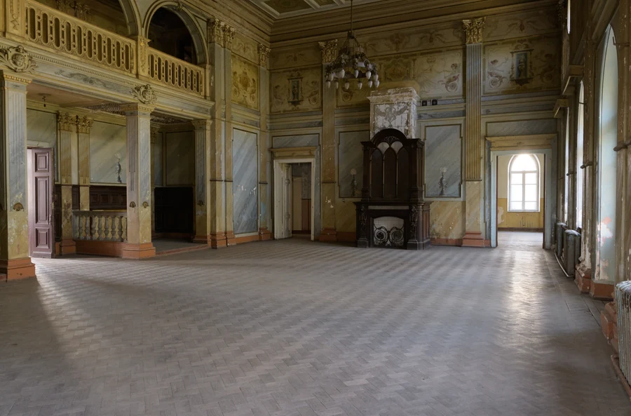
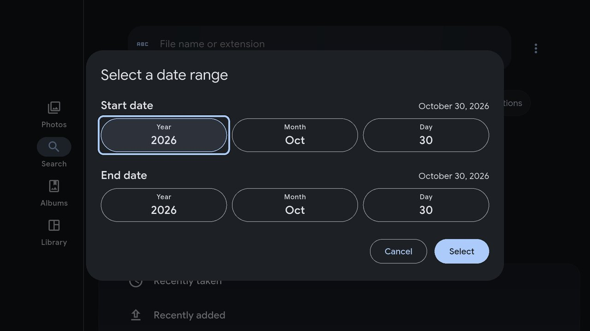
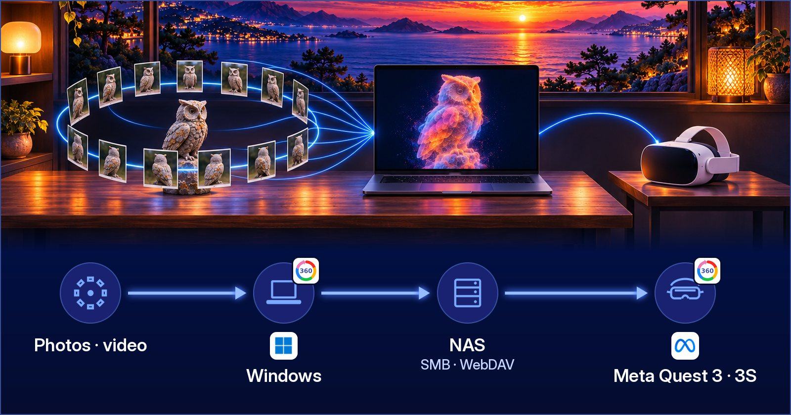

🌐 <b>Bosanski</b> · Drugi jezici (88)
<a href="../README.md">English</a> · <a href="README.af.md">Afrikaans</a> · <a href="README.ar.md">العربية</a> · <a href="README.az.md">Azərbaycanca</a> · <a href="README.be.md">Беларуская</a> · <a href="README.bg.md">Български</a> · <a href="README.bi.md">Bislama</a> · <a href="README.bn.md">বাংলা</a> · <a href="README.br.md">Brezhoneg</a> · <a href="README.ca.md">Català</a> · <a href="README.cs.md">Čeština</a> · <a href="README.cv.md">Чӑвашла</a> · <a href="README.da.md">Dansk</a> · <a href="README.de.md">Deutsch</a> · <a href="README.de_CH.md">Deutsch (Schweiz)</a> · <a href="README.el.md">Ελληνικά</a> · <a href="README.en_GB.md">English (UK)</a> · <a href="README.eo.md">Esperanto</a> · <a href="README.es.md">Español</a> · <a href="README.et.md">Eesti</a> · <a href="README.eu.md">Euskara</a> · <a href="README.fa.md">فارسی</a> · <a href="README.fi.md">Suomi</a> · <a href="README.fil.md">Filipino</a> · <a href="README.fr.md">Français</a> · <a href="README.ga.md">Gaeilge</a> · <a href="README.gl.md">Galego</a> · <a href="README.gsw.md">Alemannisch</a> · <a href="README.gu.md">ગુજરાતી</a> · <a href="README.he.md">עברית</a> · <a href="README.hi.md">हिन्दी</a> · <a href="README.hr.md">Hrvatski</a> · <a href="README.hu.md">Magyar</a> · <a href="README.hy.md">Հայերեն</a> · <a href="README.id.md">Bahasa Indonesia</a> · <a href="README.is.md">Íslenska</a> · <a href="README.it.md">Italiano</a> · <a href="README.ja.md">日本語</a> · <a href="README.ka.md">ქართული</a> · <a href="README.kab.md">Taqbaylit</a> · <a href="README.kk.md">Қазақша</a> · <a href="README.km.md">ខ្មែរ</a> · <a href="README.kmr.md">Kurmancî</a> · <a href="README.kn.md">ಕನ್ನಡ</a> · <a href="README.ko.md">한국어</a> · <a href="README.kxm.md">ภาษาเขมรถิ่นไทย</a> · <a href="README.lb.md">Lëtzebuergesch</a> · <a href="README.lmo.md">Lombard</a> · <a href="README.lt.md">Lietuvių</a> · <a href="README.lv.md">Latviešu</a> · <a href="README.mfa.md">Bahasa Melayu Kelantan</a> · <a href="README.mi.md">Te reo Māori</a> · <a href="README.mk.md">Македонски</a> · <a href="README.ml.md">മലയാളം</a> · <a href="README.mn.md">Монгол</a> · <a href="README.mr.md">मराठी</a> · <a href="README.ms.md">Bahasa Melayu</a> · <a href="README.nb_NO.md">Norsk bokmål</a> · <a href="README.ne.md">नेपाली</a> · <a href="README.nl.md">Nederlands</a> · <a href="README.nn.md">Norsk nynorsk</a> · <a href="README.pa.md">ਪੰਜਾਬੀ</a> · <a href="README.pl.md">Polski</a> · <a href="README.pt.md">Português</a> · <a href="README.pt_BR.md">Português (Brasil)</a> · <a href="README.ro.md">Română</a> · <a href="README.ru.md">Русский</a> · <a href="README.si.md">සිංහල</a> · <a href="README.sk.md">Slovenčina</a> · <a href="README.sl.md">Slovenščina</a> · <a href="README.sq.md">Shqip</a> · <a href="README.sr_Cyrl.md">Српски</a> · <a href="README.sr_Latn.md">Srpski</a> · <a href="README.sv.md">Svenska</a> · <a href="README.sw.md">Kiswahili</a> · <a href="README.swg.md">Schwäbisch</a> · <a href="README.ta.md">தமிழ்</a> · <a href="README.te.md">తెలుగు</a> · <a href="README.th.md">ไทย</a> · <a href="README.tl.md">Tagalog</a> · <a href="README.tr.md">Türkçe</a> · <a href="README.uk.md">Українська</a> · <a href="README.ur.md">اردو</a> · <a href="README.uz.md">Oʻzbekcha</a> · <a href="README.vi.md">Tiếng Việt</a> · <a href="README.yue_Hant.md">粵語</a> · <a href="README.zh_Hans.md">简体中文</a> · <a href="README.zh_Hant.md">繁體中文</a>

  

# Immuch360

**Vaš sadržaj. Svaki ekran. Svaka perspektiva.**

🌐 <a href="https://immuch360.com/bs/"><b>immuch360.com</b></a>

Ravne, 360° i 3D fotografije i video zapisi s vašeg uređaja, vašeg NAS-a, vašeg Immich servera, vaših kamera i vašeg drona. Račun nije potreban. Immuch360 je besplatna aplikacija otvorenog koda koja čita vaše fotografije i video zapise tamo gdje jesu i svaki reproducira u pregledniku koji mu odgovara: ravno, kao sferu u kojoj se osvrćete, u 3D-u, ili svuda oko vas u slušalicama. Radi na telefonima, tabletima, televizorima, Meta Quest slušalicama i računarima. Njena web stranica, [immuch360.com](https://immuch360.com/bs/), pokazuje šta radi na svakom ekranu, na 89 jezika.

**Novo u buildu 52 i desktop buildu 32, verzija 3.4.7.** S vašeg telefona, ["Reproduciraj na…"](#show-your-photos-and-videos-on-the-tv-from-your-phone) sada šalje fotografije i videozapise vaše Immich biblioteke, vaših dijeljenih resursa te Jellyfina i Embyja na televizor, Meta Quest ili računar na kojem radi Immuch360, koji ih otvara vlastitim računom, ili na Chromecast ili Google TV, a Prethodno, Prezentacija i Sljedeće na telefonu pomjeraju veliki ekran dalje; još nije isprobano na uređaju ni sa stvarnim Cast uređajem. Nazivi vaših fotografija i videozapisa [ostaju čitljivi preko njihovih sličica](#play-the-files-of-a-nas-a-computer-a-media-server-or-plex), kao i oznake, trajanja i mjeseci vremenske linije. Na računarima se AI komponente koje ste instalirali [ažuriraju jednim klikom](#update-the-ai-components-in-one-click) kada kasniji build donese noviju verziju neke od njih, nikad na vezi s ograničenim prometom, a svaka instalirana verzija se čuva dok njeno ažuriranje ne bude provjereno. Linux dobija [AppImage](#linux) koji radi bez instalacije i, kada nedostaje biblioteka, daje komandu vaše distribucije koja je instalira, provjereno putem CI sistema na Arch Linux, openSUSE Tumbleweed, Ubuntu 22.04, Debian 12 i Fedora 44. Aplikacija za iPhone i iPad izgrađena je pomoću Xcode 27 i iOS 27 SDK-a.

**Novo u buildovima od 33 do 51.** [Filmovi se nastavljaju tamo gdje ste stali](#pick-up-a-film-where-you-stopped). Počinju ranije, a sa sporog servera [nastavljaju se reproducirati umjesto da stanu](#when-a-video-waits-or-will-not-play). Vremenska linija se [smanjuje na mjesece i godine](#find-a-month-or-a-year-in-a-long-timeline) na telefonima i računarima. Na Android telefonu ili Meta Questu, ["Pregledaj folder"](#browse-a-folder-of-your-phone-or-headset) otvara folder uređaja kao dijeljeni resurs, a TIFF fotografije se prikazuju. Android TV [pretražuje po datumu daljinskim upravljačem](#on-android-tv-and-google-tv), Meta Quest 3 ili 3S [otvara Gaussove splatove](#explore-gaussian-splats-in-a-meta-quest-3-or-3s), koje okrećete desnom palicom, uključujući i SPZ verziju 4, a računar [pravi 3D verzije fotografija s vašeg NAS-a](#turn-one-photo-into-3d-a-scene-a-panorama). Na Windows laptopu s dva grafička čipa aplikacija [sada radi na brzom](#when-a-video-waits-or-will-not-play), pa se 8K filmovi reproduciraju glatko. Gaussovi splatovi se sada [otvaraju na računarima i na Android telefonima i tabletima](#explore-gaussian-splats-on-your-phone-tablet-or-computer), Windows računar [pravi splat scene od vaših fotografija ili videozapisa](#make-a-splat-scene-from-your-photos-or-a-video-ai) pomoću AI, vaš Immich server [ih čuva unutar fotografija](#keep-a-splat-scene-on-your-immich-server) koje se otvaraju s vaše vremenske linije, a računari [reproduciraju AV2 videozapise](#play-av2-videos-on-your-computer). Od builda 42, sirovi videozapisi kamera Insta360, GoPro MAX i DJI Osmo 360, iz vaše Immich biblioteke, dijeljenog resursa ili foldera, [reproduciraju se stabilizirani žiroskopom kamere](#stabilise-your-360-videos-with-the-cameras-gyroscope) na Android telefonima, tabletima i televizorima, splat kreator desktop builda 22 [nudi kvalitet Detaljno](#make-a-splat-scene-from-your-photos-or-a-video-ai) za scene koje gledate izbliza, a 360° panorama [počinje s 3,5 GiB slobodne memorije grafičke kartice](#turn-one-photo-into-3d-a-scene-a-panorama). Aplikacija za iPhone i iPad je [na App Storeu](https://apps.apple.com/us/app/immuch360-360-3d-player/id6817655965), verzija 3.4.3. Od builda 43, obavještenje aplikacije o ažuriranju otvara Google Play ili App Store na telefonima i tabletima; njena web stranica, [immuch360.com](https://immuch360.com/bs/), otvorena je 7. novembra. Od builda 44 i desktop builda 24, Meta Quest 3 ili 3S [prikazuje splatove do 300.000 gausijana](#explore-gaussian-splats-in-a-meta-quest-3-or-3s), računari [odabiru više fotografija i videozapisa pomoću Ctrl i Shift](#use-your-computer-as-the-media-player), televizor čiji dekoder odbije video [sam reproducira drugu datoteku sa servera](#when-a-video-waits-or-will-not-play), panorame rade na odabranoj grafičkoj kartici laptopa koji ih ima dvije, a obavještenje o ažuriranju na Questu i računarima otvara njihovu trgovinu ili stranicu za preuzimanje, uz mnogo ispravki. Od builda 45 i desktop builda 25, verzija 3.4.0 na svim platformama, aplikacija prati Immich 3.4.0 aplikaciju uz 11 kasnijih Immich ispravki, prikazuje [JPEG XL fotografije Immich 3.4 servera](#keep-your-immich-library-with-more), otvara [vaše Plex filmove po godinama](#watch-your-plex-films) sa stranicom za svaki film, njihovim preuzimanjem na uređaj i reprodukcijom na televizoru s telefona, može zatražiti ocjenu u buildovima iz trgovina i na računarima preuzima svoje video komponente iz [njihovih vlastitih otvorenih repozitorija](#licences-and-credits). Od builda 46 i desktop builda 26, verzija 3.4.1, sirovi videozapisi 360° kamera također se [reproduciraju stabilizirani](#stabilise-your-360-videos-with-the-cameras-gyroscope) na iPhoneu i iPadu, u Meta Questu i na Windowsu, Meta Quest [pomoću libmpv reproducira Plex filmove koje njegov vlastiti reproduktor ne može dekodirati](#watch-your-plex-films), telefon [šalje takav film na Chromecast ili Google TV](#watch-your-plex-films), a AI reljef 3D fotografije [dobija jačinu koju izaberete](#turn-one-photo-into-3d-a-scene-a-panorama); novi server se može dodati i prijavom vašim Plex računom, a aplikacija [čuva svoje postavke u datoteci](#keep-your-settings-in-a-file). Od builda 47 i desktop builda 27, verzija 3.4.2, Plex film [reproducira audio zapis koji uređaj dekodira](#watch-your-plex-films) i kaže koji, otvara verziju koja odgovara ekranu i, na sporoj vezi, nudi lakšu, Windows i macOS reproduciraju njegov Dolby TrueHD zvuk, Android [prikazuje njegovo preuzimanje u obavještenju](#watch-your-plex-films), a i Android TV preuzima filmove, a [Tapo kamere na bateriju prikazuju se uživo](#watch-your-home-cameras-on-the-big-screen); vraćanje datoteke postavki s njenim računima sada vas prijavljuje na vaš Immich server. Od builda 48 i desktop builda 28, verzija 3.4.3, Windows računar [reproducira vaše videozapise u PC VR slušalicama](#watch-your-videos-in-a-pc-vr-headset-from-windows) putem SteamVR, Meta Horizon Link ili drugog OpenXR okruženja (projekat ga još nije isprobao u slušalicama), [kamere drugih brendova prikazuju se uživo](#cameras-of-other-brands-over-onvif-or-rtsp), pronađene putem ONVIF ili dodane svojim RTSP linkom (provjereno sa simuliranom kamerom, nijedna prava kamera drugog brenda još nije isprobana), sirovi videozapisi [DJI Osmo 360 II i GoPro MAX 2 reproduciraju se stabilizirani](#open-the-raw-files-of-360-cameras), Plex filmovi [više ne stižu presporo na telefone](#when-a-video-waits-or-will-not-play), LG i Samsung televizori jednim tasterom [okreću video koji leži na boku](#on-a-samsung-tv-tizen) (još nije isprobano na LG televizoru; Samsung televizor iz issuea 17 odbio je okretanje), a "Dostupno je ažuriranje servera" se više ne prikazuje za server koji je ažuran. Od builda 49 i desktop builda 29, verzija 3.4.4, aplikacija sama [čita vaše Jellyfin i Emby servere](#watch-your-jellyfin-and-emby-libraries) (još nije isprobano na uređaju), pronađene na vašoj mreži i prijavljene putem Quick Connect na televizoru ili u slušalicama, s reprodukcijom njihovih originalnih datoteka tako da 360° video ostaje 360°; na velikom ekranu Meta Questa fotografije [zadržavaju veličinu i mjesto koje ste postavili dok ih pregledate, i reproduciraju se kao dijaprojekcija](#browse-your-photos-on-the-big-screen-of-the-quest) (projekat ga još nije isprobao u slušalicama); 360° reproduktor videa na telefonima i tabletima [dobija kontrole 360° fotografija](#360-videos-on-your-phone-with-the-controls-of-360-photos), dugme za giroskop, uvećanje prstima i povlačenje ravno gore ili dolje (isprobao ga je korisnik na Samsung Galaxy S25 Ultra, još nije isprobano na iPhoneu); računar uz AI [pretvara vaše 2D videozapise u 3D videozapise](#turn-your-2d-videos-into-3d-on-your-computer) (još nije isprobano na 3D ekranu ili u slušalicama); a Samsung televizori [predaju video kojem treba okretanje Samsungovom vlastitom plejeru](#on-a-samsung-tv-tizen), koji televizor iz issuea 17 reproducira, ali odbija okrenuti. Od builda 50 i desktop builda 30, verzija 3.4.5, dok se video reproducira u 2D prozoru Meta Questa, prozor se [iscrtava brzinom osvježavanja ekrana](#step-inside-your-photos-and-videos-with-a-meta-quest) umjesto oko 10 puta u sekundi kao u buildovima 48 i 49 (izmjereno na Meta Quest 3), Android TV [uvećava fotografiju daljinskim upravljačem](#on-android-tv-and-google-tv) i pomjera je strelicama (novo, još nije isprobano na televizoru), a tri ispravke dolaze iz Android TV forka korisnika mlc70: brzo prevlačenje više ne prikazuje detalje fotografije ostavljene iza, animirana fotografija oslobađa svoju memoriju, a filter Lokacija nudi gradove nove zemlje. Od builda 51 i desktop builda 31, verzija 3.4.6, ["Poboljšaj (AI)"](#make-a-photo-sharper-on-your-computer-ai) pravi oštriju kopiju mutne fotografije pored originala na Windowsu i Linuxu, na tri nivoa, svaki pokrenut jednom na jednom računaru s RTX 4060, Prirodno se nudi i na Macu s Apple čipom (još nije isprobano na Macu), računar [pretvara 360° videozapis u 360° 3D videozapis](#a-360-video-turned-into-a-360-3d-video) uz AI, dubinu 3D videozapisa na Windowsu procjenjuje grafička kartica, AI funkcije uzimaju videozapise vašeg servera i dijeljenog resursa direktno, datoteka postavki ima [svoju karticu u Biblioteci](#keep-your-settings-in-a-file), televizor je čuva na mrežnom dijeljenom resursu, Esc vraća jedan korak nazad na računarima, buildovi iz trgovina traže ocjenu [rjeđe i blaže](#privacy), Linux prikazuje TIFF fotografije, splat scene i 3D videozapise jednim okom, a ispravljena su dva rušenja.

  Nezvanični fork mobilne aplikacije Immich. Nije povezan sa Immich-om ni sa FUTO-m. Naziv se izgovara kao "I am much 360" (Ja sam mnogo 360).

<b>Sadržaj</b>

- [Za koga je](#who-it-is-for)
- [Koji ekrani](#which-screens), [šta rade zajedno](#use-cases) i [šta svaki ekran radi](#what-each-screen-does)
- [Šta možete da radite](#what-you-can-do)
- [Nabavite je na svom uređaju](#get-it-on-your-device)
- [Uputstva](#how-to)
  - [Pregledajte svoje fotografije i video zapise, sa serverom ili bez njega](#watch-your-photos-and-videos-with-or-without-a-server)
  - [Istražite panorame, 360°, VR180 i 3D](#explore-panoramas-360-vr180-and-3d): [360° video zapisi na telefonima](#360-videos-on-your-phone-with-the-controls-of-360-photos)
  - [Pretvorite jednu fotografiju u 3D, scenu, panoramu](#turn-one-photo-into-3d-a-scene-a-panorama): [AI komponente ažurirane jednim klikom](#update-the-ai-components-in-one-click)
  - [Pretvorite svoje 2D videozapise u 3D na računaru](#turn-your-2d-videos-into-3d-on-your-computer): [360° videozapisi u 360° 3D](#a-360-video-turned-into-a-360-3d-video)
  - [Izoštrite fotografiju na svom računaru (AI)](#make-a-photo-sharper-on-your-computer-ai)
  - [Gledajte na televizoru daljinskim upravljačem](#watch-on-the-tv-with-the-remote): [Android TV i Google TV](#on-android-tv-and-google-tv), [LG](#on-an-lg-tv-webos), [Samsung](#on-a-samsung-tv-tizen)
  - [Prijavite televizor, slušalice ili računar telefonom](#sign-in-a-tv-a-headset-or-a-computer-with-your-phone)
  - [Prikažite svoje fotografije i videozapise na televizoru s telefona](#show-your-photos-and-videos-on-the-tv-from-your-phone)
  - [Uđite u svoje fotografije i video zapise s Meta Questom](#step-inside-your-photos-and-videos-with-a-meta-quest): [veliki ekran](#browse-your-photos-on-the-big-screen-of-the-quest), [način kioska](#kiosk-mode-for-an-exhibition-or-a-shop)
  - [Istražite Gaussove splatove u Meta Questu 3 ili 3S](#explore-gaussian-splats-in-a-meta-quest-3-or-3s)
  - [Istražite Gaussove splatove na svom telefonu, tabletu ili računaru](#explore-gaussian-splats-on-your-phone-tablet-or-computer)
  - [Napravite splat scenu od svojih fotografija ili videozapisa (AI)](#make-a-splat-scene-from-your-photos-or-a-video-ai)
  - [Čuvajte splat scenu na svom Immich serveru](#keep-a-splat-scene-on-your-immich-server)
  - [Reproducirajte datoteke NAS-a, računara, medijskog servera ili Plexa](#play-the-files-of-a-nas-a-computer-a-media-server-or-plex): [vaši filmovi po godinama](#watch-your-plex-films), [Jellyfin i Emby](#watch-your-jellyfin-and-emby-libraries)
  - [Pregledajte folder telefona ili slušalica](#browse-a-folder-of-your-phone-or-headset)
  - [Nastavite film tamo gdje ste stali](#pick-up-a-film-where-you-stopped)
  - [Kada video čeka ili se ne reproducira](#when-a-video-waits-or-will-not-play)
  - [Zadržite svoju Immich biblioteku, uz više mogućnosti](#keep-your-immich-library-with-more)
  - [Pronađite mjesec ili godinu u dugoj vremenskoj liniji](#find-a-month-or-a-year-in-a-long-timeline)
  - [Gledajte svoje kućne kamere na velikom ekranu](#watch-your-home-cameras-on-the-big-screen): [drugi brendovi](#cameras-of-other-brands-over-onvif-or-rtsp)
  - [Vaš DJI dron](#your-dji-drone): [video uživo](#see-what-your-drone-sees-on-your-phone), [u Questu ili na Android TV-u](#watch-it-in-a-meta-quest-or-on-an-android-tv), [uvoz](#bring-a-drones-or-a-camera-cards-photos-and-videos-to-immich)
  - [Otvorite sirove datoteke 360° kamera](#open-the-raw-files-of-360-cameras)
  - [Stabilizirajte svoje 360° videozapise žiroskopom kamere](#stabilise-your-360-videos-with-the-cameras-gyroscope)
  - [Okrenite fotografiju jednim tasterom](#turn-a-photo-with-one-key)
  - [Koristite računar kao medijski plejer](#use-your-computer-as-the-media-player)
  - [Gledajte svoje videozapise u PC VR slušalicama, s Windowsa](#watch-your-videos-in-a-pc-vr-headset-from-windows)
  - [Reproducirajte AV2 videozapise na svom računaru](#play-av2-videos-on-your-computer)
  - [Čuvajte svoje postavke u datoteci](#keep-your-settings-in-a-file)
- [U poređenju s Immichom](#compared-with-immich)
- [Privatnost](#privacy)
- [Licence i zasluge](#licences-and-credits)
- [Plan razvoja](#roadmap)
- [Dokumentacija](#documentation)

## Za koga je

- **Snimate 360° ili 3D** i želite se osvrtati u svojim snimcima, a ne gledati ih ravne, udvojene ili razvučene, i okretati svoje 360° video zapise na telefonu kao što okrećete njegove fotografije: [360°, VR180 i 3D](#explore-panoramas-360-vr180-and-3d), [360° video zapisi na telefonima](#360-videos-on-your-phone-with-the-controls-of-360-photos).
- **Snimate 360° kamerom u ruci, na biciklu ili na kacigi** i želite da se sirovi videozapisi vaše Insta360, GoPro MAX ili MAX 2, DJI Osmo 360 ili Osmo 360 II kamere, sačuvani u Immichu, na dijeljenom resursu ili u folderu, reproduciraju s ravnim horizontom i mirno na vašem telefonu, televizoru, Meta Questu ili Windows računaru: [stabilizirani žiroskopom kamere](#stabilise-your-360-videos-with-the-cameras-gyroscope).
- **Vaše fotografije i filmovi su na NAS-u, računaru, Plexu ili Immichu** i želite ih na televizoru bez kopiranja ičega: [na televizoru](#watch-on-the-tv-with-the-remote), [NAS, dijeljeni resursi i Plex](#play-the-files-of-a-nas-a-computer-a-media-server-or-plex).
- **Svoje filmove čuvate na Plex serveru** i želite izabrati jedan po godini, vidjeti o čemu se radi prije nego što počne, ponijeti ga na putovanje, pokrenuti ga na televizoru ili Chromecastu s telefona, i reproducirati čak i filmove koje vaš Android telefon, televizor ili Meta Quest ne može dekodirati: [vaši filmovi, po godinama](#watch-your-plex-films).
- **Svoje filmove čuvate na Jellyfin ili Emby serveru** i želite ih u svom Meta Questu, na televizoru ili telefonu, s 360° i 3D zadržanim kakvi jesu, i s vašim mjestom sačuvanim na serveru (još nije isprobano na uređaju): [Jellyfin i Emby](#watch-your-jellyfin-and-emby-libraries).
- **Imate Meta Quest** i želite ući u vlastite fotografije i video zapise: [u slušalicama](#step-inside-your-photos-and-videos-with-a-meta-quest), i pregledati svoje fotografije na velikom ekranu u veličini i na mjestu koje ste postavili, i kao dijaprojekciju (projekat ga još nije isprobao u slušalicama): [veliki ekran](#browse-your-photos-on-the-big-screen-of-the-quest).
- **Imate PC VR slušalice na Windows računaru** i želite u njima svoje 360° videozapise oko sebe i svoje filmove na velikom ekranu (projekat ga još nije isprobao u slušalicama): [u PC VR slušalicama](#watch-your-videos-in-a-pc-vr-headset-from-windows).
- **Vaše fotografije su ravne** i želite ih u 3D, kao scenu u koju se naginjete u slušalicama, ili unutar 360° panorame, bez 3D kamere: [pretvorite jednu fotografiju u 3D, scenu, panoramu](#turn-one-photo-into-3d-a-scene-a-panorama), novo, pravi ih AI na vašem vlastitom računaru.
- **Vaši videozapisi su ravni**, uključujući klipove s vašeg telefona, a želite ih u 3D za slušalice ili 3D ekran, i svoje 360° videozapise u 360° 3D, napravljene na vlastitom računaru (još nije isprobano na 3D ekranu ili u slušalicama): [2D videozapisi u 3D](#turn-your-2d-videos-into-3d-on-your-computer), [360° u 360° 3D](#a-360-video-turned-into-a-360-3d-video).
- **Vaše fotografije su blago mutne**, malo neizoštrene ili snimljene pri slabom svjetlu, i želite oštriju kopiju pored originala, napravljenu na vlastitom računaru, s jasno navedenim izmišljenim detaljima: [Poboljšaj (AI)](#make-a-photo-sharper-on-your-computer-ai).
- **Koristite Immich** i želite njegovu aplikaciju, uz imerzivne preglednike i velike ekrane koje prijavljujete s telefona: [vaša Immich biblioteka](#keep-your-immich-library-with-more), [u poređenju s Immichom](#compared-with-immich).
- **Pratite svoj dom Tapo kamerama**, i onim na bateriju, ili kamere drugih brendova putem ONVIF ili RTSP, i želite ih pored svojih fotografija, i na televizoru (provjereno sa simuliranom kamerom): [kućne kamere](#watch-your-home-cameras-on-the-big-screen).
- **Letite DJI dronom** i želite njegovu sliku uživo na telefonu bez DJI Fly, te u Meta Questu ili na Android TV-u za ljude koji su s vama: [vaš dron](#see-what-your-drone-sees-on-your-phone).
- **Snimate mjesta i predmete u 3D, kao Gaussove splatove,** ili biste ih željeli napraviti od vlastitih fotografija, i želite hodati kroz njih na svom telefonu, svom računaru ili u slušalicama: [na telefonu, tabletu ili računaru](#explore-gaussian-splats-on-your-phone-tablet-or-computer), [napravljeni od vaših fotografija](#make-a-splat-scene-from-your-photos-or-a-video-ai), [sačuvani u Immichu](#keep-a-splat-scene-on-your-immich-server).
- **Imate AV2 videozapise**, format koji dolazi nakon AV1, i želite ih gledati na svom računaru: [AV2 na vašem računaru](#play-av2-videos-on-your-computer).
- **Imate nekoliko ekrana kod kuće** i želite da rade zajedno: [šta vaši ekrani rade zajedno](#use-cases).

Nema Immuch360 računa za kreiranje i ništa ne stiže do nas: aplikacija komunicira samo s vašim uređajima i sa serverima koje izaberete, od builda 45 i s Wikipedia za stranicu filma, od builda 46 i s plex.tv kada se prijavite putem njega, a AI komponentu ili AV2 dekoder preuzima samo kada to zatražite.

## Koji ekrani

| Platforma | Gdje je nabaviti | Stanje u novembru 2026. |
|---|---|---|
|  **Android** telefoni i tableti | [Google Play](https://play.google.com/store/apps/details?id=com.aprogsys.immuch360) · [APK](https://github.com/freeKC/Immuch360/releases) | na Google Play (build 47 objavljen 16. novembra; build 51 na Googleovom pregledu od 24. novembra; slijedi build 52), build 52 na GitHubu, gdje se [sirovi 360° videozapisi reproduciraju stabilizirani](#stabilise-your-360-videos-with-the-cameras-gyroscope), [filmovi nastavljaju tamo gdje ste stali](#pick-up-a-film-where-you-stopped), ["Pregledaj folder"](#browse-a-folder-of-your-phone-or-headset) otvara folder telefona, a [Gaussovi splatovi se otvaraju](#explore-gaussian-splats-on-your-phone-tablet-or-computer), s dijeljenog resursa ili [s vaše Immich vremenske linije](#keep-a-splat-scene-on-your-immich-server), [postavke sačuvane u datoteci](#keep-your-settings-in-a-file), [preuzimanje filma prikazano u obavještenju](#watch-your-plex-films), od builda 48 [kamere drugih brendova, uživo](#cameras-of-other-brands-over-onvif-or-rtsp) (provjereno sa simuliranom kamerom) i, od builda 49, [Jellyfin i Emby serveri](#watch-your-jellyfin-and-emby-libraries) (još nije isprobano na uređaju) i [kontrole 360° fotografija u 360° reproduktoru videa](#360-videos-on-your-phone-with-the-controls-of-360-photos) (isprobao ga je korisnik na Samsung Galaxy S25 Ultra), a od builda 51 [kartica datoteke postavki u Biblioteci](#keep-your-settings-in-a-file), s datotekom sačuvanom i na mrežnom dijeljenom resursu, a od builda 52 [vaše fotografije i videozapisi poslani na televizor ili Chromecast](#show-your-photos-and-videos-on-the-tv-from-your-phone) pomoću "Reproduciraj na…" (još nije isprobano na uređaju) |
|  **iPhone i iPad** | [App Store](https://apps.apple.com/us/app/immuch360-360-3d-player/id6817655965) | verzija 3.4.6 na App Storeu od 25. novembra, s [mjesecima i godinama u vremenskoj liniji](#find-a-month-or-a-year-in-a-long-timeline), [filmovima koji se nastavljaju tamo gdje ste stali](#pick-up-a-film-where-you-stopped), [prijavom televizora, slušalica ili računara](#sign-in-a-tv-a-headset-or-a-computer-with-your-phone) s telefona, splat scenama sačuvanim u Immichu prikazanim kao njihova fotografija, ispravkama Immich 3.4.0 i njegovim JPEG XL fotografijama, [sirovim 360° videozapisima stabiliziranim](#stabilise-your-360-videos-with-the-cameras-gyroscope), [postavkama sačuvanim u datoteci](#keep-your-settings-in-a-file) i [prikazom uživo Tapo kamera na bateriju](#watch-your-home-cameras-on-the-big-screen) i [prikazom uživo kamera drugih brendova](#cameras-of-other-brands-over-onvif-or-rtsp) (provjereno sa simuliranom kamerom), a od verzije 3.4.4 i s [Jellyfin i Emby serverima](#watch-your-jellyfin-and-emby-libraries) (još nije isprobano na uređaju) i [kontrolama 360° fotografija u 360° reproduktoru videa](#360-videos-on-your-phone-with-the-controls-of-360-photos) (još nije isprobano na iPhoneu), a od verzije 3.4.6 i s [karticom datoteke postavki](#keep-your-settings-in-a-file) i njenim vraćanjem s mrežnog dijeljenog resursa; slijedi verzija 3.4.7, iPhone i iPad verzija builda 52, izgrađena pomoću Xcode 27; ili [izgradite je sami](../docs/immuch360/build.md) |
|  **Android TV i Google TV** | [Google Play](https://play.google.com/store/apps/details?id=com.aprogsys.immuch360) · [APK](#android-tv-and-google-tv) | na Google Play, koji nudi aplikaciju na Android TV-u i Google TV-u, i build 52 na GitHubu: [stabilizirani sirovi 360° videozapisi](#stabilise-your-360-videos-with-the-cameras-gyroscope), [pretraga po datumu daljinskim upravljačem](#on-android-tv-and-google-tv), [prijava telefonom](#sign-in-a-tv-a-headset-or-a-computer-with-your-phone) skeniranjem QR koda, vremenska traka, audio i titlovi za daljinski upravljač u reproduktoru videa, i [video drona uživo](#watch-it-in-a-meta-quest-or-on-an-android-tv) koji prenosi telefon, [filmovi preuzeti na televizor](#watch-your-plex-films) i, od builda 49, [Jellyfin i Emby serveri](#watch-your-jellyfin-and-emby-libraries) prijavljeni putem Quick Connect (još nije isprobano na uređaju) i, od builda 50, [fotografije uvećane daljinskim upravljačem](#on-android-tv-and-google-tv) (viđeno kako radi na Android TV emulatoru, još nije isprobano na televizoru), a od builda 51 [datoteka postavki sačuvana i vraćena na mrežnom dijeljenom resursu](#keep-your-settings-in-a-file) (viđeno kako radi na Android TV emulatoru), a od builda 52 [fotografije i videozapisi koje telefon šalje pomoću "Reproduciraj na…"](#show-your-photos-and-videos-on-the-tv-from-your-phone) (još nije isprobano na televizoru) |
| **LG televizori** sa webOS 5.0 i novijim | [.ipk, verzija 1.0.5](https://github.com/freeKC/Immuch360/releases/tag/webos-v1.0.5) · LG Content Store (u pregledu) | verzija 1.0.0, poslana u LG Content Store 24. oktobra, na LG-ovim testovima od 26. oktobra; verzija 1.0.1, na GitHubu od 27. oktobra, zumira fotografiju strelicama i javlja kada se fotografija još učitava, a verzija 1.0.2, na GitHubu s buildom 46, piše "prijava" kao ログイン na japanskom, verzija 1.0.3, s buildom 47, javlja kada folder DLNA servera sadrži TV kanale uživo, koje još ne može reproducirati, verzija 1.0.4, s buildom 48, jednim tasterom [okreće video koji leži na boku](#on-an-lg-tv-webos) (još nije isprobano na LG televizoru), a verzija 1.0.5, s buildom 49, navodi Jellyfin s njegovim DLNA dodatkom među DLNA serverima; dok LG ne objavi aplikaciju, instalira se u [Developer Mode](#lg-tvs-webos). Verzija 1.0.0 je radila na webOS 25 televizorima u LG-ovom Cloud Test Labu |
| **Samsung televizori** sa Tizen 5.5 i novijim | [.wgt, verzija 0.3.6](https://github.com/freeKC/Immuch360/releases/tag/tizen-v0.3.6) | verzija 0.3.6 iste TV aplikacije, koji treba potpisati vlastitim Samsung sertifikatom i instalirati u [Developer mode](#samsung-tvs-tizen); 0.1.0 je radio na Samsung televizoru jednog testera, 0.2.0 sadrži ispravke iz tog pokretanja, 0.3.0 dodaje zumiranje fotografije i oznaku Učitavanje iz LG verzije 1.0.1, 0.3.1 japanski tekst LG verzije 1.0.2, 0.3.2 reproducira video snimljen uspravno na telefonu u pravilnom položaju ([issue 17](https://github.com/freeKC/Immuch360/issues/17)), 0.3.3 i 0.3.4 ga [okreću na televizoru koji ga prijavljuje uspravnim](#on-a-samsung-tv-tizen) i dodaju dugme koje ga okreće ručno, a 0.3.5 i 0.3.6 predaju takav video Samsungovom vlastitom plejeru; na televizoru autora issuea, 0.3.4 i 0.3.5 su ostavili sliku na boku, jer televizor odbija okretanje, a izlaz je tamo video koji vaš Immich server transkodira, sačuvan uspravno; nije u Samsungovoj trgovini |
|  **Meta Quest** 2, Pro, 3 i 3S | [Horizon Store](https://www.meta.com/experiences/immuch360/1384208401440714/) · [APK](#meta-quest) | na Horizon Store (build 50, čiji se 2D prozor iscrtava brzinom osvježavanja ekrana dok se video reproducira, objavljen 25. novembra; slijedi build 52), build 52 na GitHubu, s [načinom kioska](#kiosk-mode-for-an-exhibition-or-a-shop), [sirovim 360° videozapisima stabiliziranim](#stabilise-your-360-videos-with-the-cameras-gyroscope) u imerzivnom prikazu, [filmovima koje ne može dekodirati, a reproducira ih libmpv](#watch-your-plex-films) i, na Questu 3 i 3S, [Gaussovim splatovima](#explore-gaussian-splats-in-a-meta-quest-3-or-3s) i [AI reljefom](#turn-one-photo-into-3d-a-scene-a-panorama) ravne fotografije, a od builda 49 [fotografije pregledane na velikom ekranu](#browse-your-photos-on-the-big-screen-of-the-quest) u veličini koju postavite, i kao dijaprojekcija (projekat ga još nije isprobao u slušalicama), i [Jellyfin i Emby serveri](#watch-your-jellyfin-and-emby-libraries) prijavljeni putem Quick Connect (još nije isprobano na uređaju), a od builda 51 slušalice čiji je Horizon OS prestar za imerzivni preglednik traže ažuriranje umjesto da zatvore aplikaciju (nije isprobano na takvim slušalicama) |
|  **Windows** | [Instaler ili ZIP](https://github.com/freeKC/Immuch360/releases/tag/desktop-v3.4.7-32) | desktop build 32, potpisan: fotografije, ravni i 360° video zapisi, dijeljeni resursi, Plex, kamere (provjereno sa simuliranom kamerom), prijava telefonom, fotografije okrenute jednim tasterom, interfejs na 89 jezika, i [3D fotografije, 3D scene i 360° panorame napravljene od vaših fotografija](#turn-one-photo-into-3d-a-scene-a-panorama) pomoću AI, uključujući one s vašeg NAS-a; [Gaussovi splatovi](#explore-gaussian-splats-on-your-phone-tablet-or-computer) otvoreni, [napravljeni od vaših fotografija ili videozapisa](#make-a-splat-scene-from-your-photos-or-a-video-ai) i [sačuvani u Immichu](#keep-a-splat-scene-on-your-immich-server), [AV2 videozapisi](#play-av2-videos-on-your-computer), od desktop builda 22 [izbor kvaliteta za splat scene](#make-a-splat-scene-from-your-photos-or-a-video-ai) i [360° panorame od 3,5 GiB slobodne grafičke memorije](#turn-one-photo-into-3d-a-scene-a-panorama), a od desktop builda 26 [sirovi 360° videozapisi stabilizirani](#stabilise-your-360-videos-with-the-cameras-gyroscope) i [3D fotografije s jačinom reljefa i oštrijim ivicama](#turn-one-photo-into-3d-a-scene-a-panorama), od desktop builda 27 [Dolby TrueHD zvuk i Blu-ray titlovi filmova](#watch-your-plex-films), od desktop builda 28 [vaši videozapisi u PC VR slušalicama](#watch-your-videos-in-a-pc-vr-headset-from-windows) (projekat ga još nije isprobao u slušalicama), a od desktop builda 29 [3D videozapisi napravljeni od vaših 2D videozapisa](#turn-your-2d-videos-into-3d-on-your-computer) uz AI (još nije isprobano na 3D ekranu ili u slušalicama), a od desktop builda 31 [oštrije kopije vaših fotografija](#make-a-photo-sharper-on-your-computer-ai) uz AI i [360° videozapisi pretvoreni u 360° 3D videozapise](#a-360-video-turned-into-a-360-3d-video) uz AI, dubina koju procjenjuje grafička kartica, videozapisi vašeg servera i dijeljenog resursa uzeti direktno, i Esc za povratak jedan korak nazad, a od desktop builda 32 [AI komponente ažurirane jednim klikom](#update-the-ai-components-in-one-click) |
|   **macOS i Linux** | [.deb, .rpm, AppImage, DMG](https://github.com/freeKC/Immuch360/releases/tag/desktop-v3.4.7-32) | desktop build 32: fotografije, 360° fotografije i ravni video zapisi (360° video zapisi se reproduciraju ravno), Immich server i mrežni dijeljeni resursi, i [3D fotografije i 3D scene](#turn-one-photo-into-3d-a-scene-a-panorama) koje AI pravi od vaših fotografija, uz 360° panorame na Linuxu na grafičkoj kartici od 8 GB, od 3,5 GiB njene slobodne memorije, te [Gaussovi splatovi](#explore-gaussian-splats-on-your-phone-tablet-or-computer) i [AV2 videozapisi](#play-av2-videos-on-your-computer) (još nisu isprobani na Macu); desktop build 11 isproban 26. oktobra u Ubuntu 24.04 kontejneru i na Macu; od desktop builda 27, Dolby TrueHD zvuk filmova na macOS-u; od desktop builda 29, [3D videozapisi napravljeni od vaših 2D videozapisa](#turn-your-2d-videos-into-3d-on-your-computer) uz AI na Linuxu i na Macu s Apple čipom (još nije isprobano na 3D ekranu ili u slušalicama); od desktop builda 31, na Linuxu, [oštrije kopije vaših fotografija](#make-a-photo-sharper-on-your-computer-ai) uz AI, TIFF fotografije, fascikle koje same prikazuju svoje nove datoteke, splat scene napravljene od vaših fotografija na grafičkoj kartici od 4 GB i 3D videozapisi prikazani ravno jednim okom, a na Macu s Apple čipom nivo Prirodno funkcije "Poboljšaj (AI)" (još nije isprobano na Macu); od desktop builda 32, [AppImage](#linux) za ostale Linux distribucije, provjeren putem CI sistema na Arch Linux i openSUSE; nepotpisano na macOS-u |

*Statusi se ažuriraju uz svako izdanje; šta ima svaka trgovina, šta je u njenom pregledu i svaki build dostupni su u [Status izdanja](../docs/immuch360/release-status.md). Web stranica [immuch360.com](https://immuch360.com/bs/) pokazuje šta radi svaki ekran, uputstvo za svaku funkciju i linkove trgovina, na 89 jezika.*

  

### Šta vaši ekrani rade zajedno

Instalirajte Immuch360 na svaki ekran na kojem gledate: svaki sam čita vaše izvore, a neki predaju sliku, datoteku ili prijavu drugom. Na svakoj slici ikona Immuch360 označava uređaje na kojima radi aplikacija.

#### Vaš NAS na svakom ekranu

  

**Potrebno vam je:** NAS sa SMB ili WebDAV dijeljenim resursom, i Immuch360 na svakom ekranu na kojem gledate.

Dodajte dijeljeni resurs na svakom ekranu, i svaki reproducira fotografije i videozapise tamo gdje jesu, bez kopiranja: telefoni, tableti, Android TV, Meta Quest, Windows, Linux i macOS računari, i LG televizori prijavljeni na vaš Immich server (SMB od webOS 22). 360° fotografija se okreće kao sfera na telefonu i televizoru, i okružuje vas u slušalicama. Uputstva: [Reproducirajte datoteke NAS-a, računara, medijskog servera ili Plexa](#play-the-files-of-a-nas-a-computer-a-media-server-or-plex).

#### Vaš Immich server na svakom ekranu, prijavljen s vašeg telefona

  

**Potrebno vam je:** Immich server, Immuch360 na vašem Android telefonu, i Immuch360 na ekranima koje prijavljujete: Android TV, Meta Quest, Windows, Linux ili macOS računar.

Na telefonu Immuch360 zadržava cijelu Immich mobilnu aplikaciju, dodaje svoje 360°, VR180 i 3D preglednike, i instalira se pored zvanične aplikacije. Prijavljen na vaš server, on prijavljuje velike ekrane: skenira QR kod televizora ili računara, ili vi na njemu ukucate kod koji prikazuju slušalice, a vaša lozinka ostaje na telefonu. Uputstva: [Prijavite televizor, slušalice ili računar telefonom](#sign-in-a-tv-a-headset-or-a-computer-with-your-phone).

#### Vaše ravne fotografije u 3D-u, od računara do slušalica

  

**Potrebno vam je:** Immuch360 na Windows, Linux ili macOS računaru i u Meta Questu, s vašim NAS-om između njih, ili vašim Immich serverom s uključenim "Napravi sigurnosnu kopiju i AI verzija".

Računar sam pretvara vaše fotografije u 3D fotografije i 3D scene, i u 360° panorame s grafičkom karticom od 8 GB na Windowsu ili Linuxu, i sprema ih pored originala. Slušalice prikazuju 3D fotografiju u pravom 3D-u, stavljaju scenu u vašu sobu i panoramu svuda oko vas; telefoni i televizori otvaraju panorame u svom 360° pregledniku. Uputstva: [Pretvorite jednu fotografiju u 3D, scenu, panoramu](#turn-one-photo-into-3d-a-scene-a-panorama).

#### Prikaz uživo s vašeg drona u slušalicama ili na televizoru

  

**Potrebno vam je:** DJI dron i njegov daljinski upravljač DJI RC-N3, Immuch360 na Android telefonu priključenom na daljinski upravljač, i Immuch360 u Meta Questu ili na Android TV-u.

Telefon prikazuje video uživo s drona i prosljeđuje ga, preko vašeg Wi-Fi-ja ili vlastitog hotspota, tako da ljudi koji su s vama gledaju let u slušalicama ili na televizoru. Samo prijem: nijedna komanda se nikad ne šalje daljinskom upravljaču ni dronu, a daljinski upravljač zadržava potpunu kontrolu. Uputstva: [Gledajte ga u Meta Questu ili na Android TV-u](#watch-it-in-a-meta-quest-or-on-an-android-tv).

#### Sirove datoteke vaše 360° kamere, sastavljene tamo gdje ih gledate

  

**Potrebno vam je:** kamera Insta360, GoPro MAX ili MAX 2, DJI Osmo 360 ili Osmo 360 II, vaš NAS, i Immuch360 na ekranima: telefoni, tableti, Android TV, Meta Quest, Windows.

Kopirajte datoteke .insp, .insv, .360 ili .osv s kartice kamere na SMB ili WebDAV dijeljeni resurs vašeg NAS-a, onakve kakve jesu; Immich server prima i one s Insta360. Svaki ekran ih sastavlja tokom reprodukcije, s kalibracijom upisanom u svakoj datoteci, i ništa se prethodno ne izvozi u aplikaciji kamere. Uputstva: [Otvorite sirove datoteke 360° kamera](#open-the-raw-files-of-360-cameras).

#### Vaši Plex i DLNA serveri na televizoru i u slušalicama

  

**Potrebno vam je:** Plex Media Server, Jellyfin ili Emby server, ili DLNA server kao što je minidlna, i Immuch360 na svakom ekranu: Android TV, Meta Quest, telefoni, tableti, Windows.

Plex daje originalne datoteke vaših biblioteka, tako da 360° video ostaje 360°, svuda oko vas u slušalicama, kod kuće i putem vašeg prosljeđivanja portova van kuće; DLNA serveri se pronalaze na vašoj kućnoj mreži. LG televizori prijavljeni na vaš Immich server ih također reproduciraju. Od builda 45, telefoni, tableti, Android TV, Quest i računari otvaraju Plex filmsku biblioteku na svim filmovima po godinama, svaki film sa svojom stranicom, a film izabran na telefonu reproducira se na Android TV-u, Questu ili računaru, dok reprodukcijom upravlja daljinski upravljač. Od builda 46, Quest pomoću libmpv reproducira filmove koje njegov vlastiti reproduktor ne može dekodirati, vaš Plex server konvertuje one koje nijedan reproduktor Android uređaja ne dekodira, a telefon šalje film na Chromecast ili Google TV. Od builda 47, film reproducira audio zapis koji uređaj dekodira i kaže koji, otvara verziju koja odgovara ekranu i reproducira svoj Dolby TrueHD zvuk na Windowsu i macOS-u, a folder TV kanala uživo DLNA servera javlja da se oni još ne mogu reproducirati. Od builda 49, Jellyfin ili Emby server također ima vlastiti tip, pronađen sam od sebe, prijavljen putem Quick Connect na televizoru ili u slušalicama, s reprodukcijom originalnih datoteka tako da 360° ostaje 360° i s vašim mjestom sačuvanim na serveru (još nije isprobano na uređaju). Uputstva: [Reproducirajte datoteke NAS-a, računara, medijskog servera ili Plexa](#play-the-files-of-a-nas-a-computer-a-media-server-or-plex), [Gledajte svoje Plex filmove](#watch-your-plex-films) i [Gledajte svoje Jellyfin i Emby biblioteke](#watch-your-jellyfin-and-emby-libraries).

#### Vaš telefon ili vaš Windows računar, otvoren u slušalicama

  

**Potrebno vam je:** Immuch360 na Android telefonu, iPhoneu ili Windows računaru, i u Meta Questu, na istoj kućnoj Wi-Fi mreži.

Uključite "Dijeli ovaj telefon na mreži" na telefonu, ili "Dijeli ovaj računar na mreži" na računaru, i slušalice reproduciraju njegove fotografije i videozapise, one od 360° svuda oko vas: bez servera, bez NAS-a, bez otpremanja. Na iPhoneu dijeljenje radi dok je aplikacija na ekranu. Uputstva: [Dijeli ovaj telefon na mreži](../docs/immuch360/user-guide.md#share-this-phone-on-the-network).

#### Vaše Tapo kamere na televizoru i u slušalicama

  

**Potrebno vam je:** Tapo kamere na vašoj kućnoj mreži, i Immuch360 na Android telefonu, Android TV-u, Meta Questu ili Windows računaru.

Svaki ekran prikazuje kameru uživo i reproducira snimke s njene memorijske kartice dan po dan, pored vaših fotografija, a telefon šalje isječak na vaš Immich server. Aplikacija razgovara s kamerama samo na vašoj mreži, nikad preko servera TP-Linka. Od builda 47, i kamere na bateriju prikazuju se uživo, putem svog medijskog porta, na telefonima, tabletima, Android TV-u i Questu. Od builda 48, i kamere drugih brendova prikazuju se uživo pored njih, pronađene putem ONVIF ili dodane svojim RTSP linkom. Provjereno sa simuliranom kamerom. Uputstva: [Gledajte svoje kućne kamere na velikom ekranu](#watch-your-home-cameras-on-the-big-screen).

#### Gaussovi splatovi u vašoj sobi, u Meta Questu 3 ili 3S

  

**Potrebno vam je:** splat napravljen alatom Polycam, Scaniverse, Luma ili nekim drugim alatom, kao datoteka .spz ili binarna .ply na vašem NAS-u ili u slušalicama, i Immuch360 u Meta Questu 3 ili 3S.

Slušalice postavljaju mjesto ili predmet u njegovoj veličini, ispred vas ili svuda oko vas: obiđite ga, klizite kroz njega lijevom palicom, okrećite se desnom. Gaussovi splatovi koriste dio Meta Spatial SDK koji Meta ne podržava niti za njega daje garanciju: za svaki nedostatak odgovoran je samo Immuch360. Uputstva: [Istražite Gaussove splatove u Meta Questu 3 ili 3S](#explore-gaussian-splats-in-a-meta-quest-3-or-3s).

#### Meta Quest za vaše posjetioce

  

**Potrebno vam je:** Meta Quest s Immuch360, i 360° fotografija ili video u slušalicama, na vašem NAS-u ili na vašem Immich serveru.

U načinu kioska slušalice same otvaraju vašu 360° fotografiju ili video, od početka, svaki put kad ih posjetilac stavi, a film se završava karticom s vašim tekstom. Posjetioci ništa ne pritišću; vi držite B ili Y jednu sekundu da izađete. Uputstva: [Način kioska, za izložbu ili trgovinu](#kiosk-mode-for-an-exhibition-or-a-shop).

### Šta svaki ekran radi

Jedna baza koda za telefone, tablete, Android TV, Meta Quest i računare, i zasebna TV aplikacija za LG televizore, zapakovana i za Samsung televizore, da je sami instalirate. Šta svaki danas ima:

| Mogućnost | Android | iPhone, iPad | Android TV | LG webOS | Samsung Tizen | Quest |
|---|:---:|:---:|:---:|:---:|:---:|:---:|
| Galerija, albumi, pretraga uz Immich server | ✅ | ✅ | ✅ preglednik | ✅ preglednik | ✅ preglednik | ✅ |
| Vremenska linija po mjesecima i godinama | ✅ | ✅ | ❌ | ❌ | ❌ | ❌ |
| Prijava telefonom (QR kod) | ✅ skenira kod | ✅ skenira kod | ✅ | ✅ u pregledniku telefona | ❌ kucanje na TV-u | ✅ kod ukucan na telefonu |
| Bez servera: vlastiti sadržaj uređaja | ✅ | ✅ | samo dijeljeni resursi | ❌ | ❌ | ✅ |
| Folder uređaja, otvoren kao dijeljeni resurs | ✅ folder koji izaberete | ❌ | ❌ | ❌ | ❌ | ✅ |
| Ravne fotografije i video zapisi | ✅ | ✅ | ✅ | ✅ | ✅ | ✅ |
| TIFF fotografije | ✅ | ✅ sistemski dekoder | ✅ | ✅ sa servera | ✅ sa servera | ✅ i imerzivno |
| JPEG XL sličice i pregledi (Immich 3.4) | ✅ | ✅ od 3.4.0, Immichov dekoder, još nije isprobano na iPhoneu | ✅ | ❌ "Pregled nije dostupan" | ❌ "Pregled nije dostupan" | ✅ i imerzivno |
| Okretanje fotografije jednim tasterom | ✅ | ✅ | ✅ tasteri u boji | ✅ tasteri u boji | ✅ | ✅ prozor |
| 360° fotografije kao sfera | ✅ | ✅ | ✅ | ✅ | ✅ | ✅ imerzivno |
| 360° video zapisi | ✅ | ✅ bez vremenske trake | ✅ poruka ako se ne može dekodirati | samo ravno | samo ravno | ✅ imerzivno |
| 360° video zapisi: dugme za giroskop, prsti, povlačenje ravno gore i dolje | ✅ od builda 49, isprobao ga je korisnik na Samsung Galaxy S25 Ultra | ✅ od verzije 3.4.4, još nije isprobano na iPhoneu | ❌ | ❌ | ❌ | ❌ |
| Filmovi se nastavljaju tamo gdje ste stali | ✅ | ✅ | ✅ | ❌ | ❌ | ✅ i imerzivno |
| Izvor videa: datoteka koju ovaj uređaj dekodira | ✅ | ✅ | ✅ | ❌ | ❌ | ✅ |
| Spor server: koliko video čeka i zašto | ✅ | vlastito pravilo čekanja | ✅ | ❌ | ❌ | ✅ |
| AV2 videi | ❌ | ❌ | ❌ | ❌ | ❌ | ❌ |
| 3D i VR180 | ✅ jedno oko | ✅ jedno oko | ✅ jedno oko | fotografije jedno oko, video zapisi ravno | fotografije jedno oko, video zapisi ravno | ✅ pravi 3D |
| Ravni 3D prema nazivu datoteke, oštriji ekrani koje pomjerate | ❌ | ❌ | ❌ | ❌ | ❌ | ✅ |
| Fotografije na velikom ekranu: pregled, dijaprojekcija, veličina i mjesto zadržani | ❌ | ❌ | ❌ | ❌ | ❌ | ✅ od builda 49, još nije isprobano u slušalicama |
| Način kioska za posjetioce | ❌ | ❌ | ❌ | ❌ | ❌ | ✅ |
| Spatial 2.5D (praćenje glave) | ✅ | ✅ | ❌ | ❌ | ❌ | ❌ |
| Apple prostorne fotografije | ✅ jedno oko | ✅ jedno oko | ✅ jedno oko | ❌ | ❌ | ✅ 3D |
| Gaussovi splatovi, .spz i .ply | ✅ | ❌ | ❌ | ❌ | ❌ | ✅ Quest 3 i 3S |
| Splat scene sačuvane kao fotografije u Immichu | ✅ | fotografija | fotografija | fotografija | fotografija | ✅ Quest 3 i 3S, još nije isprobano u slušalicama |
| 3D fotografija iz 2D fotografije (AI) | ✅ čita je, jedno pored drugog | ✅ čita je, jedno pored drugog | ✅ čita je, jedno pored drugog | ✅ čita je, jedno pored drugog | ✅ čita je, jedno pored drugog | ✅ AI reljef u slušalicama (Quest 3 i 3S), prikazan u 3D, Blag, Normalan ili Jak |
| 3D scena iz 2D fotografije (AI) | ✅ čita je, kao njenu fotografiju | ✅ čita je, kao njenu fotografiju | ✅ čita je, kao njenu fotografiju | ✅ čita je, kao njenu fotografiju | ✅ čita je, kao njenu fotografiju | ✅ istražuje se u 3D |
| 360° panorama iz 2D fotografije (AI) | ✅ čita je, s njenom AI oznakom | ✅ čita je kao 360° fotografiju, oznaka 🔜 | ✅ čita je, s njenom AI oznakom | ✅ čita je kao 360° fotografiju, oznaka 🔜 | ✅ čita je kao 360° fotografiju, oznaka 🔜 | ✅ čita je svuda oko vas, s njenom AI oznakom |
| 3D verzije pored fotografija dijeljenog resursa (AI) | ✅ čita ih | ✅ čita ih | ✅ čita ih | ✅ čita ih | ❌ | ✅ čita ih |
| Splat scena iz fotografija ili videozapisa (AI) | ✅ čita je | ❌ | ❌ | ❌ | ❌ | ✅ čita je, Quest 3 i 3S, još nije isprobano u slušalicama |
| 3D video od 2D videa (AI) | ✅ čita ga, jedno pored drugog | ✅ čita ga, jedno pored drugog | ✅ čita ga, jedno pored drugog | ravni video, jedno pored drugog | ravni video, jedno pored drugog | ✅ u 3D na velikom ekranu, još nije isprobano u slušalicama |
| Sirove Insta360, GoPro i DJI datoteke | ✅ | ✅ | ✅ | ❌ | ❌ | ✅ |
| Sirovi 360° videozapisi stabilizirani žiroskopom kamere | ✅ Insta360, GoPro MAX i MAX 2, DJI Osmo 360 i Osmo 360 II, iz vaše biblioteke, dijeljenih resursa i foldera | ✅ od verzije 3.4.1, još nije isprobano na iPhoneu | ✅ Insta360, GoPro MAX i MAX 2, DJI Osmo 360 i Osmo 360 II, iz vaše biblioteke i dijeljenih resursa | ❌ | ❌ | ✅ u imerzivnom prikazu, još nije isprobano u slušalicama |
| SMB, WebDAV, DLNA dijeljeni resursi | ✅ | ✅ | ✅ | ✅ SMB od webOS 22 | ❌ | ✅ |
| Plex Media Server | ✅ | ✅ | ✅ | ✅ | ❌ | ✅ |
| Prijava vašim Plex računom (plex.tv) | ✅ u web pregledniku | ✅ u web pregledniku | ✅ kod na plex.tv/link | ✅ kod na plex.tv/link | ❌ | ✅ kod na plex.tv/link |
| Plex filmovi koje ovaj uređaj ne može dekodirati | ✅ konvertuje ih vaš Plex server | ❌ | ✅ konvertuje ih vaš Plex server | ❌ | ❌ | ✅ libmpv, inače ih konvertuje vaš Plex server |
| Plex film poslan na Chromecast ili Google TV | ✅ | ✅ dok aplikacija ostaje otvorena | ❌ | ❌ | ❌ | ❌ |
| Vaše Immich fotografije i videozapisi, i oni s dijeljenog resursa, poslani na televizor ili Chromecast pomoću "Reproduciraj na…" (od builda 52, još nije isprobano na uređaju) | ✅ šalje ih, i na Chromecast | isti kod, još nije isprobano na iPhoneu | ✅ prikazuje ih | ❌ | ❌ | ✅ prikazuje ih u svom prozoru |
| Plex film u više verzija: ona koja odgovara ekranu, vaš izbor se pamti | ✅ | ✅ | ✅ | ❌ | ❌ | ✅ |
| Audio zapis Plex filma koji ovaj uređaj ne može dekodirati: drugi zapis, uz obavještenje | ✅ | ✅ | ✅ | ❌ | ❌ | ✅ |
| Jellyfin i Emby serveri | ✅ | ✅ od verzije 3.4.4 | ✅ prvo Quick Connect | ❌ putem DLNA, s njegovim dodatkom | ❌ | ✅ prvo Quick Connect |
| Tapo kamere: snimci | ✅ | ✅ | ✅ | 🔜 ne prije decembra 2026 | ❌ | ✅ |
| Tapo kamere: prikaz uživo | ✅ | ✅ još nije isprobano na iPhoneu | ✅ | ✅ samo video | ❌ | ✅ |
| Tapo kamere na bateriju: prikaz uživo | ✅ samo video | ✅ sa zvukom, još nije isprobano na iPhoneu | ✅ samo video | ❌ | ❌ | ✅ samo video |
| Kamere drugih brendova, ONVIF ili RTSP: prikaz uživo | ✅ H.264, H.265, MPEG-4 | ✅ H.264, od verzije 3.4.3, dodane adresom ili linkom | ✅ | ❌ | ❌ | ✅ |
| Podijeli ovaj uređaj na mreži | ✅ | ✅ | ❌ | ❌ | ❌ | ❌ |
| Otpremi na Immich sa dijeljenih resursa i uređaja | ✅ | ✅ | ❌ | ❌ | ❌ | ✅ |
| Postavke sačuvane u datoteku i vraćene | ✅ | ✅ putem aplikacije Files i Podijeli, još nije isprobano na iPhoneu | ✅ s biračem datoteka ili, od builda 51, s mrežnog dijeljenog resursa | ❌ | ❌ | ✅ |
| Uvoz sa DJI drona ili kartice preko USB-a | ✅ | ❌ | ❌ | ❌ | ❌ | ❌ |
| Video DJI drona uživo | ✅ sa RC-N3 | ❌ | ✅ preko telefona | ❌ | ❌ | ✅ preko telefona |
| Tamna tema | kao sistem | kao sistem | ✅ po zadanom | ✅ jedina tema | ✅ jedina tema | kao sistem |
| Unos | dodir, giroskop | dodir, giroskop | daljinski upravljač; lijevo i desno i tokom videa i na njegovoj vremenskoj traci, Menu za detalje | daljinski upravljač, Magic Remote | daljinski upravljač | kontroleri, ruke |
| Gdje je nabaviti | Google Play, APK | App Store | Google Play, APK | .ipk, LG Content Store (u pregledu) | .wgt, koji sami potpisujete | Horizon Store, APK |

| Mogućnost | Windows | Linux | macOS |
|---|:---:|:---:|:---:|
| Galerija, albumi, pretraga uz Immich server | ✅ | ✅ | ✅ |
| Vremenska linija po mjesecima i godinama | ✅ Ctrl i kotačić | ✅ Ctrl i kotačić | ✅ Command i kotačić |
| Prijava telefonom (QR kod) | ✅ | ✅ (isprobana njena web stranica; navedeno pod Unesi kod umjesto toga tamo gdje radi Avahi) | ✅ (način nije zabilježen) |
| Bez servera: vlastiti sadržaj uređaja | ✅ fascikle | ✅ fascikle | ✅ fascikle |
| Folder uređaja, otvoren kao dijeljeni resurs | ✅ fascikle | ✅ fascikle | ✅ fascikle |
| Nove datoteke fascikle prikazane bez Osvježi | ✅ | ✅ od desktop builda 31 (vrlo velika stabla: najdublje fascikle pri sljedećem ponovnom skeniranju) | ✅ još nije provjereno na Macu |
| Ravne fotografije i video zapisi | ✅ | ✅ | ✅ |
| TIFF fotografije | ✅ sistemski dekoder | ✅ od desktop builda 31, dekoder aplikacije (osim DNG i drugih sirovih datoteka) | ✅ sistemski dekoder |
| JPEG XL sličice i pregledi (Immich 3.4) | ✅ | ✅ | ✅ |
| Okretanje fotografije jednim tasterom | ✅ | ✅ | ✅ |
| 360° fotografije kao sfera | ✅ | ✅ | ✅ |
| 360° video zapisi | ✅ | samo ravno | samo ravno |
| Filmovi se nastavljaju tamo gdje ste stali | ✅ | ✅ | ✅ |
| Izvor videa: datoteka koju ovaj uređaj dekodira | ✅ | ✅ | ✅ |
| Spor server: koliko video čeka i zašto | ✅ | ✅ | ✅ |
| AV2 videi | ✅ | ✅ | ✅ provjereno putem CI sistema |
| 3D i VR180 | ✅ jedno oko | fotografije jedno oko, video zapisi jedno oko, ravno, od desktop builda 31 | fotografije jedno oko, video zapisi jedno oko, ravno, od desktop builda 31, izgradio CI |
| Ravni 3D prema nazivu datoteke, oštriji ekrani koje pomjerate | ❌ | ❌ | ❌ |
| Način kioska za posjetioce | ❌ | ❌ | ❌ |
| PC VR slušalice: 360°, 180° i ravni videozapisi | ✅ od desktop builda 28, još nije isprobano u slušalicama | ❌ | ❌ |
| Spatial 2.5D (praćenje glave) | 🔜 u razvoju | ❌ | ❌ |
| Apple prostorne fotografije | ✅ jedno oko | ✅ jedno oko, sa servera | ✅ jedno oko |
| Gaussovi splatovi, .spz i .ply | ✅ | ✅ | ✅ izgrađeno putem CI sistema |
| Splat scene sačuvane kao fotografije u Immichu | ✅ | ✅ | ✅ izgrađeno putem CI sistema |
| 3D fotografija iz 2D fotografije (AI) | ✅ tri jačine, oštrije ivice | ✅ tri jačine, oštrije ivice | ✅ izgrađeno putem CI sistema, tri jačine, oštrije ivice |
| 3D scena iz 2D fotografije (AI) | ✅ | ✅ | ✅ izgrađeno putem CI sistema |
| 360° panorama iz 2D fotografije (AI) | ✅ grafička kartica od 8 GB | ✅ grafička kartica od 8 GB, pokrenuto u maloj veličini na Intel grafici | 🔜 u planu razvoja |
| 3D verzije pored fotografija dijeljenog resursa (AI) | ✅ | ✅ | ✅ 3D fotografije i scene |
| Splat scena iz fotografija ili videozapisa (AI) | ✅ grafička kartica od 4 GB | ✅ od desktop builda 31, grafička kartica od 4 GB, pokrenuo CI na procesoru, još nije isprobano na Linux računaru s grafičkom karticom | ✅ čita je, izgrađeno putem CI sistema |
| 3D video od 2D videa (AI) | ✅ na grafičkoj kartici od desktop builda 31, inače na procesoru | ✅ na procesoru | ✅ Core ML na Apple čipu, procesor na Intel Macu, pokrenuo CI, još nije isprobano na Macu |
| 360° 3D videozapis od 360° videozapisa (AI) | ✅ od desktop builda 31, na grafičkoj kartici | ✅ od desktop builda 31, na procesoru, pokrenuo CI | ✅ od desktop builda 31, izgradio CI, nije pokrenuto na Macu |
| Poboljšanje fotografije (AI): Izoštri, Rekonstruiši detalje, Prirodno | ✅ od desktop builda 31: Izoštri i Rekonstruiši detalje na grafičkoj kartici (Rekonstruiši detalje: namjenska kartica od 6 GB), Prirodno na procesoru (16 GB) | ✅ isto, izgradio CI, još nije isprobano na Linux računaru s grafičkom karticom | Prirodno na Apple čipu (još nije isprobano na Macu); Izoštri i Rekonstruiši detalje još ne |
| Sirove Insta360, GoPro i DJI datoteke | ✅ | ✅ fotografije, video zapisi ravno | ✅ fotografije, video zapisi ravno |
| Sirovi 360° videozapisi stabilizirani žiroskopom kamere | ✅ u 360° reproduktoru, još nije isprobano na datoteci kamere | ❌ | ❌ |
| SMB, WebDAV, DLNA dijeljeni resursi | ✅ | ✅ | ✅ |
| Plex Media Server | ✅ | 🔧 CI | 🔧 CI |
| Prijava vašim Plex računom (plex.tv) | ✅ u web pregledniku | 🔧 CI | 🔧 CI |
| Plex film u više verzija: ona koja odgovara ekranu, vaš izbor se pamti | ✅ | 🔧 CI | 🔧 CI |
| Jellyfin i Emby serveri | ✅ | 🔧 CI | 🔧 CI |
| Fotografije i videozapisi koje telefon šalje pomoću "Reproduciraj na…" (od desktop builda 32, još nije isprobano) | ✅ | 🔧 CI | 🔧 CI |
| AI komponente ažurirane jednim klikom (od desktop builda 32) | ✅ | ✅ | ✅ izgradio CI |
| Dolby TrueHD zvuk i Blu-ray (PGS) titlovi filmova | ✅ od desktop builda 27 | ✅ sistemski libmpv | ✅ TrueHD od desktop builda 27, izgrađen putem CI sistema |
| Tapo kamere: snimci | ✅ | 🔧 CI | 🔧 CI |
| Tapo kamere: prikaz uživo | ✅ | 🔧 CI | 🔧 CI |
| Tapo kamere na bateriju: prikaz uživo | 🔜 u kasnijoj verziji | 🔜 | 🔜 |
| Kamere drugih brendova, ONVIF ili RTSP: prikaz uživo | ✅ | 🔧 CI | 🔧 CI |
| Podijeli ovaj uređaj na mreži | ✅ | ❌ | ❌ |
| Otpremi na Immich sa dijeljenih resursa i uređaja | ✅ | ✅ | ✅ |
| Postavke sačuvane u datoteku i vraćene | ✅ | ✅ | ✅ |
| Odabir više fotografija pomoću Ctrl+klik, Shift+klik i Ctrl+A, radnje na desni klik | ✅ | ✅ | ✅ s Command, još nije isprobano na Macu |
| Uvoz sa DJI drona ili kartice preko USB-a | ❌ | ❌ | ❌ |
| Video DJI drona uživo | ❌ | ❌ | ❌ |
| Tamna tema | kao sistem | kao sistem | kao sistem |
| Unos | miš, tastatura, Esc za povratak | miš, tastatura, Esc za povratak | miš, tastatura, touchpad, Esc za povratak |
| Gdje je nabaviti | instaler ili ZIP (potpisano) | .deb, .rpm, AppImage | DMG ili ZIP (nepotpisano) |

*Linux i macOS: desktop build 11, isproban 26. oktobra 2026. na Ubuntu 24.04, u kontejneru s testnim Immich serverom i testnim dijeljenim resursima, i od strane autora na Macu. AI redovi, s buildovima koda desktop builda 13 napravljenim za ove provjere, od 27. do 29. oktobra 2026: 3D fotografije napravila je Linux aplikacija u kontejneru na Linux računaru, scene Windows aplikacija na laptopu s RTX 4060 i engine na tom Linux računaru, 360° panorame na tom laptopu. Redovi buildova od 33 do 39: prikazi po mjesecima i godinama na Windows računaru s desktop buildom 14, 3D verzije upisane u Samba i WebDAV dijeljeni resurs na mašini za izgradnju projekta, "Pregledaj folder" na Android 16 emulatoru, početak streamanih videozapisa na Android emulatoru preko usporenih veza, način kioska i oštriji ravni ekrani u Questu 3 s buildom 35, 31. oktobra datoteke splatova iz builda 39 u modulu za splatove na Questu 3, a filmovi i izvor videa putem testova CI sistema i mašine za izgradnju projekta. Redovi builda 41 i desktop builda 21: splatovi na Galaxy S24+, u Windows aplikaciji na laptopu s RTX 4060 i na Linuxu u kontejnerima CI sistema, splat scene koje je napravio taj laptop, splat fotografije s testnim Immich serverima 3.3.0 i 3.2.4, a AV2 na tom laptopu, u Ubuntu 22.04 i 24.04 kontejnerima i, bez ekrana, na Macu CI sistema. Redovi builda 42 i desktop builda 22: stabilizacija testovima CI sistema i build računara projekta na zapisima kretanja uzoraka datoteka kamera Insta360 X3, X4 i X5, GoPro MAX i DJI Osmo 360, izbor kvaliteta njegovim testovima i mjerenjem njegovog treniranja na laptopu s RTX 4060, a kolona iPhone i iPad od verzije 3.3.2 s App Storea. Redovi i ćelije builda 46 i desktop builda 26: stabilizacija, jačina reljefa i oštrije ivice, prijava vašim Plex računom, Plex filmovi koje uređaj ne može dekodirati, Chromecast i datoteka postavki putem testova CI sistema i build računara projekta, nijedan još na uređaju. Redovi i ćelije builda 47 i desktop builda 27: verzije i audio zapis Plex filma, Dolby TrueHD i Blu-ray titlovi, te Tapo kamere na bateriju putem testova CI sistema i build računara projekta, nijedan još na uređaju. Redovi i ćelije builda 48 i desktop builda 28: kamere drugih brendova putem testova CI sistema projekta i naspram lokalnog RTSP servera, prikaz u PC VR slušalicama putem testova CI sistema projekta na Windowsu, bez slušalica, a GoPro MAX 2 i DJI Osmo 360 II putem testova projekta na javnim uzorcima datoteka, nijedan još na uređaju. Redovi i ćelije builda 49 i desktop builda 29: Jellyfin i Emby serveri naspram Jellyfin 12.4, Jellyfin 10.10 i Emby 4.10 u Dockeru na build hostu projekta, kontrole 360° videa putem testova projekta na Androidu i iOS-u, veliki ekran Questa putem testova projekta i emulatora njegovog CI sistema, a 3D videozapisi na build hostu i CI sistemu projekta sa stvarnim FFmpeg programom i modelom, nijedan još na uređaju, i nijedan 3D videozapis nije gledan na 3D ekranu ili u slušalicama.*

✅ u aplikaciji na toj platformi · ❌ nije ponuđeno tamo · 🔜 planirano · 🔧 CI u izvornom kodu, izgrađeno i pokrenuto putem CI sistema projekta na tom sistemu · samo ravno: video se reproducira ravno, uz poruku, jer 360° prikaz videa na računarima postoji samo na Windowsu; na LG televizorima tek treba izmjeriti da li webOS predaje video kadrove sferi; na Samsung televizoru jednog testera web preglednik je davao crne video kadrove 3D prikazu. "Jedno oko" znači da 3D datoteka prikazuje svoje lijevo oko na ravnom ekranu. Kolone LG i Samsung su jedna zasebna TV aplikacija: LG verzija 1.0.0, čiji su dijeljeni resursi i Plex provjereni sa stvarnim serverima, a kamere sa simuliranom kamerom na build hostu projekta, i Samsung verzija 0.3.6. Šta je provjereno gdje, i šta preostaje da se potvrdi, dostupno je u [Funkcije](../docs/immuch360/features.md), [Podrška za platforme](../docs/immuch360/platform-support.md) i [Kompatibilnost](../docs/immuch360/compatibility.md).

U AI redovima, "čita je" znači da uređaj otvara ono što je napravio računar, a sam ništa ne pravi: 3D fotografija prikazuje svoja dva oka jedno pored drugog, scena se prikazuje kao njena fotografija s malom oznakom 3D SCENE, panorama se otvara u 360° pregledniku. Njena AI oznaka je značka "360° AI", rečenica "Generisano pomoću AI izvan ivica fotografije" i okvir originalne fotografije, koje plan razvoja donosi aplikacijama za iPhone, iPad, LG i Samsung. Samo računari i Quest nešto prave. Šta je provjereno za ove redove nalazi se u [uputstvu](#turn-one-photo-into-3d-a-scene-a-panorama).

- **Android telefoni i tableti**: potpuna aplikacija, dodir i giroskop, svi izvori; od builda 32 otvaraju 360° panorame napravljene na računaru s njihovom AI oznakom; od builda 38 pregledaju foldere uređaja, prikazuju TIFF fotografije i nastavljaju film tamo gdje ste stali, a od builda 39 streamani videozapis počinje čim veza dozvoli i kaže zašto čeka. Od builda 41 otvaraju Gaussove splatove i splat scene sačuvane u Immichu. Od builda 42, 360° reproduktor žiroskopom kamere stabilizira sirove videozapise kamera Insta360, GoPro MAX i DJI Osmo 360, iz vaše Immich biblioteke, dijeljenog resursa ili foldera uređaja. Od builda 46, Plex film koji ovaj uređaj ne može dekodirati može konvertovati vaš Plex server, Plex film se reproducira na Chromecastu ili Google TV-u s telefona, postavke se čuvaju u datoteci, a stabilizirani prikaz počinje ravno i okreće se prema smjeru kamere za otprilike jednu sekundu. Od builda 47, Plex film reproducira audio zapis koji uređaj dekodira i kaže koji, otvara verziju koja odgovara ekranu, kaže zašto ga vaš Plex server konvertuje i, na sporoj vezi, nudi lakšu verziju ili konverziju na ono što veza donosi; preuzimanje filma prikazuje svoj napredak u obavještenju, a Tapo kamere na bateriju prikazuju se uživo, samo video. Od builda 48, kamere drugih brendova prikazuju se uživo, pronađene putem ONVIF ili dodane svojim RTSP linkom, sirovi videozapisi DJI Osmo 360 II ili GoPro MAX 2 također se reproduciraju stabilizirani, a Plex film više ne stiže presporo: Galaxy S24 s kandidatom builda 48 primao je 32 do 40 Mbit/s, gdje je build 47 dobijao 4 do 8. Od builda 49, Jellyfin i Emby serveri imaju vlastiti tip, a 360° reproduktor videa prati rotaciju uređaja umjesto da nameće pejzažni položaj, s dugmetom za giroskop zajedničkim s 360° fotografijama i isključenim po zadanom, uvećanjem prstima i dvostrukim dodirom, i povlačenjem koje doseže ravno gore i dolje; isprobao ga je korisnik na Samsung Galaxy S25 Ultra.
- **iPhone i iPad**: potpuna aplikacija; 360° reproduktor videa ima kontrole 360° fotografija od verzije 3.4.4 (još nije isprobano na iPhoneu), a DLNA pretraga šalje unicast zahtjeve dok Apple ne dodijeli multicast dozvolu (entitlement). Verzija 3.3.2, objavljena 6. novembra 2026, donijela je telefonsku stranu prijave telefonom, mjesece i godine vremenske linije, filmove koji se nastavljaju tamo gdje ste stali, izvor videa i Tapo prikaz uživo, još nije isproban na iPhoneu. Verzija 3.3.3, objavljena 9. novembra 2026, donijela je obavještenje o ažuriranju koje otvara App Store. Verzija 3.3.4, objavljena 10. novembra 2026, imala je sadržaj verzije 3.3.3 plus ispravke builda 44. Verzija 3.4.0, objavljena 12. novembra 2026, donijela je ispravke Immich 3.4.0, JPEG XL fotografije Immich 3.4 servera, obavještenje o ažuriranju kod razlike u glavnoj verziji, Plex filmove po godinama, njihovu stranicu, njihovo preuzimanje dok aplikacija ostaje otvorena i "Reproduciraj na…" na televizor ili računar, te vlastiti upit App Storea za ocjenu aplikacije; Plex meniji za audio i titlove još nisu na iPhoneu i iPadu. Verzija 3.4.1, objavljena 12. novembra 2026, stabilizira sirove 360° videozapise kamera Insta360, GoPro MAX i DJI Osmo 360 žiroskopom kamere, šalje Plex film na Chromecast ili Google TV dok aplikacija ostaje otvorena, dodaje Plex server prijavom vašim Plex računom i čuva postavke u datoteci putem aplikacije Files i Podijeli; ništa od toga još nije isprobano na iPhoneu. Verzija 3.4.2, verzija builda 47, na App Storeu od 14. novembra 2026, donijela je prikaz uživo Tapo kamera na bateriju s njihovim zvukom, verzije Plex filma, obavještenje na kraju njegovog preuzimanja i datoteka postavki vraćena s njenim računima koja vas prijavljuje na vaš server; ni to još nije isprobano na iPhoneu. Verzija 3.4.3, verzija builda 48, na App Storeu od 16. novembra 2026, donijela je prikaz uživo kamera drugih brendova u H.264, dodanih svojom adresom ili svojim RTSP linkom, jer pretraga mreže traži Appleovo multicast ovlaštenje, sirovi videozapisi DJI Osmo 360 II ili GoPro MAX 2 stabilizirani, i kraj obavještenja "Dostupno je ažuriranje servera" za server koji je ažuran; još nije isprobano na iPhoneu. Verzija 3.4.4, verzija builda 49, na App Storeu od 20. novembra 2026, donijela je Jellyfin i Emby serveri, a u 360° reproduktoru videa uvećanje prstima od 15° do 115°, dvostruki dodir, povlačenje ravno gore i dolje i dugme za giroskop isključeno po zadanom, zajedničko s 360° fotografijama; još nije isprobano na iPhoneu. Verzija 3.4.5, verzija builda 50, objavljena je 22. novembra 2026. Verzija 3.4.6, verzija builda 51, na App Storeu od 25. novembra 2026, donijela je karticu datoteke postavki i njeno vraćanje s mrežnog dijeljenog resursa; slijedi verzija 3.4.7, verzija builda 52.
- **Android TV i Google TV**: isti APK, upravljan daljinskim upravljačem, s tamnom temom po zadanom; preglednik: sigurnosno kopiranje, otpremanje i uređivač su skriveni, a detalji su samo za čitanje, ali se fotografija i dalje okreće jednim tasterom. Svaki filter pretrage radi s daljinskim upravljačem: Lokacija i Kamera otvaraju svoje izbore na listi, filter datuma prikazuje sve svoje izbore, a listovi opcija Oznake, Lokacija, Datum, Tip medija, Ocjena zvjezdicama i Opcije prikaza stavljaju Očisti i Primijeni pored izbora, jedan korak udesno, na većem dijelu visine ekrana. Mreža fotografija koristi manje memorije za slike, a zadržana strelica je pomiče najviše oko 10 redova u sekundi. Od builda 28 prijavljuje se s telefona, svojim QR kodom ili kratkim kodom (isprobano između dva emulatora s ukucanim kodom). Od builda 29 vremenska traka videa dobija fokus daljinskog upravljača, filmovi dobijaju menije za audio i titlove, a sljedeća datoteka dijeljenog resursa otvara se s vlastitim kontrolama. Provjereno na Google TV emulatoru; build 28 je radio na stvarnom Android TV-u 23. oktobra, a problemi s videom koji su tamo pronađeni ispravljeni su u buildu 29, što je provjereno na emulatoru. Od builda 30, njegova kartica Drone prikazuje video DJI drona uživo koji prenosi telefon, s vrijednostima drona i prstenom prepreka: uparivanje i slika isprobani su na TCL Android TV-u 25. oktobra, uz trzanje i zelenkastu boju na ranijem prijenosu; 26. oktobra, s buildom 30, stabilan tok koji to rješava održao je dolazak slike na taj televizor u letu, uz 7 zamrzavanja. Od builda 33 pretraga i njen raspon datuma rade s daljinskim upravljačem, fotografija prikazuje svoj datum dolje lijevo, a brzi pritisci na vremenskoj traci premotavaju brže; od builda 38 filmovi se nastavljaju tamo gdje ste stali i TIFF fotografije se prikazuju. Od builda 42, 360° reproduktor žiroskopom kamere stabilizira sirove videozapise kamera Insta360, GoPro MAX i DJI Osmo 360, iz vaše Immich biblioteke ili dijeljenog resursa. Od builda 46, Plex film koji televizor ne može dekodirati može konvertovati vaš Plex server, a Plex server se dodaje kodom na plex.tv/link. Od builda 47, Plex film se preuzima na televizor, koji prvo prikazuje veličinu filma i slobodan prostor. Od builda 48, kamere drugih brendova prikazuju se uživo, a sirovi videozapisi DJI Osmo 360 II ili GoPro MAX 2 također se reproduciraju stabilizirani. Od builda 49, Jellyfin ili Emby server dodaje se putem Quick Connect, s kodom prikazanim prvo tako da daljinski upravljač ništa ne kuca; 360° reproduktor zadržava svoje strelice.
- **LG televizori sa webOS 5.0 i novijim**: zasebna aplikacija za daljinski upravljač i Magic Remote, izgrađena na [immich-tv-webos](https://github.com/Seeky91/immich-tv-webos): Immich preglednik sa 360° fotografijama na sferi, fotografija okrenuta jednim tasterom, tamna tema i 89 jezika aplikacije (nekoliko tekstova same TV aplikacije zasad na engleskom); mrežni dijeljeni resursi, Plex i prikaz uživo Tapo kamera, kroz vlastiti servis na televizoru (SMB od webOS 22); 360° video zapisi ravno. Verzija 1.0.0, poslana u LG Content Store 24. oktobra, radila je na webOS 25 televizorima tri modela u LG-ovom Cloud Test Labu: prijava, stranica za prijavu telefonom, fotografije, albumi, video, 360° prikaz, projekcija slajdova, pretraga i Nazad sa svake stranice. Verzija 0.1.0 je radila na LG televizoru jednog testera (webOS 22). Dijeljeni resursi i Plex provjereni su sa stvarnim serverima, a kamere sa simuliranom kamerom na build hostu projekta. Verzija 1.0.2, na GitHubu s buildom 46, piše "prijava" kao ログイン na japanskom, kao i Immich aplikacije. Verzija 1.0.3, na GitHubu s buildom 47, javlja kada folder DLNA servera sadrži TV kanale uživo, koje još ne može reproducirati. Verzija 1.0.4, na GitHubu s buildom 48, dodaje "Okreni sliku" i "Prilagodi sliku" na gornju traku videozapisa, za video koji leži na boku; na LG televizoru aplikacija prepušta okretanje videa reproduktoru televizora i okreće ga kada vi to zatražite, još nije isprobano na LG televizoru. Verzija 1.0.5, na GitHubu s buildom 49, naziva DLNA tip "DLNA medijski server (Jellyfin sa svojim DLNA dodatkom, NAS, TV boks)", jer Jellyfin server od Jellyfina 10.9 nema DLNA bez tog dodatka; TV aplikacija nema vlastiti Jellyfin tip.
- **Samsung televizori sa Tizen 5.5 i novijim**: aplikacija za LG televizore zapakovana za Samsung televizore, verzija 0.3.6, koju sami potpisujete i instalirate: Immich preglednik za daljinski upravljač, s prijavom kucanjem (adresa servera, zatim e-mail i lozinka ili API ključ), projekcijom slajdova, 360° fotografijama na sferi, fotografijom okrenutom jednim tasterom i stranicom s informacijama koja govori šta televizor podržava; prijava telefonom, dijeljeni resursi, Plex i kamere su u njenom planu razvoja; 360° video zapisi ravno, uz obavještenje. Verzija 0.1.0 je radila na Samsung televizoru jednog testera s Tizenom 9: fotografije i video zapisi do 4K su se reproducirali, ništa iznad 4K nije dekodirano, a web preglednik televizora davao je crne video kadrove 3D prikazu. Verzija 0.2.0 sadrži ispravke iz tog pokretanja (poruka za video iznad mogućnosti dekodera televizora ili za video koji zastaje, 360° video zapisi ravno uz obavještenje) i provjerena je putem CI sistema projekta u web preglednicima koji zamjenjuju televizor. Verzija 0.3.0 dodaje zumiranje fotografije i oznaku Učitavanje iz LG verzije 1.0.1, a 0.3.1 japanski tekst LG verzije 1.0.2. Verzija 0.3.2 reproducira video snimljen uspravno na telefonu u pravilnom položaju, gdje ga je Samsungov reproduktor ostavljao na boku ([issue 17](https://github.com/freeKC/Immuch360/issues/17)). Verzija 0.3.3 ga okreće i na televizoru koji ga prijavljuje uspravnim dok ga iscrtava na boku, što je slučaj iz issuea, i dodaje "Okreni sliku" i "Prilagodi sliku" na gornju traku videozapisa; 0.3.4 ima njihove tekstove na 89 jezika. Na televizoru autora issuea, GQ65S90C na Tizen 9.0, 0.3.4 je i dalje ostavio sliku na boku. Verzija 0.3.5, objavljena 16. novembra, predaje video kojem treba okretanje Samsungovom vlastitom plejeru, AVPlay, sa standardnim plejerom kao rezervom ("Samsungov video plejer nije mogao reproducirati ovaj videozapis: reproducira ga standardni plejer."); na televizoru autora issuea reproducirao je video, ali je televizor odbio okretanje, pa je izlaz tamo da pustite svoj Immich server da transkodira video, koji ga čuva uspravno. Verzija 0.3.6, s buildom 49, je 0.3.5 s tim obavještenjem na 89 jezika. Nijedan drugi Samsung televizor još nije pokrenuo 0.3.5 ili 0.3.6.
- **Meta Quest 2, Pro, 3 i 3S**: aplikacija kao prozor, plus imerzivni prikaz i, od builda 30, kartica Drone koja prikazuje video DJI drona uživo koji prenosi telefon, prvi put testirana s buildom 30; HEVC je siguran kodek, H.264 se zaustavlja oko 4096x2304 na Questu 3; aplikacija je provjerena na Questu 3. Od builda 32, na Questu 3 ili 3S, AI reljef prikazuje ravnu fotografiju u 3D, izračunatu u slušalicama, a 3D fotografije, scene i panorame napravljene na računaru otvaraju se u 3D. Od builda 33 ravni 3D ekrani koje pomjerate i način kioska; od builda 38 nastavljanje filmova i TIFF fotografije u imerzivnom prikazu; od builda 39 Gaussovi splatovi na Questu 3 i 3S. Od builda 46, sirovi 360° videozapisi kamera Insta360, GoPro MAX i DJI Osmo 360 reproduciraju se stabilizirani u imerzivnom prikazu i Plex filmovi koje slušalice ne mogu dekodirati reproduciraju se pomoću libmpv ili putem konverzije vašeg Plex servera, a prvi reljef bi se trebao prikazati za oko 4 s umjesto oko 7, u jačini koju izaberete. Od builda 47, Plex film čiji audio zapis slušalice ne mogu dekodirati, na primjer Dolby TrueHD, reproducira drugi zapis i kaže koji, film Dolby Vision profila 5 koji reproducira mpv upozorava da njegove boje mogu biti pogrešne, a Tapo kamere na bateriju prikazuju se uživo, samo video. Od builda 48, kamere drugih brendova prikazuju se uživo, a sirovi videozapisi DJI Osmo 360 II ili GoPro MAX 2 reproduciraju se stabilizirani u imerzivnom prikazu. Od builda 49, fotografije otvorene na velikom ekranu zadržavaju veličinu i mjesto koje ste postavili dok ih pregledate lijevom palicom ili panelom, i reproduciraju se kao dijaprojekcija; približena fotografija se više ne smanjuje, "Reljef: Normalan" mijenja jačinu AI reljefa prikazane fotografije, a mutna kopija fotografije može ispuniti okvir iza nje, sve to projekat ga još nije isprobao u slušalicama; Jellyfin ili Emby server dodaje se putem Quick Connect.
- **Windows 10 i 11**: aplikacija, sa fasciklama umjesto galerije, vlastitim video reproduktorom (libmpv) za ravne i 360° video zapise, sirove datoteke sastavljene na grafičkom čipu, datoteke i fascikle otvorene programom ili ispuštene na prozor, instaler ili ZIP, koje potpisuje APROGSYS; od desktop builda 13, "Napravi 3D (AI)" pretvara vaše fotografije u 3D fotografije i 3D scene na procesoru, a u 360° panorame na grafičkoj kartici od 8 GB. Od desktop builda 16 "Napravi 3D (AI)" radi i na fotografijama mrežnog dijeljenog resursa, od desktop builda 17 video se reproducira iz datoteke koju ovaj računar dekodira, od desktop builda 18 filmovi se nastavljaju tamo gdje ste stali, a od desktop builda 19 film sa sporog servera nastavlja se reproducirati i kaže zašto čeka. Od desktop builda 20, prozor se zatvara odmah, čak i dok film čeka mrežni dijeljeni resurs: otvoreni filmovi čuvaju mjesto gdje su stali, a logovi sesije se zapisuju. Od desktop builda 21, aplikacija radi na brzom grafičkom čipu laptopa koji ih ima dva, a detalji videa govore kako se film dekodira. Isti build otvara Gaussove splatove, pravi splat scene od vaših fotografija ili videozapisa na grafičkoj kartici od 4 GB i reproducira AV2 videozapise. Od desktop builda 22, 360° panorama počinje s 3,5 GiB slobodne memorije grafičke kartice, a splat scene dolaze u tri kvaliteta, Naočale, Detaljno i Maksimalno. Od desktop builda 26, 360° reproduktor stabilizira sirove 360° videozapise kamera Insta360, GoPro MAX i DJI Osmo 360 žiroskopom kamere i 3D fotografije dobijaju jačinu reljefa i oštrije ivice, a postavke se čuvaju u datoteci. Od desktop builda 27, filmovi reproduciraju svoj Dolby TrueHD zvuk i svoje Blu-ray (PGS) titlove, Plex film nudi svoje verzije, a film Dolby Vision profila 5 upozorava da njegove boje mogu biti pogrešne. Od desktop builda 28, "Gledaj u headsetu" prikazuje vaše 360° i 180° videozapise oko vas i vaše filmove na velikom ekranu u PC VR slušalicama, putem SteamVR, Meta Horizon Link, Virtual Desktop ili drugog OpenXR okruženja (projekat ga još nije isprobao u slušalicama), kamere drugih brendova prikazuju se uživo, a red App Version u meniju profila navodi desktop build. Od desktop builda 29, "Napravi 3D (AI)" pretvara 2D videozapis u 3D videozapis jedno pored drugog na procesoru, oko 10 do 30 minuta rada po minuti videa prema prvoj procjeni, s Pauzom i Nastavkom (još nije isprobano na 3D ekranu ili u slušalicama), a Jellyfin i Emby serveri imaju vlastiti tip. Od desktop builda 31, "Poboljšaj (AI)" pravi oštrije kopije vaših fotografija, 360° videozapis postaje 360° 3D videozapis, dubinu 3D videozapisa procjenjuje grafička kartica putem DirectML, videozapisi vašeg servera i dijeljenog resursa uzimaju se direktno, a Esc vraća jedan korak nazad.
- **Linux**: .deb i .rpm izgrađeni putem CI sistema projekta, instalirani i provjereni na Ubuntu 22.04 i 24.04, Debian 12 i Fedori 40 i 44; fotografije, 360° fotografije i ravni video zapisi putem sistemskog libmpv (360°, 3D i sirovi video zapisi se reproduciraju ravno, uz poruku), iscrtani hardverskim putem i na X11 sesijama od desktop builda 7; SMB dijeljeni resursi od Ubuntu 22.04 i Debian 12 naviše; bez keyringa (GNOME Keyring ili KWallet) aplikacija se više ne zamrzava 25 s pri prvom pokretanju: čuva lozinke samo za sesiju i to navodi u svojim postavkama; od desktop builda 13, "Napravi 3D (AI)" pravi 3D fotografije i scene na procesoru, i 360° panorame na grafičkoj kartici od 8 GB (isprobano samo u maloj veličini, na Intel grafici); provjereno pod WSLg i u kontejnerima. Od desktop builda 16 "Napravi 3D (AI)" radi i na fotografijama mrežnog dijeljenog resursa, od desktop builda 17 video se reproducira iz datoteke koju ovaj računar dekodira, od desktop builda 18 filmovi se nastavljaju tamo gdje ste stali, a od desktop builda 19 film sa sporog servera nastavlja se reproducirati i kaže zašto čeka. Od desktop builda 20, prozor se zatvara odmah, čak i dok film čeka mrežni dijeljeni resurs: otvoreni filmovi čuvaju mjesto gdje su stali, a logovi sesije se zapisuju. Od desktop builda 21 otvara Gaussove splatove i reproducira AV2 videozapise. Od desktop builda 22, 360° panorama počinje s 3,5 GiB slobodne memorije grafičke kartice. Od desktop builda 26, 3D fotografije dobijaju jačinu reljefa i oštrije ivice, a postavke se čuvaju u datoteci. Od desktop builda 27, Plex film nudi svoje verzije, a film Dolby Vision profila 5 upozorava da njegove boje mogu biti pogrešne. Od desktop builda 28, kamere drugih brendova reproduciraju se uživo putem sistemskog libmpv, provjereno CI sistemom, a red App Version u meniju profila navodi desktop build. Od desktop builda 29, "Napravi 3D (AI)" pretvara 2D videozapis u 3D videozapis jedno pored drugog na procesoru (još nije isprobano na 3D ekranu ili u slušalicama), a Jellyfin i Emby serveri imaju vlastiti tip, provjereno CI sistemom. Od desktop builda 31, TIFF fotografije se prikazuju (osim DNG i drugih sirovih datoteka), nove datoteke fascikli pojavljuju se bez Osvježi, splat scene se prave na grafičkoj kartici od 4 GB, 3D videozapisi se reproduciraju ravno jednim okom, "Poboljšaj (AI)" pravi oštrije kopije vaših fotografija, unos na radnoj površini traži brzi grafički čip laptopa koji ih ima dva, a na Fedori s njenim vlastitim FFmpegom aplikacija kaže kako instalirati onaj iz RPM Fusion; TIFF fotografije i Avahi najava viđene su kako rade s .deb paketom u Ubuntu 24.04 kontejnerima. Od desktop builda 32, AppImage radi i na ostalim distribucijama, provjeren putem CI sistema u Arch Linux, openSUSE Tumbleweed, Ubuntu 22.04, Debian 12 i Fedora 44 kontejnerima, i kaže koji paketi sistemu nedostaju, s komandom koja ih instalira.
- **macOS**: DMG i ZIP izgrađeni putem CI sistema projekta, univerzalni, nepotpisani (Gatekeeper pita jednom); aplikacija se pokreće, otvara datoteke i fascikle koje joj se predaju, uključujući one iz Findera, čuva svoje tajne u login keychainu i reproducira ravne video zapise vlastitim libmpv, prvo provjereno na CI Macu projekta; 26. oktobra 2026. autor je isprobao desktop build 11 na Macu, i radio je. Od desktop builda 13, Mac aplikacija izgrađena putem CI sistema projekta također pravi 3D fotografije i scene na procesoru, a 360° panorame na Macu su u planu razvoja. Od desktop builda 16 "Napravi 3D (AI)" radi i na fotografijama mrežnog dijeljenog resursa, od desktop builda 17 video se reproducira iz datoteke koju ovaj računar dekodira, od desktop builda 18 filmovi se nastavljaju tamo gdje ste stali, a od desktop builda 19 film sa sporog servera nastavlja se reproducirati i kaže zašto čeka. Od desktop builda 20, prozor se zatvara odmah, čak i dok film čeka mrežni dijeljeni resurs: otvoreni filmovi čuvaju mjesto gdje su stali, a logovi sesije se zapisuju. Od desktop builda 21, Mac aplikacija koju izgrađuje CI sistem projekta također otvara Gaussove splatove i reproducira AV2 videozapise, još nije isprobano na Macu. Od desktop builda 26, njene 3D fotografije dobijaju jačinu reljefa i oštrije ivice, a postavke se čuvaju u datoteci. Od desktop builda 27, filmovi reproduciraju svoj Dolby TrueHD zvuk, Plex film nudi svoje verzije, a film Dolby Vision profila 5 upozorava da njegove boje mogu biti pogrešne. Od desktop builda 28, kamere drugih brendova reproduciraju se uživo, provjereno CI sistemom, a red App Version u meniju profila navodi desktop build. Od desktop builda 29, na Macu s Apple čipom, "Napravi 3D (AI)" pretvara 2D videozapis u 3D videozapis jedno pored drugog, izgrađeno CI sistemom projekta i još nije isprobano na Macu, a Jellyfin i Emby serveri imaju vlastiti tip. Od desktop builda 31, 3D videozapisi pokreću svoj model dubine putem Core ML na Apple čipu i nude se i na Intel Macu, sporo, nivo Prirodno funkcije "Poboljšaj (AI)" pravi oštrije kopije vaših fotografija na Apple čipu, a CI projekta pokreće desktop testove na Macu; ništa od toga još nije isprobano na Macu.

## Šta možete da radite

Svaki red otvara svoje uputstvo ispod. Potpuni vodič, sa svim opcijama, porukama i ograničenjima, dostupan je u [korisničkom vodiču](../docs/immuch360/user-guide.md).

1. [Pregledajte svoje fotografije i video zapise, sa serverom ili bez njega](#watch-your-photos-and-videos-with-or-without-a-server): galerija i reproduktor, samo na uređaju ili s vašim Immich serverom.
2. [Razgledajte 360° fotografije i video zapise, panorame, VR180 i 3D](#explore-panoramas-360-vr180-and-3d): sfera koju okrećete prstom, telefonom ili daljinskim upravljačem, a od builda 49 [360° video zapisi na telefonima](#360-videos-on-your-phone-with-the-controls-of-360-photos) s kontrolama fotografija (isprobao ih je korisnik na Samsung Galaxy S25 Ultra, još nisu isprobane na iPhoneu).
3. [Pretvorite jednu fotografiju u 3D fotografiju, 3D scenu ili 360° panoramu](#turn-one-photo-into-3d-a-scene-a-panorama): pravi ih AI na vašem računaru, gledaju se u 3D u Meta Questu, koji također svakoj ravnoj fotografiji daje reljef, u jačini koju izaberete. *Novo.*
4. [Gledajte na televizoru daljinskim upravljačem](#watch-on-the-tv-with-the-remote): Android TV i Google TV, LG televizori, i Samsung televizori, gdje je sami instalirate.
5. [Prijavite televizor, slušalice ili računar telefonom](#sign-in-a-tv-a-headset-or-a-computer-with-your-phone): skenirajte njegov QR kod, potvrdite, gledajte.
6. [Uđite u svoje fotografije i video zapise s Meta Questom](#step-inside-your-photos-and-videos-with-a-meta-quest): 360° svuda oko vas, 3D u pravom 3D-u, a od builda 49 [fotografije pregledane na velikom ekranu](#browse-your-photos-on-the-big-screen-of-the-quest) u veličini koju postavite, i kao dijaprojekcija (projekat ga još nije isprobao u slušalicama).
7. [Istražite Gaussove splatove u Meta Questu 3 ili 3S](#explore-gaussian-splats-in-a-meta-quest-3-or-3s): 3D snimci iz Polycama, Scaniversea ili Lume, u vašoj sobi.
8. [Istražite Gaussove splatove na svom telefonu, tabletu ili računaru](#explore-gaussian-splats-on-your-phone-tablet-or-computer): na Android telefonu ili tabletu, ili na Windowsu, Linuxu i macOS-u, a vi hodate kroz scenu.
9. [Napravite splat scenu od svojih fotografija ili videozapisa (AI)](#make-a-splat-scene-from-your-photos-or-a-video-ai): mjesto ili predmet rekonstruisan na Windows računaru, da kroz njega hodate.
10. [Čuvajte splat scenu na svom Immich serveru](#keep-a-splat-scene-on-your-immich-server): u fotografiji te scene, koja se otvara s vaše vremenske linije.
11. [Reproducirajte datoteke NAS-a, računara, medijskog servera ili Plexa](#play-the-files-of-a-nas-a-computer-a-media-server-or-plex): na licu mjesta, bez kopiranja; i [vaši Plex filmovi](#watch-your-plex-films), po godinama, svaki sa svojom stranicom, preuzeti za putovanje, reproducirani na televizoru ili Chromecastu s vašeg telefona, i reproducirani čak i kada ih vaš Android uređaj ili slušalice ne mogu dekodirati, s audio zapisom koji uređaj reproducira.
12. [Pregledajte folder telefona ili slušalica](#browse-a-folder-of-your-phone-or-headset): folder uređaja otvoren kao dijeljeni resurs, i njegove TIFF fotografije.
13. [Nastavite film tamo gdje ste stali](#pick-up-a-film-where-you-stopped): traka na njegovoj pločici, i nastavlja se tamo gdje ste ga ostavili.
14. [Kada video čeka ili se ne reproducira](#when-a-video-waits-or-will-not-play): datoteka koju ovaj uređaj dekodira, koliko do početka, i zašto.
15. [Zadržite svoju Immich biblioteku, uz više mogućnosti](#keep-your-immich-library-with-more): Immich mobilna aplikacija, uz imerzivne preglednike i velike ekrane.
16. [Pronađite mjesec ili godinu u dugoj vremenskoj liniji](#find-a-month-or-a-year-in-a-long-timeline): mjeseci, pa godine, jedan dodir za otvaranje.
17. [Gledajte svoje Tapo kamere](#watch-your-home-cameras-on-the-big-screen): uživo, i kamere na bateriju, i snimke s njihove memorijske kartice, a od builda 48 [kamere drugih brendova](#cameras-of-other-brands-over-onvif-or-rtsp), uživo, putem ONVIF ili RTSP; provjereno sa simuliranom kamerom, nijedna stvarna kamera drugog brenda još nije isprobana.
18. [Gledajte video svog DJI drona uživo na telefonu](#see-what-your-drone-sees-on-your-phone), i [u Meta Questu ili na Android TV-u](#watch-it-in-a-meta-quest-or-on-an-android-tv): preko DJI RC-N3 daljinskog upravljača, samo prijem.
19. [Prenesite fotografije i video zapise drona ili kartice kamere na Immich](#bring-a-drones-or-a-camera-cards-photos-and-videos-to-immich): preko USB-a, s Android telefona.
20. [Otvorite sirove datoteke 360° kamera](#open-the-raw-files-of-360-cameras): Insta360, GoPro MAX i MAX 2, DJI Osmo 360 i Osmo 360 II, koje sastavlja aplikacija.
21. [Stabilizirajte svoje 360° videozapise žiroskopom kamere](#stabilise-your-360-videos-with-the-cameras-gyroscope): ravan horizont i nema više drhtanja, na Android telefonima, tabletima i televizorima, iPhoneu i iPadu, u Meta Questu i na Windowsu.
22. [Okrenite fotografiju jednim tasterom](#turn-a-photo-with-one-key): dugme, taster na tastaturi ili taster u boji na daljinskom upravljaču.
23. [Koristite računar kao medijski plejer](#use-your-computer-as-the-media-player): vaše fascikle, Otvori pomoću, datoteka spuštena na prozor, više fotografija odabranih pomoću Ctrl, Shift i Ctrl+A, i Esc za povratak jedan korak nazad.
24. [Reproducirajte AV2 videozapise na svom računaru](#play-av2-videos-on-your-computer): dekodira ih procesor, onoliko brzo koliko vaš računar dozvoljava.
25. [Čuvajte svoje postavke u datoteci](#keep-your-settings-in-a-file), s kartice u Biblioteci: vaši serveri, dijeljeni resursi, postavke i albumi za sigurnosno kopiranje sačuvani, zatim vraćeni nakon ponovne instalacije, na drugom uređaju ili kada prelazite između buildova iz trgovine i s GitHuba, i na mrežnom dijeljenom resursu.
26. [Gledajte svoje videozapise u PC VR slušalicama, s Windowsa](#watch-your-videos-in-a-pc-vr-headset-from-windows): 360° videozapisi oko vas, ravni i 3D filmovi na velikom ekranu, putem SteamVR, Meta Horizon Link ili drugog OpenXR okruženja. *Projekat ga još nije isprobao u slušalicama.*
27. [Pretvorite svoje 2D videozapise u 3D na računaru](#turn-your-2d-videos-into-3d-on-your-computer): 3D videozapis jedno pored drugog koji AI napravi od videozapisa s vašeg računara, servera ili dijeljenog resursa, i [360° 3D videozapis od 360° videozapisa](#a-360-video-turned-into-a-360-3d-video), dubina koju na Windowsu procjenjuje grafička kartica, za slušalice ili 3D ekran, na Windowsu, Linuxu i Macu s Apple čipom. *Još nije isprobano na 3D ekranu ili u slušalicama.*
28. [Gledajte svoje Jellyfin i Emby biblioteke](#watch-your-jellyfin-and-emby-libraries): filmovi i serije sa svojim stranicama, originalne datoteke tako da 360° ostaje 360°, Quick Connect na televizoru ili u slušalicama, i vaše mjesto sačuvano na serveru. *Još nije isprobano na uređaju.*
29. [Izoštrite fotografiju na svom računaru](#make-a-photo-sharper-on-your-computer-ai): oštrija kopija pored originala, u tri nivoa od vjernog do upečatljivog, koju pravi AI na Windowsu i Linuxu, Prirodno i na Macu s Apple čipom, s jasno navedenim izmišljenim detaljima. *Novo.*
30. [Prikažite svoje fotografije i videozapise na televizoru s telefona](#show-your-photos-and-videos-on-the-tv-from-your-phone): "Reproduciraj na…" ih šalje iz vaše Immich biblioteke, dijeljenog resursa, Jellyfina ili Embyja na Immuch360 na televizoru, Questu ili računaru, ili na Chromecast, s prezentacijom kojom upravljate s telefona. *Novo, još nije isprobano na uređaju.*
31. [Ažurirajte AI komponente jednim klikom](#update-the-ai-components-in-one-click): na računaru se komponente koje ste instalirali ažuriraju kada kasniji build ima novije, a ništa novo se ne preuzima. *Novo.*

## Nabavite je na svom uređaju

Preuzmite aplikaciju iz trgovine vašeg uređaja gdje je objavljena, ili u međuvremenu sa stranice [Releases](https://github.com/freeKC/Immuch360/releases). [Stranica za preuzimanje na web stranici](https://immuch360.com/bs/download/) okuplja iste linkove.

### Android telefoni i tableti

1. [Google Play](https://play.google.com/store/apps/details?id=com.aprogsys.immuch360), ili APK sa stranice [Releases](https://github.com/freeKC/Immuch360/releases): `Immuch360-v<version>-arm64-v8a-release.apk` za telefon; univerzalna `Immuch360-v<version>-release.apk` radi svuda.
2. Aplikacija se instalira pored zvanične Immich aplikacije. APK sa GitHuba se ne ažurira sam: pratite stranicu Releases; kada jednom instalirate aplikaciju iz neke trgovine, ažuriranja preuzimajte iz te trgovine. Od builda 43, dugme obavještenja aplikacije o ažuriranju, u meniju profila, otvara stranicu aplikacije na Google Playu, ili na App Storeu na iPhoneu i iPadu. Od builda 45, "Dostupno je ažuriranje aplikacije" se prikazuje kada je vaš Immich server cijelu glavnu verziju ispred (Immich 4), a više ne za noviji 3.x server ni za testnu verziju istog izdanja. Google Play build i APK sa GitHuba potpisani su različitim ključevima: da biste prešli s jednog na drugi, prvo deinstalirajte aplikaciju, a od builda 46 prije toga [sačuvajte svoje postavke u datoteci](#keep-your-settings-in-a-file).

### iPhone i iPad

1. [App Store](https://apps.apple.com/us/app/immuch360-360-3d-player/id6817655965): verzija 3.4.6, objavljena 25. novembra 2026, iPhone i iPad verzija builda 51; slijedi verzija 3.4.7, iPhone i iPad verzija builda 52. Ili izgradite aplikaciju pomoću Xcode-a na Mac računaru, pogledajte [Izgradite je sami](../docs/immuch360/build.md).
2. Dodirnite "Koristi bez servera", ili "Poveži se s Immich serverom" da se prijavite sa vašim serverom; oba su na stranici dobrodošlice od builda 24.

### Android TV i Google TV

1. Google Play nudi aplikaciju na Android TV i Google TV uređajima: potražite Immuch360 u Google Playu na TV-u. Bez Google Playa preuzmite univerzalnu `Immuch360-v<version>-release.apk` sa stranice [Releases](https://github.com/freeKC/Immuch360/releases).
2. Na televizoru uključite opcije za programere i USB otklanjanje grešaka (na Google TV-u: Postavke, Sistem, O uređaju, sedam puta odaberite „Android TV OS build“, zatim Postavke, Sistem, Opcije za programere; nazivi se razlikuju od televizora do televizora).
3. S računara na istoj mreži, s adb (Android SDK Platform Tools): `adb connect <address of the TV>`, prihvatite upit na televizoru, zatim `adb install -r Immuch360-v<version>-release.apk`.
4. Aplikacija se prikazuje među aplikacijama televizora, sa svojim banerom. Sljedeće izdanje instalirajte na isti način: `-r` zadržava prijavu i postavke.

### LG televizori (webOS)

1. Verzija 1.0.0 je u LG-ovom pregledu. Dok ne bude u LG Content Store, instalira se u Developer Mode: potreban vam je LG televizor sa webOS 5.0 ili novijim, računar na istoj mreži i besplatan LG račun za programere. Na televizoru instalirajte Developer Mode iz LG Content Store, prijavite se, uključite Dev Mode Status i pustite da se televizor ponovo pokrene; zabilježite njegovu IP adresu i passphrase koju aplikacija prikazuje.
2. Na računaru instalirajte webOS CLI (Node.js 18 ili noviji): `npm install -g @webos-tools/cli`, zatim registrujte televizor sa `ares-setup-device` (njegova IP adresa, port 9922, korisnik `prisoner`) i `ares-novacom --device <name> --getkey`, koji traži passphrase.
3. Iz [webOS 1.0.5 izdanja](https://github.com/freeKC/Immuch360/releases/tag/webos-v1.0.5) preuzmite `Immuch360-webOS-1.0.5.ipk` za UHD televizor, ili `Immuch360-webOS-1.0.5-1280x720.ipk` za Full HD televizor, kojem LG daje aplikacije od 1280x720. Provjerite ga sa `SHA256SUMS.txt`, zatim `ares-install --device <name> Immuch360-webOS-1.0.5.ipk`. [webOS Dev Manager](https://github.com/webosbrew/dev-manager-desktop) od webosbrew radi isto bez komandne linije.
4. Developer Mode sesija traje 1000 sati, a dugme EXTEND u aplikaciji Developer Mode je obnavlja; kada istekne, televizor uklanja aplikacije instalirane na ovaj način. Detalji su u [webos/README.md](../webos/README.md#install-on-a-tv-in-developer-mode).
5. Kada aplikacija bude u LG Content Store, uklonite kopiju iz Developer Mode i instalirajte je iz trgovine.

### Samsung televizori (Tizen)

1. Verzija 0.3.6 nije u Samsungovoj trgovini: instalirate ga sami. Potreban vam je Samsung televizor sa Tizen 5.5 ili novijim (modeli iz 2020. i noviji), računar na istoj mreži i Samsung račun. Na televizoru: Apps, App Settings, ukucajte 12345, uključite Developer mode, unesite IP adresu računara, zatim ponovo pokrenite televizor.
2. Preuzmite `Immuch360-Tizen-0.3.6.wgt` iz [Tizen 0.3.6 izdanja](https://github.com/freeKC/Immuch360/releases/tag/tizen-v0.3.6) i provjerite ga sa `SHA256SUMS.txt`. Samsung televizor instalira samo aplikaciju potpisanu za njega, pa paket treba ponovo potpisati Samsung sertifikatom koji navodi DUID vašeg televizora: [Apps2Samsung](https://github.com/Apps2Samsung/Apps2Samsung), alat zajednice, čita DUID, potpisuje paket vašim Samsung računom i instalira ga; Tizen Studio sa Samsung Certificate Extension radi isto ručno.
3. Otvorite aplikaciju i prijavite se kucanjem adrese servera, zatim e-maila i lozinke ili API ključa. Stranica O ovom televizoru prikazuje šta televizor podržava, kao tekst i kao QR kod: taj tekst, objavljen u [Issues](https://github.com/freeKC/Immuch360/issues) ili [Discussions](https://github.com/freeKC/Immuch360/discussions) uz opis onoga što ne radi, najviše pomaže.

### Meta Quest

1. Iz [Horizon Store](https://www.meta.com/experiences/immuch360/1384208401440714/): verzija iz trgovine, ažurirana kako Meta pregleda svaku prijavu.
2. Ili ručno instalirajte datoteku `-quest-release.apk` nekog [izdanja](https://github.com/freeKC/Immuch360/releases) u režimu za programere pomoću adb-a ili SideQuest-a: `adb install -r Immuch360-v<version>-quest-release.apk`, zatim otvorite Biblioteku slušalica, "Unknown sources".
3. Verzija iz trgovine i APK sa GitHuba potpisani su različitim ključevima: da biste prešli sa jedne na drugu, prvo deinstalirajte aplikaciju, čime se gubi prijava, postavke i lista mrežnih dijeljenih resursa; od builda 46 prvo [sačuvajte svoje postavke u datoteci](#keep-your-settings-in-a-file), a zatim ih vratite. Od builda 44, obavještenje aplikacije o ažuriranju, u meniju profila, otvara stranicu Horizon Storea u verziji iz trgovine, a stranicu Releases u APK-u sa GitHuba.

### Windows

1. Preuzmite `Immuch360-Desktop-3.4.7-desktop.32-windows-x64-setup.exe` iz [desktop izdanja](https://github.com/freeKC/Immuch360/releases/tag/desktop-v3.4.7-32) (sa `SHA256SUMS.txt` da ga provjerite) i otvorite ga. Instaler i ZIP su potpisani; Windows prikazuje APROGSYS kao izdavača. Dok je izdavač nov za SmartScreen, može još jednom pitati: "More info", zatim "Run anyway".
2. Izaberite "Install for me only" (bez administratorskih prava) ili "Install for all users", zatim jezik instalera, već izabran kao jezik Windowsa.
3. Pokrenite Immuch360 Desktop iz Start menija. Fotografije i video zapisi ga dobijaju u "Otvori sa" (desni klik na datoteku, Otvori sa); nikad se ne postavlja kao njihov podrazumijevani program. Prvo pokretanje novog builda može potrajati do minute dok Windows skenira datoteke.
4. Windows 10 ili 11, 64 bita. Za ažuriranje, otvorite instaler sljedećeg builda: vaša prijava, fascikle i postavke ostaju. Od desktop builda 24, obavještenje o ažuriranju u meniju profila otvara [stranicu za preuzimanje](https://immuch360.com/bs/download/) web stranice. ZIP istog izdanja je isti program kao fascikla, da ga raspakujete bilo gdje i pokrenete `immuch360.exe` iz njega. Na računaru gdje su se desktop buildovi 4 do 8 zaustavljali pri pokretanju na "duplicate column name: group_date", build 9 otvara tu bazu podataka i zadržava vaše podatke.

### Linux

Na Ubuntu 22.04 ili novijem i Debian 12 ili novijem: `sudo apt install ./Immuch360-Desktop-3.4.7-desktop.32-linux-amd64.deb`; na Fedori 40 ili novijoj: `sudo dnf install ./Immuch360-Desktop-3.4.7-desktop.32-linux-x86_64.rpm`, oboje iz [desktop izdanja](https://github.com/freeKC/Immuch360/releases/tag/desktop-v3.4.7-32). Zatim pokrenite Immuch360 Desktop iz vaših aplikacija. Prikazuje fascikle računara, fotografije i 360° fotografije kao sfera, i ravni video zapisi putem sistemskog libmpv, koji paket instalira (360°, 3D i sirovi video zapisi se reproduciraju ravno, uz poruku); SMB dijeljeni resursi rade od Ubuntu 22.04 i Debian 12 naviše. Na Fedori, video zapisima kamera treba FFmpeg iz RPM Fusion. Bez GNOME Keyring ili KWallet lozinke se čuvaju samo za sesiju, i postavke aplikacije to navode.

Na bilo kojoj drugoj distribuciji, među njima Arch Linux i openSUSE, AppImage istog izdanja, od desktop builda 32, radi bez instalacije: učinite ga izvršnim pomoću `chmod +x Immuch360-Desktop-3.4.7-desktop.32-linux-x86_64.AppImage`, zatim ga pokrenite. Uzima GTK 3, WebKitGTK 4.1, libsecret i libmpv iz vašeg sistema, a kada nešto nedostaje, navodi pakete i daje komandu vaše distribucije, u terminalu ili u prozoru: na Arch Linux, na primjer, `sudo pacman -S --needed gtk3 libepoxy webkit2gtk-4.1 libsoup3 mpv` na golom sistemu, `sudo dnf install` na Fedori, `sudo apt install` na Debianu i Ubuntuu, `sudo zypper install` na openSUSE. Bez FUSE dodajte `--appimage-extract-and-run`. Još se ne ažurira sam: uzmite sljedeći iz izdanja. CI ga je provjerio u čistim Arch Linux, openSUSE Tumbleweed, Ubuntu 22.04, Debian 12 i Fedora 44 kontejnerima, gdje je reproducirao video; još nije isproban na Linux desktopu.

### macOS

Otvorite `Immuch360-Desktop-3.4.7-desktop.32-macos.dmg` iz [desktop izdanja](https://github.com/freeKC/Immuch360/releases/tag/desktop-v3.4.7-32) i povucite aplikaciju u Applications (Apple silicon i Intel, macOS 12 ili noviji). Nije potpisana, pa vas macOS pita jednom: Control-klik na nju i izaberite Open na macOS 14 i starijim, ili izaberite "Open Anyway" u System Settings, Privacy & Security na macOS 15 i novijim. Autor je isprobao desktop build 11 na Macu 26. oktobra 2026, i radio je; izvještaji s drugih Macova i verzija macOS-a su dobrodošli.

## Uputstva

Svaka stavka kaže šta dobijate, zatim korake, zatim ograničenja. [Korisnički vodič](../docs/immuch360/user-guide.md) ima svaku opciju i poruku.

### Pregledajte svoje fotografije i video zapise, sa serverom ili bez njega

Immuch360 je prije svega galerija i reproduktor za obične fotografije i video zapise, i ne treba mu ni račun ni server. "Koristi bez servera" otvara aplikaciju na fotografijama i video zapisima uređaja, sa svim preglednicima, listom 360° i mrežnim izvorima, i ništa ne napušta uređaj. Sa Immich serverom, vremenska linija, albumi, favoriti, uspomene i pretraga dolaze s njega. Video zapisi se reproduciraju u izvornom reproduktoru sa zvukom, premotavanjem, indikatorom učitavanja i izborom audio zapisa, u 360°, Spatial i računarskim reproduktorima i, od builda 29, u ravnom reproduktoru Android aplikacije, koji prikazuje i titlove.

1. Otvorite aplikaciju. Stranica dobrodošlice prikazuje "Vaš sadržaj. Svaki ekran. Svaka perspektiva." i tri izbora: dodirnite prvi, "Koristi bez servera". Server se može povezati kasnije, iz Postavki ili s kartice Biblioteka.
2. Dozvolite pristup svojim fotografijama i videozapisima. Ako odbijete, aplikacija kaže „The app cannot see the photos of this device“ (Aplikacija ne može vidjeti fotografije s ovog uređaja), uz „Allow access“ (Dozvoli pristup) i „Open the settings“ (Otvori postavke).
3. Kartica Photos (Fotografije) prikazuje vremensku liniju uređaja; Search (Pretraga) i Albums (Albumi) ostaju zasivljeni, jer dolaze sa servera. Kartica Biblioteka ima 360° na vrhu, zatim On this device (Na ovom uređaju), s albumima uređaja, i Mrežni dijeljeni resursi. Meni gore desno kaže "Samo ovaj uređaj": ništa se nigdje ne šalje.
4. Dodirnite fotografiju ili video da ga otvorite; prevucite lijevo i desno za sljedeći, raširite prste ili dvaput dodirnite za zumiranje. Prevucite nagore na videu za njegove detalje: kodek, veličina, broj kadrova u sekundi, brzina prijenosa i da li ga ovaj uređaj dekodira.
5. Na Android telefonima, tabletima i televizorima, od builda 29, film s više jezika zvuka ili s titlovima ima dugme za audio i dugme za titlove u svojim kontrolama: jezik zvuka koji izaberete zadržava se za sljedeće filmove, a titlovi ostaju isključeni dok ih ne izaberete, osim prisilnih. Android reproduktor aplikacije Immich nema ni jedno ni drugo.

Na računaru, fascikle koje izaberete imaju ulogu galerije; na TV-u, koji nema svoje fotografije, tu ulogu imaju mrežni izvori.

Više: [bez servera ili računa](../docs/immuch360/user-guide.md#without-a-server-or-an-account), [preglednici i reproduktor videa](../docs/immuch360/user-guide.md#watch-your-photos-and-videos), [detalji videa i dekoderi](../docs/immuch360/user-guide.md#video-details-decoders-and-why-a-video-stutters).

### Istražite panorame, 360°, VR180 i 3D

Immuch360 poznaje ravne fotografije i video zapise, panorame, 360° fotografije i video zapise, VR180, stereoskopski 3D, Apple prostorne fotografije i 360° sfere DJI dronova, i svaku datoteku otvara u pregledniku koji joj odgovara. 360° fotografija se otvara kao sfera koju okrećete prstom ili pomicanjem telefona; 360° video zapis se reproducira u sfernom reproduktoru sa zvukom; VR180 datoteke se prikazuju na polusferi; stereoskopske 3D datoteke prikazuju jedno oko na ravnom ekranu, a oba oka u slušalicama. Djelomične panorame zadržavaju svoj isječak, i slika počinje od pogleda koji je kamera zabilježila. Datoteka koju server ne označi može se pogledati kao 360° jednim dodirom.

  
  

1. Otvorite fotografiju ili video zapis. 360° datoteke imaju 360° značku na svojoj sličici, a kartica Biblioteka ima 360° listu koja ih okuplja, sa filterima po periodu, izvoru, vrsti i kameri.
2. Dodirnite 360° u gornjoj traci. Povucite da gledate oko sebe, skupite ili raširite prste za uvećanje, dodirnite dugme za giroskop da gledate oko sebe okretanjem telefona.
3. Dugme za 3D redom prelazi kroz "Mono (nije 3D)", "3D, gore i dolje" i "3D, jedno pored drugog"; dugme 360°/180° prebacuje između pune sfere i polusfere VR180.
4. Za datoteku koja se prikazuje ravno iako je 360°: ⋮ u gornjem desnom uglu, zatim "Prikaži kao 360°".

Na telefonima i tabletima, stereoskopski video zapis može dodatno dobiti dubinu na ravnom ekranu: Spatial 2.5D reproduktor koristi prednju kameru da prati vašu glavu i prikazuje pogled između dva oka. Apple prostorne fotografije snimljene iPhoneom se prepoznaju i prikazuju u 3D na Meta Questu.

#### 360° video zapisi na telefonu, s kontrolama 360° fotografija

Gledate oko sebe u 360° videu na telefonu i želite da ostane u uspravnom položaju, da prati samo vaš prst, da uvećava, i da gleda ravno gore i ravno dolje. Od builda 49 na Androidu, i od verzije 3.4.4 na iPhoneu i iPadu, 360° reproduktor videa ima kontrole 360° fotografija: TheBatAss ih je isprobao na Samsung Galaxy S25 Ultra, a na iPhoneu još nisu isprobane. Zatražio TheBatAss u [issue 20](https://github.com/freeKC/Immuch360/issues/20).

1. Otvorite 360° video, uključujući sirovu Insta360, GoPro ili DJI datoteku, i dodirnite 360°. Reproduktor prati rotaciju telefona, uspravno ili položeno, kao i ostatak aplikacije; s zaključanom rotacijom telefona, ostaje kakav jeste.
2. Kompas na desnom kraju gornje trake je dugme za giroskop 360° fotografija, jedan izbor za oboje, isključen po zadanom. Isključen, pomjeranje telefona ništa ne pomjera i prikaz prati vaš prst; uključen, okretanje telefona okreće prikaz, a povlačenje se dodaje tome. Izbor se čuva za sljedeće fotografije i videozapise.
3. Skupite ili raširite prste za uvećanje, od 15° do 115° vidnog polja, ili dvaput dodirnite za uvećanje na 45° i povratak na 90°, tokom reprodukcije ili pauze.
4. Povucite dolje da gledate ravno gore, i gore da gledate ravno dolje: prikaz doseže zenit i nadir i ostaje uspravan, s ravnim horizontom. VR180 video staje tamo gdje rub ekrana dosegne vrh ili dno njegove polusfere.

Stabilizacija žiroskopom kamere i spajanje sirovih videozapisa rade kao i prije. Android TV zadržava svoje strelice, a Quest svoj imerzivni prikaz. Jedan dodir sada prikazuje kontrole trenutak kasnije, koliko treba da se razlikuje od dvostrukog dodira. Provjereno testovima projekta na Androidu i iOS-u, naspram prikaza Media3 i na slučajevima 360° fotografija; isprobao ga je TheBatAss na Samsung Galaxy S25 Ultra, još nije isprobano na iPhoneu.

Više: [360° reproduktor videa](../docs/immuch360/user-guide.md#the-controls-of-360-photos-in-the-360-video-player-from-build-49) u korisničkom vodiču, i bilješke [builda 49](https://github.com/freeKC/Immuch360/releases/tag/v3.4.4-49).

Više: [360° fotografije i video zapisi](../docs/immuch360/user-guide.md#360-photos-and-videos-as-a-sphere), [3D i VR180](../docs/immuch360/user-guide.md#3d-and-vr180-photos-and-videos), [Spatial 2.5D](../docs/immuch360/user-guide.md#depth-on-a-flat-screen-spatial-25d), [Apple prostorne fotografije i video zapisi](../docs/immuch360/user-guide.md#apple-spatial-photos-and-videos), [360° lista](../docs/immuch360/user-guide.md#find-your-360-shots-the-360-list).

### Pretvorite jednu fotografiju u 3D, scenu, panoramu

Većina vaših fotografija je ravna, i ne možete se vratiti i ponovo ih snimiti u 3D. Immuch360 im daje dubinu. Na vašem računaru jedna fotografija postaje **3D fotografija**, **3D scena** u koju se naginjete u slušalicama, ili **360° panorama** koja zamišlja ostatak mjesta oko vas. Quest 3 ili 3S sam pravi reljef, za bilo koju ravnu fotografiju. Sve radi na vašem vlastitom računaru i slušalicama: bez oblaka, bez računa, vaši originali se nikad ne mijenjaju. Novo u buildu 32 i desktop buildu 13, uključeno po zadanim postavkama. Immich aplikacija nema ništa slično.

  

Stvarni rezultat aplikacije iz CC0 fotografije sa Poly Haven, smanjen, neretuširan: 3D fotografija, njena dva oka naizmjenično.

**Na vašem računaru**, s desktop buildom 13 na Windowsu, Linuxu ili macOS-u:

1. Odaberite jednu ili više fotografija u biblioteci, u fascikli ili na mrežnom dijeljenom resursu, zatim "Napravi 3D (AI)".
2. Izaberite šta želite: "3D fotografija", "3D scena", "360° panorama", ili "3D verzija 360° fotografije" za vaše vlastite 360° snimke. Prozor kaže šta će AI procijeniti ili izmisliti ("Oko 96% ove panorame izmislit će AI"), otprilike koliko traje na ovom računaru, i gdje ide datoteka: "Pored originala" ili "Folder po mom izboru". Vrsta koju ovaj računar ne može napraviti ostaje zasivljena, sa svojim razlogom, kao što je "Još nije na Macu" ili "Grafička kartica ima 6.0 GiB memorije, 360° panorame trebaju 7.5 GiB". Od desktop builda 15, "3D verzija 360° fotografije" uzima i fotografiju s okvirom 2:1 bez oznake 360°, navedenu pod "Nema oznake 360°, samo okvir 2:1: provjerite je li svaka 360° fotografija" kako biste je prvo provjerili.
3. Prvi put, prozor nudi komponente te vrste: Preuzmi, jednom. Rade na ovom računaru i nakon toga rade i bez interneta.
4. Pretvori. Poslovi čekaju u redu na dvije trake, procesor i grafička kartica, s njihovim koracima i preostalim vremenom; Otkaži zaustavlja jedan posao u bilo kojem trenutku, a izlazak iz aplikacije prvo pita.
5. Otvorite rezultat. 3D fotografija se prikazuje kao "Lijevo oko", "Jedno pored drugog", "Klaćenje" (animacija iznad) ili "Crveno i cijan" za naočale; scena ima "Pregled u 3D", koji se okreće mišem ili touchpadom, i "Izvezi za druge 3D aplikacije (.glb)"; panorama se otvara u 360° pregledniku.

**Jačina i kvalitet reljefa**, od desktop builda 26: za 3D fotografiju, okvir nudi "Jačina reljefa", koliko se bliski predmeti ističu ispred pozadine: Blag, Normalan, reljef ranijih buildova, ili Jak, upečatljiviji, koji može ranije zamoriti oči. Svaka jačina pravi vlastitu verziju, a detalji 3D fotografije govore koja ju je napravila ("Reljef: Jak"). U Postavke, "AI i 3D", "Kvalitet reljefa 3D fotografija" nudi "v2, bolje ivice", izabrano po zadanom: njegova dubina prati ivice fotografije, tako da predmet više ne vuče sa sobom oreol pozadine, a kada su instalirane komponente 360° panorama, MI-GAN popunjava područja koja novo oko otkriva. "v1, brzo" je reljef ranijih buildova, i onaj koji pravi Quest. Izmjereno na jednoj fotografiji od 10 Mpx na laptopu s 24 niti: v2 je trajao oko 0,25 s duže, a MI-GAN popunjavanje oko 7 s duže.

  
  

  

Jedna fotografija na četiri načina: stvarni rezultati aplikacije iz CC0 fotografije sa Poly Haven, smanjeni, neretuširani, sa značkama aplikacije dodanim za ovu stranicu, dva prikaza scene iscrtana iz datoteke scene. Sve izvan okvira u panorami izmislio je AI.

| | 3D fotografija | 3D scena | 360° panorama |
|---|---|---|---|
| Šta dobijate | `<name>_3D_LRF_Full_SBS.jpg`, 3D fotografija jedno pored drugog: vaša fotografija za lijevo oko, izračunato desno oko | `<name>_scene3D.jpg`, fotografija koja nosi scenu, u slojevima | `<name>_360.jpg`, 6144 x 3072, a s "Napravi i 3D verziju", `<name>_360_3D.jpg` |
| Šta radi AI | procjenjuje reljef fotografije (Depth Anything V2 Small) | procjenjuje oblik mjesta (MoGe-2) i popunjava ono što fotografija skriva (LaMa), za scenu u slojevima | izmišlja sve izvan ivica fotografije (FLUX.2 klein 4B i 360° LoRA); vaši vlastiti pikseli ostaju gdje su bili |
| Koliko traje | nekoliko sekundi po fotografiji | 15 do 45 sekundi po fotografiji | oko 5 minuta na laptopu s RTX 4060, 30 sekundi više za njenu 3D verziju |
| Radi na | procesoru Windows, Linux ili macOS računara | procesoru Windows, Linux ili macOS računara | grafičkoj kartici s Vulkanom i 8 GB vlastite memorije, u Windows ili Linux računaru sa 16 GB memorije; provjereno s NVIDIA karticom, a AMD i Intel kartice i Mac su u planu razvoja |
| Preuzima se jednom, kada zatražite | oko 110 MB | još 349 MB | još oko 5.4 GB |
| Gdje se gleda | u 3D u Meta Questu; "Klaćenje" ili "Crveno i cijan" na računaru | u Meta Questu, gdje se naginjete u nju; "Pregled u 3D" na računaru | svuda oko vas u Meta Questu, i u svakom 360° pregledniku |

Svaka nova datoteka ide pored svog originala, nikad preko njega, ili u fasciklu po vašem izboru kada fascikla originala ne prima nove datoteke; na mrežnoj fascikli, tek kada kažete da za tu fasciklu ("Immuch360 tamo zapisuje nove datoteke, nikad originale"). Biblioteka povezuje svaku verziju s njenim originalom uz njenu značku, "3D AI", "3D scena" ili "360° AI", u albumu "Immuch360 AI verzije", koji ostaje izvan vaše Immich sigurnosne kopije osim ako uključite "Napravi sigurnosnu kopiju i AI verzija"; pažnja, "Odaberi sve" u albumima za sigurnosnu kopiju bira i ovaj album i uključuje taj prekidač. Da biste datoteku vidjeli u Questu, sačuvajte je na svom NAS-u, napravite njenu sigurnosnu kopiju na svom Immich serveru ili, na Windowsu, uključite "Dijeli ovaj računar na mreži".

**Fotografije mrežnog dijeljenog resursa**, od desktop builda 16: odaberite ih u dijeljenom resursu, ili otvorite jednu i koristite njen meni ⋮. Aplikacija prvo kopira svaku fotografiju na računar, uz napredak, a zatim upisuje 3D verziju pored originala na SMB ili WebDAV dijeljenom resursu čim odgovorite "Da, za ovaj mrežni folder", nikad preko datoteke. DLNA i Plex ne primaju datoteke, pa tamo verzija ide u folder po vašem izboru. Stranica fotografije s dijeljenog resursa dobija Verzije, koje navode 3D verzije pronađene pored nje. Provjereno na mašini za izgradnju projekta sa Samba i WebDAV serverom.

**U Meta Questu**, s buildom 32:

- **AI reljef**: otvorite bilo koju ravnu fotografiju, iz biblioteke ili dijeljenog resursa, i pritisnite "AI reljef" u gornjoj traci: slušalice same procjenjuju reljef i prikazuju fotografiju u 3D, "Reljef procijenjen pomoću AI". Model, 99.5 MB, preuzima se prvi put kada pritisnete dugme, a reljefi se čuvaju u kešu. "Otvaraj AI reljefe u 2.5D", u Postavke, Napredno, "AI i 3D", čini da se bliski predmeti pomjeraju ispred pozadine dok pomjerate glavu. Na Questu 2 ili Questu Pro dugme ostaje zasivljeno, "Još nije testirano na ovom headsetu", dok tamo ne uključite "AI reljef na Quest 2 i Quest Pro (nije testirano)". Od builda 46, "Jačina reljefa", u istim postavkama, nudi Blag, Normalan ili Jak, a fotografija prikazana u drugoj jačini ponovo izračunava svoj reljef, oko 2 s na Questu 3. Prvi reljef na slušalicama sada bi se trebao prikazati za oko 4 s umjesto oko 7, a grafički čip se provjerava naknadno, jednom po ažuriranju sistema: izmjereno na Questu 3 30. oktobra 2026, prolaz dubine traje manje od sekunde na grafičkom čipu, cijeli reljef oko 2 s, a fotografija koja se vraća 0,2 s; još nije viđeno na slušalicama s buildom 46. "Zaustavi reljef" zadržava mapu koja se dovršavala, a fotografija s okvirom 2:1 dobija svoj reljef osim ako njeni metapodaci kažu da je to 360° fotografija.
- **3D fotografije i scene s računara**: "Prikaži u 3D" prikazuje 3D fotografiju u pravom 3D. "Prikaži 3D scenu" na originalu, ili "Istraži 3D scenu" na sceni, stavlja scenu u vašu sobu: nagnite se, ili klizite lijevom palicom unutar rekonstruisanog prostora ("Prostor za kretanje: oko 0.5 m u svakom smjeru" za sobu prikazanu iznad); na njegovoj ivici slojevi se izravnavaju i tamne, "Resetuj", u panelu koji prikazuju A, X ili dugme hvata, ponovo postavlja scenu ispred vas, a B ili Y vraća nazad.
- **Panorame**: generisana panorama se otvara svuda oko vas, okrenuta prema vašoj fotografiji, uz "Generisano pomoću AI izvan ivica fotografije" i tanak okvir originalne fotografije, koji nestaju nakon nekoliko sekundi; njena 3D verzija je u pravom 3D.

**Na telefonima, tabletima i televizorima**, datoteke koje je napravio računar otvaraju se onakve kakve jesu, i tamo se ništa ne generiše. Panorama se otvara u 360° pregledniku sa značkom "360° AI", rečenicom i okvirom na Android telefonima, tabletima i Android TV-u; na iPhoneu, iPadu, LG i Samsung televizorima zasad se otvara kao obična 360° fotografija. Scena se prikazuje kao njena fotografija, s malom oznakom 3D SCENE u uglu; na Androidu, njeni detalji dodaju "Otvorite je na Meta Questu da biste je istražili". 3D fotografija prikazuje svoja dva oka jedno pored drugog.

**Šta je stvarno, a šta nije, uvijek se kaže.** To je poenta, a ne sitna slova. Reljef 3D fotografije procjenjuje se iz jedne fotografije, a ono što fotografija skriva je popunjeno i nije stvarno. Scena je "Rekonstruisano iz jedne fotografije, istražujte unutar njenih granica". Panorama zadržava vaše stvarne piksele gdje su bili i izmišlja ostatak, oko 90% sfere za tipičnu fotografiju, a prozor kaže koliko prije nego što počnete. Aplikacija to kaže tamo gdje gledate, uz "Reljef procijenjen pomoću AI", "Generisano pomoću AI izvan ivica fotografije" i značke, a to kažu i datoteke: u našem XMP-u, a za scene i panorame u IPTC tipu digitalnog izvora slike napravljene pomoću AI, tako da druge aplikacije mogu razlikovati generisanu panoramu od stvarne 360° fotografije. Vaši originali se nikad ne mijenjaju, i ništa ne napušta vaš računar ili vaše slušalice. Kako prozor kaže: "Završeno pretvaranje ne garantuje dobar rezultat."

**Šta je provjereno**, do 29. oktobra 2026, s buildovima ovog koda napravljenim za ove provjere: 3D fotografije Linux aplikacijom u kontejneru na Linux računaru, i van mreže; scene Windows aplikacijom na laptopu s RTX 4060 Laptop GPU (deset za 2 min 39 s) i engineom na Linux računaru; na tom laptopu, četiri panorame za 4 min 16 s do 4 min 44 s svaka, njihove 3D verzije za oko 30 s, uz Otkaži, ubijenu aplikaciju, drugi program koji drži grafičku karticu, i bez ikakve mrežne veze aplikacije tokom testova.

Ograničenja: 360° panorame zahtijevaju Windows ili Linux računar s odgovarajućom grafičkom karticom, a inače prozor kaže zašto ("Još nije na Macu", "Nije pronađena grafička kartica s podrškom za Vulkan", "Integrisana grafika dijeli memoriju računara: presporo za panorame", uz "Pokušaj na integrisanoj grafici (nije testirano)" da ipak pokušate); od desktop builda 21, prije nego što panorama počne, aplikacija oslobađa grafičku memoriju koju sama drži, pauzirane videozapise i keširane slike, i od desktop builda 22 zatim traži 3,5 GiB slobodne memorije kartice (ispod otprilike 5,6 GiB generisanje se izvodi u dijelovima, sporije, s istom slikom, i uzima do 8 GB memorije računara), a inače čeka i kaže šta je slobodno ([šta svaka kartica može](../docs/immuch360/user-guide.md#360-panoramas-and-the-graphics-card-memory)); unutar panorame, ivica vaše fotografije može se vidjeti kao oštar skok u tonu; većina scena kaže "Vidno polje je pretpostavljeno: oblici mogu odstupati"; sceni treba oko 2 GB slobodne memorije (inače "Nema dovoljno memorije"); s AI verzijama u sigurnosnoj kopiji, Immichov pronalazač duplikata spaja svaku fotografiju s njenom scenom i često predlaže da zadržite scenu, težu datoteku: zadržite original. Telefoni i televizori ništa ne prave, a slušalice prave samo reljefe; scena nastaje iz jedne fotografije, a od nekoliko fotografija ili videozapisa Windows računar [pravi splat scenu](#make-a-splat-scene-from-your-photos-or-a-video-ai).

**Komponente**: na računaru, Postavke, "AI i 3D" navodi komponente svake funkcije s njihovom veličinom, Preuzmi i Ukloni, zatim "Ukloni sve AI komponente" i "Premjesti AI komponente" na drugi disk; kada je "AI funkcije" isključeno, skriva se svako AI dugme i ništa se ne preuzima. Svaka datoteka se provjerava svojim SHA-256. Na Windowsu se nalaze u `%LOCALAPPDATA%\com.aprogsys\Immuch360 Desktop\ai-components`, koju deinstaler briše (ali ne fasciklu u koju ste ih premjestili); na Linuxu u `~/.local/share/immuch360/ai-components` na većini sistema, a na Macu u `~/Library/Application Support/com.aprogsys.immuch360.desktop/ai-components`. U Questu, "AI i 3D" je u Postavke, Napredno, s kešom reljefa.

Više: bilješke [builda 32](https://github.com/freeKC/Immuch360/releases/tag/v3.3.0-rc.0-32), [desktop builda 13](https://github.com/freeKC/Immuch360/releases/tag/desktop-v3.3.0-rc.0-13), [desktop builda 15](https://github.com/freeKC/Immuch360/releases/tag/desktop-v3.3.0-rc.0-15), [desktop builda 16](https://github.com/freeKC/Immuch360/releases/tag/desktop-v3.3.0-rc.0-16), [desktop builda 21](https://github.com/freeKC/Immuch360/releases/tag/desktop-v3.3.0-rc.0-21), [desktop builda 22](https://github.com/freeKC/Immuch360/releases/tag/desktop-v3.3.0-rc.0-22), [builda 46](https://github.com/freeKC/Immuch360/releases/tag/v3.4.1-46) i [desktop builda 26](https://github.com/freeKC/Immuch360/releases/tag/desktop-v3.4.1-26), i [modeli, njihove licence, njihovi izvori i njihove kontrolne sume](https://github.com/freeKC/Immuch360/blob/immuch360/licenses/ai-components/MODEL-LICENSES.md).

#### Ažurirajte AI komponente jednim klikom

Kasniji build aplikacije može donijeti noviju verziju modela ili enginea koji ste instalirali. Od desktop builda 32 aplikacija to javlja i ažurira ih jednim klikom, na Windowsu, Linuxu i macOS-u: samo komponente koje ste instalirali, ništa novo preuzeto, a svaka instalirana verzija se čuva dok njeno ažuriranje ne bude preuzeto i provjereno.

1. Ikona ažuriranja s brojem pojavljuje se na gornjoj traci, pored konverzija, a oznaka na "Ovaj računar" u Postavkama. "AI i 3D" se otvara na redu "2 AI komponente se mogu ažurirati", s veličinom za preuzimanje.
2. "Ažuriraj sve", ili "Ažuriraj" na jednoj komponenti. Pauza zaustavlja preuzimanje i čuva ono što je stiglo; Nastavi nastavlja odatle, i ponovo pita ako je veza u međuvremenu postala s ograničenim prometom.
3. "Automatski ažuriraj AI komponente", uključeno po zadanom, to radi samo nakon pokretanja, nikad na vezi s ograničenim prometom, i prvo pita iznad 1 GiB. Neuspjelo ažuriranje ostavlja instaliranu verziju kakva je bila.
4. "Datoteke koje se više ne koriste" navodi ono što je starija verzija ostavila, s veličinom: Ukloni prikazuje listu i prvo pita, jer ih druga verzija Immuch360 na ovom računaru možda još koristi.

Nijedna komponenta se ne mijenja u buildu 52, pa se obavještenje prvi put prikazuje kada kasniji build donese noviju verziju neke od njih. Provjereno testovima projekta i njegovim CI sistemom na sva tri sistema; veza s ograničenim prometom na macOS-u i Linuxu još nije očitana na stvarnom računaru.

### Pretvorite svoje 2D videozapise u 3D na računaru

Vaši videozapisi su ravni: klipovi s vašeg telefona, s kamere ili s putovanja. Na vašem računaru, Immuch360 Desktop od jednog od njih pravi 3D videozapis jedno pored drugog, za gledanje u slušalicama ili na 3D ekranu: reljef svakog kadra procijenjen uz AI, postojan od jednog kadra do sljedećeg, sa zvukom, datumom i mjestom originala. Sve radi na vašem vlastitom računaru, na njegovom procesoru ili, od desktop builda 31 na Windowsu, na njegovoj grafičkoj kartici, original se nikad ne mijenja, a zaustavljeni posao nastavlja tamo gdje je stao. Od desktop builda 29, uključeno zajedno s AI funkcijama, još nije isprobano na 3D ekranu ili u slušalicama. Immich aplikacija ne pravi ništa u 3D.

**Potrebno vam je:** Immuch360 Desktop build 29 na Windowsu, Linuxu ili Macu s Apple čipom, videozapis s računara, ili od desktop builda 31 s vašeg Immich servera ili dijeljenog resursa, slobodan prostor na njegovom disku (prozor kaže koliko), i vrijeme: računar radi oko 10 do 30 minuta po minuti videa, prva procjena iz mjerenja projekta.

1. Odaberite ravni videozapis u folderu računara, na vašem serveru ili na dijeljenom resursu, ili ga otvorite, zatim "Napravi 3D (AI)" i "3D videozapis".
2. Prvi put, prozor nudi dvije komponente 3D videozapisa, s njihovom veličinom i licencom: FFmpeg program projekta, LGPL 2.1 ili novija, od 8 do 15 MB, zavisno od sistema, i model Video Depth Anything Small, Apache 2.0, oko 111 MB. Preuzmite, jednom; nakon toga rade bez interneta.
3. Prozor čita videozapis i kaže šta će s njim uraditi ("HDR se mapiranjem tonova pretvara u SDR", "Svi audio zapisi se zadržavaju"), enkoder ("H.264, enkoderom ovog računara"), otprilike koliko može trajati, prva pretpostavka, i memoriju i slobodan prostor koji su mu potrebni. Kvalitet: Brzo, Standardno (zadano) ili Fino (16 GB memorije ili više); Jačina reljefa: Blag (zadano za videozapise), Normalan ili Jak; Puno jedno pored drugog (zadano) ili Pola jedno pored drugog. Pretvori.
4. Panel prikazuje gotove kadrove, tempo i preostalo vrijeme, s Pauza i Zaustavi. Pauza čuva posao ("Urađeni posao se čuva: Nastavi nastavlja tamo gdje je stao"), a videozapis ostavljen nedovršen zbog izlaska ili ponovnog pokretanja nudi se za nastavak pri sljedećem pokretanju. Računar ostaje budan dok radi.
5. Datoteka `<name>_3D_LRF_Full_SBS.mp4`, ili `_Half_SBS`, ide pored originala ili u folder po vašem izboru, a "Otvori 3D videozapis" je reproducira. U Meta Questu, "Prikaži u 3D" je prikazuje u 3D na velikom ekranu (projekat ga još nije isprobao u slušalicama); telefon ili televizor je reproducira kao ravni videozapis, s dva oka jedno pored drugog.

#### 360° videozapis pretvoren u 360° 3D videozapis

Od desktop builda 31, 360° videozapis postaje 360° 3D videozapis: reljef cijele sfere procijenjen uz AI na šest pogleda oko vas, lijevo oko gore, datoteka označena kao 360° 3D tako da je slušalice i 360° reproduktori prikazuju svuda oko vas u 3D. Reljef se gubi do ničega na vrhu i dnu sfere, i ostaje blag.

1. Odaberite 360° videozapis u biblioteci, fascikli, na vašem Immich serveru ili dijeljenom resursu, zatim "Napravi 3D (AI)" i "3D videozapis". Videozapis 2:1 bez oznake 360° vas pita: "Da, 360° videozapis: pretvori ga u 360° 3D videozapis" ili "Ne, ravni videozapis: pretvori ga u 3D videozapis jedno pored drugog".
2. Pod "360° 3D videozapis", zadržite 3072 x 3072, 3072 x 1536 za svako oko: "Reproducira se na većini headseta, telefona i računara do 30 kadrova u sekundi (H.264 nivo 5.2)". 2048 x 2048 je lakši, a 4096 x 4096 oštriji za reproduktor čiji ga dekoder prihvata. "Pretvori".
3. Datoteka `<name>_360_3D.mp4` ide pored originala ili u folder po vašem izboru, sa prostornim zvukom originala kada ga ima. Videozapis vašeg servera ili dijeljenog resursa preuzima se na disk njegovog 3D videozapisa prije početka posla, s napretkom, Pauzom i Nastavkom, a kopija se briše kada je 3D videozapis napravljen.

**Grafička kartica**: od desktop builda 31, na Windowsu, model dubine 3D videozapisa, ravnih i 360°, radi na grafičkoj kartici putem DirectML, kartici koju Windows koristi za igre, provjerenoj naspram procesora prije upotrebe; procesor preuzima ako kartica zakaže. Postavke, Ovaj računar, AI, "Dubina 3D videozapisa" nudi "Grafička kartica, odabrana automatski", karticu po njenom imenu, ili "Samo procesor". Na Macu s Apple čipom radi putem Core ML, još nije isprobano na Macu; na Linuxu, na procesoru. Izmjereno na jednom Windows 11 PC-u s RTX 4060 Laptop GPU, na 360° videozapisu od 12 s (362 kadra) u 3072 x 3072: oko 3,1 s po kadru na procesoru, i 1,1 s po kadru na grafičkoj kartici, ukupno 6 min 37 s. Dva oka te datoteke razlikuju se za 1 piksel na pozadini i za 3 do 10 piksela na bliskim predmetima: blag reljef, još nije pogledan u slušalicama.

**Odbijeno, kako prozor kaže**: VR180 videozapisi, sirove datoteke 360° kamera (izvezite ih kao 360° videozapis iz aplikacije kamere), videozapisi koji su već u 3D, isprepleteni videozapisi, Dolby Vision profil 5, okretanje koje nije četvrtina kruga i datoteka koju FFmpeg program ne može pročitati. Titlovi, zapisi podataka i slike omota se ne zadržavaju. Blago treperenje može se pojaviti otprilike svakih 0.7 s na teksturiranim površinama, gdje se susreću prozori modela od 32 kadra.

**Izmjereno na build hostu projekta, još nije viđeno na 3D ekranu ili u slušalicama.** Na i5-1145G7 s 8 niti, u Standardnom kvalitetu: oko 0.9 s po kadru, dakle oko 26 minuta rada po minuti filma s 25 ili 30 kadrova u sekundi; brži računar bi trebao trebati manje, još nije izmjereno. Dubina svakog kadra prati vlastiti program modela do otprilike hiljaditog dijela svog raspona na tri testna klipa, pauziran i nastavljen posao daje istu datoteku do bajta, a izlazi su ponovo pročitani FFmpegom i vlastitom 3D sondom aplikacije. Ništa nije gledano na 3D ekranu ili u slušalicama: recite nam kako izgleda u [Issues](https://github.com/freeKC/Immuch360/issues).

Više: [3D videozapisi](../docs/immuch360/user-guide.md#3d-videos-from-your-2d-videos-from-desktop-build-29) u korisničkom vodiču, bilješke [desktop builda 29](https://github.com/freeKC/Immuch360/releases/tag/desktop-v3.4.4-29), i [modeli, njihove licence i njihove sume](https://github.com/freeKC/Immuch360/blob/immuch360/licenses/ai-components/MODEL-LICENSES.md).

### Izoštrite fotografiju na svom računaru (AI)

Fotografija malo neizoštrena, snimljena pri slabom svjetlu ili premala: na vašem računaru, "Poboljšaj (AI)" pravi njenu oštriju kopiju, `<name>_enhanced.jpg`, pored originala, koji se nikad ne mijenja. Tri nivoa, od vjernog do upečatljivog, a aplikacija jasno kaže da su detalji koje dodaje izmišljeni. Od desktop builda 31, uključeno zajedno s AI funkcijama: tri nivoa na Windowsu i Linuxu, Prirodno na Macu s Apple čipom. Immich aplikacija ne poboljšava fotografije.

  

Stvarni rezultati aplikacije, neretuširani, od CC0 fotografije s Poly Haven namjerno zamućene: detalj koji Rekonstruiši detalje crta unutar slova je izmišljen.

**Potrebno vam je:** Immuch360 Desktop build 31; za Izoštri, grafička kartica s Vulkanom i 2 GB vlastite memorije, može i integrisani čip; za Rekonstruiši detalje, namjenska grafička kartica od 6 GB; za Prirodno, 16 GB memorije, na Windowsu, Linuxu ili Macu s Apple čipom.

1. Odaberite jednu ili više fotografija u biblioteci, u folderu računara ili na vašem Immich serveru, ili otvorite jednu, zatim "Poboljšaj (AI)", pored "Napravi 3D (AI)".
2. Izaberite nivo. Izoštri: "Oštrije ivice i fini detalji, na grafičkoj kartici. Najbolje za blago mutne ili malo neizoštrene fotografije." Rekonstruiši detalje: "Popravlja zamućenje izmišljanjem uvjerljivih detalja, na grafičkoj kartici. Najupečatljivije i najmanje vjerno." Prirodno: "Najvjernije: umjereno poboljšanje, boje i kompozicija se zadržavaju. Radi na procesoru, sporo." Nivo koji ovaj računar ne može pokrenuti ostaje siv, uz razlog.
3. Jačina određuje koliko rezultata zamjenjuje fotografiju, dok ostatak ostaje original: po zadanim postavkama 60 % za Izoštri, 70 % za Rekonstruiši detalje i 100 % za Prirodno. Prozor kaže otprilike koliko dugo traje na ovom računaru, a prvi put nudi datoteke nivoa, za jednokratno preuzimanje: oko 100 MB za Izoštri, 4 GB za Rekonstruiši detalje i 2 GB za Prirodno.
4. "Poboljšaj". Svaka fotografija je posao na panelu konverzija, s koracima, Pauzom, Nastavkom i Otkazivanjem, a "Pauziraj poboljšavanje" za cijelu grupu. Kada završi, "Uporedi" otvara "Prije i poslije": razdjelnik preko dvije slike, pomjeran mišem ili tasterima Lijevo i Desno, i "100 %" da vidite piksele jedan na jedan.
5. Kopija ide pored originala, ili u folder po vašem izboru za fotografije vašeg servera, i prikazuje se pod Verzije kao "Poboljšana fotografija (AI)". Zadržava datum, mjesto i profil boja originala, a njeni metapodaci kažu da ju je AI poboljšao, kako bi druge aplikacije to znale.

**Šta je izmišljeno, jasno rečeno.** "Detalje izmišlja AI: lica, tekst i sitni predmeti možda neće odgovarati stvarnosti." Za Rekonstruiši detalje: "Lica mogu postati lica nekog drugog, a cifre se mogu promijeniti: nije za dokumente, dokaze ni identifikaciju." I "Jako drmanje kamere se ne ispravlja." Fotografije veće od 50 megapiksela, i 360° i 3D fotografije, zasad se preskaču, a preglednik dijeljenog resursa još nema "Poboljšaj (AI)".

**Izmjereno jednom, na jednom PC-u.** Vlastitim pogonom aplikacije, na Windows 11 PC-u s RTX 4060 Laptop GPU i fotografijom od 3 megapiksela: Izoštri 32 s i Rekonstruiši detalje 38 s na grafičkoj kartici, i Prirodno oko 4 min 40 s na 24 niti procesora, pokrenuto Linux buildom pod WSL-om na istom PC-u jer je Windows te večeri imao premalo slobodne memorije. Ništa još nije pokrenuto na Linux računaru s grafičkom karticom ni na Macu. Modeli: Real-ESRGAN x4plus, SeedVR2 3B putem stable-diffusion.cpp, i VOSR 2.0 putem ONNX Runtime, svi otvoreni ([njihove licence i sume](https://github.com/freeKC/Immuch360/blob/immuch360/licenses/ai-components/MODEL-LICENSES.md)).

Više: [Poboljšaj (AI)](../docs/immuch360/user-guide.md#enhance-a-photo-from-desktop-build-31) u korisničkom vodiču, i bilješke [desktop builda 31](https://github.com/freeKC/Immuch360/releases/tag/desktop-v3.4.6-31).

### Gledajte na televizoru daljinskim upravljačem

Vaše fotografije na velikom ekranu, s daljinskim upravljačem. Sve TV aplikacije rade na isti način: strelice pomjeraju okvir, OK otvara, Nazad vraća, a u 360° fotografiji strelice razgledaju okolo. Televizor nema vlastitih fotografija, pa prikazuje vaš Immich server i, na Android TV-u i LG televizorima, vaše mrežne dijeljene resurse, vaš Plex server i vaše kamere.

- **Android TV i Google TV**: sama Android aplikacija, na Google Playu za Android TV i Google TV, i build 49 na GitHubu.
- **LG televizori sa webOS 5.0 i novijim**: vlastita TV aplikacija, verzija 1.0.0, u LG-ovom pregledu za LG Content Store, i verzija 1.0.5 na GitHubu.
- **Samsung televizori sa Tizen 5.5 i novijim**: ista TV aplikacija kao na LG televizorima, verzija 0.3.6, koju sami potpisujete i instalirate.

  

#### Na Android TV-u i Google TV-u

Ista Android aplikacija, s tamnom temom od prvog pokretanja, s daljinskim upravljačem kao jedinim unosom. U pregledniku, lijevo i desno idu na prethodnu ili sljedeću fotografiju ili video, čak i dok se video reproducira, a u 360° fotografiji ili videu strelice razgledaju okolo.

  

1. Instalirajte aplikaciju iz Google Playa na TV-u, ili APK sa adb-om, vidi [Instalacija](#android-tv-and-google-tv). Na stranici dobrodošlice izaberite "Dodaj mrežni dijeljeni resurs ili medijski server" za dijeljeni resurs, Plex server ili kameru, "Koristi bez servera", ili "Poveži se s Immich serverom", čija stranica prijavljuje TV kada njen QR kod skenirate telefonom (vidi [Prijava telefonom](#sign-in-a-tv-a-headset-or-a-computer-with-your-phone)).
2. U pregledniku rade tasteri za reprodukciju i pauzu, premotavanje unazad, premotavanje unaprijed, prethodno i sljedeće na daljinskom upravljaču. OK tokom videa prikazuje kontrole s odabranom reprodukcijom i pauzom, a drugi OK pauzira; slijede dugmad -10 s i +10 s, zatim dugmad za audio i titlove kada ih film ima. Od builda 29, strelica dolje sa reprodukcije dolazi do vremenske trake: lijevo i desno pomjeraju za 10 s po pritisku, brže dok se drže, a OK reproducira ili pauzira. Kontrole i datum se skrivaju 5 s nakon posljednjeg tastera, a lijevo i desno tada idu na prethodnu ili sljedeću datoteku; na dijeljenom resursu ta datoteka se otvara na vlastitoj stranici, s kontrolama koje njome upravljaju. Video zapisi se na TV-u više ne ponavljaju u petlji, osim ako uključite Postavke, Preglednik sadržaja, Video zapisi, Ponavljanje.
3. Taster Menu, taster Info ili zadržani OK otvara detalje fotografije ili video zapisa, samo za čitanje: datum, mjesto, kamera, kodek, veličina i brzina prijenosa. Od builda 45 prikazuju oznake fotografije, kao u Immich 3.4.0: strelica dolje dolazi do svake oznake, a OK otvara fotografije s tom oznakom. Video koji TV ne može dekodirati to i kaže, sa svojim kodekom, veličinom i ograničenjem TV dekodera, umjesto beskonačnog učitavanja; 360° video izvan mogućnosti dekodera pita prije otvaranja 360° reproduktora, a razlog je zapisan na stranici Logs u meniju profila.
4. Pretraga daljinskim upravljačem: Nazad iz rezultata vraća u Pretragu, s fokusom na polju za pretragu, a u Datumu "Custom range" prvo bira početnu i završnu godinu, zatim mjesec i dan. U Albumima je Očisti pored polja za pretragu. Ovo je rad Michaela Cloutiera ([mlc70](https://github.com/mlc70/Immuch-Android-TV)), s njegovim commitima.
5. Fotografija prikazuje svoj datum i vrijeme dolje lijevo dok su kontrole prikazane ("Prikaži datum i vrijeme fotografije", u Settings, Asset Viewer). Na vremenskoj traci videa brz niz pritisaka lijevo ili desno premotava 10 s, zatim 30 s, zatim 60 s po pritisku, i svaki pritisak se računa. Album se otvara na svojoj prvoj fotografiji, s nazivom u gornjoj traci.
6. Od builda 50 fotografija se uvećava daljinskim upravljačem: tasteri za zum ili kanale na daljinskom upravljaču, ili okruglo dugme "Povećaj" desno od Rotiraj (dolje, pa desno), uvećavaju za jedan korak odjednom; strelice tada pomjeraju fotografiju, OK i dalje prikazuje kontrole, a Nazad ponovo prikazuje cijelu fotografiju. Viđeno kako radi na Android TV emulatoru 23. novembra 2026, još nije isprobano na televizoru. Dolazi iz Android TV forka Michaela Cloutiera ([mlc70](https://github.com/mlc70/Immuch-Android-TV)).

  
  

Build 28 je radio na stvarnom Android TV-u 23. oktobra; ispravke videa u buildu 29 proizašle su iz tog pokretanja, a buildovi od 29 do 35 provjereni su na Google TV emulatoru, gdje je 13 od 13 brzih nizova pritisaka stiglo na tačno vrijeme s buildom 35.

#### Na LG televizoru (webOS)

Immichove vlastite aplikacije ne instaliraju se na LG televizor. Immuch360 ima vlastitu TV aplikaciju za LG televizore sa webOS 5.0 i novijim (televizori od 2020.), kojom se upravlja daljinskim upravljačem i Magic Remoteom: prikazuje vaš Immich server, vaše mrežne dijeljene resurse, vaš Plex server i vaše Tapo kamere, i stavlja vaše 360° fotografije na sferu koju okrećete strelicama. Izgrađena je na [immich-tv-webos](https://github.com/Seeky91/immich-tv-webos) autora Seeky91, koji je donio vremensku liniju, albume, osobe, mjesta, pretragu, projekciju slajdova i prijavu telefonom; hvala Seeky91. Verzija 1.0.0 poslana je u LG Content Store 24. oktobra i radila je na webOS 25 televizorima u LG-ovom Cloud Test Labu; dok je LG ne odobri, instalira se u Developer Mode, i svaki izvještaj u [Issues](https://github.com/freeKC/Immuch360/issues) pomaže.

1. Instalirajte je na televizor u Developer Mode, vidi [Instalacija](#lg-tvs-webos). Ima vlastiti app id, pa se instalira pored aplikacije Immich TV od Seeky91.
2. Prijavite se telefonom (skenirajte QR kod), e-mailom i lozinkom, ili API ključem.
3. Pregledajte strelicama i tasterom OK. U pregledniku lijevo i desno idu na prethodnu ili sljedeću fotografiju ili video zapis, i dok se video reproducira; kontrole se skrivaju 5 s nakon posljednjeg tastera; Info otvara detalje; tasteri za kanale zumiraju; pokazivač i točkić Magic Remote upravljača rade. Od verzije 1.0.1, na GitHubu, strelica gore odmah zumira fotografiju, strelice je zatim pomjeraju, a Nazad odzumira, i oznaka Učitavanje se prikazuje dok fotografija još stiže.
4. 360° fotografija se otvara na sferi: svaki pritisak strelice okreće je za jedan korak, a zadržani taster je nastavlja okretati. "Prikaži kao 360°" pokriva 2:1 fotografiju koju server ne označava; VR180 fotografija prikazuje se na polusferi, a 3D fotografija jednim okom. Žuti i plavi taster okreću ravnu fotografiju.
5. Nakon prijave, "Network shares" u bočnoj traci aplikacije: dodajte SMB, WebDAV ili DLNA dijeljeni resurs, Plex server (prijavljen kodom na plex.tv/link) ili Tapo kameru. Njihove fotografije se otvaraju u istom pregledniku, 360° fotografije na sferi.
6. Video koji leži na boku (od verzije 1.0.4): pritisnite Gore u videu, zatim OK na "Okreni sliku", kao na [Samsung televizorima](#on-a-samsung-tv-tizen); žuti i plavi taster okreću ga za četvrtinu dok se reproducira, a izbor se čuva za taj video. Na LG televizoru aplikacija prepušta okretanje videa reproduktoru televizora i okreće ga kada vi to zatražite; još nije isprobano na LG televizoru.

Verzija 1.0.0 napravljena je za LG Content Store: Nazad napušta aplikaciju s Fotografija ili sa stranice dobrodošlice onako kako to očekuje svaka verzija webOS-a, i prvo zatvara otvoreni skočni prozor; server koji ne odgovori u roku od 15 s završava porukom koja objašnjava zašto i dugmetom Pokušaj ponovo; politika privatnosti otvara se u aplikaciji, s QR kodom za čitanje [njenog odjeljka o LG televizorima](../PRIVACY.md#lg-tvs-webos) na telefonu; televizor koristi svoj način slike Gallery, kako LG traži od aplikacija za fotografije; a drugi paket odgovara Full HD televizorima kojima LG daje aplikacije od 1280x720.

Ograničenja: SMB zahtijeva webOS 22 (televizori iz 2022.) ili noviji. Dijeljeni resursi, Plex i kamere dolaze kroz vlastiti servis aplikacije na televizoru, koji ih čita za aplikaciju, i provjereni su sa stvarnim serverima i simuliranom kamerom na build hostu projekta. Prikaz kamere uživo je samo video. Slijede: snimci kamera (ne prije decembra 2026) i njihov zvuk, 360° video zapisi na sferi (reproduciraju se ravno, uz poruku), otpremanje. Na webOS-u prije verzije 25, reverse proxy ispred Immicha mora slati CORS zaglavlja; aplikacija ih objašnjava kada naiđe na problem. Aplikacija je radila na webOS 22 i 25, a webOS 26 je u planu razvoja.

#### Na Samsung televizoru (Tizen)

Samsung televizori sa Tizen 5.5 i novijim (televizori od 2020.) dobijaju istu TV aplikaciju kao verziju 0.3.6, koja nije u Samsungovoj trgovini: prijava kucanjem, vremenska linija, albumi, preglednik i projekcija slajdova, 360° fotografije na sferi i fotografija okrenuta jednim tasterom. U planu razvoja: prijava telefonom, dijeljeni resursi, Plex i kamere, koji na LG televizorima rade u pozadinskom servisu.

1. Potpišite paket za svoj televizor i instalirajte ga u Developer mode, vidi [Instalacija](#samsung-tvs-tizen).
2. Prijavite se kucanjem adrese servera, zatim e-maila i lozinke ili API ključa.
3. Krećite se strelicama i tasterom OK. 360° fotografija se otvara na sferi; 360° video se reproducira ravno, uz obavještenje prvi put, jer je na televizoru jednog testera web preglednik televizora davao crne video kadrove 3D prikazu.
4. Video iznad onoga što dekoderi televizora prihvataju to i kaže, s veličinom koju televizor može reproducirati i veličinom datoteke, umjesto beskonačnog učitavanja. Video koji zastaje prikazuje obavještenje sa svojom brzinom prijenosa i izlazom: pustite Immich da transkodira teške datoteke, ili koristite bržu vezu. O ovom televizoru daje video granicu televizora.

Verzija 0.1.0 je radila na Samsung televizoru jednog testera s Tizenom 9, a 0.2.0 sadrži ispravke iz tog pokretanja i provjerena je putem CI sistema projekta u web preglednicima koji zamjenjuju televizor. Od verzije 0.3.0, strelica gore odmah zumira fotografiju, strelice je zatim pomjeraju, a Nazad odzumira, i oznaka Učitavanje se prikazuje dok fotografija još stiže, kao na LG televizorima od verzije 1.0.1; end to end test CI sistema provjerava zumiranje, a nijedan Samsung televizor još nije pokrenuo 0.3.0. Verzija 0.3.1 mijenja japanski tekst, ništa drugo. Verzija 0.3.2 reproducira video snimljen uspravno na telefonu u pravilnom položaju: Samsungov reproduktor je zanemarivao okret zapisan u datoteci, pa je slika ležala na boku ([issue 17](https://github.com/freeKC/Immuch360/issues/17)). Na televizoru autora issuea slika je i dalje ležala na boku: televizor je prijavljivao video uspravnim dok je sačuvanu sliku iscrtavao na boku, pa ga verzija 0.3.3 okreće i u tom slučaju i dodaje dugmad opisanu ispod, a 0.3.4 ima njihove tekstove na 89 jezika. Na televizoru autora issuea, GQ65S90C na Tizen 9.0, 0.3.4 je činio sliku širom ili užom, ali je nikad nije okrenuo: televizor je uzeo veličinu koju je aplikacija tražila i zanemario okretanje. Ako video i dalje leži na boku na vašem televizoru, objavite red "Video turn" sa stranice O ovom televizoru u tom issueu. Tekst stranice O ovom televizoru, objavljen u [Discussions](https://github.com/freeKC/Immuch360/discussions) ili [Issues](https://github.com/freeKC/Immuch360/issues) nakon pokretanja, najviše pomaže.

**Okreni sliku** (od verzije 0.3.3, a na LG televizorima od verzije 1.0.4): u videu pritisnite Gore: gornja traka videa se prikazuje s odabranim "Okreni sliku", a svaki OK okreće sliku za četvrtinu u smjeru kazaljke na satu; žuti i plavi taster okreću je za četvrtinu u oba smjera dok se reproducira. Kada se veličina koju televizor prijavljuje i veličina datoteke razlikuju po obliku, Desno dolazi do "Prilagodi sliku", koje prebacuje između dva uklapanja okrenute slike. Gornja traka tada kaže "Ručno okrenuto: 90°, zadržano za ovaj videozapis", a izbor se vraća sljedeći put kada otvorite taj video. Dolje ili Nazad vraćaju na video, a sljedeće Nazad ga zatvara. Na Samsung televizoru autora issuea promijenilo je oblik slike bez okretanja, a na LG televizoru još nije isprobano: televizor može zanemariti okretanje koje aplikacija zatraži, a red "Video turn" sa stranice O ovom televizoru kaže šta je primijenjeno. Više: [video na boku](../docs/immuch360/user-guide.md#a-video-on-its-side-on-an-lg-or-samsung-tv).

**Samsungov vlastiti plejer** (od [verzije 0.3.5](https://github.com/freeKC/Immuch360/releases/tag/tizen-v0.3.5), objavljene 16. novembra, i 0.3.6 s buildom 49): na Samsung televizoru, video kojem treba okretanje, zbog svoje datoteke ili zbog "Okreni sliku", reproducira se putem AVPlay, video plejera Samsung televizora, koji ima vlastitu rotaciju, umjesto plejera preglednika televizora, a "Okreni sliku" na videu standardnog plejera prebacuje ga tamo u trenutku do kojeg je stigao. Kada AVPlay ne može reproducirati video, standardni plejer ga preuzima u istom trenutku ("Samsungov video plejer nije mogao reproducirati ovaj videozapis: reproducira ga standardni plejer.") do kraja sesije, a red "Video turn" sa stranice O ovom televizoru navodi plejer i šta je televizor odgovorio. Na televizoru autora issuea, GQ65S90C na Tizen 9.0, AVPlay je reproducirao video, ali je televizor odbio okretanje (`PLAYER_DISPLAY_ROTATION_90 NotSupportedError`), pa je slika ostala na boku; nijedan drugi Samsung televizor ga još nije pokrenuo. LG televizori zadržavaju svoj plejer.

**Kada vaš televizor odbije okretanje**, pustite svoj Immich server da okrene video: u njegovoj web aplikaciji, Administration, Settings, Video Transcoding Settings, postavite "Transcode policy" na "Videos higher than target resolution or not in an accepted format" (ili "All videos"), izaberite "Target resolution" (1080p je dobar početak: 4K konverzija je teška za server), probajte prvo s isključenim "Hardware Acceleration", jer može zadržati okretanje kao oznaku, zatim u Administration, Jobs, pokrenite "Transcode videos" na "Missing". Konvertovani video se čuva uspravno, a TV aplikacija ga reproducira kakav jeste.

Više: [gledajte na svom televizoru](../docs/immuch360/user-guide.md#watch-on-your-tv-android-tv-and-google-tv), [webOS aplikacija: instalacija, tasteri daljinskog upravljača, CORS zaglavlja](../webos/README.md), [podrška za platforme](../docs/immuch360/platform-support.md).

### Prijavite televizor, slušalice ili računar telefonom

**Skenirajte. Prijavite se. Gledajte.** Kucanje adrese servera, e-maila i lozinke TV daljinskim upravljačem, ili u slušalicama, traje minutama. Sa Immuch360 na telefonu, prijavljenim na vaš Immich server, televizor, Meta Quest ili računar prijavljuje se za nekoliko sekundi: veliki ekran prikazuje QR kod, telefon ga skenira, vi potvrdite, i ekran se otvara na vašoj biblioteci. Uz aplikaciju na telefonu, vaša lozinka ostaje na telefonu. Immich aplikacija nema ništa slično.

  

1. Na velikom ekranu (Android TV i Google TV, prozor Meta Questa, Windows, Linux ili macOS), izaberite "Poveži se s Immich serverom": stranica za prijavu prikazuje "Sign in with your phone", QR kod i kod od 10 znakova, pored obrasca za server.
2. Na telefonu, prijavljenom na vaš server: Postavke, "Connect a TV or computer", zatim "Scan the code". Na Meta Questu, čiji ekran telefon ne može skenirati, izaberite "Enter a code instead" i ukucajte kod koji prikazuju slušalice.
3. Telefon pita "Sign (the screen) in?" i prikazuje šestocifreni broj: provjerite da ekran prikazuje isti, zatim dodirnite Sign in. Ekran se otvara na vašoj vremenskoj liniji.

Kako ostaje sigurno: telefon i ekran moraju biti na istoj kućnoj mreži, a kod traje najviše dvije minute i radi samo jednom. Telefon traži od vašeg servera novu sesiju za taj ekran, nazvanu po njemu ("Immuch360 on Living room TV"), i šalje je ekranu šifrovanu, tako da vaša lozinka nikad ne napušta telefon. "Connect a TV or computer" navodi ekrane koje je ovaj telefon prijavio, svaki sa Sign out, a Immich ih navodi u Account settings, Authorized devices, gdje ih također možete opozvati. Odjava telefona odjavljuje i njih.

Strana telefona radi na Androidu, a na iPhoneu i iPadu od verzije 3.3.2. Bez Immuch360 na telefonu, skenirajte kod kamerom telefona: stranica koju poslužuje ekran otvara se u web pregledniku, za vaš e-mail i lozinku, šifrovane i korištene samo jednom. LG televizori se prijavljuju vlastitim QR kodom, u web pregledniku telefona; od builda 28 skener aplikacije na telefonu ga prepoznaje i otvara tu stranicu. Samsung televizori se zasad prijavljuju kucanjem.

Više: [prijava telefonom](../docs/immuch360/user-guide.md#sign-in-a-tv-a-headset-or-a-computer-with-your-phone), [šta ekrani šalju i čuvaju](../docs/immuch360/technical-details.md#sign-in-with-your-phone).

### Prikažite svoje fotografije i videozapise na televizoru s telefona

Želite da porodica vidi fotografije s putovanja na televizoru, bez prijavljivanja televizora na bilo šta novo i bez kopiranja datoteke. Od builda 52, "Reproduciraj na…", u pregledniku telefona, šalje fotografiju ili videozapis koji gledate na Immuch360 na televizoru, Meta Questu ili računaru, ili na Chromecast ili Google TV, a telefon upravlja: prevucite do sljedeće fotografije ili pokrenite prezentaciju. Radi za fotografije i videozapise vaše Immich biblioteke, vaših SMB, WebDAV i DLNA dijeljenih resursa, te Jellyfina i Embyja, kao što je radilo za Plex filmove.

**Potrebno vam je:** Immuch360 build 52 na telefonu i na ekranu, oboje na istoj kućnoj mreži, i ekran jednom povezan s telefonom: kada [prijavite ekran telefonom](#sign-in-a-tv-a-headset-or-a-computer-with-your-phone), ostavite uključeno "Dozvoli i ovom telefonu da na njemu pokreće filmove", ili na ekranu otvorite Postavke, "Reprodukcija s telefona", "Upari telefon". Chromecastu, Google TV-u ili televizoru s ugrađenim Castom ne treba ništa instalirano.

1. Na telefonu otvorite fotografiju ili videozapis, zatim "Reproduciraj na…" u njegovom meniju, ili ikonu Cast. Lista prikazuje vaše ekrane i Cast uređaje vaše Wi-Fi mreže, a svaki kaže može li ga prikazati.
2. Dodirnite televizor. Ekran na kojem radi Immuch360 otvara stavku u svom uobičajenom pregledniku vlastitim Immich računom, pa nijedna lozinka ni sesija ne napušta telefon; traka na dnu telefona kaže "Prikaz na uređaju" televizor, s Prethodno, Prezentacija, Sljedeće i Zaustavi.
3. Prevucite na telefonu: sljedeća fotografija se prikazuje na televizoru. Prezentacija ide dalje svakih 6 s, reproducira videozapis do kraja prije nego što krene dalje i čeka dok je neki pauziran. Zaustavi je zatvara na televizoru, a daljinski upravljač televizora i dalje radi.
4. Cast uređaj dobija serverov JPEG fotografije, uključujući HEIC i RAW, i onu verziju videozapisa koju može reproducirati: onu koju je vaš Immich server konvertovao kada se original tamo nije htio reproducirati ("Reproducira verziju koju je pretvorio vaš Immich server"). Telefon je prosljeđuje, pa za to vrijeme držite Immuch360 otvoren na telefonu; vaša sesija nikad ne napušta telefon, a prosljeđivanje odgovara samo tom uređaju.
5. Videozapis s dijeljenog resursa ili iz Jellyfina i Embyja otvara se na ekranu koji ima isti dijeljeni resurs ili server; inače lista kaže da ga tamo dodate.

Fotografija iz zaključane fascikle nikad ne ide na povezani ekran, a Cast uređaj je dobija nakon što potvrdite; arhivirana fotografija prvo pita. Ekran prijavljen na drugi račun ili server, ili neprijavljen, kaže zašto. Za ekran koji je još na buildu 51, lista na telefonu traži da ažurirate Immuch360 na tom ekranu, koji i dalje reproducira filmove.

**Još nije tu**: fotografije i videozapisi koji su samo na ovom telefonu, neotpremljeni; prezentacija odabira, ili ona koju vodi sat ekrana; 360° prikaz okretan s telefona (Cast uređaj prikazuje 360° fotografiju ravno); TV aplikacije za LG i Samsung. Na iPhoneu i iPadu radi isti kod, još nije isprobano na iPhoneu; prezentaciji i Castu treba aplikacija u prvom planu.

**Izgrađeno i provjereno testovima projekta, još nije isprobano na uređaju.** Telefon i ekran isprobani su jedan protiv drugog u testovima, preko loopbacka jednog računara, a Cast putanja protiv simuliranog uređaja; nijedan televizor, slušalice ni stvarni Cast uređaj još nije prikazao fotografiju poslanu na ovaj način. Izvještaj u [Issues](https://github.com/freeKC/Immuch360/issues), sa snimkom ekrana liste, najviše pomaže.

Više: [reproducirajte film na televizoru s telefona](../docs/immuch360/user-guide.md#play-a-film-on-your-tv-from-your-phone), i bilješke [builda 52](https://github.com/freeKC/Immuch360/releases/tag/v3.4.7-52).

### Uđite u svoje fotografije i video zapise s Meta Questom

Na Meta Questu ista aplikacija radi kao prozor sa vašom cijelom bibliotekom, a njeno 360° dugme otvara imerzivni prikaz u kojem je fotografija ili video zapis svuda oko vas: gledate oko sebe okretanjem glave, stereoskopske datoteke su u pravom 3D, Apple prostorna fotografija lebdi ispred vas u 3D, a kontroleri ili vaše ruke upravljaju vremenskom trakom, prelaskom na prethodno i sljedeće, i dugmetom Okreni koje dovodi ono što je iza vas naprijed bez okretanja vaše stolice. Sadržaj dolazi sa vašeg servera, samih slušalica, NAS-a, medijskog servera, telefona ili Plex servera, reproduciran na licu mjesta.

  
  
  

1. Instalirajte aplikaciju iz [Horizon Store](https://www.meta.com/experiences/immuch360/1384208401440714/), ili instalirajte APK datoteku novije verzije izvan trgovine, pogledajte [Instalacija](#meta-quest).
2. Na stranici dobrodošlice, dodirnite "Koristi bez servera" za vlastite fotografije i video zapise slušalica, ili "Poveži se s Immich serverom": ukucajte kod koji prikazuju slušalice u Immuch360 na svom telefonu ([prijava telefonom](#sign-in-a-tv-a-headset-or-a-computer-with-your-phone)), ili se prijavite adresom servera, e-mailom i lozinkom.
3. Otvorite 360° fotografiju ili video zapis i pritisnite 360°: otvara se imerzivni prikaz. B ili Y, ili dugme Nazad na info panelu, vraća prozor nazad.
4. U imerzivnom prikazu pomjerite desnu palicu lijevo ili desno da okrenete prikaz za 30° u tom smjeru. Od builda 29 prikaz se okreće u smjeru u kojem pomjerite palicu, kao u većini aplikacija za slušalice; buildovi 17 do 28 okretali su ga u suprotnom smjeru, a Postavke, Preglednik sadržaja, Video zapisi, "Reverse thumbstick turn" vraća taj smjer.
5. U prozoru gurnite palicu udesno za sljedeću fotografiju ili video, ulijevo za prethodnu, prema commitima Gaurava Mukherjeeja ([gmfun](https://github.com/gmfun/Immuch360)).
6. "Prikaži na velikom ekranu" stavlja fotografiju ili video na veliki ravni ekran ispred vas: držite dugme hvata da ga pomjerite, gurnite palicu da ga približite ili udaljite, i držite oba dugmeta hvata da promijenite veličinu. Video s nazivom poput `Movie_SBS.mp4`, `Film.Half-OU.mkv` ili `clip_LR.mp4` dobija "Prikaži u 3D" i reproducira se u 3D na takvom ekranu ("3D prema nazivu datoteke"), a "Oštriji ravni ekrani" iscrtava te ekrane vlastitim superuzorkovanjem i izoštravanjem slušalica; oboje je u Settings, Advanced.
7. Kada dekoder zaustavi video na pola, preglednik ga ponovo pokreće iza dijela koji nije uspio, i to kaže. Film se nastavlja tamo gdje ste stali, a TIFF fotografije se prikazuju i u imerzivnom prikazu.

#### Pregledajte svoje fotografije na velikom ekranu Questa

Postavite fotografiju u veličini i na mjestu koje volite na velikom ekranu, i želite da i sljedeće budu tamo, jedna po jedna ili kao dijaprojekcija, bez ponovnog postavljanja svake. Od builda 49, fotografije otvorene sa "Prikaži na velikom ekranu", u 3D ili sa "AI reljef" zadržavaju veličinu i mjesto koje ste postavili dok ih pregledate, i reproduciraju se kao dijaprojekcija u tom okviru, projekat ga još nije isprobao u slušalicama. Zatražio LiquidXCode u [issue 19](https://github.com/freeKC/Immuch360/issues/19).

1. Otvorite fotografiju iz albuma ili vremenske linije, zatim "Prikaži na velikom ekranu", "Prikaži u 3D" ili "AI reljef". Držite dugme hvata na ekranu da ga pomjerite, gurnite palicu da ga približite ili udaljite, držite oba dugmeta hvata da promijenite veličinu. Približena fotografija sada zadržava svoju veličinu i više se ne smanjuje, a 3D fotografija kaže "Prvo je smanjite: 3D fotografija ovako blizu zamara oči" prije nego što dođe preblizu.
2. Gurnite lijevu palicu desno ili lijevo, ili pritisnite Sljedeće i Prethodno na panelu: sljedeće fotografije albuma dolaze u istoj veličini i na istom mjestu, a videozapisi i 360° mediji se preskaču. "Zadrži veličinu i mjesto", na panelu i uključeno po zadanom, čuva taj okvir i za sljedeći put kada otvorite preglednik; isključeno, "Svaka fotografija se otvara ispred vas".
3. Pritisnite Reproduciraj na panelu, ili okidač kada je panel skriven: dijaprojekcija u istom okviru, svaka fotografija koliko traje dijaprojekcija aplikacije, prikazana fotografija zadržana dok sljedeća nije spremna, tako da između njih ne dolazi crni bljesak. Držanje dugmeta hvata je pauzira, a nakon posljednje fotografije dolazi "Kraj dijaprojekcije".
4. Na AI reljefu, "Reljef: Normalan" na panelu prebacuje između Blag, Normalan i Jak na prikazanoj fotografiji i čuva to kao vašu postavku. Pregledanje od reljefa pravi reljef od svake fotografije kako dolazi, a prikaz 3D, 2.5D ili "2D (izvorno)" koji ste izabrali ostaje dok pregledate: fotografija pregledana u 2D računa se tek kada pritisnete 3D.

"Mutna pozadina iza fotografija", u Postavke, Napredno, uključeno po zadanom, ispunjava okvir oko fotografije njenom zamućenom, tamnijom kopijom ("Mutna pozadina" se prikaže jednom); isključite je ako zamućenje ikad prekrije fotografiju. Nije u ovom buildu: grupna konverzija cijelog foldera, planirana za kasniji build, pretapanje između fotografija, videozapisi u ovom pregledu, ponavljanje ili nasumičan redoslijed dijaprojekcije, i fotografije dijeljenog resursa, koje se otvaraju same. Provjereno testovima projekta i emulatorom njegovog CI sistema; projekat ga još nije isprobao u slušalicama.

Više: [veliki ekran](../docs/immuch360/user-guide.md#photos-on-the-big-screen-browse-slideshow-size-and-place-from-build-49) u korisničkom vodiču, i bilješke [builda 49](https://github.com/freeKC/Immuch360/releases/tag/v3.4.4-49).

#### Način kioska, za izložbu ili trgovinu

Dajte slušalice posjetiocima i one same otvaraju vašu 360° fotografiju ili video, od početka, svaki put kad ih neko stavi. Ideja dolazi iz izložbenih buildova [ppawelstachh-sys](https://github.com/ppawelstachh-sys/Immuch360), ponovo napisana na našem kodu.

1. U Settings, Advanced, "Način kioska": odaberite "Medij kioska", 360° fotografiju ili video, i ako želite "Tekst završne kartice" (inače "Hvala vam na putovanju").
2. Pri sljedećem pokretanju slušalice nekoliko sekundi prikazuju naziv medija kioska, s Otkaži, a zatim ga otvaraju.
3. Film počinje ispočetka svaki put kad se slušalice stave i završava se na kartici. Kiosk ne prima pritiske: držite B ili Y jednu sekundu da izađete.

Provjereno u Questu 3 30. oktobra s buildom 35: fotografija jedna pored druge na oštrijem ravnom ekranu, 3D scena i kiosk dva puta, svaki zatvoren uz povratak prozora aplikacije.

Više: [u Meta Quest slušalicama](../docs/immuch360/user-guide.md#in-the-meta-quest-3-headset), [slušalice: kodeci, trgovina i dozvole](../docs/immuch360/platform-support.md#meta-quest).

### Istražite Gaussove splatove u Meta Questu 3 ili 3S

Gaussov splat je 3D snimak mjesta ili predmeta, napravljen Polycamom, Scaniverseom, Postshotom, Lumom i drugim alatima. U Meta Questu 3 ili 3S Immuch360 ga postavlja ispred vas ili svuda oko vas, u njegovoj veličini, a vi ga obilazite ili kližete kroz njega. Uključeno po zadanom.

1. Stavite svoje .spz ili .ply splatove na SMB ili WebDAV dijeljeni resurs, ili u folder slušalica ("Pregledaj folder", ili "Otvori splat datoteku" u meniju + Mrežnih dijeljenih resursa). Dolaze nakon fotografija i videozapisa, s oznakom "3D splat" i brojem gausijana.
2. Otvorite jedan, zatim "Istraži splat scenu". Predmet stoji ispred vas u visini očiju, mjesto se otvara oko vas. Lijeva palica kliže kroz njega, a desna palica okreće prikaz za 30° oko vas i čuva mjesto do kojeg ste stigli ("Obrnuto okretanje palicom" ga okreće u drugom smjeru). "Resetuj", u panelu koji prikazuju A, X ili dugme hvata, ponovo ga postavlja odakle stojite, a "Uspravi" okreće onaj koji dođe ležeći ili naopako, zapamćeno za tu datoteku.
3. Splat prikazuje najviše 300.000 gausijana, a veći svojih 300.000 najjačih ("Smanjeno na 300.000 od 452.451 gausijana"); "Veliki splatovi", u Settings, Advanced, prima do 1.000.000.
4. Slušalice čitaju binarne .ply datoteke i SPZ u verzijama od 1 do 4, verziju 4 od builda 40.

Gaussovi splatovi koriste dio Meta Spatial SDK koji Meta ne podržava niti za njega daje garanciju: za svaki nedostatak odgovoran je samo Immuch360. Na Questu 2 ili Questu Pro splatovi su navedeni, a "Istraži splat scenu" kaže "Gaussovi splatovi trebaju Meta Quest 3 ili 3S". Datoteke za probu: CC0 primjeri sa [stranice preglednika splatova InnerScene](https://www.innerscene.com/tools/gaussian-splat-viewer).

Provjereno u Questu 3 31. oktobra: datoteke koje kod builda 39 priprema iz tih primjera otvaraju se u splat modulu Meta Spatial SDK, onom koji aplikacija koristi, svaka vidljiva i uspravna. Za build 40, testovi i CI projekta provjerili su okretanje i SPZ verziju 4: pokreti palice snimljeni u Questu 3 s buildom 39, koje testovi ponovo puštaju, okreću prikaz za 30° pri svakom guranju i nikad ga ne resetuju, okret čuva mjesto do kojeg ste stigli klizanjem, a datoteke u verziji 4 iz testova pripremaju se za slušalice bajt po bajt kao njihovi izvori u verziji 3.

Više: bilješke [builda 36](https://github.com/freeKC/Immuch360/releases/tag/v3.3.0-rc.0-36), [builda 39](https://github.com/freeKC/Immuch360/releases/tag/v3.3.0-rc.0-39) i [builda 40](https://github.com/freeKC/Immuch360/releases/tag/v3.3.0-rc.0-40).

### Istražite Gaussove splatove na svom telefonu, tabletu ili računaru

Splat napravljen Polycamom, Scaniverseom, Postshotom, Lumom ili drugim alatom, ili onaj koji je vaš računar napravio od vaših fotografija, otvara se na Android telefonu ili tabletu i na Windowsu, Linuxu i macOS-u, a vi hodate kroz njega kao u slušalicama. Uključeno po zadanom. Immich aplikacija ne otvara nijedan splat.

  

1. Stavite svoje .spz ili .ply splatove na SMB ili WebDAV dijeljeni resurs ili u folder telefona ("Pregledaj folder"), ili odaberite jedan pomoću "Otvori splat datoteku" u meniju + Mrežnih dijeljenih resursa; na računaru se splat datoteka otvorena programom ili prevučena na njegov prozor odmah otvara. Splatovi dolaze nakon fotografija i videozapisa, s oznakom "3D splat" i brojem gausijana.
2. Otvorite jedan: mjesto se otvara oko vas, predmet ispred vas. Na računaru, povlačite da biste gledali okolo, hodajte tipkama W, A, S, D (Z, Q, S, D na AZERTY) ili tipkama sa strelicama, idite naprijed i nazad kotačićem, gore i dolje tipkama E i Q, a pritisnite R za resetovanje i Esc za povratak; "Obilazak" kruži oko predmeta umjesto hodanja. Na telefonu, lijevim palcem hodate, povlačenjem gledate okolo, štipanjem idete naprijed i nazad, s dva prsta klizite, a dvostruki dodir resetuje; dugme žiroskopa gleda okolo dok okrećete telefon.
3. "Resetuj" ponovo postavlja scenu, "Uspravi" okreće onu koja dođe ležeći ili naopako, zapamćeno za tu datoteku na ovom uređaju, a list s informacijama kaže koliko je gausijana prikazano i koliko brzo se crtaju.

Koliko se gausijana prikazuje zavisi od uređaja. Telefon ili tablet prikazuje najviše 150.000, one najjače ("Smanjeno na 150.000 od 452.451 gausijana"), ili 500.000 uz "Veliki splatovi" u Settings, Advanced. Računar s vlastitom grafičkom karticom prikazuje splat cijeli, do onoga što njegova memorija prima (oko 10 miliona gausijana na laptopu sa 16 GB memorije i karticom od 8 GB), a iznad toga kaže "Prevelik za ovaj računar". S grafičkim čipom koji dijeli memoriju računara prikazuje najviše 1.000.000, osim ako "Zadrži svaki gausijan", u Settings, Advanced, ne zatraži sve. Kada se splat prikazan cijeli crta presporo, preglednik nudi lakšu kopiju ili da ih zadrži sve, i pamti vaš odgovor za tu datoteku. Na Windowsu, "Splatovi na snažnijoj grafičkoj kartici", uključeno po zadanom, crta ih na namjenskoj kartici laptopa koji ima dvije.

Provjereno na Galaxy S24+, gdje su se splatovi iz testova prikazali gotovo odmah i glatko se kretali; u Windows aplikaciji na laptopu s RTX 4060, koji je svaki od njih crtao s oko 120 slika u sekundi, uključujući sobu od 637.401 gausijana; i na Ubuntuu, Debianu i Fedori putem CI sistema projekta. iPhone, iPad i televizori ne otvaraju splatove, a na Macu preglednik izgrađuje CI sistem projekta, još nije isproban. Na Linuxu s NVIDIA karticom, kada preglednik ništa ne crta, pokrenite Immuch360 s `WEBKIT_DISABLE_DMABUF_RENDERER=1`, kako aplikacija kaže.

Više: bilješke [builda 41](https://github.com/freeKC/Immuch360/releases/tag/v3.3.0-rc.0-41) i [desktop builda 21](https://github.com/freeKC/Immuch360/releases/tag/desktop-v3.3.0-rc.0-21), te [kod preglednika i njegove licence](../licenses/splat-viewer/README.md).

### Napravite splat scenu od svojih fotografija ili videozapisa (AI)

Snimili ste sobu, vrt ili kip i željeli biste ponovo stati u njih. Na Windows računaru, Immuch360 Desktop ih rekonstruiše od vaših fotografija ili videozapisa kao Gaussov splat, kroz koji hodate u Meta Questu 3 ili 3S ili u splat pregledniku iznad. Sve radi na vašem računaru: bez oblaka, bez računa. Uključeno po zadanom. Immich aplikacija nema ništa slično.

  

Potreban vam je Windows računar s vlastitom grafičkom karticom, s Vulkanom i 4 GB memorije ili više, 8 GB memorije u računaru, te od 20 do 200 fotografija mjesta ili predmeta, ili jedan njegov videozapis, od 10 sekundi do 5 minuta.

1. Snimajte polako, ili napravite fotografiju na svakom koraku, tako da svaka vidi većinu onoga što je vidjela prethodna. Za mjesto, hodajte uz zidove gledajući preko njega, zatim kroz sredinu; za predmet, obiđite ga dvaput, u njegovoj visini, zatim malo odozgo. Ujednačeno svjetlo, bez zumiranja, ništa što se kreće; izbjegavajte ogledala, prozore u kontrasvjetlu i sjajne površine.
2. Odaberite fotografije ili videozapis, u biblioteci ili folderu, zatim "Napravi splat scenu (AI)", i recite šta ste snimili: "Mjesto: sobu, ulicu, vrt" ili "Predmet koji ste obišli". Prozor kaže koje fotografije izostavlja i zašto, šta će slušalice dobiti (do 150.000 gausijana), otprilike koliko traje na ovom računaru i gdje ide datoteka: pored fotografija ili u folder po vašem izboru. "Sačuvaj i .ply za druge 3D aplikacije" čuva iste gausijane i kao .ply.
3. Prozor nudi svoje dvije komponente, koje se preuzimaju jednom: [COLMAP](../licenses/colmap/README.md) 4.2.1 (BSD 3 Clause), oko 10 MB, koji postavlja fotografije u 3D na procesoru, i [Brush](../licenses/brush/README.md) 0.3.0 (Apache 2.0), oko 16 MB, koji trenira splat na grafičkoj kartici. Obje izgrađuje CI sistem projekta iz njihovih izvora, potpisuje ih APROGSYS i provjeravaju se svojim SHA-256; nakon toga rade i bez interneta.
4. "Napravi scenu". Panel prikazuje svaki korak, izdvajanje kadrova, postavljanje fotografija u 3D, treniranje splata, s preostalim vremenom, a Otkaži ga zaustavlja. Na laptopu s RTX 4060, oko 12 minuta za 150 fotografija sobe, i 8 za jednominutni videozapis predmeta.
5. Scena, `<name>_splat.spz`, ide pored fotografija ili u vaš folder. Otvorite je u slušalicama s vašeg NAS-a ili iz njihovog foldera Download, gdje se prikazuje cijela, ili u splat pregledniku računara, telefona ili tableta, gdje je "Sačuvaj u Immich" čuva na vašem serveru. Kod predmeta, scena se za slušalice obrezuje oko njega, tako da se otvara ispred vas; .ply čuva cijelu scenu.

**Kvalitet**, od desktop builda 22: ispod "Šta ste snimili?", prozor nudi tri reda, svaki s imenom uređaja za koje je napravljen, s vremenom koje bi trajalo na ovom računaru i veličinom njegove datoteke ("Otprilike 13 min na ovom računaru, datoteka od otprilike 3,4 MiB"). "Naočale (Meta Quest, telefon, tablet, PC)" je odabrano svaki put kad se prozor otvori.

- "Naočale (Meta Quest, telefon, tablet, PC)": scena iz gornjih koraka, do 150.000 gausijana, 5 do 6 minuta treniranja na laptopu s RTX 4060.
- "Detaljno (PC, noviji telefon; naočale dobijaju umanjenu kopiju)": fotografije i kadrovi pripremljeni i trenirani na 1.920 piksela, do milion gausijana, tako da sitan tekst, rešetka ili vijak ispadnu oštri tamo gdje ih Naočale zamućuju. Na tom laptopu, 27 do 31 minuta treniranja, i datoteka od 3 MB za predmet, 19 do 20 MB za mjesto.
- "Maksimalno (PC s grafičkom karticom; naočale i telefon dobijaju umanjenu kopiju)": Detaljno u punoj veličini vaših fotografija ili videozapisa, koliko god to memorija ovog računara podnosi; red kaže "Isto kao Detaljno na ovom računaru" kada ne podnosi, kao za 1080p videozapis.

Uz Detaljno i Maksimalno, `<name>_splat.spz` sadrži cijelu scenu, za računare i telefone, a `<name>_splat.headset.spz` pored nje, s njenih 300.000 najjačih gausijana, kopija je koju otvarate u slušalicama. Brojke i izbor su detaljno opisani u [korisničkom vodiču](../docs/immuch360/user-guide.md#splat-scenes-the-quality-choice).

Rekonstruiše se samo ono što su fotografije vidjele: mjesta koja nijedna fotografija nije vidjela ostaju prazna ili mutna. Kada se premalo fotografija može postaviti u 3D, aplikacija kaže zašto i šta ponovo snimiti. Splat scene se prave na Windowsu s vlastitom grafičkom karticom: integrisana grafika, 360° fotografije i 360° videozapisi se još ne koriste.

Provjereno na autorovom laptopu s RTX 4060 Laptop GPU: soba iz 150 fotografija za 12 min 18 s, i njegov vlastiti jednominutni videozapis predmeta, snimljen telefonom, 129 od 130 kadrova postavljeno i predmet uspravljen, za 7 min 47 s. Tri kvaliteta su izmjerena na tom laptopu samo programom za treniranje, na tom predmetu, mjestu snimljenom u 8K i sobi od 150 fotografija, a prozor, datoteke i kopija za slušalice testovima projekta; nijedna scena Detaljno ili Maksimalno još nije napravljena u samoj aplikaciji, i nijedna scena kreatora još nije otvorena u slušalicama.

Više: bilješke [desktop builda 21](https://github.com/freeKC/Immuch360/releases/tag/desktop-v3.3.0-rc.0-21) i [desktop builda 22](https://github.com/freeKC/Immuch360/releases/tag/desktop-v3.3.0-rc.0-22), i [komponente i njihove kontrolne sume](https://github.com/freeKC/Immuch360/releases/tag/ai-components-4).

### Čuvajte splat scenu na svom Immich serveru

Immich server ne prima .spz ni .ply datoteke. Immuch360 čuva splat scenu unutar njene fotografije, `<name>_splat.jpg`, koju svaki Immich server čuva kao svaku drugu fotografiju: prikazuje se na vremenskoj liniji svih vaših uređaja, a Immuch360 iz nje otvara scenu. Uključeno po zadanom, bez ičega što treba mijenjati na serveru.

  

1. U splat pregledniku računara, Android telefona ili tableta, dođite do prikaza koji vam se sviđa, zatim "Sačuvaj u Immich": prikaz koji vidite postaje njena fotografija, na vašoj vremenskoj liniji na datum scene i u albumu "Splat scene". Više splatova s dijeljenog resursa ili iz foldera: odaberite ih, zatim "Otpremi na Immich". Datoteka .ply se čuva kao SPZ, komprimovana s blagim gubitkom.
2. Otvorite fotografiju na svojoj vremenskoj liniji, zatim "Istraži splat scenu": na računaru, Android telefonu ili tabletu, ili u Meta Questu 3 ili 3S s buildom s GitHuba. Svaki uređaj preuzima scenu jednom (na mobilnim podacima pita prije velike), zatim je odmah otvara, i bez interneta.
3. Fotografija nosi malu 3D oznaku u uglu, tako da je razlikujete u Immichu i drugim aplikacijama; "Označi fotografije sačuvanih splat scena", u Settings, Advanced, izostavlja je na sljedećim.

Uređivač i okretanje jednim tasterom isključeni su na ovim fotografijama: splat scena se okreće u svom pregledniku, pomoću "Uspravi". Android TV, iPhone i iPad prikazuju fotografiju i kažu gdje je istražiti; LG i Samsung televizori i Immich aplikacije prikazuju fotografiju. Fotografija uređena u Immichu zadržava svoju scenu, koja se otvara iz originala; kopija koju ponovo sačuva drugi program, kao što to radi aplikacija za poruke kada komprimuje fotografije, gubi je.

Provjereno s testnim serverima Immicha 3.3.0 i 3.2.4: scene od 38.884 do 1.000.000 gausijana sačuvane za 2 do 7 sekundi i pročitane nazad do bajta, i preko proxyja koji odbacuje zahtjeve za opseg (range), drugo čuvanje iste scene našlo ju je već tamo, a Immich web aplikacija prikazala je fotografiju s njenom oznakom. Nijedna splat fotografija još nije otvorena u slušalicama.

Više: bilješke [builda 41](https://github.com/freeKC/Immuch360/releases/tag/v3.3.0-rc.0-41) i [desktop builda 21](https://github.com/freeKC/Immuch360/releases/tag/desktop-v3.3.0-rc.0-21).

### Reproducirajte datoteke NAS-a, računara, medijskog servera ili Plexa

Vaši video zapisi se nalaze na NAS-u, računaru, medijskom serveru ili Plexu. Immuch360 sam pronalazi servere na vašoj mreži, pregleda ih i reproducira njihove fotografije i video zapise na licu mjesta, u svakom pregledniku aplikacije, bez kopiranja bilo čega: SMB (Samba, Windows dijeljeni resursi), WebDAV (Nextcloud, Synology i drugi) i DLNA medijski serveri (minidlna, Gerbera, NAS, TV box, ili Jellyfin i Emby s njihovim DLNA dodatkom), a od builda 49 [Jellyfin i Emby serveri](#watch-your-jellyfin-and-emby-libraries) kao vlastiti tip. Telefon takođe može podijeliti svoju galeriju putem Wi-Fi mreže za slušalice ili bilo koji WebDAV klijent, a to može i Windows računar.

  
  

1. Otvorite karticu Library (Biblioteka), zatim Network shares (Mrežni dijeljeni resursi), zatim + i "Mrežni dijeljeni resurs (NAS, računar, medijski server)". Od builda 24, "Dodaj mrežni dijeljeni resurs ili medijski server" na stranici dobrodošlice otvara Network shares direktno, bez servera.
2. Dodirnite server pod "Pronađeno na mreži", ili popunite formular ručno: tip, naziv ili adresa servera, dijeljeni resurs ili putanja, početna fascikla, korisničko ime i lozinka.
3. Dodirnite "Testiraj vezu", zatim Sačuvaj. Dodirnite dijeljeni resurs da ga pregledate: prvo fascikle, zatim fotografije i video zapise, sa 360° značkom na datotekama prepoznatim kao 360°.
4. Za Plex server: u Mrežni dijeljeni resursi, + i "Plex Media Server", zatim dodirnite svoj server pod "Pronađeno na mreži", jednom nalijepite token ("Kako ga dobiti" na stranici kaže gdje ga naći), ili od builda 46 dodirnite "Prijava putem Plexa" (ispod), zatim "Testiraj vezu" i Sačuvaj.
5. Kada je povezan Immich server, izaberite datoteke u fascikli i dodirnite "Otpremi na Immich" da ih pošaljete na vaš server.

Reproduktori čitaju bajtove koji su im potrebni putem mosta unutar aplikacije, sa opsezima bajtova, tako da premotavanje radi i ništa se ne čuva na uređaju; SMB video zapis se čita preko najviše šest paralelnih veza radi glatke reprodukcije. Od builda 29, filmovi snimljeni kao M2TS (Blu-ray, AVCHD kamkorderi, TV snimači) reproduciraju se u Android aplikaciji sa SMB i WebDAV dijeljenih resursa i sa DLNA servera koji ih navode kao transport streamove, a DLNA server koji navodi veličinu 0 više ne daje prazan video. Od builda 52 i desktop builda 32, naziv svake fotografije i videozapisa ostaje preko njene sličice čim se slika prikaže, na tamnoj traci, sa sačuvanim krajem kada je dug ("PXL_2026…0815.jpg"), a oznake 3D, AV2 i 360° i trajanja stoje na tamnoj pilulici, čitljivi na bijelom nebu kao i u tamnoj sobi; i mjeseci vremenske linije i naslovi uspomena. Još nije viđeno na uređaju.

DLNA medijski server navodi samo datoteke koje je indeksirao: sirove datoteke 360° kamera (.insv, .360, .osv) i splat datoteke (.ply, .spz) se tu obično ne prikazuju, pa ih otvorite sa SMB ili WebDAV dijeljenog resursa ili iz foldera uređaja. Od builda 47 i desktop builda 27, a na LG televizorima od verzije 1.0.3, folder TV kanala uživo, kao što su TV kanali Freeboxa, kaže "TV kanali uživo se ovdje još ne mogu reproducirati" umjesto da se otvori prazan.

**Plex Media Server, plex.tv neobavezan**: aplikacija se povezuje direktno s vašim serverom, uz token koji nalijepite jednom, i čita originalne datoteke vaših biblioteka uživo, tako da 360° ostaje 360°, kod kuće i, putem vašeg prosljeđivanja portova, van kuće. Od builda 46, "Prijava putem Plexa" na istoj stranici je drugi način: kod potvrđen na plex.tv popunjava vaš server i njegov token, a aplikacija zatim komunicira samo s vašim serverom. Telefon, tablet ili računar otvara plex.tv u web pregledniku; televizor ili Quest prikazuje kod od 4 znaka i QR kod za plex.tv/link. Još nije isprobano sa stvarnim Plex računom. Na LG televizoru, Plex se prijavljuje kodom na plex.tv/link.

Više: [mrežni dijeljeni resursi](../docs/immuch360/user-guide.md#network-shares-a-nas-a-computer-or-a-media-server), [podijelite ovaj telefon na mreži](../docs/immuch360/user-guide.md#share-this-phone-on-the-network), [DLNA medijski serveri](../docs/immuch360/user-guide.md#dlna-media-servers), [Plex Media Server](../docs/immuch360/user-guide.md#plex-media-server-without-plextv), [Prijava putem Plexa](../docs/immuch360/user-guide.md#add-a-plex-server), [Jellyfin i Emby serveri](../docs/immuch360/user-guide.md#jellyfin-and-emby-servers-from-build-49).

#### Gledajte svoje Plex filmove

Svoje filmove čuvate na Plex serveru i želite ih vidjeti sve, najnovije na vrhu, znati o kakvom se filmu radi prije nego što počne, ponijeti jedan na putovanje ili ga pokrenuti na televizoru telefonom. Od builda 45 i desktop builda 25, Plex filmska biblioteka otvara se na svojoj stranici filmova, svaki film ima vlastitu stranicu, a film se preuzima na uređaj ili reproducira na televizoru s telefona. Od builda 46, Meta Quest pomoću libmpv reproducira filmove koje njegov vlastiti reproduktor ne može dekodirati, vaš Plex server konvertuje one koje nijedan reproduktor Android uređaja ne dekodira, a telefon šalje film na Chromecast ili Google TV. Od builda 47 i desktop builda 27, film reproducira audio zapis koji uređaj dekodira i kaže koji, prikazuje svoje verzije, kaže zašto ga vaš Plex server konvertuje i reproducira svoj Dolby TrueHD zvuk na Windowsu i macOS-u. Uključeno po zadanom. Immich aplikacija nema Plex klijent, a Plex aplikacije se prijavljuju preko plex.tv, dok Immuch360 komunicira direktno s vašim serverom.

**Potrebno vam je:** Plex Media Server s filmskom bibliotekom, dodan u Mrežni dijeljeni resursi kao gore, i Immuch360 na ekranima na kojima gledate: telefoni, tableti, Android TV, Meta Quest ili računar.

1. **Svaki film po godinama**: u Mrežni dijeljeni resursi otvorite svoj Plex server, zatim njegovu filmsku biblioteku, ili dodirnite Filmovi u kartici Library. Svi filmovi su na jednoj listi od najnovije godine, pod zaglavljem za svaku godinu s njenim brojem filmova, svaki poster sa svojim naslovom i godinom, učitani dok se pomjerate; povucite klizač na desnoj ivici do neke godine. "Prikaži foldere", u meniju, otvara prikaz foldera, gdje svaki film sada prikazuje svoj naslov ispod svoje slike.
2. **Pretraga**: ukucajte nekoliko slova u "Potražite naslov": prikazuju se filmovi čiji ih naslov sadrži, od builda 47 bez obzira na akcente i apostrofe ("ecris" pronalazi "J'écris ton nom"), uz ono što vlastita pretraga vašeg servera doda za pogrešno napisan naslov; × ili Nazad je briše.
3. **Filteri**: dugme filtera zadržava filmove jedne godine ili decenije, publike po uzrastu ("Od 12 godina", prema Plexovim ocjenama) ili još neodgledane. Filter, a ne roditeljska zaštita.
4. **Stranica filma**: dodirnite poster. Stranica prikazuje ono što vaš server ima: poster, pozadinu, godinu, trajanje, publiku, žanrove, sinopsis, režisera, scenariste, glumce i datoteku, zatim Reproduciraj, ili "Nastavi od 1:12:03" tamo gdje ste stali ovdje ili u nekoj Plex aplikaciji. Ispod toga, početak Wikipedia članka o filmu na jeziku aplikacije, pronađenog po njegovom IMDb ili TMDB broju; "Detalji filmova (Wikipedia)", u meniju stranice ili u Settings, Advanced, to isključuje. Od builda 47, film u više verzija, na primjer 1080p i 4K, prikazuje ih pod "Verzije": Reproduciraj otvara onu koja odgovara ekranu i dekoderima ovog uređaja, a ona koju dodirnete pamti se za sljedeći put.
5. **Audio i titlovi**: u reproduktoru, meniji Audio i Titlovi prikazuju nazive koje Plex daje zapisima i navode datoteke titlova koje Plex čuva pored filma; film počinje sa zapisima koje ste izabrali u Plexu, a vaš izbor se čuva u Plexu, jedina stvar koju aplikacija upisuje na vaš Plex server. Na računaru meni Titlovi stoji pored menija Audio. Od builda 47, kada ovaj uređaj ne može dekodirati audio zapis filma, na primjer Dolby TrueHD u Meta Questu, aplikacija reproducira drugi, na istom jeziku kada postoji, i kaže koji ("Audio: francuski AC3 5.1 (TrueHD se ne može reproducirati na ovom uređaju)"); film bez zvuka koji ovaj uređaj reproducira to i kaže, a na Androidu nudi "Neka ga server konvertuje".
6. **Preuzimanje**: "Preuzmi na ovaj uređaj", na stranici filma ili u meniju dugog pritiska na poster, kopira cijeli film, onakav kakav je na serveru, na telefon, tablet, Meta Quest ili računar, u skladište aplikacije, a nikad u galeriju (na računaru, u folder za preuzimanja aplikacije, po zadanom Downloads/Immuch360). Po zadanom čeka Wi-Fi, uz "Ovaj put preuzmi putem mobilnih podataka", nastavlja tamo gdje je stalo nakon prekida veze i, na Androidu, s isključenim ekranom. Mrežni dijeljeni resursi, "Preuzeti filmovi", reproducira ga bez servera, tamo gdje ste stali. Od builda 47, na Androidu, obavještenje prati kopiranje s njegovim napretkom, brzinom i preostalim vremenom, s Pauza i Otkaži, a zatim kaže "Preuzeto" ili zašto je stalo, s Pokušaj ponovo (Android 13 i noviji traže dozvolu pri prvom preuzimanju); Preuzmi pita koju verziju filma kopirati, a i Android TV preuzima filmove, prvo prikazujući njihovu veličinu i slobodan prostor. Na iPhoneu i iPadu držite aplikaciju otvorenom dok preuzima; obavještenje javlja kraj.
7. **Na televizoru s vašeg telefona**: kada [prijavite televizor telefonom](#sign-in-a-tv-a-headset-or-a-computer-with-your-phone), ostavite uključeno "Dozvoli i ovom telefonu da na njemu pokreće filmove", ili na televizoru otvorite Settings, "Reprodukcija s telefona", "Upari telefon". Dok je Immuch360 otvoren na televizoru, otvorite film na telefonu, zatim "Reproduciraj na…": televizor, prozor Questa ili računar ga reproducira u svom uobičajenom reproduktoru od pozicije telefona, dok reprodukcijom upravlja daljinski upravljač, a telefon postaje daljinski upravljač s pozicijom, Audio, Titlovi, "Zaustavi na ekranu" i "Nastavi na ovom telefonu". Telefon šalje koji film, nikad vaš Plex token; televizor bez vašeg Plex servera nudi "Dodaj (server) na (ekran)", nakon istih šest cifara na oba.
8. **Film koji ovaj uređaj ne može dekodirati**: od builda 46 aplikacija bira reproduktor prije nego što film počne. Meta Quest pomoću libmpv reproducira ono što njegov vlastiti reproduktor ne može (DTS zvuk, DivX 3, WMA i WMV, 10-bitni H.264), uz zadržano hardversko dekodiranje videa. Na svakom Android uređaju, film koji nijedan reproduktor uređaja ne dekodira, na primjer TrueHD zvuk, konvertuje vaš Plex server svojim procesorom ili grafičkom karticom: "Dozvoli Plex serveru da konvertuje ono što ovaj uređaj ne može reproducirati", u Settings, Advanced, uključeno je po zadanom. Kada reproduktor uređaja zakaže, aplikacija se sama prebacuje i to kaže ("Ovaj uređaj nije mogao reproducirati film: preuzima mpv"). Na Questu, "Plejer: Automatski" u meniju stranice videa, i "Plejer filmova" u Settings, Advanced, biraju Automatski, Uređaj ili mpv. Od builda 47, kada vaš Plex server konvertuje film, aplikacija nekoliko sekundi kaže zašto ("Konvertuje Plex server: ovaj uređaj ne može reproducirati DTS"), ikona konverzije u reproduktoru to ponovo kaže na dodir, a stranica filma to javlja prije Reproduciraj. Film Dolby Vision profila 5, čije boje libmpv i neki Android uređaji ne mogu prikazati, kaže "Dolby Vision profil 5: boje mogu biti pogrešne na ovom uređaju", a na Androidu nudi "Neka ga server konvertuje".
9. **Na Chromecastu ili Google TV-u** (od builda 46): isti list "Reproduciraj na…" navodi "Cast uređaji", Chromecaste, Google TV-e i televizore s ugrađenim Castom na vašoj Wi-Fi mreži, bez Immuch360 na njima, svaki s "Trebao bi reproducirati ovaj film", "Možda ga neće moći reproducirati" ili "Ne može ga reproducirati" i razlogom ("zvuk DTS", "datoteka AVI"). Dodirnite jedan: telefon prenosi film s njegovim naslovom, godinom i posterom, a list i traka na svakoj stranici drže kontrole. Držite Immuch360 otvoren na telefonu dok se film reproducira; vaš Plex token nikad ne napušta telefon.

Na televizoru, stranica filmova ima sedam postera u redu i TV tastaturu za pretragu; od builda 47, i Android TV preuzima filmove. Na računaru, Ctrl F, Command F ili / vode do pretrage, a Ctrl ili Command s točkićem mijenjaju broj postera u redu. iPhone i iPad imaju stranicu filmova, stranicu filma, preuzimanje i "Reproduciraj na…", bez menija zapisa. Quest pita prije nego što telefon na njemu reproducira film, a "Pitaj prije nego što telefon pokrene film" radi isto na televizoru ili računaru.

Ograničenja buildova 46 i 47: stranica filmova, filter po godini, stranica filma i datoteke titlova pored filma provjereni su na stvarnom Plex serveru, a tri filma koja nisu radila na Questu 3 s buildom 45 na tom serveru (DivX 3 AVI, Dolby Vision MKV, disk koji je otišao offline) slučajevi su na koje odgovara build 46. 13. novembra, Galaxy S24 s reproduktorom builda 46 reproducirao je filmove s tog servera: jedan reproduktorom uređaja, DTS film i DivX 3 AVI putem konverzije servera, s njihovim zvukom, 2160p HEVC film tri minute, i preuzimanje od 227 MB; ono što je pokazao dovelo je do ispravki builda 47. "Reproduciraj na…" na TV, libmpv, prijava stvarnim Plex računom, stvarni Cast uređaj, te izbor audio zapisa, verzije, obavještenje o konverziji i obavještenje o preuzimanju builda 47 još nisu isprobani na uređaju, a Dolby TrueHD na Windowsu i macOS-u provjeren je u libmpv buildovima, još ne s filmom. Telefon i ekran moraju biti na istoj kućnoj mreži, s Immuch360 otvorenim na ekranu, a na Windowsu ne na mreži koju sistem označava kao javnu. Datoteke titlova pored filma ne kopiraju se s njim, titlovi nacrtani kao slike (PGS, VobSub) se izostavljaju, a LG i Samsung TV aplikacije još nemaju ove funkcije.

Više: [svaki film po godinama](../docs/immuch360/user-guide.md#every-film-of-a-plex-library-by-year-from-build-45), [stranica filma, zapisi i filteri](../docs/immuch360/user-guide.md#films-of-a-plex-library-from-build-45), [preuzmite film](../docs/immuch360/user-guide.md#download-a-film-to-this-device), [reproducirajte film na televizoru s telefona](../docs/immuch360/user-guide.md#play-a-film-on-your-tv-from-your-phone), [film koji ovaj uređaj ne može dekodirati](../docs/immuch360/user-guide.md#a-film-this-device-cannot-decode-from-build-46), [kada Plex server prestane odgovarati](../docs/immuch360/user-guide.md#when-the-plex-server-stops-answering-from-build-46), i bilješke [builda 45](https://github.com/freeKC/Immuch360/releases/tag/v3.4.0-45), [desktop builda 25](https://github.com/freeKC/Immuch360/releases/tag/desktop-v3.4.0-25), [builda 46](https://github.com/freeKC/Immuch360/releases/tag/v3.4.1-46), [desktop builda 26](https://github.com/freeKC/Immuch360/releases/tag/desktop-v3.4.1-26), [builda 47](https://github.com/freeKC/Immuch360/releases/tag/v3.4.2-47) i [desktop builda 27](https://github.com/freeKC/Immuch360/releases/tag/desktop-v3.4.2-27).

#### Gledajte svoje Jellyfin i Emby biblioteke

Vaši filmovi i serije nalaze se na Jellyfin ili Emby serveru, i želite ih u slušalicama, na televizoru ili telefonu, 360° video kao sferu i 3D film u 3D. Od Jellyfina 10.9 server nema DLNA osim ako ne dodate njegov dodatak, pa ga DLNA tip ne pronalazi. Od builda 49 i desktop builda 29, Jellyfin ili Emby server ima vlastiti tip, uključen po zadanom, još nije isprobano na uređaju: pronađen sam od sebe, prijavljen putem Quick Connect ili lozinkom, s pregledom njegovih biblioteka, filmova i serija, originalnim datotekama reproduciranim u svakom pregledniku aplikacije, i vašim mjestom sačuvanim na serveru za njegove druge aplikacije. Immich aplikacija nema Jellyfin klijent.

**Potrebno vam je:** Jellyfin server (Quick Connect je uključen po zadanom u 10.10 i 12.4) ili Emby server na vašoj mreži, korisnik tog servera, i Immuch360 na ekranima na kojima gledate: Android telefon ili tablet, iPhone ili iPad od verzije 3.4.4, Android TV, Meta Quest, ili Windows, Linux ili macOS računar.

1. Biblioteka, Mrežni dijeljeni resursi, + i "Jellyfin ili Emby server". Serveri vaše mreže prikazuju se sami, označeni kao Jellyfin ili Emby; dodirnite svoj, ili ukucajte njegovu adresu u "Adresa servera" (`http://192.168.1.20:8096`, ili `https://media.example.org/jellyfin` iza reverse proxyja), zatim Poveži.
2. Prijavite se. "Quick Connect" prikazuje šestocifreni kod i QR kod: na telefonu ili računaru već prijavljenom na server, otvorite svoj profil, zatim Quick Connect, i unesite kod, ili skenirajte QR kod. Televizor i Meta Quest prvo prikazuju Quick Connect, tako da se ništa ne kuca daljinskim upravljačem ili u slušalicama. Ili "Korisnik i lozinka"; Emby nema Quick Connect ("Emby nema Quick Connect: prijavite se korisnikom i lozinkom."). Sačuvajte: sesija se čuva u sigurnoj pohrani uređaja, a lozinka nigdje.
3. Otvorite biblioteku. Film otvara svoju stranicu: poster, godinu, trajanje, tokove svoje datoteke u jednom redu, "Nastavi od" tamo gdje ste stali, ovdje ili u aplikacijama servera, i "Reproduciraj od početka". Serija prikazuje svoje sezone i epizode, sa "Sljedeća epizoda". Kućni videozapisi i fotografije prikazuju se onako kako ih server navodi.
4. Reproducirajte. Aplikacija čita datoteku onakvu kakva je na disku servera, pa se 360° video otvara kao sfera, 3D film se reproducira u 3D u Questu, a PC VR prikaz Windowsa i Android TV ga reproduciraju kao datoteku NAS-a. Film koji ovaj uređaj ne može dekodirati reproducira se s libmpv u Questu i na računarima ili, na Androidu, putem konverzije servera, kao za Plex ("Dozvoli medijskom serveru da konvertuje ono što ovaj uređaj ne može reproducirati", u Postavke, Napredno). Dok se film reproducira, aplikacija javlja serveru gdje ste, svake minute i pri svakoj pauzi, pa se film zaustavljen u slušalicama nastavlja na telefonu. Od builda 52, ["Reproduciraj na…"](#show-your-photos-and-videos-on-the-tv-from-your-phone) šalje stavku na ekran koji ima isti server, ili na Cast uređaj.

**Još nije tu**: stranica filmova po godinama s filterima i pretragom, preuzimanja, izbor između verzija filma, audio i titlovi upisani nazad na server, muzika, TV uživo, kolekcije, liste za reprodukciju i knjige, samopotpisani https certifikat, i TV aplikacije za LG i Samsung, koje zadržavaju DLNA tip, Jellyfin s njegovim DLNA dodatkom. Jellyfin i Emby ne indeksiraju sirove datoteke 360° kamera: za njih dodajte isti folder kao SMB ili WebDAV dijeljeni resurs.

**Provjereno naspram stvarnih servera, još nije isprobano na uređaju.** Projekat je pokrenuo kod aplikacije naspram Jellyfin 12.4, Jellyfin 10.10 i Emby 4.10 u Dockeru na svom build hostu: otkrivanje, oba načina prijave, svaku biblioteku, svaku datoteku pročitanu nazad do posljednjeg bajta, 360° i 3D datoteke, mjesto upisano i pročitano nazad, i konverziju. Nijedan telefon, televizor, slušalice ili računar još nije reproducirao Jellyfin film; izvještaj u [Issues](https://github.com/freeKC/Immuch360/issues), s redom "Dijagnostika" sa stranice, najviše pomaže. Immuch360 nije povezan s Jellyfin projektom niti s Emby LLC.

Više: [Jellyfin i Emby serveri](../docs/immuch360/user-guide.md#jellyfin-and-emby-servers-from-build-49) u korisničkom vodiču, [issue 18](https://github.com/freeKC/Immuch360/issues/18), gdje ga je LiquidXCode zatražio, i bilješke [builda 49](https://github.com/freeKC/Immuch360/releases/tag/v3.4.4-49).

### Pregledajte folder telefona ili slušalica

On this device navodi albume uređaja jedan po jedan, bez njihovih podfoldera, pa se folder filmova u Download/Quest ili folder splatova ne prikazuje tamo onako kako je složen. "Pregledaj folder" otvara folder telefona, tableta ili Meta Questa kao mrežni dijeljeni resurs, sa svim podfolderima, i čuva ga na vašoj listi.

  
  

1. Biblioteka, On this device, "Pregledaj folder" (ili Mrežni dijeljeni resursi, +, "Pregledaj folder ovog uređaja").
2. Androidov birač foldera otvara se u Download: odaberite folder unutar njega, npr. Download/Quest, zatim "Use this folder" i "Allow". Android 11 i noviji dozvoljavaju aplikacijama da otvore folder unutar Download, ali ne sam Download, a fotografije stavljene direktno u Download ostaju u albumu Download.
3. Folder se otvara sa svojim podfolderima, fotografijama i videozapisima s oznakama 360° i 3D i, u slušalicama, s Gaussovim splatovima. Ostaje na vrhu On this device; "Trenutno se ne može pročitati" znači da je premješten ili isključen, a njegov krstić ga uklanja s liste, uz Undo, ostavljajući datoteke na uređaju.
4. Dugi pritisak, ili Select, zatim "Otpremi na Immich" šalje datoteke na vaš Immich server.

**TIFF fotografije** se također prikazuju, na telefonima, tabletima, Android TV-u i Questu. S vašeg servera TIFF se prikazuje iz JPEG-a koji vaš server od njega pravi ("Prikazano kao pregled sa servera: ovaj uređaj ne dekodira TIFF"); s uređaja ili dijeljenog resursa aplikacija ga sama dekodira ("Dekodiranje TIFF-a na ovom uređaju"), a preuzimanja čuvaju originalni TIFF. Windows i macOS prikazuju TIFF fotografije vlastitim dekoderima, a Linux im daje zamjensku pločicu.

Provjereno na Android 16 emulatoru: birač u Download, folder i njegovi podfolderi, fotografija, otpremanje, ponovno pokretanje aplikacije, premješten folder i njegovo uklanjanje. TIFF dekoder vraća 24 testne datoteke do piksela tačno.

Više: bilješke [builda 38](https://github.com/freeKC/Immuch360/releases/tag/v3.3.0-rc.0-38).

### Nastavite film tamo gdje ste stali

Vratite se filmu sljedeći dan i ne znate gdje ste stali, ni koje ste filmove završili. Immuch360 to pamti umjesto vas: pločica filma pokazuje koliko ste gledali, a film se nastavlja odatle.

1. Video duži od 10 minuta računa se kao film. Njegova pločica pokazuje traku koliko ste gledali, i kvačicu kada ga pogledate do njegove posljednje 2 minute.
2. Otvorite ga ponovo: nastavlja se tamo gdje ste stali, uz "Nastavljeno od 42:10" nekoliko sekundi. Nema dugmeta, nema iskačućeg prozora, a prevlačenja i tasteri daljinskog upravljača rade kao i prije.
3. "Reproduciraj od početka" i "Označi kao nepogledano" su u meniju preglednika i u detaljima, koji takođe kažu "Pogledano 42 %" ili "Zaustavljeno na 42:10 od 01:40:00". Na televizoru ih daljinski upravljač dostiže u detaljima.
4. U Settings, Asset Viewer, Videos, "Zapamti gdje sam stao" to isključuje, a njegov klizač postavlja dužinu filma, od 0 (svaki video) do 60 minuta. Filmovi se više ne ponavljaju u petlji; kraći videozapisi se i dalje ponavljaju.

Radi u pregledniku vaše Immich biblioteke, u reproduktoru mrežnih dijeljenih resursa i foldera uređaja, u imerzivnom prikazu Meta Questa i na računarima; 360° reproduktori telefona i računara počinju film od početka. Ono što ste gledali ostaje u bazi podataka na uređaju i nikad se ne šalje na vaš server.

Provjereno putem CI sistema projekta i na njegovoj mašini za izgradnju, s buildom 38 i desktop buildom 18: cijeli skup Dart testova je prošao, s testovima napisanim za filmove, od trake na pločici do nastavka u imerzivnom prikazu Questa.

Više: bilješke [builda 38](https://github.com/freeKC/Immuch360/releases/tag/v3.3.0-rc.0-38) i [desktop builda 18](https://github.com/freeKC/Immuch360/releases/tag/desktop-v3.3.0-rc.0-18).

### Kada video čeka ili se ne reproducira

Film s vašeg servera ili NAS-a reproducira se iz datoteke koju ovaj uređaj dekodira, a kada mora čekati, kaže zašto i koliko dugo.

- **Reproducira se datoteka koja se dekodira.** Immich čuva original videa i, kada transkodira, kopiju. Aplikacija reproducira onu koju ovaj uređaj dekodira: "Reproducira se original: kopija sa servera (H.264 5760 x 2880) premašuje mogućnosti dekodera ovog uređaja". Kada server ne može streamati taj original, aplikacija ga prvo preuzima ("Original se preuzima radi reprodukcije: 45 %"); kada se nijedna datoteka ne dekodira, kaže šta promijeniti u Immichu. Od builda 44 na Androidu, kada dekoder odbije datoteku za koju je uređaj rekao da je prihvata (HEVC dekoder televizora na 5760 x 2880), aplikacija jednom reproducira drugu datoteku, kaže to i zadržava taj izbor dok se ne zatvori. Prevucite prema gore na videu: pločica "Izvor videa" kaže koja se datoteka reproducira i zašto, a njeno dugme reproducira drugu.
- **Spora veza.** Ispod indikatora učitavanja, "Učitavanje: 2 Mbit/s od 8.1 Mbit/s koliko ovaj videozapis treba" i "Počinje za otprilike 37 s": aplikacija čeka ono što veza donosi, a zatim reproducira duže dijelove. "Server šalje ovaj videozapis brzinom 2 Mbit/s, a potrebno mu je 8.1 Mbit/s: povremeno će zastajati" dolazi s izlazom: u Immichu, Administration, Video transcoding, niža ciljna rezolucija ili maksimalna brzina prijenosa. Od builda 47, za Plex film, okvir također nudi lakšu verziju filma kada je ima ("Reproduciraj verziju 1080p HEVC, 3,0 GiB"), od istog trenutka, a na Androidu "Neka ga server konvertuje na 6,3 Mbit/s", oko 70 % onoga što veza donosi.
- **Server koji je stao.** "Server je prestao slati ovaj videozapis. Nastavit će čim server odgovori": film čeka server i nastavlja se čim on odgovori. Isto važi za dijeljeni resurs.
- **Plex server koji prestane odgovarati.** Od builda 46, na primjer dok se ponovo pokreće, stranica kaže "Plex server je prestao odgovarati" s Pokušaj ponovo, umjesto savjeta za udaljeni pristup; aplikacija ga ponovo pita svakih nekoliko sekundi, nikad u naletima, a stranica se sama vraća čim on odgovori. Film čeka do tri minute server koji sporo šalje svoj početak ("Čeka se server…", s Otkaži), film čiju datoteku server trenutno ne može pročitati, jer je njen disk offline nakon ponovnog pokretanja NAS-a, to i kaže umjesto "više nije na serveru", a greška reprodukcije prikazuje razlog servera umjesto "Response code: 500". Provjereno testovima projekta; još nije isprobano sa serverom koji se stvarno zaustavi.
- **Plex film koji telefon prima presporo.** Od builda 48, telefon čita Plex film odvojeno od dijela aplikacije koji iscrtava ekran, a njegov reproduktor javlja svoj položaj deset puta u sekundi umjesto 125: 14. novembra, Galaxy S24 s kandidatom builda 48 primio je film od 21 Mbit/s brzinom od 32 do 40 Mbit/s, gdje je build 47 dobijao 4 do 8 i pauzirao svakih nekoliko sekundi. Ništa se ne podešava. Televizori, Quest i računari čitaju Plex na isti način, tamo još nije izmjereno.
- **Plex film koji ovaj uređaj ne može dekodirati** ipak se reproducira od builda 46: Meta Quest ga predaje libmpv, a vaš Plex server ga može konvertovati za svaki Android uređaj, pogledajte [Gledajte svoje Plex filmove](#watch-your-plex-films).
- **Laptop s dva grafička čipa.** Od desktop builda 21, aplikacija za Windows radi na brzom čipu: na autorovom laptopu, 8K HEVC film koji je na integrisanom čipu prikazivao od 15 do 19 slika u sekundi, s crnim slikama, sada prikazuje oko 30, bez ijedne crne. U detaljima filma koji se reproducira (tipka I), "Dekodiranje videa" navodi grafičku karticu i dekoder ("Hardverski, na NVIDIA GeForce RTX 4060 Laptop GPU • d3d11va"), a za 4K ili 8K film, kada Ušteda energije u grafičkim postavkama Windowsa drži aplikaciju na integrisanom čipu, red kaže gdje odabrati Visoke performanse: Postavke Windowsa, Sistem, Ekran, Grafika, a zatim ponovo pokrenite aplikaciju. Na bateriji, Ušteda energije tamo drži aplikaciju na integrisanom čipu i štedi energiju, po cijenu reprodukcije u 4K i 8K. Na integrisanom čipu 8K se reproducira bolje nego s desktop buildom 20, ali ne glatko: oko 23 slike u sekundi, s nekoliko crnih slika.

iPhone i iPad zadržavaju svoje sistemske dekodere i vlastito pravilo čekanja. Provjereno na Android emulatoru sa serverom i dijeljenim resursom usporenim na između 0.6 i 3 Mbit/s: filmovi od kojih je build 38 odustajao nakon 20 s sada se reproduciraju, a film čiji je server šutio minutu nastavio se reproducirati 1.3 s nakon što je server odgovorio.

Više: bilješke [builda 37](https://github.com/freeKC/Immuch360/releases/tag/v3.3.0-rc.0-37), [desktop builda 17](https://github.com/freeKC/Immuch360/releases/tag/desktop-v3.3.0-rc.0-17), [builda 39](https://github.com/freeKC/Immuch360/releases/tag/v3.3.0-rc.0-39), [desktop builda 19](https://github.com/freeKC/Immuch360/releases/tag/desktop-v3.3.0-rc.0-19), [desktop builda 21](https://github.com/freeKC/Immuch360/releases/tag/desktop-v3.3.0-rc.0-21), [builda 46](https://github.com/freeKC/Immuch360/releases/tag/v3.4.1-46), [builda 47](https://github.com/freeKC/Immuch360/releases/tag/v3.4.2-47) i [builda 48](https://github.com/freeKC/Immuch360/releases/tag/v3.4.3-48), i [kada Plex server prestane odgovarati](../docs/immuch360/user-guide.md#when-the-plex-server-stops-answering-from-build-46).

### Zadržite svoju Immich biblioteku, uz više mogućnosti

Uz [Immich](https://github.com/immich-app/immich) server, Immuch360 je Immich mobilna aplikacija, sa istim serverom i istim računom kao i web aplikacija: sigurnosna kopija, vremenska linija, albumi, pretraga, osobe, uspomene, dijeljenje, partneri, sve sinhronizovano sa vašim serverom. Instalira se pored zvanične aplikacije. Pored toga: 360° značka i lista, svaki imerzivni preglednik, izbor između originalne datoteke i transkodiranog zapisa sa servera za svaki video zapis, tehnički detalji video zapisa, i datoteke dijeljenog resursa ili uređaja poslane na vaš server ručno.

1. Na stranici dobrodošlice, dodirnite "Poveži se s Immich serverom", zatim se prijavite sa adresom vašeg servera, vašim emailom i lozinkom, kao u Immich aplikaciji; Nazad vraća na stranicu dobrodošlice. Do builda 23 stranica za prijavu se otvara direktno. Vaša biblioteka, albumi i postavke sigurnosne kopije su vašeg računa.
2. U Postavkama, Preglednik sadržaja, Video zapisi, "Izvor videa" bira original kada ovaj uređaj može da ga dekodira, uvijek original, ili uvijek transkodirani zapis.
3. Da pokažete 360° fotografiju nekome ko nema aplikaciju, podijelite je putem Immich linka za dijeljenje: Immich web aplikacija će je prikazati kao sferu u njihovom pretraživaču.
4. Ako vaš server pokreće Immich 3.4 ili noviji, njegov administrator može izabrati JPEG XL u Administracija, Postavke, Postavke slike, Format u Postavke sličica i u Postavke pregleda: manje datoteke za istu sliku. Od builda 45 i desktop builda 25, Immuch360 ih prikazuje na Android telefonima, tabletima i televizorima, u Meta Questu (prozor i imerzivni prikaz), u widgetu početnog ekrana, na Windowsu, Linuxu i macOS-u, te na iPhoneu i iPadu od verzije 3.4.0, s vlastitim dekoderom Immich. LG i Samsung TV aplikacije ne mogu prikazati JPEG XL: njihove fotografije kažu "Pregled nije dostupan", pa zadržite WebP ili JPEG ako gledate na tim televizorima. Provjereno u laboratoriji CI sistema na Android 14 emulatoru naspram testnog servera koji odgovara u JPEG XL, i desktop testovima na Windowsu i Linuxu; još ne naspram stvarnog Immich 3.4 servera podešenog na JPEG XL, niti u Questu, na TV boxu ili ručno na računaru, niti na iPhoneu ili iPadu.

Trenutni build, build 49, verzija 3.4.4, prati Immich 3.4.0 aplikaciju uz 11 kasnijih Immich ispravki, kao i buildovi 45 do 48, za Immich 3.3 i 3.4 servere; laboratorija CI sistema ga pokreće naspram simuliranog Immich 3.3.5 servera, buildovi 45 i 46 radili su na telefonu autora s autorovim vlastitim Immich serverom od 11. i 12. novembra, build 47 od 14. novembra, a kandidat builda 48 je tamo reproducirao Plex filmove 14. novembra. Prijava pristupnim ključem (passkey) iz Immich 3.4.0 ostaje isključena u Immuch360. Od builda 48 i desktop builda 28, "Dostupno je ažuriranje servera" se više ne prikazuje kada vaš server pokreće najnovije Immich izdanje i razlikuje se od aplikacije u posljednjoj cifri, kao Immich 3.4.1 server s aplikacijom 3.4.2 u [issue 16](https://github.com/freeKC/Immuch360/issues/16); prikazuje se kada server prijavi novije Immich izdanje, ili kada zaostaje za aplikacijom za manje ili veće izdanje. Buildovi 28 do 44 bili su zasnovani na Immich grani `main` od 10. oktobra 2026 (verzija 3.3.0-rc.0); build 28 je testiran na serveru izgrađenom od tog istog Immich `main`, a build 27 i na Immich 3.2.4 serveru. Prijavite probleme u [Issues](https://github.com/freeKC/Immuch360/issues), a ne Immich projektu.

Šta je isto, a šta Immuch360 dodaje, piše u [U poređenju s Immichom](#compared-with-immich).

Više: [sve ostalo je Immich](../docs/immuch360/user-guide.md#everything-else-is-immich), [poređenje sa Immich aplikacijom](../docs/immuch360/compatibility.md#compared-with-the-immich-app).

### Pronađite mjesec ili godinu u dugoj vremenskoj liniji

Deset godina fotografija znači dugo pomjeranje. Stisnite prstima iza najmanjih pločica i vremenska linija prikazuje po jedan blok za svaki mjesec, s nekoliko sitnih sličica i brojem, zatim po jedan blok za svaku godinu s njenih dvanaest mjeseci. Zatražio ChazyChaxxx u [Discussion 10](https://github.com/freeKC/Immuch360/discussions/10).

1. Na telefonu ili tabletu stisnite prstima; na računaru držite Ctrl i okrenite kotačić miša (Command na Macu), ili stisnite prstima na touchpadu. Prikazuje se "Mjeseci", pa "Godine".
2. Dodirnite ili kliknite mjesec ili godinu da ih otvorite u uobičajenom zumu; iz mjeseci i godina Nazad vraća na mrežu.
3. Traka za pomjeranje desno prikazuje godinu i mjesec ispod vašeg prsta, i usporava kada je držite mirno.

Provjereno na autorovom telefonu i, korak po korak, na Windows računaru s desktop buildom 14. Aplikacija se uvijek otvara na mreži, a televizori i prozor Meta Questa zadržavaju mrežu.

Više: bilješke [builda 33](https://github.com/freeKC/Immuch360/releases/tag/v3.3.0-rc.0-33) i [desktop builda 14](https://github.com/freeKC/Immuch360/releases/tag/desktop-v3.3.0-rc.0-14).

### Gledajte svoje kućne kamere na velikom ekranu

  

Ilustracija. Podrška za Tapo provjerena je sa simuliranom kamerom.

Vaše Tapo kamere kompanije TP-Link, pored vaših fotografija, bez aplikacije Tapo. Aplikacija prikazuje kameru uživo (Android telefoni i tableti, Android TV, Meta Quest, Windows i, samo video, LG televizori; iPhone i iPad od verzije 3.3.2, još nije isprobano na njima) i prikazuje snimke s njene memorijske kartice dan po dan (telefoni, tableti, Android TV, Quest i računari). Klip se preuzima s kamere, reproducira se kao svaki drugi video i može se poslati na Immich. Aplikacija komunicira s kamerom samo na vašoj mreži, nikad sa serverima TP-Linka, i nikad ništa ne mijenja na kameri. Od builda 48, i kamere drugih brendova prikazuju se uživo: pogledajte [Kamere drugih brendova](#cameras-of-other-brands-over-onvif-or-rtsp).

**Provjereno sa simuliranom kamerom.** Protokol je napisan na osnovu snimaka kamere C510W s firmverom 1.3.4. Izvještaj s modelom i firmverom koje prikazuje "Testiraj kameru" mnogo pomaže.

1. Prvo u aplikaciji Tapo: kreirajte račun kamere (postavke kamere, Advanced Settings, Camera Account), koji se koristi za prikaz uživo kamere na mrežnom napajanju, i uključite Third-Party Compatibility, pod Me, zatim Tapo Lab.
2. U Immuch360: Biblioteka, Mrežni dijeljeni resursi, + i "Kamera Tapo". Dodirnite svoju kameru pod "Pronađeno na mreži", ili ukucajte njenu adresu.
3. Ukucajte lozinku svog TP-Link računa za snimke, račun kamere za prikaz uživo, ili oboje; zatim "Testiraj kameru", i Sačuvaj.
4. Dodirnite kameru: njen prikaz uživo je na vrhu njene stranice, sa zvukom, SD ili HD i Cijeli ekran; ispod njega dolaze dani sa snimcima. Dodirnite klip da ga preuzmete i reproducirate; njegov meni ⋮ ima "Otpremi na Immich".

**Kamere na bateriju** (od builda 47): C400 do C460 nema račun kamere ni RTSP tok, pa njen prikaz uživo dolazi putem medijskog porta kamere s lozinkom vašeg TP-Link računa, kao u aplikaciji Tapo, na telefonima, tabletima, Android TV-u i Questu, sa zvukom na iPhoneu i iPadu, zasad samo video na Androidu. Kamera koja spava dobija nekoliko pokušaja; ako i dalje ne odgovara, aplikacija kaže da otvorite njen prikaz uživo u aplikaciji Tapo da je probudite, s Pokušaj ponovo. Na tim ekranima, kamera na mrežnom napajanju bez računa kamere dobija isti prikaz uživo kada je TP-Link lozinka tu, a C410 s firmverom 1.3.5 sada se prijavljuje na svoj medijski port, i za svoje snimke. Prikaz uživo koji ne uspije kaže zašto, s Pokušaj ponovo i redom "Dijagnostika:" koji objavite u [Issues](https://github.com/freeKC/Immuch360/issues). Još nije isprobano sa stvarnom kamerom; na računarima ovaj prikaz uživo dolazi u kasnijoj verziji, a kamera uparena s Tapo hubom još ne može kroz njega strimati.

**Od builda 48**, prijava prati ono što su pytapo, Home Assistant Tapo Control i python-kasa naučili do 13. novembra 2026: kamera koja prekida svoju sesiju otprilike svakih deset minuta, na primjer C100, C200 ili C220 s firmverom 1.4, odmah se ponovo prijavljuje, novi oblici lozinke koje neki firmveri traže su razumljeni, odbijena lozinka pokušava sljedeći oblik prije nego što stane, a kamera zaključana nakon previše pokušaja prijavljuje se kao takva. Provjereno sa simuliranom kamerom, još ne sa stvarnom.

Više: [Tapo kamere](../docs/immuch360/user-guide.md#tapo-cameras-live-view-and-the-recordings-of-the-memory-card), [kamere na bateriju](../docs/immuch360/user-guide.md#battery-cameras-from-build-47), i bilješke [builda 47](https://github.com/freeKC/Immuch360/releases/tag/v3.4.2-47) i [builda 48](https://github.com/freeKC/Immuch360/releases/tag/v3.4.3-48).

#### Kamere drugih brendova, putem ONVIF ili RTSP

Vaše kamere drugih brendova, Reolink, Hikvision, Dahua, Axis i druge, uživo pored vaših fotografija, bez njihovih aplikacija, od builda 48 i desktop builda 28. Aplikacija pronalazi kamere koje govore ONVIF na vašoj mreži, ili uzima adresu koju ukucate ili RTSP link koji zalijepite, kao one koje daju UniFi Protect, Frigate ili go2rtc. Prikaz uživo, za sada bez snimaka, i ništa se ne upisuje u kameru. Immich aplikacija ne prikazuje nijednu kameru.

**Potrebno vam je:** kamera s uključenim ONVIF ili RTSP i vlastitim računom, često posebnim ONVIF ili RTSP korisnikom, a ne onim iz njene cloud aplikacije; i Immuch360 na ekranu na mreži kamere: Android telefon ili tablet, Android TV, Meta Quest, Windows, Linux ili macOS računar, ili iPhone ili iPad od verzije 3.4.3.

1. Uključite ONVIF ili RTSP na kameri ili u njenoj aplikaciji; stranica u Immuch360 kaže gdje za svaki brend: Reolink, Server Settings (ONVIF port 8000); Hikvision, Integration Protocol, s ONVIF korisnikom; Dahua i Amcrest, ONVIF stranica u Network; Imou i Ezviz, njihov sigurnosni ili verifikacijski kod kao lozinka; Tapo, Camera Account (ONVIF port 2020); Aqara G5 Pro, RTSP u aplikaciji Aqara (port 8554); UniFi Protect, RTSP prekidač svake kamere, zatim njen link.
2. U Immuch360: Biblioteka, Mrežni dijeljeni resursi, + i "Kamera drugog brenda (ONVIF ili RTSP)". Za otprilike 3 s kamere koje odgovore prikazuju se pod "Kamere pronađene na mreži (ONVIF)": dodirnite svoju. Ili ukucajte njenu adresu u "Adresa ili RTSP link" (192.168.1.40, ili 192.168.1.40:8000 za drugi ONVIF port), ili zalijepite cijeli rtsp:// ili rtsps:// link. Na iPhoneu i iPadu lista ostaje prazna, jer pretraga traži Appleovo multicast ovlaštenje: ukucajte adresu ili zalijepite link.
3. Ukucajte "Račun kamere" ako ga kamera ima, zatim "Pročitaj kameru": stranica navodi model i njegov firmver, glavni i sporedni tok ("Glavni tok H.264 2304 x 1296, sporedni tok H.264 640 x 360") i da li ih ovaj ekran reproducira, ili zašto ne. Sačuvaj.
4. Dodirnite kameru: njen prikaz uživo počinje na sporednom toku na telefonima i televizorima, s HD za glavni, a na glavnom toku u Questu.

| Ekran | Video | Zvuk | Linkovi |
|---|---|---|---|
| Android telefoni i tableti, Android TV, Meta Quest | H.264, H.265 kada ga uređaj dekodira, MPEG-4 | AAC, G.711 | rtsp://, i UniFi rtsps:// linkovi putem njegovog običnog porta 7447 |
| iPhone i iPad, od verzije 3.4.3 | H.264 | G.711; AAC tok se reproducira bez zvuka | rtsp://, i UniFi rtsps:// linkovi putem 7447 |
| Windows, Linux i macOS | ono što FFmpeg dekodira: H.264, H.265, MJPEG, MPEG-4 | AAC, G.711, G.726 | rtsp:// i rtsps:// |
| LG i Samsung televizori | još ne | | |

Tok koji ovaj ekran ne može reproducirati to kaže prije početka ("Ovaj uređaj ne reproducira MJPEG s kamere. Prebacite kameru na H.264 ili je gledajte u aplikaciji za računar."), kao i kamera do koje se ne može doći, koja odbija račun ili nije ONVIF kamera.

**Brendovi.** Očekuje se da rade, prema njihovoj dokumentaciji: Tapo na struju (dodana ovdje, Tapo prikazuje samo svoj prikaz uživo; dodana kao "Kamera Tapo", zadržava i svoje snimke), Reolink žičane i PoE kamere, NVR uređaji i Home Hub, Hikvision i Ezviz s ONVIF korisnikom, Dahua, Amcrest, Imou i Lorex, Axis, Vivotek i D-Link, a putem zalijepljenog linka Aqara G5 Pro, G100 i G350, UniFi Protect, Frigate, go2rtc i MediaMTX restreamovi, i Eufy s RTSP na svom HomeBase. Projekat još nijednu od njih nije vidio na stvarnom uređaju: aplikacija je provjerena sa simuliranom ONVIF kamerom napisanom na osnovu dokumentacije brendova, a njeni tokovi naspram lokalnog RTSP servera. Odbijene, kako stranica kaže: Ring, Nest, Blink, Arlo, Wyze i Reolink kamere na bateriju bez huba, koje strimaju samo putem svog clouda; ako ih Home Assistant ili Frigate već prikazuje, zalijepite RTSP link koji daju.

**Račun.** Nijedan račun se ne šalje prije nego što ga kamera zatraži, a kamera koja prihvata samo Basic autentifikaciju, koja šalje lozinku nešifrovanu, odbija se kada se pročita ("Kamera prihvata samo Basic autentifikaciju, koja šalje lozinku nešifrovanu: Immuch360 to ne radi."). Lozinka i adresa toka, koja može sadržavati token, ostaju u sigurnoj pohrani uređaja, a zapisnici maskiraju adrese. Datoteka postavki s njenim računima ih nosi; vraćena bez njih, stranica kamere traži da ponovo pročitate kameru.

Ograničenja: nema snimaka (ONVIF Profile G), nema slike na pločici, nema PTZ; RTSP preko TCP, nikad UDP; MJPEG na računarima, a ni H.265 ni AAC zvuk na iPhoneu i iPadu; još ne na LG i Samsung televizorima. Kamera na drugoj mreži od ekrana dobija "Ništa ne odgovara na" svoju adresu. Web server na portu 80 koji traži račun može zaustaviti pretragu prije ONVIF porta: ukucajte adresa:port.

Više: [kamere drugih brendova](../docs/immuch360/user-guide.md#cameras-of-other-brands-onvif-or-rtsp-from-build-48), i bilješke [builda 48](https://github.com/freeKC/Immuch360/releases/tag/v3.4.3-48).

### Vaš DJI dron

Kartica Drone u Biblioteci, uključena po zadanom, okuplja ono što Immuch360 radi s DJI dronom: na Android telefonu, video drona uživo preko njegovog daljinskog upravljača, i njegove fotografije i video zapise prenesene na Immich preko USB-a; u Meta Questu ili na Android TV-u, taj video uživo koji prenosi telefon, za gledanje. Immuch360 nije DJI proizvod i DJI ga nije odobrio, i ništa se ne šalje DJI-ju.

#### Pogledajte šta vaš dron vidi, na svom telefonu

  

Pogledajte šta vaš DJI dron vidi na vašem Android telefonu, bez DJI Fly i bez ikakvog računa: priključite DJI RC-N3 daljinski upravljač na telefon njegovim kablom, i Immuch360 prikazuje video drona uživo preko cijelog ekrana u pejzažnom položaju, H.265 u 1080p, s vrijednostima leta očitanim preko kabla. Daljinski upravljač zadržava potpunu kontrolu nad dronom. Isprobano je sa RC-N3, DJI Neo 2 i Samsung Galaxy S24+: na zemlji s buildom 29, i u letu s ranim verzijama builda 30 24. i 25. oktobra, zatim s buildom 30 26. oktobra.

**Koji daljinski upravljači i dronovi**, na dan 26. oktobra 2026: video uživo dolazi preko DJI daljinskog upravljača koji drži telefon priključen svojim kablom. Isprobali ste drugi par? Na ekranu uživo otvorite Napredno, zatim Dijagnostika, i javite nam u [Issues](https://github.com/freeKC/Immuch360/issues) koji ste dron i daljinski upravljač koristili i šta prikazuje Dijagnostika.

- **Testirano**: DJI Neo 2 opremljen svojim Digital Transceiverom, koji mu treba za let s bilo kojim daljinskim upravljačem, i DJI RC-N3, sa Samsung Galaxy S24+; na zemlji 23. oktobra i u letu, u zatvorenom prostoru, od 24. do 26. oktobra.
- **Trebali bi raditi**: RC-N3 s drugim dronovima koje DJI navodi za njega (Neo, Flip, Mini 4 Pro, Mini 5 Pro, Air 3, Air 3S, Lito 1, Lito X1, i Avata 360 prema njegovom vlastitom vodiču), i RC-N2, koji drži telefon na istom kablu, s istim dronovima i s Neo 2. Aplikacija prikazuje samo H.265 video, a vrijednosti leta dokazane su samo na Neo 2: s drugim dronom slika ili vrijednosti mogu nedostajati.
- **Nije podržano**: daljinski upravljači s vlastitim ekranom (DJI RC, RC 2, RC Pro 2), pa tako i Mavic 4 Pro, koji DJI isporučuje s jednim od njih; DJI naočale; RC-N1, RC-N1C i stariji daljinski upravljači; dron kojim se upravlja s telefona preko Wi-Fi-ja, bez daljinskog upravljača.

Samo sluša. Nijedna komanda se nikad ne šalje daljinskom upravljaču ni dronu: jedan bajt koji stranica upisuje svake sekunde, počevši 20 sekundi nakon otvaranja daljinskog upravljača, samo pokazuje prima li daljinski upravljač podatke, i ne nosi nikakvu komandu.

Na ekranu uživo: baterija drona i vrijeme rada motora i, u letu, visina iznad tačke polijetanja, vertikalna brzina, brzina i udaljenost ispod drona. Vrijednost se tu prikazuje tek kada je dokažu naši vlastiti snimci leta: visina, brzine i udaljenost ispod dokazani su na snimcima dva leta u zatvorenom 25. oktobra, do 1,8 m visine i 1,5 m/s, još ne iznad toga; njihov prikaz tu je novost u buildu 30 i prvi put se testira s njim. Visina se prikazuje oko 1,5 s nakon polijetanja, kada dron napusti tlo ili ruku, i ostaje skrivena dok se motori ne zaustave ako ikad skoči na način na koji nijedna letjelica ne može. Advanced dodaje napon i temperaturu baterije, smjer (njegova nula nije provjerena prema sjeveru) i motore, a Diagnostics svaki broj koji veza daje, uključujući struju baterije. Ne prikazuju se sateliti, položaj ni udaljenost od kuće. Brojevi još nisu upoređeni s DJI Fly: ne letite prema njima.

**Prsten prepreka**, uključen po zadanom: kada senzori drona vide nešto blizu, prozirni krug se pojavljuje oko sredine slike, s lukom prema prepreci, narandžastim koji postaje crven kako se približava, s njenom udaljenošću pored njega i kratkim otkucajem koji se ubrzava; kada ništa nije blizu, ništa se ne prikazuje. Krug i smjer luka provjereni su u letu, u zatvorenom, 25. oktobra, na verziji na kojoj je smjer bio opcija; prikazan po zadanom, prvi put se testira s buildom 30. U Advanced podešavate udaljenosti ("Glow from", 3,0 m, i "Strong glow from", 1,0 m), birate okvir na rubovima slike umjesto kruga, ili isključujete prsten, njegov zvuk ili vibraciju. Prikazuje samo ono što senzori drona prijavljuju: ništa u Sport načinu ili kada je izbjegavanje prepreka isključeno, a odsustvo sjaja ne znači da je put slobodan. Samo informacija: Immuch360 nikad ne upravlja dronom niti ga zaustavlja.

1. Kartica Drone je u Biblioteci, a "DJI live video" na njenoj stranici: "DJI live video", u Postavke, Napredno, uključeno je po zadanom.
2. Uključite dron i daljinski upravljač, zatvorite DJI Fly, zatim otvorite "DJI live video" i pročitajte sigurnosno obavještenje.
3. Priključite daljinski upravljač na telefon njegovim kablom. Ako Android pita koja aplikacija treba da ga otvori, izaberite Immuch360 bez "Uvijek", što bi daljinski upravljač oduzelo aplikaciji DJI Fly; ako pita za USB način, izaberite samo punjenje. Priključivanje daljinskog upravljača tada samo otvara ovaj ekran ("Open this screen when the remote is plugged in", uključeno po zadanom u Advanced).
4. Remote, Drone i Picture se redom pale, a slika dolazi preko cijelog ekrana za nekoliko sekundi. Tri dugmeta (izlaz, "Send to a headset or a TV" i Advanced) i vrijednosti nalaze se u crnim trakama pored slike. Napomene, poput "Live", nestaju nakon otprilike pet sekundi; dodir bilo gdje ih vraća, i ništa na slici ne djeluje na dron. Greška koja traži da nešto uradite ostaje.
5. Advanced ima "Save a capture for a bug report", koji upisuje snimak veze u `Download/Immuch360/dji-link`, "Play a saved capture", za ponovnu reprodukciju snimka bez daljinskog upravljača, i Diagnostics, sa svakim brojem koji veza daje.

Fotografijama i video zapisima drona ne može se pristupiti preko daljinskog upravljača, koji ne otvara memoriju drona: kopirajte ih sa samog drona preko USB-a ili s njegove kartice, kao [ispod](#bring-a-drones-or-a-camera-cards-photos-and-videos-to-immich). Sačuvane snimke zadržite za sebe, kako stranica kaže: sadrže video drona i serijske brojeve daljinskog upravljača i letjelice, i mogu sadržavati njen položaj; izvještaj u [Issues](https://github.com/freeKC/Immuch360/issues) s onim što Diagnostics prikazuje pomaže, naročito s drugim DJI daljinskim upravljačima.

#### Gledajte ga u Meta Questu ili na Android TV-u

Telefon priključen na daljinski upravljač može slati sliku i vrijednosti drona u Immuch360 na Meta Questu ili na Android TV-u ili Google TV-u na istoj lokalnoj mreži, za ljude koji su s vama. Slušalice ih prikazuju u prozoru ili, veće, u prikazu leta ispred vas, a televizor preko cijelog ekrana, s istim vrijednostima i prstenom prepreka kao telefon. Oni samo gledaju: ništa što slušalice ili televizor rade ne stiže do daljinskog upravljača ni do drona. Njihove napomene, poput "Samo gledanje", nestaju nakon nekoliko sekundi i vraćaju se tasterom, dodirom ili dugmetom. Slika drona stigla je do Questa 3 jednom, 24. oktobra, preko kućnog Wi-Fi-ja; prozor slušalica i prikaz leta s vrijednostima i prstenom prepreka prvi put se testiraju s buildom 30. Ako krug zaklanja sredinu slike u slušalicama, "Okvir na rubovima" u njihovom meniju ostavlja sredinu slobodnom. Na TCL Android TV-u uparivanje i slika isprobani su 25. oktobra, uz trzanje i zelenkastu boju na ranijem prijenosu; 26. oktobra, s buildom 30, nakon prelaska na stabilan tok, televizor je nastavio prikazivati sliku kroz cijeli let u kojem je dron slao 18 Mbit/s, uz 7 zamrzavanja, najduže 1,7 s; kako je slika izgledala nije zabilježeno. Od builda 31 sigurnosno obavještenje na televizoru zadržava fokus daljinskog upravljača (provjereno widget testovima); u buildu 30 prikaz ispod njega mogao je preuzeti fokus, pa se obavještenje nije moglo ni pročitati ni prihvatiti, a jedini izlaz bio je Nazad, koji napušta stranicu. Letenje dok gledate u slušalice ili televizor zahtijeva posmatrača pored vas koji drži dron na vidiku (otvorena kategorija EU); bez njega, gledajte dron.

1. Na telefonu, na ekranu uživo, dodirnite "Send to a headset or a TV" i uključite to.
2. **Meta Quest**: otvorite Immuch360, Biblioteka, Drone, i izaberite telefon; ukucajte kod koji telefon prikazuje, jednom za taj telefon. Slika se otvara u prozoru; "Open the flight view" je povećava, a B ili Y vraća prozor.
3. **Android TV i Google TV**: otvorite Immuch360, Biblioteka, Drone. Pod "Let this TV watch" televizor prikazuje kod i njegov QR kod: na telefonu, u istom panelu, dodirnite "Add a TV" i skenirajte ga, ili ga ukucajte. Zatim izaberite telefon na televizoru i pritisnite OK: slika dolazi preko cijelog ekrana; OK prikazuje ili skriva brojeve, a Menu otvara opcije.
4. Telefon i ekran moraju biti na istoj lokalnoj mreži. Van kuće, uključite hotspot telefona, u opsegu od 5 GHz ako ga nudi, i povežite se na njega sa slušalica ili televizora.
5. Za izvještaj o grešci, meni slušalica i Options televizora imaju Diagnostics i "Save a reception record", koji čuva ono što je taj ekran primio.

**Kvalitet prijenosa**, novo u buildu 30, u odjeljku Napredno na telefonu: u letu dron šalje oko 18 Mbit/s, a 25. oktobra kućna Wi-Fi putanja od telefona preko rutera do televizora prenosila je taj puni tok samo trećinu vremena leta; ostatak vremena slika na televizoru je trzala, raspadala se i dobijala zelenkastu boju. Uz Automatski, zadanu postavku, ekran čiji Wi-Fi ne može pratiti dobija stabilnu sliku koju telefon za njega ponovo kodira, do 1080p pri 30 slika u sekundi i brzinom koju njegov Wi-Fi prenosi, napravljenu da ostane čista, s manje detalja, umjesto da se raspada; vraća se na vlastitu sliku drona pri sljedećem slijetanju ili polijetanju, kada njegov Wi-Fi 30 s prenosi stabilnu sliku bez zastoja; 26. oktobra Wi-Fi tog televizora to nikada nije uspio, i televizor je ostao na stabilnoj slici, pri 15 slika u sekundi tokom 44 od svojih 59 sekundi. Puni stream uvijek šalje sliku drona kakva stiže, Stabilan stream uvijek sliku telefona. Stabilna slika je prvi put radila na telefonu 26. oktobra, s buildom 30: Galaxy S24+, koji je kodira hardverskim HEVC-om uz konstantnu brzinu prijenosa. Televizor na Ethernet kablu, ili ekran povezan na vlastiti hotspot telefona, ostavlja jedan Wi-Fi skok umjesto dva.

Nije u ovom buildu: dron na iPhoneu i iPadu (nije započeto), prijenos na LG i Samsung televizore, i dokaz vrijednosti iznad 1,8 m i 1,5 m/s, zatim sateliti i udaljenost od kuće, koji čekaju let na otvorenom.

#### Prenesite fotografije i video zapise drona ili kartice kamere na Immich

Uvezite fotografije i video zapise DJI drona preko USB-a, direktno na vaš Immich server: priključite dron ili čitač kartica na Android telefon, izaberite nove datoteke i pošaljite ih, s video zapisima postavljenim na mapu na osnovu podataka o letu drona i 360° sferama drona prikazanim kao 360°. Immich aplikacija pravi sigurnosnu kopiju samo onoga što je već u galeriji telefona, a Immich server još ne može pročitati mjesto video zapisa sa DJI Neo 2. Ova stranica je samo na Android telefonima i tabletima, i provjerena je na Android emulatoru s testnim datotekama; proba sa stvarnim DJI Neo 2 je u planu razvoja.

  

1. Otvorite karticu Drone u Biblioteci, zatim "Photos and videos from the drone". Njena postavka, "DJI drones" u Postavke, Napredno, uključena je po zadanom; isključite je tamo da sakrijete tu stranicu.
2. Priključite dron (Neo 2 može ostati isključen) ili čitač kartica na telefon USB-C kablom za podatke; DJI daljinski upravljač bez ekrana (RC-N1, RC-N2, RC-N3) ne sadrži fotografije. Na stranici DJI drona dodirnite "Choose the drone or the card", izaberite ga u bočnom meniju birača, otvorite njegovu DCIM fasciklu ili zadržite cijeli disk, zatim "Use this folder" i Allow.
3. Stranica navodi fotografije i video zapise po danu, bez pratećih datoteka .LRF, .SRT, .THM i .m4a. Dodirnite "Select all new", zatim "Upload to Immich"; ranije poslane datoteke nose oznaku oblaka i preskaču se. "Keep on the device" umjesto toga kopira datoteke u galeriju telefona, u album "Immuch360 import".
4. Da bi video završio na mapi, prije leta uključite Video Subtitles u DJI Fly (video način, Settings, Camera): dron tada piše .SRT datoteku pored svakog video zapisa, aplikacija iz nje čita mjesto i postavlja ga na vašem serveru nakon otpremanja, kada Immich nije pronašao nijedno.

360° sfere DJI dronova (Mini, Air, Mavic i drugi, prepoznati po svojoj kameri) prikazuju se kao 360° u Immuch360 čak i bez 360° oznaka. Immichu su te oznake potrebne: opcija otpremanja "Tag drone spheres as 360° for Immich", isključena po zadanom, šalje fotografiju nepromijenjenu s malom .xmp datotekom pored nje, tako da je i Immich prikazuje kao sferu. Neo 2 nema način rada za sferu ni panoramu: njegove fotografije i video zapisi su ravni. Kada je telefon snimio zvuk Neo 2 klipa, taj zvuk je u zasebnoj .m4a datoteci: stranica označava klip, a Immich ga prima bez zvuka (preuzmite ga sa DJI Fly da zadržite zvuk). Svaka memorijska kartica kamere s DCIM fasciklom radi na isti način u čitaču kartica. Ništa se ne šalje DJI-ju.

Više: [DJI dronovi preko USB-a](../docs/immuch360/user-guide.md#dji-drones-photos-and-videos-over-usb), [dijagnostika DJI veze](../docs/immuch360/user-guide.md#dji-link-diagnostics).

### Otvorite sirove datoteke 360° kamera

Sirove fotografije .insp i video zapise .insv Insta360 kamera (jedan ili dva objektiva, u jednom zapisu, dva zapisa ili dvije datoteke), datoteke .360 za GoPro MAX i MAX 2 i datoteke .osv za DJI Osmo 360 i Osmo 360 II aplikacija sastavlja tokom reprodukcije, s kalibracijom upisanom u datoteci, bez ičega za instaliranje bilo gdje.

1. Stavite sirove datoteke tamo gdje ih aplikacija čita: na SMB ili WebDAV dijeljeni resurs, vaš Immich server (prihvata samo .insp i .insv) ili u fascikle računara. Galerija Android telefona ne prikazuje sirove datoteke, pa se sirova datoteka kopirana na telefon ne pojavljuje ni u njegovoj galeriji ni u aplikaciji.
2. Držite zajedno dvije datoteke snimka napravljenog od dvije datoteke: aplikacija traži drugu pored prve.
3. Otvorite datoteku i dodirnite 360°. Fotografija prikazuje "Sirova 360° datoteka, sastavlja je aplikacija" s izvorom svoje kalibracije; video se sastavlja tokom reprodukcije. Na Android telefonima, tabletima i televizorima, a od builda 46 na iPhoneu i iPadu, u Meta Questu i na Windowsu, Insta360, GoPro MAX ili MAX 2, DJI Osmo 360 ili Osmo 360 II video reproducira se i [stabiliziran žiroskopom kamere](#stabilise-your-360-videos-with-the-cameras-gyroscope).

| Kamera | Sirove datoteke | Sastavljeno | Stabilizirano | Provjereno na |
|---|---|---|---|---|
| Insta360 X3, X4 i X5 | .insp, .insv | ✅ | ✅ od builda 42 | uzorci datoteka svake kamere |
| Insta360 X6 i X4 Air | .insp, .insv | očekuje se | očekuje se | još nije pronađena datoteka: nije provjereno na stvarnoj datoteci |
| Insta360 ONE X2 | .insp, .insv u dvije datoteke | ✅ | ✅ od builda 48, s ispravno pročitanim vremenima kadrova | javni par videozapisa i fotografija jedne kamere |
| Insta360 ONE RS 1-Inch 360 | .insp, .insv u dvije datoteke | ✅ uspravno od builda 48, ranije na boku | ✅ od builda 48 | javne datoteke jedne kamere; ONE RS 360 modul objektiva dobija iste ose, nije provjereno |
| GoPro MAX | .360 | ✅ | ✅ od builda 42 | jedna datoteka |
| GoPro MAX 2 | .360 | ✅ | ✅ od builda 48 | tri javne datoteke s firmverom H24.02.01.09.71; njen 8-bitni način nije viđen |
| DJI Osmo 360 | .osv | ✅ | ✅ od builda 42 | uzorci datoteka |
| DJI Osmo 360 II | .osv | ✅ s vlastitom kalibracijom od builda 48 | ✅ od builda 48 | jedna javna datoteka na 25 kadrova u sekundi, firmver 01.01.02.10; njeni načini od 50 i 60 kadrova nisu viđeni |

*Provjereno testovima projekta na javnim uzorcima datoteka: kalibracija, zapis kretanja i, naspram slike, njegove ose i vremena; pokretanje ovih datoteka na uređaju još nije zabilježeno. Novi redovi stabiliziraju se na ekranima koji već stabiliziraju: Android telefoni, tableti i televizori, iPhone i iPad, Quest i Windows.*

Linux i macOS reproduciraju sirove video zapise ravno, a dual fisheye .dng datoteke zasad se prikazuju ravno.

Više: [sirove datoteke 360° kamera](../docs/immuch360/user-guide.md#raw-360-camera-files-without-the-cameras-app).

### Stabilizirajte svoje 360° videozapise žiroskopom kamere

360° video snimljen u ruci, na biciklu ili na kacigi se trese, a njegov horizont se naginje. Kamere bilježe vlastito kretanje u sirovoj datoteci, a da ne stabiliziraju njene piksele. Od builda 42, 360° reproduktor Android telefona, tableta i televizora čita to kretanje, koje je zabilježio žiroskop kamere, i zakreće svaki kadar nazad: horizont ostaje ravan, drhtanje nestaje, a pogled prati cestu kada skrenete. Od builda 46 i desktop builda 26, to rade i 360° reproduktor iPhonea i iPada, imerzivni prikaz Meta Questa i 360° reproduktor Windowsa. Uključeno po zadanom. Immich aplikacija nema ništa slično.

1. Stavite sirove videozapise tamo odakle ih aplikacija čita: vaš Immich server prihvata .insv videozapise Insta360 X3, X4 ili X5 takve kakvi jesu, a mrežni dijeljeni resurs ili folder uređaja drži i videozapise GoPro MAX i MAX 2 (.360) i DJI Osmo 360 i Osmo 360 II (.osv), koje Immich server ne prihvata. Držite zajedno obje datoteke snimka napravljenog od dvije datoteke, kao u [Otvorite sirove datoteke 360° kamera](#open-the-raw-files-of-360-cameras).
2. Otvorite video iz svoje vremenske linije, dijeljenog resursa ili iz ["Pregledaj folder"](#browse-a-folder-of-your-phone-or-headset) i dodirnite 360°: počinje odmah, a "Stabilizirano žiroskopom kamere" se prikazuje nekoliko sekundi.
3. Dugme za stabilizaciju, u gornjoj traci reproduktora pored dugmadi za audio, 360° i 3D, isključuje je da vidite video onakav kakav je snimljen, i ponovo je uključuje. "Stabiliziraj žiroskopom kamere", u Settings, Asset Viewer, Videos, prati dugme i čuva vaš izbor za sljedeće videozapise. Na iPhoneu i iPadu dugme je također u gornjoj traci 360° reproduktora, na Windowsu na vrhu 360° reproduktora, a u Meta Questu "Stabiliziraj žiroskopom kamere" je na panelu imerzivnog prikaza.

Video GoPro MAX provjeren je na jednoj datoteci: horizont i drhtanje se ispravljaju, osim dok kamera gleda skoro okomito gore ili dolje, gdje dio drhtanja ostaje. Video DJI Osmo 360 tokom svojih prvih 5 sekundi prelazi sa sirove slike na stabiliziranu, jer zapis kamere za te sekunde može biti nagnut do 20°. Od builda 48, i video GoPro MAX 2 se stabilizira, s njegovim zapisima čitanim u osama prikaza, a video DJI Osmo 360 II se sastavlja s vlastitom kalibracijom i stabilizira, s položajem čitanim iz vlastitog zapisa; [tabela kamera](#open-the-raw-files-of-360-cameras) kaže na kojim datotekama. Datoteka koju aplikacija ne može čitati na bilo kojem mjestu reproducira se kao i prije, bez dugmeta: datoteka DLNA ili Plex servera koji ne navodi njenu veličinu, server koji na zahtjev za dio pošalje cijelu datoteku, uređaj koji svaku datoteku šalje od početka. Video bez zapisa kretanja reproducira se kao i prije, bez dugmeta, a pogled može početi okrenut u stranu, s ravnim horizontom. Linux i macOS reproduciraju ove videozapise ravno, bez stabilizacije. U Meta Questu pogled prati smjer kamere tokom oko 2 sekunde, nikad brže od 30 stepeni u sekundi, jer je u slušalicama nagli okret svijeta gori od drhtanja. Od builda 46 na Androidu, pogled počinje ravno s prednjom stranom kamere i okreće se prema njenom smjeru za otprilike jednu sekundu, dok je ranije mogao ostati do 49 stepeni pomjeren na vožnji s Insta360 X5, pauzirani video odmah prikazuje stabilizirani kadar, a reproduktor koji je Android zatvorio u pozadini vraća se stabiliziran.

Izmjereno na šest Insta360 datoteka: žiroskop se poklapa s kretanjem vidljivim na slici unutar 0,1 do 0,3° po kadru, naspram drhtanja od 0,65 do 1,0° po kadru na vožnjama motorom. Provjereno testovima i CI sistemom projekta na zapisima kretanja uzoraka datoteka kamera Insta360 X3, X4 i X5, GoPro MAX (jedna datoteka) i DJI Osmo 360, čitanih iz Immich biblioteke i s dijeljenog resursa. Reproduktori iPhonea i iPada, Questa i Windowsa provjereni su testovima i CI sistemom projekta: Swift testovima Metal sastavljanja, okretom sastavljanja slušalica naspram onog telefona na uzorcima datoteka svake kamere, i vremenima kadrova Windows reproduktora na 18.052 iscrtavanja, svako unutar jednog kadra. Od builda 48, naspram slike javnih uzoraka datoteka: Insta360 ONE X2 unutar 0,25° po kadru, Insta360 ONE RS 1-Inch 360 unutar 0,03° pri malom kretanju, i DJI Osmo 360 II unutar 0,18 do 0,20°, naspram 0,55° kretanja po kadru na njegovoj slici. Pokretanje stabilizirane slike na telefonu, televizoru, iPhoneu, slušalicama ili računaru još nije zabilježeno.

Više: bilješke [builda 42](https://github.com/freeKC/Immuch360/releases/tag/v3.3.0-rc.0-42), [builda 46](https://github.com/freeKC/Immuch360/releases/tag/v3.4.1-46), [desktop builda 26](https://github.com/freeKC/Immuch360/releases/tag/desktop-v3.4.1-26) i [builda 48](https://github.com/freeKC/Immuch360/releases/tag/v3.4.3-48), i [issue 14](https://github.com/freeKC/Immuch360/issues/14), gdje je stigao zahtjev od Aoaodacat.

### Okrenite fotografiju jednim tasterom

Okrenite fotografiju za 90° jednim pritiskom, bez otvaranja uređivača: dugmetom, tasterom na tastaturi ili tasterom u boji na TV daljinskom upravljaču, na svakoj platformi. Immich aplikacija okreće fotografiju u svom uređivaču; Immuch360 to radi jednim tasterom, a za vaše vlastite fotografije na Immich serveru 2.6 ili novijem prolazi kroz taj isti uređivač na serveru, pa ih web aplikacija i vaši drugi uređaji prikazuju okrenute. Svaka druga fotografija okreće se samo na ovom uređaju. 360°, 180° i 3D fotografije se nikad ne okreću, tako da imerzivni prikazi ostaju vodoravni.

  

1. **Telefoni, tableti i prozor na Meta Questu**: otvorite fotografiju i dodirnite Rotate u donjem redu, ispred Edit, da je okrenete u smjeru kazaljke na satu; dugi pritisak je okreće u drugom smjeru. Na tastaturi, R i Shift+R.
2. **Android TV i Google TV**: žuti taster daljinskog upravljača okreće fotografiju u smjeru kazaljke na satu, a plavi taster suprotno od smjera kazaljke na satu, gdje god da je fokus u pregledniku. Na daljinskom upravljaču bez tastera u boji pritisnite dolje: traka ispod fotografije pojavljuje se s odabranim Rotate (jedan korak udesno kada fotografija ima tekstualno dugme), i svaki OK okreće fotografiju.
3. **LG televizori (webOS)**: žuti i plavi taster kao na Android TV-u, R i Shift+R na tastaturi, ili dugme za okretanje u kontrolama fotografije. Samsung televizori takođe okreću fotografiju jednim tasterom.
4. **Windows, Linux i macOS**: R okreće u smjeru kazaljke na satu, Shift+R suprotno od smjera kazaljke na satu, ili dugme za okretanje u gornjoj traci, ispred cijelog ekrana.
5. **Fotografije s mrežnog dijeljenog resursa, Plexa ili kamere**: dugme za okretanje prvo u gornjoj traci, R i Shift+R, ili žuti i plavi taster.

Gdje se okretanje čuva: fotografija vašeg vlastitog računa na Immichu 2.6 ili novijem okreće se kroz uređivač fotografija na serveru, koji zadržava originalnu datoteku i pravi okrenutu sliku (tanka traka se prikazuje dok radi; četiri okretanja, ili jedno okretanje unazad, vraćaju original). Fotografije uređaja, dijeljenog resursa, partnera ili dijeljenog albuma, kao i svaka fotografija na starijem serveru, okreću se samo na ovom uređaju, za tu fotografiju, a datoteka se nikad ne mijenja; aplikacija to kaže jednom za Immich fotografiju. U Android, iOS i računarskim aplikacijama okretanje sačuvano na uređaju vidi se u pregledniku, ali još ne u sličicama, prikazu slajdova i uspomenama. Video zapisi, zaključana fascikla i svaka 360°, 180° ili 3D fotografija nemaju Rotate.

### Koristite računar kao medijski plejer

Na Windows računaru, Immuch360 Desktop čita fascikle koje izaberete bez ikakvog servera, reproducira ravne i 360° video zapise u vlastitom reproduktoru, pregleda iste dijeljene resurse i servere, i može podijeliti računar sa slušalicama kod kuće. Linux i macOS ga također imaju, s 360° video zapisima reproduciranim ravno.

  

1. Instalirajte ga, ili ga raspakujte i pokrenite `immuch360.exe`, vidi [Instalacija](#windows). Na stranici dobrodošlice, "Koristi bez servera" otvara izbor vaših fascikli, a "Poveži se s Immich serverom" stranicu za prijavu, s njenim QR kodom za vaš telefon.
2. Fotografija, video ili fascikla otvorena programom, ili spuštena na njegov prozor, otvara se odmah, 360° datoteka u svom 360° prikazu; više datoteka otvara se zajedno na jednoj stranici. Fotografije i video zapisi ga dobijaju u "Otvori pomoću"; nikad sebe ne postavlja kao njihov zadani program.
3. U pregledniku tastatura upravlja njime: Space reproducira i pauzira, J i L idu nazad i naprijed, F je cijeli ekran, a R i Shift+R okreću fotografiju.
4. Da biste odjednom otpremili, podijelili ili pretvorili mnogo fotografija i videozapisa, odaberite ih kao u upravitelju datoteka, od desktop builda 24: na vremenskoj liniji, u albumu, fascikli računara ili dijeljenog resursa, Ctrl+klik dodaje fotografiju ili video ili ga uklanja, Shift+klik dodaje sve od posljednjeg kliknutog, Ctrl+A odabire cijelu mrežu, a Esc briše odabir. Desni klik otvara radnje za cijeli odabir, počevši od "Otpremi na Immich". Provjereno testovima projekta na Windowsu i Linuxu; na Macu Command zamjenjuje Ctrl, tamo još nije isprobano.
5. Od desktop builda 31, Esc vraća jedan korak nazad: zatvara meni ili dijalog, napušta tekstualno polje, briše odabir, izlazi iz prikaza preko cijelog ekrana, zatvara preglednik, zatim se vraća jednu stranicu nazad, a na glavnoj stranici ne radi ništa. Alt+Left, Command+[ na Macu, i dugme za nazad na mišu također vraćaju nazad. 3D konverzija u toku se nastavlja.

Više: [na Windows računaru](../docs/immuch360/user-guide.md#on-a-windows-computer-immuch360-desktop), [podrška za platforme](../docs/immuch360/platform-support.md).

### Gledajte svoje videozapise u PC VR slušalicama, s Windowsa

Vaši 360° i 180° videozapisi svuda oko vas, a vaši filmovi na velikom ekranu, u PC VR slušalicama vašeg Windows računara: Immuch360 Desktop šalje video koji reproducira u slušalice putem OpenXR, standarda koji govore SteamVR, Meta Horizon Link i Virtual Desktop, iz vaše Immich biblioteke, vaših fascikli, vašeg NAS-a ili vašeg Plex servera. Od desktop builda 28, uključeno po zadanim postavkama, i **projekat ga još nije isprobao u slušalicama**. Prozor zadržava sve kontrole. Immich aplikacija nema ništa slično.

**Potrebno vam je:** Windows 10 ili 11 s grafičkom karticom koja može pokretati PC VR slušalice; PC VR okruženje postavljeno kao OpenXR okruženje računara, kao SteamVR, Meta Horizon Link za Meta Quest, ili Virtual Desktop; slušalice povezane s njim, kablom, Air Link, Steam Link ili Virtual Desktop; i Immuch360 Desktop build 28 za Windows.

1. Postavite okruženje kao OpenXR okruženje računara: u Meta Horizon Link, Settings, General, "OpenXR Runtime", "Set Meta Horizon Link as active"; u SteamVR, Settings, OpenXR, "Set SteamVR as OpenXR runtime". Zatim povežite slušalice.
2. U Immuch360, Postavke, Asset Viewer, Videozapisi: "PC VR headset" je uključeno, a red ispod navodi okruženje ("Okruženje: SteamVR"); "Na ovom računaru nije pronađeno PC VR okruženje." znači da nijedno nije postavljeno, i dugme tada ostaje skriveno. "Prilagodi headset videozapisu" traži 72 ili 120 Hz za film od 24 fps kada slušalice to dozvoljavaju, a "Pauziraj kada se headset skine" radi ono što kaže. "Testna slika na 24 sličica u sekundi", i ona na 30, prikazuju crvenu mrlju lijevom oku, plavu desnom i sivi gradijent, da provjerite svako oko i stepenice slike.
3. Otvorite videozapis iz svoje biblioteke, fascikle, dijeljenog resursa ili Plexa, zatim "Gledaj u headsetu", pored dugmadi za audio i titlove, ili pritisnite H. Za 360° video, "Oko vas" ili "Na ravnom ekranu"; za ravni film, "Na ravnom ekranu", "Na ravnom ekranu, 3D jedno pored drugog" ili "Na ravnom ekranu, 3D gore i dolje", s već označenim onim koji kaže naziv datoteke (`Avatar.2009.3D.HOU.mkv` dobija 3D gore i dolje). Stavite slušalice: prozor i dalje prikazuje film i zadržava svoje kontrole.
4. Kontrolerima: okidač reproducira i pauzira; palica premotava 10 s, zatim po 30 s kada se drži 2 s; pritiskom na nju slika se ponovo centrira ispred vas, a držanjem 1 s slika se postavlja ispred vašeg pogleda, za gledanje ležeći; držanje Menu 1 s izlazi. Kontroleri s trackpadom premotavaju padom i centriraju ručkom. Traka ispod videa prikazuje naslov, vrijeme, ove savjete tokom pauze i titlove. Na tastaturi Shift+H ponovo centrira, a meni dugmeta ima "Ponovo centriraj", "Ležeći" i "Zaustavi prikaz u headsetu".
5. Otvorite sljedeći videozapis u prozoru: slušalice ga prikazuju bez novog pokretanja, a nazad u biblioteci kažu "Odaberite videozapis u prozoru". Ponovo H, ili "Zaustavi prikaz u headsetu", završava prikaz. Skidanje slušalica pauzira video, i ništa se ne reproducira dalje dok ne pritisnete okidač ili koristite prozor.

**Još nije u slušalicama**: fotografije, AV2 videozapisi, stabilizacija, i sirove 360° datoteke koje aplikacija iscrtava s dva reproduktora, po jedan za svaki objektiv (meni tada kaže "Još nije dostupno za ovu datoteku"). Za sada Windows: na Linuxu i macOS-u postavka kaže "Za sada samo Windows.". Kada se okruženje zaustavi, video se pauzira u prozoru ("VR okruženje se zaustavilo. Videozapis je pauziran u prozoru."), a ako prikaz u slušalicama zatvori aplikaciju dva puta zaredom, Gledaj u headsetu se sam isključuje dok ga ponovo ne uključite u istoj postavci. Aplikacija dolazi s GitHuba i web stranice, ne sa Steama.

**Projekat ga još nije isprobao u slušalicama.** Prikaz u slušalicama provjeren je testovima projekta i njegovim CI sistemom na Windowsu, bez slušalica i bez okruženja: ono što svako oko dobija, traženo osvježavanje, kontroleri i traka slijede kod i OpenXR standard, a ne ono što su slušalice prikazale. Svaki prikaz piše zapisnik u folder koji otvara "Otvori folder sa zapisnicima headseta", u istoj postavci: okruženje, slušalice, osvježavanja i zašto se prikaz zaustavio, nikad adresu, putanju, token ili naslov. Taj zapisnik i nekoliko redova o tome šta ste vidjeli, objavljeni u [Issues](https://github.com/freeKC/Immuch360/issues), najviše pomažu.

Više: [PC VR slušalice](../docs/immuch360/user-guide.md#a-pc-vr-headset-from-desktop-build-28) u korisničkom vodiču, i bilješke [desktop builda 28](https://github.com/freeKC/Immuch360/releases/tag/desktop-v3.4.3-28).

### Reproducirajte AV2 videozapise na svom računaru

AV2 je video format koji dolazi nakon AV1, koji je Alliance for Open Media finalizirao 2026. godine, i nijedan telefon, televizor ni grafička kartica za koje znamo ga još ne dekodira. Immuch360 Desktop čita AV2 datoteke softverskim dekodiranjem: procesor vašeg računara ih dekodira pomoću dav2d od VideoLAN, onoliko brzo koliko vaš računar dozvoljava. Immich ih ne reproducira. Uključeno po zadanom, na Windowsu i Linuxu; na macOS-u provjereno samo putem CI sistema projekta, nijedan Mac još nije isproban.

  

1. Stavite svoje AV2 datoteke `.ivf` ili `.obu` u folder svoje biblioteke, ili otvorite dijeljeni resurs koji ih sadrži, ili otvorite jednu pomoću Immuch360 Desktop iz svog upravitelja datoteka. Njihove pločice nose oznaku AV2.
2. Otvorite jednu. Jednom, "Preuzmi i reproduciraj" preuzima AV2 dekoder (oko 1 MB, 1,7 MB na Macu; onaj za Windows potpisuje APROGSYS) i provjerava ga njegovim SHA-256; nakon toga radi bez interneta, a vaši AV2 videozapisi dobijaju svoje sličice. Od desktop builda 25 dolazi iz [av2-companion](https://github.com/immuch360/av2-companion), a dekoder koji je instalirao raniji build uklanja se kada se aplikacija pokrene, pa sljedeći AV2 video ponovo nudi "Preuzmi i reproduciraj".
3. "Dekodiranje videa", u detaljima videa (tipka I), pokazuje koliko brzo ga ovaj računar dekodira. Na autorovom laptopu, s Intel Core i9-13980HX, 8-bitni videozapisi do 1080p reproduciraju se glatko, 10-bitni 1080p jedva stiže, a 4K ne stiže, u 8 bita kao i u 10 bita: takav video pravi pauze da sustigne. Video koji ovaj računar dekodira presporo kaže to prije reprodukcije, uz "Ipak reproduciraj".

Za isključivanje: Settings, Asset Viewer, "AV2 videi"; tu je i "Ukloni AV2 dekoder". Dekodiranje koristi svako jezgro procesora i zagrijava računar. Telefoni, televizor i Quest još ne reproduciraju AV2, a Immich server ne prima datoteke `.ivf` i `.obu`.

Više: bilješke [desktop builda 21](https://github.com/freeKC/Immuch360/releases/tag/desktop-v3.3.0-rc.0-21) i [desktop builda 25](https://github.com/freeKC/Immuch360/releases/tag/desktop-v3.4.0-25), i [AV2 dekoder, njegov izvorni kod i njegove licence](https://github.com/immuch360/av2-companion), izdanje [v1.0.1](https://github.com/immuch360/av2-companion/releases/tag/v1.0.1) (MIT, Windows program potpisuje APROGSYS).

### Čuvajte svoje postavke u datoteci

Google Play build i APK sa GitHuba potpisani su različitim ključevima, pa Android instalira jedan preko drugog tek nakon deinstalacije, koja briše podatke aplikacije; ponovna instalacija, "Restore the app" u trgovini Questa ili novi telefon rade isto. Od builda 46 i desktop builda 26, aplikacija sprema svoje servere, dijeljene resurse, Plex servere, kamere, postavke i albume za sigurnosno kopiranje u datoteku, i vraća ih iz nje. Zatražio gthrepwood u [issue 16](https://github.com/freeKC/Immuch360/issues/16). Immich aplikacija nema izvoz postavki.

1. Kartica "Datoteka postavki" u Biblioteci, od builda 51, ili Postavke, "Datoteka postavki", zatim "Izvezi postavke". Izaberite "Samo postavke": adresa servera, izvori bez njihovih lozinki, postavke i albumi za sigurnosno kopiranje, u datoteci koju može pročitati svako ko je ima. Ili izaberite "Postavke, računi i lozinke": također sesija vašeg Immich računa, lozinke dijeljenih resursa, Plex tokeni i lozinke kamera, cijela datoteka šifrovana pristupnom frazom koju ukucate dvaput (AES-256-GCM, s ključem izvedenim pomoću Argon2id). Bez pristupne fraze niko ne otvara datoteku, a pristupna fraza se ne može povratiti.
2. "Podijeli" je, na svoj cloud disk ili e-mailom sebi (na iPhoneu i iPadu, "Save to Files"), ili "Sačuvaj u datoteku" na Androidu, Questu, televizorima i računarima. Od builda 51, "Sačuvaj u mrežni dijeljeni folder" je upisuje na SMB ili WebDAV dijeljeni resurs aplikacije: izaberite dijeljeni resurs, folder, zatim "Sačuvaj ovdje"; na televizoru bez birača datoteka to je ponuđeni način. Datoteka ostaje na uređaju dok to ne uradite.
3. Na novoj instalaciji, "Vrati postavke iz datoteke" na ekranu dobrodošlice, ili kartica "Datoteka postavki" u Biblioteci, ili Postavke, "Datoteka postavki": izaberite datoteku, ili od builda 51 "Otvori iz mrežnog dijeljenog foldera", koji navodi fascikle i datoteke postavki dijeljenog resursa, (na iPhoneu i iPadu, otvorite je u aplikaciji Files, dodirnite Podijeli, zatim Immuch360), ukucajte pristupnu frazu ako je ima, i pročitajte šta sadrži prije nego što se išta upiše. "Spoji" dodaje ono što datoteka sadrži i zadržava izvore koji su već tu; "Zamijeni" prvo uklanja izvore, postavke i izbore albuma za sigurnosno kopiranje aplikacije. Izvještaj kaže šta je vraćeno, i zašto nešto nije.

Račun se vraća u aplikaciju koja nije prijavljena ni na jedan server, kao sesija aplikacije koja je napravila datoteku: ako se ta aplikacija još koristi, odjava na jednoj odjavljuje i drugu. Od builda 47 vraćanje vas prijavljuje na vaš Immich server, gdje je build 46 ostavljao aplikaciju odjavljenom, a izvještaj kaže "Prijavljeno kao" s vašim imenom i e-mailom; kada server više ne prihvata sesiju, izvještaj to kaže i otvara obrazac za prijavu s popunjenom adresom, a kada server ne odgovara, račun se zadržava i aplikacija se prijavljuje čim on odgovori. Nikad u datoteci: veze Reproduciraj na između vašeg telefona i vaših ekrana, DJI kodovi prenosa, identitet ovog uređaja za Plex, PIN zaključanog foldera i preuzeti filmovi; ponovo povežite televizore jednim skeniranjem. Televizor bez birača datoteka to i kaže: vratite postavke na telefonu, zatim njime prijavite televizor.

Provjereno testovima projekta, šifrovanje naspram druge implementacije Argon2id; od builda 51 kartica, čuvanje na WebDAV dijeljenom resursu i vraćanje s njega viđeni su kako rade na Android TV emulatoru, još nijedno pokretanje na stvarnom uređaju, a vraćanje na iPhoneu putem aplikacije Files nije provjereno.

Više: [čuvajte svoje postavke u datoteci](../docs/immuch360/user-guide.md#keep-your-settings-in-a-file-from-build-46), i bilješke [builda 46](https://github.com/freeKC/Immuch360/releases/tag/v3.4.1-46), [desktop builda 26](https://github.com/freeKC/Immuch360/releases/tag/desktop-v3.4.1-26) i [builda 47](https://github.com/freeKC/Immuch360/releases/tag/v3.4.2-47).

## U poređenju s Immichom

Immuch360 zadržava cijelu Immich mobilnu aplikaciju i dodaje ono što je oko nje. Ukratko:

| | Immuch360, u poređenju s Immich aplikacijom |
|---|---|
| **Isto** | vaš Immich server i račun: sigurnosno kopiranje, vremenska linija, albumi, pretraga, osobe, uspomene, dijeljenje i partneri, sve sinhronizovano s vašim serverom. Instalira se pored službene aplikacije. |
| **Server nije potreban** | radi i bez servera ili računa, na fotografijama i video zapisima uređaja, fasciklama računara i mrežnim dijeljenim resursima; Plex i kamere koriste vlastitu prijavu, nikad Immuch360 račun. |
| **360° i imerzivno** | 360° fotografije i video zapisi kao sfera, panorame, VR180 i 3D, imerzivni prikaz u Meta Questu, oznaka 360° i lista 360°, a na telefonima, tabletima, televizorima, Meta Questu i Windowsu sirovi videozapisi kamera Insta360, GoPro MAX i MAX 2, te DJI Osmo 360 i Osmo 360 II stabilizirani žiroskopom kamere, a od desktop builda 28 vaši videozapisi u PC VR slušalicama na Windowsu (projekat ga još nije isprobao u slušalicama), a od builda 49, 360° video zapisi telefona s kontrolama 360° fotografija, i u Questu fotografije velikog ekrana pregledane u veličini koju postavite i reproducirane kao dijaprojekcija (360° video zapise isprobao je korisnik na Samsung Galaxy S25 Ultra, veliki ekran projekat još nije isprobao u slušalicama). 360° prikaz u Immich mobilnoj aplikaciji traži se od januara 2024. i još ga nema. |
| **3D od vaših fotografija** | na računaru, jedna fotografija postaje 3D fotografija, 3D scena ili 360° panorama, a u Meta Questu 3 ili 3S svaka ravna fotografija dobija svoj reljef, u jačini koju izaberete: pravi ih AI na vašem vlastitom računaru i slušalicama, tako označeno u aplikaciji i u datotekama, original se nikad ne mijenja; od desktop builda 29, 2D videozapis postaje 3D videozapis jedno pored drugog na računaru (još nije isprobano na 3D ekranu ili u slušalicama), a od desktop builda 31 i 360° videozapis postaje 360° 3D videozapis. Immich aplikacija ne pravi ništa u 3D. |
| **Oštrije fotografije** | od desktop builda 31, "Poboljšaj (AI)" pravi oštriju kopiju fotografije pored originala, na vašem vlastitom računaru, u tri nivoa, s jasno navedenim izmišljenim detaljima. Immich aplikacija ne poboljšava fotografije. |
| **Gaussovi splatovi** | otvaraju se na Android telefonima i tabletima, računarima i Meta Questu 3 i 3S, prave se od vaših fotografija ili videozapisa na Windows računaru, i čuvaju se na vašem Immich serveru unutar fotografije, jer server ne prima nijednu .spz ili .ply datoteku. Immich aplikacija ne otvara nijedan splat. |
| **Na televizoru** | ista aplikacija na Android TV-u i Google TV-u, i TV aplikacija za LG televizore, zapakovana i za Samsung televizore, da je sami instalirate. Immichove vlastite aplikacije ne instaliraju se na LG televizor. |
| **Prijava telefonom** | televizor, slušalice ili računar prijavljuju se kada vaš telefon skenira njihov QR kod, a vaša lozinka ostaje na telefonu. Immich aplikacija nema ništa slično. Od builda 52, "Reproduciraj na…" šalje fotografiju ili videozapis na taj ekran, koji ga otvara vlastitim računom, ili na Chromecast preko telefona, s vašom sesijom zadržanom na telefonu, dok Cast Immich aplikacije uređaju daje adresu s ključem sesije. |
| **Dijeljeni resursi i Plex** | SMB, WebDAV i DLNA dijeljeni resursi i Plex serveri, reproducirani na licu mjesta, a njihove datoteke ručno poslane na vaš server; od builda 45, filmovi Plex biblioteke po godinama, stranica za svaki film, njihovo preuzimanje na uređaj i reprodukcija na televizoru s telefona; od builda 46, prijava vašim Plex računom, filmovi koje uređaj ne može dekodirati, koje reproducira libmpv u Questu ili konvertuje vaš Plex server, i film poslan na Chromecast; od builda 47, audio zapis koji uređaj reproducira, verzije filma i, na Androidu, njegovo preuzimanje prikazano u obavještenju; od builda 49, Jellyfin i Emby serveri kao vlastiti tip, pronađeni sami od sebe, prijavljeni putem Quick Connect, s reprodukcijom originalnih datoteka i vašim mjestom sačuvanim na serveru (još nije isprobano na uređaju). Immich aplikacija nema Plex ni Jellyfin klijent. |
| **Tapo kamere** | prikaz uživo, od builda 47 i kamera na bateriju, i snimci s memorijske kartice, pored vaših fotografija; provjereno sa simuliranom kamerom. |
| **Kamere drugih brendova** | od builda 48, prikaz uživo ONVIF i RTSP kamera, pronađenih na vašoj mreži ili dodanih svojim linkom, pored vaših fotografija; provjereno sa simuliranom kamerom. Immich aplikacija ne prikazuje nijednu kameru. |
| **Okretanje jednim tasterom** | Immich aplikacija okreće fotografiju u svom uređivaču; Immuch360 je okreće jednim tasterom, a za vaše vlastite fotografije na Immichu 2.6 ili novijem ide kroz taj isti uređivač servera, tako da ih web aplikacija i vaši drugi uređaji prikazuju okrenute. |
| **Video zapisi** | meniji za audio i titlove u Android reproduktoru, koje Android reproduktor Immich aplikacije nema; originalna datoteka ili transkodirani tok, izabrano po videu; tehnički detalji videa; filmovi koji se nastavljaju tamo gdje ste stali; datoteka koju ovaj uređaj dekodira, odabrana za vas, i spor server razlikovan od servera koji je stao; na računarima, AV2 videozapisi koje dekodira procesor, a od desktop builda 27 Dolby TrueHD zvuk filmova na Windowsu i macOS-u. |
| **Vaše postavke** | od builda 46, sačuvane u datoteku i vraćene nakon ponovne instalacije ili na novom uređaju, računi i lozinke šifrovani pristupnom frazom koju izaberete; Immich aplikacija nema izvoz postavki. |
| **Vaš dron** | fotografije i video zapisi DJI drona poslani preko USB-a, s video zapisima postavljenim na mapu na osnovu podataka o letu, dok Immich aplikacija pravi sigurnosnu kopiju samo onoga što je već u galeriji telefona; i video drona uživo preko RC-N3 daljinskog upravljača, s vrijednostima leta i prstenom prepreka, na telefonu i prenesen na Meta Quest ili Android TV. |
| **Gdje prijaviti probleme** | [Immuch360 Issues](https://github.com/freeKC/Immuch360/issues), a ne Immich projektu. |

Poređenje funkciju po funkciju nalazi se u [U poređenju s Immich aplikacijom](../docs/immuch360/compatibility.md#compared-with-the-immich-app).

## Privatnost

Ništa ne odlazi razvojniku: nema računa, nema analitike, nema servisa za prijavu padova, nema reklama. Od builda 51, buildovi iz trgovina traže ocjenu rjeđe i blaže, nakon što je aplikacija otvorena četiri puta tokom tri dana i dva gledanja su se dobro završila, jedno od njih u 360°, u 3D ili imerzivno: vlastita kartica Google Playa na Android telefonima i tabletima, vlastiti upit App Storea na iPhoneu i iPadu, a u Horizon Store verziji Questa red koji sam nestaje nakon 8 sekundi, s "Ocijeni"; nikad na televizoru kojim se upravlja daljinskim upravljačem, u GitHub buildovima ni na računarima, nikad unutar 24 sata od ažuriranja ili 3 dana od pada, najviše tri puta, s razmakom od 60 dana, i nikad više nakon "Ocijeni" ili "Ne, hvala". Postavke imaju "Ocijeni Immuch360" u buildovima iz trgovina, i "Nešto ne radi?", koje otvara Issues projekta, u svakom buildu; brojači iza toga ostaju na uređaju. Aplikacija komunicira samo sa serverima koje izaberete (vaš Immich server, vaši dijeljeni resursi, vaš Plex server, vaše kamere), od builda 45 i s Wikipedia kada otvorite stranicu Plex filma, od builda 46 s plex.tv tokom "Prijava putem Plexa" ako to izaberete, i, bez servera, ni sa čim. Lozinke i tokeni ostaju u sigurnom skladištu uređaja; LG i Samsung televizori ga za aplikaciju nemaju, pa tamo ostaju u vlastitom skladištu aplikacije, nešifrovano. Od builda 45, odjava briše i kolačiće aplikacije, na telefonima, televizorima i računarima. Kamera se koristi samo na uređaju, za Spatial 2.5D reproduktor i za skeniranje koda ekrana koji prijavljujete; njene slike se nikad ne čuvaju i nikad ne šalju nigdje. Ekran prijavljen s vašeg telefona dobija vlastitu sesiju, poslanu šifrovano na vašoj kućnoj mreži, nikad vašu lozinku; LG televizor se prijavljuje putem stranice u web pregledniku telefona, koja šalje vaš e-mail i lozinku televizoru nešifrovano na vašoj kućnoj mreži, a televizor zadržava samo sesiju. Snimci i zapisi prijema sa stranica drona ostaju na uređaju osim ako ih ne podijelite: sadrže video drona i mogu sadržavati njegov položaj, a snimak i serijske brojeve daljinskog upravljača i letjelice. Slika i vrijednosti drona idu s telefona samo do slušalica i televizora koje uparite, na vašoj lokalnoj mreži, nešifrovano, kao kod telefona podijeljenog na Wi-Fi mreži. Ništa se ne šalje DJI-ju, niti TP-Linku: od builda 47, prikaz uživo Tapo kamere na bateriju šalje lozinku vašeg TP-Link računa samoj kameri, na vašoj mreži, kao što to snimci već rade. Potpuna politika je u [PRIVACY.md](../PRIVACY.md), a detalji po izvoru su u [korisničkom vodiču](../docs/immuch360/user-guide.md#privacy). Ono što ste gledali od svojih filmova čuva se u bazi podataka na uređaju i nikad se ne šalje na vaš server.

**Plex filmovi i Wikipedia** (od builda 45): stranica Plex filma traži od Wikidata i Wikipedia, koje vodi Wikimedia Foundation, članak o tom filmu, šaljući IMDb ili TMDB broj filma i naslov članka, nikad vaš Plex token, adresu vašeg servera ili bilo šta drugo iz vaše biblioteke; pronađeni članci čuvaju se na uređaju 30 dana, a "Detalji filmova (Wikipedia)", u Settings, Advanced, to isključuje i briše ih. Aplikacija upisuje jednu stvar na vaš Plex server: audio zapis i titlove koje izaberete za film. Film poslan s vašeg telefona na televizor ide preko veze uspostavljene jednom uz provjeru od šest cifara, šifrovano na vašoj kućnoj mreži, i ne nosi nikakav token.

**Prijava putem Plexa, Chromecast i datoteka postavki** (od builda 46): "Prijava putem Plexa" komunicira s plex.tv jednom, kada to izaberete na stranici novog servera, da dobije vaš token i listu vaših servera; aplikacija zatim komunicira samo s vašim serverom. Film poslan na Chromecast ili Google TV ide s vašeg telefona preko vaše kućne mreže, s naslovom, godinom i posterom: uređaj učitava Googleov zadani prijemnik medija, kao za svaku Cast aplikaciju, a vaš Plex token ostaje na telefonu. Datoteka postavki ostaje na uređaju dok je ne podijelite ili sačuvate; "Samo postavke" ne sadrži nijednu lozinku, a "Postavke, računi i lozinke" je šifrovana vašom pristupnom frazom.

**Kamere drugih brendova i PC VR slušalice** (od builda 48): aplikacija komunicira s kamerom na vašoj mreži, nikad sa serverima njenog proizvođača; ne šalje nijedan račun prije nego što ga kamera zatraži, odbija kameru koja prihvata samo Basic autentifikaciju, koja bi slala lozinku nešifrovanu, i ništa ne upisuje u kameru. Lozinka kamere i adresa njenog toka, koja može sadržavati token, ostaju u sigurnoj pohrani uređaja, a zapisnici maskiraju adrese. Prikaz u slušalicama odvija se između računara, njegovog okruženja i slušalica, a njegovi zapisnici ne sadrže adresu, putanju, token ili naslov.

**Jellyfin, Emby i 3D videozapisi** (od builda 49): aplikacija komunicira samo s vašim Jellyfin ili Emby serverom, čuva svoju sesiju u sigurnoj pohrani uređaja a nikad lozinku, i javlja serveru gdje je film stao, kao što to rade njegove vlastite aplikacije; http adresa izvan vaše kućne mreže dobija upozorenje. 3D videozapis pravi se na vašem računaru i nikud se ne šalje, a njegove dvije komponente preuzimaju se kada ih zatražite, iz izdanja projekta, svaka provjerena svojim SHA-256. Od builda 52, "Reproduciraj na…" šalje povezanom ekranu id fotografije ili videozapisa i hash adrese vašeg servera, nikad lozinku, sesiju ni samu adresu; Cast uređaju telefon prosljeđuje sliku ili videozapis na adresi napravljenoj za tu stavku, koja odgovara samo tom uređaju. Ažuriranje AI komponenti preuzima novije verzije komponenti koje ste instalirali i ništa drugo, iz istih izdanja, svaka provjerena svojim SHA-256.

**AI funkcije** rade samo na vašim uređajima. Fotografija, njen reljef, njena scena i njena panorama izračunavaju se na vašem računaru ili u vašim slušalicama i ne šalju se nikamo. Aplikacija se povezuje samo da preuzme komponentu koju ste zatražili, iz izdanja ovog projekta na GitHubu ili, ako to ne uspije, sa službene stranice modela kada je ima, provjerava svaku datoteku njenim SHA-256, a zatim radi bez mreže. ONNX Runtime, koji pokreće modele na računaru, u svojim službenim buildovima šalje telemetriju Microsoftu; Immuch360 je isključuje. Nove datoteke idu pored vaših originala, nikad preko njih, i stižu na vaš Immich server samo ako uključite "Napravi sigurnosnu kopiju i AI verzija" ("Odaberi sve" u albumima za sigurnosnu kopiju ga također uključuje).

## Licence i zasluge

Immuch360 je nezvanični fork mobilne aplikacije [Immich](https://github.com/immich-app/immich), pod licencom [GNU AGPL v3](../LICENSE), koji nije povezan sa Immich timom ili FUTO-om, ni od njih podržan. Fork postoji zato što je 360° prikaz na mobilnim uređajima traženi u Immichu od januara 2024. i još nije u zvaničnoj aplikaciji; on to sada isporučuje, prikuplja stvarne povratne informacije sa uređaja, i vratiće Immichu, u malim pull requestovima, sve što održavaoci žele. Sve što zvanična aplikacija radi je zadržano; grane, lanac izgradnje i CI su opisani u [Izgradite je sami](../docs/immuch360/build.md).

360° preglednik fotografija je zasnovan na upstream pull requestu [immich-app/immich#31169](https://github.com/immich-app/immich/pull/31169) od dmitry-brazhenko, koji je sam zasnovan na prototipu od bencefr u [#30192](https://github.com/immich-app/immich/pull/30192); hvala obojici. Ispravke filtera pretrage i sortiranja albuma za daljinski upravljač na TV-ima nastale su iz rada korisnika mlc70 u [mlc70/Immuch-Android-TV#1](https://github.com/mlc70/Immuch-Android-TV/pull/1), a traka akcija i listovi filtera na 80 posto visine ekrana dolaze iz mlc70-ovog [mlc70/Immuch-Android-TV#3](https://github.com/mlc70/Immuch-Android-TV/pull/3), uz zadržano autorstvo; hvala mlc70. LG webOS aplikacija, zapakovana i za Samsung televizore, izgrađena je na [immich-tv-webos](https://github.com/Seeky91/immich-tv-webos) od Seeky91, pod MIT licencom, zadržana u svojoj fascikli; hvala Seeky91. Tapo kamere su napisane na osnovu onoga što dokumentuju [pytapo](https://github.com/JurajNyiri/pytapo), [Home Assistant Tapo Control](https://github.com/JurajNyiri/HomeAssistant-Tapo-Control) i [python-kasa](https://github.com/python-kasa/python-kasa), i ponovo praćeno do 13. novembra 2026 za build 48; klijent kamera drugih brendova je vlastiti kod projekta, napisan na osnovu ONVIF specifikacija, kao i klijent Jellyfin i Emby servera builda 49, napisan na osnovu njihovog HTTP API-ja; Immuch360 nije povezan s Jellyfin projektom niti s Emby LLC. Meta Quest prikaz se oslanja na Meta Spatial SDK, koji nije otvorenog koda, pa zato ostaje u ovom forku. SMB dijeljeni resursi koriste libsmb2, pod LGPL 2.1 ili novijom: od builda 27 i desktop builda 7, svaki build nosi obavještenje, tekstove licence i arhivu izvornog koda za libsmb2, `Immuch360-libsmb2-sources.tar.gz`, koja je priložena i uz svako izdanje. Windows i macOS buildovi sadrže libmpv (biblioteku [mpv](https://mpv.io), sa [FFmpeg](https://ffmpeg.org)) izgrađen od strane projekta u [libmpv-builds](https://github.com/immuch360/libmpv-builds), pod LGPL licencom, sa svojim licencama i izvornim kodom, navedenim na stranici licenci u aplikaciji (Licenses, na dnu menija profila); od desktop builda 27 sadrže TrueHD, MLP i PGS dekodere FFmpega, koji su također LGPL dijelovi. Od desktop builda 28, Windows build nosi OpenXR loader organizacije Khronos Group, `openxr_loader.dll`, pod licencom Apache 2.0 ili MIT, s njegovim obavještenjem, za prikaz u slušalicama. Od desktop builda 29, 3D videozapisi preuzimaju, kada zatražite, FFmpeg program koji je projekat izgradio u [libmpv-builds](https://github.com/immuch360/libmpv-builds) bez njegovih GPL dijelova, pod LGPL 2.1 ili novijom, s njegovim izvorima. Od builda 46, Quest APK nosi i libmpv, za Plex filmove koje slušalice ne mogu dekodirati: build [libmpv-android-video-build](https://github.com/media-kit/libmpv-android-video-build) v1.1.7 od media-kit, pod LGPL verzijom 3 ili novijom, kao dinamička biblioteka, s FFmpeg izgrađenim bez njegovih GPL dijelova, s izvornim kodom objavljenim u [libmpv-builds](https://github.com/immuch360/libmpv-builds) i licencama u [njegovim bilješkama](../licenses/libmpv-android/README.md). Od builda 40, Quest APK nosi zstd-jni 1.5.7-3 (BSD 2-Clause), sa zstd 1.5.7 pod njegovom BSD licencom, za čitanje splatova u SPZ verziji 4, a stranica licenci u aplikaciji ih prikazuje pod stavkom "zstd-jni". Od builda 41 i desktop builda 21, splat preglednik računara, telefona i tableta nosi Spark 2.4.0 (MIT, World Labs), koji izgrađuje CI sistem projekta iz njegovih izvora, i three.js 0.180.0 (MIT), navedene u [njegovim bilješkama](../licenses/splat-viewer/README.md); AV2 dekoder, koji se preuzima samo kada to zatražite, iz [av2-companion](https://github.com/immuch360/av2-companion) (MIT, od desktop builda 25), izgrađen je na dav2d od VideoLAN (BSD 2-Clause), pod Alliance for Open Media Patent License 1.0 ([njegove licence](https://github.com/immuch360/av2-companion/tree/v1.0.1/licenses)). Detalji i zaštitni znakovi platformi navedenih na ovoj stranici su u [Licenca i zaštitni znakovi](../docs/immuch360/platform-support.md#license-and-trademarks).

**Video komponente su zasebni otvoreni projekti**, od desktop builda 25: aplikacija preuzima svoj AV2 dekoder iz [av2-companion](https://github.com/immuch360/av2-companion) v1.0.1, uzima libmpv svojih Windows i macOS buildova iz [libmpv-builds](https://github.com/immuch360/libmpv-builds), a pakete svog video reproduktora s 360°, VR180 i 3D prikazivačem iz [media_kit_360](https://github.com/immuch360/media_kit_360), v1.1.0 od desktop builda 26 za stabilizaciju sirovih 360° videozapisa v1.1.1 od desktop builda 27 za Dolby TrueHD i Blu-ray (PGS) titlove i, od desktop builda 28, njegov OpenXR prikaz u slušalicama, repozitorija organizacije [immuch360](https://github.com/immuch360), pod MIT licencom za njihov vlastiti kod. Sadržavali su isti mpv, FFmpeg i prikazivač kao i prije kada su tamo premješteni, a druge aplikacije ih mogu koristiti; [stranica komponenti](https://immuch360.com/bs/components/) web stranice ih navodi.

Build 33 donosi navigaciju Pretrage Michaela Cloutiera ([mlc70](https://github.com/mlc70/Immuch-Android-TV)) s njegovim commitima, commite i ideje Gaurava Mukherjeeja ([gmfun](https://github.com/gmfun/Immuch360)), te ideje izložbenih buildova [ppawelstachh-sys](https://github.com/ppawelstachh-sys/Immuch360), ponovo napisane na našem kodu; prikazi po mjesecima i godinama odgovor su na zahtjev ChazyChaxxxa u [Discussion 10](https://github.com/freeKC/Immuch360/discussions/10). Hvala im. Build 42 odgovara na zahtjev Aoaodacat za stabilizaciju 360° videozapisa u [issue 14](https://github.com/freeKC/Immuch360/issues/14) i na izvještaje gthrepwood u [issue 13](https://github.com/freeKC/Immuch360/issues/13), koji su doveli do memorije panorame desktop builda 22; hvala im oboma. Build 46 ponovo odgovara gthrepwood, koji je u [issue 16](https://github.com/freeKC/Immuch360/issues/16) tražio način da se postavke sačuvaju kroz ponovnu instalaciju, i donosi stabilizaciju iz issue 14 na iPhone i iPad, Quest i Windows. Build 47 odgovara DeltaTango69, čiji je izvještaj u [issue 17](https://github.com/freeKC/Immuch360/issues/17) pokazao uspravne videozapise kako leže na boku na Samsung televizoru; hvala DeltaTango69. Build 48 ponovo odgovara gthrepwoodu, čiji je izvještaj u issue 16 pokazao obavještenje "Dostupno je ažuriranje servera" za server koji je bio ažuran, i ponovo DeltaTango69, čiji je red "Video turn" u issue 17 doveo do okretanja u Samsung verziji 0.3.3; hvala obojici. Build 49 odgovara LiquidXCode-u, koji je zatražio Jellyfin u [issue 18](https://github.com/freeKC/Immuch360/issues/18) i veliki ekran Questa u [issue 19](https://github.com/freeKC/Immuch360/issues/19), TheBatAss-u, koji je zatražio kontrole 360° fotografija u 360° reproduktoru videa u [issue 20](https://github.com/freeKC/Immuch360/issues/20), i ponovo DeltaTango69, čija su pokretanja Samsung verzija 0.3.4 i 0.3.5 pokazala da njegov televizor odbija okretanje; hvala im.

Build 50 donosi četiri prenosa iz Android TV forka Michaela Cloutiera ([mlc70](https://github.com/mlc70/Immuch-Android-TV)), ponovo napisana na našem kodu, s mlc70 navedenim kao koautorom svakog commita: uvećanje fotografije daljinskim upravljačem, detalji fotografije ostavljene iza koji se više ne prikazuju nakon zakašnjelog odgovora, oslobođena memorija animirane fotografije i gradovi nove zemlje u filteru Lokacija. TheBatAss je isprobao kontrole 360° videa iz builda 49 na Samsung Galaxy S25 Ultra i javio nam u issue 20. Hvala obojici. Build 52 ponovo odgovara korisniku gthrepwood, koji je zatražio ažuriranje AI komponenti jednim klikom u [issue 21](https://github.com/freeKC/Immuch360/issues/21), i korisniku PTALTS-LK, koji je zatražio AppImage u [issue 22](https://github.com/freeKC/Immuch360/issues/22); hvala obojici.

AI funkcije pokreću modele i engine koje su napravili drugi, preuzete samo kada zatražite, iz izdanja [ai-components-1](https://github.com/freeKC/Immuch360/releases/tag/ai-components-1), [ai-components-2](https://github.com/freeKC/Immuch360/releases/tag/ai-components-2), [ai-components-3](https://github.com/freeKC/Immuch360/releases/tag/ai-components-3), [ai-components-4](https://github.com/freeKC/Immuch360/releases/tag/ai-components-4), od desktop builda 29 [ai-components-5](https://github.com/freeKC/Immuch360/releases/tag/ai-components-5) i, od desktop builda 31, [ai-components-6](https://github.com/freeKC/Immuch360/releases/tag/ai-components-6) i [ai-components-7](https://github.com/freeKC/Immuch360/releases/tag/ai-components-7) ovog repozitorija; svaka datoteka, njen izvor, njena licenca i njen SHA-256 nalaze se u [MODEL-LICENSES.md](https://github.com/freeKC/Immuch360/blob/immuch360/licenses/ai-components/MODEL-LICENSES.md). Hvala njihovim autorima:

- **3D fotografije**: Depth Anything V2 Small (Apache 2.0), koji pokreće ONNX Runtime (MIT) na računaru i LiteRT 2.3.0 (Apache 2.0), unutar Quest APK-a, u slušalicama.
- **3D scene**: MoGe-2 ViT-S (MIT), koji je projekat izvezao u ONNX iz njegovih MIT težina, i LaMa (Apache 2.0).
- **360° panorame**: FLUX.2 klein base 4B sa svojim VAE (Apache 2.0), Qwen3 4B (Apache 2.0), 360° LoRA od nomadoor (Apache 2.0), MI-GAN (MIT) i Real-ESRGAN x4plus (BSD 3 Clause), koje pokreću stable-diffusion.cpp i ggml (MIT), izgrađeni putem CI sistema projekta i potpisani na Windowsu.
- **Splat scene**: COLMAP 4.2.1 (BSD 3 Clause), izgrađen bez svojih GPL dijelova, i Brush 0.3.0 (Apache 2.0), oba izgrađena putem CI sistema projekta i potpisana na Windowsu.
- **3D videozapisi**: Video Depth Anything Small (Apache 2.0), koji pokreće ONNX Runtime (MIT), i FFmpeg program iz [libmpv-builds](https://github.com/immuch360/libmpv-builds) (LGPL 2.1 ili novija), koji izgrađuje CI projekta.
- **Poboljšaj (AI)**, od desktop builda 31: Real-ESRGAN x4plus (BSD 3 Clause) koji pokreće stable-diffusion.cpp (MIT), SeedVR2 3B od ByteDance Seed (Apache 2.0) koji pokreće stable-diffusion.cpp, i VOSR 2.0 1.4B (Apache 2.0) koji pokreće ONNX Runtime; na Windowsu, dubina 3D videozapisa radi putem DirectML builda ONNX Runtime 1.24.4 (MIT) i DirectML-a Windowsa.

360° LoRA od nomadoor je pod Apache 2.0 na svojoj kartici i trenirana je na CC0 slikama i slikama u javnom vlasništvu, s dijelom pod CC BY: atribucija tog dijela dolazi u kasnijoj verziji MODEL-LICENSES.md. Ništa ovdje nije pod nekomercijalnom licencom, i ništa ne treba CUDA. ONNX Runtime i LiteRT imaju ugrađene druge biblioteke, navedene u njihovim obavještenjima, među njima Eigen pod MPL 2.0, licencom slabog copylefta.

Snimci ekrana na ovoj stranici su stvarni snimci aplikacije: oni s telefona na Android buildu u emulatoru, oni s Android TV-a na Google TV emulatoru, oni za LG i Samsung u web pregledniku koji zamjenjuje televizor, oni za Windows na Windows 11 računaru, a prozor Meta Questa u Questu 3, svi s CC0 panoramama sa [Poly Haven](https://polyhaven.com); imerzivni snimci slušalica napravljeni su na Questu 3 s autorovim vlastitim sadržajem, a onaj s iPada u iPad simulatoru, s CC0 Poly Haven panoramom. Slike AI kreatora su stvarni rezultati aplikacije, napravljeni iz CC0 fotografija sa Poly Haven, uz dva stvarna snimka ekrana Windows aplikacije. Početna slika i slike televizora, prijave, okretanja, kamera i drona su ilustracije napravljene za projekat: ne prikazuju nijedan ekran aplikacije, nijedan logo druge kompanije i nijedno lice. Kartice slučajeva upotrebe postavljaju takvu ilustraciju iznad reda nacrtanog za projekat, s logotipima platformi, ikonom aplikacije, stvarnim snimcima ekrana aplikacije na dvije kartice i CC0 fotografijama sa Poly Haven na dvije; osim logotipa platformi, ne prikazuju nijedan logo druge kompanije i nijedno lice. Četiri kartice uputstava za splatove i AV2 napravljene su na isti način, bez ijednog snimka ekrana aplikacije; kartica za AV2 prikazuje kadar CC0 filma sa Wikimedia Commons. Svaka slika, s izvorom, datumom i licencom, navedena je u [CAPTURES.md](../.github/readme/CAPTURES.md).

## Plan razvoja

Ono što još nije gotovo, najvjerovatnije prvo. Ništa ovdje nije obećanje, a povratne informacije u [sistemu za prijavu problema](https://github.com/freeKC/Immuch360/issues) pomažu da se odluči šta dolazi prvo.

- **Trgovine**: Google Play s buildom 51 (na Googleovom pregledu od 24. novembra, build 47 objavljen 16. novembra), zatim buildom 52, Meta Horizon Store s buildom 52 (build 50 objavljen 25. novembra), App Store s verzijom 3.4.6 builda 51 (objavljena 25. novembra), zatim verzijom 3.4.7 builda 52, LG Content Store (verzija 1.0.0 u LG-ovom pregledu od 24. oktobra, zatim verzija 1.0.5), a kasnije Samsungova trgovina.
- **AI kreator**: 3D videozapisi i 360° 3D videozapisi gledani na 3D ekranu i u slušalicama, zatim VR180 i sirove datoteke 360° kamera, s pitanjem o bateriji; Poboljšaj (AI) za 360° i 3D fotografije, na fotografijama dijeljenog resursa, Izoštri i Rekonstruiši detalje na Macu, zatim za videozapise; 360° panorame na Macu; splat scene napravljene na Linuxu, s integrisanom grafikom i iz 360° fotografija i videozapisa; kopija za slušalice splat scena Detaljno i Maksimalno izmjerena u slušalicama; AI oznake u iOS, LG i Samsung aplikacijama; panorame isprobane na Linux računaru s grafičkom karticom, i na AMD i Intel karticama.
- **Dronovi**: let na otvorenom da se dokažu visina i brzine iznad 1,8 m i 1,5 m/s i udaljenosti prepreka pomoću metra, zatim da se prikažu sateliti i udaljenost od kuće; stabilna slika prijenosa provjerena u slušalicama; prijenos na LG i Samsung televizore; dron na iPhoneu i iPadu, nije započeto; test stranice za uvoz sa stvarnim DJI Neo 2, zatim zvuk koji je snimio telefon spojen u njegov klip. Ništa što šalje naredbu dronu nije planirano prije tih testova.
- **Televizori**: build 29 na stvarnom Android TV-u, uključujući njegove kontrole videa i prijavu telefonom; dijeljeni resursi, Plex i prikaz uživo LG aplikacije na stvarnom LG televizoru, i webOS 26; Samsung verzija 0.3.6 na više Samsung televizora, uključujući okretanje iz issuea 17, a za televizore koji odbijaju okretanje proučavanje okretanja slike unutar aplikacije, zatim prijava telefonom, dijeljeni resursi, Plex i kamere na Samsung televizorima; zatim 360° video zapisi na sferi LG televizora, zvuk kamera i njihovi snimci (ne prije decembra 2026).
- **Kamere**: Tapo kamere provjerene sa stvarnom kamerom, uključujući one na bateriju; prikaz uživo kamera na bateriju na računarima, sa zvukom na Androidu, i preko Tapo huba; kamere drugih brendova provjerene sa stvarnim kamerama, njihovi snimci (ONVIF Profile G), MJPEG na telefonima i televizorima, H.265 i AAC zvuk na iPhoneu i iPadu, i na LG i Samsung televizorima.
- **Računari**: ručno testiranje svake funkcije na Windows računaru, uključujući prijavu telefonom; prikaz u PC VR slušalicama isproban u slušalicama, putem Meta Horizon Link i Steam Link, zatim fotografije, sirove datoteke dva objektiva i stabilizacija u slušalicama; Spatial 2.5D sa web kamerom na Windowsu, u razvoju za novembar 2026; zatim 360° reproduktor videa na Linuxu i macOS-u, test na stvarnom Linux računaru; zatim automatska ažuriranja aplikacije, uključujući AppImage, vlastiti libmpv u AppImageu i AUR paket za Arch Linux, i potpisana macOS aplikacija; AV2 u MKV, WebM i MP4 datotekama, koje Immich server prima; Dolby Vision profil 5 u vlastitim bojama, i konverzija Plex servera na računarima.
- **Telefoni i tableti**: kontrole 360° fotografija u 360° reproduktoru videa isprobane na iPhoneu; vremenska traka u iOS 360° reproduktoru videa, prethodno i sljedeće u 360° reproduktorima telefona, meniji za audio zapis i titlove u iOS ravnom reproduktoru; splat preglednik na iPhoneu i iPadu; libmpv za filmove telefona, tableta i televizora, kao u Questu, i Dolby TrueHD u libmpv Questa.
- **Imerzivni sadržaj**: dual fisheye .dng, stabilizacija sirovih videozapisa na Linuxu i macOS-u, Insta360 X6 i Osmo 360 II na 50 i 60 kadrova u sekundi provjereni na stvarnim datotekama, i pregled na iPhoneu, u Questu i na Windowsu, prostorni video zapisi u 3D na Questu ako to njegovi dekoderi dozvoljavaju, prethodno i sljedeće između prostornih fotografija u slušalicama; veliki ekran Questa isproban u slušalicama, zatim grupna konverzija foldera u AI reljefe i pretapanje između fotografija.
- **Izvori**: Jellyfin i Emby isprobani sa stvarnim serverom na svakom ekranu, zatim njihova stranica filmova po godinama, njihova preuzimanja i TV aplikacije za LG i Samsung; prevlačenje između datoteka u fascikli dijeljenog resursa, Digest autentifikacija za WebDAV, Prijava putem Plexa na već dodanom serveru, "Reproduciraj na…" isprobano na televizoru i sa stvarnim Cast uređajem, zatim za neotpremljene fotografije i videozapise, odabir i 360° prikaz, i na LG i Samsung televizorima; IPv6 za Plex, H.265 Tapo snimci, TV kanali uživo DLNA servera, kanali na početnom ekranu TV-a.
- **Upstream**: mali pull requestovi prema Immichu za dijelove koje održavaoci žele, počevši od preglednika 360° fotografija.

Potpuna lista, sa provjerama na uređajima koje još predstoje za svaku funkciju, dostupna je u [Status izdanja](../docs/immuch360/release-status.md#roadmap).

## Dokumentacija

- [Funkcije: potpuni inventar i matrica funkcija po platformi](../docs/immuch360/features.md)
- [Korisnički vodič: svaka funkcija, korak po korak, sa njenim opcijama i porukama](../docs/immuch360/user-guide.md)
- [Kompatibilnost: formati, kodeci, dekoderi, provjereni serveri i uređaji, ograničenja](../docs/immuch360/compatibility.md)
- [Podrška za platforme: šta svaki sistem ima, kako se instalira, šta se razlikuje](../docs/immuch360/platform-support.md)
- [Poznati problemi](../docs/immuch360/known-issues.md) i [Rješavanje problema](../docs/immuch360/troubleshooting.md), sa dnevnicima koje treba priložiti uz prijavu
- [Tehnički detalji: arhitektura, Flutter i nativni moduli, medijski most, proces sastavljanja, dekoderi](../docs/immuch360/technical-details.md)
- [AI komponente: svaki model, njegov izvor, njegova licenca, njegova veličina i njegova kontrolna suma](https://github.com/freeKC/Immuch360/blob/immuch360/licenses/ai-components/MODEL-LICENSES.md)
- [Desktop 360° video renderer: libmpv, projekcioni prolaz i mjerenja koja stoje iza njega](../docs/immuch360/desktop-360-video-renderer.md)
- [Status izdanja: buildovi, trgovine i šta svaka trgovina ima](../docs/immuch360/release-status.md)
- [Izgradite je sami: telefoni, slušalice, TV-i i računari](../docs/immuch360/build.md)
- [Immuch360 za LG webOS televizore: instalacija u Developer Mode, tasteri daljinskog upravljača, CORS zaglavlja](../webos/README.md)

### Napredne funkcije

Šta sve aplikacija može čitati i reproducirati, za čitaoca koji želi potpuni obim. Svaka stavka je detaljno objašnjena u [korisničkom vodiču](../docs/immuch360/user-guide.md) i na [stranici kompatibilnosti](../docs/immuch360/compatibility.md).

<b>Formati, izvori, reprodukcija i hardver, detaljno</b>

- **Formati**: ravne fotografije i video zapisi (ono što uređaj dekodira: MP4, MOV, MKV i drugi); ekvirektangularne 360° fotografije i video zapisi; djelomične panorame (GPano isječak); VR180; stereoskopski 3D, gore i dolje ili jedno pored drugog, pročitan iz datoteke (st3d blok) ili pretpostavljen iz kadra; Apple prostorne fotografije (HEIC stereo parovi) i prostorni video zapisi (MV-HEVC, jedno oko); sirovi Insta360 .insp i .insv, GoPro .360, DJI .osv; 10-bitni HLG i PQ izvori mapirani na sferu (tone mapping); TIFF koji aplikacija dekodira na Androidu (8 i 16 bita, sivi, RGB, paleta i CMYK, nekomprimovani ili sa LZW, Deflate, PackBits ili JPEG kompresijom); JPEG XL sličice i pregledi Immich 3.4 servera, od builda 45 i desktop builda 25, koje dekodira vlastito Rust jezgro Immich (jxl-rs) na Androidu, Questu i, putem dart:ffi, na računarima; Gaussovi splatovi u .spz verzijama od 1 do 4 i binarnom .ply, u Meta Questu 3 i 3S i, od builda 41 i desktop builda 21, na Android telefonima i tabletima i na računarima, te unutar `_splat.jpg` fotografija koje aplikacija čuva u Immichu; AV2 u .ivf i .obu datotekama na računarima; od builda 49 i desktop builda 29, videozapis jedno pored drugog čiji naziv kaže Full SBS zadržava dva puna oka bez obzira na svoj kadar, kao 3D videozapisi napravljeni od uspravnih klipova s telefona.
- **Projekcija i metapodaci**: GPano i sferni metapodaci pročitani iz datoteke, uz opsege zahtjeva (range requests) na serveru ili dijeljenom resursu; početni pogled kamere; sfere DJI dronova prepoznate po njihovoj kameri, s opcionalnom pratećom .xmp datotekom kako bi ih i Immich označio; "Prikaži kao 360°" se pamti na uređaju; VR180 se prepoznaje iz datoteke ili njenog naziva; mjesto video zapisa drona pročitano iz njegovog .SRT zapisa leta; metapodaci ostaju netaknuti jer se reproducira originalna datoteka, nikad konvertovana kopija; okretanje za četvrtinu kruga sačuvano kroz Immich uređivač ili zadržano na uređaju, nikad na imerzivnoj datoteci.
- **Nativna reprodukcija**: Media3 na Androidu i TV-u, SceneKit i AVFoundation na iOS-u, Meta Spatial SDK u slušalicama, libmpv na Windowsu, iz [libmpv-builds](https://github.com/immuch360/libmpv-builds) i paketa [media_kit_360](https://github.com/immuch360/media_kit_360) od desktop builda 25; libmpv u Questu od builda 46 za Plex filmove koje njegovi vlastiti dekoderi odbijaju, uz zadržano hardversko dekodiranje (mediacodec-copy) i FFmpeg po toku, i HLS konverzija Plex servera koju reproducira Media3 kada nijedan reproduktor uređaja ne dekodira film; od builda 47 i desktop builda 27, audio zapis koji reproduktor dekodira, izabran prije nego što zvuk počne, ili kada mpv prijavi dekoder koji je zakazao ili šuti 8 s, verzija Plex filma izabrana prema ekranu i dekoderima, spora veza kojoj se odgovara lakšom verzijom ili konverzijom na 70 % izmjerene brzine, i TrueHD, MLP i PGS dekoderi FFmpega u libmpv Windowsa i macOS-a; od desktop builda 28 na Windowsu, kadrovi 360° prikazivača iz media_kit_360 iscrtani za svako oko u OpenXR sesiju, 360° i 180° videozapisi oko vas i ravni ili 3D filmovi na ekranu, s osvježavanjem slušalica traženim kao višekratnik broja kadrova videa (projekat ga još nije isprobao u slušalicama); original ili transkodirani zapis birani prema tome šta uređaj dekodira, a od builda 44 na Androidu drugi kada dekoder odbije onaj koji se reproducira; lista uređajevih video dekodera u Postavke, Napredno; od builda 49, 360° reproduktor videa Android telefona sam upravlja prikazom Media3, geografska dužina, širina do 90° u oba smjera i uvećanje u prostoru oka, a onaj na iOS-u okreće svoju kameru prema brzini rotacije telefona, s giroskopom isključenim po zadanom; izbor audio zapisa, titlovi u Android reproduktoru i indikator učitavanja, a od builda 45 za Plex film nazivi koje Plex daje njegovim zapisima, datoteke titlova koje Plex čuva pored njega, koje poslužuje medijski most, izbor zapisan nazad na server i meni Titlovi na računarima; početak streamanog videa određen onim što veza donosi naspram onoga što video treba, i video koji se čeka dok njegov server šuti; AV2 koji na procesoru dekodira dav2d od VideoLAN, u malom programu projekta, [av2-companion](https://github.com/immuch360/av2-companion) od desktop builda 25, koji kadrove predaje biblioteci libmpv samo na računaru; Gaussovi splatovi na računarima, telefonima i tabletima koje crta Spark 2.4.0 na three.js u web prikazu sistema (WebView2, WebKitGTK, WKWebView, Android System WebView), koje aplikacija poslužuje samo na uređaju.
- **Sirove datoteke sastavljene na uređaju**: Flutter fragment šejder za fotografije; GPU efekat u reproduktoru za video zapise s jednim zapisom; dva hardverska dekodera istovremeno i GPU sastavljač za video zapise s jednim objektivom po zapisu ili po datoteci (OpenGL ES 3 na Androidu i Questu, Metal na iOS-u, a na Windowsu, od desktop builda 5, dva libmpv reproduktora čije kadrove aplikacija upari na grafičkom čipu); vlastita kalibracija kamere (Mei, V6 i ekvidistantni modeli) i zapis akcelerometra; prelazak na jedan objektiv, transkodirani zapis, LRV kopiju kamere ili nesastavljeni video, kada uređaj ne može pokrenuti dva dekodera. Od builda 42, zapis kretanja kamere (žiroskop Insta360, orijentacija i gravitacija GoPro MAX, prostorni položaj DJI Osmo 360, a od builda 48 zapis camd kamere Osmo 360 II, ose GoPro MAX 2, vremena kadrova ONE X2 u milisekundama i IMU ose ONE RS) čita se u datoteci i pretvara u jednu rotaciju po kadru, koju 360° reproduktor Androida predaje Media3 sa svakim kadrom; od builda 46 Metal sastavljanje iPhonea i iPada okreće svaki kadar u vrijeme njegove kompozicije, Quest ga okreće unutar svog sastavljanja sporijim smjerom, a 360° prolaz Windowsa, od desktop builda 26, okreće ga u vlastito vrijeme kadra.
- **Izvori**: galerija uređaja; fascikle na računaru; dron ili memorijska kartica kamere preko USB-a, kroz sistemski birač fascikli (Android); DJI RC-N3 daljinski upravljač preko njegovog kabla za video drona uživo (Android), prenesen na lokalnoj mreži na Meta Quest ili Android TV; Immich server; SMB 2 i 3, WebDAV, DLNA/UPnP, čiji se TV kanali uživo razlikuju od builda 47; Plex preko HTTPS-a provjeren naspram vlastitog sertifikata servera, a od builda 45 njegove filmske biblioteke po godinama, u stranicama od 100 s unaprijed pročitanim godinama, stranica za svaki film, kopija filma na uređaj s nastavljenim rasponima bajtova i film poslan s telefona na televizor preko veze uspostavljene jednom uz provjeru od šest cifara, s komandama pod AES-256-GCM; od builda 46, PIN prijava na plex.tv i Plex film koji telefon prenosi na Cast uređaj na adresi napravljenoj za taj film, uz token zadržan na telefonu; Tapo kamere preko lokalne mreže (HTTPS i RTSP), a od builda 47 njihov medijski port, pri čemu se tok uživo kamere na bateriju pretvara u HLS listu za reprodukciju na uređaju; od builda 48, kamere drugih brendova pronađene putem WS-Discovery i čitane ONVIF Media 1 pozivima koji nikad ne pišu (uređaj, njegovi profili, adrese toka i snimka), račun odgovoren putem ONVIF UsernameToken digest i HTTP Digest (MD5, SHA-256), nikad Basic, a njihov RTSP tok preko TCP reproducira Media3, libmpv ili, na iPhoneu i iPadu, HLS lista napravljena na uređaju; od builda 49, Jellyfin 10.9 i noviji i Emby serveri pronađeni svojim UDP upitom na portu 7359 i skeniranjem porta 8096, prijavljeni putem Quick Connect ili lozinkom, čitani putem njihovog HTTP API-ja, s originalnim datotekama strimovanim s rasponima bajtova, mjestom javljenim nazad pod jednom sesijom reprodukcije po gledanju, i njihovom HLS konverzijom čitanom sa sesijom u zaglavlju, nikad u njenoj adresi; telefon ili računar podijeljen na Wi-Fi mreži kao WebDAV server; serveri pronađeni putem Bonjour/mDNS, skeniranja lokalne mreže, SSDP, GDM i TP-Link otkrivanja, i praćeni kada promijene adresu; folderi Android telefona, tableta ili Meta Questa putem sistemskog birača foldera.
- **Čitanje na zahtjev**: lokalni most opslužuje reproduktore opsezima bajtova i tokenom po sesiji; velikim blokovima, čitanjem unaprijed i do šest paralelnih SMB veza; sličice iz kadra svakog video zapisa; ništa se ne kopira na uređaj.
- **Hardver**: hardverski dekoderi se koriste gdje god postoje, sa njihovim izmjerenim ograničenjima (Quest 3 H.264 gornja granica, najviše dva objektiva 2048x2048 za softverske dekodere); na Windowsu 360° prikaz crta grafički čip iz svakog dekodiranog kadra, veličina kadra se mjeri na svakom računaru, integrisani ili namjenski čip se prepoznaje, a od desktop builda 21 namjenski se traži od drajvera na laptopu koji ih ima dva; na računaru, gausijani splata se računaju naspram memorije računara i njegove grafičke kartice.
- **Posebnosti platformi**: giroskop, jedan izbor za 360° fotografije i, od builda 49, 360° video zapise, i Spatial 2.5D reproduktor na telefonima; imerzivni prikaz, kontroleri i ruke na Questu; raspored za daljinski upravljač, dijalog tastature i TV baner na Android TV-u; na računaru, miš i tastatura, odabir pomoću Ctrl+klik, Shift+klik i Ctrl+A od desktop builda 24, cijeli ekran, jedan prozor, datoteke i fascikle otvorene programom ili ispuštene na njegov prozor, čitane kao datoteke vaših fascikli, HEIC, AVIF, TIFF i sirove fotografije kamere iz fascikli kada Windows ima dekoder za njih, i Windows zaštita podataka za lozinke i tokene.
- **AI kreator**: 3D fotografije kao JPEG-ovi pune širine jedno pored drugog, lijevo oko prvo, reljef iz Depth Anything V2 Small putem ONNX Runtime 1.31.0 na procesoru (1.23.2 na Intel Macu), od desktop builda 26 s paralaksom od 1,5, 2 ili 3 % upisanom u XMP, a s relief-v2 dubina povećana pod vodstvom boja fotografije (joint bilateral) i otkrivena područja popunjena pomoću MI-GAN kada je instaliran; scene kao JPEG koji nosi glTF scenu u slojevima isječenim tamo gdje se dubina prekida, iz MoGe-2 ViT-S i LaMa, s .glb izvozom; 360° panorame od 6144 x 3072, koje generišu FLUX.2 klein base 4B i 360° LoRA putem stable-diffusion.cpp na Vulkanu, šav spojen pomoću MI-GAN, detalji pojačani pomoću Real-ESRGAN i stvarni pikseli vraćeni na mjesto; 3D verzije 360° fotografija, gore i dolje; u svakoj datoteci naš XMP (vrsta, porijeklo, SHA-1 originala, oznake kvaliteta), a u scenama i panoramama IPTC tip digitalnog izvora; reljef Questa pomoću LiteRT, na njegovom grafičkom čipu ili procesoru, čuvan u kešu, u iste tri jačine od builda 46, s mapom procesora prikazanom odmah i grafičkim čipom provjerenim naspram nje naknadno; na računaru, red na dvije trake i kapija koja čita grafičku karticu putem Vulkana, oslobađa dio njene memorije koji drži sama aplikacija prije panorame, od desktop builda 22 traži 3,5 GiB njene slobodne memorije, uz generisanje podijeljeno na dijelove ispod otprilike 5,6 GiB, čeka dok drugi programi drže njenu memoriju i, od desktop builda 24, pokreće generator na toj kartici, pronađenoj po imenu u generatorovoj vlastitoj listi kartica; svaka komponenta provjerena svojim SHA-256, Windows generator potpisan; 3D verzije fotografija dijeljenog resursa upisane pored njih na SMB i WebDAV; splat scene od 20 do 200 fotografija ili videozapisa, kamere koje postavlja COLMAP 4.2.1 na procesoru i splat koji trenira Brush 0.3.0 na Vulkanu, predmet uspravljen na površini na kojoj stoji, zapisane kao SPZ verzije 2 s najviše 150.000 gausijana, ili od desktop builda 22, uz Detaljno i Maksimalno, cijela scena i kopija njenih 300.000 najjačih gausijana za slušalice, i, kada se zatraži, .ply; od desktop builda 29, 3D videozapisi napravljeni na procesoru modelom Video Depth Anything Small, 32 kadra odjednom, svaki prozor poravnat na kadrove koje dijeli s prethodnim i ponovo pokrenut pri rezu scene, desno oko iscrtano kao kod 3D fotografija, kadrovi dekodirani i enkodirani FFmpeg programom projekta, H.264 enkoderom računara ili inače AV1, u segmentima od oko 30 s od kojih zaustavljeni posao nastavlja, zatim spojeni sa svakim audio zapisom i st3d kutijom lijevo desno videozapisa; od desktop builda 31, 360° 3D videozapisi, dubina procijenjena na šest strana kocke i upisana gore i dolje s oznakama 360° 3D videozapisa, model dubine 3D videozapisa na grafičkoj kartici putem DirectML na Windowsu i Core ML na Macu, i fotografije poboljšane pomoću Real-ESRGAN x4plus, SeedVR2 3B ili VOSR 2.0, u pločicama, pomiješane s originalom, s našim XMP i IPTC tipom digitalnog izvora.
- **Privatnost po konstrukciji**: nema računa, nema oblaka, nema analitike; lozinke i tokeni u sigurnom skladištu uređaja (na LG i Samsung televizorima, koji ga za aplikaciju nemaju, u vlastitom skladištu aplikacije, nešifrovano); ekran prijavljen s telefona dobija vlastitu sesiju, poslanu šifrovano na kućnoj mreži, nikad lozinku (LG televizor dobija lozinku sa stranice u web pregledniku telefona, nešifrovano na kućnoj mreži, i zadržava samo sesiju); kamera Spatial reproduktora i skenera koda koristi se samo na uređaju; dijeljeni resursi, Plex i kamere se pristupaju samo na vašoj mreži; AI se izračunava na uređaju, njegove komponente se preuzimaju samo kada zatražite i provjeravaju se svojim SHA-256, telemetrija ONNX Runtime je isključena; ono što ste gledali od svojih filmova čuva se na uređaju; od builda 45, IMDb ili TMDB broj Plex filma i naslov njegovog članka šalju se na Wikipedia za njegovu stranicu, ništa s vašeg servera, a brojači iza poziva za ocjenu takođe ostaju na uređaju; od builda 46, od plex.tv se token traži jednom kada izaberete "Prijava putem Plexa", a datoteka postavki koja sadrži račune i lozinke šifrovana je pomoću AES-256-GCM ključem izvedenim iz vaše pristupne fraze pomoću Argon2id; od builda 48, lozinka i adresa toka kamere drugog brenda u sigurnoj pohrani, nijedan račun poslan prije nego što ga kamera zatraži, i zapisnici prikaza u slušalicama bez adrese, putanje, tokena ili naslova; od builda 49, sesija Jellyfin ili Emby servera u sigurnoj pohrani, nikad njegova lozinka, a 3D videozapisi napravljeni na računaru, nikud poslani.

