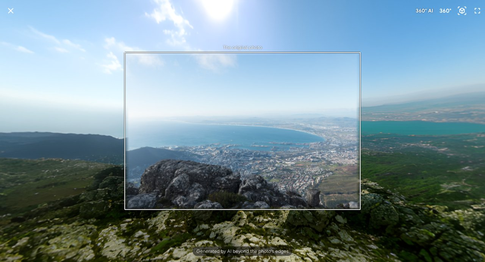

🌐 <b>Català</b> · Altres llengües (88)
<a href="../README.md">English</a> · <a href="README.af.md">Afrikaans</a> · <a href="README.ar.md">العربية</a> · <a href="README.az.md">Azərbaycanca</a> · <a href="README.be.md">Беларуская</a> · <a href="README.bg.md">Български</a> · <a href="README.bi.md">Bislama</a> · <a href="README.bn.md">বাংলা</a> · <a href="README.br.md">Brezhoneg</a> · <a href="README.bs.md">Bosanski</a> · <a href="README.cs.md">Čeština</a> · <a href="README.cv.md">Чӑвашла</a> · <a href="README.da.md">Dansk</a> · <a href="README.de.md">Deutsch</a> · <a href="README.de_CH.md">Deutsch (Schweiz)</a> · <a href="README.el.md">Ελληνικά</a> · <a href="README.en_GB.md">English (UK)</a> · <a href="README.eo.md">Esperanto</a> · <a href="README.es.md">Español</a> · <a href="README.et.md">Eesti</a> · <a href="README.eu.md">Euskara</a> · <a href="README.fa.md">فارسی</a> · <a href="README.fi.md">Suomi</a> · <a href="README.fil.md">Filipino</a> · <a href="README.fr.md">Français</a> · <a href="README.ga.md">Gaeilge</a> · <a href="README.gl.md">Galego</a> · <a href="README.gsw.md">Alemannisch</a> · <a href="README.gu.md">ગુજરાતી</a> · <a href="README.he.md">עברית</a> · <a href="README.hi.md">हिन्दी</a> · <a href="README.hr.md">Hrvatski</a> · <a href="README.hu.md">Magyar</a> · <a href="README.hy.md">Հայերեն</a> · <a href="README.id.md">Bahasa Indonesia</a> · <a href="README.is.md">Íslenska</a> · <a href="README.it.md">Italiano</a> · <a href="README.ja.md">日本語</a> · <a href="README.ka.md">ქართული</a> · <a href="README.kab.md">Taqbaylit</a> · <a href="README.kk.md">Қазақша</a> · <a href="README.km.md">ខ្មែរ</a> · <a href="README.kmr.md">Kurmancî</a> · <a href="README.kn.md">ಕನ್ನಡ</a> · <a href="README.ko.md">한국어</a> · <a href="README.kxm.md">ภาษาเขมรถิ่นไทย</a> · <a href="README.lb.md">Lëtzebuergesch</a> · <a href="README.lmo.md">Lombard</a> · <a href="README.lt.md">Lietuvių</a> · <a href="README.lv.md">Latviešu</a> · <a href="README.mfa.md">Bahasa Melayu Kelantan</a> · <a href="README.mi.md">Te reo Māori</a> · <a href="README.mk.md">Македонски</a> · <a href="README.ml.md">മലയാളം</a> · <a href="README.mn.md">Монгол</a> · <a href="README.mr.md">मराठी</a> · <a href="README.ms.md">Bahasa Melayu</a> · <a href="README.nb_NO.md">Norsk bokmål</a> · <a href="README.ne.md">नेपाली</a> · <a href="README.nl.md">Nederlands</a> · <a href="README.nn.md">Norsk nynorsk</a> · <a href="README.pa.md">ਪੰਜਾਬੀ</a> · <a href="README.pl.md">Polski</a> · <a href="README.pt.md">Português</a> · <a href="README.pt_BR.md">Português (Brasil)</a> · <a href="README.ro.md">Română</a> · <a href="README.ru.md">Русский</a> · <a href="README.si.md">සිංහල</a> · <a href="README.sk.md">Slovenčina</a> · <a href="README.sl.md">Slovenščina</a> · <a href="README.sq.md">Shqip</a> · <a href="README.sr_Cyrl.md">Српски</a> · <a href="README.sr_Latn.md">Srpski</a> · <a href="README.sv.md">Svenska</a> · <a href="README.sw.md">Kiswahili</a> · <a href="README.swg.md">Schwäbisch</a> · <a href="README.ta.md">தமிழ்</a> · <a href="README.te.md">తెలుగు</a> · <a href="README.th.md">ไทย</a> · <a href="README.tl.md">Tagalog</a> · <a href="README.tr.md">Türkçe</a> · <a href="README.uk.md">Українська</a> · <a href="README.ur.md">اردو</a> · <a href="README.uz.md">Oʻzbekcha</a> · <a href="README.vi.md">Tiếng Việt</a> · <a href="README.yue_Hant.md">粵語</a> · <a href="README.zh_Hans.md">简体中文</a> · <a href="README.zh_Hant.md">繁體中文</a>

  

# Immuch360

**El teu contingut. Qualsevol pantalla. Totes les perspectives.**

🌐 <a href="https://immuch360.com/ca/"><b>immuch360.com</b></a>

Fotos i vídeos plans, 360° i 3D del teu dispositiu, el teu NAS, el teu servidor Immich, les teves càmeres i el teu dron. No cal cap compte. Immuch360 és una aplicació lliure i de codi obert que llegeix les teves fotos i vídeos allà on són i reprodueix cadascun al visualitzador que li escau: en pla, com una esfera on mires al voltant, en 3D, o tot al teu voltant amb unes ulleres. Funciona en telèfons, tauletes, televisors, ulleres Meta Quest i ordinadors. El seu lloc web, [immuch360.com](https://immuch360.com/ca/), mostra què fa a cada pantalla, en 89 idiomes.

**Novetats de la compilació 53 i la compilació d'escriptori 34, versió 3.4.8.** Als ordinadors, [Spatial 2.5D](#see-your-3d-photos-and-videos-in-depth-on-your-computer) dona profunditat a les teves fotos 3D a la pantalla plana, a Windows, Linux i macOS, i als teus vídeos 3D a Windows i macOS: la vista es mou quan mous el cap, que la webcam segueix un cop hi dones el teu acord, o amb el ratolí, i les imatges de la webcam es queden a la memòria de l'ordinador, mai desades ni enviades; encara no provat amb una webcam pel projecte. La roda [amplia una foto al voltant del punter](#zoom-into-a-photo-with-the-wheel) i un arrossegament la desplaça. [Millora (IA)](#make-a-photo-sharper-on-your-computer-ai) agafa les fotos dels teus recursos compartits, de DLNA, Plex, Jellyfin i Emby i del teu servidor Immich, millora les fotos 360° i 3D sense trencar-ne la costura ni els dos ulls, i ofereix Nitidesa en un Mac amb xip d'Apple (encara no provat en un Mac). Des del telèfon, ["Reprodueix a…"](#show-your-photos-and-videos-on-the-tv-from-your-phone) obre un element 360° a la vista 360° de la pantalla, reprodueix una selecció o un àlbum com a presentació, inicia la sessió d'una pantalla al teu servidor i envia les fotos i vídeos que només són al telèfon; provat entre emuladors d'Android, encara no en un telèfon ni un televisor reals. En unes Meta Quest, la presentació de la pantalla gran [fa una fosa encadenada o un lliscament](#browse-your-photos-on-the-big-screen-of-the-quest) entre fotos, sobre un fons negre, borrós o de passthrough que tries, encara no provat en unes ulleres pel projecte.

**Novetats de les compilacions 33 a 52.** [Les pel·lícules continuen on les vas deixar](#pick-up-a-film-where-you-stopped). Comencen abans i, des d'un servidor lent, [continuen reproduint-se en lloc d'aturar-se](#when-a-video-waits-or-will-not-play). La cronologia [es redueix a mesos i anys](#find-a-month-or-a-year-in-a-long-timeline) als telèfons i als ordinadors. En un telèfon Android o unes Meta Quest, ["Explora una carpeta"](#browse-a-folder-of-your-phone-or-headset) obre una carpeta del dispositiu com un recurs compartit, i les fotos TIFF es mostren. Android TV [cerca per data amb el comandament](#on-android-tv-and-google-tv), unes Meta Quest 3 o 3S [obren splats gaussians](#explore-gaussian-splats-in-a-meta-quest-3-or-3s), que es giren amb el joystick dret, versió 4 de SPZ inclosa, i un ordinador [fa les versions 3D de les fotos del teu NAS](#turn-one-photo-into-3d-a-scene-a-panorama). En un portàtil Windows amb dos xips gràfics, l'aplicació [funciona ara amb el ràpid](#when-a-video-waits-or-will-not-play), de manera que les pel·lícules 8K es reprodueixen amb fluïdesa. Els splats gaussians ara [s'obren en ordinadors i en telèfons i tauletes Android](#explore-gaussian-splats-on-your-phone-tablet-or-computer), un ordinador Windows [fa escenes splat a partir de les teves fotos o d'un vídeo](#make-a-splat-scene-from-your-photos-or-a-video-ai) amb la IA, el teu servidor Immich [les conserva dins de fotos](#keep-a-splat-scene-on-your-immich-server) que s'obren des de la teva cronologia, i els ordinadors [reprodueixen vídeos AV2](#play-av2-videos-on-your-computer). Des de la compilació 42, els vídeos en brut de les càmeres Insta360, GoPro MAX i DJI Osmo 360, des de la teva biblioteca d'Immich, un recurs compartit o una carpeta, [es reprodueixen estabilitzats amb el giroscopi de la càmera](#stabilise-your-360-videos-with-the-cameras-gyroscope) als telèfons, tauletes i televisors Android, el creador de splats de la compilació d'escriptori 22 [ofereix una qualitat Detallada](#make-a-splat-scene-from-your-photos-or-a-video-ai) per a les escenes que mires de prop, i una panoràmica 360° [comença amb 3,5 GiB lliures de la targeta gràfica](#turn-one-photo-into-3d-a-scene-a-panorama). L'aplicació per a iPhone i iPad és [a l'App Store](https://apps.apple.com/us/app/immuch360-360-3d-player/id6817655965), versió 3.4.3. Des de la compilació 43, l'avís d'actualització de l'aplicació obre Google Play o l'App Store als telèfons i les tauletes; el seu lloc web, [immuch360.com](https://immuch360.com/ca/), va obrir el 7 de novembre. Des de la compilació 44 i la compilació d'escriptori 24, unes Meta Quest 3 o 3S [mostren splats de fins a 300.000 gaussianes](#explore-gaussian-splats-in-a-meta-quest-3-or-3s), els ordinadors [seleccionen diverses fotos i vídeos amb Ctrl i Shift](#use-your-computer-as-the-media-player), un televisor el descodificador del qual rebutja un vídeo [reprodueix l'altre fitxer del servidor](#when-a-video-waits-or-will-not-play) tot sol, les panoràmiques funcionen amb la targeta gràfica triada d'un portàtil que en té dues, i l'avís d'actualització de les Quest i dels ordinadors obre la seva pàgina de la botiga o de baixada, amb moltes correccions. Des de la compilació 45 i la compilació d'escriptori 25, versió 3.4.0 a totes les plataformes, l'aplicació segueix l'aplicació Immich 3.4.0 amb 11 correccions posteriors d'Immich, mostra les [fotos JPEG XL dels servidors Immich 3.4](#keep-your-immich-library-with-more), obre [les teves pel·lícules de Plex per any](#watch-your-plex-films) amb una pàgina per a cada pel·lícula, la seva baixada al dispositiu i la seva reproducció al televisor des del telèfon, pot demanar una valoració a les compilacions de les botigues, i, als ordinadors, agafa els seus components de vídeo dels [seus propis repositoris oberts](#licences-and-credits). Des de la compilació 46 i la compilació d'escriptori 26, versió 3.4.1, els vídeos en brut de les càmeres 360° també [es reprodueixen estabilitzats](#stabilise-your-360-videos-with-the-cameras-gyroscope) a l'iPhone i l'iPad, en unes Meta Quest i a Windows, unes Meta Quest [reprodueixen amb libmpv les pel·lícules de Plex que el seu propi reproductor no pot descodificar](#watch-your-plex-films), un telèfon [envia una pel·lícula així a un Chromecast o a un Google TV](#watch-your-plex-films), i el relleu IA d'una foto 3D [pren la intensitat que tries](#turn-one-photo-into-3d-a-scene-a-panorama); també es pot afegir un servidor nou iniciant la sessió amb el teu compte de Plex, i l'aplicació [conserva la seva configuració en un fitxer](#keep-your-settings-in-a-file). Des de la compilació 47 i la compilació d'escriptori 27, versió 3.4.2, una pel·lícula de Plex [reprodueix una pista d'àudio que el dispositiu descodifica](#watch-your-plex-films) i diu quina, obre la versió que s'adapta a la pantalla i, amb una connexió lenta, n'ofereix una de més lleugera, Windows i macOS en reprodueixen el so Dolby TrueHD, Android [mostra la seva baixada en una notificació](#watch-your-plex-films) i Android TV també baixa pel·lícules, i [les càmeres Tapo amb bateria es mostren en directe](#watch-your-home-cameras-on-the-big-screen); restaurar un fitxer de configuració amb els seus comptes ara inicia la sessió al teu servidor Immich. Des de la compilació 48 i la compilació d'escriptori 28, versió 3.4.3, un ordinador Windows [reprodueix els teus vídeos en unes ulleres PC VR](#watch-your-videos-in-a-pc-vr-headset-from-windows) a través de SteamVR, Meta Horizon Link o un altre entorn d'execució OpenXR (encara no provat en unes ulleres pel projecte), [les càmeres d'altres marques es mostren en directe](#cameras-of-other-brands-over-onvif-or-rtsp), trobades per ONVIF o afegides amb el seu enllaç RTSP (comprovades amb una càmera simulada, encara no s'ha provat cap càmera real d'una altra marca), els vídeos en brut de la [DJI Osmo 360 II i la GoPro MAX 2 es reprodueixen estabilitzats](#open-the-raw-files-of-360-cameras), les pel·lícules de Plex [ja no arriben massa a poc a poc als telèfons](#when-a-video-waits-or-will-not-play), els televisors LG i Samsung [giren un vídeo que queda de costat](#on-a-samsung-tv-tizen) amb un sol botó (encara no provat en un televisor LG; el televisor Samsung de la issue 17 va rebutjar el gir), i "Hi ha disponible una actualització del servidor" ja no apareix per a un servidor que està al dia. Des de la compilació 49 i la compilació d'escriptori 29, versió 3.4.4, l'aplicació [llegeix ella mateixa els teus servidors Jellyfin i Emby](#watch-your-jellyfin-and-emby-libraries) (encara no provat en un dispositiu), trobats a la teva xarxa i amb la sessió iniciada amb Quick Connect en un televisor o en unes ulleres, amb els seus fitxers originals reproduïts de manera que un vídeo 360° continua sent 360°; a la pantalla gran d'una Meta Quest, les fotos [mantenen la mida i el lloc que fixes mentre les passes, i es reprodueixen com a presentació](#browse-your-photos-on-the-big-screen-of-the-quest) (encara no provat en unes ulleres pel projecte); el reproductor de vídeo 360° dels telèfons i les tauletes [rep els controls de les fotos 360°](#360-videos-on-your-phone-with-the-controls-of-360-photos), un botó del giroscopi, el zoom pinçant i un arrossegament fins a dalt o a baix del tot (provat per un usuari en un Samsung Galaxy S25 Ultra, encara no en un iPhone); un ordinador [converteix els teus vídeos 2D en vídeos 3D](#turn-your-2d-videos-into-3d-on-your-computer) amb IA (encara no provat en una pantalla 3D ni en unes ulleres); i els televisors Samsung [passen un vídeo que necessita un gir al reproductor propi de Samsung](#on-a-samsung-tv-tizen), que el televisor de la issue 17 reprodueix però es nega a girar. Des de la compilació 50 i la compilació d'escriptori 30, versió 3.4.5, mentre es reprodueix un vídeo a la finestra 2D d'una Meta Quest, la finestra [es redibuixa a la freqüència de la pantalla](#step-inside-your-photos-and-videos-with-a-meta-quest) en lloc d'unes 10 vegades per segon com a les compilacions 48 i 49 (mesurat en una Meta Quest 3), Android TV [amplia una foto amb el comandament](#on-android-tv-and-google-tv) i la mou amb les fletxes (nou, encara no provat en un televisor), i tres correccions vénen del fork d'Android TV de mlc70: un lliscament ràpid ja no mostra els detalls de la foto que queda enrere, una foto animada allibera la seva memòria, i el filtre Ubicació proposa les ciutats del país nou. Des de la compilació 51 i la compilació d'escriptori 31, versió 3.4.6, [Millora (IA)](#make-a-photo-sharper-on-your-computer-ai) fa una còpia més nítida d'una foto poc nítida al costat de l'original a Windows i Linux, en tres nivells, cadascun executat una vegada en un PC amb una RTX 4060, Natural també s'ofereix en un Mac amb xip d'Apple (encara no provat en un Mac), un ordinador [converteix un vídeo 360° en un vídeo 3D 360°](#a-360-video-turned-into-a-360-3d-video) amb IA, amb la profunditat dels vídeos 3D estimada per la targeta gràfica a Windows, les funcions d'IA agafen directament els vídeos del teu servidor i d'un recurs compartit, el fitxer de configuració té [la seva targeta a la Biblioteca](#keep-your-settings-in-a-file), un televisor el desa en un recurs compartit de xarxa, Escape torna un pas enrere als ordinadors, les compilacions de les botigues demanen una valoració [menys sovint i amb més suavitat](#privacy), Linux mostra les fotos TIFF, les escenes splat i els vídeos 3D amb un ull, i s'han corregit dues fallades. Des de la compilació 52 i la compilació d'escriptori 32, versió 3.4.7, ["Reprodueix a…"](#show-your-photos-and-videos-on-the-tv-from-your-phone) envia les fotos i els vídeos de la teva biblioteca d'Immich, dels teus recursos compartits i de Jellyfin i Emby des del telèfon a un televisor, unes Meta Quest, un ordinador o un Chromecast, els noms de les teves fotos i vídeos [es mantenen llegibles sobre les seves miniatures](#play-the-files-of-a-nas-a-computer-a-media-server-or-plex), els components d'IA d'un ordinador [s'actualitzen amb un clic](#update-the-ai-components-in-one-click), Linux rep [una AppImage](#linux), i l'aplicació per a iPhone i iPad es compila amb Xcode 27. La compilació d'escriptori 33 va corregir [Millora (IA)](#make-a-photo-sharper-on-your-computer-ai), que fallava amb cada foto a les compilacions d'escriptori 31 i 32 ([issue 23](https://github.com/freeKC/Immuch360/issues/23)).

  Bifurcació no oficial de l'aplicació mòbil Immich. Sense cap afiliació amb Immich ni amb FUTO. El nom es llegeix com "I am much 360".

<b>Contingut</b>

- [Per a qui és](#who-it-is-for)
- [Quines pantalles](#which-screens), [què fan juntes](#use-cases) i [què fa cada pantalla](#what-each-screen-does)
- [Què pots fer](#what-you-can-do)
- [Instal·la-la al teu dispositiu](#get-it-on-your-device)
- [Com fer-ho](#how-to)
  - [Mira les teves fotos i vídeos, amb servidor o sense](#watch-your-photos-and-videos-with-or-without-a-server)
  - [Explora panoràmiques, 360°, VR180 i 3D](#explore-panoramas-360-vr180-and-3d): [vídeos 360° als telèfons](#360-videos-on-your-phone-with-the-controls-of-360-photos)
  - [Converteix una foto en 3D, una escena, una panoràmica](#turn-one-photo-into-3d-a-scene-a-panorama): [Components d'IA actualitzats amb un clic](#update-the-ai-components-in-one-click)
  - [Converteix els teus vídeos 2D en 3D a l'ordinador](#turn-your-2d-videos-into-3d-on-your-computer): [vídeos 360° a 3D 360°](#a-360-video-turned-into-a-360-3d-video)
  - [Fes una foto més nítida a l'ordinador (IA)](#make-a-photo-sharper-on-your-computer-ai)
  - [Mira-ho al televisor amb el comandament](#watch-on-the-tv-with-the-remote): [Android TV i Google TV](#on-android-tv-and-google-tv), [LG](#on-an-lg-tv-webos), [Samsung](#on-a-samsung-tv-tizen)
  - [Inicia la sessió en un televisor, unes ulleres o un ordinador amb el telèfon](#sign-in-a-tv-a-headset-or-a-computer-with-your-phone)
  - [Mostra les teves fotos i vídeos al televisor des del telèfon](#show-your-photos-and-videos-on-the-tv-from-your-phone)
  - [Entra dins de les teves fotos i vídeos amb una Meta Quest](#step-inside-your-photos-and-videos-with-a-meta-quest): [la pantalla gran](#browse-your-photos-on-the-big-screen-of-the-quest), [mode quiosc](#kiosk-mode-for-an-exhibition-or-a-shop)
  - [Explora splats gaussians amb unes Meta Quest 3 o 3S](#explore-gaussian-splats-in-a-meta-quest-3-or-3s)
  - [Explora splats gaussians al teu telèfon, tauleta o ordinador](#explore-gaussian-splats-on-your-phone-tablet-or-computer)
  - [Fes una escena splat a partir de les teves fotos o d'un vídeo (IA)](#make-a-splat-scene-from-your-photos-or-a-video-ai)
  - [Conserva una escena splat al teu servidor Immich](#keep-a-splat-scene-on-your-immich-server)
  - [Reprodueix els fitxers d'un NAS, un ordinador, un servidor multimèdia o Plex](#play-the-files-of-a-nas-a-computer-a-media-server-or-plex): [les teves pel·lícules per any](#watch-your-plex-films), [Jellyfin i Emby](#watch-your-jellyfin-and-emby-libraries)
  - [Explora una carpeta del telèfon o de les ulleres](#browse-a-folder-of-your-phone-or-headset)
  - [Reprèn una pel·lícula on la vas deixar](#pick-up-a-film-where-you-stopped)
  - [Quan un vídeo s'espera o no es reprodueix](#when-a-video-waits-or-will-not-play)
  - [Conserva la teva biblioteca Immich, amb més coses](#keep-your-immich-library-with-more)
  - [Troba un mes o un any en una cronologia llarga](#find-a-month-or-a-year-in-a-long-timeline)
  - [Mira les càmeres de casa a la pantalla gran](#watch-your-home-cameras-on-the-big-screen): [altres marques](#cameras-of-other-brands-over-onvif-or-rtsp)
  - [El teu dron DJI](#your-dji-drone): [vídeo en directe](#see-what-your-drone-sees-on-your-phone), [en una Quest o a Android TV](#watch-it-in-a-meta-quest-or-on-an-android-tv), [importació](#bring-a-drones-or-a-camera-cards-photos-and-videos-to-immich)
  - [Obre els fitxers en brut de les càmeres 360°](#open-the-raw-files-of-360-cameras)
  - [Estabilitza els teus vídeos 360° amb el giroscopi de la càmera](#stabilise-your-360-videos-with-the-cameras-gyroscope)
  - [Gira una foto amb una sola tecla](#turn-a-photo-with-one-key)
  - [Fes servir l'ordinador com a reproductor multimèdia](#use-your-computer-as-the-media-player): [amplia amb la roda](#zoom-into-a-photo-with-the-wheel)
  - [Mira les teves fotos i vídeos 3D amb profunditat a l'ordinador](#see-your-3d-photos-and-videos-in-depth-on-your-computer)
  - [Mira els teus vídeos en unes ulleres PC VR, des de Windows](#watch-your-videos-in-a-pc-vr-headset-from-windows)
  - [Reprodueix vídeos AV2 al teu ordinador](#play-av2-videos-on-your-computer)
  - [Conserva la teva configuració en un fitxer](#keep-your-settings-in-a-file)
- [Comparat amb Immich](#compared-with-immich)
- [Privadesa](#privacy)
- [Llicències i crèdits](#licences-and-credits)
- [Full de ruta](#roadmap)
- [Documentació](#documentation)

## Per a qui és

- **Fas fotos o vídeos 360° o 3D** i vols mirar al voltant dins de les teves preses, no veure-les planes, duplicades o estirades, i girar els teus vídeos 360° al telèfon com en gires les fotos: [360°, VR180 i 3D](#explore-panoramas-360-vr180-and-3d), [vídeos 360° als telèfons](#360-videos-on-your-phone-with-the-controls-of-360-photos).
- **Filmes amb una càmera 360° a la mà, en una bicicleta o en un casc** i vols que els vídeos en brut de la teva càmera Insta360, GoPro MAX o MAX 2, DJI Osmo 360 o Osmo 360 II, conservats a Immich, en un recurs compartit o en una carpeta, es reprodueixin anivellats i estables al telèfon, al televisor, a les teves Meta Quest o al teu ordinador Windows: [estabilitzats amb el giroscopi de la càmera](#stabilise-your-360-videos-with-the-cameras-gyroscope).
- **Les teves fotos i pel·lícules són en un NAS, un ordinador, Plex o Immich** i les vols al televisor sense copiar res: [al televisor](#watch-on-the-tv-with-the-remote), [NAS, recursos compartits i Plex](#play-the-files-of-a-nas-a-computer-a-media-server-or-plex).
- **Guardes les teves pel·lícules en un servidor Plex** i en vols triar una per any, veure què és abans que comenci, emportar-te-la de viatge, iniciar-la al televisor o en un Chromecast des del telèfon, i reproduir fins i tot les pel·lícules que el teu telèfon Android, el televisor o les Meta Quest no poden descodificar: [les teves pel·lícules, per any](#watch-your-plex-films).
- **Guardes les teves pel·lícules en un servidor Jellyfin o Emby** i les vols a les teves Meta Quest, al televisor o al telèfon, amb el 360° i el 3D tal com són, i el punt on et vas quedar conservat al servidor (encara no provat en un dispositiu): [Jellyfin i Emby](#watch-your-jellyfin-and-emby-libraries).
- **Tens una Meta Quest** i vols entrar dins de les teves pròpies fotos i vídeos: [a les ulleres](#step-inside-your-photos-and-videos-with-a-meta-quest), i passar les teves fotos en una pantalla gran amb la mida i el lloc que fixes, també com a presentació (encara no provat en unes ulleres pel projecte): [la pantalla gran](#browse-your-photos-on-the-big-screen-of-the-quest).
- **Tens unes ulleres PC VR en un ordinador Windows** i hi vols veure els teus vídeos 360° al teu voltant i les teves pel·lícules en una pantalla gran (encara no provat en unes ulleres pel projecte): [en unes ulleres PC VR](#watch-your-videos-in-a-pc-vr-headset-from-windows).
- **Les teves fotos són planes** i les vols en 3D, com una escena on inclinar-te amb unes ulleres, o dins d'una panoràmica 360°, sense càmera 3D: [converteix una foto en 3D, una escena, una panoràmica](#turn-one-photo-into-3d-a-scene-a-panorama), nou, fet per la IA al teu propi ordinador.
- **Els teus vídeos són plans**, inclosos els clips del teu telèfon, i els vols en 3D per a unes ulleres o una pantalla 3D, i els teus vídeos 360° en 3D 360°, fets al teu propi ordinador (encara no provat en una pantalla 3D ni en unes ulleres): [vídeos 2D a 3D](#turn-your-2d-videos-into-3d-on-your-computer), [360° a 3D 360°](#a-360-video-turned-into-a-360-3d-video).
- **Les teves fotos són poc nítides**, una mica desenfocades o fetes amb poca llum, i en vols una còpia més nítida al costat de l'original, feta al teu propi ordinador, també des dels teus recursos compartits i servidors, amb el detall inventat dit clarament: [Millora (IA)](#make-a-photo-sharper-on-your-computer-ai).
- **Tens fotos o vídeos 3D i un ordinador** i els vols amb profunditat a la seva pantalla plana, amb la vista que es mou quan mous el cap, que la webcam segueix, o amb el ratolí (encara no provat amb una webcam pel projecte): [Spatial 2.5D a l'ordinador](#see-your-3d-photos-and-videos-in-depth-on-your-computer).
- **Fas servir Immich** i en vols l'aplicació, més els visualitzadors immersius i les pantalles grans on inicies la sessió des del telèfon: [la teva biblioteca Immich](#keep-your-immich-library-with-more), [comparat amb Immich](#compared-with-immich).
- **Vigiles casa teva amb càmeres Tapo**, també les de bateria, o càmeres d'altres marques per ONVIF o RTSP, i les vols al costat de les teves fotos, també al televisor (comprovat amb una càmera simulada): [càmeres de casa](#watch-your-home-cameras-on-the-big-screen).
- **Fas volar un dron DJI** i en vols la imatge en directe al telèfon sense DJI Fly, i en una Meta Quest o en un Android TV per a la gent que t'acompanya: [el teu dron](#see-what-your-drone-sees-on-your-phone).
- **Captures llocs i objectes en 3D, com a splats gaussians,** o els voldries fer a partir de les teves pròpies fotos, i hi vols passejar al teu telèfon, al teu ordinador o amb unes ulleres: [en un telèfon, una tauleta o un ordinador](#explore-gaussian-splats-on-your-phone-tablet-or-computer), [fets a partir de les teves fotos](#make-a-splat-scene-from-your-photos-or-a-video-ai), [conservats a Immich](#keep-a-splat-scene-on-your-immich-server).
- **Tens vídeos AV2**, el format que ve després d'AV1, i els vols veure al teu ordinador: [AV2 al teu ordinador](#play-av2-videos-on-your-computer).
- **Tens diverses pantalles a casa** i vols que funcionin juntes: [què fan juntes les teves pantalles](#use-cases).

No cal crear cap compte d'Immuch360, i res no ens arriba: l'aplicació només parla amb els teus dispositius i amb els servidors que tries, des de la compilació 45 amb Wikipedia per a la pàgina d'una pel·lícula, des de la compilació 46 amb plex.tv quan hi inicies la sessió, i només descarrega un component d'IA o el descodificador AV2 quan tu ho demanes.

## Quines pantalles

| Plataforma | On aconseguir-la | Estat el novembre de 2026 |
|---|---|---|
|  **Android** telèfons i tauletes | [Google Play](https://play.google.com/store/apps/details?id=com.aprogsys.immuch360) · [APK](https://github.com/freeKC/Immuch360/releases) | a Google Play (compilació 47 publicada el 16 de novembre; compilació 51 en revisió de Google des del 24 de novembre; la compilació 53 arriba després), compilació 53 al GitHub, on [els vídeos 360° en brut es reprodueixen estabilitzats](#stabilise-your-360-videos-with-the-cameras-gyroscope), [les pel·lícules continuen on les vas deixar](#pick-up-a-film-where-you-stopped), ["Explora una carpeta"](#browse-a-folder-of-your-phone-or-headset) obre una carpeta del telèfon i [s'obren els splats gaussians](#explore-gaussian-splats-on-your-phone-tablet-or-computer), des d'un recurs compartit o [des de la teva cronologia d'Immich](#keep-a-splat-scene-on-your-immich-server), [la configuració conservada en un fitxer](#keep-your-settings-in-a-file), [la baixada d'una pel·lícula mostrada en una notificació](#watch-your-plex-films), des de la compilació 48 [les càmeres d'altres marques, en directe](#cameras-of-other-brands-over-onvif-or-rtsp) (comprovades amb una càmera simulada) i, des de la compilació 49, [els servidors Jellyfin i Emby](#watch-your-jellyfin-and-emby-libraries) (encara no provat en un dispositiu) i [els controls de les fotos 360° al reproductor de vídeo 360°](#360-videos-on-your-phone-with-the-controls-of-360-photos) (provat per un usuari en un Samsung Galaxy S25 Ultra) i, des de la compilació 51, [la targeta del fitxer de configuració a la Biblioteca](#keep-your-settings-in-a-file), amb el fitxer desat també en un recurs compartit de xarxa, i des de la compilació 52 [les teves fotos i vídeos enviats a un televisor o a un Chromecast](#show-your-photos-and-videos-on-the-tv-from-your-phone) amb "Reprodueix a…" (encara no provat en un dispositiu), i des de la compilació 53 [els elements 360°, una selecció o un àlbum i les fotos i vídeos del mateix telèfon](#show-your-photos-and-videos-on-the-tv-from-your-phone) enviats de la mateixa manera (provat entre emuladors d'Android) |
|  **iPhone i iPad** | [App Store](https://apps.apple.com/us/app/immuch360-360-3d-player/id6817655965) | versió 3.4.7 a l'App Store des del 26 de novembre, amb [mesos i anys a la cronologia](#find-a-month-or-a-year-in-a-long-timeline), [pel·lícules que continuen on les vas deixar](#pick-up-a-film-where-you-stopped), [l'inici de sessió d'un televisor, unes ulleres o un ordinador](#sign-in-a-tv-a-headset-or-a-computer-with-your-phone) des del telèfon, les escenes splat conservades a Immich mostrades com la seva foto, les correccions d'Immich 3.4.0 i les seves fotos JPEG XL, [els vídeos 360° en brut estabilitzats](#stabilise-your-360-videos-with-the-cameras-gyroscope), [la configuració conservada en un fitxer](#keep-your-settings-in-a-file), [la visualització en directe de les càmeres Tapo amb bateria](#watch-your-home-cameras-on-the-big-screen) i [la visualització en directe de les càmeres d'altres marques](#cameras-of-other-brands-over-onvif-or-rtsp) (comprovades amb una càmera simulada), i des de la versió 3.4.4 [els servidors Jellyfin i Emby](#watch-your-jellyfin-and-emby-libraries) (encara no provat en un dispositiu) i [els controls de les fotos 360° al reproductor de vídeo 360°](#360-videos-on-your-phone-with-the-controls-of-360-photos) (encara no provat en un iPhone), i des de la versió 3.4.6 [la targeta del fitxer de configuració](#keep-your-settings-in-a-file) i la seva restauració des d'un recurs compartit de xarxa, i des de la versió 3.4.7, compilada amb Xcode 27, ["Reprodueix a…" per a fotos i vídeos](#show-your-photos-and-videos-on-the-tv-from-your-phone) (encara no provat en un iPhone); la versió 3.4.8, la versió per a iPhone i iPad de la compilació 53, arriba després; o [compila-la tu mateix](../docs/immuch360/build.md) |
|  **Android TV i Google TV** | [Google Play](https://play.google.com/store/apps/details?id=com.aprogsys.immuch360) · [APK](#android-tv-and-google-tv) | a Google Play, que ofereix l'aplicació a Android TV i Google TV, i compilació 53 al GitHub: [els vídeos 360° en brut estabilitzats](#stabilise-your-360-videos-with-the-cameras-gyroscope), [la cerca per data amb el comandament](#on-android-tv-and-google-tv), l'[inici de sessió amb el telèfon](#sign-in-a-tv-a-headset-or-a-computer-with-your-phone) escanejant un codi QR, una barra de temps, àudio i subtítols per al comandament al reproductor de vídeo, i el [vídeo en directe d'un dron](#watch-it-in-a-meta-quest-or-on-an-android-tv) retransmès per un telèfon, [les pel·lícules baixades al televisor](#watch-your-plex-films) i, des de la compilació 49, [els servidors Jellyfin i Emby](#watch-your-jellyfin-and-emby-libraries) amb la sessió iniciada amb Quick Connect (encara no provat en un dispositiu) i, des de la compilació 50, [les fotos ampliades amb el comandament](#on-android-tv-and-google-tv) (vist funcionar en un emulador d'Android TV, encara no provat en un televisor) i, des de la compilació 51, [el fitxer de configuració desat i restaurat en un recurs compartit de xarxa](#keep-your-settings-in-a-file) (vist funcionar en un emulador d'Android TV) i, des de la compilació 52, [les fotos i vídeos que un telèfon envia amb "Reprodueix a…"](#show-your-photos-and-videos-on-the-tv-from-your-phone) (encara no provat en un televisor), i des de la compilació 53 les fotos 360° que envia un telèfon obertes a la seva vista 360°, un inici de sessió des del full del telèfon i les fotos i vídeos del mateix telèfon (vist funcionar en un emulador d'Android TV) |
| **Televisors LG** amb webOS 5.0 o posterior | [.ipk, versió 1.0.5](https://github.com/freeKC/Immuch360/releases/tag/webos-v1.0.5) · LG Content Store (en revisió) | versió 1.0.0, enviada a l'LG Content Store el 24 d'octubre, en proves d'LG des del 26 d'octubre; la versió 1.0.1, al GitHub des del 27 d'octubre, amplia una foto amb les fletxes i avisa quan una foto encara s'està carregant, i la versió 1.0.2, al GitHub amb la compilació 46, escriu "inicia la sessió" com a ログイン en japonès, la versió 1.0.3, amb la compilació 47, avisa quan una carpeta d'un servidor DLNA conté canals de televisió en directe, que encara no pot reproduir, la versió 1.0.4, amb la compilació 48, [gira un vídeo que queda de costat](#on-an-lg-tv-webos) amb un sol botó (encara no provat en un televisor LG), i la versió 1.0.5, amb la compilació 49, anomena Jellyfin amb el seu connector DLNA entre els servidors DLNA; fins que LG no publiqui l'aplicació, s'instal·la en [Developer Mode](#lg-tvs-webos). La versió 1.0.0 ha funcionat en televisors webOS 25 del Cloud Test Lab d'LG |
| **Televisors Samsung** amb Tizen 5.5 o posterior | [.wgt, versió 0.3.6](https://github.com/freeKC/Immuch360/releases/tag/tizen-v0.3.6) | versió 0.3.6 de la mateixa aplicació de televisor, per signar amb el teu propi certificat de Samsung i instal·lar en [Developer mode](#samsung-tvs-tizen); la 0.1.0 va funcionar al televisor Samsung d'un provador, la 0.2.0 inclou les correccions d'aquella prova, la 0.3.0 hi afegeix l'ampliació de les fotos i l'etiqueta S'està carregant de la versió 1.0.1 d'LG, i la 0.3.1 el text japonès de la versió 1.0.2 d'LG, la 0.3.2 reprodueix del dret un vídeo filmat en vertical amb un telèfon ([issue 17](https://github.com/freeKC/Immuch360/issues/17)), la 0.3.3 i la 0.3.4 [el giren en un televisor que l'indica com a vertical](#on-a-samsung-tv-tizen) i hi afegeixen un botó que el gira a mà, i la 0.3.5 i la 0.3.6 passen aquest vídeo al reproductor propi de Samsung; al televisor de l'autor de la issue, la 0.3.4 i la 0.3.5 van deixar la imatge de costat, perquè el televisor es negava al gir, i la sortida allà és un vídeo que el teu servidor Immich transcodifica, desat del dret; no és a la botiga de Samsung |
|  **Meta Quest** 2, Pro, 3 i 3S | [Horizon Store](https://www.meta.com/experiences/immuch360/1384208401440714/) · [APK](#meta-quest) | a l'Horizon Store (la compilació 50, la finestra 2D de la qual es redibuixa a la freqüència de la pantalla mentre es reprodueix un vídeo, publicada el 25 de novembre; la compilació 52 en revisió de Meta des del 25 de novembre; la compilació 53 arriba després), compilació 53 al GitHub, amb un [mode quiosc](#kiosk-mode-for-an-exhibition-or-a-shop), [els vídeos 360° en brut estabilitzats](#stabilise-your-360-videos-with-the-cameras-gyroscope) a la vista immersiva, [les pel·lícules que no pot descodificar reproduïdes per libmpv](#watch-your-plex-films) i, a la Quest 3 i 3S, [splats gaussians](#explore-gaussian-splats-in-a-meta-quest-3-or-3s) i el [relleu IA](#turn-one-photo-into-3d-a-scene-a-panorama) d'una foto plana, i des de la compilació 49 [les fotos passades a la pantalla gran](#browse-your-photos-on-the-big-screen-of-the-quest) amb la mida que fixes, també com a presentació (encara no provat en unes ulleres pel projecte), i [els servidors Jellyfin i Emby](#watch-your-jellyfin-and-emby-libraries) amb la sessió iniciada amb Quick Connect (encara no provat en un dispositiu) i, des de la compilació 51, unes ulleres amb un Horizon OS massa antic per al visualitzador immersiu demanen una actualització en lloc de tancar l'aplicació (no provat en unes ulleres així), i des de la compilació 53 [una fosa encadenada o un lliscament entre les fotos de la pantalla gran, sobre un fons negre, borrós o de passthrough](#browse-your-photos-on-the-big-screen-of-the-quest) (encara no provat en unes ulleres pel projecte) |
|  **Windows** | [Instal·lador o ZIP](https://github.com/freeKC/Immuch360/releases/tag/desktop-v3.4.8-34) | compilació d'escriptori 34, signada: fotos, vídeos plans i 360°, recursos compartits, Plex, càmeres (comprovades amb una càmera simulada), inici de sessió amb el telèfon, fotos girades amb una sola tecla, la interfície en 89 idiomes, i [fotos 3D, escenes 3D i panoràmiques 360° fetes a partir de les teves fotos](#turn-one-photo-into-3d-a-scene-a-panorama) per la IA, també de les fotos del teu NAS; [splats gaussians](#explore-gaussian-splats-on-your-phone-tablet-or-computer) oberts, [fets a partir de les teves fotos o d'un vídeo](#make-a-splat-scene-from-your-photos-or-a-video-ai) i [conservats a Immich](#keep-a-splat-scene-on-your-immich-server), [vídeos AV2](#play-av2-videos-on-your-computer), des de la compilació d'escriptori 22 una [elecció de Qualitat per a les escenes splat](#make-a-splat-scene-from-your-photos-or-a-video-ai) i [panoràmiques 360° a partir de 3,5 GiB de memòria gràfica lliure](#turn-one-photo-into-3d-a-scene-a-panorama), i des de la compilació d'escriptori 26 [els vídeos 360° en brut estabilitzats](#stabilise-your-360-videos-with-the-cameras-gyroscope) i [fotos 3D amb una intensitat de relleu i vores més nítides](#turn-one-photo-into-3d-a-scene-a-panorama), des de la compilació d'escriptori 27 [el so Dolby TrueHD i els subtítols Blu-ray de les pel·lícules](#watch-your-plex-films), des de la compilació d'escriptori 28 [els teus vídeos en unes ulleres PC VR](#watch-your-videos-in-a-pc-vr-headset-from-windows) (encara no provat en unes ulleres pel projecte), i des de la compilació d'escriptori 29 [els vídeos 3D fets a partir dels teus vídeos 2D](#turn-your-2d-videos-into-3d-on-your-computer) amb IA (encara no provat en una pantalla 3D ni en unes ulleres) i, des de la compilació d'escriptori 31, [còpies més nítides de les teves fotos](#make-a-photo-sharper-on-your-computer-ai) amb IA i [vídeos 360° convertits en vídeos 3D 360°](#a-360-video-turned-into-a-360-3d-video) amb IA, la profunditat estimada per la targeta gràfica, els vídeos del teu servidor i d'un recurs compartit agafats directament, i Escape per tornar un pas enrere, des de la compilació d'escriptori 32 [els components d'IA actualitzats amb un clic](#update-the-ai-components-in-one-click), des de la compilació d'escriptori 33 [Millora (IA)](#make-a-photo-sharper-on-your-computer-ai) que torna a funcionar, i des de la compilació d'escriptori 34 [el zoom amb la roda a les fotos](#zoom-into-a-photo-with-the-wheel), [Spatial 2.5D per a fotos i vídeos 3D](#see-your-3d-photos-and-videos-in-depth-on-your-computer), amb la webcam o el ratolí (encara no provat amb una webcam pel projecte), i Millora (IA) a les fotos de recursos compartits i servidors, també fotos 360° i 3D |
|   **macOS i Linux** | [.deb, .rpm, AppImage, DMG](https://github.com/freeKC/Immuch360/releases/tag/desktop-v3.4.8-34) | compilació d'escriptori 34: fotos, fotos 360° i vídeos plans (els vídeos 360° es reprodueixen en pla), un servidor Immich i recursos compartits de xarxa, i [fotos 3D i escenes 3D](#turn-one-photo-into-3d-a-scene-a-panorama) fetes per la IA a partir de les teves fotos, amb panoràmiques 360° a Linux amb una targeta gràfica de 8 GB, a partir de 3,5 GiB lliures de la targeta, i [splats gaussians](#explore-gaussian-splats-on-your-phone-tablet-or-computer) i [vídeos AV2](#play-av2-videos-on-your-computer) (encara no provat en un Mac); compilació d'escriptori 11 provada el 26 d'octubre en un contenidor Ubuntu 24.04 i en un Mac; des de la compilació d'escriptori 27, el so Dolby TrueHD de les pel·lícules a macOS; des de la compilació d'escriptori 29, [els vídeos 3D fets a partir dels teus vídeos 2D](#turn-your-2d-videos-into-3d-on-your-computer) amb IA a Linux i en un Mac amb xip d'Apple (encara no provat en una pantalla 3D ni en unes ulleres); des de la compilació d'escriptori 31, a Linux, [còpies més nítides de les teves fotos](#make-a-photo-sharper-on-your-computer-ai) amb IA, fotos TIFF, carpetes que mostren els seus fitxers nous per si soles, escenes splat fetes a partir de les teves fotos amb una targeta gràfica de 4 GB i vídeos 3D mostrats en pla amb un ull, i en un Mac amb xip d'Apple el nivell Natural de Millora (IA) (encara no provat en un Mac); des de la compilació d'escriptori 32, [una AppImage](#linux) per a les altres distribucions Linux, comprovada per la CI a Arch Linux i openSUSE; des de la compilació d'escriptori 34, el zoom amb la roda, [Spatial 2.5D](#see-your-3d-photos-and-videos-in-depth-on-your-computer) per a fotos 3D a Linux i macOS i per a vídeos 3D a macOS (encara no provat en un Mac ni amb una webcam), i en un Mac amb xip d'Apple el nivell Nitidesa de Millora (IA) (encara no provat en un Mac); sense signar a macOS |

*Els estats s'actualitzen a cada versió; què té cada botiga, què hi ha en revisió i cada compilació són a [Estat de les versions](../docs/immuch360/release-status.md). El lloc web [immuch360.com](https://immuch360.com/ca/) mostra què fa cada pantalla, un com fer-ho per a cada funció i els enllaços de les botigues, en 89 idiomes.*

  

### Què fan juntes les teves pantalles

Instal·la Immuch360 a cada pantalla on mires: cadascuna llegeix les teves fonts per si mateixa, i algunes passen una imatge, un fitxer o un inici de sessió a una altra. A cada imatge, la icona d'Immuch360 marca els dispositius que executen l'aplicació.

#### El teu NAS a cada pantalla

  

**El que necessites:** un NAS amb una carpeta compartida SMB o WebDAV, i Immuch360 a cada pantalla on mires.

Afegeix la carpeta compartida a cada pantalla, i cadascuna reprodueix les fotos i els vídeos allà on són, sense copiar res: telèfons, tauletes, Android TV, unes Meta Quest, ordinadors Windows, Linux i macOS, i televisors LG amb la sessió iniciada al teu servidor Immich (SMB des de webOS 22). Una foto 360° gira com una esfera al telèfon i al televisor, i t'envolta a les ulleres. Com fer-ho: [Reprodueix els fitxers d'un NAS, un ordinador, un servidor multimèdia o Plex](#play-the-files-of-a-nas-a-computer-a-media-server-or-plex).

#### El teu servidor Immich a cada pantalla, amb la sessió iniciada des del telèfon

  

**El que necessites:** un servidor Immich, Immuch360 al teu telèfon Android, i Immuch360 a les pantalles on inicies la sessió: Android TV, unes Meta Quest, un ordinador Windows, Linux o macOS.

Al telèfon, Immuch360 conserva tota l'aplicació mòbil d'Immich, hi afegeix els seus visors 360°, VR180 i 3D, i s'instal·la al costat de l'aplicació oficial. Amb la sessió iniciada al teu servidor, inicia la sessió de les pantalles grans: escaneja el codi QR del televisor o de l'ordinador, o hi escrius el codi que mostren les ulleres, i la teva contrasenya es queda al telèfon. Com fer-ho: [Inicia la sessió en un televisor, unes ulleres o un ordinador amb el telèfon](#sign-in-a-tv-a-headset-or-a-computer-with-your-phone).

#### Les teves fotos planes en 3D, de l'ordinador a les ulleres

  

**El que necessites:** Immuch360 en un ordinador Windows, Linux o macOS i en unes Meta Quest, amb el teu NAS entre ells, o el teu servidor Immich amb "Copia també les versions IA al servidor" activat.

El mateix ordinador converteix les teves fotos en fotos 3D i escenes 3D, i en panoràmiques 360° amb una targeta gràfica de 8 GB a Windows o Linux, i les desa al costat dels originals. Les ulleres mostren una foto 3D en 3D real, posen una escena a la teva habitació i una panoràmica al teu voltant; els telèfons i els televisors obren les panoràmiques al seu visor 360°. Com fer-ho: [Converteix una foto en 3D, una escena, una panoràmica](#turn-one-photo-into-3d-a-scene-a-panorama).

#### La imatge en directe del teu dron a les ulleres o al televisor

  

**El que necessites:** un dron DJI i el seu comandament DJI RC-N3, Immuch360 al telèfon Android connectat al comandament, i Immuch360 en unes Meta Quest o en un Android TV.

El telèfon mostra el vídeo en directe del dron i el retransmet, per la teva Wi-Fi o pel seu propi punt d'accés, perquè la gent que t'acompanya miri el vol a les ulleres o al televisor. Només recepció: mai no s'envia cap ordre al comandament ni al dron, i el comandament en manté el control total. Com fer-ho: [Mira-ho en una Meta Quest o en un Android TV](#watch-it-in-a-meta-quest-or-on-an-android-tv).

#### Els fitxers en brut de la teva càmera 360°, units allà on els mires

  

**El que necessites:** una càmera Insta360, GoPro MAX o MAX 2, DJI Osmo 360 o Osmo 360 II, el teu NAS, i Immuch360 a les pantalles: telèfons, tauletes, Android TV, unes Meta Quest, Windows.

Copia els fitxers .insp, .insv, .360 o .osv de la targeta de la càmera a una carpeta compartida SMB o WebDAV del teu NAS, tal com són; un servidor Immich també accepta els d'Insta360. Cada pantalla els uneix mentre els reprodueix, amb el calibratge escrit a cada fitxer, i no cal exportar res abans a l'aplicació de la càmera. Com fer-ho: [Obre els fitxers en brut de les càmeres 360°](#open-the-raw-files-of-360-cameras).

#### Els teus servidors Plex i DLNA al televisor i a les ulleres

  

**El que necessites:** un Plex Media Server, un servidor Jellyfin o Emby, o un servidor DLNA com minidlna, i Immuch360 a cada pantalla: Android TV, unes Meta Quest, telèfons, tauletes, Windows.

Plex dona els fitxers originals de les teves biblioteques, de manera que un vídeo 360° continua sent 360°, al teu voltant a les ulleres, a casa i, fora de casa, a través de la teva redirecció de ports; els servidors DLNA es troben a la teva xarxa domèstica. Els televisors LG amb la sessió iniciada al teu servidor Immich també els reprodueixen. Des de la compilació 45, els telèfons, les tauletes, Android TV, les Quest i els ordinadors obren una biblioteca de pel·lícules de Plex amb totes les pel·lícules per any, cada pel·lícula amb la seva pàgina, i una pel·lícula triada al telèfon es reprodueix a Android TV, a les Quest o en un ordinador, amb el comandament al control. Des de la compilació 46, les Quest reprodueixen amb libmpv les pel·lícules que el seu propi reproductor no pot descodificar, el teu servidor Plex converteix les que cap reproductor d'un dispositiu Android no descodifica, i un telèfon envia una pel·lícula a un Chromecast o a un Google TV. Des de la compilació 47, una pel·lícula reprodueix una pista d'àudio que el dispositiu descodifica i diu quina, obre la versió que s'adapta a la pantalla i en reprodueix el so Dolby TrueHD a Windows i macOS, i una carpeta de canals de televisió en directe d'un servidor DLNA avisa que encara no es poden reproduir. Des de la compilació 49, un servidor Jellyfin o Emby també té un tipus propi, trobat tot sol, amb la sessió iniciada amb Quick Connect en un televisor o a les ulleres, amb els seus fitxers originals reproduïts de manera que el 360° continua sent 360° i el punt on et vas quedar conservat al servidor (encara no provat en un dispositiu). Com fer-ho: [Reprodueix els fitxers d'un NAS, un ordinador, un servidor multimèdia o Plex](#play-the-files-of-a-nas-a-computer-a-media-server-or-plex), [Mira les teves pel·lícules de Plex](#watch-your-plex-films) i [Mira les teves biblioteques de Jellyfin i Emby](#watch-your-jellyfin-and-emby-libraries).

#### El teu telèfon o el teu ordinador Windows, obert a les ulleres

  

**El que necessites:** Immuch360 en un telèfon Android, un iPhone o un ordinador Windows, i en unes Meta Quest, a la mateixa Wi-Fi de casa.

Activa "Comparteix aquest telèfon a la xarxa" al telèfon, o "Comparteix aquest ordinador a la xarxa" a l'ordinador, i les ulleres en reprodueixen les fotos i els vídeos, els 360° al teu voltant: sense servidor, sense NAS, sense pujar res. En un iPhone, la compartició funciona mentre l'aplicació és a la pantalla. Com fer-ho: [Comparteix aquest telèfon a la xarxa](../docs/immuch360/user-guide.md#share-this-phone-on-the-network).

#### Les teves càmeres Tapo al televisor i a les ulleres

  

**El que necessites:** càmeres Tapo a la teva xarxa domèstica, i Immuch360 en un telèfon Android, un Android TV, unes Meta Quest o un ordinador Windows.

Cada pantalla mostra una càmera en directe i reprodueix les gravacions de la seva targeta de memòria dia a dia, al costat de les teves fotos, i el telèfon envia un clip al teu servidor Immich. L'aplicació parla amb les càmeres només a la teva xarxa, mai a través dels servidors de TP-Link. Des de la compilació 47, les càmeres amb bateria també es mostren en directe, a través del seu port multimèdia, als telèfons, les tauletes, Android TV i les Quest. Des de la compilació 48, les càmeres d'altres marques es mostren en directe al seu costat, trobades per ONVIF o afegides amb el seu enllaç RTSP. Comprovat amb una càmera simulada. Com fer-ho: [Mira les càmeres de casa a la pantalla gran](#watch-your-home-cameras-on-the-big-screen).

#### Splats gaussians a la teva habitació, amb unes Meta Quest 3 o 3S

  

**El que necessites:** un splat fet amb Polycam, Scaniverse, Luma o una altra eina, com a fitxer .spz o .ply binari al teu NAS o a les ulleres, i Immuch360 en unes Meta Quest 3 o 3S.

Les ulleres col·loquen el lloc o l'objecte a la seva mida, davant teu o al teu voltant: camina-hi al voltant, llisca-hi a través amb el joystick esquerre, gira amb el dret. Els splats gaussians fan servir una part del Meta Spatial SDK que Meta no admet ni garanteix: qualsevol defecte és responsabilitat exclusiva d'Immuch360. Com fer-ho: [Explora splats gaussians amb unes Meta Quest 3 o 3S](#explore-gaussian-splats-in-a-meta-quest-3-or-3s).

#### Unes Meta Quest per als teus visitants

  

**El que necessites:** unes Meta Quest amb Immuch360, i una foto o un vídeo 360° a les ulleres, al teu NAS o al teu servidor Immich.

En mode quiosc, les ulleres obren soles la teva foto o el teu vídeo 360°, des del principi, cada vegada que un visitant se les posa, i una pel·lícula acaba en una targeta amb el teu text. Els visitants no premen res; tu mantens premut B o Y durant un segon per sortir. Com fer-ho: [Mode quiosc, per a una exposició o una botiga](#kiosk-mode-for-an-exhibition-or-a-shop).

### Què fa cada pantalla

Una sola base de codi per als telèfons, les tauletes, Android TV, la Meta Quest i els ordinadors, i una aplicació de televisor a part per als televisors LG, també empaquetada per als televisors Samsung, per instal·lar-la tu mateix. El que té cadascuna avui:

| Capacitat | Android | iPhone, iPad | Android TV | LG webOS | Samsung Tizen | Quest |
|---|:---:|:---:|:---:|:---:|:---:|:---:|
| Galeria, àlbums, cerca amb un servidor Immich | ✅ | ✅ | ✅ visualitzador | ✅ visualitzador | ✅ visualitzador | ✅ |
| Cronologia per mesos i anys | ✅ | ✅ | ❌ | ❌ | ❌ | ❌ |
| Inici de sessió amb el telèfon (codi QR) | ✅ escaneja el codi | ✅ escaneja el codi | ✅ | ✅ al navegador del telèfon | ❌ escrit al televisor | ✅ codi escrit al telèfon |
| Sense servidor: el contingut propi del dispositiu | ✅ | ✅ | només recursos compartits | ❌ | ❌ | ✅ |
| Una carpeta del dispositiu, oberta com un recurs compartit | ✅ una carpeta que tries | ❌ | ❌ | ❌ | ❌ | ✅ |
| Fotos i vídeos plans | ✅ | ✅ | ✅ | ✅ | ✅ | ✅ |
| Fotos TIFF | ✅ | ✅ descodificador del sistema | ✅ | ✅ des del servidor | ✅ des del servidor | ✅ també immersiu |
| Miniatures i previsualitzacions JPEG XL (Immich 3.4) | ✅ | ✅ des de 3.4.0, descodificador d'Immich, encara no provat en un iPhone | ✅ | ❌ "Previsualització no disponible" | ❌ "Previsualització no disponible" | ✅ també immersiu |
| Girar una foto amb una sola tecla | ✅ | ✅ | ✅ tecles de color | ✅ tecles de color | ✅ | ✅ finestra |
| Fotos 360° com a esfera | ✅ | ✅ | ✅ | ✅ | ✅ | ✅ immersiu |
| Vídeos 360° | ✅ | ✅ sense barra de temps | ✅ missatge si no es pot descodificar | només en pla | només en pla | ✅ immersiu |
| Vídeos 360°: el botó del giroscopi, pinçar, un arrossegament fins a dalt i a baix del tot | ✅ des de la compilació 49, provat per un usuari en un Samsung Galaxy S25 Ultra | ✅ des de la versió 3.4.4, encara no provat en un iPhone | ❌ | ❌ | ❌ | ❌ |
| Les pel·lícules continuen on les vas deixar | ✅ | ✅ | ✅ | ❌ | ❌ | ✅ també immersiu |
| Font del vídeo: el fitxer que descodifica aquest dispositiu | ✅ | ✅ | ✅ | ❌ | ❌ | ✅ |
| Un servidor lent: quant s'espera un vídeo, i per què | ✅ | la seva pròpia regla d'espera | ✅ | ❌ | ❌ | ✅ |
| Vídeos AV2 | ❌ | ❌ | ❌ | ❌ | ❌ | ❌ |
| 3D i VR180 | ✅ un ull | ✅ un ull | ✅ un ull | fotos un ull, vídeos en pla | fotos un ull, vídeos en pla | ✅ 3D real |
| 3D pla segons el nom del fitxer, pantalles més nítides que mous | ❌ | ❌ | ❌ | ❌ | ❌ | ✅ |
| Fotos a la pantalla gran: passar-les, presentació, mida i lloc conservats | ❌ | ❌ | ❌ | ❌ | ❌ | ✅ des de la compilació 49, encara no provat en unes ulleres |
| La presentació de la pantalla gran: fosa encadenada o lliscament, un fons negre, borrós o de passthrough | ❌ | ❌ | ❌ | ❌ | ❌ | ✅ des de la compilació 53, encara no provat en unes ulleres |
| Mode quiosc per a visitants | ❌ | ❌ | ❌ | ❌ | ❌ | ✅ |
| Espacial 2.5D (seguiment del cap) | ✅ | ✅ | ❌ | ❌ | ❌ | ❌ |
| Fotos espacials d'Apple | ✅ un ull | ✅ un ull | ✅ un ull | ❌ | ❌ | ✅ 3D |
| Splats gaussians, .spz i .ply | ✅ | ❌ | ❌ | ❌ | ❌ | ✅ Quest 3 i 3S |
| Escenes splat conservades com a fotos a Immich | ✅ | la foto | la foto | la foto | la foto | ✅ Quest 3 i 3S, encara no provat en unes ulleres |
| Foto 3D a partir d'una foto 2D (IA) | ✅ la llegeix, un al costat de l'altre | ✅ la llegeix, un al costat de l'altre | ✅ la llegeix, un al costat de l'altre | ✅ la llegeix, un al costat de l'altre | ✅ la llegeix, un al costat de l'altre | ✅ relleu IA a les ulleres (Quest 3 i 3S), mostrat en 3D, Suau, Normal o Fort |
| Escena 3D a partir d'una foto 2D (IA) | ✅ la llegeix, com la seva foto | ✅ la llegeix, com la seva foto | ✅ la llegeix, com la seva foto | ✅ la llegeix, com la seva foto | ✅ la llegeix, com la seva foto | ✅ explorada en 3D |
| Panoràmica 360° a partir d'una foto 2D (IA) | ✅ la llegeix, amb la seva etiqueta d'IA | ✅ la llegeix com una foto 360°, etiqueta 🔜 | ✅ la llegeix, amb la seva etiqueta d'IA | ✅ la llegeix com una foto 360°, etiqueta 🔜 | ✅ la llegeix com una foto 360°, etiqueta 🔜 | ✅ la llegeix tot al teu voltant, amb la seva etiqueta d'IA |
| Versions 3D al costat de les fotos d'un recurs compartit (IA) | ✅ les llegeix | ✅ les llegeix | ✅ les llegeix | ✅ les llegeix | ❌ | ✅ les llegeix |
| Escena splat a partir de fotos o d'un vídeo (IA) | ✅ la llegeix | ❌ | ❌ | ❌ | ❌ | ✅ la llegeix, Quest 3 i 3S, encara no provat en unes ulleres |
| Vídeo 3D a partir d'un vídeo 2D (IA) | ✅ el llegeix, un al costat de l'altre | ✅ el llegeix, un al costat de l'altre | ✅ el llegeix, un al costat de l'altre | un vídeo pla, un al costat de l'altre | un vídeo pla, un al costat de l'altre | ✅ en 3D en una pantalla gran, encara no provat en unes ulleres |
| Fitxers en brut d'Insta360, GoPro i DJI | ✅ | ✅ | ✅ | ❌ | ❌ | ✅ |
| Vídeos 360° en brut estabilitzats amb el giroscopi de la càmera | ✅ Insta360, GoPro MAX i MAX 2, DJI Osmo 360 i Osmo 360 II, des de la teva biblioteca, els recursos compartits i les carpetes | ✅ des de la versió 3.4.1, encara no provat en un iPhone | ✅ Insta360, GoPro MAX i MAX 2, DJI Osmo 360 i Osmo 360 II, des de la teva biblioteca i els recursos compartits | ❌ | ❌ | ✅ a la vista immersiva, encara no provat en unes ulleres |
| Recursos compartits SMB, WebDAV, DLNA | ✅ | ✅ | ✅ | ✅ SMB des de webOS 22 | ❌ | ✅ |
| Plex Media Server | ✅ | ✅ | ✅ | ✅ | ❌ | ✅ |
| Inicia la sessió amb el teu compte de Plex (plex.tv) | ✅ al navegador | ✅ al navegador | ✅ codi a plex.tv/link | ✅ codi a plex.tv/link | ❌ | ✅ codi a plex.tv/link |
| Pel·lícules de Plex que aquest dispositiu no pot descodificar | ✅ convertides pel teu servidor Plex | ❌ | ✅ convertides pel teu servidor Plex | ❌ | ❌ | ✅ libmpv, si no, convertides pel teu servidor Plex |
| Una pel·lícula de Plex enviada a un Chromecast o a un Google TV | ✅ | ✅ mentre l'aplicació es manté oberta | ❌ | ❌ | ❌ | ❌ |
| Les teves fotos i vídeos d'Immich, i els d'un recurs compartit, enviats a un televisor o a un Chromecast amb "Reprodueix a…" (des de la compilació 52, encara no provat en un dispositiu) | ✅ els envia, també a un Chromecast | el mateix codi, encara no provat en un iPhone | ✅ els mostra | ❌ | ❌ | ✅ els mostra a la seva finestra |
| "Reprodueix a…" des de la compilació 53: un element 360° a la vista 360° de la pantalla, una selecció o un àlbum com a presentació, una pantalla amb la sessió iniciada des del telèfon, les fotos i vídeos del mateix telèfon | ✅ els envia, provat en un emulador | el mateix codi, encara no provat en un iPhone | ✅ els mostra, provat en un emulador | ❌ | ❌ | ✅ els mostra, en 360° a les ulleres o a la finestra |
| Una pel·lícula de Plex en diverses versions: la que s'adapta a la pantalla, la teva tria conservada | ✅ | ✅ | ✅ | ❌ | ❌ | ✅ |
| Una pista d'àudio d'una pel·lícula de Plex que aquest dispositiu no pot descodificar: una altra pista, amb un avís | ✅ | ✅ | ✅ | ❌ | ❌ | ✅ |
| Servidors Jellyfin i Emby | ✅ | ✅ des de la versió 3.4.4 | ✅ Quick Connect primer | ❌ a través de DLNA, amb el seu connector | ❌ | ✅ Quick Connect primer |
| Càmeres Tapo: enregistraments | ✅ | ✅ | ✅ | 🔜 no abans de desembre de 2026 | ❌ | ✅ |
| Càmeres Tapo: visualització en directe | ✅ | ✅ encara no provat en un iPhone | ✅ | ✅ només vídeo | ❌ | ✅ |
| Càmeres Tapo amb bateria: visualització en directe | ✅ només vídeo | ✅ amb so, encara no provat en un iPhone | ✅ només vídeo | ❌ | ❌ | ✅ només vídeo |
| Càmeres d'altres marques, ONVIF o RTSP: visualització en directe | ✅ H.264, H.265, MPEG-4 | ✅ H.264, des de la versió 3.4.3, afegides per adreça o enllaç | ✅ | ❌ | ❌ | ✅ |
| Compartir aquest dispositiu a la xarxa | ✅ | ✅ | ❌ | ❌ | ❌ | ❌ |
| Pujar a l'Immich des dels recursos compartits i el dispositiu | ✅ | ✅ | ❌ | ❌ | ❌ | ✅ |
| Configuració desada en un fitxer i restaurada | ✅ | ✅ a través de Fitxers i Comparteix, encara no provada en un iPhone | ✅ amb un selector de fitxers o, des de la compilació 51, un recurs compartit de xarxa | ❌ | ❌ | ✅ |
| Importar des d'un dron DJI o una targeta per USB | ✅ | ❌ | ❌ | ❌ | ❌ | ❌ |
| El vídeo en directe del dron DJI | ✅ amb un RC-N3 | ❌ | ✅ retransmès per un telèfon | ❌ | ❌ | ✅ retransmès per un telèfon |
| Tema fosc | com el sistema | com el sistema | ✅ per defecte | ✅ únic tema | ✅ únic tema | com el sistema |
| Entrada | tàctil, giroscopi | tàctil, giroscopi | comandament; Esquerra i Dreta també durant un vídeo i a la seva barra de temps, Menu per als detalls | comandament, Magic Remote | comandament | comandaments, mans |
| On obtenir-ho | Google Play, APK | App Store | Google Play, APK | .ipk, LG Content Store (en revisió) | .wgt, signada per tu | Horizon Store, APK |

| Capacitat | Windows | Linux | macOS |
|---|:---:|:---:|:---:|
| Galeria, àlbums, cerca amb un servidor Immich | ✅ | ✅ | ✅ |
| Cronologia per mesos i anys | ✅ Ctrl i la roda | ✅ Ctrl i la roda | ✅ Ordre i la roda |
| Inici de sessió amb el telèfon (codi QR) | ✅ | ✅ (provada la seva pàgina web; a la llista d'Introdueix un codi on funciona Avahi) | ✅ (no consta de quina manera) |
| Sense servidor: el contingut propi del dispositiu | ✅ carpetes | ✅ carpetes | ✅ carpetes |
| Una carpeta del dispositiu, oberta com un recurs compartit | ✅ carpetes | ✅ carpetes | ✅ carpetes |
| Fitxers nous d'una carpeta mostrats sense Actualitza | ✅ | ✅ des de la compilació d'escriptori 31 (arbres molt grans: les carpetes més profundes al següent reescaneig) | ✅ encara no comprovat en un Mac |
| Fotos i vídeos plans | ✅ | ✅ | ✅ |
| Fotos TIFF | ✅ descodificador del sistema | ✅ des de la compilació d'escriptori 31, el descodificador de l'aplicació (excepte DNG i altres fitxers en brut) | ✅ descodificador del sistema |
| Miniatures i previsualitzacions JPEG XL (Immich 3.4) | ✅ | ✅ | ✅ |
| Girar una foto amb una sola tecla | ✅ | ✅ | ✅ |
| Una foto ampliada amb la roda al voltant del punter i desplaçada amb un arrossegament (des de la compilació d'escriptori 34, comprovat per les proves del projecte) | ✅ | ✅ | ✅ |
| Fotos 360° com a esfera | ✅ | ✅ | ✅ |
| Vídeos 360° | ✅ | només en pla | només en pla |
| Les pel·lícules continuen on les vas deixar | ✅ | ✅ | ✅ |
| Font del vídeo: el fitxer que descodifica aquest dispositiu | ✅ | ✅ | ✅ |
| Un servidor lent: quant s'espera un vídeo, i per què | ✅ | ✅ | ✅ |
| Vídeos AV2 | ✅ | ✅ | ✅ comprovat per la CI |
| 3D i VR180 | ✅ un ull | fotos un ull, vídeos un ull, en pla, des de la compilació d'escriptori 31 | fotos un ull, vídeos un ull, en pla, des de la compilació d'escriptori 31, compilat per la CI |
| 3D pla segons el nom del fitxer, pantalles més nítides que mous | ❌ | ❌ | ❌ |
| Mode quiosc per a visitants | ❌ | ❌ | ❌ |
| Unes ulleres PC VR: vídeos 360°, 180° i plans | ✅ des de la compilació d'escriptori 28, encara no provat en unes ulleres | ❌ | ❌ |
| Spatial 2.5D: profunditat a la pantalla per a fotos i vídeos 3D, amb la webcam o el ratolí | ✅ des de la compilació d'escriptori 34, encara no provat amb una webcam | ✅ fotos 3D des de la compilació d'escriptori 34, encara no provat amb una webcam; vídeos 3D 🔜 | ✅ fotos i vídeos 3D des de la compilació d'escriptori 34, compilat per la CI, encara no provat en un Mac |
| Fotos espacials d'Apple | ✅ un ull | ✅ un ull, des d'un servidor | ✅ un ull |
| Splats gaussians, .spz i .ply | ✅ | ✅ | ✅ compilat per la CI |
| Escenes splat conservades com a fotos a Immich | ✅ | ✅ | ✅ compilat per la CI |
| Foto 3D a partir d'una foto 2D (IA) | ✅ tres intensitats, vores més nítides | ✅ tres intensitats, vores més nítides | ✅ compilat per la CI, tres intensitats, vores més nítides |
| Escena 3D a partir d'una foto 2D (IA) | ✅ | ✅ | ✅ compilat per la CI |
| Panoràmica 360° a partir d'una foto 2D (IA) | ✅ targeta gràfica de 8 GB | ✅ targeta gràfica de 8 GB, provat a mida petita amb gràfics Intel | 🔜 al full de ruta |
| Versions 3D al costat de les fotos d'un recurs compartit (IA) | ✅ | ✅ | ✅ fotos 3D i escenes |
| Escena splat a partir de fotos o d'un vídeo (IA) | ✅ targeta gràfica de 4 GB | ✅ des de la compilació d'escriptori 31, targeta gràfica de 4 GB, executat per la CI al processador, encara no provat en un PC Linux amb targeta gràfica | ✅ la llegeix, compilat per la CI |
| Vídeo 3D a partir d'un vídeo 2D (IA) | ✅ a la targeta gràfica des de la compilació d'escriptori 31, si no, al processador | ✅ al processador | ✅ Core ML en un xip d'Apple, el processador en un Mac Intel, executat per la CI, encara no provat en un Mac |
| Vídeo 3D 360° a partir d'un vídeo 360° (IA) | ✅ des de la compilació d'escriptori 31, a la targeta gràfica | ✅ des de la compilació d'escriptori 31, al processador, executat per la CI | ✅ des de la compilació d'escriptori 31, compilat per la CI, no executat en un Mac |
| Millorar una foto (IA): Nitidesa, Reconstrucció de detalls, Natural | ✅ des de la compilació d'escriptori 31: Nitidesa i Reconstrucció de detalls amb una targeta gràfica (Reconstrucció de detalls: una targeta dedicada de 6 GB), Natural al processador (16 GB) | ✅ el mateix, compilat per la CI, no provat en un PC Linux amb targeta gràfica | Natural en un xip d'Apple, i Nitidesa des de la compilació d'escriptori 34 (encara no provat en un Mac); Reconstrucció de detalls encara no |
| Millora (IA) a les fotos de recursos compartits, DLNA, Plex, Jellyfin, Emby i el servidor Immich, amb les fotos 360° i 3D conservades com a tals (des de la compilació d'escriptori 34) | ✅ | ✅ compilat per la CI | ✅ compilat per la CI, encara no provat en un Mac |
| Fitxers en brut d'Insta360, GoPro i DJI | ✅ | ✅ fotos, vídeos en pla | ✅ fotos, vídeos en pla |
| Vídeos 360° en brut estabilitzats amb el giroscopi de la càmera | ✅ al reproductor 360°, encara no provat amb un fitxer de càmera | ❌ | ❌ |
| Recursos compartits SMB, WebDAV, DLNA | ✅ | ✅ | ✅ |
| Plex Media Server | ✅ | 🔧 CI | 🔧 CI |
| Inicia la sessió amb el teu compte de Plex (plex.tv) | ✅ al navegador | 🔧 CI | 🔧 CI |
| Una pel·lícula de Plex en diverses versions: la que s'adapta a la pantalla, la teva tria conservada | ✅ | 🔧 CI | 🔧 CI |
| Servidors Jellyfin i Emby | ✅ | 🔧 CI | 🔧 CI |
| Fotos i vídeos que un telèfon envia amb "Reprodueix a…" (des de la compilació d'escriptori 32, encara no provat) | ✅ | 🔧 CI | 🔧 CI |
| Components d'IA actualitzats amb un clic (des de la compilació d'escriptori 32) | ✅ | ✅ | ✅ compilat per la CI |
| So Dolby TrueHD i subtítols Blu-ray (PGS) de les pel·lícules | ✅ des de la compilació d'escriptori 27 | ✅ la libmpv del sistema | ✅ TrueHD des de la compilació d'escriptori 27, compilat per la CI |
| Càmeres Tapo: enregistraments | ✅ | 🔧 CI | 🔧 CI |
| Càmeres Tapo: visualització en directe | ✅ | 🔧 CI | 🔧 CI |
| Càmeres Tapo amb bateria: visualització en directe | 🔜 una versió posterior | 🔜 | 🔜 |
| Càmeres d'altres marques, ONVIF o RTSP: visualització en directe | ✅ | 🔧 CI | 🔧 CI |
| Compartir aquest dispositiu a la xarxa | ✅ | ❌ | ❌ |
| Pujar a l'Immich des dels recursos compartits i el dispositiu | ✅ | ✅ | ✅ |
| Configuració desada en un fitxer i restaurada | ✅ | ✅ | ✅ |
| Seleccionar diverses fotos amb Ctrl+clic, Shift+clic i Ctrl+A, accions amb un clic dret | ✅ | ✅ | ✅ amb Ordre, encara no provat en un Mac |
| Importar des d'un dron DJI o una targeta per USB | ❌ | ❌ | ❌ |
| El vídeo en directe del dron DJI | ❌ | ❌ | ❌ |
| Tema fosc | com el sistema | com el sistema | com el sistema |
| Entrada | ratolí, teclat, Escape per tornar enrere | ratolí, teclat, Escape per tornar enrere | ratolí, teclat, ratolí tàctil, Escape per tornar enrere |
| On obtenir-ho | instal·lador o ZIP (signat) | .deb, .rpm, AppImage | DMG o ZIP (sense signar) |

*Linux i macOS: compilació d'escriptori 11, provada el 26 d'octubre de 2026 a Ubuntu 24.04, en un contenidor amb un servidor Immich de prova i recursos compartits de prova, i per l'autor en un Mac. Les files d'IA, amb compilacions del codi de la compilació d'escriptori 13 fetes per a aquestes comprovacions, del 27 al 29 d'octubre de 2026: fotos 3D fetes per l'aplicació de Linux en un contenidor en un PC Linux, escenes per l'aplicació de Windows en un portàtil amb una RTX 4060 i pel motor en aquest PC Linux, panoràmiques 360° en aquest portàtil. Les files de les compilacions 33 a 39: les vistes per mesos i anys en un PC Windows amb la compilació d'escriptori 14, les versions 3D escrites en un recurs compartit Samba i en un de WebDAV a la màquina de compilació del projecte, "Explora una carpeta" en un emulador d'Android 16, l'inici dels vídeos en streaming en un emulador d'Android darrere de connexions alentides, el mode quiosc i les pantalles planes més nítides en unes Quest 3 amb la compilació 35, els fitxers de splats de la compilació 39 al mòdul de splats d'unes Quest 3 el 31 d'octubre, i les pel·lícules i la font del vídeo per les proves de la CI i de la màquina de compilació del projecte. Les files de la compilació 41 i de la compilació d'escriptori 21: els splats en un Galaxy S24+, a l'aplicació de Windows en un portàtil amb una RTX 4060 i a Linux als contenidors de la CI, les escenes splat fetes per aquest portàtil, les fotos splat amb servidors Immich de prova 3.3.0 i 3.2.4, i l'AV2 en aquest portàtil, en contenidors Ubuntu 22.04 i 24.04 i, sense pantalla, al Mac de la CI. Les files de la compilació 42 i de la compilació d'escriptori 22: l'estabilització per les proves de la CI i de la màquina de compilació del projecte sobre les pistes de moviment de fitxers de mostra de càmeres Insta360 X3, X4 i X5, GoPro MAX i DJI Osmo 360, l'elecció de Qualitat per les seves proves i una mesura del seu entrenament al portàtil amb una RTX 4060, i la columna d'iPhone i iPad a partir de la versió 3.3.2 de l'App Store. Les files i les cel·les de la compilació 46 i de la compilació d'escriptori 26, l'estabilització, la intensitat del relleu i les vores més nítides, l'inici de sessió amb el teu compte de Plex, les pel·lícules de Plex que un dispositiu no pot descodificar, el Chromecast i el fitxer de configuració, per les proves de la CI i de la màquina de compilació del projecte, cap encara en un dispositiu. Les files i les cel·les de la compilació 47 i de la compilació d'escriptori 27: les versions i la pista d'àudio d'una pel·lícula de Plex, el Dolby TrueHD i els subtítols Blu-ray, i les càmeres Tapo amb bateria, per les proves de la CI i de la màquina de compilació del projecte, cap encara en un dispositiu. Les files i cel·les de la compilació 48 i de la compilació d'escriptori 28: les càmeres d'altres marques per les proves de la CI del projecte i amb un servidor RTSP local, la vista a les ulleres PC VR per les proves de la CI del projecte a Windows, sense ulleres, i la GoPro MAX 2 i la DJI Osmo 360 II per les proves del projecte amb fitxers de mostra públics, cap encara en un dispositiu. Les files i cel·les de la compilació 49 i de la compilació d'escriptori 29: els servidors Jellyfin i Emby amb Jellyfin 12.4, Jellyfin 10.10 i Emby 4.10 a Docker a la màquina de compilació del projecte, els controls dels vídeos 360° per les proves del projecte a Android i iOS, la pantalla gran de la Quest per les proves del projecte i un emulador de la seva CI, i els vídeos 3D a la màquina de compilació i a la CI del projecte amb el programa FFmpeg i el model reals, cap encara en un dispositiu, i cap vídeo 3D mirat en una pantalla 3D ni en unes ulleres.*

✅ a l'aplicació en aquesta plataforma · ❌ no s'hi ofereix · 🔜 previst · 🔧 CI al codi font, compilat i engegat per la CI del projecte en aquest sistema · només en pla: el vídeo es reprodueix en pla, amb un missatge, perquè el renderitzador de vídeo 360° dels ordinadors només existeix a Windows; als televisors LG encara cal mesurar si webOS lliura els fotogrames del vídeo a l'esfera; al televisor Samsung d'un provador, el navegador donava fotogrames de vídeo negres a la vista 3D. "Un ull" vol dir que un fitxer 3D mostra l'ull esquerre en una pantalla plana. Les columnes LG i Samsung són una sola aplicació de televisor a part: la versió 1.0.0 per a LG, amb els recursos compartits i Plex comprovats amb servidors reals i les càmeres amb una càmera simulada a la màquina de compilació del projecte, i la versió 0.3.6 per a Samsung. Què s'ha comprovat i on, i què queda per confirmar, és a [Funcionalitats](../docs/immuch360/features.md), [Compatibilitat de plataformes](../docs/immuch360/platform-support.md) i [Compatibilitat](../docs/immuch360/compatibility.md).

A les files d'IA, "la llegeix" vol dir que el dispositiu obre el que ha fet un ordinador, i no fa res ell mateix: una foto 3D mostra els seus dos ulls un al costat de l'altre, una escena es mostra com la seva foto amb una petita marca 3D SCENE, una panoràmica s'obre al visualitzador 360°. La seva etiqueta d'IA és la insígnia "360° IA", la frase "Generat per la IA més enllà de les vores de la foto" i el contorn de la foto original, que el full de ruta porta a les aplicacions d'iPhone, iPad, LG i Samsung. Només els ordinadors i la Quest creen alguna cosa. El que s'ha comprovat per a aquestes files és a [la guia pràctica](#turn-one-photo-into-3d-a-scene-a-panorama).

- **Telèfons i tauletes Android**: l'aplicació completa, tàctil i giroscopi, tots els orígens; a partir de la compilació 32 obren les panoràmiques 360° fetes en un ordinador amb la seva etiqueta d'IA; des de la compilació 38 exploren les carpetes del dispositiu, mostren les fotos TIFF i reprenen una pel·lícula on la vas deixar, i des de la compilació 39 un vídeo en streaming comença tan aviat com la connexió ho permet i diu per què s'espera. Des de la compilació 41 obren els splats gaussians, i les escenes splat conservades a Immich. Des de la compilació 42, el reproductor 360° estabilitza els vídeos en brut de les càmeres Insta360, GoPro MAX i DJI Osmo 360 amb el giroscopi de la càmera, des de la teva biblioteca d'Immich, un recurs compartit o una carpeta del dispositiu. Des de la compilació 46, una pel·lícula de Plex que aquest dispositiu no pot descodificar es pot convertir al teu servidor Plex, una pel·lícula de Plex es reprodueix en un Chromecast o un Google TV des del telèfon, la configuració es conserva en un fitxer, i la vista estabilitzada comença anivellada i gira cap a la direcció de la càmera en aproximadament un segon. Des de la compilació 47, una pel·lícula de Plex reprodueix una pista d'àudio que el dispositiu descodifica i diu quina, obre la versió que s'adapta a la pantalla, diu per què el teu servidor Plex la converteix i, amb una connexió lenta, ofereix una versió més lleugera o una conversió al que porta la connexió; la baixada d'una pel·lícula mostra el seu progrés en una notificació, i les càmeres Tapo amb bateria es mostren en directe, només vídeo. Des de la compilació 48, les càmeres d'altres marques es mostren en directe, trobades per ONVIF o afegides amb el seu enllaç RTSP, els vídeos en brut d'una DJI Osmo 360 II o d'una GoPro MAX 2 també es reprodueixen estabilitzats, i una pel·lícula de Plex ja no arriba massa a poc a poc: un Galaxy S24 amb una candidata de la compilació 48 va rebre de 32 a 40 Mbit/s allà on la compilació 47 en rebia de 4 a 8. Des de la compilació 49, els servidors Jellyfin i Emby tenen un tipus propi, i el reproductor de vídeo 360° segueix la rotació del dispositiu en lloc de forçar l'horitzontal, amb un botó del giroscopi compartit amb les fotos 360° i desactivat per defecte, zoom pinçant i amb doble toc, i un arrossegament que arriba fins a dalt i a baix del tot; provat per un usuari en un Samsung Galaxy S25 Ultra.
- **iPhone i iPad**: l'aplicació completa; el reproductor de vídeo 360° té els controls de les fotos 360° des de la versió 3.4.4 (encara no provat en un iPhone), i la cerca DLNA envia sol·licituds unicast fins que Apple concedeixi el permís multicast. La versió 3.3.2, publicada el 6 de novembre de 2026, va portar la part del telèfon de l'inici de sessió amb el telèfon, els mesos i anys de la cronologia, les pel·lícules que continuen on les vas deixar, la font del vídeo i la visualització en directe de Tapo, encara no provada en un iPhone. La versió 3.3.3, publicada el 9 de novembre de 2026, va portar un avís d'actualització que obre l'App Store. La versió 3.3.4, publicada el 10 de novembre de 2026, tenia el contingut de la 3.3.3 més les correccions de la compilació 44. La versió 3.4.0, publicada el 12 de novembre de 2026, va portar les correccions d'Immich 3.4.0, les fotos JPEG XL dels servidors Immich 3.4, l'avís d'actualització d'una diferència de versió principal, les pel·lícules de Plex per any, la seva pàgina, la seva baixada mentre l'aplicació es manté oberta i "Reprodueix a…" a un televisor o un ordinador, i la sol·licitud pròpia de l'App Store per valorar l'aplicació; els menús d'àudio i de subtítols de Plex encara no són a l'iPhone i l'iPad. La versió 3.4.1, publicada el 12 de novembre de 2026, estabilitza els vídeos 360° en brut de les càmeres Insta360, GoPro MAX i DJI Osmo 360 amb el giroscopi de la càmera, envia una pel·lícula de Plex a un Chromecast o a un Google TV mentre l'aplicació es manté oberta, afegeix un servidor Plex iniciant la sessió amb el teu compte de Plex i conserva la configuració en un fitxer a través de Fitxers i Comparteix; res d'això no s'ha provat encara en un iPhone. La versió 3.4.2, la versió de la compilació 47, a l'App Store des del 14 de novembre de 2026, va portar la visualització en directe de les càmeres Tapo amb bateria amb el seu so, les versions d'una pel·lícula de Plex, una notificació al final de la seva baixada, i un fitxer de configuració restaurat amb els seus comptes que inicia la sessió al teu servidor; tampoc no s'ha provat encara en un iPhone. La versió 3.4.3, la versió de la compilació 48, a l'App Store des del 16 de novembre de 2026, va portar la visualització en directe de les càmeres d'altres marques en H.264, afegides per la seva adreça o el seu enllaç RTSP, ja que la cerca a la xarxa necessita el permís de multicast d'Apple, els vídeos en brut d'una DJI Osmo 360 II o d'una GoPro MAX 2 estabilitzats, i la fi de l'avís "Hi ha disponible una actualització del servidor" per a un servidor que està al dia; encara no provat en un iPhone. La versió 3.4.4, la versió de la compilació 49, a l'App Store des del 20 de novembre de 2026, va portar els servidors Jellyfin i Emby i, al reproductor de vídeo 360°, un pinçament de 15° a 115°, un doble toc, un arrossegament fins a dalt i a baix del tot i un botó del giroscopi desactivat per defecte, compartit amb les fotos 360°; encara no provat en un iPhone. La versió 3.4.5, la versió de la compilació 50, es va publicar el 22 de novembre de 2026. La versió 3.4.6, la versió de la compilació 51, publicada el 25 de novembre de 2026, va portar la targeta del fitxer de configuració i la seva restauració des d'un recurs compartit de xarxa. La versió 3.4.7, la versió de la compilació 52, a l'App Store des del 26 de novembre de 2026, està compilada amb Xcode 27 i porta "Reprodueix a…" per a fotos i vídeos, encara no provat en un iPhone; la versió 3.4.8, la versió de la compilació 53, arriba després.
- **Android TV i Google TV**: el mateix APK, controlat pel comandament, fosc per defecte; un visualitzador: la còpia de seguretat, les pujades i l'editor estan amagats i els detalls són només de lectura, però una foto encara es gira amb una sola tecla. Tots els filtres de cerca funcionen amb el comandament: Ubicació i Càmera obren les seves opcions en una llista, el filtre de data mostra totes les seves opcions, i els fulls d'Etiquetes, Ubicació, Data, Tipus de mitjà, Puntuació per estrelles i Opcions de visualització posen Neteja i Aplica al costat de les opcions, a un pas cap a la dreta, en la major part de l'alçada de la pantalla. La graella de fotos fa servir menys memòria d'imatge, i una fletxa mantinguda la desplaça com a màxim unes 10 files per segon. A partir de la compilació 28 inicia la sessió des d'un telèfon, amb el seu codi QR o el seu codi curt (provat entre dos emuladors, amb el codi escrit). A partir de la compilació 29 la barra de temps d'un vídeo rep el focus del comandament, les pel·lícules tenen menús d'àudio i de subtítols, i el fitxer següent d'un recurs compartit s'obre amb controls propis. Comprovat a l'emulador de Google TV; la compilació 28 es va executar en un Android TV real el 23 d'octubre, i els problemes de vídeo que s'hi van trobar són les correccions de la compilació 29, comprovades a l'emulador. A partir de la compilació 30, la seva targeta Drone mostra el vídeo en directe d'un dron DJI que retransmet un telèfon, amb els valors del dron i l'anell d'obstacles: l'aparellament i la imatge es van provar en un Android TV de TCL el 25 d'octubre, amb sacsejades i un to verdós amb la retransmissió anterior; el 26 d'octubre, amb la compilació 30, el flux estable que hi respon va mantenir la imatge arribant a aquell televisor en vol, amb 7 congelacions. Des de la compilació 33, la cerca i el seu interval de dates funcionen amb el comandament, una foto mostra la seva data a baix a l'esquerra i les pulsacions ràpides a la barra de temps avancen més de pressa; des de la compilació 38, les pel·lícules continuen on les vas deixar i les fotos TIFF es mostren. Des de la compilació 42, el reproductor 360° estabilitza els vídeos en brut de les càmeres Insta360, GoPro MAX i DJI Osmo 360 amb el giroscopi de la càmera, des de la teva biblioteca d'Immich o un recurs compartit. Des de la compilació 46, una pel·lícula de Plex que el televisor no pot descodificar es pot convertir al teu servidor Plex, i un servidor Plex s'afegeix amb un codi a plex.tv/link. Des de la compilació 47, una pel·lícula de Plex es baixa al televisor, que mostra primer la mida de la pel·lícula i l'espai lliure. Des de la compilació 48, les càmeres d'altres marques es mostren en directe, i els vídeos en brut d'una DJI Osmo 360 II o d'una GoPro MAX 2 també es reprodueixen estabilitzats. Des de la compilació 49, un servidor Jellyfin o Emby s'afegeix amb Quick Connect, amb el seu codi mostrat primer perquè el comandament no hagi d'escriure res; el reproductor 360° conserva les fletxes. Des de la compilació 53, una foto 360° enviada per un telèfon s'obre al visualitzador 360° del televisor, un televisor sense sessió iniciada a cap servidor inicia la sessió des del full del telèfon, i les fotos i vídeos del mateix telèfon s'hi reprodueixen, vist en un emulador d'Android TV.
- **Televisors LG amb webOS 5.0 o posterior**: una aplicació a part per al comandament i el Magic Remote, construïda sobre [immich-tv-webos](https://github.com/Seeky91/immich-tv-webos): un visualitzador d'Immich amb les fotos 360° en una esfera, una foto girada amb una sola tecla, un tema fosc i els 89 idiomes de l'aplicació (els pocs textos de la mateixa aplicació de televisor, en anglès de moment); els recursos compartits de xarxa, Plex i la visualització en directe de les càmeres Tapo, a través del seu propi servei al televisor (SMB des de webOS 22); vídeos 360° en pla. La versió 1.0.0, enviada a l'LG Content Store el 24 d'octubre, ha funcionat en televisors webOS 25 de tres models al Cloud Test Lab d'LG: inici de sessió, la pàgina d'inici de sessió amb el telèfon, fotos, àlbums, un vídeo, la vista 360°, la presentació de diapositives, una cerca i Enrere des de cada pàgina. La versió 0.1.0 va funcionar al televisor LG d'un provador (webOS 22). Els recursos compartits i Plex s'han comprovat amb servidors reals, i les càmeres amb una càmera simulada, a la màquina de compilació del projecte. La versió 1.0.2, al GitHub amb la compilació 46, escriu "inicia la sessió" com a ログイン en japonès, com fan les aplicacions d'Immich. La versió 1.0.3, al GitHub amb la compilació 47, avisa quan una carpeta d'un servidor DLNA conté canals de televisió en directe, que encara no pot reproduir. La versió 1.0.4, al GitHub amb la compilació 48, afegeix "Gira la imatge" i "Ajusta la imatge" a la barra superior d'un vídeo, per a un vídeo que queda de costat; en un televisor LG l'aplicació deixa el gir d'un vídeo al reproductor del televisor i el gira quan ho demanes, encara no provat en un televisor LG. La versió 1.0.5, al GitHub amb la compilació 49, anomena el tipus DLNA "Servidor multimèdia DLNA (Jellyfin amb el seu connector DLNA, NAS, caixa de TV)", ja que un servidor Jellyfin no té DLNA sense aquest connector des de Jellyfin 10.9; l'aplicació de televisor no té un tipus Jellyfin propi.
- **Televisors Samsung amb Tizen 5.5 o posterior**: l'aplicació per a televisors LG empaquetada per a televisors Samsung, versió 0.3.6, per signar i instal·lar tu mateix: un visualitzador d'Immich per al comandament, amb inici de sessió escrivint (l'adreça del servidor, i després un correu i una contrasenya o una clau d'API), amb la presentació de diapositives, les fotos 360° en una esfera, una foto girada amb una sola tecla i una pàgina Quant a que indica què admet el televisor; l'inici de sessió amb el telèfon, els recursos compartits, Plex i les càmeres són al seu full de ruta; vídeos 360° en pla, amb un avís. La versió 0.1.0 va funcionar al televisor Samsung d'un provador amb Tizen 9: es reproduïen fotos i vídeos fins a 4K, res per sobre de 4K no es descodificava, i el navegador del televisor donava fotogrames de vídeo negres a la vista 3D. La versió 0.2.0 inclou les correccions d'aquella prova (un missatge per a un vídeo que supera els descodificadors del televisor o que s'encalla, vídeos 360° en pla amb un avís) i ha estat comprovada per la CI del projecte en navegadors que fan de televisor. La versió 0.3.0 hi afegeix l'ampliació de les fotos i l'etiqueta S'està carregant de la versió 1.0.1 d'LG, i la 0.3.1 el text japonès de la versió 1.0.2 d'LG. La versió 0.3.2 reprodueix del dret un vídeo filmat en vertical amb un telèfon, allà on el reproductor de Samsung el deixava de costat ([issue 17](https://github.com/freeKC/Immuch360/issues/17)). La versió 0.3.3 també el gira en un televisor que l'indica com a vertical mentre el dibuixa de costat, el cas de la issue, i afegeix "Gira la imatge" i "Ajusta la imatge" a la barra superior d'un vídeo; la 0.3.4 en té els textos en les 89 llengües. Al televisor de l'autor de la issue, un GQ65S90C amb Tizen 9.0, la 0.3.4 encara deixava la imatge de costat. La versió 0.3.5, publicada el 16 de novembre, passa un vídeo que necessita un gir al reproductor propi de Samsung, AVPlay, amb el reproductor estàndard com a alternativa ("El reproductor de vídeo de Samsung no ha pogut reproduir aquest vídeo: el reprodueix el reproductor estàndard."); al televisor de l'autor de la issue va reproduir el vídeo, però el televisor es va negar al gir, així que la sortida allà és deixar que el teu servidor Immich transcodifiqui el vídeo, que el desa del dret. La versió 0.3.6, amb la compilació 49, és la 0.3.5 amb aquest avís en les 89 llengües. Cap altre televisor Samsung no ha executat encara la 0.3.5 ni la 0.3.6.
- **Meta Quest 2, Pro, 3 i 3S**: l'aplicació com una finestra, més la vista immersiva i, a partir de la compilació 30, una targeta Drone que mostra el vídeo en directe d'un dron DJI retransmès per un telèfon, provada per primera vegada amb la compilació 30; HEVC és el còdec segur, H.264 s'atura al voltant de 4096x2304 a la Quest 3; l'aplicació està comprovada en unes Quest 3. A partir de la compilació 32, en una Quest 3 o 3S, el relleu IA mostra una foto plana en 3D, calculada a les ulleres, i les fotos 3D, escenes i panoràmiques fetes en un ordinador s'obren en 3D. Des de la compilació 33, pantalles 3D planes que mous i un mode quiosc; des de la compilació 38, pel·lícules represes i fotos TIFF a la vista immersiva; des de la compilació 39, splats gaussians a la Quest 3 i 3S. Des de la compilació 46, els vídeos 360° en brut de les càmeres Insta360, GoPro MAX i DJI Osmo 360 es reprodueixen estabilitzats a la vista immersiva i les pel·lícules de Plex que les ulleres no poden descodificar es reprodueixen amb libmpv o a través de la conversió del teu servidor Plex, i el primer relleu s'hauria de mostrar en uns 4 s en lloc d'uns 7, amb la intensitat que tries. Des de la compilació 47, una pel·lícula de Plex la pista d'àudio de la qual les ulleres no poden descodificar, Dolby TrueHD per exemple, reprodueix una altra pista i diu quina, una pel·lícula Dolby Vision perfil 5 reproduïda per mpv avisa que els seus colors poden ser incorrectes, i les càmeres Tapo amb bateria es mostren en directe, només vídeo. Des de la compilació 48, les càmeres d'altres marques es mostren en directe, i els vídeos en brut d'una DJI Osmo 360 II o d'una GoPro MAX 2 es reprodueixen estabilitzats a la vista immersiva. Des de la compilació 49, les fotos obertes en una pantalla gran mantenen la mida i el lloc que fixes mentre les passes amb el joystick esquerre o el panell, i es reprodueixen com a presentació; una foto que s'acosta ja no s'encongeix, "Relleu: Normal" canvia la intensitat d'un relleu IA a la foto mostrada, i una còpia desenfocada de la foto pot omplir el marc darrere seu, tot encara no provat en unes ulleres pel projecte; un servidor Jellyfin o Emby s'afegeix amb Quick Connect. Des de la compilació 53, la presentació de la pantalla gran fa una fosa encadenada o un lliscament entre fotos, sobre un fons negre, borrós o de passthrough triat al panell, i un element 360° que envia un telèfon s'obre a les ulleres o a la finestra, com triïs; encara no provat en unes ulleres pel projecte.
- **Windows 10 i 11**: l'aplicació amb carpetes en lloc d'una galeria, un reproductor de vídeo propi (libmpv) per a vídeos plans i 360°, fitxers en brut cosits al xip gràfic, fitxers i carpetes oberts amb el programa o deixats anar a la finestra, un instal·lador o un ZIP, signats per APROGSYS; a partir de la compilació d'escriptori 13, "Fes 3D (IA)" converteix les teves fotos en fotos 3D i escenes 3D amb el processador, i en panoràmiques 360° amb una targeta gràfica de 8 GB. Des de la compilació d'escriptori 16, "Fes 3D (IA)" també funciona amb les fotos d'un recurs compartit de xarxa, des de la compilació d'escriptori 17 un vídeo es reprodueix a partir del fitxer que descodifica aquest ordinador, des de la compilació d'escriptori 18 les pel·lícules continuen on les vas deixar, i des de la compilació d'escriptori 19 una pel·lícula d'un servidor lent continua reproduint-se i diu per què espera. Des de la compilació d'escriptori 20, la finestra es tanca de seguida, fins i tot mentre una pel·lícula espera un recurs compartit: les pel·lícules obertes guarden el punt on s'han aturat, i s'escriuen els registres de la sessió. Des de la compilació d'escriptori 21, l'aplicació funciona amb el xip gràfic ràpid d'un portàtil que en té dos, i els detalls del vídeo diuen com es descodifica una pel·lícula. La mateixa compilació obre els splats gaussians, fa escenes splat a partir de les teves fotos o d'un vídeo amb una targeta gràfica de 4 GB, i reprodueix vídeos AV2. Des de la compilació d'escriptori 22, una panoràmica 360° comença amb 3,5 GiB lliures de la targeta gràfica, i les escenes splat tenen tres qualitats, Visor, Detallada i Màxima. Des de la compilació d'escriptori 26, el reproductor 360° estabilitza els vídeos 360° en brut de les càmeres Insta360, GoPro MAX i DJI Osmo 360 amb el giroscopi de la càmera i les fotos 3D prenen una intensitat de relleu i vores més nítides, i la configuració es conserva en un fitxer. Des de la compilació d'escriptori 27, les pel·lícules reprodueixen el seu so Dolby TrueHD i els seus subtítols Blu-ray (PGS), una pel·lícula de Plex ofereix les seves versions, i una pel·lícula Dolby Vision perfil 5 avisa que els seus colors poden ser incorrectes. Des de la compilació d'escriptori 28, "Mira al visor" mostra els teus vídeos 360° i 180° al teu voltant i les teves pel·lícules en una pantalla gran en unes ulleres PC VR, a través de SteamVR, Meta Horizon Link, Virtual Desktop o un altre entorn d'execució OpenXR (encara no provat en unes ulleres pel projecte), les càmeres d'altres marques es mostren en directe, i la línia App Version del menú del perfil indica la compilació d'escriptori. Des de la compilació d'escriptori 29, "Fes 3D (IA)" converteix un vídeo 2D en un vídeo 3D costat a costat al processador, entre uns 10 i 30 minuts de feina per minut de vídeo segons una primera estimació, amb Pausa i Reprèn (encara no provat en una pantalla 3D ni en unes ulleres), i els servidors Jellyfin i Emby tenen un tipus propi. Des de la compilació d'escriptori 31, "Millora (IA)" fa còpies més nítides de les teves fotos, un vídeo 360° es converteix en un vídeo 3D 360°, la profunditat dels vídeos 3D l'estima la targeta gràfica a través de DirectML, els vídeos del teu servidor i d'un recurs compartit s'agafen directament, i Escape torna un pas enrere. Des de la compilació d'escriptori 34, la roda amplia una foto al voltant del punter i un arrossegament la desplaça, Spatial 2.5D dona profunditat a la pantalla a les fotos i vídeos 3D, amb la vista que segueix el teu cap a través de la webcam, o el ratolí (encara no provat amb una webcam pel projecte), i "Millora (IA)" agafa les fotos de recursos compartits i servidors i conserva les fotos 360° i 3D com a tals.
- **Linux**: un .deb i un .rpm compilats per la CI del projecte, instal·lats i comprovats a Ubuntu 22.04 i 24.04, Debian 12 i Fedora 40 i 44; fotos, fotos 360° i vídeos plans a través de la libmpv del sistema (els vídeos 360°, 3D i en brut es reprodueixen en pla, amb un missatge), dibuixats per la via de maquinari també en sessions X11 des de la compilació d'escriptori 7; recursos compartits SMB a partir d'Ubuntu 22.04 i Debian 12; sense un anell de claus (GNOME Keyring o KWallet) l'aplicació ja no es bloqueja 25 s en el primer inici: desa les contrasenyes només per a la sessió i ho indica a la seva configuració; a partir de la compilació d'escriptori 13, "Fes 3D (IA)" fa fotos 3D i escenes amb el processador, i panoràmiques 360° amb una targeta gràfica de 8 GB (provat només a mida petita, amb gràfics Intel); comprovat sota WSLg i en contenidors. Des de la compilació d'escriptori 16, "Fes 3D (IA)" també funciona amb les fotos d'un recurs compartit de xarxa, des de la compilació d'escriptori 17 un vídeo es reprodueix a partir del fitxer que descodifica aquest ordinador, des de la compilació d'escriptori 18 les pel·lícules continuen on les vas deixar, i des de la compilació d'escriptori 19 una pel·lícula d'un servidor lent continua reproduint-se i diu per què espera. Des de la compilació d'escriptori 20, la finestra es tanca de seguida, fins i tot mentre una pel·lícula espera un recurs compartit: les pel·lícules obertes guarden el punt on s'han aturat, i s'escriuen els registres de la sessió. Des de la compilació d'escriptori 21, obre els splats gaussians i reprodueix vídeos AV2. Des de la compilació d'escriptori 22, una panoràmica 360° comença amb 3,5 GiB lliures de la targeta gràfica. Des de la compilació d'escriptori 26, les fotos 3D prenen una intensitat de relleu i vores més nítides, i la configuració es conserva en un fitxer. Des de la compilació d'escriptori 27, una pel·lícula de Plex ofereix les seves versions, i una pel·lícula Dolby Vision perfil 5 avisa que els seus colors poden ser incorrectes. Des de la compilació d'escriptori 28, les càmeres d'altres marques es reprodueixen en directe a través de la libmpv del sistema, comprovat per la CI, i la línia App Version del menú del perfil indica la compilació d'escriptori. Des de la compilació d'escriptori 29, "Fes 3D (IA)" converteix un vídeo 2D en un vídeo 3D costat a costat al processador (encara no provat en una pantalla 3D ni en unes ulleres), i els servidors Jellyfin i Emby tenen un tipus propi, comprovat per la CI. Des de la compilació d'escriptori 31, es mostren les fotos TIFF (excepte DNG i altres fitxers en brut), els fitxers nous de les carpetes apareixen sense Actualitza, les escenes splat es fan amb una targeta gràfica de 4 GB, els vídeos 3D es reprodueixen en pla amb un ull, "Millora (IA)" fa còpies més nítides de les teves fotos, l'entrada d'escriptori demana el xip gràfic ràpid d'un portàtil que en té dos, i a Fedora amb el seu propi FFmpeg l'aplicació explica com instal·lar el de RPM Fusion; les fotos TIFF i l'anunci d'Avahi s'han vist funcionar amb el .deb en contenidors Ubuntu 24.04. Des de la compilació d'escriptori 32, una AppImage funciona també a les altres distribucions, comprovada per la CI en contenidors Arch Linux, openSUSE Tumbleweed, Ubuntu 22.04, Debian 12 i Fedora 44, i diu quins paquets li falten a un sistema, amb l'ordre que els instal·la. Des de la compilació d'escriptori 34, el mateix zoom, Spatial 2.5D per a fotos 3D amb la webcam a través de V4L2, o el ratolí (els vídeos 3D en 2.5D arribaran en una versió posterior), i "Millora (IA)" des de recursos compartits i servidors.
- **macOS**: un DMG i un ZIP compilats per la CI del projecte, universals, sense signar (Gatekeeper pregunta una vegada); s'engega, obre els fitxers i les carpetes que se li passen, també des del Finder, desa els seus secrets al clauer d'inici de sessió i reprodueix vídeos plans amb la seva pròpia libmpv, primer comprovat al Mac de CI del projecte; el 26 d'octubre de 2026 l'autor va provar la compilació d'escriptori 11 en un Mac, i va funcionar. A partir de la compilació d'escriptori 13, l'aplicació de Mac compilada per la CI del projecte també fa fotos 3D i escenes amb el processador, i les panoràmiques 360° al Mac són al full de ruta. Des de la compilació d'escriptori 16, "Fes 3D (IA)" també funciona amb les fotos d'un recurs compartit de xarxa, des de la compilació d'escriptori 17 un vídeo es reprodueix a partir del fitxer que descodifica aquest ordinador, des de la compilació d'escriptori 18 les pel·lícules continuen on les vas deixar, i des de la compilació d'escriptori 19 una pel·lícula d'un servidor lent continua reproduint-se i diu per què espera. Des de la compilació d'escriptori 20, la finestra es tanca de seguida, fins i tot mentre una pel·lícula espera un recurs compartit: les pel·lícules obertes guarden el punt on s'han aturat, i s'escriuen els registres de la sessió. Des de la compilació d'escriptori 21, l'aplicació de Mac compilada per la CI del projecte també obre els splats gaussians i reprodueix vídeos AV2, encara no provada en un Mac. Des de la compilació d'escriptori 26, les seves fotos 3D prenen una intensitat de relleu i vores més nítides, i la configuració es conserva en un fitxer. Des de la compilació d'escriptori 27, les pel·lícules reprodueixen el seu so Dolby TrueHD, una pel·lícula de Plex ofereix les seves versions, i una pel·lícula Dolby Vision perfil 5 avisa que els seus colors poden ser incorrectes. Des de la compilació d'escriptori 28, les càmeres d'altres marques es reprodueixen en directe, comprovat per la CI, i la línia App Version del menú del perfil indica la compilació d'escriptori. Des de la compilació d'escriptori 29, en un Mac amb xip d'Apple, "Fes 3D (IA)" converteix un vídeo 2D en un vídeo 3D costat a costat, compilat per la CI del projecte i encara no provat en un Mac, i els servidors Jellyfin i Emby tenen un tipus propi. Des de la compilació d'escriptori 31, els vídeos 3D executen el seu model de profunditat a través de Core ML en un xip d'Apple i també s'ofereixen en un Mac Intel, lentament, el nivell Natural de "Millora (IA)" fa còpies més nítides de les teves fotos en un xip d'Apple, i la CI del projecte executa les proves d'escriptori en un Mac; res d'això provat encara en un Mac. Des de la compilació d'escriptori 34, el mateix zoom, Spatial 2.5D per a fotos i vídeos 3D a través de Metal, amb la webcam un cop macOS ho permeti, o el ratolí, i el nivell Nitidesa de "Millora (IA)" a través d'un motor Metal en un xip d'Apple, executat per la CI del projecte en un Mac virtual de GitHub; res d'això provat encara en un Mac.

## Què pots fer

Cada línia obre la seva guia pràctica més avall. La guia completa, amb totes les opcions, missatges i límits, és a la [guia d'usuari](../docs/immuch360/user-guide.md).

1. [Mira les teves fotos i vídeos, amb servidor o sense](#watch-your-photos-and-videos-with-or-without-a-server): una galeria i un reproductor, només al dispositiu o amb el teu servidor Immich.
2. [Mira al voltant de fotos i vídeos 360°, panoràmiques, VR180 i 3D](#explore-panoramas-360-vr180-and-3d): una esfera que gires amb un dit, amb el telèfon o amb el comandament, i des de la compilació 49 [vídeos 360° als telèfons](#360-videos-on-your-phone-with-the-controls-of-360-photos) amb els controls de les fotos (provat per un usuari en un Samsung Galaxy S25 Ultra, encara no en un iPhone).
3. [Converteix una foto en una foto 3D, una escena 3D o una panoràmica 360°](#turn-one-photo-into-3d-a-scene-a-panorama): fetes per la IA al teu ordinador, vistes en 3D en una Meta Quest, que també dona relleu a qualsevol foto plana, amb la intensitat que tries. *Nou.*
4. [Mira-ho al televisor amb el comandament](#watch-on-the-tv-with-the-remote): Android TV i Google TV, televisors LG, i televisors Samsung, on la instal·les tu mateix.
5. [Inicia la sessió en un televisor, unes ulleres o un ordinador amb el telèfon](#sign-in-a-tv-a-headset-or-a-computer-with-your-phone): escaneja'n el codi QR, confirma, mira.
6. [Entra dins de les teves fotos i vídeos amb una Meta Quest](#step-inside-your-photos-and-videos-with-a-meta-quest): 360° tot al teu voltant, 3D en 3D real, i des de la compilació 49 [fotos passades en una pantalla gran](#browse-your-photos-on-the-big-screen-of-the-quest) amb la mida que fixes, també com a presentació, des de la compilació 53 amb una fosa encadenada o un lliscament sobre el fons que tries (encara no provat en unes ulleres pel projecte).
7. [Explora splats gaussians amb unes Meta Quest 3 o 3S](#explore-gaussian-splats-in-a-meta-quest-3-or-3s): les captures 3D de Polycam, Scaniverse o Luma, a la teva habitació.
8. [Explora splats gaussians al teu telèfon, tauleta o ordinador](#explore-gaussian-splats-on-your-phone-tablet-or-computer): en un telèfon o una tauleta Android, o a Windows, Linux i macOS, i passeges per l'escena.
9. [Fes una escena splat a partir de les teves fotos o d'un vídeo (IA)](#make-a-splat-scene-from-your-photos-or-a-video-ai): un lloc o un objecte reconstruït en un ordinador Windows, per passejar-hi.
10. [Conserva una escena splat al teu servidor Immich](#keep-a-splat-scene-on-your-immich-server): dins d'una foto seva, oberta des de la teva cronologia.
11. [Reprodueix els fitxers d'un NAS, un ordinador, un servidor multimèdia o Plex](#play-the-files-of-a-nas-a-computer-a-media-server-or-plex): allà on són, sense copiar res; i [les teves pel·lícules de Plex](#watch-your-plex-films), per any, cadascuna amb la seva pàgina, baixades per a un viatge, reproduïdes al televisor o en un Chromecast des del telèfon, i reproduïdes fins i tot quan el teu dispositiu Android o les teves ulleres no les poden descodificar, amb una pista d'àudio que el dispositiu reprodueix.
12. [Explora una carpeta del telèfon o de les ulleres](#browse-a-folder-of-your-phone-or-headset): una carpeta del dispositiu oberta com un recurs compartit, també les seves fotos TIFF.
13. [Reprèn una pel·lícula on la vas deixar](#pick-up-a-film-where-you-stopped): una barra a la miniatura, i continua des d'on la vas deixar.
14. [Quan un vídeo s'espera o no es reprodueix](#when-a-video-waits-or-will-not-play): el fitxer que descodifica aquest dispositiu, quant falta perquè comenci, i per què.
15. [Conserva la teva biblioteca Immich, amb més coses](#keep-your-immich-library-with-more): l'aplicació mòbil d'Immich, més els visualitzadors immersius i les pantalles grans.
16. [Troba un mes o un any en una cronologia llarga](#find-a-month-or-a-year-in-a-long-timeline): mesos, després anys, un toc per obrir.
17. [Mira les teves càmeres Tapo](#watch-your-home-cameras-on-the-big-screen): en directe, també les càmeres amb bateria, i els enregistraments de la seva targeta de memòria, i des de la compilació 48 [les càmeres d'altres marques](#cameras-of-other-brands-over-onvif-or-rtsp), en directe, per ONVIF o RTSP; comprovat amb una càmera simulada, encara cap càmera real d'una altra marca provada.
18. [Mira el vídeo en directe del teu dron DJI al telèfon](#see-what-your-drone-sees-on-your-phone), i [en una Meta Quest o en un Android TV](#watch-it-in-a-meta-quest-or-on-an-android-tv): a través d'un comandament DJI RC-N3, només recepció.
19. [Porta a Immich les fotos i vídeos d'un dron o de la targeta d'una càmera](#bring-a-drones-or-a-camera-cards-photos-and-videos-to-immich): per USB, des d'un telèfon Android.
20. [Obre els fitxers en brut de les càmeres 360°](#open-the-raw-files-of-360-cameras): Insta360, GoPro MAX i MAX 2, DJI Osmo 360 i Osmo 360 II, cosits per l'aplicació.
21. [Estabilitza els teus vídeos 360° amb el giroscopi de la càmera](#stabilise-your-360-videos-with-the-cameras-gyroscope): l'horitzó recte i el tremolor eliminat, als telèfons, tauletes i televisors Android, a l'iPhone i l'iPad, en unes Meta Quest i a Windows.
22. [Gira una foto amb una sola tecla](#turn-a-photo-with-one-key): un botó, una tecla del teclat o una tecla de color del comandament.
23. [Fes servir l'ordinador com a reproductor multimèdia](#use-your-computer-as-the-media-player): les teves carpetes, Obre amb, un fitxer deixat anar a la finestra, diverses fotos seleccionades amb Ctrl, Shift i Ctrl+A, Escape per tornar un pas enrere, i des de la compilació d'escriptori 34 [el zoom amb la roda](#zoom-into-a-photo-with-the-wheel) de les fotos.
24. [Reprodueix vídeos AV2 al teu ordinador](#play-av2-videos-on-your-computer): descodificats pel processador, tan de pressa com ho permet el teu ordinador.
25. [Conserva la teva configuració en un fitxer](#keep-your-settings-in-a-file), des de la targeta de la Biblioteca: els teus servidors, recursos compartits, configuració i àlbums de còpia de seguretat desats, i restaurats després d'una reinstal·lació, en un altre dispositiu o quan canvies entre les compilacions de la botiga i les de GitHub, també en un recurs compartit de xarxa.
26. [Mira els teus vídeos en unes ulleres PC VR, des de Windows](#watch-your-videos-in-a-pc-vr-headset-from-windows): vídeos 360° al teu voltant, pel·lícules planes i 3D en una pantalla gran, a través de SteamVR, Meta Horizon Link o un altre entorn d'execució OpenXR. *Encara no provat en unes ulleres pel projecte.*
27. [Converteix els teus vídeos 2D en 3D a l'ordinador](#turn-your-2d-videos-into-3d-on-your-computer): un vídeo 3D costat a costat fet amb IA a partir d'un vídeo del teu ordinador, del teu servidor o d'un recurs compartit, i [un vídeo 3D 360° a partir d'un vídeo 360°](#a-360-video-turned-into-a-360-3d-video), amb la profunditat estimada per la targeta gràfica a Windows, per a unes ulleres o una pantalla 3D, a Windows, Linux i en un Mac amb xip d'Apple. *Encara no provat en una pantalla 3D ni en unes ulleres.*
28. [Mira les teves biblioteques de Jellyfin i Emby](#watch-your-jellyfin-and-emby-libraries): pel·lícules i sèries amb les seves pàgines, els fitxers originals perquè el 360° continuï sent 360°, Quick Connect en un televisor o en unes ulleres, i el punt on et vas quedar conservat al servidor. *Encara no provat en un dispositiu.*
29. [Fes una foto més nítida a l'ordinador](#make-a-photo-sharper-on-your-computer-ai): una còpia més nítida al costat de l'original, en tres nivells de fidel a impactant, feta amb IA a Windows i Linux, Natural i, des de la compilació d'escriptori 34, Nitidesa també en un Mac amb xip d'Apple, des dels teus recursos compartits i servidors i en fotos 360° i 3D, amb el detall inventat dit clarament.
30. [Mostra les teves fotos i vídeos al televisor des del telèfon](#show-your-photos-and-videos-on-the-tv-from-your-phone): "Reprodueix a…" els envia des de la teva biblioteca d'Immich, un recurs compartit, Jellyfin o Emby a Immuch360 en un televisor, unes Quest o un ordinador, o a un Chromecast, amb una presentació que dirigeixes des del telèfon, i des de la compilació 53 un element 360° a la vista 360° de la pantalla, una selecció o un àlbum com a presentació, i les fotos i vídeos del mateix telèfon. *Provat entre emuladors d'Android, encara no en un dispositiu real.*
31. [Actualitza els components d'IA amb un clic](#update-the-ai-components-in-one-click): en un ordinador, els components que has instal·lat es posen al dia quan una compilació posterior en té de més nous, sense baixar res de nou. *Nou.*
32. [Mira les teves fotos i vídeos 3D amb profunditat a l'ordinador](#see-your-3d-photos-and-videos-in-depth-on-your-computer): Spatial 2.5D a Windows, Linux i macOS, amb la vista que es mou amb el teu cap a través de la webcam, o amb el ratolí. *Nou, encara no provat amb una webcam pel projecte.*
33. [Amplia una foto amb la roda](#zoom-into-a-photo-with-the-wheel): en un ordinador, al voltant del punter, i un arrossegament desplaça la foto ampliada. *Nou.*

## Instal·la-la al teu dispositiu

Agafa l'aplicació de la botiga del teu dispositiu on estigui publicada, o mentrestant de la pàgina [Releases](https://github.com/freeKC/Immuch360/releases). La [pàgina de descàrrega del lloc web](https://immuch360.com/ca/download/) reuneix els mateixos enllaços.

### Telèfons i tauletes Android

1. [Google Play](https://play.google.com/store/apps/details?id=com.aprogsys.immuch360), o l'APK de la pàgina [Releases](https://github.com/freeKC/Immuch360/releases): `Immuch360-v<version>-arm64-v8a-release.apk` per a un telèfon; l'universal `Immuch360-v<version>-release.apk` funciona a tot arreu.
2. L'aplicació s'instal·la al costat de l'aplicació oficial d'Immich. L'APK de GitHub no s'actualitza sol: vigila la pàgina de Releases; un cop hagis instal·lat l'aplicació des d'una botiga, rep les actualitzacions des d'aquella botiga. Des de la compilació 43, el botó de l'avís d'actualització de l'aplicació, al menú del perfil, obre la pàgina de l'aplicació a Google Play, o a l'App Store a l'iPhone i l'iPad. Des de la compilació 45, "Hi ha disponible una actualització de l’aplicació" es mostra quan el teu servidor Immich és una versió principal sencera per davant (Immich 4), i ja no per a un servidor 3.x més nou ni per a una versió de prova de la mateixa versió. La compilació de Google Play i l'APK de GitHub estan signats amb claus diferents: per passar de l'una a l'altre, desinstal·la primer l'aplicació, i des de la compilació 46 [conserva la teva configuració en un fitxer](#keep-your-settings-in-a-file) abans.

### iPhone i iPad

1. [App Store](https://apps.apple.com/us/app/immuch360-360-3d-player/id6817655965): versió 3.4.7, publicada el 26 de novembre de 2026, la versió per a iPhone i iPad de la compilació 52; la versió 3.4.8, la versió per a iPhone i iPad de la compilació 53, arriba després. O compila l'aplicació amb Xcode en un Mac, consulta [Compila-la tu mateix](../docs/immuch360/build.md).
2. Toca "Utilitza sense servidor", o "Connecta a un servidor Immich" per iniciar la sessió amb el teu servidor; totes dues són a la pàgina de benvinguda des de la compilació 24.

### Android TV i Google TV

1. Google Play ofereix l'aplicació a Android TV i Google TV: cerca Immuch360 a Google Play al televisor. Sense Google Play, agafa l'`Immuch360-v<version>-release.apk` universal de la pàgina [Releases](https://github.com/freeKC/Immuch360/releases).
2. Al televisor, activa les opcions per a desenvolupadors i la depuració USB (en un Google TV: Configuració, Sistema, Informació, selecciona set vegades «Android TV OS build», després Configuració, Sistema, Opcions per a desenvolupadors; els noms varien segons el televisor).
3. Des d'un ordinador de la mateixa xarxa, amb adb (Android SDK Platform Tools): `adb connect <address of the TV>`, accepta l'avís al televisor, després `adb install -r Immuch360-v<version>-release.apk`.
4. L'aplicació apareix entre les aplicacions del televisor, amb la seva bandera. Instal·la la versió següent de la mateixa manera: `-r` conserva la sessió i la configuració.

### Televisors LG (webOS)

1. La versió 1.0.0 és en revisió per part d'LG. Fins que no sigui a l'LG Content Store, s'instal·la en Developer Mode: necessites un televisor LG amb webOS 5.0 o posterior, un ordinador a la mateixa xarxa i un compte gratuït de desenvolupador d'LG. Al televisor, instal·la Developer Mode des de l'LG Content Store, inicia la sessió, activa Dev Mode Status i deixa que el televisor es reiniciï; anota'n l'adreça IP i la frase de pas que mostra l'aplicació.
2. A l'ordinador, instal·la la webOS CLI (Node.js 18 o posterior): `npm install -g @webos-tools/cli`, després registra el televisor amb `ares-setup-device` (la seva adreça IP, el port 9922, l'usuari `prisoner`) i `ares-novacom --device <name> --getkey`, que demana la frase de pas.
3. Des de la [versió webOS 1.0.5](https://github.com/freeKC/Immuch360/releases/tag/webos-v1.0.5), descarrega `Immuch360-webOS-1.0.5.ipk` per a un televisor UHD, o `Immuch360-webOS-1.0.5-1280x720.ipk` per a un televisor Full HD, al qual LG dona aplicacions de 1280x720. Comprova'l amb `SHA256SUMS.txt`, i després `ares-install --device <name> Immuch360-webOS-1.0.5.ipk`. El [webOS Dev Manager](https://github.com/webosbrew/dev-manager-desktop) de webosbrew fa el mateix sense la línia d'ordres.
4. Una sessió de Developer Mode dura 1000 hores i el botó EXTEND de l'aplicació Developer Mode la renova; quan caduca, el televisor elimina les aplicacions instal·lades d'aquesta manera. Els detalls són a [webos/README.md](../webos/README.md#install-on-a-tv-in-developer-mode).
5. Quan l'aplicació sigui a l'LG Content Store, elimina la còpia de Developer Mode i instal·la-la des de la botiga.

### Televisors Samsung (Tizen)

1. La versió 0.3.6 no és a la botiga de Samsung: l'has d'instal·lar tu mateix. Necessites un televisor Samsung amb Tizen 5.5 o posterior (models del 2020 i posteriors), un ordinador a la mateixa xarxa i un compte de Samsung. Al televisor: Apps, App Settings, escriu 12345, activa Developer mode, introdueix l'adreça IP de l'ordinador, i després reinicia el televisor.
2. Descarrega `Immuch360-Tizen-0.3.6.wgt` des de la [versió 0.3.6 de Tizen](https://github.com/freeKC/Immuch360/releases/tag/tizen-v0.3.6) i comprova'l amb `SHA256SUMS.txt`. Un televisor Samsung només instal·la una aplicació signada per a ell, així que cal tornar a signar el paquet amb un certificat de Samsung que inclogui el DUID del teu televisor: [Apps2Samsung](https://github.com/Apps2Samsung/Apps2Samsung), una eina de la comunitat, llegeix el DUID, signa el paquet amb el teu compte de Samsung i l'instal·la; Tizen Studio amb la Samsung Certificate Extension fa el mateix a mà.
3. Obre l'aplicació i inicia la sessió escrivint l'adreça del teu servidor, i després el teu correu i la teva contrasenya o una clau d'API. Quant a aquest televisor mostra què admet el televisor, com a text i com a codi QR: aquest text, publicat a [Issues](https://github.com/freeKC/Immuch360/issues) o a [Discussions](https://github.com/freeKC/Immuch360/discussions) amb el que no funciona, és el que més ajuda.

### Meta Quest

1. Des de l'[Horizon Store](https://www.meta.com/experiences/immuch360/1384208401440714/): la versió de la botiga, actualitzada a mesura que Meta revisa cada tramesa.
2. O instal·la manualment el fitxer `-quest-release.apk` d'una [versió](https://github.com/freeKC/Immuch360/releases) en mode desenvolupador amb adb o SideQuest: `adb install -r Immuch360-v<version>-quest-release.apk`, després obre la Biblioteca de les ulleres, "Fonts desconegudes".
3. La versió de la botiga i l'APK de GitHub estan signats amb claus diferents: per canviar d'una a l'altra, cal desinstal·lar primer l'aplicació, la qual cosa fa perdre la sessió iniciada, els ajustos i la llista de recursos compartits de xarxa; des de la compilació 46, [conserva la teva configuració en un fitxer](#keep-your-settings-in-a-file) abans, i restaura-la després. Des de la compilació 44, l'avís d'actualització de l'aplicació, al menú del perfil, obre la pàgina de l'Horizon Store a la versió de la botiga, i la pàgina Releases a l'APK de GitHub.

### Windows

1. Descarrega `Immuch360-Desktop-3.4.8-desktop.34-windows-x64-setup.exe` des de la [versió d'escriptori](https://github.com/freeKC/Immuch360/releases/tag/desktop-v3.4.8-34) (amb `SHA256SUMS.txt` per comprovar-lo) i obre'l. L'instal·lador i el ZIP estan signats; Windows mostra APROGSYS com a editor. Mentre l'editor sigui nou per a SmartScreen, encara pot preguntar una vegada: "Més informació", i després "Executa-ho de totes maneres".
2. Tria "Instal·la només per a mi" (sense drets d'administrador) o "Instal·la per a tots els usuaris", després l'idioma de l'instal·lador, el de Windows ja seleccionat.
3. Inicia Immuch360 Desktop des del menú Inici. Les fotos i els vídeos l'obtenen a "Obrir amb" (clic dret en un fitxer, Obrir amb); mai no s'estableix com el seu programa predeterminat. El primer inici d'una compilació nova pot trigar fins a un minut mentre Windows explora els fitxers.
4. Windows 10 o 11, 64 bits. Per actualitzar, obre l'instal·lador de la compilació següent: la sessió iniciada, les carpetes i els ajustos es mantenen. Des de la compilació d'escriptori 24, l'avís d'actualització del menú del perfil obre la [pàgina de baixada](https://immuch360.com/ca/download/) del lloc web. El ZIP de la mateixa versió és el mateix programa en forma de carpeta, per descomprimir-lo on vulguis i iniciar `immuch360.exe` des d'allà. En un ordinador on les compilacions d'escriptori 4 a 8 s'aturaven a l'inici amb "duplicate column name: group_date", la compilació 9 obre aquesta base de dades i conserva les teves dades.

### Linux

A Ubuntu 22.04 o posterior i Debian 12 o posterior: `sudo apt install ./Immuch360-Desktop-3.4.8-desktop.34-linux-amd64.deb`; a Fedora 40 o posterior: `sudo dnf install ./Immuch360-Desktop-3.4.8-desktop.34-linux-x86_64.rpm`, tots dos des de la [versió d'escriptori](https://github.com/freeKC/Immuch360/releases/tag/desktop-v3.4.8-34). Després inicia Immuch360 Desktop des de les teves aplicacions. Mostra les carpetes de l'ordinador, fotos i fotos 360° com una esfera, i vídeos plans a través de la libmpv del sistema, que el paquet instal·la (els vídeos 360°, 3D i en brut es reprodueixen en pla, amb un missatge); els recursos compartits SMB funcionen a partir d'Ubuntu 22.04 i Debian 12. A Fedora, els vídeos de càmera necessiten l'FFmpeg de RPM Fusion. Sense GNOME Keyring ni KWallet, les contrasenyes es desen només per a la sessió, i la configuració de l'aplicació ho indica.

En qualsevol altra distribució, entre elles Arch Linux i openSUSE, l'AppImage del mateix llançament, des de la compilació d'escriptori 32, funciona sense instal·lar-la: fes-la executable amb `chmod +x Immuch360-Desktop-3.4.8-desktop.34-linux-x86_64.AppImage` i després inicia-la. Agafa GTK 3, WebKitGTK 4.1, libsecret i libmpv del teu sistema, i quan en falta un, n'indica els paquets i dona l'ordre de la teva distribució, al terminal o en una finestra: a Arch Linux, per exemple, `sudo pacman -S --needed gtk3 libepoxy webkit2gtk-4.1 libsoup3 mpv` en un sistema net, `sudo dnf install` a Fedora, `sudo apt install` a Debian i Ubuntu, `sudo zypper install` a openSUSE. Sense FUSE, afegeix `--appimage-extract-and-run`. Encara no s'actualitza sola: agafa la següent dels llançaments. La CI l'ha comprovada en contenidors nets d'Arch Linux, openSUSE Tumbleweed, Ubuntu 22.04, Debian 12 i Fedora 44, on ha reproduït un vídeo; encara no provada en un escriptori Linux.

### macOS

Obre `Immuch360-Desktop-3.4.8-desktop.34-macos.dmg` des de la [versió d'escriptori](https://github.com/freeKC/Immuch360/releases/tag/desktop-v3.4.8-34) i arrossega l'aplicació a Aplicacions (Apple silicon i Intel, macOS 12 o posterior). No està signada, així que macOS t'ho pregunta una vegada: fes clic amb Control i tria Open a macOS 14 i anteriors, o tria "Obre de totes maneres" a Configuració del Sistema, Privadesa i seguretat a macOS 15 i posteriors. L'autor va provar la compilació d'escriptori 11 en un Mac el 26 d'octubre de 2026, i va funcionar; els informes d'altres Macs i versions de macOS són benvinguts.

## Com fer-ho

Cada apartat diu què obtens, després els passos, després els límits. La [guia d'usuari](../docs/immuch360/user-guide.md) té totes les opcions i tots els missatges.

### Mira les teves fotos i vídeos, amb servidor o sense

Immuch360 és abans de res una galeria i un reproductor per a fotos i vídeos normals, i no necessita ni compte ni servidor. "Utilitza sense servidor" obre l'aplicació amb les fotos i vídeos del dispositiu, amb tots els visualitzadors, la llista 360° i les fonts de xarxa, i res no surt del dispositiu. Amb un servidor Immich, la cronologia, els àlbums, els preferits, els records i la cerca en provenen. Els vídeos es reprodueixen en un reproductor natiu amb so, desplaçament, un indicador de càrrega i una tria de pistes d'àudio, als reproductors 360°, Espacial i d'ordinador i, a partir de la compilació 29, al reproductor pla de l'aplicació Android, que també mostra subtítols.

1. Obre l'aplicació. La pàgina de benvinguda mostra "El teu contingut. Qualsevol pantalla. Totes les perspectives." i tres opcions: toca la primera, "Utilitza sense servidor". Un servidor es pot connectar més tard, des de Configuració o des de la pestanya Biblioteca.
2. Permet l'accés a les teves fotos i vídeos. Si ho rebutges, l'aplicació diu «L'aplicació no pot veure les fotos d'aquest dispositiu», amb «Permet l'accés» i «Obre la configuració».
3. La pestanya Fotos mostra la cronologia del dispositiu; Cerca i Àlbums queden en gris, ja que provenen del servidor. La pestanya Biblioteca té 360° a dalt, després En aquest dispositiu (els àlbums del dispositiu) i Recursos compartits de xarxa. El menú de dalt a la dreta diu "Només aquest dispositiu": no s'envia res enlloc.
4. Toca una foto o un vídeo per obrir-lo; llisca a esquerra i dreta per anar al següent, pessiga o fes doble toc per fer zoom. Llisca cap amunt en un vídeo per veure'n els detalls: còdec, mida, fotogrames per segon, taxa de bits i si aquest dispositiu el descodifica.
5. Als telèfons, tauletes i televisors Android, a partir de la compilació 29, una pel·lícula amb diversos idiomes d'àudio o amb subtítols té un botó d'àudio i un botó de subtítols als seus controls: l'idioma d'àudio que tries es manté per a les pel·lícules següents, i els subtítols queden desactivats fins que els tries, tret dels forçats. El reproductor Android de l'aplicació Immich no té ni l'un ni l'altre.

En un ordinador, les carpetes que tries fan de galeria; en un televisor, que no té fotos pròpies, ho fan els orígens de xarxa.

Més informació: [sense servidor ni compte](../docs/immuch360/user-guide.md#without-a-server-or-an-account), [els visualitzadors i el reproductor de vídeo](../docs/immuch360/user-guide.md#watch-your-photos-and-videos), [detalls del vídeo i descodificadors](../docs/immuch360/user-guide.md#video-details-decoders-and-why-a-video-stutters).

### Explora panoràmiques, 360°, VR180 i 3D

Immuch360 coneix les fotos i vídeos plans, les panoràmiques, les fotos i vídeos 360°, el VR180, el 3D estereoscòpic, les fotos espacials d'Apple i les esferes 360° dels drons DJI, i obre cadascun al visualitzador que li escau. Una foto 360° s'obre com una esfera que gires amb un dit o movent el telèfon; un vídeo 360° es reprodueix en un reproductor esfèric amb so; els fitxers VR180 es dibuixen en una mitja esfera; els fitxers 3D estereoscòpics mostren un ull en una pantalla plana i els dos ulls en unes ulleres. Les panoràmiques parcials mantenen el seu retall, i la imatge comença per la vista que va enregistrar la càmera. Un fitxer que el servidor no marca es pot veure com a 360° amb un sol toc.

  
  

1. Obre la foto o el vídeo. Els fitxers 360° porten una insígnia 360° a la miniatura, i la pestanya Biblioteca té una llista 360° que els agrupa, amb filtres per període, origen, tipus i càmera.
2. Toca 360° a la barra superior. Arrossega el dit per mirar al voltant, pinça els dits per fer zoom, toca el botó del giroscopi per mirar al voltant girant el telèfon.
3. El botó 3D alterna entre "Mono (no 3D)", "3D, a dalt i a baix" i "3D, un al costat de l'altre"; el botó 360°/180° canvia entre l'esfera completa i la mitja esfera del VR180.
4. Per a un fitxer que es mostra pla encara que sigui 360°: ⋮ a la part superior dreta, i després "Mostra com a 360°".

En telèfons i tauletes, un vídeo estereoscòpic també pot guanyar profunditat a la pantalla plana: el reproductor Espacial 2.5D utilitza la càmera frontal per seguir el cap i mostra la vista intermèdia entre els dos ulls. Les fotos espacials d'Apple fetes amb un iPhone es reconeixen i es mostren en 3D en unes Meta Quest.

#### Vídeos 360° al teu telèfon, amb els controls de les fotos 360°

Mires al voltant d'un vídeo 360° al telèfon i vols que es quedi en vertical, que segueixi només el teu dit, fer zoom i mirar fins a dalt i fins a baix del tot. Des de la compilació 49 a Android, i des de la versió 3.4.4 a l'iPhone i l'iPad, el reproductor de vídeo 360° té els controls de les fotos 360°: TheBatAss els ha provat en un Samsung Galaxy S25 Ultra, i encara no s'han provat en un iPhone. Ho va demanar TheBatAss a la [issue 20](https://github.com/freeKC/Immuch360/issues/20).

1. Obre un vídeo 360°, inclòs un fitxer en brut d'Insta360, GoPro o DJI, i toca 360°. El reproductor segueix la rotació del telèfon, en vertical o en horitzontal, com fa la resta de l'aplicació; amb la rotació del telèfon bloquejada, es queda com està.
2. La brúixola de l'extrem dret de la barra superior és el botó del giroscopi de les fotos 360°, una sola tria per a tots dos, desactivat per defecte. Desactivat, moure el telèfon no mou res i la vista segueix el teu dit; activat, girar el telèfon gira la vista, i un arrossegament s'hi suma. La tria es conserva per a les fotos i els vídeos següents.
3. Pinça per fer zoom, de 15° a 115° de camp de visió, o fes doble toc per apropar-te a 45° i tornar a 90°, reproduint o en pausa.
4. Arrossega cap avall per mirar fins a dalt del tot, i cap amunt per mirar fins a baix del tot: la vista arriba al zenit i al nadir i es manté dreta, amb l'horitzó a nivell. Un vídeo VR180 s'atura on la vora de la pantalla arriba a dalt o a baix de la seva mitja esfera.

L'estabilització amb el giroscopi de la càmera i la unió dels vídeos en brut funcionen com abans. Android TV conserva les fletxes, i la Quest la seva vista immersiva. Un sol toc ara mostra els controls un moment més tard, el temps de distingir-lo d'un doble toc. Comprovat per les proves del projecte a Android i iOS, amb la vista de Media3 i amb els casos de les fotos 360°; provat per TheBatAss en un Samsung Galaxy S25 Ultra, encara no en un iPhone.

Més: [el reproductor de vídeo 360°](../docs/immuch360/user-guide.md#the-controls-of-360-photos-in-the-360-video-player-from-build-49) a la guia d'usuari, i les notes de la [compilació 49](https://github.com/freeKC/Immuch360/releases/tag/v3.4.4-49).

Més informació: [fotos i vídeos 360°](../docs/immuch360/user-guide.md#360-photos-and-videos-as-a-sphere), [3D i VR180](../docs/immuch360/user-guide.md#3d-and-vr180-photos-and-videos), [Espacial 2.5D](../docs/immuch360/user-guide.md#depth-on-a-flat-screen-spatial-25d), [fotos i vídeos espacials d'Apple](../docs/immuch360/user-guide.md#apple-spatial-photos-and-videos), [la llista 360°](../docs/immuch360/user-guide.md#find-your-360-shots-the-360-list).

### Converteix una foto en 3D, una escena, una panoràmica

La majoria de les teves fotos són planes, i no pots tornar enrere per fer-les de nou en 3D. Immuch360 els dona profunditat. Al teu ordinador, una foto es converteix en una **foto 3D**, una **escena 3D** on t'inclines amb unes ulleres, o una **panoràmica 360°** que imagina la resta del lloc al teu voltant. Una Quest 3 o 3S fa el relleu ella mateixa, per a qualsevol foto plana. Tot funciona al teu propi ordinador i a les teves ulleres: sense núvol, sense compte, els teus originals mai no es modifiquen. Nou a la compilació 32 i a la compilació d'escriptori 13, activat per defecte. L'aplicació Immich no té res semblant.

  

Un resultat real de l'aplicació a partir d'una foto CC0 de Poly Haven, reduït, sense retocar: una foto 3D, els seus dos ulls alternativament.

**Al teu ordinador**, amb la compilació d'escriptori 13 a Windows, Linux o macOS:

1. Selecciona una o més fotos a la biblioteca, en una carpeta o en un recurs compartit de xarxa, i després "Fes 3D (IA)".
2. Tria el que vols: "Foto 3D", "Escena 3D", "Panorama 360°", o "Versió 3D d'una foto 360°" per a les teves pròpies fotos 360°. El quadre diu què estimarà o inventarà la IA ("La IA inventarà aproximadament el 96% d'aquest panorama"), quant de temps triga aproximadament en aquest ordinador, i on va el fitxer: "Al costat de l'original" o "Una carpeta a la meva elecció". Un tipus que aquest ordinador no pot fer queda en gris, amb el seu motiu, com ara "Encara no al Mac" o "La targeta gràfica té 6.0 GiB de memòria, els panorames 360° en necessiten 7.5 GiB". Des de la compilació d'escriptori 15, "Versió 3D d’una foto 360°" també accepta una foto amb format 2:1 sense etiqueta 360°, llistada a "Sense etiqueta 360°, només el format 2:1: comproveu que cadascuna sigui una foto 360°" perquè la comprovis primer.
3. La primera vegada, el quadre ofereix els components d'aquest tipus: Baixa, una sola vegada. Funcionen en aquest ordinador i després funcionen sense connexió.
4. Converteix. Les tasques fan cua en dos carrils, el processador i la targeta gràfica, amb els seus passos i el temps que queda; Cancel·la n'atura una en qualsevol moment, i si surts de l'aplicació, primer t'ho pregunta.
5. Obre el resultat. Una foto 3D es mostra com a "Ull esquerre", "Un al costat de l'altre", "Oscil·lació" (l'animació de més amunt) o "Vermell i cian" per a ulleres anàglifes; una escena té "Previsualitza en 3D", que es gira amb el ratolí o el ratolí tàctil, i "Exporta per a altres aplicacions 3D (.glb)"; una panoràmica s'obre al visualitzador 360°.

**Intensitat i qualitat del relleu**, des de la compilació d'escriptori 26: per a una foto 3D, el quadre ofereix "Intensitat del relleu", fins a quin punt els objectes propers sobresurten del fons: Suau, Normal, el relleu de les compilacions anteriors, o Fort, més impactant, que pot cansar la vista abans. Cada intensitat fa una versió pròpia, i els detalls d'una foto 3D diuen quina l'ha feta ("Relleu: Fort"). A Configuració, "IA i 3D", "Qualitat del relleu de les fotos 3D" ofereix "v2, millors vores", triada per defecte: la seva profunditat segueix les vores de la foto, de manera que un objecte ja no arrossega un halo de fons, i quan els components de les panoràmiques 360° estan instal·lats, MI-GAN omple les zones que revela el nou ull. "v1, ràpid" és el relleu de les compilacions anteriors, i el que fan les Quest. Mesurat en una foto de 10 Mpx en un portàtil amb 24 fils: la v2 va trigar uns 0,25 s més, i l'emplenament de MI-GAN uns 7 s més.

  
  

  

Una foto de quatre maneres: resultats reals de l'aplicació a partir d'una foto CC0 de Poly Haven, reduïts, sense retocar, amb les insígnies de l'aplicació afegides per a aquesta pàgina, les dues vistes de l'escena dibuixades a partir del fitxer de l'escena. Tot el que queda fora del contorn de la panoràmica ho ha inventat la IA.

| | Foto 3D | Escena 3D | Panoràmica 360° |
|---|---|---|---|
| Què obtens | `<name>_3D_LRF_Full_SBS.jpg`, una foto 3D un al costat de l'altre: la teva foto per a l'ull esquerre, un ull dret calculat | `<name>_scene3D.jpg`, una foto que porta l'escena, en capes | `<name>_360.jpg`, 6144 x 3072, i amb "Fes també la versió 3D", `<name>_360_3D.jpg` |
| Què fa la IA | estima el relleu de la foto (Depth Anything V2 Small) | estima la forma del lloc (MoGe-2) i omple el que la foto amaga (LaMa), per a una escena en capes | inventa tot el que hi ha més enllà de les vores de la foto (FLUX.2 klein 4B i una LoRA 360°); els teus propis píxels es queden on eren |
| Quant triga | uns quants segons per foto | de 15 a 45 segons per foto | uns 5 minuts en un portàtil amb una RTX 4060, 30 segons més per a la seva versió 3D |
| Funciona amb | el processador d'un ordinador Windows, Linux o macOS | el processador d'un ordinador Windows, Linux o macOS | una targeta gràfica amb Vulkan i 8 GB de memòria pròpia, en un ordinador Windows o Linux amb 16 GB de memòria; comprovat amb una targeta NVIDIA, amb les targetes AMD i Intel i el Mac al full de ruta |
| Es descarrega una vegada, quan ho demanes | uns 110 MB | 349 MB més | uns 5.4 GB més |
| On veure-ho | en 3D en una Meta Quest; "Oscil·lació" o "Vermell i cian" a l'ordinador | en una Meta Quest, on t'hi inclines; "Previsualitza en 3D" a l'ordinador | tot al teu voltant en una Meta Quest, i en qualsevol visualitzador 360° |

Cada fitxer nou va al costat del seu original, mai a sobre, o a una carpeta que triïs quan la carpeta de l'original no accepta fitxers nous; en una carpeta de xarxa, només un cop hi dius que sí per a aquesta carpeta ("Immuch360 hi escriu fitxers nous, mai els originals"). La biblioteca enllaça cada versió amb el seu original amb la seva insígnia, "3D IA", "Escena 3D" o "360° IA", a l'àlbum "Versions IA d'Immuch360", que queda fora de la teva còpia de seguretat d'Immich tret que activis "Copia també les versions IA al servidor"; compte, "Selecciona-ho tot" als àlbums de la còpia de seguretat també tria aquest àlbum i activa aquest interruptor. Per veure un fitxer a la Quest, desa'l al teu NAS, fes-ne còpia de seguretat al teu servidor Immich o, a Windows, activa "Comparteix aquest ordinador a la xarxa".

**Fotos d'un recurs compartit de xarxa**, des de la compilació d'escriptori 16: selecciona-les al recurs compartit, o obre'n una i fes servir el seu menú ⋮. L'aplicació primer copia cada foto a l'ordinador, amb el seu progrés, i després escriu la versió 3D al costat de l'original en un recurs compartit SMB o WebDAV un cop has respost "Sí, per a aquesta carpeta de xarxa", mai sobre un fitxer. DLNA i Plex no accepten fitxers, així que allà la versió va a la carpeta que triïs. La pàgina d'una foto d'un recurs compartit té Versions, que llista les versions 3D trobades al seu costat. Comprovat a la màquina de compilació del projecte amb un servidor Samba i un de WebDAV.

**En una Meta Quest**, amb la compilació 32:

- **Relleu IA**: obre qualsevol foto plana, de la teva biblioteca o d'un recurs compartit, i prem "Relleu IA" a la barra superior: les ulleres estimen el relleu elles mateixes i mostren la foto en 3D, "Relleu estimat per la IA". El model, de 99.5 MB, es descarrega la primera vegada que prems el botó, i els relleus es desen en una memòria cau. "Obre els relleus IA en 2.5D", a Configuració, Avançat, "IA i 3D", fa que els objectes propers es moguin davant del fons quan mous el cap. En una Quest 2 o una Quest Pro el botó queda en gris, "Encara no s'ha provat en aquest casc", fins que hi actives "Relleu IA a Quest 2 i Quest Pro (no provat)". Des de la compilació 46, "Intensitat del relleu", a la mateixa configuració, ofereix Suau, Normal o Fort, i una foto mostrada amb una altra intensitat torna a calcular el seu relleu, uns 2 s en una Quest 3. El primer relleu en unes ulleres ara s'hauria de mostrar en uns 4 s en lloc d'uns 7, i el seu xip gràfic es comprova després, un cop per actualització del sistema: mesurat en una Quest 3 el 30 d'octubre de 2026, la passada de profunditat triga menys d'un segon al xip gràfic, un relleu sencer uns 2 s, i una foto que torna 0,2 s; encara no s'ha vist en unes ulleres amb la compilació 46. "Atura el relleu" conserva un mapa que s'estava acabant, i una foto amb un enquadrament 2:1 rep el seu relleu tret que les seves metadades diguin que és una foto 360°.
- **Fotos 3D i escenes de l'ordinador**: "Veure en 3D" mostra una foto 3D en 3D real. "Mostra l'escena 3D" a l'original, o "Explora l'escena 3D" a l'escena, posa l'escena a la teva habitació: inclina't, o llisca amb la palanca esquerra dins de la zona reconstruïda ("Espai per moure's: uns 0.5 m en cada direcció" per a l'habitació que es veu més amunt); a la vora, les capes s'aplanen i s'enfosqueixen, Restableix, al tauler que mostren A, X o un botó d'agafar, torna a posar l'escena davant teu, i B o Y torna enrere.
- **Panoràmiques**: una panoràmica generada s'obre tot al teu voltant, de cara a la teva foto, amb "Generat per la IA més enllà de les vores de la foto" i un contorn fi de la foto original, que s'esvaeixen al cap d'uns segons; la seva versió 3D és en 3D real.

**Als telèfons, tauletes i televisors**, els fitxers que ha fet un ordinador s'obren tal com són, i no s'hi genera res. Una panoràmica s'obre al visualitzador 360° amb la insígnia "360° IA", la frase i el contorn als telèfons i tauletes Android i a Android TV; a l'iPhone, l'iPad i els televisors LG i Samsung, de moment s'obre com una foto 360° normal. Una escena es mostra com la seva foto, amb una petita marca 3D SCENE a la cantonada; a Android, els seus detalls afegeixen "Obre-la en un Meta Quest per explorar-la". Una foto 3D mostra els seus dos ulls un al costat de l'altre.

**El que és real i el que no ho és, sempre es diu.** És la clau, no la lletra petita. El relleu d'una foto 3D s'estima a partir d'una sola foto, i el que la foto amaga s'omple i no és real. Una escena és "Reconstruïda a partir d'una sola foto, explora-la dins dels seus límits". Una panoràmica conserva els teus píxels reals on eren i inventa la resta, aproximadament el 90% de l'esfera per a una foto típica, i el quadre diu quant abans de començar. L'aplicació ho diu on mires, amb "Relleu estimat per la IA", "Generat per la IA més enllà de les vores de la foto" i les insígnies, i els fitxers també ho diuen: al nostre XMP, i per a les escenes i les panoràmiques al tipus de font digital IPTC d'una imatge feta amb IA, perquè altres aplicacions puguin distingir una panoràmica generada d'una foto 360° real. Els teus originals mai no es modifiquen, i res no surt del teu ordinador ni de les teves ulleres. Com diu el quadre: "Una conversió acabada no garanteix un bon resultat."

**El que s'ha comprovat**, fins al 29 d'octubre de 2026, amb compilacions d'aquest codi fetes per a aquestes comprovacions: fotos 3D amb l'aplicació de Linux en un contenidor en un PC Linux, també sense connexió; escenes amb l'aplicació de Windows en un portàtil amb una RTX 4060 Laptop GPU (deu en 2 min 39 s) i amb el motor al PC Linux; en aquest portàtil, quatre panoràmiques en 4 min 16 s a 4 min 44 s cadascuna, les seves versions 3D en uns 30 s, amb Cancel·la, una aplicació tancada a la força, un altre programa ocupant la targeta gràfica, i cap connexió de xarxa de l'aplicació durant les proves.

Límits: les panoràmiques 360° necessiten un ordinador Windows o Linux amb una targeta gràfica adequada, i si no el quadre diu per què ("Encara no al Mac", "No s'ha trobat cap targeta gràfica amb Vulkan", "Els gràfics integrats comparteixen la memòria de l'ordinador: massa lents per als panorames", amb "Prova amb els gràfics integrats (no s'ha provat)" per provar-ho igualment); des de la compilació d'escriptori 21, abans que comenci una panoràmica, l'aplicació allibera la memòria gràfica que ocupa ella mateixa, vídeos en pausa i imatges en memòria cau, i des de la compilació d'escriptori 22 després demana 3,5 GiB lliures de la targeta (per sota d'uns 5,6 GiB la generació es fa per parts, més lenta, amb la mateixa imatge, i ocupa fins a 8 GB de la memòria de l'ordinador), i si no, espera, dient què hi ha de lliure ([què pot fer cada targeta](../docs/immuch360/user-guide.md#360-panoramas-and-the-graphics-card-memory)); dins d'una panoràmica, la vora de la teva foto pot aparèixer com un salt de to marcat; la majoria de les escenes diuen "Camp de visió endevinat: les formes poden no ser exactes"; una escena necessita uns 2 GB de memòria lliure ("No hi ha prou memòria" si no); amb les versions IA a la còpia de seguretat, el cercador de duplicats d'Immich aparella cada foto amb la seva escena i sovint suggereix conservar l'escena, el fitxer més pesant: conserva l'original. Els telèfons i els televisors no fan res, i les ulleres només fan relleus; una escena surt d'una sola foto, i a partir de diverses fotos o d'un vídeo un ordinador Windows [fa una escena splat](#make-a-splat-scene-from-your-photos-or-a-video-ai).

**Els components**: a l'ordinador, Configuració, "IA i 3D" llista els components de cada funció amb la seva mida, Baixa i Elimina, i després "Elimina tots els components d'IA" i "Mou els components d'IA" a una altra unitat; amb "Funcions d'IA" desactivat s'amaguen tots els botons d'IA i no es descarrega res. Cada fitxer es comprova pel seu SHA-256. A Windows són a `%LOCALAPPDATA%\com.aprogsys\Immuch360 Desktop\ai-components`, que el desinstal·lador esborra (no una carpeta on els hagis mogut); a Linux a `~/.local/share/immuch360/ai-components` a la majoria de sistemes, i en un Mac a `~/Library/Application Support/com.aprogsys.immuch360.desktop/ai-components`. A la Quest, "IA i 3D" és a Configuració, Avançat, amb la memòria cau dels relleus.

Més: les notes de la [compilació 32](https://github.com/freeKC/Immuch360/releases/tag/v3.3.0-rc.0-32), de la [compilació d'escriptori 13](https://github.com/freeKC/Immuch360/releases/tag/desktop-v3.3.0-rc.0-13), de la [compilació d'escriptori 15](https://github.com/freeKC/Immuch360/releases/tag/desktop-v3.3.0-rc.0-15), de la [compilació d'escriptori 16](https://github.com/freeKC/Immuch360/releases/tag/desktop-v3.3.0-rc.0-16), de la [compilació d'escriptori 21](https://github.com/freeKC/Immuch360/releases/tag/desktop-v3.3.0-rc.0-21), de la [compilació d'escriptori 22](https://github.com/freeKC/Immuch360/releases/tag/desktop-v3.3.0-rc.0-22), de la [compilació 46](https://github.com/freeKC/Immuch360/releases/tag/v3.4.1-46) i de la [compilació d'escriptori 26](https://github.com/freeKC/Immuch360/releases/tag/desktop-v3.4.1-26), i [els models, les seves llicències, els seus orígens i les seves sumes](https://github.com/freeKC/Immuch360/blob/immuch360/licenses/ai-components/MODEL-LICENSES.md).

#### Actualitza els components d'IA amb un clic

Una compilació posterior de l'aplicació pot portar una versió més nova d'un model o d'un motor que has instal·lat. Des de la compilació d'escriptori 32, l'aplicació t'ho diu i els actualitza amb un clic, a Windows, Linux i macOS: només els components que has instal·lat, sense baixar res de nou, i cada versió instal·lada es conserva fins que la seva actualització s'ha baixat i comprovat.

1. Una icona d'actualització amb un nombre apareix a la barra superior, al costat de les conversions, i una insígnia a "Aquest ordinador" a la Configuració. "IA i 3D" s'obre a la línia "2 components d’IA es poden actualitzar", amb la mida que cal baixar.
2. "Actualitza-ho tot", o "Actualitza" en un component. Pausa atura la baixada i conserva el que ha arribat; Reprèn continua des d'allà, i torna a preguntar si mentrestant la connexió ha passat a tenir límit de dades.
3. "Actualitza els components d’IA automàticament", activat per defecte, ho fa tot sol després de l'inici, mai en una connexió amb límit de dades, i pregunta abans per sobre d'1 GiB. Una actualització fallida deixa la versió instal·lada tal com era.
4. "Fitxers que ja no serveixen" mostra el que una versió antiga ha deixat enrere, amb la seva mida: Elimina mostra la llista i pregunta abans, perquè una altra versió d'Immuch360 en aquest ordinador encara els pot fer servir.

Les compilacions 52 i 53 no canvien cap dels components que un ordinador ja pot tenir (la 53 afegeix el motor Metal de Nitidesa per a un Mac amb xip d'Apple, una baixada nova), així que l'avís es mostra per primera vegada quan una compilació posterior porta una versió més nova d'algun d'ells. Comprovat per les proves del projecte i la seva CI als tres sistemes; la connexió amb límit de dades de macOS i Linux encara no s'ha llegit en un ordinador real.

### Converteix els teus vídeos 2D en 3D a l'ordinador

Els teus vídeos són plans: els clips del telèfon, d'una càmera o d'un viatge. Al teu ordinador, Immuch360 Desktop en fa un vídeo 3D costat a costat, per mirar-lo en unes ulleres o en una pantalla 3D: el relleu de cada fotograma estimat per IA, estable d'un fotograma al següent, amb el so, la data i el lloc de l'original. Tot funciona al teu propi ordinador, al seu processador o, des de la compilació d'escriptori 31 a Windows, a la seva targeta gràfica, l'original no es modifica mai, i una feina aturada es reprèn on es va aturar. Des de la compilació d'escriptori 29, activat amb les funcions d'IA, encara no provat en una pantalla 3D ni en unes ulleres. L'aplicació Immich no fa res en 3D.

**El que necessites:** Immuch360 Desktop compilació 29 a Windows, Linux o en un Mac amb xip d'Apple, un vídeo de l'ordinador o, des de la compilació d'escriptori 31, del teu servidor Immich o d'un recurs compartit, espai lliure al disc (el quadre diu quant) i temps: l'ordinador treballa entre uns 10 i 30 minuts per minut de vídeo, una primera estimació a partir de les mesures del projecte.

1. Selecciona un vídeo pla en una carpeta de l'ordinador, al teu servidor o en un recurs compartit, o obre'l, i després "Fes 3D (IA)" i "Vídeo 3D".
2. La primera vegada, el quadre ofereix els dos components dels vídeos 3D, amb la seva mida i la seva llicència: el programa FFmpeg del projecte, LGPL 2.1 o posterior, de 8 a 15 MB segons el sistema, i el model Video Depth Anything Small, Apache 2.0, uns 111 MB. Baixa'ls, un sol cop; després funcionen sense connexió.
3. El quadre llegeix el vídeo i diu què en farà ("L'HDR es converteix a SDR amb mapatge de tons", "Es conserven totes les pistes d'àudio"), el codificador ("H.264, amb el codificador d'aquest ordinador"), quant de temps pot trigar aproximadament, una primera suposició, i la memòria i l'espai lliure que necessita. Qualitat: Ràpida, Estàndard (per defecte) o Fina (16 GB de memòria o més); Intensitat del relleu: Suau (per defecte per als vídeos), Normal o Fort; Costat a costat complet (per defecte) o Costat a costat a mitja amplada. Converteix.
4. El panell mostra els fotogrames fets, el ritme i el temps que queda, amb Pausa i Atura. Pausa conserva la feina ("La feina feta es conserva: Reprèn continua on es va aturar"), i un vídeo que ha quedat a mitges per una sortida o un reinici s'ofereix per reprendre'l a la propera obertura. L'ordinador no entra en repòs mentre treballa.
5. El fitxer `<name>_3D_LRF_Full_SBS.mp4`, o `_Half_SBS`, va al costat de l'original o a una carpeta que triïs, i "Obre el vídeo 3D" el reprodueix. En una Meta Quest, "Veure en 3D" el mostra en 3D en una pantalla gran (encara no provat en unes ulleres pel projecte); un telèfon o un televisor el reprodueix com un vídeo pla, amb els dos ulls un al costat de l'altre.

#### Un vídeo 360° convertit en un vídeo 3D 360°

Des de la compilació d'escriptori 31, un vídeo 360° es converteix en un vídeo 3D 360°: el relleu de tota l'esfera estimat per IA en sis vistes al teu voltant, l'ull esquerre a dalt, el fitxer marcat com a 3D 360° perquè les ulleres i els reproductors 360° el mostrin al teu voltant en 3D. El relleu s'esvaeix fins a desaparèixer a dalt i a baix de l'esfera, i es manté suau.

1. Selecciona el vídeo 360° a la biblioteca, en una carpeta, al teu servidor Immich o en un recurs compartit, i després "Fes 3D (IA)" i "Vídeo 3D". Un vídeo 2:1 sense marca 360° et pregunta: "Sí, un vídeo 360°: convertir-lo en un vídeo 3D 360°" o "No, un vídeo pla: convertir-lo en un vídeo 3D costat a costat".
2. A "Vídeo 3D 360°", deixa 3072 x 3072, és a dir 3072 x 1536 per ull: "Es reprodueix a la majoria de cascos, telèfons i ordinadors fins a 30 fotogrames per segon (H.264 nivell 5.2)". 2048 x 2048 és més lleuger, i 4096 x 4096 més nítid per a un reproductor el descodificador del qual ho accepti. Converteix.
3. El fitxer `<name>_360_3D.mp4` es desa al costat de l'original o en una carpeta que triïs, amb el so espacial de l'original quan en té. Un vídeo del teu servidor o d'un recurs compartit es descarrega al disc del seu vídeo 3D abans que comenci la feina, amb el seu progrés, Pausa i Reprèn, i la còpia s'esborra un cop fet el vídeo 3D.

**La targeta gràfica**: des de la compilació d'escriptori 31, a Windows, el model de profunditat dels vídeos 3D, plans i 360°, funciona a la targeta gràfica a través de DirectML, la targeta que Windows fa servir per als jocs, comprovada amb el processador abans de fer-la servir; el processador pren el relleu si la targeta falla. Configuració, Aquest ordinador, IA, "Profunditat dels vídeos 3D" ofereix "Targeta gràfica, triada automàticament", una targeta pel seu nom o "Només el processador". En un Mac amb xip d'Apple funciona a través de Core ML, encara no provat en un Mac; a Linux, al processador. Mesurat en un PC Windows 11 amb una RTX 4060 Laptop GPU, amb un vídeo 360° de 12 s (362 fotogrames) a 3072 x 3072: uns 3,1 s per fotograma al processador, i 1,1 s per fotograma a la targeta gràfica, 6 min 37 s en total. Els dos ulls d'aquest fitxer difereixen 1 píxel al fons i de 3 a 10 píxels en les coses properes: un relleu suau, encara no mirat en unes ulleres.

**Rebutjats, com diu el quadre**: els vídeos VR180, els fitxers en brut de les càmeres 360° (exporta'ls com a vídeo 360° des de l'aplicació de la càmera), els vídeos que ja són en 3D, els vídeos entrellaçats, el Dolby Vision perfil 5, un gir que no és un quart de volta, un fitxer que el programa FFmpeg no pot llegir. Els subtítols, les pistes de dades i les imatges de portada no es conserven. Pot aparèixer una lleu vibració més o menys cada 0.7 s a les zones amb textura, on es troben les finestres de 32 fotogrames del model.

**Mesurat a la màquina de compilació del projecte, encara no vist en una pantalla 3D ni en unes ulleres.** En un i5-1145G7 amb 8 fils, en qualitat Estàndard: uns 0.9 s per fotograma, és a dir, uns 26 minuts de feina per minut d'una pel·lícula a 25 o 30 fotogrames per segon; un ordinador més ràpid hauria de trigar menys, encara no mesurat. La profunditat de cada fotograma segueix el programa propi del model fins a una mil·lèsima aproximada del seu rang en tres clips de prova, una feina posada en pausa i represa dona el mateix fitxer byte a byte, i els resultats es van tornar a llegir amb FFmpeg i amb la sonda 3D pròpia de l'aplicació. No s'ha mirat res en una pantalla 3D ni en unes ulleres: explica'ns com es veu a [Issues](https://github.com/freeKC/Immuch360/issues).

Més: [vídeos 3D](../docs/immuch360/user-guide.md#3d-videos-from-your-2d-videos-from-desktop-build-29) a la guia d'usuari, les notes de la [compilació d'escriptori 29](https://github.com/freeKC/Immuch360/releases/tag/desktop-v3.4.4-29), i [els models, les seves llicències i les seves sumes](https://github.com/freeKC/Immuch360/blob/immuch360/licenses/ai-components/MODEL-LICENSES.md).

### Fes una foto més nítida a l'ordinador (IA)

Una foto una mica desenfocada, feta amb poca llum o massa petita: al teu ordinador, "Millora (IA)" en fa una còpia més nítida, `<name>_enhanced.jpg`, al costat de l'original, que no es modifica mai. Tres nivells, de fidel a impactant, i l'aplicació diu clarament que el detall que afegeix és inventat. Des de la compilació d'escriptori 31, activat amb les funcions d'IA: els tres nivells a Windows i Linux, i en un Mac amb xip d'Apple Natural i, des de la compilació d'escriptori 34, Nitidesa. L'aplicació Immich no millora les fotos.

  

Resultats reals de l'aplicació, sense retocar, a partir d'una foto CC0 de Poly Haven desenfocada expressament: el detall que Reconstrucció de detalls dibuixa dins de les lletres és inventat.

**El que necessites:** Immuch360 Desktop compilació 33 o posterior (Millora falla a les compilacions d'escriptori 31 i 32, [issue 23](https://github.com/freeKC/Immuch360/issues/23)), compilació 34 per als recursos compartits, les fotos 360° i 3D i Nitidesa en un Mac; per a Nitidesa, una targeta gràfica amb Vulkan i 2 GB de memòria pròpia, també un xip integrat; per a Reconstrucció de detalls, una targeta gràfica dedicada de 6 GB; per a Natural, 16 GB de memòria, a Windows, Linux o en un Mac amb xip d'Apple; en un Mac amb xip d'Apple, Nitidesa funciona amb els seus gràfics.

1. Selecciona una o més fotos a la biblioteca, en una carpeta de l'ordinador, al teu servidor Immich o, des de la compilació d'escriptori 34, en un recurs compartit del teu NAS, de DLNA, Plex, Jellyfin o Emby, o obre'n una, i després "Millora (IA)", al costat de "Fes 3D (IA)".
2. Tria el nivell. Nitidesa: "Vores més nítides i detalls fins, a la targeta gràfica. Millor amb fotos poc nítides o lleugerament desenfocades." Reconstrucció de detalls: "Corregeix el desenfocament inventant detalls plausibles, a la targeta gràfica. El més impactant, i el menys fidel." Natural: "El més fidel: una millora moderada, amb els colors i la composició conservats. Funciona al processador, lentament." Un nivell que aquest ordinador no pot executar queda en gris, amb el motiu.
3. La intensitat fixa quina part del resultat substitueix la foto, i la resta continua sent l'original: 60 % per a Nitidesa, 70 % per a Reconstrucció de detalls i 100 % per a Natural per defecte. El quadre diu més o menys quant triga en aquest ordinador, i la primera vegada ofereix els fitxers del nivell, per descarregar una sola vegada: uns 100 MB per a Nitidesa, 4 GB per a Reconstrucció de detalls i 2 GB per a Natural.
4. Millora. Cada foto és una feina del tauler de les conversions, amb els seus passos, Pausa, Reprèn i Cancel·la, i "Posa en pausa la millora" per a un lot sencer. Un cop acabat, "Compara" obre "Abans i després": un separador sobre les dues imatges, que es mou amb el ratolí o amb Esquerra i Dreta, i "100 %" per veure els píxels un a un.
5. La còpia es desa al costat de l'original, o en una carpeta que triïs per a les fotos del teu servidor, i apareix a Versions com a "Foto millorada (IA)". Conserva la data, el lloc i el perfil de color de l'original, i les seves metadades diuen que la IA l'ha millorada, perquè altres aplicacions ho puguin saber.

**El que s'inventa, dit clarament.** "La IA inventa els detalls: les cares, els textos i els objectes petits poden no correspondre a la realitat." Per a Reconstrucció de detalls: "Les cares poden convertir-se en les d’una altra persona i les xifres poden canviar: no és per a documents, proves ni identificació." I "No es corregeix un moviment fort de la càmera." Les fotos de més de 50 megapíxels de moment s'ometen, i també les fotos VR180, les espacials d'Apple i les 360° en brut.

**Des de recursos compartits i servidors, fotos 360° i 3D** (des de la compilació d'escriptori 34). Una foto d'un recurs compartit es copia a l'ordinador una vegada, amb el seu progrés i Cancel·la, i després es millora. El resultat va al costat de l'original en un recurs compartit SMB o WebDAV, com a `<name>_enhanced.jpg`, mai sobre un altre fitxer, després que hi donis el teu acord una vegada per a aquella carpeta de xarxa, i a una carpeta que triïs per a DLNA, Plex, Jellyfin i Emby, que no accepten fitxers nous. "Compara" funciona per a aquests resultats i per als del teu servidor. Una foto 360° té la costura i els pols millorats a part, perquè continuïn encaixant, i conserva les seves etiquetes 360°; una foto 3D té els dos ulls millorats igual, perquè es continuï veient en 3D. Reconstrucció de detalls no s'ofereix en fotos 3D: "inventaria detalls diferents a cada ull, i els dos ulls ja no coincidirien". Comprovat per les proves del projecte, en un recurs compartit mantingut a la memòria; encara no fet passar per un recurs compartit real.

**En un Mac** (des de la compilació d'escriptori 34): en un xip d'Apple, M1 o posterior, Nitidesa funciona a través d'un motor Metal i Natural a través de Core ML; Reconstrucció de detalls queda en espera ("Encara no al Mac en aquesta versió: fins ara no s’ha executat en un xip d’Apple."), i un Mac Intel diu per què no pot. La CI del projecte ha executat Nitidesa a través de Metal en un Mac virtual de GitHub; encara no provat en un Mac, i els temps que mostra un Mac es van mesurar en un portàtil Windows.

**Mesurat una vegada, en un PC.** Amb el motor propi de l'aplicació, en un PC Windows 11 amb una RTX 4060 Laptop GPU i una foto de 3 megapíxels: Nitidesa 32 s i Reconstrucció de detalls 38 s a la targeta gràfica, i Natural uns 4 min 40 s als 24 fils del processador, executat per la versió de Linux sota WSL al mateix PC perquè aquell vespre Windows tenia massa poca memòria lliure. Encara no s'ha executat res en un PC Linux amb targeta gràfica ni en un Mac. Els models: Real-ESRGAN x4plus, SeedVR2 3B a través de stable-diffusion.cpp, i VOSR 2.0 a través d'ONNX Runtime, tots oberts ([les seves llicències i sumes](https://github.com/freeKC/Immuch360/blob/immuch360/licenses/ai-components/MODEL-LICENSES.md)). Les compilacions d'escriptori 31 i 32 fallaven amb cada foto abans que s'obrís cap model, cosa que homeadmin1 va informar a la [issue 23](https://github.com/freeKC/Immuch360/issues/23); la compilació d'escriptori 33 ho va corregir, i ara les proves executen cada conversió de la manera com l'aplicació l'executa.

Més: [Millora (IA)](../docs/immuch360/user-guide.md#enhance-a-photo-from-desktop-build-31) a la guia d'usuari, i les notes de la [compilació d'escriptori 31](https://github.com/freeKC/Immuch360/releases/tag/desktop-v3.4.6-31) i de la [compilació d'escriptori 34](https://github.com/freeKC/Immuch360/releases/tag/desktop-v3.4.8-34).

### Mira-ho al televisor amb el comandament

Les teves fotos a la pantalla gran, amb el comandament. Totes les aplicacions de televisor funcionen igual: les fletxes mouen el marc, OK obre, Enrere torna enrere, i en una foto 360° les fletxes miren al voltant. Un televisor no té fotos pròpies, així que mostra el teu servidor Immich i, a Android TV i als televisors LG, els teus recursos compartits de xarxa, el teu servidor Plex i les teves càmeres.

- **Android TV i Google TV**: la mateixa aplicació Android, a Google Play per a Android TV i Google TV, i compilació 49 al GitHub.
- **Televisors LG amb webOS 5.0 o posterior**: una aplicació de televisor pròpia, versió 1.0.0, en revisió per part d'LG per a l'LG Content Store, i la versió 1.0.5 al GitHub.
- **Televisors Samsung amb Tizen 5.5 o posterior**: la mateixa aplicació de televisor que als televisors LG, versió 0.3.6, que signes i instal·les tu mateix.

  

#### A Android TV i Google TV

La mateixa aplicació Android, amb un tema fosc des del primer inici, amb el comandament com a única entrada. Al visualitzador, Esquerra i Dreta van a la foto o al vídeo anterior o següent, fins i tot mentre es reprodueix un vídeo, i en una foto o un vídeo 360° les fletxes miren al voltant.

  

1. Instal·la l'aplicació des de Google Play al televisor, o l'APK amb adb, consulta [Instal·lació](#android-tv-and-google-tv). A la pàgina de benvinguda, tria "Afegeix un recurs compartit de xarxa o un servidor multimèdia" per a un recurs compartit, un servidor Plex o una càmera, "Utilitza sense servidor", o "Connecta a un servidor Immich", la pàgina del qual inicia la sessió al televisor quan n'escaneges el codi QR amb el telèfon (consulta [Inici de sessió amb el telèfon](#sign-in-a-tv-a-headset-or-a-computer-with-your-phone)).
2. En un visualitzador, funcionen les tecles de reproduir i pausar, retrocedir, avançar, anterior i següent del comandament. OK durant un vídeo mostra els controls amb reproduir i pausar seleccionat, i un segon OK posa en pausa; després venen els botons -10 s i +10 s, i a continuació els botons d'àudio i de subtítols quan la pel·lícula en té. A partir de la compilació 29, Avall des de reproduir porta a la barra de temps: Esquerra i Dreta avancen o retrocedeixen 10 s per pulsació, més de pressa si es mantenen premudes, i OK reprodueix o posa en pausa. Els controls i la data s'amaguen 5 s després de l'última tecla, i aleshores Esquerra i Dreta passen al fitxer anterior o següent; en un recurs compartit, aquest fitxer s'obre en una pàgina pròpia, amb controls que el governen. Els vídeos ja no es repeteixen en bucle en un televisor, tret que activis Configuració, Visualitzador de recursos, Vídeos, Bucle.
3. La tecla Menu, la tecla Info o OK mantingut premut obre els detalls de la foto o del vídeo, només de lectura: data, lloc, càmera, còdec, mida i taxa de bits. Des de la compilació 45 mostren les etiquetes d'una foto, com a Immich 3.4.0: Avall arriba a cada etiqueta, i OK obre les fotos amb aquesta etiqueta. Un vídeo que el televisor no pot descodificar ho diu, amb el seu còdec, la seva mida i el límit dels descodificadors del televisor, en lloc de carregar indefinidament; un vídeo 360° que supera els descodificadors pregunta abans d'obrir el reproductor 360°, i el motiu queda escrit a la pàgina Registres del menú del perfil.
4. Cerca amb el comandament: Endarrere des dels resultats torna a Cerca, amb el focus al camp de cerca, i a Data, "Interval personalitzat" tria primer l'any d'inici i el de final, i després el mes i el dia. A Àlbums, Neteja és al costat del camp de cerca. És la feina de Michael Cloutier ([mlc70](https://github.com/mlc70/Immuch-Android-TV)), amb els seus commits.
5. Una foto mostra la seva data i hora a baix a l'esquerra mentre es veuen els seus controls ("Mostra la data i l'hora de la foto", a Configuració, Visualitzador de recursos). A la barra de temps d'un vídeo, una sèrie ràpida de pulsacions a l'esquerra o a la dreta avança 10 s, després 30 s, després 60 s per pulsació, i cada pulsació compta. Un àlbum s'obre a la seva primera foto, amb el seu nom a la barra superior.
6. Des de la compilació 50, una foto s'amplia amb el comandament: les tecles de zoom o de canal del comandament, o el botó rodó "Amplia" a la dreta de Gira (avall, després a la dreta), amplien un pas cada vegada; aleshores les fletxes mouen la foto, OK continua mostrant els controls, i Enrere torna a mostrar la foto sencera. Vist funcionar en un emulador d'Android TV el 23 de novembre de 2026, encara no provat en un televisor. Ve del fork d'Android TV de Michael Cloutier ([mlc70](https://github.com/mlc70/Immuch-Android-TV)).

  
  

La compilació 28 es va executar en un Android TV real el 23 d'octubre; les correccions de vídeo de la compilació 29 surten d'aquella prova, i les compilacions 29 a 35 s'han comprovat a l'emulador de Google TV, on 13 sèries ràpides de pulsacions de 13 van arribar al temps correcte amb la compilació 35.

#### En un televisor LG (webOS)

Les aplicacions pròpies d'Immich no s'instal·len en un televisor LG. Immuch360 té una aplicació de televisor pròpia per als televisors LG amb webOS 5.0 o posterior (televisors des del 2020), controlada pel comandament i el Magic Remote: mostra el teu servidor Immich, els teus recursos compartits de xarxa, el teu servidor Plex i les teves càmeres Tapo, i posa les teves fotos 360° en una esfera que gires amb les fletxes. Està construïda sobre [immich-tv-webos](https://github.com/Seeky91/immich-tv-webos) de Seeky91, que va aportar la cronologia, els àlbums, les persones, els llocs, la cerca, la presentació de diapositives i l'inici de sessió amb el telèfon; gràcies, Seeky91. La versió 1.0.0 es va enviar a l'LG Content Store el 24 d'octubre i ha funcionat en televisors webOS 25 del Cloud Test Lab d'LG; fins que LG no l'aprovi, s'instal·la en Developer Mode, i cada informe a [Issues](https://github.com/freeKC/Immuch360/issues) ajuda.

1. Instal·la-la en un televisor en Developer Mode, consulta [Instal·lació](#lg-tvs-webos). Té el seu propi app id, de manera que s'instal·la al costat d'Immich TV de Seeky91.
2. Inicia la sessió amb el telèfon (escaneja el codi QR), amb el correu electrònic i la contrasenya, o amb una clau API.
3. Navega amb les fletxes i OK. Al visualitzador, Esquerra i Dreta passen a la foto o el vídeo anterior o següent, també mentre es reprodueix un vídeo; els controls s'amaguen 5 s després de l'última tecla; Info obre els detalls; les tecles de canal fan zoom; el punter i la roda del Magic Remote funcionen. A partir de la versió 1.0.1, al GitHub, Amunt amplia una foto de seguida, després les fletxes la desplacen i Enrere la redueix, i una etiqueta S'està carregant es mostra mentre una foto encara arriba.
4. Una foto 360° s'obre en una esfera: cada pulsació d'una fletxa la gira un pas, i una tecla mantinguda la continua girant. "Mostra com a 360°" cobreix una foto 2:1 que el servidor no marca; una foto VR180 es mostra en una mitja esfera i una foto 3D amb un ull. Les tecles groga i blava giren una foto plana.
5. Un cop iniciada la sessió, "Network shares" a la barra lateral de l'aplicació: afegeix un recurs compartit SMB, WebDAV o DLNA, un servidor Plex (amb la sessió iniciada amb un codi a plex.tv/link) o una càmera Tapo. Les seves fotos s'obren al mateix visualitzador, les fotos 360° a l'esfera.
6. Un vídeo que queda de costat (des de la versió 1.0.4): prem Up al vídeo, i després OK a "Gira la imatge", com als [televisors Samsung](#on-a-samsung-tv-tizen); les tecles groga i blava el giren un quart mentre es reprodueix, i l'elecció es conserva per a aquest vídeo. En un televisor LG l'aplicació deixa el gir d'un vídeo al reproductor del televisor i el gira quan ho demanes.; encara no provat en un televisor LG.

La versió 1.0.0 està feta per a l'LG Content Store: Enrere surt de l'aplicació des de Fotos o des de la pàgina de benvinguda tal com espera cada versió de webOS, i tanca primer una finestra emergent oberta; un servidor que no respon en 15 s acaba amb un missatge que n'explica el motiu i un botó Torna-ho a provar; la política de privadesa s'obre a l'aplicació, amb un codi QR per llegir [la seva secció sobre televisors LG](../PRIVACY.md#lg-tvs-webos) al telèfon; el televisor fa servir el seu mode d'imatge Gallery, tal com LG demana a les aplicacions de fotos; i un segon paquet s'adapta als televisors Full HD als quals LG dona aplicacions de 1280x720.

Límits: SMB necessita webOS 22 (televisors del 2022) o posterior. Els recursos compartits, Plex i les càmeres passen pel servei propi de l'aplicació al televisor, que els llegeix per a l'aplicació, i s'han comprovat amb servidors reals i una càmera simulada a la màquina de compilació del projecte. La visualització en directe d'una càmera és només vídeo. Properament: els enregistraments de les càmeres (no abans de desembre de 2026) i el seu so, els vídeos 360° a l'esfera (es reprodueixen en pla, amb un missatge), les pujades. A webOS anterior a 25, el proxy invers davant d'Immich ha d'enviar capçaleres CORS; l'aplicació les explica quan troba el problema. L'aplicació ha funcionat a webOS 22 i 25, i webOS 26 és al full de ruta.

#### En un televisor Samsung (Tizen)

Els televisors Samsung amb Tizen 5.5 o posterior (televisors des del 2020) reben la mateixa aplicació de televisor com a versió 0.3.6, que no és a la botiga de Samsung: inici de sessió escrivint, la cronologia, els àlbums, el visualitzador i la presentació de diapositives, les fotos 360° a l'esfera i una foto girada amb una sola tecla. Al full de ruta: l'inici de sessió amb el telèfon, els recursos compartits, Plex i les càmeres, que als televisors LG funcionen en un servei en segon pla.

1. Signa el paquet per al teu televisor i instal·la'l en Developer mode, consulta [Instal·lació](#samsung-tvs-tizen).
2. Inicia la sessió escrivint l'adreça del teu servidor, i després el teu correu i la teva contrasenya o una clau d'API.
3. Navega amb les fletxes i OK. Una foto 360° s'obre a l'esfera; un vídeo 360° es reprodueix en pla, amb un avís la primera vegada, perquè al televisor d'un provador el navegador del televisor donava fotogrames de vídeo negres a la vista 3D.
4. Un vídeo que supera el que accepten els descodificadors del televisor ho diu, amb la mida que el televisor pot reproduir i la mida del fitxer, en lloc de carregar indefinidament. Un vídeo que s'encalla mostra un avís amb la seva taxa de bits i la sortida: deixa que Immich transcodifiqui els fitxers pesants, o fes servir una connexió més ràpida. Quant a aquest televisor indica el límit de vídeo del televisor.

La versió 0.1.0 va funcionar al televisor Samsung d'un provador amb Tizen 9, i la 0.2.0 inclou les correccions d'aquella prova, comprovades per la CI del projecte en navegadors que fan de televisor. A partir de la versió 0.3.0, Amunt amplia una foto de seguida, després les fletxes la desplacen i Enrere la redueix, i una etiqueta S'està carregant es mostra mentre una foto encara arriba, com als televisors LG des de la versió 1.0.1; la prova d'extrem a extrem de la CI comprova el zoom, i cap televisor Samsung no ha executat encara la 0.3.0. La versió 0.3.1 canvia el text japonès, res més. La versió 0.3.2 reprodueix del dret un vídeo filmat en vertical amb un telèfon: el reproductor de Samsung ignorava el gir desat al fitxer, i la imatge quedava de costat ([issue 17](https://github.com/freeKC/Immuch360/issues/17)). Al televisor de l'autor de la issue encara quedava de costat: el televisor indicava el vídeo com a vertical mentre dibuixava de costat la imatge desada, així que la versió 0.3.3 també el gira en aquest cas i hi afegeix els botons de sota, i la 0.3.4 en té els textos en les 89 llengües. Al televisor de l'autor de la issue, un GQ65S90C amb Tizen 9.0, la 0.3.4 feia la imatge més ampla o més estreta però mai no la girava: el televisor agafava la mida que demanava l'aplicació i ignorava el gir. Si al teu televisor un vídeo encara queda de costat, publica a la issue la línia "Video turn" de Quant a aquest televisor. El text de la pàgina Quant a, publicat a [Discussions](https://github.com/freeKC/Immuch360/discussions) o a [Issues](https://github.com/freeKC/Immuch360/issues) després d'una prova, és el que més ajuda.

**Gira la imatge** (des de la versió 0.3.3, i als televisors LG des de la versió 1.0.4): en un vídeo, prem Up: apareix la barra superior del vídeo amb "Gira la imatge" seleccionat, i cada OK gira la imatge un quart en el sentit de les agulles del rellotge; les tecles groga i blava la giren un quart en un sentit o l'altre mentre es reprodueix. Allà on la mida que indica el televisor i la mida del fitxer tenen una forma diferent, Right arriba a "Ajusta la imatge", que alterna entre dos ajustos de la imatge girada. Aleshores la barra superior diu "Girat a mà: 90°, es manté per a aquest vídeo", i l'elecció torna la propera vegada que obres aquest vídeo. Down o Back tornen al vídeo, i el Back següent el tanca. Al televisor Samsung de l'autor de la issue va canviar la forma de la imatge sense girar-la, i encara no s'ha provat en un televisor LG: un televisor pot ignorar un gir que l'aplicació li demana, i la línia "Video turn" de Quant a aquest televisor diu què s'ha aplicat. Més: [un vídeo de costat](../docs/immuch360/user-guide.md#a-video-on-its-side-on-an-lg-or-samsung-tv).

**El reproductor propi de Samsung** (des de la [versió 0.3.5](https://github.com/freeKC/Immuch360/releases/tag/tizen-v0.3.5), publicada el 16 de novembre, i la 0.3.6 amb la compilació 49): en un televisor Samsung, un vídeo que necessita un gir, pel seu fitxer o per "Gira la imatge", es reprodueix amb AVPlay, el reproductor de vídeo dels televisors Samsung, que té una rotació pròpia, en lloc del reproductor del navegador del televisor, i "Gira la imatge" en un vídeo del reproductor estàndard el passa allà en el moment on havia arribat. Quan AVPlay no pot reproduir un vídeo, el reproductor estàndard el reprèn en el mateix moment ("El reproductor de vídeo de Samsung no ha pogut reproduir aquest vídeo: el reprodueix el reproductor estàndard.") durant la resta de la sessió, i la línia "Video turn" de Quant a aquest televisor indica el reproductor i el que ha respost el televisor. Al televisor de l'autor de la issue, un GQ65S90C amb Tizen 9.0, AVPlay va reproduir el vídeo, però el televisor es va negar al gir (`PLAYER_DISPLAY_ROTATION_90 NotSupportedError`), així que la imatge es va quedar de costat; cap altre televisor Samsung no l'ha executat encara. Els televisors LG conserven el seu reproductor.

**Quan el teu televisor es nega al gir**, deixa que el teu servidor Immich giri el vídeo: a la seva aplicació web, Administration, Settings, Video Transcoding Settings, posa "Transcode policy" a "Videos higher than target resolution or not in an accepted format" (o "All videos"), tria una "Target resolution" (1080p és un bon començament: una conversió a 4K és pesada per al servidor), prova primer amb "Hardware Acceleration" desactivat, ja que pot conservar el gir com a indicador, i després a Administration, Jobs, executa "Transcode videos" a "Missing". Un vídeo convertit es desa del dret, i l'aplicació de televisor el reprodueix tal com és.

Més informació: [mira-ho al teu televisor](../docs/immuch360/user-guide.md#watch-on-your-tv-android-tv-and-google-tv), [l'aplicació webOS: instal·lació, tecles del comandament, capçaleres CORS](../webos/README.md), [compatibilitat de plataformes](../docs/immuch360/platform-support.md).

### Inicia la sessió en un televisor, unes ulleres o un ordinador amb el telèfon

**Escaneja. Inicia la sessió. Mira.** Escriure l'adreça d'un servidor, un correu electrònic i una contrasenya amb el comandament d'un televisor, o amb unes ulleres posades, porta minuts. Amb Immuch360 al telèfon, amb la sessió iniciada al teu servidor Immich, un televisor, una Meta Quest o un ordinador inicien la sessió en pocs segons: la pantalla gran mostra un codi QR, el telèfon l'escaneja, tu confirmes, i la pantalla s'obre a la teva biblioteca. Amb l'aplicació del telèfon, la contrasenya es queda al telèfon. L'aplicació Immich no té res semblant.

  

1. A la pantalla gran (Android TV i Google TV, la finestra de la Meta Quest, Windows, Linux o macOS), tria "Connecta a un servidor Immich": la pàgina d'inici de sessió mostra "Sign in with your phone", un codi QR i un codi de 10 caràcters, al costat del formulari del servidor.
2. Al telèfon, amb la sessió iniciada al teu servidor: Configuració, "Connect a TV or computer", i després "Scan the code". En una Meta Quest, la pantalla de la qual un telèfon no pot escanejar, tria "Enter a code instead" i escriu el codi que mostren les ulleres.
3. El telèfon pregunta "Sign (the screen) in?" i mostra un número de sis xifres: comprova que la pantalla mostra el mateix, i després toca Sign in. La pantalla s'obre a la teva línia de temps.

Com es manté segur: el telèfon i la pantalla han d'estar a la mateixa xarxa domèstica, i el codi dura com a màxim dos minuts i només funciona una vegada. El telèfon demana al teu servidor una sessió nova per a aquella pantalla, amb el seu nom ("Immuch360 on Living room TV"), i l'envia xifrada a la pantalla, de manera que la contrasenya mai no surt del telèfon. "Connect a TV or computer" llista les pantalles on aquest telèfon ha iniciat la sessió, cadascuna amb Sign out, i Immich les llista a Configuració del compte, Dispositius autoritzats, on també les pots revocar. En tancar la sessió del telèfon, també es tanca la d'aquestes pantalles.

La part del telèfon funciona a Android, i a l'iPhone i l'iPad a partir de la versió 3.3.2. Sense Immuch360 al telèfon, escaneja el codi amb la càmera del telèfon: s'obre al navegador una pàgina servida per la pantalla, per al teu correu electrònic i la contrasenya, xifrats i utilitzats una sola vegada. Els televisors LG inicien la sessió amb un codi QR propi, al navegador del telèfon; a partir de la compilació 28 l'escàner de l'aplicació del telèfon el reconeix i obre aquella pàgina. Als televisors Samsung, de moment, la sessió s'inicia escrivint.

Més informació: [inici de sessió amb el telèfon](../docs/immuch360/user-guide.md#sign-in-a-tv-a-headset-or-a-computer-with-your-phone), [què envien i què conserven les pantalles](../docs/immuch360/technical-details.md#sign-in-with-your-phone).

### Mostra les teves fotos i vídeos al televisor des del telèfon

Vols que la família vegi les fotos d'un viatge al televisor, sense iniciar sessió al televisor en res de nou ni copiar cap fitxer. Des de la compilació 52, "Reprodueix a…", al visualitzador del telèfon, envia la foto o el vídeo que mires a Immuch360 en un televisor, unes Meta Quest o un ordinador, o a un Chromecast o un Google TV, i el telèfon ho dirigeix: llisca a la foto següent, o inicia una presentació. Funciona amb les fotos i vídeos de la teva biblioteca d'Immich, dels teus recursos compartits SMB, WebDAV i DLNA, i de Jellyfin i Emby, com ja feia amb les pel·lícules de Plex. Des de la compilació 53, també obre un element 360° a la vista 360° de la pantalla, reprodueix una selecció o un àlbum com a presentació, inicia la sessió d'una pantalla al teu servidor, i envia les fotos i vídeos que només són al telèfon.

**Necessites:** Immuch360 compilació 52 al telèfon i a la pantalla, compilació 53 a tots dos per al que va arribar amb ella, tots dos a la mateixa xarxa domèstica, i la pantalla vinculada al telèfon una vegada: quan [inicies la sessió a la pantalla amb el telèfon](#sign-in-a-tv-a-headset-or-a-computer-with-your-phone), deixa activat "Permet també que aquest telèfon hi reprodueixi pel·lícules, fotos i vídeos", o a la pantalla obre Configuració, "Reproducció des d'un telèfon", "Vincula un telèfon". Un Chromecast, un Google TV o un televisor amb Cast integrat no necessiten res instal·lat.

1. Al telèfon, obre una foto o un vídeo, i després "Reprodueix a…" al seu menú, o la icona de Cast. El full mostra les teves pantalles i els dispositius Cast de la teva Wi-Fi, i cadascun diu si el pot mostrar.
2. Toca el televisor. Una pantalla amb Immuch360 obre l'element al seu visualitzador habitual amb el seu propi compte d'Immich, de manera que cap contrasenya ni sessió no surt del telèfon; la barra de la part inferior del telèfon diu "S’està mostrant a" i el nom del televisor, amb Anterior, Presentació, Següent i Atura.
3. Llisca al telèfon: la foto següent apareix al televisor. Presentació avança cada 6 s, reprodueix un vídeo fins al final abans d'avançar i espera mentre n'hi ha un en pausa. Atura la tanca al televisor, i el comandament del televisor continua funcionant.
4. Un dispositiu Cast rep el JPEG del servidor d'una foto, HEIC i RAW inclosos, i la versió d'un vídeo que pot reproduir: la que ha convertit el teu servidor Immich quan l'original no s'hi reproduiria ("Reprodueix la versió que ha convertit el teu servidor Immich"). El telèfon la retransmet, així que mentrestant mantén Immuch360 obert al telèfon; la teva sessió no surt mai del telèfon, i la retransmissió només respon a aquest dispositiu.
5. Un vídeo d'un recurs compartit o de Jellyfin i Emby s'obre en una pantalla que té el mateix recurs compartit o servidor; si no, el full diu que l'hi afegeixis.
6. Des de la compilació 53, una foto 360° s'obre al visualitzador 360° del televisor o de l'ordinador, i un vídeo 360° al seu reproductor 360°; unes Meta Quest pregunten una vegada "Al casc" o "A la finestra". Següent i Anterior al telèfon tanquen aquesta vista i mostren l'element següent.
7. "Presentació a…", entre les accions d'una selecció o a la barra d'un àlbum, els envia l'un darrere l'altre, amb el rellotge del telèfon que avança cada 6 s: mantén el telèfon despert amb l'aplicació oberta.
8. Una pantalla sense sessió iniciada a cap servidor diu "Sense sessió iniciada a (servidor)", amb "Inicia la sessió de (pantalla) a (servidor)": tots dos dispositius mostren els mateixos sis dígits, la pantalla pregunta "Vols iniciar la sessió a (servidor) amb (telèfon)?" i indica el compte, i un cop acceptes a tots dos, rep una sessió pròpia i mostra l'element. Una pantalla que ja té la sessió iniciada no la tanca mai d'aquesta manera.
9. Una foto o un vídeo que només és al telèfon, sense pujar, surt del mateix telèfon ("Només en aquest telèfon: Immuch360 l’envia a la pantalla des d’aquí"), i "Envia’l des d’aquest telèfon" envia un element que la pantalla no pot obrir amb el seu propi compte o recurs compartit. Mentrestant, Android mostra "S’està enviant a (pantalla)" amb Atura; a l'iPhone i l'iPad, mantén Immuch360 obert.

Una foto de la carpeta bloquejada no va mai a una pantalla vinculada, i un dispositiu Cast la rep després que ho confirmis; una foto arxivada pregunta abans. Una pantalla amb la sessió iniciada en un altre compte o servidor, o sense sessió, diu per què. Per a una pantalla que encara té la compilació 51, el full del telèfon et demana que actualitzis Immuch360 en aquesta pantalla, que continua reproduint pel·lícules.

**Encara no hi és**: una presentació guiada pel rellotge de la pantalla; una vista 360° girada des del telèfon, i un element 360° enviat des del mateix telèfon s'obre en pla, on el botó 360° de la pantalla el mostra; una foto de la carpeta bloquejada enviada des del telèfon; Cast de les fotos i vídeos que només són al telèfon; les aplicacions de televisor LG i Samsung. A l'iPhone i l'iPad funciona el mateix codi, encara no provat en un iPhone; la presentació i Cast necessiten l'aplicació en primer pla.

**Provat entre emuladors d'Android, encara no en un telèfon, un televisor ni un dispositiu Cast reals.** Amb la compilació 53, en un emulador de telèfon Android i un emulador de Google TV: una foto de la biblioteca d'Immich, una foto 360° que es va obrir al visualitzador 360° del televisor, un vídeo reproduït fins al final, un televisor amb la sessió iniciada des del full del telèfon, i una foto i un vídeo del mateix telèfon enviats des d'ell, amb el telèfon adormit mentrestant. La compilació 52 es quedava a la primera foto quan un lliscament arribava a un vídeo, cosa que la compilació 53 corregeix. El telèfon i la pantalla també s'han provat l'un contra l'altre a les proves, i el camí de Cast contra un dispositiu simulat. Un informe a [Issues](https://github.com/freeKC/Immuch360/issues), amb una captura del full, és el que més ajuda.

Més informació: [reprodueix una pel·lícula al televisor des del telèfon](../docs/immuch360/user-guide.md#play-a-film-on-your-tv-from-your-phone), i les notes de la [compilació 52](https://github.com/freeKC/Immuch360/releases/tag/v3.4.7-52) i de la [compilació 53](https://github.com/freeKC/Immuch360/releases/tag/v3.4.8-53).

### Entra dins de les teves fotos i vídeos amb una Meta Quest

En unes Meta Quest, la mateixa aplicació funciona com una finestra amb tota la teva biblioteca, i el seu botó 360° obre una vista immersiva on la foto o el vídeo t'envolta per tots costats: mires al voltant girant el cap, els fitxers estereoscòpics són en 3D real, una foto espacial d'Apple flota davant teu en 3D, i els comandaments o les mans controlen la barra de temps, l'anterior i el següent, i el botó Girar que porta al davant el que tens al darrere sense haver de girar la cadira. El contingut prové del teu servidor, les mateixes ulleres, un NAS, un servidor multimèdia, un telèfon o un servidor Plex, reproduït tal com és.

  
  
  

1. Instal·la l'aplicació des de l'[Horizon Store](https://www.meta.com/experiences/immuch360/1384208401440714/), o instal·la manualment l'APK d'una compilació més nova, consulta [Instal·lació](#meta-quest).
2. A la pàgina de benvinguda, toca "Utilitza sense servidor" per a les fotos i els vídeos propis de les ulleres, o "Connecta a un servidor Immich": escriu el codi que mostren les ulleres a Immuch360 al teu telèfon ([inici de sessió amb el telèfon](#sign-in-a-tv-a-headset-or-a-computer-with-your-phone)), o inicia la sessió amb l'adreça del servidor, el correu electrònic i la contrasenya.
3. Obre una foto o un vídeo 360° i prem 360°: s'obre la vista immersiva. B o Y, o el botó Enrere del panell d'informació, torna a mostrar la finestra.
4. A la vista immersiva, empeny la palanca dreta cap a l'esquerra o cap a la dreta per girar la vista 30° en aquella direcció. A partir de la compilació 29 gira cap on l'empenys, com a la majoria d'aplicacions d'ulleres; les compilacions 17 a 28 la giraven en sentit contrari, i Configuració, Visualitzador de recursos, Vídeos, "Reverse thumbstick turn" recupera aquell sentit.
5. A la finestra, empeny un joystick cap a la dreta per a la foto o el vídeo següent, cap a l'esquerra per a l'anterior, a partir dels commits de Gaurav Mukherjee ([gmfun](https://github.com/gmfun/Immuch360)).
6. "Veure en una pantalla gran" posa una foto o un vídeo en una pantalla plana gran davant teu: mantén premut un botó d'agafar per moure-la, empeny el joystick per apropar-la o allunyar-la, i mantén premuts els dos botons d'agafar per canviar-ne la mida. Un vídeo anomenat com `Movie_SBS.mp4`, `Film.Half-OU.mkv` o `clip_LR.mp4` té "Veure en 3D" i es reprodueix en 3D en una pantalla així ("3D segons el nom del fitxer"), i "Pantalles planes més nítides" dibuixa aquestes pantalles amb el supermostreig i l'afinament de les mateixes ulleres; tots dos són a Configuració, Avançat.
7. Quan el descodificador atura un vídeo a mig camí, el visualitzador el torna a reproduir més enllà de la part que ha fallat, i ho diu. Una pel·lícula continua on la vas deixar, i les fotos TIFF també es mostren a la vista immersiva.

#### Passa les teves fotos a la pantalla gran de la Quest

Col·loques una foto a la mida i al lloc que t'agraden a la pantalla gran, i vols que les següents també hi vagin, una per una o com a presentació, sense haver de col·locar-les cada vegada. Des de la compilació 49, les fotos obertes amb "Veure en una pantalla gran", en 3D o amb "Relleu IA" mantenen la mida i el lloc que fixes mentre les passes, i es reprodueixen com a presentació en aquest marc, encara no provat en unes ulleres pel projecte. Ho va demanar LiquidXCode a la [issue 19](https://github.com/freeKC/Immuch360/issues/19), que també va demanar, per a la compilació 53, una fosa encadenada i poder triar la transició i el fons.

1. Obre una foto d'un àlbum o de la cronologia, i després "Veure en una pantalla gran", "Veure en 3D" o "Relleu IA". Mantén premut un botó d'agafar a la pantalla per moure-la, empeny el joystick per apropar-la o allunyar-la, i mantén premuts els dos botons d'agafar per canviar-ne la mida. Una foto que s'acosta ara conserva la seva mida i ja no s'encongeix, i una foto 3D diu "Primer fes-la més petita: una foto 3D tan a prop cansa els ulls" abans d'acostar-se massa.
2. Empeny el joystick esquerre a la dreta o a l'esquerra, o prem Següent i Anterior al panell: les fotos següents de l'àlbum arriben amb la mateixa mida i al mateix lloc, i els vídeos i el contingut 360° se salten. "Mantén la mida i el lloc", al panell i activat per defecte, també conserva aquest marc per a la propera vegada que obris el visualitzador; desactivat, "Cada foto s'obre davant teu".
3. Prem Reprodueix al panell, o el gallet amb el panell amagat: una presentació en el mateix marc, cada foto durant el temps de la presentació de l'aplicació, i la foto mostrada es manté fins que la següent està llesta, de manera que no hi ha cap pampallugada negra entre elles. Mantenir premut un botó d'agafar la posa en pausa, i després de l'última foto apareix "Final de la presentació".
4. En un relleu IA, "Relleu: Normal" al panell alterna Suau, Normal i Fort a la foto mostrada i ho conserva com a configuració teva. Passar fotos des d'un relleu fa de cada foto un relleu quan arriba, i la vista 3D, 2.5D o "2D (foto original)" que has triat es manté mentre passes fotos: una foto passada en 2D només es calcula quan prems 3D.

Des de la compilació 53, el panell d'una foto a la pantalla gran té "Fons: Foto borrosa" i "Transició: Fosa encadenada": cada pulsació passa a l'opció següent, Negre, Foto borrosa o La teva habitació, que mostra el que veuen les càmeres de les ulleres, i Cap, Fosa encadenada o Lliscament, i l'aplicació les conserva per a la vegada següent. Les mateixes opcions són a Ajustos, Avançat, "Fons de les fotos al casc" i "Transició entre fotos al casc", en lloc de l'interruptor "Fons glaçat darrere les fotos" de la compilació 49. La transició es reprodueix mentre "Pantalles planes més nítides" està activat, com per defecte; si no, la foto canvia de cop. No en aquesta compilació: una conversió per lots d'una carpeta sencera, prevista per a una compilació posterior, els vídeos en aquest pas de fotos, una repetició o un ordre aleatori de la presentació, i les fotos d'un recurs compartit, que s'obren soles. Comprovat per les proves del projecte; encara no provat en unes ulleres pel projecte.

Més: [la pantalla gran](../docs/immuch360/user-guide.md#photos-on-the-big-screen-browse-slideshow-size-and-place-from-build-49) a la guia d'usuari, i les notes de la [compilació 49](https://github.com/freeKC/Immuch360/releases/tag/v3.4.4-49) i de la [compilació 53](https://github.com/freeKC/Immuch360/releases/tag/v3.4.8-53).

#### Mode quiosc, per a una exposició o una botiga

Dona les ulleres als visitants i obren soles la teva foto o el teu vídeo 360°, des del principi, cada cop que algú se les posa. La idea ve de les compilacions per a exposicions de [ppawelstachh-sys](https://github.com/ppawelstachh-sys/Immuch360), reescrita sobre el nostre codi.

1. A Configuració, Avançat, "Mode quiosc": tria el "Contingut del quiosc", una foto o un vídeo 360°, i si vols un "Text de la targeta final" ("Gràcies pel viatge" si no).
2. A l'inici següent, les ulleres mostren el nom del contingut del quiosc uns segons, amb Cancel·la, i després l'obren.
3. La pel·lícula torna a començar cada cop que algú es posa les ulleres i acaba a la targeta. Un quiosc no accepta pulsacions: mantén premut B o Y un segon per sortir.

Comprovat en unes Quest 3 el 30 d'octubre amb la compilació 35: una foto costat a costat en una pantalla plana més nítida, una escena 3D i el quiosc dues vegades, cadascun tancat amb la finestra de l'aplicació de tornada.

Més informació: [a les ulleres Meta Quest](../docs/immuch360/user-guide.md#in-the-meta-quest-3-headset), [les ulleres: còdecs, botiga i permisos](../docs/immuch360/platform-support.md#meta-quest).

### Explora splats gaussians amb unes Meta Quest 3 o 3S

Un splat gaussià és una captura 3D d'un lloc o d'un objecte, feta amb Polycam, Scaniverse, Postshot, Luma i altres eines. En unes Meta Quest 3 o 3S, Immuch360 el posa davant teu o tot al teu voltant, a la seva mida, i hi pots fer la volta o lliscar-hi a través. Activat per defecte.

1. Posa els teus splats .spz o .ply en un recurs compartit SMB o WebDAV, o en una carpeta de les ulleres ("Explora una carpeta", o "Obre un fitxer splat" al menú + dels Recursos compartits de xarxa). Apareixen després de les fotos i els vídeos, amb una insígnia "Splat 3D" i el seu nombre de gaussianes.
2. Obre'n un, i després "Explora l'escena splat". Un objecte es posa davant teu a l'alçada dels ulls, un lloc s'obre al teu voltant. El joystick esquerre llisca a través, i el joystick dret gira la vista 30° al teu voltant, conservant el punt on has arribat ("Inverteix el gir de la palanca" la gira en l'altre sentit). Restableix, al tauler que mostren A, X o un botó d'agafar, el torna a col·locar des d'on ets, i "Redreça" gira el que arriba ajagut o de cap per avall, i ho recorda per a aquest fitxer.
3. Un splat mostra com a màxim 300.000 gaussianes, i un de més gran les seves 300.000 més fortes ("Reduït a 300.000 de 452.451 gaussianes"); "Splats grans", a Configuració, Avançat, n'accepta fins a 1.000.000.
4. Les ulleres llegeixen fitxers .ply binaris i SPZ de les versions 1 a 4, la versió 4 des de la compilació 40.

Els splats gaussians fan servir una part del Meta Spatial SDK que Meta no admet ni garanteix: qualsevol defecte és responsabilitat exclusiva d'Immuch360. En unes Quest 2 o unes Quest Pro els splats es llisten, i "Explora l'escena splat" diu "Els splats gaussians necessiten unes Meta Quest 3 o 3S". Fitxers per provar: les mostres CC0 de la [pàgina del visualitzador de splats d'InnerScene](https://www.innerscene.com/tools/gaussian-splat-viewer).

Comprovat en unes Quest 3 el 31 d'octubre: els fitxers que el codi de la compilació 39 prepara a partir d'aquestes mostres s'obren al mòdul de splats del Meta Spatial SDK, el que fa servir l'aplicació, cadascun visible i dret. Per a la compilació 40, les proves i la CI del projecte van comprovar el gir i la versió 4 de SPZ: els moviments del joystick enregistrats en unes Quest 3 amb la compilació 39, reproduïts, giren la vista 30° a cada empenta i no la restableixen mai, un gir conserva el punt fins on has lliscat, i els fitxers de la versió 4 de les proves es preparen per a les ulleres byte a byte igual que les seves fonts de la versió 3.

Més: les notes de la [compilació 36](https://github.com/freeKC/Immuch360/releases/tag/v3.3.0-rc.0-36), de la [compilació 39](https://github.com/freeKC/Immuch360/releases/tag/v3.3.0-rc.0-39) i de la [compilació 40](https://github.com/freeKC/Immuch360/releases/tag/v3.3.0-rc.0-40).

### Explora splats gaussians al teu telèfon, tauleta o ordinador

Un splat fet amb Polycam, Scaniverse, Postshot, Luma o una altra eina, o un que el teu ordinador ha fet a partir de les teves fotos, s'obre en un telèfon o una tauleta Android i a Windows, Linux i macOS, i hi passeges com amb unes ulleres. Activat per defecte. L'aplicació Immich no obre cap splat.

  

1. Posa els teus splats .spz o .ply en un recurs compartit SMB o WebDAV o en una carpeta del telèfon ("Explora una carpeta"), o tria'n un amb "Obre un fitxer splat" al menú + dels Recursos compartits de xarxa; en un ordinador, un fitxer splat obert amb el programa o deixat anar a la seva finestra s'obre de seguida. Els splats apareixen després de les fotos i els vídeos, amb una insígnia "Splat 3D" i el seu nombre de gaussianes.
2. Obre'n un: un lloc s'obre al teu voltant, un objecte davant teu. En un ordinador, arrossega per mirar al voltant, camina amb W, A, S, D (Z, Q, S, D en AZERTY) o les fletxes, avança i retrocedeix amb la roda, puja i baixa amb E i Q, i prem R per restablir i Esc per tornar enrere; "Girar al voltant" gira al voltant d'un objecte en lloc de caminar. En un telèfon, el polze esquerre camina, un arrossegament mira al voltant, un pessic avança i retrocedeix, dos dits llisquen i un doble toc restableix; el botó del giroscopi mira al voltant mentre gires el telèfon.
3. Restableix torna a col·locar l'escena, "Redreça" gira la que arriba ajaguda o de cap per avall, i ho recorda per a aquest fitxer en aquest dispositiu, i el full d'informació diu quantes gaussianes es mostren i a quina velocitat es dibuixen.

Quantes gaussianes es mostren depèn del dispositiu. Un telèfon o una tauleta en mostra com a màxim 150.000, les més fortes ("Reduït a 150.000 de 452.451 gaussianes"), o 500.000 amb "Splats grans" a Configuració, Avançat. Un ordinador amb una targeta gràfica pròpia mostra un splat sencer, fins al que hi cap a la seva memòria (uns 10 milions de gaussianes en un portàtil amb 16 GB de memòria i una targeta de 8 GB), i més enllà diu "Massa gran per a aquest ordinador". Amb un xip gràfic que comparteix la memòria de l'ordinador, en mostra com a màxim 1.000.000, tret que "Conserva totes les gaussianes", a Configuració, Avançat, les demani totes. Quan un splat mostrat sencer es dibuixa massa lentament, el visualitzador ofereix una còpia més lleugera o conservar-les totes, i recorda la teva resposta per a aquest fitxer. A Windows, "Splats a la targeta gràfica més potent", activat per defecte, les dibuixa a la targeta dedicada d'un portàtil que en té dues.

Comprovat en un Galaxy S24+, on els splats de les proves es van mostrar gairebé de seguida i es movien amb fluïdesa; a l'aplicació de Windows en un portàtil amb una RTX 4060, que va dibuixar cadascun a unes 120 imatges per segon, inclosa una habitació de 637.401 gaussianes; i a Ubuntu, Debian i Fedora per la CI del projecte. L'iPhone, l'iPad i els televisors no obren splats, i en un Mac el visualitzador el compila la CI del projecte, encara no s'ha provat. A Linux amb una targeta NVIDIA, quan el visualitzador no dibuixa res, inicia Immuch360 amb `WEBKIT_DISABLE_DMABUF_RENDERER=1`, com diu l'aplicació.

Més: les notes de la [compilació 41](https://github.com/freeKC/Immuch360/releases/tag/v3.3.0-rc.0-41) i de la [compilació d'escriptori 21](https://github.com/freeKC/Immuch360/releases/tag/desktop-v3.3.0-rc.0-21), i [el codi i les llicències del visualitzador](../licenses/splat-viewer/README.md).

### Fes una escena splat a partir de les teves fotos o d'un vídeo (IA)

Has filmat una habitació, un jardí o una estàtua i hi voldries tornar a ser. En un ordinador Windows, Immuch360 Desktop ho reconstrueix a partir de les teves fotos o d'un vídeo com a splat gaussià, per on passeges amb unes Meta Quest 3 o 3S o al visualitzador de splats de més amunt. Tot funciona al teu ordinador: sense núvol, sense compte. Activat per defecte. L'aplicació Immich no té res semblant.

  

Necessites un ordinador Windows amb una targeta gràfica pròpia, amb Vulkan i 4 GB de memòria o més, 8 GB de memòria a l'ordinador, i de 20 a 200 fotos del lloc o de l'objecte, o un sol vídeo seu, de 10 segons a 5 minuts.

1. Filma a poc a poc, o fes una foto a cada pas, cadascuna veient la major part del que veia l'anterior. Per a un lloc, camina al llarg de les parets mirant cap a l'altra banda, i després pel mig; per a un objecte, fes-hi la volta dues vegades, a la seva alçada i després des d'una mica més amunt. Llum uniforme, sense zoom, res que es mogui; evita els miralls, les finestres a contrallum i les superfícies brillants.
2. Selecciona les fotos o el vídeo, a la biblioteca o en una carpeta, i després "Fes una escena splat (IA)", i digues què has filmat: "Un lloc: una habitació, un carrer, un jardí" o "Un objecte, al qual has fet la volta". El quadre diu quines fotos deixa de banda i per què, què rebran les ulleres (fins a 150.000 gaussianes), quant triga aproximadament en aquest ordinador, i on va el fitxer: al costat de les fotos, o en una carpeta que triïs. "Desa també un .ply per a altres aplicacions 3D" conserva també les mateixes gaussianes com a .ply.
3. El quadre ofereix els seus dos components, per baixar una sola vegada: [COLMAP](../licenses/colmap/README.md) 4.2.1 (BSD 3 Clause), d'uns 10 MB, que col·loca les fotos en 3D amb el processador, i [Brush](../licenses/brush/README.md) 0.3.0 (Apache 2.0), d'uns 16 MB, que entrena el splat a la targeta gràfica. Tots dos són compilats per la CI del projecte a partir de les seves fonts, signats per APROGSYS i comprovats pel seu SHA-256; després funcionen sense connexió.
4. "Fes l’escena". El tauler mostra cada pas, l'extracció dels fotogrames, la col·locació de les fotos en 3D, l'entrenament del splat, amb el temps que queda, i Cancel·la l'atura. En un portàtil amb una RTX 4060, uns 12 minuts per a 150 fotos d'una habitació, i 8 per a un vídeo d'un minut d'un objecte.
5. L'escena, `<name>_splat.spz`, va al costat de les fotos o a la teva carpeta. Obre-la a les ulleres des del teu NAS o des de la seva carpeta Download, on es mostra sencera, o al visualitzador de splats d'un ordinador, un telèfon o una tauleta, on "Desa a l’Immich" la conserva al teu servidor. Un objecte es retalla al seu voltant per a les ulleres, perquè s'obri davant teu; el .ply conserva tota l'escena.

**Qualitat**, des de la compilació d'escriptori 22: sota "Què has gravat?", el quadre ofereix tres línies, cadascuna amb el nom dels dispositius per als quals està feta, amb el temps que trigaria en aquest ordinador i la mida del seu fitxer ("Uns 13 min en aquest ordinador, un fitxer d’uns 3,4 MiB"). "Visor (Meta Quest, telèfon, tauleta, PC)" està triada cada vegada que s'obre el quadre.

- "Visor (Meta Quest, telèfon, tauleta, PC)": l'escena dels passos anteriors, fins a 150.000 gaussianes, de 5 a 6 minuts d'entrenament al portàtil amb una RTX 4060.
- "Detallada (PC, telèfon recent; el visor rep una còpia reduïda)": les fotos i els fotogrames preparats i entrenats a 1.920 píxels, fins a un milió de gaussianes, perquè un text fi, una reixa o un cargol surtin nítids on Visor els difumina. En aquest portàtil, de 27 a 31 minuts d'entrenament, i un fitxer de 3 MB per a un objecte, de 19 a 20 MB per a un lloc.
- "Màxima (PC amb targeta gràfica; el visor i el telèfon reben una còpia reduïda)": Detallada a la mida completa de les teves fotos o del vídeo, fins on la memòria d'aquest ordinador ho permeti; la línia diu "Igual que Detallada en aquest ordinador" quan no ho permet, com per a un vídeo 1080p.

Amb Detallada i Màxima, `<name>_splat.spz` conté tota l'escena, per als ordinadors i els telèfons, i `<name>_splat.headset.spz`, al seu costat, amb les seves 300.000 gaussianes més fortes, és la còpia que cal obrir a les ulleres. Les xifres i l'elecció es detallen a [la guia d'usuari](../docs/immuch360/user-guide.md#splat-scenes-the-quality-choice).

Només es reconstrueix el que han vist les fotos: els llocs que cap foto no ha vist queden buits o borrosos. Quan es poden col·locar en 3D massa poques fotos, l'aplicació diu per què i què cal tornar a filmar. Les escenes splat es fan a Windows amb una targeta gràfica pròpia: els gràfics integrats, les fotos 360° i els vídeos 360° encara no s'admeten.

Comprovat al portàtil de l'autor amb una RTX 4060 Laptop GPU: una habitació a partir de 150 fotos en 12 min 18 s, i el seu propi vídeo d'un minut d'un objecte, filmat amb un telèfon, 129 de 130 fotogrames col·locats i l'objecte redreçat, en 7 min 47 s. Les tres qualitats es van mesurar en aquest portàtil només amb el programa d'entrenament, sobre aquell objecte, un lloc filmat en 8K i una habitació de 150 fotos, i el quadre, els fitxers i la còpia per a les ulleres per les proves del projecte; encara no s'ha fet cap escena Detallada o Màxima a la mateixa aplicació, i encara no s'ha obert cap escena del creador en unes ulleres.

Més: les notes de la [compilació d'escriptori 21](https://github.com/freeKC/Immuch360/releases/tag/desktop-v3.3.0-rc.0-21) i de la [compilació d'escriptori 22](https://github.com/freeKC/Immuch360/releases/tag/desktop-v3.3.0-rc.0-22), i [els components i les seves sumes](https://github.com/freeKC/Immuch360/releases/tag/ai-components-4).

### Conserva una escena splat al teu servidor Immich

Un servidor Immich no accepta fitxers .spz ni .ply. Immuch360 desa una escena splat dins d'una foto seva, `<name>_splat.jpg`, que qualsevol servidor Immich conserva com qualsevol altra foto: apareix a la cronologia de tots els teus dispositius, i Immuch360 n'obre l'escena. Activat per defecte, sense res a canviar al servidor.

  

1. Al visualitzador de splats d'un ordinador, un telèfon Android o una tauleta, camina fins a una vista que t'agradi, i després "Desa a l’Immich": la vista que veus es converteix en la seva foto, a la teva cronologia a la data de l'escena i a l'àlbum "Escenes splat". Diversos splats d'un recurs compartit o d'una carpeta: selecciona'ls, i després "Puja a l’Immich". Un .ply es desa com a SPZ, comprimit amb una lleugera pèrdua.
2. Obre la foto a la teva cronologia, i després "Explora l'escena splat": en un ordinador, un telèfon o una tauleta Android, o unes Meta Quest 3 o 3S amb la compilació de GitHub. Cada dispositiu baixa l'escena una sola vegada (amb dades mòbils, ho pregunta abans d'una de gran), i després l'obre de seguida, també sense connexió.
3. La foto porta una petita marca 3D en un cantó, perquè la distingeixis a Immich i a altres aplicacions; "Marca les fotos de les escenes splat desades", a Configuració, Avançat, la deixa fora de les següents.

L'editor i el gir amb una sola tecla estan desactivats en aquestes fotos: una escena splat gira al seu visualitzador, amb "Redreça". Android TV, l'iPhone i l'iPad mostren la foto i diuen on explorar-la; els televisors LG i Samsung i les aplicacions Immich mostren la foto. Una foto editada a Immich conserva la seva escena, que s'obre des de l'original; una còpia desada de nou per un altre programa, com fa una aplicació de missatgeria quan comprimeix les fotos, la perd.

Comprovat amb servidors de prova d'Immich 3.3.0 i 3.2.4: escenes de 38.884 a 1.000.000 de gaussianes desades en 2 a 7 segons i rellegides byte a byte, també a través d'un proxy que descarta les peticions de rang, un segon desament de la mateixa escena la va trobar ja allà, i la foto mostrada amb la seva marca per l'aplicació web d'Immich. Encara no s'ha obert cap foto splat en unes ulleres.

Més: les notes de la [compilació 41](https://github.com/freeKC/Immuch360/releases/tag/v3.3.0-rc.0-41) i de la [compilació d'escriptori 21](https://github.com/freeKC/Immuch360/releases/tag/desktop-v3.3.0-rc.0-21).

### Reprodueix els fitxers d'un NAS, un ordinador, un servidor multimèdia o Plex

Els teus vídeos són en un NAS, un ordinador, un servidor multimèdia o Plex. Immuch360 troba tot sol els servidors de la teva xarxa, els explora i reprodueix les seves fotos i vídeos allà on són, en tots els visualitzadors de l'aplicació, sense copiar res: SMB (Samba, recursos compartits de Windows), WebDAV (Nextcloud, Synology i d'altres) i servidors multimèdia DLNA (minidlna, Gerbera, un NAS, una capsa de televisor, o Jellyfin i Emby amb el seu connector DLNA), i des de la compilació 49 [els servidors Jellyfin i Emby](#watch-your-jellyfin-and-emby-libraries) com a tipus propi. Un telèfon també pot compartir la seva pròpia galeria per Wi-Fi per a unes ulleres o qualsevol client WebDAV, i un ordinador amb Windows també ho pot fer.

  
  

1. Obre la pestanya Biblioteca, després Recursos compartits de xarxa, després + i "Un recurs compartit de xarxa (NAS, ordinador, servidor multimèdia)". Des de la compilació 24, "Afegeix un recurs compartit de xarxa o un servidor multimèdia" a la pàgina de benvinguda obre directament els Recursos compartits de xarxa, sense servidor.
2. Toca un servidor a "Trobats a la xarxa", o omple el formulari a mà: tipus, nom o adreça del servidor, recurs compartit o camí, carpeta inicial, nom d'usuari i contrasenya.
3. Toca "Prova la connexió" i després Desa. Toca el recurs compartit per explorar-lo: primer les carpetes, després les fotos i els vídeos, amb la insígnia 360° als fitxers reconeguts com a 360°.
4. Per a un servidor Plex: a Recursos compartits de xarxa, + i "Un Plex Media Server", després toca el teu servidor a "Trobats a la xarxa", enganxa un testimoni una sola vegada ("Com obtenir-lo" a la pàgina diu on trobar-lo), o des de la compilació 46 toca "Inicia la sessió amb Plex" (vegeu més avall), després "Prova la connexió" i Desa.
5. Amb un servidor Immich connectat, selecciona fitxers d'una carpeta i toca "Puja a l’Immich" per enviar-los al teu servidor.

Els reproductors llegeixen els bytes que necessiten a través d'un pont dins de l'aplicació, amb intervals de bytes, de manera que el desplaçament pel vídeo funciona i no es desa res al dispositiu; un vídeo SMB es llegeix amb fins a sis connexions en paral·lel per a una reproducció fluida. A partir de la compilació 29, les pel·lícules enregistrades en M2TS (Blu-ray, càmeres de vídeo AVCHD, gravadores de televisió) es reprodueixen a l'aplicació Android des de recursos compartits SMB i WebDAV i des de servidors DLNA que les llisten com a fluxos de transport, i un servidor DLNA que indica una mida de 0 ja no dona un vídeo buit. Des de la compilació 52 i la compilació d'escriptori 32, el nom de cada foto i vídeo es queda sobre la seva miniatura quan apareix la imatge, en una franja fosca, amb el final conservat quan és llarg ("PXL_2026…0815.jpg"), i les insígnies 3D, AV2 i 360° i les durades seuen sobre una píndola fosca, llegibles sobre un cel blanc com en una habitació fosca; els mesos de la cronologia i els títols dels records també. Encara no s'ha vist en un dispositiu.

Un servidor multimèdia DLNA només llista els fitxers que ha indexat: els fitxers en brut de les càmeres 360° (.insv, .360, .osv) i els fitxers de splats (.ply, .spz) normalment no hi apareixen, així que obre'ls des d'un recurs compartit SMB o WebDAV o des d'una carpeta del dispositiu. Des de la compilació 47 i la compilació d'escriptori 27, i als televisors LG des de la versió 1.0.3, una carpeta de canals de televisió en directe, com els canals de televisió d'una Freebox, diu "Els canals de televisió en directe encara no es poden reproduir aquí" en lloc d'obrir-se buida.

**Plex Media Server, plex.tv opcional**: l'aplicació s'aparella directament amb el teu servidor, amb un testimoni que enganxes una sola vegada, i llegeix en directe els fitxers originals de les teves biblioteques, de manera que el 360° es manté 360°, a casa i, mitjançant la redirecció de ports, fora de casa. Des de la compilació 46, "Inicia la sessió amb Plex" a la mateixa pàgina és l'altra via: un codi confirmat a plex.tv omple el teu servidor i el seu testimoni, i després l'aplicació parla només amb el teu servidor. Un telèfon, una tauleta o un ordinador obre plex.tv al navegador; un televisor o unes Quest mostren un codi de 4 caràcters i un codi QR per a plex.tv/link. Encara no s'ha provat amb un compte de Plex real. En un televisor LG, Plex inicia la sessió amb un codi a plex.tv/link.

Més informació: [recursos compartits de xarxa](../docs/immuch360/user-guide.md#network-shares-a-nas-a-computer-or-a-media-server), [comparteix aquest telèfon a la xarxa](../docs/immuch360/user-guide.md#share-this-phone-on-the-network), [servidors multimèdia DLNA](../docs/immuch360/user-guide.md#dlna-media-servers), [Plex Media Server](../docs/immuch360/user-guide.md#plex-media-server-without-plextv), [Inicia la sessió amb Plex](../docs/immuch360/user-guide.md#add-a-plex-server)., [servidors Jellyfin i Emby](../docs/immuch360/user-guide.md#jellyfin-and-emby-servers-from-build-49)

#### Mira les teves pel·lícules de Plex

Guardes les teves pel·lícules en un servidor Plex i les vols veure totes, les més noves a dalt, saber què és una pel·lícula abans que comenci, emportar-te'n una de viatge o iniciar-la al televisor amb el telèfon. Des de la compilació 45 i la compilació d'escriptori 25, una biblioteca de pel·lícules de Plex s'obre a la seva pàgina de pel·lícules, cada pel·lícula té una pàgina pròpia, i una pel·lícula es baixa al dispositiu o es reprodueix al televisor des del telèfon. Des de la compilació 46, unes Meta Quest reprodueixen amb libmpv les pel·lícules que el seu propi reproductor no pot descodificar, el teu servidor Plex converteix les que cap reproductor d'un dispositiu Android no descodifica, i el telèfon envia una pel·lícula a un Chromecast o a un Google TV. Des de la compilació 47 i la compilació d'escriptori 27, una pel·lícula reprodueix una pista d'àudio que el dispositiu descodifica i diu quina, mostra les seves versions, diu per què el teu servidor Plex la converteix, i en reprodueix el so Dolby TrueHD a Windows i macOS. Activat per defecte. L'aplicació Immich no té client de Plex, i les aplicacions de Plex inicien la sessió a través de plex.tv, mentre que Immuch360 parla directament amb el teu servidor.

**El que necessites:** un Plex Media Server amb una biblioteca de pel·lícules, afegit a Recursos compartits de xarxa com més amunt, i Immuch360 a les pantalles on mires: telèfons, tauletes, Android TV, unes Meta Quest o un ordinador.

1. **Totes les pel·lícules per any**: a Recursos compartits de xarxa, obre el teu servidor Plex i després la seva biblioteca de pel·lícules, o toca Pel·lícules a la pestanya Biblioteca. Totes les pel·lícules són en una sola llista des de l'any més recent, sota una capçalera per any amb el seu recompte, cada pòster amb el seu títol i el seu any, carregats a mesura que et desplaces; arrossega la barra de desplaçament de la vora dreta fins a un any. "Mostra les carpetes", al menú, obre la vista de carpetes, on cada pel·lícula mostra ara el seu títol sota la seva imatge.
2. **Cerca**: escriu unes quantes lletres a "Cerca un títol": es mostren les pel·lícules el títol de les quals les conté, des de la compilació 47 sense tenir en compte els accents ni els apòstrofs ("ecris" troba "J'écris ton nom"), amb el que hi afegeix la cerca pròpia del teu servidor per a un títol mal escrit; × o Enrere l'esborra.
3. **Filtres**: el botó de filtre conserva les pel·lícules d'un any o d'una dècada, d'un públic per edat ("A partir de 12 anys", segons les classificacions de Plex), o encara no vistes. Un filtre, no un control parental.
4. **La pàgina de la pel·lícula**: toca un pòster. La pàgina mostra el que conté el teu servidor: pòster, fons, any, durada, públic, gèneres, sinopsi, director, guionistes, repartiment i el fitxer, i després Reprodueix, o "Reprèn a 1:12:03" on la vas deixar aquí o en una aplicació de Plex. A sota, l'inici de l'article de Wikipedia de la pel·lícula en l'idioma de l'aplicació, trobat pel seu número d'IMDb o de TMDB; "Detalls de les pel·lícules de la Viquipèdia", al menú de la pàgina o a Configuració, Avançat, el desactiva. Des de la compilació 47, una pel·lícula en diverses versions, 1080p i 4K per exemple, les mostra a "Versions": Reprodueix obre la que s'adapta a la pantalla i als descodificadors d'aquest dispositiu, i la que toques es conserva per a la propera vegada.
5. **Àudio i subtítols**: al reproductor, els menús Àudio i Subtítols mostren els noms que Plex dona a les pistes i llisten els fitxers de subtítols que Plex guarda al costat de la pel·lícula; la pel·lícula comença amb les pistes que vas triar a Plex, i la teva tria es desa a Plex, l'única cosa que l'aplicació escriu al teu servidor Plex. En un ordinador, el menú Subtítols és al costat d'Àudio. Des de la compilació 47, quan aquest dispositiu no pot descodificar la pista d'àudio de la pel·lícula, Dolby TrueHD en unes Meta Quest per exemple, l'aplicació en reprodueix una altra, en el mateix idioma quan n'hi ha, i diu quina ("Àudio: Francès AC3 5.1 (TrueHD no es pot reproduir en aquest dispositiu)"); una pel·lícula sense cap so que aquest dispositiu reprodueixi ho diu, i a Android ofereix "Permet que el servidor la converteixi".
6. **Baixada**: "Baixa en aquest dispositiu", a la pàgina de la pel·lícula o al menú de pulsació llarga d'un pòster, copia la pel·lícula sencera, tal com és al servidor, al telèfon, a la tauleta, a les Meta Quest o a l'ordinador, a l'emmagatzematge de l'aplicació i mai a la galeria (en un ordinador, la carpeta de baixades de l'aplicació, Downloads/Immuch360 per defecte). Per defecte espera la Wi-Fi, amb "Baixa amb dades mòbils aquesta vegada", continua on es va aturar després d'una connexió perduda i, a Android, amb la pantalla apagada. Recursos compartits de xarxa, "Pel·lícules baixades", la reprodueix sense el servidor, on la vas deixar. Des de la compilació 47, a Android, una notificació segueix la còpia amb el seu progrés, la seva velocitat i el temps restant, amb Pausa i Cancel·la, i després diu "Baixada" o per què s'ha aturat, amb Torna-ho a provar (Android 13 i posteriors demanen el permís a la primera baixada); la baixada pregunta quina versió d'una pel·lícula s'ha de copiar, i Android TV també baixa pel·lícules, i en mostra primer la mida i l'espai lliure. A l'iPhone i l'iPad, mantén l'aplicació oberta mentre es baixa; una notificació n'avisa del final.
7. **Al televisor des del telèfon**: quan [inicies la sessió del televisor amb el telèfon](#sign-in-a-tv-a-headset-or-a-computer-with-your-phone), deixa activat "Permet també que aquest telèfon hi reprodueixi pel·lícules", o al televisor obre Configuració, "Reproducció des d'un telèfon", "Vincula un telèfon". Amb Immuch360 obert al televisor, obre una pel·lícula al telèfon i després "Reprodueix a…": el televisor, la finestra de les Quest o un ordinador la reprodueix al seu reproductor habitual a la posició del telèfon, amb el comandament al control, i el telèfon es converteix en un comandament amb la posició, Àudio, Subtítols, "Atura a la pantalla" i "Continua en aquest telèfon". El telèfon envia quina pel·lícula, mai el teu testimoni de Plex; un televisor sense el teu servidor Plex ofereix "Afegeix (servidor) a (pantalla)", després dels mateixos sis dígits a tots dos.
8. **Una pel·lícula que aquest dispositiu no pot descodificar**: des de la compilació 46 l'aplicació tria el reproductor abans que comenci la pel·lícula. Unes Meta Quest reprodueixen amb libmpv el que el seu propi reproductor no pot (so DTS, DivX 3, WMA i WMV, H.264 de 10 bits), i conserven la descodificació de vídeo per maquinari. A tots els dispositius Android, una pel·lícula que cap reproductor del dispositiu no descodifica, so TrueHD per exemple, la converteix el teu servidor Plex amb el seu processador o la seva targeta gràfica: "Permet que el servidor Plex converteixi el que aquest dispositiu no pot reproduir", a Configuració, Avançat, està activat per defecte. Quan el reproductor del dispositiu falla, l'aplicació canvia tota sola i ho diu ("Aquest dispositiu no ha pogut reproduir la pel·lícula: se n'encarrega mpv"). A les Quest, "Reproductor: Automàtic" al menú de la pàgina del vídeo, i "Reproductor de pel·lícules" a Configuració, Avançat, trien Automàtic, Dispositiu o mpv. Des de la compilació 47, quan el teu servidor Plex converteix una pel·lícula, l'aplicació diu per què durant uns segons ("Convertida pel servidor Plex: aquest dispositiu no pot reproduir DTS"), la icona de conversió del reproductor ho torna a dir amb un toc, i la pàgina de la pel·lícula ho indica abans de Reprodueix. Una pel·lícula Dolby Vision perfil 5, els colors de la qual libmpv i alguns dispositius Android no poden mostrar, diu "Dolby Vision perfil 5: els colors poden ser incorrectes en aquest dispositiu", i a Android ofereix "Permet que el servidor la converteixi".
9. **En un Chromecast o un Google TV** (des de la compilació 46): el mateix full "Reprodueix a…" llista "Dispositius Cast", els Chromecast, els Google TV i els televisors amb Cast integrat de la teva Wi-Fi, sense Immuch360, cadascun amb "Hauria de reproduir aquesta pel·lícula", "Potser no la pot reproduir" o "No la pot reproduir" i el motiu ("so DTS", "fitxer AVI"). Toca'n un: el telèfon retransmet la pel·lícula amb el seu títol, any i pòster, i el full i una barra a cada pàgina tenen els controls. Mantén Immuch360 obert al telèfon mentre es reprodueix la pel·lícula; el teu testimoni de Plex no surt mai del telèfon.

En un televisor, la pàgina de pel·lícules té set pòsters per fila i el teclat del televisor per a la cerca; des de la compilació 47, Android TV també baixa pel·lícules. En un ordinador, Ctrl F, Command F o / van a la cerca, i Ctrl o Command amb la roda canvien el nombre de pòsters per fila. L'iPhone i l'iPad tenen la pàgina de pel·lícules, la pàgina de la pel·lícula, la baixada i "Reprodueix a…", sense els menús de pistes. Les Quest pregunten abans que un telèfon hi reprodueixi una pel·lícula, i "Pregunta-ho abans de reproduir des d'un telèfon" fa el mateix en un televisor o un ordinador.

Límits de les compilacions 46 i 47: la pàgina de pel·lícules, un filtre per any, la pàgina de la pel·lícula i els fitxers de subtítols al costat d'una pel·lícula s'han comprovat en un servidor Plex real, i tres pel·lícules que fallaven en unes Quest 3 amb la compilació 45 en aquell servidor (un AVI DivX 3, un MKV Dolby Vision, un disc desconnectat) són els casos que resol la compilació 46. El 13 de novembre, un Galaxy S24 amb el reproductor de la compilació 46 va reproduir pel·lícules d'aquell servidor: una amb el reproductor del dispositiu, una pel·lícula DTS i un AVI DivX 3 a través de la conversió del servidor, amb el seu so, una pel·lícula HEVC 2160p durant tres minuts, i una baixada de 227 MB; el que va mostrar va portar a les correccions de la compilació 47. "Reprodueix a…" cap a un televisor, libmpv, l'inici de sessió amb un compte de Plex real, un dispositiu Cast real, i la tria de la pista d'àudio, les versions, l'avís de conversió i la notificació de baixada de la compilació 47 encara no s'han provat en un dispositiu, i el Dolby TrueHD a Windows i macOS s'ha comprovat a les compilacions de libmpv, encara no amb una pel·lícula. El telèfon i la pantalla han de ser a la mateixa xarxa domèstica, amb Immuch360 obert a la pantalla, i a Windows no en una xarxa que el sistema marca com a pública. Els fitxers de subtítols del costat d'una pel·lícula no es copien amb ella, els subtítols dibuixats com a imatges (PGS, VobSub) queden fora, i les aplicacions dels televisors LG i Samsung encara no tenen aquestes funcions.

Més: [totes les pel·lícules per any](../docs/immuch360/user-guide.md#every-film-of-a-plex-library-by-year-from-build-45), [la pàgina de la pel·lícula, les pistes i els filtres](../docs/immuch360/user-guide.md#films-of-a-plex-library-from-build-45), [baixa una pel·lícula](../docs/immuch360/user-guide.md#download-a-film-to-this-device), [reprodueix una pel·lícula al televisor des del telèfon](../docs/immuch360/user-guide.md#play-a-film-on-your-tv-from-your-phone), [una pel·lícula que aquest dispositiu no pot descodificar](../docs/immuch360/user-guide.md#a-film-this-device-cannot-decode-from-build-46), [quan el servidor Plex deixa de respondre](../docs/immuch360/user-guide.md#when-the-plex-server-stops-answering-from-build-46), i les notes de la [compilació 45](https://github.com/freeKC/Immuch360/releases/tag/v3.4.0-45), de la [compilació d'escriptori 25](https://github.com/freeKC/Immuch360/releases/tag/desktop-v3.4.0-25), de la [compilació 46](https://github.com/freeKC/Immuch360/releases/tag/v3.4.1-46), de la [compilació d'escriptori 26](https://github.com/freeKC/Immuch360/releases/tag/desktop-v3.4.1-26), de la [compilació 47](https://github.com/freeKC/Immuch360/releases/tag/v3.4.2-47) i de la [compilació d'escriptori 27](https://github.com/freeKC/Immuch360/releases/tag/desktop-v3.4.2-27).

#### Mira les teves biblioteques de Jellyfin i Emby

Les teves pel·lícules i sèries són en un servidor Jellyfin o Emby, i les vols a les ulleres, al televisor o al telèfon, un vídeo 360° com una esfera i una pel·lícula 3D en 3D. Des de Jellyfin 10.9 un servidor no té DLNA si no li afegeixes el connector, així que el tipus DLNA no el troba. Des de la compilació 49 i la compilació d'escriptori 29, un servidor Jellyfin o Emby té un tipus propi, activat per defecte, encara no provat en un dispositiu: trobat tot sol, amb la sessió iniciada amb Quick Connect o una contrasenya, amb les seves biblioteques, pel·lícules i sèries per navegar, els fitxers originals reproduïts a tots els visualitzadors de l'aplicació, i el punt on et vas quedar conservat al servidor per a les seves altres aplicacions. L'aplicació Immich no té client de Jellyfin.

**El que necessites:** un servidor Jellyfin (Quick Connect està activat per defecte a la 10.10 i a la 12.4) o un servidor Emby a la teva xarxa, un usuari d'aquest servidor, i Immuch360 a les pantalles on mires: un telèfon o una tauleta Android, un iPhone o un iPad des de la versió 3.4.4, Android TV, unes Meta Quest, o un ordinador Windows, Linux o macOS.

1. Biblioteca, Recursos compartits de xarxa, + i "Un servidor Jellyfin o Emby". Els servidors de la teva xarxa apareixen sols, etiquetats Jellyfin o Emby; toca el teu, o escriu la seva adreça a "Adreça del servidor" (`http://192.168.1.20:8096`, o `https://media.example.org/jellyfin` darrere d'un servidor intermediari invers), i després Connecta.
2. Inicia la sessió. "Quick Connect" mostra un codi de sis xifres i un codi QR: en un telèfon o un ordinador que ja tingui la sessió iniciada al servidor, obre el teu perfil, després Quick Connect, i introdueix el codi, o escaneja el codi QR. Un televisor i les Meta Quest mostren primer Quick Connect, perquè no calgui escriure res amb un comandament o a les ulleres. O "Usuari i contrasenya"; Emby no té Quick Connect ("Emby no té Quick Connect: inicia la sessió amb l'usuari i la contrasenya."). Desa: la sessió es conserva a l'emmagatzematge segur del dispositiu, i la contrasenya enlloc.
3. Obre una biblioteca. Una pel·lícula obre la seva pàgina: el pòster, l'any, la durada, els fluxos del seu fitxer en una línia, "Reprèn a" on la vas deixar, aquí o a les aplicacions del servidor, i "Reprodueix des del principi". Una sèrie mostra les seves temporades i els seus episodis, amb "Episodi següent". Els vídeos casolans i les fotos es mostren tal com els llista el servidor.
4. Reprodueix. L'aplicació llegeix el fitxer tal com és al disc del servidor, així que un vídeo 360° s'obre com una esfera, una pel·lícula 3D es reprodueix en 3D a la Quest, i la vista PC VR de Windows i Android TV el reprodueixen com un fitxer d'un NAS. Una pel·lícula que aquest dispositiu no pot descodificar es reprodueix amb libmpv a la Quest i als ordinadors o, a Android, a través de la conversió del servidor, com per a Plex ("Permet que el servidor multimèdia converteixi el que aquest dispositiu no pot reproduir", a Ajustos, Avançat). Mentre es reprodueix una pel·lícula, l'aplicació diu al servidor on ets, cada minut i a cada pausa, així que una pel·lícula aturada a les ulleres continua al telèfon. Des de la compilació 52, ["Reprodueix a…"](#show-your-photos-and-videos-on-the-tv-from-your-phone) envia un element a una pantalla que té el mateix servidor, o a un dispositiu Cast.

**Encara no hi és**: la pàgina de pel·lícules per any amb els seus filtres i la seva cerca, les baixades, una tria entre les versions d'una pel·lícula, l'àudio i els subtítols escrits de tornada al servidor, la música, la televisió en directe, les col·leccions, les llistes de reproducció i els llibres, un certificat https autosignat, i les aplicacions de televisor LG i Samsung, que conserven el tipus DLNA, Jellyfin amb el seu connector DLNA. Jellyfin i Emby no indexen els fitxers en brut de les càmeres 360°: afegeix la mateixa carpeta com a recurs compartit SMB o WebDAV per a aquests fitxers.

**Comprovat amb servidors reals, encara no provat en un dispositiu.** El projecte va executar el codi de l'aplicació amb Jellyfin 12.4, Jellyfin 10.10 i Emby 4.10 a Docker a la seva màquina de compilació: la detecció, totes dues maneres d'iniciar la sessió, cada biblioteca, cada fitxer llegit fins al darrer byte, els fitxers 360° i 3D, el punt escrit i tornat a llegir, i la conversió. Cap telèfon, televisor, ulleres ni ordinador no ha reproduït encara una pel·lícula de Jellyfin; un informe a [Issues](https://github.com/freeKC/Immuch360/issues), amb la línia "Diagnòstic" de la pàgina, és el que més ajuda. Immuch360 no està afiliat al projecte Jellyfin ni a Emby LLC.

Més: [servidors Jellyfin i Emby](../docs/immuch360/user-guide.md#jellyfin-and-emby-servers-from-build-49) a la guia d'usuari, la [issue 18](https://github.com/freeKC/Immuch360/issues/18), on LiquidXCode ho va demanar, i les notes de la [compilació 49](https://github.com/freeKC/Immuch360/releases/tag/v3.4.4-49).

### Explora una carpeta del telèfon o de les ulleres

En aquest dispositiu llista els àlbums del dispositiu un per un, sense les seves subcarpetes, així que una carpeta de pel·lícules a Download/Quest o una carpeta de splats no hi apareix tal com està desada. "Explora una carpeta" obre una carpeta del telèfon, de la tauleta o de les Meta Quest com un recurs compartit de xarxa, amb totes les seves subcarpetes, i la desa a la teva llista.

  
  

1. Biblioteca, En aquest dispositiu, "Explora una carpeta" (o Recursos compartits de xarxa, +, "Explora una carpeta d'aquest dispositiu").
2. El selector de carpetes d'Android s'obre a Download: tria-hi una carpeta a dins, com ara Download/Quest, i després "Utilitza aquesta carpeta" i "Permet". Android 11 i posteriors deixen que les aplicacions obrin una carpeta dins de Download, però no Download mateixa, i les fotos posades directament a Download es queden a l'àlbum Download.
3. La carpeta s'obre amb les seves subcarpetes, les seves fotos i vídeos amb les insígnies 360° i 3D i, a les ulleres, els seus splats gaussians. Es queda a dalt de tot d'En aquest dispositiu; "No es pot llegir ara" vol dir que s'ha mogut o desconnectat, i la seva creu la treu de la llista, amb Desfés, deixant els fitxers al dispositiu.
4. Una pulsació llarga, o Selecciona, i després "Puja a l’Immich" envia fitxers al teu servidor Immich.

**Les fotos TIFF** també es mostren, als telèfons, les tauletes, Android TV i les Quest. Des del teu servidor, un TIFF es mostra a partir del JPEG que en fa el servidor ("Es mostra la previsualització del servidor: aquest dispositiu no descodifica TIFF"); des del dispositiu o d'un recurs compartit, l'aplicació el descodifica ella mateixa ("S'està descodificant el TIFF en aquest dispositiu"), i les baixades conserven el TIFF original. Windows i macOS mostren les fotos TIFF amb els seus propis descodificadors, i Linux els dona una miniatura substitutiva.

Comprovat en un emulador d'Android 16: el selector a Download, una carpeta i les seves subcarpetes, una foto, una pujada, un reinici de l'aplicació, una carpeta moguda i la seva eliminació. El descodificador TIFF retorna 24 fitxers de prova fins al píxel.

Més: les notes de la [compilació 38](https://github.com/freeKC/Immuch360/releases/tag/v3.3.0-rc.0-38).

### Reprèn una pel·lícula on la vas deixar

Tornes a una pel·lícula l'endemà i no saps on eres, ni quines pel·lícules has acabat. Immuch360 ho recorda per tu: la miniatura d'una pel·lícula mostra fins on l'has mirat, i la pel·lícula continua des d'allà.

1. Un vídeo de més de 10 minuts compta com a pel·lícula. La seva miniatura mostra una barra del que has mirat, i una marca quan l'has mirat fins als seus 2 últims minuts.
2. Torna-la a obrir: continua on la vas deixar, amb "Reprès a 42:10" uns segons. Ni botó ni finestra emergent, i els lliscaments i les tecles d'un comandament funcionen com abans.
3. "Reprodueix des del principi" i "Marca com a no vist" són al menú del visualitzador i als detalls, que també diuen "Vist 42 %" o "Aturat a 42:10 de 01:40:00". En un televisor, el comandament hi arriba als detalls.
4. A Configuració, Visualitzador de recursos, Vídeos, "Recorda on m’he aturat" ho desactiva, i el seu control lliscant fixa la durada d'una pel·lícula, de 0 (tots els vídeos) a 60 minuts. Les pel·lícules ja no es repeteixen en bucle; els vídeos més curts continuen en bucle.

Funciona al visualitzador de la teva biblioteca Immich, al reproductor dels recursos compartits de xarxa i de les carpetes del dispositiu, a la vista immersiva de les Meta Quest i als ordinadors; els reproductors 360° dels telèfons i dels ordinadors comencen una pel·lícula des del principi. El que has mirat es queda en una base de dades al dispositiu i mai s'envia al teu servidor.

Comprovat per la CI del projecte i a la seva màquina de compilació, amb la compilació 38 i la compilació d'escriptori 18: tota la suite de Dart ha passat, amb les proves escrites per a les pel·lícules, des de la barra a una miniatura fins a la represa a la vista immersiva de la Quest.

Més: les notes de la [compilació 38](https://github.com/freeKC/Immuch360/releases/tag/v3.3.0-rc.0-38) i de la [compilació d'escriptori 18](https://github.com/freeKC/Immuch360/releases/tag/desktop-v3.3.0-rc.0-18).

### Quan un vídeo s'espera o no es reprodueix

Una pel·lícula del teu servidor o del teu NAS es reprodueix des del fitxer que descodifica aquest dispositiu, i quan s'ha d'esperar, diu per què i quant de temps.

- **Es reprodueix el fitxer que es descodifica.** Immich conserva l'original d'un vídeo i, quan transcodifica, una còpia. L'aplicació reprodueix el que descodifica aquest dispositiu: "Es reprodueix l’original: la còpia del servidor (H.264 5760 x 2880) supera el descodificador d’aquest dispositiu". Quan el servidor no pot transmetre aquest original, l'aplicació primer el baixa ("S’està baixant l’original per reproduir-lo: 45 %"); quan cap dels dos fitxers es descodifica, diu què has de canviar a l'Immich. Des de la compilació 44 a Android, quan un descodificador rebutja un fitxer que el dispositiu deia que accepta (el descodificador HEVC d'un televisor a 5760 x 2880), l'aplicació reprodueix l'altre fitxer una vegada, ho diu, i manté aquesta tria fins que es tanca. Llisca cap amunt sobre un vídeo: la fitxa "Font del vídeo" diu quin fitxer es reprodueix i per què, i el seu botó reprodueix l'altre.
- **Una connexió lenta.** Sota l'indicador de càrrega, "Carregant: 2 Mbit/s dels 8.1 Mbit/s que necessita aquest vídeo" i "Comença d’aquí a uns 37 s": l'aplicació espera el que porta la connexió, i després reprodueix trams més llargs. "El servidor envia aquest vídeo a 2 Mbit/s i en necessita 8.1 Mbit/s: s’aturarà de tant en tant" ve amb la sortida: a l'Immich, Administration, Video transcoding, una resolució objectiu més baixa o una taxa de bits màxima. Des de la compilació 47, per a una pel·lícula de Plex, el quadre també ofereix una versió més lleugera de la pel·lícula quan en té una ("Reprodueix la versió 1080p HEVC, 3.0 GiB"), des del mateix moment, i a Android "Permet que el servidor la converteixi a 6.3 Mbit/s", aproximadament el 70 % del que porta la connexió.
- **Un servidor que s'ha aturat.** "El servidor ha deixat d’enviar aquest vídeo. Continuarà tan bon punt el servidor respongui": la pel·lícula espera el servidor i continua quan respon. El mateix val per a un recurs compartit.
- **Un servidor Plex que deixa de respondre.** Des de la compilació 46, mentre es reinicia per exemple, la pàgina diu "El servidor Plex ha deixat de respondre" amb Torna-ho a provar, en lloc del consell per a l'accés remot; l'aplicació li torna a preguntar cada pocs segons, mai a ràfegues, i la pàgina torna tota sola un cop respon. Una pel·lícula espera fins a tres minuts un servidor lent a enviar-ne l'inici ("S'espera el servidor…", amb Cancel·la), una pel·lícula el fitxer de la qual el servidor no pot llegir ara mateix, amb el disc desconnectat després d'un reinici del NAS, ho diu en lloc de "ja no és al servidor", i un error de reproducció mostra el motiu del servidor en lloc de "Response code: 500". Comprovat per les proves del projecte; encara no s'ha provat amb un servidor que s'aturi de debò.
- **Una pel·lícula de Plex que un telèfon rep massa a poc a poc.** Des de la compilació 48, un telèfon llegeix una pel·lícula de Plex fora de la part de l'aplicació que dibuixa la pantalla, i el seu reproductor indica la seva posició deu vegades per segon en lloc de 125: el 14 de novembre, un Galaxy S24 amb una candidata de la compilació 48 va rebre una pel·lícula de 21 Mbit/s a 32 a 40 Mbit/s, allà on la compilació 47 en rebia de 4 a 8 i s'aturava cada pocs segons. No cal configurar res. Els televisors, la Quest i els ordinadors llegeixen Plex de la mateixa manera, encara no mesurat allà.
- **Una pel·lícula de Plex que aquest dispositiu no pot descodificar** es reprodueix igualment des de la compilació 46: unes Meta Quest la passen a libmpv, i el teu servidor Plex la pot convertir per a qualsevol dispositiu Android, vegeu [Mira les teves pel·lícules de Plex](#watch-your-plex-films).
- **Un portàtil amb dos xips gràfics.** Des de la compilació d'escriptori 21, l'aplicació de Windows funciona amb el xip ràpid: al portàtil de l'autor, una pel·lícula 8K HEVC que mostrava 15 a 19 imatges per segon, amb imatges negres, al xip integrat ara en mostra unes 30, sense cap de negra. Als detalls d'una pel·lícula que es reprodueix (tecla I), "Descodificació del vídeo" anomena la targeta gràfica i el descodificador ("Maquinari, a NVIDIA GeForce RTX 4060 Laptop GPU • d3d11va"), i per a una pel·lícula 4K o 8K, quan Estalvi d'energia, a la configuració de gràfics del Windows, manté l'aplicació al xip integrat, indica on triar Alt rendiment: Configuració del Windows, Sistema, Pantalla, Gràfics, i després tornar a iniciar l'aplicació. Amb bateria, Estalvi d'energia en aquest lloc manté l'aplicació al xip integrat i estalvia energia, a costa de la reproducció en 4K i 8K. En un xip integrat, el 8K es reprodueix millor que amb la compilació d'escriptori 20, però no amb fluïdesa: unes 23 imatges per segon, amb algunes imatges negres.

L'iPhone i l'iPad conserven els seus descodificadors del sistema i la seva pròpia regla d'espera. Comprovat en un emulador d'Android amb un servidor i un recurs compartit alentits a entre 0.6 i 3 Mbit/s: les pel·lícules que la compilació 38 abandonava després de 20 s ara es reprodueixen, i una pel·lícula el servidor de la qual va callar durant un minut va continuar reproduint-se 1.3 s després que el servidor respongués.

Més: les notes de la [compilació 37](https://github.com/freeKC/Immuch360/releases/tag/v3.3.0-rc.0-37), de la [compilació d'escriptori 17](https://github.com/freeKC/Immuch360/releases/tag/desktop-v3.3.0-rc.0-17), de la [compilació 39](https://github.com/freeKC/Immuch360/releases/tag/v3.3.0-rc.0-39), de la [compilació d'escriptori 19](https://github.com/freeKC/Immuch360/releases/tag/desktop-v3.3.0-rc.0-19), de la [compilació d'escriptori 21](https://github.com/freeKC/Immuch360/releases/tag/desktop-v3.3.0-rc.0-21), de la [compilació 46](https://github.com/freeKC/Immuch360/releases/tag/v3.4.1-46), de la [compilació 47](https://github.com/freeKC/Immuch360/releases/tag/v3.4.2-47) i de la [compilació 48](https://github.com/freeKC/Immuch360/releases/tag/v3.4.3-48), i [quan el servidor Plex deixa de respondre](../docs/immuch360/user-guide.md#when-the-plex-server-stops-answering-from-build-46).

### Conserva la teva biblioteca Immich, amb més coses

Amb un servidor [Immich](https://github.com/immich-app/immich), Immuch360 és l'aplicació mòbil d'Immich, amb el mateix servidor i el mateix compte que l'aplicació web: còpia de seguretat, línia de temps, àlbums, cerca, persones, records, compartició, col·laboradors, tot sincronitzat amb el teu servidor. S'instal·la al costat de l'aplicació oficial. A més: la insígnia i la llista 360°, tots els visualitzadors immersius, la tria entre el fitxer original i el flux transcodificat del servidor per a cada vídeo, els detalls tècnics d'un vídeo, i els fitxers d'un recurs compartit o del dispositiu enviats al teu servidor a mà.

1. A la pàgina de benvinguda, toca "Connecta a un servidor Immich", després inicia la sessió amb l'adreça del teu servidor, el teu correu electrònic i la teva contrasenya, com a l'aplicació Immich; Enrere torna a la pàgina de benvinguda. Fins a la compilació 23, la pàgina d'inici de sessió s'obre directament. La teva biblioteca, els teus àlbums i els ajustos de còpia de seguretat són els del teu compte.
2. A Ajustos, Visualitzador de fitxers, Vídeos, "Font del vídeo" tria l'original quan aquest dispositiu el pot descodificar, sempre l'original, o sempre el flux transcodificat.
3. Per mostrar una foto 360° a algú que no té l'aplicació, comparteix-la amb un enllaç compartit d'Immich: l'aplicació web d'Immich la mostra com una esfera al seu navegador.
4. Si el teu servidor fa servir Immich 3.4 o posterior, el seu administrador pot triar JPEG XL a Administració, Configuració, Configuració de les imatges, Format de la Configuració de les miniatures i de la Configuració de les previsualitzacions: fitxers més petits per a la mateixa imatge. Des de la compilació 45 i la compilació d'escriptori 25, Immuch360 les mostra als telèfons, tauletes i televisors Android, a les Meta Quest (la finestra i la vista immersiva), al giny de la pantalla d'inici, a Windows, Linux i macOS, i a l'iPhone i l'iPad des de la versió 3.4.0, amb el descodificador propi d'Immich. Les aplicacions dels televisors LG i Samsung no poden mostrar JPEG XL: les seves fotos diuen "Previsualització no disponible", així que conserva WebP o JPEG si mires en aquests televisors. Comprovat pel laboratori de la CI en un emulador d'Android 14 amb un servidor de prova que respon en JPEG XL, i per les proves d'escriptori a Windows i Linux; encara no amb un servidor Immich 3.4 real configurat en JPEG XL, ni en unes Quest, en un descodificador de televisor o en un ordinador a mà, ni en un iPhone o un iPad.

La compilació actual, la compilació 49, versió 3.4.4, segueix l'aplicació Immich 3.4.0 amb 11 correccions posteriors d'Immich, com les compilacions 45 a 48, per a servidors Immich 3.3 i 3.4; el laboratori de la CI la prova amb un servidor Immich 3.3.5 simulat, les compilacions 45 i 46 han funcionat al telèfon de l'autor amb el seu propi servidor Immich a partir de l'11 i el 12 de novembre, la compilació 47 a partir del 14 de novembre, i una candidata de la compilació 48 hi va reproduir pel·lícules de Plex el 14 de novembre. L'inici de sessió amb clau d'accés d'Immich 3.4.0 es manté desactivat a Immuch360. Des de la compilació 48 i la compilació d'escriptori 28, "Hi ha disponible una actualització del servidor" ja no apareix quan el teu servidor executa la darrera versió d'Immich i es diferencia de l'aplicació en l'últim dígit, com un servidor Immich 3.4.1 amb l'aplicació 3.4.2 a la [issue 16](https://github.com/freeKC/Immuch360/issues/16); apareix quan el servidor indica una versió d'Immich més nova, o quan va una versió menor o major per darrere de l'aplicació. Les compilacions 28 a 44 es basaven en el `main` d'Immich del 10 d'octubre de 2026 (versió 3.3.0-rc.0); la compilació 28 es va provar amb un servidor compilat a partir d'aquest mateix `main` d'Immich, i la compilació 27 també amb un servidor Immich 3.2.4. Si trobes problemes, informa'n a [Issues](https://github.com/freeKC/Immuch360/issues), no al projecte Immich.

El que és igual i el que afegeix Immuch360 és a [Comparat amb Immich](#compared-with-immich).

Més informació: [tota la resta és Immich](../docs/immuch360/user-guide.md#everything-else-is-immich), [comparació amb l'aplicació Immich](../docs/immuch360/compatibility.md#compared-with-the-immich-app).

### Troba un mes o un any en una cronologia llarga

Deu anys de fotos fan un desplaçament llarg. Pessiga més enllà de les miniatures més petites i la cronologia mostra un bloc per mes, amb unes quantes miniatures diminutes i el recompte, i després un bloc per any amb els seus dotze mesos. Ho va demanar ChazyChaxxx a la [Discussion 10](https://github.com/freeKC/Immuch360/discussions/10).

1. En un telèfon o una tauleta, pessiga; en un ordinador, mantén premut Ctrl i gira la roda del ratolí (Ordre en un Mac), o pessiga al ratolí tàctil. Apareix "Mesos", i després "Anys".
2. Toca o fes clic en un mes o un any per obrir-lo al teu zoom habitual; des dels mesos i els anys, Endarrere torna a la graella.
3. La barra de desplaçament de la dreta mostra l'any i el mes sota el dit, i s'alenteix quan la mantens quieta.

Comprovat al telèfon de l'autor i, pas a pas, en un PC Windows amb la compilació d'escriptori 14. L'aplicació sempre s'obre a la graella, i els televisors i la finestra de les Meta Quest mantenen la graella.

Més: les notes de la [compilació 33](https://github.com/freeKC/Immuch360/releases/tag/v3.3.0-rc.0-33) i de la [compilació d'escriptori 14](https://github.com/freeKC/Immuch360/releases/tag/desktop-v3.3.0-rc.0-14).

### Mira les càmeres de casa a la pantalla gran

  

Una il·lustració. La compatibilitat amb Tapo s'ha comprovat amb una càmera simulada.

Les teves càmeres Tapo de TP-Link, al costat de les teves fotos, sense l'aplicació Tapo. L'aplicació mostra una càmera en directe (telèfons i tauletes Android, Android TV, la Meta Quest, Windows i, només vídeo, els televisors LG; l'iPhone i l'iPad a partir de la versió 3.3.2, encara no provat en aquests) i llista els enregistraments de la seva targeta de memòria dia a dia (telèfons, tauletes, Android TV, la Quest i ordinadors). Un fragment es descarrega de la càmera, es reprodueix com qualsevol vídeo i es pot enviar a Immich. L'aplicació només parla amb la càmera a la teva xarxa, mai amb els servidors de TP-Link, i mai no canvia res a la càmera. Des de la compilació 48, les càmeres d'altres marques també es mostren en directe: consulta [Càmeres d'altres marques](#cameras-of-other-brands-over-onvif-or-rtsp).

**Comprovat amb una càmera simulada.** El protocol es va escriure a partir de captures d'una C510W amb el microprogramari 1.3.4. Un informe amb el model i el microprogramari que mostra "Prova la càmera" ajuda molt.

1. Primer a l'aplicació Tapo: crea el compte de la càmera (configuració de la càmera, Advanced Settings, Camera Account), que s'utilitza per a la visualització en directe d'una càmera connectada a la corrent, i activa Third-Party Compatibility, a Me, després Tapo Lab.
2. A Immuch360: Biblioteca, Recursos compartits de xarxa, + i "Una càmera Tapo". Toca la teva càmera a "Trobats a la xarxa", o escriu-ne l'adreça.
3. Escriu la contrasenya del teu compte de TP-Link per als enregistraments, el compte de la càmera per a la visualització en directe, o tots dos; després "Prova la càmera", i Desa.
4. Toca la càmera: la seva visualització en directe és a dalt de la seva pàgina, amb el so, SD o HD i Pantalla completa; a sota hi ha els dies amb enregistraments. Toca un fragment per descarregar-lo i reproduir-lo; el seu menú ⋮ té "Puja a l’Immich".

**Càmeres amb bateria** (des de la compilació 47): una C400 a C460 no té compte de la càmera ni flux RTSP, així que la seva visualització en directe arriba pel port multimèdia de la càmera amb la contrasenya del teu compte de TP-Link, com a l'aplicació Tapo, als telèfons, les tauletes, Android TV i les Quest, amb el so a l'iPhone i l'iPad, només vídeo a Android de moment. Una càmera adormida rep uns quants intents; si encara no respon, l'aplicació diu que n'obris la visualització en directe a l'aplicació Tapo per despertar-la, amb Torna-ho a provar. En aquestes pantalles, una càmera connectada a la corrent sense compte de la càmera té la mateixa visualització en directe quan hi ha la contrasenya de TP-Link, i una C410 amb el microprogramari 1.3.5 ara inicia la sessió al seu port multimèdia, també per als seus enregistraments. Una visualització en directe que falla diu per què, amb Torna-ho a provar i una línia "Diagnòstic:" per publicar a [Issues](https://github.com/freeKC/Immuch360/issues). Encara no s'ha provat amb una càmera real; als ordinadors aquesta visualització en directe arriba en una versió posterior, i una càmera aparellada amb un Tapo hub encara no hi pot transmetre.

**Des de la compilació 48**, l'inici de sessió segueix el que pytapo, Home Assistant Tapo Control i python-kasa han après fins al 13 de novembre de 2026: una càmera que perd la sessió cada deu minuts aproximadament, una C100, C200 o C220 amb el microprogramari 1.4 per exemple, torna a iniciar la sessió de seguida, s'entenen les formes més noves de la contrasenya que demanen alguns microprogramaris, una contrasenya rebutjada prova la forma següent abans d'aturar-se, i una càmera bloquejada després de massa intents s'indica com a tal. Comprovat amb una càmera simulada, encara no amb una de real.

Més informació: [càmeres Tapo](../docs/immuch360/user-guide.md#tapo-cameras-live-view-and-the-recordings-of-the-memory-card), [càmeres amb bateria](../docs/immuch360/user-guide.md#battery-cameras-from-build-47), i les notes de la [compilació 47](https://github.com/freeKC/Immuch360/releases/tag/v3.4.2-47) i de la [compilació 48](https://github.com/freeKC/Immuch360/releases/tag/v3.4.3-48).

#### Càmeres d'altres marques, per ONVIF o RTSP

Les teves càmeres d'altres marques, Reolink, Hikvision, Dahua, Axis i altres, en directe al costat de les teves fotos, sense les seves aplicacions, des de la compilació 48 i la compilació d'escriptori 28. L'aplicació troba les càmeres que parlen ONVIF a la teva xarxa, o pren l'adreça que escrius o un enllaç RTSP que enganxes, com els que donen UniFi Protect, Frigate o go2rtc. La visualització en directe, de moment sense els enregistraments, i no s'escriu res a la càmera. L'aplicació d'Immich no mostra cap càmera.

**El que necessites:** una càmera amb ONVIF o RTSP activat i el seu propi compte, sovint un usuari ONVIF o RTSP a part, no el de la seva aplicació al núvol; i Immuch360 en una pantalla a la xarxa de la càmera: un telèfon o una tauleta Android, Android TV, unes Meta Quest, un ordinador Windows, Linux o macOS, o un iPhone o iPad des de la versió 3.4.3.

1. Activa ONVIF o RTSP a la càmera o a la seva aplicació; la pàgina d'Immuch360 diu on per a cada marca: Reolink, Server Settings (port ONVIF 8000); Hikvision, Integration Protocol, amb un usuari ONVIF; Dahua i Amcrest, la pàgina ONVIF de Network; Imou i Ezviz, el seu codi de seguretat o de verificació com a contrasenya; Tapo, Camera Account (port ONVIF 2020); Aqara G5 Pro, RTSP a l'aplicació Aqara (port 8554); UniFi Protect, l'interruptor RTSP de cada càmera, i després el seu enllaç.
2. A Immuch360: Biblioteca, Recursos compartits de xarxa, + i "Una càmera d'una altra marca (ONVIF o RTSP)". En uns 3 s les càmeres que responen apareixen a "Càmeres trobades a la xarxa (ONVIF)": toca la teva. O escriu-ne l'adreça a "Adreça o enllaç RTSP" (192.168.1.40, o 192.168.1.40:8000 per a un altre port ONVIF), o enganxa un enllaç rtsp:// o rtsps:// sencer. A l'iPhone i l'iPad la llista es queda buida, ja que la cerca necessita el permís de multicast d'Apple: escriu l'adreça o enganxa l'enllaç.
3. Escriu el "Compte de la càmera" si la càmera en té un, i després "Llegeix la càmera": la pàgina indica el model i el seu microprogramari, els fluxos principal i secundari ("Flux principal H.264 2304 x 1296, flux secundari H.264 640 x 360") i si aquesta pantalla els reprodueix, o per què no. Desa.
4. Toca la càmera: la seva visualització en directe comença amb el flux secundari als telèfons i televisors, amb HD per al principal, i amb el flux principal a la Quest.

| Pantalla | Vídeo | So | Enllaços |
|---|---|---|---|
| Telèfons i tauletes Android, Android TV, Meta Quest | H.264, H.265 quan el dispositiu el descodifica, MPEG-4 | AAC, G.711 | rtsp://, i enllaços rtsps:// d'UniFi a través del seu port sense xifrar 7447 |
| iPhone i iPad, des de la versió 3.4.3 | H.264 | G.711; un flux AAC es reprodueix sense so | rtsp://, i enllaços rtsps:// d'UniFi a través del 7447 |
| Windows, Linux i macOS | el que descodifica FFmpeg: H.264, H.265, MJPEG, MPEG-4 | AAC, G.711, G.726 | rtsp:// i rtsps:// |
| Televisors LG i Samsung | encara no | | |

Un flux que aquesta pantalla no pot reproduir ho diu abans de començar ("Aquest dispositiu no reprodueix MJPEG d’una càmera. Canvia la càmera a H.264, o mira-la a l'app de l'ordinador."), i també ho fa una càmera a la qual no es pot arribar, que rebutja el compte o que no és una càmera ONVIF.

**Les marques.** Haurien de funcionar, segons la seva documentació: Tapo connectades a la corrent (afegida aquí, una Tapo només mostra la visualització en directe; afegida com a "Una càmera Tapo", també conserva els seus enregistraments), les càmeres Reolink amb cable i PoE, els NVR i el Home Hub, Hikvision i Ezviz amb un usuari ONVIF, Dahua, Amcrest, Imou i Lorex, Axis, Vivotek i D-Link, i amb un enllaç enganxat Aqara G5 Pro, G100 i G350, UniFi Protect, les retransmissions de Frigate, go2rtc i MediaMTX, i Eufy amb RTSP a la seva HomeBase. Cap d'elles no ha estat vista encara pel projecte en un dispositiu real: l'aplicació es va comprovar amb una càmera ONVIF simulada escrita a partir de la documentació de les marques, i els seus fluxos amb un servidor RTSP local. Rebutjades, com diu la pàgina: Ring, Nest, Blink, Arlo, Wyze i les càmeres Reolink amb bateria sense hub, que transmeten només a través del seu núvol; si Home Assistant o Frigate ja les mostra, enganxa l'enllaç RTSP que donen.

**El compte.** No s'envia cap compte abans que la càmera en demani un, i una càmera que només accepta l'autenticació Basic, que envia la contrasenya sense xifrar, es rebutja quan es llegeix ("La càmera només accepta l'autenticació Basic, que envia la contrasenya sense xifrar: Immuch360 no ho fa."). La contrasenya i l'adreça del flux, que pot contenir un testimoni, es queden a l'emmagatzematge segur del dispositiu, i els registres emmascaren les adreces. Un fitxer de configuració amb els seus comptes els porta; si es restaura sense ells, la pàgina de la càmera et demana que tornis a llegir la càmera.

Límits: sense enregistraments (ONVIF Profile G), sense imatge a la miniatura, sense PTZ; RTSP per TCP, mai UDP; MJPEG als ordinadors, i ni H.265 ni el so AAC a l'iPhone i l'iPad; encara no als televisors LG i Samsung. Una càmera en una altra xarxa que la pantalla rep "No respon res a" amb la seva adreça. Un servidor web al port 80 que demana un compte pot aturar la cerca abans del port ONVIF: escriu adreça:port.

Més: [càmeres d'altres marques](../docs/immuch360/user-guide.md#cameras-of-other-brands-onvif-or-rtsp-from-build-48), i les notes de la [compilació 48](https://github.com/freeKC/Immuch360/releases/tag/v3.4.3-48).

### El teu dron DJI

Una targeta Drone a la Biblioteca, activada per defecte, agrupa el que fa Immuch360 amb un dron DJI: en un telèfon Android, el vídeo en directe del dron a través del seu comandament, i les seves fotos i vídeos portats a Immich per USB; en una Meta Quest o en un Android TV, aquest vídeo en directe retransmès pel telèfon, per mirar-lo. Immuch360 no és un producte de DJI ni està aprovat per DJI, i no s'envia res a DJI.

#### Mira el que veu el teu dron, al telèfon

  

Mira el que veu el teu dron DJI al teu telèfon Android, sense DJI Fly i sense cap compte: connecta un comandament DJI RC-N3 al telèfon amb el seu cable, i Immuch360 mostra el vídeo en directe del dron a pantalla completa en horitzontal, H.265 en 1080p, amb els valors de vol llegits pel cable. El comandament conserva el control complet del dron. S'ha provat amb un RC-N3, un DJI Neo 2 i un Samsung Galaxy S24+: a terra amb la compilació 29, i en vol amb compilacions primerenques de la compilació 30 el 24 i el 25 d'octubre, i després amb la compilació 30 el 26 d'octubre.

**Quins comandaments i drons**, a 26 d'octubre de 2026: el vídeo en directe arriba a través d'un comandament DJI que subjecta el telèfon connectat amb el seu cable. Has provat una altra parella? A la pantalla en directe, obre Avançat i després Diagnòstic, i explica'ns a [Issues](https://github.com/freeKC/Immuch360/issues) quin dron i quin comandament has fet servir i què mostra Diagnòstic.

- **Provat**: un DJI Neo 2 equipat amb el seu Digital Transceiver, que necessita per volar amb qualsevol comandament, i un DJI RC-N3, amb un Samsung Galaxy S24+; a terra el 23 d'octubre i en vol, a l'interior, del 24 al 26 d'octubre.
- **Haurien de funcionar**: l'RC-N3 amb els altres drons que DJI hi indica (Neo, Flip, Mini 4 Pro, Mini 5 Pro, Air 3, Air 3S, Lito 1, Lito X1, i l'Avata 360 segons la seva pròpia guia), i l'RC-N2, que subjecta el telèfon amb el mateix cable, amb els mateixos drons i el Neo 2. L'aplicació només mostra vídeo H.265, i els valors de vol només estan comprovats amb el Neo 2: amb un altre dron, poden faltar la imatge o els valors.
- **No compatible**: els comandaments amb pantalla pròpia (DJI RC, RC 2, RC Pro 2), i per tant el Mavic 4 Pro, que DJI ven amb un d'ells; les ulleres de vol DJI; l'RC-N1, l'RC-N1C i els comandaments més antics; un dron pilotat des del telèfon per Wi-Fi, sense comandament.

Només escolta. Mai no s'envia cap ordre al comandament ni al dron: l'únic byte que la pàgina escriu cada segon, a partir de 20 segons després d'obrir el comandament, només indica si el comandament accepta dades, i no porta cap ordre.

A la pantalla en directe: la bateria del dron i el temps dels motors i, en vol, l'altura sobre el punt d'enlairament, la velocitat vertical, la velocitat i la distància per sota del dron. Un valor només hi apareix quan les nostres pròpies captures de vol el demostren: l'altura, les velocitats i la distància per sota es van demostrar amb les captures de dos vols en interior el 25 d'octubre, fins a 1,8 m d'altura i 1,5 m/s, encara no més enllà; mostrar-los aquí és nou a la compilació 30 i es prova per primera vegada amb ella. L'altura apareix uns 1,5 s després de l'enlairament, quan el dron ha deixat el terra o la mà, i queda amagada fins que s'aturen els motors si mai fa un salt que cap aeronau no pot fer. Advanced afegeix la tensió i la temperatura de la bateria, el rumb (el seu zero no s'ha comprovat respecte al nord) i els motors, i Diagnostics cada número que dona l'enllaç, inclosa la intensitat de la bateria. No es mostren ni satèl·lits, ni posició, ni distància al punt d'origen. Els números encara no s'han comparat amb DJI Fly: no volis guiant-te per ells.

**Anell d'obstacles**, activat per defecte: quan els sensors del dron veuen alguna cosa a prop, apareix un cercle translúcid al voltant del centre de la imatge, amb un arc cap a l'obstacle, ambre que es torna vermell a mesura que s'acosta, la seva distància al costat i un toc curt que s'accelera; si no hi ha res a prop, no es mostra res. El cercle i la direcció de l'arc es van comprovar en vol, en interior, el 25 d'octubre, en una compilació on la direcció era una opció; mostrat per defecte, es prova per primera vegada amb la compilació 30. A Advanced pots ajustar les distàncies ("Glow from", 3,0 m, i "Strong glow from", 1,0 m), triar un marc a les vores de la imatge en lloc del cercle, o desactivar l'anell, el seu so o la seva vibració. Només mostra el que informen els sensors del dron: res en mode Sport o amb l'evitació d'obstacles desactivada, i l'absència de resplendor no vol dir que el camí sigui lliure. Només informació: Immuch360 mai no dirigeix ni atura el dron.

1. La targeta Drone és a la Biblioteca, i "DJI live video" a la seva pàgina: "DJI live video", a Configuració, Avançat, està activat per defecte.
2. Engega el dron i el comandament, tanca DJI Fly, i després obre "DJI live video" i llegeix l'avís de seguretat.
3. Connecta el comandament al telèfon amb el seu cable. Si Android pregunta quina aplicació l'ha d'obrir, tria Immuch360 sense "Sempre", que trauria el comandament a DJI Fly; si pregunta per un mode USB, tria només càrrega. A partir d'aquí, connectar el comandament obre aquesta pantalla tot sol ("Open this screen when the remote is plugged in", activat per defecte a Advanced).
4. Remote, Drone i Picture s'il·luminen un rere l'altre, i la imatge arriba a pantalla completa en pocs segons. Tres botons (sortir, "Send to a headset or a TV" i Advanced) i els valors són a les franges negres al costat de la imatge. Les notes, com ara "Live", s'esvaeixen al cap d'uns cinc segons; un toc a qualsevol lloc les torna a mostrar, i res de la imatge no actua sobre el dron. Un error que et demana actuar es queda.
5. Advanced té "Save a capture for a bug report", que escriu la captura de l'enllaç a `Download/Immuch360/dji-link`, "Play a saved capture", per tornar-ne a reproduir una sense el comandament, i Diagnostics, amb cada número que dona l'enllaç.

Les fotos i els vídeos del dron no es poden obtenir a través del comandament, que no obre l'emmagatzematge del dron: copia'ls des del mateix dron per USB o des de la seva targeta, com s'explica [més avall](#bring-a-drones-or-a-camera-cards-photos-and-videos-to-immich). Guarda't per a tu les captures desades, com diu la pàgina: contenen el vídeo del dron i els números de sèrie del comandament i de l'aeronau, i poden contenir-ne la posició; un informe a [Issues](https://github.com/freeKC/Immuch360/issues) amb el que mostra Diagnostics ajuda, sobretot amb altres comandaments DJI.

#### Mira-ho en una Meta Quest o en un Android TV

El telèfon connectat al comandament pot enviar la imatge i els valors del dron a Immuch360 en una Meta Quest o en un Android TV o Google TV de la mateixa xarxa local, per a la gent que t'acompanya. Unes ulleres els mostren en una finestra o, més grans, en una vista de vol davant teu, i un televisor a pantalla completa, amb els mateixos valors i l'anell d'obstacles que el telèfon. Només miren: res del que facin les ulleres o el televisor no arriba al comandament ni al dron. Les seves notes, com ara "Només visualització", s'esvaeixen al cap d'uns segons i tornen amb una tecla, un toc o un botó. La imatge del dron va arribar una vegada a una Quest 3, el 24 d'octubre, per una Wi-Fi domèstica; la finestra de les ulleres i la vista de vol amb els valors i l'anell d'obstacles es proven per primera vegada amb la compilació 30. Si el cercle tapa el centre de la imatge a les ulleres, "Marc a les vores" al seu menú deixa el centre lliure. En un Android TV de TCL, l'aparellament i la imatge es van provar el 25 d'octubre, amb sacsejades i un to verdós amb la retransmissió anterior; el 26 d'octubre, amb la compilació 30, després del canvi al flux estable, el televisor va continuar mostrant la imatge durant un vol en què el dron enviava 18 Mbit/s, amb 7 congelacions, la més llarga d'1,7 s; no es va anotar com es veia la imatge. A partir de la compilació 31 l'avís de seguretat del televisor conserva el focus del comandament (comprovat amb proves de widgets); a la compilació 30 la vista de sota podia agafar el focus, de manera que l'avís no es podia ni llegir ni acceptar, i l'única sortida era Enrere, que surt de la pàgina. Volar mentre mires les ulleres o el televisor requereix un observador al teu costat que mantingui el dron a la vista (categoria oberta de la UE); sense observador, mira el dron.

1. Al telèfon, a la pantalla en directe, toca "Send to a headset or a TV" i activa-ho.
2. **Meta Quest**: obre Immuch360, Biblioteca, Drone, i tria el telèfon; escriu el codi que mostra el telèfon, una sola vegada per a aquest telèfon. La imatge s'obre a la finestra; "Open the flight view" la fa més gran, i B o Y torna a la finestra.
3. **Android TV i Google TV**: obre Immuch360, Biblioteca, Drone. A "Let this TV watch", el televisor mostra un codi i el seu codi QR: al telèfon, al mateix tauler, toca "Add a TV" i escaneja'l, o escriu-lo. Després selecciona el telèfon al televisor i prem OK: la imatge arriba a pantalla completa; OK mostra o amaga els números, i Menu obre les opcions.
4. El telèfon i la pantalla han de ser a la mateixa xarxa local. Fora de casa, activa el punt d'accés del telèfon, a la banda de 5 GHz si l'ofereix, i connecta-hi les ulleres o el televisor.
5. Per a un informe d'error, el menú de les ulleres i les Options del televisor tenen Diagnostics i "Save a reception record", que desa el que ha rebut aquella pantalla.

**Qualitat de la retransmissió**, nova a la compilació 30, a Avançat al telèfon: en vol el dron envia uns 18 Mbit/s, i el 25 d'octubre un trajecte Wi-Fi domèstic del telèfon al televisor passant pel router va transportar aquest flux complet només un terç del temps de vol; la resta del temps la imatge del televisor anava a salts, es trencava i agafava un to verdós. Amb Automàtica, l'opció per defecte, una pantalla la Wi-Fi de la qual no dona l'abast rep una imatge estable que el telèfon torna a codificar per a ella, fins a 1080p a 30 imatges per segon i al ritme que la seva Wi-Fi transporta, pensada per mantenir-se neta, amb menys detall, en lloc de trencar-se; torna a la imatge pròpia del dron al següent aterratge o enlairament, quan la seva Wi-Fi ha transportat la imatge estable durant 30 s sense cap aturada; el 26 d'octubre la Wi-Fi d'aquell televisor no ho va aconseguir mai, i el televisor es va quedar amb la imatge estable, a 15 imatges per segon durant 44 dels seus 59 segons. Flux complet envia sempre la imatge del dron tal com arriba, Flux estable sempre la del telèfon. La imatge estable es va executar per primera vegada en un telèfon el 26 d'octubre, amb la compilació 30: un Galaxy S24+, que la codifica en HEVC per maquinari a una taxa de bits constant. Un televisor amb cable Ethernet, o una pantalla connectada al punt d'accés del mateix telèfon, deixa un sol salt Wi-Fi en lloc de dos.

No és en aquesta compilació: el dron a l'iPhone i l'iPad (no començat), la retransmissió als televisors LG i Samsung, i la demostració dels valors per sobre d'1,8 m i 1,5 m/s, i després els satèl·lits i la distància al punt d'origen, que esperen un vol a l'aire lliure.

#### Porta a Immich les fotos i vídeos d'un dron o de la targeta d'una càmera

Importa les fotos i els vídeos d'un dron DJI per USB, directament al teu servidor Immich: connecta el dron o un lector de targetes a un telèfon Android, tria els fitxers nous i envia'ls, amb els vídeos situats al mapa a partir de les dades de vol del dron i les esferes 360° del dron mostrades com a 360°. L'aplicació Immich només fa còpia de seguretat del que ja és a la galeria del telèfon, i el servidor Immich encara no pot llegir la ubicació d'un vídeo d'un DJI Neo 2. Aquesta pàgina és només a telèfons i tauletes Android, i s'ha comprovat en un emulador d'Android amb fitxers de prova; una prova amb un DJI Neo 2 real és al full de ruta.

  

1. Obre la targeta Drone a la Biblioteca, i després "Photos and videos from the drone". La seva opció, "DJI drones" a Configuració, Avançat, està activada per defecte; desactiva-la allà per amagar aquesta pàgina.
2. Connecta el dron (un Neo 2 pot estar apagat) o un lector de targetes al telèfon amb un cable de dades USB-C; un comandament DJI sense pantalla (RC-N1, RC-N2, RC-N3) no conté fotos. A la pàgina del dron DJI, toca "Choose the drone or the card", tria'l al menú lateral del selector, obre la seva carpeta DCIM o conserva tota la unitat, i després "Use this folder" i Allow.
3. La pàgina llista les fotos i els vídeos per dia, sense els fitxers auxiliars .LRF, .SRT, .THM i .m4a. Toca "Select all new" i després "Upload to Immich"; els fitxers enviats abans porten una marca de núvol i s'ometen. "Keep on the device" copia en canvi els fitxers a la galeria del telèfon, a l'àlbum "Immuch360 import".
4. Perquè un vídeo aparegui al mapa, activa Video Subtitles a DJI Fly (mode vídeo, Settings, Camera) abans de volar: llavors el dron escriu un fitxer .SRT al costat de cada vídeo, l'aplicació en llegeix la ubicació i l'assigna al teu servidor després de la pujada, quan Immich no n'ha trobat cap.

Les esferes 360° dels drons DJI (Mini, Air, Mavic i altres, reconegudes per la seva càmera) es mostren com a 360° a Immuch360 fins i tot sense etiquetes 360°. Immich necessita aquestes etiquetes: l'opció de pujada "Tag drone spheres as 360° for Immich", desactivada per defecte, envia la foto sense canvis amb un petit fitxer .xmp al costat, perquè Immich també la mostri com una esfera. El Neo 2 no té mode esfera ni panoràmica: les seves fotos i vídeos són plans. Quan el telèfon ha enregistrat el so d'un clip del Neo 2, aquest so és en un fitxer .m4a a part: la pàgina marca el clip, i Immich el rep sense so (descarrega'l amb DJI Fly per conservar el so). Qualsevol targeta de càmera amb una carpeta DCIM funciona igual en un lector de targetes. No s'envia res a DJI.

Més informació: [drons DJI per USB](../docs/immuch360/user-guide.md#dji-drones-photos-and-videos-over-usb), [diagnòstic de l'enllaç DJI](../docs/immuch360/user-guide.md#dji-link-diagnostics).

### Obre els fitxers en brut de les càmeres 360°

Les fotos en brut .insp i els vídeos en brut .insv de les càmeres Insta360 (un o dos objectius, en una pista, dues pistes o dos fitxers), els fitxers .360 de la GoPro MAX i la MAX 2 i els fitxers .osv de la DJI Osmo 360 i l'Osmo 360 II són cosits per l'aplicació mentre es reprodueixen, amb el calibratge escrit al fitxer, sense res a instal·lar enlloc.

1. Posa els fitxers en brut on l'aplicació els llegeix: un recurs compartit SMB o WebDAV, el teu servidor Immich (només accepta .insp i .insv), o les carpetes d'un ordinador. La galeria d'un telèfon Android no llista els fitxers en brut, així que un fitxer en brut copiat al telèfon no apareix ni a la seva galeria ni a l'aplicació.
2. Mantén junts els dos fitxers d'un enregistrament fet de dos fitxers: l'aplicació busca l'altre al costat del primer.
3. Obre el fitxer i toca 360°. Una foto mostra "Fitxer 360° en brut, cosit per l'aplicació" amb l'origen del seu calibratge; un vídeo es cus mentre es reprodueix. Als telèfons, tauletes i televisors Android, i des de la compilació 46 a l'iPhone i l'iPad, en unes Meta Quest i a Windows, un vídeo Insta360, GoPro MAX o MAX 2, DJI Osmo 360 o Osmo 360 II també es reprodueix [estabilitzat amb el giroscopi de la càmera](#stabilise-your-360-videos-with-the-cameras-gyroscope).

| Càmera | Fitxers en brut | Cosit | Estabilitzat | Comprovat amb |
|---|---|---|---|---|
| Insta360 X3, X4 i X5 | .insp, .insv | ✅ | ✅ des de la compilació 42 | fitxers de mostra de cada càmera |
| Insta360 X6 i X4 Air | .insp, .insv | previst | previst | encara no s'ha trobat cap fitxer: no comprovat amb un fitxer real |
| Insta360 ONE X2 | .insp, .insv en dos fitxers | ✅ | ✅ des de la compilació 48, amb els temps de fotograma ben llegits | un parell públic de vídeos i una foto d'una càmera |
| Insta360 ONE RS 1-Inch 360 | .insp, .insv en dos fitxers | ✅ dret des de la compilació 48, de costat abans | ✅ des de la compilació 48 | fitxers públics d'una càmera; el mòdul d'objectiu ONE RS 360 rep els mateixos eixos, no comprovat |
| GoPro MAX | .360 | ✅ | ✅ des de la compilació 42 | un fitxer |
| GoPro MAX 2 | .360 | ✅ | ✅ des de la compilació 48 | tres fitxers públics del microprogramari H24.02.01.09.71; el seu mode de 8 bits no s'ha vist |
| DJI Osmo 360 | .osv | ✅ | ✅ des de la compilació 42 | fitxers de mostra |
| DJI Osmo 360 II | .osv | ✅ amb el seu propi calibratge des de la compilació 48 | ✅ des de la compilació 48 | un fitxer públic a 25 fotogrames per segon, microprogramari 01.01.02.10; els seus modes de 50 i 60 fotogrames no s'han vist |

*Comprovat per les proves del projecte amb fitxers de mostra públics: el calibratge, la pista de moviment i, comparats amb la imatge, els seus eixos i els seus temps; encara no consta cap prova d'aquests fitxers en un dispositiu. Les files noves s'estabilitzen a les pantalles que ja estabilitzen: telèfons, tauletes i televisors Android, iPhone i iPad, la Quest i Windows.*

Linux i macOS reprodueixen els vídeos en brut en pla, i els fitxers .dng de doble ull de peix es mostren en pla de moment.

Més informació: [fitxers en brut de càmeres 360°](../docs/immuch360/user-guide.md#raw-360-camera-files-without-the-cameras-app).

### Estabilitza els teus vídeos 360° amb el giroscopi de la càmera

Un vídeo 360° filmat a la mà, en una bicicleta o en un casc tremola, i el seu horitzó s'inclina. Les càmeres enregistren el seu propi moviment al fitxer en brut sense estabilitzar-ne els píxels. Des de la compilació 42, el reproductor 360° dels telèfons, tauletes i televisors Android llegeix aquest moviment, enregistrat pel giroscopi de la càmera, i torna a girar cada fotograma: l'horitzó es manté recte, el tremolor desapareix i la vista segueix la carretera quan gires. Des de la compilació 46 i la compilació d'escriptori 26, el reproductor 360° de l'iPhone i l'iPad, la vista immersiva d'unes Meta Quest i el reproductor 360° de Windows també ho fan. Activat per defecte. L'aplicació Immich no té res semblant.

1. Posa els vídeos en brut on l'aplicació els llegeix: el teu servidor Immich accepta tal com són els vídeos .insv d'una Insta360 X3, X4 o X5, i un recurs compartit de xarxa o una carpeta del dispositiu també conté els vídeos de la GoPro MAX i la MAX 2 (.360) i de la DJI Osmo 360 i l'Osmo 360 II (.osv), que un servidor Immich no accepta. Conserva junts els dos fitxers d'un enregistrament fet de dos fitxers, com a [Obre els fitxers en brut de les càmeres 360°](#open-the-raw-files-of-360-cameras).
2. Obre el vídeo des de la teva cronologia, un recurs compartit o ["Explora una carpeta"](#browse-a-folder-of-your-phone-or-headset) i toca 360°: comença de seguida, i "Estabilitzat amb el giroscopi de la càmera" es mostra durant uns segons.
3. El botó d'estabilització, a la barra superior del reproductor al costat dels botons d'àudio, 360° i 3D, la desactiva per veure el vídeo tal com es va filmar, i la torna a activar. "Estabilitza amb el giroscopi de la càmera", a Configuració, Visualitzador de recursos, Vídeos, segueix el botó i conserva la teva elecció per als vídeos següents. A l'iPhone i l'iPad el botó també és a la barra superior del reproductor 360°, a Windows a la part superior del reproductor 360°, i en unes Meta Quest "Estabilitza amb el giroscopi de la càmera" és al tauler de la vista immersiva.

Un vídeo de la GoPro MAX s'ha comprovat amb un fitxer: l'horitzó i el tremolor es corregeixen, excepte quan la càmera apunta gairebé en vertical cap amunt o cap avall, on queda part del tremolor. Un vídeo de la DJI Osmo 360 passa de la imatge en brut a l'estabilitzada en els seus primers 5 segons, perquè el registre de la càmera en aquests segons pot inclinar-se fins a 20°. Des de la compilació 48, un vídeo de la GoPro MAX 2 també s'estabilitza, amb les seves pistes llegides amb els eixos de la vista, i un vídeo de la DJI Osmo 360 II es cus amb el seu propi calibratge i s'estabilitza, amb la seva actitud llegida de la seva pròpia pista; la [taula de les càmeres](#open-the-raw-files-of-360-cameras) diu amb quins fitxers. Un fitxer que l'aplicació no pot llegir en qualsevol posició es reprodueix com abans, sense el botó: un fitxer d'un servidor DLNA o Plex que no indica la seva mida, un servidor que envia el fitxer sencer quan se li'n demana una part, un dispositiu que envia cada fitxer des del començament. Un vídeo sense pista de moviment es reprodueix com abans, sense el botó, i la vista pot començar girada cap a un costat, amb l'horitzó recte. Linux i macOS reprodueixen aquests vídeos en pla, sense estabilització. En unes Meta Quest la vista segueix la direcció de la càmera durant uns 2 segons, mai més de pressa que 30 graus per segon, perquè en unes ulleres un gir sobtat del món és pitjor que el tremolor. Des de la compilació 46 a Android, la vista comença anivellada amb la part davantera de la càmera i gira cap a la seva direcció en aproximadament un segon, on abans es podia quedar desviada fins a 49 graus en un trajecte amb una Insta360 X5, un vídeo en pausa mostra de seguida el fotograma estabilitzat, i un reproductor que Android ha tancat en segon pla torna estabilitzat.

Mesurat en sis fitxers d'Insta360: el giroscopi coincideix amb el moviment vist a la imatge amb un marge de 0,1 a 0,3° per fotograma, davant d'un tremolor de 0,65 a 1,0° per fotograma en trajectes en moto. Comprovat per les proves i la CI del projecte sobre les pistes de moviment de fitxers de mostra de càmeres Insta360 X3, X4 i X5, GoPro MAX (un fitxer) i DJI Osmo 360, llegits des de la biblioteca d'Immich i des d'un recurs compartit. Els reproductors de l'iPhone i l'iPad, de les Quest i de Windows s'han comprovat amb les proves i la CI del projecte: les proves Swift del cosit Metal, el gir del cosit de les ulleres comparat amb el del telèfon en fitxers de mostra de cada càmera, i els temps de fotograma del reproductor de Windows en 18.052 dibuixos, cadascun dins d'un fotograma. Des de la compilació 48, comparat amb la imatge de fitxers de mostra públics: una Insta360 ONE X2 dins de 0,25° per fotograma, una Insta360 ONE RS 1-Inch 360 dins de 0,03° en un moviment petit, i una DJI Osmo 360 II dins de 0,18 a 0,20°, davant de 0,55° per fotograma de moviment a la seva imatge. Encara no consta cap prova de la imatge estabilitzada en un telèfon, un televisor, un iPhone, unes ulleres o un ordinador.

Més: les notes de la [compilació 42](https://github.com/freeKC/Immuch360/releases/tag/v3.3.0-rc.0-42), de la [compilació 46](https://github.com/freeKC/Immuch360/releases/tag/v3.4.1-46), de la [compilació d'escriptori 26](https://github.com/freeKC/Immuch360/releases/tag/desktop-v3.4.1-26) i de la [compilació 48](https://github.com/freeKC/Immuch360/releases/tag/v3.4.3-48), i la [issue 14](https://github.com/freeKC/Immuch360/issues/14), on Aoaodacat ho va demanar.

### Gira una foto amb una sola tecla

Gira una foto 90° amb una sola pulsació, sense obrir cap editor: un botó, una tecla del teclat o una tecla de color del comandament del televisor, a totes les plataformes. L'aplicació Immich gira una foto al seu editor; Immuch360 ho fa amb una sola tecla, i per a les teves pròpies fotos en un servidor Immich 2.6 o posterior passa per aquest mateix editor del servidor, de manera que l'aplicació web i els teus altres dispositius les mostren girades. Qualsevol altra foto es gira només en aquest dispositiu. Les fotos 360°, 180° i 3D no giren mai, perquè les vistes immersives quedin anivellades.

  

1. **Telèfons, tauletes i la finestra de Meta Quest**: obre la foto i toca Rotate a la fila inferior, abans d'Edita, per girar-la en el sentit de les agulles del rellotge; una pulsació llarga la gira en l'altre sentit. Amb un teclat, R i Shift+R.
2. **Android TV i Google TV**: la tecla groga del comandament gira la foto en el sentit de les agulles del rellotge i la blava en sentit contrari, sigui on sigui el focus al visualitzador. En un comandament sense tecles de color, prem Avall: apareix la barra de sota la foto amb Rotate seleccionat (a un pas cap a la dreta quan la foto té un botó de text), i cada OK gira la foto.
3. **Televisors LG (webOS)**: la groga i la blava com a Android TV, R i Shift+R en un teclat, o el botó de girar dels controls de la foto. Els televisors Samsung també giren una foto amb una sola tecla.
4. **Windows, Linux i macOS**: R gira en el sentit de les agulles del rellotge, Shift+R en sentit contrari, o el botó de girar de la barra superior, abans del de pantalla completa.
5. **Fotos d'un recurs compartit de xarxa, de Plex o d'una càmera**: el botó de girar, el primer de la barra superior, R i Shift+R, o les tecles groga i blava.

On es desa el gir: una foto del teu propi compte a Immich 2.6 o posterior es gira a través de l'editor de fotos del servidor, que conserva el fitxer original i crea una imatge girada (mentre treballa es mostra una barra fina; quatre girs, o un gir enrere, tornen a l'original). Les fotos del dispositiu, d'un recurs compartit, d'un company o d'un àlbum compartit, i qualsevol foto en un servidor més antic, es giren només en aquest dispositiu, per a aquella foto, i el fitxer no es modifica mai; l'aplicació ho avisa una vegada per a una foto d'Immich. A les aplicacions d'Android, iOS i ordinador, un gir desat al dispositiu es veu al visualitzador, però encara no a les miniatures, la presentació de diapositives ni els records. Els vídeos, la carpeta protegida i qualsevol foto 360°, 180° o 3D no tenen Rotate.

### Fes servir l'ordinador com a reproductor multimèdia

En un ordinador amb Windows, Immuch360 Desktop llegeix les carpetes que tries sense cap servidor, reprodueix vídeos plans i 360° en un reproductor propi, explora els mateixos recursos compartits i servidors, i pot compartir l'ordinador amb unes ulleres a casa. Linux i macOS també el tenen, amb els vídeos 360° reproduïts en pla.

  

1. Instal·la-la, o descomprimeix-la i inicia `immuch360.exe`, consulta [Instal·lació](#windows). A la pàgina de benvinguda, "Utilitza sense servidor" obre la tria de les teves carpetes, i "Connecta a un servidor Immich" la pàgina d'inici de sessió, amb el seu codi QR per al teu telèfon.
2. Una foto, un vídeo o una carpeta oberts amb el programa, o deixats anar a la seva finestra, s'obren de seguida, un de 360° a la seva vista 360°; diversos fitxers s'obren junts en una pàgina. Les fotos i els vídeos el tenen a "Obre amb"; mai no es converteix ell mateix en el seu programa per defecte.
3. En un visualitzador, el teclat el controla: Espai reprodueix i posa en pausa, J i L van enrere i endavant, F és pantalla completa, i R i Shift+R giren una foto.
4. Per pujar, compartir o convertir moltes fotos i vídeos alhora, selecciona'ls com en un gestor de fitxers, des de la compilació d'escriptori 24: a la cronologia, un àlbum, una carpeta de l'ordinador o d'un recurs compartit, Ctrl+clic afegeix una foto o un vídeo o el treu, Shift+clic ho afegeix tot des de l'últim on has fet clic, Ctrl+A selecciona tota la graella i Esc buida la selecció. Un clic dret obre les accions de tota la selecció, començant per "Puja a l’Immich". Comprovat per les proves del projecte a Windows i Linux; en un Mac, Ordre ocupa el lloc de Ctrl, encara no provat allà.
5. Des de la compilació d'escriptori 31, Escape torna un pas enrere: tanca un menú o un diàleg, deixa un camp de text, esborra una selecció, surt de la pantalla completa, tanca el visualitzador, després torna una pàgina enrere, i no fa res a la pàgina principal. Alt+Left, Command+[ en un Mac i el botó enrere d'un ratolí també tornen enrere. Una conversió 3D en curs continua.

Més informació: [en un ordinador amb Windows](../docs/immuch360/user-guide.md#on-a-windows-computer-immuch360-desktop), [compatibilitat de plataformes](../docs/immuch360/platform-support.md).

#### Amplia una foto amb la roda

Una foto gran a la pantalla d'un ordinador, i en vols mirar un detall. Des de la compilació d'escriptori 34, la roda amplia una foto al voltant del punter i un arrossegament desplaça la foto ampliada, al visualitzador de la teva biblioteca i de les carpetes, a les fotos d'un recurs compartit i a "Compara" de Millora (IA), a Windows, Linux i macOS.

1. Gira la roda sobre el detall: es queda sota el punter, i el nivell es mostra un moment a baix. Girada enrere, la roda s'atura a la foto sencera.
2. Amb la foto ampliada, arrossega amb el botó esquerre per desplaçar-la, i s'atura a les vores; en un ratolí tàctil, pessiga per ampliar i desplaça-la amb dos dits.
3. Un doble clic mostra el 100 %, els píxels de l'original, on has fet clic, i un altre la foto sencera. Les tecles més i menys amplien, 1 mostra el 100 %, 0 la foto sencera, les fletxes desplacen una foto ampliada, i Escape la mostra sencera abans de tancar el visualitzador.
4. Amb la foto ampliada, el visualitzador carrega la foto original, de manera que els detalls es mantenen nítids amb "Carrega la imatge original" desactivat.

A la mida sencera, les fletxes i els galons encara passen a la foto següent, i les fotos 360° conserven la seva pròpia roda i el seu arrossegament. Comprovat per les proves del projecte i la seva CI als tres sistemes; encara no provat a mà en un ordinador.

### Mira les teves fotos i vídeos 3D amb profunditat a l'ordinador

Tens fotos 3D, costat a costat o a dalt i a baix, d'una càmera 3D o fetes amb "Fes 3D (IA)", i un ordinador amb una pantalla plana. Des de la compilació d'escriptori 34, Spatial 2.5D les mostra amb profunditat en aquesta pantalla: l'aplicació mesura la profunditat a partir dels dos ulls i dibuixa l'escena des d'on ets, de manera que es mou com si la veiessis per una finestra quan mous el cap, que la webcam segueix, o amb el ratolí. Fotos a Windows, Linux i macOS, de la teva biblioteca, d'una carpeta o d'un recurs compartit, i vídeos 3D a Windows i macOS, inclosos VR180 i 3D 360°.

**El que necessites:** Immuch360 Desktop compilació 34; una webcam per al cap, integrada o USB, o el ratolí.

1. Obre una foto 3D o, a Windows i macOS, un vídeo 3D, i després "Spatial 2.5D" a la barra superior (una icona 3D que gira). Hi és mentre "Spatial 2.5D", a Configuració, Visualitzador de recursos, Vídeos, està activat, com per defecte; una foto de mitja amplada de la biblioteca la mostra un cop en tries el mode de vista.
2. La primera vegada, la targeta "Vols que la webcam segueixi el teu cap?" explica què fa: "Fes servir la webcam" l'obre, "Fes servir el ratolí" la deixa tancada, i el punter mogut per la imatge mou la vista. En un Mac, macOS pregunta llavors si Immuch360 pot fer servir la càmera.
3. Mentre la webcam està activada, es mostra una icona de càmera a la pàgina ("Webcam activada: les seves imatges es queden a la memòria, només es fa servir la posició de la teva cara"). R torna a centrar la vista on seus, D mostra la profunditat, i "Mou la vista amb" tria "Cap (webcam)", "Ratolí", "Oscil·lació automàtica" o "Només les tecles". Escape tanca la pàgina, i la webcam amb ella.
4. Un vídeo es reprodueix i es posa en pausa amb Espai o K, M el silencia i les fletxes avancen o retrocedeixen; un vídeo 3D 360° o VR180 gira amb un arrossegament i s'amplia amb la roda.
5. A Configuració, Visualitzador de recursos, Vídeos: "Fes servir la webcam per al seguiment del cap" (desactivat, el ratolí mou la vista), la webcam que cal fer servir, "Intensitat del moviment" i "Inverteix el sentit".

**La webcam, dit clarament.** S'obre després del teu sí, mentre hi ha una pàgina de Spatial 2.5D a la pantalla, i es tanca quan la pàgina es tanca o queda tapada, quan la finestra es minimitza i quan l'ordinador es bloqueja o la seva pantalla entra en repòs. Les seves imatges es processen a la memòria de l'ordinador amb un detector de cares integrat a l'aplicació ([libfacedetection](../licenses/libfacedetection/README.md)), que conserva la posició de la teva cara i res més: cap imatge no s'escriu en un fitxer, no s'enregistra ni s'envia enlloc. Una altra aplicació que ocupa la webcam, un accés a la càmera desactivat al sistema, o Center Stage en un Mac es diu amb paraules, i el ratolí pren el relleu. A Linux amb Wayland, una finestra minimitzada pot mantenir la webcam activada fins que es tanca la pàgina.

**Encara no hi és**: vídeos 3D en 2.5D a Linux ("A Linux, Spatial 2.5D mostra fotos 3D: els vídeos 3D arribaran en una versió posterior"), fotos 3D 360° i fotos espacials d'Apple en 2.5D, i a Linux una webcam que només envia imatges comprimides.

**Comprovat per les proves del projecte i la seva CI, encara no provat amb una webcam pel projecte.** El seguiment del cap ha seguit un cap enregistrat a la CI dels tres sistemes, i les passades dels vídeos 3D s'han executat en una aplicació compilada a Windows, amb el seu renderitzador per programari, i en un Mac virtual de GitHub; encara no s'ha executat res en una targeta gràfica real, en un Mac real ni davant d'una persona. Un informe a [Issues](https://github.com/freeKC/Immuch360/issues) és el que més ajuda.

Més: [Spatial 2.5D en un ordinador](../docs/immuch360/user-guide.md#on-a-computer-from-desktop-build-34) a la guia d'usuari, i les notes de la [compilació d'escriptori 34](https://github.com/freeKC/Immuch360/releases/tag/desktop-v3.4.8-34).

### Mira els teus vídeos en unes ulleres PC VR, des de Windows

Els teus vídeos 360° i 180° al teu voltant, i les teves pel·lícules en una pantalla gran, a les ulleres PC VR del teu ordinador Windows: Immuch360 Desktop envia el vídeo que reprodueix a les ulleres a través d'OpenXR, l'estàndard que parlen SteamVR, Meta Horizon Link i Virtual Desktop, des de la teva biblioteca d'Immich, les teves carpetes, el teu NAS o el teu servidor Plex. Des de la compilació d'escriptori 28, activat per defecte, i **encara no provat en unes ulleres pel projecte**. La finestra conserva tots els controls. L'aplicació d'Immich no té res semblant.

**El que necessites:** Windows 10 o 11 amb una targeta gràfica capaç de moure unes ulleres PC VR; un entorn d'execució PC VR definit com a entorn d'execució OpenXR de l'ordinador, com ara SteamVR, Meta Horizon Link per a unes Meta Quest, o Virtual Desktop; les ulleres connectades a l'ordinador, pel seu cable, Air Link, Steam Link o Virtual Desktop; i Immuch360 Desktop, compilació 28 per a Windows.

1. Fes que l'entorn d'execució sigui l'entorn d'execució OpenXR de l'ordinador: a Meta Horizon Link, Settings, General, "OpenXR Runtime", "Set Meta Horizon Link as active"; a SteamVR, Settings, OpenXR, "Set SteamVR as OpenXR runtime". Després connecta les ulleres.
2. A Immuch360, Configuració, Visualitzador de recursos, Vídeos: "Visor PC VR" està activat, i la línia de sota indica l'entorn d'execució ("Entorn d’execució: SteamVR"); "No s'ha trobat cap entorn d'execució PC VR en aquest ordinador." vol dir que no n'hi ha cap de definit, i aleshores el botó es queda amagat. "Ajusta el visor al vídeo" demana 72 o 120 Hz per a una pel·lícula de 24 fps quan les ulleres ho permeten, i "Posa en pausa quan es treu el visor" fa el que diu. "Patró de prova a 24 fotogrames per segon", i el de 30, mostren una taca vermella a l'ull esquerre, una de blava al dret i una rampa de grisos, per comprovar cada ull i els graons de la imatge.
3. Obre un vídeo de la teva biblioteca, d'una carpeta, d'un recurs compartit o de Plex, i després "Mira al visor", al costat dels botons d'àudio i de subtítols, o prem H. Per a un vídeo 360°, "Al teu voltant" o "En una pantalla plana"; per a una pel·lícula plana, "En una pantalla plana", "En una pantalla plana, 3D costat a costat" o "En una pantalla plana, 3D a dalt i a baix", amb el que indica el nom del fitxer ja marcat (`Avatar.2009.3D.HOU.mkv` rep 3D a dalt i a baix). Posa't les ulleres: la finestra continua mostrant la pel·lícula i en conserva els controls.
4. Amb els comandaments: el gallet reprodueix i posa en pausa; el joystick avança o retrocedeix 10 s, i després 30 s cada vegada si es manté 2 s; prémer-lo torna a centrar la imatge davant teu, i mantenir-lo 1 s posa la imatge davant de la teva mirada, per mirar estirat; mantenir Menu 1 s en surt. Els comandaments amb trackpad es desplacen amb el trackpad i tornen a centrar amb el botó d'agafar. Una franja sota el vídeo mostra el títol, el temps, aquestes indicacions en pausa i els subtítols. Al teclat, Shift+H torna a centrar, i el menú del botó té "Torna a centrar", "Estirat" i "Atura la vista al visor".
5. Obre el vídeo següent a la finestra: les ulleres el mostren sense tornar a començar, i de nou a la biblioteca diuen "Tria un vídeo a la finestra". H un altre cop, o "Atura la vista al visor", acaba la vista. Treure't les ulleres posa el vídeo en pausa, i res no es continua reproduint fins que prems el gallet o fas servir la finestra.

**Encara no a les ulleres**: les fotos, els vídeos AV2, l'estabilització i els fitxers 360° en brut que l'aplicació dibuixa amb dos reproductors, un per objectiu (el menú diu aleshores "Encara no disponible per a aquest fitxer"). Windows de moment: a Linux i macOS la configuració diu "De moment, només al Windows.". Quan l'entorn d'execució s'atura, el vídeo es posa en pausa a la finestra ("L'entorn d'execució VR s'ha aturat. El vídeo està en pausa a la finestra."), i si una vista a les ulleres tanca l'aplicació dues vegades seguides, Mira al visor es desactiva fins que el tornis a activar a la mateixa configuració. L'aplicació ve de GitHub i del lloc web, no de Steam.

**Encara no provat en unes ulleres pel projecte.** La vista a les ulleres es va comprovar amb les proves del projecte i la seva CI a Windows, sense ulleres i sense entorn d'execució: el que rep cada ull, la freqüència de refresc demanada, els comandaments i la franja segueixen el codi i l'estàndard OpenXR, no el que va mostrar unes ulleres. Cada vista escriu un registre a la carpeta que obre "Obre la carpeta dels registres del visor", a la mateixa configuració: l'entorn d'execució, les ulleres, les freqüències de refresc i per què es va aturar la vista, mai una adreça, un camí, un testimoni o un títol. Aquest registre i unes quantes línies sobre el que vas veure, publicats a [Issues](https://github.com/freeKC/Immuch360/issues), són el que més ajuda.

Més: [unes ulleres PC VR](../docs/immuch360/user-guide.md#a-pc-vr-headset-from-desktop-build-28) a la guia d'usuari, i les notes de la [compilació d'escriptori 28](https://github.com/freeKC/Immuch360/releases/tag/desktop-v3.4.3-28).

### Reprodueix vídeos AV2 al teu ordinador

AV2 és el format de vídeo que ve després d'AV1, finalitzat per l'Alliance for Open Media el 2026, i cap telèfon, televisor o targeta gràfica que coneguem no el descodifica encara. Immuch360 Desktop llegeix els fitxers AV2 amb descodificació per programari: el processador del teu ordinador els descodifica amb dav2d de VideoLAN, tan de pressa com ho permet el teu ordinador. Immich no els reprodueix. Activat per defecte, a Windows i Linux; a macOS, comprovat només per la CI del projecte, encara no s'ha provat cap Mac.

  

1. Posa els teus fitxers AV2 `.ivf` o `.obu` en una carpeta de la teva biblioteca, o obre el recurs compartit que els conté, o obre'n un amb Immuch360 Desktop des del teu gestor de fitxers. Les seves miniatures porten una insígnia AV2.
2. Obre'n un. Una sola vegada, "Baixa i reprodueix" obté el descodificador AV2 (aproximadament 1 MB, 1,7 MB en un Mac; el de Windows signat per APROGSYS) i el comprova pel seu SHA-256; després funciona sense connexió, i els teus vídeos AV2 tenen les seves miniatures. Des de la compilació d'escriptori 25 ve d'[av2-companion](https://github.com/immuch360/av2-companion), i un descodificador instal·lat per una compilació anterior s'elimina quan s'inicia l'aplicació, de manera que el següent vídeo AV2 torna a oferir "Baixa i reprodueix".
3. "Descodificació del vídeo", als detalls del vídeo (tecla I), mostra a quina velocitat el descodifica aquest ordinador. Al portàtil de l'autor, amb un Intel Core i9-13980HX, els vídeos de 8 bits fins a 1080p es reprodueixen amb fluïdesa, el 1080p de 10 bits just aguanta el ritme, i el 4K no l'aguanta, ni en 8 bits ni en 10 bits: un vídeo així fa pauses per recuperar-se. Un vídeo que aquest ordinador descodifica massa lentament ho diu abans de reproduir-se, amb "Reprodueix igualment".

Per desactivar-ho: Configuració, Visualitzador de recursos, "Vídeos AV2"; "Elimina el descodificador AV2" també hi és. La descodificació fa servir tots els nuclis del processador i escalfa l'ordinador. Els telèfons, el televisor i la Quest encara no reprodueixen AV2, i el servidor Immich no accepta fitxers `.ivf` ni `.obu`.

Més: les notes de la [compilació d'escriptori 21](https://github.com/freeKC/Immuch360/releases/tag/desktop-v3.3.0-rc.0-21) i de la [compilació d'escriptori 25](https://github.com/freeKC/Immuch360/releases/tag/desktop-v3.4.0-25), i [el descodificador AV2, el seu codi font i les seves llicències](https://github.com/immuch360/av2-companion), versió [v1.0.1](https://github.com/immuch360/av2-companion/releases/tag/v1.0.1) (MIT, el programa de Windows signat per APROGSYS).

### Conserva la teva configuració en un fitxer

La compilació de Google Play i l'APK de GitHub estan signats amb claus diferents, de manera que Android instal·la l'una sobre l'altre després d'una desinstal·lació, que esborra les dades de l'aplicació; una reinstal·lació, "Restore the app" a la botiga d'unes Quest o un telèfon nou fan el mateix. Des de la compilació 46 i la compilació d'escriptori 26, l'aplicació desa els seus servidors, recursos compartits, servidors Plex, càmeres, configuració i àlbums de còpia de seguretat en un fitxer, i els restaura des d'aquest fitxer. Ho va demanar gthrepwood a la [issue 16](https://github.com/freeKC/Immuch360/issues/16). L'aplicació Immich no té exportació de la configuració.

1. La targeta "Fitxer de configuració" de la Biblioteca, des de la compilació 51, o Configuració, "Fitxer de configuració", i després "Exporta la configuració". Tria "Només la configuració": l'adreça del servidor, els orígens sense les seves contrasenyes, la configuració i els àlbums de còpia de seguretat, en un fitxer que pot llegir qualsevol que el tingui. O tria "Configuració, comptes i contrasenyes": també la sessió del teu compte d'Immich, les contrasenyes dels recursos compartits, els testimonis de Plex i les contrasenyes de les càmeres, amb tot el fitxer xifrat amb una frase de pas que escrius dues vegades (AES-256-GCM, amb la clau derivada amb Argon2id). Sense la frase de pas ningú no obre el fitxer, i la frase de pas no es pot recuperar.
2. Envia'l amb "Comparteix" al teu núvol o en un correu a tu mateix (a l'iPhone i l'iPad, "Save to Files"), o fes servir "Desa en un fitxer" a Android, a les Quest, als televisors i als ordinadors. Des de la compilació 51, "Desa en una carpeta compartida de xarxa" l'escriu en un recurs compartit SMB o WebDAV de l'aplicació: tria el recurs compartit, una carpeta i després "Desa aquí"; en un televisor sense selector de fitxers és la manera que s'ofereix. El fitxer es queda al dispositiu fins que ho fas.
3. A la instal·lació nova, "Restaura la configuració des d'un fitxer" a la pàgina de benvinguda, o la targeta "Fitxer de configuració" de la Biblioteca, o Configuració, "Fitxer de configuració": tria el fitxer, o des de la compilació 51 "Obre des d’una carpeta compartida de xarxa", que llista les carpetes i els fitxers de configuració d'un recurs compartit, (a l'iPhone i l'iPad, obre'l a l'app Fitxers, toca Comparteix i després Immuch360), escriu la frase de pas si en té, i llegeix què conté abans que s'escrigui res. "Fusiona" afegeix el que conté el fitxer i conserva els orígens que ja hi són; "Substitueix" elimina primer els orígens, la configuració i les tries d'àlbums de còpia de seguretat de l'aplicació. Un informe diu què s'ha restaurat, i per què alguna cosa no.

El compte torna a una aplicació que no té la sessió iniciada a cap servidor, com la sessió de l'aplicació que va fer el fitxer: si aquella aplicació encara s'utilitza, tancar la sessió en una la tanca a l'altra. Des de la compilació 47 la restauració inicia la sessió al teu servidor Immich, allà on la compilació 46 deixava l'aplicació sense la sessió iniciada, i l'informe diu "Sessió iniciada com a" amb el teu nom i el teu correu; quan el servidor ja no accepta la sessió, l'informe ho diu i obre el formulari d'inici de sessió amb l'adreça emplenada, i quan el servidor no respon, el compte es conserva i l'aplicació inicia la sessió quan respon. Mai al fitxer: els enllaços de "Reprodueix a…" entre el teu telèfon i les teves pantalles, els codis de retransmissió de DJI, la identitat d'aquest dispositiu per a Plex, el PIN de la carpeta bloquejada i les pel·lícules baixades; torna a vincular els televisors amb un sol escaneig. Un televisor sense selector de fitxers ho diu: restaura la configuració al telèfon i després inicia la sessió del televisor amb el telèfon.

Comprovat per les proves del projecte, el xifratge comparat amb una altra implementació d'Argon2id; des de la compilació 51, la targeta, el desament en un recurs compartit WebDAV i la restauració des d'aquest s'han vist funcionar en un emulador d'Android TV, encara cap prova en un dispositiu real, i la restauració en un iPhone a través de l'app Fitxers no està comprovada.

Més: [conserva la teva configuració en un fitxer](../docs/immuch360/user-guide.md#keep-your-settings-in-a-file-from-build-46), i les notes de la [compilació 46](https://github.com/freeKC/Immuch360/releases/tag/v3.4.1-46), de la [compilació d'escriptori 26](https://github.com/freeKC/Immuch360/releases/tag/desktop-v3.4.1-26) i de la [compilació 47](https://github.com/freeKC/Immuch360/releases/tag/v3.4.2-47).

## Comparat amb Immich

Immuch360 conserva tota l'aplicació mòbil d'Immich i hi afegeix el que l'envolta. En resum:

| | Immuch360, comparat amb l'aplicació Immich |
|---|---|
| **El mateix** | el teu servidor i el teu compte d'Immich: còpia de seguretat, cronologia, àlbums, cerca, persones, records, compartició i parelles, tot sincronitzat amb el teu servidor. S'instal·la al costat de l'aplicació oficial. |
| **Sense necessitat de servidor** | també funciona sense servidor ni compte, amb les fotos i vídeos del dispositiu, les carpetes d'un ordinador i els recursos compartits de xarxa; Plex i les càmeres fan servir el seu propi inici de sessió, mai un compte d'Immuch360. |
| **360° i immersiu** | fotos i vídeos 360° com a esfera, panoràmiques, VR180 i 3D, una vista immersiva en una Meta Quest, una insígnia 360° i una llista 360°, i als telèfons, tauletes, televisors, les Meta Quest i Windows els vídeos en brut de les càmeres Insta360, GoPro MAX i MAX 2, i DJI Osmo 360 i Osmo 360 II estabilitzats amb el giroscopi de la càmera, i des de la compilació d'escriptori 28 els teus vídeos en unes ulleres PC VR a Windows (encara no provat en unes ulleres pel projecte), i des de la compilació 49 els vídeos 360° dels telèfons amb els controls de les fotos 360°, i a la Quest les fotos de la pantalla gran passades amb la mida que fixes i reproduïdes com a presentació (els vídeos 360° provats per un usuari en un Samsung Galaxy S25 Ultra, la pantalla gran encara no provada en unes ulleres pel projecte). La visualització 360° a l'aplicació mòbil d'Immich es demana des del gener del 2024 i encara no hi és. |
| **3D a partir de les teves fotos** | en un ordinador, una foto es converteix en una foto 3D, una escena 3D o una panoràmica 360°, i en una Meta Quest 3 o 3S qualsevol foto plana pren relleu, amb la intensitat que tries: fet per la IA al teu propi ordinador i a les teves ulleres, etiquetat com a tal a l'aplicació i als fitxers, sense modificar mai l'original; des de la compilació d'escriptori 29, un vídeo 2D es converteix en un vídeo 3D costat a costat a l'ordinador (encara no provat en una pantalla 3D ni en unes ulleres), i des de la compilació d'escriptori 31 un vídeo 360° en un vídeo 3D 360°. L'aplicació Immich no fa res en 3D. |
| **Fotos més nítides** | des de la compilació d'escriptori 31, "Millora (IA)" fa una còpia més nítida d'una foto al costat de l'original, al teu propi ordinador, en tres nivells, amb el detall inventat dit clarament, i des de la compilació d'escriptori 34 a les fotos de recursos compartits i servidors i a les fotos 360° i 3D. L'aplicació Immich no millora les fotos. |
| **Profunditat a la pantalla d'un ordinador** | des de la compilació d'escriptori 34, Spatial 2.5D mostra fotos 3D, i vídeos 3D a Windows i macOS, amb profunditat a la pantalla plana d'un ordinador, amb la vista que es mou amb el teu cap a través de la webcam, o amb el ratolí (encara no provat amb una webcam pel projecte). L'aplicació Immich no té res semblant. |
| **Splats gaussians** | oberts en telèfons i tauletes Android, en ordinadors i a les Meta Quest 3 i 3S, fets a partir de les teves fotos o d'un vídeo en un ordinador Windows, i conservats al teu servidor Immich dins d'una foto, ja que el servidor no accepta cap fitxer .spz ni .ply. L'aplicació Immich no obre cap splat. |
| **Al televisor** | la mateixa aplicació a Android TV i Google TV, i una aplicació de televisor per als televisors LG, també empaquetada per als televisors Samsung, per instal·lar-la tu mateix. Les aplicacions pròpies d'Immich no s'instal·len en un televisor LG. |
| **Inici de sessió amb el telèfon** | un televisor, unes ulleres o un ordinador inicien la sessió quan el teu telèfon n'escaneja el codi QR, i la teva contrasenya es queda al telèfon. L'aplicació Immich no té res semblant. Des de la compilació 52, "Reprodueix a…" envia una foto o un vídeo a aquesta pantalla, que l'obre amb el seu propi compte, o a un Chromecast a través del telèfon, amb la teva sessió guardada al telèfon, mentre que el Cast de l'aplicació Immich dona al dispositiu una adreça amb una clau de sessió. Des de la compilació 53, el telèfon també inicia la sessió d'una pantalla des d'aquest full, i envia les fotos i vídeos que només té ell. |
| **Recursos compartits i Plex** | recursos compartits SMB, WebDAV i DLNA i servidors Plex, reproduïts allà on són, i els seus fitxers enviats al teu servidor a mà; des de la compilació 45, les pel·lícules d'una biblioteca de Plex per any, una pàgina per a cada pel·lícula, la seva baixada al dispositiu i la seva reproducció al televisor des del telèfon; des de la compilació 46, l'inici de sessió amb el teu compte de Plex, les pel·lícules que un dispositiu no pot descodificar, reproduïdes per libmpv a les Quest o convertides pel teu servidor Plex, i una pel·lícula enviada a un Chromecast; des de la compilació 47, una pista d'àudio que el dispositiu reprodueix, les versions d'una pel·lícula i, a Android, la seva baixada mostrada en una notificació; des de la compilació 49, els servidors Jellyfin i Emby com a tipus propi, trobats tot sols, amb la sessió iniciada amb Quick Connect, amb els seus fitxers originals reproduïts i el punt on et vas quedar conservat al servidor (encara no provat en un dispositiu). L'aplicació Immich no té client de Plex ni de Jellyfin. |
| **Càmeres Tapo** | la visualització en directe, també de les càmeres amb bateria des de la compilació 47, i els enregistraments de la targeta de memòria, al costat de les teves fotos; comprovat amb una càmera simulada. |
| **Càmeres d'altres marques** | des de la compilació 48, la visualització en directe de càmeres ONVIF i RTSP, trobades a la teva xarxa o afegides amb el seu enllaç, al costat de les teves fotos; comprovat amb una càmera simulada. L'aplicació d'Immich no mostra cap càmera. |
| **Gir amb una sola tecla** | l'aplicació Immich gira una foto al seu editor; Immuch360 la gira amb una sola tecla, i per a les teves pròpies fotos a Immich 2.6 o posterior passa per aquest mateix editor del servidor, de manera que l'aplicació web i els teus altres dispositius les mostren girades. |
| **Vídeos** | menús d'àudio i de subtítols al reproductor Android, que el reproductor Android de l'aplicació Immich no té; el fitxer original o el flux transcodificat, triat per a cada vídeo; els detalls tècnics d'un vídeo; pel·lícules que continuen on les vas deixar; el fitxer que descodifica aquest dispositiu, triat per tu, i un servidor lent distingit d'un que s'ha aturat; als ordinadors, vídeos AV2 descodificats pel processador, i des de la compilació d'escriptori 27 el so Dolby TrueHD de les pel·lícules a Windows i macOS. |
| **La teva configuració** | des de la compilació 46, desada en un fitxer i restaurada després d'una reinstal·lació o en un dispositiu nou, amb els comptes i les contrasenyes xifrats amb una frase de pas que tries; l'aplicació Immich no té exportació de la configuració. |
| **El teu dron** | les fotos i vídeos d'un dron DJI enviats per USB, amb els vídeos situats al mapa a partir de les seves dades de vol, mentre que l'aplicació Immich només fa còpia de seguretat del que ja és a la galeria del telèfon; i el vídeo en directe del dron a través d'un comandament RC-N3, amb els seus valors de vol i un anell d'obstacles, al telèfon i retransmès a una Meta Quest o a un Android TV. |
| **On informar** | [Issues d'Immuch360](https://github.com/freeKC/Immuch360/issues), no al projecte Immich. |

La comparació funció per funció és a [Comparat amb l'aplicació Immich](../docs/immuch360/compatibility.md#compared-with-the-immich-app).

## Privadesa

Res no arriba al desenvolupador: sense compte, sense anàlisi d'ús, sense servei de notificació d'errors, sense publicitat. Des de la compilació 51, les compilacions de les botigues demanen una valoració menys sovint i amb més suavitat, després que l'aplicació s'hagi obert quatre vegades en tres dies i que dues visualitzacions hagin acabat bé, una d'elles en 360°, en 3D o immersiva: la targeta pròpia de Google Play als telèfons i tauletes Android, la sol·licitud pròpia de l'App Store a l'iPhone i l'iPad, i a la versió de l'Horizon Store de les Quest una línia que s'esvaeix sola al cap de 8 segons, amb "Valora"; mai en un televisor controlat amb un comandament, a les compilacions de GitHub ni als ordinadors, mai durant les 24 hores posteriors a una actualització o els 3 dies posteriors a una fallada, tres vegades com a màxim, amb 60 dies de separació, i mai més després de "Valora" o "No, gràcies". La Configuració té "Valora Immuch360" a les compilacions de les botigues, i "Alguna cosa no funciona?", que obre les Issues del projecte, a totes les compilacions; els recomptes que hi ha al darrere es queden al dispositiu. L'aplicació només parla amb els servidors que tries (el teu servidor Immich, els teus recursos compartits, el teu servidor Plex, les teves càmeres), des de la compilació 45 amb Wikipedia quan obres la pàgina d'una pel·lícula de Plex, des de la compilació 46 amb plex.tv durant "Inicia la sessió amb Plex" si ho tries, i, sense servidor, amb res més. Les contrasenyes i els testimonis es mantenen a l'emmagatzematge segur del dispositiu; els televisors LG i Samsung no en tenen per a l'aplicació, així que allà es mantenen a l'emmagatzematge propi de l'aplicació, sense xifrar. Des de la compilació 45, tancar la sessió també esborra les galetes de l'aplicació, als telèfons, als televisors i als ordinadors. La càmera només s'utilitza al dispositiu, pel reproductor Espacial 2.5D dels telèfons i, des de la compilació d'escriptori 34, per Spatial 2.5D als ordinadors després que hi donis el teu acord, i per escanejar el codi d'una pantalla on inicies la sessió; les seves imatges mai no es desen ni s'envien enlloc. Una pantalla on inicies la sessió des del telèfon rep una sessió pròpia, enviada xifrada a la teva xarxa domèstica, mai la teva contrasenya; un televisor LG inicia la sessió mitjançant una pàgina al navegador del telèfon, que envia el teu correu i la teva contrasenya al televisor sense xifrar a la teva xarxa domèstica, i el televisor només en conserva la sessió. Les captures i els registres de recepció de les pàgines del dron es queden al dispositiu tret que els comparteixis: contenen el vídeo del dron i poden contenir-ne la posició, i una captura els números de sèrie del comandament i de l'aeronau. La imatge i els valors del dron només van del telèfon a les ulleres i als televisors que aparellis, a la teva xarxa local, sense xifrar, com amb un telèfon compartit per Wi-Fi. No s'envia res a DJI ni a TP-Link: des de la compilació 47, la visualització en directe d'una càmera Tapo amb bateria envia la contrasenya del teu compte de TP-Link a la mateixa càmera, a la teva xarxa, com ja fan els enregistraments. La política completa és a [PRIVACY.md](../PRIVACY.md), i els detalls per origen a la [guia d'usuari](../docs/immuch360/user-guide.md#privacy). El que has mirat de les teves pel·lícules es desa en una base de dades al dispositiu i mai s'envia al teu servidor.

**Pel·lícules de Plex i Wikipedia** (des de la compilació 45): la pàgina d'una pel·lícula de Plex demana a Wikidata i a Wikipedia, gestionats per la Wikimedia Foundation, l'article sobre aquesta pel·lícula, enviant el número d'IMDb o de TMDB de la pel·lícula i el títol de l'article, mai el teu testimoni de Plex, l'adreça del teu servidor ni res més de la teva biblioteca; els articles trobats es conserven al dispositiu durant 30 dies, i "Detalls de les pel·lícules de la Viquipèdia", a Configuració, Avançat, el desactiva i els esborra. L'aplicació escriu una sola cosa al teu servidor Plex: la pista d'àudio i els subtítols que tries per a una pel·lícula. Una pel·lícula enviada des del telèfon a un televisor passa per un enllaç fet una sola vegada amb la comprovació de sis dígits, xifrat a la teva xarxa domèstica, i no porta cap testimoni.

**Inicia la sessió amb Plex, Chromecast i el fitxer de configuració** (des de la compilació 46): "Inicia la sessió amb Plex" parla amb plex.tv una sola vegada, quan ho tries a la pàgina d'un servidor nou, per obtenir el teu testimoni i la llista dels teus servidors; després l'aplicació parla només amb el teu servidor. Una pel·lícula enviada a un Chromecast o a un Google TV va des del teu telèfon per la teva xarxa domèstica, amb el seu títol, any i pòster: el dispositiu carrega el receptor multimèdia predeterminat de Google, com per a qualsevol aplicació Cast, i el teu testimoni de Plex es queda al telèfon. Un fitxer de configuració es queda al dispositiu fins que el comparteixes o el deses; "Només la configuració" no conté cap contrasenya, i "Configuració, comptes i contrasenyes" està xifrat amb la teva frase de pas.

**Càmeres d'altres marques i les ulleres PC VR** (des de la compilació 48): l'aplicació parla amb una càmera a la teva xarxa, mai amb els servidors del seu fabricant; no envia cap compte abans que la càmera en demani un, rebutja una càmera que només accepta l'autenticació Basic, que enviaria la contrasenya sense xifrar, i no escriu res a la càmera. La contrasenya d'una càmera i l'adreça del seu flux, que pot contenir un testimoni, es queden a l'emmagatzematge segur del dispositiu, i els registres emmascaren les adreces. La vista a les ulleres funciona entre l'ordinador, el seu entorn d'execució i les ulleres, i els seus registres no contenen cap adreça, camí, testimoni ni títol.

**Jellyfin, Emby i els vídeos 3D** (des de la compilació 49): l'aplicació parla només amb el teu servidor Jellyfin o Emby, en conserva la sessió a l'emmagatzematge segur del dispositiu i mai la contrasenya, i diu al servidor on s'ha aturat una pel·lícula, com fan les seves pròpies aplicacions; una adreça http fora de la teva xarxa domèstica rep un avís. Un vídeo 3D es fa al teu ordinador i no s'envia enlloc, i els seus dos components es baixen quan els demanes, des dels llançaments del projecte, cadascun comprovat pel seu SHA-256. Des de la compilació 52, "Reprodueix a…" envia a una pantalla vinculada l'identificador d'una foto o d'un vídeo i un hash de l'adreça del teu servidor, mai una contrasenya, una sessió ni l'adreça mateixa; a un dispositiu Cast, el telèfon retransmet la imatge o el vídeo sota una adreça feta per a aquest element, que només respon a aquest dispositiu. L'actualització dels components d'IA baixa les versions més noves dels components que has instal·lat i res més, dels mateixos llançaments, cadascun comprovat pel seu SHA-256. Des de la compilació 53, una foto o un vídeo que només és al telèfon va del telèfon a la pantalla sota una adreça feta per a aquella pantalla, lligada a la seva adreça de xarxa i comprovada amb una clau de la vinculació, que cap altre dispositiu no pot llegir; una pantalla amb la sessió iniciada des del full "Reprodueix a…" rep una sessió pròpia, com amb l'inici de sessió amb el telèfon.

**Les funcions d'IA** funcionen només als teus dispositius. La foto, el seu relleu, la seva escena i la seva panoràmica es calculen al teu ordinador o a les teves ulleres i no s'envien enlloc. L'aplicació només es connecta per descarregar un component que has demanat, des de les versions d'aquest projecte al GitHub o, si no, des de la pàgina oficial del model quan en té, comprova cada fitxer pel seu SHA-256, i després funciona sense connexió. ONNX Runtime, que executa els models en un ordinador, envia telemetria a Microsoft a les seves compilacions oficials; Immuch360 la desactiva. Els fitxers nous van al costat dels teus originals, mai a sobre, i arriben al teu servidor Immich només si actives "Copia també les versions IA al servidor" ("Selecciona-ho tot" als àlbums de la còpia de seguretat també l'activa).

**Spatial 2.5D als ordinadors** (des de la compilació d'escriptori 34): la webcam s'obre després que hi donis el teu acord a la seva targeta, mentre hi ha una pàgina de Spatial 2.5D a la pantalla i la finestra es veu, i es tanca amb la pàgina, quan la finestra es minimitza i quan l'ordinador es bloqueja; es mostra una icona de càmera mentre està activada. Les seves imatges es processen a la memòria de l'ordinador amb el detector de cares integrat a l'aplicació, que conserva la posició de la teva cara: cap imatge no es desa, no s'enregistra ni s'envia. "Fes servir la webcam per al seguiment del cap", a Configuració, Visualitzador de recursos, Vídeos, la desactiva.

## Llicències i crèdits

Immuch360 és una bifurcació no oficial de l'aplicació mòbil [Immich](https://github.com/immich-app/immich), sota la llicència [GNU AGPL v3](../LICENSE), sense cap afiliació ni aval de l'equip d'Immich ni de FUTO. Aquesta bifurcació existeix perquè la visualització 360° al mòbil es demana a Immich des de gener de 2024 i encara no és a l'aplicació oficial; ara l'aplicació ho ofereix, recull comentaris reals de dispositius, i oferirà a Immich, en petites pull requests, tot allò que els mantenidors vulguin. Es manté tot el que fa l'aplicació oficial; les branques, la cadena de compilació i la integració contínua es descriuen a [Compila-la tu mateix](../docs/immuch360/build.md).

El visualitzador de fotos 360° es basa en la pull request original [immich-app/immich#31169](https://github.com/immich-app/immich/pull/31169) de dmitry-brazhenko, que alhora es basa en el prototip de bencefr a [#30192](https://github.com/immich-app/immich/pull/30192); gràcies a tots dos. Les correccions del comandament als filtres de cerca i a l'ordenació d'àlbums dels televisors van partir del treball de mlc70 a [mlc70/Immuch-Android-TV#1](https://github.com/mlc70/Immuch-Android-TV/pull/1), i la barra d'accions i els fulls de filtres al 80 per cent de l'alçada de la pantalla provenen de [mlc70/Immuch-Android-TV#3](https://github.com/mlc70/Immuch-Android-TV/pull/3) de mlc70, amb l'autoria conservada; gràcies a mlc70. L'aplicació LG webOS, també empaquetada per a televisors Samsung, està construïda sobre [immich-tv-webos](https://github.com/Seeky91/immich-tv-webos) de Seeky91, sota la llicència MIT, conservada a la seva carpeta; gràcies a Seeky91. Les càmeres Tapo es van escriure a partir del que documenten [pytapo](https://github.com/JurajNyiri/pytapo), [Home Assistant Tapo Control](https://github.com/JurajNyiri/HomeAssistant-Tapo-Control) i [python-kasa](https://github.com/python-kasa/python-kasa), i s'hi ha tornat a seguir fins al 13 de novembre de 2026 per a la compilació 48; el client de les càmeres d'altres marques és propi del projecte, escrit a partir de les especificacions ONVIF, i també ho és el client dels servidors Jellyfin i Emby de la compilació 49, escrit a partir de la seva HTTP API; Immuch360 no està afiliat al projecte Jellyfin ni a Emby LLC. La vista de Meta Quest depèn del Meta Spatial SDK, que no és de codi obert, per això es manté en aquesta bifurcació. Els recursos compartits SMB fan servir libsmb2, sota la LGPL 2.1 o posterior: des de la compilació 27 i la compilació d'escriptori 7, cada compilació inclou el seu avís, els textos de la seva llicència i el seu arxiu de codi font, `Immuch360-libsmb2-sources.tar.gz`, que també s'adjunta a cada versió. Les compilacions de Windows i macOS inclouen libmpv (la biblioteca de [mpv](https://mpv.io), amb [FFmpeg](https://ffmpeg.org)) compilada pel projecte a [libmpv-builds](https://github.com/immuch360/libmpv-builds), sota la LGPL, amb les seves llicències i codi font, que figuren a la pàgina de llicències de l'aplicació (Llicències, a la part inferior del menú del perfil); des de la compilació d'escriptori 27 inclouen els descodificadors TrueHD, MLP i PGS de FFmpeg, que també són parts LGPL. Des de la compilació d'escriptori 28, la compilació de Windows inclou el carregador OpenXR del Khronos Group, `openxr_loader.dll`, sota la llicència Apache 2.0 o MIT, amb el seu avís, per a la vista a les ulleres. Des de la compilació d'escriptori 29, els vídeos 3D baixen, quan ho demanes, el programa FFmpeg compilat pel projecte a [libmpv-builds](https://github.com/immuch360/libmpv-builds) sense les seves parts GPL, sota la LGPL 2.1 o posterior, amb les seves fonts. Des de la compilació 40, l'APK de Quest inclou zstd-jni 1.5.7-3 (BSD 2-Clause), amb zstd 1.5.7 sota la seva llicència BSD, per llegir els splats de la versió 4 de SPZ, i la pàgina de llicències de l'aplicació els mostra a l'entrada "zstd-jni". Des de la compilació 41 i la compilació d'escriptori 21, el visualitzador de splats dels ordinadors, telèfons i tauletes inclou Spark 2.4.0 (MIT, World Labs), compilat per la CI del projecte a partir de les seves fonts, i three.js 0.180.0 (MIT), que figuren a [les seves notes](../licenses/splat-viewer/README.md); el descodificador AV2, baixat només quan ho demanes des d'[av2-companion](https://github.com/immuch360/av2-companion) (MIT, des de la compilació d'escriptori 25), es basa en dav2d de VideoLAN (BSD 2-Clause), sota l'Alliance for Open Media Patent License 1.0 ([les seves llicències](https://github.com/immuch360/av2-companion/tree/v1.0.1/licenses)). Els detalls i les marques registrades de les plataformes esmentades en aquesta pàgina són a [Llicència i marques registrades](../docs/immuch360/platform-support.md#license-and-trademarks). Des de la compilació 46, l'APK de Quest també inclou libmpv, per a les pel·lícules de Plex que les ulleres no poden descodificar: la compilació [libmpv per a Android](https://github.com/media-kit/libmpv-android-video-build) v1.1.7 de media-kit, sota la LGPL versió 3 o posterior, una biblioteca dinàmica, amb FFmpeg compilat sense les seves parts GPL, les seves fonts publicades a [libmpv-builds](https://github.com/immuch360/libmpv-builds) i les seves llicències a [les seves notes](../licenses/libmpv-android/README.md).

**Els components de vídeo són projectes oberts propis**, des de la compilació d'escriptori 25: l'aplicació baixa el seu descodificador AV2 d'[av2-companion](https://github.com/immuch360/av2-companion) v1.0.1, agafa la libmpv de les seves compilacions de Windows i macOS de [libmpv-builds](https://github.com/immuch360/libmpv-builds), i els paquets del seu reproductor de vídeo amb el renderitzador 360°, VR180 i 3D de [media_kit_360](https://github.com/immuch360/media_kit_360), v1.1.0 des de la compilació d'escriptori 26 per a l'estabilització dels vídeos 360° en brut, v1.1.1 des de la compilació d'escriptori 27 per al Dolby TrueHD i els subtítols Blu-ray (PGS) i, des de la compilació d'escriptori 28, la seva vista a les ulleres OpenXR, i v1.3.0 des de la compilació d'escriptori 34 per a Spatial 2.5D a Windows i macOS, repositoris de l'organització [immuch360](https://github.com/immuch360), sota la llicència MIT per al seu propi codi. Contenien els mateixos mpv, FFmpeg i renderitzador que abans quan s'hi van traslladar, i altres aplicacions els poden fer servir; la [pàgina de components](https://immuch360.com/ca/components/) del lloc web els llista.

La compilació 33 porta la navegació de Cerca de Michael Cloutier ([mlc70](https://github.com/mlc70/Immuch-Android-TV)) amb els seus commits, els commits i les idees de Gaurav Mukherjee ([gmfun](https://github.com/gmfun/Immuch360)), i idees de les compilacions per a exposicions de [ppawelstachh-sys](https://github.com/ppawelstachh-sys/Immuch360), reescrites sobre el nostre codi; les vistes per mesos i anys responen a ChazyChaxxx a la [Discussion 10](https://github.com/freeKC/Immuch360/discussions/10). Gràcies a tots tres. La compilació 42 respon a Aoaodacat, que va demanar l'estabilització dels vídeos 360° a la [issue 14](https://github.com/freeKC/Immuch360/issues/14), i a gthrepwood, els informes del qual a la [issue 13](https://github.com/freeKC/Immuch360/issues/13) van portar a la memòria de les panoràmiques de la compilació d'escriptori 22; gràcies a tots dos. La compilació 46 torna a respondre a gthrepwood, que a la [issue 16](https://github.com/freeKC/Immuch360/issues/16) va demanar una manera de conservar la configuració en una reinstal·lació, i porta l'estabilització de la issue 14 a l'iPhone i l'iPad, a les Quest i a Windows. La compilació 47 respon a DeltaTango69, l'informe del qual a la [issue 17](https://github.com/freeKC/Immuch360/issues/17) mostrava vídeos verticals de costat en un televisor Samsung; gràcies a DeltaTango69. La compilació 48 respon de nou a gthrepwood, l'informe del qual a la issue 16 mostrava un avís "Hi ha disponible una actualització del servidor" per a un servidor que estava al dia, i de nou a DeltaTango69, la línia "Video turn" del qual a la issue 17 va portar al gir de la versió 0.3.3 de Samsung; gràcies a tots dos. La compilació 49 respon a LiquidXCode, que va demanar Jellyfin a la [issue 18](https://github.com/freeKC/Immuch360/issues/18) i la pantalla gran de la Quest a la [issue 19](https://github.com/freeKC/Immuch360/issues/19), a TheBatAss, que va demanar els controls de les fotos 360° al reproductor de vídeo 360° a la [issue 20](https://github.com/freeKC/Immuch360/issues/20), i de nou a DeltaTango69, les proves del qual amb les versions 0.3.4 i 0.3.5 de Samsung van mostrar que el seu televisor es nega al gir; gràcies a tots.

La compilació 50 porta quatre adaptacions del fork d'Android TV de Michael Cloutier ([mlc70](https://github.com/mlc70/Immuch-Android-TV)), reescrites sobre el nostre codi amb mlc70 com a coautor de cada commit: el zoom d'una foto amb el comandament, els detalls d'una foto deixada enrere que ja no es mostren després d'una resposta tardana, la memòria d'una foto animada alliberada, i les ciutats d'un país nou al filtre Ubicació. TheBatAss va provar els controls de vídeo 360° de la compilació 49 en un Samsung Galaxy S25 Ultra i ens ho va dir a la issue 20. Gràcies a tots dos. La compilació 52 respon de nou a gthrepwood, que va demanar una actualització amb un clic dels components d'IA a la [issue 21](https://github.com/freeKC/Immuch360/issues/21), i a PTALTS-LK, que va demanar una AppImage a la [issue 22](https://github.com/freeKC/Immuch360/issues/22); gràcies a tots dos. La compilació 53 respon de nou a LiquidXCode, que va demanar poder triar la transició i el fons de la presentació de la Quest a la [issue 19](https://github.com/freeKC/Immuch360/issues/19), i a homeadmin1, l'informe del qual a la [issue 23](https://github.com/freeKC/Immuch360/issues/23) va portar a la correcció de Millora (IA) a la compilació d'escriptori 33; gràcies a tots dos.

Les funcions d'IA executen models i motors fets per altres, descarregats només quan ho demanes, des dels llançaments [ai-components-1](https://github.com/freeKC/Immuch360/releases/tag/ai-components-1), [ai-components-2](https://github.com/freeKC/Immuch360/releases/tag/ai-components-2), [ai-components-3](https://github.com/freeKC/Immuch360/releases/tag/ai-components-3), [ai-components-4](https://github.com/freeKC/Immuch360/releases/tag/ai-components-4), des de la compilació d'escriptori 29, [ai-components-5](https://github.com/freeKC/Immuch360/releases/tag/ai-components-5) i, des de la compilació d'escriptori 31, [ai-components-6](https://github.com/freeKC/Immuch360/releases/tag/ai-components-6) i [ai-components-7](https://github.com/freeKC/Immuch360/releases/tag/ai-components-7) d'aquest repositori; cada fitxer, el seu origen, la seva llicència i el seu SHA-256 són a [MODEL-LICENSES.md](https://github.com/freeKC/Immuch360/blob/immuch360/licenses/ai-components/MODEL-LICENSES.md). Gràcies als seus autors:

- **Fotos 3D**: Depth Anything V2 Small (Apache 2.0), executat per ONNX Runtime (MIT) en un ordinador i per LiteRT 2.3.0 (Apache 2.0), dins de l'APK de la Quest, a les ulleres.
- **Escenes 3D**: MoGe-2 ViT-S (MIT), exportat a ONNX pel projecte a partir dels seus pesos MIT, i LaMa (Apache 2.0).
- **Panoràmiques 360°**: FLUX.2 klein base 4B amb el seu VAE (Apache 2.0), Qwen3 4B (Apache 2.0), la LoRA 360° de nomadoor (Apache 2.0), MI-GAN (MIT) i Real-ESRGAN x4plus (BSD 3 Clause), executats per stable-diffusion.cpp i ggml (MIT), compilats per la CI del projecte i signats a Windows.
- **Escenes splat**: COLMAP 4.2.1 (BSD 3 Clause), compilat sense les seves parts GPL, i Brush 0.3.0 (Apache 2.0), tots dos compilats per la CI del projecte i signats a Windows.
- **Vídeos 3D**: Video Depth Anything Small (Apache 2.0), executat per ONNX Runtime (MIT), i el programa FFmpeg de [libmpv-builds](https://github.com/immuch360/libmpv-builds) (LGPL 2.1 o posterior), compilat per la CI del projecte.
- **Millora (IA)**, des de la compilació d'escriptori 31: Real-ESRGAN x4plus (BSD 3 Clause) executat per stable-diffusion.cpp (MIT), SeedVR2 3B de ByteDance Seed (Apache 2.0) executat per stable-diffusion.cpp, i VOSR 2.0 1.4B (Apache 2.0) executat per ONNX Runtime, des de la compilació d'escriptori 34 amb una versió Metal de stable-diffusion.cpp per a Nitidesa en un Mac amb xip d'Apple, feta per la CI del projecte; a Windows, la profunditat dels vídeos 3D funciona a través de la versió DirectML d'ONNX Runtime 1.24.4 (MIT) i el DirectML de Windows.

La LoRA 360° de nomadoor és Apache 2.0 segons la seva fitxa i es va entrenar amb imatges CC0 i de domini públic, amb una part sota CC BY: l'atribució d'aquesta part arribarà en una versió posterior de MODEL-LICENSES.md. Res d'això no està sota una llicència no comercial, i res no necessita CUDA. ONNX Runtime i LiteRT porten altres biblioteques incorporades, llistades als seus avisos, entre elles Eigen sota la MPL 2.0, una llicència de copyleft feble.

**Seguiment del cap** als ordinadors, des de la compilació d'escriptori 34, troba la teva cara amb [libfacedetection](https://github.com/ShiqiYu/libfacedetection) de Shiqi Yu (BSD 3 Clause), amb el seu codi i els seus pesos integrats a l'aplicació, sense baixar res. Els seus pesos es van entrenar amb les imatges de WIDER FACE amb els punts de referència d'InsightFace, dades que els seus autors reserven a la recerca no comercial; Immuch360 és una aplicació gratuïta sense venda ni publicitat, i [la seva nota](../licenses/libfacedetection/README.md) recull aquests fets i la decisió del projecte de distribuir-lo.

Les captures d'aquesta pàgina són captures reals de l'aplicació: les del telèfon amb la compilació Android en un emulador, les d'Android TV a l'emulador de Google TV, les d'LG i Samsung en un navegador que fa de televisor, les de Windows en un PC amb Windows 11 i la finestra de la Meta Quest en una Quest 3, totes amb panoràmiques CC0 de [Poly Haven](https://polyhaven.com); les captures immersives de les ulleres es van fer en una Quest 3 amb contingut propi de l'autor, i la de l'iPad al simulador d'iPad, amb una panoràmica CC0 de Poly Haven. Les imatges del creador d'IA són resultats reals de l'aplicació, fets a partir de fotos CC0 de Poly Haven, amb dues captures reals de l'aplicació de Windows. La imatge d'obertura i les imatges del televisor, l'inici de sessió, el gir, les càmeres i el dron són il·lustracions fetes per al projecte: no mostren cap pantalla de l'aplicació, cap logotip d'una altra empresa ni cap cara. Les targetes de casos d'ús col·loquen una il·lustració d'aquest tipus damunt d'una franja dibuixada per al projecte, amb els logotips de les plataformes, la icona de l'aplicació, captures reals de l'aplicació en dues targetes i fotos CC0 de Poly Haven en dues; a part dels logotips de les plataformes, no mostren cap logotip d'una altra empresa ni cap cara. Les quatre targetes de guia dels splats i de l'AV2 es fan de la mateixa manera, sense cap captura de l'aplicació; la targeta de l'AV2 mostra un fotograma d'una pel·lícula CC0 de Wikimedia Commons. Cada imatge, amb el seu origen, data i llicència, és a [CAPTURES.md](../.github/readme/CAPTURES.md).

## Full de ruta

El que encara no està fet, el més probable primer. Res d'això és una promesa, i els comentaris al [gestor d'incidències](https://github.com/freeKC/Immuch360/issues) ajuden a decidir què va primer.

- **Les botigues**: Google Play amb la compilació 51 (en revisió de Google des del 24 de novembre, compilació 47 publicada el 16 de novembre), i després la compilació 53, la Meta Horizon Store amb la compilació 52 (en revisió de Meta des del 25 de novembre, compilació 50 publicada el 25 de novembre), i després la compilació 53, l'App Store amb la versió 3.4.8 de la compilació 53 (3.4.7 publicada el 26 de novembre), l'LG Content Store (versió 1.0.0 en revisió per part d'LG des del 24 d'octubre, i després la versió 1.0.5), i més endavant la botiga de Samsung.
- **Creador d'IA**: els vídeos 3D i els vídeos 3D 360° mirats en una pantalla 3D i en unes ulleres, després VR180 i els fitxers en brut de les càmeres 360°, amb una pregunta quan funciona amb bateria; Reconstrucció de detalls de Millora (IA) en un Mac un cop s'hagi executat en un xip d'Apple, Millora executada a través d'un recurs compartit real, i després VR180, fotos i vídeos espacials d'Apple; panoràmiques 360° al Mac; escenes splat fetes a Linux, amb gràfics integrats i a partir de fotos i vídeos 360°; la còpia per a les ulleres de les escenes splat Detallada i Màxima mesurada en unes ulleres; les etiquetes d'IA a les aplicacions d'iOS, LG i Samsung; panoràmiques provades en un PC Linux amb targeta gràfica, i amb targetes AMD i Intel.
- **Drons**: un vol a l'aire lliure per demostrar l'altura i les velocitats per sobre d'1,8 m i 1,5 m/s i les distàncies d'obstacles amb una cinta mètrica, i després mostrar els satèl·lits i la distància al punt d'origen; la imatge estable de la retransmissió comprovada en unes ulleres; la retransmissió als televisors LG i Samsung; el dron a l'iPhone i l'iPad, no començat; una prova de la pàgina d'importació amb un DJI Neo 2 real, i després el so enregistrat pel telèfon fusionat amb el seu fragment. No hi ha previst res que enviï una ordre a un dron abans d'aquestes proves.
- **Televisors**: la compilació 29 en un Android TV real, inclosos els seus controls de vídeo i l'inici de sessió amb el telèfon; els recursos compartits, Plex i la visualització en directe de l'aplicació LG en un televisor LG real, i webOS 26; la versió 0.3.6 de Samsung en més televisors Samsung, inclòs el gir de la issue 17, i per als televisors que es neguen al gir un estudi de com girar la imatge dins de l'aplicació, i després l'inici de sessió amb el telèfon, els recursos compartits, Plex i les càmeres als televisors Samsung; després els vídeos 360° a l'esfera dels televisors LG, el so de les càmeres i els seus enregistraments (no abans de desembre de 2026).
- **Càmeres**: les càmeres Tapo comprovades amb una càmera real, incloses les de bateria; la visualització en directe de les càmeres amb bateria als ordinadors, amb el so a Android, i a través d'un Tapo hub; les càmeres d'altres marques comprovades amb càmeres reals, els seus enregistraments (ONVIF Profile G), MJPEG als telèfons i televisors, H.265 i el so AAC a l'iPhone i l'iPad, i als televisors LG i Samsung.
- **Ordinadors**: la prova manual de cada funció en un PC amb Windows, inclòs l'inici de sessió amb el telèfon; la vista a les ulleres PC VR provada en unes ulleres, a través de Meta Horizon Link i Steam Link, i després les fotos, els fitxers en brut de dos objectius i l'estabilització a les ulleres; Spatial 2.5D provat amb una webcam a Windows, Linux i macOS, i després els seus vídeos 3D a Linux, les seves fotos 3D 360° i una freqüència de fotogrames més baixa per a targetes gràfiques lentes; després el renderitzador de vídeo 360° a Linux i a macOS, una prova en un PC Linux real; després les actualitzacions automàtiques de l'aplicació, inclosa l'AppImage, una libmpv pròpia a l'AppImage i el paquet AUR d'Arch Linux, i una aplicació de macOS signada; AV2 en fitxers MKV, WebM i MP4, que un servidor Immich accepta; el Dolby Vision perfil 5 amb els seus propis colors, i la conversió del servidor Plex als ordinadors.
- **Telèfons i tauletes**: els controls de les fotos 360° al reproductor de vídeo 360° provats en un iPhone; una barra de temps al reproductor de vídeo 360° d'iOS, anterior i següent als reproductors 360° dels telèfons, menús de pista d'àudio i de subtítols al reproductor pla d'iOS; el visualitzador de splats a l'iPhone i l'iPad; libmpv per a les pel·lícules dels telèfons, tauletes i televisors, com a les Quest, i el Dolby TrueHD a la libmpv de les Quest.
- **Contingut immersiu**: .dng de doble ull de peix, l'estabilització dels vídeos en brut a Linux i macOS, la Insta360 X6 i l'Osmo 360 II a 50 i 60 fotogrames per segon comprovades amb fitxers reals, i una comprovació a ull en un iPhone, en unes Quest i a Windows, vídeos espacials en 3D a la Quest si els seus descodificadors ho permeten, anterior i següent entre fotos espacials a les ulleres; la pantalla gran de la Quest i les seves transicions provades en unes ulleres, després una conversió per lots d'una carpeta en relleus IA i les fotos d'un recurs compartit a la pantalla gran.
- **Orígens**: Jellyfin i Emby provats amb un servidor real a cada pantalla, després la seva pàgina de pel·lícules per any, les seves baixades i les aplicacions de televisor LG i Samsung; lliscar entre els fitxers d'una carpeta compartida, autenticació Digest per a WebDAV, Inicia la sessió amb Plex en un servidor ja afegit, "Reprodueix a…" provat en un telèfon, un televisor i un dispositiu Cast reals, i després la vista 360° girada des del telèfon, la carpeta bloquejada i Cast per a les fotos no pujades, i als televisors LG i Samsung; IPv6 per a Plex, enregistraments H.265 de Tapo, els canals de televisió en directe d'un servidor DLNA, canals a la pantalla d'inici del televisor.
- **Upstream**: petites pull requests a l'Immich per a les parts que vulguin els mantenidors, començant pel visualitzador de fotos 360°.

La llista completa, amb les comprovacions de dispositiu que falten per a cada funció, és a [Estat de les versions](../docs/immuch360/release-status.md#roadmap).

## Documentació

- [Funcionalitats: l'inventari complet i la matriu de funcions per plataforma](../docs/immuch360/features.md)
- [Guia d'usuari: totes les funcions, pas a pas, amb les seves opcions i missatges](../docs/immuch360/user-guide.md)
- [Compatibilitat: formats, còdecs, descodificadors, servidors i dispositius comprovats, límits](../docs/immuch360/compatibility.md)
- [Compatibilitat de plataformes: què té cada sistema, com s'instal·la, què hi difereix](../docs/immuch360/platform-support.md)
- [Problemes coneguts](../docs/immuch360/known-issues.md) i [Resolució de problemes](../docs/immuch360/troubleshooting.md), amb els registres que cal adjuntar a un informe
- [Detalls tècnics: arquitectura, mòduls Flutter i natius, el pont multimèdia, el procés de costura, els descodificadors](../docs/immuch360/technical-details.md)
- [Els components d'IA: cada model, el seu origen, la seva llicència, la seva mida i la seva suma](https://github.com/freeKC/Immuch360/blob/immuch360/licenses/ai-components/MODEL-LICENSES.md)
- [El renderitzador de vídeo 360° de l'escriptori: libmpv, el pas de projecció i els mesuraments que l'expliquen](../docs/immuch360/desktop-360-video-renderer.md)
- [Estat de les versions: compilacions, botigues i què té cada botiga](../docs/immuch360/release-status.md)
- [Compila-la tu mateix: telèfons, ulleres de realitat virtual, televisors i ordinadors](../docs/immuch360/build.md)
- [Immuch360 per a televisors LG webOS: instal·lació en Developer Mode, les tecles del comandament, les capçaleres CORS](../webos/README.md)

### Funcions avançades

Tot el que l'aplicació pot llegir i reproduir, per a qui vulgui conèixer-ho amb tot detall. Cada punt es detalla a la [guia d'usuari](../docs/immuch360/user-guide.md) i a la [pàgina de compatibilitat](../docs/immuch360/compatibility.md).

<b>Formats, orígens, reproducció i maquinari, en detall</b>

- **Formats**: fotos i vídeos plans (el que el dispositiu pot descodificar: MP4, MOV, MKV i més); fotos i vídeos 360° equirectangulars; panoràmiques parcials (retall GPano); VR180; 3D estereoscòpic, a dalt i a baix o un al costat de l'altre, llegit del fitxer (la caixa st3d) o deduït del fotograma; fotos espacials d'Apple (parells estereoscòpics HEIC) i vídeos espacials (MV-HEVC, un ull); fitxers en brut .insp i .insv d'Insta360, .360 de GoPro, .osv de DJI; fonts HLG i PQ de 10 bits amb mapatge tonal a l'esfera; TIFF descodificat per l'aplicació a Android (8 i 16 bits, gris, RGB, paleta i CMYK, sense comprimir o amb compressió LZW, Deflate, PackBits o JPEG); miniatures i previsualitzacions JPEG XL dels servidors Immich 3.4, des de la compilació 45 i la compilació d'escriptori 25, descodificades pel nucli Rust propi d'Immich (jxl-rs) a Android, a les Quest i, mitjançant dart:ffi, als ordinadors; splats gaussians en .spz de les versions 1 a 4 i en .ply binari, a les Meta Quest 3 i 3S i, des de la compilació 41 i la compilació d'escriptori 21, en telèfons i tauletes Android i en ordinadors, i dins de les fotos `_splat.jpg` que l'aplicació desa a Immich; AV2 en fitxers .ivf i .obu als ordinadors; des de la compilació 49 i la compilació d'escriptori 29, un vídeo costat a costat el nom del qual diu Full SBS conserva dos ulls complets sigui quin sigui el seu fotograma, com els vídeos 3D fets a partir de clips verticals del telèfon.
- **Projecció i metadades**: metadades GPano i esfèriques llegides del fitxer, amb sol·licituds per intervals en un servidor o un recurs compartit; la vista inicial de la càmera; les esferes dels drons DJI reconegudes per la seva càmera, amb un fitxer auxiliar .xmp opcional perquè Immich també les marqui; "Mostra com a 360°" recordat al dispositiu; VR180 reconegut pel fitxer o pel seu nom; la ubicació d'un vídeo de dron llegida del seu registre de vol .SRT; les metadades es mantenen intactes perquè es reprodueix el fitxer original, mai una còpia convertida; un quart de volta desat a través de l'editor d'Immich o conservat al dispositiu, mai en un fitxer immersiu.
- **Reproducció nativa**: Media3 a Android i al televisor, SceneKit i AVFoundation a iOS, el Meta Spatial SDK a les ulleres, libmpv a Windows, de [libmpv-builds](https://github.com/immuch360/libmpv-builds) i els paquets de [media_kit_360](https://github.com/immuch360/media_kit_360) des de la compilació d'escriptori 25; libmpv a les Quest des de la compilació 46 per a les pel·lícules de Plex que els seus propis descodificadors rebutgen, amb la seva descodificació per maquinari conservada (mediacodec-copy) i FFmpeg per flux, i la conversió HLS del servidor Plex reproduïda per Media3 quan cap reproductor del dispositiu no descodifica una pel·lícula; des de la compilació 47 i la compilació d'escriptori 27, una pista d'àudio que el reproductor descodifica triada abans que comenci el so, o quan mpv informa d'un descodificador que ha fallat o que es queda en silenci 8 s, la versió d'una pel·lícula de Plex triada segons la pantalla i els descodificadors, una connexió lenta resolta amb una versió més lleugera o una conversió al 70 % del cabal mesurat, i els descodificadors TrueHD, MLP i PGS de FFmpeg a la libmpv de Windows i macOS; des de la compilació d'escriptori 28 a Windows, els fotogrames del renderitzador 360° de media_kit_360 dibuixats per a cada ull en una sessió OpenXR, vídeos 360° i 180° al teu voltant i pel·lícules planes o 3D en una pantalla, la freqüència de refresc de les ulleres demanada com a múltiple de la freqüència de fotogrames del vídeo (encara no provat en unes ulleres pel projecte); l'original o el flux transcodificat triat segons el que pot descodificar el dispositiu, i des de la compilació 44 a Android l'altre quan un descodificador rebutja el que es reprodueix; una llista dels descodificadors de vídeo del dispositiu a Ajustos, Avançat; des de la compilació 49, el reproductor de vídeo 360° dels telèfons Android controla ell mateix la vista de Media3, una longitud, una latitud de fins a 90° en cada sentit i un zoom en l'espai de l'ull, i el d'iOS gira la seva càmera a partir de la velocitat de rotació del telèfon, amb el giroscopi desactivat per defecte; la tria de pista d'àudio, subtítols al reproductor Android i un indicador de càrrega, i des de la compilació 45 per a una pel·lícula de Plex els noms que Plex dona a les seves pistes, els fitxers de subtítols que Plex guarda al seu costat, servits pel pont multimèdia, la tria escrita de nou al servidor, i un menú Subtítols als ordinadors; l'inici d'un vídeo en streaming fixat pel que porta la connexió davant del que necessita el vídeo, i un vídeo que s'espera mentre el seu servidor calla; AV2 descodificat al processador per dav2d de VideoLAN, en un petit programa del projecte, [av2-companion](https://github.com/immuch360/av2-companion) des de la compilació d'escriptori 25, que serveix els fotogrames a libmpv només dins de l'ordinador; splats gaussians en ordinadors, telèfons i tauletes dibuixats per Spark 2.4.0 sobre three.js a la vista web del sistema (WebView2, WebKitGTK, WKWebView, Android System WebView), servits per l'aplicació només dins del dispositiu.
- **Fitxers en brut cosits al dispositiu**: un ombrejador de fragments de Flutter per a les fotos; un efecte de GPU al reproductor per als vídeos d'una sola pista; dos descodificadors de maquinari alhora i un compositor de GPU per als vídeos amb un objectiu per pista o per fitxer (OpenGL ES 3 a Android i a la Quest, Metal a iOS, i a Windows, des de la compilació d'escriptori 5, dos reproductors libmpv els fotogrames dels quals l'aplicació aparella al xip gràfic); el calibratge propi de la càmera (models Mei, V6 i equidistants) i el registre de l'acceleròmetre; si el dispositiu no pot executar dos descodificadors, recorre a un sol objectiu, al flux transcodificat, a la còpia LRV de la càmera o al vídeo no cosit. Des de la compilació 42, la pista de moviment de la càmera (el giroscopi d'Insta360, l'orientació i la gravetat de la GoPro MAX, l'actitud de la DJI Osmo 360, i des de la compilació 48 la pista camd de l'Osmo 360 II, els eixos de la GoPro MAX 2, els temps de fotograma de la ONE X2 en mil·lisegons i els eixos de l'IMU de la ONE RS) llegida al fitxer i convertida en una rotació per fotograma, que el reproductor 360° d'Android passa a Media3 amb cada fotograma; des de la compilació 46 el cosit Metal de l'iPhone i l'iPad gira cada fotograma en el seu moment de composició, les Quest el giren dins del seu cosit amb una direcció més lenta, i des de la compilació d'escriptori 26 la passada 360° de Windows el gira en el moment propi del fotograma.
- **Orígens**: la galeria del dispositiu; les carpetes d'un ordinador; un dron o una targeta de càmera per USB, a través del selector de carpetes del sistema (Android); un comandament DJI RC-N3 pel seu cable per al vídeo en directe del dron (Android), retransmès per la xarxa local a una Meta Quest o a un Android TV; un servidor Immich; SMB 2 i 3, WebDAV, DLNA/UPnP, amb els seus canals de televisió en directe distingits des de la compilació 47; Plex per HTTPS comprovat contra el certificat propi del servidor, i des de la compilació 45 les seves biblioteques de pel·lícules per any, en pàgines de 100 amb els anys llegits per endavant, una pàgina per a cada pel·lícula, la còpia d'una pel·lícula al dispositiu amb represa per intervals de bytes, i una pel·lícula enviada des d'un telèfon a un televisor per un enllaç fet una sola vegada amb una comprovació de sis dígits, amb les seves ordres sota AES-256-GCM; des de la compilació 46, l'inici de sessió amb PIN de plex.tv, i una pel·lícula de Plex retransmesa pel telèfon a un dispositiu Cast a una adreça feta per a aquella pel·lícula, amb el testimoni conservat al telèfon; càmeres Tapo a la xarxa local (HTTPS i RTSP), i des de la compilació 47 el seu port multimèdia, amb el flux en directe d'una càmera amb bateria convertit en una llista de reproducció HLS al dispositiu; des de la compilació 48, càmeres d'altres marques trobades per WS-Discovery i llegides amb crides ONVIF Media 1 que mai no escriuen (el dispositiu, els seus perfils, les adreces del seu flux i de les seves instantànies), el compte respost amb el digest ONVIF UsernameToken i HTTP Digest (MD5, SHA-256), mai Basic, i el seu flux RTSP per TCP reproduït per Media3, per libmpv o, a l'iPhone i l'iPad, a través d'una llista de reproducció HLS feta al dispositiu; des de la compilació 49, servidors Jellyfin 10.9 o posterior i Emby trobats per la seva pregunta UDP al port 7359 i una exploració del port 8096, amb la sessió iniciada per Quick Connect o una contrasenya, llegits a través de la seva HTTP API, amb els seus fitxers originals transmesos per rangs de bytes, el punt informat de tornada amb una sessió de reproducció per visualització, i la seva conversió HLS llegida amb la sessió en una capçalera, mai a l'adreça; un telèfon o un ordinador compartit per Wi-Fi com a servidor WebDAV; servidors trobats per Bonjour/mDNS, una exploració de la xarxa local, SSDP, GDM i el descobriment de TP-Link, i seguits quan canvien d'adreça; les carpetes d'un telèfon, una tauleta o unes Meta Quest Android a través del selector de carpetes del sistema.
- **Lectura sota demanda**: un pont local proveeix els reproductors amb intervals de bytes i un testimoni per sessió; blocs grans, lectura anticipada i fins a sis connexions SMB en paral·lel; miniatures a partir d'un fotograma de cada vídeo; res no es copia al dispositiu.
- **Maquinari**: s'utilitzen descodificadors de maquinari allà on existeixen, amb els seus límits mesurats (el límit H.264 de la Quest 3, dos objectius de 2048x2048 com a màxim per als descodificadors per programari); a Windows la vista 360° és dibuixada pel xip gràfic a partir de cada fotograma descodificat, la mida del fotograma es mesura a cada ordinador, i es detecta el xip integrat o dedicat, i des de la compilació d'escriptori 21 es demana el dedicat als controladors en un portàtil que en té dos; en un ordinador, les gaussianes d'un splat es compten respecte a la memòria de l'ordinador i de la seva targeta gràfica.
- **Particularitats de cada plataforma**: el giroscopi, una sola tria per a les fotos 360° i, des de la compilació 49, els vídeos 360°, i el reproductor Espacial 2.5D en els telèfons; la vista immersiva, els comandaments i les mans a la Quest; la disposició per al comandament, el diàleg del teclat i el bàner de televisor a Android TV; a l'ordinador, ratolí i teclat, una selecció amb Ctrl+clic, Shift+clic i Ctrl+A des de la compilació d'escriptori 24, pantalla completa, una sola finestra, fitxers i carpetes oberts amb el programa o deixats anar a la seva finestra, llegits com els fitxers de les teves carpetes, HEIC, AVIF, TIFF i fotos en brut de càmera de les carpetes quan Windows té un descodificador per a elles, i la protecció de dades de Windows per a contrasenyes i testimonis.
- **Creador d'IA**: fotos 3D com a JPEG d'amplada completa un al costat de l'altre, l'ull esquerre primer, el relleu de Depth Anything V2 Small a través d'ONNX Runtime 1.31.0 amb el processador (1.23.2 en un Mac Intel), des de la compilació d'escriptori 26 amb una paral·laxi de 1,5, 2 o 3 % escrita a l'XMP, i amb relief-v2 la profunditat augmentada amb la guia dels colors de la foto (joint bilateral) i les zones revelades omplertes per MI-GAN quan està instal·lat; escenes com un JPEG que porta una escena glTF en capes tallades on la profunditat es trenca, de MoGe-2 ViT-S i LaMa, amb exportació .glb; panoràmiques 360° de 6144 x 3072, generades per FLUX.2 klein base 4B i una LoRA 360° a través de stable-diffusion.cpp amb Vulkan, la costura unida per MI-GAN, el detall augmentat per Real-ESRGAN i els píxels reals tornats al seu lloc; versions 3D de fotos 360°, a dalt i a baix; a cada fitxer el nostre XMP (tipus, origen, el SHA-1 de l'original, indicadors de qualitat), i a les escenes i les panoràmiques el tipus de font digital IPTC; el relleu de la Quest per LiteRT, al seu xip gràfic o al seu processador, desat en una memòria cau, amb les mateixes tres intensitats des de la compilació 46, el mapa del processador mostrat de seguida i el xip gràfic comprovat després amb aquest mapa; a l'ordinador, una cua en dos carrils i una porta que llegeix la targeta gràfica a través de Vulkan, allibera la part que n'ocupa la mateixa aplicació abans d'una panoràmica, en demana 3,5 GiB lliures des de la compilació d'escriptori 22, amb la generació tallada en parts per sota d'uns 5,6 GiB, espera mentre altres programes n'ocupen la memòria i, des de la compilació d'escriptori 24, executa el generador en aquesta targeta, trobada pel seu nom a la llista de targetes del mateix generador; cada component comprovat pel seu SHA-256, el generador de Windows signat; les versions 3D de les fotos d'un recurs compartit escrites al seu costat en SMB i WebDAV; escenes splat a partir de 20 a 200 fotos o d'un vídeo, les càmeres col·locades per COLMAP 4.2.1 al processador i el splat entrenat per Brush 0.3.0 amb Vulkan, un objecte redreçat sobre la superfície on reposa, escrites com un SPZ de la versió 2 de fins a 150.000 gaussianes o, des de la compilació d'escriptori 22, amb Detallada i Màxima, l'escena sencera i una còpia de les seves 300.000 gaussianes més fortes per a les ulleres, i, si es demana, un .ply; des de la compilació d'escriptori 29, vídeos 3D fets al processador per Video Depth Anything Small, 32 fotogrames cada vegada, cada finestra alineada amb els fotogrames que comparteix amb l'anterior i reiniciada en un canvi d'escena, l'ull dret dibuixat com el de les fotos 3D, els fotogrames descodificats i codificats pel programa FFmpeg del projecte, H.264 amb el codificador de l'ordinador o, si no, AV1, en segments d'uns 30 s des dels quals es reprèn una feina aturada, i després multiplexats amb totes les pistes d'àudio i la caixa st3d d'un vídeo esquerra dreta; des de la compilació d'escriptori 31, vídeos 3D 360°, amb la profunditat estimada en sis cares d'un cub i escrits a dalt i a baix amb les marques d'un vídeo 3D 360°, el model de profunditat dels vídeos 3D a la targeta gràfica a través de DirectML a Windows i Core ML en un Mac, i fotos millorades per Real-ESRGAN x4plus, SeedVR2 3B o VOSR 2.0, per mosaics, barrejades amb l'original, amb el nostre XMP i el tipus de font digital IPTC.
- **Privadesa per disseny**: sense compte, sense núvol, sense anàlisi d'ús; contrasenyes i testimonis a l'emmagatzematge segur del dispositiu (als televisors LG i Samsung, que no en tenen per a l'aplicació, a l'emmagatzematge propi de l'aplicació, sense xifrar); una pantalla on s'inicia la sessió des d'un telèfon rep una sessió pròpia, enviada xifrada a la xarxa domèstica, mai la contrasenya (un televisor LG rep la contrasenya des d'una pàgina al navegador del telèfon, sense xifrar a la xarxa domèstica, i només en conserva la sessió); la càmera del reproductor Espacial i la de l'escàner de codis només s'utilitzen al dispositiu; els recursos compartits, Plex i les càmeres només s'abasten a la teva xarxa; la IA calculada al dispositiu, els seus components descarregats només quan ho demanes i comprovats pel seu SHA-256, la telemetria d'ONNX Runtime desactivada; el que has mirat de les teves pel·lícules desat al dispositiu; des de la compilació 45, el número d'IMDb o de TMDB d'una pel·lícula de Plex i el títol del seu article enviats a Wikipedia per a la seva pàgina, res del teu servidor, i els recomptes de la invitació a valorar també desats al dispositiu; des de la compilació 46, plex.tv consultat una sola vegada per un testimoni quan tries "Inicia la sessió amb Plex", i un fitxer de configuració que conté comptes i contrasenyes xifrat amb AES-256-GCM amb una clau derivada de la teva frase de pas per Argon2id; des de la compilació 48, la contrasenya i l'adreça del flux d'una càmera d'una altra marca a l'emmagatzematge segur, cap compte enviat abans que la càmera ho demani, i els registres de la vista a les ulleres sense cap adreça, camí, testimoni ni títol; des de la compilació 49, la sessió d'un servidor Jellyfin o Emby a l'emmagatzematge segur, mai la seva contrasenya, i els vídeos 3D fets a l'ordinador, no enviats enlloc.

