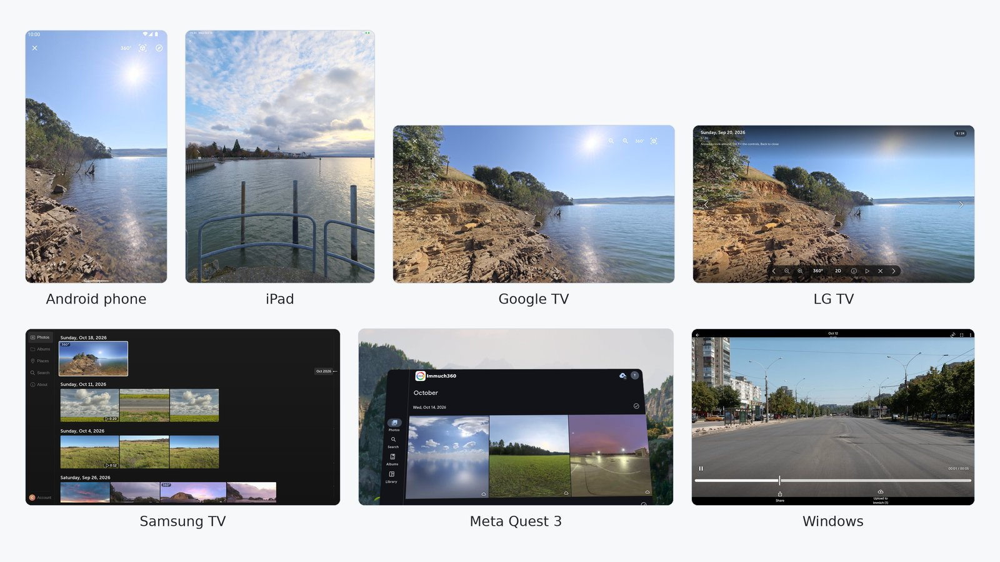
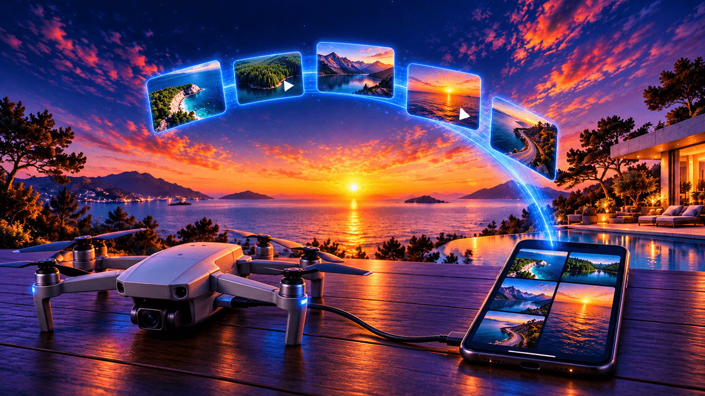
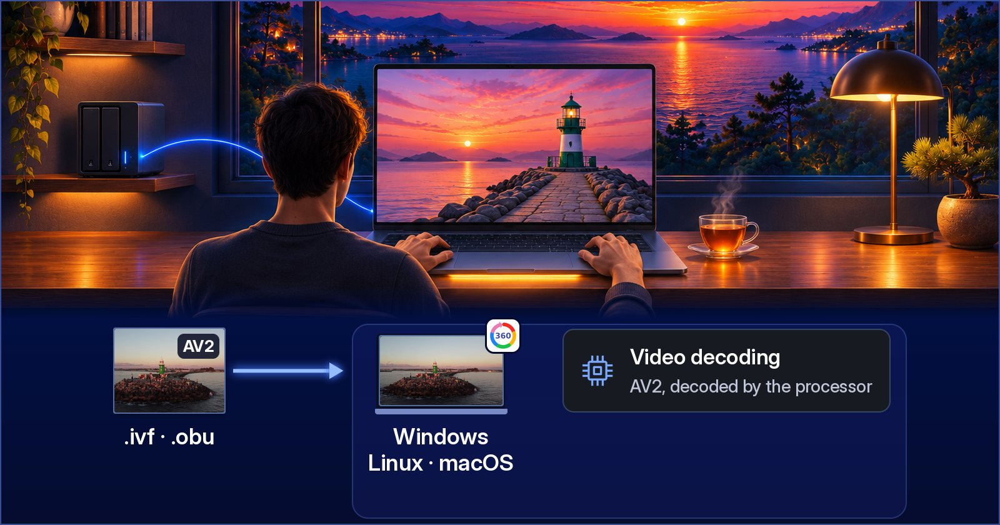

🌐 <b>Čeština</b> · Další jazyky (88)
<a href="../README.md">English</a> · <a href="README.af.md">Afrikaans</a> · <a href="README.ar.md">العربية</a> · <a href="README.az.md">Azərbaycanca</a> · <a href="README.be.md">Беларуская</a> · <a href="README.bg.md">Български</a> · <a href="README.bi.md">Bislama</a> · <a href="README.bn.md">বাংলা</a> · <a href="README.br.md">Brezhoneg</a> · <a href="README.bs.md">Bosanski</a> · <a href="README.ca.md">Català</a> · <a href="README.cv.md">Чӑвашла</a> · <a href="README.da.md">Dansk</a> · <a href="README.de.md">Deutsch</a> · <a href="README.de_CH.md">Deutsch (Schweiz)</a> · <a href="README.el.md">Ελληνικά</a> · <a href="README.en_GB.md">English (UK)</a> · <a href="README.eo.md">Esperanto</a> · <a href="README.es.md">Español</a> · <a href="README.et.md">Eesti</a> · <a href="README.eu.md">Euskara</a> · <a href="README.fa.md">فارسی</a> · <a href="README.fi.md">Suomi</a> · <a href="README.fil.md">Filipino</a> · <a href="README.fr.md">Français</a> · <a href="README.ga.md">Gaeilge</a> · <a href="README.gl.md">Galego</a> · <a href="README.gsw.md">Alemannisch</a> · <a href="README.gu.md">ગુજરાતી</a> · <a href="README.he.md">עברית</a> · <a href="README.hi.md">हिन्दी</a> · <a href="README.hr.md">Hrvatski</a> · <a href="README.hu.md">Magyar</a> · <a href="README.hy.md">Հայերեն</a> · <a href="README.id.md">Bahasa Indonesia</a> · <a href="README.is.md">Íslenska</a> · <a href="README.it.md">Italiano</a> · <a href="README.ja.md">日本語</a> · <a href="README.ka.md">ქართული</a> · <a href="README.kab.md">Taqbaylit</a> · <a href="README.kk.md">Қазақша</a> · <a href="README.km.md">ខ្មែរ</a> · <a href="README.kmr.md">Kurmancî</a> · <a href="README.kn.md">ಕನ್ನಡ</a> · <a href="README.ko.md">한국어</a> · <a href="README.kxm.md">ภาษาเขมรถิ่นไทย</a> · <a href="README.lb.md">Lëtzebuergesch</a> · <a href="README.lmo.md">Lombard</a> · <a href="README.lt.md">Lietuvių</a> · <a href="README.lv.md">Latviešu</a> · <a href="README.mfa.md">Bahasa Melayu Kelantan</a> · <a href="README.mi.md">Te reo Māori</a> · <a href="README.mk.md">Македонски</a> · <a href="README.ml.md">മലയാളം</a> · <a href="README.mn.md">Монгол</a> · <a href="README.mr.md">मराठी</a> · <a href="README.ms.md">Bahasa Melayu</a> · <a href="README.nb_NO.md">Norsk bokmål</a> · <a href="README.ne.md">नेपाली</a> · <a href="README.nl.md">Nederlands</a> · <a href="README.nn.md">Norsk nynorsk</a> · <a href="README.pa.md">ਪੰਜਾਬੀ</a> · <a href="README.pl.md">Polski</a> · <a href="README.pt.md">Português</a> · <a href="README.pt_BR.md">Português (Brasil)</a> · <a href="README.ro.md">Română</a> · <a href="README.ru.md">Русский</a> · <a href="README.si.md">සිංහල</a> · <a href="README.sk.md">Slovenčina</a> · <a href="README.sl.md">Slovenščina</a> · <a href="README.sq.md">Shqip</a> · <a href="README.sr_Cyrl.md">Српски</a> · <a href="README.sr_Latn.md">Srpski</a> · <a href="README.sv.md">Svenska</a> · <a href="README.sw.md">Kiswahili</a> · <a href="README.swg.md">Schwäbisch</a> · <a href="README.ta.md">தமிழ்</a> · <a href="README.te.md">తెలుగు</a> · <a href="README.th.md">ไทย</a> · <a href="README.tl.md">Tagalog</a> · <a href="README.tr.md">Türkçe</a> · <a href="README.uk.md">Українська</a> · <a href="README.ur.md">اردو</a> · <a href="README.uz.md">Oʻzbekcha</a> · <a href="README.vi.md">Tiếng Việt</a> · <a href="README.yue_Hant.md">粵語</a> · <a href="README.zh_Hans.md">简体中文</a> · <a href="README.zh_Hant.md">繁體中文</a>

  

# Immuch360

**Vaše média. Jakákoli obrazovka. Každý úhel pohledu.**

🌐 <a href="https://immuch360.com/cs/"><b>immuch360.com</b></a>

Ploché, 360° a 3D fotografie a videa z vašeho zařízení, vašeho NAS, vašeho serveru Immich, vašich kamer a vašeho dronu. Bez účtu. Immuch360 je svobodná aplikace s otevřeným zdrojovým kódem, která čte vaše fotografie a videa tam, kde jsou, a každé přehraje v prohlížeči, který mu sedí: plošně, jako kouli, ve které se rozhlížíte, ve 3D, nebo všude kolem vás v headsetu. Běží na telefonech, tabletech, televizorech, headsetech Meta Quest a počítačích. Její web, [immuch360.com](https://immuch360.com/cs/), ukazuje, co dělá na každé obrazovce, v 89 jazycích.

**Novinky v buildech 33 až 50.** [Filmy pokračují tam, kde jste skončili](#pick-up-a-film-where-you-stopped). Začínají dřív a z pomalého serveru [hrají dál, místo aby se zastavily](#when-a-video-waits-or-will-not-play). Časová osa se na telefonech a počítačích [zmenší na měsíce a roky](#find-a-month-or-a-year-in-a-long-timeline). Na telefonu s Androidem nebo v Meta Quest otevře ["Procházet složku"](#browse-a-folder-of-your-phone-or-headset) složku zařízení jako síťové úložiště a zobrazí se i fotky TIFF. Android TV [vyhledává podle data dálkovým ovladačem](#on-android-tv-and-google-tv), Meta Quest 3 nebo 3S [otevírá gaussovské splaty](#explore-gaussian-splats-in-a-meta-quest-3-or-3s) (experimentální), otáčené pravou páčkou a včetně SPZ verze 4, a počítač [vytváří 3D verze fotografií z vašeho NAS](#turn-one-photo-into-3d-a-scene-a-panorama). Na notebooku s Windows a dvěma grafickými čipy [aplikace teď běží na tom rychlém](#when-a-video-waits-or-will-not-play), takže filmy 8K hrají plynule. Gaussovské splaty se teď [otevírají na počítačích a na telefonech a tabletech s Androidem](#explore-gaussian-splats-on-your-phone-tablet-or-computer), počítač s Windows [vytváří scény splatů z vašich fotografií nebo videa](#make-a-splat-scene-from-your-photos-or-a-video-ai) pomocí AI, váš server Immich [je uchovává uvnitř fotografií](#keep-a-splat-scene-on-your-immich-server), které se otevírají z vaší časové osy, a počítače [přehrávají videa AV2](#play-av2-videos-on-your-computer), vše experimentálně. Od buildu 42 se surová videa z kamer Insta360, GoPro MAX a DJI Osmo 360, z vaší knihovny Immich, úložiště nebo složky, [přehrávají stabilizovaná gyroskopem kamery](#stabilise-your-360-videos-with-the-cameras-gyroscope-experimental) na telefonech, tabletech a televizorech s Androidem, tvůrce splatů z desktop buildu 22 [nabízí kvalitu Podrobná](#make-a-splat-scene-from-your-photos-or-a-video-ai) pro scény, které si prohlížíte zblízka, a 360° panorama [se spustí s 3,5 GiB volné paměti grafické karty](#turn-one-photo-into-3d-a-scene-a-panorama), vše experimentálně. Aplikace pro iPhone a iPad je [v App Store](https://apps.apple.com/us/app/immuch360-360-3d-player/id6817655965), verze 3.4.3. Od buildu 43 otevírá oznámení o aktualizaci v aplikaci na telefonech a tabletech Google Play nebo App Store; její web, [immuch360.com](https://immuch360.com/cs/), byl spuštěn 7. listopadu. Od buildu 44 a desktop buildu 24 Meta Quest 3 nebo 3S [ukazuje splaty až s 300 000 gaussiány](#explore-gaussian-splats-in-a-meta-quest-3-or-3s) (experimentální), počítače [vybírají více fotografií a videí pomocí Ctrl a Shift](#use-your-computer-as-the-media-player), televizor, jehož dekodér video odmítne, [sám přehraje druhý soubor ze serveru](#when-a-video-waits-or-will-not-play), panoramata běží na zvolené grafické kartě notebooku, který má dvě (experimentální), a oznámení o aktualizaci na Questu a na počítačích otevírá jejich obchod nebo stránku ke stažení, s mnoha opravami. Od buildu 45 a desktop buildu 25, ve verzi 3.4.0 na všech platformách, aplikace navazuje na aplikaci Immich 3.4.0 s 11 pozdějšími opravami Immich, zobrazuje [fotografie JPEG XL ze serverů Immich 3.4](#keep-your-immich-library-with-more), otevírá [vaše filmy z Plexu podle roku](#watch-your-plex-films) se stránkou pro každý film, jejich stažením do zařízení a jejich přehráním na televizoru z telefonu (experimentální), v buildech z obchodů může požádat o hodnocení a na počítačích své video komponenty bere z [jejich vlastních otevřených repozitářů](#licences-and-credits). Od buildu 46 a desktop buildu 26, ve verzi 3.4.1, se surová videa z 360° kamer [přehrávají stabilizovaná](#stabilise-your-360-videos-with-the-cameras-gyroscope-experimental) také na iPhonu a iPadu, v Meta Quest a na Windows, Meta Quest [přehrává pomocí libmpv filmy z Plexu, které jeho vlastní přehrávač nedokáže dekódovat](#watch-your-plex-films), telefon [pošle takový film na Chromecast nebo Google TV](#watch-your-plex-films) a AI reliéf 3D fotografie [má sílu, kterou si zvolíte](#turn-one-photo-into-3d-a-scene-a-panorama), vše experimentálně; nový server lze přidat také přihlášením vaším účtem Plex a aplikace [uchovává svá nastavení v souboru](#keep-your-settings-in-a-file). Od buildu 47 a desktop buildu 27, ve verzi 3.4.2, film z Plexu [přehraje zvukovou stopu, kterou zařízení dekóduje](#watch-your-plex-films), a řekne kterou, otevře verzi, která sedí obrazovce, a na pomalém připojení nabídne lehčí, Windows a macOS přehrají jeho zvuk Dolby TrueHD, Android [ukazuje jeho stahování v oznámení](#watch-your-plex-films) a Android TV také stahuje filmy, a [kamery Tapo na baterii se zobrazují živě](#watch-your-home-cameras-on-the-big-screen) (experimentální); obnovení souboru nastavení s jeho účty vás nyní přihlásí k vašemu serveru Immich. Od buildu 48 a desktop buildu 28, verze 3.4.3, počítač s Windows [přehrává vaše videa v headsetu PC VR](#watch-your-videos-in-a-pc-vr-headset-from-windows-experimental) přes SteamVR, Meta Horizon Link nebo jiný runtime OpenXR (experimentální, v headsetu projektem zatím nevyzkoušeno), [kamery jiných značek se zobrazují živě](#cameras-of-other-brands-over-onvif-or-rtsp), nalezené přes ONVIF nebo přidané svým odkazem RTSP (ověřeno se simulovanou kamerou, žádná skutečná kamera jiné značky zatím nebyla vyzkoušena), surová videa z [DJI Osmo 360 II a GoPro MAX 2 se přehrávají stabilizovaná](#open-the-raw-files-of-360-cameras) (experimentální), filmům z Plexu [už na telefonech nedochází data](#when-a-video-waits-or-will-not-play), televizory LG a Samsung [otočí video, které leží na boku](#on-a-samsung-tv-tizen), jedním tlačítkem (na televizoru LG zatím nevyzkoušeno; televizor Samsung z issue 17 otočení odmítl) a "K dispozici je aktualizace serveru" se už nezobrazuje u serveru, který je aktuální. Od buildu 49 a desktop buildu 29, verze 3.4.4, aplikace [sama čte vaše servery Jellyfin a Emby](#watch-your-jellyfin-and-emby-libraries) (experimentální, na zařízení zatím nevyzkoušeno), nalezené ve vaší síti a s přihlášením přes Quick Connect na televizoru nebo v headsetu, přičemž přehrává jejich originální soubory, takže 360° video zůstává 360°; na velké obrazovce Meta Quest si fotografie [zachovají velikost a místo, které nastavíte, zatímco jimi listujete, a přehrají se jako prezentace](#browse-your-photos-on-the-big-screen-of-the-quest) (v headsetu projektem zatím nevyzkoušeno); přehrávač 360° videí na telefonech a tabletech [dostává ovládání 360° fotografií](#360-videos-on-your-phone-with-the-controls-of-360-photos), tlačítko gyroskopu, přiblížení dvěma prsty a tažení přímo nahoru nebo dolů (vyzkoušeno uživatelem na Samsung Galaxy S25 Ultra, na iPhonu zatím ne); počítač [promění vaše 2D videa ve 3D videa](#turn-your-2d-videos-into-3d-on-your-computer-experimental) pomocí AI (experimentální, na 3D displeji ani v headsetu zatím nevyzkoušeno); a televizory Samsung [předají video, které je potřeba otočit, vlastnímu přehrávači Samsungu](#on-a-samsung-tv-tizen), který televizor z issue 17 přehraje, ale odmítá otočit. Od buildu 50 a desktop buildu 30, verze 3.4.5, se při přehrávání videa ve 2D okně Meta Quest okno [překresluje s obnovovací frekvencí displeje](#step-inside-your-photos-and-videos-with-a-meta-quest) místo zhruba 10krát za sekundu jako v buildech 48 a 49 (změřeno na Meta Quest 3), Android TV [přiblíží fotografii dálkovým ovladačem](#on-android-tv-and-google-tv) a posouvá ji šipkami (novinka, na televizoru zatím nevyzkoušeno) a tři opravy pocházejí z Android TV forku uživatele mlc70: rychlé přejetí už nezobrazí podrobnosti fotografie, která zůstala vzadu, animovaná fotografie uvolní svou paměť a filtr Poloha nabízí města nové země.

  Neoficiální fork mobilní aplikace Immich. Nemá vazby na Immich ani FUTO. Název se čte jako "I am much 360".

<b>Obsah</b>

- [Pro koho je](#who-it-is-for)
- [Které obrazovky](#which-screens), [co dělají společně](#use-cases) a [co která obrazovka umí](#what-each-screen-does)
- [Co dokážete](#what-you-can-do)
- [Instalace do vašeho zařízení](#get-it-on-your-device)
- [Jak na to](#how-to)
  - [Sledujte své fotografie a videa, se serverem i bez něj](#watch-your-photos-and-videos-with-or-without-a-server)
  - [Objevujte panoramata, 360°, VR180 a 3D](#explore-panoramas-360-vr180-and-3d): [360° videa na telefonech](#360-videos-on-your-phone-with-the-controls-of-360-photos)
  - [Proměňte jednu fotografii ve 3D, scénu, panorama](#turn-one-photo-into-3d-a-scene-a-panorama)
  - [Proměňte svá 2D videa ve 3D na počítači (experimentální)](#turn-your-2d-videos-into-3d-on-your-computer-experimental)
  - [Sledujte na televizoru s dálkovým ovladačem](#watch-on-the-tv-with-the-remote): [Android TV a Google TV](#on-android-tv-and-google-tv), [LG](#on-an-lg-tv-webos), [Samsung](#on-a-samsung-tv-tizen)
  - [Přihlaste televizor, headset nebo počítač telefonem](#sign-in-a-tv-a-headset-or-a-computer-with-your-phone)
  - [Vstupte do svých fotografií a videí s Meta Quest](#step-inside-your-photos-and-videos-with-a-meta-quest): [velká obrazovka](#browse-your-photos-on-the-big-screen-of-the-quest), [režim kiosku](#kiosk-mode-for-an-exhibition-or-a-shop)
  - [Prozkoumejte gaussovské splaty v Meta Quest 3 nebo 3S](#explore-gaussian-splats-in-a-meta-quest-3-or-3s)
  - [Prozkoumejte gaussovské splaty na svém telefonu, tabletu nebo počítači](#explore-gaussian-splats-on-your-phone-tablet-or-computer)
  - [Vytvořte scénu splatu ze svých fotografií nebo videa (AI)](#make-a-splat-scene-from-your-photos-or-a-video-ai)
  - [Uchovejte scénu splatu na svém serveru Immich](#keep-a-splat-scene-on-your-immich-server)
  - [Přehrávejte soubory z NAS, počítače, mediálního serveru nebo Plexu](#play-the-files-of-a-nas-a-computer-a-media-server-or-plex): [vaše filmy podle roku](#watch-your-plex-films), [Jellyfin a Emby](#watch-your-jellyfin-and-emby-libraries)
  - [Procházejte složku telefonu nebo headsetu](#browse-a-folder-of-your-phone-or-headset)
  - [Pokračujte ve filmu tam, kde jste skončili](#pick-up-a-film-where-you-stopped)
  - [Když video čeká nebo se nepřehraje](#when-a-video-waits-or-will-not-play)
  - [Ponechte si svou knihovnu Immich, a ještě víc](#keep-your-immich-library-with-more)
  - [Najděte měsíc nebo rok v dlouhé časové ose](#find-a-month-or-a-year-in-a-long-timeline)
  - [Sledujte domácí kamery na velké obrazovce](#watch-your-home-cameras-on-the-big-screen): [jiné značky](#cameras-of-other-brands-over-onvif-or-rtsp)
  - [Váš dron DJI (experimentální)](#your-dji-drone-experimental): [živé video](#see-what-your-drone-sees-on-your-phone), [v Questu nebo na Android TV](#watch-it-in-a-meta-quest-or-on-an-android-tv), [import](#bring-a-drones-or-a-camera-cards-photos-and-videos-to-immich)
  - [Otevřete surové soubory 360° kamer](#open-the-raw-files-of-360-cameras)
  - [Stabilizujte svá 360° videa gyroskopem kamery (experimentální)](#stabilise-your-360-videos-with-the-cameras-gyroscope-experimental)
  - [Otočte fotografii jednou klávesou](#turn-a-photo-with-one-key)
  - [Použijte počítač jako přehrávač médií](#use-your-computer-as-the-media-player)
  - [Sledujte svá videa v headsetu PC VR, z Windows (experimentální)](#watch-your-videos-in-a-pc-vr-headset-from-windows-experimental)
  - [Přehrávejte videa AV2 na svém počítači](#play-av2-videos-on-your-computer)
  - [Uchovejte svá nastavení v souboru](#keep-your-settings-in-a-file)
- [Ve srovnání s Immich](#compared-with-immich)
- [Soukromí](#privacy)
- [Licence a poděkování](#licences-and-credits)
- [Plán](#roadmap)
- [Dokumentace](#documentation)

## Pro koho je

- **Fotíte nebo natáčíte 360° či 3D** a chcete se ve svých záběrech rozhlížet, ne je vidět ploché, zdvojené nebo roztažené, a otáčet svými 360° videi na telefonu tak, jako otáčíte jeho fotografiemi: [360°, VR180 a 3D](#explore-panoramas-360-vr180-and-3d), [360° videa na telefonech](#360-videos-on-your-phone-with-the-controls-of-360-photos).
- **Natáčíte 360° kamerou v ruce, na kole nebo na helmě** a chcete, aby se surová videa z vaší kamery Insta360, GoPro MAX nebo MAX 2, DJI Osmo 360 nebo Osmo 360 II, uchovaná v Immich, na úložišti nebo ve složce, přehrávala rovně a klidně v telefonu, na televizoru, v Meta Quest nebo na počítači s Windows (experimentální): [stabilizovaná gyroskopem kamery](#stabilise-your-360-videos-with-the-cameras-gyroscope-experimental).
- **Vaše fotografie a filmy jsou na NAS, počítači, v Plexu nebo Immich** a chcete je na televizoru bez kopírování: [na televizoru](#watch-on-the-tv-with-the-remote), [NAS, úložiště a Plex](#play-the-files-of-a-nas-a-computer-a-media-server-or-plex).
- **Své filmy máte na serveru Plex** a chcete si jeden vybrat podle roku, vidět, o čem je, než začne, vzít si ho na cesty, spustit ho z telefonu na televizoru nebo na Chromecastu a přehrát i filmy, které váš telefon s Androidem, televizor nebo Meta Quest nedokáže dekódovat (experimentální): [vaše filmy, podle roku](#watch-your-plex-films).
- **Své filmy máte na serveru Jellyfin nebo Emby** a chcete je v Meta Quest, na televizoru nebo na telefonu, s 360° a 3D zachovanými tak, jak jsou, a s místem, kde jste skončili, uloženým na serveru (experimentální, na zařízení zatím nevyzkoušeno): [Jellyfin a Emby](#watch-your-jellyfin-and-emby-libraries).
- **Máte Meta Quest** a chcete vstoupit do vlastních fotografií a videí: [v headsetu](#step-inside-your-photos-and-videos-with-a-meta-quest), a listovat svými fotografiemi na velké obrazovce ve velikosti a na místě, které nastavíte, i jako prezentaci (v headsetu projektem zatím nevyzkoušeno): [velká obrazovka](#browse-your-photos-on-the-big-screen-of-the-quest).
- **Máte headset PC VR u počítače s Windows** a chcete v něm mít svá 360° videa kolem sebe a své filmy na velkém plátně (experimentální, v headsetu projektem zatím nevyzkoušeno): [v headsetu PC VR](#watch-your-videos-in-a-pc-vr-headset-from-windows-experimental).
- **Vaše fotografie jsou ploché** a chcete je ve 3D, jako scénu, do které se v headsetu nakloníte, nebo uvnitř 360° panoramatu, bez 3D fotoaparátu: [proměňte jednu fotografii ve 3D, scénu, panorama](#turn-one-photo-into-3d-a-scene-a-panorama), novinka, vytváří ji AI na vašem vlastním počítači.
- **Vaše videa jsou plochá**, včetně klipů z telefonu, a chcete je ve 3D pro headset nebo 3D displej, vytvořená na vlastním počítači (experimentální, na 3D displeji ani v headsetu zatím nevyzkoušeno): [2D videa ve 3D](#turn-your-2d-videos-into-3d-on-your-computer-experimental).
- **Provozujete Immich** a chcete jeho aplikaci, a k tomu imerzní prohlížeče a velké obrazovky, které přihlásíte z telefonu: [vaše knihovna Immich](#keep-your-immich-library-with-more), [ve srovnání s Immich](#compared-with-immich).
- **Hlídáte domov kamerami Tapo**, i těmi na baterii (experimentální), nebo kamerami jiných značek přes ONVIF nebo RTSP, a chcete je vedle svých fotografií, i na televizoru (ověřeno proti simulované kameře): [domácí kamery](#watch-your-home-cameras-on-the-big-screen).
- **Létáte s dronem DJI** a chcete jeho živý obraz v telefonu bez DJI Fly, a v Meta Quest nebo na Android TV pro lidi kolem vás (experimentální): [váš dron](#see-what-your-drone-sees-on-your-phone).
- **Zaznamenáváte místa a předměty ve 3D jako gaussovské splaty,** nebo byste je chtěli vytvářet z vlastních fotografií, a chcete jimi procházet na svém telefonu, svém počítači nebo v headsetu (experimentální): [na telefonu, tabletu nebo počítači](#explore-gaussian-splats-on-your-phone-tablet-or-computer), [vytvořené z vašich fotografií](#make-a-splat-scene-from-your-photos-or-a-video-ai), [uchované v Immich](#keep-a-splat-scene-on-your-immich-server).
- **Máte videa AV2**, formát, který navazuje na AV1, a chcete je sledovat na svém počítači (experimentální): [AV2 na vašem počítači](#play-av2-videos-on-your-computer).
- **Máte doma několik obrazovek** a chcete, aby fungovaly společně: [co vaše obrazovky dělají společně](#use-cases).

Nemusíte si zakládat žádný účet Immuch360 a nic se k nám neposílá: aplikace komunikuje jen s vašimi zařízeními a se servery, které si zvolíte, od buildu 45 s encyklopedií Wikipedia kvůli stránce filmu (experimentální), od buildu 46 s plex.tv, když se přes něj přihlásíte, a AI komponentu nebo dekodér AV2 stáhne, jen když o to požádáte.

## Které obrazovky

| Platforma | Kde aplikaci získat | Stav v listopadu 2026 |
|---|---|---|
|  **Android** telefony a tablety | [Google Play](https://play.google.com/store/apps/details?id=com.aprogsys.immuch360) · [APK](https://github.com/freeKC/Immuch360/releases) | na Google Play (build 47 zveřejněn 16. listopadu; build 48 ve schvalování Google od 16. listopadu; build 50 bude následovat), build 50 na GitHubu, kde se [surová 360° videa přehrávají stabilizovaná](#stabilise-your-360-videos-with-the-cameras-gyroscope-experimental) (experimentální), [filmy pokračují tam, kde jste skončili](#pick-up-a-film-where-you-stopped), ["Procházet složku"](#browse-a-folder-of-your-phone-or-headset) otevře složku telefonu a [gaussovské splaty se otevírají](#explore-gaussian-splats-on-your-phone-tablet-or-computer), z úložiště nebo [z vaší časové osy Immich](#keep-a-splat-scene-on-your-immich-server) (experimentální), [nastavení uchovaná v souboru](#keep-your-settings-in-a-file), [stahování filmu zobrazené v oznámení](#watch-your-plex-films), od buildu 48 [kamery jiných značek živě](#cameras-of-other-brands-over-onvif-or-rtsp) (ověřeno se simulovanou kamerou) a od buildu 49 [servery Jellyfin a Emby](#watch-your-jellyfin-and-emby-libraries) (experimentální, na zařízení zatím nevyzkoušeno) a [ovládání 360° fotografií v přehrávači 360° videí](#360-videos-on-your-phone-with-the-controls-of-360-photos) (vyzkoušeno uživatelem na Samsung Galaxy S25 Ultra) |
|  **iPhone a iPad** | [App Store](https://apps.apple.com/us/app/immuch360-360-3d-player/id6817655965) | verze 3.4.4 v App Store od 20. listopadu, s [měsíci a roky v časové ose](#find-a-month-or-a-year-in-a-long-timeline), [filmy, které pokračují tam, kde jste skončili](#pick-up-a-film-where-you-stopped), [přihlášením televizoru, headsetu nebo počítače](#sign-in-a-tv-a-headset-or-a-computer-with-your-phone) z telefonu, scénami splatů uchovanými v Immich, zobrazenými jako jejich fotografie, opravami Immich 3.4.0 a jeho fotografiemi JPEG XL, [surovými 360° videi stabilizovanými](#stabilise-your-360-videos-with-the-cameras-gyroscope-experimental) (experimentální), [nastaveními uchovanými v souboru](#keep-your-settings-in-a-file), [živým přenosem kamer Tapo na baterii](#watch-your-home-cameras-on-the-big-screen) (experimentální) a [živým přenosem kamer jiných značek](#cameras-of-other-brands-over-onvif-or-rtsp) (ověřeno se simulovanou kamerou) a od verze 3.4.4 se [servery Jellyfin a Emby](#watch-your-jellyfin-and-emby-libraries) (experimentální, na zařízení zatím nevyzkoušeno) a [ovládáním 360° fotografií v přehrávači 360° videí](#360-videos-on-your-phone-with-the-controls-of-360-photos) (na iPhonu zatím nevyzkoušeno); verze 3.4.5, verze buildu 50 pro iPhone a iPad, bude následovat; nebo si ji [sestavte sami](../docs/immuch360/build.md) |
|  **Android TV a Google TV** | [Google Play](https://play.google.com/store/apps/details?id=com.aprogsys.immuch360) · [APK](#android-tv-and-google-tv) | na Google Play, který nabízí aplikaci pro Android TV a Google TV, a build 50 na GitHubu: [surová 360° videa stabilizovaná](#stabilise-your-360-videos-with-the-cameras-gyroscope-experimental) (experimentální), [vyhledávání podle data dálkovým ovladačem](#on-android-tv-and-google-tv), [přihlášení telefonem](#sign-in-a-tv-a-headset-or-a-computer-with-your-phone) naskenováním QR kódu, časová osa, zvuk a titulky pro dálkový ovladač v přehrávači videa a [živé video z dronu](#watch-it-in-a-meta-quest-or-on-an-android-tv) přeposílané telefonem (experimentální), [filmy stažené do televizoru](#watch-your-plex-films) a od buildu 49 [servery Jellyfin a Emby](#watch-your-jellyfin-and-emby-libraries) s přihlášením přes Quick Connect (experimentální, na zařízení zatím nevyzkoušeno) a od buildu 50 [fotografie přibližované dálkovým ovladačem](#on-android-tv-and-google-tv) (novinka, na televizoru zatím nevyzkoušeno) |
| **Televizory LG** s webOS 5.0 a novějším | [.ipk, verze 1.0.5](https://github.com/freeKC/Immuch360/releases/tag/webos-v1.0.5) · LG Content Store (ve schvalování) | verze 1.0.0, odeslaná do LG Content Store 24. října, v testech LG od 26. října; verze 1.0.1, na GitHubu od 27. října, přibližuje fotografii šipkami a hlásí, když se fotografie ještě načítá, a verze 1.0.2, na GitHubu s buildem 46, píše v japonštině "přihlásit se" jako ログイン, verze 1.0.3, s buildem 47, hlásí, když složka serveru DLNA obsahuje živé televizní kanály, které zatím přehrát neumí, verze 1.0.4, s buildem 48, [otočí video, které leží na boku](#on-an-lg-tv-webos), jedním tlačítkem (na televizoru LG zatím nevyzkoušeno) a verze 1.0.5, s buildem 49, uvádí mezi servery DLNA Jellyfin s jeho pluginem DLNA; dokud LG aplikaci nezveřejní, instaluje se v režimu [Developer Mode](#lg-tvs-webos). Verze 1.0.0 běžela na televizorech s webOS 25 v Cloud Test Lab společnosti LG |
| **Televizory Samsung** s Tizen 5.5 a novějším | [Testovací build .wgt](https://github.com/freeKC/Immuch360/releases/tag/tizen-v0.3.6) | testovací build 0.3.6 téže aplikace pro TV, k podepsání vlastním certifikátem Samsung a instalaci v režimu [Developer mode](#samsung-tvs-tizen); 0.1.0 běžel na televizoru Samsung jednoho testera, 0.2.0 obsahuje opravy z tohoto běhu 0.3.0 přidává přibližování fotografií a štítek Načítání z verze 1.0.1 pro LG a 0.3.1 japonské znění z verze 1.0.2 pro LG 0.3.2 přehraje video natočené telefonem na výšku správně nahoru ([issue 17](https://github.com/freeKC/Immuch360/issues/17)), 0.3.3 a 0.3.4 [ho otočí na televizoru, který ho hlásí na výšku](#on-a-samsung-tv-tizen), a přidávají tlačítko, které ho otočí ručně, a 0.3.5 a 0.3.6 předají takové video vlastnímu přehrávači Samsungu; na televizoru autora hlášení nechaly 0.3.4 a 0.3.5 obraz na boku, protože televizor otočení odmítl, a východiskem je tam video, které překóduje váš server Immich, uložené na výšku; není v obchodě Samsung |
|  **Meta Quest** 2, Pro, 3 a 3S | [Horizon Store](https://www.meta.com/experiences/immuch360/1384208401440714/) · [APK](#meta-quest) | na Horizon Store (build 47 zveřejněn 19. listopadu; build 48 vrácen schvalováním Meta 20. listopadu, protože jeho 2D okno při přehrávání videa kreslilo méně než 60 snímků za sekundu; build 50, jehož okno se překresluje s obnovovací frekvencí displeje, bude následovat), build 50 na GitHubu, s [režimem kiosku](#kiosk-mode-for-an-exhibition-or-a-shop), [surovými 360° videi stabilizovanými](#stabilise-your-360-videos-with-the-cameras-gyroscope-experimental) v imerzním zobrazení, [filmy, které nedokáže dekódovat, přehrávanými pomocí libmpv](#watch-your-plex-films) a na Quest 3 a 3S s [gaussovskými splaty](#explore-gaussian-splats-in-a-meta-quest-3-or-3s) a [AI reliéfem](#turn-one-photo-into-3d-a-scene-a-panorama) ploché fotografie, vše experimentální, a od buildu 49 s [fotografiemi procházenými na velké obrazovce](#browse-your-photos-on-the-big-screen-of-the-quest) ve velikosti, kterou nastavíte, i jako prezentace (v headsetu projektem zatím nevyzkoušeno), a se [servery Jellyfin a Emby](#watch-your-jellyfin-and-emby-libraries) s přihlášením přes Quick Connect (experimentální, na zařízení zatím nevyzkoušeno) |
|  **Windows** | [Instalátor nebo ZIP](https://github.com/freeKC/Immuch360/releases/tag/desktop-v3.4.5-30) | desktop build 30, podepsaná verze Preview: fotografie, plochá a 360° videa, úložiště, Plex, kamery (ověřeno se simulovanou kamerou), přihlášení telefonem, fotografie otočené jednou klávesou, rozhraní v 89 jazycích, a [3D fotografie, 3D scény a 360° panoramata vytvořená z vašich fotografií](#turn-one-photo-into-3d-a-scene-a-panorama) pomocí AI (experimentální), i z fotografií vašeho NAS; [gaussovské splaty](#explore-gaussian-splats-on-your-phone-tablet-or-computer) otevírané, [vytvářené z vašich fotografií nebo videa](#make-a-splat-scene-from-your-photos-or-a-video-ai) a [uchovávané v Immich](#keep-a-splat-scene-on-your-immich-server), [videa AV2](#play-av2-videos-on-your-computer), od desktop buildu 22 [volba kvality pro scény splatů](#make-a-splat-scene-from-your-photos-or-a-video-ai) a [360° panoramata od 3,5 GiB volné grafické paměti](#turn-one-photo-into-3d-a-scene-a-panorama) a od desktop buildu 26 [surová 360° videa stabilizovaná](#stabilise-your-360-videos-with-the-cameras-gyroscope-experimental) a [3D fotografie se sílou reliéfu a ostřejšími okraji](#turn-one-photo-into-3d-a-scene-a-panorama), vše experimentálně, od desktop buildu 27 [zvuk Dolby TrueHD a titulky Blu-ray u filmů](#watch-your-plex-films), od desktop buildu 28 [vaše videa v headsetu PC VR](#watch-your-videos-in-a-pc-vr-headset-from-windows-experimental) (experimentální, v headsetu projektem zatím nevyzkoušeno) a od desktop buildu 29 [3D videa vytvořená z vašich 2D videí](#turn-your-2d-videos-into-3d-on-your-computer-experimental) pomocí AI (experimentální, na 3D displeji ani v headsetu zatím nevyzkoušeno) |
|   **macOS a Linux** | [.deb, .rpm, DMG](https://github.com/freeKC/Immuch360/releases/tag/desktop-v3.4.5-30) | desktop build 30, verze Preview: fotografie, 360° fotografie a plochá videa (360° videa se přehrávají jako plochá), server Immich a síťová úložiště, a [3D fotografie a 3D scény](#turn-one-photo-into-3d-a-scene-a-panorama), které z vašich fotografií vytváří AI, s 360° panoramaty na Linuxu na grafické kartě s 8 GB, od 3,5 GiB její volné paměti, a [gaussovské splaty](#explore-gaussian-splats-on-your-phone-tablet-or-computer) a [videa AV2](#play-av2-videos-on-your-computer) (experimentální, na Macu zatím nevyzkoušeno); desktop build 11 vyzkoušen 26. října v kontejneru s Ubuntu 24.04 a na Macu; od desktop buildu 27 zvuk Dolby TrueHD u filmů na macOS; od desktop buildu 29 [3D videa vytvořená z vašich 2D videí](#turn-your-2d-videos-into-3d-on-your-computer-experimental) pomocí AI na Linuxu a na Macu s čipem Apple (experimentální, na 3D displeji ani v headsetu zatím nevyzkoušeno); na macOS nepodepsáno |

*Stavy se aktualizují při každém vydání; co má který obchod, co je v jeho schvalování a jednotlivé buildy najdete v [Stav vydání](../docs/immuch360/release-status.md). Web [immuch360.com](https://immuch360.com/cs/) ukazuje, co dělá každá obrazovka, návod Jak na to pro každou funkci a odkazy do obchodů, v 89 jazycích.*

  

### Co vaše obrazovky dělají společně

Nainstalujte Immuch360 na každou obrazovku, na které se díváte: každá čte vaše zdroje sama a některé předávají jiné obrázek, soubor nebo přihlášení. Na každém obrázku ikona Immuch360 označuje zařízení, na kterých aplikace běží.

#### Váš NAS na každé obrazovce

  

**Potřebujete:** NAS se sdílenou složkou SMB nebo WebDAV a Immuch360 na každé obrazovce, na které se díváte.

Přidejte sdílenou složku na každé obrazovce a každá přehrává fotografie a videa tam, kde jsou, nic se nekopíruje: telefony, tablety, Android TV, Meta Quest, počítače s Windows, Linuxem a macOS a televizory LG přihlášené k vašemu serveru Immich (SMB od webOS 22). Fotografie 360° se na telefonu a televizoru otáčí jako koule a v headsetu vás obklopí. Jak na to: [Přehrávejte soubory z NAS, počítače, mediálního serveru nebo Plexu](#play-the-files-of-a-nas-a-computer-a-media-server-or-plex).

#### Váš server Immich na každé obrazovce, přihlášený z telefonu

  

**Potřebujete:** server Immich, Immuch360 v telefonu s Androidem a Immuch360 na obrazovkách, které přihlašujete: Android TV, Meta Quest, počítač s Windows, Linuxem nebo macOS.

V telefonu si Immuch360 ponechává celou mobilní aplikaci Immich, přidává své prohlížeče 360°, VR180 a 3D a instaluje se vedle oficiální aplikace. Když je přihlášený k vašemu serveru, přihlásí velké obrazovky: naskenuje QR kód televizoru nebo počítače, nebo do něj napíšete kód, který ukáže headset, a vaše heslo zůstane v telefonu. Jak na to: [Přihlaste televizor, headset nebo počítač telefonem](#sign-in-a-tv-a-headset-or-a-computer-with-your-phone).

#### Vaše ploché fotografie ve 3D, z počítače do headsetu (experimentální)

  

**Potřebujete:** Immuch360 na počítači s Windows, Linuxem nebo macOS a v Meta Quest, s vaším NAS mezi nimi, nebo s vaším serverem Immich se zapnutým "Zálohovat i AI verze".

Počítač sám promění vaše fotografie ve 3D fotografie a 3D scény, a s grafickou kartou s 8 GB na Windows nebo Linuxu i v panoramata 360°, a uloží je vedle originálů. Headset ukáže 3D fotografii ve skutečném 3D, postaví scénu do vašeho pokoje a panorama kolem vás; telefony a televizory otevírají panoramata ve svém prohlížeči 360°. Jak na to: [Proměňte jednu fotografii ve 3D, scénu, panorama](#turn-one-photo-into-3d-a-scene-a-panorama).

#### Živý obraz vašeho dronu v headsetu nebo na televizoru (experimentální)

  

**Potřebujete:** dron DJI a jeho ovladač DJI RC-N3, Immuch360 v telefonu s Androidem připojeném k ovladači a Immuch360 v Meta Quest nebo na Android TV.

Telefon ukazuje živé video z dronu a přeposílá ho přes vaši Wi-Fi nebo vlastní hotspot, takže lidé kolem vás sledují let v headsetu nebo na televizoru. Pouze příjem: ovladači ani dronu se nikdy neposílá žádný příkaz a ovladač si ponechává plné řízení. Jak na to: [Sledujte to v Meta Quest nebo na Android TV](#watch-it-in-a-meta-quest-or-on-an-android-tv).

#### Surové soubory vaší 360° kamery, spojené tam, kde je sledujete

  

**Potřebujete:** kameru Insta360, GoPro MAX nebo MAX 2, DJI Osmo 360 nebo Osmo 360 II, váš NAS a Immuch360 na obrazovkách: telefony, tablety, Android TV, Meta Quest, Windows.

Zkopírujte soubory .insp, .insv, .360 nebo .osv z karty kamery do sdílené složky SMB nebo WebDAV na vašem NAS tak, jak jsou; server Immich bere i ty z Insta360. Každá obrazovka je spojuje při přehrávání podle kalibrace zapsané v každém souboru a nic se předem neexportuje v aplikaci kamery. Jak na to: [Otevřete surové soubory 360° kamer](#open-the-raw-files-of-360-cameras).

#### Vaše servery Plex a DLNA na televizoru a v headsetu

  

**Potřebujete:** Plex Media Server, server Jellyfin nebo Emby, nebo server DLNA, například minidlna, a Immuch360 na každé obrazovce: Android TV, Meta Quest, telefony, tablety, Windows.

Plex poskytuje původní soubory vašich knihoven, takže video 360° zůstane 360°, v headsetu všude kolem vás, doma i mimo domov přes vaše přesměrování portů; servery DLNA se najdou ve vaší domácí síti. Přehrávají je i televizory LG přihlášené k vašemu serveru Immich. Od buildu 45 telefony, tablety, Android TV, Quest a počítače otevírají filmovou knihovnu Plexu na všech filmech podle roku, každý film se svou stránkou, a film vybraný v telefonu se přehraje na Android TV, v Questu nebo na počítači a ovládá ho dálkový ovladač (experimentální). Od buildu 46 Quest přehrává pomocí libmpv filmy, které jeho vlastní přehrávač nedokáže dekódovat, váš server Plex převádí ty, které nedekóduje žádný přehrávač zařízení s Androidem, a telefon pošle film na Chromecast nebo Google TV (experimentální). Od buildu 47 film přehraje zvukovou stopu, kterou zařízení dekóduje, a řekne kterou, otevře verzi, která sedí obrazovce, a přehraje svůj zvuk Dolby TrueHD na Windows a macOS (experimentální), a složka živých televizních kanálů serveru DLNA oznámí, že je zatím nelze přehrát. Od buildu 49 má i server Jellyfin nebo Emby vlastní typ, sám se najde, přihlásí se přes Quick Connect na televizoru nebo v headsetu, jeho originální soubory se přehrávají, takže 360° zůstává 360°, a místo, kde jste skončili, se ukládá na serveru (experimentální, na zařízení zatím nevyzkoušeno). Jak na to: [Přehrávejte soubory z NAS, počítače, mediálního serveru nebo Plexu](#play-the-files-of-a-nas-a-computer-a-media-server-or-plex), [Sledujte své filmy z Plexu](#watch-your-plex-films) a [Sledujte své knihovny Jellyfin a Emby](#watch-your-jellyfin-and-emby-libraries).

#### Váš telefon nebo počítač s Windows, otevřený v headsetu

  

**Potřebujete:** Immuch360 v telefonu s Androidem, v iPhonu nebo na počítači s Windows a v Meta Quest, ve stejné domácí Wi-Fi.

Zapněte "Sdílet tento telefon v síti" v telefonu nebo "Sdílet tento počítač v síti" na počítači a headset přehrává jeho fotografie a videa, ty 360° všude kolem vás: žádný server, žádný NAS, žádné nahrávání. V iPhonu sdílení běží, dokud je aplikace na obrazovce. Jak na to: [Sdílet tento telefon v síti](../docs/immuch360/user-guide.md#share-this-phone-on-the-network).

#### Vaše kamery Tapo na televizoru a v headsetu

  

**Potřebujete:** kamery Tapo ve vaší domácí síti a Immuch360 v telefonu s Androidem, na Android TV, v Meta Quest nebo na počítači s Windows.

Každá obrazovka ukazuje kameru živě a přehrává záznamy z její paměťové karty den po dni, vedle vašich fotografií, a telefon pošle klip na váš server Immich. Aplikace komunikuje s kamerami jen ve vaší síti, nikdy přes servery TP-Link. Od buildu 47 se živě zobrazují i kamery na baterii, přes svůj mediální port, na telefonech, tabletech, Android TV a v Questu (experimentální). Od buildu 48 se vedle nich živě zobrazují i kamery jiných značek, nalezené přes ONVIF nebo přidané svým odkazem RTSP. Ověřeno proti simulované kameře. Jak na to: [Sledujte domácí kamery na velké obrazovce](#watch-your-home-cameras-on-the-big-screen).

#### Gaussovské splaty ve vašem pokoji, v Meta Quest 3 nebo 3S (experimentální)

  

**Potřebujete:** splat vytvořený v Polycam, Scaniverse, Luma nebo jiném nástroji, jako soubor .spz nebo binární .ply na vašem NAS nebo v headsetu, a Immuch360 v Meta Quest 3 nebo 3S.

Headset postaví místo nebo objekt v jeho skutečné velikosti před vás nebo všude kolem vás: obejděte ho, proplujte jím levou páčkou, otáčejte se pravou. Gaussovské splaty používají experimentální API sady Meta Spatial SDK, které Meta nepodporuje ani nezaručuje: za jakoukoli vadu odpovídá jen Immuch360. Jak na to: [Prozkoumejte gaussovské splaty v Meta Quest 3 nebo 3S](#explore-gaussian-splats-in-a-meta-quest-3-or-3s).

#### Meta Quest pro vaše návštěvníky (experimentální)

  

**Potřebujete:** Meta Quest s Immuch360 a fotografii nebo video 360° v headsetu, na vašem NAS nebo na vašem serveru Immich.

V režimu kiosku headset sám otevře vaši fotografii nebo video 360°, od začátku, pokaždé když si ho návštěvník nasadí, a film skončí na závěrečné kartě s vaším textem. Návštěvníci nic nemačkají; pro odchod podržíte B nebo Y jednu sekundu. Jak na to: [Režim kiosku pro výstavu nebo obchod](#kiosk-mode-for-an-exhibition-or-a-shop).

### Co která obrazovka umí

Jeden kód pro telefony, tablety, Android TV, Meta Quest a počítače a samostatná aplikace pro televizory LG, zabalená i pro televizory Samsung jako testovací build. Co každá dnes umí:

| Funkce | Android | iPhone, iPad | Android TV | LG webOS | Samsung Tizen | Quest |
|---|:---:|:---:|:---:|:---:|:---:|:---:|
| Galerie, alba, vyhledávání se serverem Immich | ✅ | ✅ | ✅ prohlížeč | ✅ prohlížeč | ✅ prohlížeč | ✅ |
| Časová osa po měsících a letech | ✅ | ✅ | ❌ | ❌ | ❌ | ❌ |
| Přihlášení telefonem (QR kód) | ✅ naskenuje kód | ✅ naskenuje kód | ✅ | ✅ v prohlížeči telefonu | ❌ psaní na TV | ✅ kód opsaný v telefonu |
| Bez serveru: vlastní média zařízení | ✅ | ✅ | jen úložiště | ❌ | ❌ | ✅ |
| Složka zařízení otevřená jako síťové úložiště | ✅ složka, kterou vyberete | ❌ | ❌ | ❌ | ❌ | ✅ |
| Ploché fotografie a videa | ✅ | ✅ | ✅ | ✅ | ✅ | ✅ |
| Fotky TIFF | ✅ | ✅ systémový dekodér | ✅ | ✅ ze serveru | ✅ ze serveru | ✅ i imerzně |
| Miniatury a náhledy JPEG XL (Immich 3.4) | ✅ | ✅ od 3.4.0, dekodér Immich, na iPhonu zatím nevyzkoušeno | ✅ | ❌ "Náhled není k dispozici" | ❌ "Náhled není k dispozici" | ✅ i imerzně |
| Otočení fotografie jednou klávesou | ✅ | ✅ | ✅ barevná tlačítka | ✅ barevná tlačítka | ✅ | ✅ okno |
| Fotografie 360° jako koule | ✅ | ✅ | ✅ | ✅ | ✅ | ✅ imerzní |
| Videa 360° | ✅ | ✅ bez časové osy | ✅ zpráva, pokud nelze dekódovat | jen plochá | jen plochá | ✅ imerzní |
| 360° videa: tlačítko gyroskopu, přiblížení dvěma prsty, tažení přímo nahoru a dolů | ✅ od buildu 49, vyzkoušeno uživatelem na Samsung Galaxy S25 Ultra | ✅ od verze 3.4.4, na iPhonu zatím nevyzkoušeno | ❌ | ❌ | ❌ | ❌ |
| Filmy pokračují tam, kde jste skončili | ✅ | ✅ | ✅ | ❌ | ❌ | ✅ i imerzně |
| Zdroj videa: soubor, který toto zařízení dekóduje | ✅ | ✅ | ✅ | ❌ | ❌ | ✅ |
| Pomalý server: jak dlouho video čeká a proč | ✅ | vlastní pravidlo čekání | ✅ | ❌ | ❌ | ✅ |
| Videa AV2 (experimentální) | ❌ | ❌ | ❌ | ❌ | ❌ | ❌ |
| 3D a VR180 | ✅ jedno oko | ✅ jedno oko | ✅ jedno oko | fotografie jedno oko, videa plochá | fotografie jedno oko, videa plochá | ✅ skutečné 3D |
| Ploché 3D podle názvu souboru, ostřejší obrazovky, které posouváte (experimentální) | ❌ | ❌ | ❌ | ❌ | ❌ | ✅ |
| Fotografie na velké obrazovce: listování, prezentace, zachovaná velikost a místo | ❌ | ❌ | ❌ | ❌ | ❌ | ✅ od buildu 49, v headsetu zatím nevyzkoušeno |
| Režim kiosku pro návštěvníky (experimentální) | ❌ | ❌ | ❌ | ❌ | ❌ | ✅ |
| Prostorové 2.5D (sledování hlavy) | ✅ experimentální | ✅ experimentální | ❌ | ❌ | ❌ | ❌ |
| Prostorové fotografie Apple | ✅ jedno oko | ✅ jedno oko | ✅ jedno oko | ❌ | ❌ | ✅ 3D |
| Gaussovské splaty, .spz a .ply (experimentální) | ✅ | ❌ | ❌ | ❌ | ❌ | ✅ Quest 3 a 3S |
| Scény splatů uchované jako fotografie v Immich (experimentální) | ✅ | fotografie | fotografie | fotografie | fotografie | ✅ Quest 3 a 3S, v headsetu zatím nevyzkoušeno |
| 3D fotografie z 2D fotografie (AI) | ✅ čte ji, vedle sebe | ✅ čte ji, vedle sebe | ✅ čte ji, vedle sebe | ✅ čte ji, vedle sebe | ✅ čte ji, vedle sebe | ✅ AI reliéf v headsetu (Quest 3 a 3S), zobrazený ve 3D, Jemný, Normální nebo Silný |
| 3D scéna z 2D fotografie (AI) | ✅ čte ji, jako její fotografii | ✅ čte ji, jako její fotografii | ✅ čte ji, jako její fotografii | ✅ čte ji, jako její fotografii | ✅ čte ji, jako její fotografii | ✅ prozkoumávaná ve 3D |
| 360° panorama z 2D fotografie (AI) | ✅ čte ho, s jeho označením AI | ✅ čte ho jako 360° fotografii, označení 🔜 | ✅ čte ho, s jeho označením AI | ✅ čte ho jako 360° fotografii, označení 🔜 | ✅ čte ho jako 360° fotografii, označení 🔜 | ✅ čte ho všude kolem vás, s jeho označením AI |
| 3D verze vedle fotografií síťového úložiště (AI) | ✅ čte je | ✅ čte je | ✅ čte je | ✅ čte je | ❌ | ✅ čte je |
| Scéna splatu z fotografií nebo videa (AI) | ✅ čte ji | ❌ | ❌ | ❌ | ❌ | ✅ čte ji, Quest 3 a 3S, v headsetu zatím nevyzkoušeno |
| 3D video z 2D videa (AI, experimentální) | ✅ přečte ho, vedle sebe | ✅ přečte ho, vedle sebe | ✅ přečte ho, vedle sebe | ploché video, vedle sebe | ploché video, vedle sebe | ✅ ve 3D na velké obrazovce, v headsetu zatím nevyzkoušeno |
| Surové soubory Insta360, GoPro a DJI | ✅ | ✅ | ✅ | ❌ | ❌ | ✅ |
| Surová 360° videa stabilizovaná gyroskopem kamery (experimentální) | ✅ Insta360, GoPro MAX a MAX 2, DJI Osmo 360 a Osmo 360 II, z vaší knihovny, úložišť a složek | ✅ od verze 3.4.1, na iPhonu zatím nevyzkoušeno | ✅ Insta360, GoPro MAX a MAX 2, DJI Osmo 360 a Osmo 360 II, z vaší knihovny a úložišť | ❌ | ❌ | ✅ v imerzním zobrazení, v headsetu zatím nevyzkoušeno |
| Úložiště SMB, WebDAV, DLNA | ✅ | ✅ | ✅ | ✅ SMB od webOS 22 | ❌ | ✅ |
| Plex Media Server | ✅ | ✅ | ✅ | ✅ | ❌ | ✅ |
| Přihlášení vaším účtem Plex (plex.tv) | ✅ v prohlížeči | ✅ v prohlížeči | ✅ kód na plex.tv/link | ✅ kód na plex.tv/link | ❌ | ✅ kód na plex.tv/link |
| Filmy z Plexu, které toto zařízení nedokáže dekódovat (experimentální) | ✅ převedené vaším serverem Plex | ❌ | ✅ převedené vaším serverem Plex | ❌ | ❌ | ✅ libmpv, jinak převedené vaším serverem Plex |
| Film z Plexu poslaný na Chromecast nebo Google TV (experimentální) | ✅ | ✅ dokud aplikace zůstane otevřená | ❌ | ❌ | ❌ | ❌ |
| Film z Plexu v několika verzích: ta, která sedí obrazovce, váš výběr uložen | ✅ | ✅ | ✅ | ❌ | ❌ | ✅ |
| Zvuková stopa filmu z Plexu, kterou toto zařízení nedokáže dekódovat: jiná stopa, s upozorněním | ✅ | ✅ | ✅ | ❌ | ❌ | ✅ |
| Servery Jellyfin a Emby (experimentální) | ✅ | ✅ od verze 3.4.4 | ✅ nejprve Quick Connect | ❌ přes DLNA, s jeho pluginem | ❌ | ✅ nejprve Quick Connect |
| Kamery Tapo: nahrávky | ✅ | ✅ | ✅ | 🔜 ne dříve než v prosinci 2026 | ❌ | ✅ |
| Kamery Tapo: živý přenos | ✅ | ✅ na iPhonu zatím nevyzkoušeno | ✅ | ✅ jen video | ❌ | ✅ |
| Kamery Tapo na baterii: živý přenos (experimentální) | ✅ jen video | ✅ se zvukem, na iPhonu zatím nevyzkoušeno | ✅ jen video | ❌ | ❌ | ✅ jen video |
| Kamery jiných značek, ONVIF nebo RTSP: živý přenos | ✅ H.264, H.265, MPEG-4 | ✅ H.264, od verze 3.4.3, přidané adresou nebo odkazem | ✅ | ❌ | ❌ | ✅ |
| Sdílet toto zařízení v síti | ✅ | ✅ | ❌ | ❌ | ❌ | ❌ |
| Nahrát do Immich z úložišť a zařízení | ✅ | ✅ | ❌ | ❌ | ❌ | ✅ |
| Nastavení uložená do souboru a obnovená | ✅ | ✅ přes Soubory a Sdílet, na iPhonu zatím nevyzkoušeno | ✅ s výběrem souboru, jinak z telefonu | ❌ | ❌ | ✅ |
| Import z dronu DJI nebo karty přes USB (experimentální) | ✅ | ❌ | ❌ | ❌ | ❌ | ❌ |
| Živé video z dronu DJI (experimentální) | ✅ s RC-N3 | ❌ | ✅ přes telefon | ❌ | ❌ | ✅ přes telefon |
| Tmavý motiv | podle systému | podle systému | ✅ ve výchozím nastavení | ✅ jediný motiv | ✅ jediný motiv | podle systému |
| Vstup | dotyk, gyroskop | dotyk, gyroskop | dálkový ovladač; Vlevo a Vpravo i během videa a na jeho časové ose, Menu pro podrobnosti | dálkový ovladač, Magic Remote | dálkový ovladač | ovladače, ruce |
| Kde to získat | Google Play, APK | App Store | Google Play, APK | .ipk, LG Content Store (ve schvalování) | testovací build .wgt, podepsaný vámi | Horizon Store, APK |

| Funkce | Windows | Linux | macOS |
|---|:---:|:---:|:---:|
| Galerie, alba, vyhledávání se serverem Immich | ✅ | ✅ | ✅ |
| Časová osa po měsících a letech | ✅ Ctrl a kolečko | ✅ Ctrl a kolečko | ✅ Command a kolečko |
| Přihlášení telefonem (QR kód) | ✅ | ✅ (vyzkoušena jeho webová stránka) | ✅ (způsob nezaznamenán) |
| Bez serveru: vlastní média zařízení | ✅ složky | ✅ složky | ✅ složky |
| Složka zařízení otevřená jako síťové úložiště | ✅ složky | ✅ složky | ✅ složky |
| Ploché fotografie a videa | ✅ | ✅ | ✅ |
| Fotky TIFF | ✅ systémový dekodér | ❌ zástupná dlaždice | ✅ systémový dekodér |
| Miniatury a náhledy JPEG XL (Immich 3.4) | ✅ | ✅ | ✅ |
| Otočení fotografie jednou klávesou | ✅ | ✅ | ✅ |
| Fotografie 360° jako koule | ✅ | ✅ | ✅ |
| Videa 360° | ✅ | jen plochá | jen plochá |
| Filmy pokračují tam, kde jste skončili | ✅ | ✅ | ✅ |
| Zdroj videa: soubor, který toto zařízení dekóduje | ✅ | ✅ | ✅ |
| Pomalý server: jak dlouho video čeká a proč | ✅ | ✅ | ✅ |
| Videa AV2 (experimentální) | ✅ | ✅ | ✅ ověřeno CI |
| 3D a VR180 | ✅ jedno oko | fotografie jedno oko, videa plochá | fotografie jedno oko, videa plochá |
| Ploché 3D podle názvu souboru, ostřejší obrazovky, které posouváte (experimentální) | ❌ | ❌ | ❌ |
| Režim kiosku pro návštěvníky (experimentální) | ❌ | ❌ | ❌ |
| Headset PC VR: 360°, 180° a plochá videa (experimentální) | ✅ od desktop buildu 28, v headsetu zatím nevyzkoušeno | ❌ | ❌ |
| Prostorové 2.5D (sledování hlavy) | 🔜 ve vývoji | ❌ | ❌ |
| Prostorové fotografie Apple | ✅ jedno oko | ✅ jedno oko, ze serveru | ✅ jedno oko |
| Gaussovské splaty, .spz a .ply (experimentální) | ✅ | ✅ | ✅ sestaveno CI |
| Scény splatů uchované jako fotografie v Immich (experimentální) | ✅ | ✅ | ✅ sestaveno CI |
| 3D fotografie z 2D fotografie (AI) | ✅ tři síly, ostřejší okraje | ✅ tři síly, ostřejší okraje | ✅ sestaveno CI, tři síly, ostřejší okraje |
| 3D scéna z 2D fotografie (AI) | ✅ | ✅ | ✅ sestaveno CI |
| 360° panorama z 2D fotografie (AI) | ✅ grafická karta s 8 GB | ✅ grafická karta s 8 GB, spuštěno v malé velikosti na grafice Intel | 🔜 v plánu |
| 3D verze vedle fotografií síťového úložiště (AI) | ✅ | ✅ | ✅ 3D fotografie a scény |
| Scéna splatu z fotografií nebo videa (AI) | ✅ grafická karta se 4 GB | ✅ čte ji | ✅ čte ji, sestaveno CI |
| 3D video z 2D videa (AI, experimentální) | ✅ na procesoru | ✅ na procesoru | ✅ čip Apple, sestaveno CI |
| Surové soubory Insta360, GoPro a DJI | ✅ | ✅ fotografie, videa plochá | ✅ fotografie, videa plochá |
| Surová 360° videa stabilizovaná gyroskopem kamery (experimentální) | ✅ v přehrávači 360°, na souboru z kamery zatím nevyzkoušeno | ❌ | ❌ |
| Úložiště SMB, WebDAV, DLNA | ✅ | ✅ | ✅ |
| Plex Media Server | ✅ | 🔧 CI | 🔧 CI |
| Přihlášení vaším účtem Plex (plex.tv) | ✅ v prohlížeči | 🔧 CI | 🔧 CI |
| Film z Plexu v několika verzích: ta, která sedí obrazovce, váš výběr uložen | ✅ | 🔧 CI | 🔧 CI |
| Servery Jellyfin a Emby (experimentální) | ✅ | 🔧 CI | 🔧 CI |
| Zvuk Dolby TrueHD a titulky Blu-ray (PGS) u filmů | ✅ od desktop buildu 27 | ✅ systémová knihovna libmpv | ✅ TrueHD od desktop buildu 27, sestaveno CI |
| Kamery Tapo: nahrávky | ✅ | 🔧 CI | 🔧 CI |
| Kamery Tapo: živý přenos | ✅ | 🔧 CI | 🔧 CI |
| Kamery Tapo na baterii: živý přenos (experimentální) | 🔜 v pozdější verzi | 🔜 | 🔜 |
| Kamery jiných značek, ONVIF nebo RTSP: živý přenos | ✅ | 🔧 CI | 🔧 CI |
| Sdílet toto zařízení v síti | ✅ | ❌ | ❌ |
| Nahrát do Immich z úložišť a zařízení | ✅ | ✅ | ✅ |
| Nastavení uložená do souboru a obnovená | ✅ | ✅ | ✅ |
| Výběr více fotografií pomocí Ctrl+kliknutí, Shift+kliknutí a Ctrl+A, akce pravým kliknutím | ✅ | ✅ | ✅ s Command, na Macu zatím nevyzkoušeno |
| Import z dronu DJI nebo karty přes USB (experimentální) | ❌ | ❌ | ❌ |
| Živé video z dronu DJI (experimentální) | ❌ | ❌ | ❌ |
| Tmavý motiv | podle systému | podle systému | podle systému |
| Vstup | myš, klávesnice | myš, klávesnice | myš, klávesnice, trackpad |
| Kde to získat | instalátor nebo ZIP (podepsaná verze Preview) | .deb, .rpm (Preview) | DMG nebo ZIP (nepodepsaná verze Preview) |

*Linux a macOS: desktop build 11, vyzkoušen 26. října 2026 na Ubuntu 24.04, v kontejneru s testovacím serverem Immich a testovacími úložišti, a autorem na Macu. Řádky AI, s testovacími buildy kódu desktop buildu 13, od 27. do 29. října 2026: 3D fotografie vytvořila linuxová aplikace v kontejneru na PC s Linuxem, scény aplikace pro Windows na notebooku s RTX 4060 a jádro na tomtéž PC s Linuxem, 360° panoramata ten notebook. Řádky buildů 33 až 39: zobrazení po měsících a letech na PC s Windows s desktop buildem 14, 3D verze zapsané na úložiště Samba a WebDAV na sestavovacím stroji projektu, "Procházet složku" na emulátoru Androidu 16, start streamovaných videí na emulátoru Androidu přes zpomalená připojení, kiosk a ostřejší ploché obrazovky v Quest 3 s buildem 35, soubory splatů buildu 39 v modulu splatů v Quest 3 31. října a filmy a zdroj videa testy CI a sestavovacího stroje projektu. Řádky buildu 41 a desktop buildu 21: splaty na Galaxy S24+, v aplikaci pro Windows na notebooku s RTX 4060 a na Linuxu v kontejnerech CI, scény splatů vytvořené tímto notebookem, fotografie splatů proti testovacím serverům Immich 3.3.0 a 3.2.4 a AV2 na tomto notebooku, v kontejnerech Ubuntu 22.04 a 24.04 a, bez obrazovky, na Macu CI. Řádky buildu 42 a desktop buildu 22: stabilizace podle testů CI a sestavovacího hostitele projektu na pohybových stopách vzorových souborů z kamer Insta360 X3, X4 a X5, GoPro MAX a DJI Osmo 360, volba kvality podle jejích testů a měření jejího trénování na notebooku s RTX 4060 a sloupec iPhone a iPad podle verze 3.3.2 z App Store. Řádky a buňky buildu 46 a desktop buildu 26: stabilizace, síla reliéfu a ostřejší okraje, přihlášení vaším účtem Plex, filmy z Plexu, které zařízení nedokáže dekódovat, Chromecast a soubor nastavení podle testů CI a sestavovacího hostitele projektu, zatím nic na zařízení. Řádky a buňky buildu 47 a desktop buildu 27: verze a zvuková stopa filmu z Plexu, Dolby TrueHD a titulky Blu-ray a kamery Tapo na baterii podle testů CI a sestavovacího hostitele projektu, zatím nic na zařízení. Řádky a buňky buildu 48 a desktop buildu 28: kamery jiných značek podle testů CI projektu a proti místnímu serveru RTSP, zobrazení v headsetu PC VR podle testů CI projektu na Windows, bez headsetu, a GoPro MAX 2 a DJI Osmo 360 II podle testů projektu na veřejných vzorových souborech, zatím nic na zařízení. Řádky a buňky buildu 49 a desktop buildu 29: servery Jellyfin a Emby proti Jellyfin 12.4, Jellyfin 10.10 a Emby 4.10 v Dockeru na build hostu projektu, ovládání 360° videí podle testů projektu na Androidu a iOS, velká obrazovka Questu podle testů projektu a emulátoru jeho CI a 3D videa na build hostu a v CI projektu se skutečným programem FFmpeg a modelem, zatím nic na zařízení a žádné 3D video zatím nikdo neviděl na 3D displeji ani v headsetu.*

✅ v aplikaci na dané platformě · ❌ zde není k dispozici · 🔜 plánováno · 🔧 CI ve zdrojových kódech, sestaveno a spuštěno CI projektu na daném systému · jen plochá: video se přehraje jako ploché, se zprávou, protože renderer videa 360° pro počítače existuje jen pro Windows; u televizorů LG je teprve třeba změřit, zda webOS předává snímky videa kouli; na televizoru Samsung jednoho testera dával prohlížeč 3D zobrazení černé snímky videa. "Jedno oko" znamená, že soubor 3D zobrazuje na plochém displeji své levé oko. Sloupce LG a Samsung jsou jedna samostatná aplikace pro TV: LG verze 1.0.0, jejíž úložiště a Plex byly ověřeny proti skutečným serverům a kamery proti simulované kameře na build hostu projektu, a testovací build 0.3.6 pro Samsung. Co bylo ověřeno kde a co ještě zbývá potvrdit, najdete v [Funkcích](../docs/immuch360/features.md), [Podpoře platforem](../docs/immuch360/platform-support.md) a [Kompatibilitě](../docs/immuch360/compatibility.md).

V řádcích AI "čte" znamená, že zařízení otevře, co vytvořil počítač, a samo nic nevytváří: 3D fotografie ukazuje své dvě oči vedle sebe, scéna se zobrazí jako její fotografie s malou značkou 3D SCENE, panorama se otevře v 360° prohlížeči. Jeho označením AI je štítek "360° AI", věta "Za okraji fotky vytvořeno pomocí AI" a obrys původní fotografie, které plán přináší do aplikací pro iPhone, iPad, LG a Samsung. Něco vytvářejí jen počítače a Quest. Co bylo pro tyto řádky ověřeno, najdete v [návodu](#turn-one-photo-into-3d-a-scene-a-panorama).

- **Telefony a tablety Android**: kompletní aplikace, dotyk a gyroskop, všechny zdroje; od buildu 32 otevírají 360° panoramata vytvořená na počítači s jejich označením AI; od buildu 38 procházejí složky zařízení, zobrazují fotky TIFF a pokračují ve filmu tam, kde jste skončili, a od buildu 39 se streamované video spustí, jakmile to připojení dovolí, a řekne, proč čeká. Od buildu 41 otevírají gaussovské splaty a scény splatů uchované v Immich (experimentální). Od buildu 42 přehrávač 360° stabilizuje gyroskopem kamery surová videa z kamer Insta360, GoPro MAX a DJI Osmo 360, z vaší knihovny Immich, úložiště nebo složky zařízení (experimentální). Od buildu 46 může film z Plexu, který toto zařízení nedokáže dekódovat, převést váš server Plex, film z Plexu se z telefonu přehraje na Chromecastu nebo Google TV (obojí experimentální), nastavení se uchovávají v souboru a stabilizovaný pohled začíná rovně a do zhruba sekundy se natočí podle směru kamery. Od buildu 47 film z Plexu přehraje zvukovou stopu, kterou zařízení dekóduje, a řekne kterou, otevře verzi, která sedí obrazovce, řekne, proč ho váš server Plex převádí, a na pomalém připojení nabídne lehčí verzi nebo převod na to, co připojení přenese; stahování filmu ukazuje svůj průběh v oznámení a kamery Tapo na baterii se zobrazují živě, jen video (experimentální). Od buildu 48 se živě zobrazují kamery jiných značek, nalezené přes ONVIF nebo přidané svým odkazem RTSP, surová videa z DJI Osmo 360 II nebo GoPro MAX 2 se také přehrávají stabilizovaná (experimentální) a filmu z Plexu už nedochází data: Galaxy S24 s kandidátem buildu 48 přijímal 32 až 40 Mbit/s, kde build 47 dostával 4 až 8. Od buildu 49 mají servery Jellyfin a Emby vlastní typ (experimentální) a přehrávač 360° videí sleduje natočení zařízení, místo aby vynucoval orientaci na šířku, s tlačítkem gyroskopu sdíleným s 360° fotografiemi a ve výchozím stavu vypnutým, přiblížením dvěma prsty a dvojitým klepnutím a tažením, které dosáhne přímo nahoru a dolů; vyzkoušeno uživatelem na Samsung Galaxy S25 Ultra.
- **iPhone a iPad**: kompletní aplikace; přehrávač videa 360° má od verze 3.4.4 ovládání fotografií 360° (na iPhonu zatím nevyzkoušeno) a vyhledávání DLNA odesílá unicastové požadavky, dokud Apple neudělí oprávnění pro multicast. Verze 3.3.2, zveřejněná 6. listopadu 2026, přinesla telefonní část přihlášení telefonem, měsíce a roky časové osy, filmy, které pokračují tam, kde jste skončili, zdroj videa a živý přenos Tapo, na iPhonu zatím nevyzkoušený. Verze 3.3.3, zveřejněná 9. listopadu 2026, přinesla oznámení o aktualizaci, které otevírá App Store. Verze 3.3.4, zveřejněná 10. listopadu 2026, měla obsah verze 3.3.3 plus opravy buildu 44. Verze 3.4.0, zveřejněná 12. listopadu 2026, přinesla opravy Immich 3.4.0, fotografie JPEG XL ze serverů Immich 3.4, oznámení o aktualizaci při rozdílu hlavní verze, filmy z Plexu podle roku, jejich stránku, jejich stahování, dokud aplikace zůstane otevřená, a "Přehrát na…" na televizor nebo počítač (experimentální) a vlastní výzvu App Store k ohodnocení aplikace; nabídky zvuku a titulků Plexu na iPhonu a iPadu zatím nejsou. Verze 3.4.1, zveřejněná 12. listopadu 2026, stabilizuje gyroskopem kamery surová 360° videa z kamer Insta360, GoPro MAX a DJI Osmo 360, pošle film z Plexu na Chromecast nebo Google TV, dokud aplikace zůstane otevřená (obojí experimentální), přidá server Plex přihlášením vaším účtem Plex a uchovává nastavení v souboru přes Soubory a Sdílet; nic z toho zatím nebylo na iPhonu vyzkoušeno. Verze 3.4.2, verze buildu 47, v App Store od 14. listopadu 2026, přinesla živý přenos kamer Tapo na baterii s jejich zvukem (experimentální), verze filmu z Plexu, oznámení na konci jeho stahování a soubor nastavení obnovený s jeho účty, který vás přihlásí k vašemu serveru; ani to zatím nebylo na iPhonu vyzkoušeno. Verze 3.4.3, verze buildu 48, v App Store od 16. listopadu 2026, přinesla živý přenos kamer jiných značek v H.264, přidaných svou adresou nebo svým odkazem RTSP, protože hledání v síti vyžaduje oprávnění Apple pro multicast, surová videa z DJI Osmo 360 II nebo GoPro MAX 2 stabilizovaná (experimentální) a konec oznámení "K dispozici je aktualizace serveru" u serveru, který je aktuální; na iPhonu zatím nevyzkoušeno. Verze 3.4.4, verze buildu 49, v App Store od 20. listopadu 2026, přinesla servery Jellyfin a Emby (experimentální) a v přehrávači 360° videí přiblížení dvěma prsty od 15° do 115°, dvojité klepnutí, tažení přímo nahoru a dolů a tlačítko gyroskopu, ve výchozím stavu vypnuté, sdílené s 360° fotografiemi; na iPhonu zatím nevyzkoušeno. Verze 3.4.5, verze buildu 50, bude následovat.
- **Android TV a Google TV**: stejné APK, ovládané dálkovým ovladačem, ve výchozím nastavení tmavé; prohlížeč: zálohování, nahrávání a editor jsou skryté a podrobnosti jsou jen pro čtení, ale fotografie se stále otočí jednou klávesou. Každý filtr vyhledávání funguje s dálkovým ovladačem: Poloha a Fotoaparát otevírají své volby v seznamu, filtr data zobrazuje všechny své volby a panely Značky, Poloha, Datum, Typ média, Hodnocení hvězdičkami a Možnosti zobrazení mají Vymazat a Použít vedle voleb, o jeden krok vpravo, na většině výšky obrazovky. Mřížka fotografií používá méně paměti pro obrázky a podržená šipka ji posouvá nejvýše asi o 10 řádků za sekundu. Od buildu 28 se přihlašuje z telefonu, svým QR kódem nebo krátkým kódem (vyzkoušeno mezi dvěma emulátory s opsaným kódem). Od buildu 29 dostává časová osa videa fokus dálkového ovladače, filmy mají nabídky zvuku a titulků a další soubor ze síťového úložiště se otevírá s vlastními ovládacími prvky. Ověřeno na emulátoru Google TV; build 28 běžel 23. října na skutečné Android TV a problémy s videem, které se tam našly, opravuje build 29, ověřený na emulátoru. Od buildu 30 zobrazuje jeho karta Drone živé video z dronu DJI, které přeposílá telefon, s hodnotami dronu a prstencem překážek (experimentální): párování a obraz byly vyzkoušeny 25. října na Android TV od TCL, se zasekáváním a zeleným nádechem u dřívějšího přeposílání; 26. října s buildem 30 stabilní stream, který to řeší, udržel obraz na té televizi za letu, se 7 zamrznutími. Od buildu 33 funguje vyhledávání a jeho rozsah dat s dálkovým ovladačem, fotografie ukazuje své datum vlevo dole a rychlá stisknutí na časové ose přetáčí rychleji; od buildu 38 filmy pokračují tam, kde jste skončili, a zobrazují se fotky TIFF. Od buildu 42 přehrávač 360° stabilizuje gyroskopem kamery surová videa z kamer Insta360, GoPro MAX a DJI Osmo 360, z vaší knihovny Immich nebo úložiště (experimentální). Od buildu 46 může film z Plexu, který televizor nedokáže dekódovat, převést váš server Plex (experimentální) a server Plex se přidává kódem na plex.tv/link. Od buildu 47 se film z Plexu stahuje do televizoru, který nejprve ukáže velikost filmu a volné místo. Od buildu 48 se živě zobrazují kamery jiných značek a surová videa z DJI Osmo 360 II nebo GoPro MAX 2 se také přehrávají stabilizovaná (experimentální). Od buildu 49 se server Jellyfin nebo Emby přidává přes Quick Connect, jehož kód se zobrazí jako první, takže se dálkovým ovladačem nic nepíše (experimentální); přehrávač 360° si ponechává své šipky.
- **Televizory LG s webOS 5.0 a novějším**: samostatná aplikace pro dálkový ovladač a Magic Remote, postavená na [immich-tv-webos](https://github.com/Seeky91/immich-tv-webos): prohlížeč Immich s fotografiemi 360° na kouli, otočení fotografie jednou klávesou, tmavý motiv a 89 jazyků aplikace (těch pár textů samotné TV aplikace zatím anglicky); síťová úložiště, Plex a živý přenos z kamer Tapo, přes vlastní službu na televizoru (SMB od webOS 22); videa 360° plochá. Verze 1.0.0, odeslaná do LG Content Store 24. října, běžela na televizorech s webOS 25 tří modelů v Cloud Test Lab společnosti LG: přihlášení, stránka přihlášení telefonem, fotografie, alba, video, zobrazení 360°, prezentace, vyhledávání a Zpět z každé stránky. Verze 0.1.0 běžela na televizoru LG jednoho testera (webOS 22). Úložiště a Plex byly ověřeny proti skutečným serverům a kamery proti simulované kameře na build hostu projektu. Verze 1.0.2, na GitHubu s buildem 46, píše v japonštině "přihlásit se" jako ログイン, stejně jako aplikace Immich. Verze 1.0.3, na GitHubu s buildem 47, hlásí, když složka serveru DLNA obsahuje živé televizní kanály, které zatím přehrát neumí. Verze 1.0.4, na GitHubu s buildem 48, přidává do horní lišty videa "Otočit obraz" a "Přizpůsobit obraz" pro video, které leží na boku; na televizoru LG nechává aplikace otočení videa na přehrávači televizoru a otočí ho, když o to požádáte, na televizoru LG zatím nevyzkoušeno. Verze 1.0.5, na GitHubu s buildem 49, pojmenovává typ DLNA "Mediální server DLNA (Jellyfin s pluginem DLNA, NAS, TV box)", protože server Jellyfin od verze Jellyfin 10.9 nemá bez tohoto pluginu DLNA; aplikace pro TV nemá vlastní typ pro Jellyfin.
- **Televizory Samsung s Tizen 5.5 a novějším**: aplikace pro televizory LG zabalená pro televizory Samsung, testovací build 0.3.6, který si sami podepíšete a nainstalujete: prohlížeč Immich pro dálkový ovladač, přihlášení psaním (adresa serveru, pak e-mail a heslo nebo klíč API), s prezentací, 360° fotografiemi na kouli, fotografií otočenou jednou klávesou a stránkou O aplikaci, která uvádí, co televizor podporuje; přihlášení telefonem, úložiště, Plex a kamery jsou v jejím plánu; 360° videa jako plochá, s upozorněním. Verze 0.1.0 běžela na televizoru Samsung jednoho testera s Tizen 9: fotografie a videa do 4K se přehrála, nic nad 4K se nedekódovalo a prohlížeč televizoru dával 3D zobrazení černé snímky videa. Verze 0.2.0 obsahuje opravy z tohoto běhu (zpráva u videa nad možnosti dekodérů televizoru nebo u videa, které se zasekává, 360° videa plochá s upozorněním) a ověřilo ji CI projektu v prohlížečích, které zastupují televizor. Testovací build 0.3.0 přidává přibližování fotografií a štítek Načítání z verze 1.0.1 pro LG a 0.3.1 japonské znění z verze 1.0.2 pro LG. Testovací build 0.3.2 přehraje video natočené telefonem na výšku správně nahoru, kde ho přehrávač Samsung nechal ležet na boku ([issue 17](https://github.com/freeKC/Immuch360/issues/17)). Testovací build 0.3.3 ho také otočí na televizoru, který ho hlásí na výšku, zatímco ho vykresluje na boku, což je případ toho issue, a přidává do horní lišty videa "Otočit obraz" a "Přizpůsobit obraz"; 0.3.4 má jejich texty v 89 jazycích. Na televizoru autora hlášení, GQ65S90C s Tizen 9.0, nechal 0.3.4 obraz stále na boku. Testovací build 0.3.5, zveřejněný 16. listopadu, předá video, které je potřeba otočit, vlastnímu přehrávači Samsungu, AVPlay, se standardním přehrávačem jako zálohou ("Přehrávač videa od Samsungu toto video nedokázal přehrát: přehrává ho standardní přehrávač."); na televizoru autora hlášení video přehrál, ale televizor otočení odmítl, takže východiskem je tam nechat video překódovat vaším serverem Immich, který ho uloží na výšku. Testovací build 0.3.6, s buildem 49, je 0.3.5 s tímto oznámením v 89 jazycích. Žádný jiný televizor Samsung zatím 0.3.5 ani 0.3.6 nespustil.
- **Meta Quest 2, Pro, 3 a 3S**: aplikace jako okno, plus imerzní zobrazení a od buildu 30 karta Drone, která zobrazuje živé video z dronu DJI přeposílané telefonem (experimentální), poprvé testovaná s buildem 30; bezpečným kodekem je HEVC, H.264 má na Quest 3 strop kolem 4096x2304; aplikace je ověřena na Quest 3. Od buildu 32 na Quest 3 nebo 3S AI reliéf zobrazí plochou fotografii ve 3D, vypočítanou v headsetu, a 3D fotografie, scény a panoramata vytvořená na počítači se otevírají ve 3D (experimentální). Od buildu 33 ploché 3D obrazovky, které posouváte, a režim kiosku; od buildu 38 pokračování filmů a fotky TIFF v imerzním zobrazení; od buildu 39 gaussovské splaty na Quest 3 a 3S. Od buildu 46 se surová 360° videa z kamer Insta360, GoPro MAX a DJI Osmo 360 přehrávají stabilizovaná v imerzním zobrazení a filmy z Plexu, které headset nedokáže dekódovat, se přehrají pomocí libmpv nebo díky převodu vaším serverem Plex (obojí experimentální) a první reliéf by se měl zobrazit asi za 4 s místo asi 7, se sílou, kterou si zvolíte. Od buildu 47 film z Plexu, jehož zvukovou stopu headset nedokáže dekódovat, například Dolby TrueHD, přehraje jinou stopu a řekne kterou, film Dolby Vision profilu 5 přehrávaný přes mpv upozorní, že jeho barvy mohou být nesprávné, a kamery Tapo na baterii se zobrazují živě, jen video (experimentální). Od buildu 48 se živě zobrazují kamery jiných značek a surová videa z DJI Osmo 360 II nebo GoPro MAX 2 se přehrávají stabilizovaná v imerzním zobrazení (experimentální). Od buildu 49 si fotografie otevřené na velké obrazovce zachovají velikost a místo, které nastavíte, zatímco jimi listujete levou páčkou nebo panelem, a přehrají se jako prezentace; přiblížená fotografie se už nezmenšuje, "Reliéf: Normální" mění sílu AI reliéfu zobrazené fotografie a rozmazaná kopie fotografie může vyplnit rámeček za ní (experimentální), vše v headsetu projektem zatím nevyzkoušeno; server Jellyfin nebo Emby se přidává přes Quick Connect (experimentální).
- **Windows 10 a 11**: verze Preview, se složkami místo galerie, vlastní video přehrávač (libmpv) pro plochá a 360° videa, surové soubory sešité na grafickém čipu, soubory a složky otevírané programem nebo přetažené do okna, instalátor nebo ZIP, podepsané společností APROGSYS; od desktop buildu 13 "Vytvořit 3D (AI)" promění vaše fotografie ve 3D fotografie a 3D scény na procesoru a v 360° panoramata na grafické kartě s 8 GB. Od desktop buildu 16 funguje "Vytvořit 3D (AI)" i na fotografiích síťového úložiště, od desktop buildu 17 se video přehrává ze souboru, který tento počítač dekóduje, od desktop buildu 18 filmy pokračují tam, kde jste skončili, a od desktop buildu 19 film z pomalého serveru hraje dál a řekne, proč čeká. Od desktop buildu 20 se okno zavře hned, i když film čeká na síťové úložiště: otevřené filmy si zachovají místo, kde skončily, a protokoly relace se zapíšou. Od desktop buildu 21 aplikace běží na rychlém grafickém čipu notebooku, který má dva, a podrobnosti videa říkají, jak se film dekóduje. Tentýž build otevírá gaussovské splaty, vytváří scény splatů z vašich fotografií nebo videa na grafické kartě se 4 GB a přehrává videa AV2, vše experimentálně. Od desktop buildu 22 se 360° panorama spustí s 3,5 GiB volné paměti grafické karty a scény splatů jsou ve třech kvalitách, Headset, Podrobná a Maximální (experimentální). Od desktop buildu 26 přehrávač 360° stabilizuje gyroskopem kamery surová 360° videa z kamer Insta360, GoPro MAX a DJI Osmo 360 a 3D fotografie mají sílu reliéfu a ostřejší okraje (obojí experimentální) a nastavení se uchovávají v souboru. Od desktop buildu 27 filmy přehrávají svůj zvuk Dolby TrueHD a své titulky Blu-ray (PGS), film z Plexu nabízí své verze a film Dolby Vision profilu 5 upozorní, že jeho barvy mohou být nesprávné. Od desktop buildu 28 ukazuje "Zobrazit v headsetu" vaše 360° a 180° videa kolem vás a vaše filmy na velkém plátně v headsetu PC VR, přes SteamVR, Meta Horizon Link, Virtual Desktop nebo jiný runtime OpenXR (experimentální, v headsetu projektem zatím nevyzkoušeno), kamery jiných značek se zobrazují živě a řádek App Version v nabídce profilu uvádí desktop build. Od desktop buildu 29 "Vytvořit 3D (AI)" promění 2D video ve 3D video vedle sebe na procesoru, zhruba 10 až 30 minut práce na minutu videa podle prvního odhadu, s Pozastavit a Pokračovat (experimentální, na 3D displeji ani v headsetu zatím nevyzkoušeno), a servery Jellyfin a Emby mají vlastní typ (experimentální).
- **Linux**: balíčky .deb a .rpm sestavené CI projektu, nainstalované a ověřené na Ubuntu 22.04 a 24.04, Debianu 12 a Fedoře 40 a 44; fotografie, 360° fotografie a plochá videa přes systémovou knihovnu libmpv (360°, 3D a surová videa se přehrávají jako plochá, se zprávou), od desktop buildu 7 vykreslovaná hardwarovou cestou i v relacích X11; síťová úložiště SMB od Ubuntu 22.04 a Debianu 12; bez klíčenky (GNOME Keyring nebo KWallet) už aplikace při prvním spuštění nezamrzne na 25 s: hesla si uchová jen pro relaci a uvede to ve svém nastavení; od desktop buildu 13 "Vytvořit 3D (AI)" vytváří 3D fotografie a scény na procesoru a 360° panoramata na grafické kartě s 8 GB (vyzkoušeno jen v malé velikosti, na grafice Intel); ověřeno pod WSLg a v kontejnerech. Od desktop buildu 16 funguje "Vytvořit 3D (AI)" i na fotografiích síťového úložiště, od desktop buildu 17 se video přehrává ze souboru, který tento počítač dekóduje, od desktop buildu 18 filmy pokračují tam, kde jste skončili, a od desktop buildu 19 film z pomalého serveru hraje dál a řekne, proč čeká. Od desktop buildu 20 se okno zavře hned, i když film čeká na síťové úložiště: otevřené filmy si zachovají místo, kde skončily, a protokoly relace se zapíšou. Od desktop buildu 21 otevírá gaussovské splaty a přehrává videa AV2 (experimentální). Od desktop buildu 22 se 360° panorama spustí s 3,5 GiB volné paměti grafické karty. Od desktop buildu 26 mají 3D fotografie sílu reliéfu a ostřejší okraje (experimentální) a nastavení se uchovávají v souboru. Od desktop buildu 27 film z Plexu nabízí své verze a film Dolby Vision profilu 5 upozorní, že jeho barvy mohou být nesprávné. Od desktop buildu 28 se kamery jiných značek přehrávají živě přes systémovou knihovnu libmpv, ověřeno v CI, a řádek App Version v nabídce profilu uvádí desktop build. Od desktop buildu 29 "Vytvořit 3D (AI)" promění 2D video ve 3D video vedle sebe na procesoru (experimentální, na 3D displeji ani v headsetu zatím nevyzkoušeno) a servery Jellyfin a Emby mají vlastní typ, ověřeno v CI (experimentální).
- **macOS**: DMG a ZIP sestavené CI projektu, univerzální, nepodepsané (Gatekeeper se jednou zeptá); aplikace se spustí, otevře soubory a složky, které jí předáte, i z Finderu, uchovává svá tajemství v přihlašovací klíčence a přehrává plochá videa vlastní knihovnou libmpv, nejprve ověřeno na Macu v CI projektu; 26. října 2026 autor vyzkoušel desktop build 11 na Macu a fungoval. Od desktop buildu 13 vytváří aplikace pro Mac sestavená CI projektu 3D fotografie a scény také na procesoru a 360° panoramata na Macu jsou v plánu. Od desktop buildu 16 funguje "Vytvořit 3D (AI)" i na fotografiích síťového úložiště, od desktop buildu 17 se video přehrává ze souboru, který tento počítač dekóduje, od desktop buildu 18 filmy pokračují tam, kde jste skončili, a od desktop buildu 19 film z pomalého serveru hraje dál a řekne, proč čeká. Od desktop buildu 20 se okno zavře hned, i když film čeká na síťové úložiště: otevřené filmy si zachovají místo, kde skončily, a protokoly relace se zapíšou. Od desktop buildu 21 aplikace pro Mac sestavená CI projektu také otevírá gaussovské splaty a přehrává videa AV2 (experimentální), na Macu zatím nevyzkoušeno. Od desktop buildu 26 mají její 3D fotografie sílu reliéfu a ostřejší okraje (experimentální) a nastavení se uchovávají v souboru. Od desktop buildu 27 filmy přehrávají svůj zvuk Dolby TrueHD, film z Plexu nabízí své verze a film Dolby Vision profilu 5 upozorní, že jeho barvy mohou být nesprávné. Od desktop buildu 28 se kamery jiných značek přehrávají živě, ověřeno v CI, a řádek App Version v nabídce profilu uvádí desktop build. Od desktop buildu 29 na Macu s čipem Apple "Vytvořit 3D (AI)" promění 2D video ve 3D video vedle sebe, sestaveno CI projektu a na Macu zatím nevyzkoušeno (experimentální), a servery Jellyfin a Emby mají vlastní typ (experimentální).

## Co dokážete

Každý řádek otevírá svůj návod níže. Úplný návod se všemi možnostmi, zprávami a omezeními najdete v [uživatelské příručce](../docs/immuch360/user-guide.md).

1. [Sledujte své fotografie a videa, se serverem i bez něj](#watch-your-photos-and-videos-with-or-without-a-server): galerie a přehrávač, jen v zařízení nebo s vaším serverem Immich.
2. [Rozhlížejte se v 360° fotografiích a videích, panoramatech, VR180 a 3D](#explore-panoramas-360-vr180-and-3d): koule, kterou otáčíte prstem, telefonem nebo dálkovým ovladačem, a od buildu 49 [360° videa na telefonech](#360-videos-on-your-phone-with-the-controls-of-360-photos) s ovládáním fotografií (vyzkoušeno uživatelem na Samsung Galaxy S25 Ultra, na iPhonu zatím ne).
3. [Proměňte jednu fotografii ve 3D fotografii, 3D scénu nebo 360° panorama](#turn-one-photo-into-3d-a-scene-a-panorama): vytváří je AI na vašem počítači, ve 3D je uvidíte v Meta Quest, který navíc dá reliéf jakékoli ploché fotografii, se sílou, kterou si zvolíte. *Novinka, experimentální.*
4. [Sledujte na televizoru s dálkovým ovladačem](#watch-on-the-tv-with-the-remote): Android TV a Google TV, televizory LG a televizory Samsung jako testovací build.
5. [Přihlaste televizor, headset nebo počítač telefonem](#sign-in-a-tv-a-headset-or-a-computer-with-your-phone): naskenujte jeho QR kód, potvrďte, sledujte.
6. [Vstupte do svých fotografií a videí s Meta Quest](#step-inside-your-photos-and-videos-with-a-meta-quest): 360° všude kolem vás, 3D ve skutečném 3D, a od buildu 49 [fotografie procházené na velké obrazovce](#browse-your-photos-on-the-big-screen-of-the-quest) ve velikosti, kterou nastavíte, i jako prezentace (v headsetu projektem zatím nevyzkoušeno).
7. [Prozkoumejte gaussovské splaty v Meta Quest 3 nebo 3S](#explore-gaussian-splats-in-a-meta-quest-3-or-3s): 3D záznamy z Polycamu, Scaniverse nebo Lumy, ve vašem pokoji. *Experimentální.*
8. [Prozkoumejte gaussovské splaty na svém telefonu, tabletu nebo počítači](#explore-gaussian-splats-on-your-phone-tablet-or-computer): na telefonu nebo tabletu s Androidem nebo na Windows, Linuxu a macOS, a vy procházíte scénou. *Experimentální.*
9. [Vytvořte scénu splatu ze svých fotografií nebo videa (AI)](#make-a-splat-scene-from-your-photos-or-a-video-ai): místo nebo předmět zrekonstruovaný na počítači s Windows, kterým můžete procházet. *Experimentální.*
10. [Uchovejte scénu splatu na svém serveru Immich](#keep-a-splat-scene-on-your-immich-server): uvnitř její fotografie, otevírané z vaší časové osy. *Experimentální.*
11. [Přehrávejte soubory z NAS, počítače, mediálního serveru nebo Plexu](#play-the-files-of-a-nas-a-computer-a-media-server-or-plex): přímo na místě, nic se nekopíruje; a [vaše filmy z Plexu](#watch-your-plex-films), podle roku, každý se svou stránkou, stažené na cesty, přehrané z telefonu na televizoru nebo na Chromecastu a přehrané, i když je vaše zařízení s Androidem nebo headset nedokáže dekódovat, se zvukovou stopou, kterou zařízení přehraje (experimentální).
12. [Procházejte složku telefonu nebo headsetu](#browse-a-folder-of-your-phone-or-headset): složka zařízení otevřená jako síťové úložiště, i s fotkami TIFF.
13. [Pokračujte ve filmu tam, kde jste skončili](#pick-up-a-film-where-you-stopped): pruh na jeho dlaždici a film hraje dál od místa, kde jste ho nechali.
14. [Když video čeká nebo se nepřehraje](#when-a-video-waits-or-will-not-play): soubor, který toto zařízení dekóduje, jak dlouho do startu a proč.
15. [Ponechte si svou knihovnu Immich, a ještě víc](#keep-your-immich-library-with-more): mobilní aplikace Immich, a k tomu imerzní prohlížeče a velké obrazovky.
16. [Najděte měsíc nebo rok v dlouhé časové ose](#find-a-month-or-a-year-in-a-long-timeline): měsíce, pak roky, jedno klepnutí k otevření.
17. [Sledujte své kamery Tapo](#watch-your-home-cameras-on-the-big-screen): živě, i kamery na baterii (experimentální), a nahrávky z jejich paměťové karty, a od buildu 48 [kamery jiných značek](#cameras-of-other-brands-over-onvif-or-rtsp), živě, přes ONVIF nebo RTSP; ověřeno proti simulované kameře, zatím nevyzkoušena žádná skutečná kamera jiné značky.
18. [Sledujte živé video svého dronu DJI v telefonu](#see-what-your-drone-sees-on-your-phone) a [v Meta Quest nebo na Android TV](#watch-it-in-a-meta-quest-or-on-an-android-tv): přes ovladač DJI RC-N3, jen příjem. *Experimentální.*
19. [Přeneste fotografie a videa z dronu nebo z karty fotoaparátu do Immich](#bring-a-drones-or-a-camera-cards-photos-and-videos-to-immich): přes USB, z telefonu s Androidem. *Experimentální.*
20. [Otevřete surové soubory 360° kamer](#open-the-raw-files-of-360-cameras): Insta360, GoPro MAX a MAX 2, DJI Osmo 360 a Osmo 360 II, sešité aplikací.
21. [Stabilizujte svá 360° videa gyroskopem kamery (experimentální)](#stabilise-your-360-videos-with-the-cameras-gyroscope-experimental): rovný horizont a otřesy pryč, na telefonech, tabletech a televizorech s Androidem, na iPhonu a iPadu, v Meta Quest a na Windows.
22. [Otočte fotografii jednou klávesou](#turn-a-photo-with-one-key): tlačítkem, klávesou na klávesnici nebo barevným tlačítkem dálkového ovladače.
23. [Použijte počítač jako přehrávač médií](#use-your-computer-as-the-media-player): vaše složky, Otevřít v programu, soubor přetažený do okna, více fotografií vybraných pomocí Ctrl, Shift a Ctrl+A. *Preview.*
24. [Přehrávejte videa AV2 na svém počítači](#play-av2-videos-on-your-computer): dekódovaná procesorem, tak rychle, jak to váš počítač dovolí. *Experimentální.*
25. [Uchovejte svá nastavení v souboru](#keep-your-settings-in-a-file): vaše servery, úložiště, nastavení a zálohovaná alba uložená a pak obnovená po nové instalaci, na jiném zařízení nebo při přechodu mezi buildy z obchodu a z GitHubu.
26. [Sledujte svá videa v headsetu PC VR, z Windows](#watch-your-videos-in-a-pc-vr-headset-from-windows-experimental): 360° videa kolem vás, plochá a 3D videa na velkém plátně, přes SteamVR, Meta Horizon Link nebo jiný runtime OpenXR. *Experimentální, v headsetu projektem zatím nevyzkoušeno.*
27. [Proměňte svá 2D videa ve 3D na počítači](#turn-your-2d-videos-into-3d-on-your-computer-experimental): 3D video vedle sebe vytvořené pomocí AI z videa ve vašem počítači, pro headset nebo 3D displej, na Windows, Linuxu a Macu s čipem Apple. *Experimentální, na 3D displeji ani v headsetu zatím nevyzkoušeno.*
28. [Sledujte své knihovny Jellyfin a Emby](#watch-your-jellyfin-and-emby-libraries): filmy a seriály s jejich stránkami, originální soubory, takže 360° zůstává 360°, Quick Connect na televizoru nebo v headsetu a místo, kde jste skončili, uložené na serveru. *Experimentální, na zařízení zatím nevyzkoušeno.*

## Instalace do vašeho zařízení

Stáhněte si aplikaci z obchodu vašeho zařízení, kde je vydaná, nebo mezitím ze stránky [Releases](https://github.com/freeKC/Immuch360/releases). [Stránka ke stažení na webu](https://immuch360.com/cs/download/) shromažďuje stejné odkazy.

### Telefony a tablety Android

1. [Google Play](https://play.google.com/store/apps/details?id=com.aprogsys.immuch360), nebo APK ze stránky [Releases](https://github.com/freeKC/Immuch360/releases): `Immuch360-v<version>-arm64-v8a-release.apk` pro telefon; univerzální `Immuch360-v<version>-release.apk` funguje všude.
2. Aplikace se instaluje vedle oficiální aplikace Immich. APK z GitHubu se neaktualizuje automaticky: sledujte stránku Releases; jakmile aplikaci nainstalujete z obchodu, berte aktualizace z tohoto obchodu. Od buildu 43 otevírá tlačítko oznámení o aktualizaci v aplikaci, v nabídce profilu, stránku aplikace na Google Play, nebo v App Store na iPhonu a iPadu. Od buildu 45 se "K dispozici je aktualizace aplikace" zobrazí, když je váš server Immich o celou hlavní verzi napřed (Immich 4), a už ne kvůli novějšímu serveru 3.x nebo testovací verzi stejného vydání. Build z Google Play a APK z GitHubu jsou podepsané různými klíči: pro přechod z jednoho na druhý nejprve aplikaci odinstalujte a od buildu 46 předtím [uchovejte svá nastavení v souboru](#keep-your-settings-in-a-file).

### iPhone a iPad

1. [App Store](https://apps.apple.com/us/app/immuch360-360-3d-player/id6817655965): verze 3.4.4, zveřejněná 20. listopadu 2026, verze buildu 49 pro iPhone a iPad; verze 3.4.5, verze buildu 50 pro iPhone a iPad, bude následovat. Nebo sestavte aplikaci pomocí Xcode na Macu, viz [Sestavte si aplikaci sami](../docs/immuch360/build.md).
2. Klepněte na "Použít bez serveru", nebo na "Připojit k serveru Immich" pro přihlášení pomocí svého serveru; obojí je na úvodní stránce od buildu 24.

### Android TV a Google TV

1. Google Play nabízí aplikaci pro Android TV a Google TV: vyhledejte Immuch360 v Google Play na televizi. Bez Google Play stáhněte univerzální `Immuch360-v<version>-release.apk` ze stránky [Releases](https://github.com/freeKC/Immuch360/releases).
2. Na televizi zapněte možnosti pro vývojáře a ladění USB (na Google TV: Nastavení, Systém, Informace, sedmkrát vyberte „Android TV OS build“, pak Nastavení, Systém, Pro vývojáře; názvy se mezi televizemi liší).
3. Z počítače ve stejné síti, s adb (Android SDK Platform Tools): `adb connect <address of the TV>`, potvrďte výzvu na televizi, pak `adb install -r Immuch360-v<version>-release.apk`.
4. Aplikace se objeví mezi aplikacemi televize, se svým bannerem. Další vydání nainstalujte stejně: `-r` zachová přihlášení a nastavení.

### Televizory LG (webOS)

1. Verze 1.0.0 je ve schvalování LG. Dokud není v LG Content Store, instaluje se v režimu Developer Mode: potřebujete televizor LG s webOS 5.0 nebo novějším, počítač ve stejné síti a bezplatný vývojářský účet LG. Na televizoru nainstalujte Developer Mode z LG Content Store, přihlaste se, zapněte Dev Mode Status a nechte televizor restartovat; poznamenejte si jeho IP adresu a heslovou frázi (passphrase), kterou aplikace zobrazí.
2. Na počítači nainstalujte webOS CLI (Node.js 18 nebo novější): `npm install -g @webos-tools/cli`, pak zaregistrujte televizor pomocí `ares-setup-device` (jeho IP adresa, port 9922, uživatel `prisoner`) a `ares-novacom --device <name> --getkey`, který se zeptá na heslovou frázi.
3. Z [Preview verze webOS 1.0.5](https://github.com/freeKC/Immuch360/releases/tag/webos-v1.0.5) stáhněte `Immuch360-webOS-1.0.5.ipk` pro televizor UHD, nebo `Immuch360-webOS-1.0.5-1280x720.ipk` pro televizor Full HD, kterému LG dává aplikace v rozlišení 1280x720. Ověřte ho pomocí `SHA256SUMS.txt`, pak `ares-install --device <name> Immuch360-webOS-1.0.5.ipk`. [webOS Dev Manager](https://github.com/webosbrew/dev-manager-desktop) od webosbrew udělá totéž bez příkazové řádky.
4. Relace Developer Mode trvá 1000 hodin a tlačítko EXTEND v aplikaci Developer Mode ji obnoví; když vyprší, televizor takto nainstalované aplikace odebere. Podrobnosti jsou v [webos/README.md](../webos/README.md#install-on-a-tv-in-developer-mode).
5. Jakmile bude aplikace v LG Content Store, odeberte kopii z Developer Mode a nainstalujte ji z obchodu.

### Televizory Samsung (Tizen)

1. Testovací build 0.3.6 není v obchodě Samsung: instalujete si ho sami. Potřebujete televizor Samsung s Tizen 5.5 nebo novějším (modely z roku 2020 a novější), počítač ve stejné síti a účet Samsung. Na televizoru: Apps, App Settings, zadejte 12345, zapněte Developer mode, zadejte IP adresu počítače a pak televizor restartujte.
2. Stáhněte `Immuch360-Tizen-0.3.6.wgt` z [Preview verze pro Tizen](https://github.com/freeKC/Immuch360/releases/tag/tizen-v0.3.6) a zkontrolujte ho pomocí `SHA256SUMS.txt`. Televizor Samsung nainstaluje jen aplikaci podepsanou pro něj, takže balíček je nutné znovu podepsat certifikátem Samsung, který obsahuje DUID vašeho televizoru: [Apps2Samsung](https://github.com/Apps2Samsung/Apps2Samsung), komunitní nástroj, přečte DUID, podepíše balíček vaším účtem Samsung a nainstaluje ho; Tizen Studio se Samsung Certificate Extension udělá totéž ručně.
3. Otevřete aplikaci a přihlaste se zadáním adresy serveru, pak e-mailu a hesla nebo klíče API. Stránka O tomto televizoru ukazuje, co televizor podporuje, jako text i jako QR kód: tento text, zveřejněný v [Issues](https://github.com/freeKC/Immuch360/issues) nebo [Discussions](https://github.com/freeKC/Immuch360/discussions) spolu s tím, co nefunguje, pomůže nejvíc.

### Meta Quest

1. Z [Horizon Store](https://www.meta.com/experiences/immuch360/1384208401440714/): verze z obchodu, aktualizovaná podle toho, jak Meta schvaluje každé odeslání.
2. Nebo v režimu pro vývojáře nainstalujte mimo obchod soubor `-quest-release.apk` z nějakého [vydání](https://github.com/freeKC/Immuch360/releases) pomocí adb nebo SideQuest: `adb install -r Immuch360-v<version>-quest-release.apk`, poté otevřete Knihovnu headsetu, "Neznámé zdroje".
3. Verze z obchodu a APK z GitHubu jsou podepsané různými klíči: pro přechod z jedné na druhou nejprve aplikaci odinstalujte, čímž přijdete o přihlášení, nastavení a seznam síťových úložišť; od buildu 46 nejprve [uchovejte svá nastavení v souboru](#keep-your-settings-in-a-file) a potom je obnovte. Od buildu 44 otevírá oznámení o aktualizaci v aplikaci, v nabídce profilu, ve verzi z obchodu stránku Horizon Store a v APK z GitHubu stránku Releases.

### Windows

1. Stáhněte `Immuch360-Desktop-3.4.5-desktop.30-windows-x64-setup.exe` z [desktop Preview verze](https://github.com/freeKC/Immuch360/releases/tag/desktop-v3.4.5-30) (s `SHA256SUMS.txt` pro kontrolu) a otevřete ho. Instalátor i ZIP jsou podepsané; Windows zobrazuje jako vydavatele APROGSYS. Dokud je vydavatel pro SmartScreen nový, může se ještě jednou zeptat: "Další informace", pak "Přesto spustit".
2. Zvolte "Instalovat pouze pro mě" (bez administrátorských práv) nebo "Instalovat pro všechny uživatele", poté jazyk instalátoru, ten, který je již zvolen podle Windows.
3. Spusťte Immuch360 Desktop z nabídky Start. Fotografie a videa ho najdou v nabídce "Otevřít v" (klikněte pravým tlačítkem na soubor, Otevřít v); nikdy se nenastaví jako jejich výchozí program. První spuštění nového buildu může trvat až minutu, než Windows prohledá soubory.
4. Windows 10 nebo 11, 64 bitů. Pro aktualizaci otevřete instalátor dalšího buildu: vaše přihlášení, složky a nastavení zůstanou zachovány. Od desktop buildu 24 otevírá oznámení o aktualizaci v nabídce profilu [stránku ke stažení](https://immuch360.com/cs/download/) na webu. ZIP ze stejného vydání je stejný program ve formě složky, kterou lze rozbalit kamkoli a spustit z ní `immuch360.exe`. Na počítači, kde se desktop buildy 4 až 8 zastavily při spuštění na "duplicate column name: group_date", build 9 tuto databázi otevře a vaše data zachová.

### Linux

Na Ubuntu 22.04 nebo novějším a Debianu 12 nebo novějším: `sudo apt install ./Immuch360-Desktop-3.4.5-desktop.30-linux-amd64.deb`; na Fedoře 40 nebo novější: `sudo dnf install ./Immuch360-Desktop-3.4.5-desktop.30-linux-x86_64.rpm`, obojí z [desktop Preview verze](https://github.com/freeKC/Immuch360/releases/tag/desktop-v3.4.5-30). Poté spusťte Immuch360 Desktop ze svých aplikací. Verze Preview: složky počítače, fotografie a 360° fotografie jako koule a plochá videa přes systémovou knihovnu libmpv, kterou balíček nainstaluje (360°, 3D a surová videa se přehrávají jako plochá, se zprávou); síťová úložiště SMB fungují od Ubuntu 22.04 a Debianu 12. Na Fedoře potřebují videa z kamer FFmpeg z RPM Fusion. Bez GNOME Keyring nebo KWallet se hesla uchovávají jen pro relaci a nastavení aplikace to uvádí.

### macOS

Otevřete `Immuch360-Desktop-3.4.5-desktop.30-macos.dmg` z [desktop Preview verze](https://github.com/freeKC/Immuch360/releases/tag/desktop-v3.4.5-30) a přetáhněte aplikaci do složky Aplikace (Apple silicon a Intel, macOS 12 nebo novější). Není podepsaná, takže se vás macOS jednou zeptá: klikněte na ni se stisknutou klávesou Control a zvolte Open na macOS 14 a starších, nebo zvolte "Otevřít přesto" v Nastavení systému, Soukromí a zabezpečení na macOS 15 a novějších. Autor vyzkoušel desktop build 11 na Macu 26. října 2026 a fungoval; hlášení z jiných Maců a verzí macOS jsou vítána.

## Jak na to

Každá položka říká, co získáte, pak kroky, pak omezení. [Uživatelská příručka](../docs/immuch360/user-guide.md) obsahuje každou možnost a zprávu.

### Sledujte své fotografie a videa, se serverem i bez něj

Immuch360 je především galerie a přehrávač pro běžné fotografie a videa a nepotřebuje účet ani server. "Použít bez serveru" otevře aplikaci na fotografiích a videích zařízení, se všemi prohlížeči, seznamem 360° a síťovými zdroji, a nic neopouští zařízení. Se serverem Immich z něj pocházejí časová osa, alba, oblíbené, vzpomínky a vyhledávání. Videa se přehrávají v nativním přehrávači se zvukem, posouváním, indikátorem načítání a volbou zvukových stop, v přehrávačích 360°, Prostorové a počítačových a od buildu 29 i v plochém přehrávači aplikace pro Android, který zobrazuje také titulky.

1. Otevřete aplikaci. Úvodní stránka zobrazuje "Vaše média. Jakákoli obrazovka. Každý úhel pohledu." a tři možnosti: klepněte na první, "Použít bez serveru". Server lze připojit později, z Nastavení nebo z karty Knihovna.
2. Povolte přístup ke svým fotkám a videím. Pokud odmítnete, aplikace hlásí „Aplikace nevidí fotky v tomto zařízení“ s tlačítky „Povolit přístup“ a „Otevřít nastavení“.
3. Karta Fotky zobrazuje časovou osu zařízení; Hledat a Alba zůstávají zašedlé, protože pocházejí ze serveru. Karta Knihovna má nahoře 360°, pak V tomto zařízení (alba zařízení) a Síťová úložiště. Nabídka vpravo nahoře říká "Pouze toto zařízení": nic se nikam neposílá.
4. Klepnutím na fotografii nebo video je otevřete; přejetím doleva a doprava přejdete na další, roztažením prstů nebo dvojitým klepnutím přiblížíte. Přejetím nahoru na videu zobrazíte jeho podrobnosti: kodek, velikost, snímkovou frekvenci, datový tok a zda ho toto zařízení dekóduje.
5. Na telefonech, tabletech a televizích s Androidem má od buildu 29 film s více jazyky zvuku nebo s titulky ve svých ovládacích prvcích tlačítko pro zvuk a tlačítko pro titulky: zvolený jazyk zvuku se zachová pro další filmy a titulky zůstanou vypnuté, dokud je nezvolíte, kromě vynucených. Přehrávač aplikace Immich pro Android nemá ani jedno.

Na počítači hrají roli galerie složky, které zvolíte; na televizi, která nemá žádné vlastní fotografie, tuto roli hrají síťové zdroje.

Více: [bez serveru a bez účtu](../docs/immuch360/user-guide.md#without-a-server-or-an-account), [prohlížeče a přehrávač videa](../docs/immuch360/user-guide.md#watch-your-photos-and-videos), [podrobnosti o videu a dekodéry](../docs/immuch360/user-guide.md#video-details-decoders-and-why-a-video-stutters).

### Objevujte panoramata, 360°, VR180 a 3D

Immuch360 zná ploché fotografie a videa, panoramata, fotografie a videa 360°, VR180, stereoskopické 3D, prostorové fotografie Apple a 360° koule dronů DJI a každý soubor otevře v prohlížeči, který mu sedí. Fotografie 360° se otevře jako koule, kterou otáčíte prstem nebo pohybem telefonu; video 360° se přehrává ve sférickém přehrávači se zvukem; soubory VR180 se zobrazují na polokouli; stereoskopické soubory 3D zobrazují jedno oko na plochém displeji a obě oči v headsetu. Částečná panoramata si zachovávají svůj výřez a obraz začíná na pohledu, který zaznamenala kamera. Soubor, který server neoznačí, lze zobrazit jako 360° jedním klepnutím.

  
  

1. Otevřete fotografii nebo video. Soubory 360° mají na náhledu odznak 360° a záložka Knihovna obsahuje seznam 360°, který je shromažďuje, s filtry podle období, zdroje, typu a kamery.
2. Klepněte na 360° v horní liště. Tažením se dívejte kolem, přiblížíte stisknutím dvou prstů, klepnutím na tlačítko gyroskopu se budete dívat kolem otáčením telefonu.
3. Tlačítko 3D postupně přepíná "Mono (ne 3D)", "3D, nahoře a dole" a "3D, vedle sebe"; tlačítko 360°/180° přepíná mezi celou koulí a polokoulí VR180.
4. Pro soubor, který se zobrazuje plochý, ačkoli je to soubor 360°: ⋮ vpravo nahoře, poté "Zobrazit jako 360°".

Na telefonech a tabletech může stereoskopické video získat hloubku i na plochém displeji: přehrávač Prostorové 2.5D používá přední kameru ke sledování vaší hlavy a zobrazuje pohled mezi oběma očima (experimentální). Prostorové fotografie Apple pořízené iPhonem jsou rozpoznány a zobrazeny ve 3D v Meta Quest.

#### 360° videa na telefonu s ovládáním 360° fotografií

Rozhlížíte se v 360° videu na telefonu a chcete, aby zůstalo na výšku, sledovalo jen váš prst, dalo se přiblížit a dívalo se přímo nahoru a přímo dolů. Od buildu 49 na Androidu a od verze 3.4.4 na iPhonu a iPadu má přehrávač 360° videí ovládání 360° fotografií: TheBatAss ho vyzkoušel na Samsung Galaxy S25 Ultra, na iPhonu zatím vyzkoušeno není. Požádal o to TheBatAss v [issue 20](https://github.com/freeKC/Immuch360/issues/20).

1. Otevřete 360° video, včetně surového souboru Insta360, GoPro nebo DJI, a klepněte na 360°. Přehrávač sleduje natočení telefonu, na výšku i na šířku, jako zbytek aplikace; se zamčeným otáčením telefonu zůstane tak, jak je.
2. Kompas na pravém konci horní lišty je tlačítko gyroskopu 360° fotografií, jedna volba pro obojí, ve výchozím stavu vypnutá. Když je vypnuté, pohyb telefonu nic nehýbe a pohled sleduje váš prst; když je zapnuté, otočení telefonu otočí pohled a tažení se k němu přičte. Volba se uloží pro další fotografie a videa.
3. Přibližte dvěma prsty, od 15° do 115° zorného pole, nebo dvojitým klepnutím přibližte na 45° a zpět na 90°, při přehrávání i při pozastavení.
4. Táhněte dolů, abyste se podívali přímo nahoru, a nahoru, abyste se podívali přímo dolů: pohled dosáhne zenitu a nadiru a zůstane vzpřímený, s rovným horizontem. Video VR180 se zastaví tam, kde okraj obrazovky dosáhne horního nebo dolního okraje jeho polokoule.

Stabilizace gyroskopem kamery a sešívání surových videí fungují jako dřív. Android TV si ponechává své šipky a Quest své imerzní zobrazení. Jedno klepnutí teď zobrazí ovládací prvky o chvilku později, aby se dalo odlišit od dvojitého klepnutí. Ověřeno testy projektu na Androidu a iOS, proti zobrazení Media3 a na případech 360° fotografií; vyzkoušel TheBatAss na Samsung Galaxy S25 Ultra, na iPhonu zatím ne.

Více: [přehrávač 360° videí](../docs/immuch360/user-guide.md#the-controls-of-360-photos-in-the-360-video-player-from-build-49) v uživatelské příručce a poznámky k [buildu 49](https://github.com/freeKC/Immuch360/releases/tag/v3.4.4-49).

Více: [fotografie a videa 360°](../docs/immuch360/user-guide.md#360-photos-and-videos-as-a-sphere), [3D a VR180](../docs/immuch360/user-guide.md#3d-and-vr180-photos-and-videos), [Prostorové 2.5D](../docs/immuch360/user-guide.md#depth-on-a-flat-screen-spatial-25d-experimental), [prostorové fotografie a videa Apple](../docs/immuch360/user-guide.md#apple-spatial-photos-and-videos), [seznam 360°](../docs/immuch360/user-guide.md#find-your-360-shots-the-360-list).

### Proměňte jednu fotografii ve 3D, scénu, panorama

Většina vašich fotografií je plochých a nemůžete se vrátit a vyfotit je znovu ve 3D. Immuch360 jim dodá hloubku. Na vašem počítači se z jedné fotografie stane **3D fotografie**, **3D scéna**, do které se v headsetu nakloníte, nebo **360° panorama**, které si domyslí zbytek místa kolem vás. Quest 3 nebo 3S vytvoří reliéf sám, pro jakoukoli plochou fotografii. Vše běží na vašem vlastním počítači a headsetu: žádný cloud, žádný účet, vaše originály se nikdy nemění. Novinka v buildu 32 a desktop buildu 13, experimentální a ve výchozím stavu zapnutá. Aplikace Immich nic podobného nemá.

  

Skutečný výstup aplikace z fotografie CC0 z Poly Haven, zmenšený, neretušovaný: 3D fotografie, její dvě oči střídavě.

**Na vašem počítači**, s desktop buildem 13 na Windows, Linuxu nebo macOS:

1. Vyberte jednu nebo více fotografií v knihovně, ve složce nebo na síťovém úložišti, pak "Vytvořit 3D (AI)".
2. Zvolte, co chcete: "3D fotka", "3D scéna", "360° panoráma", nebo "3D verze 360° fotky" pro vaše vlastní 360° snímky. Dialog řekne, co AI odhadne nebo vymyslí ("Asi 96 % tohoto panorámatu si vymyslí AI"), zhruba jak dlouho to na tomto počítači trvá a kam soubor půjde: "Vedle originálu" nebo "Složka podle mé volby". Typ, který tento počítač neumí, zůstane šedý, s uvedeným důvodem, například "Na Macu zatím ne" nebo "Grafická karta má 6.0 GiB paměti, 360° panoramata potřebují 7.5 GiB". Od desktop buildu 15 bere "3D verze 360° fotky" i fotografii s poměrem 2:1 bez štítku 360°, uvedenou pod "Bez štítku 360°, jen poměr 2:1: ověřte, že každá je 360° fotka", abyste ji nejprve zkontrolovali.
3. Napoprvé dialog nabídne komponenty daného typu: Stáhnout, jednou. Běží na tomto počítači a pak fungují i offline.
4. Převést. Úlohy čekají ve frontě ve dvou pruzích, procesor a grafická karta, s jejich kroky a zbývajícím časem; Zrušit kteroukoli kdykoli zastaví a ukončení aplikace se nejdřív zeptá.
5. Otevřete výsledek. 3D fotografie se zobrazí jako "Levé oko", "Vedle sebe", "Kývání" (animace výše) nebo "Červená a azurová" pro brýle; scéna má "Náhled ve 3D", kterou otáčíte myší nebo touchpadem, a "Exportovat pro jiné 3D aplikace (.glb)"; panorama se otevře v 360° prohlížeči.

**Síla a kvalita reliéfu**, od desktop buildu 26 (experimentální): pro 3D fotografii nabízí okno "Síla reliéfu", tedy jak moc blízké předměty vystupují z pozadí: Jemný, Normální, reliéf dřívějších buildů, nebo Silný, výraznější, který může dřív unavit oči. Každá síla vytvoří vlastní verzi a podrobnosti 3D fotografie uvádějí, která ji vytvořila ("Reliéf: Silný"). V Nastavení, "AI a 3D", nabízí "Kvalita reliéfu 3D fotek" volbu "v2, lepší okraje (experimentální)", zvolenou ve výchozím stavu: její hloubka sleduje okraje fotografie, takže předmět už s sebou netáhne svatozář pozadí, a když jsou nainstalované komponenty 360° panoramat, MI-GAN vyplní oblasti, které nové oko odhalí. "v1, rychlý" je reliéf dřívějších buildů a ten, který vytváří Quest. Změřeno na jedné fotografii s 10 Mpx na notebooku s 24 vlákny: v2 trvala asi o 0,25 s déle a výplň MI-GAN asi o 7 s déle.

  
  

  

Jedna fotografie čtyřmi způsoby: skutečné výstupy aplikace z fotografie CC0 z Poly Haven, zmenšené, neretušované, se štítky aplikace přidanými pro tuto stránku, dva pohledy na scénu vykreslené ze souboru scény. Vše mimo obrys v panoramatu vymyslela AI.

| | 3D fotografie | 3D scéna | 360° panorama |
|---|---|---|---|
| Co dostanete | `<name>_3D_LRF_Full_SBS.jpg`, 3D fotografii vedle sebe: vaše fotografie pro levé oko, vypočítané pravé oko | `<name>_scene3D.jpg`, fotografii, která nese scénu ve vrstvách | `<name>_360.jpg`, 6144 x 3072, a s "Vytvořit i 3D verzi" také `<name>_360_3D.jpg` |
| Co dělá AI | odhadne reliéf fotografie (Depth Anything V2 Small) | odhadne tvar místa (MoGe-2) a doplní, co fotografie skrývá (LaMa), pro scénu ve vrstvách | vymyslí vše za okraji fotografie (FLUX.2 klein 4B a 360° LoRA); vaše vlastní pixely zůstanou, kde byly |
| Jak dlouho | několik sekund na fotografii | 15 až 45 sekund na fotografii | asi 5 minut na notebooku s RTX 4060, o 30 sekund víc pro jeho 3D verzi |
| Běží na | procesoru počítače s Windows, Linuxem nebo macOS | procesoru počítače s Windows, Linuxem nebo macOS | grafické kartě s Vulkanem a 8 GB vlastní paměti, v počítači s Windows nebo Linuxem s 16 GB paměti; ověřeno s kartou NVIDIA, karty AMD a Intel a Mac jsou v plánu |
| Stahuje se jednou, když o to požádáte | asi 110 MB | o 349 MB víc | asi o 5.4 GB víc |
| Kde si to prohlédnout | ve 3D v Meta Quest; "Kývání" nebo "Červená a azurová" na počítači | v Meta Quest, kde se do ní nakloníte; "Náhled ve 3D" na počítači | všude kolem vás v Meta Quest a v každém 360° prohlížeči |

Každý nový soubor jde vedle svého originálu, nikdy přes něj, nebo do složky podle vaší volby, když složka originálu nové soubory nepřijímá; na síťové složce až poté, co pro tu složku řeknete ano ("Immuch360 tam zapisuje nové soubory, nikdy ne originály"). Knihovna propojí každou verzi s jejím originálem a jejím štítkem, "3D AI", "3D scéna" nebo "360° AI", v albu "AI verze Immuch360", které zůstává mimo vaši zálohu Immich, pokud nezapnete "Zálohovat i AI verze"; pozor, "Vybrat vše" v albech zálohy vybere i toto album a ten přepínač zapne. Chcete-li soubor vidět v Questu, uložte ho na svůj NAS, zálohujte ho na svůj server Immich nebo na Windows zapněte "Sdílet tento počítač v síti".

**Fotografie síťového úložiště**, od desktop buildu 16: vyberte je v úložišti, nebo jednu otevřete a použijte její nabídku ⋮. Aplikace nejprve zkopíruje každou fotografii do počítače, s průběhem, a pak zapíše 3D verzi vedle originálu na úložiště SMB nebo WebDAV, jakmile odpovíte "Ano, pro tuto síťovou složku", nikdy přes existující soubor. DLNA a Plex soubory nepřijímají, takže tam verze jde do složky podle vaší volby. Stránka fotografie z úložiště dostane Verze, které vypíší 3D verze nalezené vedle ní. Ověřeno na sestavovacím stroji projektu proti serveru Samba a serveru WebDAV.

**V Meta Quest**, s buildem 32:

- **AI reliéf**: otevřete jakoukoli plochou fotografii, z knihovny nebo z úložiště, a stiskněte "AI reliéf" v horní liště: headset sám odhadne reliéf a zobrazí fotografii ve 3D, "Reliéf odhadnutý pomocí AI". Model, 99.5 MB, se stáhne při prvním stisknutí a reliéfy se ukládají do mezipaměti. "Otevírat AI reliéfy ve 2.5D (experimentální)", v Nastavení, Pokročilé, "AI a 3D", způsobí, že se blízké předměty při pohybu hlavy posouvají před pozadím. Na Quest 2 nebo Quest Pro zůstane tlačítko šedé, "Na tomto headsetu zatím neotestováno", dokud tam nezapnete "AI reliéf na Quest 2 a Quest Pro (neotestováno)". Od buildu 46 nabízí "Síla reliéfu" ve stejném nastavení Jemný, Normální nebo Silný a fotografie zobrazená s jinou silou spočítá svůj reliéf znovu, na Quest 3 asi za 2 s. První reliéf na headsetu by se teď měl zobrazit asi za 4 s místo asi 7 a jeho grafický čip se ověří až potom, jednou po každé aktualizaci systému: změřeno na Quest 3 30. října 2026, průchod hloubky trvá na grafickém čipu méně než sekundu, celý reliéf asi 2 s a fotografie, která se vrací, 0,2 s; s buildem 46 to v headsetu zatím nikdo neviděl. "Zastavit reliéf" ponechá mapu, která se právě dokončovala, a fotografie s rámcem 2:1 dostane svůj reliéf, pokud její metadata neříkají, že jde o 360° fotografii.
- **3D fotografie a scény z počítače**: "Zobrazit ve 3D" ukáže 3D fotografii ve skutečném 3D. "Zobrazit 3D scénu" na originálu nebo "Prozkoumat 3D scénu" na scéně postaví scénu do vašeho pokoje: nakloňte se, nebo se klouzejte levou páčkou uvnitř zrekonstruované oblasti ("Prostor k pohybu: asi 0.5 m na každou stranu" pro pokoj zobrazený výše); na jejím okraji se vrstvy zplošťují a tmavnou, "Obnovit" v panelu, který ukáže A, X nebo úchopové tlačítko, znovu umístí scénu před vás a B nebo Y vás vrátí zpět.
- **Panoramata**: vygenerované panorama se otevře všude kolem vás, natočené k vaší fotografii, s "Za okraji fotky vytvořeno pomocí AI" a tenkým obrysem původní fotografie, které po několika sekundách zmizí; jeho 3D verze je ve skutečném 3D.

**Na telefonech, tabletech a televizorech** se soubory vytvořené počítačem otevírají tak, jak jsou, a nic se tam negeneruje. Panorama se otevře v 360° prohlížeči se štítkem "360° AI", větou a obrysem na telefonech a tabletech s Androidem a na Android TV; na iPhonu, iPadu a televizorech LG a Samsung se zatím otevře jako obyčejná 360° fotografie. Scéna se zobrazí jako její fotografie s malou značkou 3D SCENE v rohu; na Androidu její podrobnosti přidají "Otevřete ji na Meta Quest a prozkoumejte". 3D fotografie ukazuje své dvě oči vedle sebe.

**Co je skutečné a co ne, vždy řečeno.** O to tu jde, nejde o drobné písmo. Reliéf 3D fotografie se odhaduje z jedné fotografie a to, co fotografie skrývá, je doplněné a není skutečné. Scéna je "Zrekonstruováno z jedné fotky, prozkoumávejte v jejích mezích". Panorama ponechá vaše skutečné pixely, kde byly, a zbytek vymyslí, u typické fotografie asi 90 % koule, a dialog řekne kolik, ještě než začnete. Aplikace to říká tam, kam se díváte, pomocí "Reliéf odhadnutý pomocí AI", "Za okraji fotky vytvořeno pomocí AI" a štítků, a říkají to i soubory: v našem XMP a u scén a panoramat v IPTC typu digitálního zdroje obrázku vytvořeného pomocí AI, aby jiné aplikace rozeznaly vygenerované panorama od skutečné 360° fotografie. Vaše originály se nikdy nemění a nic neopustí váš počítač ani váš headset. Jak říká dialog: "Dokončený převod nezaručuje dobrý výsledek."

**Co bylo ověřeno**, do 29. října 2026, s testovacími buildy tohoto kódu: 3D fotografie linuxovou aplikací v kontejneru na PC s Linuxem, i offline; scény aplikací pro Windows na notebooku s RTX 4060 Laptop GPU (deset za 2 min 39 s) a jádrem na PC s Linuxem; na tom notebooku čtyři panoramata, každé za 4 min 16 s až 4 min 44 s, jejich 3D verze asi za 30 s, se Zrušit, násilně ukončenou aplikací, jiným programem, který držel grafickou kartu, a bez jakéhokoli síťového připojení aplikace během testů.

Omezení: 360° panoramata vyžadují počítač s Windows nebo Linuxem a vhodnou grafickou kartu, jinak dialog řekne proč ("Na Macu zatím ne", "Grafická karta s podporou Vulkan nebyla nalezena", "Integrovaná grafika sdílí paměť počítače: na panoramata je příliš pomalá", s "Zkusit na integrované grafice (neotestováno)" pro pokus i tak); od desktop buildu 21 aplikace před spuštěním panoramatu uvolní grafickou paměť, kterou sama drží, pozastavená videa a obrázky v mezipaměti, a od desktop buildu 22 pak požaduje 3,5 GiB volné paměti karty (pod asi 5,6 GiB běží generování po částech, pomaleji, se stejným obrázkem, a zabere až 8 GB paměti počítače), a jinak čeká a říká, kolik je volné ([co která karta zvládne](../docs/immuch360/user-guide.md#360-panoramas-and-the-graphics-card-memory)); uvnitř panoramatu se okraj vaší fotografie může projevit jako ostrý skok v tónu; většina scén hlásí "Zorné pole odhadnuto: tvary mohou být nepřesné"; scéna potřebuje asi 2 GB volné paměti (jinak "Nedostatek paměti"); se zálohovanými AI verzemi hledání duplicit v Immich páruje každou fotografii s její scénou a často navrhne ponechat scénu, těžší soubor: ponechte originál. Telefony a televizory nic nevytvářejí a headset vytváří jen reliéfy; scéna vzniká z jedné fotografie a z několika fotografií nebo videa počítač s Windows [vytvoří scénu splatu](#make-a-splat-scene-from-your-photos-or-a-video-ai).

**Komponenty**: na počítači Nastavení, "AI a 3D" vypíše komponenty každé funkce s jejich velikostí, Stáhnout a Odebrat, pak "Odebrat všechny AI komponenty" a "Přesunout AI komponenty" na jiný disk; vypnuté "Funkce AI" skryje každé tlačítko AI a nic nestahuje. Každý soubor se ověřuje podle svého SHA-256. Na Windows jsou v `%LOCALAPPDATA%\com.aprogsys\Immuch360 Desktop\ai-components`, kterou odinstalátor smaže (ne však složku, kam jste je přesunuli); na Linuxu na většině systémů v `~/.local/share/immuch360/ai-components` a na Macu v `~/Library/Application Support/com.aprogsys.immuch360.desktop/ai-components`. V Questu je "AI a 3D" v Nastavení, Pokročilé, spolu s mezipamětí reliéfů.

Více: poznámky k [buildu 32](https://github.com/freeKC/Immuch360/releases/tag/v3.3.0-rc.0-32), [desktop buildu 13](https://github.com/freeKC/Immuch360/releases/tag/desktop-v3.3.0-rc.0-13), [desktop buildu 15](https://github.com/freeKC/Immuch360/releases/tag/desktop-v3.3.0-rc.0-15), [desktop buildu 16](https://github.com/freeKC/Immuch360/releases/tag/desktop-v3.3.0-rc.0-16), [desktop buildu 21](https://github.com/freeKC/Immuch360/releases/tag/desktop-v3.3.0-rc.0-21), [desktop buildu 22](https://github.com/freeKC/Immuch360/releases/tag/desktop-v3.3.0-rc.0-22), [buildu 46](https://github.com/freeKC/Immuch360/releases/tag/v3.4.1-46) a [desktop buildu 26](https://github.com/freeKC/Immuch360/releases/tag/desktop-v3.4.1-26) a [modely, jejich licence, jejich zdroje a jejich součty](https://github.com/freeKC/Immuch360/blob/immuch360/licenses/ai-components/MODEL-LICENSES.md).

### Proměňte svá 2D videa ve 3D na počítači (experimentální)

Vaše videa jsou plochá: klipy z telefonu, z kamery nebo z cesty. Na vašem počítači z jednoho z nich Immuch360 Desktop vytvoří 3D video vedle sebe, ke sledování v headsetu nebo na 3D displeji: reliéf každého snímku odhadnutý pomocí AI, stabilní od jednoho snímku k dalšímu, se zvukem, datem a místem originálu. Vše běží na procesoru vašeho vlastního počítače, originál se nikdy nemění a zastavená úloha pokračuje tam, kde se zastavila. Od desktop buildu 29, experimentální a zapnuté spolu s funkcemi AI, na 3D displeji ani v headsetu zatím nevyzkoušeno. Aplikace Immich nic ve 3D nevytváří.

**Potřebujete:** Immuch360 Desktop build 29 na Windows, Linuxu nebo Macu s čipem Apple, video ve složce počítače, volné místo na jeho disku (okno řekne kolik) a čas: počítač pracuje zhruba 10 až 30 minut na minutu videa, první odhad podle měření projektu.

1. Vyberte ploché video ve složce počítače nebo ho otevřete, pak "Vytvořit 3D (AI)" a "3D video (experimentální)".
2. Napoprvé okno nabídne dvě komponenty 3D videí s jejich velikostí a licencí: program FFmpeg projektu, LGPL 2.1 nebo novější, 8 až 15 MB podle systému, a model Video Depth Anything Small, Apache 2.0, zhruba 111 MB. Stáhnout, jednou; pak fungují offline.
3. Okno video načte a řekne, co s ním udělá ("HDR se mapováním tónů převede na SDR", "Všechny zvukové stopy se zachovají"), kodér ("H.264, kodérem tohoto počítače"), zhruba jak dlouho to může trvat, první odhad, a paměť a volné místo, které potřebuje. Kvalita: Rychlá, Standardní (výchozí) nebo Jemná (16 GB paměti nebo více); Síla reliéfu: Jemný (výchozí pro videa), Normální nebo Silný; Plně vedle sebe (výchozí) nebo Poloviční vedle sebe. Převést.
4. Panel ukazuje hotové snímky, tempo a zbývající čas, s tlačítky Pozastavit a Zastavit. Pozastavit práci zachová ("Hotová práce zůstává: Pokračovat naváže tam, kde se zastavilo") a video, které zůstalo nedokončené kvůli ukončení nebo restartu, se při dalším spuštění nabídne k pokračování. Počítač zůstává vzhůru, dokud pracuje.
5. Soubor `<name>_3D_LRF_Full_SBS.mp4`, nebo `_Half_SBS`, se uloží vedle originálu nebo do složky podle vaší volby a "Otevřít 3D video" ho přehraje. V Meta Quest ho "Zobrazit ve 3D" ukáže ve 3D na velké obrazovce (v headsetu projektem zatím nevyzkoušeno); telefon nebo televizor ho přehraje jako ploché video, s oběma očima vedle sebe.

**Odmítnuto, jak říká okno**: 360° a VR180 videa, videa, která už jsou ve 3D, prokládaná videa, Dolby Vision profil 5, otočení, které není o čtvrt otáčky, soubor, který program FFmpeg nedokáže přečíst, a videa z vašeho serveru nebo z úložiště ("nejdřív ho uložte do složky tohoto počítače"). Titulky, datové stopy a obrázky obalu se nezachovávají. Na texturovaných plochách se může zhruba každých 0.7 s objevit slabé mihotání, tam, kde se potkávají okna modelu po 32 snímcích.

**Změřeno na build hostu projektu, na 3D displeji ani v headsetu zatím neviděno.** Na i5-1145G7 s 8 vlákny při kvalitě Standardní: zhruba 0.9 s na snímek, tedy zhruba 26 minut práce na minutu filmu při 25 nebo 30 snímcích za sekundu; rychlejší počítač by měl potřebovat méně, zatím nezměřeno. Hloubka každého snímku odpovídá vlastnímu programu modelu zhruba na tisícinu svého rozsahu na třech testovacích klipech, pozastavená a obnovená úloha dá stejný soubor do posledního bajtu a výstupy přečetl zpět FFmpeg i vlastní 3D sonda aplikace. Nic nebylo sledováno na 3D displeji ani v headsetu: napište nám, jak to vypadá, v [Issues](https://github.com/freeKC/Immuch360/issues).

Více: [3D videa](../docs/immuch360/user-guide.md#3d-videos-from-your-2d-videos-from-desktop-build-29-experimental) v uživatelské příručce, poznámky k [desktop buildu 29](https://github.com/freeKC/Immuch360/releases/tag/desktop-v3.4.4-29) a [modely, jejich licence a kontrolní součty](https://github.com/freeKC/Immuch360/blob/immuch360/licenses/ai-components/MODEL-LICENSES.md).

### Sledujte na televizoru s dálkovým ovladačem

Vaše fotografie na velké obrazovce, s dálkovým ovladačem. Všechny aplikace pro TV fungují stejně: šipky posouvají rámeček, OK otevírá, Zpět se vrací a ve fotografii 360° se šipkami rozhlížíte. Televizor nemá vlastní fotografie, takže zobrazuje váš server Immich a na Android TV a televizorech LG i vaše síťová úložiště, váš server Plex a vaše kamery.

- **Android TV a Google TV**: samotná aplikace pro Android, na Google Play pro Android TV a Google TV, a build 49 na GitHubu.
- **Televizory LG s webOS 5.0 a novějším**: vlastní aplikace pro TV, verze 1.0.0, ve schvalování LG pro LG Content Store, a verze 1.0.5 na GitHubu.
- **Televizory Samsung s Tizen 5.5 a novějším**: stejná aplikace pro TV jako na televizorech LG, testovací build 0.3.6, který si sami podepíšete a nainstalujete.

  

#### Na Android TV a Google TV

Stejná aplikace pro Android, s tmavým motivem od prvního spuštění, s dálkovým ovladačem jako jediným vstupem. V prohlížeči přejdou Vlevo a Vpravo na předchozí nebo další fotografii či video, i během přehrávání videa, a ve fotografii nebo videu 360° se šipkami rozhlížíte.

  

1. Nainstalujte aplikaci z Google Play na televizi, nebo APK pomocí adb, viz [Instalace](#android-tv-and-google-tv). Na úvodní stránce zvolte "Přidat síťové úložiště nebo mediální server" pro úložiště, server Plex nebo kameru, "Použít bez serveru", nebo "Připojit k serveru Immich", jehož stránka přihlásí televizi, když její QR kód naskenujete telefonem (viz [Přihlášení telefonem](#sign-in-a-tv-a-headset-or-a-computer-with-your-phone)).
2. V prohlížeči fungují tlačítka přehrát a pauza, přetočit zpět, přetočit vpřed, předchozí a další na dálkovém ovladači. OK během videa zobrazí ovládací prvky s vybraným přehrát a pauza a druhé OK video pozastaví; následují tlačítka -10 s a +10 s, pak tlačítka zvuku a titulků, pokud je film má. Od buildu 29 se z tlačítka přehrát klávesou Dolů dostanete na časovou osu: Vlevo a Vpravo posouvají o 10 s na stisk, při podržení rychleji, a OK přehrává nebo pozastavuje. Ovládací prvky a datum se skryjí 5 s po posledním stisku a Vlevo a Vpravo pak přejdou na předchozí nebo další soubor; v síťovém úložišti se tento soubor otevře na vlastní stránce s ovládacími prvky, které jej řídí. Videa se na televizi už neopakují ve smyčce, pokud nezapnete Nastavení, Prohlížeč, Videa, Smyčka.
3. Tlačítko Menu, tlačítko Info nebo podržené OK otevře podrobnosti fotografie nebo videa, jen pro čtení: datum, místo, fotoaparát, kodek, velikost a datový tok. Od buildu 45 ukazují štítky fotografie, jako v Immich 3.4.0: Dolů se dostanete na každý štítek a OK otevře fotografie s tímto štítkem. Video, které televize neumí dekódovat, to oznámí, s jeho kodekem, velikostí a limitem dekodérů televize, místo nekonečného načítání; video 360° nad možnosti dekodérů se zeptá před otevřením přehrávače 360° a důvod je zapsán na stránce Protokoly v nabídce profilu.
4. Hledání dálkovým ovladačem: Zpět z výsledků vrací do Hledat s fokusem na vyhledávacím poli a v Datum "Vlastní rozsah" nejprve vybere počáteční a koncový rok, pak měsíc a den. V Alba je Vymazat vedle vyhledávacího pole. Je to práce Michaela Cloutiera ([mlc70](https://github.com/mlc70/Immuch-Android-TV)), s jeho commity.
5. Fotografie ukazuje své datum a čas vlevo dole, dokud jsou zobrazeny ovládací prvky ("Zobrazit datum a čas fotky", v Nastavení, Prohlížeč). Na časové ose videa rychlá série stisknutí doleva nebo doprava přetočí o 10 s, pak o 30 s, pak o 60 s na stisk a každé stisknutí se počítá. Album se otevře na své první fotografii, s názvem v horní liště.
6. Od buildu 50 se fotografie přibližuje dálkovým ovladačem: tlačítka zoomu nebo kanálů na ovladači, nebo kulaté tlačítko "Přiblížit" vpravo od Otočit (dolů, pak doprava), přiblíží vždy o jeden krok; šipky pak fotografii posouvají, OK dál zobrazuje ovládací prvky a Zpět znovu ukáže celou fotografii. Novinka, na televizoru zatím nevyzkoušeno. Pochází z Android TV forku Michaela Cloutiera ([mlc70](https://github.com/mlc70/Immuch-Android-TV)).

  
  

Build 28 běžel 23. října na skutečné Android TV; opravy videa v buildu 29 vzešly z tohoto běhu a buildy 29 až 35 byly ověřeny na emulátoru Google TV, kde s buildem 35 trefilo 13 z 13 rychlých sérií stisknutí správný čas.

#### Na televizoru LG (webOS)

Vlastní aplikace Immich se na televizor LG nenainstalují. Immuch360 má vlastní aplikaci pro televizory LG s webOS 5.0 a novějším (televizory od roku 2020), ovládanou dálkovým ovladačem a Magic Remote: zobrazuje váš server Immich, vaše síťová úložiště, váš server Plex a vaše kamery Tapo a umisťuje vaše 360° fotografie na kouli, kterou otáčíte šipkami. Je postavená na [immich-tv-webos](https://github.com/Seeky91/immich-tv-webos) od Seeky91, který přinesl časovou osu, alba, lidi, místa, vyhledávání, prezentaci a přihlášení telefonem; děkujeme, Seeky91. Verze 1.0.0 byla odeslána do LG Content Store 24. října a běžela na televizorech s webOS 25 v Cloud Test Lab společnosti LG; dokud ji LG neschválí, instaluje se v režimu Developer Mode a každé hlášení v [Issues](https://github.com/freeKC/Immuch360/issues) pomůže.

1. Nainstalujte ji na televizor v režimu Developer Mode, viz [Instalace](#lg-tvs-webos). Má vlastní app id, takže se nainstaluje vedle Immich TV od Seeky91.
2. Přihlaste se telefonem (naskenujte QR kód), e-mailem a heslem, nebo klíčem API.
3. Procházejte šipkami a OK. V prohlížeči Vlevo a Vpravo přejdou na předchozí nebo další fotografii či video, i během přehrávání videa; ovládací prvky se skryjí 5 s po posledním stisku; Info otevře podrobnosti; tlačítka kanálů přibližují; ukazatel a kolečko Magic Remote fungují. Od verze 1.0.1, na GitHubu, Nahoru fotografii hned přiblíží, šipky ji pak posouvají a Zpět ji oddálí, a dokud fotografie ještě přichází, ukazuje se štítek Načítání.
4. Fotografie 360° se otevře na kouli: každý stisk šipky ji otočí o krok a podržená klávesa ji otáčí dál. "Zobrazit jako 360°" pokryje fotografii 2:1, kterou server neoznačí; fotografie VR180 se zobrazí na polokouli a 3D fotografie jedním okem. Žluté a modré tlačítko otáčí plochou fotografii.
5. Po přihlášení "Network shares" v postranním panelu aplikace: přidejte úložiště SMB, WebDAV nebo DLNA, server Plex (přihlášený kódem na plex.tv/link) nebo kameru Tapo. Jejich fotografie se otevírají ve stejném prohlížeči, fotografie 360° na kouli.
6. Video, které leží na boku (od verze 1.0.4): ve videu stiskněte Nahoru, pak OK na "Otočit obraz", stejně jako na [televizorech Samsung](#on-a-samsung-tv-tizen); žlutá a modrá tlačítka ho během přehrávání otočí o čtvrt otáčky a volba se pro to video uloží. Na televizoru LG nechává aplikace otočení videa na přehrávači televizoru a otočí ho, když o to požádáte; na televizoru LG zatím nevyzkoušeno.

Verze 1.0.0 je určena pro LG Content Store: Zpět ukončí aplikaci ze stránky Fotografie nebo z uvítací stránky tak, jak to každá verze webOS očekává, a nejprve zavře otevřené vyskakovací okno; server, který neodpoví do 15 s, skončí zprávou s vysvětlením a tlačítkem Zkusit znovu; zásady ochrany soukromí se otevírají v aplikaci, s QR kódem, přes který si na telefonu přečtete [jejich část o televizorech LG](../PRIVACY.md#lg-tvs-webos); televizor používá svůj obrazový režim Gallery, jak LG vyžaduje od fotografických aplikací; a druhý balíček vyhovuje televizorům Full HD, kterým LG dává aplikace v rozlišení 1280x720.

Omezení: SMB vyžaduje webOS 22 (televizory z roku 2022) nebo novější. Úložiště, Plex a kamery přicházejí přes vlastní službu aplikace na televizoru, která je pro aplikaci čte, a byly ověřeny proti skutečným serverům a simulované kameře na build hostu projektu. Živý přenos z kamery je jen video. Připravuje se: nahrávky kamer (ne dříve než v prosinci 2026) a jejich zvuk, videa 360° na kouli (přehrávají se jako plochá, se zprávou), nahrávání. Na webOS starším než 25 musí reverzní proxy před Immich posílat hlavičky CORS; aplikace je vysvětlí, když na problém narazí. Aplikace běžela na webOS 22 a 25 a webOS 26 je v plánu.

#### Na televizoru Samsung (Tizen)

Televizory Samsung s Tizen 5.5 a novějším (televizory od roku 2020) dostávají stejnou aplikaci pro TV jako testovací build 0.3.6, který není v obchodě Samsung: přihlášení psaním, časová osa, alba, prohlížeč a prezentace, 360° fotografie na kouli a fotografie otočená jednou klávesou. V plánu: přihlášení telefonem, úložiště, Plex a kamery, které na televizorech LG běží ve službě na pozadí.

1. Podepište balíček pro svůj televizor a nainstalujte ho v režimu Developer mode, viz [Instalace](#samsung-tvs-tizen).
2. Přihlaste se zadáním adresy serveru, pak e-mailu a hesla nebo klíče API.
3. Procházejte šipkami a OK. Fotografie 360° se otevře na kouli; video 360° se přehraje jako ploché, poprvé s upozorněním, protože na televizoru jednoho testera dával prohlížeč televizoru 3D zobrazení černé snímky videa.
4. Video nad možnosti dekodérů televizoru to oznámí, s velikostí, kterou televizor umí přehrát, a velikostí souboru, místo nekonečného načítání. Video, které se zasekává, zobrazí upozornění se svým datovým tokem a řešením: nechte Immich překódovat náročné soubory, nebo použijte rychlejší připojení. O tomto televizoru uvádí strop videa televizoru.

Verze 0.1.0 běžela na televizoru Samsung jednoho testera s Tizen 9 a 0.2.0 obsahuje opravy z tohoto běhu, ověřené CI projektu v prohlížečích, které zastupují televizor. Od testovacího buildu 0.3.0 Nahoru fotografii hned přiblíží, šipky ji pak posouvají a Zpět ji oddálí, a dokud fotografie ještě přichází, ukazuje se štítek Načítání, jako na televizorech LG od verze 1.0.1; end-to-end test v CI ověřuje přibližování a žádný televizor Samsung zatím 0.3.0 nespustil. Testovací build 0.3.1 mění japonské znění, nic jiného. Testovací build 0.3.2 přehraje video natočené telefonem na výšku správně nahoru: přehrávač Samsung nedbal otočení uloženého v souboru, takže obraz ležel na boku ([issue 17](https://github.com/freeKC/Immuch360/issues/17)). Na televizoru autora hlášení obraz stále ležel na boku: televizor hlásil video na výšku, zatímco uložený obraz vykresloval na boku, takže testovací build 0.3.3 ho otočí i v tomto případě a přidává tlačítka popsaná níže a 0.3.4 má jejich texty v 89 jazycích. Na televizoru autora hlášení, GQ65S90C s Tizen 9.0, udělal 0.3.4 obraz širší nebo užší, ale nikdy ho neotočil: televizor přijal velikost, o kterou aplikace požádala, a otočení ignoroval. Pokud na vašem televizoru video stále leží na boku, zveřejněte prosím v tom issue řádek "Video turn" ze stránky O aplikaci. Nejvíc pomůže text stránky O aplikaci zveřejněný po spuštění v [Discussions](https://github.com/freeKC/Immuch360/discussions) nebo [Issues](https://github.com/freeKC/Immuch360/issues).

**Otočit obraz** (od testovacího buildu 0.3.3 a na televizorech LG od verze 1.0.4): ve videu stiskněte Nahoru: zobrazí se horní lišta videa s vybraným "Otočit obraz" a každé OK otočí obraz o čtvrt otáčky po směru hodinových ručiček; žlutá a modrá tlačítka ho během přehrávání otočí o čtvrt otáčky jedním nebo druhým směrem. Když se velikost, kterou televizor hlásí, a velikost souboru liší tvarem, Doprava se dostane na "Přizpůsobit obraz", které přepíná mezi dvěma přizpůsobeními otočeného obrazu. Horní lišta pak říká "Otočeno ručně: 90°, uloženo pro toto video" a volba se vrátí, až to video příště otevřete. Dolů nebo Zpět se vrátí k videu a další Zpět ho zavře. Na televizoru Samsung autora hlášení to změnilo tvar obrazu, aniž by ho otočilo, a na televizoru LG to zatím nebylo vyzkoušeno: televizor může otočení, o které aplikace žádá, ignorovat, a řádek "Video turn" na stránce O aplikaci říká, co se použilo. Více: [video na boku](../docs/immuch360/user-guide.md#a-video-on-its-side-on-an-lg-or-samsung-tv).

**Vlastní přehrávač Samsungu** (od [testovacího buildu 0.3.5](https://github.com/freeKC/Immuch360/releases/tag/tizen-v0.3.5), zveřejněného 16. listopadu, a 0.3.6 s buildem 49): na televizoru Samsung se video, které je potřeba otočit, kvůli svému souboru nebo kvůli "Otočit obraz", přehrává přes AVPlay, přehrávač videa televizorů Samsung, který má vlastní otáčení, místo přehrávače prohlížeče televizoru, a "Otočit obraz" u videa ve standardním přehrávači ho tam přesune v čase, kam dospělo. Když AVPlay video přehrát nedokáže, převezme ho standardní přehrávač ve stejném čase ("Přehrávač videa od Samsungu toto video nedokázal přehrát: přehrává ho standardní přehrávač.") po zbytek relace a řádek "Video turn" na stránce O aplikaci uvede přehrávač a co televizor odpověděl. Na televizoru autora hlášení, GQ65S90C s Tizen 9.0, AVPlay video přehrál, ale televizor otočení odmítl (`PLAYER_DISPLAY_ROTATION_90 NotSupportedError`), takže obraz zůstal na boku; žádný jiný televizor Samsung ho zatím nespustil. Televizory LG si ponechávají svůj přehrávač.

**Když váš televizor otočení odmítne**, nechte video otočit svým serverem Immich: v jeho webové aplikaci, Administration, Settings, Video Transcoding Settings, nastavte "Transcode policy" na "Videos higher than target resolution or not in an accepted format" (nebo "All videos"), zvolte "Target resolution" (1080p je dobrý začátek: převod do 4K je pro server náročný), zkuste nejdřív s vypnutým "Hardware Acceleration", protože to může otočení ponechat jako příznak, pak v Administration, Jobs spusťte "Transcode videos" na "Missing". Převedené video se uloží na výšku a aplikace pro TV ho přehraje tak, jak je.

Více: [sledování na TV](../docs/immuch360/user-guide.md#watch-on-your-tv-android-tv-and-google-tv), [aplikace webOS: instalace, tlačítka dálkového ovladače, hlavičky CORS](../webos/README.md), [podpora platforem](../docs/immuch360/platform-support.md).

### Přihlaste televizor, headset nebo počítač telefonem

**Naskenujte. Přihlaste se. Sledujte.** Psaní adresy serveru, e-mailu a hesla dálkovým ovladačem televizoru, nebo v headsetu, trvá minuty. S Immuch360 v telefonu přihlášeném k vašemu serveru Immich se televizor, Meta Quest nebo počítač přihlásí během několika sekund: velká obrazovka zobrazí QR kód, telefon ho naskenuje, vy potvrdíte a obrazovka se otevře na vaší knihovně. S aplikací v telefonu zůstává vaše heslo v telefonu. Aplikace Immich nic takového nemá.

  

1. Na velké obrazovce (Android TV a Google TV, okno Meta Quest, Windows, Linux nebo macOS) zvolte "Připojit k serveru Immich": přihlašovací stránka zobrazí vedle formuláře serveru "Sign in with your phone", QR kód a kód o 10 znacích.
2. V telefonu přihlášeném k vašemu serveru: Nastavení, "Connect a TV or computer", pak "Scan the code". V Meta Quest, jehož obrazovku telefon naskenovat nemůže, zvolte "Enter a code instead" a opište kód, který headset zobrazuje.
3. Telefon se zeptá "Sign (the screen) in?" a zobrazí šestimístné číslo: zkontrolujte, že obrazovka ukazuje stejné, pak klepněte na Sign in. Obrazovka se otevře na vaší časové ose.

Jak to zůstává bezpečné: telefon a obrazovka musí být ve stejné domácí síti a kód platí nejvýše dvě minuty a funguje jen jednou. Telefon si od vašeho serveru vyžádá pro tuto obrazovku novou relaci pojmenovanou po ní ("Immuch360 on Living room TV") a pošle ji obrazovce zašifrovanou, takže vaše heslo nikdy neopustí telefon. "Connect a TV or computer" vypisuje obrazovky, které tento telefon přihlásil, každou s tlačítkem Sign out, a Immich je uvádí v Nastavení účtu, Autorizovaná zařízení, kde je můžete také odvolat. Odhlášení telefonu odhlásí i je.

Telefonní část běží na Androidu a na iPhonu a iPadu od verze 3.3.2. Bez Immuch360 v telefonu naskenujte kód fotoaparátem telefonu: ve webovém prohlížeči se otevře stránka poskytovaná obrazovkou, pro váš e-mail a heslo, zašifrované a použité jen jednou. Televizory LG se přihlašují vlastním QR kódem, ve webovém prohlížeči telefonu; od buildu 28 ho skener aplikace v telefonu rozpozná a otevře tuto stránku. Televizory Samsung se zatím přihlašují psaním.

Více: [přihlášení telefonem](../docs/immuch360/user-guide.md#sign-in-a-tv-a-headset-or-a-computer-with-your-phone), [co obrazovky odesílají a uchovávají](../docs/immuch360/technical-details.md#sign-in-with-your-phone).

### Vstupte do svých fotografií a videí s Meta Quest

Na Meta Quest běží stejná aplikace jako okno s celou vaší knihovnou a jejím tlačítkem 360° otevřete imerzní zobrazení, kde je fotografie nebo video všude kolem vás: díváte se kolem otáčením hlavy, stereoskopické soubory jsou ve skutečném 3D, prostorová fotografie Apple se před vámi vznáší ve 3D a ovladače nebo vaše ruce ovládají časovou osu, předchozí a další a tlačítko Otočit, které před vás přenese to, co je za vámi, aniž byste otáčeli židlí. Média přicházejí z vašeho serveru, přímo z headsetu, z NAS, mediálního serveru, telefonu nebo serveru Plex a přehrávají se přímo na místě.

  
  
  

1. Nainstalujte aplikaci z [Horizon Store](https://www.meta.com/experiences/immuch360/1384208401440714/), nebo nainstalujte APK novějšího buildu mimo obchod, viz [Instalace](#meta-quest).
2. Na úvodní stránce klepněte na "Použít bez serveru" pro vlastní fotografie a videa headsetu, nebo na "Připojit k serveru Immich": opište kód, který headset zobrazuje, do Immuch360 ve svém telefonu ([přihlášení telefonem](#sign-in-a-tv-a-headset-or-a-computer-with-your-phone)), nebo se přihlaste adresou serveru, e-mailem a heslem.
3. Otevřete fotografii nebo video 360° a stiskněte 360°: otevře se imerzní zobrazení. Tlačítko B nebo Y, nebo tlačítko Zpět v informačním panelu, vrátí okno zpět.
4. V imerzivním zobrazení zatlačte pravou páčku doleva nebo doprava a pohled se otočí o 30° tím směrem. Od buildu 29 se otáčí tam, kam páčku zatlačíte, jako ve většině aplikací pro headsety; buildy 17 až 28 jej otáčely opačně a Nastavení, Prohlížeč, Videa, "Reverse thumbstick turn" tento směr vrátí.
5. V okně posuňte páčku doprava pro další fotografii nebo video, doleva pro předchozí, podle commitů Gaurava Mukherjeeho ([gmfun](https://github.com/gmfun/Immuch360)).
6. "Zobrazit na velké obrazovce" umístí fotografii nebo video na velkou plochou obrazovku před vámi: podržte úchopové tlačítko pro posun, posuňte páčku pro přiblížení nebo oddálení a podržte obě úchopová tlačítka pro změnu velikosti. Video pojmenované jako `Movie_SBS.mp4`, `Film.Half-OU.mkv` nebo `clip_LR.mp4` dostane "Zobrazit ve 3D" a hraje ve 3D na takové obrazovce ("3D podle názvu souboru (experimentální)") a "Ostřejší ploché obrazovky (experimentální)" vykresluje tyto obrazovky vlastním supersamplingem a doostřením headsetu; obojí je v Nastavení, Pokročilé.
7. Když dekodér zastaví video uprostřed, prohlížeč ho přehraje znovu za částí, která selhala, a řekne to. Film pokračuje tam, kde jste skončili, a fotky TIFF se zobrazují i v imerzním zobrazení.

#### Procházejte své fotografie na velké obrazovce Questu

Nastavíte fotografii na velké obrazovce na velikost a místo, které se vám líbí, a chcete tam mít i ty další, jednu po druhé nebo jako prezentaci, aniž byste každou umisťovali znovu. Od buildu 49 si fotografie otevřené přes "Zobrazit na velké obrazovce", ve 3D nebo s "AI reliéf" zachovají velikost a místo, které nastavíte, zatímco jimi listujete, a přehrají se jako prezentace v tomto rámečku, v headsetu projektem zatím nevyzkoušeno. Požádal o to LiquidXCode v [issue 19](https://github.com/freeKC/Immuch360/issues/19).

1. Otevřete fotografii z alba nebo z časové osy, pak "Zobrazit na velké obrazovce", "Zobrazit ve 3D" nebo "AI reliéf". Podržte úchopové tlačítko na obrazovce pro posun, posuňte páčku pro přiblížení nebo oddálení, podržte obě úchopová tlačítka pro změnu velikosti. Přiblížená fotografie si teď zachová velikost a už se nezmenšuje a 3D fotografie řekne "Nejdřív ji zmenšete: 3D fotka takhle blízko unavuje oči", než se dostane příliš blízko.
2. Zatlačte levou páčku doprava nebo doleva, nebo stiskněte na panelu Další a Předchozí: další fotografie alba přijdou ve stejné velikosti a na stejné místo, videa a 360° média se přeskočí. "Zachovat velikost a místo", na panelu a ve výchozím stavu zapnuté, zachová tento rámeček i pro příští otevření prohlížeče; když je vypnuté, "Každá fotka se otevře před vámi".
3. Stiskněte Přehrát na panelu, nebo spoušť se skrytým panelem: prezentace ve stejném rámečku, každá fotografie po dobu prezentace aplikace, zobrazená fotografie zůstává, dokud není připravená další, aby mezi nimi nebylo černé bliknutí. Podržení úchopového tlačítka ji pozastaví a po poslední fotografii přijde "Konec prezentace".
4. U AI reliéfu "Reliéf: Normální" na panelu přepíná Jemný, Normální a Silný na zobrazené fotografii a uloží to jako vaše nastavení. Listování z reliéfu udělá z každé fotografie reliéf, jakmile přijde, a zobrazení 3D, 2.5D nebo "2D (originál)", které jste zvolili, zůstává při listování: fotografie prohlížená ve 2D se počítá, jen když stisknete 3D.

"Matné pozadí za fotkami (experimentální)", v Nastavení, Pokročilé, ve výchozím stavu zapnuté, vyplní rámeček kolem fotografie její rozmazanou, tmavší kopií ("Matné pozadí (experimentální)" se zobrazí jednou); vypněte ho, pokud by rozmazání někdy zakrylo fotografii. V tomto buildu není: hromadný převod celé složky, plánovaný na pozdější build, prolínání mezi fotografiemi, videa v tomto listování, opakování nebo náhodné pořadí prezentace a fotografie z úložiště, které se otevírají samostatně. Ověřeno testy projektu a emulátorem jeho CI; v headsetu projektem zatím nevyzkoušeno.

Více: [velká obrazovka](../docs/immuch360/user-guide.md#photos-on-the-big-screen-browse-slideshow-size-and-place-from-build-49) v uživatelské příručce a poznámky k [buildu 49](https://github.com/freeKC/Immuch360/releases/tag/v3.4.4-49).

#### Režim kiosku pro výstavu nebo obchod

Podejte headset návštěvníkům a ten sám otevře vaši 360° fotografii nebo video, od začátku, pokaždé když si ho někdo nasadí. Nápad pochází z výstavních buildů [ppawelstachh-sys](https://github.com/ppawelstachh-sys/Immuch360), přepsaný na našem kódu.

1. V Nastavení, Pokročilé, "Režim kiosku (experimentální)": zvolte "Média kiosku", 360° fotografii nebo video, a pokud chcete, "Text závěrečné karty" (jinak "Děkujeme za společnou cestu").
2. Při dalším spuštění headset na několik sekund ukáže název média kiosku, se Zrušit, a pak ho otevře.
3. Film začíná znovu pokaždé, když si někdo headset nasadí, a končí na kartě. Kiosk nepřijímá stisky: pro odchod podržte B nebo Y jednu sekundu.

Ověřeno v Quest 3 30. října s buildem 35: fotografie vedle sebe na ostřejší ploché obrazovce, 3D scéna a kiosk dvakrát, každé zavřené s návratem okna aplikace.

Více: [v headsetu Meta Quest](../docs/immuch360/user-guide.md#in-the-meta-quest-3-headset), [headset: kodeky, obchod a oprávnění](../docs/immuch360/platform-support.md#meta-quest).

### Prozkoumejte gaussovské splaty v Meta Quest 3 nebo 3S

Gaussovský splat je 3D záznam místa nebo předmětu, vytvořený v Polycamu, Scaniverse, Postshotu, Lumě a dalších nástrojích. V Meta Quest 3 nebo 3S ho Immuch360 umístí před vás nebo kolem vás, ve skutečné velikosti, a vy ho obcházíte nebo jím proplouváte. Experimentální a ve výchozím stavu zapnuto.

1. Dejte své splaty .spz nebo .ply na úložiště SMB nebo WebDAV, nebo do složky headsetu ("Procházet složku", nebo "Otevřít soubor splatu" v nabídce + u Síťová úložiště). Zobrazí se po fotografiích a videích, s odznakem "3D splat" a počtem gaussiánů.
2. Jeden otevřete, pak "Prozkoumat scénu splatu". Předmět stojí před vámi ve výšce očí, místo se otevře kolem vás. Levá páčka jím proplouvá a pravá páčka otáčí pohled o 30° kolem vás a zachová místo, kam jste se dostali ("Obrátit otáčení páčkou" ho otáčí opačně). "Obnovit" v panelu, který ukáže A, X nebo úchopové tlačítko, znovu umístí předmět z místa, kde stojíte, a "Narovnat" otočí ten, který přijde ležící nebo vzhůru nohama, a zapamatuje si to pro daný soubor.
3. Splat ukazuje nejvýše 300 000 gaussiánů a větší svých 300 000 nejsilnějších ("Zmenšeno na 300 000 z 452 451 gaussiánů"); "Velké splaty (experimentální)" v Nastavení, Pokročilé, bere až 1 000 000.
4. Headset čte binární soubory .ply a SPZ ve verzích 1 až 4, verzi 4 od buildu 40.

Gaussovské splaty používají experimentální API sady Meta Spatial SDK, které Meta nepodporuje ani nezaručuje: za jakoukoli vadu odpovídá jen Immuch360. Na Quest 2 nebo Quest Pro se splaty zobrazí v seznamu a "Prozkoumat scénu splatu" hlásí "Gaussovské splaty potřebují Meta Quest 3 nebo 3S". Soubory k vyzkoušení: ukázky CC0 ze [stránky prohlížeče splatů InnerScene](https://www.innerscene.com/tools/gaussian-splat-viewer).

Ověřeno v Quest 3 31. října: soubory, které kód buildu 39 připraví z těchto ukázek, se otevřou v modulu splatů sady Meta Spatial SDK, tom, který používá aplikace, každý v zorném poli a rovně. Pro build 40 ověřily testy a CI projektu otáčení a SPZ verze 4: pohyby páčky nahrané v Quest 3 s buildem 39, přehrané znovu, otáčejí pohled o 30° na každé posunutí páčky a nikdy ho neobnoví, otočení zachová místo, kam jste se přesunuli, a soubory testů ve verzi 4 se pro headset připravují bajt po bajtu stejně jako jejich zdroje ve verzi 3.

Více: poznámky k [buildu 36](https://github.com/freeKC/Immuch360/releases/tag/v3.3.0-rc.0-36), [buildu 39](https://github.com/freeKC/Immuch360/releases/tag/v3.3.0-rc.0-39) a [buildu 40](https://github.com/freeKC/Immuch360/releases/tag/v3.3.0-rc.0-40).

### Prozkoumejte gaussovské splaty na svém telefonu, tabletu nebo počítači

Splat vytvořený v Polycamu, Scaniverse, Postshotu, Lumě nebo jiném nástroji, nebo takový, který váš počítač vytvořil z vašich fotografií, se otevře na telefonu nebo tabletu s Androidem a na Windows, Linuxu a macOS a procházíte jím jako v headsetu. Experimentální, ve výchozím stavu zapnuto. Aplikace Immich žádný splat neotevře.

  

1. Dejte své splaty .spz nebo .ply na úložiště SMB nebo WebDAV nebo do složky telefonu ("Procházet složku"), nebo jeden vyberte pomocí "Otevřít soubor splatu" v nabídce + u Síťová úložiště; na počítači se soubor splatu otevřený tímto programem nebo přetažený do jeho okna otevře hned. Splaty se zobrazí po fotografiích a videích, s odznakem "3D splat" a počtem gaussiánů.
2. Jeden otevřete: místo se otevře kolem vás, předmět před vámi. Na počítači se rozhlížíte tažením, chodíte klávesami W, A, S, D (Z, Q, S, D na AZERTY) nebo šipkami, dopředu a dozadu se pohybujete kolečkem, nahoru a dolů klávesami E a Q, klávesou R pohled obnovíte a klávesou Esc se vrátíte zpět; "Obcházení" místo chůze otáčí pohled kolem předmětu. Na telefonu levým palcem chodíte, tažením se rozhlížíte, roztažením nebo stažením prstů se pohybujete dopředu a dozadu, dvěma prsty posouváte a dvojitým klepnutím pohled obnovíte; s tlačítkem gyroskopu se rozhlížíte otáčením telefonu.
3. "Obnovit" scénu znovu umístí, "Narovnat" otočí tu, která přijde ležící nebo vzhůru nohama, a zapamatuje si to pro daný soubor v tomto zařízení, a informační panel řekne, kolik gaussiánů se zobrazuje a jak rychle se vykreslují.

Kolik gaussiánů se zobrazí, záleží na zařízení. Telefon nebo tablet ukáže nejvýše 150 000, ty nejsilnější ("Zmenšeno na 150 000 z 452 451 gaussiánů"), nebo 500 000 s "Velké splaty (experimentální)" v Nastavení, Pokročilé. Počítač s vlastní grafickou kartou ukáže splat celý, až do toho, co pojme jeho paměť (asi 10 milionů gaussiánů na notebooku s 16 GB paměti a kartou s 8 GB), a nad to řekne "Příliš velký pro tento počítač". S grafickým čipem, který sdílí paměť počítače, ukáže nejvýše 1 000 000, pokud "Ponechat všechny gaussiány (experimentální)" v Nastavení, Pokročilé, nepožádá o všechny. Když se splat zobrazený celý vykresluje příliš pomalu, prohlížeč nabídne lehčí kopii nebo ponechat všechny a zapamatuje si vaši odpověď pro daný soubor. Na Windows "Splaty na výkonnější grafické kartě (experimentální)", ve výchozím stavu zapnuto, je vykresluje na samostatné kartě notebooku, který má dvě.

Ověřeno na Galaxy S24+, kde se splaty testů zobrazily téměř okamžitě a pohybovaly se plynule; v aplikaci pro Windows na notebooku s RTX 4060, který každý z nich vykresloval rychlostí asi 120 snímků za sekundu, včetně pokoje s 637 401 gaussiány; a na Ubuntu, Debianu a Fedoře v CI projektu. iPhone, iPad a televizory splaty neotevírají a na Macu prohlížeč sestavuje CI projektu, zatím nevyzkoušený. Na Linuxu s kartou NVIDIA, když prohlížeč nic nevykreslí, spusťte Immuch360 s `WEBKIT_DISABLE_DMABUF_RENDERER=1`, jak říká aplikace.

Více: poznámky k [buildu 41](https://github.com/freeKC/Immuch360/releases/tag/v3.3.0-rc.0-41) a [desktop buildu 21](https://github.com/freeKC/Immuch360/releases/tag/desktop-v3.3.0-rc.0-21) a [kód prohlížeče a jeho licence](../licenses/splat-viewer/README.md).

### Vytvořte scénu splatu ze svých fotografií nebo videa (AI)

Natočili jste pokoj, zahradu nebo sochu a rádi byste tam znovu stáli. Na počítači s Windows to Immuch360 Desktop z vašich fotografií nebo videa zrekonstruuje jako gaussovský splat, kterým procházíte v Meta Quest 3 nebo 3S nebo v prohlížeči splatů výše. Vše běží na vašem počítači: žádný cloud, žádný účet. Experimentální, ve výchozím stavu zapnuto. Aplikace Immich nic takového nemá.

  

Potřebujete počítač s Windows s vlastní grafickou kartou, s Vulkan a 4 GB paměti nebo více, 8 GB paměti v počítači a 20 až 200 fotografií místa nebo předmětu, nebo jedno jeho video, od 10 sekund do 5 minut.

1. Natáčejte pomalu, nebo pořiďte fotografii na každém kroku, každou tak, aby viděla většinu toho, co viděla předchozí. U místa jděte podél stěn s pohledem napříč prostorem, pak středem; předmět obejděte dvakrát, v jeho výšce a pak trochu shora. Rovnoměrné světlo, žádný zoom, nic se nehýbe; vyhněte se zrcadlům, oknům v protisvětle a lesklým povrchům.
2. Vyberte fotografie nebo video, v knihovně nebo ve složce, pak "Vytvořit splat scénu (AI)", a řekněte, co jste natočili: "Místo: pokoj, ulici, zahradu" nebo "Předmět, který jste obešli". Dialog řekne, které fotografie vynechá a proč, co dostane headset (až 150 000 gaussiánů), přibližně jak dlouho to na tomto počítači trvá a kam soubor půjde: vedle fotografií, nebo do složky podle vašeho výběru. "Uložit také .ply pro jiné 3D aplikace" zachová tytéž gaussiány i jako .ply.
3. Dialog nabídne své dvě komponenty ke stažení, jednou: [COLMAP](../licenses/colmap/README.md) 4.2.1 (BSD 3 Clause), asi 10 MB, který umístí fotografie ve 3D na procesoru, a [Brush](../licenses/brush/README.md) 0.3.0 (Apache 2.0), asi 16 MB, který trénuje splat na grafické kartě. Obě sestavuje CI projektu z jejich zdrojových kódů, jsou podepsané APROGSYS a ověřené podle svého SHA-256; pak fungují offline.
4. "Vytvořit scénu". Panel ukazuje každý krok, získání snímků, umístění fotografií ve 3D, trénování splatu, se zbývajícím časem, a Zrušit ho zastaví. Na notebooku s RTX 4060 asi 12 minut pro 150 fotografií pokoje a 8 pro jednominutové video předmětu.
5. Scéna, `<name>_splat.spz`, se uloží vedle fotografií nebo do vaší složky. Otevřete ji v headsetu z vašeho NAS nebo z jeho složky Download, kde se zobrazí celá, nebo v prohlížeči splatů na počítači, telefonu nebo tabletu, kde ji "Uložit do Immich" uchová na vašem serveru. Předmět se pro headset ořízne kolem něj, aby se otevřel před vámi; .ply zachová celou scénu.

**Kvalita**, od desktop buildu 22: pod "Co jste natáčeli?" nabízí dialog tři řádky, každý s názvem zařízení, pro která je určen, s časem, který by to na tomto počítači trvalo, a velikostí jeho souboru ("Asi 13 min na tomto počítači, soubor asi 3,4 MiB"). "Headset (Meta Quest, telefon, tablet, PC)" se vybere při každém otevření dialogu.

- "Headset (Meta Quest, telefon, tablet, PC)": scéna z kroků výše, až 150 000 gaussiánů, 5 až 6 minut trénování na notebooku s RTX 4060.
- "Podrobná (PC, novější telefon; headset dostane zmenšenou kopii)": fotografie a snímky připravené a trénované v rozlišení 1 920 pixelů, až milion gaussiánů, aby jemný text, mřížka nebo šroubek vyšly ostře tam, kde je Headset rozmaže. Na tomto notebooku 27 až 31 minut trénování a soubor 3 MB pro předmět, 19 až 20 MB pro místo.
- "Maximální (PC s grafickou kartou; headset a telefon dostanou zmenšenou kopii)": Podrobná v plné velikosti vašich fotografií nebo videa, nakolik to paměť tohoto počítače unese; když ne, řádek uvádí "Stejné jako Podrobná na tomto počítači", jako u videa 1080p.

S kvalitami Podrobná a Maximální obsahuje `<name>_splat.spz` celou scénu, pro počítače a telefony, a `<name>_splat.headset.spz` vedle něj, jejích 300 000 nejsilnějších gaussiánů, je kopie k otevření v headsetu. Čísla a volba jsou podrobně popsány v [uživatelské příručce](../docs/immuch360/user-guide.md#splat-scenes-the-quality-choice).

Rekonstruuje se jen to, co fotografie viděly: místa, která žádná fotografie neviděla, zůstanou prázdná nebo rozmazaná. Když lze ve 3D umístit příliš málo fotografií, aplikace řekne proč a co natočit znovu. Scény splatů se vytvářejí na Windows s vlastní grafickou kartou: integrovaná grafika, 360° fotografie a 360° videa se zatím nepoužívají.

Ověřeno na notebooku autora s RTX 4060 Laptop GPU: pokoj ze 150 fotografií za 12 min 18 s a jeho vlastní jednominutové video předmětu, natočené telefonem, 129 ze 130 snímků umístěno a předmět narovnán, za 7 min 47 s. Tři kvality byly změřeny na tomto notebooku samotným trénovacím programem, na tom předmětu, na místě natočeném v 8K a na pokoji ze 150 fotografií, a dialog, soubory a kopie pro headset testy projektu; v samotné aplikaci zatím nebyla vytvořena žádná scéna Podrobná ani Maximální a žádná scéna z tvůrce zatím nebyla otevřena v headsetu.

Více: poznámky k [desktop buildu 21](https://github.com/freeKC/Immuch360/releases/tag/desktop-v3.3.0-rc.0-21) a [desktop buildu 22](https://github.com/freeKC/Immuch360/releases/tag/desktop-v3.3.0-rc.0-22) a [komponenty a jejich součty](https://github.com/freeKC/Immuch360/releases/tag/ai-components-4).

### Uchovejte scénu splatu na svém serveru Immich

Server Immich nepřijímá soubory .spz ani .ply. Immuch360 uloží scénu splatu uvnitř její fotografie, `<name>_splat.jpg`, kterou každý server Immich uchová jako každou jinou fotografii: zobrazí se v časové ose všech vašich zařízení a Immuch360 z ní scénu otevře. Experimentální, ve výchozím stavu zapnuto, a na serveru není třeba nic měnit.

  

1. V prohlížeči splatů na počítači, telefonu s Androidem nebo tabletu dojděte k pohledu, který se vám líbí, pak "Uložit do Immich": pohled, který vidíte, se stane její fotografií, ve vaší časové ose k datu scény a v albu "Scény splatů". Několik splatů z úložiště nebo složky: vyberte je, pak "Nahrát do Immich". Soubor .ply se uloží jako SPZ, komprimovaný s mírnou ztrátou.
2. Otevřete fotografii ve své časové ose, pak "Prozkoumat scénu splatu": na počítači, telefonu nebo tabletu s Androidem nebo v Meta Quest 3 nebo 3S s buildem z GitHubu. Každé zařízení scénu stáhne jednou (na mobilních datech se před velkou zeptá), pak ji otevře hned, i offline.
3. Fotografie nese v rohu malou značku 3D, abyste ji rozeznali v Immich a v jiných aplikacích; "Označovat fotky uložených scén splatů" v Nastavení, Pokročilé, ji u dalších vynechá.

Editor a otočení jednou klávesou jsou u těchto fotografií vypnuté: scéna splatu se otáčí ve svém prohlížeči, pomocí "Narovnat". Android TV, iPhone a iPad zobrazí fotografii a řeknou, kde ji prozkoumat; televizory LG a Samsung a aplikace Immich zobrazí fotografii. Fotografie upravená v Immich si svou scénu zachová, ta se otevře z originálu; kopie znovu uložená jiným programem, jak to dělá aplikace pro zasílání zpráv, když komprimuje fotografie, ji ztratí.

Ověřeno proti testovacím serverům Immich 3.3.0 a 3.2.4: scény s 38 884 až 1 000 000 gaussiány uložené za 2 až 7 sekund a přečtené zpět bajt po bajtu, i přes proxy, která zahazuje požadavky range, druhé uložení téže scény zjistilo, že už tam je, a webová aplikace Immich zobrazila fotografii s její značkou. Žádná fotografie splatu zatím nebyla otevřena v headsetu.

Více: poznámky k [buildu 41](https://github.com/freeKC/Immuch360/releases/tag/v3.3.0-rc.0-41) a [desktop buildu 21](https://github.com/freeKC/Immuch360/releases/tag/desktop-v3.3.0-rc.0-21).

### Přehrávejte soubory z NAS, počítače, mediálního serveru nebo Plexu

Vaše videa jsou na NAS, počítači, mediálním serveru nebo v Plexu. Immuch360 sám najde servery ve vaší síti, prochází je a přehrává jejich fotografie a videa přímo na místě, v každém prohlížeči aplikace, bez kopírování čehokoli: SMB (Samba, sdílené složky Windows), WebDAV (Nextcloud, Synology a další) a mediální servery DLNA (minidlna, Gerbera, NAS, TV box nebo Jellyfin a Emby s jejich pluginem DLNA) a od buildu 49 [servery Jellyfin a Emby](#watch-your-jellyfin-and-emby-libraries) jako vlastní typ. Telefon může také sdílet svou vlastní galerii po Wi-Fi pro headset nebo jakéhokoli klienta WebDAV, a totéž umí i počítač s Windows.

  
  

1. Otevřete kartu Knihovna, poté Síťová úložiště, poté + a "Síťové úložiště (NAS, počítač, mediální server)". Od buildu 24 "Přidat síťové úložiště nebo mediální server" na úvodní stránce otevře Síťová úložiště přímo, bez serveru.
2. Klepněte na server v části "Nalezeno v síti", nebo vyplňte formulář ručně: typ, název nebo adresa serveru, úložiště nebo cesta, počáteční složka, uživatelské jméno a heslo.
3. Klepněte na "Otestovat připojení" a potom Uložit. Klepnutím na úložiště ho prohlédněte: nejprve složky, pak fotografie a videa, s odznakem 360° na souborech rozpoznaných jako 360°.
4. Pro server Plex: v Síťová úložiště, + a "Plex Media Server", pak klepněte na svůj server pod "Nalezeno v síti", jednou vložte token ("Jak jej získat" na stránce řekne, kde ho najít), nebo od buildu 46 klepněte na "Přihlásit se přes Plex" (níže), pak "Otestovat připojení" a Uložit.
5. Po připojení serveru Immich vyberte soubory ve složce a klepnutím na "Nahrát do Immich" je odešlete na svůj server.

Přehrávače čtou potřebné bajty přes vnitřní můstek aplikace, s rozsahy bajtů, takže posouvání funguje a na zařízení se nic neukládá; video přes SMB se pro plynulé přehrávání čte až přes šest paralelních připojení. Od buildu 29 se filmy nahrané jako M2TS (Blu-ray, videokamery AVCHD, televizní rekordéry) přehrávají v aplikaci pro Android ze síťových úložišť SMB a WebDAV a ze serverů DLNA, které je uvádějí jako transportní proudy, a server DLNA, který uvádí velikost 0, už nedává prázdné video.

Mediální server DLNA uvádí jen soubory, které zaindexoval: surové soubory 360° kamer (.insv, .360, .osv) a soubory splatů (.ply, .spz) se tam obvykle nezobrazují, proto je otevírejte ze síťového úložiště SMB nebo WebDAV nebo ze složky zařízení. Od buildu 47 a desktop buildu 27 a na televizorech LG od verze 1.0.3 složka živých televizních kanálů, například televizních kanálů Freeboxu, ukáže "Živé televizní kanály tu zatím nelze přehrát", místo aby se otevřela prázdná.

**Plex Media Server, plex.tv volitelně**: aplikace se páruje přímo s vaším serverem pomocí tokenu, který jednou vložíte, a čte originální soubory vašich knihoven přímo, takže 360° zůstává 360°, doma i mimo domov přes vaše přesměrování portů. Od buildu 46 je druhou cestou "Přihlásit se přes Plex" na téže stránce: kód potvrzený na plex.tv vyplní váš server a jeho token a aplikace pak komunikuje jen s vaším serverem. Telefon, tablet nebo počítač otevře plex.tv v prohlížeči; televizor nebo Quest ukáže kód o 4 znacích a QR kód pro plex.tv/link. Se skutečným účtem Plex zatím nevyzkoušeno. Na televizoru LG se Plex přihlašuje kódem na plex.tv/link.

Více: [síťová úložiště](../docs/immuch360/user-guide.md#network-shares-a-nas-a-computer-or-a-media-server), [sdílení tohoto telefonu v síti](../docs/immuch360/user-guide.md#share-this-phone-on-the-network), [mediální servery DLNA](../docs/immuch360/user-guide.md#dlna-media-servers), [Plex Media Server](../docs/immuch360/user-guide.md#plex-media-server-without-plextv), [Přihlásit se přes Plex](../docs/immuch360/user-guide.md#add-a-plex-server), [servery Jellyfin a Emby](../docs/immuch360/user-guide.md#jellyfin-and-emby-servers-from-build-49).

#### Sledujte své filmy z Plexu

Své filmy máte na serveru Plex a chcete je vidět všechny, nejnovější nahoře, vědět, o čem film je, než začne, vzít si jeden na cesty nebo ho spustit na televizoru telefonem. Od buildu 45 a desktop buildu 25 se filmová knihovna Plexu otevře na stránce filmů, každý film má vlastní stránku a film se stáhne do zařízení nebo se přehraje na televizoru z telefonu. Od buildu 46 Meta Quest přehrává pomocí libmpv filmy, které jeho vlastní přehrávač nedokáže dekódovat, váš server Plex převádí ty, které nedekóduje žádný přehrávač zařízení s Androidem, a telefon pošle film na Chromecast nebo Google TV. Od buildu 47 a desktop buildu 27 film přehraje zvukovou stopu, kterou zařízení dekóduje, a řekne kterou, ukáže své verze, řekne, proč ho váš server Plex převádí, a přehraje svůj zvuk Dolby TrueHD na Windows a macOS. Experimentální, ve výchozím stavu zapnuto. Aplikace Immich nemá klienta Plex a aplikace Plex se přihlašují přes plex.tv, kdežto Immuch360 komunikuje s vaším serverem přímo.

**Potřebujete:** Plex Media Server s filmovou knihovnou, přidaný v Síťová úložiště jako výše, a Immuch360 na obrazovkách, na kterých se díváte: telefony, tablety, Android TV, Meta Quest nebo počítač.

1. **Všechny filmy podle roku**: v Síťová úložiště otevřete svůj server Plex, pak jeho filmovou knihovnu, nebo klepněte na Filmy na kartě Knihovna. Všechny filmy jsou v jednom seznamu od nejnovějšího roku, pod záhlavím každého roku s jejich počtem, každý plakát s názvem a rokem, načítané během posouvání; přetáhněte posuvník na pravém okraji na požadovaný rok. "Zobrazit složky" v nabídce otevře zobrazení složek, kde teď každý film ukazuje svůj název pod obrázkem.
2. **Hledání**: napište pár písmen do "Hledat název": zobrazí se filmy, jejichž název je obsahuje, od buildu 47 bez ohledu na diakritiku a apostrofy ("ecris" najde "J'écris ton nom"), spolu s tím, co pro překlepnutý název přidá vlastní vyhledávání vašeho serveru; × nebo Zpět ho vymaže.
3. **Filtry**: tlačítko filtru ponechá filmy jednoho roku nebo desetiletí, publika podle věku ("Od 12 let", podle hodnocení Plexu) nebo dosud nezhlédnuté. Filtr, ne rodičovský zámek.
4. **Stránka filmu**: klepněte na plakát. Stránka ukazuje, co má váš server: plakát, pozadí, rok, délku, věkovou přístupnost, žánry, synopsi, režii, scénáristy, obsazení a soubor, pak Přehrát, nebo "Pokračovat od 1:12:03" tam, kde jste skončili tady nebo v aplikaci Plex. Pod tím úvod článku encyklopedie Wikipedia o filmu v jazyce aplikace, nalezený podle jeho čísla IMDb nebo TMDB; "Podrobnosti o filmech z Wikipedie" v nabídce stránky nebo v Nastavení, Pokročilé, ho vypne. Od buildu 47 film v několika verzích, například 1080p a 4K, je ukáže pod "Verze": Přehrát otevře tu, která sedí obrazovce a dekodérům tohoto zařízení, a ta, na kterou klepnete, se uloží pro příště.
5. **Zvuk a titulky**: v přehrávači ukazují nabídky Zvuk a Titulky názvy, které stopám dává Plex, a uvádějí soubory titulků, které Plex uchovává vedle filmu; film začne se stopami, které jste vybrali v Plexu, a váš výběr se uloží do Plexu, jediná věc, kterou aplikace zapisuje na váš server Plex. Na počítači je nabídka Titulky vedle nabídky Zvuk. Od buildu 47, když toto zařízení nedokáže dekódovat zvukovou stopu filmu, například Dolby TrueHD v Meta Quest, aplikace přehraje jinou, ve stejném jazyce, pokud nějaká je, a řekne kterou ("Zvuk: francouzština AC3 5.1 (toto zařízení nepřehraje TrueHD)"); film bez zvuku, který toto zařízení přehraje, to oznámí a na Androidu nabídne "Nechat server ho převést".
6. **Stažení**: "Stáhnout do tohoto zařízení" na stránce filmu nebo v nabídce dlouhého stisknutí plakátu zkopíruje celý film, tak jak je na serveru, do telefonu, tabletu, Meta Quest nebo počítače, do úložiště aplikace a nikdy do galerie (na počítači do složky stahování aplikace, ve výchozím stavu Downloads/Immuch360). Ve výchozím stavu čeká na Wi-Fi, s volbou "Tentokrát stáhnout přes mobilní data", po ztrátě spojení pokračuje tam, kde přestalo, a na Androidu i při vypnuté obrazovce. Síťová úložiště, "Stažené filmy", ho přehraje bez serveru, tam, kde jste skončili. Od buildu 47 na Androidu sleduje kopírování oznámení s průběhem, rychlostí a zbývajícím časem, s tlačítky Pozastavit a Zrušit, pak ukáže "Staženo" nebo proč se zastavilo, s tlačítkem Zkusit znovu (Android 13 a novější se při prvním stahování zeptá na oprávnění); Stáhnout se zeptá, kterou verzi filmu zkopírovat, a Android TV také stahuje filmy a nejprve ukáže jejich velikost a volné místo. Na iPhonu a iPadu nechte aplikaci během stahování otevřenou; konec oznámí oznámení.
7. **Na televizoru z telefonu**: když [přihlašujete televizor telefonem](#sign-in-a-tv-a-headset-or-a-computer-with-your-phone), nechte zapnuté "Povolit tomuto telefonu také přehrávat na něm filmy", nebo na televizoru otevřete Nastavení, "Přehrávání z telefonu", "Spárovat telefon". S Immuch360 otevřeným na televizoru otevřete film v telefonu, pak "Přehrát na…": televizor, okno Questu nebo počítač ho přehraje ve svém obvyklém přehrávači od pozice telefonu, ovládá ho dálkový ovladač, a telefon se stane ovladačem s pozicí, nabídkami Zvuk a Titulky, "Zastavit na obrazovce" a "Pokračovat v tomto telefonu". Telefon posílá, o který film jde, nikdy váš token Plex; televizor bez vašeho serveru Plex nabídne "Přidat (server) do zařízení (obrazovka)", po stejných šesti číslicích na obou.
8. **Film, který toto zařízení nedokáže dekódovat**: od buildu 46 aplikace vybere přehrávač ještě před začátkem filmu. Meta Quest přehraje pomocí libmpv to, co jeho vlastní přehrávač nezvládne (zvuk DTS, DivX 3, WMA a WMV, 10bitové H.264), a zachová hardwarové dekódování videa. Na každém zařízení s Androidem film, který nedekóduje žádný přehrávač zařízení, například se zvukem TrueHD, převede váš server Plex svým procesorem nebo grafickou kartou: "Nechat server Plex převádět, co toto zařízení nemůže přehrát (experimentální)" v Nastavení, Pokročilé, je ve výchozím stavu zapnuto. Když přehrávač zařízení selže, aplikace sama přepne a oznámí to ("Toto zařízení nemohlo film přehrát: přebírá ho mpv"). Na Questu volí "Přehrávač: Automaticky" v nabídce stránky videa a "Přehrávač filmů" v Nastavení, Pokročilé, mezi Automaticky, Zařízení a mpv. Od buildu 47, když váš server Plex film převádí, aplikace na několik sekund řekne proč ("Převedeno serverem Plex: toto zařízení nemůže přehrát DTS"), ikona převodu v přehrávači to po klepnutí zopakuje a stránka filmu to řekne před Přehrát. Film Dolby Vision profilu 5, jehož barvy libmpv a některá zařízení s Androidem neumí zobrazit, ukáže "Dolby Vision profil 5: barvy mohou být v tomto zařízení nesprávné" a na Androidu nabídne "Nechat server ho převést".
9. **Na Chromecastu nebo Google TV** (od buildu 46): tentýž panel "Přehrát na…" vypíše "Zařízení Cast", tedy Chromecasty, Google TV a televizory s vestavěným Cast ve vaší Wi-Fi, bez Immuch360, každé s "Tento film by mělo přehrát", "Možná ho nepřehraje" nebo "Nemůže ho přehrát" a důvodem ("zvuk DTS", "soubor AVI"). Klepněte na jedno: telefon přeposílá film s jeho názvem, rokem a plakátem a ovládání drží panel a lišta na každé stránce. Nechte Immuch360 v telefonu otevřené, dokud film hraje; váš token Plex telefon nikdy neopustí.

Na televizoru má stránka filmů sedm plakátů na řádek a klávesnici televizoru pro hledání; od buildu 47 Android TV také stahuje filmy. Na počítači Ctrl F, Command F nebo / přejdou na hledání a Ctrl nebo Command s kolečkem mění počet plakátů na řádek. iPhone a iPad mají stránku filmů, stránku filmu, stahování a "Přehrát na…", bez nabídek stop. Quest se zeptá, než na něm telefon přehraje film, a "Ptát se, než telefon spustí film" dělá totéž na televizoru nebo počítači.

Omezení buildů 46 a 47: stránka filmů, filtr podle roku, stránka filmu a soubory titulků vedle filmu byly ověřeny na skutečném serveru Plex a tři filmy, které na tomto serveru selhaly v Quest 3 s buildem 45 (DivX 3 AVI, Dolby Vision MKV, disk, který přešel do režimu offline), jsou případy, na které build 46 odpovídá. 13. listopadu Galaxy S24 s přehrávačem buildu 46 přehrál filmy z tohoto serveru: jeden přehrávačem zařízení, film s DTS a DivX 3 AVI přes převod serverem, s jejich zvukem, film 2160p HEVC tři minuty a stažení 227 MB; co ukázal, vedlo k opravám buildu 47. "Přehrát na…" na televizor, libmpv, přihlášení skutečným účtem Plex, skutečné zařízení Cast a volba zvukové stopy, verze, upozornění na převod a oznámení o stahování z buildu 47 zatím nebyly na zařízení vyzkoušeny a Dolby TrueHD na Windows a macOS bylo ověřeno v buildech libmpv, zatím ne s filmem. Telefon a obrazovka musí být ve stejné domácí síti, s Immuch360 otevřeným na obrazovce, a na Windows ne v síti, kterou systém označí jako veřejnou. Soubory titulků vedle filmu se s ním nekopírují, titulky kreslené jako obrázky (PGS, VobSub) jsou vynechány a aplikace pro televizory LG a Samsung tyto funkce zatím nemají.

Více: [všechny filmy podle roku](../docs/immuch360/user-guide.md#every-film-of-a-plex-library-by-year-from-build-45), [stránka filmu, stopy a filtry](../docs/immuch360/user-guide.md#films-of-a-plex-library-from-build-45), [stažení filmu](../docs/immuch360/user-guide.md#download-a-film-to-this-device), [přehrání filmu na televizoru z telefonu](../docs/immuch360/user-guide.md#play-a-film-on-your-tv-from-your-phone), [film, který toto zařízení nedokáže dekódovat](../docs/immuch360/user-guide.md#a-film-this-device-cannot-decode-from-build-46), [když server Plex přestane odpovídat](../docs/immuch360/user-guide.md#when-the-plex-server-stops-answering-from-build-46) a poznámky k [buildu 45](https://github.com/freeKC/Immuch360/releases/tag/v3.4.0-45), [desktop buildu 25](https://github.com/freeKC/Immuch360/releases/tag/desktop-v3.4.0-25), [buildu 46](https://github.com/freeKC/Immuch360/releases/tag/v3.4.1-46), [desktop buildu 26](https://github.com/freeKC/Immuch360/releases/tag/desktop-v3.4.1-26), [buildu 47](https://github.com/freeKC/Immuch360/releases/tag/v3.4.2-47) a [desktop buildu 27](https://github.com/freeKC/Immuch360/releases/tag/desktop-v3.4.2-27).

#### Sledujte své knihovny Jellyfin a Emby

Vaše filmy a seriály jsou na serveru Jellyfin nebo Emby a chcete je v headsetu, na televizoru nebo na telefonu, 360° video jako kouli a 3D film ve 3D. Od Jellyfin 10.9 nemá server DLNA, pokud nepřidáte jeho plugin, takže ho typ DLNA nenajde. Od buildu 49 a desktop buildu 29 má server Jellyfin nebo Emby vlastní typ, experimentální a ve výchozím stavu zapnutý, na zařízení zatím nevyzkoušeno: sám se najde, přihlásí se přes Quick Connect nebo heslem, jeho knihovny, filmy a seriály se procházejí, originální soubory se přehrávají v každém prohlížeči aplikace a místo, kde jste skončili, se ukládá na serveru pro jeho další aplikace. Aplikace Immich nemá klienta Jellyfin.

**Potřebujete:** server Jellyfin (Quick Connect je ve verzích 10.10 a 12.4 ve výchozím stavu zapnutý) nebo server Emby ve vaší síti, uživatele tohoto serveru a Immuch360 na obrazovkách, na kterých sledujete: telefon nebo tablet s Androidem, iPhone nebo iPad od verze 3.4.4, Android TV, Meta Quest nebo počítač s Windows, Linuxem nebo macOS.

1. Knihovna, Síťová úložiště, + a "Server Jellyfin nebo Emby (experimentální)". Servery ve vaší síti se zobrazí samy, označené Jellyfin nebo Emby; klepněte na svůj, nebo zadejte jeho adresu do "Adresa serveru" (`http://192.168.1.20:8096`, nebo `https://media.example.org/jellyfin` za reverzní proxy), pak Připojit.
2. Přihlaste se. "Quick Connect" zobrazí šestimístný kód a QR kód: na telefonu nebo počítači, který je už k serveru přihlášený, otevřete svůj profil, pak Quick Connect, a zadejte kód, nebo naskenujte QR kód. Televizor a Meta Quest ukazují nejprve Quick Connect, aby se nic nepsalo dálkovým ovladačem ani v headsetu. Nebo "Uživatel a heslo"; Emby nemá Quick Connect ("Emby nemá Quick Connect: přihlaste se uživatelem a heslem."). Uložte: relace se uchová v zabezpečeném úložišti zařízení a heslo nikde.
3. Otevřete knihovnu. Film otevře svou stránku: plakát, rok, délku, datové proudy svého souboru na jednom řádku, "Pokračovat od" tam, kde jste skončili, tady nebo v aplikacích serveru, a "Přehrát od začátku". Seriál ukazuje své řady a díly, s "Další díl". Domácí videa a fotografie se zobrazují tak, jak je server vypisuje.
4. Přehrajte. Aplikace čte soubor tak, jak leží na disku serveru, takže 360° video se otevře jako koule, 3D film se v Questu přehraje ve 3D a zobrazení PC VR na Windows a Android TV ho přehrají jako soubor z NAS. Film, který toto zařízení nedokáže dekódovat, se přehraje pomocí libmpv v Questu a na počítačích, nebo na Androidu přes převod serverem, jako u Plexu ("Nechat mediální server převádět, co toto zařízení nemůže přehrát (experimentální)", v Nastavení, Pokročilé). Během přehrávání filmu aplikace serveru říká, kde jste, každou minutu a při každém pozastavení, takže film zastavený v headsetu pokračuje na telefonu.

**Zatím ne**: stránka filmů podle roku s filtry a vyhledáváním, stahování, "Přehrát na…" z telefonu, volba mezi verzemi filmu, zvuk a titulky zapisované zpět na server, hudba, živá televize, kolekce, playlisty a knihy, certifikát https podepsaný sám sebou a aplikace pro televizory LG a Samsung, které si ponechávají typ DLNA, Jellyfin s jeho pluginem DLNA. Jellyfin a Emby neindexují surové soubory 360° kamer: přidejte pro ně stejnou složku jako úložiště SMB nebo WebDAV.

**Ověřeno proti skutečným serverům, na zařízení zatím nevyzkoušeno.** Projekt spustil kód aplikace proti Jellyfin 12.4, Jellyfin 10.10 a Emby 4.10 v Dockeru na svém build hostu: vyhledávání, oba způsoby přihlášení, každou knihovnu, každý soubor přečtený zpět až do posledního bajtu, 360° a 3D soubory, místo zapsané a přečtené zpět a převod. Žádný telefon, televizor, headset ani počítač zatím film z Jellyfinu nepřehrál; nejvíc pomůže hlášení v [Issues](https://github.com/freeKC/Immuch360/issues) s řádkem "Diagnostika" ze stránky. Immuch360 není spojen s projektem Jellyfin ani se společností Emby LLC.

Více: [servery Jellyfin a Emby](../docs/immuch360/user-guide.md#jellyfin-and-emby-servers-from-build-49) v uživatelské příručce, [issue 18](https://github.com/freeKC/Immuch360/issues/18), kde o to požádal LiquidXCode, a poznámky k [buildu 49](https://github.com/freeKC/Immuch360/releases/tag/v3.4.4-49).

### Procházejte složku telefonu nebo headsetu

V tomto zařízení vypisuje alba zařízení jedno po druhém, bez podsložek, takže složka filmů v Download/Quest nebo složka splatů se tam nezobrazí tak, jak je uložená. "Procházet složku" otevře složku telefonu, tabletu nebo Meta Quest jako síťové úložiště, se všemi podsložkami, a ponechá ji ve vašem seznamu.

  
  

1. Knihovna, V tomto zařízení, "Procházet složku" (nebo Síťová úložiště, +, "Procházet složku tohoto zařízení").
2. Výběr složek Androidu se otevře v Download: vyberte složku uvnitř, například Download/Quest, pak "Použít tuto složku" a "Povolit". Android 11 a novější dovolí aplikacím otevřít složku uvnitř Download, ne samotnou Download, a fotky umístěné přímo do Download zůstávají v albu Download.
3. Složka se otevře se svými podsložkami, fotkami a videi s odznaky 360° a 3D a v headsetu i se svými gaussovskými splaty. Zůstane nahoře ve V tomto zařízení; "Nyní ji nelze přečíst" znamená, že byla přesunuta nebo odpojena, a její křížek ji odebere ze seznamu, s Vrátit zpět, a soubory nechá v zařízení.
4. Dlouhé stisknutí nebo Vybrat, pak "Nahrát do Immich" pošle soubory na váš server Immich.

**Fotky TIFF** se zobrazují také, na telefonech, tabletech, Android TV a Questu. Ze serveru se TIFF zobrazí z JPEG, který z něj server vytvoří ("Zobrazeno jako náhled ze serveru: toto zařízení nedekóduje TIFF"); ze zařízení nebo úložiště ho aplikace dekóduje sama ("Dekódování TIFF v tomto zařízení") a stažené soubory si ponechají původní TIFF. Windows a macOS zobrazují fotky TIFF vlastními dekodéry a Linux jim dá zástupnou dlaždici.

Ověřeno na emulátoru Androidu 16: výběr v Download, složka a její podsložky, fotografie, nahrání, restart aplikace, přesunutá složka a její odebrání. Dekodér TIFF vrátí 24 testovacích souborů na pixel přesně.

Více: poznámky k [buildu 38](https://github.com/freeKC/Immuch360/releases/tag/v3.3.0-rc.0-38).

### Pokračujte ve filmu tam, kde jste skončili

Vrátíte se k filmu o den později a nevíte, kde jste byli, ani které filmy jste dokoukali. Immuch360 si to pamatuje za vás: dlaždice filmu ukazuje, kolik jste viděli, a film pokračuje odtud.

1. Video delší než 10 minut se počítá jako film. Jeho dlaždice ukazuje pruh toho, kolik jste viděli, a zaškrtnutí, jakmile ho dokoukáte do posledních 2 minut.
2. Otevřete ho znovu: pokračuje tam, kde jste skončili, s "Pokračuje od 42:10" na několik sekund. Žádné tlačítko, žádné vyskakovací okno a přejetí i klávesy dálkového ovladače fungují jako dřív.
3. "Přehrát od začátku" a "Označit jako nezhlédnuté" jsou v nabídce prohlížeče a v podrobnostech, které také uvádějí "Zhlédnuto 42 %" nebo "Zastaveno v 42:10 z 01:40:00". Na televizi se k nim dálkový ovladač dostane v podrobnostech.
4. V Nastavení, Prohlížeč, Videa to "Pamatovat si, kde jsem skončil" vypne a jeho posuvník nastaví délku filmu, od 0 (každé video) do 60 minut. Filmy se už neopakují ve smyčce; kratší videa se opakují dál.

Funguje to v prohlížeči vaší knihovny Immich, v přehrávači síťových úložišť a složek zařízení, v imerzním zobrazení Meta Quest a na počítačích; 360° přehrávače telefonů a počítačů spouštějí film od začátku. Co jste viděli, zůstává v databázi v zařízení a nikdy se neposílá na váš server.

Ověřeno CI projektu a na jeho sestavovacím stroji, s buildem 38 a desktop buildem 18: celá sada testů Dart prošla, spolu s testy napsanými pro filmy, od pruhu na dlaždici po pokračování v imerzním zobrazení Questu.

Více: poznámky k [buildu 38](https://github.com/freeKC/Immuch360/releases/tag/v3.3.0-rc.0-38) a [desktop buildu 18](https://github.com/freeKC/Immuch360/releases/tag/desktop-v3.3.0-rc.0-18).

### Když video čeká nebo se nepřehraje

Film z vašeho serveru nebo NAS se přehraje ze souboru, který toto zařízení dekóduje, a když musí čekat, řekne proč a jak dlouho.

- **Přehraje se soubor, který se dekóduje.** Immich uchovává originál videa a při překódování i kopii. Aplikace přehraje ten, který toto zařízení dekóduje: "Přehrává se originál: kopie ze serveru (H.264 5760 x 2880) přesahuje možnosti dekodéru tohoto zařízení". Když server nemůže streamovat tento originál, aplikace ho nejprve stáhne ("Originál se stahuje, aby se dal přehrát: 45 %"); když se nedekóduje ani jeden soubor, řekne, co změnit v Immichi. Od buildu 44 na Androidu, když dekodér odmítne soubor, o kterém zařízení tvrdilo, že ho zvládne (dekodér HEVC televizoru při 5760 x 2880), aplikace jednou přehraje druhý soubor, řekne to a tuto volbu si ponechá, dokud se nezavře. Přejeďte na videu nahoru: dlaždice "Zdroj videa" řekne, který soubor hraje a proč, a její tlačítko přehraje ten druhý.
- **Pomalé připojení.** Pod indikátorem načítání "Načítání: 2 Mbit/s z 8.1 Mbit/s, které toto video potřebuje" a "Začne zhruba za 37 s": aplikace čeká na to, co připojení přenese, a pak přehrává delší úseky. "Server posílá toto video rychlostí 2 Mbit/s, potřebuje 8.1 Mbit/s: občas se zastaví" přichází s řešením: v Immichi Administration, Video transcoding, nižší cílové rozlišení nebo maximální datový tok. Od buildu 47 okno u filmu z Plexu nabídne také lehčí verzi filmu, pokud ji má ("Přehrát verzi 1080p HEVC, 3,0 GiB"), od téhož okamžiku, a na Androidu "Nechat server ho převést na 6.3 Mbit/s", zhruba 70 % toho, co připojení přenese.
- **Server, který přestal.** "Server přestal posílat toto video. Přehrávání bude pokračovat, jakmile server odpoví": film na server čeká a pokračuje, jakmile odpoví. Totéž platí pro síťové úložiště.
- **Server Plex, který přestane odpovídat.** Od buildu 46, například když se restartuje, stránka místo rady ke vzdálenému přístupu ukáže "Server Plex přestal odpovídat" se Zkusit znovu; aplikace se ho znovu ptá každých několik sekund, nikdy v dávkách, a stránka se sama vrátí, jakmile odpoví. Film čeká až tři minuty na server, který pomalu posílá jeho začátek ("Čeká se na server…", se Zrušit), film, jehož soubor server právě nemůže číst, protože jeho disk je po restartu NAS offline, to řekne místo "už není na serveru" a chyba přehrávání ukáže důvod serveru místo "Response code: 500". Ověřeno testy projektu; se serverem, který se opravdu zastaví, zatím nevyzkoušeno.
- **Film z Plexu, který telefon přijímá příliš pomalu.** Od buildu 48 čte telefon film z Plexu mimo část aplikace, která vykresluje obrazovku, a jeho přehrávač hlásí svou pozici desetkrát za sekundu místo 125krát: 14. listopadu přijímal Galaxy S24 s kandidátem buildu 48 film s 21 Mbit/s rychlostí 32 až 40 Mbit/s, kde build 47 dostával 4 až 8 a každých pár sekund se zastavil. Nic se nenastavuje. Televizory, Quest a počítače čtou Plex stejně, tam zatím neměřeno.
- **Film z Plexu, který toto zařízení nedokáže dekódovat,** se od buildu 46 přesto přehraje: Meta Quest ho předá libmpv a váš server Plex ho může převést pro jakékoli zařízení s Androidem (experimentální), viz [Sledujte své filmy z Plexu](#watch-your-plex-films).
- **Notebook se dvěma grafickými čipy.** Od desktop buildu 21 aplikace pro Windows běží na rychlém čipu: na notebooku autora film 8K HEVC, který na integrovaném čipu ukazoval 15 až 19 snímků za sekundu, s černými snímky, teď ukazuje asi 30, bez jediného černého. V podrobnostech přehrávaného filmu (klávesa I) "Dekódování videa" uvádí grafickou kartu a dekodér ("Hardwarově, na NVIDIA GeForce RTX 4060 Laptop GPU • d3d11va"), a u filmu 4K nebo 8K, když Úspora energie v nastavení grafiky Windows drží aplikaci na integrovaném čipu, řádek řekne, kde zvolit Vysoký výkon: Nastavení Windows, Systém, Obrazovka, Grafika, a pak aplikaci spusťte znovu. Na baterii Úspora energie tam drží aplikaci na integrovaném čipu a šetří energii, za cenu přehrávání ve 4K a 8K. Na integrovaném čipu hraje 8K lépe než s desktop buildem 20, ale ne plynule: asi 23 snímků za sekundu, s několika černými snímky.

iPhone a iPad si ponechávají své systémové dekodéry a vlastní pravidlo čekání. Ověřeno na emulátoru Androidu proti serveru a úložišti zpomaleným na 0.6 až 3 Mbit/s: filmy, které build 38 po 20 s vzdal, se nyní přehrají, a film, jehož server minutu mlčel, hrál dál 1.3 s poté, co server odpověděl.

Více: poznámky k [buildu 37](https://github.com/freeKC/Immuch360/releases/tag/v3.3.0-rc.0-37), [desktop buildu 17](https://github.com/freeKC/Immuch360/releases/tag/desktop-v3.3.0-rc.0-17), [buildu 39](https://github.com/freeKC/Immuch360/releases/tag/v3.3.0-rc.0-39), [desktop buildu 19](https://github.com/freeKC/Immuch360/releases/tag/desktop-v3.3.0-rc.0-19), [desktop buildu 21](https://github.com/freeKC/Immuch360/releases/tag/desktop-v3.3.0-rc.0-21), [buildu 46](https://github.com/freeKC/Immuch360/releases/tag/v3.4.1-46), [buildu 47](https://github.com/freeKC/Immuch360/releases/tag/v3.4.2-47) a [buildu 48](https://github.com/freeKC/Immuch360/releases/tag/v3.4.3-48) a [když server Plex přestane odpovídat](../docs/immuch360/user-guide.md#when-the-plex-server-stops-answering-from-build-46).

### Ponechte si svou knihovnu Immich, a ještě víc

Se serverem [Immich](https://github.com/immich-app/immich) je Immuch360 mobilní aplikací Immich, se stejným serverem a stejným účtem jako webová aplikace: zálohování, časová osa, alba, vyhledávání, lidé, vzpomínky, sdílení, partneři, vše synchronizované s vaším serverem. Instaluje se vedle oficiální aplikace. Navíc nabízí: odznak a seznam 360°, každý imerzní prohlížeč, volbu mezi originálním souborem a transkódovaným datovým proudem ze serveru pro každé video, technické podrobnosti videa a soubory z úložiště nebo ze zařízení odeslané na váš server ručně.

1. Na úvodní stránce klepněte na "Připojit k serveru Immich", poté se přihlaste pomocí adresy svého serveru, svého e-mailu a svého hesla, stejně jako v aplikaci Immich; Zpět vrátí na úvodní stránku. Až do buildu 23 se přihlašovací stránka otevírala přímo. Vaše knihovna, alba a nastavení zálohování patří k vašemu účtu.
2. V Nastavení, Prohlížeč souborů, Videa, volba "Zdroj videa" vybírá originál, pokud ho toto zařízení dekóduje, vždy originál, nebo vždy transkódovaný datový proud.
3. Chcete-li ukázat fotografii 360° někomu, kdo aplikaci nemá, sdílejte ji pomocí sdíleného odkazu Immich: webová aplikace Immich mu ji zobrazí v prohlížeči jako kouli.
4. Pokud váš server používá Immich 3.4 nebo novější, jeho správce může zvolit JPEG XL v Administrace, Nastavení, Obrázky, Formát v Miniatury a v Náhledy: menší soubory pro stejný obraz. Od buildu 45 a desktop buildu 25 je Immuch360 zobrazuje na telefonech, tabletech a televizorech s Androidem, v Meta Quest (okno i imerzní zobrazení), ve widgetu na domovské obrazovce, na Windows, Linuxu a macOS a na iPhonu a iPadu od verze 3.4.0, vlastním dekodérem Immich. Aplikace pro televizory LG a Samsung JPEG XL zobrazit neumějí: jejich fotografie hlásí "Náhled není k dispozici", takže pokud se díváte na těchto televizorech, ponechte WebP nebo JPEG. Ověřeno laboratoří CI na emulátoru Android 14 proti testovacímu serveru, který odpovídá ve formátu JPEG XL, a desktopovými testy na Windows a Linuxu; zatím ne proti skutečnému serveru Immich 3.4 nastavenému na JPEG XL, ani ručně v Questu, na TV boxu nebo na počítači, ani na iPhonu či iPadu.

Aktuální build, build 49, verze 3.4.4, navazuje na aplikaci Immich 3.4.0 s 11 pozdějšími opravami Immich, stejně jako buildy 45 až 48, pro servery Immich 3.3 a 3.4; laboratoř CI ho spouští proti simulovanému serveru Immich 3.3.5, buildy 45 a 46 běžely od 11. a 12. listopadu v telefonu autora s vlastním serverem Immich autora, build 47 od 14. listopadu a kandidát buildu 48 tam 14. listopadu přehrával filmy z Plexu. Přihlášení pomocí přístupového klíče (passkey) z Immich 3.4.0 zůstává v Immuch360 vypnuté. Od buildu 48 a desktop buildu 28 se "K dispozici je aktualizace serveru" už nezobrazuje, když váš server běží na nejnovějším vydání Immich a od aplikace se liší v poslední číslici, jako server Immich 3.4.1 s aplikací 3.4.2 v [issue 16](https://github.com/freeKC/Immuch360/issues/16); zobrazí se, když server hlásí novější vydání Immich, nebo když je o vedlejší či hlavní vydání za aplikací. Buildy 28 až 44 vycházely z větve Immich `main` ze 10. října 2026 (verze 3.3.0-rc.0); build 28 byl testován proti serveru sestavenému ze stejné větve Immich `main` a build 27 také proti serveru Immich 3.2.4. Problémy hlaste prosím v [Issues](https://github.com/freeKC/Immuch360/issues), ne projektu Immich.

Co je stejné a co Immuch360 přidává, najdete v části [Ve srovnání s Immich](#compared-with-immich).

Více: [všechno ostatní je Immich](../docs/immuch360/user-guide.md#everything-else-is-immich), [srovnání s aplikací Immich](../docs/immuch360/compatibility.md#compared-with-the-immich-app).

### Najděte měsíc nebo rok v dlouhé časové ose

Deset let fotek znamená dlouhé posouvání. Stáhněte prsty za nejmenší dlaždice a časová osa ukáže jeden blok na měsíc, s několika drobnými náhledy a počtem, pak jeden blok na rok s jeho dvanácti měsíci. Požádal o to ChazyChaxxx v [Discussion 10](https://github.com/freeKC/Immuch360/discussions/10).

1. Na telefonu nebo tabletu stáhněte prsty; na počítači podržte Ctrl a otočte kolečkem myši (Command na Macu), nebo stáhněte prsty na touchpadu. Zobrazí se "Měsíce", pak "Roky".
2. Klepněte nebo klikněte na měsíc nebo rok a otevře se v obvyklém přiblížení; z měsíců a let vrací Zpět na mřížku.
3. Posuvník vpravo ukazuje rok a měsíc pod vaším prstem a zpomalí, když ho podržíte na místě.

Ověřeno na autorově telefonu a krok za krokem na PC s Windows s desktop buildem 14. Aplikace se vždy otevírá na mřížce a televize i okno Meta Quest mřížku ponechávají.

Více: poznámky k [buildu 33](https://github.com/freeKC/Immuch360/releases/tag/v3.3.0-rc.0-33) a [desktop buildu 14](https://github.com/freeKC/Immuch360/releases/tag/desktop-v3.3.0-rc.0-14).

### Sledujte domácí kamery na velké obrazovce

  

Ilustrace. Podpora Tapo byla ověřena proti simulované kameře.

Vaše kamery Tapo od TP-Link, vedle vašich fotografií, bez aplikace Tapo. Aplikace zobrazuje kameru živě (telefony a tablety s Androidem, Android TV, Meta Quest, Windows a, jen video, televizory LG; iPhone a iPad od verze 3.3.2, na nich zatím nevyzkoušeno) a vypisuje den po dni nahrávky z její paměťové karty (telefony, tablety, Android TV, Quest a počítače). Klip se stáhne z kamery, přehraje se jako jakékoli jiné video a lze ho odeslat do Immich. Aplikace komunikuje s kamerou pouze ve vaší síti, nikdy se servery TP-Link, a na kameře nikdy nic nemění. Od buildu 48 se živě zobrazují i kamery jiných značek: viz [Kamery jiných značek](#cameras-of-other-brands-over-onvif-or-rtsp).

**Ověřeno proti simulované kameře.** Protokol byl napsán podle záznamů komunikace kamery C510W s firmwarem 1.3.4. Hlášení s modelem a firmwarem, které ukáže "Otestovat kameru", hodně pomůže.

1. Nejprve v aplikaci Tapo: vytvořte účet kamery (nastavení kamery, Advanced Settings, Camera Account), který slouží pro živý přenos kamery napájené ze sítě, a zapněte Third-Party Compatibility, pod Me, pak Tapo Lab.
2. V Immuch360: Knihovna, Síťová úložiště, + a "Kamera Tapo". Klepněte na svou kameru pod "Nalezeno v síti", nebo zadejte její adresu.
3. Zadejte heslo svého účtu TP-Link pro nahrávky, účet kamery pro živý přenos, nebo obojí; pak "Otestovat kameru" a Uložit.
4. Klepněte na kameru: její živý přenos je nahoře na její stránce, se zvukem, SD nebo HD a Celou obrazovkou; pod ním jsou dny s nahrávkami. Klepnutím na klip ho stáhnete a přehrajete; jeho nabídka ⋮ obsahuje "Nahrát do Immich".

**Kamery na baterii** (od buildu 47, experimentální): C400 až C460 nemá účet kamery ani stream RTSP, takže jeho živý přenos přichází přes mediální port kamery s heslem vašeho účtu TP-Link, jako v aplikaci Tapo, na telefonech, tabletech, Android TV a v Questu, se zvukem na iPhonu a iPadu, na Androidu zatím jen video. Spící kamera dostane několik pokusů; pokud stále neodpovídá, aplikace poradí otevřít její živý přenos v aplikaci Tapo, aby ji probudila, s tlačítkem Zkusit znovu. Na těchto obrazovkách dostane kamera napájená ze sítě bez účtu kamery stejný živý přenos, když je zadané heslo TP-Link, a C410 s firmwarem 1.3.5 se nyní přihlásí ke svému mediálnímu portu, i pro své nahrávky. Živý přenos, který selže, řekne proč, s tlačítkem Zkusit znovu a řádkem "Diagnostika:", který můžete zveřejnit v [Issues](https://github.com/freeKC/Immuch360/issues). Se skutečnou kamerou zatím nevyzkoušeno; na počítačích tento živý přenos přijde v pozdější verzi a kamera spárovaná s hubem Tapo přes něj zatím streamovat nemůže.

**Od buildu 48** přihlášení sleduje, co se pytapo, Home Assistant Tapo Control a python-kasa naučily do 13. listopadu 2026: kamera, která ruší svou relaci zhruba každých deset minut, například C100, C200 nebo C220 s firmwarem 1.4, se hned znovu přihlásí, novější podoby hesla, které některé firmwary vyžadují, jsou srozumitelné, odmítnuté heslo zkusí další podobu, než skončí, a kamera zamčená po příliš mnoha pokusech je takto ohlášena. Ověřeno proti simulované kameře, zatím ne se skutečnou.

Více: [kamery Tapo](../docs/immuch360/user-guide.md#tapo-cameras-live-view-and-the-recordings-of-the-memory-card), [kamery na baterii](../docs/immuch360/user-guide.md#battery-cameras-from-build-47) a poznámky k [buildu 47](https://github.com/freeKC/Immuch360/releases/tag/v3.4.2-47) a [buildu 48](https://github.com/freeKC/Immuch360/releases/tag/v3.4.3-48).

#### Kamery jiných značek, přes ONVIF nebo RTSP

Vaše kamery jiných značek, Reolink, Hikvision, Dahua, Axis a další, živě vedle vašich fotografií, bez jejich aplikací, od buildu 48 a desktop buildu 28. Aplikace najde ve vaší síti kamery, které mluví ONVIF, nebo vezme adresu, kterou napíšete, nebo odkaz RTSP, který vložíte, třeba ten, který dá UniFi Protect, Frigate nebo go2rtc. Živý přenos, zatím bez nahrávek, a do kamery se nic nezapisuje. Aplikace Immich žádnou kameru nezobrazuje.

**Potřebujete:** kameru se zapnutým ONVIF nebo RTSP a jejím vlastním účtem, často samostatným uživatelem ONVIF nebo RTSP, ne tím z její cloudové aplikace; a Immuch360 na obrazovce v síti kamery: telefon nebo tablet s Androidem, Android TV, Meta Quest, počítač s Windows, Linuxem nebo macOS, nebo iPhone či iPad od verze 3.4.3.

1. Zapněte ONVIF nebo RTSP na kameře nebo v její aplikaci; stránka Immuch360 u každé značky říká kde: Reolink, Server Settings (port ONVIF 8000); Hikvision, Integration Protocol, s uživatelem ONVIF; Dahua a Amcrest, stránka ONVIF v Network; Imou a Ezviz, jejich bezpečnostní nebo ověřovací kód jako heslo; Tapo, Camera Account (port ONVIF 2020); Aqara G5 Pro, RTSP v aplikaci Aqara (port 8554); UniFi Protect, přepínač RTSP u každé kamery, pak její odkaz.
2. V Immuch360: Knihovna, Síťová úložiště, + a "Kamera jiné značky (ONVIF nebo RTSP)". Zhruba do 3 s se kamery, které odpoví, zobrazí pod "Kamery nalezené v síti (ONVIF)": klepněte na tu svou. Nebo napište její adresu do "Adresa nebo odkaz RTSP" (192.168.1.40, nebo 192.168.1.40:8000 pro jiný port ONVIF), nebo vložte celý odkaz rtsp:// nebo rtsps://. Na iPhonu a iPadu zůstane seznam prázdný, protože hledání vyžaduje oprávnění Apple pro multicast: napište adresu nebo vložte odkaz.
3. Napište "Účet kamery", pokud ho kamera má, pak "Načíst kameru": stránka uvede model a jeho firmware, hlavní a vedlejší stream ("Hlavní stream H.264 2304 x 1296, vedlejší stream H.264 640 x 360") a zda je tato obrazovka přehraje, nebo proč ne. Uložit.
4. Klepněte na kameru: její živý přenos začne na telefonech a televizorech vedlejším streamem, s HD pro hlavní, a v Questu hlavním streamem.

| Obrazovka | Video | Zvuk | Odkazy |
|---|---|---|---|
| Telefony a tablety s Androidem, Android TV, Meta Quest | H.264, H.265, když ho zařízení dekóduje, MPEG-4 | AAC, G.711 | rtsp:// a odkazy rtsps:// z UniFi přes jeho prostý port 7447 |
| iPhone a iPad, od verze 3.4.3 | H.264 | G.711; stream AAC se přehraje bez zvuku | rtsp:// a odkazy rtsps:// z UniFi přes 7447 |
| Windows, Linux a macOS | co dekóduje FFmpeg: H.264, H.265, MJPEG, MPEG-4 | AAC, G.711, G.726 | rtsp:// a rtsps:// |
| Televizory LG a Samsung | zatím ne | | |

Stream, který tato obrazovka nedokáže přehrát, to řekne, než začne ("Toto zařízení nepřehrává MJPEG z kamery. Přepněte kameru na H.264, nebo ji sledujte v aplikaci pro počítač."), a stejně tak kamera, která je nedosažitelná, odmítne účet nebo není kamerou ONVIF.

**Značky.** Podle své dokumentace by měly fungovat: Tapo na síťové napájení (přidaná zde ukazuje Tapo jen svůj živý přenos; přidaná jako "Kamera Tapo" si ponechá i své nahrávky), kabelové a PoE kamery Reolink, NVR a Home Hub, Hikvision a Ezviz s uživatelem ONVIF, Dahua, Amcrest, Imou a Lorex, Axis, Vivotek a D-Link a přes vložený odkaz Aqara G5 Pro, G100 a G350, UniFi Protect, Frigate, go2rtc a restreamy MediaMTX a Eufy s RTSP na své HomeBase. Žádnou z nich projekt zatím neviděl na skutečném zařízení: aplikace byla ověřena proti simulované kameře ONVIF napsané podle dokumentace značek a její streamy proti místnímu serveru RTSP. Odmítnuté, jak říká stránka: Ring, Nest, Blink, Arlo, Wyze a kamery Reolink na baterii bez hubu, které streamují jen přes svůj cloud; pokud je už zobrazuje Home Assistant nebo Frigate, vložte odkaz RTSP, který dají.

**Účet.** Žádný účet se neodešle dřív, než si o něj kamera řekne, a kamera, která přijímá jen ověřování Basic, jež posílá heslo nešifrovaně, je při načtení odmítnuta ("Kamera přijímá jen ověřování Basic, které posílá heslo nešifrovaně: Immuch360 ho nepoužívá."). Heslo a adresa streamu, která může obsahovat token, zůstávají v zabezpečeném úložišti zařízení a protokoly adresy maskují. Soubor nastavení s jeho účty je nese; obnovený bez nich vás stránka kamery požádá kameru znovu načíst.

Omezení: žádné nahrávky (ONVIF Profile G), žádný obraz na dlaždici, žádné PTZ; RTSP přes TCP, nikdy UDP; MJPEG na počítačích a na iPhonu a iPadu ani H.265, ani zvuk AAC; zatím ne na televizorech LG a Samsung. U kamery v jiné síti než obrazovka se zobrazí "Na adrese" s její adresou a "nic neodpovídá". Webový server na portu 80, který žádá účet, může hledání zastavit před portem ONVIF: napište adresa:port.

Více: [kamery jiných značek](../docs/immuch360/user-guide.md#cameras-of-other-brands-onvif-or-rtsp-from-build-48) a poznámky k [buildu 48](https://github.com/freeKC/Immuch360/releases/tag/v3.4.3-48).

### Váš dron DJI (experimentální)

Karta Drone v Knihovně, experimentální a ve výchozím nastavení zapnutá, sdružuje vše, co Immuch360 dělá s dronem DJI: na telefonu s Androidem živé video z dronu přes jeho ovladač a jeho fotografie a videa přenesené do Immich přes USB; v Meta Quest nebo na Android TV toto živé video přeposílané telefonem, ke sledování. Immuch360 není produkt DJI a DJI jej neschválilo, a do DJI se nic neposílá.

#### Podívejte se, co vidí váš dron, na svém telefonu

  

Podívejte se, co vidí váš dron DJI, na svém telefonu s Androidem, bez DJI Fly a bez jakéhokoli účtu: připojte k telefonu ovladač DJI RC-N3 jeho kabelem a Immuch360 zobrazí živé video z dronu přes celou obrazovku na šířku, H.265 v 1080p, s letovými hodnotami načtenými z kabelu. Ovladač si ponechává plnou kontrolu nad dronem. Vyzkoušeno s RC-N3, DJI Neo 2 a Samsung Galaxy S24+: na zemi s buildem 29 a za letu s testovacími verzemi buildu 30 ve dnech 24. a 25. října, pak s buildem 30 26. října.

**Které ovladače a drony**, k 26. říjnu 2026: živé video přichází přes ovladač DJI, který drží telefon připojený svým kabelem. Vyzkoušeli jste jinou dvojici? Na obrazovce živého videa otevřete Pokročilé, pak Diagnostika, a napište nám do [Issues](https://github.com/freeKC/Immuch360/issues), jaký dron a ovladač jste použili a co ukazuje Diagnostika.

- **Vyzkoušeno**: DJI Neo 2 vybavený svým Digital Transceiverem, který potřebuje k létání s jakýmkoli ovladačem, a DJI RC-N3, se Samsung Galaxy S24+; na zemi 23. října a za letu, uvnitř, od 24. do 26. října.
- **Mělo by fungovat**: RC-N3 s ostatními drony, které k němu DJI uvádí (Neo, Flip, Mini 4 Pro, Mini 5 Pro, Air 3, Air 3S, Lito 1, Lito X1 a Avata 360 podle jeho vlastního návodu), a RC-N2, který drží telefon na stejném kabelu, se stejnými drony a s Neo 2. Aplikace zobrazuje jen video H.265 a letové hodnoty jsou ověřené jen na Neo 2: s jiným dronem může chybět obraz nebo hodnoty.
- **Nepodporováno**: ovladače s vlastní obrazovkou (DJI RC, RC 2, RC Pro 2), a tedy i Mavic 4 Pro, který DJI dodává s jedním z nich; brýle DJI; RC-N1, RC-N1C a starší ovladače; dron řízený z telefonu přes Wi-Fi, bez ovladače.

Pouze naslouchá. Ovladači ani dronu se nikdy neposílá žádný příkaz: jediný bajt, který stránka zapisuje každou sekundu, počínaje 20 sekund po otevření ovladače, jen zjišťuje, zda ovladač přijímá data, a nenese žádný příkaz.

Na živé obrazovce: baterie dronu a doba chodu motorů a za letu výška nad místem vzletu, vertikální rychlost, rychlost a vzdálenost pod dronem. Hodnota se tam zobrazí až tehdy, když ji prokážou naše vlastní záznamy z letů: výška, rychlosti a vzdálenost pod dronem byly prokázány na záznamech dvou letů v interiéru 25. října, do výšky 1,8 m a 1,5 m/s, zatím ne výš; jejich zobrazení je novinkou buildu 30 a poprvé se s ním testuje. Výška se zobrazí asi 1,5 s po vzletu, jakmile dron opustí zem nebo ruku, a zůstane skrytá až do zastavení motorů, pokud by někdy poskočila způsobem, jakým žádné letadlo nemůže. Advanced přidává napětí a teplotu baterie, kurz (jeho nula není ověřena vůči severu) a motory, a Diagnostics každé číslo, které spojení poskytuje, včetně proudu baterie. Satelity, poloha ani vzdálenost od domova se nezobrazují. Čísla zatím nebyla porovnána s DJI Fly: neřiďte se jimi při letu.

**Prstenec překážek**, ve výchozím nastavení zapnutý: když senzory dronu vidí něco blízko, kolem středu obrazu se zobrazí průsvitný kruh s obloukem směrem k překážce, jantarovým, který s přibližováním rudne, s její vzdáleností vedle a krátkým tiknutím, které se zrychluje; když nic blízko není, nezobrazí se nic. Kruh a směr oblouku byly ověřeny za letu, v interiéru, 25. října, na testovací verzi, kde byl směr volbou; ve výchozím nastavení zobrazený se poprvé testuje s buildem 30. V Advanced nastavíte vzdálenosti ("Glow from", 3,0 m, a "Strong glow from", 1,0 m), zvolíte místo kruhu rámeček u okrajů obrazu, nebo vypnete prstenec, jeho zvuk či vibrace. Ukazuje jen to, co hlásí senzory dronu: nic v režimu Sport nebo s vypnutým vyhýbáním se překážkám, a absence záře neznamená, že je cesta volná. Jen pro informaci: Immuch360 dron nikdy neřídí ani nezastavuje.

1. Karta Drone je v Knihovně a "DJI live video" na její stránce: "DJI live video (experimental)" v Nastavení, Pokročilé je ve výchozím nastavení zapnuté.
2. Zapněte dron a ovladač, zavřete DJI Fly, pak otevřete "DJI live video" a přečtěte si bezpečnostní upozornění.
3. Připojte ovladač k telefonu jeho kabelem. Pokud se Android zeptá, která aplikace ho má otevřít, zvolte Immuch360 bez "Vždy", což by ovladač vzalo aplikaci DJI Fly; pokud se zeptá na režim USB, zvolte jen nabíjení. Připojení ovladače pak tuto obrazovku otevře samo ("Open this screen when the remote is plugged in", ve výchozím nastavení zapnuto v Advanced).
4. Remote, Drone a Picture se postupně rozsvítí a obraz přijde přes celou obrazovku během několika sekund. Tři tlačítka (odchod, "Send to a headset or a TV" a Advanced) a hodnoty jsou v černých pruzích vedle obrazu. Poznámky, například "Live", po zhruba pěti sekundách zmizí; klepnutí kamkoli je vrátí a nic na obraze nepůsobí na dron. Chyba, která po vás žádá zásah, zůstává.
5. Advanced obsahuje "Save a capture for a bug report", které zapíše záznam spojení do `Download/Immuch360/dji-link`, "Play a saved capture", které záznam znovu přehraje bez ovladače, a Diagnostics s každým číslem, které spojení poskytuje.

K fotografiím a videím dronu se přes ovladač nedostanete, protože neotevírá úložiště dronu: zkopírujte je přímo z dronu přes USB nebo z jeho karty, jak je popsáno [níže](#bring-a-drones-or-a-camera-cards-photos-and-videos-to-immich). Uložené záznamy si nechte pro sebe, jak říká stránka: obsahují video z dronu a sériová čísla ovladače a letadla a mohou obsahovat jeho polohu; pomůže hlášení v [Issues](https://github.com/freeKC/Immuch360/issues) s tím, co ukazuje Diagnostics, zejména s jinými ovladači DJI.

#### Sledujte to v Meta Quest nebo na Android TV

Telefon připojený k ovladači může posílat obraz a hodnoty dronu do Immuch360 v Meta Quest nebo na Android TV či Google TV ve stejné místní síti, pro lidi kolem vás. Headset je zobrazí v okně nebo, větší, v letovém zobrazení před vámi, a televizor přes celou obrazovku, se stejnými hodnotami a prstencem překážek jako telefon. Jen se dívají: nic, co headset nebo televizor udělá, se nedostane k ovladači ani k dronu. Jejich poznámky, například "Pouze sledování", po několika sekundách zmizí a vrátí se klávesou, klepnutím nebo tlačítkem. Obraz z dronu dorazil jednou do Quest 3, 24. října, přes domácí Wi-Fi; okno headsetu a letové zobrazení s hodnotami a prstencem překážek se poprvé testují s buildem 30. Pokud by kruh v headsetu zakrýval střed obrazu, "Rámeček u okrajů" v jeho nabídce nechá střed volný. Na Android TV od TCL byly párování a obraz vyzkoušeny 25. října, se zasekáváním a zeleným nádechem u dřívějšího přeposílání; 26. října s buildem 30, po přechodu na stabilní stream, televizor zobrazoval obraz po celý let, při kterém dron posílal 18 Mbit/s, se 7 zamrznutími, nejdelším 1,7 s; jak obraz vypadal, zaznamenáno nebylo. Od buildu 31 si bezpečnostní upozornění na televizoru drží fokus dálkového ovladače (ověřeno widget testy); v buildu 30 mohlo fokus převzít zobrazení pod ním, takže upozornění nešlo ani přečíst, ani přijmout, a jediným východiskem bylo Zpět, které stránku opustí. Létání při sledování headsetu nebo televizoru vyžaduje pozorovatele vedle vás, který udržuje dron na dohled (otevřená kategorie EU); bez něj sledujte dron.

1. Na telefonu, na živé obrazovce, klepněte na "Send to a headset or a TV" a zapněte to.
2. **Meta Quest**: otevřete Immuch360, Knihovna, Drone a vyberte telefon; zadejte kód, který telefon zobrazí, jednou pro daný telefon. Obraz se otevře v okně; "Open the flight view" ho zvětší a B nebo Y vrátí okno.
3. **Android TV a Google TV**: otevřete Immuch360, Knihovna, Drone. Pod "Let this TV watch" televizor zobrazí kód a jeho QR kód: na telefonu, ve stejném panelu, klepněte na "Add a TV" a naskenujte ho, nebo ho opište. Pak na televizoru vyberte telefon a stiskněte OK: obraz přijde přes celou obrazovku; OK zobrazí nebo skryje čísla a Menu otevře možnosti.
4. Telefon a obrazovka musí být ve stejné místní síti. Mimo domov zapněte hotspot telefonu, v pásmu 5 GHz, pokud ho nabízí, a připojte k němu headset nebo televizor.
5. Pro hlášení chyby mají nabídka headsetu a Options televizoru Diagnostics a "Save a reception record", které uloží, co daná obrazovka přijala.

**Kvalita přenosu**, novinka buildu 30, v části Pokročilé na telefonu: za letu dron posílá asi 18 Mbit/s a 25. října domácí trasa Wi-Fi z telefonu přes router k televizoru přenesla tento plný stream jen po třetinu doby letu; po zbytek času se obraz na televizoru zasekával, rozpadal a dostával zelený nádech. S volbou Automaticky, výchozí, dostane obrazovka, jejíž Wi-Fi nestačí, stabilní obraz, který pro ni telefon znovu zakóduje, až 1080p při 30 snímcích za sekundu a v rychlosti, kterou její Wi-Fi přenese, navržený tak, aby zůstal čistý, s menším detailem, místo aby se rozpadal; k vlastnímu obrazu dronu se vrátí při dalším přistání nebo vzletu, jakmile její Wi-Fi přenáší stabilní obraz 30 s bez zaseknutí; 26. října to Wi-Fi té televize nezvládla ani jednou a televizor zůstal na stabilním obrazu, při 15 snímcích za sekundu po 44 z jeho 59 sekund. Plný stream vždy posílá obraz dronu tak, jak přichází, Stabilní stream vždy obraz telefonu. Stabilní obraz poprvé běžel na telefonu 26. října, s buildem 30: na Galaxy S24+, který ho kóduje hardwarově v HEVC s konstantním datovým tokem. Televizor na kabelu Ethernet, nebo obrazovka připojená k vlastnímu hotspotu telefonu, ponechá jeden skok Wi-Fi místo dvou.

V tomto buildu není: dron na iPhonu a iPadu (nezahájeno), přeposílání na televizory LG a Samsung a prokázání hodnot nad 1,8 m a 1,5 m/s, a pak satelity a vzdálenost od domova, které čekají na let venku.

#### Přeneste fotografie a videa z dronu nebo z karty fotoaparátu do Immich

Importujte fotografie a videa z dronu DJI přes USB, přímo na váš server Immich: připojte dron nebo čtečku karet k telefonu s Androidem, vyberte nové soubory a odešlete je, přičemž videa se umístí na mapu podle letových dat dronu a 360° koule dronu se zobrazí jako 360°. Aplikace Immich zálohuje jen to, co už je v galerii telefonu, a server Immich zatím neumí přečíst místo videa z DJI Neo 2. Tato stránka je experimentální, jen na telefonech a tabletech s Androidem, a byla ověřena na emulátoru Androidu s testovacími soubory; test se skutečným DJI Neo 2 je v plánu.

  

1. Otevřete kartu Drone v Knihovně, pak "Photos and videos from the drone". Její nastavení, "DJI drones (experimental)" v Nastavení, Pokročilé, je ve výchozím nastavení zapnuté; vypnutím tam tuto stránku skryjete.
2. Připojte dron (Neo 2 může zůstat vypnutý) nebo čtečku karet k telefonu datovým kabelem USB-C; ovladač DJI bez displeje (RC-N1, RC-N2, RC-N3) žádné fotografie neobsahuje. Na stránce dronu DJI klepněte na "Choose the drone or the card", vyberte ho v postranní nabídce výběru souborů, otevřete jeho složku DCIM nebo ponechte celou jednotku, pak "Use this folder" a Allow.
3. Stránka zobrazí fotografie a videa po dnech, bez doprovodných souborů .LRF, .SRT, .THM a .m4a. Klepněte na "Select all new", pak na "Upload to Immich"; dříve odeslané soubory nesou značku obláčku a přeskočí se. "Keep on the device" místo toho zkopíruje soubory do galerie telefonu, do alba "Immuch360 import".
4. Aby se video objevilo na mapě, zapněte před letem v DJI Fly Video Subtitles (režim videa, Settings, Camera): dron pak ke každému videu zapíše soubor .SRT, aplikace z něj přečte místo a po nahrání ho nastaví na vašem serveru, pokud Immich žádné nenašel.

360° koule dronů DJI (Mini, Air, Mavic a další, rozpoznané podle kamery) se v Immuch360 zobrazují jako 360° i bez značek 360°. Immich tyto značky potřebuje: volba nahrávání "Tag drone spheres as 360° for Immich", ve výchozím nastavení vypnutá, odešle fotografii beze změny s malým souborem .xmp vedle ní, aby ji i Immich zobrazil jako kouli. Neo 2 nemá režim koule ani panoramatu: jeho fotografie a videa jsou plochá. Když zvuk klipu z Neo 2 nahrál telefon, je tento zvuk v samostatném souboru .m4a: stránka klip označí a Immich ho dostane bez zvuku (stáhněte ho přes DJI Fly, chcete-li zvuk zachovat). Jakákoli karta z fotoaparátu se složkou DCIM funguje ve čtečce karet stejně. Do DJI se nic neodesílá.

Více: [drony DJI přes USB](../docs/immuch360/user-guide.md#dji-drones-photos-and-videos-over-usb-experimental), [diagnostika spojení DJI](../docs/immuch360/user-guide.md#dji-link-diagnostics-experimental).

### Otevřete surové soubory 360° kamer

Surové fotografie .insp a videa .insv z kamer Insta360 (jeden nebo dva objektivy, v jedné stopě, dvou stopách nebo dvou souborech), soubory .360 z GoPro MAX a MAX 2 a soubory .osv z DJI Osmo 360 a Osmo 360 II jsou sešité aplikací při přehrávání, s kalibrací zapsanou v souboru, bez nutnosti cokoli instalovat.

1. Umístěte surové soubory tam, kde je aplikace čte: do úložiště SMB nebo WebDAV, na váš server Immich (přijímá jen .insp a .insv) nebo do složek počítače. Galerie telefonu s Androidem surové soubory nezobrazuje, takže surový soubor zkopírovaný do telefonu se neobjeví ani v jeho galerii, ani v aplikaci.
2. Dva soubory záznamu složeného ze dvou souborů mějte pohromadě: aplikace hledá druhý vedle prvního.
3. Otevřete soubor a klepněte na 360°. Fotografie zobrazí "Surový soubor 360°, sešitý aplikací" se zdrojem své kalibrace; video se sešívá při přehrávání. Na telefonech, tabletech a televizorech s Androidem a od buildu 46 na iPhonu a iPadu, v Meta Quest a na Windows se video Insta360, GoPro MAX nebo MAX 2, DJI Osmo 360 nebo Osmo 360 II také přehrává [stabilizované gyroskopem kamery](#stabilise-your-360-videos-with-the-cameras-gyroscope-experimental) (experimentální).

| Kamera | Surové soubory | Sešité | Stabilizované (experimentální) | Ověřeno na |
|---|---|---|---|---|
| Insta360 X3, X4 a X5 | .insp, .insv | ✅ | ✅ od buildu 42 | vzorové soubory každé kamery |
| Insta360 X6 a X4 Air | .insp, .insv | očekáváno | očekáváno | zatím nenalezen žádný soubor: na skutečném souboru neověřeno |
| Insta360 ONE X2 | .insp, .insv ve dvou souborech | ✅ | ✅ od buildu 48, s časy snímků čtenými správně | veřejná dvojice videí a fotografie jedné kamery |
| Insta360 ONE RS 1-Inch 360 | .insp, .insv ve dvou souborech | ✅ na výšku od buildu 48, předtím na boku | ✅ od buildu 48 | veřejné soubory jedné kamery; objektivový modul ONE RS 360 dostává stejné osy, neověřeno |
| GoPro MAX | .360 | ✅ | ✅ od buildu 42 | jeden soubor |
| GoPro MAX 2 | .360 | ✅ | ✅ od buildu 48 | tři veřejné soubory s firmwarem H24.02.01.09.71; jeho 8bitový režim neviděn |
| DJI Osmo 360 | .osv | ✅ | ✅ od buildu 42 | vzorové soubory |
| DJI Osmo 360 II | .osv | ✅ s vlastní kalibrací od buildu 48 | ✅ od buildu 48 | jeden veřejný soubor s 25 snímky za sekundu, firmware 01.01.02.10; jeho režimy 50 a 60 snímků neviděny |

*Ověřeno testy projektu na veřejných vzorových souborech: kalibrace, pohybová stopa a, proti obrazu, její osy a časování; spuštění těchto souborů na zařízení zatím není zaznamenáno. Nové řádky se stabilizují na obrazovkách, které už stabilizují: telefony, tablety a televizory s Androidem, iPhone a iPad, Quest a Windows.*

Linux a macOS přehrávají surová videa jako plochá a soubory .dng s dvojitým rybím okem se zatím zobrazují jako ploché.

Více: [surové soubory z 360° kamer](../docs/immuch360/user-guide.md#raw-360-camera-files-without-the-cameras-app).

### Stabilizujte svá 360° videa gyroskopem kamery (experimentální)

360° video natočené v ruce, na kole nebo na helmě se třese a jeho horizont se naklání. Kamery zaznamenávají svůj vlastní pohyb do surového souboru, aniž by stabilizovaly jeho pixely. Od buildu 42 přehrávač 360° na telefonech, tabletech a televizorech s Androidem čte tento pohyb, zaznamenaný gyroskopem kamery, a každý snímek natočí zpět: horizont zůstává rovný, otřesy zmizí a pohled sleduje cestu, když zatáčíte. Od buildu 46 a desktop buildu 26 to dělá i přehrávač 360° na iPhonu a iPadu, imerzní zobrazení v Meta Quest a přehrávač 360° na Windows. Experimentální, ve výchozím stavu zapnuto. Aplikace Immich nic takového nemá.

1. Dejte surová videa tam, odkud je aplikace čte: váš server Immich přijímá videa .insv z kamery Insta360 X3, X4 nebo X5 tak, jak jsou, a síťové úložiště nebo složka zařízení pojme i videa z GoPro MAX a MAX 2 (.360) a DJI Osmo 360 a Osmo 360 II (.osv), která server Immich nepřijímá. Držte oba soubory záznamu složeného ze dvou souborů pohromadě, jako v [Otevřete surové soubory 360° kamer](#open-the-raw-files-of-360-cameras).
2. Otevřete video ze své časové osy, z úložiště nebo z ["Procházet složku"](#browse-a-folder-of-your-phone-or-headset) a klepněte na 360°: spustí se hned a na několik sekund se zobrazí "Stabilizováno gyroskopem kamery".
3. Tlačítko stabilizace, v horní liště přehrávače vedle tlačítek zvuku, 360° a 3D, ji vypne, abyste viděli video tak, jak bylo natočeno, a znovu zapne. "Stabilizovat gyroskopem kamery (experimentální)" v Nastavení, Prohlížeč, Videa se řídí tlačítkem a uchová vaši volbu pro další videa. Na iPhonu a iPadu je tlačítko také v horní liště přehrávače 360°, na Windows v horní části přehrávače 360° a v Meta Quest je "Stabilizovat gyroskopem kamery (experimentální)" v panelu imerzního zobrazení.

Video z GoPro MAX bylo ověřeno na jednom souboru: horizont a otřesy se opravují, kromě chvil, kdy kamera míří téměř svisle nahoru nebo dolů, kde část otřesů zůstává. Video z DJI Osmo 360 přechází během svých prvních 5 sekund ze surového obrazu na stabilizovaný, protože záznam kamery z těchto sekund může být nakloněný až o 20°. Od buildu 48 se stabilizuje i video z GoPro MAX 2, jehož stopy se čtou s osami zobrazení, a video z DJI Osmo 360 II se sešije s vlastní kalibrací a stabilizuje, s polohou načtenou z jeho vlastní stopy; [tabulka kamer](#open-the-raw-files-of-360-cameras) uvádí, na kterých souborech. Soubor, který aplikace nemůže číst na libovolném místě, se přehrává jako dřív, bez tlačítka: soubor ze serveru DLNA nebo Plex, který neuvádí jeho velikost, server, který na žádost o část pošle celý soubor, zařízení, které posílá každý soubor od začátku. Video bez pohybové stopy se přehrává jako dřív, bez tlačítka, a pohled může začít natočený na stranu, s rovným horizontem. Linux a macOS přehrávají tato videa jako plochá, bez stabilizace. V Meta Quest pohled sleduje směr kamery během asi 2 sekund, nikdy rychleji než 30 stupňů za sekundu, protože v headsetu je náhlé otočení světa horší než otřesy. Od buildu 46 na Androidu pohled začíná rovně s přední stranou kamery a do zhruba sekundy se natočí podle jejího směru, kde dříve mohl zůstat odkloněný až o 49 stupňů při jízdě s Insta360 X5, pozastavené video hned ukáže stabilizovaný snímek a přehrávač, který Android zavřel na pozadí, se vrátí stabilizovaný.

Změřeno na šesti souborech Insta360: gyroskop odpovídá pohybu viditelnému v obraze s odchylkou 0,1 až 0,3° na snímek, oproti otřesům 0,65 až 1,0° na snímek při jízdách na motorce. Ověřeno testy projektu a CI na pohybových stopách vzorových souborů z kamer Insta360 X3, X4 a X5, GoPro MAX (jeden soubor) a DJI Osmo 360, čtených z knihovny Immich a z úložiště. Přehrávače pro iPhone a iPad, pro Quest a pro Windows ověřily testy projektu a CI: testy Swift sešívání v Metalu, natočení sešívání headsetu oproti telefonu na vzorových souborech každé kamery a časy snímků přehrávače pro Windows na 18,052 vykresleních, každé do jednoho snímku. Od buildu 48, proti obrazu veřejných vzorových souborů: Insta360 ONE X2 do 0,25° na snímek, Insta360 ONE RS 1-Inch 360 do 0,03° při malém pohybu a DJI Osmo 360 II do 0,18 až 0,20°, oproti 0,55° pohybu na snímek v jeho obrazu. Spuštění stabilizovaného obrazu na telefonu, televizoru, iPhonu, headsetu nebo počítači zatím není zaznamenáno.

Více: poznámky k [buildu 42](https://github.com/freeKC/Immuch360/releases/tag/v3.3.0-rc.0-42), [buildu 46](https://github.com/freeKC/Immuch360/releases/tag/v3.4.1-46), [desktop buildu 26](https://github.com/freeKC/Immuch360/releases/tag/desktop-v3.4.1-26) a [buildu 48](https://github.com/freeKC/Immuch360/releases/tag/v3.4.3-48) a [issue 14](https://github.com/freeKC/Immuch360/issues/14), kde o to požádal Aoaodacat.

### Otočte fotografii jednou klávesou

Otočte fotografii o 90° jedním stiskem, bez otevírání editoru: tlačítkem, klávesou na klávesnici nebo barevným tlačítkem dálkového ovladače televize, na každé platformě. Aplikace Immich otáčí fotografii ve svém editoru; Immuch360 to dělá jednou klávesou a u vašich vlastních fotografií na serveru Immich 2.6 nebo novějším využívá stejný editor na serveru, takže je webová aplikace i vaše další zařízení zobrazují otočené. Jakákoli jiná fotografie se otočí jen na tomto zařízení. Fotografie 360°, 180° a 3D se nikdy neotáčejí, aby imerzní zobrazení zůstala vodorovná.

  

1. **Telefony, tablety a okno na Meta Quest**: otevřete fotografii a klepněte na Rotate ve spodní řadě, před Upravit, pro otočení ve směru hodinových ručiček; dlouhé stisknutí ji otočí opačně. Na klávesnici R a Shift+R.
2. **Android TV a Google TV**: žluté tlačítko dálkového ovladače otočí fotografii ve směru hodinových ručiček a modré proti směru hodinových ručiček, ať je kurzor v prohlížeči kdekoli. Na ovladači bez barevných tlačítek stiskněte Dolů: zobrazí se lišta pod fotografií s vybraným Rotate (o jeden krok vpravo, když má fotografie textové tlačítko) a každé OK fotografii otočí.
3. **Televizory LG (webOS)**: žluté a modré tlačítko jako na Android TV, R a Shift+R na klávesnici, nebo tlačítko otočení v ovládacích prvcích fotografie. Televizory Samsung také otáčejí fotografii jednou klávesou.
4. **Windows, Linux a macOS**: R otáčí ve směru hodinových ručiček, Shift+R proti směru, nebo tlačítko otočení v horní liště, před tlačítkem celé obrazovky.
5. **Fotografie ze síťového úložiště, z Plexu nebo z kamery**: tlačítko otočení jako první v horní liště, R a Shift+R, nebo žluté a modré tlačítko.

Kam se otočení ukládá: fotografie z vašeho vlastního účtu na Immich 2.6 nebo novějším se otočí přes editor fotografií na serveru, který zachová původní soubor a vytvoří otočený obrázek (během práce se zobrazí tenká lišta; čtyři otočení, nebo jedno otočení zpět, vrátí originál). Fotografie zařízení, úložiště, partnera nebo sdíleného alba a každá fotografie na starším serveru se otáčejí jen na tomto zařízení, pro danou fotografii, a soubor se nikdy nemění; u fotografie z Immich to aplikace jednou oznámí. V aplikacích pro Android, iOS a počítač se otočení uložené v zařízení zobrazí v prohlížeči, zatím ale ne v náhledech, prezentaci a vzpomínkách. Videa, uzamčená složka a každá fotografie 360°, 180° nebo 3D nemají Rotate.

### Použijte počítač jako přehrávač médií

Na počítači s Windows čte Immuch360 Desktop složky, které si zvolíte, zcela bez serveru, přehrává plochá a 360° videa ve vlastním přehrávači, prochází stejná úložiště a servery a může počítač doma sdílet s headsetem. Linux a macOS ho mají jako verze Preview, s 360° videi přehrávanými jako plochá.

  

1. Nainstalujte verzi Preview, nebo ji rozbalte a spusťte `immuch360.exe`, viz [Instalace](#windows). Na úvodní stránce "Použít bez serveru" otevře výběr vašich složek a "Připojit k serveru Immich" přihlašovací stránku s QR kódem pro váš telefon.
2. Fotografie, video nebo složka otevřené programem, nebo přetažené do jeho okna, se otevřou okamžitě, 360° v zobrazení 360°; více souborů se otevře společně na jedné stránce. Fotografie a videa ho mají v nabídce "Otevřít v programu"; sám se nikdy nenastaví jako jejich výchozí program.
3. V prohlížeči ho ovládá klávesnice: mezerník přehrává a pozastavuje, J a L přetáčí zpět a vpřed, F je celá obrazovka a R a Shift+R otáčí fotografii.
4. Chcete-li nahrát, sdílet nebo převést mnoho fotografií a videí najednou, vyberte je jako ve správci souborů, od desktop buildu 24: v časové ose, albu, složce počítače nebo síťového úložiště Ctrl+kliknutí přidá fotografii nebo video, nebo je z výběru odebere, Shift+kliknutí přidá vše od posledního kliknutého, Ctrl+A vybere celou mřížku a Esc výběr zruší. Pravé kliknutí otevře akce celého výběru, počínaje "Nahrát do Immich". Ověřeno testy projektu na Windows a Linuxu; na Macu nahrazuje Ctrl klávesa Command, tam zatím nevyzkoušeno.

Více: [na počítači s Windows](../docs/immuch360/user-guide.md#on-a-windows-computer-immuch360-desktop-preview), [podpora platforem](../docs/immuch360/platform-support.md).

### Sledujte svá videa v headsetu PC VR, z Windows (experimentální)

Vaše 360° a 180° videa všude kolem vás a vaše filmy na velkém plátně, v headsetu PC VR vašeho počítače s Windows: Immuch360 Desktop posílá video, které přehrává, do headsetu přes OpenXR, standard, kterým mluví SteamVR, Meta Horizon Link a Virtual Desktop, z vaší knihovny Immich, vašich složek, vašeho NAS nebo vašeho serveru Plex. Od desktop buildu 28, experimentální a ve výchozím stavu zapnuté, a **v headsetu projektem zatím nevyzkoušené**. Okno si ponechá všechna ovládání. Aplikace Immich nic takového nemá.

**Potřebujete:** Windows 10 nebo 11 s grafickou kartou, která utáhne headset PC VR; runtime PC VR nastavený jako runtime OpenXR počítače, například SteamVR, Meta Horizon Link pro Meta Quest nebo Virtual Desktop; headset k němu připojený, kabelem, přes Air Link, Steam Link nebo Virtual Desktop; a Immuch360 Desktop build 28 pro Windows.

1. Nastavte runtime jako runtime OpenXR počítače: v Meta Horizon Link Settings, General, "OpenXR Runtime", "Set Meta Horizon Link as active"; v SteamVR Settings, OpenXR, "Set SteamVR as OpenXR runtime". Pak připojte headset.
2. V Immuch360, Nastavení, Prohlížeč, Videa: "Headset PC VR (experimentální)" je zapnuté a řádek pod ním uvádí runtime ("Runtime: SteamVR"); "Na tomto počítači nebyl nalezen žádný PC VR runtime." znamená, že žádný není nastaven, a tlačítko pak zůstane skryté. "Přizpůsobit headset videu" žádá o 72 nebo 120 Hz pro film s 24 fps, když to headset dovolí, a "Pozastavit po sundání headsetu" dělá, co říká. "Testovací obrazec při 24 snímcích za sekundu" a ten při 30 ukazují červenou plošku levému oku, modrou pravému a šedý přechod, ke kontrole každého oka a stupňů obrazu.
3. Otevřete video z knihovny, složky, úložiště nebo Plexu, pak "Zobrazit v headsetu", vedle tlačítek zvuku a titulků, nebo stiskněte H. Pro 360° video "Kolem vás" nebo "Na plochém plátně"; pro ploché video "Na plochém plátně", "Na plochém plátně, 3D vedle sebe" nebo "Na plochém plátně, 3D nad sebou", přičemž to, které říká název souboru, už je označené (`Avatar.2009.3D.HOU.mkv` dostane 3D nad sebou). Nasaďte si headset: okno dál ukazuje film a ponechá si svá ovládání.
4. S ovladači: spoušť přehrává a pozastavuje; páčka posouvá o 10 s, po podržení 2 s o 30 s najednou; její stisk vycentruje obraz před vámi a její podržení 1 s položí obraz před váš pohled, ke sledování vleže; podržení Menu 1 s odejde. Ovladače s trackpadem posouvají trackpadem a centrují úchopem. Proužek pod videem ukazuje název, čas, při pozastavení tyto nápovědy a titulky. Na klávesnici Shift+H vycentruje a nabídka tlačítka má "Vycentrovat", "Vleže" a "Ukončit zobrazení v headsetu".
5. Otevřete v okně další video: headset ho ukáže bez nového spuštění a zpátky v knihovně říká "Vyberte video v okně". Znovu H nebo "Ukončit zobrazení v headsetu" zobrazení ukončí. Sundání headsetu video pozastaví a nic nehraje dál, dokud nestisknete spoušť nebo nepoužijete okno.

**V headsetu zatím ne**: fotografie, videa AV2, stabilizace a surové 360° soubory, které aplikace vykresluje dvěma přehrávači, jedním na objektiv (nabídka pak říká "Pro tento soubor zatím není k dispozici"). Zatím Windows: na Linuxu a macOS nastavení říká "Zatím jen ve Windows.". Když se runtime zastaví, video se v okně pozastaví ("VR runtime se zastavil. Video je v okně pozastaveno.") a pokud zobrazení v headsetu dvakrát za sebou zavře aplikaci, Zobrazit v headsetu se samo vypne, dokud ho znovu nezapnete ve stejném nastavení. Aplikace pochází z GitHubu a webu, ne ze Steamu.

**V headsetu projektem zatím nevyzkoušeno.** Zobrazení v headsetu bylo ověřeno testy projektu a jeho CI na Windows, bez headsetu a bez runtimu: co dostane každé oko, vyžádaná obnovovací frekvence, ovladače a proužek odpovídají kódu a standardu OpenXR, ne tomu, co ukázal headset. Každé zobrazení zapíše protokol do složky, kterou otevře "Otevřít složku s protokoly headsetu", ve stejném nastavení: runtime, headset, obnovovací frekvence a proč zobrazení skončilo, nikdy adresu, cestu, token ani název. Ten protokol a pár řádků o tom, co jste viděli, zveřejněné v [Issues](https://github.com/freeKC/Immuch360/issues), pomohou nejvíc.

Více: [headset PC VR](../docs/immuch360/user-guide.md#a-pc-vr-headset-from-desktop-build-28-experimental) v uživatelské příručce a poznámky k [desktop buildu 28](https://github.com/freeKC/Immuch360/releases/tag/desktop-v3.4.3-28).

### Přehrávejte videa AV2 na svém počítači

AV2 je formát videa, který navazuje na AV1, dokončený organizací Alliance for Open Media v roce 2026, a žádný telefon, televizor ani grafická karta, o které víme, ho zatím nedekóduje. Immuch360 Desktop čte soubory AV2 softwarovým dekódováním: procesor vašeho počítače je dekóduje pomocí dav2d od VideoLAN, tak rychle, jak to váš počítač dovolí. Immich je nepřehrává. Experimentální, ve výchozím stavu zapnuto, na Windows a Linuxu; na macOS ověřeno jen CI projektu, zatím nevyzkoušeno na žádném Macu.

  

1. Dejte své soubory AV2 `.ivf` nebo `.obu` do složky své knihovny, nebo otevřete úložiště, kde jsou, nebo jeden otevřete v Immuch360 Desktop ze správce souborů. Jejich dlaždice nesou odznak AV2.
2. Jeden otevřete. Jednou "Stáhnout a přehrát" stáhne dekodér AV2 (asi 1 MB, 1,7 MB na Macu; ten pro Windows podepsaný APROGSYS) a ověří ho podle jeho SHA-256; pak funguje offline a vaše videa AV2 dostanou své náhledy. Od desktop buildu 25 pochází z [av2-companion](https://github.com/immuch360/av2-companion) a dekodér nainstalovaný dřívějším buildem se při spuštění aplikace odstraní, takže další video AV2 znovu nabídne "Stáhnout a přehrát".
3. "Dekódování videa" v podrobnostech videa (klávesa I) ukazuje, jak rychle ho tento počítač dekóduje. Na notebooku autora s Intel Core i9-13980HX se 8bitová videa až do 1080p přehrávají plynule, 10bitové 1080p tak tak stíhá a 4K nestíhá, v 8 bitech stejně jako v 10 bitech: takové video se pozastaví, aby to dohnalo. Video, které tento počítač dekóduje příliš pomalu, to řekne před přehráním, s "Přesto přehrát".

Chcete-li to vypnout: Nastavení, Prohlížeč, "Videa AV2 (experimentální)"; je tam i "Odebrat dekodér AV2". Dekódování využívá všechna jádra procesoru a zahřívá počítač. Telefony, televizor a Quest zatím AV2 nepřehrávají a server Immich nepřijímá soubory `.ivf` a `.obu`.

Více: poznámky k [desktop buildu 21](https://github.com/freeKC/Immuch360/releases/tag/desktop-v3.3.0-rc.0-21) a [desktop buildu 25](https://github.com/freeKC/Immuch360/releases/tag/desktop-v3.4.0-25) a [dekodér AV2, jeho zdrojový kód a jeho licence](https://github.com/immuch360/av2-companion), vydání [v1.0.1](https://github.com/immuch360/av2-companion/releases/tag/v1.0.1) (MIT, program pro Windows podepsaný APROGSYS).

### Uchovejte svá nastavení v souboru

Build z Google Play a APK z GitHubu jsou podepsané různými klíči, takže Android nainstaluje jeden přes druhý až po odinstalaci, která smaže data aplikace; totéž udělá nová instalace, "Restore the app" v obchodě Questu nebo nový telefon. Od buildu 46 a desktop buildu 26 aplikace ukládá své servery, úložiště, servery Plex, kamery, nastavení a zálohovaná alba do souboru a z něj je obnovuje. Požádal o to gthrepwood v [issue 16](https://github.com/freeKC/Immuch360/issues/16). Aplikace Immich export nastavení nemá.

1. Nastavení, "Soubor nastavení", "Exportovat nastavení". Zvolte "Jen nastavení": adresa serveru, zdroje bez jejich hesel, nastavení a zálohovaná alba, v souboru, který si může přečíst kdokoli, kdo ho má. Nebo zvolte "Nastavení, účty a hesla": navíc relace vašeho účtu Immich, hesla úložišť, tokeny Plex a hesla kamer, celý soubor zašifrovaný heslovou frází, kterou zadáte dvakrát (AES-256-GCM, její klíč odvozený pomocí Argon2id). Bez heslové fráze soubor nikdo neotevře a heslovou frázi nelze obnovit.
2. "Sdílet" ho do svého cloudového úložiště nebo e-mailem sobě (na iPhonu a iPadu "Save to Files"), nebo "Uložit do souboru" na Androidu, v Questu, na televizorech a na počítačích. Do té doby soubor zůstává v zařízení.
3. V nové instalaci "Obnovit nastavení ze souboru" na úvodní obrazovce, nebo Nastavení, "Soubor nastavení": vyberte soubor (na iPhonu a iPadu ho otevřete v aplikaci Soubory, klepněte na Sdílet, pak na Immuch360), zadejte heslovou frázi, pokud ji má, a přečtěte si, co obsahuje, než se cokoli zapíše. "Sloučit" přidá, co soubor obsahuje, a ponechá zdroje, které už tam jsou; "Nahradit" nejprve odstraní zdroje, nastavení a volby zálohovaných alb aplikace. Hlášení řekne, co se obnovilo a proč něco ne.

Účet se vrátí do aplikace, která není přihlášená k žádnému serveru, jako relace aplikace, která soubor vytvořila: pokud se ta aplikace stále používá, odhlášení v jedné odhlásí i druhou. Od buildu 47 vás obnovení přihlásí k vašemu serveru Immich, kde build 46 nechal aplikaci odhlášenou, a hlášení uvede "Přihlášeno jako" s vaším jménem a e-mailem; když server relaci už nepřijímá, hlášení to řekne a otevře přihlašovací formulář s vyplněnou adresou, a když server neodpovídá, účet se ponechá a aplikace se přihlásí, jakmile odpoví. V souboru nikdy není: propojení Přehrát na mezi vaším telefonem a vašimi obrazovkami, kódy přeposílání DJI, identita tohoto zařízení pro Plex, PIN uzamčené složky a stažené filmy; televizory propojte znovu jedním naskenováním. Televizor bez výběru souboru to oznámí: obnovte nastavení v telefonu a pak jím televizor přihlaste.

Ověřeno testy projektu, šifrování proti jiné implementaci Argon2id; zatím žádné spuštění na zařízení a obnovení na iPhonu přes aplikaci Soubory není ověřeno.

Více: [uchovejte svá nastavení v souboru](../docs/immuch360/user-guide.md#keep-your-settings-in-a-file-from-build-46) a poznámky k [buildu 46](https://github.com/freeKC/Immuch360/releases/tag/v3.4.1-46), [desktop buildu 26](https://github.com/freeKC/Immuch360/releases/tag/desktop-v3.4.1-26) a [buildu 47](https://github.com/freeKC/Immuch360/releases/tag/v3.4.2-47).

## Ve srovnání s Immich

Immuch360 zachovává celou mobilní aplikaci Immich a přidává to, co je kolem ní. Ve zkratce:

| | Immuch360 ve srovnání s aplikací Immich |
|---|---|
| **Totéž** | váš server a účet Immich: zálohování, časová osa, alba, vyhledávání, lidé, vzpomínky, sdílení a partneři, vše synchronizované s vaším serverem. Instaluje se vedle oficiální aplikace. |
| **Server není nutný** | běží i bez serveru a účtu, na fotografiích a videích zařízení, složkách počítače a síťových úložištích; Plex a kamery používají vlastní přihlášení, nikdy účet Immuch360. |
| **360° a imerze** | 360° fotografie a videa jako koule, panoramata, VR180 a 3D, imerzní zobrazení v Meta Quest, odznak 360° a seznam 360°, a na telefonech, tabletech, televizorech, v Meta Quest a na Windows surová videa z kamer Insta360, GoPro MAX a MAX 2 a DJI Osmo 360 a Osmo 360 II stabilizovaná gyroskopem kamery (experimentální) a od desktop buildu 28 vaše videa v headsetu PC VR na Windows (experimentální, v headsetu projektem zatím nevyzkoušeno) a od buildu 49 videa 360° na telefonech s ovládáním 360° fotografií a v Questu fotografie velké obrazovky procházené ve velikosti, kterou nastavíte, a přehrávané jako prezentace (videa 360° vyzkoušena uživatelem na Samsung Galaxy S25 Ultra, velká obrazovka v headsetu projektem zatím nevyzkoušena). Zobrazení 360° v mobilní aplikaci Immich je požadováno od ledna 2024 a zatím tam není. |
| **3D z vašich fotografií** | na počítači se z jedné fotografie stane 3D fotografie, 3D scéna nebo 360° panorama a v Meta Quest 3 nebo 3S dostane jakákoli plochá fotografie svůj reliéf, se sílou, kterou si zvolíte: vytváří je AI na vašem vlastním počítači a headsetu, jako takové jsou označené v aplikaci i v souborech, originál se nikdy nemění; od desktop buildu 29 se z 2D videa na počítači stane 3D video vedle sebe (experimentální, na 3D displeji ani v headsetu zatím nevyzkoušeno). Aplikace Immich nic ve 3D nevytváří. |
| **Gaussovské splaty** | otevírané na telefonech a tabletech s Androidem, na počítačích a v Meta Quest 3 a 3S, vytvářené z vašich fotografií nebo videa na počítači s Windows a uchovávané na vašem serveru Immich uvnitř fotografie, protože server nepřijímá žádný soubor .spz ani .ply. Aplikace Immich žádný splat neotevře. |
| **Na televizoru** | stejná aplikace na Android TV a Google TV a aplikace pro televizory LG, zabalená i pro televizory Samsung jako testovací build. Vlastní aplikace Immich se na televizor LG nenainstalují. |
| **Přihlášení telefonem** | televizor, headset nebo počítač se přihlásí, když váš telefon naskenuje jeho QR kód, a vaše heslo zůstává v telefonu. Aplikace Immich nic takového nemá. |
| **Úložiště a Plex** | úložiště SMB, WebDAV a DLNA a servery Plex, přehrávané přímo na místě, a jejich soubory ručně odeslané na váš server; od buildu 45 filmy knihovny Plex podle roku, stránka pro každý film, jejich stažení do zařízení a jejich přehrání na televizoru z telefonu (experimentální); od buildu 46 přihlášení vaším účtem Plex, filmy, které zařízení nedokáže dekódovat, přehrané pomocí libmpv v Questu nebo převedené vaším serverem Plex, a film poslaný na Chromecast (obojí experimentální); od buildu 47 zvuková stopa, kterou zařízení přehraje, verze filmu a na Androidu jeho stahování zobrazené v oznámení; od buildu 49 servery Jellyfin a Emby jako vlastní typ, nalezené samy, s přihlášením přes Quick Connect, s přehráváním jejich originálních souborů a místem, kde jste skončili, uloženým na serveru (experimentální, na zařízení zatím nevyzkoušeno). Aplikace Immich nemá klienta Plex ani Jellyfin. |
| **Kamery Tapo** | živý přenos, od buildu 47 i u kamer na baterii (experimentální), a nahrávky z paměťové karty, vedle vašich fotografií; ověřeno proti simulované kameře. |
| **Kamery jiných značek** | od buildu 48 živý přenos kamer ONVIF a RTSP, nalezených ve vaší síti nebo přidaných svým odkazem, vedle vašich fotografií; ověřeno proti simulované kameře. Aplikace Immich žádnou kameru nezobrazuje. |
| **Otočení jednou klávesou** | aplikace Immich otáčí fotografii ve svém editoru; Immuch360 ji otočí jednou klávesou a u vašich vlastních fotografií na Immich 2.6 nebo novějším použije tentýž editor na serveru, takže je webová aplikace i vaše další zařízení zobrazí otočené. |
| **Videa** | nabídky zvuku a titulků v přehrávači pro Android, které přehrávač aplikace Immich pro Android nemá; originální soubor nebo překódovaný stream, volitelně u každého videa; technické podrobnosti videa; filmy, které pokračují tam, kde jste skončili; soubor, který toto zařízení dekóduje, vybraný za vás, a pomalý server rozlišený od serveru, který přestal; na počítačích videa AV2 dekódovaná procesorem (experimentální) a od desktop buildu 27 zvuk Dolby TrueHD u filmů na Windows a macOS. |
| **Vaše nastavení** | od buildu 46 uložená do souboru a obnovená po nové instalaci nebo na novém zařízení, účty a hesla zašifrované heslovou frází, kterou si zvolíte; aplikace Immich export nastavení nemá. |
| **Váš dron** | fotografie a videa z dronu DJI odeslaná přes USB, s videi umístěnými na mapu podle letových dat, zatímco aplikace Immich zálohuje jen to, co už je v galerii telefonu; a živé video z dronu přes ovladač RC-N3, s letovými hodnotami a prstencem překážek, v telefonu a přeposílané do Meta Quest nebo na Android TV. Obojí experimentální. |
| **Kam hlásit problémy** | [Issues Immuch360](https://github.com/freeKC/Immuch360/issues), ne projektu Immich. |

Srovnání funkci po funkci najdete v části [Ve srovnání s aplikací Immich](../docs/immuch360/compatibility.md#compared-with-the-immich-app).

## Soukromí

Vývojáři nic neodchází: žádný účet, žádná analytika, žádná služba pro hlášení chyb, žádná reklama. Od buildu 45 mohou buildy z obchodů požádat o hodnocení, po několika dobrých zhlédnutích během několika dnů: vlastní karta Google Play na telefonech, tabletech a Google TV s Androidem, vlastní výzva App Store na iPhonu a iPadu a ve verzi pro Quest z Horizon Store jedna věta s "Teď ne" a "Ohodnotit"; nikdy v buildech z GitHubu ani na počítačích, nikdy do 24 hodin od aktualizace ani po pádu buildu, nejvýše dvakrát, s odstupem 90 dní, a už nikdy po Ohodnotit nebo dvou Teď ne; počty, na nichž to závisí, zůstávají v zařízení. Aplikace komunikuje pouze se servery, které zvolíte (váš server Immich, vaše úložiště, váš server Plex, vaše kamery), od buildu 45 s encyklopedií Wikipedia, když otevřete stránku filmu z Plexu (experimentální), od buildu 46 s plex.tv během "Přihlásit se přes Plex", pokud to zvolíte, a bez serveru s ničím vůbec. Hesla a tokeny zůstávají v zabezpečeném úložišti zařízení; televizory LG a Samsung pro aplikaci žádné nemají, takže tam zůstávají ve vlastním úložišti aplikace, nešifrovaně. Od buildu 45 odhlášení také vymaže soubory cookie aplikace, na telefonech, televizorech i počítačích. Kamera se používá pouze na zařízení, přehrávačem Prostorové 2.5D a ke skenování kódu obrazovky, kterou přihlašujete; její snímky se nikdy neukládají a nikam se neodesílají. Obrazovka přihlášená z vašeho telefonu dostane vlastní relaci, poslanou zašifrovaně ve vaší domácí síti, nikdy vaše heslo; televizor LG se přihlašuje přes stránku v prohlížeči telefonu, která televizoru pošle váš e-mail a heslo nešifrovaně ve vaší domácí síti, a televizor si ponechá jen relaci. Záznamy a záznamy příjmu ze stránek dronu zůstávají v zařízení, pokud je nesdílíte: obsahují video z dronu a mohou obsahovat jeho polohu, a záznam spojení i sériová čísla ovladače a letadla. Obraz a hodnoty dronu jdou z telefonu jen do headsetů a televizorů, které spárujete, ve vaší místní síti, nešifrovaně, stejně jako u telefonu sdíleného po Wi-Fi. Nic se neposílá do DJI ani do TP-Link: od buildu 47 živý přenos kamery Tapo na baterii posílá heslo vašeho účtu TP-Link samotné kameře, ve vaší síti, jako to už dělají nahrávky. Úplné zásady najdete v [PRIVACY.md](../PRIVACY.md) a podrobnosti podle zdroje v [uživatelské příručce](../docs/immuch360/user-guide.md#privacy). Co jste ze svých filmů viděli, se uchovává v databázi v zařízení a nikdy se neposílá na váš server.

**Filmy z Plexu a Wikipedia** (od buildu 45, experimentální): stránka filmu z Plexu se ptá služeb Wikidata a Wikipedia, provozovaných nadací Wikimedia Foundation, na článek o daném filmu a posílá číslo IMDb nebo TMDB filmu a název článku, nikdy váš token Plex, adresu vašeho serveru ani nic jiného z vaší knihovny; nalezené články se uchovávají v zařízení 30 dní a "Podrobnosti o filmech z Wikipedie" v Nastavení, Pokročilé, to vypne a smaže je. Aplikace zapisuje na váš server Plex jednu věc: zvukovou stopu a titulky, které pro film vyberete. Film poslaný z telefonu do televizoru jde přes spojení vytvořené jednou se šestimístnou kontrolou, šifrovaně ve vaší domácí síti, a nenese žádný token.

**Přihlásit se přes Plex, Chromecast a soubor nastavení** (od buildu 46): "Přihlásit se přes Plex" komunikuje s plex.tv jednou, když to zvolíte na stránce nového serveru, aby získalo váš token a seznam vašich serverů; aplikace pak komunikuje jen s vaším serverem. Film poslaný na Chromecast nebo Google TV (experimentální) jde z vašeho telefonu přes vaši domácí síť, s jeho názvem, rokem a plakátem: zařízení načte výchozí přijímač médií od Googlu, jako u kterékoli aplikace Cast, a váš token Plex zůstává v telefonu. Soubor nastavení zůstává v zařízení, dokud ho nesdílíte nebo neuložíte; "Jen nastavení" neobsahuje žádné heslo a "Nastavení, účty a hesla" je zašifrovaný vaší heslovou frází.

**Kamery jiných značek a headset PC VR** (od buildu 48): aplikace komunikuje s kamerou ve vaší síti, nikdy se servery jejího výrobce; neodešle žádný účet, dokud si o něj kamera neřekne, odmítne kameru, která přijímá jen ověřování Basic, jež by poslalo heslo nešifrovaně, a do kamery nic nezapisuje. Heslo kamery a adresa jejího streamu, která může obsahovat token, zůstávají v zabezpečeném úložišti zařízení a protokoly adresy maskují. Zobrazení v headsetu běží mezi počítačem, jeho runtimem a headsetem a jeho protokoly neobsahují žádnou adresu, cestu, token ani název.

**Jellyfin, Emby a 3D videa** (od buildu 49): aplikace komunikuje jen s vaším serverem Jellyfin nebo Emby, uchovává svou relaci v zabezpečeném úložišti zařízení a nikdy ne heslo a říká serveru, kde se film zastavil, jako to dělají jeho vlastní aplikace; adresa http mimo vaši domácí síť dostane varování. 3D video se vytváří na vašem počítači a nikam se neposílá a jeho dvě komponenty se stahují, když o ně požádáte, z vydání projektu, každá ověřená podle svého SHA-256.

**Funkce AI** fungují jen na vašich zařízeních. Fotografie, její reliéf, její scéna a její panorama se počítají na vašem počítači nebo ve vašem headsetu a nikam se neposílají. Aplikace se připojí jen ke stažení komponenty, o kterou jste požádali, z vydání tohoto projektu na GitHubu, nebo pokud to nejde, z oficiální stránky modelu, pokud ji má, ověří každý soubor podle jeho SHA-256 a pak funguje offline. ONNX Runtime, který na počítači spouští modely, ve svých oficiálních buildech posílá telemetrii společnosti Microsoft; Immuch360 ji vypíná. Nové soubory jdou vedle vašich originálů, nikdy přes ně, a na váš server Immich se dostanou, jen když zapnete "Zálohovat i AI verze" ("Vybrat vše" v albech zálohy to zapne také).

## Licence a poděkování

Immuch360 je neoficiální fork mobilní aplikace [Immich](https://github.com/immich-app/immich) podle licence [GNU AGPL v3](../LICENSE), bez jakékoli vazby na tým Immich nebo FUTO a bez jejich podpory. Fork vznikl, protože zobrazení 360° na mobilu je v Immich požadováno od ledna 2024 a v oficiální aplikaci zatím chybí; tato aplikace ho přináší už teď, sbírá zpětnou vazbu z reálných zařízení a vše, co správci budou chtít, nabídne zpět projektu Immich v malých pull requestech. Vše, co umí oficiální aplikace, zůstává zachováno; větve, sestavovací řetězec a CI jsou popsány v [Sestavte si aplikaci sami](../docs/immuch360/build.md).

Prohlížeč fotografií 360° vychází z nadřazeného pull requestu [immich-app/immich#31169](https://github.com/immich-app/immich/pull/31169) od dmitry-brazhenko, který sám staví na prototypu od bencefr v [#30192](https://github.com/immich-app/immich/pull/30192); díky oběma. Opravy ovládání filtrů vyhledávání a řazení alb dálkovým ovladačem na televizorech vycházejí z práce uživatele mlc70 v [mlc70/Immuch-Android-TV#1](https://github.com/mlc70/Immuch-Android-TV/pull/1) a lišta akcí a panely filtrů na 80 procentech výšky obrazovky pocházejí z [mlc70/Immuch-Android-TV#3](https://github.com/mlc70/Immuch-Android-TV/pull/3) od mlc70, se zachovaným autorstvím; díky mlc70. Aplikace LG webOS, zabalená také pro televizory Samsung, je postavena na [immich-tv-webos](https://github.com/Seeky91/immich-tv-webos) od Seeky91, pod licencí MIT, ponechané ve vlastní složce; díky Seeky91. Kamery Tapo byly napsány na základě toho, co dokumentují [pytapo](https://github.com/JurajNyiri/pytapo), [Home Assistant Tapo Control](https://github.com/JurajNyiri/HomeAssistant-Tapo-Control) a [python-kasa](https://github.com/python-kasa/python-kasa), a pro build 48 znovu sledovány až do 13. listopadu 2026; klient kamer jiných značek je vlastní kód projektu, napsaný podle specifikací ONVIF, a stejně tak klient serverů Jellyfin a Emby z buildu 49, napsaný podle jejich HTTP API; Immuch360 není spojen s projektem Jellyfin ani se společností Emby LLC. Zobrazení pro Meta Quest se opírá o Meta Spatial SDK, které není open source, a proto zůstává v tomto forku. Síťová úložiště SMB používají libsmb2 pod licencí LGPL 2.1 nebo novější: od buildu 27 a desktop buildu 7 obsahuje každý build její upozornění, texty licence a archiv zdrojových kódů `Immuch360-libsmb2-sources.tar.gz`, který je přiložen i ke každému vydání. Buildy pro Windows a macOS obsahují libmpv (knihovnu [mpv](https://mpv.io) s [FFmpeg](https://ffmpeg.org)) sestavenou projektem v [libmpv-builds](https://github.com/immuch360/libmpv-builds) podle licence LGPL, s jejími licencemi a zdrojovými kódy, uvedenými na stránce licencí v aplikaci (Licence, ve spodní části nabídky profilu); od desktop buildu 27 obsahují dekodéry TrueHD, MLP a PGS z FFmpeg, které jsou rovněž částmi pod LGPL. Od desktop buildu 28 obsahuje build pro Windows zavaděč OpenXR od Khronos Group, `openxr_loader.dll`, pod licencí Apache 2.0 nebo MIT, s jeho upozorněním, pro zobrazení v headsetu. Od desktop buildu 29 3D videa na vaši žádost stáhnou program FFmpeg sestavený projektem v [libmpv-builds](https://github.com/immuch360/libmpv-builds) bez jeho částí pod GPL, pod licencí LGPL 2.1 nebo novější, s jeho zdrojovými kódy. Od buildu 46 obsahuje libmpv také APK pro Quest, pro filmy z Plexu, které headset nedokáže dekódovat: build [libmpv-android-video-build](https://github.com/media-kit/libmpv-android-video-build) v1.1.7 od media-kit, pod licencí LGPL version 3 nebo novější, jako dynamická knihovna, s FFmpeg sestaveným bez jeho částí pod GPL, se zdrojovými kódy zveřejněnými v [libmpv-builds](https://github.com/immuch360/libmpv-builds) a licencemi v [jeho poznámkách](../licenses/libmpv-android/README.md). Od buildu 40 obsahuje APK pro Quest zstd-jni 1.5.7-3 (BSD 2-Clause) se zstd 1.5.7 pod jeho licencí BSD pro čtení splatů ve verzi SPZ 4 a stránka licencí aplikace je uvádí pod položkou "zstd-jni". Od buildu 41 a desktop buildu 21 obsahuje prohlížeč splatů počítačů, telefonů a tabletů Spark 2.4.0 (MIT, World Labs), sestavený CI projektu z jeho zdrojových kódů, a three.js 0.180.0 (MIT), uvedené v [jeho poznámkách](../licenses/splat-viewer/README.md); dekodér AV2, stahovaný jen na vaši žádost z [av2-companion](https://github.com/immuch360/av2-companion) (MIT, od desktop buildu 25), je postaven na dav2d od VideoLAN (BSD 2-Clause), pod licencí Alliance for Open Media Patent License 1.0 ([jeho licence](https://github.com/immuch360/av2-companion/tree/v1.0.1/licenses)). Podrobnosti a ochranné známky platforem uvedených na této stránce jsou v [Licence a ochranné známky](../docs/immuch360/platform-support.md#license-and-trademarks).

**Video komponenty jsou samostatné otevřené projekty**, od desktop buildu 25: aplikace stahuje svůj dekodér AV2 z [av2-companion](https://github.com/immuch360/av2-companion) v1.0.1, libmpv pro své buildy pro Windows a macOS bere z [libmpv-builds](https://github.com/immuch360/libmpv-builds) a balíčky svého přehrávače videa s vykreslovačem 360°, VR180 a 3D z [media_kit_360](https://github.com/immuch360/media_kit_360), od desktop buildu 26 ve verzi v1.1.0 kvůli stabilizaci surových 360° videí, od desktop buildu 27 ve verzi v1.1.1 kvůli Dolby TrueHD a titulkům Blu-ray (PGS) a od desktop buildu 28 kvůli jeho zobrazení v headsetu OpenXR, repozitářů organizace [immuch360](https://github.com/immuch360), pod licencí MIT pro jejich vlastní kód. Když se tam přesunuly, obsahovaly stejné mpv, FFmpeg a vykreslovač jako dříve, a mohou je používat i jiné aplikace; vypisuje je [stránka komponent](https://immuch360.com/cs/components/) webu.

Build 33 přináší navigaci Hledat od Michaela Cloutiera ([mlc70](https://github.com/mlc70/Immuch-Android-TV)) s jeho commity, dále commity a nápady Gaurava Mukherjeeho ([gmfun](https://github.com/gmfun/Immuch360)) a nápady výstavních buildů [ppawelstachh-sys](https://github.com/ppawelstachh-sys/Immuch360), přepsané na našem kódu; zobrazení po měsících a letech odpovídají na prosbu ChazyChaxxxe v [Discussion 10](https://github.com/freeKC/Immuch360/discussions/10). Děkujeme jim. Build 42 odpovídá uživateli Aoaodacat, který v [issue 14](https://github.com/freeKC/Immuch360/issues/14) požádal o stabilizaci 360° videí, a uživateli gthrepwood, jehož hlášení v [issue 13](https://github.com/freeKC/Immuch360/issues/13) vedla k paměťovým nárokům panoramat v desktop buildu 22; děkujeme oběma. Build 46 opět odpovídá uživateli gthrepwood, který v [issue 16](https://github.com/freeKC/Immuch360/issues/16) požádal o způsob, jak uchovat nastavení i po nové instalaci, a přináší stabilizaci z issue 14 na iPhone a iPad, Quest a Windows. Build 47 odpovídá uživateli DeltaTango69, jehož hlášení v [issue 17](https://github.com/freeKC/Immuch360/issues/17) ukázalo videa natočená na výšku ležící na boku na televizoru Samsung; děkujeme uživateli DeltaTango69. Build 48 znovu odpovídá uživateli gthrepwood, jehož hlášení v issue 16 ukázalo oznámení "K dispozici je aktualizace serveru" u serveru, který byl aktuální, a znovu uživateli DeltaTango69, jehož řádek "Video turn" v issue 17 vedl k otočení v testovacím buildu 0.3.3 pro Samsung; děkujeme oběma. Build 49 odpovídá uživateli LiquidXCode, který požádal o Jellyfin v [issue 18](https://github.com/freeKC/Immuch360/issues/18) a o velkou obrazovku Questu v [issue 19](https://github.com/freeKC/Immuch360/issues/19), uživateli TheBatAss, který požádal o ovládání 360° fotografií v přehrávači 360° videí v [issue 20](https://github.com/freeKC/Immuch360/issues/20), a znovu uživateli DeltaTango69, jehož běhy testovacích buildů 0.3.4 a 0.3.5 pro Samsung ukázaly, že jeho televizor otočení odmítá; děkujeme jim.

Build 50 přináší čtyři převzetí z Android TV forku Michaela Cloutiera ([mlc70](https://github.com/mlc70/Immuch-Android-TV)), přepsaná na náš kód s mlc70 uvedeným jako spoluautor každého commitu: přiblížení fotografie dálkovým ovladačem, podrobnosti fotografie, která zůstala vzadu, už nezobrazované po opožděné odpovědi, uvolněnou paměť animované fotografie a města nové země ve filtru Poloha. TheBatAss vyzkoušel ovládání 360° videí z buildu 49 na Samsung Galaxy S25 Ultra a dal nám vědět v issue 20. Děkujeme oběma.

Funkce AI spouštějí modely a enginy vytvořené jinými, stahované jen na vaši žádost, z předběžných vydání [ai-components-1](https://github.com/freeKC/Immuch360/releases/tag/ai-components-1), [ai-components-2](https://github.com/freeKC/Immuch360/releases/tag/ai-components-2), [ai-components-3](https://github.com/freeKC/Immuch360/releases/tag/ai-components-3), [ai-components-4](https://github.com/freeKC/Immuch360/releases/tag/ai-components-4) a od desktop buildu 29 [ai-components-5](https://github.com/freeKC/Immuch360/releases/tag/ai-components-5) tohoto repozitáře; každý soubor, jeho zdroj, jeho licence a jeho SHA-256 jsou v [MODEL-LICENSES.md](https://github.com/freeKC/Immuch360/blob/immuch360/licenses/ai-components/MODEL-LICENSES.md). Díky jejich autorům:

- **3D fotografie**: Depth Anything V2 Small (Apache 2.0), který spouští ONNX Runtime (MIT) na počítači a LiteRT 2.3.0 (Apache 2.0), uvnitř APK pro Quest, v headsetu.
- **3D scény**: MoGe-2 ViT-S (MIT), který projekt exportoval do ONNX z jeho vah pod MIT, a LaMa (Apache 2.0).
- **360° panoramata**: FLUX.2 klein base 4B s jeho VAE (Apache 2.0), Qwen3 4B (Apache 2.0), 360° LoRA od nomadoor (Apache 2.0), MI-GAN (MIT) a Real-ESRGAN x4plus (BSD 3 Clause), které spouští stable-diffusion.cpp a ggml (MIT), sestavené CI projektu a na Windows podepsané.
- **Scény splatů**: COLMAP 4.2.1 (BSD 3 Clause), sestavený bez svých částí pod GPL, a Brush 0.3.0 (Apache 2.0), oba sestavené CI projektu a na Windows podepsané.
- **3D videa**: Video Depth Anything Small (Apache 2.0), spouštěný přes ONNX Runtime (MIT), a program FFmpeg z [libmpv-builds](https://github.com/immuch360/libmpv-builds) (LGPL 2.1 nebo novější), sestavený CI projektu.

360° LoRA od nomadoor je podle své karty pod Apache 2.0 a byla natrénována na obrázcích CC0 a volných dílech, s částí pod CC BY: uvedení autorství této části přijde v pozdější verzi MODEL-LICENSES.md. Nic z toho není pod nekomerční licencí a nic nepotřebuje CUDA. ONNX Runtime a LiteRT mají vestavěné další knihovny, uvedené v jejich upozorněních, mezi nimi Eigen pod MPL 2.0, slabou copyleftovou licencí.

Snímky na této stránce jsou skutečné snímky aplikace: ty z telefonu z buildu pro Android v emulátoru, ty z Android TV z emulátoru Google TV, ty z LG a Samsung v prohlížeči, který zastupuje televizor, ty z Windows na PC s Windows 11 a okno Meta Quest v Quest 3, všechny s panoramaty CC0 z [Poly Haven](https://polyhaven.com); imerzní snímky z headsetu byly pořízeny na Quest 3 s vlastními médii autora a snímek z iPadu v simulátoru iPadu, s panoramatem CC0 z Poly Haven. Obrázky AI tvůrce jsou skutečné výstupy aplikace, vytvořené z fotografií CC0 z Poly Haven, se dvěma skutečnými snímky aplikace pro Windows. Úvodní obrázek a obrázky televizoru, přihlášení, otočení, kamer a dronu jsou ilustrace vytvořené pro projekt: neukazují žádnou obrazovku aplikace, žádné logo jiné společnosti a žádnou tvář. Karty případů použití umisťují takovou ilustraci nad řádek nakreslený pro projekt, s logy platforem, ikonou aplikace, skutečnými snímky aplikace ve dvou kartách a fotografiemi CC0 z Poly Haven ve dvou; kromě log platforem neukazují žádné logo jiné společnosti a žádnou tvář. Čtyři karty návodů ke splatům a AV2 jsou vytvořené stejně, bez snímku aplikace; karta AV2 ukazuje snímek z filmu CC0 z Wikimedia Commons. Každý obrázek, se zdrojem, datem a licencí, je uveden v [CAPTURES.md](../.github/readme/CAPTURES.md).

## Plán

Co ještě není hotové, nejpravděpodobnější první. Nic zde není slib a zpětná vazba v [systému hlášení](https://github.com/freeKC/Immuch360/issues) pomáhá rozhodnout, co přijde dřív.

- **Obchody**: Google Play s buildem 48 (ve schvalování Google od 16. listopadu, build 47 zveřejněn 16. listopadu), pak s buildem 50, Meta Horizon Store s buildem 50 (build 48 vrácen schvalováním Meta 20. listopadu kvůli snímkové frekvenci, build 47 zveřejněn 19. listopadu), App Store s verzí 3.4.5 z buildu 50 (3.4.4 zveřejněná 20. listopadu), LG Content Store (verze 1.0.0 ve schvalování LG od 24. října, pak verze 1.0.5) a později obchod Samsung.
- **AI tvůrce**: 3D videa zhlédnutá na 3D displeji a v headsetu, pak vytvářená z videí vašeho serveru a úložiště, s dotazem při běhu na baterii, a na Macích s Intelem; 360° panoramata na Macu; scény splatů vytvářené na Linuxu, s integrovanou grafikou a z 360° fotografií a videí; kopie pro headset scén splatů Podrobná a Maximální změřená v headsetu; označení AI v aplikacích pro iOS, LG a Samsung; panoramata vyzkoušená na PC s Linuxem s grafickou kartou a na kartách AMD a Intel.
- **Drony**: let venku, který prokáže výšku a rychlosti nad 1,8 m a 1,5 m/s a vzdálenosti překážek proti měřicímu pásmu, a pak zobrazení satelitů a vzdálenosti od domova; stabilní obraz přeposílání ověřený v headsetu; přeposílání na televizory LG a Samsung; dron na iPhonu a iPadu, nezahájeno; test stránky importu se skutečným DJI Neo 2, pak zvuk nahraný telefonem sloučený do jeho klipu. Nic, co by posílalo dronu příkaz, není před těmito testy plánováno.
- **Televizory**: build 29 na skutečné Android TV, včetně ovládání videa a přihlášení telefonem; úložiště, Plex a živý přenos aplikace LG na skutečném televizoru LG, a webOS 26; testovací build 0.3.6 pro Samsung na dalších televizorech Samsung, včetně otočení z issue 17, a pro televizory, které otočení odmítají, studie otáčení obrazu přímo v aplikaci, pak přihlášení telefonem, úložiště, Plex a kamery na televizorech Samsung; poté videa 360° na kouli televizorů LG, zvuk kamer a jejich nahrávky (ne dříve než v prosinci 2026).
- **Kamery**: kamery Tapo ověřené se skutečnou kamerou, včetně kamer na baterii; živý přenos kamer na baterii na počítačích, se zvukem na Androidu, a přes hub Tapo; kamery jiných značek ověřené se skutečnými kamerami, jejich nahrávky (ONVIF Profile G), MJPEG na telefonech a televizorech, H.265 a zvuk AAC na iPhonu a iPadu, a na televizorech LG a Samsung.
- **Počítače**: ruční testování každé funkce na PC s Windows, včetně přihlášení telefonem; zobrazení v headsetu PC VR vyzkoušené v headsetu, přes Meta Horizon Link a Steam Link, poté fotografie, surové soubory ze dvou objektivů a stabilizace v headsetu; Prostorové 2.5D s webkamerou na Windows, ve vývoji na listopad 2026; poté 360° renderer videa na Linuxu a macOS, test na skutečném PC s Linuxem; poté automatické aktualizace a podepsaná aplikace pro macOS; AV2 v souborech MKV, WebM a MP4, které server Immich přijímá; Dolby Vision profilu 5 ve vlastních barvách a převod serverem Plex na počítačích.
- **Telefony a tablety**: ovládání 360° fotografií v přehrávači 360° videí vyzkoušené na iPhonu; časová osa v přehrávači videa 360° na iOS, předchozí a další v přehrávačích 360° na telefonech, nabídky zvukové stopy a titulků v plochém přehrávači na iOS; prohlížeč splatů na iPhonu a iPadu; libmpv pro filmy na telefonech, tabletech a televizorech, jako v Questu, a Dolby TrueHD v knihovně libmpv v Questu.
- **Imerzní média**: duální fisheye .dng, stabilizace surových videí na Linuxu a macOS, Insta360 X6 a Osmo 360 II při 50 a 60 snímcích za sekundu ověřené na skutečných souborech a její vyzkoušení na iPhonu, v Questu a na Windows, prostorová videa ve 3D na Quest, pokud to jeho dekodéry umožní, předchozí a další mezi prostorovými fotografiemi v headsetu; velká obrazovka Questu vyzkoušená v headsetu, pak hromadný převod složky na AI reliéfy a prolínání mezi fotografiemi.
- **Zdroje**: Jellyfin a Emby vyzkoušené se skutečným serverem na každé obrazovce, pak jejich stránka filmů podle roku, jejich stahování, "Přehrát na…" a aplikace pro televizory LG a Samsung; přejíždění mezi soubory sdílené složky, Digest autentizace pro WebDAV, Přihlásit se přes Plex u již přidaného serveru, videa z Immich a z úložišť na Chromecastu, IPv6 pro Plex, nahrávky Tapo v H.265, živé televizní kanály serveru DLNA, kanály na domovské obrazovce TV.
- **Upstream**: malé pull requesty do Immich pro části, o které budou mít správci zájem, počínaje 360° prohlížečem fotek.

Úplný seznam, s ověřeními na zařízeních, která ještě zbývá provést pro každou funkci, je v [Stavu vydání](../docs/immuch360/release-status.md#roadmap).

## Dokumentace

- [Funkce: úplný přehled a tabulka funkcí podle platformy](../docs/immuch360/features.md)
- [Uživatelská příručka: každá funkce krok za krokem, s možnostmi a zprávami](../docs/immuch360/user-guide.md)
- [Kompatibilita: formáty, kodeky, dekodéry, ověřené servery a zařízení, limity](../docs/immuch360/compatibility.md)
- [Podpora platforem: co každý systém nabízí, jak se instaluje, co se liší](../docs/immuch360/platform-support.md)
- [Známé problémy](../docs/immuch360/known-issues.md) a [Řešení problémů](../docs/immuch360/troubleshooting.md), s protokoly, které přiložit k hlášení
- [Technické podrobnosti: architektura, Flutter a nativní moduly, můstek pro média, postup sešívání, dekodéry](../docs/immuch360/technical-details.md)
- [AI komponenty: každý model, jeho zdroj, jeho licence, jeho velikost a jeho součet](https://github.com/freeKC/Immuch360/blob/immuch360/licenses/ai-components/MODEL-LICENSES.md)
- [Vykreslování videa 360° na počítači: libmpv, projekční průchod a měření, která za tím stojí](../docs/immuch360/desktop-360-video-renderer.md)
- [Stav vydání: buildy, obchody a co každý obchod nabízí](../docs/immuch360/release-status.md)
- [Sestavte si aplikaci sami: telefony, headsety, televize a počítače](../docs/immuch360/build.md)
- [Immuch360 pro televizory LG s webOS: instalace v režimu Developer Mode, tlačítka dálkového ovladače, hlavičky CORS](../webos/README.md)

### Pokročilé funkce

Co aplikace umí číst a přehrávat, pro čtenáře, kteří chtějí znát celý rozsah. Každý řádek je podrobně popsán v [uživatelské příručce](../docs/immuch360/user-guide.md) a na [stránce kompatibility](../docs/immuch360/compatibility.md).

<b>Formáty, zdroje, přehrávání a hardware podrobně</b>

- **Formáty**: ploché fotografie a videa (co zařízení dekóduje: MP4, MOV, MKV a další); ekvirektangulární fotografie a videa 360°; částečná panoramata (výřez GPano); VR180; stereoskopické 3D, nahoře a dole nebo vedle sebe, čtené ze souboru (blok st3d) nebo odhadnuté ze snímku; prostorové fotografie Apple (stereo páry HEIC) a prostorová videa (MV-HEVC, jedno oko); surové soubory Insta360 .insp a .insv, GoPro .360, DJI .osv; 10bitové zdroje HLG a PQ s tónovým mapováním na kouli; TIFF dekódovaný aplikací na Androidu (8 a 16 bitů, šedá, RGB, paleta a CMYK, bez komprese nebo s kompresí LZW, Deflate, PackBits či JPEG); miniatury a náhledy JPEG XL ze serverů Immich 3.4, od buildu 45 a desktop buildu 25, dekódované vlastním jádrem Immich v jazyce Rust (jxl-rs) na Androidu, v Questu a přes dart:ffi na počítačích; gaussovské splaty v .spz ve verzích 1 až 4 a binárním .ply v Meta Quest 3 a 3S a od buildu 41 a desktop buildu 21 na telefonech a tabletech s Androidem a na počítačích, a uvnitř fotografií `_splat.jpg`, které aplikace ukládá do Immich; AV2 v souborech .ivf a .obu na počítačích (experimentální); od buildu 49 a desktop buildu 29 si video vedle sebe, jehož název říká Full SBS, zachová dvě plná oka bez ohledu na svůj snímek, jako 3D videa vytvořená z klipů z telefonu na výšku.
- **Projekce a metadata**: metadata GPano a sférická metadata čtená ze souboru, s rozsahovými požadavky na server nebo úložiště; počáteční pohled kamery; koule dronů DJI rozpoznané podle kamery, s volitelným doprovodným souborem .xmp, aby je označil i Immich; "Zobrazit jako 360°" si zařízení pamatuje; VR180 rozpoznáno ze souboru nebo jeho názvu; místo videa z dronu přečtené z jeho letového záznamu .SRT; metadata zůstávají neporušená, protože se přehrává originální soubor, nikdy převedená kopie; otočení o čtvrt otáčky uložené přes editor Immich nebo ponechané v zařízení, nikdy u imerzního souboru.
- **Nativní přehrávání**: Media3 na Android a TV, SceneKit a AVFoundation na iOS, Meta Spatial SDK v headsetu, libmpv na Windows, z [libmpv-builds](https://github.com/immuch360/libmpv-builds) a balíčky [media_kit_360](https://github.com/immuch360/media_kit_360) od desktop buildu 25; libmpv v Questu od buildu 46 pro filmy z Plexu, které jeho vlastní dekodéry odmítnou, se zachovaným hardwarovým dekódováním (mediacodec-copy) a FFmpeg pro každý stream, a převod HLS serveru Plex přehrávaný přes Media3, když film nedekóduje žádný přehrávač zařízení (experimentální); od buildu 47 a desktop buildu 27 zvuková stopa, kterou přehrávač dekóduje, zvolená dřív, než zvuk začne, nebo když mpv ohlásí dekodér, který selhal nebo 8 s mlčí, verze filmu z Plexu zvolená podle obrazovky a dekodérů, pomalé připojení řešené lehčí verzí nebo převodem na 70 % naměřené rychlosti a dekodéry TrueHD, MLP a PGS z FFmpeg v knihovně libmpv pro Windows a macOS; od desktop buildu 28 na Windows snímky 360° vykreslovače z media_kit_360 vykreslené pro každé oko do relace OpenXR, 360° a 180° videa kolem vás a plochá nebo 3D videa na plátně, s obnovovací frekvencí headsetu vyžádanou jako násobek snímkové frekvence videa (experimentální, v headsetu projektem zatím nevyzkoušeno); originál nebo transkódovaný datový proud volený podle toho, co zařízení dekóduje, a od buildu 44 na Androidu ten druhý, když dekodér odmítne ten, který hraje; seznam video dekodérů zařízení v Nastavení, Pokročilé; od buildu 49 přehrávač 360° videí na telefonech s Androidem sám řídí zobrazení Media3, zeměpisnou délku, šířku až 90° oběma směry a přiblížení v prostoru oka, a ten na iOS otáčí svou kamerou podle rychlosti otáčení telefonu, s gyroskopem ve výchozím stavu vypnutým; volba zvukové stopy, titulky v přehrávači pro Android a indikátor načítání, a od buildu 45 u filmu z Plexu názvy, které jeho stopám dává Plex, soubory titulků, které Plex uchovává vedle něj, poskytované místním můstkem, výběr zapsaný zpět na server a nabídka Titulky na počítačích (experimentální); start streamovaného videa podle toho, co připojení přenáší oproti tomu, co video potřebuje, a video, na které se čeká, dokud jeho server mlčí; AV2 dekódované na procesoru pomocí dav2d od VideoLAN, v malém programu projektu, [av2-companion](https://github.com/immuch360/av2-companion) od desktop buildu 25, který předává snímky do libmpv jen v rámci počítače; gaussovské splaty na počítačích, telefonech a tabletech vykreslované knihovnou Spark 2.4.0 nad three.js ve webovém zobrazení systému (WebView2, WebKitGTK, WKWebView, Android System WebView), které aplikace poskytuje jen v rámci zařízení.
- **Surové soubory sešité na zařízení**: fragment shader Flutter pro fotografie; GPU efekt v přehrávači pro videa s jednou stopou; dva hardwarové dekodéry najednou a slučování obrazu přes GPU pro videa s jedním objektivem na stopu nebo soubor (OpenGL ES 3 na Androidu a Questu, Metal na iOS, a na Windows od desktopové verze 5 dva přehrávače libmpv, jejichž snímky aplikace spáruje na grafickém čipu); vlastní kalibrace kamery (modely Mei, V6 a ekvidistantní) a záznam akcelerometru; návrat k jednomu objektivu, překódovanému toku, kopii LRV z kamery nebo nesešitému videu, když zařízení nedokáže spustit dva dekodéry. Od buildu 42 pohybová stopa kamery (gyroskop Insta360, orientace a gravitace GoPro MAX, poloha DJI Osmo 360 a od buildu 48 stopa camd z Osmo 360 II, osy GoPro MAX 2, časy snímků ONE X2 v milisekundách a osy IMU z ONE RS) načtená ze souboru a převedená na jednu rotaci na snímek, kterou přehrávač 360° v Androidu předává Media3 s každým snímkem (experimentální); od buildu 46 sešívání v Metalu na iPhonu a iPadu natáčí každý snímek v čase jeho skládání, Quest ho natáčí uvnitř svého sešívání s pomalejším sledováním směru a od desktop buildu 26 ho průchod 360° na Windows natáčí ve vlastním čase snímku (experimentální).
- **Zdroje**: galerie zařízení; složky počítače; dron nebo paměťová karta fotoaparátu přes USB, pomocí systémového výběru složek (Android, experimentální); ovladač DJI RC-N3 přes jeho kabel pro živé video z dronu (Android, experimentální), přeposílané v místní síti do Meta Quest nebo na Android TV; server Immich; SMB 2 a 3, WebDAV, DLNA/UPnP, s jeho živými televizními kanály rozlišenými od buildu 47; Plex přes HTTPS ověřený proti vlastnímu certifikátu serveru a od buildu 45 jeho filmové knihovny podle roku, po stránkách po 100 s roky načtenými předem, stránka pro každý film, kopie filmu do zařízení s navazováním rozsahů bajtů a film poslaný z telefonu do televizoru přes spojení vytvořené jednou se šestimístnou kontrolou, jeho příkazy pod AES-256-GCM (experimentální); od buildu 46 přihlášení PIN kódem přes plex.tv a film z Plexu přeposílaný telefonem na zařízení Cast pod adresou vytvořenou pro ten film, s tokenem ponechaným v telefonu (experimentální); kamery Tapo přes místní síť (HTTPS a RTSP) a od buildu 47 jejich mediální port, živý stream kamery na baterii převedený v zařízení na playlist HLS (experimentální); od buildu 48 kamery jiných značek nalezené pomocí WS-Discovery a načtené voláními ONVIF Media 1, která nikdy nezapisují (zařízení, jeho profily, adresy jeho streamu a snímku), s účtem zodpovězeným digestem ONVIF UsernameToken a HTTP Digest (MD5, SHA-256), nikdy Basic, a jejich stream RTSP přes TCP přehrávaný přes Media3, libmpv nebo na iPhonu a iPadu přes playlist HLS vytvořený v zařízení; od buildu 49 servery Jellyfin 10.9 a novější a Emby nalezené svým dotazem UDP na portu 7359 a skenováním portu 8096, s přihlášením přes Quick Connect nebo heslem, čtené přes jejich HTTP API, jejich originální soubory streamované s rozsahy bajtů, místo hlášené zpět v jedné relaci přehrávání na sledování a jejich převod HLS čtený s relací v hlavičce, nikdy v jeho adrese (experimentální); telefon nebo počítač sdílený po Wi-Fi jako server WebDAV; servery nalezené pomocí Bonjour/mDNS, skenování místní sítě, SSDP, GDM a vyhledávání TP-Link, se sledováním, pokud změní adresu; složky telefonu, tabletu nebo Meta Quest s Androidem přes systémový výběr složek.
- **Čtení na vyžádání**: místní můstek obsluhuje přehrávače pomocí rozsahů bajtů a tokenu pro každé sezení; velké bloky, čtení s předstihem a až šest paralelních připojení SMB; náhledy z jednoho snímku každého videa; nic se nekopíruje do zařízení.
- **Hardware**: hardwarové dekodéry se používají všude, kde existují, s jejich naměřenými limity (strop H.264 na Quest 3, nejvýše dva objektivy 2048x2048 pro softwarové dekodéry); na Windows kreslí zobrazení 360° grafický čip z každého dekódovaného snímku, velikost snímku se měří na každém počítači a rozpozná se integrovaný nebo dedikovaný čip a od desktop buildu 21 se na notebooku, který má dva, vyžádá od ovladačů ten dedikovaný; na počítači se gaussiány splatu počítají vůči paměti počítače a jeho grafické karty.
- **Specifika jednotlivých platforem**: gyroskop, jedna volba pro 360° fotografie a od buildu 49 i 360° videa, a přehrávač Prostorové 2.5D na telefonech; imerzní zobrazení, ovladače a ruce na Quest; rozložení pro dálkový ovladač, dialog s klávesnicí a TV banner na Android TV; na počítači myš a klávesnice, výběr pomocí Ctrl+kliknutí, Shift+kliknutí a Ctrl+A od desktop buildu 24, celá obrazovka, jediné okno, soubory a složky otevírané programem nebo přetažené do jeho okna, čtené jako soubory vašich složek, HEIC, AVIF, TIFF a surové fotografie z kamery ve složkách, pokud pro ně Windows má dekodér, a ochrana dat Windows pro hesla a tokeny.
- **AI tvůrce**: 3D fotografie jako JPEG v plné šířce vedle sebe, levé oko první, reliéf z Depth Anything V2 Small přes ONNX Runtime 1.31.0 na procesoru (1.23.2 na Macu s Intelem), od desktop buildu 26 s paralaxou 1,5, 2 nebo 3 % zapsanou v XMP a s relief-v2 hloubka převzorkovaná podle barev fotografie (joint bilateral) a odhalené oblasti vyplněné pomocí MI-GAN, když je nainstalovaný (experimentální); scény jako JPEG, který nese scénu glTF ve vrstvách řezaných tam, kde se hloubka láme, z MoGe-2 ViT-S a LaMa, s exportem .glb; 360° panoramata 6144 x 3072, generovaná FLUX.2 klein base 4B a 360° LoRA přes stable-diffusion.cpp na Vulkanu, šev spojený pomocí MI-GAN, detail zvýšený pomocí Real-ESRGAN a skutečné pixely vrácené na místo; 3D verze 360° fotografií, nahoře a dole; v každém souboru naše XMP (druh, původ, SHA-1 originálu, příznaky kvality) a ve scénách a panoramatech IPTC typ digitálního zdroje; reliéf Questu přes LiteRT, na jeho grafickém čipu nebo procesoru, uchovaný v mezipaměti, od buildu 46 se stejnými třemi silami, mapa z procesoru zobrazená hned a grafický čip ověřený proti ní až potom; na počítači fronta ve dvou pruzích a brána, která čte grafickou kartu přes Vulkan, před panoramatem uvolní to, co z její paměti drží sama aplikace, od desktop buildu 22 požaduje 3,5 GiB její volné paměti, s generováním rozděleným na části pod asi 5,6 GiB, čeká, dokud jiné programy drží její paměť, a od desktop buildu 24 spouští generátor na této kartě, nalezené podle jejího názvu ve vlastním seznamu karet generátoru; každá komponenta ověřená podle svého SHA-256, generátor pro Windows podepsaný; 3D verze fotografií síťového úložiště zapsané vedle nich na SMB a WebDAV; scény splatů z 20 až 200 fotografií nebo videa, kamery umístěné pomocí COLMAP 4.2.1 na procesoru a splat natrénovaný pomocí Brush 0.3.0 na Vulkanu, předmět narovnaný na povrchu, na kterém stojí, zapsané jako SPZ verze 2 s nejvýše 150 000 gaussiány, nebo od desktop buildu 22 s kvalitami Podrobná a Maximální celá scéna a kopie jejích 300 000 nejsilnějších gaussiánů pro headset, a na požádání .ply; od desktop buildu 29 3D videa vytvářená na procesoru modelem Video Depth Anything Small, po 32 snímcích, každé okno zarovnané na snímky, které sdílí s předchozím, a začínající znovu při střihu scény, pravé oko vykreslené jako u 3D fotografií, snímky dekódované a kódované programem FFmpeg projektu, H.264 kodérem počítače, jinak AV1, v segmentech po zhruba 30 s, od kterých zastavená úloha pokračuje, a pak smíchané s každou zvukovou stopou a boxem st3d videa levé a pravé (experimentální).
- **Soukromí už z principu**: žádný účet, žádný cloud, žádná analytika; hesla a tokeny v zabezpečeném úložišti zařízení (na televizorech LG a Samsung, které pro aplikaci žádné nemají, ve vlastním úložišti aplikace, nešifrovaně); obrazovka přihlášená z telefonu dostane vlastní relaci, poslanou zašifrovaně v domácí síti, nikdy heslo (televizor LG dostane heslo ze stránky v prohlížeči telefonu, nešifrovaně v domácí síti, a ponechá si jen relaci); kamera přehrávače Prostorové 2.5D a skeneru kódů se používá pouze na zařízení; úložiště, Plex a kamery jsou dostupné pouze ve vaší síti; AI se počítá na zařízení, její komponenty se stahují jen na vaši žádost a ověřují podle svého SHA-256, telemetrie ONNX Runtime je vypnutá; co jste ze svých filmů viděli, uchované v zařízení; od buildu 45 číslo IMDb nebo TMDB filmu z Plexu a název jeho článku posílané encyklopedii Wikipedia kvůli jeho stránce (experimentální), nic z vašeho serveru, a počty, na nichž závisí výzva k hodnocení, rovněž uchované v zařízení; od buildu 46 plex.tv požádaný o token jednou, když zvolíte "Přihlásit se přes Plex", a soubor nastavení, který obsahuje účty a hesla, zašifrovaný pomocí AES-256-GCM klíčem odvozeným z vaší heslové fráze pomocí Argon2id; od buildu 48 heslo a adresa streamu kamery jiné značky v zabezpečeném úložišti, žádný účet odeslaný dřív, než si o něj kamera řekne, a protokoly zobrazení v headsetu bez adresy, cesty, tokenu nebo názvu; od buildu 49 relace serveru Jellyfin nebo Emby v zabezpečeném úložišti, nikdy jeho heslo, a 3D videa vytvořená na počítači, nikam neposílaná.

