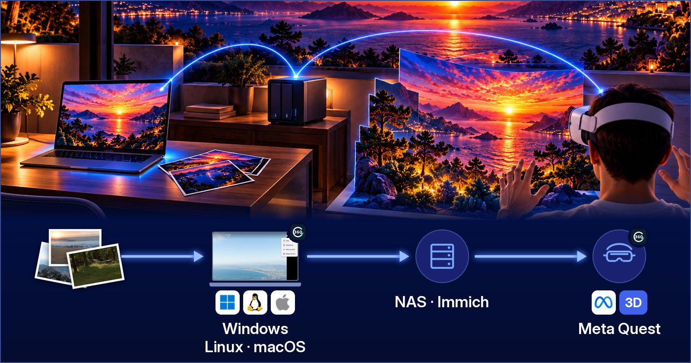
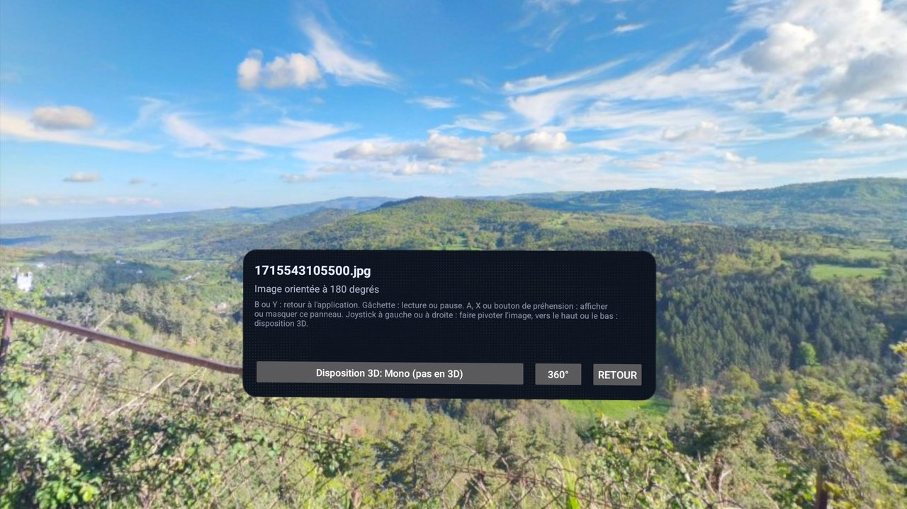

🌐 <b>Esperanto</b> · Aliaj lingvoj (88)
<a href="../README.md">English</a> · <a href="README.af.md">Afrikaans</a> · <a href="README.ar.md">العربية</a> · <a href="README.az.md">Azərbaycanca</a> · <a href="README.be.md">Беларуская</a> · <a href="README.bg.md">Български</a> · <a href="README.bi.md">Bislama</a> · <a href="README.bn.md">বাংলা</a> · <a href="README.br.md">Brezhoneg</a> · <a href="README.bs.md">Bosanski</a> · <a href="README.ca.md">Català</a> · <a href="README.cs.md">Čeština</a> · <a href="README.cv.md">Чӑвашла</a> · <a href="README.da.md">Dansk</a> · <a href="README.de.md">Deutsch</a> · <a href="README.de_CH.md">Deutsch (Schweiz)</a> · <a href="README.el.md">Ελληνικά</a> · <a href="README.en_GB.md">English (UK)</a> · <a href="README.es.md">Español</a> · <a href="README.et.md">Eesti</a> · <a href="README.eu.md">Euskara</a> · <a href="README.fa.md">فارسی</a> · <a href="README.fi.md">Suomi</a> · <a href="README.fil.md">Filipino</a> · <a href="README.fr.md">Français</a> · <a href="README.ga.md">Gaeilge</a> · <a href="README.gl.md">Galego</a> · <a href="README.gsw.md">Alemannisch</a> · <a href="README.gu.md">ગુજરાતી</a> · <a href="README.he.md">עברית</a> · <a href="README.hi.md">हिन्दी</a> · <a href="README.hr.md">Hrvatski</a> · <a href="README.hu.md">Magyar</a> · <a href="README.hy.md">Հայերեն</a> · <a href="README.id.md">Bahasa Indonesia</a> · <a href="README.is.md">Íslenska</a> · <a href="README.it.md">Italiano</a> · <a href="README.ja.md">日本語</a> · <a href="README.ka.md">ქართული</a> · <a href="README.kab.md">Taqbaylit</a> · <a href="README.kk.md">Қазақша</a> · <a href="README.km.md">ខ្មែរ</a> · <a href="README.kmr.md">Kurmancî</a> · <a href="README.kn.md">ಕನ್ನಡ</a> · <a href="README.ko.md">한국어</a> · <a href="README.kxm.md">ภาษาเขมรถิ่นไทย</a> · <a href="README.lb.md">Lëtzebuergesch</a> · <a href="README.lmo.md">Lombard</a> · <a href="README.lt.md">Lietuvių</a> · <a href="README.lv.md">Latviešu</a> · <a href="README.mfa.md">Bahasa Melayu Kelantan</a> · <a href="README.mi.md">Te reo Māori</a> · <a href="README.mk.md">Македонски</a> · <a href="README.ml.md">മലയാളം</a> · <a href="README.mn.md">Монгол</a> · <a href="README.mr.md">मराठी</a> · <a href="README.ms.md">Bahasa Melayu</a> · <a href="README.nb_NO.md">Norsk bokmål</a> · <a href="README.ne.md">नेपाली</a> · <a href="README.nl.md">Nederlands</a> · <a href="README.nn.md">Norsk nynorsk</a> · <a href="README.pa.md">ਪੰਜਾਬੀ</a> · <a href="README.pl.md">Polski</a> · <a href="README.pt.md">Português</a> · <a href="README.pt_BR.md">Português (Brasil)</a> · <a href="README.ro.md">Română</a> · <a href="README.ru.md">Русский</a> · <a href="README.si.md">සිංහල</a> · <a href="README.sk.md">Slovenčina</a> · <a href="README.sl.md">Slovenščina</a> · <a href="README.sq.md">Shqip</a> · <a href="README.sr_Cyrl.md">Српски</a> · <a href="README.sr_Latn.md">Srpski</a> · <a href="README.sv.md">Svenska</a> · <a href="README.sw.md">Kiswahili</a> · <a href="README.swg.md">Schwäbisch</a> · <a href="README.ta.md">தமிழ்</a> · <a href="README.te.md">తెలుగు</a> · <a href="README.th.md">ไทย</a> · <a href="README.tl.md">Tagalog</a> · <a href="README.tr.md">Türkçe</a> · <a href="README.uk.md">Українська</a> · <a href="README.ur.md">اردو</a> · <a href="README.uz.md">Oʻzbekcha</a> · <a href="README.vi.md">Tiếng Việt</a> · <a href="README.yue_Hant.md">粵語</a> · <a href="README.zh_Hans.md">简体中文</a> · <a href="README.zh_Hant.md">繁體中文</a>

  

# Immuch360

**Viaj memeaĵoj. Ĉiu ekrano. Ĉiu perspektivo.**

🌐 <a href="https://immuch360.com/eo/"><b>immuch360.com</b></a>

Plataj, 360°-aj kaj 3D-fotoj kaj videoj el via aparato, via NAS, via Immich-servilo, viaj kameraoj kaj via drono. Neniu konto bezonata. Immuch360 estas libera kaj malfermitkoda apo, kiu legas viajn fotojn kaj videojn tie, kie ili estas, kaj ludas ĉiun en la spektilo, kiu taŭgas por ĝi: plate, kiel sfero, en kiu vi ĉirkaŭrigardas, en 3D, aŭ tute ĉirkaŭ vi en kasko. Ĝi funkcias sur telefonoj, tabulkomputiloj, televidiloj, Meta Quest-kaskoj kaj komputiloj. Ĝia retejo, [immuch360.com](https://immuch360.com/eo/), montras, kion ĝi faras sur ĉiu ekrano, en 89 lingvoj.

**Nova en konstruo 53 kaj labortabla konstruo 34, versio 3.4.8.** En komputiloj, [Spatial 2.5D](#see-your-3d-photos-and-videos-in-depth-on-your-computer) donas al viaj 3D-fotoj profundon sur la plata ekrano, inkluzive de 360°- kaj VR180-3D-fotoj, sur Windows, Linux kaj macOS, kaj al viaj 3D-videoj sur Windows kaj macOS: la vido moviĝas, kiam vi movas vian kapon, sekvatan de la retkamerao post via konsento, aŭ per la muso, kaj la bildoj de la retkamerao restas en la memoro de la komputilo, neniam konservitaj aŭ senditaj; provita sur unu Windows-tekkomputilo kun USB-retkamerao, 3D-videoj sur ĝia grafika karto, ankoraŭ ne sur Mac aŭ labortabla Linux-komputilo. La rado [zomas foton ĉirkaŭ la montrilo](#zoom-into-a-photo-with-the-wheel) kaj tiro movas ĝin. [Plibonigi (AI)](#make-a-photo-sharper-on-your-computer-ai) prenas la fotojn de viaj kunhavigoj, de DLNA, Plex, Jellyfin kaj Emby kaj de via Immich-servilo, plibonigas 360°- kaj 3D-fotojn sen rompi ilian kudron aŭ iliajn du okulojn, kaj proponas Akrigi sur Mac kun Apple-blato (ankoraŭ ne provita sur Mac). El la telefono, ["Ludi en…"](#show-your-photos-and-videos-on-the-tv-from-your-phone) malfermas 360°-eron en la 360°-vido de la ekrano, ludas elekton aŭ albumon kiel bildserion, ensalutigas ekranon al via servilo kaj sendas la fotojn kaj videojn, kiuj estas nur sur la telefono; provita inter Android-imitiloj, ankoraŭ ne sur reala telefono aŭ televidilo. En Meta Quest, la bildserio de la granda ekrano [transfandiĝas aŭ glitas](#browse-your-photos-on-the-big-screen-of-the-quest) inter fotoj, super nigra, malklarigita aŭ passthrough fono laŭ via elekto, ankoraŭ ne provita en kasko de la projekto.

**Nove en konstruoj 33 ĝis 52.** [Filmoj daŭras de kie vi haltis](#pick-up-a-film-where-you-stopped). Ili komenciĝas pli frue, kaj de malrapida servilo ili [daŭre ludas anstataŭ halti](#when-a-video-waits-or-will-not-play). La tempolinio [malzomas al monatoj kaj jaroj](#find-a-month-or-a-year-in-a-long-timeline) en telefonoj kaj komputiloj. En Android-telefono aŭ Meta Quest, ["Foliumi dosierujon"](#browse-a-folder-of-your-phone-or-headset) malfermas dosierujon de la aparato kiel kunhavigon, kaj TIFF-fotoj aperas. Android TV [serĉas laŭ dato per la teleregilo](#on-android-tv-and-google-tv), Meta Quest 3 aŭ 3S [malfermas gaŭsajn splatojn](#explore-gaussian-splats-in-a-meta-quest-3-or-3s), turnatajn per la dekstra stirstangeto, inkluzive de SPZ-versio 4, kaj komputilo [faras la 3D-versiojn de la fotoj de via NAS](#turn-one-photo-into-3d-a-scene-a-panorama). Sur Windows-tekkomputilo kun du grafikaj blatoj, la aplikaĵo [nun funkcias per la rapida](#when-a-video-waits-or-will-not-play), do 8K-filmoj ludas glate. Gaŭsaj splatoj nun [malfermiĝas en komputiloj kaj Android-telefonoj kaj -tabulkomputiloj](#explore-gaussian-splats-on-your-phone-tablet-or-computer), Windows-komputilo [faras splat-scenojn el viaj fotoj aŭ video](#make-a-splat-scene-from-your-photos-or-a-video-ai) per AI, via Immich-servilo [konservas ilin ene de fotoj](#keep-a-splat-scene-on-your-immich-server), kiuj malfermiĝas el via tempolinio, kaj komputiloj [ludas AV2-videojn](#play-av2-videos-on-your-computer). Ekde konstruo 42, la krudaj videoj de kameraoj Insta360, GoPro MAX kaj DJI Osmo 360, el via Immich-biblioteko, kunhavigo aŭ dosierujo, [ludas stabiligitaj per la giroskopo de la kamerao](#stabilise-your-360-videos-with-the-cameras-gyroscope) sur Android-telefonoj, -tabulkomputiloj kaj -televidiloj, la splat-kreilo de labortabla konstruo 22 [proponas Detalan kvaliton](#make-a-splat-scene-from-your-photos-or-a-video-ai) por scenoj, kiujn vi rigardas de proksime, kaj 360°-panoramo [komenciĝas kun 3,5 GiB liberaj de la grafika karto](#turn-one-photo-into-3d-a-scene-a-panorama). La iPhone- kaj iPad-apo estas [en la App Store](https://apps.apple.com/us/app/immuch360-360-3d-player/id6817655965), versio 3.4.3. Ekde konstruo 43, la ĝisdatiga avizo de la apo malfermas Google Play aŭ la App Store sur telefonoj kaj tabulkomputiloj; ĝia retejo, [immuch360.com](https://immuch360.com/eo/), malfermiĝis la 7-an de novembro. Ekde konstruo 44 kaj labortabla konstruo 24, Meta Quest 3 aŭ 3S [montras splatojn de ĝis 300 000 gaŭsoj](#explore-gaussian-splats-in-a-meta-quest-3-or-3s), komputiloj [elektas plurajn fotojn kaj videojn per Ctrl kaj Shift](#use-your-computer-as-the-media-player), televidilo, kies malkodilo rifuzas videon, [ludas la alian dosieron de la servilo](#when-a-video-waits-or-will-not-play) per si mem, panoramoj funkcias per la elektita grafika karto de tekkomputilo, kiu havas du, kaj la ĝisdatiga avizo de la Quest kaj de la komputiloj malfermas ilian vendejan aŭ elŝutan paĝon, kun multaj korektoj. Ekde konstruo 45 kaj labortabla konstruo 25, versio 3.4.0 sur ĉiu platformo, la apo sekvas la Immich-apon 3.4.0 kun 11 postaj korektoj de Immich, montras la [JPEG XL-fotojn de Immich 3.4-serviloj](#keep-your-immich-library-with-more), malfermas [viajn Plex-filmojn laŭ jaro](#watch-your-plex-films) kun paĝo por ĉiu filmo, ilia elŝuto al la aparato kaj ilia ludado en la televidilo el la telefono, povas peti taksadon en la vendejaj konstruoj, kaj, en komputiloj, prenas siajn videokomponantojn el [iliaj propraj malfermaj deponejoj](#licences-and-credits). Ekde konstruo 46 kaj labortabla konstruo 26, versio 3.4.1, la krudaj videoj de 360°-kameraoj ankaŭ [ludas stabiligitaj](#stabilise-your-360-videos-with-the-cameras-gyroscope) sur iPhone kaj iPad, en Meta Quest kaj sur Windows, Meta Quest [ludas per libmpv la Plex-filmojn, kiujn ĝia propra ludilo ne povas malkodi](#watch-your-plex-films), telefono [sendas tian filmon al Chromecast aŭ Google TV](#watch-your-plex-films), kaj la AI-reliefo de 3D-foto [prenas la forton, kiun vi elektas](#turn-one-photo-into-3d-a-scene-a-panorama); nova servilo ankaŭ povas esti aldonita per ensaluto per via Plex-konto, kaj la apo [konservas siajn agordojn en dosiero](#keep-your-settings-in-a-file). Ekde konstruo 47 kaj labortabla konstruo 27, versio 3.4.2, Plex-filmo [ludas sonspuron, kiun la aparato malkodas](#watch-your-plex-films) kaj diras kiun, malfermas la version, kiu taŭgas por la ekrano kaj, ĉe malrapida konekto, proponas pli malpezan, Windows kaj macOS ludas ĝian Dolby TrueHD-sonon, Android [montras ĝian elŝuton en sciigo](#watch-your-plex-films) kaj ankaŭ Android TV elŝutas filmojn, kaj [bateriaj Tapo-kameraoj montras vivan vidon](#watch-your-home-cameras-on-the-big-screen); restaŭri agordan dosieron kun ĝiaj kontoj nun ensalutigas vin al via Immich-servilo. Ekde konstruo 48 kaj labortabla konstruo 28, versio 3.4.3, Windows-komputilo [ludas viajn videojn en PC VR-kasko](#watch-your-videos-in-a-pc-vr-headset-from-windows) per SteamVR, Meta Horizon Link aŭ alia OpenXR-rultempo (ankoraŭ ne provita en kasko de la projekto), [kameraoj de aliaj markoj montras vivan vidon](#cameras-of-other-brands-over-onvif-or-rtsp), trovitaj per ONVIF aŭ aldonitaj per sia RTSP-ligilo (kontrolitaj kontraŭ simulita kamerao, ankoraŭ neniu vera kamerao de alia marko provita), la krudaj videoj de la [DJI Osmo 360 II kaj la GoPro MAX 2 ludas stabiligitaj](#open-the-raw-files-of-360-cameras), Plex-filmoj [ne plu alvenas tro malrapide en telefonoj](#when-a-video-waits-or-will-not-play), LG- kaj Samsung-televidiloj [turnas videon, kiu kuŝas sur la flanko](#on-a-samsung-tv-tizen) per unu butono (ankoraŭ ne provita sur LG-televidilo; la Samsung-televidilo de issue 17 rifuzis la turnon), kaj "Ĝisdatigo disponeblas por la servilo" ne plu aperas por ĝisdata servilo. Ekde konstruo 49 kaj labortabla konstruo 29, versio 3.4.4, la apo [mem legas viajn Jellyfin- kaj Emby-servilojn](#watch-your-jellyfin-and-emby-libraries) (ankoraŭ ne provita sur aparato), trovitajn en via reto kaj ensalutitajn per Quick Connect en televidilo aŭ en kasko, iliaj originalaj dosieroj ludataj tiel, ke 360°-video restas 360°; sur la granda ekrano de Meta Quest, fotoj [konservas la grandon kaj la lokon, kiujn vi agordis, dum vi foliumas ilin, kaj ludas kiel bildserio](#browse-your-photos-on-the-big-screen-of-the-quest) (ankoraŭ ne provita en kasko de la projekto); la 360°-videoludilo de telefonoj kaj tabulkomputiloj [ricevas la regilojn de 360°-fotoj](#360-videos-on-your-phone-with-the-controls-of-360-photos), giroskopan butonon, pinĉon por zomi kaj trenon rekte supren aŭ malsupren (provita de uzanto sur Samsung Galaxy S25 Ultra, ankoraŭ ne sur iPhone); komputilo [faras 3D-videojn el viaj 2D-videoj](#turn-your-2d-videos-into-3d-on-your-computer) per AI (ankoraŭ ne provita sur 3D-ekrano aŭ en kasko); kaj Samsung-televidiloj [transdonas videon, kiu bezonas turnon, al la propra ludilo de Samsung](#on-a-samsung-tv-tizen), kiun la televidilo de issue 17 ludas sed rifuzas turni. Ekde konstruo 50 kaj labortabla konstruo 30, versio 3.4.5, dum video ludas en la 2D-fenestro de Meta Quest, la fenestro [redesegniĝas laŭ la frekvenco de la ekrano](#step-inside-your-photos-and-videos-with-a-meta-quest) anstataŭ ĉirkaŭ 10 fojojn sekunde kiel en konstruoj 48 kaj 49 (mezurita sur Meta Quest 3), Android TV [zomas en foton per la teleregilo](#on-android-tv-and-google-tv) kaj movas ĝin per la sagoj (nova, ankoraŭ ne provita sur televidilo), kaj tri korektoj venas el la Android TV-forko de mlc70: rapida glito ne plu montras la detalojn de la foto lasita malantaŭe, movbildo liberigas sian memoron, kaj la filtrilo Loko proponas la urbojn de la nova lando. Ekde konstruo 51 kaj labortabla konstruo 31, versio 3.4.6, [Plibonigi (AI)](#make-a-photo-sharper-on-your-computer-ai) faras pli akran kopion de malakra foto apud la originalo sur Windows kaj Linux, je tri niveloj, ĉiu rulita unufoje sur unu komputilo kun RTX 4060, Natura ankaŭ estas proponata sur Mac kun Apple-blato (ankoraŭ ne provita sur Mac), komputilo [faras el 360°-video 360°-3D-videon](#a-360-video-turned-into-a-360-3d-video) per AI, la profundon de la 3D-videoj taksas la grafika karto sur Windows, la AI-funkcioj prenas la videojn de via servilo kaj de kunhavigo rekte, la agorda dosiero havas [sian karton en la Biblioteko](#keep-your-settings-in-a-file), televidilo konservas ĝin en reta kunhavigo, Escape iras unu paŝon malantaŭen sur komputiloj, la vendejaj konstruoj petas taksadon [malpli ofte kaj pli milde](#privacy), Linux montras TIFF-fotojn, splat-scenojn kaj 3D-videojn per unu okulo, kaj du kraŝoj estas riparitaj. Ekde konstruo 52 kaj labortabla konstruo 32, versio 3.4.7, ["Ludi en…"](#show-your-photos-and-videos-on-the-tv-from-your-phone) sendas la fotojn kaj videojn de via Immich-biblioteko, de viaj kunhavigoj kaj de Jellyfin kaj Emby el la telefono al televidilo, Meta Quest, komputilo aŭ Chromecast, la nomoj de viaj fotoj kaj videoj [restas legeblaj super iliaj bildetoj](#play-the-files-of-a-nas-a-computer-a-media-server-or-plex), la AI-komponantoj de komputilo [ĝisdatiĝas per unu klako](#update-the-ai-components-in-one-click), Linux ricevas [AppImage](#linux), kaj la iPhone- kaj iPad-apo estas konstruita per Xcode 27. Labortabla konstruo 33 riparis [Plibonigi (AI)](#make-a-photo-sharper-on-your-computer-ai), kiu malsukcesis pri ĉiu foto en labortablaj konstruoj 31 kaj 32 ([issue 23](https://github.com/freeKC/Immuch360/issues/23)).

  Neoficiala forko de la Immich-poŝtelefona apo. Ne rilata al Immich nek al FUTO. La nomo sonas kiel la angla esprimo "I am much 360" (mi estas multe 360).

<b>Enhavo</b>

- [Por kiu ĝi estas](#who-it-is-for)
- [Kiuj ekranoj](#which-screens), [kion ili faras kune](#use-cases) kaj [kion faras ĉiu ekrano](#what-each-screen-does)
- [Kion vi povas fari](#what-you-can-do)
- [Akiru ĝin sur via aparato](#get-it-on-your-device)
- [Kiel fari](#how-to)
  - [Spekti viajn fotojn kaj videojn, kun aŭ sen servilo](#watch-your-photos-and-videos-with-or-without-a-server)
  - [Esplori panoramojn, 360°, VR180 kaj 3D](#explore-panoramas-360-vr180-and-3d): [360°-videoj sur telefonoj](#360-videos-on-your-phone-with-the-controls-of-360-photos)
  - [Transformi unu foton en 3D, scenon, panoramon](#turn-one-photo-into-3d-a-scene-a-panorama): [AI-komponantoj ĝisdatigitaj per unu klako](#update-the-ai-components-in-one-click)
  - [Fari viajn 2D-videojn 3D en via komputilo](#turn-your-2d-videos-into-3d-on-your-computer): [360°-videoj al 360°-3D](#a-360-video-turned-into-a-360-3d-video)
  - [Fari foton pli akra en via komputilo (AI)](#make-a-photo-sharper-on-your-computer-ai)
  - [Spekti en la televidilo per la teleregilo](#watch-on-the-tv-with-the-remote): [Android TV kaj Google TV](#on-android-tv-and-google-tv), [LG](#on-an-lg-tv-webos), [Samsung](#on-a-samsung-tv-tizen)
  - [Ensalutigi televidilon, kaskon aŭ komputilon per via telefono](#sign-in-a-tv-a-headset-or-a-computer-with-your-phone)
  - [Montri viajn fotojn kaj videojn en la televidilo el via telefono](#show-your-photos-and-videos-on-the-tv-from-your-phone)
  - [Eniri viajn fotojn kaj videojn per Meta Quest](#step-inside-your-photos-and-videos-with-a-meta-quest): [la granda ekrano](#browse-your-photos-on-the-big-screen-of-the-quest), [kioska reĝimo](#kiosk-mode-for-an-exhibition-or-a-shop)
  - [Esplori gaŭsajn splatojn en Meta Quest 3 aŭ 3S](#explore-gaussian-splats-in-a-meta-quest-3-or-3s)
  - [Esplori gaŭsajn splatojn sur via telefono, tabulkomputilo aŭ komputilo](#explore-gaussian-splats-on-your-phone-tablet-or-computer)
  - [Fari splat-scenon el viaj fotoj aŭ video (AI)](#make-a-splat-scene-from-your-photos-or-a-video-ai)
  - [Konservi splat-scenon en via Immich-servilo](#keep-a-splat-scene-on-your-immich-server)
  - [Ludi la dosierojn de NAS, komputilo, aŭdvida servilo aŭ Plex](#play-the-files-of-a-nas-a-computer-a-media-server-or-plex): [viaj filmoj laŭ jaro](#watch-your-plex-films), [Jellyfin kaj Emby](#watch-your-jellyfin-and-emby-libraries)
  - [Foliumi dosierujon de via telefono aŭ kasko](#browse-a-folder-of-your-phone-or-headset)
  - [Daŭrigi filmon de kie vi haltis](#pick-up-a-film-where-you-stopped)
  - [Kiam video atendas aŭ ne ludas](#when-a-video-waits-or-will-not-play)
  - [Konservi vian Immich-bibliotekon, kun pli](#keep-your-immich-library-with-more)
  - [Trovi monaton aŭ jaron en longa tempolinio](#find-a-month-or-a-year-in-a-long-timeline)
  - [Spekti viajn hejmajn kameraojn sur la granda ekrano](#watch-your-home-cameras-on-the-big-screen): [aliaj markoj](#cameras-of-other-brands-over-onvif-or-rtsp)
  - [Via DJI-drono](#your-dji-drone): [viva video](#see-what-your-drone-sees-on-your-phone), [en Quest aŭ sur Android TV](#watch-it-in-a-meta-quest-or-on-an-android-tv), [importo](#bring-a-drones-or-a-camera-cards-photos-and-videos-to-immich)
  - [Malfermi la krudajn dosierojn de 360°-kameraoj](#open-the-raw-files-of-360-cameras)
  - [Stabiligi viajn 360°-videojn per la giroskopo de la kamerao](#stabilise-your-360-videos-with-the-cameras-gyroscope)
  - [Turni foton per unu klavo](#turn-a-photo-with-one-key)
  - [Uzi vian komputilon kiel aŭdvidan ludilon](#use-your-computer-as-the-media-player): [zomi per la rado](#zoom-into-a-photo-with-the-wheel)
  - [Vidi viajn 3D-fotojn kaj -videojn kun profundo en via komputilo](#see-your-3d-photos-and-videos-in-depth-on-your-computer)
  - [Spekti viajn videojn en PC VR-kasko, el Windows](#watch-your-videos-in-a-pc-vr-headset-from-windows)
  - [Ludi AV2-videojn en via komputilo](#play-av2-videos-on-your-computer)
  - [Konservi viajn agordojn en dosiero](#keep-your-settings-in-a-file)
- [Kompare kun Immich](#compared-with-immich)
- [Privateco](#privacy)
- [Permesiloj kaj dankoj](#licences-and-credits)
- [Vojmapo](#roadmap)
- [Dokumentado](#documentation)

## Por kiu ĝi estas

- **Vi fotas en 360° aŭ 3D** kaj volas ĉirkaŭrigardi en viaj bildoj, ne vidi ilin plataj, duobligitaj aŭ streĉitaj, kaj turni viajn 360°-videojn en la telefono kiel vi turnas ĝiajn fotojn: [360°, VR180 kaj 3D](#explore-panoramas-360-vr180-and-3d), [360°-videoj sur telefonoj](#360-videos-on-your-phone-with-the-controls-of-360-photos).
- **Vi filmas per 360°-kamerao en la mano, sur biciklo aŭ sur protekta kasko** kaj volas, ke la krudaj videoj de via Insta360-, GoPro MAX- aŭ MAX 2-, DJI Osmo 360- aŭ Osmo 360 II-kamerao, konservitaj en Immich, en kunhavigo aŭ en dosierujo, ludu ebene kaj stabile sur via telefono, via televidilo, via Meta Quest aŭ via Windows-komputilo: [stabiligitaj per la giroskopo de la kamerao](#stabilise-your-360-videos-with-the-cameras-gyroscope).
- **Viaj fotoj kaj filmoj estas sur NAS, komputilo, Plex aŭ Immich** kaj vi volas ilin en la televidilo sen kopii ion ajn: [en la televidilo](#watch-on-the-tv-with-the-remote), [NAS, kunhavigoj kaj Plex](#play-the-files-of-a-nas-a-computer-a-media-server-or-plex).
- **Vi tenas viajn filmojn sur Plex-servilo** kaj volas elekti unu laŭ jaro, vidi kio ĝi estas antaŭ ol ĝi komenciĝas, kunpreni ĝin vojaĝe, komenci ĝin en la televidilo aŭ Chromecast el via telefono, kaj ludi eĉ la filmojn, kiujn via Android-telefono, televidilo aŭ Meta Quest ne povas malkodi: [viaj filmoj, laŭ jaro](#watch-your-plex-films).
- **Vi tenas viajn filmojn sur Jellyfin- aŭ Emby-servilo** kaj volas ilin en via Meta Quest, en la televidilo aŭ la telefono, kun 360° kaj 3D konservitaj kiel ili estas, kaj via loko konservita sur la servilo (ankoraŭ ne provita sur aparato): [Jellyfin kaj Emby](#watch-your-jellyfin-and-emby-libraries).
- **Vi havas Meta Quest** kaj volas eniri viajn proprajn fotojn kaj videojn: [en la kasko](#step-inside-your-photos-and-videos-with-a-meta-quest), kaj foliumi viajn fotojn sur granda ekrano je la grando kaj la loko, kiujn vi agordis, ankaŭ kiel bildserio (ankoraŭ ne provita en kasko de la projekto): [la granda ekrano](#browse-your-photos-on-the-big-screen-of-the-quest).
- **Vi havas PC VR-kaskon ĉe Windows-komputilo** kaj volas en ĝi viajn 360°-videojn ĉirkaŭ vi kaj viajn filmojn sur granda ekrano (ankoraŭ ne provita en kasko de la projekto): [en PC VR-kasko](#watch-your-videos-in-a-pc-vr-headset-from-windows).
- **Viaj fotoj estas plataj** kaj vi volas ilin en 3D, kiel scenon, en kiun vi kliniĝas en kasko, aŭ ene de 360°-panoramo, sen 3D-fotilo: [transformi unu foton en 3D, scenon, panoramon](#turn-one-photo-into-3d-a-scene-a-panorama), nova, farita de AI en via propra komputilo.
- **Viaj videoj estas plataj**, inkluzive de la klipoj de via telefono, kaj vi volas ilin en 3D por kasko aŭ 3D-ekrano, kaj viajn 360°-videojn en 360°-3D, faritajn en via propra komputilo (ankoraŭ ne provita sur 3D-ekrano aŭ en kasko): [2D-videoj al 3D](#turn-your-2d-videos-into-3d-on-your-computer), [360° al 360°-3D](#a-360-video-turned-into-a-360-3d-video).
- **Viaj fotoj estas malakraj**, iom malfokusitaj aŭ faritaj en malbona lumo, kaj vi volas pli akran kopion apud la originalo, faritan en via propra komputilo, ankaŭ el viaj kunhavigoj kaj serviloj, kun la elpensitaj detaloj klare diritaj: [Plibonigi (AI)](#make-a-photo-sharper-on-your-computer-ai).
- **Vi havas 3D-fotojn, 360°-3D-fotojn aŭ 3D-videojn kaj komputilon** kaj volas ilin kun profundo sur ĝia plata ekrano, la vido moviĝanta kiam vi movas vian kapon, sekvatan de la retkamerao, aŭ per la muso (provita sur unu Windows-tekkomputilo kun retkamerao, ankoraŭ ne sur Mac aŭ labortabla Linux-komputilo): [Spatial 2.5D en via komputilo](#see-your-3d-photos-and-videos-in-depth-on-your-computer).
- **Vi uzas Immich** kaj volas ĝian apon, plus la mergajn spektilojn kaj la grandajn ekranojn, kiujn vi ensalutigas per via telefono: [via Immich-biblioteko](#keep-your-immich-library-with-more), [kompare kun Immich](#compared-with-immich).
- **Vi gardas vian hejmon per Tapo-kameraoj**, ankaŭ bateriaj, aŭ kameraoj de aliaj markoj per ONVIF aŭ RTSP, kaj volas ilin apud viaj fotoj, ankaŭ en la televidilo (kontrolita kontraŭ simulita kamerao): [hejmaj kameraoj](#watch-your-home-cameras-on-the-big-screen).
- **Vi flugigas DJI-dronon** kaj volas ĝian vivan bildon sur via telefono sen DJI Fly, kaj en Meta Quest aŭ sur Android TV por la homoj kun vi: [via drono](#see-what-your-drone-sees-on-your-phone).
- **Vi kaptas lokojn kaj objektojn en 3D, kiel gaŭsajn splatojn,** aŭ ŝatus fari ilin el viaj propraj fotoj, kaj volas promeni tra ili sur via telefono, via komputilo aŭ en kasko: [sur telefono, tabulkomputilo aŭ komputilo](#explore-gaussian-splats-on-your-phone-tablet-or-computer), [faritaj el viaj fotoj](#make-a-splat-scene-from-your-photos-or-a-video-ai), [konservitaj en Immich](#keep-a-splat-scene-on-your-immich-server).
- **Vi havas AV2-videojn**, la formaton, kiu sekvas AV1, kaj volas spekti ilin en via komputilo: [AV2 en via komputilo](#play-av2-videos-on-your-computer).
- **Vi havas plurajn ekranojn hejme** kaj volas, ke ili funkciu kune: [kion viaj ekranoj faras kune](#use-cases).

Ne estas Immuch360-konto por krei, kaj nenio venas al ni: la apo parolas nur kun viaj aparatoj kaj kun la serviloj, kiujn vi elektas, ekde konstruo 45 kun Wikipedia por la paĝo de filmo, ekde konstruo 46 kun plex.tv kiam vi ensalutas per ĝi, kaj elŝutas AI-komponanton aŭ la AV2-malkodilon nur kiam vi petas ĝin.

## Kiuj ekranoj

| Platformo | Kie akiri ĝin | Stato en novembro 2026 |
|---|---|---|
|  **Android** telefonoj kaj tabulkomputiloj | [Google Play](https://play.google.com/store/apps/details?id=com.aprogsys.immuch360) · [APK](https://github.com/freeKC/Immuch360/releases) | en Google Play (konstruo 47 publikigita la 16-an de novembro; konstruo 51 en la revizio de Google ekde la 24-a de novembro; konstruo 53 sekvos), konstruo 53 en GitHub, kie [krudaj 360°-videoj ludas stabiligitaj](#stabilise-your-360-videos-with-the-cameras-gyroscope), [filmoj daŭras de kie vi haltis](#pick-up-a-film-where-you-stopped), ["Foliumi dosierujon"](#browse-a-folder-of-your-phone-or-headset) malfermas dosierujon de la telefono kaj [gaŭsaj splatoj malfermiĝas](#explore-gaussian-splats-on-your-phone-tablet-or-computer), el kunhavigo aŭ [el via Immich-tempolinio](#keep-a-splat-scene-on-your-immich-server), [la agordoj konservitaj en dosiero](#keep-your-settings-in-a-file), [la elŝuto de filmo montrata en sciigo](#watch-your-plex-films), ekde konstruo 48 [kameraoj de aliaj markoj, vive](#cameras-of-other-brands-over-onvif-or-rtsp) (kontrolitaj kontraŭ simulita kamerao) kaj, ekde konstruo 49, [Jellyfin- kaj Emby-serviloj](#watch-your-jellyfin-and-emby-libraries) (ankoraŭ ne provita sur aparato) kaj [la regiloj de 360°-fotoj en la 360°-videoludilo](#360-videos-on-your-phone-with-the-controls-of-360-photos) (provita de uzanto sur Samsung Galaxy S25 Ultra), kaj ekde konstruo 51 [la karto de la agorda dosiero en la Biblioteko](#keep-your-settings-in-a-file), ĝia dosiero konservita ankaŭ en reta kunhavigo, kaj ekde konstruo 52 [viaj fotoj kaj videoj senditaj al televidilo aŭ Chromecast](#show-your-photos-and-videos-on-the-tv-from-your-phone) per "Ludi en…" (ankoraŭ ne provita sur aparato), kaj ekde konstruo 53 [360°-eroj, elekto aŭ albumo kaj la fotoj kaj videoj de la telefono mem](#show-your-photos-and-videos-on-the-tv-from-your-phone) senditaj same (provita inter Android-imitiloj) |
|  **iPhone kaj iPad** | [App Store](https://apps.apple.com/us/app/immuch360-360-3d-player/id6817655965) | versio 3.4.7 en la App Store ekde la 26-a de novembro, kun [monatoj kaj jaroj en la tempolinio](#find-a-month-or-a-year-in-a-long-timeline), [filmoj, kiuj daŭras de kie vi haltis](#pick-up-a-film-where-you-stopped), [la ensalutigo de televidilo, kasko aŭ komputilo](#sign-in-a-tv-a-headset-or-a-computer-with-your-phone) el la telefono, la splat-scenoj konservitaj en Immich montritaj kiel ilia foto, la korektoj de Immich 3.4.0 kaj ĝiaj JPEG XL-fotoj, [krudaj 360°-videoj stabiligitaj](#stabilise-your-360-videos-with-the-cameras-gyroscope), [la agordoj konservitaj en dosiero](#keep-your-settings-in-a-file), [la viva vido de bateriaj Tapo-kameraoj](#watch-your-home-cameras-on-the-big-screen) kaj [la viva vido de kameraoj de aliaj markoj](#cameras-of-other-brands-over-onvif-or-rtsp) (kontrolitaj kontraŭ simulita kamerao), kaj ekde versio 3.4.4 [Jellyfin- kaj Emby-serviloj](#watch-your-jellyfin-and-emby-libraries) (ankoraŭ ne provita sur aparato) kaj [la regiloj de 360°-fotoj en la 360°-videoludilo](#360-videos-on-your-phone-with-the-controls-of-360-photos) (ankoraŭ ne provita sur iPhone), kaj ekde versio 3.4.6 [la karto de la agorda dosiero](#keep-your-settings-in-a-file) kaj ĝia restaŭro el reta kunhavigo, kaj ekde versio 3.4.7, konstruita per Xcode 27, ["Ludi en…" por fotoj kaj videoj](#show-your-photos-and-videos-on-the-tv-from-your-phone) (ankoraŭ ne provita sur iPhone); versio 3.4.8, la iPhone- kaj iPad-versio de konstruo 53, sekvos; aŭ [konstruu ĝin mem](../docs/immuch360/build.md) |
|  **Android TV kaj Google TV** | [Google Play](https://play.google.com/store/apps/details?id=com.aprogsys.immuch360) · [APK](#android-tv-and-google-tv) | en Google Play, kiu proponas la apon sur Android TV kaj Google TV, kaj konstruo 53 en GitHub: [krudaj 360°-videoj stabiligitaj](#stabilise-your-360-videos-with-the-cameras-gyroscope), [serĉo laŭ dato per la teleregilo](#on-android-tv-and-google-tv), [ensaluto per via telefono](#sign-in-a-tv-a-headset-or-a-computer-with-your-phone) per skano de QR-kodo, tempobreto, sono kaj subtekstoj por la teleregilo en la videoludilo, kaj [la viva video de drono](#watch-it-in-a-meta-quest-or-on-an-android-tv) relajita de telefono, [filmoj elŝutitaj al la televidilo](#watch-your-plex-films) kaj, ekde konstruo 49, [Jellyfin- kaj Emby-serviloj](#watch-your-jellyfin-and-emby-libraries) ensalutitaj per Quick Connect (ankoraŭ ne provita sur aparato) kaj, ekde konstruo 50, [fotoj zomitaj per la teleregilo](#on-android-tv-and-google-tv) (vidita funkcii en Android TV-imitilo, ankoraŭ ne provita sur televidilo), kaj ekde konstruo 51 [la agorda dosiero konservita kaj restaŭrita en reta kunhavigo](#keep-your-settings-in-a-file) (vidita funkcii en Android TV-imitilo), kaj ekde konstruo 52 [la fotoj kaj videoj, kiujn telefono sendas per "Ludi en…"](#show-your-photos-and-videos-on-the-tv-from-your-phone) (ankoraŭ ne provita sur televidilo), kaj ekde konstruo 53 la 360°-fotoj, kiujn telefono sendas, malfermitaj en sia 360°-vido, ensaluto el la folio de la telefono kaj la fotoj kaj videoj de la telefono mem (vidita funkcii en Android TV-imitilo) |
| **LG-televidiloj** kun webOS 5.0 kaj pli nova | [.ipk, versio 1.0.5](https://github.com/freeKC/Immuch360/releases/tag/webos-v1.0.5) · LG Content Store (en revizio) | versio 1.0.0, submetita al la LG Content Store la 24-an de oktobro, en la testoj de LG ekde la 26-a de oktobro; versio 1.0.1, en GitHub ekde la 27-a de oktobro, zomas foton per la sagoj kaj diras, kiam foto ankoraŭ ŝarĝiĝas, kaj versio 1.0.2, en GitHub kun konstruo 46, skribas "ensaluti" kiel ログイン en la japana, versio 1.0.3, kun konstruo 47, diras, kiam dosierujo de DLNA-servilo enhavas rektajn televidajn kanalojn, kiujn ĝi ankoraŭ ne povas ludi, versio 1.0.4, kun konstruo 48, [turnas videon, kiu kuŝas sur la flanko](#on-an-lg-tv-webos) per unu butono (ankoraŭ ne provita sur LG-televidilo), kaj versio 1.0.5, kun konstruo 49, nomas Jellyfin kun sia DLNA-kromprogramo inter la DLNA-serviloj; ĝis LG publikigos la apon, ĝi instaliĝas en [Developer Mode](#lg-tvs-webos). Versio 1.0.0 funkciis sur webOS 25-televidiloj de la Cloud Test Lab de LG |
| **Samsung-televidiloj** kun Tizen 5.5 kaj pli nova | [.wgt, versio 0.3.6](https://github.com/freeKC/Immuch360/releases/tag/tizen-v0.3.6) | versio 0.3.6 de la sama televida apo, subskribenda per via propra Samsung-atestilo kaj instalenda en [Developer mode](#samsung-tvs-tizen); 0.1.0 funkciis sur Samsung-televidilo de testanto, 0.2.0 enhavas la korektojn el tiu provo, 0.3.0 aldonas la fotozomon kaj la pilolon Loading de LG-versio 1.0.1, kaj 0.3.1 la japanan vortumon de LG-versio 1.0.2, 0.3.2 ludas videon filmitan vertikale per telefono ĝuste vertikale ([issue 17](https://github.com/freeKC/Immuch360/issues/17)), 0.3.3 kaj 0.3.4 [turnas ĝin sur televidilo, kiu raportas ĝin vertikala](#on-a-samsung-tv-tizen) kaj aldonas butonon, kiu turnas ĝin permane, kaj 0.3.5 kaj 0.3.6 transdonas tian videon al la propra ludilo de Samsung; sur la televidilo de la raportinto, 0.3.4 kaj 0.3.5 lasis la bildon sur la flanko, ĉar la televidilo rifuzis la turnon, kaj la elirvojo tie estas video, kiun via Immich-servilo transkodas, konservita vertikale; ne en la vendejo de Samsung |
|  **Meta Quest** 2, Pro, 3 kaj 3S | [Horizon Store](https://www.meta.com/experiences/immuch360/1384208401440714/) · [APK](#meta-quest) | en la Horizon Store (konstruo 52, publikigita la 26-an de novembro, post konstruo 50, kies 2D-fenestro redesegniĝas laŭ la frekvenco de la ekrano dum video ludas; konstruo 53 sekvos), konstruo 53 en GitHub, kun [kioska reĝimo](#kiosk-mode-for-an-exhibition-or-a-shop), [krudaj 360°-videoj stabiligitaj](#stabilise-your-360-videos-with-the-cameras-gyroscope) en la merga vido, [la filmoj, kiujn ĝi ne povas malkodi, ludataj de libmpv](#watch-your-plex-films) kaj, sur Quest 3 kaj 3S, [gaŭsaj splatoj](#explore-gaussian-splats-in-a-meta-quest-3-or-3s) kaj la [AI-reliefo](#turn-one-photo-into-3d-a-scene-a-panorama) de plata foto, kaj ekde konstruo 49 [fotoj foliumataj sur la granda ekrano](#browse-your-photos-on-the-big-screen-of-the-quest) je la grando, kiun vi agordis, ankaŭ kiel bildserio (ankoraŭ ne provita en kasko de la projekto), kaj [Jellyfin- kaj Emby-serviloj](#watch-your-jellyfin-and-emby-libraries) ensalutitaj per Quick Connect (ankoraŭ ne provita sur aparato), kaj ekde konstruo 51 kasko, kies Horizon OS estas tro malnova por la enmergiga montrilo, petas ĝisdatigon anstataŭ fermi la apon (ne provita sur tia kasko), kaj ekde konstruo 53 [transfandiĝo aŭ glito inter la fotoj de la granda ekrano, super nigra, malklarigita aŭ passthrough fono](#browse-your-photos-on-the-big-screen-of-the-quest) (ankoraŭ ne provita en kasko de la projekto) |
|  **Windows** | [Instalilo aŭ ZIP](https://github.com/freeKC/Immuch360/releases/tag/desktop-v3.4.8-34) | labortabla konstruo 34, subskribita: fotoj, plataj kaj 360°-aj videoj, kunhavigoj, Plex, kameraoj (kontrolitaj kontraŭ simulita kamerao), ensaluto per via telefono, fotoj turnitaj per unu klavo, la interfaco en 89 lingvoj, kaj [3D-fotoj, 3D-scenoj kaj 360°-panoramoj faritaj el viaj fotoj](#turn-one-photo-into-3d-a-scene-a-panorama) de AI, ankaŭ el la fotoj de via NAS; [gaŭsaj splatoj](#explore-gaussian-splats-on-your-phone-tablet-or-computer) malfermitaj, [faritaj el viaj fotoj aŭ video](#make-a-splat-scene-from-your-photos-or-a-video-ai) kaj [konservitaj en Immich](#keep-a-splat-scene-on-your-immich-server), [AV2-videoj](#play-av2-videos-on-your-computer), ekde labortabla konstruo 22 [elekto de kvalito por la splat-scenoj](#make-a-splat-scene-from-your-photos-or-a-video-ai) kaj [360°-panoramoj ekde 3,5 GiB da libera grafika memoro](#turn-one-photo-into-3d-a-scene-a-panorama), kaj ekde labortabla konstruo 26 [krudaj 360°-videoj stabiligitaj](#stabilise-your-360-videos-with-the-cameras-gyroscope) kaj [3D-fotoj kun forto de la reliefo kaj pli akraj randoj](#turn-one-photo-into-3d-a-scene-a-panorama), ekde labortabla konstruo 27 [la Dolby TrueHD-sono kaj la Blu-ray-subtekstoj de filmoj](#watch-your-plex-films), ekde labortabla konstruo 28 [viaj videoj en PC VR-kasko](#watch-your-videos-in-a-pc-vr-headset-from-windows) (ankoraŭ ne provita en kasko de la projekto), kaj ekde labortabla konstruo 29 [3D-videoj faritaj el viaj 2D-videoj](#turn-your-2d-videos-into-3d-on-your-computer) per AI (ankoraŭ ne provita sur 3D-ekrano aŭ en kasko), kaj ekde labortabla konstruo 31 [pli akraj kopioj de viaj fotoj](#make-a-photo-sharper-on-your-computer-ai) per AI kaj [360°-videoj faritaj 360°-3D-videoj](#a-360-video-turned-into-a-360-3d-video) per AI, la profundo taksita de la grafika karto, la videoj de via servilo kaj de kunhavigo prenitaj rekte, kaj Escape por reiri unu paŝon, ekde labortabla konstruo 32 [la AI-komponantoj ĝisdatigitaj per unu klako](#update-the-ai-components-in-one-click), ekde labortabla konstruo 33 [Plibonigi (AI)](#make-a-photo-sharper-on-your-computer-ai) denove funkcianta, kaj ekde labortabla konstruo 34 [la zomo de fotoj per la rado](#zoom-into-a-photo-with-the-wheel), [Spatial 2.5D por 3D-fotoj kaj -videoj](#see-your-3d-photos-and-videos-in-depth-on-your-computer), per la retkamerao aŭ la muso (ankoraŭ ne provita kun retkamerao de la projekto), kaj Plibonigi (AI) por la fotoj de kunhavigoj kaj serviloj, ankaŭ 360°- kaj 3D-fotoj |
|   **macOS kaj Linux** | [.deb, .rpm, AppImage, DMG](https://github.com/freeKC/Immuch360/releases/tag/desktop-v3.4.8-34) | labortabla konstruo 34: fotoj, 360°-fotoj kaj plataj videoj (360°-videoj ludas plate), Immich-servilo kaj retaj kunhavigoj, kaj [3D-fotoj kaj 3D-scenoj](#turn-one-photo-into-3d-a-scene-a-panorama) faritaj de AI el viaj fotoj, kun 360°-panoramoj sur Linux per grafika karto de 8 GB, ekde 3,5 GiB liberaj de ĝi, kaj [gaŭsaj splatoj](#explore-gaussian-splats-on-your-phone-tablet-or-computer) kaj [AV2-videoj](#play-av2-videos-on-your-computer) (ankoraŭ ne provitaj sur Mac); labortabla konstruo 11 provita la 26-an de oktobro en Ubuntu 24.04-ujo kaj sur Mac; ekde labortabla konstruo 27, la Dolby TrueHD-sono de filmoj sur macOS; ekde labortabla konstruo 29, [3D-videoj faritaj el viaj 2D-videoj](#turn-your-2d-videos-into-3d-on-your-computer) per AI sur Linux kaj sur Mac kun Apple-blato (ankoraŭ ne provita sur 3D-ekrano aŭ en kasko); ekde labortabla konstruo 31, sur Linux, [pli akraj kopioj de viaj fotoj](#make-a-photo-sharper-on-your-computer-ai) per AI, TIFF-fotoj, dosierujoj, kiuj montras siajn novajn dosierojn per si mem, splat-scenoj faritaj el viaj fotoj per grafika karto de 4 GB kaj 3D-videoj montritaj plate per unu okulo, kaj sur Mac kun Apple-blato la nivelo Natura de Plibonigi (AI) (ankoraŭ ne provita sur Mac); ekde labortabla konstruo 32, [AppImage](#linux) por la aliaj Linux-distribuoj, kontrolita de la CI sur Arch Linux kaj openSUSE; ekde labortabla konstruo 34, la zomo per la rado, [Spatial 2.5D](#see-your-3d-photos-and-videos-in-depth-on-your-computer) por 3D-fotoj sur Linux kaj macOS kaj por 3D-videoj sur macOS (ankoraŭ ne provita sur Mac aŭ kun retkamerao), kaj sur Mac kun Apple-blato la nivelo Akrigi de Plibonigi (AI) (ankoraŭ ne provita sur Mac); nesubskribita sur macOS |

*La statusoj estas ĝisdatigitaj je ĉiu eldono; kion ĉiu vendejo havas, kio estas en ĝia revizio kaj ĉiu konstruo estas en [Statuso de eldonoj](../docs/immuch360/release-status.md). La retejo [immuch360.com](https://immuch360.com/eo/) montras, kion faras ĉiu ekrano, gvidilon por ĉiu funkcio kaj la ligilojn al la vendejoj, en 89 lingvoj.*

  

### Kion viaj ekranoj faras kune

Instalu Immuch360 sur ĉiu ekrano, sur kiu vi spektas: ĉiu legas viajn fontojn mem, kaj kelkaj transdonas bildon, dosieron aŭ ensaluton al alia. En ĉiu bildo, la piktogramo de Immuch360 markas la aparatojn, kiuj rulas la apon.

#### Via NAS sur ĉiu ekrano

  

**Vi bezonas:** NAS kun SMB- aŭ WebDAV-kunhavigo, kaj Immuch360 sur ĉiu ekrano, sur kiu vi spektas.

Aldonu la kunhavigon sur ĉiu ekrano, kaj ĉiu ludas la fotojn kaj videojn tie, kie ili estas, nenio kopiita: telefonoj, tabulkomputiloj, Android TV, Meta Quest, Windows-, Linux- kaj macOS-komputiloj, kaj LG-televidiloj ensalutintaj al via Immich-servilo (SMB ekde webOS 22). 360°-foto turniĝas kiel sfero sur la telefono kaj la televidilo, kaj ĉirkaŭas vin en la kasko. Kiel fari: [Ludi la dosierojn de NAS, komputilo, aŭdvida servilo aŭ Plex](#play-the-files-of-a-nas-a-computer-a-media-server-or-plex).

#### Via Immich-servilo sur ĉiu ekrano, ensalutigita el via telefono

  

**Vi bezonas:** Immich-servilon, Immuch360 sur via Android-telefono, kaj Immuch360 sur la ekranoj, kiujn vi ensalutigas: Android TV, Meta Quest, Windows-, Linux- aŭ macOS-komputilo.

Sur la telefono, Immuch360 konservas la tutan poŝaparatan apon de Immich, aldonas siajn 360°-, VR180- kaj 3D-spektilojn, kaj instaliĝas apud la oficiala apo. Ensalutinta al via servilo, ĝi ensalutigas la grandajn ekranojn: ĝi skanas la QR-kodon de la televidilo aŭ de la komputilo, aŭ vi tajpas sur ĝi la kodon, kiun la kasko montras, kaj via pasvorto restas sur la telefono. Kiel fari: [Ensalutigi televidilon, kaskon aŭ komputilon per via telefono](#sign-in-a-tv-a-headset-or-a-computer-with-your-phone).

#### Viaj plataj fotoj en 3D, de via komputilo al la kasko

  

**Vi bezonas:** Immuch360 sur Windows-, Linux- aŭ macOS-komputilo kaj en Meta Quest, kun via NAS inter ili, aŭ via Immich-servilo kun "Savkopii ankaŭ AI-versiojn" ŝaltita.

La komputilo mem transformas viajn fotojn en 3D-fotojn kaj 3D-scenojn, kaj en 360°-panoramojn per grafika karto de 8 GB sur Windows aŭ Linux, kaj konservas ilin apud la originaloj. La kasko montras 3D-foton en vera 3D, metas scenon en vian ĉambron kaj panoramon ĉirkaŭ vi; telefonoj kaj televidiloj malfermas la panoramojn en sia 360°-spektilo. Kiel fari: [Transformi unu foton en 3D, scenon, panoramon](#turn-one-photo-into-3d-a-scene-a-panorama).

#### La viva vido de via drono en kasko aŭ sur la televidilo

  

**Vi bezonas:** DJI-dronon kaj ĝian regilon DJI RC-N3, Immuch360 sur la Android-telefono konektita al la regilo, kaj Immuch360 en Meta Quest aŭ sur Android TV.

La telefono montras la vivan videon de la drono kaj relajas ĝin, per via Wi-Fi aŭ per sia propra tradireto, por ke la homoj kun vi spektu la flugon en la kasko aŭ sur la televidilo. Nur ricevado: neniu komando iam estas sendita al la regilo aŭ al la drono, kaj la regilo tenas la plenan regadon. Kiel fari: [Spekti ĝin en Meta Quest aŭ sur Android TV](#watch-it-in-a-meta-quest-or-on-an-android-tv).

#### La krudaj dosieroj de via 360°-kamerao, kunkudritaj tie, kie vi spektas ilin

  

**Vi bezonas:** kameraon Insta360, GoPro MAX aŭ MAX 2, DJI Osmo 360 aŭ Osmo 360 II, vian NAS, kaj Immuch360 sur la ekranoj: telefonoj, tabulkomputiloj, Android TV, Meta Quest, Windows.

Kopiu la dosierojn .insp, .insv, .360 aŭ .osv de la karto de la kamerao al SMB- aŭ WebDAV-kunhavigo de via NAS, tiaj, kiaj ili estas; Immich-servilo akceptas ankaŭ tiujn de Insta360. Ĉiu ekrano kunkudras ilin dum ili ludas, kun la kalibrado skribita en ĉiu dosiero, kaj nenio estas unue eksportita en la apo de la kamerao. Kiel fari: [Malfermi la krudajn dosierojn de 360°-kameraoj](#open-the-raw-files-of-360-cameras).

#### Viaj Plex- kaj DLNA-serviloj sur la televidilo kaj en la kasko

  

**Vi bezonas:** Plex Media Server, Jellyfin- aŭ Emby-servilon, aŭ DLNA-servilon kiel minidlna, kaj Immuch360 sur ĉiu ekrano: Android TV, Meta Quest, telefonoj, tabulkomputiloj, Windows.

Plex donas la originalajn dosierojn de viaj bibliotekoj, do 360°-video restas 360°, ĉirkaŭ vi en la kasko, hejme kaj, tra via pordplusendo, for de hejmo; DLNA-serviloj estas trovataj en via hejma reto. LG-televidiloj ensalutintaj al via Immich-servilo ankaŭ ludas ilin. Ekde konstruo 45, telefonoj, tabulkomputiloj, Android TV, la Quest kaj komputiloj malfermas Plex-filmbibliotekon kun ĉiuj filmoj laŭ jaro, ĉiu filmo kun sia paĝo, kaj filmo elektita en la telefono ludas en Android TV, la Quest aŭ komputilo, regata de la teleregilo. Ekde konstruo 46, la Quest ludas per libmpv la filmojn, kiujn ĝia propra ludilo ne povas malkodi, via Plex-servilo konvertas tiujn, kiujn neniu ludilo de Android-aparato malkodas, kaj telefono sendas filmon al Chromecast aŭ Google TV. Ekde konstruo 47, filmo ludas sonspuron, kiun la aparato malkodas, kaj diras kiun, malfermas la version, kiu taŭgas por la ekrano, kaj ludas sian Dolby TrueHD-sonon sur Windows kaj macOS, kaj dosierujo de rektaj televidaj kanaloj de DLNA-servilo diras, ke ili ankoraŭ ne povas ludi. Ekde konstruo 49, ankaŭ Jellyfin- aŭ Emby-servilo havas propran tipon, trovita per si mem, ensalutita per Quick Connect en televidilo aŭ en la kasko, ĝiaj originalaj dosieroj ludataj tiel, ke 360° restas 360°, kaj via loko konservita sur la servilo (ankoraŭ ne provita sur aparato). Kiel fari: [Ludi la dosierojn de NAS, komputilo, aŭdvida servilo aŭ Plex](#play-the-files-of-a-nas-a-computer-a-media-server-or-plex), [Spekti viajn Plex-filmojn](#watch-your-plex-films) kaj [Spekti viajn Jellyfin- kaj Emby-bibliotekojn](#watch-your-jellyfin-and-emby-libraries).

#### Via telefono aŭ via Windows-komputilo, malfermita en la kasko

  

**Vi bezonas:** Immuch360 sur Android-telefono, iPhone aŭ Windows-komputilo, kaj en Meta Quest, en la sama hejma Wi-Fi.

Ŝaltu "Kunhavigi ĉi tiun telefonon en la reto" sur la telefono, aŭ "Kunhavigi ĉi tiun komputilon en la reto" sur la komputilo, kaj la kasko ludas ĝiajn fotojn kaj videojn, la 360°-ajn ĉirkaŭ vi: neniu servilo, neniu NAS, neniu alŝuto. Sur iPhone, la kunhavigo funkcias dum la apo estas sur la ekrano. Kiel fari: [Kunhavigi ĉi tiun telefonon en la reto](../docs/immuch360/user-guide.md#share-this-phone-on-the-network).

#### Viaj Tapo-kameraoj sur la televidilo kaj en la kasko

  

**Vi bezonas:** Tapo-kameraojn en via hejma reto, kaj Immuch360 sur Android-telefono, Android TV, Meta Quest aŭ Windows-komputilo.

Ĉiu ekrano montras kameraon vive kaj ludas la registraĵojn de ĝia memorkarto tagon post tago, apud viaj fotoj, kaj la telefono sendas klipon al via Immich-servilo. La apo parolas kun la kameraoj nur en via reto, neniam tra la serviloj de TP-Link. Ekde konstruo 47, ankaŭ bateriaj kameraoj montras vivan vidon, tra sia aŭdvida pordo, sur telefonoj, tabulkomputiloj, Android TV kaj la Quest. Ekde konstruo 48, kameraoj de aliaj markoj montras vivan vidon apud ili, trovitaj per ONVIF aŭ aldonitaj per sia RTSP-ligilo. Kontrolita kontraŭ simulita kamerao. Kiel fari: [Spekti viajn hejmajn kameraojn sur la granda ekrano](#watch-your-home-cameras-on-the-big-screen).

#### Gaŭsaj splatoj en via ĉambro, en Meta Quest 3 aŭ 3S

  

**Vi bezonas:** splaton faritan per Polycam, Scaniverse, Luma aŭ alia ilo, kiel .spz- aŭ binaran .ply-dosieron sur via NAS aŭ en la kasko, kaj Immuch360 en Meta Quest 3 aŭ 3S.

La kasko metas la lokon aŭ la objekton en ĝia grandeco, antaŭ vi aŭ ĉirkaŭ vi: piediru ĉirkaŭ ĝi, glitu tra ĝi per la maldekstra stirstangeto, turniĝu per la dekstra. Gaŭsaj splatoj uzas parton de Meta Spatial SDK, kiun Meta nek subtenas nek garantias: ĉiu difekto estas de Immuch360 mem. Kiel fari: [Esplori gaŭsajn splatojn en Meta Quest 3 aŭ 3S](#explore-gaussian-splats-in-a-meta-quest-3-or-3s).

#### Meta Quest por viaj vizitantoj

  

**Vi bezonas:** Meta Quest kun Immuch360, kaj 360°-foton aŭ -videon en la kasko, sur via NAS aŭ sur via Immich-servilo.

En kioska reĝimo, la kasko malfermas vian 360°-foton aŭ -videon per si mem, de la komenco, ĉiufoje kiam vizitanto surmetas ĝin, kaj filmo finiĝas sur fina karto kun via teksto. Vizitantoj premas nenion; vi tenas B aŭ Y dum unu sekundo por eliri. Kiel fari: [Kioska reĝimo, por ekspozicio aŭ vendejo](#kiosk-mode-for-an-exhibition-or-a-shop).

### Kion faras ĉiu ekrano

Unu kodbazo por la telefonoj, tabulkomputiloj, Android TV, la Meta Quest kaj la komputiloj, kaj aparta televida apo por LG-televidiloj, ankaŭ pakita por Samsung-televidiloj, por instali mem. Kion ĉiu havas hodiaŭ:

| Kapablo | Android | iPhone, iPad | Android TV | LG webOS | Samsung Tizen | Quest |
|---|:---:|:---:|:---:|:---:|:---:|:---:|
| Galerio, albumoj, serĉo per Immich-servilo | ✅ | ✅ | ✅ spektilo | ✅ spektilo | ✅ spektilo | ✅ |
| Tempolinio laŭ monatoj kaj jaroj | ✅ | ✅ | ❌ | ❌ | ❌ | ❌ |
| Ensaluti per via telefono (QR-kodo) | ✅ skanas la kodon | ✅ skanas la kodon | ✅ | ✅ en la retumilo de la telefono | ❌ tajpita sur la televidilo | ✅ kodo tajpita sur la telefono |
| Sen servilo: la propraj memeaĵoj de la aparato | ✅ | ✅ | nur kunhavigoj | ❌ | ❌ | ✅ |
| Dosierujo de la aparato, malfermita kiel kunhavigo | ✅ dosierujo, kiun vi elektas | ❌ | ❌ | ❌ | ❌ | ✅ |
| Plataj fotoj kaj videoj | ✅ | ✅ | ✅ | ✅ | ✅ | ✅ |
| TIFF-fotoj | ✅ | ✅ sistema malkodilo | ✅ | ✅ de la servilo | ✅ de la servilo | ✅ ankaŭ merge |
| JPEG XL-bildetoj kaj antaŭvidoj (Immich 3.4) | ✅ | ✅ ekde 3.4.0, malkodilo de Immich, ankoraŭ ne provita sur iPhone | ✅ | ❌ "Antaŭvido nedisponebla" | ❌ "Antaŭvido nedisponebla" | ✅ ankaŭ merge |
| Turni foton per unu klavo | ✅ | ✅ | ✅ koloraj klavoj | ✅ koloraj klavoj | ✅ | ✅ fenestro |
| 360°-fotoj kiel sfero | ✅ | ✅ | ✅ | ✅ | ✅ | ✅ merga |
| 360°-videoj | ✅ | ✅ sen tempobreto | ✅ mesaĝo se ne deĉifrebla | nur plate | nur plate | ✅ merga |
| 360°-videoj: la giroskopa butono, pinĉo, treno rekte supren kaj malsupren | ✅ ekde konstruo 49, provita de uzanto sur Samsung Galaxy S25 Ultra | ✅ ekde versio 3.4.4, ankoraŭ ne provita sur iPhone | ❌ | ❌ | ❌ | ❌ |
| Filmoj daŭras de kie vi haltis | ✅ | ✅ | ✅ | ❌ | ❌ | ✅ ankaŭ merge |
| Videofonto: la dosiero, kiun ĉi tiu aparato malkodas | ✅ | ✅ | ✅ | ❌ | ❌ | ✅ |
| Malrapida servilo: kiom longe video atendas, kaj kial | ✅ | sia propra atendregulo | ✅ | ❌ | ❌ | ✅ |
| AV2-videoj | ❌ | ❌ | ❌ | ❌ | ❌ | ❌ |
| 3D kaj VR180 | ✅ unu okulo | ✅ unu okulo | ✅ unu okulo | fotoj unu okulo, videoj plate | fotoj unu okulo, videoj plate | ✅ vera 3D |
| Plata 3D laŭ dosiernomo, pli akraj ekranoj, kiujn vi movas | ❌ | ❌ | ❌ | ❌ | ❌ | ✅ |
| Fotoj sur la granda ekrano: foliumado, bildserio, grando kaj loko konservitaj | ❌ | ❌ | ❌ | ❌ | ❌ | ✅ ekde konstruo 49, ankoraŭ ne provita en kasko |
| La bildserio de la granda ekrano: transfandiĝo aŭ glito, nigra, malklarigita aŭ passthrough fono | ❌ | ❌ | ❌ | ❌ | ❌ | ✅ ekde konstruo 53, ankoraŭ ne provita en kasko |
| Kioska reĝimo por vizitantoj | ❌ | ❌ | ❌ | ❌ | ❌ | ✅ |
| Spaca 2.5D (kapsekvado) | ✅ | ✅ | ❌ | ❌ | ❌ | ❌ |
| Apple-spacaj fotoj | ✅ unu okulo | ✅ unu okulo | ✅ unu okulo | ❌ | ❌ | ✅ 3D |
| Gaŭsaj splatoj, .spz kaj .ply | ✅ | ❌ | ❌ | ❌ | ❌ | ✅ Quest 3 kaj 3S |
| Splat-scenoj konservitaj kiel fotoj en Immich | ✅ | la foto | la foto | la foto | la foto | ✅ Quest 3 kaj 3S, ankoraŭ ne provita en kasko |
| 3D-foto el 2D-foto (AI) | ✅ legas ĝin, flank-al-flanke | ✅ legas ĝin, flank-al-flanke | ✅ legas ĝin, flank-al-flanke | ✅ legas ĝin, flank-al-flanke | ✅ legas ĝin, flank-al-flanke | ✅ AI-reliefo en la kasko (Quest 3 kaj 3S), montrata en 3D, Milda, Normala aŭ Forta |
| 3D-sceno el 2D-foto (AI) | ✅ legas ĝin, kiel ĝian foton | ✅ legas ĝin, kiel ĝian foton | ✅ legas ĝin, kiel ĝian foton | ✅ legas ĝin, kiel ĝian foton | ✅ legas ĝin, kiel ĝian foton | ✅ esplorata en 3D |
| 360°-panoramo el 2D-foto (AI) | ✅ legas ĝin, kun ĝia AI-etikedo | ✅ legas ĝin kiel 360°-foton, etikedo 🔜 | ✅ legas ĝin, kun ĝia AI-etikedo | ✅ legas ĝin kiel 360°-foton, etikedo 🔜 | ✅ legas ĝin kiel 360°-foton, etikedo 🔜 | ✅ legas ĝin tute ĉirkaŭ vi, kun ĝia AI-etikedo |
| 3D-versioj apud la fotoj de kunhavigo (AI) | ✅ legas ilin | ✅ legas ilin | ✅ legas ilin | ✅ legas ilin | ❌ | ✅ legas ilin |
| Splat-sceno el fotoj aŭ video (AI) | ✅ legas ĝin | ❌ | ❌ | ❌ | ❌ | ✅ legas ĝin, Quest 3 kaj 3S, ankoraŭ ne provita en kasko |
| 3D-video el 2D-video (AI) | ✅ legas ĝin, flank-al-flanke | ✅ legas ĝin, flank-al-flanke | ✅ legas ĝin, flank-al-flanke | plata video, flank-al-flanke | plata video, flank-al-flanke | ✅ en 3D sur granda ekrano, ankoraŭ ne provita en kasko |
| Krudaj Insta360-, GoPro- kaj DJI-dosieroj | ✅ | ✅ | ✅ | ❌ | ❌ | ✅ |
| Krudaj 360°-videoj stabiligitaj per la giroskopo de la kamerao | ✅ Insta360, GoPro MAX kaj MAX 2, DJI Osmo 360 kaj Osmo 360 II, el via biblioteko, kunhavigoj kaj dosierujoj | ✅ ekde versio 3.4.1, ankoraŭ ne provita sur iPhone | ✅ Insta360, GoPro MAX kaj MAX 2, DJI Osmo 360 kaj Osmo 360 II, el via biblioteko kaj kunhavigoj | ❌ | ❌ | ✅ en la merga vido, ankoraŭ ne provita en kasko |
| SMB-, WebDAV-, DLNA-kunhavigoj | ✅ | ✅ | ✅ | ✅ SMB ekde webOS 22 | ❌ | ✅ |
| Plex Media Server | ✅ | ✅ | ✅ | ✅ | ❌ | ✅ |
| Ensaluto per via Plex-konto (plex.tv) | ✅ en la retumilo | ✅ en la retumilo | ✅ kodo ĉe plex.tv/link | ✅ kodo ĉe plex.tv/link | ❌ | ✅ kodo ĉe plex.tv/link |
| Plex-filmoj, kiujn ĉi tiu aparato ne povas malkodi | ✅ konvertitaj de via Plex-servilo | ❌ | ✅ konvertitaj de via Plex-servilo | ❌ | ❌ | ✅ libmpv, alie konvertitaj de via Plex-servilo |
| Plex-filmo sendita al Chromecast aŭ Google TV | ✅ | ✅ dum la apo restas malfermita | ❌ | ❌ | ❌ | ❌ |
| Viaj Immich-fotoj kaj -videoj, kaj tiuj de kunhavigo, senditaj al televidilo aŭ Chromecast per "Ludi en…" (ekde konstruo 52, ankoraŭ ne provita sur aparato) | ✅ sendas ilin, ankaŭ al Chromecast | la sama kodo, ankoraŭ ne provita sur iPhone | ✅ montras ilin | ❌ | ❌ | ✅ montras ilin en sia fenestro |
| "Ludi en…" ekde konstruo 53: 360°-ero en la 360°-vido de la ekrano, elekto aŭ albumo kiel bildserio, ekrano ensalutigita el la telefono, la fotoj kaj videoj de la telefono mem | ✅ sendas ilin, provita en imitilo | la sama kodo, ankoraŭ ne provita sur iPhone | ✅ montras ilin, provita en imitilo | ❌ | ❌ | ✅ montras ilin, 360° en la kasko aŭ la fenestro |
| Plex-filmo en pluraj versioj: tiu, kiu taŭgas por la ekrano, via elekto konservita | ✅ | ✅ | ✅ | ❌ | ❌ | ✅ |
| Sonspuro de Plex-filmo, kiun ĉi tiu aparato ne povas malkodi: alia spuro, kun avizo | ✅ | ✅ | ✅ | ❌ | ❌ | ✅ |
| Jellyfin- kaj Emby-serviloj | ✅ | ✅ ekde versio 3.4.4 | ✅ Quick Connect unue | ❌ per DLNA, kun ĝia kromprogramo | ❌ | ✅ Quick Connect unue |
| Tapo-kameraoj: registraĵoj | ✅ | ✅ | ✅ | 🔜 ne antaŭ decembro 2026 | ❌ | ✅ |
| Tapo-kameraoj: viva vido | ✅ | ✅ ankoraŭ ne provita sur iPhone | ✅ | ✅ nur bildo | ❌ | ✅ |
| Bateriaj Tapo-kameraoj: viva vido | ✅ nur bildo | ✅ kun sono, ankoraŭ ne provita sur iPhone | ✅ nur bildo | ❌ | ❌ | ✅ nur bildo |
| Kameraoj de aliaj markoj, ONVIF aŭ RTSP: viva vido | ✅ H.264, H.265, MPEG-4 | ✅ H.264, ekde versio 3.4.3, aldonitaj per adreso aŭ ligilo | ✅ | ❌ | ❌ | ✅ |
| Kunhavigi ĉi tiun aparaton en la reto | ✅ | ✅ | ❌ | ❌ | ❌ | ❌ |
| Alŝuti al Immich el kunhavigoj kaj la aparato | ✅ | ✅ | ❌ | ❌ | ❌ | ✅ |
| Agordoj konservitaj en dosiero kaj restaŭritaj | ✅ | ✅ tra Dosieroj kaj Dividi, ankoraŭ ne provita sur iPhone | ✅ per dosierelektilo aŭ, ekde konstruo 51, reta kunhavigo | ❌ | ❌ | ✅ |
| Importi el DJI-drono aŭ karto per USB | ✅ | ❌ | ❌ | ❌ | ❌ | ❌ |
| La viva video de la DJI-drono | ✅ kun RC-N3 | ❌ | ✅ relajita de telefono | ❌ | ❌ | ✅ relajita de telefono |
| Malhela temo | kiel la sistemo | kiel la sistemo | ✅ defaŭlte | ✅ sola temo | ✅ sola temo | kiel la sistemo |
| Enigo | tuŝo, giroskopo | tuŝo, giroskopo | teleregilo; Maldekstren kaj Dekstren ankaŭ dum video kaj sur ĝia tempobreto, Menu por la detaloj | teleregilo, Magic Remote | teleregilo | regiloj, manoj |
| Kie akiri ĝin | Google Play, APK | App Store | Google Play, APK | .ipk, LG Content Store (en revizio) | .wgt, subskribita de vi | Horizon Store, APK |

| Kapablo | Windows | Linux | macOS |
|---|:---:|:---:|:---:|
| Galerio, albumoj, serĉo per Immich-servilo | ✅ | ✅ | ✅ |
| Tempolinio laŭ monatoj kaj jaroj | ✅ Ctrl kaj la rado | ✅ Ctrl kaj la rado | ✅ Command kaj la rado |
| Ensaluto per via telefono (QR-kodo) | ✅ | ✅ (ĝia retpaĝo provita; listigita sub Enigi kodon, kie Avahi funkcias) | ✅ (la uzita maniero ne notita) |
| Sen servilo: la propraj memeaĵoj de la aparato | ✅ dosierujoj | ✅ dosierujoj | ✅ dosierujoj |
| Dosierujo de la aparato, malfermita kiel kunhavigo | ✅ dosierujoj | ✅ dosierujoj | ✅ dosierujoj |
| Novaj dosieroj de dosierujo montritaj sen Refreŝigi | ✅ | ✅ ekde labortabla konstruo 31 (tre grandaj arboj: la plej profundaj dosierujoj ĉe la sekva reskano) | ✅ ankoraŭ ne kontrolita sur Mac |
| Plataj fotoj kaj videoj | ✅ | ✅ | ✅ |
| TIFF-fotoj | ✅ sistema malkodilo | ✅ ekde labortabla konstruo 31, la malkodilo de la apo (krom DNG kaj aliaj krudaj dosieroj) | ✅ sistema malkodilo |
| JPEG XL-bildetoj kaj antaŭvidoj (Immich 3.4) | ✅ | ✅ | ✅ |
| Turni foton per unu klavo | ✅ | ✅ | ✅ |
| Foto zomita per la rado ĉirkaŭ la montrilo kaj movita per tiro (ekde labortabla konstruo 34, kontrolita de la testoj de la projekto) | ✅ | ✅ | ✅ |
| 360°-fotoj kiel sfero | ✅ | ✅ | ✅ |
| 360°-videoj | ✅ | nur plate | nur plate |
| Filmoj daŭras de kie vi haltis | ✅ | ✅ | ✅ |
| Videofonto: la dosiero, kiun ĉi tiu aparato malkodas | ✅ | ✅ | ✅ |
| Malrapida servilo: kiom longe video atendas, kaj kial | ✅ | ✅ | ✅ |
| AV2-videoj | ✅ | ✅ | ✅ kontrolita de la CI |
| 3D kaj VR180 | ✅ unu okulo | fotoj unu okulo, videoj unu okulo, plate, ekde labortabla konstruo 31 | fotoj unu okulo, videoj unu okulo, plate, ekde labortabla konstruo 31, konstruita de la CI |
| Plata 3D laŭ dosiernomo, pli akraj ekranoj, kiujn vi movas | ❌ | ❌ | ❌ |
| Kioska reĝimo por vizitantoj | ❌ | ❌ | ❌ |
| PC VR-kasko: 360°-aj, 180°-aj kaj plataj videoj | ✅ ekde labortabla konstruo 28, ankoraŭ ne provita en kasko | ❌ | ❌ |
| Spatial 2.5D: profundo sur la ekrano por 3D-fotoj kaj -videoj, per la retkamerao aŭ la muso | ✅ ekde labortabla konstruo 34, inkluzive de 360°-3D-fotoj, provita sur unu tekkomputilo kun retkamerao | ✅ 3D-fotoj ekde labortabla konstruo 34, inkluzive de 360°-3D-fotoj, ankoraŭ ne provita sur labortabla Linux-komputilo; 3D-videoj 🔜 | ✅ 3D-fotoj kaj -videoj ekde labortabla konstruo 34, konstruita de la CI, ankoraŭ ne provita sur Mac |
| Apple-spacaj fotoj | ✅ unu okulo | ✅ unu okulo, el servilo | ✅ unu okulo |
| Gaŭsaj splatoj, .spz kaj .ply | ✅ | ✅ | ✅ konstruita de la CI |
| Splat-scenoj konservitaj kiel fotoj en Immich | ✅ | ✅ | ✅ konstruita de la CI |
| 3D-foto el 2D-foto (AI) | ✅ tri fortoj, pli akraj randoj | ✅ tri fortoj, pli akraj randoj | ✅ konstruita de la CI, tri fortoj, pli akraj randoj |
| 3D-sceno el 2D-foto (AI) | ✅ | ✅ | ✅ konstruita de la CI |
| 360°-panoramo el 2D-foto (AI) | ✅ grafika karto de 8 GB | ✅ grafika karto de 8 GB, provita en malgranda grandeco per Intel-grafiko | 🔜 en la vojmapo |
| 3D-versioj apud la fotoj de kunhavigo (AI) | ✅ | ✅ | ✅ 3D-fotoj kaj scenoj |
| Splat-sceno el fotoj aŭ video (AI) | ✅ grafika karto de 4 GB | ✅ ekde labortabla konstruo 31, grafika karto de 4 GB, rulita de la CI per la procesoro, ankoraŭ ne provita sur Linux-komputilo kun grafika karto | ✅ legas ĝin, konstruita de la CI |
| 3D-video el 2D-video (AI) | ✅ per la grafika karto ekde labortabla konstruo 31, alie la procesoro | ✅ per la procesoro | ✅ Core ML sur Apple-blato, la procesoro sur Intel-Mac, rulita de la CI, ankoraŭ ne provita sur Mac |
| 360°-3D-video el 360°-video (AI) | ✅ ekde labortabla konstruo 31, per la grafika karto | ✅ ekde labortabla konstruo 31, per la procesoro, rulita de la CI | ✅ ekde labortabla konstruo 31, konstruita de la CI, ne rulita sur Mac |
| Plibonigi foton (AI): Akrigi, Rekonstrui detalojn, Natura | ✅ ekde labortabla konstruo 31: Akrigi kaj Rekonstrui detalojn per grafika karto (Rekonstrui detalojn: dediĉita karto de 6 GB), Natura per la procesoro (16 GB) | ✅ same, konstruita de la CI, ne provita sur Linux-komputilo kun grafika karto | Natura sur Apple-blato, kaj Akrigi ekde labortabla konstruo 34 (ankoraŭ ne provita sur Mac); Rekonstrui detalojn ankoraŭ ne |
| Plibonigi (AI) por la fotoj de kunhavigoj, DLNA, Plex, Jellyfin, Emby kaj la Immich-servilo, 360°- kaj 3D-fotoj konservitaj kiel tiaj (ekde labortabla konstruo 34) | ✅ | ✅ konstruita de la CI | ✅ konstruita de la CI, ankoraŭ ne provita sur Mac |
| Krudaj Insta360-, GoPro- kaj DJI-dosieroj | ✅ | ✅ fotoj, videoj plate | ✅ fotoj, videoj plate |
| Krudaj 360°-videoj stabiligitaj per la giroskopo de la kamerao | ✅ en la 360°-ludilo, ankoraŭ ne provita sur kamerao-dosiero | ❌ | ❌ |
| SMB-, WebDAV-, DLNA-kunhavigoj | ✅ | ✅ | ✅ |
| Plex Media Server | ✅ | 🔧 CI | 🔧 CI |
| Ensaluto per via Plex-konto (plex.tv) | ✅ en la retumilo | 🔧 CI | 🔧 CI |
| Plex-filmo en pluraj versioj: tiu, kiu taŭgas por la ekrano, via elekto konservita | ✅ | 🔧 CI | 🔧 CI |
| Jellyfin- kaj Emby-serviloj | ✅ | 🔧 CI | 🔧 CI |
| Fotoj kaj videoj, kiujn telefono sendas per "Ludi en…" (ekde labortabla konstruo 32, ankoraŭ ne provita) | ✅ | 🔧 CI | 🔧 CI |
| AI-komponantoj ĝisdatigitaj per unu klako (ekde labortabla konstruo 32) | ✅ | ✅ | ✅ konstruita de la CI |
| Dolby TrueHD-sono kaj Blu-ray-subtekstoj (PGS) de filmoj | ✅ ekde labortabla konstruo 27 | ✅ la libmpv de la sistemo | ✅ TrueHD ekde labortabla konstruo 27, konstruita de la CI |
| Tapo-kameraoj: registraĵoj | ✅ | 🔧 CI | 🔧 CI |
| Tapo-kameraoj: viva vido | ✅ | 🔧 CI | 🔧 CI |
| Bateriaj Tapo-kameraoj: viva vido | 🔜 posta versio | 🔜 | 🔜 |
| Kameraoj de aliaj markoj, ONVIF aŭ RTSP: viva vido | ✅ | 🔧 CI | 🔧 CI |
| Kunhavigi ĉi tiun aparaton en la reto | ✅ | ❌ | ❌ |
| Alŝuti al Immich el kunhavigoj kaj la aparato | ✅ | ✅ | ✅ |
| Agordoj konservitaj en dosiero kaj restaŭritaj | ✅ | ✅ | ✅ |
| Elekti plurajn fotojn per Ctrl+klako, Shift+klako kaj Ctrl+A, agoj per dekstra klako | ✅ | ✅ | ✅ per Command, ankoraŭ ne provita sur Mac |
| Importi el DJI-drono aŭ karto per USB | ❌ | ❌ | ❌ |
| La viva video de la DJI-drono | ❌ | ❌ | ❌ |
| Malhela temo | kiel la sistemo | kiel la sistemo | kiel la sistemo |
| Enigo | muso, klavaro, Escape por reiri | muso, klavaro, Escape por reiri | muso, klavaro, tuŝplato, Escape por reiri |
| Kie akiri ĝin | instalilo aŭ ZIP (subskribita) | .deb, .rpm, AppImage | DMG aŭ ZIP (nesubskribita) |

*Linux kaj macOS: labortabla konstruo 11, provita la 26-an de oktobro 2026 sur Ubuntu 24.04, en ujo kun testa Immich-servilo kaj testaj kunhavigoj, kaj de la aŭtoro sur Mac. La AI-vicoj, kun konstruoj de la kodo de labortabla konstruo 13 faritaj por ĉi tiuj kontroloj, de la 27-a ĝis la 29-a de oktobro 2026: 3D-fotoj faritaj de la Linux-apo en ujo sur Linux-komputilo, scenoj de la Windows-apo sur tekkomputilo kun RTX 4060 kaj de la motoro sur tiu Linux-komputilo, 360°-panoramoj sur tiu tekkomputilo. La vicoj de konstruoj 33 ĝis 39: la monataj kaj jaraj vidoj sur Windows-komputilo kun labortabla konstruo 14, la 3D-versioj skribitaj al Samba- kaj WebDAV-kunhavigo sur la konstrumaŝino de la projekto, "Foliumi dosierujon" sur Android 16-emulilo, la komenco de fluigataj videoj sur Android-emulilo malantaŭ malrapidigitaj konektoj, la kioska reĝimo kaj la pli akraj plataj ekranoj en Quest 3 kun konstruo 35, la splat-dosieroj de konstruo 39 en la splat-modulo de Quest 3 la 31-an de oktobro, kaj la filmoj kaj la videofonto per la testoj de la CI kaj de la konstrumaŝino de la projekto. La vicoj de konstruo 41 kaj labortabla konstruo 21: la splatoj sur Galaxy S24+, en la Windows-aplikaĵo sur tekkomputilo kun RTX 4060 kaj sur Linux en la ujoj de la CI, la splat-scenoj faritaj de tiu tekkomputilo, la splat-fotoj kontraŭ testaj Immich-serviloj 3.3.0 kaj 3.2.4, kaj AV2 sur tiu tekkomputilo, en Ubuntu 22.04- kaj 24.04-ujoj kaj, sen ekrano, sur la Mac de la CI. La vicoj de konstruo 42 kaj labortabla konstruo 22: la stabiligo per la testoj de la CI kaj de la konstrua komputilo de la projekto sur la movtrakoj de specimenaj dosieroj de kameraoj Insta360 X3, X4 kaj X5, GoPro MAX kaj DJI Osmo 360, la elekto de kvalito per ĝiaj testoj kaj mezuro de ĝia trejnado sur la tekkomputilo kun RTX 4060, kaj la kolumno de iPhone kaj iPad ekde versio 3.3.2 de la App Store. La vicoj kaj ĉeloj de konstruo 46 kaj labortabla konstruo 26: la stabiligo, la forto de la reliefo kaj pli akraj randoj, la ensaluto per via Plex-konto, la Plex-filmoj, kiujn aparato ne povas malkodi, la Chromecast kaj la agorda dosiero per la testoj de la CI kaj de la konstrua maŝino de la projekto, neniu ankoraŭ sur aparato. La vicoj kaj ĉeloj de konstruo 47 kaj labortabla konstruo 27: la versioj kaj la sonspuro de Plex-filmo, Dolby TrueHD kaj la Blu-ray-subtekstoj, kaj la bateriaj Tapo-kameraoj per la testoj de la CI kaj de la konstrua maŝino de la projekto, neniu ankoraŭ sur aparato. La vicoj kaj ĉeloj de konstruo 48 kaj labortabla konstruo 28: la kameraoj de aliaj markoj per la testoj de la CI de la projekto kaj kontraŭ loka RTSP-servilo, la vido en PC VR-kasko per la testoj de la CI de la projekto sur Windows, sen kasko, kaj la GoPro MAX 2 kaj DJI Osmo 360 II per la testoj de la projekto sur publikaj specimenaj dosieroj, neniu ankoraŭ sur aparato. La vicoj kaj ĉeloj de konstruo 49 kaj labortabla konstruo 29: la Jellyfin- kaj Emby-serviloj kontraŭ Jellyfin 12.4, Jellyfin 10.10 kaj Emby 4.10 en Docker sur la konstrua gastiganto de la projekto, la regiloj de 360°-videoj per la testoj de la projekto sur Android kaj iOS, la granda ekrano de la Quest per la testoj de la projekto kaj emulilo de ĝia CI, kaj la 3D-videoj sur la konstrua gastiganto kaj la CI de la projekto kun la vera FFmpeg-programo kaj modelo, neniu ankoraŭ sur aparato, kaj neniu 3D-video rigardita sur 3D-ekrano aŭ en kasko.*

✅ en la apo sur tiu platformo · ❌ ne proponata tie · 🔜 planata · 🔧 CI en la fontkodo, konstruata kaj lanĉata de la CI de la projekto sur tiu sistemo · nur plate: la video ludas plate, kun mesaĝo, ĉar la 360°-videobildigilo de la komputiloj funkcias nur sur Windows; sur LG-televidiloj ankoraŭ restas mezuri, ĉu webOS transdonas la videokadrojn al la sfero; sur Samsung-televidilo de testanto, la retumilo donis nigrajn videokadrojn al la 3D-vido. "Unu okulo" signifas, ke 3D-dosiero montras sian maldekstran okulon sur plata ekrano. La kolumnoj LG kaj Samsung estas unu aparta televida apo: LG-versio 1.0.0, kies kunhavigoj kaj Plex estis kontrolitaj kontraŭ realaj serviloj kaj ĝiaj kameraoj kontraŭ simulita kamerao sur la konstrua maŝino de la projekto, kaj Samsung-versio 0.3.6. Kio estis kontrolita kie, kaj kio restas konfirmi, estas en [Funkcioj](../docs/immuch360/features.md), [Platforma subteno](../docs/immuch360/platform-support.md) kaj [Kongrueco](../docs/immuch360/compatibility.md).

En la AI-vicoj, "legas ĝin" signifas, ke la aparato malfermas tion, kion komputilo faris, kaj mem faras nenion: 3D-foto montras siajn du okulojn flank-al-flanke, sceno montriĝas kiel sia foto kun malgranda marko 3D-SCENO, panoramo malfermiĝas en la 360°-spektilo. Ĝia AI-etikedo estas la insigno "360° AI", la frazo "Generita de AI preter la randoj de la foto" kaj la konturo de la originala foto, kiujn la vojmapo alportas al la apoj por iPhone, iPad, LG kaj Samsung. Nur la komputiloj kaj la Quest faras ion. Kio estis kontrolita por ĉi tiuj vicoj estas en [la gvidilo](#turn-one-photo-into-3d-a-scene-a-panorama).

- **Android-telefonoj kaj tabulkomputiloj**: la kompleta apo, tuŝo kaj giroskopo, ĉiu fonto; ekde konstruo 32 ili malfermas la 360°-panoramojn faritajn en komputilo kun ilia AI-etikedo; ekde konstruo 38 ili foliumas la dosierujojn de la aparato, montras TIFF-fotojn kaj daŭrigas filmon de kie vi haltis, kaj ekde konstruo 39 fluigata video komenciĝas tuj kiam la konekto permesas kaj diras kial ĝi atendas. Ekde konstruo 41 ili malfermas gaŭsajn splatojn, kaj la splat-scenojn konservitajn en Immich. Ekde konstruo 42, la 360°-ludilo stabiligas per la giroskopo de la kamerao la krudajn videojn de kameraoj Insta360, GoPro MAX kaj DJI Osmo 360, el via Immich-biblioteko, kunhavigo aŭ dosierujo de la aparato. Ekde konstruo 46, Plex-filmo, kiun ĉi tiu aparato ne povas malkodi, povas esti konvertita de via Plex-servilo, Plex-filmo ludas en Chromecast aŭ Google TV el la telefono, la agordoj estas konservataj en dosiero, kaj la stabiligita vido komenciĝas ebena kaj turniĝas al la direkto de la kamerao ene de ĉirkaŭ sekundo. Ekde konstruo 47, Plex-filmo ludas sonspuron, kiun la aparato malkodas, kaj diras kiun, malfermas la version, kiu taŭgas por la ekrano, diras kial via Plex-servilo konvertas ĝin kaj, ĉe malrapida konekto, proponas pli malpezan version aŭ konverton al tio, kion la konekto portas; la elŝuto de filmo montras sian progreson en sciigo, kaj bateriaj Tapo-kameraoj montras vivan vidon, nur bildo. Ekde konstruo 48, kameraoj de aliaj markoj montras vivan vidon, trovitaj per ONVIF aŭ aldonitaj per sia RTSP-ligilo, la krudaj videoj de DJI Osmo 360 II aŭ GoPro MAX 2 ankaŭ ludas stabiligitaj, kaj Plex-filmo ne plu alvenas tro malrapide: Galaxy S24 kun kandidato de konstruo 48 ricevis 32 ĝis 40 Mbit/s, kie konstruo 47 ricevis 4 ĝis 8. Ekde konstruo 49, Jellyfin- kaj Emby-serviloj havas propran tipon, kaj la 360°-videoludilo sekvas la rotacion de la aparato anstataŭ trudi horizontalan reĝimon, kun giroskopa butono komuna kun 360°-fotoj kaj malŝaltita defaŭlte, pinĉo kaj duobla tuŝeto por zomi, kaj treno, kiu atingas rekte supren kaj malsupren; provita de uzanto sur Samsung Galaxy S25 Ultra.
- **iPhone kaj iPad**: la kompleta apo; la 360°-videoludilo havas la regilojn de 360°-fotoj ekde versio 3.4.4 (ankoraŭ ne provita sur iPhone) kaj la DLNA-serĉo sendas unikastajn petojn ĝis Apple donas la multikastan rajtigon. Versio 3.3.2, publikigita la 6-an de novembro 2026, alportis la telefonan parton de la ensaluto per via telefono, la monatojn kaj jarojn de la tempolinio, la filmojn, kiuj daŭras de kie vi haltis, la videofonton kaj la Tapo-vivan vidon, ankoraŭ ne provitan sur iPhone. Versio 3.3.3, publikigita la 9-an de novembro 2026, alportis ĝisdatigan avizon, kiu malfermas la App Store. Versio 3.3.4, publikigita la 10-an de novembro 2026, havis la enhavon de 3.3.3 plus la korektojn de konstruo 44. Versio 3.4.0, publikigita la 12-an de novembro 2026, alportis la korektojn de Immich 3.4.0, la JPEG XL-fotojn de Immich 3.4-serviloj, la ĝisdatigan avizon de ĉefversia diferenco, la Plex-filmojn laŭ jaro, ilian paĝon, ilian elŝuton dum la apo restas malfermita kaj "Ludi en…" al televidilo aŭ komputilo, kaj la propran inviton de la App Store taksi la apon; la Plex-menuoj de sono kaj subtekstoj ankoraŭ ne estas sur iPhone kaj iPad. Versio 3.4.1, publikigita la 12-an de novembro 2026, stabiligas la krudajn 360°-videojn de kameraoj Insta360, GoPro MAX kaj DJI Osmo 360 per la giroskopo de la kamerao, sendas Plex-filmon al Chromecast aŭ Google TV dum la apo restas malfermita, aldonas Plex-servilon per ensaluto per via Plex-konto kaj konservas la agordojn en dosiero tra Dosieroj kaj Dividi; nenio el tio estis ankoraŭ provita sur iPhone. Versio 3.4.2, la versio de konstruo 47, en la App Store ekde la 14-a de novembro 2026, alportis la vivan vidon de bateriaj Tapo-kameraoj kun ilia sono, la versioj de Plex-filmo, sciigo ĉe la fino de ĝia elŝuto, kaj agorda dosiero restaŭrita kun ĝiaj kontoj, kiu ensalutigas vin al via servilo; ankaŭ ĉi tio ankoraŭ ne provita sur iPhone. Versio 3.4.3, la versio de konstruo 48, en la App Store ekde la 16-a de novembro 2026, alportis la vivan vidon de kameraoj de aliaj markoj en H.264, aldonitaj per sia adreso aŭ sia RTSP-ligilo, ĉar la serĉo en la reto bezonas la multikastan rajtigon de Apple, la krudaj videoj de DJI Osmo 360 II aŭ GoPro MAX 2 stabiligitaj, kaj la fino de avizo "Ĝisdatigo disponeblas por la servilo" por ĝisdata servilo; ankoraŭ ne provita sur iPhone. Versio 3.4.4, la versio de konstruo 49, en la App Store ekde la 20-a de novembro 2026, alportis Jellyfin- kaj Emby-serviloj, kaj en la 360°-videoludilo pinĉo de 15° ĝis 115°, duobla tuŝeto, treno rekte supren kaj malsupren kaj giroskopa butono malŝaltita defaŭlte, komuna kun 360°-fotoj; ankoraŭ ne provita sur iPhone. Versio 3.4.5, la versio de konstruo 50, estis publikigita la 22-an de novembro 2026. Versio 3.4.6, la versio de konstruo 51, publikigita la 25-an de novembro 2026, alportis la karton de la agorda dosiero kaj ĝian restaŭron el reta kunhavigo. Versio 3.4.7, la versio de konstruo 52, en la App Store ekde la 26-a de novembro 2026, estas konstruita per Xcode 27 kaj alportas "Ludi en…" por fotoj kaj videoj, ankoraŭ ne provita sur iPhone; versio 3.4.8, la versio de konstruo 53, sekvos.
- **Android TV kaj Google TV**: la sama APK, regata de la teleregilo, malhela defaŭlte; spektilo: savkopio, alŝutoj kaj la redaktilo estas kaŝitaj kaj la detaloj estas nur por legado, sed foto ankoraŭ turniĝas per unu klavo. Ĉiu serĉfiltrilo funkcias per la teleregilo: Loko kaj Kamerao malfermas siajn elektojn en listo, la datfiltrilo montras ĉiujn siajn elektojn, kaj la folioj Etikedoj, Loko, Dato, Memeaĵa tipo, Stelpoentado kaj Montraj opcioj metas Viŝi kaj Apliki apud la elektoj, unu Dekstren for, sur la plejparto de la ekranalto. La fotokrado uzas malpli da bildmemoro, kaj tenata sago movas ĝin maksimume ĉirkaŭ 10 vicojn sekunde. Ekde konstruo 28 ĝi ensalutas de telefono, per sia QR-kodo aŭ sia mallonga kodo (provita inter du emuliloj kun tajpita kodo). Ekde konstruo 29 la tempobreto de video ricevas la fokuson de la teleregilo, filmoj ricevas sonajn kaj subtekstajn menuojn, kaj la sekva dosiero de kunhavigo malfermiĝas kun propraj regiloj. Kontrolita sur la Google TV-emulilo; konstruo 28 funkciis sur reala Android TV la 23-an de oktobro, kaj la videoproblemoj trovitaj tie estas la korektoj de konstruo 29, kontrolitaj sur la emulilo. Ekde konstruo 30, ĝia karto Drono montras la vivan videon de DJI-drono, kiun telefono relajas, kun la valoroj kaj la obstaklo-ringo de la drono: la parigo kaj la bildo estis provitaj sur TCL Android TV la 25-an de oktobro, kun saltetoj kaj verda nuanco ĉe la pli frua relajo; la 26-an de oktobro, kun konstruo 30, la stabila fluo, kiu respondas al tio, daŭre alportis la bildon al tiu televidilo dumfluge, kun 7 frostiĝoj. Ekde konstruo 33 la serĉo kaj ĝia dat-intervalo funkcias per la teleregilo, foto montras sian daton malsupre maldekstre kaj rapidaj premoj sur la tempobreto saltas pli rapide; ekde konstruo 38 filmoj daŭras de kie vi haltis kaj TIFF-fotoj aperas. Ekde konstruo 42, la 360°-ludilo stabiligas per la giroskopo de la kamerao la krudajn videojn de kameraoj Insta360, GoPro MAX kaj DJI Osmo 360, el via Immich-biblioteko aŭ kunhavigo. Ekde konstruo 46, Plex-filmo, kiun la televidilo ne povas malkodi, povas esti konvertita de via Plex-servilo, kaj Plex-servilo estas aldonata per kodo ĉe plex.tv/link. Ekde konstruo 47, Plex-filmo elŝutiĝas al la televidilo, kiu unue montras la grandon de la filmo kaj la liberan spacon. Ekde konstruo 48, kameraoj de aliaj markoj montras vivan vidon, kaj la krudaj videoj de DJI Osmo 360 II aŭ GoPro MAX 2 ankaŭ ludas stabiligitaj. Ekde konstruo 49, Jellyfin- aŭ Emby-servilo estas aldonata per Quick Connect, ĝia kodo montrata unue, tiel ke la teleregilo tajpas nenion; la 360°-ludilo konservas siajn sagojn. Ekde konstruo 53, 360°-foto sendita de telefono malfermiĝas en la 360°-montrilo de la televidilo, televidilo ensalutinta al neniu servilo estas ensalutigata el la folio de la telefono, kaj la fotoj kaj videoj de la telefono mem ludas tie, vidite en Android TV-imitilo.
- **LG-televidiloj kun webOS 5.0 kaj pli nova**: aparta apo por la teleregilo kaj la Magic Remote, konstruita sur [immich-tv-webos](https://github.com/Seeky91/immich-tv-webos): Immich-spektilo kun la 360°-fotoj sur sfero, foto turnata per unu klavo, malhela temo kaj la 89 lingvoj de la apo (la malmultaj tekstoj de la televida apo mem en la angla nuntempe); la retaj kunhavigoj, Plex kaj la viva vido de Tapo-kameraoj, tra sia propra servo sur la televidilo (SMB ekde webOS 22); 360°-videoj plate. Versio 1.0.0, submetita al la LG Content Store la 24-an de oktobro, funkciis sur webOS 25-televidiloj de tri modeloj en la Cloud Test Lab de LG: ensaluto, la paĝo por ensaluti per telefono, fotoj, albumoj, video, la 360°-vido, la bildoprezento, serĉo kaj Reen el ĉiu paĝo. Versio 0.1.0 funkciis sur LG-televidilo de testanto (webOS 22). La kunhavigoj kaj Plex estis kontrolitaj kontraŭ realaj serviloj kaj la kameraoj kontraŭ simulita kamerao sur la konstrua maŝino de la projekto. Versio 1.0.2, en GitHub kun konstruo 46, skribas "ensaluti" kiel ログイン en la japana, kiel faras la Immich-apoj. Versio 1.0.3, en GitHub kun konstruo 47, diras, kiam dosierujo de DLNA-servilo enhavas rektajn televidajn kanalojn, kiujn ĝi ankoraŭ ne povas ludi. Versio 1.0.4, en GitHub kun konstruo 48, aldonas "Turni la bildon" kaj "Adapti la bildon" al la supra breto de video, por video, kiu kuŝas sur la flanko; sur LG-televidilo la apo lasas la turnon de video al la ludilo de la televidilo kaj turnas ĝin, kiam vi petas, ankoraŭ ne provita sur LG-televidilo. Versio 1.0.5, en GitHub kun konstruo 49, nomas la DLNA-tipon "DLNA-aŭdvida servilo (Jellyfin kun sia DLNA-kromprogramo, NAS, televida skatolo)", ĉar Jellyfin-servilo ne havas DLNA sen tiu kromprogramo ekde Jellyfin 10.9; la televida apo ne havas propran Jellyfin-tipon.
- **Samsung-televidiloj kun Tizen 5.5 kaj pli nova**: la LG-televida apo pakita por Samsung-televidiloj, versio 0.3.6, subskribenda kaj instalenda de vi mem: Immich-spektilo por la teleregilo, ensalutigita per tajpado (la servila adreso, poste retpoŝtadreso kaj pasvorto aŭ API-ŝlosilo), kun la bildoprezento, la 360°-fotoj sur sfero, foto turnata per unu klavo kaj paĝo Pri, kiu diras, kion la televidilo subtenas; la ensaluto per telefono, la kunhavigoj, Plex kaj la kameraoj estas en ĝia vojmapo; 360°-videoj plate, kun avizo. Versio 0.1.0 funkciis sur Samsung-televidilo de testanto kun Tizen 9: fotoj kaj videoj ĝis 4K ludis, nenio super 4K estis deĉifrita, kaj la retumilo de la televidilo donis nigrajn videokadrojn al la 3D-vido. Versio 0.2.0 enhavas la korektojn el tiu provo (mesaĝo por video super la deĉifriloj de la televidilo aŭ por video, kiu haltas, 360°-videoj plate kun avizo) kaj estis kontrolita de la CI de la projekto en retumiloj, kiuj anstataŭas la televidilon. Versio 0.3.0 aldonas la fotozomon kaj la pilolon Loading de LG-versio 1.0.1, kaj 0.3.1 la japanan vortumon de LG-versio 1.0.2. Versio 0.3.2 ludas videon filmitan vertikale per telefono ĝuste vertikale, kie la ludilo de Samsung lasis ĝin kuŝi sur la flanko ([issue 17](https://github.com/freeKC/Immuch360/issues/17)). Versio 0.3.3 ankaŭ turnas ĝin sur televidilo, kiu raportas ĝin vertikala dum ĝi desegnas ĝin sur la flanko, la kazo de la issue, kaj aldonas "Turni la bildon" kaj "Adapti la bildon" al la supra breto de video; 0.3.4 havas iliajn tekstojn en la 89 lingvoj. Sur la televidilo de la raportinto, GQ65S90C kun Tizen 9.0, 0.3.4 ankoraŭ lasis la bildon sur la flanko. Versio 0.3.5, publikigita la 16-an de novembro, transdonas videon, kiu bezonas turnon, al la propra ludilo de Samsung, AVPlay, kun la norma ludilo kiel rezervo ("La videoludilo de Samsung ne povis ludi ĉi tiun videon: la norma ludilo ludas ĝin."); sur la televidilo de la raportinto ĝi ludis la videon, sed la televidilo rifuzis la turnon, do la elirvojo tie estas lasi vian Immich-servilon transkodi la videon, kio konservas ĝin vertikale. Versio 0.3.6, kun konstruo 49, estas 0.3.5 kun tiu avizo en la 89 lingvoj. Neniu alia Samsung-televidilo ankoraŭ lanĉis 0.3.5 aŭ 0.3.6.
- **Meta Quest 2, Pro, 3 kaj 3S**: la apo kiel fenestro, plus la merga vido kaj, ekde konstruo 30, karto Drono, kiu montras la vivan videon de DJI-drono relajitan de telefono, unuafoje testata kun konstruo 30; HEVC estas la sekura kodeko, H.264 haltas ĉirkaŭ 4096x2304 sur la Quest 3; la apo estas kontrolita sur Quest 3. Ekde konstruo 32, sur Quest 3 aŭ 3S, la AI-reliefo montras platan foton en 3D, kalkulitan en la kasko, kaj la 3D-fotoj, scenoj kaj panoramoj faritaj en komputilo malfermiĝas en 3D. Ekde konstruo 33 plataj 3D-ekranoj, kiujn vi movas, kaj kioska reĝimo; ekde konstruo 38 daŭrigataj filmoj kaj TIFF-fotoj en la merga vido; ekde konstruo 39 gaŭsaj splatoj sur Quest 3 kaj 3S. Ekde konstruo 46, la krudaj 360°-videoj de kameraoj Insta360, GoPro MAX kaj DJI Osmo 360 ludas stabiligitaj en la merga vido kaj la Plex-filmoj, kiujn la kasko ne povas malkodi, ludas per libmpv aŭ tra la konverto de via Plex-servilo, kaj la unua reliefo devus aperi post ĉirkaŭ 4 s anstataŭ ĉirkaŭ 7, je la forto, kiun vi elektas. Ekde konstruo 47, Plex-filmo, kies sonspuron la kasko ne povas malkodi, ekzemple Dolby TrueHD, ludas alian spuron kaj diras kiun, filmo Dolby Vision profilo 5 ludata de mpv avertas, ke ĝiaj koloroj povas esti malĝustaj, kaj bateriaj Tapo-kameraoj montras vivan vidon, nur bildo. Ekde konstruo 48, kameraoj de aliaj markoj montras vivan vidon, kaj la krudaj videoj de DJI Osmo 360 II aŭ GoPro MAX 2 ludas stabiligitaj en la merga vido. Ekde konstruo 49, la fotoj malfermitaj sur granda ekrano konservas la grandon kaj la lokon, kiujn vi agordis, dum vi foliumas ilin per la maldekstra stirstangeto aŭ la panelo, kaj ludas kiel bildserio; foto proksimigita ne plu malgrandiĝas, "Reliefo: Normala" ŝanĝas la forton de AI-reliefo sur la montrata foto, kaj malklarigita kopio de la foto povas plenigi la kadron malantaŭ ĝi, ĉio ankoraŭ ne provita en kasko de la projekto; Jellyfin- aŭ Emby-servilo estas aldonata per Quick Connect. Ekde konstruo 53, la bildserio de la granda ekrano transfandiĝas aŭ glitas inter fotoj, super nigra, malklarigita aŭ passthrough fono elektita sur la panelo, kaj 360°-ero, kiun telefono sendas, malfermiĝas en la kasko aŭ en la fenestro, laŭ via elekto; ankoraŭ ne provita en kasko de la projekto.
- **Windows 10 kaj 11**: la apo, kun dosierujoj anstataŭ galerio, propra videoludilo (libmpv) por plataj kaj 360°-aj videoj, krudaj dosieroj kunkudritaj sur la grafika blato, dosieroj kaj dosierujoj malfermitaj per la programo aŭ faligitaj sur la fenestro, instalilo aŭ ZIP, subskribitaj de APROGSYS; ekde labortabla konstruo 13, "Fari 3D (AI)" faras el viaj fotoj 3D-fotojn kaj 3D-scenojn per la procesoro, kaj 360°-panoramojn per grafika karto de 8 GB. Ekde labortabla konstruo 16 "Fari 3D (AI)" funkcias ankaŭ kun la fotoj de reta kunhavigo, ekde labortabla konstruo 17 video ludas el la dosiero, kiun ĉi tiu komputilo malkodas, ekde labortabla konstruo 18 filmoj daŭras de kie vi haltis, kaj ekde labortabla konstruo 19 filmo de malrapida servilo daŭre ludas kaj diras, kial ĝi atendas. Ekde labortabla konstruo 20, la fenestro fermiĝas tuj, eĉ dum filmo atendas kunhavigon: malfermitaj filmoj konservas la lokon, kie ili haltis, kaj la protokoloj de la seanco estas skribitaj. Ekde labortabla konstruo 21, la aplikaĵo funkcias per la rapida grafika blato de tekkomputilo, kiu havas du, kaj la detaloj de video diras, kiel filmo estas malkodata. La sama konstruo malfermas gaŭsajn splatojn, faras splat-scenojn el viaj fotoj aŭ video per grafika karto de 4 GB, kaj ludas AV2-videojn. Ekde labortabla konstruo 22, 360°-panoramo komenciĝas kun 3,5 GiB liberaj de la grafika karto, kaj la splat-scenoj venas en tri kvalitoj, Kasko, Detala kaj Maksimuma. Ekde labortabla konstruo 26, la 360°-ludilo stabiligas la krudajn 360°-videojn de kameraoj Insta360, GoPro MAX kaj DJI Osmo 360 per la giroskopo de la kamerao kaj 3D-fotoj prenas forton de la reliefo kaj pli akrajn randojn, kaj la agordoj estas konservataj en dosiero. Ekde labortabla konstruo 27, filmoj ludas sian Dolby TrueHD-sonon kaj siajn Blu-ray-subtekstojn (PGS), Plex-filmo proponas siajn versiojn, kaj filmo Dolby Vision profilo 5 avertas, ke ĝiaj koloroj povas esti malĝustaj. Ekde labortabla konstruo 28, "Vidi en kaskaparato" montras viajn 360°-ajn kaj 180°-ajn videojn ĉirkaŭ vi kaj viajn filmojn sur granda ekrano en PC VR-kasko, per SteamVR, Meta Horizon Link, Virtual Desktop aŭ alia OpenXR-rultempo (ankoraŭ ne provita en kasko de la projekto), kameraoj de aliaj markoj montras vivan vidon, kaj la linio App Version de la profila menuo nomas la labortablan konstruon. Ekde labortabla konstruo 29, "Fari 3D (AI)" faras el 2D-video flank-al-flankan 3D-videon per la procesoro, ĉirkaŭ 10 ĝis 30 minutoj da laboro por ĉiu minuto da video laŭ unua takso, kun Paŭzi kaj Daŭrigi (ankoraŭ ne provita sur 3D-ekrano aŭ en kasko), kaj Jellyfin- kaj Emby-serviloj havas propran tipon. Ekde labortabla konstruo 31, "Plibonigi (AI)" faras pli akrajn kopiojn de viaj fotoj, 360°-video fariĝas 360°-3D-video, la profundon de la 3D-videoj taksas la grafika karto per DirectML, la videoj de via servilo kaj de kunhavigo estas prenataj rekte, kaj Escape iras unu paŝon malantaŭen. Ekde labortabla konstruo 34, la rado zomas foton ĉirkaŭ la montrilo kaj tiro movas ĝin, Spatial 2.5D donas al 3D-fotoj kaj -videoj profundon sur la ekrano, la vido sekvante vian kapon per la retkamerao, aŭ la muson (ankoraŭ ne provita kun retkamerao de la projekto), kaj "Plibonigi (AI)" prenas la fotojn de kunhavigoj kaj serviloj kaj konservas 360°- kaj 3D-fotojn kiel tiajn.
- **Linux**: .deb kaj .rpm konstruitaj de la CI de la projekto, instalitaj kaj kontrolitaj sur Ubuntu 22.04 kaj 24.04, Debian 12 kaj Fedora 40 kaj 44; fotoj, 360°-fotoj kaj plataj videoj per la libmpv de la sistemo (360°-, 3D- kaj krudaj videoj ludas plate kun mesaĝo), desegnitaj per la aparatara vojo ankaŭ en X11-seancoj ekde labortabla konstruo 7; SMB-kunhavigoj ekde Ubuntu 22.04 kaj Debian 12; sen ŝlosilaro (GNOME Keyring aŭ KWallet) la apo ne plu frostiĝas dum 25 s ĉe sia unua lanĉo: ĝi konservas la pasvortojn nur por la seanco kaj diras tion en siaj agordoj; ekde labortabla konstruo 13, "Fari 3D (AI)" faras 3D-fotojn kaj scenojn per la procesoro, kaj 360°-panoramojn per grafika karto de 8 GB (provita nur en malgranda grandeco, per Intel-grafiko); kontrolita sub WSLg kaj en ujoj. Ekde labortabla konstruo 16 "Fari 3D (AI)" funkcias ankaŭ kun la fotoj de reta kunhavigo, ekde labortabla konstruo 17 video ludas el la dosiero, kiun ĉi tiu komputilo malkodas, ekde labortabla konstruo 18 filmoj daŭras de kie vi haltis, kaj ekde labortabla konstruo 19 filmo de malrapida servilo daŭre ludas kaj diras, kial ĝi atendas. Ekde labortabla konstruo 20, la fenestro fermiĝas tuj, eĉ dum filmo atendas kunhavigon: malfermitaj filmoj konservas la lokon, kie ili haltis, kaj la protokoloj de la seanco estas skribitaj. Ekde labortabla konstruo 21, ĝi malfermas gaŭsajn splatojn kaj ludas AV2-videojn. Ekde labortabla konstruo 22, 360°-panoramo komenciĝas kun 3,5 GiB liberaj de la grafika karto. Ekde labortabla konstruo 26, 3D-fotoj prenas forton de la reliefo kaj pli akrajn randojn, kaj la agordoj estas konservataj en dosiero. Ekde labortabla konstruo 27, Plex-filmo proponas siajn versiojn, kaj filmo Dolby Vision profilo 5 avertas, ke ĝiaj koloroj povas esti malĝustaj. Ekde labortabla konstruo 28, kameraoj de aliaj markoj ludas vive per la libmpv de la sistemo, kontrolite de la CI, kaj la linio App Version de la profila menuo nomas la labortablan konstruon. Ekde labortabla konstruo 29, "Fari 3D (AI)" faras el 2D-video flank-al-flankan 3D-videon per la procesoro (ankoraŭ ne provita sur 3D-ekrano aŭ en kasko), kaj Jellyfin- kaj Emby-serviloj havas propran tipon, kontrolite de la CI. Ekde labortabla konstruo 31, TIFF-fotoj montriĝas (krom DNG kaj aliaj krudaj dosieroj), novaj dosieroj de la dosierujoj aperas sen Refreŝigi, splat-scenoj estas faritaj per grafika karto de 4 GB, 3D-videoj ludas plate per unu okulo, "Plibonigi (AI)" faras pli akrajn kopiojn de viaj fotoj, la labortabla enigo petas la rapidan grafikan blaton de tekkomputilo, kiu havas du, kaj sur Fedora kun ĝia propra FFmpeg la apo diras, kiel instali tiun de RPM Fusion; la TIFF-fotoj kaj la Avahi-anonco estis viditaj funkcii kun la .deb en Ubuntu 24.04-ujoj. Ekde labortabla konstruo 32, AppImage funkcias ankaŭ sur la aliaj distribuoj, kontrolita de la CI en ujoj de Arch Linux, openSUSE Tumbleweed, Ubuntu 22.04, Debian 12 kaj Fedora 44, kaj diras, kiujn pakaĵojn sistemo malhavas, kun la komando, kiu instalas ilin. Ekde labortabla konstruo 34, la sama zomo, Spatial 2.5D por 3D-fotoj per la retkamerao tra V4L2, aŭ la muso (3D-videoj en 2.5D venos en posta versio), kaj "Plibonigi (AI)" el kunhavigoj kaj serviloj.
- **macOS**: DMG kaj ZIP konstruitaj de la CI de la projekto, universalaj, nesubskribitaj (Gatekeeper demandas unufoje); ĝi lanĉiĝas, malfermas la dosierojn kaj dosierujojn donitajn al ĝi, ankaŭ el Finder, konservas siajn sekretojn en la ensaluta ŝlosilaro kaj ludas platajn videojn per sia propra libmpv, unuafoje kontrolita sur la CI-Mac de la projekto; la 26-an de oktobro 2026 la aŭtoro provis labortablan konstruon 11 sur Mac, kaj ĝi funkciis. Ekde labortabla konstruo 13, la Mac-apo konstruita de la CI de la projekto faras ankaŭ 3D-fotojn kaj scenojn per la procesoro, kaj 360°-panoramoj sur Mac estas en la vojmapo. Ekde labortabla konstruo 16 "Fari 3D (AI)" funkcias ankaŭ kun la fotoj de reta kunhavigo, ekde labortabla konstruo 17 video ludas el la dosiero, kiun ĉi tiu komputilo malkodas, ekde labortabla konstruo 18 filmoj daŭras de kie vi haltis, kaj ekde labortabla konstruo 19 filmo de malrapida servilo daŭre ludas kaj diras, kial ĝi atendas. Ekde labortabla konstruo 20, la fenestro fermiĝas tuj, eĉ dum filmo atendas kunhavigon: malfermitaj filmoj konservas la lokon, kie ili haltis, kaj la protokoloj de la seanco estas skribitaj. Ekde labortabla konstruo 21, la Mac-aplikaĵo konstruita de la CI de la projekto ankaŭ malfermas gaŭsajn splatojn kaj ludas AV2-videojn, ankoraŭ ne provita sur Mac. Ekde labortabla konstruo 26, ĝiaj 3D-fotoj prenas forton de la reliefo kaj pli akrajn randojn, kaj la agordoj estas konservataj en dosiero. Ekde labortabla konstruo 27, filmoj ludas sian Dolby TrueHD-sonon, Plex-filmo proponas siajn versiojn, kaj filmo Dolby Vision profilo 5 avertas, ke ĝiaj koloroj povas esti malĝustaj. Ekde labortabla konstruo 28, kameraoj de aliaj markoj ludas vive, kontrolite de la CI, kaj la linio App Version de la profila menuo nomas la labortablan konstruon. Ekde labortabla konstruo 29, sur Mac kun Apple-blato, "Fari 3D (AI)" faras el 2D-video flank-al-flankan 3D-videon, konstruita de la CI de la projekto kaj ankoraŭ ne provita sur Mac, kaj Jellyfin- kaj Emby-serviloj havas propran tipon. Ekde labortabla konstruo 31, la 3D-videoj rulas sian profundan modelon per Core ML sur Apple-blato kaj estas proponataj ankaŭ sur Intel-Mac, malrapide, la nivelo Natura de "Plibonigi (AI)" faras pli akrajn kopiojn de viaj fotoj sur Apple-blato, kaj la CI de la projekto rulas la labortablajn testojn sur Mac; nenio el tio ankoraŭ provita sur Mac. Ekde labortabla konstruo 34, la sama zomo, Spatial 2.5D por 3D-fotoj kaj -videoj per Metal, per la retkamerao kiam macOS permesas ĝin, aŭ la muso, kaj la nivelo Akrigi de "Plibonigi (AI)" per Metal-motoro sur Apple-blato, rulita de la CI de la projekto sur virtuala Mac de GitHub; nenio el tio ankoraŭ provita sur Mac.

## Kion vi povas fari

Ĉiu linio malfermas sian gvidon sube. La plena gvidilo, kun ĉiu opcio, mesaĝo kaj limo, estas en la [uzantgvidilo](../docs/immuch360/user-guide.md).

1. [Spekti viajn fotojn kaj videojn, kun aŭ sen servilo](#watch-your-photos-and-videos-with-or-without-a-server): galerio kaj ludilo, sur la aparato sola aŭ kun via Immich-servilo.
2. [Ĉirkaŭrigardi 360°-fotojn kaj videojn, panoramojn, VR180 kaj 3D](#explore-panoramas-360-vr180-and-3d): sfero, kiun vi turnas per fingro, la telefono aŭ la teleregilo, kaj ekde konstruo 49 [360°-videoj sur telefonoj](#360-videos-on-your-phone-with-the-controls-of-360-photos) kun la regiloj de la fotoj (provita de uzanto sur Samsung Galaxy S25 Ultra, ankoraŭ ne sur iPhone).
3. [Transformi unu foton en 3D-foton, 3D-scenon aŭ 360°-panoramon](#turn-one-photo-into-3d-a-scene-a-panorama): farita de AI en via komputilo, vidata en 3D en Meta Quest, kiu ankaŭ donas al ajna plata foto ĝian reliefon, je la forto, kiun vi elektas. *Nova.*
4. [Spekti en la televidilo per la teleregilo](#watch-on-the-tv-with-the-remote): Android TV kaj Google TV, LG-televidiloj, kaj Samsung-televidiloj, kie vi mem instalas ĝin.
5. [Ensalutigi televidilon, kaskon aŭ komputilon per via telefono](#sign-in-a-tv-a-headset-or-a-computer-with-your-phone): skanu ĝian QR-kodon, konfirmu, spektu.
6. [Eniri viajn fotojn kaj videojn per Meta Quest](#step-inside-your-photos-and-videos-with-a-meta-quest): 360° tute ĉirkaŭ vi, 3D en vera 3D, kaj ekde konstruo 49 [fotoj foliumataj sur granda ekrano](#browse-your-photos-on-the-big-screen-of-the-quest) je la grando, kiun vi agordis, ankaŭ kiel bildserio, ekde konstruo 53 kun transfandiĝo aŭ glito super la fono, kiun vi elektas (ankoraŭ ne provita en kasko de la projekto).
7. [Esplori gaŭsajn splatojn en Meta Quest 3 aŭ 3S](#explore-gaussian-splats-in-a-meta-quest-3-or-3s): la 3D-kaptaĵoj de Polycam, Scaniverse aŭ Luma, en via ĉambro.
8. [Esplori gaŭsajn splatojn sur via telefono, tabulkomputilo aŭ komputilo](#explore-gaussian-splats-on-your-phone-tablet-or-computer): sur Android-telefono aŭ -tabulkomputilo, aŭ sur Windows, Linux kaj macOS, kaj vi promenas tra la sceno.
9. [Fari splat-scenon el viaj fotoj aŭ video (AI)](#make-a-splat-scene-from-your-photos-or-a-video-ai): loko aŭ objekto rekonstruita en Windows-komputilo, por promeni tra ĝi.
10. [Konservi splat-scenon en via Immich-servilo](#keep-a-splat-scene-on-your-immich-server): ene de foto de ĝi, malfermita el via tempolinio.
11. [Ludi la dosierojn de NAS, komputilo, aŭdvida servilo aŭ Plex](#play-the-files-of-a-nas-a-computer-a-media-server-or-plex): surloke, nenio kopiita; kaj [viaj Plex-filmoj](#watch-your-plex-films), laŭ jaro, ĉiu kun sia paĝo, elŝutitaj por vojaĝo, ludataj en la televidilo aŭ Chromecast el via telefono, kaj ludataj eĉ kiam via Android-aparato aŭ kasko ne povas malkodi ilin, kun sonspuro, kiun la aparato ludas.
12. [Foliumi dosierujon de via telefono aŭ kasko](#browse-a-folder-of-your-phone-or-headset): dosierujo de la aparato malfermita kiel kunhavigo, ankaŭ ĝiaj TIFF-fotoj.
13. [Daŭrigi filmon de kie vi haltis](#pick-up-a-film-where-you-stopped): breto sur ĝia kahelo, kaj ĝi daŭre ludas de kie vi lasis ĝin.
14. [Kiam video atendas aŭ ne ludas](#when-a-video-waits-or-will-not-play): la dosiero, kiun ĉi tiu aparato malkodas, kiom longe antaŭ ol ĝi komenciĝas, kaj kial.
15. [Konservi vian Immich-bibliotekon, kun pli](#keep-your-immich-library-with-more): la Immich-poŝtelefona apo, plus la mergaj spektiloj kaj la grandaj ekranoj.
16. [Trovi monaton aŭ jaron en longa tempolinio](#find-a-month-or-a-year-in-a-long-timeline): monatoj, poste jaroj, unu tuŝo por malfermi.
17. [Spekti viajn Tapo-kameraojn](#watch-your-home-cameras-on-the-big-screen): vive, ankaŭ bateriaj kameraoj, kaj la registraĵoj de ilia memorkarto, kaj ekde konstruo 48 [kameraoj de aliaj markoj](#cameras-of-other-brands-over-onvif-or-rtsp), vive, per ONVIF aŭ RTSP; kontrolita kontraŭ simulita kamerao, neniu vera kamerao de alia marko ankoraŭ provita.
18. [Vidi la vivan videon de via DJI-drono sur via telefono](#see-what-your-drone-sees-on-your-phone), kaj [en Meta Quest aŭ sur Android TV](#watch-it-in-a-meta-quest-or-on-an-android-tv): tra DJI RC-N3-regilo, nur ricevado.
19. [Porti la fotojn kaj videojn de drono aŭ fotila karto al Immich](#bring-a-drones-or-a-camera-cards-photos-and-videos-to-immich): per USB, de Android-telefono.
20. [Malfermi la krudajn dosierojn de 360°-kameraoj](#open-the-raw-files-of-360-cameras): Insta360, GoPro MAX kaj MAX 2, DJI Osmo 360 kaj Osmo 360 II, kunkudritaj de la apo.
21. [Stabiligi viajn 360°-videojn per la giroskopo de la kamerao](#stabilise-your-360-videos-with-the-cameras-gyroscope): la horizonto ebena kaj la skuado for, sur Android-telefonoj, -tabulkomputiloj kaj -televidiloj, iPhone kaj iPad, en Meta Quest kaj sur Windows.
22. [Turni foton per unu klavo](#turn-a-photo-with-one-key): butono, klavo de la klavaro aŭ kolora klavo de la teleregilo.
23. [Uzi vian komputilon kiel aŭdvidan ludilon](#use-your-computer-as-the-media-player): viaj dosierujoj, Malfermi per, dosiero faligita sur la fenestron, pluraj fotoj elektitaj per Ctrl, Shift kaj Ctrl+A, Escape por reiri unu paŝon, kaj ekde labortabla konstruo 34 [la zomo per la rado](#zoom-into-a-photo-with-the-wheel) de fotoj.
24. [Ludi AV2-videojn en via komputilo](#play-av2-videos-on-your-computer): malkoditaj de la procesoro, tiel rapide kiel via komputilo permesas.
25. [Konservi viajn agordojn en dosiero](#keep-your-settings-in-a-file), el la karto de la Biblioteko: viaj serviloj, kunhavigoj, agordoj kaj sekurkopiaj albumoj konservitaj, poste restaŭritaj post reinstalo, sur alia aparato aŭ kiam vi transiras inter la vendejaj kaj GitHub-konstruoj, ankaŭ en reta kunhavigo.
26. [Spekti viajn videojn en PC VR-kasko, el Windows](#watch-your-videos-in-a-pc-vr-headset-from-windows): 360°-videoj ĉirkaŭ vi, plataj kaj 3D-filmoj sur granda ekrano, per SteamVR, Meta Horizon Link aŭ alia OpenXR-rultempo. *Ankoraŭ ne provita en kasko de la projekto.*
27. [Fari viajn 2D-videojn 3D en via komputilo](#turn-your-2d-videos-into-3d-on-your-computer): flank-al-flanka 3D-video farita de AI el video de via komputilo, via servilo aŭ kunhavigo, kaj [360°-3D-video el 360°-video](#a-360-video-turned-into-a-360-3d-video), la profundo taksita de la grafika karto sur Windows, por kasko aŭ 3D-ekrano, sur Windows, Linux kaj Mac kun Apple-blato. *Ankoraŭ ne provita sur 3D-ekrano aŭ en kasko.*
28. [Spekti viajn Jellyfin- kaj Emby-bibliotekojn](#watch-your-jellyfin-and-emby-libraries): filmoj kaj serioj kun siaj paĝoj, la originalaj dosieroj tiel, ke 360° restas 360°, Quick Connect en televidilo aŭ en kasko, kaj via loko konservita sur la servilo. *Ankoraŭ ne provita sur aparato.*
29. [Fari foton pli akra en via komputilo](#make-a-photo-sharper-on-your-computer-ai): pli akra kopio apud la originalo, je tri niveloj de fidela ĝis impresa, farita de AI sur Windows kaj Linux, Natura kaj, ekde labortabla konstruo 34, Akrigi ankaŭ sur Mac kun Apple-blato, el viaj kunhavigoj kaj serviloj kaj por 360°- kaj 3D-fotoj, kun la elpensitaj detaloj klare diritaj.
30. [Montri viajn fotojn kaj videojn en la televidilo el via telefono](#show-your-photos-and-videos-on-the-tv-from-your-phone): "Ludi en…" sendas ilin el via Immich-biblioteko, kunhavigo, Jellyfin aŭ Emby al Immuch360 en televidilo, Quest aŭ komputilo, aŭ al Chromecast, kun bildserio, kiun vi stiras el la telefono, kaj ekde konstruo 53 ero de 360° en la 360°-vido de la ekrano, elekto aŭ albumo kiel bildserio, kaj la fotoj kaj videoj de la telefono mem. *Provita inter Android-imitiloj, ankoraŭ ne sur reala aparato.*
31. [Ĝisdatigi la AI-komponantojn per unu klako](#update-the-ai-components-in-one-click): en komputilo, la komponantoj, kiujn vi instalis, ĝisdatigitaj kiam posta konstruo havas pli novajn, nenio nova elŝutita. *Nova.*
32. [Vidi viajn 3D-fotojn kaj -videojn kun profundo en via komputilo](#see-your-3d-photos-and-videos-in-depth-on-your-computer): Spatial 2.5D sur Windows, Linux kaj macOS, inkluzive de 360°-3D-fotoj, la vido moviĝanta kun via kapo per la retkamerao, aŭ per la muso. *Nova, provita sur unu Windows-tekkomputilo kun retkamerao, ankoraŭ ne sur Mac aŭ labortabla Linux-komputilo.*
33. [Zomi foton per la rado](#zoom-into-a-photo-with-the-wheel): en komputilo, ĉirkaŭ la montrilo, kaj tiro movas la zomitan foton. *Nova.*

## Akiru ĝin sur via aparato

Prenu la apon el la vendejo de via aparato, kie ĝi estas publikigita, aŭ dume el la paĝo [Releases](https://github.com/freeKC/Immuch360/releases). La [elŝuta paĝo de la retejo](https://immuch360.com/eo/download/) kolektas la samajn ligilojn.

### Android-telefonoj kaj tabulkomputiloj

1. [Google Play](https://play.google.com/store/apps/details?id=com.aprogsys.immuch360), aŭ la APK de la paĝo [Releases](https://github.com/freeKC/Immuch360/releases): `Immuch360-v<version>-arm64-v8a-release.apk` por telefono; la universala `Immuch360-v<version>-release.apk` funkcias ĉie.
2. La apo instaliĝas apud la oficiala Immich-apo. La APK el GitHub ne ĝisdatiĝas mem: observu la paĝon Releases; post kiam vi instalis la apon el vendejo, prenu la ĝisdatigojn el tiu vendejo. Ekde konstruo 43, la butono de la ĝisdatiga avizo de la apo, en la profila menuo, malfermas la paĝon de la apo en Google Play, aŭ en la App Store sur iPhone kaj iPad. Ekde konstruo 45, "Ĝisdatigo de apo disponeblas" aperas kiam via Immich-servilo estas tutan ĉefversion antaŭe (Immich 4), kaj ne plu por pli nova 3.x-servilo aŭ testa versio de la sama eldono. La Google Play-konstruo kaj la APK de GitHub estas subskribitaj per malsamaj ŝlosiloj: por transiri de unu al la alia, unue malinstalu la apon, kaj ekde konstruo 46 [konservu viajn agordojn en dosiero](#keep-your-settings-in-a-file) antaŭe.

### iPhone kaj iPad

1. [App Store](https://apps.apple.com/us/app/immuch360-360-3d-player/id6817655965): versio 3.4.7, publikigita la 26-an de novembro 2026, la iPhone- kaj iPad-versio de konstruo 52; versio 3.4.8, la iPhone- kaj iPad-versio de konstruo 53, sekvos. Aŭ konstruu la apon per Xcode sur Mac, vidu [Konstruu ĝin mem](../docs/immuch360/build.md).
2. Tuŝetu "Uzi sen servilo", aŭ "Konektiĝi al Immich-servilo" por ensaluti per via servilo; ambaŭ estas sur la bonveniga paĝo ekde konstruo 24.

### Android TV kaj Google TV

1. Google Play proponas la apon sur Android TV kaj Google TV: serĉu Immuch360 en Google Play sur la televidilo. Sen Google Play, prenu la universalan `Immuch360-v<version>-release.apk` de la paĝo [Releases](https://github.com/freeKC/Immuch360/releases).
2. En la televidilo, ŝaltu la programistajn opciojn kaj USB-sencimigon (en Google TV: Agordoj, Sistemo, Pri, elektu "Android TV OS build" sep fojojn, poste Agordoj, Sistemo, Programistaj opcioj; la nomoj varias inter televidiloj).
3. El komputilo en la sama reto, per adb (Android SDK Platform Tools): `adb connect <address of the TV>`, akceptu la demandon en la televidilo, poste `adb install -r Immuch360-v<version>-release.apk`.
4. La aplikaĵo aperas inter la aplikaĵoj de la televidilo, kun sia rubando. Instalu la sekvan eldonon same: `-r` gardas la ensaluton kaj la agordojn.

### LG-televidiloj (webOS)

1. Versio 1.0.0 estas en la revizio de LG. Ĝis ĝi estos en la LG Content Store, ĝi instaliĝas en Developer Mode: vi bezonas LG-televidilon kun webOS 5.0 aŭ pli nova, komputilon en la sama reto kaj senpagan LG-programistan konton. Sur la televidilo, instalu Developer Mode el la LG Content Store, ensalutu, ŝaltu Dev Mode Status kaj lasu la televidilon rekomenci; notu ĝian IP-adreson kaj la pasfrazon, kiun la apo montras.
2. Sur la komputilo, instalu la webOS CLI (Node.js 18 aŭ pli nova): `npm install -g @webos-tools/cli`, poste registru la televidilon per `ares-setup-device` (ĝia IP-adreso, pordo 9922, uzanto `prisoner`) kaj `ares-novacom --device <name> --getkey`, kiu petas la pasfrazon.
3. El la [webOS-eldono 1.0.5](https://github.com/freeKC/Immuch360/releases/tag/webos-v1.0.5), elŝutu `Immuch360-webOS-1.0.5.ipk` por UHD-televidilo, aŭ `Immuch360-webOS-1.0.5-1280x720.ipk` por Full HD-televidilo, al kiu LG donas 1280x720-apojn. Kontrolu ĝin kontraŭ `SHA256SUMS.txt`, poste `ares-install --device <name> Immuch360-webOS-1.0.5.ipk`. La [webOS Dev Manager](https://github.com/webosbrew/dev-manager-desktop) de webosbrew faras la samon sen komandlinio.
4. Seanco de Developer Mode daŭras 1000 horojn kaj la butono EXTEND de la apo Developer Mode renovigas ĝin; kiam ĝi eksvalidiĝas, la televidilo forigas la apojn instalitajn tiel. La detaloj estas en [webos/README.md](../webos/README.md#install-on-a-tv-in-developer-mode).
5. Kiam la apo estos en la LG Content Store, forigu la kopion de Developer Mode kaj instalu ĝin el la vendejo.

### Samsung-televidiloj (Tizen)

1. Versio 0.3.6 ne estas en la vendejo de Samsung: vi instalas ĝin mem. Vi bezonas Samsung-televidilon kun Tizen 5.5 aŭ pli nova (modeloj de 2020 kaj pli novaj), komputilon en la sama reto kaj Samsung-konton. Sur la televidilo: Apps, App Settings, tajpu 12345, ŝaltu Developer mode, enigu la IP-adreson de la komputilo, poste rekomencu la televidilon.
2. Elŝutu `Immuch360-Tizen-0.3.6.wgt` el la [Tizen-eldono 0.3.6](https://github.com/freeKC/Immuch360/releases/tag/tizen-v0.3.6) kaj kontrolu ĝin kontraŭ `SHA256SUMS.txt`. Samsung-televidilo instalas nur apon subskribitan por ĝi, do la pakaĵo devas esti resubskribita per Samsung-atestilo, kiu listigas la DUID de via televidilo: [Apps2Samsung](https://github.com/Apps2Samsung/Apps2Samsung), komunuma ilo, legas la DUID, subskribas la pakaĵon per via Samsung-konto kaj instalas ĝin; Tizen Studio kun la Samsung Certificate Extension faras la samon permane.
3. Malfermu la apon kaj ensalutu tajpante vian servilan adreson, poste vian retpoŝtadreson kaj pasvorton aŭ API-ŝlosilon. La paĝo "Pri ĉi tiu televidilo" montras, kion la televidilo subtenas, kiel teksto kaj kiel QR-kodo: tiu teksto, afiŝita en [Issues](https://github.com/freeKC/Immuch360/issues) aŭ [Discussions](https://github.com/freeKC/Immuch360/discussions) kun tio, kio ne funkcias, helpas plej multe.

### Meta Quest

1. El la [Horizon Store](https://www.meta.com/experiences/immuch360/1384208401440714/): la vendeja versio, ĝisdatigata dum Meta revizias ĉiun sendaĵon.
2. Aŭ flanke ŝarĝu la dosieron `-quest-release.apk` de [eldono](https://github.com/freeKC/Immuch360/releases) en programista reĝimo per adb aŭ SideQuest: `adb install -r Immuch360-v<version>-quest-release.apk`, poste malfermu la Bibliotekon de la kasko, "Nekonataj fontoj".
3. La vendeja versio kaj la GitHub-APK estas subskribitaj per malsamaj ŝlosiloj: por ŝanĝi de unu al la alia, unue malinstalu la apon, kio perdigas la ensaluton, la agordojn kaj la liston de retaj kunhavigoj; ekde konstruo 46, unue [konservu viajn agordojn en dosiero](#keep-your-settings-in-a-file), kaj restaŭru ilin poste. Ekde konstruo 44, la ĝisdatiga avizo de la apo, en la profila menuo, malfermas la paĝon de la Horizon Store en la vendeja versio, kaj la paĝon Releases en la APK de GitHub.

### Windows

1. Elŝutu `Immuch360-Desktop-3.4.8-desktop.34-windows-x64-setup.exe` el la [labortabla eldono](https://github.com/freeKC/Immuch360/releases/tag/desktop-v3.4.8-34) (kun `SHA256SUMS.txt` por kontroli ĝin) kaj malfermu ĝin. La instalilo kaj la ZIP estas subskribitaj; Windows montras APROGSYS kiel eldoninton. Dum la eldoninto estas nova por SmartScreen, ĝi eble ankoraŭ demandos unufoje: "More info", poste "Run anyway".
2. Elektu "Install for me only" (sen administrantaj rajtoj) aŭ "Install for all users", poste la lingvon de la instalilo, tiun de Windows jam elektitan.
3. Lanĉu Immuch360 Desktop el la menuo Start. Fotoj kaj videoj ricevas ĝin en "Open with" (dekstre klaku dosieron, Open with); ĝi neniam iĝas ilia defaŭlta programo. La unua lanĉo de nova konstruo povas daŭri ĝis unu minuton, dum Windows skanas la dosierojn.
4. Windows 10 aŭ 11, 64-bita. Por ĝisdatigi, malfermu la instalilon de la sekva konstruo: via ensaluto, dosierujoj kaj agordoj restas. Ekde labortabla konstruo 24, la ĝisdatiga avizo de la profila menuo malfermas la [elŝutan paĝon](https://immuch360.com/eo/download/) de la retejo. La ZIP de la sama eldono estas la sama programo kiel dosierujo, por elpaki ie ajn kaj lanĉi `immuch360.exe` el ĝi. Sur komputilo, kie labortablaj konstruoj 4 ĝis 8 haltis ĉe la lanĉo kun "duplicate column name: group_date", konstruo 9 malfermas tiun datumbazon kaj konservas viajn datumojn.

### Linux

Sur Ubuntu 22.04 aŭ pli nova kaj Debian 12 aŭ pli nova: `sudo apt install ./Immuch360-Desktop-3.4.8-desktop.34-linux-amd64.deb`; sur Fedora 40 aŭ pli nova: `sudo dnf install ./Immuch360-Desktop-3.4.8-desktop.34-linux-x86_64.rpm`, ambaŭ el la [labortabla eldono](https://github.com/freeKC/Immuch360/releases/tag/desktop-v3.4.8-34). Poste lanĉu Immuch360 Desktop el viaj aplikaĵoj. Funkcias: la dosierujoj de la komputilo, fotoj kaj 360°-fotoj kiel sfero, kaj plataj videoj per la libmpv de la sistemo, kiun la pakaĵo instalas (360°-, 3D- kaj krudaj videoj ludas plate, kun mesaĝo); SMB-kunhavigoj funkcias ekde Ubuntu 22.04 kaj Debian 12. Sur Fedora, kameraaj videoj bezonas la FFmpeg de RPM Fusion. Sen GNOME Keyring aŭ KWallet, la pasvortoj estas konservataj nur por la seanco, kaj la agordoj de la apo diras tion.

Sur iu ajn alia distribuo, inter ili Arch Linux kaj openSUSE, la AppImage de la sama eldono, ekde labortabla konstruo 32, funkcias sen instalo: faru ĝin plenumebla per `chmod +x Immuch360-Desktop-3.4.8-desktop.34-linux-x86_64.AppImage`, poste lanĉu ĝin. Ĝi prenas GTK 3, WebKitGTK 4.1, libsecret kaj libmpv el via sistemo, kaj kiam unu mankas, ĝi nomas la pakaĵojn kaj donas la komandon de via distribuo, en la terminalo aŭ en fenestro: ekzemple sur Arch Linux, `sudo pacman -S --needed gtk3 libepoxy webkit2gtk-4.1 libsoup3 mpv` sur nuda sistemo, `sudo dnf install` sur Fedora, `sudo apt install` sur Debian kaj Ubuntu, `sudo zypper install` sur openSUSE. Sen FUSE, aldonu `--appimage-extract-and-run`. Ĝi ankoraŭ ne ĝisdatigas sin mem: prenu la sekvan el la eldonoj. La CI kontrolis ĝin en puraj ujoj de Arch Linux, openSUSE Tumbleweed, Ubuntu 22.04, Debian 12 kaj Fedora 44, kie ĝi ludis videon; ankoraŭ ne provita sur Linux-labortablo.

### macOS

Malfermu `Immuch360-Desktop-3.4.8-desktop.34-macos.dmg` el la [labortabla eldono](https://github.com/freeKC/Immuch360/releases/tag/desktop-v3.4.8-34) kaj trenu la apon al Applications (Apple-silicio kaj Intel, macOS 12 aŭ pli nova). Ĝi ne estas subskribita, do macOS demandas vin unufoje: klaku ĝin tenante la klavon Control kaj elektu Open sur macOS 14 kaj pli malnova, aŭ elektu "Open Anyway" en System Settings, Privacy & Security sur macOS 15 kaj pli nova. La aŭtoro provis labortablan konstruon 11 sur Mac la 26-an de oktobro 2026, kaj ĝi funkciis; raportoj el aliaj Mac-oj kaj macOS-versioj estas bonvenaj.

## Kiel fari

Ĉiu ero diras, kion vi ricevas, poste la paŝojn, poste la limojn. La [uzantgvidilo](../docs/immuch360/user-guide.md) havas ĉiun opcion kaj mesaĝon.

### Spekti viajn fotojn kaj videojn, kun aŭ sen servilo

Immuch360 estas unue galerio kaj ludilo por ordinaraj fotoj kaj videoj, kaj ĝi bezonas nek konton nek servilon. "Uzi sen servilo" malfermas la apon ĉe la fotoj kaj videoj de la aparato, kun ĉiu spektilo, la 360°-listo kaj la retaj fontoj, kaj nenio forlasas la aparaton. Kun Immich-servilo, la tempolinio, la albumoj, la ŝatataĵoj, la memoraĵoj kaj la serĉo venas de ĝi. Videoj ludas en denaska ludilo kun sono, saltado en la tempo, bufra indikilo kaj elekto de sonaj trakoj, en la 360°-, Spaca kaj komputila ludiloj kaj, ekde konstruo 29, en la plata ludilo de la Android-apo, kiu ankaŭ montras subtekstojn.

1. Malfermu la apon. La bonvena paĝo montras "Viaj memeaĵoj. Ĉiu ekrano. Ĉiu perspektivo." kaj tri elektojn: tuŝetu la unuan, "Uzi sen servilo". Servilo povas esti konektita poste, el Agordoj aŭ la langeto Biblioteko.
2. Permesu aliron al viaj fotoj kaj videoj. Se vi rifuzas, la aplikaĵo diras "La aplikaĵo ne povas vidi la fotojn de ĉi tiu aparato", kun "Permesi aliron" kaj "Malfermi la agordojn".
3. La langeto Fotoj montras la tempolinion de la aparato; Serĉi kaj Albumoj restas grizaj, ĉar ili venas de la servilo. La langeto Biblioteko havas 360° supre, poste Sur ĉi tiu aparato (la albumoj de la aparato) kaj Retaj kunhavigoj. La menuo supre dekstre diras "Nur ĉi tiu aparato": nenio estas sendata ien ajn.
4. Tuŝetu foton aŭ videon por malfermi ĝin; ŝovu maldekstren kaj dekstren por iri al la sekva, pinĉu aŭ duoble tuŝetu por zomi. Ŝovu supren sur video por ĝiaj detaloj: kodeko, grandeco, kadrorapido, bitrapido, kaj ĉu ĉi tiu aparato deĉifras ĝin.
5. Sur Android-telefonoj, tabulkomputiloj kaj televidiloj, ekde konstruo 29, filmo kun pluraj sonlingvoj aŭ kun subtekstoj havas sonbutonon kaj subtekstan butonon en siaj regiloj: la sonlingvo, kiun vi elektas, estas konservata por la sekvaj filmoj, kaj subtekstoj restas malŝaltitaj ĝis vi elektas ilin, krom devigaj. La Android-ludilo de la Immich-apo havas nek unu nek la alian.

Sur komputilo, la dosierujoj, kiujn vi elektas, ludas la rolon de la galerio; sur televidilo, kiu ne havas proprajn fotojn, tion faras la retaj fontoj.

Pli: [sen servilo aŭ konto](../docs/immuch360/user-guide.md#without-a-server-or-an-account), [la spektiloj kaj la videoludilo](../docs/immuch360/user-guide.md#watch-your-photos-and-videos), [videodetaloj kaj deĉifriloj](../docs/immuch360/user-guide.md#video-details-decoders-and-why-a-video-stutters).

### Esplori panoramojn, 360°, VR180 kaj 3D

Immuch360 konas platajn fotojn kaj videojn, panoramojn, 360°-fotojn kaj videojn, VR180, stereoskopan 3D, Apple-spacajn fotojn kaj la 360°-sferojn de DJI-dronoj, kaj malfermas ĉiun en la spektilo, kiu taŭgas por ĝi. 360°-foto malfermiĝas kiel sfero, kiun vi turnas per fingro aŭ movante la telefonon; 360°-video ludas en sfera ludilo kun sono; VR180-dosieroj estas desegnitaj sur duonsfero; stereoskopaj 3D-dosieroj montras unu okulon sur plata ekrano kaj ambaŭ okulojn en kasko. Partaj panoramoj konservas sian tondon, kaj la bildo komenciĝas ĉe la vido, kiun la kamerao registris. Dosiero, kiun la servilo ne markas, povas esti spektata kiel 360° per unu tuŝeto.

  
  

1. Malfermu la foton aŭ videon. 360°-dosieroj portas 360°-insignon sur sia bildeto, kaj la langeto Biblioteko havas 360°-liston, kiu kolektas ilin, kun filtriloj laŭ periodo, fonto, speco kaj kamerao.
2. Tuŝetu 360° en la supra breto. Trenu por rigardi ĉirkaŭe, pinĉu por zomi, tuŝetu la giroskopan butonon por rigardi ĉirkaŭe turnante la telefonon.
3. La butono 3D ciklas tra "Mono (ne 3D)", "3D, supre kaj malsupre" kaj "3D, flank-al-flanke"; la butono 360°/180° ŝaltas inter la plena sfero kaj la duonsfero de VR180.
4. Por dosiero, kiu montriĝas plata kvankam ĝi estas 360°-a: ⋮ ĉe la supra dekstra angulo, poste "Vidi kiel 360°".

Sur telefonoj kaj tabulkomputiloj, stereoskopa video povas ankaŭ akiri profundon sur la plata ekrano: la Spaca 2.5D-ludilo uzas la antaŭan kameraon por sekvi vian kapon kaj montras la vidon inter la du okuloj. Apple-spacaj fotoj faritaj per iPhone estas rekonataj kaj montritaj en 3D en Meta Quest.

#### 360°-videoj en via telefono, kun la regiloj de 360°-fotoj

Vi ĉirkaŭrigardas en 360°-video en via telefono kaj volas, ke ĝi restu vertikala, sekvu nur vian fingron, zomu, kaj rigardu rekte supren kaj rekte malsupren. Ekde konstruo 49 sur Android, kaj ekde versio 3.4.4 sur iPhone kaj iPad, la 360°-videoludilo havas la regilojn de la 360°-fotoj: TheBatAss provis ilin sur Samsung Galaxy S25 Ultra, kaj ili ankoraŭ ne estas provitaj sur iPhone. Petita de TheBatAss en [issue 20](https://github.com/freeKC/Immuch360/issues/20).

1. Malfermu 360°-videon, inkluzive de kruda dosiero de Insta360, GoPro aŭ DJI, kaj tuŝetu 360°. La ludilo sekvas la rotacion de la telefono, vertikale aŭ horizontale, kiel la resto de la apo; kun la rotacio de la telefono ŝlosita, ĝi restas kia ĝi estas.
2. La kompaso ĉe la dekstra fino de la supra breto estas la giroskopa butono de la 360°-fotoj, unu elekto por ambaŭ, malŝaltita defaŭlte. Malŝaltite, movi la telefonon movas nenion kaj la vido sekvas vian fingron; ŝaltite, turni la telefonon turnas la vidon, kaj treno aldoniĝas al ĝi. La elekto estas konservata por la sekvaj fotoj kaj videoj.
3. Pinĉu por zomi, de 15° ĝis 115° da vido, aŭ duoble tuŝetu por zomi ĝis 45° kaj reen al 90°, dum ludado aŭ paŭzo.
4. Trenu malsupren por rigardi rekte supren, kaj supren por rigardi rekte malsupren: la vido atingas la zeniton kaj la nadiron kaj restas vertikala, la horizonto ebena. VR180-video haltas tie, kie la rando de la ekrano atingas la supron aŭ la malsupron de sia duonsfero.

La stabiligo per la giroskopo de la kamerao kaj la kunkudrado de krudaj videoj ludas kiel antaŭe. Android TV konservas siajn sagojn, kaj la Quest sian mergan vidon. Unuopa tuŝeto nun montras la regilojn iom poste, la tempo por distingi ĝin de duobla tuŝeto. Kontrolita per la testoj de la projekto sur Android kaj iOS, kontraŭ la vido de Media3 kaj sur la kazoj de la 360°-fotoj; provita de TheBatAss sur Samsung Galaxy S25 Ultra, ankoraŭ ne sur iPhone.

Pli: [la 360°-videoludilo](../docs/immuch360/user-guide.md#the-controls-of-360-photos-in-the-360-video-player-from-build-49) en la uzantgvidilo, kaj la notoj de [konstruo 49](https://github.com/freeKC/Immuch360/releases/tag/v3.4.4-49).

Pli: [360°-fotoj kaj videoj](../docs/immuch360/user-guide.md#360-photos-and-videos-as-a-sphere), [3D kaj VR180](../docs/immuch360/user-guide.md#3d-and-vr180-photos-and-videos), [Spaca 2.5D](../docs/immuch360/user-guide.md#depth-on-a-flat-screen-spatial-25d), [Apple-spacaj fotoj kaj videoj](../docs/immuch360/user-guide.md#apple-spatial-photos-and-videos), [la 360°-listo](../docs/immuch360/user-guide.md#find-your-360-shots-the-360-list).

### Transformi unu foton en 3D, scenon, panoramon

La plimulto de viaj fotoj estas plataj, kaj vi ne povas reveni por refari ilin en 3D. Immuch360 donas al ili profundon. En via komputilo, unu foto fariĝas **3D-foto**, **3D-sceno**, en kiun vi kliniĝas en kasko, aŭ **360°-panoramo**, kiu imagas la reston de la loko ĉirkaŭ vi. Quest 3 aŭ 3S mem faras la reliefon, por ajna plata foto. Ĉio funkcias en via propra komputilo kaj kasko: neniu nubo, neniu konto, viaj originaloj neniam ŝanĝitaj. Nova en konstruo 32 kaj labortabla konstruo 13, ŝaltita defaŭlte. La Immich-apo havas nenion similan.

  

Reala rezulto de la apo el CC0-foto de Poly Haven, malgrandigita, ne retuŝita: 3D-foto, ĝiaj du okuloj laŭvice.

**En via komputilo**, kun labortabla konstruo 13 sur Windows, Linux aŭ macOS:

1. Elektu unu aŭ plurajn fotojn en la biblioteko, en dosierujo aŭ en reta kunhavigo, poste "Fari 3D (AI)".
2. Elektu, kion vi volas: "3D-foto", "3D-sceno", "360°-panoramo", aŭ "3D-versio de 360°-foto" por viaj propraj 360°-fotoj. La skatolo diras, kion AI taksos aŭ elpensos ("Ĉirkaŭ 96% de ĉi tiu panoramo estos elpensita de AI"), ĉirkaŭ kiom longe ĝi daŭras en ĉi tiu komputilo, kaj kien iras la dosiero: "Apud la originalo" aŭ "Dosierujo laŭ mia elekto". Tipo, kiun ĉi tiu komputilo ne povas fari, restas grizigita, kun sia kialo, ekzemple "Ankoraŭ ne en Mac" aŭ "La grafika karto havas 6.0 GiB da memoro, 360°-panoramoj bezonas 7.5 GiB". Ekde labortabla konstruo 15, "3D-versio de 360°-foto" akceptas ankaŭ foton kun 2:1-kadro kaj sen 360°-etikedo, listigitan sub "Neniu 360°-etikedo, nur 2:1-kadro: kontrolu, ke ĉiu estas 360°-foto" por ke vi kontrolu ĝin unue.
3. La unuan fojon, la skatolo proponas la komponantojn de tiu tipo: Elŝuti, unufoje. Ili funkcias en ĉi tiu komputilo kaj poste funkcias senrete.
4. Konverti. La taskoj vicas sur du vojoj, la procesoro kaj la grafika karto, kun siaj paŝoj kaj la restanta tempo; Nuligi haltigas unu en ajna momento, kaj fermi la apon unue demandas.
5. Malfermu la rezulton. 3D-foto montriĝas kiel "Maldekstra okulo", "Flank-al-flanke", "Balancado" (la animacio supre) aŭ "Ruĝa kaj cejana" por okulvitroj; sceno havas "Antaŭvidi en 3D", turnatan per la muso aŭ la tuŝplato, kaj "Eksporti por aliaj 3D-apoj (.glb)"; panoramo malfermiĝas en la 360°-spektilo.

**Forto kaj kvalito de la reliefo**, ekde labortabla konstruo 26: por 3D-foto, la skatolo proponas "Forto de la reliefo", kiom proksimaj objektoj elstaras el la fono: Milda, Normala, la reliefo de la antaŭaj konstruoj, aŭ Forta, pli frapa, kiu povas pli frue lacigi la okulojn. Ĉiu forto faras propran version, kaj la detaloj de 3D-foto diras, kiu faris ĝin ("Reliefo: Forta"). En Agordoj, "AI kaj 3D", "Kvalito de la reliefo de 3D-fotoj" proponas "v2, pli bonaj randoj", elektita defaŭlte: ĝia profundo sekvas la randojn de la foto, tiel ke objekto ne plu trenas aŭreolon de fono kun si, kaj kiam la komponantoj de la 360°-panoramoj estas instalitaj, MI-GAN plenigas la areojn, kiujn la nova okulo malkaŝas. "v1, rapida" estas la reliefo de la antaŭaj konstruoj, kaj tiu, kiun la Quest faras. Mezurite sur unu foto de 10 Mpx en tekkomputilo kun 24 fadenoj: v2 prenis ĉirkaŭ 0,25 s pli, kaj la MI-GAN-plenigo ĉirkaŭ 7 s pli.

  
  

  

Unu foto, kvar manieroj: realaj rezultoj de la apo el CC0-foto de Poly Haven, malgrandigitaj, ne retuŝitaj, kun la insignoj de la apo aldonitaj por ĉi tiu paĝo, la du vidoj de la sceno desegnitaj el la scen-dosiero. Ĉio ekster la konturo de la panoramo estas elpensita de AI.

| | 3D-foto | 3D-sceno | 360°-panoramo |
|---|---|---|---|
| Kion vi ricevas | `<name>_3D_LRF_Full_SBS.jpg`, flank-al-flanka 3D-foto: via foto por la maldekstra okulo, kalkulita dekstra okulo | `<name>_scene3D.jpg`, foto, kiu portas la scenon, en tavoloj | `<name>_360.jpg`, 6144 x 3072, kaj kun "Fari ankaŭ la 3D-version", `<name>_360_3D.jpg` |
| Kion AI faras | taksas la reliefon de la foto (Depth Anything V2 Small) | taksas la formon de la loko (MoGe-2) kaj plenigas tion, kion la foto kaŝas (LaMa), por sceno en tavoloj | elpensas ĉion preter la randoj de la foto (FLUX.2 klein 4B kaj 360°-LoRA); viaj propraj rastrumeroj restas tie, kie ili estis |
| Kiom longe | kelkaj sekundoj po foto | 15 ĝis 45 sekundoj po foto | ĉirkaŭ 5 minutoj sur tekkomputilo kun RTX 4060, 30 sekundoj pli por ĝia 3D-versio |
| Ĝi funkcias per | la procesoro de Windows-, Linux- aŭ macOS-komputilo | la procesoro de Windows-, Linux- aŭ macOS-komputilo | grafika karto kun Vulkan kaj 8 GB da propra memoro, en Windows- aŭ Linux-komputilo kun 16 GB da memoro; kontrolita per NVIDIA-karto, kun AMD- kaj Intel-kartoj kaj la Mac en la vojmapo |
| Elŝutita unufoje, kiam vi petas | ĉirkaŭ 110 MB | 349 MB pli | ĉirkaŭ 5.4 GB pli |
| Kie vidi ĝin | en 3D en Meta Quest; "Balancado" aŭ "Ruĝa kaj cejana" en komputilo | en Meta Quest, kie vi kliniĝas en ĝin; "Antaŭvidi en 3D" en la komputilo | tute ĉirkaŭ vi en Meta Quest, kaj en ĉiu 360°-spektilo |

Ĉiu nova dosiero iras apud sian originalon, neniam super ĝin, aŭ en dosierujon laŭ via elekto, kiam la dosierujo de la originalo akceptas neniun novan dosieron; en reta dosierujo, nur post kiam vi diris jes por tiu dosierujo ("Immuch360 skribas novajn dosierojn tie, neniam la originalojn"). La biblioteko ligas ĉiun version al ĝia originalo kun ĝia insigno, "3D AI", "3D-sceno" aŭ "360° AI", en la albumo "AI-versioj de Immuch360", kiu restas ekster via Immich-savkopio, krom se vi ŝaltas "Savkopii ankaŭ AI-versiojn"; atentu, "Elekti ĉiujn" en la savkopiaj albumoj elektas ankaŭ ĉi tiun albumon kaj ŝaltas tiun ŝaltilon. Por vidi dosieron en la Quest, konservu ĝin en via NAS, savkopiu ĝin al via Immich-servilo aŭ, sur Windows, ŝaltu "Kunhavigi ĉi tiun komputilon".

**Fotoj de reta kunhavigo**, ekde labortabla konstruo 16: elektu ilin en la kunhavigo, aŭ malfermu unu kaj uzu ĝian menuon ⋮. La apo unue kopias ĉiun foton al la komputilo, kun ĝia progreso, poste skribas la 3D-version apud la originalo sur SMB- aŭ WebDAV-kunhavigo, kiam vi respondis "Jes, por ĉi tiu reta dosierujo", neniam super dosiero. DLNA kaj Plex akceptas neniujn dosierojn, do tie la versio iras al dosierujo de via elekto. La paĝo de foto de kunhavigo ricevas Versiojn, kiu listigas la 3D-versiojn trovitajn apud ĝi. Kontrolita sur la konstrumaŝino de la projekto kontraŭ Samba- kaj WebDAV-servilo.

**En Meta Quest**, kun konstruo 32:

- **AI-reliefo**: malfermu ajnan platan foton, el via biblioteko aŭ el kunhavigo, kaj premu "AI-reliefo" en la supra breto: la kasko mem taksas la reliefon kaj montras la foton en 3D, "Reliefo taksita de AI". La modelo, 99.5 MB, elŝutiĝas la unuan fojon, kiam vi premas ĝin, kaj la reliefoj estas konservataj en kaŝmemoro. "Malfermi AI-reliefojn en 2.5D", en Agordoj, Altnivelaj agordoj, "AI kaj 3D", movigas proksimajn objektojn antaŭ la fono dum vi movas vian kapon. Sur Quest 2 aŭ Quest Pro la butono restas grizigita, "Ankoraŭ ne testita en ĉi tiu kaskaparato", ĝis vi ŝaltas tie "AI-reliefo en Quest 2 kaj Quest Pro (ne testita)". Ekde konstruo 46, "Forto de la reliefo", en la samaj agordoj, proponas Milda, Normala aŭ Forta, kaj foto montrata je alia forto rekalkulas sian reliefon, ĉirkaŭ 2 s sur Quest 3. La unua reliefo en kasko nun devus aperi post ĉirkaŭ 4 s anstataŭ ĉirkaŭ 7, ĝia grafika blato kontrolata poste, unufoje por ĉiu sistema ĝisdatigo: mezurite sur Quest 3 la 30-an de oktobro 2026, la profundopaŝo daŭras malpli ol sekundon sur la grafika blato, tuta reliefo ĉirkaŭ 2 s, kaj foto, kiu revenas, 0,2 s; ankoraŭ ne vidita en kasko kun konstruo 46. "Ĉesigi la reliefon" konservas mapon, kiu estis finata, kaj foto kun kadro 2:1 ricevas sian reliefon, krom se ĝiaj metadatumoj diras, ke ĝi estas 360°-foto.
- **3D-fotoj kaj scenoj el la komputilo**: "Vidi en 3D" montras 3D-foton en vera 3D. "Vidi la 3D-scenon" sur la originalo, aŭ "Esplori la 3D-scenon" sur la sceno, metas la scenon en vian ĉambron: kliniĝu en ĝin, aŭ glitu per la maldekstra stirstangeto ene de la rekonstruita areo ("Spaco por moviĝi: ĉirkaŭ 0.5 m en ĉiu direkto" por la ĉambro montrita supre); la tavoloj platiĝas kaj malheliĝas ĉe ĝia rando, Restarigi, en la panelo, kiun A, X aŭ kaptobutono montras, remetas la scenon antaŭ vin, kaj B aŭ Y iras reen.
- **Panoramoj**: generita panoramo malfermiĝas tute ĉirkaŭ vi, kun via foto antaŭ vi, kun "Generita de AI preter la randoj de la foto" kaj maldika konturo de la originala foto, kiuj paliĝas post kelkaj sekundoj; ĝia 3D-versio estas en vera 3D.

**En telefonoj, tabulkomputiloj kaj televidiloj**, la dosieroj faritaj de komputilo malfermiĝas tiaj, kiaj ili estas, kaj nenio estas generata tie. Panoramo malfermiĝas en la 360°-spektilo kun la insigno "360° AI", la frazo kaj la konturo sur Android-telefonoj, tabulkomputiloj kaj Android TV; sur iPhone, iPad, LG- kaj Samsung-televidiloj ĝi nuntempe malfermiĝas kiel simpla 360°-foto. Sceno montriĝas kiel sia foto, kun malgranda marko 3D-SCENO en sia angulo; sur Android, ĝiaj detaloj aldonas "Malfermu ĝin en Meta Quest por esplori ĝin". 3D-foto montras siajn du okulojn flank-al-flanke.

**Kio estas reala kaj kio ne, ĉiam dirite.** Tio estas la celo, ne la eta presaĵo. La reliefo de 3D-foto estas taksita el unu foto, kaj tio, kion la foto kaŝas, estas plenigita kaj ne estas reala. Sceno estas "Rekonstruita el unu foto, esploru ene de ĝiaj limoj". Panoramo konservas viajn realajn rastrumerojn tie, kie ili estis, kaj elpensas la reston, ĉirkaŭ 90% de la sfero por tipa foto, kaj la skatolo diras kiom, antaŭ ol vi komencas. La apo diras ĝin tie, kien vi rigardas, per "Reliefo taksita de AI", "Generita de AI preter la randoj de la foto" kaj la insignoj, kaj ankaŭ la dosieroj diras ĝin: en nia XMP, kaj por la scenoj kaj la panoramoj en la IPTC-tipo de cifereca fonto de bildo farita per AI, por ke aliaj apoj povu distingi generitan panoramon de reala 360°-foto. Viaj originaloj neniam estas ŝanĝitaj, kaj nenio forlasas vian komputilon aŭ vian kaskon. Kiel la skatolo diras: "Finita konverto ne garantias bonan rezulton."

**Kio estis kontrolita**, ĝis la 29-a de oktobro 2026, kun konstruoj de ĉi tiu kodo faritaj por ĉi tiuj kontroloj: 3D-fotoj de la Linux-apo en ujo sur Linux-komputilo, ankaŭ senrete; scenoj de la Windows-apo sur tekkomputilo kun RTX 4060 Laptop GPU (dek en 2 min 39 s) kaj de la motoro sur la Linux-komputilo; sur tiu tekkomputilo, kvar panoramoj en 4 min 16 s ĝis 4 min 44 s ĉiu, iliaj 3D-versioj en ĉirkaŭ 30 s, kun Nuligi, mortigita apo, alia programo tenanta la grafikan karton, kaj neniu retkonekto de la apo dum la testoj.

Limoj: 360°-panoramoj bezonas Windows- aŭ Linux-komputilon kun taŭga grafika karto, kaj alie la skatolo diras kial ("Ankoraŭ ne en Mac", "Neniu grafika karto kun Vulkan trovita", "Integrita grafiko dividas la memoron de la komputilo: tro malrapida por panoramoj", kun "Provi per integrita grafiko (ne testita)" por tamen provi); ekde labortabla konstruo 21, antaŭ ol panoramo komenciĝas, la apo liberigas la grafikan memoron, kiun ĝi mem tenas, paŭzitajn videojn kaj kaŝmemorigitajn bildojn, kaj ekde labortabla konstruo 22 ĝi poste petas 3,5 GiB liberajn de la karto (sub ĉirkaŭ 5,6 GiB la generado ruliĝas en pecoj, pli malrapide, kun la sama bildo, kaj prenas ĝis 8 GB de la memoro de la komputilo), kaj alie atendas, dirante kio estas libera ([kion ĉiu karto povas fari](../docs/immuch360/user-guide.md#360-panoramas-and-the-graphics-card-memory)); ene de panoramo, la rando de via foto povas aperi kiel akra ŝtupo en la tono; plej multaj scenoj diras "Vidkampo divenita: formoj povas esti misaj"; sceno bezonas ĉirkaŭ 2 GB da libera memoro (alie "Ne sufiĉas memoro"); kun AI-versioj savkopiitaj, la duplikat-trovilo de Immich parigas ĉiun foton kun ĝia sceno kaj ofte proponas konservi la scenon, la pli pezan dosieron: konservu la originalon. Telefonoj kaj televidiloj faras nenion, kaj la kasko faras nur reliefojn; sceno venas el unu foto, kaj el pluraj fotoj aŭ video Windows-komputilo [faras splat-scenon](#make-a-splat-scene-from-your-photos-or-a-video-ai).

**La komponantoj**: en la komputilo, Agordoj, "AI kaj 3D" listigas la komponantojn de ĉiu funkcio kun ilia grandeco, Elŝuti kaj Forigi, poste "Forigi ĉiujn AI-komponantojn" kaj "Movi la AI-komponantojn" al alia disko; "AI-funkcioj" malŝaltita kaŝas ĉiun AI-butonon kaj elŝutas nenion. Ĉiu dosiero estas kontrolata per sia SHA-256. Sur Windows ili troviĝas en `%LOCALAPPDATA%\com.aprogsys\Immuch360 Desktop\ai-components`, kiun la malinstalilo forigas (ne dosierujon, al kiu vi movis ilin); sur Linux en `~/.local/share/immuch360/ai-components` en la plej multaj sistemoj, kaj sur Mac en `~/Library/Application Support/com.aprogsys.immuch360.desktop/ai-components`. En la Quest, "AI kaj 3D" estas en Agordoj, Altnivelaj agordoj, kun la reliefa kaŝmemoro.

Pli: la notoj de [konstruo 32](https://github.com/freeKC/Immuch360/releases/tag/v3.3.0-rc.0-32), [labortabla konstruo 13](https://github.com/freeKC/Immuch360/releases/tag/desktop-v3.3.0-rc.0-13), [labortabla konstruo 15](https://github.com/freeKC/Immuch360/releases/tag/desktop-v3.3.0-rc.0-15), [labortabla konstruo 16](https://github.com/freeKC/Immuch360/releases/tag/desktop-v3.3.0-rc.0-16), [labortabla konstruo 21](https://github.com/freeKC/Immuch360/releases/tag/desktop-v3.3.0-rc.0-21), [labortabla konstruo 22](https://github.com/freeKC/Immuch360/releases/tag/desktop-v3.3.0-rc.0-22), [konstruo 46](https://github.com/freeKC/Immuch360/releases/tag/v3.4.1-46) kaj [labortabla konstruo 26](https://github.com/freeKC/Immuch360/releases/tag/desktop-v3.4.1-26), kaj [la modeloj, iliaj permesiloj, iliaj fontoj kaj iliaj sumoj](https://github.com/freeKC/Immuch360/blob/immuch360/licenses/ai-components/MODEL-LICENSES.md).

#### Ĝisdatigi la AI-komponantojn per unu klako

Posta konstruo de la apo povas alporti pli novan version de modelo aŭ motoro, kiun vi instalis. Ekde labortabla konstruo 32, la apo diras tion kaj ĝisdatigas ilin per unu klako, sur Windows, Linux kaj macOS: nur la komponantoj, kiujn vi instalis, nenio nova elŝutita, ĉiu instalita versio konservata ĝis ĝia ĝisdatigo estas elŝutita kaj kontrolita.

1. Ĝisdatiga piktogramo kun nombro aperas en la supra breto, apud la konvertoj, kaj insigno sur "Ĉi tiu komputilo" en Agordoj. "AI kaj 3D" malfermiĝas ĉe la linio "2 AI-komponantoj ĝisdatigeblas", kun la elŝutota grandeco.
2. "Ĝisdatigi ĉiujn", aŭ "Ĝisdatigi" ĉe unu komponanto. Paŭzi haltigas la elŝuton kaj konservas tion, kio venis; Daŭrigi pluiras de tie, kaj denove demandas, se la konekto intertempe iĝis mezurata.
3. "Aŭtomate ĝisdatigi AI-komponantojn", ŝaltita defaŭlte, faras tion per si mem post la lanĉo, neniam per mezurata konekto, kaj unue demandas super 1 GiB. Malsukcesa ĝisdatigo lasas la instalitan version kiel ĝi estis.
4. "Ne plu uzataj dosieroj" listigas tion, kion pli malnova versio postlasis, kun ĝia grandeco: Forigi montras la liston kaj unue demandas, ĉar alia versio de Immuch360 en ĉi tiu komputilo eble ankoraŭ uzas ilin.

Konstruoj 52 kaj 53 ŝanĝas neniun el la komponantoj, kiujn komputilo eble jam havas (53 aldonas la Metal-motoron de Akrigi por Mac kun Apple-blato, nova elŝuto), do la avizo aperas unuafoje, kiam posta konstruo alportas pli novan version de unu el ili. Kontrolita de la testoj de la projekto kaj ĝia CI sur la tri sistemoj; la mezurata konekto de macOS kaj Linux ankoraŭ ne estis legita sur reala komputilo.

### Fari viajn 2D-videojn 3D en via komputilo

Viaj videoj estas plataj: la klipoj de via telefono, de fotilo aŭ de vojaĝo. En via komputilo, Immuch360 Desktop faras el unu el ili flank-al-flankan 3D-videon, por spekti en kasko aŭ sur 3D-ekrano: la reliefo de ĉiu kadro taksita de AI, stabila de unu kadro al la sekva, kun la sono, la dato kaj la loko de la originalo. Ĉio funkcias en via propra komputilo, per ĝia procesoro aŭ, ekde labortabla konstruo 31 sur Windows, per ĝia grafika karto, la originalo neniam ŝanĝiĝas, kaj haltigita tasko daŭrigas de kie ĝi haltis. Ekde labortabla konstruo 29, ŝaltita kun la AI-funkcioj, ankoraŭ ne provita sur 3D-ekrano aŭ en kasko. La Immich-apo faras nenion en 3D.

**Vi bezonas:** Immuch360 Desktop konstruo 29 sur Windows, Linux aŭ Mac kun Apple-blato, videon de la komputilo aŭ, ekde labortabla konstruo 31, de via Immich-servilo aŭ de kunhavigo, liberan spacon sur ĝia disko (la skatolo diras kiom), kaj tempon: la komputilo laboras ĉirkaŭ 10 ĝis 30 minutojn por ĉiu minuto da video, unua takso laŭ la mezuroj de la projekto.

1. Elektu platan videon en dosierujo de la komputilo, en via servilo aŭ en kunhavigo, aŭ malfermu ĝin, poste "Fari 3D (AI)" kaj "3D-video".
2. La unuan fojon, la skatolo proponas la du komponantojn de la 3D-videoj, kun ilia grando kaj ilia permesilo: la FFmpeg-programo de la projekto, LGPL 2.1 aŭ posta, 8 ĝis 15 MB laŭ la sistemo, kaj la modelo Video Depth Anything Small, Apache 2.0, ĉirkaŭ 111 MB. Elŝuti, unufoje; poste ili funkcias senrete.
3. La skatolo legas la videon kaj diras, kion ĝi faros kun ĝi ("HDR estas tonmapigita al SDR", "Ĉiuj sonspuroj estas konservataj"), la kodilon ("H.264, per la kodilo de ĉi tiu komputilo"), proksimume kiom longe ĝi povas daŭri, unua diveno, kaj la memoron kaj la liberan spacon, kiujn ĝi bezonas. Kvalito: Rapida, Norma (la defaŭlta) aŭ Fajna (16 GB da memoro aŭ pli); Forto de la reliefo: Milda (la defaŭlta por videoj), Normala aŭ Forta; Plene flank-al-flanke (la defaŭlta) aŭ Duone flank-al-flanke. Konverti.
4. La panelo montras la faritajn kadrojn, la ritmon kaj la restantan tempon, kun Paŭzi kaj Haltigi. Paŭzi konservas la laboron ("La farita laboro estas konservata: Daŭrigi pluiras de kie ĝi haltis"), kaj video lasita nefinita pro fermo aŭ restarto estas proponata por daŭrigo ĉe la sekva lanĉo. La komputilo restas veka dum ĝi laboras.
5. La dosiero `<name>_3D_LRF_Full_SBS.mp4`, aŭ `_Half_SBS`, iras apud la originalon aŭ en dosierujon de via elekto, kaj "Malfermi la 3D-videon" ludas ĝin. En Meta Quest, "Vidi en 3D" montras ĝin en 3D sur granda ekrano (ankoraŭ ne provita en kasko de la projekto); telefono aŭ televidilo ludas ĝin kiel platan videon, ĝiaj du okuloj flank-al-flanke.

#### 360°-video farita 360°-3D-video

Ekde labortabla konstruo 31, 360°-video fariĝas 360°-3D-video: la reliefo de la tuta sfero taksita de AI sur ses vidoj ĉirkaŭ vi, la maldekstra okulo supre, la dosiero markita kiel 360°-3D, por ke kaskoj kaj 360°-ludiloj montru ĝin ĉie ĉirkaŭ vi en 3D. La reliefo malfortiĝas ĝis nenio ĉe la supro kaj la malsupro de la sfero, kaj restas milda.

1. Elektu la 360°-videon en la biblioteko, en dosierujo, en via Immich-servilo aŭ en kunhavigo, poste "Fari 3D (AI)" kaj "3D-video". Video 2:1 sen 360°-marko demandas vin: "Jes, 360°-video: fari el ĝi 360°-3D-videon" aŭ "Ne, plata video: fari el ĝi 3D-videon flank-al-flanke".
2. Sub "360°-3D-video", lasu 3072 x 3072, 3072 x 1536 por ĉiu okulo: "Ludiĝas en plej multaj kaskaparatoj, telefonoj kaj komputiloj ĝis 30 kadroj sekunde (H.264 nivelo 5.2)". 2048 x 2048 estas pli malpeza, kaj 4096 x 4096 pli akra por ludilo, kies malkodilo akceptas ĝin. Konverti.
3. La dosiero `<name>_360_3D.mp4` iras apud la originalon aŭ en dosierujon laŭ via elekto, kun la spaca sono de la originalo, kiam ĝi havas tian. Video de via servilo aŭ de kunhavigo estas elŝutita al la disko de ĝia 3D-video antaŭ ol la laboro komenciĝas, kun sia progreso, Paŭzi kaj Daŭrigi, kaj la kopio estas forigita, kiam la 3D-video estas farita.

**La grafika karto**: ekde labortabla konstruo 31, sur Windows, la profunda modelo de la 3D-videoj, plataj kaj 360°-aj, ruliĝas per la grafika karto per DirectML, la karto, kiun Windows uzas por ludoj, kontrolita kontraŭ la procesoro antaŭ ol esti uzata; la procesoro transprenas, se la karto fiaskas. Agordoj, Ĉi tiu komputilo, AI, "Profundo de la 3D-videoj" proponas "Grafika karto, aŭtomate elektita", karton laŭ ĝia nomo, aŭ "Nur procesoro". Sur Mac kun Apple-blato ĝi ruliĝas per Core ML, ankoraŭ ne provita sur Mac; sur Linux, per la procesoro. Mezurita sur unu Windows 11-komputilo kun RTX 4060 Laptop GPU, per 360°-video de 12 s (362 kadroj) je 3072 x 3072: ĉirkaŭ 3.1 s por kadro per la procesoro, kaj 1.1 s por kadro per la grafika karto, 6 min 37 s entute. La du okuloj de tiu dosiero diferencas je 1 pikselo sur la fono kaj je 3 ĝis 10 pikseloj sur proksimaj aferoj: milda reliefo, ankoraŭ ne rigardita en kasko.

**Rifuzitaj, kiel la skatolo diras**: VR180-videoj, la krudaj dosieroj de 360°-kameraoj (eksportu ilin kiel 360°-videon el la apo de la kamerao), videoj jam en 3D, interplektitaj videoj, Dolby Vision profilo 5, turno, kiu ne estas kvarona turno, dosiero, kiun la FFmpeg-programo ne povas legi. Subtekstoj, datumaj spuroj kaj kovrilaj bildoj ne estas konservataj. Malforta tremeto povas aperi proksimume ĉiujn 0.7 s sur teksturitaj areoj, kie la fenestroj de 32 kadroj de la modelo renkontiĝas.

**Mezurita sur la konstrua gastiganto de la projekto, ankoraŭ ne vidita sur 3D-ekrano aŭ en kasko.** Sur i5-1145G7 kun 8 fadenoj, je Norma kvalito: ĉirkaŭ 0.9 s por kadro, do ĉirkaŭ 26 minutoj da laboro por ĉiu minuto de filmo je 25 aŭ 30 kadroj sekunde; pli rapida komputilo devus bezoni malpli, ankoraŭ ne mezurite. La profundo de ĉiu kadro sekvas la propran programon de la modelo ĝis ĉirkaŭ milono de ĝia amplekso sur tri testaj klipoj, paŭzita kaj daŭrigita tasko donas la saman dosieron ĝis la bajto, kaj la eligoj estis relegitaj de FFmpeg kaj de la propra 3D-sondilo de la apo. Nenio estis rigardita sur 3D-ekrano aŭ en kasko: diru al ni, kiel ĝi aspektas, en [Issues](https://github.com/freeKC/Immuch360/issues).

Pli: [3D-videoj](../docs/immuch360/user-guide.md#3d-videos-from-your-2d-videos-from-desktop-build-29) en la uzantgvidilo, la notoj de [labortabla konstruo 29](https://github.com/freeKC/Immuch360/releases/tag/desktop-v3.4.4-29), kaj [la modeloj, iliaj permesiloj kaj iliaj kontrolsumoj](https://github.com/freeKC/Immuch360/blob/immuch360/licenses/ai-components/MODEL-LICENSES.md).

### Fari foton pli akra en via komputilo (AI)

Foto iom malfokusita, farita en malbona lumo aŭ tro malgranda: en via komputilo, "Plibonigi (AI)" faras pli akran kopion de ĝi, `<name>_enhanced.jpg`, apud la originalo, kiu neniam ŝanĝiĝas. Tri niveloj, de fidela ĝis impresa, kaj la apo klare diras, ke la detaloj, kiujn ĝi aldonas, estas elpensitaj. Ekde labortabla konstruo 31, ŝaltita kun la AI-funkcioj: la tri niveloj sur Windows kaj Linux, kaj sur Mac kun Apple-blato Natura kaj, ekde labortabla konstruo 34, Akrigi. La Immich-apo ne plibonigas fotojn.

  

Veraj rezultoj de la apo, ne retuŝitaj, el CC0-foto de Poly Haven intence malakrigita: la detaloj, kiujn Rekonstrui detalojn desegnas en la literoj, estas elpensitaj.

**Vi bezonas:** Immuch360 Desktop konstruo 33 aŭ pli nova (Plibonigi malsukcesas en labortablaj konstruoj 31 kaj 32, [issue 23](https://github.com/freeKC/Immuch360/issues/23)), konstruo 34 por la kunhavigoj, la 360°- kaj 3D-fotoj kaj Akrigi sur Mac; por Akrigi, grafikan karton kun Vulkan kaj 2 GB da propra memoro, ankaŭ integritan blaton; por Rekonstrui detalojn, dediĉitan grafikan karton de 6 GB; por Natura, 16 GB da memoro, sur Windows, Linux aŭ Mac kun Apple-blato; sur Mac kun Apple-blato, Akrigi ruliĝas per ĝia grafiko.

1. Elektu unu aŭ plurajn fotojn en la biblioteko, en dosierujo de la komputilo, en via Immich-servilo aŭ, ekde labortabla konstruo 34, en kunhavigo de via NAS, de DLNA, Plex, Jellyfin aŭ Emby, aŭ malfermu unu, poste "Plibonigi (AI)", apud "Fari 3D (AI)".
2. Elektu la nivelon. Akrigi: "Pli akraj randoj kaj fajnaj detaloj, sur la grafika karto. Plej taŭga por iom malakraj aŭ iomete malfokusitaj fotoj." Rekonstrui detalojn: "Riparas malklarecon per elpenso de kredeblaj detaloj, sur la grafika karto. La plej impresa, kaj la malplej fidela." Natura: "La plej fidela: modera gajno, koloroj kaj aranĝo konservitaj. Ruliĝas sur la procesoro, malrapide." Nivelo, kiun ĉi tiu komputilo ne povas ruli, restas grizigita, kun sia kialo.
3. La forto difinas, kiom da la rezulto anstataŭas la foton, la resto restante la originalo: 60 % por Akrigi, 70 % por Rekonstrui detalojn kaj 100 % por Natura defaŭlte. La skatolo diras proksimume kiom longe ĝi daŭras en ĉi tiu komputilo, kaj la unuan fojon ĝi proponas la dosierojn de la nivelo, elŝutotajn unufoje: ĉirkaŭ 100 MB por Akrigi, 4 GB por Rekonstrui detalojn kaj 2 GB por Natura.
4. Plibonigi. Ĉiu foto estas tasko de la panelo de la konvertoj, kun siaj paŝoj, Paŭzi, Daŭrigi kaj Nuligi, kaj "Paŭzi la plibonigon" por tuta aro. Post la fino, "Kompari" malfermas "Antaŭe kaj poste": dividilo super la du bildoj, movata per la muso aŭ per Maldekstren kaj Dekstren, kaj "100 %" por vidi la pikselojn unu al unu.
5. La kopio iras apud la originalon, aŭ en dosierujon laŭ via elekto por la fotoj de via servilo, kaj aperas sub Versioj kiel "Plibonigita foto (AI)". Ĝi konservas la daton, la lokon kaj la kolorprofilon de la originalo, kaj ĝiaj metadatumoj diras, ke AI plibonigis ĝin, por ke aliaj apoj sciu.

**Kio estas elpensita, klare dirite.** "Detaloj estas elpensitaj de AI: vizaĝoj, tekstoj kaj malgrandaj objektoj eble ne kongruas kun la realo." Por Rekonstrui detalojn: "Vizaĝoj povas fariĝi tiuj de iu alia kaj ciferoj povas ŝanĝiĝi: ne por dokumentoj, pruvoj aŭ identigo." Kaj "Forta skuiĝo de la kamerao ne estas riparata." Fotoj super 50 megapikseloj estas preterlasitaj nuntempe, same kiel VR180-fotoj, Apple-spacaj fotoj kaj krudaj 360°-fotoj.

**El kunhavigoj kaj serviloj, 360°- kaj 3D-fotoj** (ekde labortabla konstruo 34). Foto de kunhavigo estas kopiata al la komputilo unufoje, kun sia progreso kaj Nuligi, poste plibonigata. La rezulto iras apud la originalon sur SMB- aŭ WebDAV-kunhavigo, kiel `<name>_enhanced.jpg`, neniam super alian dosieron, post kiam vi konsentis unufoje por tiu reta dosierujo, kaj en dosierujon laŭ via elekto por DLNA, Plex, Jellyfin kaj Emby, kiuj akceptas neniun novan dosieron. "Kompari" funkcias por ĉi tiuj rezultoj kaj por tiuj de via servilo. 360°-foto havas sian kudron kaj siajn polusojn plibonigitajn aparte, por ke ili ankoraŭ kuniĝu, kaj konservas siajn 360°-etikedojn; 3D-foto havas ambaŭ okulojn plibonigitajn same, por ke ĝi ankoraŭ montriĝu en 3D. Rekonstrui detalojn ne estas proponata por 3D-fotoj: "ĝi elpensus malsamajn detalojn en ĉiu okulo, kaj la du okuloj ne plu kongruus". Kontrolita de la testoj de la projekto, sur kunhavigo tenata en memoro; ankoraŭ ne rulita tra reala kunhavigo.

**Sur Mac** (ekde labortabla konstruo 34): sur Apple-blato, M1 aŭ pli nova, Akrigi ruliĝas per Metal-motoro kaj Natura per Core ML; Rekonstrui detalojn estas retenata ("Ankoraŭ ne en Mac en ĉi tiu versio: ĝis nun ĝi ne ruliĝis sur Apple-ĉipo."), kaj Intel-Mac diras, kial ĝi ne povas. La CI de la projekto rulis Akrigi per Metal sur virtuala Mac de GitHub; ankoraŭ ne provita sur Mac, kaj la tempoj, kiujn Mac montras, estis mezuritaj sur Windows-tekkomputilo.

**Mezurita unufoje, sur unu komputilo.** Per la propra motoro de la apo, sur Windows 11-komputilo kun RTX 4060 Laptop GPU kaj foto de 3 megapikseloj: Akrigi 32 s kaj Rekonstrui detalojn 38 s per la grafika karto, kaj Natura ĉirkaŭ 4 min 40 s sur la 24 fadenoj de la procesoro, rulita de la Linux-versio sub WSL sur la sama komputilo, ĉar Windows havis tro malmulte da libera memoro tiun vesperon. Nenio ankoraŭ ruliĝis sur Linux-komputilo kun grafika karto aŭ sur Mac. La modeloj: Real-ESRGAN x4plus, SeedVR2 3B per stable-diffusion.cpp, kaj VOSR 2.0 per ONNX Runtime, ĉiuj malfermaj ([iliaj permesiloj kaj kontrolsumoj](https://github.com/freeKC/Immuch360/blob/immuch360/licenses/ai-components/MODEL-LICENSES.md)). Labortablaj konstruoj 31 kaj 32 malsukcesis pri ĉiu foto antaŭ ol iu ajn modelo malfermiĝis, kion homeadmin1 raportis en [issue 23](https://github.com/freeKC/Immuch360/issues/23); labortabla konstruo 33 riparis ĝin, kaj la testoj nun rulas ĉiun konverton tiel, kiel la apo rulas ĝin.

Pli: [Plibonigi (AI)](../docs/immuch360/user-guide.md#enhance-a-photo-from-desktop-build-31) en la uzantgvidilo, kaj la notoj de [labortabla konstruo 31](https://github.com/freeKC/Immuch360/releases/tag/desktop-v3.4.6-31) kaj [labortabla konstruo 34](https://github.com/freeKC/Immuch360/releases/tag/desktop-v3.4.8-34).

### Spekti en la televidilo per la teleregilo

Viaj fotoj sur la granda ekrano, per la teleregilo. La televidaj apoj ĉiuj funkcias same: la sagoj movas la kadron, OK malfermas, Reen iras reen, kaj en 360°-foto la sagoj ĉirkaŭrigardas. Televidilo ne havas proprajn fotojn, do ĝi montras vian Immich-servilon kaj, sur Android TV kaj LG-televidiloj, viajn retajn kunhavigojn, vian Plex-servilon kaj viajn kameraojn.

- **Android TV kaj Google TV**: la Android-apo mem, en Google Play por Android TV kaj Google TV, kaj konstruo 49 en GitHub.
- **LG-televidiloj kun webOS 5.0 kaj pli nova**: propra televida apo, versio 1.0.0, en la revizio de LG por la LG Content Store, kaj versio 1.0.5 en GitHub.
- **Samsung-televidiloj kun Tizen 5.5 kaj pli nova**: la sama televida apo kiel sur LG-televidiloj, versio 0.3.6, kiun vi mem subskribas kaj instalas.

  

#### Sur Android TV kaj Google TV

La sama Android-apo, en malhela temo ekde la unua starto, kun la teleregilo kiel sola enigo. En la spektilo, Maldekstren kaj Dekstren iras al la antaŭa aŭ sekva foto aŭ video, eĉ dum video ludas, kaj en 360°-foto aŭ video la sagoj ĉirkaŭrigardas.

  

1. Instalu la apon el Google Play sur la televidilo, aŭ la APK per adb, vidu [Instali](#android-tv-and-google-tv). Sur la bonvena paĝo, elektu "Aldoni retan kunhavigon aŭ aŭdvidan servilon" por kunhavigo, Plex-servilo aŭ kamerao, "Uzi sen servilo", aŭ "Konekti al Immich-servilo", kies paĝo ensalutigas la televidilon, kiam vi skanas ĝian QR-kodon per via telefono (vidu [Ensaluti per via telefono](#sign-in-a-tv-a-headset-or-a-computer-with-your-phone)).
2. En spektilo, la klavoj ludi kaj paŭzi, rebobeni, rapide antaŭen, antaŭa kaj sekva de la teleregilo funkcias. OK dum video montras la regilojn kun ludi kaj paŭzi elektita, kaj dua OK paŭzigas; la butonoj -10 s kaj +10 s sekvas, poste la sonaj kaj subtekstaj butonoj, kiam la filmo havas ilin. Ekde konstruo 29, Malsupren de ludi atingas la tempobreton: Maldekstren kaj Dekstren movas 10 s po premo, pli rapide dum tenataj, kaj OK ludas aŭ paŭzigas. La regiloj kaj la dato kaŝiĝas 5 s post la lasta klavo, kaj Maldekstren kaj Dekstren tiam iras al la antaŭa aŭ sekva dosiero; en kunhavigo, tiu dosiero malfermiĝas en propra paĝo, kun regiloj, kiuj stiras ĝin. Videoj ne plu ripetiĝas en televidilo, krom se vi ŝaltas Agordoj, Spektilo, Videoj, Ripetado.
3. La klavo Menu, la klavo Info aŭ OK tenata malfermas la detalojn de la foto aŭ video, nur por legado: dato, loko, kamerao, kodeko, grandeco kaj bitrapido. Ekde konstruo 45 ili montras la etikedojn de foto, kiel en Immich 3.4.0: Down atingas ĉiun etikedon, kaj OK malfermas la fotojn kun tiu etikedo. Video, kiun la televidilo ne povas deĉifri, diras tion, kun sia kodeko, sia grandeco kaj la limo de la deĉifriloj de la televidilo, anstataŭ ŝargi senfine; 360°-video preter la deĉifriloj demandas antaŭ ol malfermi la 360°-ludilon, kaj la kialo estas skribita en la paĝo Protokoloj de la profila menuo.
4. Serĉo per la teleregilo: Malantaŭen el la rezultoj revenas al Serĉi, kun la fokuso sur la serĉkampo, kaj en Dato "Propra intervalo" unue elektas la komencan kaj la finan jaron, poste la monaton kaj la tagon. En Albumoj, Forviŝi estas apud la serĉkampo. Ĉi tio estas la laboro de Michael Cloutier ([mlc70](https://github.com/mlc70/Immuch-Android-TV)), kun liaj enmetoj.
5. Foto montras sian daton kaj horon malsupre maldekstre dum ĝiaj regiloj estas videblaj ("Montri daton kaj horon de la foto", en Agordoj, Montrilo de elemento). Sur la tempobreto de video, rapida serio de premoj de Maldekstren aŭ Dekstren saltas 10 s, poste 30 s, poste 60 s po premo, kaj ĉiu premo kalkuliĝas. Albumo malfermiĝas ĉe sia unua foto, kun sia nomo en la supra breto.
6. Ekde konstruo 50, foto zomiĝas per la teleregilo: la zomaj aŭ kanalaj klavoj de la teleregilo, aŭ la ronda butono "Zomi" dekstre de Turni (Malsupren, poste Dekstren), zomas unu paŝon samtempe; la sagoj tiam movas la foton, OK ankoraŭ montras la regilojn, kaj Reen denove montras la tutan foton. Vidita funkcii en Android TV-imitilo la 23-an de novembro 2026, ankoraŭ ne provita sur televidilo. Ĝi venas el la Android TV-forko de Michael Cloutier ([mlc70](https://github.com/mlc70/Immuch-Android-TV)).

  
  

Konstruo 28 funkciis sur reala Android TV la 23-an de oktobro; la videokorektoj de konstruo 29 venis el tiu provo, kaj konstruoj 29 ĝis 35 estis kontrolitaj sur la Google TV-emulilo, kie 13 rapidaj serioj de premoj el 13 trafis la ĝustan tempon kun konstruo 35.

#### Sur LG-televidilo (webOS)

La propraj apoj de Immich ne instaliĝas sur LG-televidilo. Immuch360 havas propran televidan apon por LG-televidiloj kun webOS 5.0 kaj pli nova (televidiloj de 2020 kaj poste), regatan de la teleregilo kaj la Magic Remote: ĝi montras vian Immich-servilon, viajn retajn kunhavigojn, vian Plex-servilon kaj viajn Tapo-kameraojn, kaj metas viajn 360°-fotojn sur sferon, kiun vi turnas per la sagoj. Ĝi estas konstruita sur [immich-tv-webos](https://github.com/Seeky91/immich-tv-webos) de Seeky91, kiu alportis la tempolinion, la albumojn, homojn, lokojn, serĉon, la bildoprezenton kaj la ensaluton per telefono; dankon al Seeky91. Versio 1.0.0 estis submetita al la LG Content Store la 24-an de oktobro kaj funkciis sur webOS 25-televidiloj de la Cloud Test Lab de LG; ĝis LG aprobos ĝin, ĝi instaliĝas en Developer Mode, kaj ĉiu raporto en [Issues](https://github.com/freeKC/Immuch360/issues) helpas.

1. Instalu ĝin sur televidilo en Developer Mode, vidu [Instali](#lg-tvs-webos). Ĝi havas propran apo-identigilon, do ĝi instaliĝas apud Immich TV de Seeky91.
2. Ensalutu per via telefono (skanu la QR-kodon), per via retpoŝtadreso kaj pasvorto, aŭ per API-ŝlosilo.
3. Foliumu per la sagoj kaj OK. En la spektilo, Maldekstren kaj Dekstren iras al la antaŭa aŭ sekva foto aŭ video, ankaŭ dum video ludas; la regiloj kaŝiĝas 5 s post la lasta klavo; Info malfermas la detalojn; la kanalaj klavoj zomas; la montrilo kaj la rado de Magic Remote funkcias. Ekde versio 1.0.1, en GitHub, Supren tuj zomas foton, la sagoj poste movas ĝin kaj Reen malzomas, kaj pilolo Loading aperas dum foto ankoraŭ venas.
4. 360°-foto malfermiĝas sur sfero: ĉiu premo de sago turnas ĝin je unu paŝo, kaj tenata klavo daŭre turnas ĝin. "Vidi kiel 360°" kovras 2:1-foton, kiun la servilo ne markas; VR180-foto montriĝas sur duonsfero kaj 3D-foto kun unu okulo. La flava kaj blua klavoj turnas platan foton.
5. Post ensaluto, "Retaj kunhavigoj" en la rubando de la apo: aldonu SMB-, WebDAV- aŭ DLNA-kunhavigon, Plex-servilon (ensalutigitan per kodo ĉe plex.tv/link) aŭ Tapo-kameraon. Iliaj fotoj malfermiĝas en la sama spektilo, 360°-fotoj sur la sfero.
6. Video, kiu kuŝas sur la flanko (ekde versio 1.0.4): premu Supren en la video, poste OK sur "Turni la bildon", kiel sur [Samsung-televidiloj](#on-a-samsung-tv-tizen); la flava kaj la blua klavoj turnas ĝin je kvarono dum ĝi ludas, kaj la elekto estas konservata por tiu video. Sur LG-televidilo la apo lasas la turnon de video al la ludilo de la televidilo kaj turnas ĝin, kiam vi petas; ankoraŭ ne provita sur LG-televidilo.

Versio 1.0.0 estas farita por la LG Content Store: Reen forlasas la apon el Fotoj aŭ el la bonvena paĝo tiel, kiel ĉiu webOS-versio atendas, kaj unue fermas malfermitan ŝprucfenestron; servilo, kiu ne respondas ene de 15 s, finiĝas per mesaĝo, kiu diras kial, kaj butono Reprovi; la privateca politiko malfermiĝas en la apo, kun QR-kodo por legi [ĝian sekcion pri LG-televidiloj](../PRIVACY.md#lg-tvs-webos) per telefono; la televidilo uzas sian bildreĝimon Gallery, kiel LG petas de fotaj apoj; kaj dua pakaĵo taŭgas por la Full HD-televidiloj, al kiuj LG donas 1280x720-apojn.

Limoj: SMB bezonas webOS 22 (televidiloj de 2022) aŭ pli novan. La kunhavigoj, Plex kaj la kameraoj venas tra la propra servo de la apo sur la televidilo, kiu legas ilin por la apo, kaj estis kontrolitaj kontraŭ realaj serviloj kaj simulita kamerao sur la konstrua maŝino de la projekto. La viva vido de kamerao estas nur bildo. Venontaj: la registraĵoj de la kameraoj (ne antaŭ decembro 2026) kaj ilia sono, 360°-videoj sur la sfero (ili ludas plate, kun mesaĝo), alŝutoj. Sur webOS antaŭ 25, la inversa prokurilo antaŭ Immich devas sendi CORS-kapojn; la apo klarigas ilin, kiam ĝi renkontas la problemon. La apo funkciis sur webOS 22 kaj 25, kaj webOS 26 estas en la vojmapo.

#### Sur Samsung-televidilo (Tizen)

Samsung-televidiloj kun Tizen 5.5 kaj pli nova (televidiloj de 2020 kaj poste) ricevas la saman televidan apon kiel versio 0.3.6, kiu ne estas en la vendejo de Samsung: ensaluto per tajpado, la tempolinio, albumoj, la spektilo kaj la bildoprezento, 360°-fotoj sur la sfero kaj foto turnata per unu klavo. En la vojmapo: la ensaluto per telefono, la kunhavigoj, Plex kaj la kameraoj, kiuj funkcias en fona servo sur LG-televidiloj.

1. Subskribu la pakaĵon por via televidilo kaj instalu ĝin en Developer mode, vidu [Instali](#samsung-tvs-tizen).
2. Ensalutu tajpante vian servilan adreson, poste vian retpoŝtadreson kaj pasvorton aŭ API-ŝlosilon.
3. Foliumu per la sagoj kaj OK. 360°-foto malfermiĝas sur la sfero; 360°-video ludas plate, kun avizo la unuan fojon, ĉar sur televidilo de testanto la retumilo de la televidilo donis nigrajn videokadrojn al la 3D-vido.
4. Video super tio, kion la deĉifriloj de la televidilo akceptas, diras tion, kun la grandeco, kiun la televidilo povas ludi, kaj la grandeco de la dosiero, anstataŭ ŝargi senfine. Video, kiu haltas, montras avizon kun sia bitrapido kaj la elirvojo: lasu Immich transkodi pezajn dosierojn, aŭ uzu pli rapidan konekton. "Pri ĉi tiu televidilo" donas la videan plafonon de la televidilo.

Versio 0.1.0 funkciis sur Samsung-televidilo de testanto kun Tizen 9, kaj 0.2.0 enhavas la korektojn el tiu provo, kontrolitajn de la CI de la projekto en retumiloj, kiuj anstataŭas la televidilon. Ekde versio 0.3.0, Supren tuj zomas foton, la sagoj poste movas ĝin kaj Reen malzomas, kaj pilolo Loading aperas dum foto ankoraŭ venas, kiel sur LG-televidiloj ekde versio 1.0.1; la fin-al-fina testo de la CI kontrolas la zomon, kaj neniu Samsung-televidilo ankoraŭ lanĉis 0.3.0. Versio 0.3.1 ŝanĝas la japanan vortumon, nenion alian. Versio 0.3.2 ludas videon filmitan vertikale per telefono ĝuste vertikale: la ludilo de Samsung ignoris la turnon konservitan en la dosiero, do la bildo kuŝis sur la flanko ([issue 17](https://github.com/freeKC/Immuch360/issues/17)). En la televidilo de la raportinto ĝi ankoraŭ kuŝis sur la flanko: la televidilo raportis la videon vertikala dum ĝi desegnis la konservitan bildon sur la flanko, do versio 0.3.3 turnas ĝin ankaŭ en tiu kazo kaj aldonas la ĉi-subajn butonojn, kaj 0.3.4 havas iliajn tekstojn en la 89 lingvoj. Sur la televidilo de la raportinto, GQ65S90C kun Tizen 9.0, 0.3.4 igis la bildon pli larĝa aŭ pli mallarĝa, sed neniam turnis ĝin: la televidilo prenis la grandon, kiun la apo petis, kaj ignoris la turnon. Se video ankoraŭ kuŝas sur la flanko en via televidilo, bonvolu afiŝi la linion "Video turn" de la paĝo Pri en la issue. La teksto de la paĝo Pri, afiŝita en [Discussions](https://github.com/freeKC/Immuch360/discussions) aŭ [Issues](https://github.com/freeKC/Immuch360/issues) post provo, helpas plej multe.

**Turni la bildon** (ekde versio 0.3.3, kaj sur LG-televidiloj ekde versio 1.0.4): en video, premu Supren: la supra breto de la video aperas kun "Turni la bildon" elektita, kaj ĉiu OK turnas la bildon je kvarono dekstrume; la flava kaj la blua klavoj turnas ĝin je kvarono al ambaŭ flankoj dum ĝi ludas. Kie la grando, kiun la televidilo raportas, kaj la grando de la dosiero malsamas laŭ formo, Dekstren atingas "Adapti la bildon", kiu alternas inter du adaptoj de la turnita bildo. La supra breto tiam diras "Turnita permane: 90°, konservita por ĉi tiu video", kaj la elekto revenas la venontan fojon, kiam vi malfermas tiun videon. Malsupren aŭ Reen revenas al la video, kaj la sekva Reen fermas ĝin. Sur la Samsung-televidilo de la raportinto ĝi ŝanĝis la formon de la bildo sen turni ĝin, kaj ĝi ankoraŭ ne estis provita sur LG-televidilo: televidilo povas ignori turnon, kiun la apo petas, kaj la linio "Video turn" de la paĝo Pri diras, kio estis aplikita. Pli: [video sur la flanko](../docs/immuch360/user-guide.md#a-video-on-its-side-on-an-lg-or-samsung-tv).

**La propra ludilo de Samsung** (ekde [versio 0.3.5](https://github.com/freeKC/Immuch360/releases/tag/tizen-v0.3.5), publikigita la 16-an de novembro, kaj 0.3.6 kun konstruo 49): sur Samsung-televidilo, video, kiu bezonas turnon, laŭ sia dosiero aŭ per "Turni la bildon", ludas per AVPlay, la videoludilo de Samsung-televidiloj, kiu havas propran rotacion, anstataŭ la ludilo de la retumilo de la televidilo, kaj "Turni la bildon" sur video de la norma ludilo movas ĝin tien ĉe la tempo, kiun ĝi atingis. Kiam AVPlay ne povas ludi videon, la norma ludilo transprenas ĝin ĉe la sama tempo ("La videoludilo de Samsung ne povis ludi ĉi tiun videon: la norma ludilo ludas ĝin.") por la resto de la seanco, kaj la linio "Video turn" de la paĝo Pri ĉi tiu televidilo nomas la ludilon kaj tion, kion la televidilo respondis. Sur la televidilo de la raportinto, GQ65S90C kun Tizen 9.0, AVPlay ludis la videon, sed la televidilo rifuzis la turnon (`PLAYER_DISPLAY_ROTATION_90 NotSupportedError`), do la bildo restis sur la flanko; neniu alia Samsung-televidilo ankoraŭ lanĉis ĝin. LG-televidiloj konservas sian ludilon.

**Kiam via televidilo rifuzas la turnon**, lasu vian Immich-servilon turni la videon: en ĝia retapo, Administration, Settings, Video Transcoding Settings, agordu "Transcode policy" al "Videos higher than target resolution or not in an accepted format" (aŭ "All videos"), elektu "Target resolution" (1080p estas bona komenco: 4K-konverto estas peza por la servilo), provu unue kun "Hardware Acceleration" malŝaltita, ĉar ĝi povas konservi la turnon kiel flagon, poste en Administration, Jobs, lanĉu "Transcode videos" sur "Missing". Konvertita video estas konservata vertikale, kaj la televida apo ludas ĝin kia ĝi estas.

Pli: [spekti en via televidilo](../docs/immuch360/user-guide.md#watch-on-your-tv-android-tv-and-google-tv), [la webOS-apo: instalado, teleregilaj klavoj, CORS-kapoj](../webos/README.md), [platforma subteno](../docs/immuch360/platform-support.md).

### Ensalutigi televidilon, kaskon aŭ komputilon per via telefono

**Skanu. Ensalutu. Spektu.** Tajpi servilan adreson, retpoŝtadreson kaj pasvorton per televida teleregilo, aŭ en kasko, daŭras minutojn. Kun Immuch360 sur via telefono, ensalutinta al via Immich-servilo, televidilo, Meta Quest aŭ komputilo estas ensalutigita en sekundoj: la granda ekrano montras QR-kodon, la telefono skanas ĝin, vi konfirmas, kaj la ekrano malfermiĝas ĉe via biblioteko. Kun la telefona apo, via pasvorto restas sur la telefono. La Immich-apo havas nenion similan.

  

1. Sur la granda ekrano (Android TV kaj Google TV, la fenestro de Meta Quest, Windows, Linux aŭ macOS), elektu "Konektiĝi al Immich-servilo": la ensaluta paĝo montras "Ensaluti per via telefono", QR-kodon kaj 10-signan kodon, apud la servila formularo.
2. Sur la telefono, ensalutinta al via servilo: Agordoj, "Konekti televidilon aŭ komputilon", poste "Skani la kodon". En Meta Quest, kies ekranon telefono ne povas skani, elektu "Anstataŭe tajpi kodon" kaj tajpu la kodon, kiun la kasko montras.
3. La telefono demandas "Ensalutigi (la ekranon)?" kaj montras sesciferan nombron: kontrolu, ke la ekrano montras la saman, poste tuŝetu Ensaluti. La ekrano malfermiĝas ĉe via templinio.

Kiel ĝi restas sekura: la telefono kaj la ekrano devas esti en la sama hejma reto, kaj la kodo validas maksimume du minutojn kaj funkcias nur unufoje. La telefono petas vian servilon pri nova seanco por tiu ekrano, nomita laŭ ĝi ("Immuch360 on Salona televidilo"), kaj sendas ĝin ĉifrita al la ekrano, tiel ke via pasvorto neniam forlasas la telefonon. "Konekti televidilon aŭ komputilon" listigas la ekranojn, kiujn ĉi tiu telefono ensalutigis, ĉiun kun Elsaluti, kaj Immich listigas ilin en Agordoj pri konto, Aprobitaj aparatoj, kie vi ankaŭ povas revoki ilin. Elsalutigi la telefonon elsalutigas ankaŭ ilin.

La telefona flanko funkcias sur Android, kaj sur iPhone kaj iPad ekde versio 3.3.2. Sen Immuch360 sur la telefono, skanu la kodon per la kamerao de la telefono: paĝo servata de la ekrano malfermiĝas en la retumilo, por via retpoŝtadreso kaj pasvorto, ĉifritaj kaj uzataj unufoje. LG-televidiloj ensalutas per propra QR-kodo, en la retumilo de la telefono; ekde konstruo 28 la skanilo de la telefona apo rekonas ĝin kaj malfermas tiun paĝon. Samsung-televidiloj estas ensalutigataj per tajpado nuntempe.

Pli: [ensaluti per via telefono](../docs/immuch360/user-guide.md#sign-in-a-tv-a-headset-or-a-computer-with-your-phone), [kion la ekranoj sendas kaj konservas](../docs/immuch360/technical-details.md#sign-in-with-your-phone).

### Montri viajn fotojn kaj videojn en la televidilo el via telefono

Vi volas, ke la familio vidu la fotojn de vojaĝo en la televidilo, sen ensalutigi la televidilon al io nova aŭ kopii dosieron. Ekde konstruo 52, "Ludi en…", en la spektilo de la telefono, sendas la foton aŭ la videon, kiun vi rigardas, al Immuch360 en televidilo, Meta Quest aŭ komputilo, aŭ al Chromecast aŭ Google TV, kaj la telefono stiras ĝin: svingu al la sekva foto, aŭ komencu bildserion. Ĝi funkcias por la fotoj kaj videoj de via Immich-biblioteko, de viaj SMB-, WebDAV- kaj DLNA-kunhavigoj, kaj de Jellyfin kaj Emby, kiel ĝi faris por Plex-filmoj. Ekde konstruo 53, ĝi ankaŭ malfermas 360°-eron en la 360°-vido de la ekrano, ludas elekton aŭ albumon kiel bildserion, ensalutigas ekranon al via servilo, kaj sendas la fotojn kaj videojn, kiuj estas nur sur la telefono.

**Vi bezonas:** Immuch360 konstruo 52 sur la telefono kaj sur la ekrano, konstruo 53 sur ambaŭ por tio, kio venis kun ĝi, ambaŭ en la sama hejma reto, kaj la ekranon ligitan al la telefono unufoje: kiam vi [ensalutigas la ekranon per via telefono](#sign-in-a-tv-a-headset-or-a-computer-with-your-phone), lasu "Ankaŭ lasi ĉi tiun telefonon ludi filmojn, fotojn kaj videojn en ĝi" ŝaltita, aŭ sur la ekrano malfermu Agordojn, "Ludi el telefono", "Ligi telefonon". Chromecast, Google TV aŭ televidilo kun enkonstruita Cast bezonas nenion instalitan.

1. Sur la telefono, malfermu foton aŭ videon, poste "Ludi en…" en ĝia menuo, aŭ la Cast-piktogramon. La folio listigas viajn ekranojn kaj la Cast-aparatojn de via Wi-Fi, ĉiu dirante, ĉu ĝi povas montri ĝin.
2. Tuŝetu la televidilon. Ekrano, kiu rulas Immuch360, malfermas la eron en sia kutima spektilo per sia propra Immich-konto, do neniu pasvorto aŭ seanco forlasas la telefonon; la breto ĉe la malsupro de la telefono diras "Montrado en" la televidilo, kun Antaŭa, Bildserio, Sekva kaj Halti.
3. Svingu sur la telefono: la sekva foto aperas en la televidilo. Bildserio pluiras ĉiujn 6 s, ludas videon ĝis ĝia fino antaŭ ol pluiri kaj atendas, dum unu estas paŭzigita. Halti fermas ĝin en la televidilo, kaj la teleregilo de la televidilo daŭre funkcias.
4. Cast-aparato ricevas la JPEG de la servilo por foto, HEIC kaj RAW inkluzive, kaj la version de video, kiun ĝi povas ludi: tiun, kiun via Immich-servilo konvertis, kiam la originalo ne ludus tie ("Ludas la version konvertitan de via Immich-servilo"). La telefono relajas ĝin, do tenu Immuch360 malfermita sur la telefono intertempe; via seanco neniam forlasas la telefonon, kaj la relajo respondas nur al tiu aparato.
5. Video de kunhavigo aŭ de Jellyfin kaj Emby malfermiĝas sur ekrano, kiu havas la saman kunhavigon aŭ servilon; alie la folio diras aldoni ĝin tie.
6. Ekde konstruo 53, 360°-foto malfermiĝas en la 360°-montrilo de la televidilo aŭ de la komputilo, kaj 360°-video en ĝia 360°-ludilo; Meta Quest demandas unufoje "En la kaskaparato" aŭ "En la fenestro". Sekva kaj Antaŭa sur la telefono fermas tiun vidon kaj montras la sekvan eron.
7. "Bildserio en…", inter la agoj de elekto aŭ en la breto de albumo, sendas ilin unu post la alia, la horloĝo de la telefono antaŭeniĝante ĉiujn 6 s: tenu la telefonon veka kun la apo malfermita.
8. Ekrano ensalutinta al neniu servilo diras "Ne ensalutinta en (servilo)", kun "Ensalutigi (ekrano) en (servilo)": ambaŭ aparatoj montras la samajn ses ciferojn, la ekrano demandas "Ĉu ensaluti en (servilo) per (telefono)?" kaj nomas la konton, kaj kiam vi akceptas sur ambaŭ, ĝi ricevas propran seancon kaj montras la eron. Ekrano jam ensalutinta neniam estas elsalutigita tiel.
9. Foto aŭ video, kiu estas nur sur la telefono, ne alŝutita, iras el la telefono mem ("Nur en ĉi tiu telefono: Immuch360 sendas ĝin al la ekrano de ĉi tie"), kaj "Sendi ĝin el ĉi tiu telefono" sendas eron, kiun la ekrano ne povas malfermi per sia propra konto aŭ kunhavigo. Dume Android montras "Sendado al (ekrano)" kun Haltigi; sur iPhone kaj iPad, tenu Immuch360 malfermita.

Foto de la ŝlosita dosierujo neniam iras al ligita ekrano, kaj Cast-aparato ricevas unu nur post kiam vi konfirmas; arkivita foto unue demandas. Ekrano ensalutinta al alia konto aŭ servilo, aŭ ne ensalutinta, diras kial. Por ekrano ankoraŭ kun konstruo 51, la folio de la telefono petas vin ĝisdatigi Immuch360 sur tiu ekrano, kiu ankoraŭ ludas filmojn.

**Ankoraŭ ne**: bildserio stirata de la horloĝo de la ekrano; 360°-vido turnata el la telefono, kaj 360°-ero sendita el la telefono mem malfermiĝas plate, kie la 360°-butono de la ekrano montras ĝin; foto de la ŝlosita dosierujo sendita el la telefono; Cast de la fotoj kaj videoj, kiuj estas nur sur la telefono; la LG- kaj Samsung-televidaj apoj. Sur iPhone kaj iPad la sama kodo funkcias, ankoraŭ ne provita sur iPhone; la bildserio kaj Cast bezonas la apon antaŭe.

**Provita inter Android-imitiloj, ankoraŭ ne sur reala telefono, televidilo aŭ Cast-aparato.** Kun konstruo 53, sur Android-telefona imitilo kaj Google TV-imitilo: foto de la Immich-biblioteko, 360°-foto, kiu malfermiĝis en la 360°-montrilo de la televidilo, video ludita ĝis sia fino, televidilo ensalutigita el la folio de la telefono, kaj foto kaj video de la telefono mem senditaj el ĝi, dum la telefono dormis. Konstruo 52 restis ĉe la unua foto, kiam svingo atingis videon, kion konstruo 53 riparas. La telefono kaj la ekrano ankaŭ estis provitaj unu kontraŭ la alia en la testoj, kaj la Cast-vojo kontraŭ simulita aparato. Raporto en [Issues](https://github.com/freeKC/Immuch360/issues), kun ekrankopio de la folio, helpas plej multe.

Pli: [ludi filmon en via televidilo el via telefono](../docs/immuch360/user-guide.md#play-a-film-on-your-tv-from-your-phone), kaj la notoj de [konstruo 52](https://github.com/freeKC/Immuch360/releases/tag/v3.4.7-52) kaj [konstruo 53](https://github.com/freeKC/Immuch360/releases/tag/v3.4.8-53).

### Eniri viajn fotojn kaj videojn per Meta Quest

Sur Meta Quest la sama apo funkcias kiel fenestro kun via tuta biblioteko, kaj ĝia butono 360° malfermas mergan vidon, kie la foto aŭ video estas ĉirkaŭ vi: vi rigardas ĉirkaŭe turnante vian kapon, stereoskopaj dosieroj estas en vera 3D, Apple-spaca foto flosas antaŭ vi en 3D, kaj la regiloj aŭ viaj manoj regas la tempobreton, antaŭan kaj sekvan, kaj la butonon Turni, kiu alportas antaŭe tion, kio estas malantaŭ vi, sen turni vian seĝon. La memeaĵoj venas de via servilo, la kasko mem, NAS, aŭdvida servilo, telefono aŭ Plex-servilo, ludataj tie, kie ili estas.

  
  
  

1. Instalu la apon el la [Horizon Store](https://www.meta.com/experiences/immuch360/1384208401440714/), aŭ flanke ŝarĝu la APK de pli nova konstruo, vidu [Instali](#meta-quest).
2. Sur la bonveniga paĝo, tuŝetu "Uzi sen servilo" por la propraj fotoj kaj videoj de la kasko, aŭ "Konektiĝi al Immich-servilo": tajpu la kodon, kiun la kasko montras, en Immuch360 sur via telefono ([ensaluti per via telefono](#sign-in-a-tv-a-headset-or-a-computer-with-your-phone)), aŭ ensalutu per via servila adreso, retpoŝtadreso kaj pasvorto.
3. Malfermu 360°-foton aŭ videon kaj premu 360°: la merga vido malfermiĝas. B aŭ Y, aŭ la butono Reen de la informa panelo, revenigas la fenestron.
4. En la merga vido, puŝu la dekstran stirstangeton maldekstren aŭ dekstren por turni la vidon je 30° en tiu direkto. Ekde konstruo 29 ĝi turniĝas en la direkto, en kiu vi puŝas, kiel en la plej multaj kaskaj apoj; konstruoj 17 ĝis 28 turnis ĝin en la alia direkto, kaj Agordoj, Dosiera spektilo, Videoj, "Inversigi la turnon per stirstangeto" redonas tiun direkton.
5. En la fenestro, puŝu stirstangeton dekstren por la sekva foto aŭ video, maldekstren por la antaŭa, el la enmetoj de Gaurav Mukherjee ([gmfun](https://github.com/gmfun/Immuch360)).
6. "Vidi sur granda ekrano" metas foton aŭ videon sur grandan platan ekranon antaŭ vi: tenu kaptobutonon por movi ĝin, puŝu la stirstangeton por proksimigi aŭ malproksimigi ĝin, kaj tenu ambaŭ kaptobutonojn por ŝanĝi ĝian grandecon. Video nomita kiel `Movie_SBS.mp4`, `Film.Half-OU.mkv` aŭ `clip_LR.mp4` ricevas "Vidi en 3D" kaj ludas en 3D sur tia ekrano ("3D laŭ dosiernomo"), kaj "Pli akraj plataj ekranoj" desegnas tiujn ekranojn per la propra superspecimenado kaj akrigo de la kasko; ambaŭ estas en Agordoj, Altnivelaj agordoj.
7. Kiam la malkodilo haltigas videon meze, la spektilo reludas ĝin post la parto, kiu malsukcesis, kaj diras tion. Filmo daŭras de kie vi haltis, kaj TIFF-fotoj aperas ankaŭ en la merga vido.

#### Foliumi viajn fotojn sur la granda ekrano de la Quest

Vi metas foton je la grando kaj la loko, kiujn vi ŝatas, sur la granda ekrano, kaj volas ankaŭ la sekvajn tie, unu post la alia aŭ kiel bildserio, sen meti ĉiun denove. Ekde konstruo 49, la fotoj malfermitaj per "Vidi sur granda ekrano", en 3D aŭ per "AI-reliefo" konservas la grandon kaj la lokon, kiujn vi agordis, dum vi foliumas ilin, kaj ludas kiel bildserio en tiu kadro, ankoraŭ ne provita en kasko de la projekto. Petita de LiquidXCode en [issue 19](https://github.com/freeKC/Immuch360/issues/19), kiu ankaŭ petis, por konstruo 53, transfandiĝon kaj elekton de la transiro kaj de la fono.

1. Malfermu foton de albumo aŭ de la templinio, poste "Vidi sur granda ekrano", "Vidi en 3D" aŭ "AI-reliefo". Tenu kaptobutonon sur la ekrano por movi ĝin, puŝu la stirstangeton por proksimigi aŭ malproksimigi ĝin, tenu ambaŭ kaptobutonojn por ŝanĝi ĝian grandecon. Foto proksimigita nun konservas sian grandon kaj ne plu malgrandiĝas, kaj 3D-foto diras "Unue malgrandigu ĝin: 3D-foto tiel proksima lacigas la okulojn" antaŭ ol ĝi venas tro proksimen.
2. Puŝu la maldekstran stirstangeton dekstren aŭ maldekstren, aŭ premu Sekva kaj Antaŭa sur la panelo: la sekvaj fotoj de la albumo venas je la sama grando kaj loko, videoj kaj 360°-aŭdvidaĵoj preterlasitaj. "Konservi grandon kaj lokon", sur la panelo kaj ŝaltita defaŭlte, ankaŭ konservas tiun kadron por la sekva fojo, kiam vi malfermas la spektilon; malŝaltite, "Ĉiu foto malfermiĝas antaŭ vi".
3. Premu Ludi sur la panelo, aŭ la ĉanon kun la panelo kaŝita: bildserio en la sama kadro, ĉiu foto dum la daŭro de la bildserio de la apo, la montrata foto restanta ĝis la sekva estas preta, tiel ke neniu nigra ekbrilo venas inter ili. Teni kaptobutonon paŭzigas ĝin, kaj post la lasta foto venas "Fino de la bildserio".
4. Sur AI-reliefo, "Reliefo: Normala" sur la panelo alternas Milda, Normala kaj Forta sur la montrata foto kaj konservas ĝin kiel vian agordon. Foliumado el reliefo igas ĉiun foton reliefo kiam ĝi venas, kaj la vido 3D, 2.5D aŭ "2D (originalo)", kiun vi elektis, restas dum vi foliumas: foto foliumita en 2D estas kalkulata nur kiam vi premas 3D.

Ekde konstruo 53, la panelo de foto sur la granda ekrano havas "Fono: Malklarigita foto" kaj "Transiro: Transfandiĝo": ĉiu premo iras al la sekva elekto, Nigra, Malklarigita foto aŭ Via ĉambro, kiu montras tion, kion la kameraoj de la kasko vidas, kaj Neniu, Transfandiĝo aŭ Glito, kaj la apo konservas ilin por la sekva fojo. La samaj elektoj estas en Agordoj, Progresintaj, "Fono de la fotoj en la kaskaparato" kaj "Transiro inter fotoj en la kaskaparato", anstataŭ la ŝaltilo "Frostvitra fono malantaŭ fotoj" de konstruo 49. La transiro ludas dum "Pli akraj plataj ekranoj" estas ŝaltita, kiel defaŭlte; alie la foto ŝanĝiĝas tuj. Ne en ĉi tiu konstruo: amasa konverto de tuta dosierujo, planita por posta konstruo, videoj en ĉi tiu foliumado, ripeto aŭ miksado de la bildserio, kaj la fotoj de kunhavigo, kiuj malfermiĝas solaj. Kontrolita per la testoj de la projekto; ankoraŭ ne provita en kasko de la projekto.

Pli: [la granda ekrano](../docs/immuch360/user-guide.md#photos-on-the-big-screen-browse-slideshow-size-and-place-from-build-49) en la uzantgvidilo, kaj la notoj de [konstruo 49](https://github.com/freeKC/Immuch360/releases/tag/v3.4.4-49) kaj [konstruo 53](https://github.com/freeKC/Immuch360/releases/tag/v3.4.8-53).

#### Kioska reĝimo, por ekspozicio aŭ vendejo

Donu la kaskon al vizitantoj, kaj ĝi mem malfermas vian 360°-foton aŭ videon, de la komenco, ĉiufoje kiam iu surmetas ĝin. La ideo venas el la ekspoziciaj konstruoj de [ppawelstachh-sys](https://github.com/ppawelstachh-sys/Immuch360), reverkita sur nia kodo.

1. En Agordoj, Altnivelaj agordoj, "Kioska reĝimo": elektu la "Aŭdvidaĵo de la kiosko", 360°-foton aŭ videon, kaj se vi volas "Teksto de la fina karto" (alie "Dankon pro la vojaĝo").
2. Je la sekva lanĉo, la kasko montras la nomon de la aŭdvidaĵo de la kiosko dum kelkaj sekundoj, kun Nuligi, poste malfermas ĝin.
3. La filmo rekomenciĝas ĉiufoje kiam iu surmetas la kaskon kaj finiĝas ĉe la karto. Kiosko akceptas neniun premon: tenu B aŭ Y dum unu sekundo por eliri.

Kontrolita en Quest 3 la 30-an de oktobro kun konstruo 35: flankon-ĉe-flanka foto sur pli akra plata ekrano, 3D-sceno kaj la kiosko dufoje, ĉiu fermita kun la fenestro de la apo reveninta.

Pli: [en la kasko Meta Quest](../docs/immuch360/user-guide.md#in-the-meta-quest-3-headset), [la kasko: kodekoj, vendejo kaj permesoj](../docs/immuch360/platform-support.md#meta-quest).

### Esplori gaŭsajn splatojn en Meta Quest 3 aŭ 3S

Gaŭsa splato estas 3D-kaptaĵo de loko aŭ objekto, farita per Polycam, Scaniverse, Postshot, Luma kaj aliaj iloj. En Meta Quest 3 aŭ 3S, Immuch360 metas ĝin antaŭ vi aŭ ĉirkaŭ vi, en ĝia grandeco, kaj vi ĉirkaŭiras ĝin aŭ glitas tra ĝi. Ŝaltita defaŭlte.

1. Metu viajn .spz- aŭ .ply-splatojn sur SMB- aŭ WebDAV-kunhavigon, aŭ en dosierujon de la kasko ("Foliumi dosierujon", aŭ "Malfermi splat-dosieron" en la menuo + de Retaj kunhavigoj). Ili venas post la fotoj kaj videoj, kun insigno "3D-splato" kaj ilia nombro de gaŭsoj.
2. Malfermu unu, poste "Esplori la splat-scenon". Objekto staras antaŭ vi je okula alteco, loko malfermiĝas ĉirkaŭ vi. La maldekstra stirstangeto glitas tra ĝi, kaj la dekstra stirstangeto turnas la vidon je 30° ĉirkaŭ vi, konservante la lokon, kiun vi atingis ("Inversigi la turnon per stirstangeto" turnas ĝin en la alia direkto). Restarigi, en la panelo, kiun A, X aŭ kaptobutono montras, metas ĝin denove de kie vi staras, kaj "Rektigi" turnas tiun, kiu venas kuŝante aŭ renversite, memorita por tiu dosiero.
3. Splato montras maksimume 300 000 gaŭsojn, kaj pli granda siajn 300 000 plej fortajn ("Reduktita al 300 000 el 452 451 gaŭsoj"); "Grandaj splatoj", en Agordoj, Altnivelaj agordoj, akceptas ĝis 1 000 000.
4. La kasko legas binarajn .ply-dosierojn kaj SPZ en versioj 1 ĝis 4, versio 4 ekde konstruo 40.

Gaŭsaj splatoj uzas parton de Meta Spatial SDK, kiun Meta nek subtenas nek garantias: ĉiu difekto estas de Immuch360 mem. Sur Quest 2 aŭ Quest Pro la splatoj estas listigitaj, kaj "Esplori la splat-scenon" diras "Gaŭsaj splatoj bezonas Meta Quest 3 aŭ 3S". Dosieroj por provi: la CC0-specimenoj de la [splat-spektila paĝo de InnerScene](https://www.innerscene.com/tools/gaussian-splat-viewer).

Kontrolita en Quest 3 la 31-an de oktobro: la dosieroj, kiujn la kodo de konstruo 39 preparas el tiuj specimenoj, malfermiĝas en la splat-modulo de Meta Spatial SDK, tiu, kiun la apo uzas, ĉiu videbla kaj vertikala. Por konstruo 40, la testoj kaj la CI de la projekto kontrolis la turnon kaj SPZ-version 4: la movoj de la stirstangeto registritaj en Quest 3 kun konstruo 39, reludataj, turnas la vidon je 30° po puŝo kaj neniam restarigas ĝin, turno konservas la lokon, ĝis kiu vi glitis, kaj la dosieroj en versio 4 de la testoj estas preparataj por la kasko bajton post bajto same kiel iliaj fontoj en versio 3.

Pli: la notoj de [konstruo 36](https://github.com/freeKC/Immuch360/releases/tag/v3.3.0-rc.0-36), [konstruo 39](https://github.com/freeKC/Immuch360/releases/tag/v3.3.0-rc.0-39) kaj [konstruo 40](https://github.com/freeKC/Immuch360/releases/tag/v3.3.0-rc.0-40).

### Esplori gaŭsajn splatojn sur via telefono, tabulkomputilo aŭ komputilo

Splato farita per Polycam, Scaniverse, Postshot, Luma aŭ alia ilo, aŭ tiu, kiun via komputilo faris el viaj fotoj, malfermiĝas sur Android-telefono aŭ -tabulkomputilo kaj sur Windows, Linux kaj macOS, kaj vi promenas tra ĝi kiel en kasko. Ŝaltita defaŭlte. La Immich-apo malfermas neniun splaton.

  

1. Metu viajn .spz- aŭ .ply-splatojn sur SMB- aŭ WebDAV-kunhavigon aŭ en dosierujon de la telefono ("Foliumi dosierujon"), aŭ elektu unu per "Malfermi splat-dosieron" en la menuo + de Retaj kunhavigoj; en komputilo, splat-dosiero malfermita per la programo aŭ demetita sur ĝian fenestron malfermiĝas tuj. Splatoj venas post la fotoj kaj videoj, kun insigno "3D-splato" kaj ilia nombro de gaŭsoj.
2. Malfermu unu: loko malfermiĝas ĉirkaŭ vi, objekto antaŭ vi. En komputilo, trenu por ĉirkaŭrigardi, marŝu per W, A, S, D (Z, Q, S, D en AZERTY) aŭ la sagoklavoj, iru antaŭen kaj malantaŭen per la rado, supren kaj malsupren per E kaj Q, kaj premu R por restarigi kaj Esc por reiri; "Ĉirkaŭiri" turniĝas ĉirkaŭ objekto anstataŭ marŝi. En telefono, via maldekstra dikfingro marŝas, trenado ĉirkaŭrigardas, pinĉo iras antaŭen kaj malantaŭen, du fingroj glitas kaj duobla frapeto restarigas; la giroskopa butono ĉirkaŭrigardas dum vi turnas la telefonon.
3. Restarigi metas la scenon denove, "Rektigi" turnas tiun, kiu venas kuŝante aŭ renversite, memorita por tiu dosiero en ĉi tiu aparato, kaj la informfolio diras, kiom da gaŭsoj estas montrataj kaj kiom rapide ili estas desegnataj.

Kiom da gaŭsoj estas montrataj dependas de la aparato. Telefono aŭ tabulkomputilo montras maksimume 150 000, la plej fortajn ("Reduktita al 150 000 el 452 451 gaŭsoj"), aŭ 500 000 kun "Grandaj splatoj" en Agordoj, Altnivelaj agordoj. Komputilo kun propra grafika karto montras splaton tutan, ĝis tio, kion ĝia memoro tenas (ĉirkaŭ 10 milionoj da gaŭsoj sur tekkomputilo kun 16 GB da memoro kaj karto de 8 GB), kaj preter tio diras "Tro granda por ĉi tiu komputilo". Kun grafika blato, kiu dividas la memoron de la komputilo, ĝi montras maksimume 1 000 000, krom se "Konservi ĉiujn gaŭsojn", en Agordoj, Altnivelaj agordoj, petas ilin ĉiujn. Kiam splato montrata tuta desegniĝas tro malrapide, la spektilo proponas pli malpezan kopion aŭ konservi ilin ĉiujn, kaj memoras vian respondon por tiu dosiero. Sur Windows, "Splatoj sur la pli potenca grafika karto", ŝaltita defaŭlte, desegnas ilin sur la aparta karto de tekkomputilo, kiu havas du.

Kontrolita sur Galaxy S24+, kie la splatoj de la testoj aperis preskaŭ tuj kaj moviĝis glate; en la Windows-aplikaĵo sur tekkomputilo kun RTX 4060, kiu desegnis ĉiun el ili je ĉirkaŭ 120 bildoj sekunde, inkluzive de ĉambro de 637 401 gaŭsoj; kaj sur Ubuntu, Debian kaj Fedora de la CI de la projekto. iPhone, iPad kaj la televidiloj ne malfermas splatojn, kaj sur Mac la spektilo estas konstruita de la CI de la projekto, ankoraŭ ne provita. Sur Linux kun NVIDIA-karto, kiam la spektilo desegnas nenion, lanĉu Immuch360 kun `WEBKIT_DISABLE_DMABUF_RENDERER=1`, kiel la apo diras.

Pli: la notoj de [konstruo 41](https://github.com/freeKC/Immuch360/releases/tag/v3.3.0-rc.0-41) kaj [labortabla konstruo 21](https://github.com/freeKC/Immuch360/releases/tag/desktop-v3.3.0-rc.0-21), kaj [la kodo kaj la permesiloj de la spektilo](../licenses/splat-viewer/README.md).

### Fari splat-scenon el viaj fotoj aŭ video (AI)

Vi filmis ĉambron, ĝardenon aŭ statuon kaj ŝatus denove stari en ĝi. En Windows-komputilo, Immuch360 Desktop rekonstruas ĝin el viaj fotoj aŭ video kiel gaŭsan splaton, tra kiu vi promenas en Meta Quest 3 aŭ 3S aŭ en la supra splat-spektilo. Ĉio funkcias en via komputilo: neniu nubo, neniu konto. Ŝaltita defaŭlte. La Immich-apo havas nenion similan.

  

Vi bezonas Windows-komputilon kun propra grafika karto, kun Vulkan kaj 4 GB da memoro aŭ pli, 8 GB da memoro en la komputilo, kaj 20 ĝis 200 fotojn de la loko aŭ objekto, aŭ unu videon de ĝi, de 10 sekundoj ĝis 5 minutoj.

1. Filmu malrapide, aŭ faru foton je ĉiu paŝo, ĉiu vidante la plej grandan parton de tio, kion la antaŭa vidis. Por loko, marŝu laŭ la muroj rigardante trans ĝin, poste tra la mezo; por objekto, ĉirkaŭiru ĝin dufoje, je ĝia alteco kaj poste de iom supre. Egala lumo, neniu zomo, nenio moviĝanta; evitu spegulojn, fenestrojn kontraŭ la lumo kaj brilajn surfacojn.
2. Elektu la fotojn aŭ la videon, en la biblioteko aŭ dosierujo, poste "Krei splatan scenon (AI)", kaj diru, kion vi filmis: "Lokon: ĉambron, straton, ĝardenon" aŭ "Objekton, ĉirkaŭ kiu vi marŝis". La skatolo diras, kiujn fotojn ĝi preterlasas kaj kial, kion la kasko ricevos (ĝis 150 000 gaŭsoj), proksimume kiom longe ĝi daŭras en ĉi tiu komputilo, kaj kien la dosiero iras: apud la fotojn, aŭ en dosierujon laŭ via elekto. "Konservi ankaŭ .ply por aliaj 3D-aplikaĵoj" konservas la samajn gaŭsojn ankaŭ kiel .ply.
3. La skatolo proponas siajn du komponantojn, elŝutotajn unufoje: [COLMAP](../licenses/colmap/README.md) 4.2.1 (BSD 3 Clause), ĉirkaŭ 10 MB, kiu lokas la fotojn en 3D per la procesoro, kaj [Brush](../licenses/brush/README.md) 0.3.0 (Apache 2.0), ĉirkaŭ 16 MB, kiu trejnas la splaton per la grafika karto. Ambaŭ estas konstruitaj de la CI de la projekto el siaj fontoj, subskribitaj de APROGSYS kaj kontrolitaj per sia SHA-256; poste ili funkcias senrete.
4. "Krei la scenon". La panelo montras ĉiun paŝon, preni la kadrojn, loki la fotojn en 3D, trejni la splaton, kun la restanta tempo, kaj Nuligi haltigas ĝin. Sur tekkomputilo kun RTX 4060, ĉirkaŭ 12 minutoj por 150 fotoj de ĉambro, kaj 8 por unuminuta video de objekto.
5. La sceno, `<name>_splat.spz`, iras apud la fotojn aŭ en vian dosierujon. Malfermu ĝin en la kasko el via NAS aŭ el ĝia dosierujo Download, kie ĝi aperas tuta, aŭ en la splat-spektilo de komputilo, telefono aŭ tabulkomputilo, kie "Konservi en Immich" konservas ĝin en via servilo. Objekto estas eltondita ĉirkaŭ si por la kasko, por ke ĝi malfermiĝu antaŭ vi; la .ply konservas la tutan scenon.

**Kvalito**, ekde labortabla konstruo 22: sub "Kion vi filmis?", la skatolo proponas tri liniojn, ĉiu nomante la aparatojn, por kiuj ĝi estas farita, kun la tempo, kiun ĝi daŭrus en ĉi tiu komputilo, kaj la grandeco de sia dosiero ("Ĉirkaŭ 13 min per ĉi tiu komputilo, dosiero de ĉirkaŭ 3,4 MiB"). "Kasko (Meta Quest, telefono, tabulkomputilo, PC)" estas elektita ĉiufoje, kiam la skatolo malfermiĝas.

- "Kasko (Meta Quest, telefono, tabulkomputilo, PC)": la sceno de la supraj paŝoj, ĝis 150 000 gaŭsoj, 5 ĝis 6 minutoj da trejnado sur la tekkomputilo kun RTX 4060.
- "Detala (PC, freŝa telefono; la kasko ricevas malgrandigitan kopion)": la fotoj kaj kadroj preparitaj kaj trejnitaj je 1 920 rastrumeroj, ĝis miliono da gaŭsoj, por ke fajna teksto, krado aŭ ŝraŭbo aperu akraj tie, kie Kasko malklarigas ilin. Sur tiu tekkomputilo, 27 ĝis 31 minutoj da trejnado, kaj dosiero de 3 MB por objekto, 19 ĝis 20 MB por loko.
- "Maksimuma (PC kun grafika karto; kasko kaj telefono ricevas malgrandigitan kopion)": Detala je la plena grandeco de viaj fotoj aŭ video, tiom kiom la memoro de ĉi tiu komputilo tenas ĝin; la linio diras "Same kiel Detala per ĉi tiu komputilo", kiam ĝi ne tenas, kiel por 1080p-video.

Kun Detala kaj Maksimuma, `<name>_splat.spz` enhavas la tutan scenon, por komputiloj kaj telefonoj, kaj `<name>_splat.headset.spz` apude, ĝiaj 300 000 plej fortaj gaŭsoj, estas la kopio por malfermi en la kasko. La ciferoj kaj la elekto estas detale priskribitaj en [la uzantgvidilo](../docs/immuch360/user-guide.md#splat-scenes-the-quality-choice).

Nur tio, kion la fotoj vidis, estas rekonstruita: lokoj, kiujn neniu foto vidis, restas malplenaj aŭ malklaraj. Kiam tro malmultaj fotoj povas esti lokitaj en 3D, la apo diras kial kaj kion refilmi. Splat-scenoj estas faritaj sur Windows kun propra grafika karto: integrita grafiko, 360°-fotoj kaj 360°-videoj ankoraŭ ne estas uzataj.

Kontrolita sur la tekkomputilo de la aŭtoro kun RTX 4060 Laptop GPU: ĉambro el 150 fotoj en 12 min 18 s, kaj lia propra unuminuta video de objekto, filmita per telefono, 129 el 130 kadroj lokitaj kaj la objekto rektigita, en 7 min 47 s. La tri kvalitoj estis mezuritaj sur tiu tekkomputilo per nur la trejna programo, sur tiu objekto, loko filmita en 8K kaj ĉambro el 150 fotoj, kaj la skatolo, la dosieroj kaj la kaska kopio per la testoj de la projekto; neniu Detala aŭ Maksimuma sceno estis ankoraŭ farita en la apo mem, kaj neniu sceno de la kreilo estis ankoraŭ malfermita en kasko.

Pli: la notoj de [labortabla konstruo 21](https://github.com/freeKC/Immuch360/releases/tag/desktop-v3.3.0-rc.0-21) kaj [labortabla konstruo 22](https://github.com/freeKC/Immuch360/releases/tag/desktop-v3.3.0-rc.0-22), kaj [la komponantoj kaj iliaj sumoj](https://github.com/freeKC/Immuch360/releases/tag/ai-components-4).

### Konservi splat-scenon en via Immich-servilo

Immich-servilo ne akceptas .spz- aŭ .ply-dosierojn. Immuch360 konservas splat-scenon ene de foto de ĝi, `<name>_splat.jpg`, kiun ajna Immich-servilo konservas kiel ajnan alian foton: ĝi aperas en la tempolinio de ĉiuj viaj aparatoj, kaj Immuch360 malfermas la scenon el ĝi. Ŝaltita defaŭlte, kun nenio por ŝanĝi en la servilo.

  

1. En la splat-spektilo de komputilo, Android-telefono aŭ tabulkomputilo, marŝu al vido, kiu plaĉas al vi, poste "Konservi en Immich": la vido, kiun vi vidas, fariĝas ĝia foto, en via tempolinio je la dato de la sceno kaj en la albumo "Splat-scenoj". Pluraj splatoj de kunhavigo aŭ dosierujo: elektu ilin, poste "Alŝuti al Immich". .ply estas konservata kiel SPZ, kunpremita kun eta perdo.
2. Malfermu la foton en via tempolinio, poste "Esplori la splat-scenon": en komputilo, Android-telefono aŭ -tabulkomputilo, aŭ Meta Quest 3 aŭ 3S kun la GitHub-konstruo. Ĉiu aparato elŝutas la scenon unufoje (per poŝtelefonaj datumoj, ĝi demandas antaŭ granda), poste malfermas ĝin tuj, ankaŭ senrete.
3. La foto portas malgrandan 3D-markon en angulo, por ke vi distingu ĝin en Immich kaj aliaj apoj; "Marki la fotojn de konservitaj splat-scenoj", en Agordoj, Altnivelaj agordoj, preterlasas ĝin el la venontaj.

La redaktilo kaj la turnado per unu klavo estas malŝaltitaj por ĉi tiuj fotoj: splat-sceno turniĝas en sia spektilo, per "Rektigi". Android TV, iPhone kaj iPad montras la foton kaj diras, kie esplori ĝin; LG- kaj Samsung-televidiloj kaj la Immich-apoj montras la foton. Foto redaktita en Immich konservas sian scenon, kiu malfermiĝas el la originalo; kopio denove konservita de alia programo, kiel mesaĝa apo faras kiam ĝi kunpremas fotojn, perdas ĝin.

Kontrolita kontraŭ testaj serviloj de Immich 3.3.0 kaj 3.2.4: scenoj de 38 884 ĝis 1 000 000 gaŭsoj konservitaj en 2 ĝis 7 sekundoj kaj relegitaj ĝis la bajto, ankaŭ tra prokurilo, kiu forĵetas intervalajn petojn, dua konservo de la sama sceno trovis ĝin jam tie, kaj la foto montrita kun sia marko de la Immich-retapo. Neniu splat-foto estis ankoraŭ malfermita en kasko.

Pli: la notoj de [konstruo 41](https://github.com/freeKC/Immuch360/releases/tag/v3.3.0-rc.0-41) kaj [labortabla konstruo 21](https://github.com/freeKC/Immuch360/releases/tag/desktop-v3.3.0-rc.0-21).

### Ludi la dosierojn de NAS, komputilo, aŭdvida servilo aŭ Plex

Viaj videoj estas sur NAS, komputilo, aŭdvida servilo aŭ Plex. Immuch360 trovas la servilojn de via reto per si mem, foliumas ilin kaj ludas iliajn fotojn kaj videojn surloke, en ĉiu spektilo de la apo, sen kopii ion ajn: SMB (Samba, Windows-kunhavigoj), WebDAV (Nextcloud, Synology kaj aliaj) kaj DLNA-aŭdvidaj serviloj (minidlna, Gerbera, NAS, televida skatolo, aŭ Jellyfin kaj Emby kun sia DLNA-kromprogramo), kaj ekde konstruo 49 [Jellyfin- kaj Emby-serviloj](#watch-your-jellyfin-and-emby-libraries) kiel propra tipo. Telefono ankaŭ povas kunhavigi sian propran galerion en la Wi-Fi por kasko aŭ ajna WebDAV-kliento, kaj same Windows-komputilo.

  
  

1. Malfermu la langeton Biblioteko, poste Retaj kunhavigoj, poste + kaj "Reta kunhavigo (NAS, komputilo, aŭdvida servilo)". Ekde konstruo 24, "Aldoni retan kunhavigon aŭ aŭdvidan servilon" sur la bonveniga paĝo malfermas Retajn kunhavigojn rekte, sen servilo.
2. Tuŝetu servilon sub "Trovitaj en la reto", aŭ plenigu la formularon mane: tipo, servilnomo aŭ adreso, kunhavigo aŭ vojo, komenca dosierujo, uzantnomo kaj pasvorto.
3. Tuŝetu "Testi la konekton", poste Konservi. Tuŝetu la kunhavigon por foliumi ĝin: unue dosierujoj, poste la fotoj kaj videoj, kun la 360°-insigno sur la dosieroj rekonataj kiel 360°.
4. Por Plex-servilo: en Retaj kunhavigoj, + kaj "Plex Media Server", poste tuŝetu vian servilon sub "Trovitaj en la reto", algluu ĵetonon unufoje ("Kiel akiri ĝin" sur la paĝo diras, kie trovi ĝin), aŭ ekde konstruo 46 tuŝetu "Ensaluti per Plex" (sube), poste "Testi la konekton" kaj Konservi.
5. Kun Immich-servilo konektita, elektu dosierojn en dosierujo kaj tuŝetu "Alŝuti al Immich" por sendi ilin al via servilo.

La ludiloj legas la bajtojn, kiujn ili bezonas, per ponto interne de la apo, kun bajtintervaloj, do serĉado funkcias kaj nenio konserviĝas sur la aparato; SMB-video estas legata per ĝis ses paralelaj konektoj por glata ludado. Ekde konstruo 29, filmoj registritaj kiel M2TS (Blu-ray, AVCHD-kameraoj, televidaj registriloj) ludas en la Android-apo el SMB- kaj WebDAV-kunhavigoj kaj el DLNA-serviloj, kiuj listigas ilin kiel transportajn fluojn, kaj DLNA-servilo, kiu listigas grandecon 0, ne plu donas malplenan videon. Ekde konstruo 52 kaj labortabla konstruo 32, la nomo de ĉiu foto kaj video restas super ĝia bildeto, kiam la bildo aperas, sur malhela strio, ĝia fino konservata, kiam ĝi estas longa ("PXL_2026…0815.jpg"), kaj la insignoj 3D, AV2 kaj 360° kaj la daŭroj sidas sur malhela pilolo, legeblaj sur blanka ĉielo kiel en malhela ĉambro; ankaŭ la monatoj de la tempolinio kaj la titoloj de la memoraĵoj. Ankoraŭ ne vidita sur aparato.

DLNA-aŭdvida servilo listigas nur la dosierojn, kiujn ĝi indeksis: la krudaj dosieroj de 360°-kameraoj (.insv, .360, .osv) kaj la splat-dosieroj (.ply, .spz) kutime ne aperas tie, do malfermu ilin el SMB- aŭ WebDAV-kunhavigo aŭ el dosierujo de la aparato. Ekde konstruo 47 kaj labortabla konstruo 27, kaj sur LG-televidiloj ekde versio 1.0.3, dosierujo de rektaj televidaj kanaloj, kiel la televidaj kanaloj de Freebox, diras "Rektaj televidaj kanaloj ankoraŭ ne ludeblas ĉi tie" anstataŭ malfermiĝi malplena.

**Plex Media Server, plex.tv laŭvola**: la apo pariĝas kun via servilo rekte, per ĵetono, kiun vi algluas unufoje, kaj legas la originalajn dosierojn de viaj bibliotekoj vive, do 360° restas 360°, hejme kaj, tra via pordplusendo, for de hejmo. Ekde konstruo 46, "Ensaluti per Plex" sur la sama paĝo estas la alia vojo: kodo konfirmita ĉe plex.tv plenigas vian servilon kaj ĝian ĵetonon, kaj la apo poste parolas nur kun via servilo. Telefono, tabulkomputilo aŭ komputilo malfermas plex.tv en la retumilo; televidilo aŭ Quest montras 4-signan kodon kaj QR-kodon por plex.tv/link. Ankoraŭ ne provita kun vera Plex-konto. Sur LG-televidilo, Plex estas ensalutigita per kodo ĉe plex.tv/link.

Pli: [retaj kunhavigoj](../docs/immuch360/user-guide.md#network-shares-a-nas-a-computer-or-a-media-server), [kunhavigi ĉi tiun telefonon en la reto](../docs/immuch360/user-guide.md#share-this-phone-on-the-network), [DLNA-aŭdvidaj serviloj](../docs/immuch360/user-guide.md#dlna-media-servers), [Plex Media Server](../docs/immuch360/user-guide.md#plex-media-server-without-plextv), [Ensaluti per Plex](../docs/immuch360/user-guide.md#add-a-plex-server), [Jellyfin- kaj Emby-serviloj](../docs/immuch360/user-guide.md#jellyfin-and-emby-servers-from-build-49).

#### Spekti viajn Plex-filmojn

Vi tenas viajn filmojn sur Plex-servilo kaj volas vidi ilin ĉiujn, la plej novajn supre, scii kio filmo estas antaŭ ol ĝi komenciĝas, kunpreni unu vojaĝe, aŭ komenci ĝin en la televidilo per via telefono. Ekde konstruo 45 kaj labortabla konstruo 25, Plex-filmbiblioteko malfermiĝas sur sia filmlista paĝo, ĉiu filmo havas propran paĝon, kaj filmo elŝutiĝas al la aparato aŭ ludas en la televidilo el la telefono. Ekde konstruo 46, Meta Quest ludas per libmpv la filmojn, kiujn ĝia propra ludilo ne povas malkodi, via Plex-servilo konvertas tiujn, kiujn neniu ludilo de Android-aparato malkodas, kaj la telefono sendas filmon al Chromecast aŭ Google TV. Ekde konstruo 47 kaj labortabla konstruo 27, filmo ludas sonspuron, kiun la aparato malkodas, kaj diras kiun, montras siajn versiojn, diras kial via Plex-servilo konvertas ĝin, kaj ludas sian Dolby TrueHD-sonon sur Windows kaj macOS. Ŝaltita defaŭlte. La Immich-apo havas neniun Plex-klienton, kaj la Plex-apoj ensalutas tra plex.tv, dum Immuch360 parolas rekte kun via servilo.

**Vi bezonas:** Plex Media Server kun filmbiblioteko, aldonita en Retaj kunhavigoj kiel supre, kaj Immuch360 sur la ekranoj, sur kiuj vi spektas: telefonoj, tabulkomputiloj, Android TV, Meta Quest aŭ komputilo.

1. **Ĉiu filmo laŭ jaro**: en Retaj kunhavigoj, malfermu vian Plex-servilon, poste ĝian filmbibliotekon, aŭ tuŝetu Filmoj en la langeto Biblioteko. Ĉiu filmo estas en unu listo ekde la plej nova jaro, sub kaplinio por ĉiu jaro kun ĝia nombro, ĉiu afiŝo kun sia titolo kaj jaro, ŝargata dum vi rulumas; trenu la rulbreton ĉe la dekstra rando al jaro. "Montri la dosierujojn", en la menuo, malfermas la dosierujan vidon, kie ĉiu filmo nun montras sian titolon sub sia bildo.
2. **Serĉo**: tajpu kelkajn literojn en "Serĉi titolon": aperas la filmoj, kies titolo enhavas ilin, ekde konstruo 47 sen zorgi pri supersignoj aŭ apostrofoj ("ecris" trovas "J'écris ton nom"), kun tio, kion la propra serĉo de via servilo aldonas por misliterumita titolo; × aŭ Back forigas ĝin.
3. **Filtriloj**: la filtrila butono tenas la filmojn de jaro aŭ jardeko, de publiko laŭ aĝo ("Ekde 12 jaroj", el la taksoj de Plex), aŭ ankoraŭ ne spektitajn. Filtrilo, ne gepatra ŝlosilo.
4. **La filmpaĝo**: tuŝetu afiŝon. La paĝo montras tion, kion via servilo havas: afiŝo, fono, jaro, daŭro, publiko, ĝenroj, resumo, reĝisoro, verkistoj, rolantaro kaj la dosiero, poste Ludi, aŭ "Daŭrigi de 1:12:03" kie vi haltis ĉi tie aŭ en Plex-apo. Sub ĝi, la komenco de la Wikipedia-artikolo pri la filmo en la lingvo de la apo, trovita per ĝia IMDb- aŭ TMDB-numero; "Detaloj pri filmoj el Vikipedio", en la menuo de la paĝo aŭ en Agordoj, Altnivelaj agordoj, malŝaltas ĝin. Ekde konstruo 47, filmo en pluraj versioj, ekzemple 1080p kaj 4K, montras ilin sub "Versioj": Ludi malfermas tiun, kiu taŭgas por la ekrano kaj la malkodiloj de ĉi tiu aparato, kaj tiu, kiun vi tuŝetas, estas konservata por la venonta fojo.
5. **Sono kaj subtekstoj**: en la ludilo, la menuoj Sono kaj Subtekstoj montras la nomojn, kiujn Plex donas al la spuroj, kaj listigas la subtekstajn dosierojn, kiujn Plex tenas apud la filmo; la filmo komenciĝas kun la spuroj, kiujn vi elektis en Plex, kaj via elekto estas konservata en Plex, la sola afero, kiun la apo skribas al via Plex-servilo. En komputilo la menuo Subtekstoj estas apud Sono. Ekde konstruo 47, kiam ĉi tiu aparato ne povas malkodi la sonspuron de la filmo, ekzemple Dolby TrueHD en Meta Quest, la apo ludas alian, en la sama lingvo kiam ekzistas tia, kaj diras kiun ("Sono: Franca AC3 5.1 (TrueHD ne ludeblas en ĉi tiu aparato)"); filmo sen sono, kiun ĉi tiu aparato ludas, diras tion, kaj sur Android proponas "Lasi la servilon konverti ĝin".
6. **Elŝuto**: "Elŝuti al ĉi tiu aparato", sur la filmpaĝo aŭ en la longprema menuo de afiŝo, kopias la tutan filmon, kiel ĝi estas sur la servilo, al la telefono, la tabulkomputilo, la Meta Quest aŭ la komputilo, en la konservejon de la apo kaj neniam en la galerion (en komputilo, la elŝuta dosierujo de la apo, defaŭlte Downloads/Immuch360). Ĝi defaŭlte atendas la Wi-Fi, kun "Elŝuti per moveblaj datumoj ĉi-foje", daŭrigas de kie ĝi haltis post perdita konekto kaj, sur Android, kun la ekrano malŝaltita. Retaj kunhavigoj, "Elŝutitaj filmoj", ludas ĝin sen la servilo, de kie vi haltis. Ekde konstruo 47, sur Android, sciigo sekvas la kopiadon kun ĝia progreso, ĝia rapido kaj la restanta tempo, kun Paŭzi kaj Nuligi, poste diras "Elŝutita" aŭ kial ĝi haltis, kun Reprovi (Android 13 kaj pli novaj petas la permeson ĉe la unua elŝuto); Elŝuti demandas, kiun version de filmo kopii, kaj ankaŭ Android TV elŝutas filmojn, unue montrante ilian grandon kaj la liberan spacon. Sur iPhone kaj iPad, tenu la apon malfermita dum ĝi elŝutas; sciigo anoncas la finon.
7. **En la televidilo el via telefono**: kiam vi [ensalutigas la televidilon per via telefono](#sign-in-a-tv-a-headset-or-a-computer-with-your-phone), lasu "Ankaŭ lasi ĉi tiun telefonon ludi filmojn, fotojn kaj videojn en ĝi" ŝaltita, aŭ en la televidilo malfermu Agordoj, "Ludi el telefono", "Ligi telefonon". Kun Immuch360 malfermita en la televidilo, malfermu filmon en la telefono, poste "Ludi en…": la televidilo, la Quest-fenestro aŭ komputilo ludas ĝin en sia kutima ludilo ĉe la pozicio de la telefono, regata de la teleregilo, kaj la telefono fariĝas teleregilo kun la pozicio, Sono, Subtekstoj, "Haltigi sur la ekrano" kaj "Daŭrigi en ĉi tiu telefono". La telefono sendas kiun filmon, neniam vian Plex-ĵetonon; televidilo sen via Plex-servilo proponas "Aldoni (servilo) al (ekrano)", post la samaj ses ciferoj sur ambaŭ.
8. **Filmo, kiun ĉi tiu aparato ne povas malkodi**: ekde konstruo 46 la apo elektas la ludilon antaŭ ol la filmo komenciĝas. Meta Quest ludas per libmpv tion, kion ĝia propra ludilo ne povas (DTS-sono, DivX 3, WMA kaj WMV, 10-bita H.264), kun ĝia aparatara videomalkodado konservita. En ĉiu Android-aparato, filmo, kiun neniu ludilo de la aparato malkodas, ekzemple TrueHD-sono, estas konvertata de via Plex-servilo per ĝia procesoro aŭ grafika karto: "Lasi la Plex-servilon konverti tion, kion ĉi tiu aparato ne povas ludi", en Agordoj, Altnivelaj agordoj, estas ŝaltita defaŭlte. Kiam la ludilo de la aparato malsukcesas, la apo ŝanĝas per si mem kaj diras tion ("Ĉi tiu aparato ne povis ludi la filmon: mpv transprenas"). En la Quest, "Ludilo: Aŭtomata" en la menuo de la videopaĝo, kaj "Filmludilo" en Agordoj, Altnivelaj agordoj, elektas Aŭtomata, Aparato aŭ mpv. Ekde konstruo 47, kiam via Plex-servilo konvertas filmon, la apo diras kial dum kelkaj sekundoj ("Konvertita de la Plex-servilo: ĉi tiu aparato ne povas ludi DTS"), la konverta piktogramo de la ludilo diras ĝin denove per tuŝeto, kaj la filmpaĝo diras ĝin antaŭ Ludi. Filmo Dolby Vision profilo 5, kies kolorojn libmpv kaj kelkaj Android-aparatoj ne povas montri, diras "Dolby Vision profilo 5: la koloroj povas esti malĝustaj en ĉi tiu aparato", kaj sur Android proponas "Lasi la servilon konverti ĝin".
9. **En Chromecast aŭ Google TV** (ekde konstruo 46): la sama folio "Ludi en…" listigas "Cast-aparatoj", la Chromecast-ojn, Google TV-ojn kaj televidilojn kun enkonstruita Cast de via Wi-Fi, sen Immuch360 sur ili, ĉiu kun "Devus ludi ĉi tiun filmon", "Eble ne ludos ĝin" aŭ "Ne povas ludi ĝin" kaj la kialo ("sono DTS", "dosiero AVI"). Tuŝetu unu: la telefono relajas la filmon kun ĝia titolo, jaro kaj afiŝo, kaj la folio kaj breto sur ĉiu paĝo tenas la regilojn. Tenu Immuch360 malfermita en la telefono dum la filmo ludas; via Plex-ĵetono neniam forlasas la telefonon.

En televidilo, la filmlista paĝo havas sep afiŝojn en vico kaj la televidilan klavaron por la serĉo; ekde konstruo 47, ankaŭ Android TV elŝutas filmojn. En komputilo, Ctrl F, Command F aŭ / iras al la serĉo, kaj Ctrl aŭ Command kun la rado ŝanĝas la nombron de afiŝoj en vico. iPhone kaj iPad havas la filmlistan paĝon, la filmpaĝon, la elŝuton kaj "Ludi en…", sen la spuraj menuoj. La Quest demandas antaŭ ol telefono ludas filmon sur ĝi, kaj "Demandi antaŭ ol telefono ludas filmon" faras la samon en televidilo aŭ komputilo.

Limoj de konstruoj 46 kaj 47: la filmlista paĝo, jara filtrilo, la filmpaĝo kaj la subtekstaj dosieroj apud filmo estis kontrolitaj sur vera Plex-servilo, kaj tri filmoj, kiuj malsukcesis en Quest 3 kun konstruo 45 sur tiu servilo (DivX 3 AVI, Dolby Vision MKV, disko, kiu iĝis nekonektita), estas la kazoj, al kiuj konstruo 46 respondas. La 13-an de novembro, Galaxy S24 kun la ludilo de konstruo 46 ludis filmojn de tiu servilo: unu per la ludilo de la aparato, DTS-filmon kaj DivX 3 AVI tra la konverto de la servilo, kun ilia sono, 2160p HEVC-filmon dum tri minutoj, kaj elŝuton de 227 MB; kion ĝi montris kondukis al la korektoj de konstruo 47. "Ludi en…" al televidilo, libmpv, la ensaluto per vera Plex-konto, vera Cast-aparato, kaj la elekto de sonspuro, la versioj, la konverta avizo kaj la elŝuta sciigo de konstruo 47 ankoraŭ ne estas provitaj sur aparato, kaj Dolby TrueHD sur Windows kaj macOS estis kontrolita en la konstruoj de libmpv, ankoraŭ ne kun filmo. La telefono kaj la ekrano devas esti en la sama hejma reto, kun Immuch360 malfermita sur la ekrano, kaj sur Windows ne en reto, kiun la sistemo markas kiel publikan. La subtekstaj dosieroj apud filmo ne estas kopiataj kun ĝi, subtekstoj desegnitaj kiel bildoj (PGS, VobSub) estas preterlasitaj, kaj la LG- kaj Samsung-televidilaj apoj ankoraŭ ne havas ĉi tiujn funkciojn.

Pli: [ĉiu filmo laŭ jaro](../docs/immuch360/user-guide.md#every-film-of-a-plex-library-by-year-from-build-45), [la filmpaĝo, la spuroj kaj la filtriloj](../docs/immuch360/user-guide.md#films-of-a-plex-library-from-build-45), [elŝuti filmon](../docs/immuch360/user-guide.md#download-a-film-to-this-device), [ludi filmon en via televidilo el via telefono](../docs/immuch360/user-guide.md#play-a-film-on-your-tv-from-your-phone), [filmo, kiun ĉi tiu aparato ne povas malkodi](../docs/immuch360/user-guide.md#a-film-this-device-cannot-decode-from-build-46), [kiam la Plex-servilo ĉesas respondi](../docs/immuch360/user-guide.md#when-the-plex-server-stops-answering-from-build-46), kaj la notoj de [konstruo 45](https://github.com/freeKC/Immuch360/releases/tag/v3.4.0-45), [labortabla konstruo 25](https://github.com/freeKC/Immuch360/releases/tag/desktop-v3.4.0-25), [konstruo 46](https://github.com/freeKC/Immuch360/releases/tag/v3.4.1-46), [labortabla konstruo 26](https://github.com/freeKC/Immuch360/releases/tag/desktop-v3.4.1-26), [konstruo 47](https://github.com/freeKC/Immuch360/releases/tag/v3.4.2-47) kaj [labortabla konstruo 27](https://github.com/freeKC/Immuch360/releases/tag/desktop-v3.4.2-27).

#### Spekti viajn Jellyfin- kaj Emby-bibliotekojn

Viaj filmoj kaj serioj troviĝas sur Jellyfin- aŭ Emby-servilo, kaj vi volas ilin en la kasko, en la televidilo aŭ la telefono, 360°-videon kiel sferon kaj 3D-filmon en 3D. Ekde Jellyfin 10.9 servilo ne havas DLNA, krom se vi aldonas ĝian kromprogramon, do la DLNA-tipo ne trovas ĝin. Ekde konstruo 49 kaj labortabla konstruo 29, Jellyfin- aŭ Emby-servilo havas propran tipon, ŝaltitan defaŭlte, ankoraŭ ne provitan sur aparato: trovita per si mem, ensalutita per Quick Connect aŭ pasvorto, ĝiaj bibliotekoj, filmoj kaj serioj foliumataj, la originalaj dosieroj ludataj en ĉiu spektilo de la apo, kaj via loko konservita sur la servilo por ĝiaj aliaj apoj. La Immich-apo havas neniun Jellyfin-klienton.

**Vi bezonas:** Jellyfin-servilon (Quick Connect estas ŝaltita defaŭlte en 10.10 kaj 12.4) aŭ Emby-servilon en via reto, uzanton de tiu servilo, kaj Immuch360 sur la ekranoj, sur kiuj vi spektas: Android-telefono aŭ -tabulkomputilo, iPhone aŭ iPad ekde versio 3.4.4, Android TV, Meta Quest, aŭ Windows-, Linux- aŭ macOS-komputilo.

1. Biblioteko, Retaj kunhavigoj, + kaj "Jellyfin- aŭ Emby-servilo". La serviloj de via reto aperas per si mem, etikeditaj Jellyfin aŭ Emby; tuŝetu la vian, aŭ tajpu ĝian adreson en "Adreso de la servilo" (`http://192.168.1.20:8096`, aŭ `https://media.example.org/jellyfin` malantaŭ inversa prokurilo), poste "Konekti".
2. Ensalutu. "Quick Connect" montras sescifran kodon kaj QR-kodon: sur telefono aŭ komputilo jam ensalutinta al la servilo, malfermu vian profilon, poste Quick Connect, kaj enigu la kodon, aŭ skanu la QR-kodon. Televidilo kaj la Meta Quest montras Quick Connect unue, tiel ke nenio estas tajpata per teleregilo aŭ en kasko. Aŭ "Uzanto kaj pasvorto"; Emby ne havas Quick Connect ("Emby ne havas Quick Connect: ensalutu per uzanto kaj pasvorto."). Konservi: la seanco estas konservata en la sekura konservejo de la aparato, kaj la pasvorto nenie.
3. Malfermu bibliotekon. Filmo malfermas sian paĝon: ĝia afiŝo, ĝia jaro, ĝia daŭro, la fluoj de ĝia dosiero en unu linio, "Daŭrigi je" kie vi lasis ĝin, ĉi tie aŭ en la apoj de la servilo, kaj "Ludi de la komenco". Serio montras siajn sezonojn kaj siajn epizodojn, kun "Sekva epizodo". Hejmaj videoj kaj fotoj aperas kiel la servilo listigas ilin.
4. Ludu. La apo legas la dosieron kiel ĝi troviĝas sur la disko de la servilo, do 360°-video malfermiĝas kiel sfero, 3D-filmo ludas en 3D en la Quest, kaj la PC VR-vido de Windows kaj Android TV ludas ĝin kiel dosieron de NAS. Filmo, kiun ĉi tiu aparato ne povas malkodi, ludas per libmpv en la Quest kaj sur komputiloj aŭ, sur Android, per la konverto de la servilo, kiel por Plex ("Lasi la aŭdvidan servilon konverti tion, kion ĉi tiu aparato ne povas ludi", en Agordoj, Progresintaj). Dum filmo ludas, la apo diras al la servilo, kie vi estas, ĉiun minuton kaj ĉe ĉiu paŭzo, do filmo haltigita en la kasko daŭras en la telefono. Ekde konstruo 52, ["Ludi en…"](#show-your-photos-and-videos-on-the-tv-from-your-phone) sendas eron al ekrano, kiu havas la saman servilon, aŭ al Cast-aparato.

**Ankoraŭ ne**: la filmpaĝo laŭ jaro kun ĝiaj filtriloj kaj ĝia serĉo, elŝutoj, elekto inter la versioj de filmo, sono kaj subtekstoj reskribitaj al la servilo, muziko, rekta televido, kolektoj, ludlistoj kaj libroj, memsubskribita https-atestilo, kaj la LG- kaj Samsung-televidaj apoj, kiuj konservas la DLNA-tipon, Jellyfin kun sia DLNA-kromprogramo. Jellyfin kaj Emby ne indeksas la krudajn dosierojn de 360°-fotiloj: aldonu la saman dosierujon kiel SMB- aŭ WebDAV-kunhavigon por ili.

**Kontrolita kontraŭ veraj serviloj, ankoraŭ ne provita sur aparato.** La projekto rulis la kodon de la apo kontraŭ Jellyfin 12.4, Jellyfin 10.10 kaj Emby 4.10 en Docker sur sia konstrua gastiganto: la malkovro, ambaŭ manieroj ensaluti, ĉiu biblioteko, ĉiu dosiero relegita ĝis sia lasta bajto, la 360°- kaj 3D-dosieroj, la loko skribita kaj relegita, kaj la konverto. Neniu telefono, televidilo, kasko aŭ komputilo ankoraŭ ludis Jellyfin-filmon; raporto en [Issues](https://github.com/freeKC/Immuch360/issues), kun la linio "Diagnozo" de la paĝo, helpas plej multe. Immuch360 ne estas aligita al la projekto Jellyfin nek al Emby LLC.

Pli: [Jellyfin- kaj Emby-serviloj](../docs/immuch360/user-guide.md#jellyfin-and-emby-servers-from-build-49) en la uzantgvidilo, [issue 18](https://github.com/freeKC/Immuch360/issues/18), kie LiquidXCode petis ĝin, kaj la notoj de [konstruo 49](https://github.com/freeKC/Immuch360/releases/tag/v3.4.4-49).

### Foliumi dosierujon de via telefono aŭ kasko

Ĉe tiu ĉi aparato listigas la albumojn de la aparato unu post la alia, sen iliaj subdosierujoj, do dosierujo de filmoj en Download/Quest aŭ dosierujo de splatoj ne aperas tie, kiel ĝi kuŝas. "Foliumi dosierujon" malfermas dosierujon de la telefono, la tabulkomputilo aŭ la Meta Quest kiel retan kunhavigon, kun ĉiuj ĝiaj subdosierujoj, kaj konservas ĝin en via listo.

  
  

1. Biblioteko, Ĉe tiu ĉi aparato, "Foliumi dosierujon" (aŭ Retaj kunhavigoj, +, "Foliumi dosierujon de ĉi tiu aparato").
2. La dosierujelektilo de Android malfermiĝas en Download: elektu dosierujon en ĝi, ekzemple Download/Quest, poste "Uzi ĉi tiun dosierujon" kaj "Permesi". Android 11 kaj poste lasas apojn malfermi dosierujon ene de Download, ne Download mem, kaj la fotoj metitaj rekte en Download restas en la albumo Download.
3. La dosierujo malfermiĝas kun siaj subdosierujoj, siaj fotoj kaj videoj kun iliaj 360°- kaj 3D-insignoj kaj, en la kasko, siaj gaŭsaj splatoj. Ĝi restas supre de Ĉe tiu ĉi aparato; "Nun ne legebla" signifas, ke ĝi estis movita aŭ malkonektita, kaj ĝia kruco forigas ĝin el la listo, kun malfaro, lasante la dosierojn sur la aparato.
4. Longa premo, aŭ Elekti, poste "Alŝuti al Immich" sendas dosierojn al via Immich-servilo.

**TIFF-fotoj** aperas ankaŭ, en telefonoj, tabulkomputiloj, Android TV kaj la Quest. De via servilo, TIFF aperas el la JPEG, kiun via servilo faras el ĝi ("Montrita kiel la antaŭrigardo de la servilo: ĉi tiu aparato ne malkodas TIFF"); de la aparato aŭ kunhavigo, la apo mem malkodas ĝin ("Malkodado de la TIFF en ĉi tiu aparato"), kaj elŝutoj konservas la originalan TIFF. Windows kaj macOS montras TIFF-fotojn per siaj propraj malkodiloj, kaj Linux donas al ili lokokupan kahelon.

Kontrolita sur Android 16-emulilo: la elektilo en Download, dosierujo kaj ĝiaj subdosierujoj, foto, alŝuto, relanĉo de la apo, movita dosierujo kaj ĝia forigo. La TIFF-malkodilo redonas 24 testajn dosierojn ĝis la rastrumero.

Pli: la notoj de [konstruo 38](https://github.com/freeKC/Immuch360/releases/tag/v3.3.0-rc.0-38).

### Daŭrigi filmon de kie vi haltis

Vi revenas al filmo post unu tago kaj ne scias, kie vi estis, nek kiujn filmojn vi finis. Immuch360 memoras tion por vi: la kahelo de filmo montras kiom vi spektis, kaj la filmo daŭre ludas de tie.

1. Video pli longa ol 10 minutoj validas kiel filmo. Ĝia kahelo montras breton de kiom vi spektis, kaj markon kiam vi spektis ĝin ĝis ĝiaj lastaj 2 minutoj.
2. Malfermu ĝin denove: ĝi daŭre ludas de kie vi haltis, kun "Daŭrigita ĉe 42:10" dum kelkaj sekundoj. Neniu butono, neniu ŝprucfenestro, kaj ŝovoj kaj la klavoj de teleregilo funkcias kiel antaŭe.
3. "Ludi de la komenco" kaj "Marki kiel ne spektita" estas en la menuo de la spektilo kaj en la detaloj, kiuj ankaŭ diras "Spektita 42 %" aŭ "Haltigita ĉe 42:10 el 01:40:00". En televidilo, la teleregilo atingas ilin en la detaloj.
4. En Agordoj, Montrilo de elemento, Videoj, "Memori kie mi haltis" malŝaltas ĝin, kaj ĝia ŝovilo agordas la longon de filmo, de 0 (ĉiu video) ĝis 60 minutoj. Filmoj ne plu ripetiĝas; pli mallongaj videoj daŭre ripetiĝas.

Ĝi funkcias en la spektilo de via Immich-biblioteko, en la ludilo de la retaj kunhavigoj kaj de la dosierujoj de la aparato, en la merga vido de la Meta Quest kaj en komputiloj; la 360°-ludiloj de telefonoj kaj komputiloj komencas filmon de la komenco. Kion vi spektis restas en datumbazo en la aparato kaj neniam estas sendita al via servilo.

Kontrolita de la CI de la projekto kaj sur ĝia konstrumaŝino, kun konstruo 38 kaj labortabla konstruo 18: la tuta Dart-testaro sukcesis, kun la testoj verkitaj por la filmoj, de la breto sur kahelo ĝis la daŭrigo en la merga vido de la Quest.

Pli: la notoj de [konstruo 38](https://github.com/freeKC/Immuch360/releases/tag/v3.3.0-rc.0-38) kaj [labortabla konstruo 18](https://github.com/freeKC/Immuch360/releases/tag/desktop-v3.3.0-rc.0-18).

### Kiam video atendas aŭ ne ludas

Filmo de via servilo aŭ via NAS ludas el la dosiero, kiun ĉi tiu aparato malkodas, kaj kiam ĝi devas atendi, ĝi diras kial kaj kiom longe.

- **La dosiero, kiu malkodiĝas, ludas.** Immich konservas la originalon de video kaj, kiam ĝi transkodas, kopion. La apo ludas tiun, kiun ĉi tiu aparato malkodas: "Ludas la originalon: la kopio de la servilo (H.264 5760 x 2880) superas la malkodilon de ĉi tiu aparato". Kiam la servilo ne povas fluigi tiun originalon, la apo unue elŝutas ĝin ("Elŝutas la originalon por ludi ĝin: 45 %"); kiam neniu dosiero malkodiĝas, ĝi diras kion ŝanĝi en Immich. Ekde konstruo 44 sur Android, kiam malkodilo rifuzas dosieron, kiun la aparato diris akcepti (la HEVC-malkodilo de televidilo je 5760 x 2880), la apo ludas la alian dosieron unufoje, diras tion, kaj konservas tiun elekton ĝis ĝi fermiĝas. Ŝovu supren sur video: la kahelo "Videofonto" diras kiu dosiero ludas kaj kial, kaj ĝia butono ludas la alian.
- **Malrapida konekto.** Sub la ŝarg-indikilo, "Ŝargado: 2 Mbit/s el la 8.1 Mbit/s bezonataj de ĉi tiu video" kaj "Komenciĝos post ĉirkaŭ 37 s": la apo atendas tion, kion la konekto portas, poste ludas pli longajn pecojn. "La servilo sendas ĉi tiun videon je 2 Mbit/s, ĝi bezonas 8.1 Mbit/s: ĝi paŭzos de tempo al tempo" venas kun la elirvojo: en Immich, Administration, Video transcoding, pli malalta cela distingivo aŭ maksimuma bitrapido. Ekde konstruo 47, por Plex-filmo, la skatolo ankaŭ proponas pli malpezan version de la filmo, kiam ĝi havas tian ("Ludi la version 1080p HEVC, 3.0 GiB"), ekde la sama momento, kaj sur Android "Lasi la servilon konverti ĝin al 6.3 Mbit/s", ĉirkaŭ 70 % de tio, kion la konekto portas.
- **Servilo, kiu haltis.** "La servilo ĉesis sendi ĉi tiun videon. Ĝi daŭrigos tuj kiam la servilo respondos": la filmo atendas la servilon kaj daŭre ludas tuj kiam ĝi respondas. Same por kunhavigo.
- **Plex-servilo, kiu ĉesas respondi.** Ekde konstruo 46, ekzemple dum ĝi restartiĝas, la paĝo diras "La Plex-servilo ĉesis respondi" kun Reprovi, anstataŭ la konsilo por fora aliro; la apo demandas ĝin denove post ĉiuj kelkaj sekundoj, neniam amase, kaj la paĝo revenas per si mem, tuj kiam ĝi respondas. Filmo atendas ĝis tri minutoj servilon malrapidan sendi sian komencon ("Atendante la servilon…", kun Nuligi), filmo, kies dosieron la servilo nun ne povas legi, ĝia disko nekonektita post restartigo de la NAS, diras tion anstataŭ "ne plu sur la servilo", kaj ludada eraro montras la kialon de la servilo anstataŭ "Response code: 500". Kontrolita de la testoj de la projekto; ankoraŭ ne provita kun servilo, kiu vere haltas.
- **Plex-filmo, kiun telefono ricevas tro malrapide.** Ekde konstruo 48, telefono legas Plex-filmon aparte de la parto de la apo, kiu desegnas la ekranon, kaj ĝia ludilo diras sian pozicion dek fojojn sekunde anstataŭ 125: la 14-an de novembro, Galaxy S24 kun kandidato de konstruo 48 ricevis filmon de 21 Mbit/s je 32 ĝis 40 Mbit/s, kie konstruo 47 ricevis 4 ĝis 8 kaj paŭzis ĉiujn kelkajn sekundojn. Nenio agordenda. La televidiloj, la Quest kaj la komputiloj legas Plex same, ankoraŭ ne mezurite tie.
- **Plex-filmo, kiun ĉi tiu aparato ne povas malkodi**, tamen ludas ekde konstruo 46: Meta Quest transdonas ĝin al libmpv, kaj via Plex-servilo povas konverti ĝin por ajna Android-aparato, vidu [Spekti viajn Plex-filmojn](#watch-your-plex-films).
- **Tekkomputilo kun du grafikaj blatoj.** Ekde labortabla konstruo 21, la Windows-aplikaĵo funkcias per la rapida blato: sur la tekkomputilo de la aŭtoro, 8K-HEVC-filmo, kiu montris 15 ĝis 19 bildojn sekunde, kun nigraj bildoj, per la integrita blato nun montras ĉirkaŭ 30, sen iu nigra. En la detaloj de ludanta filmo (klavo I), "Malkodado de videoj" nomas la grafikan karton kaj la malkodilon ("Aparatara, per NVIDIA GeForce RTX 4060 Laptop GPU • d3d11va"), kaj por 4K- aŭ 8K-filmo, kiam Energiŝparo en la grafikaj agordoj de Windows tenas la aplikaĵon sur la integrita blato, ĝi diras, kie elekti Alta rendimento: Agordoj de Windows, Sistemo, Ekrano, Grafiko, poste rekomenci la aplikaĵon. Per baterio, Energiŝparo tie tenas la aplikaĵon sur la integrita blato kaj ŝparas energion, koste de la ludado en 4K kaj 8K. Per integrita blato, 8K ludas pli bone ol kun labortabla konstruo 20, sed ne glate: ĉirkaŭ 23 bildoj sekunde, kun kelkaj nigraj bildoj.

iPhone kaj iPad konservas siajn sistemajn malkodilojn kaj sian propran atendregulon. Kontrolita sur Android-emulilo kontraŭ servilo kaj kunhavigo malrapidigitaj ĝis inter 0.6 kaj 3 Mbit/s: filmoj, kiujn konstruo 38 forlasis post 20 s, nun ludas, kaj filmo, kies servilo silentiĝis dum minuto, daŭre ludis 1.3 s post kiam la servilo respondis.

Pli: la notoj de [konstruo 37](https://github.com/freeKC/Immuch360/releases/tag/v3.3.0-rc.0-37), [labortabla konstruo 17](https://github.com/freeKC/Immuch360/releases/tag/desktop-v3.3.0-rc.0-17), [konstruo 39](https://github.com/freeKC/Immuch360/releases/tag/v3.3.0-rc.0-39), [labortabla konstruo 19](https://github.com/freeKC/Immuch360/releases/tag/desktop-v3.3.0-rc.0-19), [labortabla konstruo 21](https://github.com/freeKC/Immuch360/releases/tag/desktop-v3.3.0-rc.0-21), [konstruo 46](https://github.com/freeKC/Immuch360/releases/tag/v3.4.1-46), [konstruo 47](https://github.com/freeKC/Immuch360/releases/tag/v3.4.2-47) kaj [konstruo 48](https://github.com/freeKC/Immuch360/releases/tag/v3.4.3-48), kaj [kiam la Plex-servilo ĉesas respondi](../docs/immuch360/user-guide.md#when-the-plex-server-stops-answering-from-build-46).

### Konservi vian Immich-bibliotekon, kun pli

Kun [Immich](https://github.com/immich-app/immich)-servilo, Immuch360 estas la Immich-poŝtelefona apo, kun la sama servilo kaj la sama konto kiel la retapo: savkopio, templinio, albumoj, serĉo, personoj, memoroj, kunhavigo, partneroj, ĉio sinkronigita kun via servilo. Ĝi instaliĝas apud la oficiala apo. Super tio: la 360°-insigno kaj listo, ĉiu merga spektilo, la elekto inter la originala dosiero kaj la transkodita fluo de la servilo por ĉiu video, la teknikaj detaloj de video, kaj la dosieroj de kunhavigo aŭ de la aparato senditaj al via servilo mane.

1. Sur la bonveniga paĝo, tuŝetu "Konektiĝi al Immich-servilo", poste ensalutu per via servila adreso, via retpoŝto kaj via pasvorto, kiel en la Immich-apo; Reen revenas al la bonveniga paĝo. Ĝis konstruo 23, la ensaluta paĝo malfermiĝas rekte. Via biblioteko, viaj albumoj kaj viaj savkopiaj agordoj estas tiuj de via konto.
2. En Agordoj, Dosiera spektilo, Videoj, "Videofonto" elektas la originalon kiam ĉi tiu aparato deĉifras ĝin, ĉiam la originalon, aŭ ĉiam la transkoditan fluon.
3. Por montri 360°-foton al iu, kiu ne havas la apon, kunhavigu ĝin per Immich-kunhavigita ligilo: la Immich-retapo montras ĝin kiel sfero en ties retumilo.
4. Se via servilo funkcias kun Immich 3.4 aŭ pli nova, ĝia administranto povas elekti JPEG XL en Administrado, Agordoj, Agordoj pri bildoj, Formato de la Agordoj pri bildetoj kaj de la Agordoj pri antaŭvidoj: pli malgrandaj dosieroj por la sama bildo. Ekde konstruo 45 kaj labortabla konstruo 25, Immuch360 montras ilin sur Android-telefonoj, -tabulkomputiloj kaj -televidiloj, en la Meta Quest (la fenestro kaj la enmerga vido), en la hejmekrana fenestraĵo, sur Windows, Linux kaj macOS, kaj sur iPhone kaj iPad ekde versio 3.4.0, per la propra malkodilo de Immich. La LG- kaj Samsung-televidilaj apoj ne povas montri JPEG XL: iliaj fotoj diras "Antaŭvido nedisponebla", do tenu WebP aŭ JPEG se vi spektas sur tiuj televidiloj. Kontrolita de la laboratorio de la CI sur Android 14-imitilo kontraŭ testa servilo respondanta per JPEG XL, kaj de la labortablaj testoj sur Windows kaj Linux; ankoraŭ ne kontraŭ vera Immich 3.4-servilo agordita al JPEG XL, nek en Quest, sur televidila skatolo aŭ sur komputilo permane, nek sur iPhone aŭ iPad.

La nuna konstruo, konstruo 49, versio 3.4.4, sekvas la Immich-apon 3.4.0 kun 11 postaj korektoj de Immich, kiel faris konstruoj 45 ĝis 48, por Immich 3.3- kaj 3.4-serviloj; la laboratorio de la CI rulas ĝin kontraŭ simulita Immich 3.3.5-servilo, konstruoj 45 kaj 46 funkciis en la telefono de la aŭtoro kun la propra Immich-servilo de la aŭtoro ekde la 11-a kaj 12-a de novembro, konstruo 47 ekde la 14-a de novembro, kaj kandidato de konstruo 48 ludis Plex-filmojn tie la 14-an de novembro. La ensaluto per pasŝlosilo de Immich 3.4.0 restas malŝaltita en Immuch360. Ekde konstruo 48 kaj labortabla konstruo 28, "Ĝisdatigo disponeblas por la servilo" ne plu aperas, kiam via servilo rulas la lastan eldonon de Immich kaj diferencas de la apo nur en sia lasta cifero, kiel Immich 3.4.1-servilo kun apo 3.4.2 en [issue 16](https://github.com/freeKC/Immuch360/issues/16); ĝi aperas, kiam la servilo raportas pli novan eldonon de Immich, aŭ kiam ĝi estas malantaŭ la apo je negrava aŭ ĉefa eldono. Konstruoj 28 ĝis 44 baziĝis sur Immich `main` de la 10-a de oktobro 2026 (versio 3.3.0-rc.0); konstruo 28 estis testita kontraŭ servilo konstruita el tiu sama Immich `main`, kaj konstruo 27 ankaŭ kontraŭ Immich 3.2.4-servilo. Bonvolu raporti problemojn en [Issues](https://github.com/freeKC/Immuch360/issues), ne al la Immich-projekto.

Kio estas sama kaj kion Immuch360 aldonas, estas en [Kompare kun Immich](#compared-with-immich).

Pli: [ĉio alia estas Immich](../docs/immuch360/user-guide.md#everything-else-is-immich), [komparo kun la Immich-apo](../docs/immuch360/compatibility.md#compared-with-the-immich-app).

### Trovi monaton aŭ jaron en longa tempolinio

Dek jaroj da fotoj faras longan rulumadon. Pinĉu preter la plej malgrandaj kaheloj kaj la tempolinio montras unu blokon por monato, kun kelkaj etegaj bildetoj kaj la nombro, poste unu blokon por jaro kun ĝiaj dek du monatoj. Petita de ChazyChaxxx en [Discussion 10](https://github.com/freeKC/Immuch360/discussions/10).

1. En telefono aŭ tabulkomputilo, pinĉu; en komputilo, tenu Ctrl kaj turnu la musradon (Command en Mac), aŭ pinĉu sur la tuŝplato. "Monatoj" aperas, poste "Jaroj".
2. Tuŝu aŭ alklaku monaton aŭ jaron por malfermi ĝin ĉe via kutima zomo; el la monatoj kaj jaroj, Malantaŭen revenas al la krado.
3. La rulumilo dekstre montras la jaron kaj la monaton sub via fingro, kaj malrapidiĝas kiam vi tenas ĝin senmove.

Kontrolita sur la telefono de la aŭtoro kaj, paŝon post paŝo, sur Windows-komputilo kun labortabla konstruo 14. La apo ĉiam malfermiĝas ĉe la krado, kaj televidiloj kaj la fenestro de la Meta Quest konservas la kradon.

Pli: la notoj de [konstruo 33](https://github.com/freeKC/Immuch360/releases/tag/v3.3.0-rc.0-33) kaj [labortabla konstruo 14](https://github.com/freeKC/Immuch360/releases/tag/desktop-v3.3.0-rc.0-14).

### Spekti viajn hejmajn kameraojn sur la granda ekrano

  

Ilustraĵo. La Tapo-subteno estis kontrolita kontraŭ simulita kamerao.

Viaj Tapo-kameraoj de TP-Link, apud viaj fotoj, sen la Tapo-apo. La apo montras kameraon vive (Android-telefonoj kaj tabulkomputiloj, Android TV, la Meta Quest, Windows kaj, nur bildo, LG-televidiloj; iPhone kaj iPad ekde versio 3.3.2, ankoraŭ ne provita sur ili) kaj listigas la registraĵojn de ĝia memorkarto tagon post tago (telefonoj, tabulkomputiloj, Android TV, la Quest kaj komputiloj). Klipo estas prenata de la kamerao, ludas kiel ajna video kaj povas esti sendata al Immich. La apo parolas kun la kamerao nur en via reto, neniam kun la serviloj de TP-Link, kaj neniam ŝanĝas ion ajn sur la kamerao. Ekde konstruo 48, ankaŭ kameraoj de aliaj markoj montras vivan vidon: vidu [Kameraoj de aliaj markoj](#cameras-of-other-brands-over-onvif-or-rtsp).

**Kontrolita kontraŭ simulita kamerao.** La protokolo estis skribita el kaptaĵoj de C510W kun mikroprogramo 1.3.4. Raporto kun la modelo kaj mikroprogramo, kiujn "Testi la kameraon" montras, multe helpas.

1. Unue en la Tapo-apo: kreu la kameraan konton (agordoj de la kamerao, Advanced Settings, Camera Account), uzatan por la viva vido de kamerao ĉe reta kurento, kaj ŝaltu Third-Party Compatibility, sub Me, poste Tapo Lab.
2. En Immuch360: Biblioteko, Retaj kunhavigoj, + kaj "Tapo-kamerao". Tuŝetu vian kameraon sub "Trovitaj en la reto", aŭ tajpu ĝian adreson.
3. Tajpu la pasvorton de via TP-Link-konto por la registraĵoj, la kameraan konton por la viva vido, aŭ ambaŭ; poste "Testi la kameraon", kaj Konservi.
4. Tuŝetu la kameraon: ĝia viva vido estas supre de ĝia paĝo, kun la sono, SD aŭ HD kaj Tutekrane; sub ĝi venas la tagoj kun registraĵoj. Tuŝetu klipon por preni kaj ludi ĝin; ĝia menuo ⋮ havas "Alŝuti al Immich".

**Bateriaj kameraoj** (ekde konstruo 47): C400 ĝis C460 ne havas kameraan konton nek RTSP-fluon, do ĝia viva vido venas tra la aŭdvida pordo de la kamerao kun la pasvorto de via TP-Link-konto, kiel en la Tapo-apo, sur telefonoj, tabulkomputiloj, Android TV kaj la Quest, kun ĝia sono sur iPhone kaj iPad, nur bildo sur Android nuntempe. Dormanta kamerao ricevas kelkajn provojn; se ĝi ankoraŭ ne respondas, la apo diras malfermi ĝian vivan vidon en la Tapo-apo por veki ĝin, kun Reprovi. Sur tiuj ekranoj, kamerao ĉe reta kurento sen kameraa konto ricevas la saman vivan vidon, kiam la TP-Link-pasvorto estas tie, kaj C410 kun mikroprogramo 1.3.5 nun ensalutas al sia aŭdvida pordo, ankaŭ por siaj registraĵoj. Viva vido, kiu malsukcesas, diras kial, kun Reprovi kaj linio "Diagnozo:" por afiŝi en [Issues](https://github.com/freeKC/Immuch360/issues). Ankoraŭ ne provita kun reala kamerao; en komputiloj ĉi tiu viva vido venos en posta versio, kaj kamerao parigita kun Tapo-nabo ankoraŭ ne povas elsendi tra ĝi.

**Ekde konstruo 48**, la ensaluto sekvas tion, kion pytapo, Home Assistant Tapo Control kaj python-kasa lernis ĝis la 13-a de novembro 2026: kamerao, kiu perdas sian seancon ĉirkaŭ ĉiujn dek minutojn, ekzemple C100, C200 aŭ C220 kun firmvaro 1.4, estas tuj reensalutigita, la pli novaj formoj de la pasvorto, kiujn iu firmvaro petas, estas komprenataj, rifuzita pasvorto provas la sekvan formon antaŭ ol ĝi haltas, kaj kamerao ŝlosita post tro da provoj estas raportata kiel tia. Kontrolita kontraŭ simulita kamerao, ankoraŭ ne kun reala.

Pli: [Tapo-kameraoj](../docs/immuch360/user-guide.md#tapo-cameras-live-view-and-the-recordings-of-the-memory-card), [bateriaj kameraoj](../docs/immuch360/user-guide.md#battery-cameras-from-build-47), kaj la notoj de [konstruo 47](https://github.com/freeKC/Immuch360/releases/tag/v3.4.2-47) kaj [konstruo 48](https://github.com/freeKC/Immuch360/releases/tag/v3.4.3-48).

#### Kameraoj de aliaj markoj, per ONVIF aŭ RTSP

Viaj kameraoj de aliaj markoj, Reolink, Hikvision, Dahua, Axis kaj aliaj, vive apud viaj fotoj, sen iliaj apoj, ekde konstruo 48 kaj labortabla konstruo 28. La apo trovas la kameraojn, kiuj parolas ONVIF en via reto, aŭ prenas la adreson, kiun vi tajpas, aŭ RTSP-ligilon, kiun vi algluas, kiel tiuj, kiujn UniFi Protect, Frigate aŭ go2rtc donas. La viva vido, sen la registraĵoj nuntempe, kaj nenio estas skribata al la kamerao. La Immich-apo montras neniun kameraon.

**Vi bezonas:** kameraon kun ONVIF aŭ RTSP ŝaltita kaj ĝia propra konto, ofte aparta ONVIF- aŭ RTSP-uzanto, ne tiu de ĝia nuba apo; kaj Immuch360 sur ekrano en la reto de la kamerao: Android-telefono aŭ -tabulkomputilo, Android TV, Meta Quest, Windows-, Linux- aŭ macOS-komputilo, aŭ iPhone aŭ iPad ekde versio 3.4.3.

1. Ŝaltu ONVIF aŭ RTSP, sur la kamerao aŭ en ĝia apo; la paĝo de Immuch360 diras kie por ĉiu marko: Reolink, Server Settings (ONVIF-pordo 8000); Hikvision, Integration Protocol, kun ONVIF-uzanto; Dahua kaj Amcrest, la ONVIF-paĝo de Network; Imou kaj Ezviz, ilia sekureca aŭ kontrola kodo kiel pasvorto; Tapo, Camera Account (ONVIF-pordo 2020); Aqara G5 Pro, RTSP en la Aqara-apo (pordo 8554); UniFi Protect, la RTSP-ŝaltilo de ĉiu kamerao, poste ĝia ligilo.
2. En Immuch360: Biblioteko, Retaj kunhavigoj, + kaj "Kamerao de alia marko (ONVIF aŭ RTSP)". Ene de ĉirkaŭ 3 s la kameraoj, kiuj respondas, aperas sub "Kameraoj trovitaj en la reto (ONVIF)": tuŝetu la vian. Aŭ tajpu ĝian adreson en "Adreso aŭ RTSP-ligilo" (192.168.1.40, aŭ 192.168.1.40:8000 por alia ONVIF-pordo), aŭ algluu tutan rtsp://- aŭ rtsps://-ligilon. Sur iPhone kaj iPad la listo restas malplena, ĉar la serĉo bezonas la multikastan rajtigon de Apple: tajpu la adreson aŭ algluu la ligilon.
3. Tajpu la "Kamerao-konto", se la kamerao havas tian, poste "Legi la kameraon": la paĝo nomas la modelon kaj ĝian firmvaron, la ĉefan kaj la duarangan fluojn ("Ĉefa fluo H.264 2304 x 1296, duaranga fluo H.264 640 x 360") kaj ĉu ĉi tiu ekrano ludas ilin, aŭ kial ne. Konservu.
4. Tuŝetu la kameraon: ĝia viva vido komenciĝas per la duaranga fluo sur telefonoj kaj televidiloj, kun HD por la ĉefa, kaj per la ĉefa fluo en la Quest.

| Ekrano | Video | Sono | Ligiloj |
|---|---|---|---|
| Android-telefonoj kaj tabulkomputiloj, Android TV, Meta Quest | H.264, H.265 kiam la aparato malkodas ĝin, MPEG-4 | AAC, G.711 | rtsp://, kaj UniFi-ligiloj rtsps:// tra ĝia simpla pordo 7447 |
| iPhone kaj iPad, ekde versio 3.4.3 | H.264 | G.711; AAC-fluo ludas sen sono | rtsp://, kaj UniFi-ligiloj rtsps:// tra 7447 |
| Windows, Linux kaj macOS | kion FFmpeg malkodas: H.264, H.265, MJPEG, MPEG-4 | AAC, G.711, G.726 | rtsp:// kaj rtsps:// |
| LG- kaj Samsung-televidiloj | ankoraŭ ne | | |

Fluo, kiun ĉi tiu ekrano ne povas ludi, diras tion antaŭ ol ĝi komenciĝas ("Ĉi tiu aparato ne ludas MJPEG de kamerao. Ŝanĝu la kameraon al H.264, aŭ spektu ĝin en la komputila apo."), kaj same faras kamerao, kiu ne estas atingebla, rifuzas la konton aŭ ne estas ONVIF-kamerao.

**La markoj.** Atendate funkcias, laŭ ilia dokumentaro: Tapo per reta kurento (aldonita ĉi tie, Tapo montras nur sian vivan vidon; aldonita kiel "Tapo-kamerao", ĝi ankaŭ konservas siajn registraĵojn), Reolink-kameraoj kun drato kaj PoE, NVR-oj kaj Home Hub, Hikvision kaj Ezviz kun ONVIF-uzanto, Dahua, Amcrest, Imou kaj Lorex, Axis, Vivotek kaj D-Link, kaj per algluita ligilo Aqara G5 Pro, G100 kaj G350, la resendaj fluoj de UniFi Protect, Frigate, go2rtc kaj MediaMTX, kaj Eufy kun RTSP sur ĝia HomeBase. Neniun el ili la projekto ankoraŭ vidis sur reala aparato: la apo estis kontrolita kontraŭ simulita ONVIF-kamerao skribita laŭ la dokumentaro de la markoj, kaj ĝiaj fluoj kontraŭ loka RTSP-servilo. Rifuzataj, kiel la paĝo diras: Ring, Nest, Blink, Arlo, Wyze kaj bateriaj Reolink-kameraoj sen nabo, kiuj fluas nur tra sia nubo; se Home Assistant aŭ Frigate jam montras ilin, algluu la RTSP-ligilon, kiun ili donas.

**La konto.** Neniu konto estas sendata antaŭ ol la kamerao petas ĝin, kaj kamerao, kiu akceptas nur Basic-aŭtentigon, kiu sendas la pasvorton neĉifrita, estas rifuzata kiam ĝi estas legata ("La kamerao akceptas nur Basic-aŭtentigon, kiu sendas la pasvorton neĉifrita: Immuch360 ne faras tion."). La pasvorto kaj la adreso de la fluo, kiu povas enhavi ĵetonon, restas en la sekura konservejo de la aparato, kaj la protokoloj maskas la adresojn. Agorda dosiero kun ĝiaj kontoj portas ilin; restaŭrita sen ili, la paĝo de la kamerao petas vin legi la kameraon denove.

Limoj: neniuj registraĵoj (ONVIF Profile G), neniu bildo sur la kahelo, neniu PTZ; RTSP per TCP, neniam UDP; MJPEG en komputiloj, kaj nek H.265 nek AAC-sono sur iPhone kaj iPad; ankoraŭ ne sur LG- kaj Samsung-televidiloj. Kamerao en alia reto ol la ekrano ricevas "Nenio respondas ĉe" sia adreso. Retservilo ĉe pordo 80, kiu petas konton, povas haltigi la serĉon antaŭ la ONVIF-pordo: tajpu adreso:pordo.

Pli: [kameraoj de aliaj markoj](../docs/immuch360/user-guide.md#cameras-of-other-brands-onvif-or-rtsp-from-build-48), kaj la notoj de [konstruo 48](https://github.com/freeKC/Immuch360/releases/tag/v3.4.3-48).

### Via DJI-drono

Karto Drono en la Biblioteko, ŝaltita defaŭlte, kunigas tion, kion Immuch360 faras kun DJI-drono: sur Android-telefono, la viva video de la drono tra ĝia regilo, kaj ĝiaj fotoj kaj videoj portataj al Immich per USB; en Meta Quest aŭ sur Android TV, tiu viva video relajita de la telefono, por spekti. Immuch360 ne estas DJI-produkto kaj ne estas aprobita de DJI, kaj nenio estas sendata al DJI.

#### Vidu, kion via drono vidas, sur via telefono

  

Vidu, kion via DJI-drono vidas, sur via Android-telefono, sen DJI Fly kaj sen ajna konto: konektu DJI RC-N3-regilon al la telefono per ĝia kablo, kaj Immuch360 montras la vivan videon de la drono tutekrane en horizontala orientiĝo, H.265 en 1080p, kun la flugvaloroj legitaj el la kablo. La regilo konservas plenan kontrolon de la drono. Ĝi estis provita kun RC-N3, DJI Neo 2 kaj Samsung Galaxy S24+: surtere kun konstruo 29, kaj dumfluge kun fruaj konstruoj de konstruo 30 la 24-an kaj 25-an de oktobro, poste kun konstruo 30 la 26-an de oktobro.

**Kiuj regiloj kaj dronoj**, je la 26-a de oktobro 2026: la viva video venas tra DJI-regilo, kiu tenas la telefonon konektitan per sia kablo. Ĉu vi provis alian paron? Sur la viva ekrano, malfermu "Altnivelaj", poste "Diagnozo", kaj diru al ni en [Issues](https://github.com/freeKC/Immuch360/issues), kiujn dronon kaj regilon vi uzis kaj kion "Diagnozo" montras.

- **Testitaj**: DJI Neo 2 ekipita per sia Digital Transceiver, kiun ĝi bezonas por flugi kun ajna regilo, kaj DJI RC-N3, kun Samsung Galaxy S24+; surtere la 23-an de oktobro kaj dumfluge, endome, de la 24-a ĝis la 26-a de oktobro.
- **Devus funkcii**: la RC-N3 kun la aliaj dronoj, kiujn DJI listigas por ĝi (Neo, Flip, Mini 4 Pro, Mini 5 Pro, Air 3, Air 3S, Lito 1, Lito X1, kaj la Avata 360 laŭ ĝia propra gvidilo), kaj la RC-N2, kiu tenas la telefonon per la sama kablo, kun la samaj dronoj kaj la Neo 2. La apo montras nur H.265-videon, kaj la flugvaloroj estas pruvitaj nur sur la Neo 2: kun alia drono la bildo aŭ la valoroj povas manki.
- **Ne subtenataj**: regiloj kun propra ekrano (DJI RC, RC 2, RC Pro 2), kaj do la Mavic 4 Pro, kiun DJI liveras kun unu el ili; DJI-okulvitroj; la RC-N1, la RC-N1C kaj pli malnovaj regiloj; drono flugigata de la telefono per Wi-Fi, sen regilo.

Ĝi nur aŭskultas. Neniu komando iam estas sendita al la regilo aŭ al la drono: la unu bajto, kiun la paĝo skribas ĉiun sekundon, ekde 20 sekundoj post kiam la regilo malfermiĝas, nur indikas, ĉu la regilo akceptas datumojn, kaj portas neniun komandon.

Sur la viva ekrano: la baterio de la drono kaj la motortempo kaj, dumfluge, la alteco super la ekflugpunkto, la vertikala rapido, la rapido kaj la distanco sub la drono. Valoro aperas tie nur post kiam niaj propraj flugkaptaĵoj pruvas ĝin: la alteco, la rapidoj kaj la distanco sube estis pruvitaj per la kaptaĵoj de du endomaj flugoj la 25-an de oktobro, ĝis 1.8 m alte kaj 1.5 m/s, ankoraŭ ne preter tio; montri ilin tie estas nova en konstruo 30 kaj unuafoje testata kun ĝi. La alteco aperas ĉirkaŭ 1.5 s post la ekflugo, kiam la drono forlasis la teron aŭ la manon, kaj restas kaŝita ĝis la motoroj haltas, se ĝi iam saltas tiel, kiel neniu aviadilo povas. Advanced aldonas la tension kaj temperaturon de la baterio, la direkton (ĝia nulo ne kontrolita kontraŭ la nordo) kaj la motorojn, kaj Diagnostics ĉiun nombron, kiun la ligo donas, inkluzive de la baterikurento. Neniuj satelitoj, pozicio aŭ distanco de la hejmpunkto estas montrataj. La nombroj ankoraŭ ne estas komparitaj kun DJI Fly: ne flugu laŭ ili.

**Obstaklo-ringo**, ŝaltita defaŭlte: kiam la sensiloj de la drono vidas ion proksiman, travidebla cirklo aperas ĉirkaŭ la mezo de la bildo, kun arko direkte al la obstaklo, sukcenkolora iĝanta ruĝa dum ĝi proksimiĝas, ĝia distanco apude kaj mallonga tiktako, kiu rapidiĝas; kiam nenio estas proksima, nenio aperas. La cirklo kaj la direkto de la arko estis kontrolitaj dumfluge, endome, la 25-an de oktobro, sur konstruo, kie la direkto estis opcio; montrata defaŭlte, ĝi estas unuafoje testata kun konstruo 30. En Advanced vi agordas la distancojn ("Glow from", 3.0 m, kaj "Strong glow from", 1.0 m), elektas kadron ĉe la randoj de la bildo anstataŭ la cirklo, aŭ malŝaltas la ringon, ĝian sonon aŭ ĝian vibradon. Ĝi montras nur tion, kion la sensiloj de la drono raportas: nenion en Sport-reĝimo aŭ kun obstaklo-evitado malŝaltita, kaj manko de brilo ne signifas, ke la vojo estas libera. Nur informo: Immuch360 neniam stiras nek haltigas la dronon.

1. La karto Drono estas en la Biblioteko, kaj "DJI live video" sur ĝia paĝo: "DJI live video", en Agordoj, Altnivelaj agordoj, estas ŝaltita defaŭlte.
2. Ŝaltu la dronon kaj la regilon, fermu DJI Fly, poste malfermu "DJI live video" kaj legu la sekurecan avizon.
3. Konektu la regilon al la telefono per ĝia kablo. Se Android demandas, kiu apo malfermu ĝin, elektu Immuch360 sen "Ĉiam", kio forprenus la regilon de DJI Fly; se ĝi demandas pri USB-reĝimo, elektu nur ŝargadon. Konekti la regilon tiam malfermas ĉi tiun ekranon per si mem ("Open this screen when the remote is plugged in", ŝaltita defaŭlte en Advanced).
4. Remote, Drone kaj Picture eklumiĝas laŭvice, kaj la bildo venas tutekrane ene de kelkaj sekundoj. Tri butonoj (eliri, "Send to a headset or a TV" kaj Advanced) kaj la valoroj sidas en la nigraj bendoj apud la bildo. La notoj, kiel "Live", forvelkas post ĉirkaŭ kvin sekundoj; tuŝeto ie ajn revenigas ilin, kaj nenio sur la bildo agas sur la drono. Eraro, kiu petas vin agi, restas.
5. Advanced havas "Save a capture for a bug report", kiu skribas la kaptaĵon de la ligo al `Download/Immuch360/dji-link`, "Play a saved capture", por reludi ĝin sen la regilo, kaj Diagnostics, kun ĉiu nombro, kiun la ligo donas.

La fotoj kaj videoj de la drono ne estas atingeblaj tra la regilo, kiu ne malfermas la konservejon de la drono: kopiu ilin de la drono mem per USB aŭ de ĝia karto, kiel [sube](#bring-a-drones-or-a-camera-cards-photos-and-videos-to-immich). Tenu la konservitajn kaptaĵojn por vi mem, kiel la paĝo diras: ili enhavas la videon de la drono kaj la seriajn numerojn de la regilo kaj de la aviadilo, kaj eble ĝian pozicion; raporto en [Issues](https://github.com/freeKC/Immuch360/issues) kun tio, kion Diagnostics montras, helpas, precipe kun aliaj DJI-regiloj.

#### Spekti ĝin en Meta Quest aŭ sur Android TV

La telefono konektita al la regilo povas sendi la bildon kaj la valorojn de la drono al Immuch360 en Meta Quest aŭ sur Android TV aŭ Google TV en la sama loka reto, por la homoj kun vi. Kasko montras ilin en fenestro aŭ, pli grande, en flugvido antaŭ vi, kaj televidilo tutekrane, kun la samaj valoroj kaj obstaklo-ringo kiel la telefono. Ili nur spektas: nenio, kion kasko aŭ televidilo faras, atingas la regilon aŭ la dronon. Iliaj notoj, kiel "Nur spektado", forvelkas post kelkaj sekundoj kaj revenas per klavo, tuŝeto aŭ butono. La bildo de la drono atingis Quest 3 unufoje, la 24-an de oktobro, tra hejma Wi-Fi; la fenestro de la kasko kaj la flugvido kun la valoroj kaj la obstaklo-ringo estas unuafoje testataj kun konstruo 30. Se la cirklo kaŝus la mezon de la bildo en la kasko, "Kadro ĉe la randoj" en ĝia menuo tenas la mezon libera. Sur TCL Android TV, la parigo kaj la bildo estis provitaj la 25-an de oktobro, kun saltetoj kaj verda nuanco ĉe la pli frua relajo; la 26-an de oktobro, kun konstruo 30, post la ŝanĝo al la stabila fluo, la televidilo daŭre montris la bildon dum flugo, en kiu la drono sendis 18 Mbit/s, kun 7 frostiĝoj, la plej longa 1.7 s; kiel la bildo aspektis, ne estis notite. Ekde konstruo 31 la sekureca avizo sur la televidilo tenas la fokuson de la teleregilo (kontrolita per fenestraĵaj testoj); en konstruo 30 la vido sub ĝi povis preni la fokuson, tiel ke la avizo povis esti nek legita nek akceptita, kaj la sola eliro estis Reen, kiu forlasas la paĝon. Flugi dum vi spektas la kaskon aŭ la televidilon postulas observanton apud vi, kiu tenas la dronon en vido (EU malferma kategorio); sen tia observanto, rigardu la dronon.

1. Sur la telefono, sur la viva ekrano, tuŝetu "Send to a headset or a TV" kaj ŝaltu ĝin.
2. **Meta Quest**: malfermu Immuch360, Biblioteko, Drono, kaj elektu la telefonon; tajpu la kodon, kiun la telefono montras, unufoje por tiu telefono. La bildo malfermiĝas en la fenestro; "Open the flight view" pligrandigas ĝin, kaj B aŭ Y revenigas la fenestron.
3. **Android TV kaj Google TV**: malfermu Immuch360, Biblioteko, Drono. Sub "Let this TV watch", la televidilo montras kodon kaj ĝian QR-kodon: sur la telefono, en la sama panelo, tuŝetu "Add a TV" kaj skanu ĝin, aŭ tajpu ĝin. Poste elektu la telefonon sur la televidilo kaj premu OK: la bildo venas tutekrane; OK montras aŭ kaŝas la nombrojn, kaj Menu malfermas la opciojn.
4. La telefono kaj la ekrano devas esti en la sama loka reto. For de hejmo, ŝaltu la tradireton de la telefono, en la 5 GHz-bendo se ĝi proponas ĝin, kaj aliĝu al ĝi el la kasko aŭ la televidilo.
5. Por cimraporto, la menuo de la kasko kaj la Opcioj de la televidilo havas Diagnostics kaj "Save a reception record", kiu konservas tion, kion tiu ekrano ricevis.

**Kvalito de la plusendo**, nova en konstruo 30, en "Altnivelaj" sur la telefono: dumfluge la drono sendas ĉirkaŭ 18 Mbit/s, kaj la 25-an de oktobro hejma Wi-Fi-vojo de la telefono tra la enkursigilo al la televidilo portis tiun plenan fluon nur dum triono de la flugtempo; la reston de la tempo la bildo de la televidilo saltetis, disrompiĝis kaj prenis verdan nuancon. Kun "Aŭtomata", la defaŭlto, ekrano, kies Wi-Fi ne povas sekvi, ricevas stabilan bildon, kiun la telefono rekodas por ĝi, ĝis 1080p je 30 bildoj sekunde kaj je la rapido, kiun ĝia Wi-Fi portas, farita por resti pura, kun malpli da detaloj, anstataŭ disrompiĝi; ĝi revenas al la propra bildo de la drono ĉe la sekva surteriĝo aŭ ekflugo, post kiam ĝia Wi-Fi portis la stabilan bildon dum 30 s sen halto; la 26-an de oktobro la Wi-Fi de tiu televidilo neniam sukcesis tion, kaj la televidilo restis ĉe la stabila bildo, je 15 bildoj sekunde dum 44 el siaj 59 sekundoj. "Plena fluo" ĉiam sendas la bildon de la drono tia, kia ĝi venas, "Stabila fluo" ĉiam tiun de la telefono. La stabila bildo unuafoje funkciis sur telefono la 26-an de oktobro, kun konstruo 30: Galaxy S24+, kiu kodas ĝin per aparatara HEVC je konstanta bitrapido. Televidilo per Ethernet-kablo, aŭ ekrano aliĝinta al la propra tradireto de la telefono, lasas unu Wi-Fi-salton anstataŭ du.

Ne en ĉi tiu konstruo: la drono sur iPhone kaj iPad (ne komencita), la relajo al LG- kaj Samsung-televidiloj, kaj la pruvo de la valoroj super 1.8 m kaj 1.5 m/s, poste la satelitoj kaj la distanco de la hejmpunkto, kiuj atendas eksteran flugon.

#### Porti la fotojn kaj videojn de drono aŭ fotila karto al Immich

Importu la fotojn kaj videojn de DJI-drono per USB, rekte al via Immich-servilo: konektu la dronon aŭ kartlegilon al Android-telefono, elektu la novajn dosierojn kaj sendu ilin, kun la videoj lokitaj sur la mapo laŭ la flugdatumoj de la drono kaj la 360°-aj sferoj de la drono montrataj kiel 360°. La Immich-apo savkopias nur tion, kio jam estas en la galerio de la telefono, kaj la Immich-servilo ankoraŭ ne povas legi la lokon de DJI Neo 2-video. Ĉi tiu paĝo estas nur sur Android-telefonoj kaj tabulkomputiloj, kaj estis kontrolita sur Android-emulilo kun testaj dosieroj; provo kun reala DJI Neo 2 estas en la vojmapo.

  

1. Malfermu la karton Drono en la Biblioteko, poste "Photos and videos from the drone". Ĝia agordo, "DJI drones" en Agordoj, Altnivelaj agordoj, estas ŝaltita defaŭlte; malŝaltu ĝin tie por kaŝi tiun paĝon.
2. Konektu la dronon (Neo 2 povas resti malŝaltita) aŭ kartlegilon al la telefono per USB-C-datumkablo; DJI-regilo sen ekrano (RC-N1, RC-N2, RC-N3) enhavas neniujn fotojn. Sur la paĝo DJI-drono, tuŝetu "Elekti la dronon aŭ la karton", elektu ĝin en la flanka menuo de la elektilo, malfermu ĝian dosierujon DCIM aŭ gardu la tutan diskon, poste "Uzi ĉi tiun dosierujon" kaj Permesi.
3. La paĝo listigas la fotojn kaj videojn laŭ tago, sen la flankaj dosieroj .LRF, .SRT, .THM kaj .m4a. Tuŝetu "Elekti ĉiujn novajn", poste "Alŝuti al Immich"; la dosieroj senditaj antaŭe portas nuban markon kaj estas preterlasataj. "Konservi sur la aparato" anstataŭe kopias la dosierojn al la galerio de la telefono, en la albumon "Immuch360 import".
4. Por ke video aperu sur la mapo, ŝaltu Video Subtitles en DJI Fly (videa reĝimo, Settings, Camera) antaŭ ol flugi: la drono tiam skribas .SRT-dosieron apud ĉiu video, la apo legas la lokon el ĝi kaj metas ĝin sur vian servilon post la alŝuto, kiam Immich trovis neniun.

La 360°-aj sferoj de DJI-dronoj (Mini, Air, Mavic kaj aliaj, rekonataj laŭ ilia kamerao) aperas kiel 360° en Immuch360 eĉ sen 360°-etikedoj. Immich bezonas tiujn etikedojn: la alŝuta opcio "Marki dronajn sferojn kiel 360° por Immich", malŝaltita defaŭlte, sendas la foton senŝanĝe kun malgranda .xmp-dosiero apude, por ke ankaŭ Immich montru ĝin kiel sferon. La Neo 2 ne havas sferan aŭ panoraman reĝimon: ĝiaj fotoj kaj videoj estas plataj. Kiam la telefono registris la sonon de Neo 2-klipo, tiu sono estas en aparta .m4a-dosiero: la paĝo markas la klipon, kaj Immich ricevas ĝin sen sono (elŝutu ĝin per DJI Fly por konservi la sonon). Ĉiu fotila karto kun dosierujo DCIM funkcias same en kartlegilo. Nenio estas sendata al DJI.

Pli: [DJI-dronoj per USB](../docs/immuch360/user-guide.md#dji-drones-photos-and-videos-over-usb), [diagnozo de la DJI-ligo](../docs/immuch360/user-guide.md#dji-link-diagnostics).

### Malfermi la krudajn dosierojn de 360°-kameraoj

La krudaj .insp-fotoj kaj .insv-videoj de Insta360-kameraoj (unu aŭ du objektivoj, en unu trako, du trakoj aŭ du dosieroj), la .360-dosieroj de la GoPro MAX kaj MAX 2 kaj la .osv-dosieroj de la DJI Osmo 360 kaj Osmo 360 II estas kunkudrataj de la apo dum ili ludas, kun la kalibrado skribita en la dosiero, sen instali ion ajn ie ajn.

1. Metu la krudajn dosierojn tien, kie la apo legas ilin: SMB- aŭ WebDAV-kunhavigo, via Immich-servilo (ĝi akceptas nur .insp kaj .insv), aŭ la dosierujoj de komputilo. La galerio de Android-telefono ne listigas krudajn dosierojn, do kruda dosiero kopiita al la telefono aperas nek en ĝia galerio nek en la apo.
2. Tenu kune la du dosierojn de registraĵo farita el du dosieroj: la apo serĉas la alian apud la unua.
3. Malfermu la dosieron kaj tuŝetu 360°. Foto montras "Kruda 360°-dosiero, kunkudrita de la apo" kun la fonto de sia kalibrado; video estas kunkudrata dum ĝi ludas. Sur Android-telefonoj, -tabulkomputiloj kaj -televidiloj, kaj ekde konstruo 46 sur iPhone kaj iPad, en Meta Quest kaj sur Windows, Insta360-, GoPro MAX- aŭ MAX 2-, DJI Osmo 360- aŭ Osmo 360 II-video ankaŭ ludas [stabiligita per la giroskopo de la kamerao](#stabilise-your-360-videos-with-the-cameras-gyroscope).

| Kamerao | Krudaj dosieroj | Kunkudrita | Stabiligita | Kontrolita sur |
|---|---|---|---|---|
| Insta360 X3, X4 kaj X5 | .insp, .insv | ✅ | ✅ ekde konstruo 42 | specimenaj dosieroj de ĉiu kamerao |
| Insta360 X6 kaj X4 Air | .insp, .insv | atendata | atendata | ankoraŭ neniu dosiero trovita: ne kontrolita sur reala dosiero |
| Insta360 ONE X2 | .insp, .insv en du dosieroj | ✅ | ✅ ekde konstruo 48, ĝiaj kadrotempoj legataj ĝuste | publika paro de videoj kaj foto de unu kamerao |
| Insta360 ONE RS 1-Inch 360 | .insp, .insv en du dosieroj | ✅ vertikale ekde konstruo 48, sur la flanko antaŭe | ✅ ekde konstruo 48 | publikaj dosieroj de unu kamerao; la ONE RS 360-objektiva modulo ricevas la samajn aksojn, ne kontrolita |
| GoPro MAX | .360 | ✅ | ✅ ekde konstruo 42 | unu dosiero |
| GoPro MAX 2 | .360 | ✅ | ✅ ekde konstruo 48 | tri publikaj dosieroj de firmvaro H24.02.01.09.71; ĝia 8-bita reĝimo ne vidita |
| DJI Osmo 360 | .osv | ✅ | ✅ ekde konstruo 42 | specimenaj dosieroj |
| DJI Osmo 360 II | .osv | ✅ kun sia propra kalibrado ekde konstruo 48 | ✅ ekde konstruo 48 | unu publika dosiero je 25 kadroj sekunde, firmvaro 01.01.02.10; ĝiaj reĝimoj de 50 kaj 60 kadroj ne viditaj |

*Kontrolita per la testoj de la projekto sur publikaj specimenaj dosieroj: la kalibrado, la movtrako kaj, kontraŭ la bildo, ĝiaj aksoj kaj ĝia tempigo; neniu rulo de ĉi tiuj dosieroj sur aparato estas ankoraŭ registrita. La novaj vicoj estas stabiligataj sur la ekranoj, kiuj jam stabiligas: Android-telefonoj, -tabulkomputiloj kaj -televidiloj, iPhone kaj iPad, la Quest kaj Windows.*

Linux kaj macOS ludas krudajn videojn plate, kaj duoblaj fiŝokulaj .dng-dosieroj montriĝas plate nuntempe.

Pli: [krudaj dosieroj de 360°-kameraoj](../docs/immuch360/user-guide.md#raw-360-camera-files-without-the-cameras-app).

### Stabiligi viajn 360°-videojn per la giroskopo de la kamerao

360°-video filmita en la mano, sur biciklo aŭ sur protekta kasko skuiĝas, kaj ĝia horizonto kliniĝas. La kameraoj registras sian propran movon en la kruda dosiero sen stabiligi ĝiajn rastrumerojn. Ekde konstruo 42, la 360°-ludilo de Android-telefonoj, -tabulkomputiloj kaj -televidiloj legas tiun movon, registritan de la giroskopo de la kamerao, kaj returnas ĉiun kadron: la horizonto restas ebena, la skuado malaperas kaj la vido sekvas la vojon, kiam vi turniĝas. Ekde konstruo 46 kaj labortabla konstruo 26, la 360°-ludilo de iPhone kaj iPad, la merga vido de Meta Quest kaj la 360°-ludilo de Windows ankaŭ faras tion. Ŝaltita defaŭlte. La Immich-apo havas nenion similan.

1. Metu la krudajn videojn tien, kie la apo legas ilin: via Immich-servilo akceptas la .insv-videojn de Insta360 X3, X4 aŭ X5 tiaj, kiaj ili estas, kaj reta kunhavigo aŭ dosierujo de la aparato ankaŭ tenas la videojn de GoPro MAX kaj MAX 2 (.360) kaj DJI Osmo 360 kaj Osmo 360 II (.osv), kiujn Immich-servilo ne akceptas. Tenu kune ambaŭ dosierojn de registraĵo farita el du dosieroj, kiel en [Malfermi la krudajn dosierojn de 360°-kameraoj](#open-the-raw-files-of-360-cameras).
2. Malfermu la videon el via tempolinio, kunhavigo aŭ ["Foliumi dosierujon"](#browse-a-folder-of-your-phone-or-headset) kaj tuŝetu 360°: ĝi komenciĝas tuj, kaj "Stabiligita per la giroskopo de la fotilo" aperas dum kelkaj sekundoj.
3. La stabiliga butono, en la supra breto de la ludilo apud la butonoj de sono, 360° kaj 3D, malŝaltas ĝin por vidi la videon tia, kia ĝi estis filmita, kaj reŝaltas ĝin. "Stabiligi per la giroskopo de la fotilo", en Agordoj, Montrilo de elemento, Videoj, sekvas la butonon kaj konservas vian elekton por la venontaj videoj. Sur iPhone kaj iPad la butono estas ankaŭ en la supra breto de la 360°-ludilo, sur Windows ĉe la supro de la 360°-ludilo, kaj en Meta Quest "Stabiligi per la giroskopo de la fotilo" estas en la panelo de la merga vido.

GoPro MAX-video estis kontrolita per unu dosiero: la horizonto kaj la skuado estas korektitaj, krom dum la kamerao celas preskaŭ rekte supren aŭ malsupren, kie parto de la skuado restas. DJI Osmo 360-video pasas de la kruda bildo al la stabiligita dum siaj unuaj 5 sekundoj, ĉar la registro de la kamerao por tiuj sekundoj povas klini ĝis 20°. Ekde konstruo 48, ankaŭ GoPro MAX 2-video estas stabiligita, ĝiaj trakoj legataj kun la aksoj de la vido, kaj DJI Osmo 360 II-video estas kunkudrita kun sia propra kalibrado kaj stabiligita, ĝia sinteno legata el ĝia propra trako; la [tabelo de la kameraoj](#open-the-raw-files-of-360-cameras) diras sur kiuj dosieroj. Dosiero, kiun la apo ne povas legi ĉe ajna pozicio, ludas kiel antaŭe, sen la butono: dosiero de DLNA- aŭ Plex-servilo, kiu ne diras ĝian grandon, servilo, kiu sendas la tutan dosieron kiam oni petas parton de ĝi, aparato, kiu sendas ĉiun dosieron de ĝia komenco. Video sen movtrako ludas kiel antaŭe, sen la butono, kaj la vido povas komenciĝi turnita al unu flanko, la horizonto ebena. Linux kaj macOS ludas ĉi tiujn videojn plate, sen stabiligo. En Meta Quest la vido sekvas la direkton de la kamerao dum ĉirkaŭ 2 sekundoj, neniam pli rapide ol 30 gradoj sekunde, ĉar en kasko subita turniĝo de la mondo estas pli malbona ol la skuado. Ekde konstruo 46 sur Android, la vido komenciĝas ebena kun la fronto de la kamerao kaj turniĝas al ĝia direkto ene de ĉirkaŭ sekundo, kie ĝi povis resti ĝis 49 gradojn for dum veturo per Insta360 X5, paŭzita video tuj montras la stabiligitan kadron, kaj ludilo, kiun Android fermis en la fono, revenas stabiligita.

Mezurita sur ses Insta360-dosieroj: la giroskopo kongruas kun la movo vidata en la bildo ene de 0,1 ĝis 0,3° po kadro, kontraŭ skuado de 0,65 ĝis 1,0° po kadro dum motorciklaj veturoj. Kontrolita per la testoj kaj la CI de la projekto sur la movtrakoj de specimenaj dosieroj de kameraoj Insta360 X3, X4 kaj X5, GoPro MAX (unu dosiero) kaj DJI Osmo 360, legitaj el la Immich-biblioteko kaj el kunhavigo. La ludiloj de iPhone kaj iPad, de la Quest kaj de Windows estis kontrolitaj per la testoj kaj la CI de la projekto: la Swift-testoj de la Metal-kunkudrado, la turno de la kunkudrado de la kasko kontraŭ tiu de la telefono sur specimenaj dosieroj de ĉiu kamerao, kaj la kadrotempoj de la Windows-ludilo sur 18 052 desegnoj, ĉiu ene de unu kadro. Ekde konstruo 48, kontraŭ la bildo de publikaj specimenaj dosieroj: Insta360 ONE X2 ene de 0,25° po kadro, Insta360 ONE RS 1-Inch 360 ene de 0,03° ĉe malgranda movo, kaj DJI Osmo 360 II ene de 0,18 ĝis 0,20°, kontraŭ 0,55° po kadro de movo en ĝia bildo. Neniu rulo de la stabiligita bildo sur telefono, televidilo, iPhone, kasko aŭ komputilo estas ankoraŭ registrita.

Pli: la notoj de [konstruo 42](https://github.com/freeKC/Immuch360/releases/tag/v3.3.0-rc.0-42), [konstruo 46](https://github.com/freeKC/Immuch360/releases/tag/v3.4.1-46), [labortabla konstruo 26](https://github.com/freeKC/Immuch360/releases/tag/desktop-v3.4.1-26) kaj [konstruo 48](https://github.com/freeKC/Immuch360/releases/tag/v3.4.3-48), kaj [issue 14](https://github.com/freeKC/Immuch360/issues/14), kie Aoaodacat petis ĝin.

### Turni foton per unu klavo

Turnu foton je 90° per unu premo, sen malfermi redaktilon: butono, klavo de la klavaro aŭ kolora klavo de la televida teleregilo, sur ĉiu platformo. La Immich-apo turnas foton en sia redaktilo; Immuch360 faras tion per unu klavo, kaj por viaj propraj fotoj sur Immich-servilo 2.6 aŭ pli nova ĝi trairas tiun saman redaktilon de la servilo, tiel ke la retapo kaj viaj aliaj aparatoj montras ilin turnitaj. Ĉiu alia foto estas turnata nur sur ĉi tiu aparato. 360°-, 180°- kaj 3D-fotoj neniam turniĝas, por ke la mergaj vidoj restu horizontalaj.

  

1. **Telefonoj, tabulkomputiloj kaj la fenestro de Meta Quest**: malfermu la foton kaj tuŝetu Turni en la malsupra vico, antaŭ Redakti, por turni ĝin dekstrume; longa premo turnas ĝin en la alia direkto. Per klavaro, R kaj Shift+R.
2. **Android TV kaj Google TV**: la flava klavo de la teleregilo turnas la foton dekstrume kaj la blua klavo maldekstrume, kie ajn estas la fokuso en la spektilo. Sur teleregilo sen koloraj klavoj, premu Malsupren: la breto sub la foto aperas kun Turni elektita (unu Dekstren for, kiam la foto havas tekstan butonon), kaj ĉiu OK turnas la foton.
3. **LG-televidiloj (webOS)**: flava kaj blua kiel sur Android TV, R kaj Shift+R sur klavaro, aŭ la turna butono de la regiloj de la foto. Samsung-televidiloj ankaŭ turnas foton per unu klavo.
4. **Windows, Linux kaj macOS**: R turnas dekstrume, Shift+R maldekstrume, aŭ la turna butono en la supra breto, antaŭ tutekrano.
5. **Fotoj de reta kunhavigo, Plex aŭ kamerao**: la turna butono unua en la supra breto, R kaj Shift+R, aŭ la flava kaj la blua klavoj.

Kie la turno estas konservata: foto de via propra konto sur Immich 2.6 aŭ pli nova estas turnata per la fotoredaktilo de la servilo, kiu konservas la originalan dosieron kaj faras turnitan bildon (maldika breto aperas dum ĝi laboras; kvar turnoj, aŭ unu turno reen, redonas la originalon). La fotoj de la aparato, de kunhavigo, de partnero aŭ de kunhavigita albumo, kaj ĉiu foto sur pli malnova servilo estas turnataj nur sur ĉi tiu aparato, por tiu foto, kaj la dosiero neniam ŝanĝiĝas; la apo diras tion unufoje por Immich-foto. En la apoj por Android, iOS kaj komputilo, turno konservita sur la aparato aperas en la spektilo, ankoraŭ ne en la bildetoj, la bildoprezento kaj la memoraĵoj. Videoj, la ŝlosita dosierujo kaj ĉiu 360°-, 180°- aŭ 3D-foto ne havas Turni.

### Uzi vian komputilon kiel aŭdvidan ludilon

Sur Windows-komputilo, Immuch360 Desktop legas la dosierujojn, kiujn vi elektas, sen ajna servilo, ludas platajn kaj 360°-videojn en propra ludilo, foliumas la samajn kunhavigojn kaj servilojn, kaj povas kunhavigi la komputilon kun kasko hejme. Linux kaj macOS ankaŭ havas ĝin, kun 360°-videoj ludataj plate.

  

1. Instalu ĝin, aŭ malpaku ĝin kaj lanĉu `immuch360.exe`, vidu [Instali](#windows). Sur la bonvena paĝo, "Uzi sen servilo" malfermas la elekton de viaj dosierujoj, kaj "Konekti al Immich-servilo" la ensalutan paĝon, kun ĝia QR-kodo por via telefono.
2. Foto, video aŭ dosierujo malfermita per la programo, aŭ faligita sur ĝian fenestron, malfermiĝas tuj, 360°-a en sia 360°-vido; pluraj dosieroj malfermiĝas kune en unu paĝo. Fotoj kaj videoj ricevas ĝin en "Malfermi per"; ĝi neniam faras sin ilia defaŭlta programo.
3. En spektilo, la klavaro stiras ĝin: Spaco ludas kaj paŭzigas, J kaj L iras malantaŭen kaj antaŭen, F estas tutekrane, kaj R kaj Shift+R turnas foton.
4. Por alŝuti, kunhavigi aŭ konverti multajn fotojn kaj videojn samtempe, elektu ilin kiel en dosieradministrilo, ekde labortabla konstruo 24: en la tempolinio, albumo, dosierujo de la komputilo aŭ de kunhavigo, Ctrl+klako aldonas foton aŭ videon aŭ forprenas ĝin, Shift+klako aldonas ĉion ekde la laste klakita, Ctrl+A elektas la tutan kradon kaj Esc malplenigas la elekton. Dekstra klako malfermas la agojn de la tuta elekto, komence "Alŝuti al Immich". Kontrolita de la testoj de la projekto sur Windows kaj Linux; sur Mac, Command anstataŭas Ctrl, ankoraŭ ne provita tie.
5. Ekde labortabla konstruo 31, Escape iras unu paŝon malantaŭen: ĝi fermas menuon aŭ dialogon, forlasas tekstokampon, malplenigas elekton, eliras el plenekrano, fermas la montrilon, poste reiras unu paĝon, kaj faras nenion sur la ĉefa paĝo. Alt+Left, Command+[ sur Mac kaj la reen-butono de muso ankaŭ reiras. Daŭranta 3D-konverto daŭras.

Pli: [sur Windows-komputilo](../docs/immuch360/user-guide.md#on-a-windows-computer-immuch360-desktop), [platforma subteno](../docs/immuch360/platform-support.md).

#### Zomi foton per la rado

Granda foto sur la ekrano de komputilo, kaj vi volas rigardi detalon. Ekde labortabla konstruo 34, la rado zomas foton ĉirkaŭ la montrilo kaj tiro movas la zomitan foton, en la montrilo de via biblioteko kaj dosierujoj, en la fotoj de kunhavigo kaj en "Kompari" de Plibonigi (AI), sur Windows, Linux kaj macOS.

1. Turnu la radon super la detalo: ĝi restas sub la montrilo, kaj la nivelo aperas malsupre dum momento. Turnita reen, la rado haltas ĉe la tuta foto.
2. Zomite, tiru per la maldekstra butono por movi la foton, kiu haltas ĉe siaj randoj; sur tuŝplato, pinĉu por zomi kaj movu ĝin per du fingroj.
3. Duobla klako montras 100 %, la rastrumerojn de la originalo, kie vi klakis, kaj alia la tutan foton. La klavoj plus kaj minus zomas, la klavo 1 montras 100 %, la klavo 0 la tutan foton, la sagoj movas zomitan foton, kaj Escape montras ĝin tuta antaŭ ol ĝi fermas la montrilon.
4. Zomite, la montrilo ŝargas la originalan foton, do la detaloj restas akraj kun "Ŝargi originalan bildon" malŝaltita.

Je la tuta grando, la sagoj kaj la ĉevronoj ankoraŭ iras al la sekva foto, kaj 360°-fotoj konservas sian propran radon kaj tiron. Kontrolita de la testoj de la projekto kaj ĝia CI sur la tri sistemoj; ankoraŭ ne provita mane sur komputilo.

### Vidi viajn 3D-fotojn kaj -videojn kun profundo en via komputilo

Vi havas 3D-fotojn, flank-al-flanke aŭ supre-malsupre, el 3D-kamerao aŭ faritajn per "Fari 3D (AI)", kaj komputilon kun plata ekrano. Ekde labortabla konstruo 34, Spatial 2.5D montras ilin kun profundo sur tiu ekrano: la apo mezuras la profundon el la du okuloj kaj desegnas la scenon de kie vi estas, do ĝi moviĝas kvazaŭ vidata tra fenestro, kiam vi movas vian kapon, sekvatan de la retkamerao, aŭ la muso. Fotoj sur Windows, Linux kaj macOS, el via biblioteko, dosierujo aŭ kunhavigo, inkluzive de 360°- kaj VR180-3D-fotoj, kaj 3D-videoj sur Windows kaj macOS, inkluzive de VR180 kaj 360°-3D.

**Vi bezonas:** Immuch360 Desktop konstruo 34; retkameraon por via kapo, enkonstruitan aŭ per USB, aŭ la muson.

1. Malfermu 3D-foton aŭ, sur Windows kaj macOS, 3D-videon, poste "Spatial 2.5D" en la supra breto (turniĝanta 3D-piktogramo). Ĝi estas tie dum "Spatial 2.5D", en Agordoj, Montrilo de elemento, Videoj, estas ŝaltita, kiel defaŭlte; duonlarĝa foto de la biblioteko montras ĝin, kiam vi elektas ĝian vidreĝimon.
2. La unuan fojon, la karto "Ĉu sekvi vian kapon per la retkamerao?" diras, kion ĝi faras: "Uzi la retkameraon" malfermas ĝin, "Uzi la muson" lasas ĝin fermita, kaj la montrilo movata trans la bildo movas la vidon. Sur Mac, macOS poste demandas, ĉu Immuch360 rajtas uzi la kameraon. Se la retkamerao ne sukcesas starti pro pasanta kialo, ekzemple rompita voko al la kamera servo de Windows, la apo mem provas ĝin ankoraŭ unufoje post 2 s; se ankaŭ tio malsukcesas, "Reprovi la retkameraon" startigas ĝin.
3. Dum la retkamerao estas ŝaltita, kamerao-piktogramo aperas sur la paĝo ("Retkamerao ŝaltita: ĝiaj bildoj restas en la memoro, nur la pozicio de via vizaĝo estas uzata"). R recentrigas la vidon tien, kie vi sidas, D montras la profundon, kaj "Movi la vidon per" elektas "Kapo (retkamerao)", "Muso", "Aŭtomata balanciĝo" aŭ "Nur klavoj". Escape fermas la paĝon, kaj la retkameraon kun ĝi.
4. Video ludas kaj paŭzas per Space aŭ K, M silentigas ĝin kaj la sagoj serĉas; 360°-3D- aŭ VR180-video turniĝas per tiro kaj zomas per la rado.
5. En Agordoj, Montrilo de elemento, Videoj: "Uzi la retkameraon por kapospurado" (malŝaltita, la muso movas la vidon), la uzota retkamerao, "Forto de la movo" kaj "Inversigi la direkton".
6. Ordinara foto de via biblioteko aŭ de kundivido ankaŭ ricevas "Spatial 2.5D", kiam "Fari 3D (AI)" akceptas ĝin: premo faras ĝian 3D-foton per "Fari 3D (AI)" en la sama dialogo, sekvas la taskon per "Nuligi", poste malfermas la rezulton en 2.5D, kaj la sekva premo malfermas ĝin tuj. Kontrolita per la testoj de la projekto, kaj provita sur unu Windows-tekkomputilo: foto de 4000 x 1848 pikseloj iĝis sia 3D-foto en 42 s, poste malfermiĝis en 2.5D.
7. 360°-3D-foto, kun siaj du okuloj unu super la alia aŭ flank-al-flanke, aŭ VR180-3D-foto ricevas "Spatial 2.5D" apud la 360°-butono: la vido estas tiu de la 360°-montrilo, tiro turnas ĝin kaj la rado zomas ("Trenu por ĉirkaŭrigardi, la rado zomas"), kaj la vidpunkto moviĝas inter la du okuloj, kiam vi moviĝas. Ordinara 360°-foto ricevas ĝin, kiam "Fari 3D (AI)" akceptas ĝin: premo faras ĝian 360°-3D-version ("3D-versio de 360°-foto"), sekvas la taskon per "Nuligi", poste malfermas ĝin. La profundo estas mezurata unufoje por la tuta sfero, do ĝiaj randoj estas molaj, kaj ĝi povas esti malpli preciza ĝuste malantaŭ vi, kie la randoj de la foto renkontiĝas; la foto estas legata je maksimume 4 096 pikseloj sur sia longa flanko. Kontrolita per la testoj de la projekto kun sintezaj sferoj, kaj provita sur unu Windows-tekkomputilo: 360°-3D-foto farita de la apo malfermiĝis en ĉi tiu vido, kaj 360°-foto de fotilo, 11968 x 5984 pikseloj, iĝis sia 360°-3D-versio en 26 s, poste malfermiĝis en ĝi. Ankoraŭ ne provita sur 360°-3D-foto de 3D-fotilo.

**La retkamerao, klare dirite.** Ĝi malfermiĝas post via jes, dum paĝo de Spatial 2.5D estas sur la ekrano, kaj fermiĝas, kiam la paĝo fermiĝas aŭ estas kovrita, kiam la fenestro estas minimumigita, kaj kiam la komputilo ŝlosiĝas aŭ ĝia ekrano dormas. Ĝiaj bildoj estas prilaborataj en la memoro de la komputilo de vizaĝdetektilo enkonstruita en la apo ([libfacedetection](../licenses/libfacedetection/README.md)), kiu konservas la pozicion de via vizaĝo kaj nenion alian: neniu bildo estas skribita en dosieron, registrita aŭ sendita ien ajn. Alia apo, kiu tenas la retkameraon, kamerao-aliro malŝaltita en la sistemo, aŭ Center Stage sur Mac estas dirataj per vortoj, kaj la muso transprenas. Sur Linux sub Wayland, minimumigita fenestro eble tenos la retkameraon ŝaltita ĝis la paĝo fermiĝas.

**Ankoraŭ ne**: 3D-videoj en 2.5D sur Linux ("En Linux, Spatial 2.5D montras 3D-fotojn: 3D-videoj venos en posta versio"), Apple-spacaj fotoj en 2.5D, kaj sur Linux retkamerao, kiu sendas nur kunpremitajn bildojn.

**Kontrolita de la testoj de la projekto kaj ĝia CI, kaj provita sur unu Windows-tekkomputilo.** La kapospurado sekvis registritan kapon en la CI de la tri sistemoj, kaj la paŝoj de la 3D-videoj ruliĝis en konstruita apo sur Windows, sur ĝia programara bildigilo, kaj sur virtuala Mac de GitHub. Sur unu Windows 11-tekkomputilo kun NVIDIA GeForce RTX 4060 Laptop GPU kaj USB-retkamerao, supre-malsupra HEVC-video de 3840 x 3840 ruliĝis en 2.5D sur la grafika karto sen iu kadro perdita en la malkodado, kaj la retkamerao sekvis la kapon ĉe sia dua starto, post starto, kiu malsukcesis antaŭ ajna bildo (la aŭtomata nova provo venis post tio kaj ne estis rulita tie). La 27-an de novembro, sur la sama tekkomputilo, pli frua versio de ĉi tiu konstruo montris 3D-fotojn en 2.5D, inkluzive de la 360°-aj, kaj faris la 3D-foton de ordinara foto kaj de 360°-foto antaŭ ol malfermi ĝin en 2.5D, la vido movata per la klavoj, tiro kaj la rado. Ĝi trovis du erarojn de la 3D-videoj, riparitajn en ĉi tiu konstruo kaj ne denove provitajn tie: kvadrata 360°-video agordita al 180° estis tranĉita flank-al-flanke, kaj la paĝo ludis neniun sonon. Ankoraŭ ne provitaj: Mac, labortabla Linux-komputilo, aliaj retkameraoj kaj grafikaj kartoj. Raporto en [Issues](https://github.com/freeKC/Immuch360/issues) helpas plej multe.

Pli: [Spatial 2.5D en komputilo](../docs/immuch360/user-guide.md#on-a-computer-from-desktop-build-34) en la uzantgvidilo, kaj la notoj de [labortabla konstruo 34](https://github.com/freeKC/Immuch360/releases/tag/desktop-v3.4.8-34).

### Spekti viajn videojn en PC VR-kasko, el Windows

Viaj 360°-aj kaj 180°-aj videoj ĉie ĉirkaŭ vi, kaj viaj filmoj sur granda ekrano, en la PC VR-kasko de via Windows-komputilo: Immuch360 Desktop sendas la videon, kiun ĝi ludas, al la kasko per OpenXR, la normo, kiun SteamVR, Meta Horizon Link kaj Virtual Desktop parolas, el via Immich-biblioteko, viaj dosierujoj, via NAS aŭ via Plex-servilo. Ekde labortabla konstruo 28, ŝaltita defaŭlte, kaj **ankoraŭ ne provita en kasko de la projekto**. La fenestro konservas ĉiun regilon. La Immich-apo havas nenion similan.

**Vi bezonas:** Windows 10 aŭ 11 kun grafika karto kapabla peli PC VR-kaskon; PC VR-rultempon agorditan kiel la OpenXR-rultempo de la komputilo, ekzemple SteamVR, Meta Horizon Link por Meta Quest, aŭ Virtual Desktop; la kaskon konektitan al ĝi, per sia kablo, Air Link, Steam Link aŭ Virtual Desktop; kaj Immuch360 Desktop labortabla konstruo 28 por Windows.

1. Faru la rultempon la OpenXR-rultempo de la komputilo: en Meta Horizon Link, Settings, General, "OpenXR Runtime", "Set Meta Horizon Link as active"; en SteamVR, Settings, OpenXR, "Set SteamVR as OpenXR runtime". Poste konektu la kaskon.
2. En Immuch360, Agordoj, Asset Viewer, Videoj: "PC VR-kaskaparato" estas ŝaltita, kaj la linio sub ĝi nomas la rultempon ("Rultempo: SteamVR"); "Neniu PC VR-rultempo trovita en ĉi tiu komputilo." signifas, ke neniu estas agordita, kaj la butono tiam restas kaŝita. "Agordi la kaskaparaton laŭ la video" petas 72 aŭ 120 Hz por filmo de 24 fps, kiam la kasko permesas, kaj "Paŭzi kiam la kaskaparato estas demetita" faras tion, kion ĝi diras. "Testa bildo je 24 kadroj sekunde", kaj tiu je 30, montras ruĝan makulon al la maldekstra okulo, bluan al la dekstra kaj grizan gradienton, por kontroli ĉiun okulon kaj la ŝtupojn de la bildo.
3. Malfermu videon el via biblioteko, dosierujo, kunhavigo aŭ Plex, poste "Vidi en kaskaparato", apud la butonoj de sono kaj subtekstoj, aŭ premu H. Por 360°-video, "Ĉirkaŭ vi" aŭ "Sur plata ekrano"; por plata filmo, "Sur plata ekrano", "Sur plata ekrano, 3D flank-al-flanke" aŭ "Sur plata ekrano, 3D supre kaj malsupre", tiu, kiun ĝia dosiernomo diras, jam markita (`Avatar.2009.3D.HOU.mkv` ricevas 3D supre kaj malsupre). Surmetu la kaskon: la fenestro daŭre montras la filmon kaj konservas siajn regilojn.
4. Per la regiloj: la ĉanoj ludas kaj paŭzigas; la stirstango saltas 10 s, poste 30 s samtempe kiam tenata 2 s; premi ĝin recentrigas la bildon antaŭ vi, kaj teni ĝin 1 s metas la bildon antaŭ vian rigardon, por spekti kuŝe; teni Menu 1 s eliras. Regiloj kun tuŝplato saltas per la plato kaj recentrigas per la teno. Strio sub la video montras la titolon, la tempon, ĉi tiujn konsilojn dum paŭzo, kaj la subtekstojn. Sur la klavaro, Shift+H recentrigas, kaj la menuo de la butono havas Recentrigi, "Kuŝe" kaj "Haltigi la kaskaparatan vidon".
5. Malfermu la sekvan videon en la fenestro: la kasko montras ĝin sen nova lanĉo, kaj reen en la biblioteko ĝi diras "Elektu videon en la fenestro". H denove, aŭ "Haltigi la kaskaparatan vidon", finas la vidon. Demeti la kaskon paŭzigas la videon, kaj nenio daŭre ludas ĝis vi premas la ĉanon aŭ uzas la fenestron.

**Ankoraŭ ne en la kasko**: fotoj, AV2-videoj, la stabiligo, kaj la krudaj 360°-dosieroj, kiujn la apo desegnas per du ludiloj, unu po objektivo (la menuo tiam diras "Ankoraŭ ne disponebla por ĉi tiu dosiero"). Nur Windows nuntempe: sur Linux kaj macOS la agordo diras "Nur Windows por nun.". Kiam la rultempo haltas, la video paŭzas en la fenestro ("La VR-rultempo haltis. La video estas paŭzita en la fenestro."), kaj se vido en kasko fermas la apon dufoje sinsekve, Vidi en kaskaparato malŝaltas sin ĝis vi ŝaltas ĝin denove en la sama agordo. La apo venas el GitHub kaj la retejo, ne el Steam.

**Ankoraŭ ne provita en kasko de la projekto.** La vido en kasko estis kontrolita per la testoj de la projekto kaj ĝia CI sur Windows, sen kasko kaj sen rultempo: kion ĉiu okulo ricevas, la petita refreŝiga rapido, la regiloj kaj la strio sekvas la kodon kaj la normon OpenXR, ne tion, kion kasko montris. Ĉiu vido skribas protokolon en la dosierujo, kiun "Malfermi la dosierujon de la kaskaparataj protokoloj" malfermas, en la sama agordo: la rultempo, la kasko, la refreŝigaj rapidoj kaj kial la vido haltis, neniam adreso, vojo, ĵetono aŭ titolo. Tiu protokolo kaj kelkaj linioj pri tio, kion vi vidis, afiŝitaj en [Issues](https://github.com/freeKC/Immuch360/issues), helpas plej multe.

Pli: [PC VR-kasko](../docs/immuch360/user-guide.md#a-pc-vr-headset-from-desktop-build-28) en la uzantgvidilo, kaj la notoj de [labortabla konstruo 28](https://github.com/freeKC/Immuch360/releases/tag/desktop-v3.4.3-28).

### Ludi AV2-videojn en via komputilo

AV2 estas la videoformato, kiu sekvas AV1, finpretigita de la Alliance for Open Media en 2026, kaj neniu telefono, televidilo aŭ grafika karto, kiun ni konas, jam malkodas ĝin. Immuch360 Desktop legas AV2-dosierojn per programara malkodado: la procesoro de via komputilo malkodas ilin per dav2d de VideoLAN, tiel rapide kiel via komputilo permesas. Immich ne ludas ilin. Ŝaltita defaŭlte, sur Windows kaj Linux; sur macOS, kontrolita nur de la CI de la projekto, ankoraŭ neniu Mac provita.

  

1. Metu viajn AV2-dosierojn `.ivf` aŭ `.obu` en dosierujon de via biblioteko, aŭ malfermu la kunhavigon, kiu enhavas ilin, aŭ malfermu unu per Immuch360 Desktop el via dosieradministrilo. Iliaj kaheloj portas AV2-insignon.
2. Malfermu unu. Unufoje, "Elŝuti kaj ludi" elŝutas la AV2-malkodilon (ĉirkaŭ 1 MB, 1,7 MB sur Mac; tiu de Windows subskribita de APROGSYS) kaj kontrolas ĝin per ĝia SHA-256; poste ĝi funkcias senrete, kaj viaj AV2-videoj ricevas siajn bildetojn. Ekde labortabla konstruo 25 ĝi venas el [av2-companion](https://github.com/immuch360/av2-companion), kaj malkodilo instalita de pli frua konstruo estas forigata kiam la apo startas, do la sekva AV2-video denove proponas "Elŝuti kaj ludi".
3. "Malkodado de videoj", en la detaloj de la video (klavo I), montras, kiom rapide ĉi tiu komputilo malkodas ĝin. Sur la tekkomputilo de la aŭtoro, kun Intel Core i9-13980HX, 8-bitaj videoj ĝis 1080p ludas glate, 10-bita 1080p apenaŭ sekvas, kaj 4K ne sekvas, en 8 bitoj kiel en 10 bitoj: tia video paŭzas por rekuperi la malfruon. Video, kiun ĉi tiu komputilo malkodas tro malrapide, diras tion antaŭ ol ludi, kun "Tamen ludi".

Por malŝalti ĝin: Agordoj, Montrilo de elemento, "AV2-videoj"; "Forigi la AV2-malkodilon" estas ankaŭ tie. Malkodado uzas ĉiun kernon de la procesoro kaj varmigas la komputilon. La telefonoj, la televidilo kaj la Quest ankoraŭ ne ludas AV2, kaj la Immich-servilo ne akceptas dosierojn `.ivf` kaj `.obu`.

Pli: la notoj de [labortabla konstruo 21](https://github.com/freeKC/Immuch360/releases/tag/desktop-v3.3.0-rc.0-21) kaj [labortabla konstruo 25](https://github.com/freeKC/Immuch360/releases/tag/desktop-v3.4.0-25), kaj [la AV2-malkodilo, ĝia fonto kaj ĝiaj permesiloj](https://github.com/immuch360/av2-companion), eldono [v1.0.1](https://github.com/immuch360/av2-companion/releases/tag/v1.0.1) (MIT, la Windows-programo subskribita de APROGSYS).

### Konservi viajn agordojn en dosiero

La Google Play-konstruo kaj la APK de GitHub estas subskribitaj per malsamaj ŝlosiloj, do Android instalas unu super la alia nur post malinstalo, kiu forigas la datumojn de la apo; reinstalo, "Restore the app" en la vendejo de Quest aŭ nova telefono faras la samon. Ekde konstruo 46 kaj labortabla konstruo 26, la apo konservas siajn servilojn, kunhavigojn, Plex-servilojn, kameraojn, agordojn kaj sekurkopiajn albumojn en dosiero, kaj restaŭras ilin el ĝi. Petita de gthrepwood en [issue 16](https://github.com/freeKC/Immuch360/issues/16). La Immich-apo havas neniun eksporton de agordoj.

1. La karto "Agorda dosiero" de la Biblioteko, ekde konstruo 51, aŭ Agordoj, "Agorda dosiero", poste "Eksporti la agordojn". Elektu "Nur agordoj": la servila adreso, la fontoj sen siaj pasvortoj, la agordoj kaj la sekurkopiaj albumoj, en dosiero, kiun ĉiu, kiu havas ĝin, povas legi. Aŭ elektu "Agordoj, kontoj kaj pasvortoj": ankaŭ la seanco de via Immich-konto, la pasvortoj de la kunhavigoj, la Plex-ĵetonoj kaj la pasvortoj de la kameraoj, la tuta dosiero ĉifrita per pasfrazo, kiun vi tajpas dufoje (AES-256-GCM, ĝia ŝlosilo derivita per Argon2id). Sen la pasfrazo neniu malfermas la dosieron, kaj la pasfrazo ne povas esti reakirita.
2. "Dividi" ĝin, al via nuba disko aŭ retpoŝto al vi mem (sur iPhone kaj iPad, "Save to Files"), aŭ "Konservi en dosiero" sur Android, la Quest, la televidiloj kaj la komputiloj. Ekde konstruo 51, "Konservi en reta kunhavigo" skribas ĝin al SMB- aŭ WebDAV-kunhavigo de la apo: elektu la kunhavigon, dosierujon, poste "Konservi ĉi tie"; sur televidilo sen dosierelektilo ĝi estas la proponata maniero. La dosiero restas sur la aparato ĝis vi faras tion.
3. Sur la nova instalaĵo, "Restaŭri agordojn el dosiero" sur la bonveniga paĝo, aŭ la karto "Agorda dosiero" de la Biblioteko, aŭ Agordoj, "Agorda dosiero": elektu la dosieron, aŭ ekde konstruo 51 "Malfermi el reta kunhavigo", kiu listigas la dosierujojn kaj la agordajn dosierojn de kunhavigo, (sur iPhone kaj iPad, malfermu ĝin en la apo Dosieroj, tuŝetu Dividi, poste Immuch360), tajpu la pasfrazon, se ĝi havas unu, kaj legu, kion ĝi enhavas, antaŭ ol io ajn estas skribita. "Kunfandi" aldonas tion, kion la dosiero enhavas, kaj konservas la fontojn jam ĉeestantajn; "Anstataŭigi" unue forigas la fontojn, agordojn kaj elektojn de sekurkopiaj albumoj de la apo. Raporto diras, kio estis restaŭrita, kaj kial io ne estis.

La konto revenas en apon ensalutintan al neniu servilo, kiel la seanco de la apo, kiu faris la dosieron: se tiu apo ankoraŭ estas uzata, elsaluti en unu elsalutas la alian. Ekde konstruo 47 la restaŭro ensalutigas vin al via Immich-servilo, kie konstruo 46 lasis la apon elsalutinta, kaj la raporto diras "Ensalutinta kiel" kun via nomo kaj retpoŝtadreso; kiam la servilo ne plu akceptas la seancon, la raporto diras tion kaj malfermas la ensalutan formularon kun la adreso plenigita, kaj kiam la servilo ne respondas, la konto estas konservata kaj la apo ensalutas tuj kiam ĝi respondas. Neniam en la dosiero: la ligoj "Ludi en" inter via telefono kaj viaj ekranoj, la DJI-relajsaj kodoj, la identeco de ĉi tiu aparato por Plex, la PIN de la ŝlosita dosierujo kaj la elŝutitaj filmoj; ligu la televidilojn denove per unu skano. Televidilo sen dosierelektilo diras tion: restaŭru la agordojn en la telefono, poste ensalutigu la televidilon per ĝi.

Kontrolita per la testoj de la projekto, la ĉifrado kontraŭ alia realigo de Argon2id; ekde konstruo 51 la karto, la konservo en WebDAV-kunhavigo kaj la restaŭro el ĝi viditaj funkcii en Android TV-imitilo, ankoraŭ neniu rulo sur vera aparato, kaj la restaŭro sur iPhone tra la apo Dosieroj ne estas kontrolita.

Pli: [konservi viajn agordojn en dosiero](../docs/immuch360/user-guide.md#keep-your-settings-in-a-file-from-build-46), kaj la notoj de [konstruo 46](https://github.com/freeKC/Immuch360/releases/tag/v3.4.1-46), [labortabla konstruo 26](https://github.com/freeKC/Immuch360/releases/tag/desktop-v3.4.1-26) kaj [konstruo 47](https://github.com/freeKC/Immuch360/releases/tag/v3.4.2-47).

## Kompare kun Immich

Immuch360 konservas la tutan Immich-poŝtelefonan apon kaj aldonas tion, kio estas ĉirkaŭ ĝi. Mallonge:

| | Immuch360, kompare kun la Immich-apo |
|---|---|
| **La sama** | via Immich-servilo kaj konto: savkopio, tempolinio, albumoj, serĉo, homoj, memoraĵoj, kunhavigo kaj partneroj, ĉio sinkronigita kun via servilo. Ĝi instaliĝas apud la oficiala apo. |
| **Neniu servilo bezonata** | ĝi ankaŭ funkcias sen servilo aŭ konto, ĉe la fotoj kaj videoj de la aparato, la dosierujoj de komputilo kaj retaj kunhavigoj; Plex kaj la kameraoj uzas sian propran ensaluton, neniam Immuch360-konton. |
| **360° kaj merga** | 360°-fotoj kaj videoj kiel sfero, panoramoj, VR180 kaj 3D, merga vido en Meta Quest, 360°-insigno kaj 360°-listo, kaj sur telefonoj, tabulkomputiloj, televidiloj, la Meta Quest kaj Windows la krudaj videoj de kameraoj Insta360, GoPro MAX kaj MAX 2, kaj DJI Osmo 360 kaj Osmo 360 II stabiligitaj per la giroskopo de la kamerao, kaj ekde labortabla konstruo 28 viaj videoj en PC VR-kasko sur Windows (ankoraŭ ne provita en kasko de la projekto), kaj ekde konstruo 49 la 360°-videoj de telefonoj kun la regiloj de 360°-fotoj, kaj en la Quest la fotoj de la granda ekrano foliumataj je la grando, kiun vi agordis, kaj ludataj kiel bildserio (la 360°-videoj provitaj de uzanto sur Samsung Galaxy S25 Ultra, la granda ekrano ankoraŭ ne provita en kasko de la projekto). 360°-spektado en la Immich-poŝtelefona apo estas petata ekde januaro 2024 kaj ankoraŭ ne ekzistas. |
| **3D el viaj fotoj** | en komputilo, unu foto fariĝas 3D-foto, 3D-sceno aŭ 360°-panoramo, kaj en Meta Quest 3 aŭ 3S ajna plata foto ricevas sian reliefon, je la forto, kiun vi elektas: farita de AI en via propra komputilo kaj kasko, etikedita kiel tia en la apo kaj en la dosieroj, la originalo neniam ŝanĝita; ekde labortabla konstruo 29, 2D-video fariĝas flank-al-flanka 3D-video en la komputilo (ankoraŭ ne provita sur 3D-ekrano aŭ en kasko), kaj, ekde labortabla konstruo 31, 360°-video fariĝas 360°-3D-video. La Immich-apo faras nenion en 3D. |
| **Pli akraj fotoj** | ekde labortabla konstruo 31, "Plibonigi (AI)" faras pli akran kopion de foto apud la originalo, en via propra komputilo, je tri niveloj, kun la elpensitaj detaloj klare diritaj, kaj ekde labortabla konstruo 34 por la fotoj de kunhavigoj kaj serviloj kaj por 360°- kaj 3D-fotoj. La Immich-apo ne plibonigas fotojn. |
| **Profundo sur komputila ekrano** | ekde labortabla konstruo 34, Spatial 2.5D montras 3D-fotojn, inkluzive de 360°-3D-fotoj, kaj 3D-videojn sur Windows kaj macOS, kun profundo sur la plata ekrano de komputilo, la vido moviĝanta kun via kapo per la retkamerao, aŭ per la muso (provita sur unu Windows-tekkomputilo kun retkamerao, ankoraŭ ne sur Mac aŭ labortabla Linux-komputilo). La Immich-apo havas nenion similan. |
| **Gaŭsaj splatoj** | malfermitaj sur Android-telefonoj kaj -tabulkomputiloj, komputiloj kaj la Meta Quest 3 kaj 3S, faritaj el viaj fotoj aŭ video en Windows-komputilo, kaj konservitaj en via Immich-servilo ene de foto, ĉar la servilo akceptas neniun .spz- aŭ .ply-dosieron. La Immich-apo malfermas neniun splaton. |
| **En la televidilo** | la sama apo sur Android TV kaj Google TV, kaj televida apo por LG-televidiloj, ankaŭ pakita por Samsung-televidiloj, por instali mem. La propraj apoj de Immich ne instaliĝas sur LG-televidilo. |
| **Ensaluti per via telefono** | televidilo, kasko aŭ komputilo estas ensalutigita, kiam via telefono skanas ĝian QR-kodon, kaj via pasvorto restas sur la telefono. La Immich-apo havas nenion similan. Ekde konstruo 52, "Ludi en…" sendas foton aŭ videon al tiu ekrano, kiu malfermas ĝin per sia propra konto, aŭ al Chromecast tra la telefono, via seanco tenata en la telefono, dum la Cast de la Immich-apo donas al la aparato adreson kun seanca ŝlosilo. Ekde konstruo 53, la telefono ankaŭ ensalutigas ekranon el tiu folio, kaj sendas la fotojn kaj videojn, kiujn nur ĝi havas. |
| **Kunhavigoj kaj Plex** | SMB-, WebDAV- kaj DLNA-kunhavigoj kaj Plex-serviloj, ludataj surloke, kaj iliaj dosieroj senditaj al via servilo permane; ekde konstruo 45, la filmoj de Plex-biblioteko laŭ jaro, paĝo por ĉiu filmo, ilia elŝuto al la aparato kaj ilia ludado en la televidilo el la telefono; ekde konstruo 46, la ensaluto per via Plex-konto, la filmoj, kiujn aparato ne povas malkodi, ludataj de libmpv en la Quest aŭ konvertitaj de via Plex-servilo, kaj filmo sendita al Chromecast; ekde konstruo 47, sonspuro, kiun la aparato ludas, la versioj de filmo kaj, sur Android, ĝia elŝuto montrata en sciigo; ekde konstruo 49, Jellyfin- kaj Emby-serviloj kiel propra tipo, trovitaj per si mem, ensalutitaj per Quick Connect, iliaj originalaj dosieroj ludataj kaj via loko konservita sur la servilo (ankoraŭ ne provita sur aparato). La Immich-apo havas neniun Plex- aŭ Jellyfin-klienton. |
| **Tapo-kameraoj** | la viva vido, ankaŭ de bateriaj kameraoj ekde konstruo 47, kaj la registraĵoj de la memorkarto, apud viaj fotoj; kontrolita kontraŭ simulita kamerao. |
| **Kameraoj de aliaj markoj** | ekde konstruo 48, la viva vido de ONVIF- kaj RTSP-kameraoj, trovitaj en via reto aŭ aldonitaj per sia ligilo, apud viaj fotoj; kontrolita kontraŭ simulita kamerao. La Immich-apo montras neniun kameraon. |
| **Turnado per unu klavo** | la Immich-apo turnas foton en sia redaktilo; Immuch360 turnas ĝin per unu klavo, kaj por viaj propraj fotoj sur Immich 2.6 aŭ pli nova ĝi trairas tiun saman redaktilon de la servilo, tiel ke la retapo kaj viaj aliaj aparatoj montras ilin turnitaj. |
| **Videoj** | sonaj kaj subtekstaj menuoj en la Android-ludilo, kiujn la Android-ludilo de la Immich-apo ne havas; la originala dosiero aŭ la transkodita fluo, elektita por ĉiu video; la teknikaj detaloj de video; filmoj, kiuj daŭras de kie vi haltis; la dosiero, kiun ĉi tiu aparato malkodas, elektita por vi, kaj malrapida servilo distingita de servilo, kiu haltis; en komputiloj, AV2-videoj malkoditaj de la procesoro, kaj ekde labortabla konstruo 27 la Dolby TrueHD-sono de filmoj sur Windows kaj macOS. |
| **Viaj agordoj** | ekde konstruo 46, konservitaj en dosiero kaj restaŭritaj post reinstalo aŭ sur nova aparato, la kontoj kaj pasvortoj ĉifritaj per pasfrazo, kiun vi elektas; la Immich-apo havas neniun eksporton de agordoj. |
| **Via drono** | la fotoj kaj videoj de DJI-drono senditaj per USB, kun la videoj lokitaj sur la mapo laŭ ĝiaj flugdatumoj, dum la Immich-apo savkopias nur tion, kio jam estas en la galerio de la telefono; kaj la viva video de la drono tra RC-N3-regilo, kun ĝiaj flugvaloroj kaj obstaklo-ringo, sur la telefono kaj relajita al Meta Quest aŭ Android TV. |
| **Kie raporti** | [Immuch360 Issues](https://github.com/freeKC/Immuch360/issues), ne la Immich-projekto. |

La komparo funkcio post funkcio estas en [Kompare kun la Immich-apo](../docs/immuch360/compatibility.md#compared-with-the-immich-app).

## Privateco

Nenio iras al la programisto: neniu konto, neniu analitiko, neniu kraŝ-raporta servo, neniu reklamado. Ekde konstruo 51 la vendejaj konstruoj petas taksadon malpli ofte kaj pli milde, post kiam la apo estis malfermita kvar fojojn dum tri tagoj kaj du spektadoj bone finiĝis, unu el ili en 360°, en 3D aŭ enmergiga: la propra karto de Google Play sur Android-telefonoj kaj -tabulkomputiloj, la propra invito de la App Store sur iPhone kaj iPad, kaj en la Horizon Store-versio de la Quest linio, kiu malaperas per si mem post 8 sekundoj, kun "Taksi"; neniam sur televidilo regata per teleregilo, en la GitHub-konstruoj aŭ sur komputiloj, neniam ene de 24 horoj post ĝisdatigo aŭ 3 tagoj post kraŝo, maksimume trifoje, kun 60 tagoj inter ili, kaj neniam plu post "Taksi" aŭ "Ne, dankon". Agordoj havas "Taksi Immuch360" en la vendejaj konstruoj, kaj "Ĉu io ne funkcias?", kiu malfermas la Issues de la projekto, en ĉiu konstruo; la kalkuloj malantaŭ tio restas sur la aparato. La apo parolas nur kun la serviloj, kiujn vi elektas (via Immich-servilo, viaj kunhavigoj, via Plex-servilo, viaj kameraoj), ekde konstruo 45 kun Wikipedia kiam vi malfermas la paĝon de Plex-filmo, ekde konstruo 46 kun plex.tv dum "Ensaluti per Plex", se vi elektas ĝin, kaj, sen servilo, kun nenio entute. Pasvortoj kaj ĵetonoj restas en la sekura konservejo de la aparato; LG- kaj Samsung-televidiloj havas neniun por la apo, do tie ili restas en la propra konservejo de la apo, ne ĉifritaj. Ekde konstruo 45, elsaluto ankaŭ forigas la kuketojn de la apo, sur telefonoj, televidiloj kaj komputiloj. La kamerao estas uzata nur sur la aparato, de la Spaca 2.5D-ludilo de telefonoj kaj, ekde labortabla konstruo 34, de Spatial 2.5D en komputiloj post via konsento, kaj por skani la kodon de ekrano, kiun vi ensalutigas; ĝiaj bildoj neniam konserviĝas kaj neniam sendiĝas ien ajn. Ekrano ensalutigita de via telefono ricevas propran seancon, senditan ĉifrita en via hejma reto, neniam vian pasvorton; LG-televidilo estas ensalutigita per paĝo en la retumilo de la telefono, kiu sendas vian retpoŝtadreson kaj pasvorton al la televidilo neĉifritaj en via hejma reto, kaj la televidilo konservas nur la seancon. La kaptaĵoj kaj ricevaj registroj de la dronaj paĝoj restas sur la aparato, krom se vi kunhavigas ilin: ili enhavas la videon de la drono kaj eble ĝian pozicion, kaj kaptaĵo la seriajn numerojn de la regilo kaj de la aviadilo. La bildo kaj la valoroj de la drono iras de la telefono nur al la kaskoj kaj televidiloj, kiujn vi parigas, en via loka reto, ne ĉifritaj, kiel ĉe telefono kunhavigita en la Wi-Fi. Nenio estas sendata al DJI, nek al TP-Link: ekde konstruo 47, la viva vido de bateria Tapo-kamerao sendas la pasvorton de via TP-Link-konto al la kamerao mem, en via reto, kiel la registraĵoj jam faras. La plena politiko estas en [PRIVACY.md](../PRIVACY.md), kaj la detaloj por ĉiu fonto en la [uzantgvidilo](../docs/immuch360/user-guide.md#privacy). Kion vi spektis el viaj filmoj estas konservata en datumbazo en la aparato kaj neniam sendata al via servilo.

**Plex-filmoj kaj Wikipedia** (ekde konstruo 45): la paĝo de Plex-filmo petas Wikidata kaj Wikipedia, administratajn de la Wikimedia Foundation, pri la artikolo pri tiu filmo, sendante la IMDb- aŭ TMDB-numeron de la filmo kaj la titolon de la artikolo, neniam vian Plex-ĵetonon, la adreson de via servilo aŭ ion ajn alian el via biblioteko; la trovitaj artikoloj estas konservataj sur la aparato dum 30 tagoj, kaj "Detaloj pri filmoj el Vikipedio", en Agordoj, Altnivelaj agordoj, malŝaltas ĝin kaj forigas ilin. La apo skribas unu aferon al via Plex-servilo: la sonspuron kaj subtekstojn, kiujn vi elektas por filmo. Filmo sendita el via telefono al televidilo iras tra ligo farita unufoje per la sescifera kontrolo, ĉifrita en via hejma reto, kaj portas neniun ĵetonon.

**Ensaluti per Plex, Chromecast kaj la agorda dosiero** (ekde konstruo 46): "Ensaluti per Plex" parolas kun plex.tv unufoje, kiam vi elektas ĝin sur la paĝo de nova servilo, por akiri vian ĵetonon kaj la liston de viaj serviloj; la apo poste parolas nur kun via servilo. Filmo sendita al Chromecast aŭ Google TV iras de via telefono tra via hejma reto, kun sia titolo, jaro kaj afiŝo: la aparato ŝargas la defaŭltan aŭdvidan ricevilon de Google, kiel por ajna Cast-apo, kaj via Plex-ĵetono restas en la telefono. Agorda dosiero restas sur la aparato ĝis vi kunhavigas aŭ konservas ĝin; "Nur agordoj" enhavas neniun pasvorton, kaj "Agordoj, kontoj kaj pasvortoj" estas ĉifrita per via pasfrazo.

**Kameraoj de aliaj markoj kaj la PC VR-kasko** (ekde konstruo 48): la apo parolas kun kamerao en via reto, neniam kun la serviloj de ĝia fabrikanto; ĝi sendas neniun konton antaŭ ol la kamerao petas ĝin, rifuzas kameraon, kiu akceptas nur Basic-aŭtentigon, kiu sendus la pasvorton neĉifrita, kaj skribas nenion al la kamerao. La pasvorto de kamerao kaj ĝia flua adreso, kiu povas enhavi ĵetonon, restas en la sekura konservejo de la aparato, kaj la protokoloj maskas la adresojn. La vido en kasko funkcias inter la komputilo, ĝia rultempo kaj la kasko, kaj ĝiaj protokoloj enhavas neniun adreson, vojon, ĵetonon aŭ titolon.

**Jellyfin, Emby kaj la 3D-videoj** (ekde konstruo 49): la apo parolas nur kun via Jellyfin- aŭ Emby-servilo, konservas ĝian seancon en la sekura konservejo de la aparato kaj neniam la pasvorton, kaj diras al la servilo, kie filmo haltis, kiel ĝiaj propraj apoj faras; http-adreso ekster via hejma reto ricevas averton. 3D-video estas farita en via komputilo kaj sendita nenien, kaj ĝiaj du komponantoj estas elŝutataj kiam vi petas ilin, el la eldonoj de la projekto, ĉiu kontrolita per sia SHA-256. Ekde konstruo 52, "Ludi en…" sendas al ligita ekrano la identigilon de foto aŭ video kaj haketaĵon de la adreso de via servilo, neniam pasvorton, seancon aŭ la adreson mem; al Cast-aparato la telefono relajas la bildon aŭ la videon sub adreso farita por tiu ero, kiu respondas nur al tiu aparato. La ĝisdatigo de la AI-komponantoj elŝutas la pli novajn versiojn de la komponantoj, kiujn vi instalis, kaj nenion alian, el la samaj eldonoj, ĉiu kontrolita per sia SHA-256. Ekde konstruo 53, foto aŭ video, kiu estas nur sur la telefono, iras el la telefono al la ekrano sub adreso farita por tiu ekrano, ligita al ĝia reta adreso kaj kontrolita per ŝlosilo de la ligo, kiun neniu alia aparato povas legi; ekrano ensalutigita el la folio "Ludi en…" ricevas propran seancon, kiel ĉe la ensaluto per via telefono.

**La AI-funkcioj** funkcias nur en viaj aparatoj. La foto, ĝia reliefo, ĝia sceno kaj ĝia panoramo estas kalkulitaj en via komputilo aŭ en via kasko kaj senditaj nenien. La apo konektiĝas nur por elŝuti komponanton, kiun vi petis, el la eldonoj de ĉi tiu projekto en GitHub aŭ, se tio malsukcesas, el la oficiala paĝo de la modelo, kiam ĝi havas tian, kontrolas ĉiun dosieron per ĝia SHA-256, kaj poste funkcias senrete. ONNX Runtime, kiu rulas la modelojn en komputilo, sendas telemetrion al Microsoft en siaj oficialaj konstruoj; Immuch360 malŝaltas ĝin. La novaj dosieroj iras apud viajn originalojn, neniam super ilin, kaj atingas vian Immich-servilon nur se vi ŝaltas "Savkopii ankaŭ AI-versiojn" ("Elekti ĉiujn" en la savkopiaj albumoj ankaŭ ŝaltas ĝin).

**Spatial 2.5D en komputiloj** (ekde labortabla konstruo 34): la retkamerao malfermiĝas post via konsento sur ĝia karto, dum paĝo de Spatial 2.5D estas sur la ekrano kaj la fenestro videblas, kaj fermiĝas kun la paĝo, kiam la fenestro estas minimumigita kaj kiam la komputilo ŝlosiĝas; kamerao-piktogramo aperas dum ĝi estas ŝaltita. Ĝiaj bildoj estas prilaborataj en la memoro de la komputilo de la vizaĝdetektilo enkonstruita en la apo, kiu konservas la pozicion de via vizaĝo: neniu bildo estas konservita, registrita aŭ sendita. "Uzi la retkameraon por kapospurado", en Agordoj, Montrilo de elemento, Videoj, malŝaltas ĝin.

## Permesiloj kaj dankoj

Immuch360 estas neoficiala forko de la [Immich](https://github.com/immich-app/immich)-poŝtelefona apo, sub la [GNU AGPL v3](../LICENSE), ne afiliigita kun, nek subtenata de, la Immich-teamo aŭ FUTO. La forko ekzistas ĉar 360°-spektado sur poŝtelefono estis petita en Immich ekde januaro 2024 kaj ankoraŭ ne estas en la oficiala apo; ĝi liveras ĝin nun, kolektas realajn reagojn de aparatoj, kaj revenigos al Immich, per etaj tir-petoj, kion ajn la prizorgantoj volas. Ĉio, kion la oficiala apo faras, estas konservita; la branĉoj, la konstruĉeno kaj la CI estas priskribitaj en [Konstruu ĝin mem](../docs/immuch360/build.md).

La 360°-fotospektilo baziĝas sur la supra tir-peto [immich-app/immich#31169](https://github.com/immich-app/immich/pull/31169) de dmitry-brazhenko, mem konstruita sur la prototipo de bencefr en [#30192](https://github.com/immich-app/immich/pull/30192); dankon al ambaŭ. La teleregilaj korektoj de la serĉfiltriloj kaj la ordigo de albumoj sur televidiloj komenciĝis el la laboro de mlc70 en [mlc70/Immuch-Android-TV#1](https://github.com/mlc70/Immuch-Android-TV/pull/1), kaj la agobreto kaj la filtrilaj folioj sur 80 procentoj de la ekranalto venas el [mlc70/Immuch-Android-TV#3](https://github.com/mlc70/Immuch-Android-TV/pull/3) de mlc70, kun ilia aŭtoreco konservita; dankon al mlc70. La LG webOS-apo, ankaŭ pakita por Samsung-televidiloj, estas konstruita sur [immich-tv-webos](https://github.com/Seeky91/immich-tv-webos) de Seeky91, sub la permesilo MIT, konservita en sia propra dosierujo; dankon al Seeky91. La Tapo-kameraoj estis skribitaj surbaze de tio, kion [pytapo](https://github.com/JurajNyiri/pytapo), [Home Assistant Tapo Control](https://github.com/JurajNyiri/HomeAssistant-Tapo-Control) kaj [python-kasa](https://github.com/python-kasa/python-kasa) dokumentas, kaj denove sekvitaj ĝis la 13-a de novembro 2026 por konstruo 48; la kliento de la kameraoj de aliaj markoj estas propra de la projekto, skribita laŭ la ONVIF-specifoj, kaj same la kliento de Jellyfin- kaj Emby-serviloj de konstruo 49, skribita laŭ ilia HTTP API; Immuch360 ne estas aligita al la projekto Jellyfin nek al Emby LLC. La Meta Quest-vido dependas de la Meta Spatial SDK, kiu ne estas malfermkoda, do ĝi restas en ĉi tiu forko. La SMB-kunhavigoj uzas libsmb2, sub la LGPL 2.1 aŭ pli nova: ekde konstruo 27 kaj labortabla konstruo 7, ĉiu konstruo portas ĝian avizon, ĝiajn permesilajn tekstojn kaj ĝian fontarkivon, `Immuch360-libsmb2-sources.tar.gz`, kiu estas ankaŭ aldonita al ĉiu eldono. La konstruoj por Windows kaj macOS portas libmpv (la biblioteko de [mpv](https://mpv.io), kun [FFmpeg](https://ffmpeg.org)) konstruitan de la projekto en [libmpv-builds](https://github.com/immuch360/libmpv-builds), sub la LGPL, kun ĝiaj permesiloj kaj fontoj, listigitaj sur la permesila paĝo de la apo (Permesiloj, ĉe la malsupro de la profila menuo); ekde labortabla konstruo 27 ili enhavas la malkodilojn TrueHD, MLP kaj PGS de FFmpeg, kiuj ankaŭ estas LGPL-partoj. Ekde labortabla konstruo 28, la Windows-konstruo portas la OpenXR-ŝargilon de la Khronos Group, `openxr_loader.dll`, sub la permesilo Apache 2.0 aŭ MIT, kun ĝia avizo, por la vido en kasko. Ekde labortabla konstruo 29, la 3D-videoj elŝutas, kiam vi petas, la FFmpeg-programon konstruitan de la projekto en [libmpv-builds](https://github.com/immuch360/libmpv-builds) sen ĝiaj GPL-partoj, sub la LGPL 2.1 aŭ posta, kun ĝiaj fontoj. Ekde konstruo 46, la APK por Quest ankaŭ portas libmpv, por la Plex-filmoj, kiujn la kasko ne povas malkodi: la konstruo de [libmpv-android-video-build](https://github.com/media-kit/libmpv-android-video-build) v1.1.7 de media-kit, sub la LGPL versio 3 aŭ pli nova, dinamika biblioteko, kun FFmpeg konstruita sen ĝiaj GPL-partoj, ĝiaj fontoj publikigitaj en [libmpv-builds](https://github.com/immuch360/libmpv-builds) kaj ĝiaj permesiloj en [ĝiaj notoj](../licenses/libmpv-android/README.md). Ekde konstruo 40, la APK por Quest portas zstd-jni 1.5.7-3 (BSD 2-Clause), kun zstd 1.5.7 sub ĝia BSD-permesilo, por legi splatojn en SPZ-versio 4, kaj la permesila paĝo de la apo montras ilin sub "zstd-jni". Ekde konstruo 41 kaj labortabla konstruo 21, la splat-spektilo de la komputiloj, telefonoj kaj tabulkomputiloj portas Spark 2.4.0 (MIT, World Labs), konstruitan de la CI de la projekto el ĝiaj fontoj, kaj three.js 0.180.0 (MIT), listigitajn en [ĝiaj notoj](../licenses/splat-viewer/README.md); la AV2-malkodilo, elŝutata nur kiam vi petas el [av2-companion](https://github.com/immuch360/av2-companion) (MIT, ekde labortabla konstruo 25), estas konstruita sur dav2d de VideoLAN (BSD 2-Clause), sub la Alliance for Open Media Patent License 1.0 ([ĝiaj permesiloj](https://github.com/immuch360/av2-companion/tree/v1.0.1/licenses)). La detaloj kaj la varmarkoj de la platformoj nomitaj sur ĉi tiu paĝo estas en [Permesilo kaj varmarkoj](../docs/immuch360/platform-support.md#license-and-trademarks).

**La videokomponantoj estas propraj malfermaj projektoj**, ekde labortabla konstruo 25: la apo elŝutas sian AV2-malkodilon el [av2-companion](https://github.com/immuch360/av2-companion) v1.0.1, prenas la libmpv de siaj konstruoj por Windows kaj macOS el [libmpv-builds](https://github.com/immuch360/libmpv-builds), kaj siajn videoludilajn pakaĵojn kun la bildigilo por 360°, VR180 kaj 3D el [media_kit_360](https://github.com/immuch360/media_kit_360), v1.1.0 ekde labortabla konstruo 26 por la stabiligo de krudaj 360°-videoj, v1.1.1 ekde labortabla konstruo 27 por Dolby TrueHD kaj la Blu-ray-subtekstoj (PGS) kaj, ekde labortabla konstruo 28, ĝia OpenXR-vido en kasko, kaj v1.3.0 ekde labortabla konstruo 34 por Spatial 2.5D sur Windows kaj macOS, deponejoj de la organizo [immuch360](https://github.com/immuch360), sub la permesilo MIT por sia propra kodo. Ili enhavis la samajn mpv, FFmpeg kaj bildigilon kiel antaŭe, kiam ili translokiĝis tien, kaj aliaj apoj povas uzi ilin; la [paĝo de komponantoj](https://immuch360.com/eo/components/) de la retejo listigas ilin.

Konstruo 33 alportas la serĉ-navigadon de Michael Cloutier ([mlc70](https://github.com/mlc70/Immuch-Android-TV)) kun liaj enmetoj, la enmetojn kaj ideojn de Gaurav Mukherjee ([gmfun](https://github.com/gmfun/Immuch360)), kaj ideojn de la ekspoziciaj konstruoj de [ppawelstachh-sys](https://github.com/ppawelstachh-sys/Immuch360), reverkitajn sur nia kodo; la monataj kaj jaraj vidoj respondas al ChazyChaxxx en [Discussion 10](https://github.com/freeKC/Immuch360/discussions/10). Dankon al ili. Konstruo 42 respondas al Aoaodacat, kiu petis la stabiligon de 360°-videoj en [issue 14](https://github.com/freeKC/Immuch360/issues/14), kaj al gthrepwood, kies raportoj en [issue 13](https://github.com/freeKC/Immuch360/issues/13) kondukis al la panorama memoro de labortabla konstruo 22; dankon al ambaŭ. Konstruo 46 denove respondas al gthrepwood, kiu petis en [issue 16](https://github.com/freeKC/Immuch360/issues/16) manieron konservi la agordojn trans reinstalo, kaj alportas la stabiligon de issue 14 al iPhone kaj iPad, la Quest kaj Windows. Konstruo 47 respondas al DeltaTango69, kies raporto en [issue 17](https://github.com/freeKC/Immuch360/issues/17) montris vertikalajn videojn kuŝantajn sur la flanko en Samsung-televidilo; dankon al DeltaTango69. Konstruo 48 denove respondas al gthrepwood, kies raporto en issue 16 montris avizon "Ĝisdatigo disponeblas por la servilo" por servilo, kiu estis ĝisdata, kaj denove al DeltaTango69, kies linio "Video turn" en issue 17 kondukis al la turno de Samsung-versio 0.3.3; dankon al ambaŭ. Konstruo 49 respondas al LiquidXCode, kiu petis Jellyfin en [issue 18](https://github.com/freeKC/Immuch360/issues/18) kaj la grandan ekranon de la Quest en [issue 19](https://github.com/freeKC/Immuch360/issues/19), al TheBatAss, kiu petis la regilojn de 360°-fotoj en la 360°-videoludilo en [issue 20](https://github.com/freeKC/Immuch360/issues/20), kaj denove al DeltaTango69, kies provoj de la Samsung-versioj 0.3.4 kaj 0.3.5 montris, ke lia televidilo rifuzas la turnon; dankon al ili.

Konstruo 50 alportas kvar transportojn el la Android TV-forko de Michael Cloutier ([mlc70](https://github.com/mlc70/Immuch-Android-TV)), reverkitajn sur nia kodo kun mlc70 nomita kunaŭtoro de ĉiu commit: la zomo de foto per la teleregilo, la detaloj de foto lasita malantaŭe ne plu montrataj post malfrua respondo, la memoro de movbildo liberigita, kaj la urboj de nova lando en la filtrilo Loko. TheBatAss provis la 360°-videoregilojn de konstruo 49 sur Samsung Galaxy S25 Ultra kaj diris tion al ni en issue 20. Dankon al ambaŭ. Konstruo 52 denove respondas al gthrepwood, kiu petis unu-klakan ĝisdatigon de la AI-komponantoj en [issue 21](https://github.com/freeKC/Immuch360/issues/21), kaj al PTALTS-LK, kiu petis AppImage en [issue 22](https://github.com/freeKC/Immuch360/issues/22); dankon al ambaŭ. Konstruo 53 denove respondas al LiquidXCode, kiu petis elekton de la transiro kaj de la fono de la Quest-bildserio en [issue 19](https://github.com/freeKC/Immuch360/issues/19), kaj al homeadmin1, kies raporto en [issue 23](https://github.com/freeKC/Immuch360/issues/23) kondukis al la riparo de Plibonigi (AI) en labortabla konstruo 33; dankon al ambaŭ.

La AI-funkcioj rulas modelojn kaj motorojn faritajn de aliaj, elŝutatajn nur kiam vi petas, el la eldonoj [ai-components-1](https://github.com/freeKC/Immuch360/releases/tag/ai-components-1), [ai-components-2](https://github.com/freeKC/Immuch360/releases/tag/ai-components-2), [ai-components-3](https://github.com/freeKC/Immuch360/releases/tag/ai-components-3), [ai-components-4](https://github.com/freeKC/Immuch360/releases/tag/ai-components-4), ekde labortabla konstruo 29, [ai-components-5](https://github.com/freeKC/Immuch360/releases/tag/ai-components-5) kaj, ekde labortabla konstruo 31, [ai-components-6](https://github.com/freeKC/Immuch360/releases/tag/ai-components-6) kaj [ai-components-7](https://github.com/freeKC/Immuch360/releases/tag/ai-components-7) de ĉi tiu deponejo; ĉiu dosiero, ĝia fonto, ĝia permesilo kaj ĝia SHA-256 estas en [MODEL-LICENSES.md](https://github.com/freeKC/Immuch360/blob/immuch360/licenses/ai-components/MODEL-LICENSES.md). Dankon al iliaj aŭtoroj:

- **3D-fotoj**: Depth Anything V2 Small (Apache 2.0), rulata de ONNX Runtime (MIT) en komputilo kaj de LiteRT 2.3.0 (Apache 2.0), ene de la Quest-APK, en la kasko.
- **3D-scenoj**: MoGe-2 ViT-S (MIT), eksportita al ONNX de la projekto el ĝiaj MIT-pezoj, kaj LaMa (Apache 2.0).
- **360°-panoramoj**: FLUX.2 klein base 4B kun ĝia VAE (Apache 2.0), Qwen3 4B (Apache 2.0), la 360°-LoRA de nomadoor (Apache 2.0), MI-GAN (MIT) kaj Real-ESRGAN x4plus (BSD 3 Clause), rulataj de stable-diffusion.cpp kaj ggml (MIT), konstruitaj de la CI de la projekto kaj subskribitaj sur Windows.
- **Splat-scenoj**: COLMAP 4.2.1 (BSD 3 Clause), konstruita sen siaj GPL-partoj, kaj Brush 0.3.0 (Apache 2.0), ambaŭ konstruitaj de la CI de la projekto kaj subskribitaj sur Windows.
- **3D-videoj**: Video Depth Anything Small (Apache 2.0), rulata de ONNX Runtime (MIT), kaj la FFmpeg-programo de [libmpv-builds](https://github.com/immuch360/libmpv-builds) (LGPL 2.1 aŭ posta), konstruita de la CI de la projekto.
- **Plibonigi (AI)**, ekde labortabla konstruo 31: Real-ESRGAN x4plus (BSD 3 Clause) rulita de stable-diffusion.cpp (MIT), SeedVR2 3B de ByteDance Seed (Apache 2.0) rulita de stable-diffusion.cpp, kaj VOSR 2.0 1.4B (Apache 2.0) rulita de ONNX Runtime, ekde labortabla konstruo 34 kun Metal-versio de stable-diffusion.cpp por Akrigi sur Mac kun Apple-blato, farita de la CI de la projekto; sur Windows, la profundo de la 3D-videoj ruliĝas per la DirectML-versio de ONNX Runtime 1.24.4 (MIT) kaj la DirectML de Windows.

La 360°-LoRA de nomadoor estas Apache 2.0 laŭ sia karto kaj estis trejnita per CC0- kaj publikdomajnaj bildoj, kun parto sub CC BY: la atribuo de tiu parto venos en posta versio de MODEL-LICENSES.md. Nenio ĉi tie estas sub nekomerca permesilo, kaj nenio bezonas CUDA. ONNX Runtime kaj LiteRT enhavas aliajn bibliotekojn, listigitajn en iliaj avizoj, inter ili Eigen sub la MPL 2.0, malforta kopimaldekstra permesilo.

**Kapospurado** en komputiloj, ekde labortabla konstruo 34, trovas vian vizaĝon per [libfacedetection](https://github.com/ShiqiYu/libfacedetection) de Shiqi Yu (BSD 3 Clause), ĝia kodo kaj ĝiaj pezoj enkonstruitaj en la apo, nenio elŝutita. Ĝiaj pezoj estis trejnitaj sur la bildoj de WIDER FACE kun orientiĝaj punktoj de InsightFace, datumoj, kiujn iliaj aŭtoroj rezervas por nekomerca esplorado; Immuch360 estas senpaga apo sen vendo kaj sen reklamo, kaj [ĝia noto](../licenses/libfacedetection/README.md) registras ĉi tiujn faktojn kaj la decidon de la projekto liveri ĝin.

La ekrankopioj de ĉi tiu paĝo estas realaj ekrankopioj de la apo: la telefonaj sur la Android-konstruo en emulilo, la Android TV-aj sur la Google TV-emulilo, la LG- kaj Samsung-aj en retumilo, kiu anstataŭas la televidilon, la Windows-aj sur Windows 11-komputilo kaj la Meta Quest-fenestro en Quest 3, ĉiuj kun CC0-panoramoj de [Poly Haven](https://polyhaven.com); la mergaj ekrankopioj de la kasko estis faritaj sur Quest 3 kun la propraj memeaĵoj de la aŭtoro, kaj la iPad-a en la iPad-simulilo, kun CC0-panoramo de Poly Haven. La bildoj de la AI-kreilo estas realaj rezultoj de la apo, faritaj el CC0-fotoj de Poly Haven, kun du realaj ekrankopioj de la Windows-apo. La komenca bildo kaj la bildoj de la televidilo, la ensaluto, la turnado, la kameraoj kaj la drono estas ilustraĵoj faritaj por la projekto: ili montras neniun ekranon de la apo, neniun emblemon de alia firmao kaj neniun vizaĝon. La kartoj de la uzokazoj metas tian ilustraĵon super vico desegnita por la projekto, kun la emblemoj de la platformoj, la piktogramo de la apo, realaj ekrankopioj de la apo en du kartoj kaj CC0-fotoj de Poly Haven en du aliaj; krom la emblemoj de la platformoj, ili montras neniun emblemon de alia firmao kaj neniun vizaĝon. La kvar gvidilaj kartoj pri la splatoj kaj AV2 estas faritaj same, sen ekrankopio de la apo; la AV2-karto montras bildon el CC0-filmo de Wikimedia Commons. Ĉiu bildo, kun sia fonto, dato kaj permesilo, estas listigita en [CAPTURES.md](../.github/readme/CAPTURES.md).

## Vojmapo

Kio ankoraŭ ne estas farita, la plej verŝajna unue. Nenio ĉi tie estas promeso, kaj komentoj en la [cimspurilo](https://github.com/freeKC/Immuch360/issues) helpas decidi, kio venos unue.

- **La vendejoj**: Google Play kun konstruo 51 (en la revizio de Google ekde la 24-a de novembro, konstruo 47 publikigita la 16-an de novembro), poste konstruo 53, la Meta Horizon Store kun konstruo 52 (publikigita la 26-an de novembro), poste konstruo 53, la App Store kun versio 3.4.8 de konstruo 53 (3.4.7 publikigita la 26-an de novembro), la LG Content Store (versio 1.0.0 en la revizio de LG ekde la 24-a de oktobro, poste versio 1.0.5), kaj poste la vendejo de Samsung.
- **AI-kreilo**: la 3D-videoj kaj la 360°-3D-videoj rigardataj sur 3D-ekrano kaj en kasko, poste VR180 kaj la krudaj dosieroj de 360°-kameraoj, kun demando pri baterio; Rekonstrui detalojn de Plibonigi (AI) sur Mac, kiam ĝi ruliĝis sur Apple-blato, Plibonigi rulita tra reala kunhavigo, poste VR180, Apple-spacaj fotoj kaj videoj; 360°-panoramoj sur Mac; splat-scenoj faritaj sur Linux, kun integrita grafiko kaj el 360°-fotoj kaj -videoj; la kaska kopio de la Detalaj kaj Maksimumaj splat-scenoj mezurita en kasko; la AI-etikedoj en la iOS-, LG- kaj Samsung-apoj; panoramoj provitaj sur Linux-komputilo kun grafika karto, kaj sur AMD- kaj Intel-kartoj.
- **Dronoj**: ekstera flugo por pruvi la altecon kaj la rapidojn super 1.8 m kaj 1.5 m/s kaj la obstaklajn distancojn kontraŭ mezurbendo, poste por montri la satelitojn kaj la distancon de la hejmpunkto; la stabila bildo de la relajo kontrolita en kasko; la relajo al LG- kaj Samsung-televidiloj; la drono sur iPhone kaj iPad, ne komencita; testo de la importa paĝo kun reala DJI Neo 2, poste la sono registrita de la telefono kunfandita en ĝian klipon. Nenio, kio sendas komandon al drono, estas planata antaŭ tiuj testoj.
- **Televidiloj**: konstruo 29 sur reala Android TV, inkluzive de ĝiaj videoregiloj kaj la ensaluto per via telefono; la kunhavigoj, Plex kaj la viva vido de la LG-apo sur reala LG-televidilo, kaj webOS 26; Samsung-versio 0.3.6 sur pliaj Samsung-televidiloj, inkluzive de la turno de issue 17, kaj por la televidiloj, kiuj rifuzas la turnon, studo pri turnado de la bildo ene de la apo, poste la ensaluto per telefono, la kunhavigoj, Plex kaj la kameraoj sur Samsung-televidiloj; poste la 360°-videoj sur la sfero de LG-televidiloj, la sono de la kameraoj kaj iliaj registraĵoj (ne antaŭ decembro 2026).
- **Kameraoj**: la Tapo-kameraoj kontrolitaj kun reala kamerao, inkluzive de la bateriaj; la viva vido de bateriaj kameraoj en komputiloj, kun ĝia sono sur Android, kaj tra Tapo-nabo; la kameraoj de aliaj markoj kontrolitaj kun realaj kameraoj, iliaj registraĵoj (ONVIF Profile G), MJPEG sur telefonoj kaj televidiloj, H.265 kaj AAC-sono sur iPhone kaj iPad, kaj sur LG- kaj Samsung-televidiloj.
- **Komputiloj**: la mana testo de ĉiu funkcio sur Windows-komputilo, inkluzive de la ensaluto per via telefono; la vido en PC VR-kasko provita en kasko, per Meta Horizon Link kaj Steam Link, poste fotoj, la krudaj dosieroj de du objektivoj kaj la stabiligo en la kasko; Spatial 2.5D provita sur Linux kaj macOS, kun pliaj retkameraoj kaj grafikaj kartoj, poste ĝiaj 3D-videoj sur Linux, Apple-spacaj fotoj kaj pli malalta kadrofrekvenco por malrapidaj grafikaj kartoj; poste la 360°-videobildigilo sur Linux kaj macOS, testo sur reala Linux-komputilo; poste aŭtomataj ĝisdatigoj de la apo, inkluzive de la AppImage, propra libmpv en la AppImage kaj la AUR-pakaĵo de Arch Linux, kaj subskribita macOS-apo; AV2 en MKV-, WebM- kaj MP4-dosieroj, kiujn Immich-servilo akceptas; Dolby Vision profilo 5 en ĝiaj propraj koloroj, kaj la konverto de la Plex-servilo en komputiloj.
- **Telefonoj kaj tabulkomputiloj**: la regiloj de 360°-fotoj en la 360°-videoludilo provitaj sur iPhone; tempobreto en la iOS 360°-videoludilo, antaŭa kaj sekva en la 360°-ludiloj de telefonoj, menuoj de sonspuro kaj subtekstoj en la iOS-plata ludilo; la splat-spektilo sur iPhone kaj iPad; libmpv por la filmoj de telefonoj, tabulkomputiloj kaj televidiloj, kiel en la Quest, kaj Dolby TrueHD en la libmpv de la Quest.
- **Mergaj memeaĵoj**: duobla fiŝokula .dng, la stabiligo de la krudaj videoj sur Linux kaj macOS, la Insta360 X6 kaj la Osmo 360 II je 50 kaj 60 kadroj sekunde kontrolitaj sur realaj dosieroj, kaj rigardo al ĝi sur iPhone, en Quest kaj sur Windows, spacaj videoj en 3D sur la Quest se ĝiaj deĉifriloj permesas tion, antaŭa kaj sekva inter spacaj fotoj en la kasko; la granda ekrano de la Quest kaj ĝiaj transiroj provitaj en kasko, poste amasa konverto de dosierujo al AI-reliefoj kaj la fotoj de kunhavigo sur la granda ekrano.
- **Fontoj**: Jellyfin kaj Emby provitaj kun vera servilo sur ĉiu ekrano, poste ilia filmpaĝo laŭ jaro, iliaj elŝutoj kaj la LG- kaj Samsung-televidaj apoj; svingado inter la dosieroj de kunhavigita dosierujo, Digest-aŭtentigo por WebDAV, Ensaluti per Plex sur servilo jam aldonita, "Ludi en…" provita sur reala telefono, televidilo kaj Cast-aparato, poste la 360°-vido turnata el la telefono, la ŝlosita dosierujo kaj Cast por la fotoj ne alŝutitaj, kaj sur LG- kaj Samsung-televidiloj, IPv6 por Plex, H.265-Tapo-registraĵoj, la rektaj televidaj kanaloj de DLNA-servilo, kanaloj sur la hejma ekrano de la televidilo.
- **Kontraŭflue (upstream)**: malgrandaj tirpetoj al Immich por la partoj, kiujn la prizorgantoj volas, komencante per la 360°-fotomontrilo.

La plena listo, kun la aparataj kontroloj ankoraŭ pritraktendaj por ĉiu funkcio, estas en [Statuso de eldonoj](../docs/immuch360/release-status.md#roadmap).

## Dokumentado

- [Funkcioj: la kompleta inventaro kaj la matrico de funkcioj po platformo](../docs/immuch360/features.md)
- [Uzula gvidilo: ĉiu funkcio, paŝon post paŝo, kun ĝiaj opcioj kaj mesaĝoj](../docs/immuch360/user-guide.md)
- [Kongrueco: formatoj, kodekoj, deĉifriloj, kontrolitaj serviloj kaj aparatoj, limoj](../docs/immuch360/compatibility.md)
- [Subteno de platformoj: kion ĉiu sistemo havas, kiel ĝi instaliĝas, kio diferencas](../docs/immuch360/platform-support.md)
- [Konataj problemoj](../docs/immuch360/known-issues.md) kaj [Problemsolvado](../docs/immuch360/troubleshooting.md), kun la protokoloj por alkroĉi al raporto
- [Teknikaj detaloj: arkitekturo, Flutter kaj denaskaj moduloj, la memeaĵa ponto, la kunkudra kanalo, la deĉifriloj](../docs/immuch360/technical-details.md)
- [La AI-komponantoj: ĉiu modelo, ĝia fonto, ĝia permesilo, ĝia grandeco kaj ĝia sumo](https://github.com/freeKC/Immuch360/blob/immuch360/licenses/ai-components/MODEL-LICENSES.md)
- [La labortabla 360°-videbildigilo: libmpv, la projekcia trapaso kaj la mezuroj malantaŭ ĝi](../docs/immuch360/desktop-360-video-renderer.md)
- [Statuso de eldonoj: konstruoj, vendejoj kaj kion ĉiu vendejo havas](../docs/immuch360/release-status.md)
- [Konstruu ĝin mem: telefonoj, kaskoj, televidiloj kaj komputiloj](../docs/immuch360/build.md)
- [Immuch360 por LG webOS-televidiloj: instalado en Developer Mode, la teleregilaj klavoj, la CORS-kapoj](../webos/README.md)

### Altnivelaj funkcioj

Kion la apo povas legi kaj ludi, por la leganto, kiu volas la tutan amplekson. Ĉiu linio estas detaligita en la [uzula gvidilo](../docs/immuch360/user-guide.md) kaj la [kongruec-paĝo](../docs/immuch360/compatibility.md).

<b>Formatoj, fontoj, ludado kaj aparataro, detale</b>

- **Formatoj**: plataj fotoj kaj videoj (kion la aparato deĉifras: MP4, MOV, MKV kaj pli); ekvirektangulaj 360°-fotoj kaj videoj; partaj panoramoj (GPano-tranĉo); VR180; stereoskopa 3D, supre kaj malsupre aŭ flank-al-flanke, legita el la dosiero (la st3d-skatolo) aŭ divenita el la kadro; Apple-spacaj fotoj (HEIC-stereoparoj) kaj spacaj videoj (MV-HEVC, unu okulo); krudaj Insta360 .insp kaj .insv, GoPro .360, DJI .osv; 10-bitaj HLG- kaj PQ-fontoj tonmapigitaj sur la sfero; TIFF malkodita de la apo en Android (8 kaj 16 bitoj, griza, RGB, paletro kaj CMYK, nekunpremita aŭ kun LZW-, Deflate-, PackBits- aŭ JPEG-kunpremo); JPEG XL-bildetoj kaj -antaŭvidoj de Immich 3.4-serviloj, ekde konstruo 45 kaj labortabla konstruo 25, malkoditaj de la propra Rust-kerno de Immich (jxl-rs) sur Android, la Quest kaj, tra dart:ffi, la komputiloj; gaŭsaj splatoj en .spz de versio 1 ĝis 4 kaj binara .ply, en la Meta Quest 3 kaj 3S kaj, ekde konstruo 41 kaj labortabla konstruo 21, sur Android-telefonoj kaj -tabulkomputiloj kaj sur komputiloj, kaj ene de la fotoj `_splat.jpg`, kiujn la apo konservas en Immich; AV2 en dosieroj .ivf kaj .obu sur komputiloj; ekde konstruo 49 kaj labortabla konstruo 29, flank-al-flanka video, kies nomo diras Full SBS, konservas du plenajn okulojn kia ajn estas ĝia kadro, kiel la 3D-videoj faritaj el vertikalaj telefonaj klipoj.
- **Projekcio kaj metadatumoj**: GPano kaj sferaj metadatumoj legitaj el la dosiero, per intervalaj petoj sur servilo aŭ kunhavigo; la komenca vido de la kamerao; la sferoj de DJI-dronoj rekonataj laŭ ilia kamerao, kun nedeviga .xmp-kromdosiero, por ke ankaŭ Immich marku ilin; "Vidi kiel 360°" memorita sur la aparato; VR180 rekonata el la dosiero aŭ ĝia nomo; la loko de drona video legita el ĝia .SRT-flugprotokolo; metadatumoj konservitaj sendifektaj ĉar la originala dosiero ludas, neniam konvertita kopio; kvaronturno konservita per la Immich-redaktilo aŭ tenata sur la aparato, neniam sur merga dosiero.
- **Denaska ludado**: Media3 sur Android kaj la televidilo, SceneKit kaj AVFoundation sur iOS, la Meta Spatial SDK en la kasko, libmpv sur Windows, el [libmpv-builds](https://github.com/immuch360/libmpv-builds) kaj la pakaĵoj de [media_kit_360](https://github.com/immuch360/media_kit_360) ekde labortabla konstruo 25; libmpv en la Quest ekde konstruo 46 por la Plex-filmoj, kiujn ĝiaj propraj malkodiloj rifuzas, kun ĝia aparatara malkodado konservita (mediacodec-copy) kaj FFmpeg po fluo, kaj la HLS-konverto de la Plex-servilo ludata de Media3, kiam neniu ludilo de la aparato malkodas filmon; ekde konstruo 47 kaj labortabla konstruo 27, sonspuro, kiun la ludilo malkodas, elektita antaŭ ol la sono komenciĝas, aŭ kiam mpv raportas malkodilon, kiu malsukcesis aŭ restas silenta 8 s, la versio de Plex-filmo elektita laŭ la ekrano kaj la malkodiloj, malrapida konekto respondita per pli malpeza versio aŭ konverto je 70 % de la mezurita rapido, kaj la malkodiloj TrueHD, MLP kaj PGS de FFmpeg en la libmpv de Windows kaj macOS; ekde labortabla konstruo 28 sur Windows, la kadroj de la 360°-bildigilo de media_kit_360 desegnitaj por ĉiu okulo en OpenXR-seancon, 360°-aj kaj 180°-aj videoj ĉirkaŭ vi kaj plataj aŭ 3D-filmoj sur ekrano, la refreŝiga rapido de la kasko petita kiel oblo de la kadrorapido de la video (ankoraŭ ne provita en kasko de la projekto); la originalo aŭ la transkodita fluo elektita laŭ tio, kion la aparato deĉifras, kaj ekde konstruo 44 sur Android la alia, kiam malkodilo rifuzas la ludatan; listo de la videodeĉifriloj de la aparato en Agordoj, Progresintaj; ekde konstruo 49, la 360°-videoludilo de Android-telefonoj mem stiras la vidon de Media3, longitudo, latitudo ĝis 90° ambaŭdirekte kaj zomo en okula spaco, kaj tiu de iOS turnas sian kameraon laŭ la rotacia rapido de la telefono, la giroskopo malŝaltita defaŭlte; la elekto de sonspuro, subtekstoj en la Android-ludilo kaj indikilo de bufrado, kaj ekde konstruo 45 por Plex-filmo la nomoj, kiujn Plex donas al ĝiaj spuroj, la subtekstaj dosieroj, kiujn Plex tenas apud ĝi, servataj de la aŭdvida ponto, la elekto reskribita al la servilo, kaj menuo Subtekstoj sur komputiloj; la komenco de fluigata video laŭ tio, kion la konekto portas kompare kun tio, kion la video bezonas, kaj video atendata dum ĝia servilo silentas; AV2 malkodita per la procesoro de dav2d de VideoLAN, en malgranda programo de la projekto, [av2-companion](https://github.com/immuch360/av2-companion) ekde labortabla konstruo 25, kiu servas la kadrojn al libmpv nur en la komputilo; gaŭsaj splatoj sur komputiloj, telefonoj kaj tabulkomputiloj desegnitaj de Spark 2.4.0 sur three.js en la retvido de la sistemo (WebView2, WebKitGTK, WKWebView, Android System WebView), servataj de la apo nur en la aparato.
- **Krudaj dosieroj kunkudritaj sur la aparato**: fragment-shader de Flutter por fotoj; GPU-efekto en la ludanto por unutrakaj videoj; du hardvaraj malkodiloj samtempe kaj kunmetado per GPU por videoj kun unu lenso po trako aŭ po dosiero (OpenGL ES 3 sur Android kaj la Quest, Metal sur iOS, kaj sur Windows, ekde la labortabla versio 5, du ludantoj libmpv, kies kadrojn la apo kunigas sur la grafika ĉipo); la propra kalibrado de la kamerao (modeloj Mei, V6 kaj ekvidistanca) kaj la registro de la akcelerometro; retrofalas al unu lenso, la transkodigita fluo, la LRV-kopio de la kamerao aŭ la nekunkudrita video, kiam la aparato ne povas ruli du malkodilojn. Ekde konstruo 42, la movtrako de la kamerao (la giroskopo de Insta360, la orientiĝo kaj gravito de GoPro MAX, la sinteno de DJI Osmo 360, kaj ekde konstruo 48 la camd-trako de la Osmo 360 II, la aksoj de la GoPro MAX 2, la kadrotempoj de la ONE X2 en milisekundoj kaj la IMU-aksoj de la ONE RS) legata en la dosiero kaj farita en unu rotacion po kadro, kiun la 360°-ludilo de Android transdonas al Media3 kun ĉiu kadro; ekde konstruo 46 la Metal-kunkudrado de iPhone kaj iPad turnas ĉiun kadron je ĝia kompona tempo, la Quest turnas ĝin ene de sia kunkudrado kun pli malrapida direkto, kaj ekde labortabla konstruo 26 la 360°-paŝo de Windows turnas ĝin je la propra tempo de la kadro.
- **Fontoj**: la galerio de la aparato; la dosierujoj de komputilo; drono aŭ fotila karto per USB, tra la sistema dosierujelektilo (Android); DJI RC-N3-regilo per ĝia kablo por la viva video de la drono (Android), relajita en la loka reto al Meta Quest aŭ Android TV; Immich-servilo; SMB 2 kaj 3, WebDAV, DLNA/UPnP, ĝiaj rektaj televidaj kanaloj distingitaj ekde konstruo 47; Plex per HTTPS kontrolita kontraŭ la propra atestilo de la servilo, kaj ekde konstruo 45 ĝiaj filmbibliotekoj laŭ jaro, en paĝoj de 100 kun la jaroj legitaj antaŭe, paĝo por ĉiu filmo, la kopio de filmo al la aparato kun daŭrigitaj bajtintervaloj, kaj filmo sendita el telefono al televidilo tra ligo farita unufoje per sescifera kontrolo, ĝiaj komandoj sub AES-256-GCM; ekde konstruo 46, la PIN-ensaluto de plex.tv, kaj Plex-filmo relajita de la telefono al Cast-aparato sub adreso farita por tiu filmo, la ĵetono tenata en la telefono; Tapo-kameraoj en la loka reto (HTTPS kaj RTSP), kaj ekde konstruo 47 ilia aŭdvida pordo, la viva fluo de bateria kamerao igita HLS-ludlisto en la aparato; ekde konstruo 48, kameraoj de aliaj markoj trovitaj per WS-Discovery kaj legitaj per ONVIF Media 1-vokoj, kiuj neniam skribas (la aparato, ĝiaj profiloj, ĝiaj adresoj de fluo kaj momentfoto), la konto respondita per la ONVIF UsernameToken-digesto kaj HTTP Digest (MD5, SHA-256), neniam Basic, kaj ilia RTSP-fluo per TCP ludata de Media3, de libmpv aŭ, sur iPhone kaj iPad, tra HLS-ludlisto farita en la aparato; ekde konstruo 49, Jellyfin 10.9 kaj pli novaj kaj Emby-serviloj trovitaj per sia UDP-demando sur pordo 7359 kaj skano de pordo 8096, ensalutitaj per Quick Connect aŭ pasvorto, legataj per sia HTTP API, iliaj originalaj dosieroj fluigataj per bajtaj intervaloj, la loko raportata reen sub unu luda seanco por ĉiu spektado, kaj ilia HLS-konverto legata kun la seanco en kaplinio, neniam en ĝia adreso; telefono aŭ komputilo kunhavigita en la Wi-Fi kiel WebDAV-servilo; serviloj trovitaj per Bonjour/mDNS, skano de la loka reto, SSDP, GDM kaj la TP-Link-malkovro, kaj sekvataj kiam ili ŝanĝas adreson; la dosierujoj de Android-telefono, tabulkomputilo aŭ Meta Quest per la dosierujelektilo de la sistemo.
- **Legado laŭpete**: loka ponto servas la ludilojn per bajtintervaloj kaj ĵetono po seanco; grandaj blokoj, legado-antaŭen kaj ĝis ses paralelaj SMB-konektoj; bildetoj el kadro de ĉiu video; nenio kopiata al la aparato.
- **Aparataro**: aparataraj deĉifriloj uzataj kie ajn ili ekzistas, kun iliaj mezuritaj limoj (la H.264-plafono de la Quest 3, maksimume du 2048x2048-lensoj por programaraj deĉifriloj); sur Windows la 360°-vido desegnita de la grafika blato el ĉiu deĉifrita kadro, la kadrograndeco mezurita sur ĉiu komputilo, la integrita aŭ diligenta blato detektita, kaj ekde labortabla konstruo 21 la diligenta petita de la peliloj sur tekkomputilo, kiu havas du; en komputilo, la gaŭsoj de splato kalkulitaj kontraŭ la memoro de la komputilo kaj de ĝia grafika karto.
- **Platformaj detaloj**: la giroskopo, unu elekto por la 360°-fotoj kaj, ekde konstruo 49, la 360°-videoj, kaj la Spatial 2.5D-ludilo sur telefonoj; la merga vido, la regiloj kaj la manoj sur la Quest; la teleregila aranĝo, la klavardialogo kaj la televida rubando sur Android TV; sur la komputilo, muso kaj klavaro, elekto per Ctrl+klako, Shift+klako kaj Ctrl+A ekde labortabla konstruo 24, tutekrano, unu sola fenestro, dosieroj kaj dosierujoj malfermitaj per la programo aŭ faligitaj sur ĝia fenestro, legataj kiel la dosieroj de viaj dosierujoj, HEIC-, AVIF-, TIFF- kaj krudaj kameraaj fotoj de la dosierujoj kiam Windows havas deĉifrilon por ili, kaj la datumprotekto de Windows por pasvortoj kaj ĵetonoj.
- **AI-kreilo**: 3D-fotoj kiel plenlarĝaj flank-al-flankaj JPEG-oj, maldekstra okulo unue, la reliefo el Depth Anything V2 Small per ONNX Runtime 1.31.0 sur la procesoro (1.23.2 sur Intel-Mac), ekde labortabla konstruo 26 je paralakso de 1,5, 2 aŭ 3 % skribita en la XMP, kaj kun relief-v2 la profundo plialtigita sub la gvido de la koloroj de la foto (joint bilateral) kaj la malkaŝitaj areoj plenigitaj de MI-GAN, kiam ĝi estas instalita; scenoj kiel JPEG, kiu portas glTF-scenon en tavoloj tranĉitaj kie la profundo rompiĝas, el MoGe-2 ViT-S kaj LaMa, kun .glb-eksporto; 360°-panoramoj de 6144 x 3072, generitaj de FLUX.2 klein base 4B kaj 360°-LoRA per stable-diffusion.cpp sur Vulkan, la kunligo kunigita de MI-GAN, la detalo plialtigita de Real-ESRGAN kaj la realaj rastrumeroj remetitaj; 3D-versioj de 360°-fotoj, supre-malsupre; en ĉiu dosiero nia XMP (speco, origino, la SHA-1 de la originalo, kvalitaj flagoj), kaj en la scenoj kaj la panoramoj la IPTC-tipo de cifereca fonto; la reliefo de la Quest per LiteRT, sur ĝia grafika blato aŭ ĝia procesoro, konservata en kaŝmemoro, je la samaj tri fortoj ekde konstruo 46, la mapo de la procesoro montrata tuj kaj la grafika blato kontrolata kontraŭ ĝi poste; en la komputilo, vico sur du vojoj kaj pordego, kiu legas la grafikan karton per Vulkan, liberigas la propran parton de la apo en ĝi antaŭ panoramo, petas 3,5 GiB liberajn de ĝi ekde labortabla konstruo 22, kun la generado tranĉita en pecojn sub ĉirkaŭ 5,6 GiB, atendas dum aliaj programoj tenas ĝian memoron kaj, ekde labortabla konstruo 24, lanĉas la generilon sur tiu karto, trovita per ĝia nomo en la propra listo de kartoj de la generilo; ĉiu komponanto kontrolita per sia SHA-256, la Windows-generilo subskribita; la 3D-versioj de la fotoj de kunhavigo skribitaj apud ili sur SMB kaj WebDAV; splat-scenoj el 20 ĝis 200 fotoj aŭ video, la fotiloj lokitaj de COLMAP 4.2.1 per la procesoro kaj la splato trejnita de Brush 0.3.0 per Vulkan, objekto rektigita sur la surfaco, sur kiu ĝi staras, skribitaj kiel SPZ de versio 2 kun ĝis 150 000 gaŭsoj, aŭ ekde labortabla konstruo 22, kun Detala kaj Maksimuma, la tuta sceno kaj kopio de ĝiaj 300 000 plej fortaj gaŭsoj por la kasko, kaj, laŭpete, .ply; ekde labortabla konstruo 29, 3D-videoj faritaj per la procesoro de Video Depth Anything Small, 32 kadroj samtempe, ĉiu fenestro ĝisrandigita al la kadroj, kiujn ĝi dividas kun la antaŭa, kaj rekomencita ĉe scena tranĉo, la dekstra okulo desegnita kiel tiu de la 3D-fotoj, la kadroj malkoditaj kaj kodigitaj de la FFmpeg-programo de la projekto, H.264 per la kodilo de la komputilo aŭ alie AV1, en segmentoj de ĉirkaŭ 30 s, de kiuj haltigita tasko daŭrigas, poste kunmetitaj kun ĉiu sonspuro kaj la st3d-skatolo de maldekstra-dekstra video; ekde labortabla konstruo 31, 360°-3D-videoj, la profundo taksita sur ses edroj de kubo kaj skribita supre-malsupre kun la markoj de 360°-3D-video, la profunda modelo de la 3D-videoj per la grafika karto per DirectML sur Windows kaj Core ML sur Mac, kaj plibonigitaj fotoj per Real-ESRGAN x4plus, SeedVR2 3B aŭ VOSR 2.0, en kaheloj, miksitaj kun la originalo, kun nia XMP kaj la IPTC-cifereca fonta tipo.
- **Privateco per konstruo**: neniu konto, neniu nubo, neniu analitiko; pasvortoj kaj ĵetonoj en la sekura konservejo de la aparato (sur LG- kaj Samsung-televidiloj, kiuj havas neniun por la apo, en la propra konservejo de la apo, ne ĉifritaj); ekrano ensalutigita de telefono ricevas propran seancon, senditan ĉifrita en la hejma reto, neniam la pasvorton (LG-televidilo ricevas la pasvorton de paĝo en la retumilo de la telefono, neĉifritan en la hejma reto, kaj konservas nur la seancon); la kamerao de la Spaca ludilo kaj de la kodskanilo uzata nur sur la aparato; kunhavigoj, Plex kaj kameraoj atingataj nur en via reto; la AI kalkulata en la aparato, ĝiaj komponantoj elŝutataj nur kiam vi petas kaj kontrolataj per sia SHA-256, la telemetrio de ONNX Runtime malŝaltita; kion vi spektis el viaj filmoj, konservita en la aparato; ekde konstruo 45, la IMDb- aŭ TMDB-numero de Plex-filmo kaj la titolo de ĝia artikolo senditaj al Wikipedia por ĝia paĝo, nenio el via servilo, kaj la kalkuloj malantaŭ la invito taksi ankaŭ konservitaj en la aparato; ekde konstruo 46, plex.tv petata unufoje pri ĵetono, kiam vi elektas "Ensaluti per Plex", kaj agorda dosiero, kiu enhavas kontojn kaj pasvortojn, ĉifrita per AES-256-GCM sub ŝlosilo derivita el via pasfrazo per Argon2id; ekde konstruo 48, la pasvorto kaj la flua adreso de kamerao de alia marko en la sekura konservejo, neniu konto sendita antaŭ ol la kamerao petas, kaj la protokoloj de la vido en kasko sen adreso, vojo, ĵetono aŭ titolo; ekde konstruo 49, la seanco de Jellyfin- aŭ Emby-servilo en la sekura konservejo, neniam ĝia pasvorto, kaj la 3D-videoj faritaj en la komputilo, senditaj nenien.

