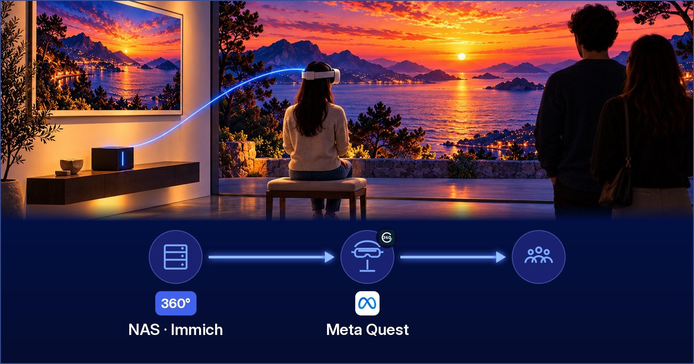
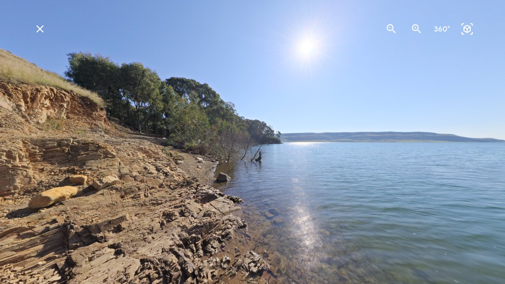

🌐 <b>Eesti</b> · Teised keeled (88)
<a href="../README.md">English</a> · <a href="README.af.md">Afrikaans</a> · <a href="README.ar.md">العربية</a> · <a href="README.az.md">Azərbaycanca</a> · <a href="README.be.md">Беларуская</a> · <a href="README.bg.md">Български</a> · <a href="README.bi.md">Bislama</a> · <a href="README.bn.md">বাংলা</a> · <a href="README.br.md">Brezhoneg</a> · <a href="README.bs.md">Bosanski</a> · <a href="README.ca.md">Català</a> · <a href="README.cs.md">Čeština</a> · <a href="README.cv.md">Чӑвашла</a> · <a href="README.da.md">Dansk</a> · <a href="README.de.md">Deutsch</a> · <a href="README.de_CH.md">Deutsch (Schweiz)</a> · <a href="README.el.md">Ελληνικά</a> · <a href="README.en_GB.md">English (UK)</a> · <a href="README.eo.md">Esperanto</a> · <a href="README.es.md">Español</a> · <a href="README.eu.md">Euskara</a> · <a href="README.fa.md">فارسی</a> · <a href="README.fi.md">Suomi</a> · <a href="README.fil.md">Filipino</a> · <a href="README.fr.md">Français</a> · <a href="README.ga.md">Gaeilge</a> · <a href="README.gl.md">Galego</a> · <a href="README.gsw.md">Alemannisch</a> · <a href="README.gu.md">ગુજરાતી</a> · <a href="README.he.md">עברית</a> · <a href="README.hi.md">हिन्दी</a> · <a href="README.hr.md">Hrvatski</a> · <a href="README.hu.md">Magyar</a> · <a href="README.hy.md">Հայերեն</a> · <a href="README.id.md">Bahasa Indonesia</a> · <a href="README.is.md">Íslenska</a> · <a href="README.it.md">Italiano</a> · <a href="README.ja.md">日本語</a> · <a href="README.ka.md">ქართული</a> · <a href="README.kab.md">Taqbaylit</a> · <a href="README.kk.md">Қазақша</a> · <a href="README.km.md">ខ្មែរ</a> · <a href="README.kmr.md">Kurmancî</a> · <a href="README.kn.md">ಕನ್ನಡ</a> · <a href="README.ko.md">한국어</a> · <a href="README.kxm.md">ภาษาเขมรถิ่นไทย</a> · <a href="README.lb.md">Lëtzebuergesch</a> · <a href="README.lmo.md">Lombard</a> · <a href="README.lt.md">Lietuvių</a> · <a href="README.lv.md">Latviešu</a> · <a href="README.mfa.md">Bahasa Melayu Kelantan</a> · <a href="README.mi.md">Te reo Māori</a> · <a href="README.mk.md">Македонски</a> · <a href="README.ml.md">മലയാളം</a> · <a href="README.mn.md">Монгол</a> · <a href="README.mr.md">मराठी</a> · <a href="README.ms.md">Bahasa Melayu</a> · <a href="README.nb_NO.md">Norsk bokmål</a> · <a href="README.ne.md">नेपाली</a> · <a href="README.nl.md">Nederlands</a> · <a href="README.nn.md">Norsk nynorsk</a> · <a href="README.pa.md">ਪੰਜਾਬੀ</a> · <a href="README.pl.md">Polski</a> · <a href="README.pt.md">Português</a> · <a href="README.pt_BR.md">Português (Brasil)</a> · <a href="README.ro.md">Română</a> · <a href="README.ru.md">Русский</a> · <a href="README.si.md">සිංහල</a> · <a href="README.sk.md">Slovenčina</a> · <a href="README.sl.md">Slovenščina</a> · <a href="README.sq.md">Shqip</a> · <a href="README.sr_Cyrl.md">Српски</a> · <a href="README.sr_Latn.md">Srpski</a> · <a href="README.sv.md">Svenska</a> · <a href="README.sw.md">Kiswahili</a> · <a href="README.swg.md">Schwäbisch</a> · <a href="README.ta.md">தமிழ்</a> · <a href="README.te.md">తెలుగు</a> · <a href="README.th.md">ไทย</a> · <a href="README.tl.md">Tagalog</a> · <a href="README.tr.md">Türkçe</a> · <a href="README.uk.md">Українська</a> · <a href="README.ur.md">اردو</a> · <a href="README.uz.md">Oʻzbekcha</a> · <a href="README.vi.md">Tiếng Việt</a> · <a href="README.yue_Hant.md">粵語</a> · <a href="README.zh_Hans.md">简体中文</a> · <a href="README.zh_Hant.md">繁體中文</a>

  

# Immuch360

**Sinu meedia. Igal ekraanil. Igast vaatenurgast.**

🌐 <a href="https://immuch360.com/et/"><b>immuch360.com</b></a>

Lamedad, 360° ja 3D fotod ja videod sinu seadmest, sinu NAS-ist, sinu Immich-serverist, sinu kaameratest ja sinu droonist. Kontot pole vaja. Immuch360 on vaba ja avatud lähtekoodiga rakendus, mis loeb sinu fotosid ja videoid seal, kus need asuvad, ja mängib igaüht sobivas vaaturis: lamedalt, kerana, mille sees ringi vaatad, 3D-s või täielikult sinu ümber peakomplektis. See töötab telefonides, tahvelarvutites, telerites, Meta Questi peakomplektides ja arvutites. Selle veebisait, [immuch360.com](https://immuch360.com/et/), näitab 89 keeles, mida see igal ekraanil teeb.

**Uus build 53-s ja desktop build 34-s, versioon 3.4.8.** Arvutites annab [Spatial 2.5D](#see-your-3d-photos-and-videos-in-depth-on-your-computer) sinu 3D-fotodele sügavuse lameekraanil, Windowsis, Linuxis ja macOS-is, ning sinu 3D-videotele Windowsis ja macOS-is: vaade liigub, kui sa pead liigutad, seda jälgib veebikaamera, kui oled nõustunud, või hiirega, ning veebikaamera pildid jäävad arvuti mällu, neid ei talletata ega saadeta kunagi; projekt pole seda veebikaameraga veel proovinud. Ratas [suumib fotot kursori ümber](#zoom-into-a-photo-with-the-wheel) ja lohistamine liigutab seda. [Täiusta (TI)](#make-a-photo-sharper-on-your-computer-ai) võtab fotod sinu jagudest, DLNA-st, Plexist, Jellyfinist ja Embyst ning sinu Immich-serverist, täiustab 360° ja 3D-fotosid nende õmblust ega kahte silma lõhkumata ning pakub Apple'i kiibiga Macis taset Teravda (Macil veel proovimata). Telefonist avab ["Esita seadmes…"](#show-your-photos-and-videos-on-the-tv-from-your-phone) 360° üksuse ekraani 360° vaates, esitab valiku või albumi slaidiesitlusena, logib ekraani sinu serverisse sisse ja saadab fotod ja videod, mis on ainult telefonis; proovitud Androidi emulaatorite vahel, päris telefonis või teleris veel mitte. Meta Questis [teeb suure ekraani slaidiesitlus fotode vahel ristsulanduse või libistuse](#browse-your-photos-on-the-big-screen-of-the-quest), sinu valitud musta, hägustatud või passthrough tausta peal, projekt pole seda peakomplektis veel proovinud.

**Uut buildides 33 kuni 52.** [Filmid jätkuvad sealt, kus pooleli jäid](#pick-up-a-film-where-you-stopped). Need algavad varem ning aeglasest serverist [mängivad edasi peatumise asemel](#when-a-video-waits-or-will-not-play). Ajajoon [suumib välja kuudeks ja aastateks](#find-a-month-or-a-year-in-a-long-timeline) telefonides ja arvutites. Android-telefonis või Meta Questis avab ["Sirvi kausta"](#browse-a-folder-of-your-phone-or-headset) seadme kausta nagu jao, ja TIFF-fotod on nähtavad. Android TV [otsib kuupäeva järgi puldiga](#on-android-tv-and-google-tv), Meta Quest 3 või 3S [avab Gaussi splatid](#explore-gaussian-splats-in-a-meta-quest-3-or-3s), parema juhtkangiga pööratavad ja ka SPZ versioonis 4, ning arvuti [teeb sinu NAS-i fotodest 3D-versioonid](#turn-one-photo-into-3d-a-scene-a-panorama). Kahe graafikakiibiga Windowsi sülearvutis [töötab rakendus nüüd kiirel](#when-a-video-waits-or-will-not-play), nii et 8K-filmid mängivad sujuvalt. Gaussi splatid [avanevad nüüd arvutites ning Androidi telefonides ja tahvelarvutites](#explore-gaussian-splats-on-your-phone-tablet-or-computer), Windowsi arvuti [teeb tehisintellekti abil sinu fotodest või videost splat-stseene](#make-a-splat-scene-from-your-photos-or-a-video-ai), sinu Immich-server [hoiab neid fotode sees](#keep-a-splat-scene-on-your-immich-server), mis avanevad sinu ajajoonelt, ja arvutid [esitavad AV2 videoid](#play-av2-videos-on-your-computer). Alates build 42-st [mängivad Insta360, GoPro MAX ja DJI Osmo 360 kaamerate toorvideod sinu Immichi teegist, jaost või kaustast kaamera güroskoobiga stabiliseeritult](#stabilise-your-360-videos-with-the-cameras-gyroscope) Androidi telefonides, tahvelarvutites ja telerites, desktop build 22 splat-looja [pakub kvaliteeti Detailne](#make-a-splat-scene-from-your-photos-or-a-video-ai) stseenidele, mida vaatad lähedalt, ja 360° panoraam [algab 3,5 GiB vaba graafikakaardi mäluga](#turn-one-photo-into-3d-a-scene-a-panorama). iPhone'i ja iPadi rakendus on [App Store'is](https://apps.apple.com/us/app/immuch360-360-3d-player/id6817655965), versioon 3.4.3. Alates build 43-st avab rakenduse uuendusteade telefonides ja tahvelarvutites Google Play või App Store'i; selle veebisait, [immuch360.com](https://immuch360.com/et/), avati 7. novembril. Alates build 44-st ja desktop build 24-st [näitab Meta Quest 3 või 3S kuni 300 000 gaussiaaniga splatte](#explore-gaussian-splats-in-a-meta-quest-3-or-3s), arvutid [valivad mitu fotot ja videot Ctrl ja Shift abil](#use-your-computer-as-the-media-player), teler, mille dekooder keeldub videost, [mängib ise serveri teist faili](#when-a-video-waits-or-will-not-play), panoraamid töötavad kahe graafikakaardiga sülearvuti valitud graafikakaardil ning Questi ja arvutite uuendusteade avab nende poe või allalaadimislehe, koos paljude parandustega. Alates build 45-st ja desktop build 25-st, versioon 3.4.0 kõigil platvormidel, järgib rakendus Immichi 3.4.0 rakendust koos 11 hilisema Immichi parandusega, näitab [Immich 3.4 serverite JPEG XL fotosid](#keep-your-immich-library-with-more), avab [sinu Plexi filmid aastate kaupa](#watch-your-plex-films) koos lehega iga filmi jaoks, nende allalaadimise seadmesse ja esitamise teleris telefonist, võib poe buildides paluda hinnangut ning võtab arvutites oma videokomponendid [nende endi avatud repositooriumidest](#licences-and-credits). Alates build 46-st ja desktop build 26-st, versioon 3.4.1, [mängivad 360° kaamerate toorvideod stabiliseeritult](#stabilise-your-360-videos-with-the-cameras-gyroscope) ka iPhone'il ja iPadil, Meta Questis ja Windowsis, Meta Quest [esitab libmpv abil Plexi filme, mida tema enda pleier dekodeerida ei suuda](#watch-your-plex-films), telefon [saadab sellise filmi Chromecasti või Google TV-sse](#watch-your-plex-films) ja 3D-foto TI-reljeef [saab sinu valitud tugevuse](#turn-one-photo-into-3d-a-scene-a-panorama); uue serveri saab lisada ka oma Plexi kontoga sisse logides ning rakendus [hoiab oma seadeid failis](#keep-your-settings-in-a-file). Alates build 47-st ja desktop build 27-st, versioon 3.4.2, [esitab Plexi film helirada, mida seade dekodeerib](#watch-your-plex-films), ja ütleb, millist, avab ekraanile sobiva versiooni ning aeglase ühenduse korral pakub kergemat, Windows ja macOS esitavad selle Dolby TrueHD heli, Android [näitab selle allalaadimist teavituses](#watch-your-plex-films) ja ka Android TV laadib filme alla, ning [akuga Tapo kaamerad näitavad otsepilti](#watch-your-home-cameras-on-the-big-screen); seadete faili taastamine koos selle kontodega logib sind nüüd sinu Immichi serverisse sisse. Alates build 48-st ja desktop build 28-st, versioon 3.4.3, [esitab Windowsi arvuti sinu videoid PC VR peakomplektis](#watch-your-videos-in-a-pc-vr-headset-from-windows) SteamVR-i, Meta Horizon Linki või muu OpenXR käituskeskkonna kaudu (projekt pole seda peakomplektis veel proovinud), [muude kaubamärkide kaamerad näitavad otsepilti](#cameras-of-other-brands-over-onvif-or-rtsp), leitud ONVIF-i kaudu või lisatud oma RTSP lingiga (kontrollitud simuleeritud kaameraga, ühtegi teise kaubamärgi päris kaamerat pole veel proovitud), [DJI Osmo 360 II ja GoPro MAX 2 toorvideod mängivad stabiliseeritult](#open-the-raw-files-of-360-cameras), Plexi filmid [ei jää telefonides enam andmetest nälga](#when-a-video-waits-or-will-not-play), LG ja Samsungi telerid [pööravad külili lebava video](#on-a-samsung-tv-tizen) ühe nupuga (LG teleris veel proovimata; issue 17 Samsungi teler keeldus pööramast) ja "Serveri uuendus on saadaval" ei ilmu enam ajakohase serveri puhul. Alates build 49-st ja desktop build 29-st, versioon 3.4.4, [loeb rakendus ise sinu Jellyfini ja Emby servereid](#watch-your-jellyfin-and-emby-libraries) (seadmes veel proovimata), leitud sinu võrgust ja sisse logitud Quick Connectiga teleris või peakomplektis, nende originaalfailid esitatud nii, et 360° video jääb 360°-ks; Meta Questi suurel ekraanil [säilitavad fotod sinu seatud suuruse ja koha, kui neid sirvid, ning mängivad slaidiesitlusena](#browse-your-photos-on-the-big-screen-of-the-quest) (projekt pole seda peakomplektis veel proovinud); telefonide ja tahvelarvutite 360° videopleier [saab 360° fotode juhtnupud](#360-videos-on-your-phone-with-the-controls-of-360-photos), güroskoobi nupu, suumimise pigistusega ja lohistamise otse üles või alla (kasutaja proovis Samsung Galaxy S25 Ultra peal, iPhone'il veel proovimata); arvuti [muudab sinu 2D-videod tehisintellekti abil 3D-videoteks](#turn-your-2d-videos-into-3d-on-your-computer) (3D-ekraanil või peakomplektis veel proovimata); ning Samsungi telerid [annavad pööramist vajava video Samsungi enda pleierile](#on-a-samsung-tv-tizen), mida issue 17 teler esitab, kuid pööramast keeldub. Alates build 50-st ja desktop build 30-st, versioon 3.4.5, [joonistub aken ekraani sagedusega uuesti](#step-inside-your-photos-and-videos-with-a-meta-quest), kui video mängib Meta Questi 2D-aknas, umbes 10 korra asemel sekundis nagu buildides 48 ja 49 (mõõdetud Meta Quest 3 peal), Android TV [suumib puldiga fotot](#on-android-tv-and-google-tv) ja liigutab seda nooleklahvidega (uus, teleris veel proovimata), ning kolm parandust tulevad mlc70 Android TV forgist: kiire libistus ei näita enam maha jäetud foto üksikasju, animeeritud foto vabastab oma mälu ja Asukoha filter pakub uue riigi linnu. Alates build 51-st ja desktop build 31-st, versioon 3.4.6, teeb [Täiusta (TI)](#make-a-photo-sharper-on-your-computer-ai) Windowsis ja Linuxis pehmest fotost originaali kõrvale teravama koopia, kolmel tasemel, igaüks käivitatud üks kord ühes RTX 4060-ga arvutis, Loomulikku pakutakse ka Apple'i kiibiga Macis (Macis veel proovimata), arvuti [muudab 360° video 360° 3D-videoks](#a-360-video-turned-into-a-360-3d-video) tehisintellekti abil, Windowsis hindab 3D-videote sügavust graafikakaart, TI-funktsioonid võtavad sinu serveri ja jagu videod otse, seadete failil on [oma kaart Kogus](#keep-your-settings-in-a-file), teler salvestab selle võrgujaos, Escape viib arvutites ühe sammu tagasi, poe buildid paluvad hinnangut [harvemini ja leebemalt](#privacy), Linux näitab TIFF-fotosid, splat-stseene ja 3D-videoid ühe silmaga, ning kaks krahhi on parandatud. Alates build 52-st ja desktop build 32-st, versioon 3.4.7, saadab ["Esita seadmes…"](#show-your-photos-and-videos-on-the-tv-from-your-phone) sinu Immichi kogu, sinu jagude ning Jellyfini ja Emby fotod ja videod telefonist telerisse, Meta Questi, arvutisse või Chromecasti, sinu fotode ja videote nimed [jäävad pisipiltide peal loetavaks](#play-the-files-of-a-nas-a-computer-a-media-server-or-plex), arvuti TI-komponente [uuendatakse ühe klõpsuga](#update-the-ai-components-in-one-click), Linux saab [AppImage'i](#linux) ning iPhone'i ja iPadi rakendus on ehitatud Xcode 27-ga. Desktop build 33 parandas [Täiusta (TI)](#make-a-photo-sharper-on-your-computer-ai), mis desktop buildides 31 ja 32 ebaõnnestus iga fotoga ([issue 23](https://github.com/freeKC/Immuch360/issues/23)).

  Immich'i mobiilirakenduse mitteametlik haru. Ei ole seotud Immich'i ega FUTO-ga. Nimi kõlab nagu ingliskeelne "I am much 360" ("olen palju 360").

<b>Sisukord</b>

- [Kellele see on](#who-it-is-for)
- [Millised ekraanid](#which-screens), [mida need koos teevad](#use-cases) ja [mida iga ekraan teeb](#what-each-screen-does)
- [Mida saad teha](#what-you-can-do)
- [Hangi see oma seadmesse](#get-it-on-your-device)
- [Kuidas teha](#how-to)
  - [Vaata oma fotosid ja videoid, serveriga või ilma](#watch-your-photos-and-videos-with-or-without-a-server)
  - [Avasta panoraame, 360°, VR180 ja 3D](#explore-panoramas-360-vr180-and-3d): [360° videod telefonides](#360-videos-on-your-phone-with-the-controls-of-360-photos)
  - [Muuda üks foto 3D-ks, stseeniks, panoraamiks](#turn-one-photo-into-3d-a-scene-a-panorama): [TI-komponendid uuendatud ühe klõpsuga](#update-the-ai-components-in-one-click)
  - [Muuda oma 2D-videod arvutis 3D-ks](#turn-your-2d-videos-into-3d-on-your-computer): [360° videod 360° 3D-ks](#a-360-video-turned-into-a-360-3d-video)
  - [Tee foto oma arvutis teravamaks (TI)](#make-a-photo-sharper-on-your-computer-ai)
  - [Vaata teleris puldiga](#watch-on-the-tv-with-the-remote): [Android TV ja Google TV](#on-android-tv-and-google-tv), [LG](#on-an-lg-tv-webos), [Samsung](#on-a-samsung-tv-tizen)
  - [Logi teleris, peakomplektis või arvutis sisse telefoniga](#sign-in-a-tv-a-headset-or-a-computer-with-your-phone)
  - [Näita oma fotosid ja videoid teleris telefonist](#show-your-photos-and-videos-on-the-tv-from-your-phone)
  - [Astu Meta Questiga oma fotode ja videote sisse](#step-inside-your-photos-and-videos-with-a-meta-quest): [suur ekraan](#browse-your-photos-on-the-big-screen-of-the-quest), [kioskirežiim](#kiosk-mode-for-an-exhibition-or-a-shop)
  - [Uuri Gaussi splatte Meta Quest 3 või 3S peakomplektis](#explore-gaussian-splats-in-a-meta-quest-3-or-3s)
  - [Uuri Gaussi splatte oma telefonis, tahvelarvutis või arvutis](#explore-gaussian-splats-on-your-phone-tablet-or-computer)
  - [Loo splat-stseen oma fotodest või videost (TI)](#make-a-splat-scene-from-your-photos-or-a-video-ai)
  - [Hoia splat-stseeni oma Immich-serveris](#keep-a-splat-scene-on-your-immich-server)
  - [Mängi NAS-i, arvuti, meediaserveri või Plexi faile](#play-the-files-of-a-nas-a-computer-a-media-server-or-plex): [sinu filmid aastate kaupa](#watch-your-plex-films), [Jellyfin ja Emby](#watch-your-jellyfin-and-emby-libraries)
  - [Sirvi oma telefoni või peakomplekti kausta](#browse-a-folder-of-your-phone-or-headset)
  - [Jätka filmi sealt, kus pooleli jäid](#pick-up-a-film-where-you-stopped)
  - [Kui video ootab või ei mängi](#when-a-video-waits-or-will-not-play)
  - [Hoia oma Immichi kogu, ja rohkemgi](#keep-your-immich-library-with-more)
  - [Leia pikalt ajajoonelt kuu või aasta](#find-a-month-or-a-year-in-a-long-timeline)
  - [Vaata oma kodukaameraid suurel ekraanil](#watch-your-home-cameras-on-the-big-screen): [muud kaubamärgid](#cameras-of-other-brands-over-onvif-or-rtsp)
  - [Sinu DJI droon](#your-dji-drone): [otsevideo](#see-what-your-drone-sees-on-your-phone), [Questis või Android TV-s](#watch-it-in-a-meta-quest-or-on-an-android-tv), [import](#bring-a-drones-or-a-camera-cards-photos-and-videos-to-immich)
  - [Ava 360° kaamerate toorfailid](#open-the-raw-files-of-360-cameras)
  - [Stabiliseeri oma 360° videod kaamera güroskoobiga](#stabilise-your-360-videos-with-the-cameras-gyroscope)
  - [Pööra fotot ühe klahviga](#turn-a-photo-with-one-key)
  - [Kasuta oma arvutit meediamängijana](#use-your-computer-as-the-media-player): [suumi rattaga](#zoom-into-a-photo-with-the-wheel)
  - [Vaata oma 3D-fotosid ja -videoid arvutis sügavusega](#see-your-3d-photos-and-videos-in-depth-on-your-computer)
  - [Vaata oma videoid PC VR peakomplektis, Windowsist](#watch-your-videos-in-a-pc-vr-headset-from-windows)
  - [Esita AV2 videoid oma arvutis](#play-av2-videos-on-your-computer)
  - [Hoia oma seadeid failis](#keep-your-settings-in-a-file)
- [Võrdlus Immichiga](#compared-with-immich)
- [Privaatsus](#privacy)
- [Litsentsid ja tänuavaldused](#licences-and-credits)
- [Teekaart](#roadmap)
- [Dokumentatsioon](#documentation)

## Kellele see on

- **Sa pildistad 360° või 3D-s** ja tahad oma võtetes ringi vaadata, mitte näha neid lamedate, kahekordsete või väljavenitatutena, ning pöörata oma 360° videoid telefonis nii, nagu pöörad selle fotosid: [360°, VR180 ja 3D](#explore-panoramas-360-vr180-and-3d), [360° videod telefonides](#360-videos-on-your-phone-with-the-controls-of-360-photos).
- **Sa filmid 360° kaameraga käes, jalgrattal või kiivril** ja tahad, et sinu Insta360, GoPro MAX või MAX 2, DJI Osmo 360 või Osmo 360 II kaamera toorvideod, mida hoiad Immichis, jaos või kaustas, mängiksid sinu telefonis, teleris, Meta Questis või Windowsi arvutis sirgelt ja värisemata: [kaamera güroskoobiga stabiliseeritud](#stabilise-your-360-videos-with-the-cameras-gyroscope).
- **Sinu fotod ja filmid on NAS-is, arvutis, Plexis või Immichis** ja sa tahad neid teleris näha midagi kopeerimata: [teleris](#watch-on-the-tv-with-the-remote), [NAS, jagud ja Plex](#play-the-files-of-a-nas-a-computer-a-media-server-or-plex).
- **Sa hoiad oma filme Plexi serveris** ja tahad valida ühe aasta järgi, näha enne algust, mis see on, võtta selle reisile kaasa, käivitada selle teleris või Chromecastis oma telefonist ja esitada isegi filme, mida sinu Androidi telefon, teler või Meta Quest dekodeerida ei suuda: [sinu filmid, aastate kaupa](#watch-your-plex-films).
- **Sa hoiad oma filme Jellyfini või Emby serveris** ja tahad neid oma Meta Questis, teleris või telefonis, 360° ja 3D sellisena, nagu need on, ning oma kohta serveris meeles hoituna (seadmes veel proovimata): [Jellyfin ja Emby](#watch-your-jellyfin-and-emby-libraries).
- **Sul on Meta Quest** ja tahad astuda oma fotode ja videote sisse: [peakomplektis](#step-inside-your-photos-and-videos-with-a-meta-quest), ning sirvida oma fotosid suurel ekraanil sinu seatud suuruse ja kohaga, ka slaidiesitlusena (projekt pole seda peakomplektis veel proovinud): [suur ekraan](#browse-your-photos-on-the-big-screen-of-the-quest).
- **Sul on Windowsi arvutiga PC VR peakomplekt** ja tahad selles oma 360° videoid enda ümber ja oma filme suurel ekraanil (projekt pole seda peakomplektis veel proovinud): [PC VR peakomplektis](#watch-your-videos-in-a-pc-vr-headset-from-windows).
- **Sinu fotod on lamedad** ja tahad neid 3D-s, stseenina, millesse peakomplektis sisse kummardada, või 360° panoraami sees, ilma 3D-kaamerata: [muuda üks foto 3D-ks, stseeniks, panoraamiks](#turn-one-photo-into-3d-a-scene-a-panorama), uus, tehisintellekti tehtud sinu enda arvutis.
- **Sinu videod on lamedad**, ka sinu telefoni klipid, ja tahad neid 3D-s peakomplekti või 3D-ekraani jaoks ning oma 360° videoid 360° 3D-s, tehtuna sinu enda arvutis (3D-ekraanil või peakomplektis veel proovimata): [2D-videod 3D-ks](#turn-your-2d-videos-into-3d-on-your-computer), [360° videod 360° 3D-ks](#a-360-video-turned-into-a-360-3d-video).
- **Sinu fotod on pehmed**, veidi fookusest väljas või halvas valguses tehtud, ja tahad originaali kõrvale teravamat koopiat, tehtuna sinu enda arvutis, ka sinu jagudest ja serveritest, välja mõeldud üksikasjad selgelt öeldud: [Täiusta (TI)](#make-a-photo-sharper-on-your-computer-ai).
- **Sul on 3D-fotod või -videod ja arvuti** ning tahad neid selle lameekraanil sügavusega, vaade liikumas koos sinu peaga, mida jälgib veebikaamera, või hiirega (projekt pole seda veebikaameraga veel proovinud): [Spatial 2.5D sinu arvutis](#see-your-3d-photos-and-videos-in-depth-on-your-computer).
- **Sa kasutad Immichit** ja tahad selle rakendust, pluss kaasahaaravaid vaatureid ja suuri ekraane, kuhu logid sisse telefonist: [sinu Immichi kogu](#keep-your-immich-library-with-more), [võrdlus Immichiga](#compared-with-immich).
- **Sa valvad oma kodu Tapo kaameratega**, ka akuga kaameratega, või muude kaubamärkide kaameratega ONVIF-i või RTSP kaudu, ja tahad neid oma fotode kõrval, ka teleris (kontrollitud simuleeritud kaamera vastu): [kodukaamerad](#watch-your-home-cameras-on-the-big-screen).
- **Sa lennutad DJI drooni** ja tahad selle otsepilti oma telefonis ilma DJI Flyta, ning Meta Questis või Android TV-s oma kaaslaste jaoks: [sinu droon](#see-what-your-drone-sees-on-your-phone).
- **Sa jäädvustad kohti ja esemeid 3D-s, Gaussi splattidena,** või tahaksid neid teha oma enda fotodest, ja tahad neist läbi kõndida oma telefonis, arvutis või peakomplektis: [telefonis, tahvelarvutis või arvutis](#explore-gaussian-splats-on-your-phone-tablet-or-computer), [tehtud sinu fotodest](#make-a-splat-scene-from-your-photos-or-a-video-ai), [hoitud Immichis](#keep-a-splat-scene-on-your-immich-server).
- **Sul on AV2 videoid**, AV1-le järgnev vorming, ja tahad neid vaadata oma arvutis: [AV2 sinu arvutis](#play-av2-videos-on-your-computer).
- **Sul on kodus mitu ekraani** ja tahad, et need töötaksid koos: [mida sinu ekraanid koos teevad](#use-cases).

Immuch360 kontot pole vaja luua ja meile ei lähe midagi: rakendus suhtleb ainult sinu seadmete ja sinu valitud serveritega, alates build 45-st filmi lehe jaoks ka Wikipediaga, alates build 46-st plex.tv-ga, kui sa selle kaudu sisse logid, ning laadib TI-komponendi või AV2 dekoodri alla ainult siis, kui sa seda palud.

## Millised ekraanid

| Platvorm | Kust seda saada | Olek novembris 2026 |
|---|---|---|
|  **Androidi** telefonid ja tahvelarvutid | [Google Play](https://play.google.com/store/apps/details?id=com.aprogsys.immuch360) · [APK](https://github.com/freeKC/Immuch360/releases) | Google Play's (build 47 avaldatud 16. novembril; build 51 Google'i ülevaatusel alates 24. novembrist; järgmisena tuleb build 53), build 53 GitHubis, kus [360° toorvideod mängivad stabiliseeritult](#stabilise-your-360-videos-with-the-cameras-gyroscope), [filmid jätkuvad sealt, kus pooleli jäid](#pick-up-a-film-where-you-stopped), ["Sirvi kausta"](#browse-a-folder-of-your-phone-or-headset) avab telefoni kausta ja [Gaussi splatid avanevad](#explore-gaussian-splats-on-your-phone-tablet-or-computer), jaost või [sinu Immichi ajajoonelt](#keep-a-splat-scene-on-your-immich-server), [failis hoitud seaded](#keep-your-settings-in-a-file), [filmi allalaadimine teavituses näidatuna](#watch-your-plex-films), alates build 48-st [muude kaubamärkide kaamerad, otse](#cameras-of-other-brands-over-onvif-or-rtsp) (kontrollitud simuleeritud kaameraga) ning alates build 49-st [Jellyfini ja Emby serverid](#watch-your-jellyfin-and-emby-libraries) (seadmes veel proovimata) ja [360° fotode juhtnupud 360° videopleieris](#360-videos-on-your-phone-with-the-controls-of-360-photos) (kasutaja proovis Samsung Galaxy S25 Ultra peal) ning alates build 51-st [seadete faili kaart Kogus](#keep-your-settings-in-a-file), selle fail salvestatud ka võrgujaos, ning alates build 52-st [sinu fotod ja videod saadetud telerisse või Chromecasti](#show-your-photos-and-videos-on-the-tv-from-your-phone) funktsiooniga "Esita seadmes…" (seadmes veel proovimata), ning alates build 53-st samamoodi saadetud [360° üksused, valik või album ning telefoni enda fotod ja videod](#show-your-photos-and-videos-on-the-tv-from-your-phone) (proovitud Androidi emulaatorite vahel) |
|  **iPhone ja iPad** | [App Store](https://apps.apple.com/us/app/immuch360-360-3d-player/id6817655965) | versioon 3.4.7 App Store'is alates 26. novembrist, koos [kuude ja aastatega ajajoonel](#find-a-month-or-a-year-in-a-long-timeline), [filmidega, mis jätkuvad sealt, kus pooleli jäid](#pick-up-a-film-where-you-stopped), [teleri, peakomplekti või arvuti sisselogimisega](#sign-in-a-tv-a-headset-or-a-computer-with-your-phone) telefonist, Immichis hoitud splat-stseenidega, mida näidatakse nende fotona, Immich 3.4.0 paranduste ja selle JPEG XL fotodega, [stabiliseeritud 360° toorvideotega](#stabilise-your-360-videos-with-the-cameras-gyroscope), [failis hoitud seadetega](#keep-your-settings-in-a-file), [akuga Tapo kaamerate otsevaatega](#watch-your-home-cameras-on-the-big-screen) ja [muude kaubamärkide kaamerate otsevaatega](#cameras-of-other-brands-over-onvif-or-rtsp) (kontrollitud simuleeritud kaameraga), ning alates versioonist 3.4.4 koos [Jellyfini ja Emby serveritega](#watch-your-jellyfin-and-emby-libraries) (seadmes veel proovimata) ja [360° fotode juhtnuppudega 360° videopleieris](#360-videos-on-your-phone-with-the-controls-of-360-photos) (iPhone'il veel proovimata), ning alates versioonist 3.4.6 koos [seadete faili kaardiga](#keep-your-settings-in-a-file) ja selle taastamisega võrgujaost, ning alates versioonist 3.4.7, ehitatud Xcode 27-ga, koos funktsiooniga ["Esita seadmes…" fotode ja videote jaoks](#show-your-photos-and-videos-on-the-tv-from-your-phone) (iPhone'il veel proovimata); järgmisena tuleb versioon 3.4.8, build 53 iPhone'i ja iPadi versioon; või [ehita see endale](../docs/immuch360/build.md) |
|  **Android TV ja Google TV** | [Google Play](https://play.google.com/store/apps/details?id=com.aprogsys.immuch360) · [APK](#android-tv-and-google-tv) | Google Play's, mis pakub rakendust Android TV ja Google TV seadmetes, ning build 53 GitHubis: [stabiliseeritud 360° toorvideod](#stabilise-your-360-videos-with-the-cameras-gyroscope), [otsing kuupäeva järgi puldiga](#on-android-tv-and-google-tv), [logi sisse telefoniga](#sign-in-a-tv-a-headset-or-a-computer-with-your-phone), skannides QR-koodi, videopleieris puldi jaoks ajariba, heli ja subtiitrid ning telefoni edastatud [drooni otsevideo](#watch-it-in-a-meta-quest-or-on-an-android-tv), [telerisse alla laaditud filmid](#watch-your-plex-films) ning alates build 49-st [Jellyfini ja Emby serverid](#watch-your-jellyfin-and-emby-libraries), sisse logitud Quick Connectiga (seadmes veel proovimata) ja alates build 50-st [puldiga suumitud fotod](#on-android-tv-and-google-tv) (nähtud töötamas Android TV emulaatoris, teleris veel proovimata) ning alates build 51-st [võrgujaos salvestatud ja taastatud seadete fail](#keep-your-settings-in-a-file) (nähtud töötamas Android TV emulaatoris) ning alates build 52-st [fotod ja videod, mida telefon saadab funktsiooniga "Esita seadmes…"](#show-your-photos-and-videos-on-the-tv-from-your-phone) (teleris veel proovimata), ning alates build 53-st telefoni saadetud 360° fotod avatuna nende 360° vaates, sisselogimine telefoni lehelt ning telefoni enda fotod ja videod (nähtud töötamas Android TV emulaatoris) |
| **LG telerid** webOS 5.0 või uuemaga | [.ipk, versioon 1.0.5](https://github.com/freeKC/Immuch360/releases/tag/webos-v1.0.5) · LG Content Store (ülevaatusel) | versioon 1.0.0, saadetud LG Content Store'i 24. oktoobril, LG testimisel alates 26. oktoobrist; versioon 1.0.1, GitHubis alates 27. oktoobrist, suumib fotot nooltega ja ütleb, kui foto alles laadib, ning versioon 1.0.2, GitHubis koos build 46-ga, kirjutab jaapani keeles "logi sisse" kujul ログイン, versioon 1.0.3, koos build 47-ga, ütleb, kui DLNA serveri kaustas on otse-eetri telekanalid, mida see veel esitada ei saa, ning versioon 1.0.4, koos build 48-ga, [pöörab külili lebava video](#on-an-lg-tv-webos) ühe nupuga (LG teleris veel proovimata) ning versioon 1.0.5, koos build 49-ga, nimetab DLNA serverite seas Jellyfini oma DLNA pistikprogrammiga; kuni LG rakenduse avaldab, paigaldatakse see režiimis [Developer Mode](#lg-tvs-webos). Versioon 1.0.0 töötas LG Cloud Test Labi webOS 25 teleritel |
| **Samsungi telerid** Tizen 5.5 või uuemaga | [.wgt, versioon 0.3.6](https://github.com/freeKC/Immuch360/releases/tag/tizen-v0.3.6) | sama telerirakenduse versioon 0.3.6, mille allkirjastad oma Samsungi sertifikaadiga ja paigaldad režiimis [Developer mode](#samsung-tvs-tizen); 0.1.0 töötas ühe testija Samsungi teleris, 0.2.0 sisaldab selle katse parandusi 0.3.0 lisab LG versiooni 1.0.1 fotosuumi ja sildi Loading ning 0.3.1 LG versiooni 1.0.2 jaapanikeelse sõnastuse, 0.3.2 esitab telefoniga püsti filmitud video õiget pidi ([issue 17](https://github.com/freeKC/Immuch360/issues/17)) ning 0.3.3 ja 0.3.4 [pööravad selle teleris, mis teatab selle olevat püsti](#on-a-samsung-tv-tizen), ja lisavad nupu, mis pöörab selle käsitsi, ning 0.3.5 ja 0.3.6 annavad sellise video Samsungi enda pleierile; teataja teleris jätsid 0.3.4 ja 0.3.5 pildi külili, kuna teler keeldus pööramisest, ja lahendus seal on video, mille sinu Immichi server transkodeerib, püsti salvestatuna; Samsungi poes pole |
|  **Meta Quest** 2, Pro, 3 ja 3S | [Horizon Store](https://www.meta.com/experiences/immuch360/1384208401440714/) · [APK](#meta-quest) | Horizon Store'is (build 50, mille 2D-aken joonistub video mängimise ajal ekraani sagedusega uuesti, avaldatud 25. novembril; build 52 Meta ülevaatusel alates 25. novembrist; järgmisena tuleb build 53), build 53 GitHubis, koos [kioskirežiimiga](#kiosk-mode-for-an-exhibition-or-a-shop), kaasahaaravas vaates [stabiliseeritud 360° toorvideotega](#stabilise-your-360-videos-with-the-cameras-gyroscope), [libmpv esitatud filmidega, mida see dekodeerida ei suuda](#watch-your-plex-films) ning Quest 3 ja 3S peal [Gaussi splattide](#explore-gaussian-splats-in-a-meta-quest-3-or-3s) ja lameda foto [TI-reljeefiga](#turn-one-photo-into-3d-a-scene-a-panorama), ning alates build 49-st [suurel ekraanil sirvitud fotod](#browse-your-photos-on-the-big-screen-of-the-quest) sinu seatud suurusega, ka slaidiesitlusena (projekt pole seda peakomplektis veel proovinud), ja [Jellyfini ja Emby serverid](#watch-your-jellyfin-and-emby-libraries), sisse logitud Quick Connectiga (seadmes veel proovimata) ning alates build 51-st palub peakomplekt, mille Horizon OS on kaasahaarava vaate jaoks liiga vana, rakenduse sulgemise asemel uuendust (sellisel peakomplektil proovimata), ning alates build 53-st [ristsulandus või libistus suure ekraani fotode vahel, musta, hägustatud või passthrough tausta peal](#browse-your-photos-on-the-big-screen-of-the-quest) (projekt pole seda peakomplektis veel proovinud) |
|  **Windows** | [Paigaldusprogramm või ZIP](https://github.com/freeKC/Immuch360/releases/tag/desktop-v3.4.8-34) | desktop build 34, allkirjastatud: fotod, lame- ja 360° videod, jagud, Plex, kaamerad (kontrollitud simuleeritud kaameraga), sisselogimine telefoniga, ühe klahviga pööratavad fotod, liides 89 keeles, ja tehisintellekti abil [sinu fotodest tehtud 3D-fotod, 3D-stseenid ja 360° panoraamid](#turn-one-photo-into-3d-a-scene-a-panorama), ka sinu NAS-i fotodest; [Gaussi splatid](#explore-gaussian-splats-on-your-phone-tablet-or-computer) avatud, [tehtud sinu fotodest või videost](#make-a-splat-scene-from-your-photos-or-a-video-ai) ja [hoitud Immichis](#keep-a-splat-scene-on-your-immich-server), [AV2 videod](#play-av2-videos-on-your-computer), alates desktop build 22-st [kvaliteedivalik splat-stseenidele](#make-a-splat-scene-from-your-photos-or-a-video-ai) ja [360° panoraamid alates 3,5 GiB vabast graafikamälust](#turn-one-photo-into-3d-a-scene-a-panorama) ning alates desktop build 26-st [stabiliseeritud 360° toorvideod](#stabilise-your-360-videos-with-the-cameras-gyroscope) ja [reljeefi tugevuse ja teravamate servadega 3D-fotod](#turn-one-photo-into-3d-a-scene-a-panorama), alates desktop build 27-st [filmide Dolby TrueHD heli ja Blu-ray subtiitrid](#watch-your-plex-films) , alates desktop build 28-st [sinu videod PC VR peakomplektis](#watch-your-videos-in-a-pc-vr-headset-from-windows) (projekt pole seda peakomplektis veel proovinud) ning alates desktop build 29-st tehisintellekti abil [sinu 2D-videotest tehtud 3D-videod](#turn-your-2d-videos-into-3d-on-your-computer) (3D-ekraanil või peakomplektis veel proovimata) ning alates desktop build 31-st tehisintellekti abil [sinu fotode teravamad koopiad](#make-a-photo-sharper-on-your-computer-ai) ja tehisintellekti abil [360° 3D-videoteks muudetud 360° videod](#a-360-video-turned-into-a-360-3d-video), graafikakaardi hinnatud sügavus, sinu serveri ja jagu videod otse võetuna ning Escape sammu tagasi minekuks, alates desktop build 32-st [ühe klõpsuga uuendatud TI-komponendid](#update-the-ai-components-in-one-click), alates desktop build 33-st jälle töötav [Täiusta (TI)](#make-a-photo-sharper-on-your-computer-ai) ning alates desktop build 34-st [fotode suumimine rattaga](#zoom-into-a-photo-with-the-wheel), [Spatial 2.5D 3D-fotodele ja -videotele](#see-your-3d-photos-and-videos-in-depth-on-your-computer), veebikaamera või hiirega (projekt pole seda veebikaameraga veel proovinud), ning Täiusta (TI) jagude ja serverite fotodel, ka 360° ja 3D-fotodel |
|   **macOS ja Linux** | [.deb, .rpm, AppImage, DMG](https://github.com/freeKC/Immuch360/releases/tag/desktop-v3.4.8-34) | desktop build 34: fotod, 360° fotod ja lamevideod (360° videod mängivad lamedalt), Immich-server ja võrgujagud, ja tehisintellekti abil sinu fotodest tehtud [3D-fotod ja 3D-stseenid](#turn-one-photo-into-3d-a-scene-a-panorama), Linuxis ka 360° panoraamid 8 GB graafikakaardiga, alates selle 3,5 GiB vabast mälust, ning [Gaussi splatid](#explore-gaussian-splats-on-your-phone-tablet-or-computer) ja [AV2 videod](#play-av2-videos-on-your-computer) (Macil veel proovimata); desktop build 11 proovitud 26. oktoobril Ubuntu 24.04 konteineris ja Macil; alates desktop build 27-st filmide Dolby TrueHD heli macOS-il; alates desktop build 29-st tehisintellekti abil [sinu 2D-videotest tehtud 3D-videod](#turn-your-2d-videos-into-3d-on-your-computer) Linuxis ja Apple'i kiibiga Macis (3D-ekraanil või peakomplektis veel proovimata); alates desktop build 31-st Linuxis tehisintellekti abil [sinu fotode teravamad koopiad](#make-a-photo-sharper-on-your-computer-ai), TIFF-fotod, kaustad, mis näitavad oma uusi faile ise, sinu fotodest 4 GB graafikakaardil tehtud splat-stseenid ja ühe silmaga lamedalt näidatud 3D-videod ning Apple'i kiibiga Macis Täiusta (TI) tase Loomulik (Macil veel proovimata); alates desktop build 32-st [AppImage](#linux) teiste Linuxi distributsioonide jaoks, kontrollitud CI poolt Arch Linuxil ja openSUSE-l; alates desktop build 34-st suumimine rattaga, [Spatial 2.5D](#see-your-3d-photos-and-videos-in-depth-on-your-computer) 3D-fotodele Linuxis ja macOS-is ning 3D-videotele macOS-is (Macil ja veebikaameraga veel proovimata) ning Apple'i kiibiga Macis Täiusta (TI) tase Teravda (Macil veel proovimata); macOS-il allkirjastamata |

*Olekuid uuendatakse igal väljalaskel; mis igas poes on, mis on selle ülevaatusel ja iga build on lehel [Väljalaske olek](../docs/immuch360/release-status.md). Veebisait [immuch360.com](https://immuch360.com/et/) näitab 89 keeles, mida iga ekraan teeb, iga funktsiooni juhendit ja poelinke.*

  

### Mida sinu ekraanid koos teevad

Paigalda Immuch360 igale ekraanile, millelt vaatad: igaüks loeb sinu allikaid ise ja mõni annab pildi, faili või sisselogimise teisele edasi. Igal pildil märgib Immuch360 ikoon seadmeid, milles rakendus töötab.

#### Sinu NAS igal ekraanil

  

**Sul on vaja:** NAS-i SMB- või WebDAV-jagamisega ja Immuch360 igal ekraanil, millelt vaatad.

Lisa jagamine igal ekraanil ja igaüks mängib fotosid ja videoid sealt, kus need asuvad, midagi kopeerimata: telefonid, tahvelarvutid, Android TV, Meta Quest, Windowsi, Linuxi ja macOS-i arvutid ning sinu Immichi serverisse sisse logitud LG telerid (SMB alates webOS 22-st). 360° foto pöörleb telefonis ja teleris kerana ning ümbritseb sind peakomplektis. Kuidas teha: [Mängi NAS-i, arvuti, meediaserveri või Plexi faile](#play-the-files-of-a-nas-a-computer-a-media-server-or-plex).

#### Sinu Immichi server igal ekraanil, sisse logitud sinu telefonist

  

**Sul on vaja:** Immichi serverit, Immuch360 oma Android-telefonis ja Immuch360 ekraanidel, mida sisse logid: Android TV, Meta Quest, Windowsi, Linuxi või macOS-i arvuti.

Telefonis säilitab Immuch360 kogu Immichi mobiilirakenduse, lisab oma 360°, VR180 ja 3D vaaturid ning paigaldub ametliku rakenduse kõrvale. Sinu serverisse sisse logituna logib see suured ekraanid sisse: see skannib teleri või arvuti QR-koodi või sisestad sa sellesse koodi, mida peakomplekt näitab, ja sinu parool jääb telefoni. Kuidas teha: [Logi teleris, peakomplektis või arvutis sisse telefoniga](#sign-in-a-tv-a-headset-or-a-computer-with-your-phone).

#### Sinu tavalised fotod 3D-s, arvutist peakomplekti

  

**Sul on vaja:** Immuch360 Windowsi, Linuxi või macOS-i arvutis ja Meta Questis, nende vahel sinu NAS või sinu Immichi server, kus on sisse lülitatud "Varunda ka TI-versioonid".

Arvuti ise muudab sinu fotod 3D fotodeks ja 3D stseenideks ning Windowsis või Linuxis 8 GB graafikakaardiga 360° panoraamideks ja salvestab need originaalide kõrvale. Peakomplekt näitab 3D fotot tõelises 3D-s, paneb stseeni sinu tuppa ja panoraami kõikjale sinu ümber; telefonid ja telerid avavad panoraamid oma 360° vaaturis. Kuidas teha: [Muuda üks foto 3D-ks, stseeniks, panoraamiks](#turn-one-photo-into-3d-a-scene-a-panorama).

#### Sinu drooni otsepilt peakomplektis või teleris

  

**Sul on vaja:** DJI drooni ja selle DJI RC-N3 pulti, Immuch360 puldiga ühendatud Android-telefonis ning Immuch360 Meta Questis või Android TV-s.

Telefon näitab drooni otsevideot ja edastab seda sinu Wi-Fi või oma kuumkoha kaudu, nii et sinu kaaslased vaatavad lendu peakomplektis või teleris. Ainult vastuvõtt: puldile ega droonile ei saadeta kunagi ühtegi käsku ja pult jääb täielikult juhtima. Kuidas teha: [Vaata seda Meta Questis või Android TV-s](#watch-it-in-a-meta-quest-or-on-an-android-tv).

#### Sinu 360° kaamera toorfailid, kokku õmmeldud seal, kus neid vaatad

  

**Sul on vaja:** Insta360, GoPro MAX või MAX 2, DJI Osmo 360 või Osmo 360 II kaamerat, oma NAS-i ja Immuch360 ekraanidel: telefonid, tahvelarvutid, Android TV, Meta Quest, Windows.

Kopeeri .insp-, .insv-, .360- või .osv-failid kaamera kaardilt oma NAS-i SMB- või WebDAV-jagamisse nii, nagu need on; Immichi server võtab vastu ka Insta360 omad. Iga ekraan õmbleb need esitamise ajal kokku iga faili sisse kirjutatud kalibreerimisega ja kaamera rakenduses ei ekspordita enne midagi. Kuidas teha: [Ava 360° kaamerate toorfailid](#open-the-raw-files-of-360-cameras).

#### Sinu Plexi ja DLNA serverid teleris ja peakomplektis

  

**Sul on vaja:** Plex Media Serverit, Jellyfini või Emby serverit või DLNA serverit nagu minidlna, ja Immuch360 igal ekraanil: Android TV, Meta Quest, telefonid, tahvelarvutid, Windows.

Plex annab sinu teekide originaalfailid, nii et 360° video jääb 360° videoks, kõikjal sinu ümber peakomplektis, kodus ja kodust eemal sinu pordisuunamise kaudu; DLNA serverid leitakse sinu koduvõrgust. Ka sinu Immichi serverisse sisse logitud LG telerid mängivad neid. Alates build 45-st avavad telefonid, tahvelarvutid, Android TV, Quest ja arvutid Plexi filmiteegi kõigi filmidega aastate kaupa, igal filmil oma leht, ning telefonis valitud film mängib Android TV-s, Questis või arvutis, juhtimine jääb puldile. Alates build 46-st esitab Quest libmpv abil filme, mida tema enda pleier dekodeerida ei suuda, sinu Plexi server teisendab need, mida ükski Androidi seadme pleier ei dekodeeri, ja telefon saadab filmi Chromecasti või Google TV-sse. Alates build 47-st esitab film helirada, mida seade dekodeerib, ja ütleb, millist, avab ekraanile sobiva versiooni ja esitab oma Dolby TrueHD heli Windowsis ja macOS-is, ning DLNA serveri otse-eetri telekanalite kaust ütleb, et neid ei saa veel esitada. Alates build 49-st on ka Jellyfini või Emby serveril oma tüüp, leitud iseseisvalt, sisse logitud Quick Connectiga teleris või peakomplektis, selle originaalfailid esitatud nii, et 360° jääb 360°-ks, ja sinu koht serveris meeles hoitud (seadmes veel proovimata). Kuidas teha: [Mängi NAS-i, arvuti, meediaserveri või Plexi faile](#play-the-files-of-a-nas-a-computer-a-media-server-or-plex), [Vaata oma Plexi filme](#watch-your-plex-films) ja [Vaata oma Jellyfini ja Emby teeke](#watch-your-jellyfin-and-emby-libraries).

#### Sinu telefon või Windowsi arvuti, avatud peakomplektis

  

**Sul on vaja:** Immuch360 Android-telefonis, iPhone'is või Windowsi arvutis ja Meta Questis, samas kodu Wi-Fi võrgus.

Lülita telefonis sisse "Jaga seda telefoni võrgus" või arvutis "Jaga seda arvutit võrgus" ja peakomplekt mängib selle fotosid ja videoid, 360° omad kõikjal sinu ümber: ilma serverita, ilma NAS-ita, ilma üleslaadimiseta. iPhone'is töötab jagamine seni, kuni rakendus on ekraanil. Kuidas teha: [Jaga seda telefoni võrgus](../docs/immuch360/user-guide.md#share-this-phone-on-the-network).

#### Sinu Tapo kaamerad teleris ja peakomplektis

  

**Sul on vaja:** Tapo kaameraid sinu koduvõrgus ja Immuch360 Android-telefonis, Android TV-s, Meta Questis või Windowsi arvutis.

Iga ekraan näitab kaamerat otse ja mängib selle mälukaardi salvestisi päevade kaupa sinu fotode kõrval ning telefon saadab klipi sinu Immichi serverisse. Rakendus suhtleb kaameratega ainult sinu võrgus, mitte kunagi TP-Linki serverite kaudu. Alates build 47-st näitavad otsepilti ka akuga kaamerad, oma meediapordi kaudu, telefonides, tahvelarvutites, Android TV-s ja Questis. Alates build 48-st näitavad nende kõrval otsepilti ka muude kaubamärkide kaamerad, leitud ONVIF-i kaudu või lisatud oma RTSP lingiga. Kontrollitud simuleeritud kaamera vastu. Kuidas teha: [Vaata oma kodukaameraid suurel ekraanil](#watch-your-home-cameras-on-the-big-screen).

#### Gaussi splatid sinu toas, Meta Quest 3 või 3S peakomplektis

  

**Sul on vaja:** splatti, mis on tehtud Polycami, Scaniverse'i, Luma või mõne muu tööriistaga, .spz või binaarse .ply failina sinu NAS-is või peakomplektis, ja Immuch360 Meta Quest 3 või 3S peakomplektis.

Peakomplekt paneb koha või objekti selle tegelikus suuruses sinu ette või kõikjale sinu ümber: kõnni selle ümber, libise sellest läbi vasaku juhtkangiga, pööra parempoolsega. Gaussi splatid kasutavad Meta Spatial SDK osa, mida Meta ei toeta ega garanteeri: iga vea eest vastutab ainult Immuch360. Kuidas teha: [Uuri Gaussi splatte Meta Quest 3 või 3S peakomplektis](#explore-gaussian-splats-in-a-meta-quest-3-or-3s).

#### Meta Quest sinu külastajatele

  

**Sul on vaja:** Meta Questi koos Immuch360-ga ja 360° fotot või videot peakomplektis, sinu NAS-is või sinu Immichi serveris.

Kioskirežiimis avab peakomplekt sinu 360° foto või video ise, algusest, iga kord, kui külastaja selle pähe paneb, ja film lõpeb kaardiga sinu tekstiga. Külastajad ei vajuta midagi; väljumiseks hoiad sa B või Y nuppu üks sekund all. Kuidas teha: [Kioskirežiim näituse või poe jaoks](#kiosk-mode-for-an-exhibition-or-a-shop).

### Mida iga ekraan teeb

Üks koodibaas telefonide, tahvelarvutite, Android TV, Meta Questi ja arvutite jaoks ning eraldi telerirakendus LG teleritele, mis on pakendatud ka Samsungi teleritele, et saaksid selle ise paigaldada. Mis igaühel täna olemas on:

| Võimalus | Android | iPhone, iPad | Android TV | LG webOS | Samsung Tizen | Quest |
|---|:---:|:---:|:---:|:---:|:---:|:---:|
| Galerii, albumid, otsing Immich-serveriga | ✅ | ✅ | ✅ vaatur | ✅ vaatur | ✅ vaatur | ✅ |
| Ajajoon kuude ja aastate kaupa | ✅ | ✅ | ❌ | ❌ | ❌ | ❌ |
| Logi sisse telefoniga (QR-kood) | ✅ skannib koodi | ✅ skannib koodi | ✅ | ✅ telefoni brauseris | ❌ trükitakse teleris | ✅ kood trükitakse telefonis |
| Ilma serverita: seadme enda meedia | ✅ | ✅ | ainult jagud | ❌ | ❌ | ✅ |
| Seadme kaust, avatud nagu jagu | ✅ sinu valitud kaust | ❌ | ❌ | ❌ | ❌ | ✅ |
| Lamedad fotod ja videod | ✅ | ✅ | ✅ | ✅ | ✅ | ✅ |
| TIFF-fotod | ✅ | ✅ süsteemi dekooder | ✅ | ✅ serverist | ✅ serverist | ✅ ka kaasahaaravas vaates |
| JPEG XL pisipildid ja eelvaated (Immich 3.4) | ✅ | ✅ alates 3.4.0, Immichi dekooder, iPhone'il veel proovimata | ✅ | ❌ "Eelvaade pole saadaval" | ❌ "Eelvaade pole saadaval" | ✅ ka kaasahaaravas vaates |
| Foto pööramine ühe klahviga | ✅ | ✅ | ✅ värvilised klahvid | ✅ värvilised klahvid | ✅ | ✅ aken |
| 360° fotod kerana | ✅ | ✅ | ✅ | ✅ | ✅ | ✅ kaasahaarav |
| 360° videod | ✅ | ✅ ilma ajaribata | ✅ teade, kui ei saa dekodeerida | ainult lamedalt | ainult lamedalt | ✅ kaasahaarav |
| 360° videod: güroskoobi nupp, pigistamine, lohistamine otse üles ja alla | ✅ alates build 49-st, kasutaja proovis Samsung Galaxy S25 Ultra peal | ✅ alates versioonist 3.4.4, iPhone'il veel proovimata | ❌ | ❌ | ❌ | ❌ |
| Filmid jätkuvad sealt, kus pooleli jäid | ✅ | ✅ | ✅ | ❌ | ❌ | ✅ ka kaasahaaravas vaates |
| Video allikas: fail, mida see seade dekodeerib | ✅ | ✅ | ✅ | ❌ | ❌ | ✅ |
| Aeglane server: kui kaua video ootab ja miks | ✅ | oma ootereegel | ✅ | ❌ | ❌ | ✅ |
| AV2 videod | ❌ | ❌ | ❌ | ❌ | ❌ | ❌ |
| 3D ja VR180 | ✅ üks silm | ✅ üks silm | ✅ üks silm | fotod üks silm, videod lamedalt | fotod üks silm, videod lamedalt | ✅ tõeline 3D |
| Lame 3D failinime järgi, teravamad ekraanid, mida liigutad | ❌ | ❌ | ❌ | ❌ | ❌ | ✅ |
| Fotod suurel ekraanil: sirvimine, slaidiesitlus, suurus ja koht säilitatud | ❌ | ❌ | ❌ | ❌ | ❌ | ✅ alates build 49-st, peakomplektis veel proovimata |
| Suure ekraani slaidiesitlus: ristsulandus või libistus, must, hägustatud või passthrough taust | ❌ | ❌ | ❌ | ❌ | ❌ | ✅ alates build 53-st, peakomplektis veel proovimata |
| Kioskirežiim külastajatele | ❌ | ❌ | ❌ | ❌ | ❌ | ✅ |
| Ruumiline 2.5D (pea jälgimine) | ✅ | ✅ | ❌ | ❌ | ❌ | ❌ |
| Apple'i ruumilised fotod | ✅ üks silm | ✅ üks silm | ✅ üks silm | ❌ | ❌ | ✅ 3D |
| Gaussi splatid, .spz ja .ply | ✅ | ❌ | ❌ | ❌ | ❌ | ✅ Quest 3 ja 3S |
| Immichis fotodena hoitud splat-stseenid | ✅ | foto | foto | foto | foto | ✅ Quest 3 ja 3S, peakomplektis veel proovimata |
| 3D-foto 2D-fotost (TI) | ✅ loeb seda, kõrvuti | ✅ loeb seda, kõrvuti | ✅ loeb seda, kõrvuti | ✅ loeb seda, kõrvuti | ✅ loeb seda, kõrvuti | ✅ TI-reljeef peakomplektis (Quest 3 ja 3S), näidatud 3D-s, Õrn, Tavaline või Tugev |
| 3D-stseen 2D-fotost (TI) | ✅ loeb seda, selle fotona | ✅ loeb seda, selle fotona | ✅ loeb seda, selle fotona | ✅ loeb seda, selle fotona | ✅ loeb seda, selle fotona | ✅ uuritav 3D-s |
| 360° panoraam 2D-fotost (TI) | ✅ loeb seda, koos TI-märgisega | ✅ loeb seda 360° fotona, märgis 🔜 | ✅ loeb seda, koos TI-märgisega | ✅ loeb seda 360° fotona, märgis 🔜 | ✅ loeb seda 360° fotona, märgis 🔜 | ✅ loeb seda kõikjal sinu ümber, koos TI-märgisega |
| 3D-versioonid jao fotode kõrval (TI) | ✅ loeb neid | ✅ loeb neid | ✅ loeb neid | ✅ loeb neid | ❌ | ✅ loeb neid |
| Splat-stseen fotodest või videost (TI) | ✅ loeb seda | ❌ | ❌ | ❌ | ❌ | ✅ loeb seda, Quest 3 ja 3S, peakomplektis veel proovimata |
| 3D-video 2D-videost (TI) | ✅ loeb seda, kõrvuti | ✅ loeb seda, kõrvuti | ✅ loeb seda, kõrvuti | lame video, kõrvuti | lame video, kõrvuti | ✅ 3D-s suurel ekraanil, peakomplektis veel proovimata |
| Insta360, GoPro ja DJI toorfailid | ✅ | ✅ | ✅ | ❌ | ❌ | ✅ |
| Kaamera güroskoobiga stabiliseeritud 360° toorvideod | ✅ Insta360, GoPro MAX ja MAX 2, DJI Osmo 360 ja Osmo 360 II, sinu teegist, jagudest ja kaustadest | ✅ alates versioonist 3.4.1, iPhone'il veel proovimata | ✅ Insta360, GoPro MAX ja MAX 2, DJI Osmo 360 ja Osmo 360 II, sinu teegist ja jagudest | ❌ | ❌ | ✅ kaasahaaravas vaates, peakomplektis veel proovimata |
| SMB, WebDAV, DLNA jagud | ✅ | ✅ | ✅ | ✅ SMB alates webOS 22 | ❌ | ✅ |
| Plex Media Server | ✅ | ✅ | ✅ | ✅ | ❌ | ✅ |
| Sisselogimine oma Plexi kontoga (plex.tv) | ✅ brauseris | ✅ brauseris | ✅ kood aadressil plex.tv/link | ✅ kood aadressil plex.tv/link | ❌ | ✅ kood aadressil plex.tv/link |
| Plexi filmid, mida see seade dekodeerida ei suuda | ✅ teisendab sinu Plexi server | ❌ | ✅ teisendab sinu Plexi server | ❌ | ❌ | ✅ libmpv, muidu teisendab sinu Plexi server |
| Chromecasti või Google TV-sse saadetud Plexi film | ✅ | ✅ kuni rakendus on avatud | ❌ | ❌ | ❌ | ❌ |
| Sinu Immichi fotod ja videod ning jagu omad, saadetud telerisse või Chromecasti funktsiooniga "Esita seadmes…" (alates build 52-st, seadmes veel proovimata) | ✅ saadab need, ka Chromecasti | sama kood, iPhone'il veel proovimata | ✅ näitab neid | ❌ | ❌ | ✅ näitab neid oma aknas |
| "Esita seadmes…" alates build 53-st: 360° üksus ekraani 360° vaates, valik või album slaidiesitlusena, telefonist sisse logitud ekraan, telefoni enda fotod ja videod | ✅ saadab need, proovitud emulaatoris | sama kood, iPhone'il veel proovimata | ✅ näitab neid, proovitud emulaatoris | ❌ | ❌ | ✅ näitab neid, 360° peakomplektis või aknas |
| Mitmes versioonis Plexi film: ekraanile sobiv versioon, sinu valik jäetakse meelde | ✅ | ✅ | ✅ | ❌ | ❌ | ✅ |
| Plexi filmi helirada, mida see seade dekodeerida ei suuda: teine rada, koos teatega | ✅ | ✅ | ✅ | ❌ | ❌ | ✅ |
| Jellyfini ja Emby serverid | ✅ | ✅ alates versioonist 3.4.4 | ✅ kõigepealt Quick Connect | ❌ DLNA kaudu, oma pistikprogrammiga | ❌ | ✅ kõigepealt Quick Connect |
| Tapo kaamerad: salvestised | ✅ | ✅ | ✅ | 🔜 mitte enne detsembrit 2026 | ❌ | ✅ |
| Tapo kaamerad: otsevaade | ✅ | ✅ iPhone'il veel proovimata | ✅ | ✅ ainult pilt | ❌ | ✅ |
| Akuga Tapo kaamerad: otsevaade | ✅ ainult pilt | ✅ heliga, iPhone'il veel proovimata | ✅ ainult pilt | ❌ | ❌ | ✅ ainult pilt |
| Muude kaubamärkide kaamerad, ONVIF või RTSP: otsevaade | ✅ H.264, H.265, MPEG-4 | ✅ H.264, alates versioonist 3.4.3, lisatud aadressi või lingiga | ✅ | ❌ | ❌ | ✅ |
| Selle seadme jagamine võrgus | ✅ | ✅ | ❌ | ❌ | ❌ | ❌ |
| Üleslaadimine Immichisse jagudest ja seadmest | ✅ | ✅ | ❌ | ❌ | ❌ | ✅ |
| Faili salvestatud ja taastatud seaded | ✅ | ✅ rakenduse Failid ja Jaga kaudu, iPhone'il veel proovimata | ✅ failivalijaga või, alates build 51-st, võrgujaos | ❌ | ❌ | ✅ |
| Import DJI droonist või kaardilt USB kaudu | ✅ | ❌ | ❌ | ❌ | ❌ | ❌ |
| DJI drooni otsevideo | ✅ RC-N3-ga | ❌ | ✅ telefoni edastatud | ❌ | ❌ | ✅ telefoni edastatud |
| Tume teema | nagu süsteemis | nagu süsteemis | ✅ vaikimisi | ✅ ainus teema | ✅ ainus teema | nagu süsteemis |
| Sisend | puuteekraan, güroskoop | puuteekraan, güroskoop | pult; Vasak ja Parem ka video ajal ja selle ajaribal, Menu üksikasjade jaoks | pult, Magic Remote | pult | kontrollerid, käed |
| Kust saada | Google Play, APK | App Store | Google Play, APK | .ipk, LG Content Store (ülevaatusel) | .wgt, sinu allkirjastatud | Horizon Store, APK |

| Võimalus | Windows | Linux | macOS |
|---|:---:|:---:|:---:|
| Galerii, albumid, otsing Immich-serveriga | ✅ | ✅ | ✅ |
| Ajajoon kuude ja aastate kaupa | ✅ Ctrl ja ratas | ✅ Ctrl ja ratas | ✅ Command ja ratas |
| Sisselogimine telefoniga (QR-kood) | ✅ | ✅ (selle veebilehte proovitud; loetletud jaotises "Sisesta selle asemel kood", kus töötab Avahi) | ✅ (viis jäi üles märkimata) |
| Ilma serverita: seadme oma meedia | ✅ kaustad | ✅ kaustad | ✅ kaustad |
| Seadme kaust, avatud nagu jagu | ✅ kaustad | ✅ kaustad | ✅ kaustad |
| Kausta uued failid ilma nuputa Värskenda | ✅ | ✅ alates desktop build 31-st (väga suured puud: kõige sügavamad kaustad järgmisel ülevaatusel) | ✅ Macil veel kontrollimata |
| Lamefotod ja -videod | ✅ | ✅ | ✅ |
| TIFF-fotod | ✅ süsteemi dekooder | ✅ alates desktop build 31-st, rakenduse enda dekooder (DNG ja muud toorfailid välja arvatud) | ✅ süsteemi dekooder |
| JPEG XL pisipildid ja eelvaated (Immich 3.4) | ✅ | ✅ | ✅ |
| Foto pööramine ühe klahviga | ✅ | ✅ | ✅ |
| Foto suumitud rattaga kursori ümber ja liigutatud lohistades (alates desktop build 34-st, kontrollitud projekti testidega) | ✅ | ✅ | ✅ |
| 360° fotod kerana | ✅ | ✅ | ✅ |
| 360° videod | ✅ | ainult lamedalt | ainult lamedalt |
| Filmid jätkuvad sealt, kus pooleli jäid | ✅ | ✅ | ✅ |
| Video allikas: fail, mida see seade dekodeerib | ✅ | ✅ | ✅ |
| Aeglane server: kui kaua video ootab ja miks | ✅ | ✅ | ✅ |
| AV2 videod | ✅ | ✅ | ✅ CI kontrollitud |
| 3D ja VR180 | ✅ üks silm | fotod üks silm, videod üks silm, lamedalt, alates desktop build 31-st | fotod üks silm, videod üks silm, lamedalt, alates desktop build 31-st, CI ehitatud |
| Lame 3D failinime järgi, teravamad ekraanid, mida liigutad | ❌ | ❌ | ❌ |
| Kioskirežiim külastajatele | ❌ | ❌ | ❌ |
| PC VR peakomplekt: 360°, 180° ja lamedad videod | ✅ alates desktop build 28-st, peakomplektis veel proovimata | ❌ | ❌ |
| Spatial 2.5D: sügavus ekraanil 3D-fotodele ja -videotele, veebikaamera või hiirega | ✅ alates desktop build 34-st, veebikaameraga veel proovimata | ✅ 3D-fotod alates desktop build 34-st, veebikaameraga veel proovimata; 3D-videod 🔜 | ✅ 3D-fotod ja -videod alates desktop build 34-st, CI ehitatud, Macil veel proovimata |
| Apple'i ruumilised fotod | ✅ üks silm | ✅ üks silm, serverist | ✅ üks silm |
| Gaussi splatid, .spz ja .ply | ✅ | ✅ | ✅ CI ehitatud |
| Immichis fotodena hoitud splat-stseenid | ✅ | ✅ | ✅ CI ehitatud |
| 3D-foto 2D-fotost (TI) | ✅ kolm tugevust, teravamad servad | ✅ kolm tugevust, teravamad servad | ✅ CI ehitatud, kolm tugevust, teravamad servad |
| 3D-stseen 2D-fotost (TI) | ✅ | ✅ | ✅ CI ehitatud |
| 360° panoraam 2D-fotost (TI) | ✅ 8 GB graafikakaart | ✅ 8 GB graafikakaart, käitatud väikeses suuruses Inteli graafikaga | 🔜 teekaardil |
| 3D-versioonid jao fotode kõrval (TI) | ✅ | ✅ | ✅ 3D-fotod ja stseenid |
| Splat-stseen fotodest või videost (TI) | ✅ 4 GB graafikakaart | ✅ alates desktop build 31-st, 4 GB graafikakaart, CI käivitatud protsessoril, graafikakaardiga Linuxi arvutis veel proovimata | ✅ loeb seda, CI ehitatud |
| 3D-video 2D-videost (TI) | ✅ graafikakaardil alates desktop build 31-st, muidu protsessoril | ✅ protsessoril | ✅ Core ML Apple'i kiibil, protsessor Inteliga Macil, CI käivitatud, Macil veel proovimata |
| 360° 3D-video 360° videost (TI) | ✅ alates desktop build 31-st, graafikakaardil | ✅ alates desktop build 31-st, protsessoril, CI käivitatud | ✅ alates desktop build 31-st, CI ehitatud, Macil käivitamata |
| Foto täiustamine (TI): Teravda, Ehita üksikasjad uuesti, Loomulik | ✅ alates desktop build 31-st: Teravda ja Ehita üksikasjad uuesti graafikakaardil (Ehita üksikasjad uuesti: eraldi 6 GB graafikakaart), Loomulik protsessoril (16 GB) | ✅ sama, CI ehitatud, graafikakaardiga Linuxi arvutis proovimata | Loomulik Apple'i kiibil ja Teravda alates desktop build 34-st (Macil veel proovimata); Ehita üksikasjad uuesti veel mitte |
| Täiusta (TI) jagude, DLNA, Plexi, Jellyfini, Emby ja Immich-serveri fotodel, 360° ja 3D-fotod säilitatud sellistena (alates desktop build 34-st) | ✅ | ✅ CI ehitatud | ✅ CI ehitatud, Macil veel proovimata |
| Insta360, GoPro ja DJI toorfailid | ✅ | ✅ fotod, videod lamedalt | ✅ fotod, videod lamedalt |
| Kaamera güroskoobiga stabiliseeritud 360° toorvideod | ✅ 360° pleieris, kaamera failil veel proovimata | ❌ | ❌ |
| SMB, WebDAV, DLNA jagud | ✅ | ✅ | ✅ |
| Plex Media Server | ✅ | 🔧 CI | 🔧 CI |
| Sisselogimine oma Plexi kontoga (plex.tv) | ✅ brauseris | 🔧 CI | 🔧 CI |
| Mitmes versioonis Plexi film: ekraanile sobiv versioon, sinu valik jäetakse meelde | ✅ | 🔧 CI | 🔧 CI |
| Jellyfini ja Emby serverid | ✅ | 🔧 CI | 🔧 CI |
| Fotod ja videod, mida telefon saadab funktsiooniga "Esita seadmes…" (alates desktop build 32-st, veel proovimata) | ✅ | 🔧 CI | 🔧 CI |
| TI-komponendid uuendatud ühe klõpsuga (alates desktop build 32-st) | ✅ | ✅ | ✅ CI ehitatud |
| Filmide Dolby TrueHD heli ja Blu-ray (PGS) subtiitrid | ✅ alates desktop build 27-st | ✅ süsteemi libmpv | ✅ TrueHD alates desktop build 27-st, CI ehitatud |
| Tapo kaamerad: salvestused | ✅ | 🔧 CI | 🔧 CI |
| Tapo kaamerad: otsevaade | ✅ | 🔧 CI | 🔧 CI |
| Akuga Tapo kaamerad: otsevaade | 🔜 hilisemas versioonis | 🔜 | 🔜 |
| Muude kaubamärkide kaamerad, ONVIF või RTSP: otsevaade | ✅ | 🔧 CI | 🔧 CI |
| Jaga seda seadet võrgus | ✅ | ❌ | ❌ |
| Laadi Immich'isse üles jagudest ja seadmest | ✅ | ✅ | ✅ |
| Faili salvestatud ja taastatud seaded | ✅ | ✅ | ✅ |
| Mitme foto valimine Ctrl+klõpsu, Shift+klõpsu ja Ctrl+A-ga, toimingud paremklõpsuga | ✅ | ✅ | ✅ Commandiga, Macil veel proovimata |
| Import DJI droonist või kaardilt USB kaudu | ❌ | ❌ | ❌ |
| DJI drooni otsevideo | ❌ | ❌ | ❌ |
| Tume teema | nagu süsteemis | nagu süsteemis | nagu süsteemis |
| Sisend | hiir, klaviatuur, Escape tagasi minekuks | hiir, klaviatuur, Escape tagasi minekuks | hiir, klaviatuur, puuteplaat, Escape tagasi minekuks |
| Kust saada | paigaldusprogramm või ZIP (allkirjastatud) | .deb, .rpm, AppImage | DMG või ZIP (allkirjastamata) |

*Linux ja macOS: desktop build 11, proovitud 26. oktoobril 2026 Ubuntu 24.04-l, konteineris koos test-Immich-serveri ja testjagudega, ning autori poolt Macil. TI read nende kontrollide jaoks tehtud desktop build 13 koodi buildidega 27. kuni 29. oktoobrini 2026: 3D-fotod tegi Linuxi rakendus konteineris Linuxi arvutis, stseenid Windowsi rakendus RTX 4060-ga sülearvutis ja mootor samas Linuxi arvutis, 360° panoraamid samas sülearvutis. Buildide 33 kuni 39 read: kuude ja aastate vaated Windowsi arvutis desktop build 14-ga, 3D-versioonid kirjutatud Samba- ja WebDAV-jakku projekti ehitusmasinas, "Sirvi kausta" Android 16 emulaatoris, voogvideote algus Androidi emulaatoris aeglustatud ühenduste taga, kioskirežiim ja teravamad lamedad ekraanid Quest 3-s build 35-ga, build 39 splat-failid Quest 3 splat-moodulis 31. oktoobril, ning filmid ja video allikas projekti CI ja ehitusmasina testidega. Build 41 ja desktop build 21 read: splatid Galaxy S24+ telefonis, Windowsi rakenduses RTX 4060-ga sülearvutis ja Linuxis CI konteinerites, selle sülearvuti tehtud splat-stseenid, splat-fotod Immichi testserverite 3.3.0 ja 3.2.4 vastu ning AV2 selles sülearvutis, Ubuntu 22.04 ja 24.04 konteinerites ja ilma ekraanita CI Macil. Build 42 ja desktop build 22 read: stabiliseerimine projekti CI ja ehitusmasina testidega Insta360 X3, X4 ja X5, GoPro MAX ja DJI Osmo 360 kaamerate näidisfailide liikumisradadel, kvaliteedivalik selle testidega ja selle treenimise mõõtmisega RTX 4060-ga sülearvutis ning iPhone'i ja iPadi veerg App Store'i versioonist 3.3.2. Build 46 ja desktop build 26 read ja lahtrid: stabiliseerimine, reljeefi tugevus ja teravamad servad, sisselogimine oma Plexi kontoga, Plexi filmid, mida seade dekodeerida ei suuda, Chromecast ja seadete fail projekti CI ja ehitusmasina testidega, seadmel veel mitte ühtegi. Build 47 ja desktop build 27 read ja lahtrid: Plexi filmi versioonid ja helirada, Dolby TrueHD ja Blu-ray subtiitrid ning akuga Tapo kaamerad projekti CI ja ehitusmasina testidega, seadmel veel mitte ühtegi. Build 48 ja desktop build 28 read ja lahtrid: muude kaubamärkide kaamerad projekti CI testidega ja kohaliku RTSP serveri vastu, PC VR peakomplekti vaade projekti CI testidega Windowsis, ilma peakomplektita, ning GoPro MAX 2 ja DJI Osmo 360 II projekti testidega avalike näidisfailide peal, seadmel veel mitte ühtegi. Build 49 ja desktop build 29 read ja lahtrid: Jellyfini ja Emby serverid Jellyfin 12.4, Jellyfin 10.10 ja Emby 4.10 vastu Dockeris projekti ehitusmasinas, 360° video juhtnupud projekti testidega Androidis ja iOS-is, Questi suur ekraan projekti testide ja selle CI emulaatoriga ning 3D-videod projekti ehitusmasinas ja CI-s päris FFmpeg programmi ja mudeliga, seadmel veel mitte ühtegi, ja ühtegi 3D-videot pole vaadatud 3D-ekraanil ega peakomplektis.*

✅ rakenduses sellel platvormil · ❌ seal ei pakuta · 🔜 planeeritud · 🔧 CI lähtekoodis, projekti CI ehitab ja käivitab selle sellel süsteemil · ainult lamedalt: video mängib lamedalt, teatega, sest arvutite 360° videorenderdaja töötab ainult Windowsil; LG teleritel on veel mõõtmata, kas webOS annab videokaadrid kerale edasi; ühe testija Samsungi teleris andis brauser 3D-vaatele mustad videokaadrid. "Üks silm" tähendab, et 3D fail näitab oma vasakut silma lamedal ekraanil. LG ja Samsungi veerg on üks eraldi telerirakendus: LG versioon 1.0.0, mille jagusid ja Plexi kontrolliti päris serverite vastu ja kaameraid simuleeritud kaamera vastu projekti ehitusmasinas, ning Samsungi versioon 0.3.6. Mis on kontrollitud kus, ja mis on veel kinnitamata, on lehtedel [Funktsioonid](../docs/immuch360/features.md), [Platvormi tugi](../docs/immuch360/platform-support.md) ja [Ühilduvus](../docs/immuch360/compatibility.md).

TI ridades tähendab "loeb seda", et seade avab selle, mille arvuti tegi, ega tee ise midagi: 3D-foto näitab oma kahte silma kõrvuti, stseen näidatakse selle fotona väikese märgiga 3D-STSEEN, panoraam avaneb 360° vaaturis. Selle TI-märgis on märk "360° TI", lause "Tehisintellekti loodud väljaspool foto servi" ja algse foto piirjoon, mille teekaart toob iPhone'i, iPadi, LG ja Samsungi rakendustesse. Midagi teevad ainult arvutid ja Quest. Mida nende ridade jaoks kontrolliti, on kirjas [juhendis](#turn-one-photo-into-3d-a-scene-a-panorama).

- **Androidi telefonid ja tahvelarvutid**: täielik rakendus, puuteekraan ja güroskoop, kõik allikad; alates build 32-st avavad need arvutis tehtud 360° panoraamid koos nende TI-märgisega; alates build 38-st sirvivad need seadme kaustu, näitavad TIFF-fotosid ja jätkavad filmi sealt, kus pooleli jäid, ning alates build 39-st algab voogvideo kohe, kui ühendus lubab, ja ütleb, miks see ootab. Alates build 41-st avavad need Gaussi splatte ning Immichis hoitud splat-stseene. Alates build 42-st stabiliseerib 360° pleier Insta360, GoPro MAX ja DJI Osmo 360 kaamerate toorvideod kaamera güroskoobiga, sinu Immichi teegist, jaost või seadme kaustast. Alates build 46-st saab sinu Plexi server teisendada Plexi filmi, mida see seade dekodeerida ei suuda, Plexi film mängib telefonist Chromecastis või Google TV-s, seaded hoitakse failis ning stabiliseeritud vaade algab sirgelt ja pöördub umbes sekundi jooksul kaamera suunda. Alates build 47-st esitab Plexi film helirada, mida seade dekodeerib, ja ütleb, millist, avab ekraanile sobiva versiooni, ütleb, miks sinu Plexi server seda teisendab, ning aeglase ühenduse korral pakub kergemat versiooni või teisendust sellele, mida ühendus toob; filmi allalaadimine näitab oma edenemist teavituses ning akuga Tapo kaamerad näitavad otsepilti, ainult pilt. Alates build 48-st näitavad otsepilti muude kaubamärkide kaamerad, leitud ONVIF-i kaudu või lisatud oma RTSP lingiga, ka DJI Osmo 360 II või GoPro MAX 2 toorvideod mängivad stabiliseeritult ning Plexi film ei jää enam andmetest nälga: Galaxy S24 sai build 48 kandidaadiga 32 kuni 40 Mbit/s, kus build 47 sai 4 kuni 8. Alates build 49-st on Jellyfini ja Emby serveritel oma tüüp ning 360° videopleier järgib seadme pööramist, selle asemel et rõhtpaigutust peale suruda, 360° fotodega jagatud ja vaikimisi väljas oleva güroskoobi nupuga, pigistuse ja topeltpuudutusega suumimise ning lohistamisega, mis ulatub otse üles ja alla; kasutaja proovis Samsung Galaxy S25 Ultra peal.
- **iPhone ja iPad**: täielik rakendus; 360° videopleieril on 360° fotode juhtnupud alates versioonist 3.4.4 (iPhone'il veel proovimata), ja DLNA otsing saadab unicast päringuid, kuni Apple annab multicast õiguse. Versioon 3.3.2, avaldatud 6. novembril 2026, tõi telefoniga sisselogimise telefonipoole, ajajoone kuud ja aastad, filmid, mis jätkuvad sealt, kus pooleli jäid, video allika ja Tapo otsevaate, iPhone'il veel proovimata. Versioon 3.3.3, avaldatud 9. novembril 2026, tõi uuendusteate, mis avab App Store'i. Versioon 3.3.4, avaldatud 10. novembril 2026, sisaldas 3.3.3 sisu koos build 44 parandustega. Versioon 3.4.0, avaldatud 12. novembril 2026, tõi Immich 3.4.0 parandused, Immich 3.4 serverite JPEG XL fotod, uuendusteate suure versioonivahe korral, Plexi filmid aastate kaupa, nende lehe, nende allalaadimise, kuni rakendus on avatud, ja "Esita seadmes…" telerisse või arvutisse, ning App Store'i enda hinnangupalve; Plexi heli- ja subtiitrimenüüsid pole iPhone'il ja iPadil veel. Versioon 3.4.1, avaldatud 12. novembril 2026, stabiliseerib Insta360, GoPro MAX ja DJI Osmo 360 kaamerate 360° toorvideod kaamera güroskoobiga, saadab Plexi filmi Chromecasti või Google TV-sse, kuni rakendus on avatud, lisab Plexi serveri sinu Plexi kontoga sisse logides ja hoiab seadeid failis rakenduse Failid ja Jaga kaudu; midagi sellest pole iPhone'il veel proovitud. Versioon 3.4.2, build 47 versioon, App Store'is alates 14. novembrist 2026, tõi akuga Tapo kaamerate otsevaate koos nende heliga, Plexi filmi versioonid, teavitus selle allalaadimise lõpus ja kontodega taastatud seadete fail, mis logib sind sinu serverisse sisse; samuti iPhone'il veel proovimata. Versioon 3.4.3, build 48 versioon, App Store'is alates 16. novembrist 2026, tõi muude kaubamärkide kaamerate otsevaade H.264-s, lisatud nende aadressi või RTSP lingiga, sest võrgust otsimiseks on vaja Apple'i multicasti õigust, DJI Osmo 360 II või GoPro MAX 2 stabiliseeritud toorvideod ja ajakohase serveri puhul teate "Serveri uuendus on saadaval" lõpp; iPhone'il veel proovimata. Versioon 3.4.4, build 49 versioon, App Store'is alates 20. novembrist 2026, tõi Jellyfini ja Emby serverid ning 360° videopleieris pigistus 15° kuni 115°, topeltpuudutus, lohistamine otse üles ja alla ning vaikimisi väljas güroskoobi nupp, mida jagatakse 360° fotodega; iPhone'il veel proovimata. Versioon 3.4.5, build 50 versioon, avaldati 22. novembril 2026. Versioon 3.4.6, build 51 versioon, avaldatud 25. novembril 2026, tõi seadete faili kaardi ja selle taastamise võrgujaost. Versioon 3.4.7, build 52 versioon, App Store'is alates 26. novembrist 2026, on ehitatud Xcode 27-ga ja toob funktsiooni "Esita seadmes…" fotodele ja videotele, iPhone'il veel proovimata; järgmisena tuleb versioon 3.4.8, build 53 versioon.
- **Android TV ja Google TV**: sama APK, mida juhitakse puldiga, vaikimisi tume; vaatur: varundus, üleslaadimised ja redaktor on peidetud ja üksikasjad on ainult loetavad, kuid fotot saab endiselt ühe klahviga pöörata. Iga otsingufilter töötab puldiga: Asukoht ja Kaamera avavad oma valikud loendis, kuupäevafilter näitab kõiki oma valikuid ning lehed Sildid, Asukoht, Kuupäev, Meedia tüüp, Tärnihinnang ja Kuvamisvalikud panevad Tühjenda ja Rakenda valikute kõrvale, ühe Parema vajutuse kaugusele, peaaegu kogu ekraani kõrgusele. Fotoruudustik kasutab vähem pildimälu ja allhoitud nool liigutab seda kõige rohkem umbes 10 rida sekundis. Alates build 28-st logib see sisse telefonist, oma QR-koodi või lühikoodiga (proovitud kahe emulaatori vahel trükitud koodiga). Alates build 29-st saab video ajariba puldi fookuse, filmidel on heli- ja subtiitrimenüüd ning jao järgmine fail avaneb oma juhtnuppudega. Kontrollitud Google TV emulaatoris; build 28 töötas päris Android TV-s 23. oktoobril ja seal leitud videoprobleemid on build 29 parandused, mida kontrolliti emulaatoris. Alates build 30-st näitab selle Drooni kaart DJI drooni otsevideot, mida telefon edastab, koos drooni väärtuste ja takistusrõngaga: sidumist ja pilti proovati TCL Android TV-s 25. oktoobril, varasema edastusega oli pilt hakitud ja rohelise varjundiga; 26. oktoobril, build 30-ga, tõi neile vastav stabiilne voog pilti sellesse telerisse ka lennu ajal, 7 hangumisega. Alates build 33-st töötavad otsing ja selle kuupäevavahemik puldiga, foto näitab oma kuupäeva all vasakul ja kiired vajutused ajaribal hüppavad kiiremini; alates build 38-st jätkuvad filmid sealt, kus pooleli jäid, ja TIFF-fotod on nähtavad. Alates build 42-st stabiliseerib 360° pleier Insta360, GoPro MAX ja DJI Osmo 360 kaamerate toorvideod kaamera güroskoobiga, sinu Immichi teegist või jaost. Alates build 46-st saab sinu Plexi server teisendada Plexi filmi, mida teler dekodeerida ei suuda, ja Plexi server lisatakse koodiga aadressil plex.tv/link. Alates build 47-st laaditakse Plexi film telerisse alla ning teler näitab enne filmi suurust ja vaba ruumi. Alates build 48-st näitavad otsepilti muude kaubamärkide kaamerad ning ka DJI Osmo 360 II või GoPro MAX 2 toorvideod mängivad stabiliseeritult. Alates build 49-st lisatakse Jellyfini või Emby server Quick Connectiga, selle kood näidatakse kõigepealt, et pult ei peaks midagi trükkima; 360° pleier jätab alles oma nooleklahvid. Alates build 53-st avaneb telefoni saadetud 360° foto teleri 360° vaaturis, teler, mis pole ühtegi serverisse sisse logitud, logitakse sisse telefoni lehelt, ning telefoni enda fotod ja videod mängivad seal, nähtud Android TV emulaatoris.
- **LG telerid webOS 5.0 või uuemaga**: eraldi rakendus puldi ja Magic Remote'i jaoks, mis põhineb projektil [immich-tv-webos](https://github.com/Seeky91/immich-tv-webos): Immichi vaatur 360° fotodega keral, ühe klahviga pööratav foto, tume teema ja rakenduse 89 keelt (teleri rakenduse enda vähesed tekstid on praegu inglise keeles); võrgujagud, Plex ja Tapo kaamerate otsevaade oma teenuse kaudu teleris (SMB alates webOS 22); 360° videod lamedalt. Versioon 1.0.0, mis saadeti LG Content Store'i 24. oktoobril, töötas LG Cloud Test Labis kolme mudeli webOS 25 teleritel: sisselogimine, telefoniga sisselogimise leht, fotod, albumid, video, 360° vaade, slaidiesitlus, otsing ja Tagasi igalt lehelt. Versioon 0.1.0 töötas ühe testija LG teleris (webOS 22). Jagusid ja Plexi kontrolliti päris serverite vastu ja kaameraid simuleeritud kaamera vastu projekti ehitusmasinas. Versioon 1.0.2, GitHubis koos build 46-ga, kirjutab jaapani keeles "logi sisse" kujul ログイン, nagu Immichi rakendused. Versioon 1.0.3, GitHubis koos build 47-ga, ütleb, kui DLNA serveri kaustas on otse-eetri telekanalid, mida see veel esitada ei saa. Versioon 1.0.4, GitHubis koos build 48-ga, lisab video ülaribale "Pööra pilti" ja "Sobita pilt", külili lebava video jaoks; LG teleris jätab rakendus video pööramise teleri pleierile ja pöörab selle, kui sa palud, LG teleris veel proovimata. Versioon 1.0.5, GitHubis koos build 49-ga, nimetab DLNA tüübi "DLNA meediaserver (Jellyfin oma DLNA pistikprogrammiga, NAS, telerikast)", kuna Jellyfin 10.9-st alates pole Jellyfini serveril ilma selle pistikprogrammita DLNA-d; telerirakendusel pole oma Jellyfini tüüpi.
- **Samsungi telerid Tizen 5.5 või uuemaga**: Samsungi teleritele pakendatud LG telerirakendus, versioon 0.3.6, mille allkirjastad ja paigaldad ise: Immichi vaatur puldi jaoks, sisselogimine trükkides (serveri aadress, seejärel e-post ja parool või API-võti), slaidiesitluse, keral olevate 360° fotode, ühe klahviga pööratava foto ja teabelehega, mis ütleb, mida teler toetab; sisselogimine telefoniga, jagud, Plex ja kaamerad on selle teekaardil; 360° videod lamedalt, teatega. Versioon 0.1.0 töötas ühe testija Samsungi teleris Tizen 9-ga: fotod ja videod kuni 4K-ni mängisid, üle 4K ei dekodeeritud midagi ja teleri brauser andis 3D-vaatele mustad videokaadrid. Versioon 0.2.0 sisaldab selle katse parandusi (teade video kohta, mis ületab teleri dekoodrite piiri või jääb seisma, 360° videod lamedalt teatega) ja projekti CI kontrollis seda telerit asendavates brauserites. Versioon 0.3.0 lisab LG versiooni 1.0.1 fotosuumi ja sildi Loading ning 0.3.1 LG versiooni 1.0.2 jaapanikeelse sõnastuse. Versioon 0.3.2 esitab telefoniga püsti filmitud video õiget pidi, kus Samsungi pleier jättis selle külili ([issue 17](https://github.com/freeKC/Immuch360/issues/17)). Versioon 0.3.3 pöörab selle ka teleris, mis teatab selle olevat püsti, kuid joonistab selle külili, mis on issue juhtum, ja lisab video ülaribale "Pööra pilti" ja "Sobita pilt"; 0.3.4-s on nende tekstid 89 keeles. Teataja teleris, GQ65S90C Tizen 9.0-ga, jättis 0.3.4 pildi ikka külili. Versioon 0.3.5, avaldatud 16. novembril, annab pööramist vajava video Samsungi enda pleierile, AVPlay, ja varuvariandiks on tavaline pleier ("Samsungi videomängija ei saanud seda videot esitada: seda esitab tavaline mängija."); teataja teleris esitas see video, kuid teler keeldus pööramisest, seega on lahendus seal lasta sinu Immichi serveril video transkodeerida, mis salvestab selle püsti. Versioon 0.3.6, koos build 49-ga, on 0.3.5 selle teatega 89 keeles. Ükski teine Samsungi teler pole veel 0.3.5 ega 0.3.6 käivitanud.
- **Meta Quest 2, Pro, 3 ja 3S**: rakendus aknana, pluss kaasahaarav vaade ja alates build 30-st Drooni kaart, mis näitab telefoni edastatud DJI drooni otsevideot, testitakse esimest korda build 30-ga; HEVC on turvaline koodek, H.264 peatub Quest 3-l umbes 4096x2304 juures; rakendust on kontrollitud Quest 3 peal. Alates build 32-st näitab TI-reljeef Quest 3 või 3S peal lamedat fotot 3D-s, arvutatuna peakomplektis, ja arvutis tehtud 3D-fotod, stseenid ja panoraamid avanevad 3D-s. Alates build 33-st lamedad 3D-ekraanid, mida liigutad, ja kioskirežiim; alates build 38-st jätkatavad filmid ja TIFF-fotod kaasahaaravas vaates; alates build 39-st Gaussi splatid Quest 3 ja 3S peal. Alates build 46-st mängivad Insta360, GoPro MAX ja DJI Osmo 360 kaamerate 360° toorvideod kaasahaaravas vaates stabiliseeritult ja Plexi filmid, mida peakomplekt dekodeerida ei suuda, mängivad libmpv abil või sinu Plexi serveri teisenduse kaudu ning esimene reljeef peaks ilmuma umbes 4 s-ga umbes 7 asemel, sinu valitud tugevusega. Alates build 47-st esitab Plexi film, mille helirada peakomplekt dekodeerida ei suuda, näiteks Dolby TrueHD, teise raja ja ütleb, millise, mpv esitatud Dolby Vision profiili 5 film hoiatab, et selle värvid võivad olla valed, ning akuga Tapo kaamerad näitavad otsepilti, ainult pilt. Alates build 48-st näitavad otsepilti muude kaubamärkide kaamerad ning DJI Osmo 360 II või GoPro MAX 2 toorvideod mängivad kaasahaaravas vaates stabiliseeritult. Alates build 49-st säilitavad suurel ekraanil avatud fotod sinu seatud suuruse ja koha, kui neid vasaku juhtkangi või paneeliga sirvid, ning mängivad slaidiesitlusena; lähemale toodud foto ei kahane enam, "Reljeef: Tavaline" muudab näidatud foto TI-reljeefi tugevust ning foto hägune koopia võib täita selle taga oleva raami, projekt pole seda peakomplektis veel proovinud; Jellyfini või Emby server lisatakse Quick Connectiga. Alates build 53-st teeb suure ekraani slaidiesitlus fotode vahel ristsulanduse või libistuse, paneelil valitud musta, hägustatud või passthrough tausta peal, ning telefoni saadetud 360° üksus avaneb peakomplektis või aknas, nagu valid; projekt pole seda peakomplektis veel proovinud.
- **Windows 10 ja 11**: rakendus, kus galerii asemel on kaustad, oma videopleier (libmpv) lame- ja 360° videote jaoks, graafikakiibil õmmeldud toorfailid, programmiga avatud või aknasse lohistatud failid ja kaustad, paigaldusprogramm või ZIP, mille on allkirjastanud APROGSYS; alates desktop build 13-st muudab "Tee 3D (TI)" sinu fotod protsessoril 3D-fotodeks ja 3D-stseenideks ning 8 GB graafikakaardil 360° panoraamideks. Alates desktop build 16-st töötab "Tee 3D (TI)" ka võrgujao fotodega, alates desktop build 17-st mängib video failist, mida see arvuti dekodeerib, alates desktop build 18-st jätkuvad filmid sealt, kus pooleli jäid, ning alates desktop build 19-st mängib aeglase serveri film edasi ja ütleb, miks see ootab. Alates desktop build 20-st sulgub aken kohe, isegi kui film ootab võrgujagu: avatud filmid jätavad meelde koha, kus need peatusid, ja seansi logid kirjutatakse. Alates desktop build 21-st töötab rakendus kahe graafikakiibiga sülearvuti kiirel kiibil ja video üksikasjad ütlevad, kuidas filmi dekodeeritakse. Sama build avab Gaussi splatte, teeb 4 GB graafikakaardil sinu fotodest või videost splat-stseene ja esitab AV2 videoid. Alates desktop build 22-st algab 360° panoraam 3,5 GiB vaba graafikakaardi mäluga ja splat-stseenid on kolmes kvaliteedis, Peakomplekt, Detailne ja Maksimaalne. Alates desktop build 26-st stabiliseerib 360° pleier Insta360, GoPro MAX ja DJI Osmo 360 kaamerate 360° toorvideod kaamera güroskoobiga ja 3D-fotod saavad reljeefi tugevuse ja teravamad servad ning seaded hoitakse failis. Alates desktop build 27-st esitavad filmid oma Dolby TrueHD heli ja Blu-ray (PGS) subtiitreid, Plexi film pakub oma versioone ning Dolby Vision profiili 5 film hoiatab, et selle värvid võivad olla valed. Alates desktop build 28-st näitab "Vaata peakomplektis" sinu 360° ja 180° videoid sinu ümber ja sinu filme suurel ekraanil PC VR peakomplektis, SteamVR-i, Meta Horizon Linki, Virtual Desktopi või muu OpenXR käituskeskkonna kaudu (projekt pole seda peakomplektis veel proovinud), muude kaubamärkide kaamerad näitavad otsepilti ning profiilimenüü rida App Version nimetab desktop buildi. Alates desktop build 29-st muudab "Tee 3D (TI)" 2D-video protsessoril kõrvuti 3D-videoks, esimese hinnangu järgi umbes 10 kuni 30 minutit tööd video minuti kohta, nuppudega Peata ja Jätka (3D-ekraanil või peakomplektis veel proovimata), ning Jellyfini ja Emby serveritel on oma tüüp. Alates desktop build 31-st teeb "Täiusta (TI)" sinu fotodest teravamad koopiad, 360° videost saab 360° 3D-video, 3D-videote sügavust hindab graafikakaart DirectML-i kaudu, sinu serveri ja jagu videod võetakse otse ning Escape viib ühe sammu tagasi. Alates desktop build 34-st suumib ratas fotot kursori ümber ja lohistamine liigutab seda, Spatial 2.5D annab 3D-fotodele ja -videotele ekraanil sügavuse, vaade järgib sinu pead veebikaamera kaudu, või hiir (projekt pole seda veebikaameraga veel proovinud), ning "Täiusta (TI)" võtab jagude ja serverite fotod ning säilitab 360° ja 3D-fotod sellistena.
- **Linux**: projekti CI ehitatud .deb ja .rpm, paigaldatud ja kontrollitud Ubuntu 22.04 ja 24.04, Debian 12 ning Fedora 40 ja 44 peal; fotod, 360° fotod ja lamevideod süsteemi libmpv kaudu (360°, 3D ja toorvideod mängivad lamedalt koos teatega), alates desktop build 7-st joonistatud riistvara kaudu ka X11 seanssides; SMB jagud alates Ubuntu 22.04 ja Debian 12; ilma võtmehoidjata (GNOME Keyring või KWallet) ei hangu rakendus enam esimesel käivitamisel 25 s: see hoiab paroole ainult seansi jooksul ja ütleb seda oma seadetes; alates desktop build 13-st teeb "Tee 3D (TI)" protsessoril 3D-fotosid ja stseene ning 8 GB graafikakaardil 360° panoraame (proovitud ainult väikeses suuruses, Inteli graafikaga); kontrollitud WSLg all ja konteinerites. Alates desktop build 16-st töötab "Tee 3D (TI)" ka võrgujao fotodega, alates desktop build 17-st mängib video failist, mida see arvuti dekodeerib, alates desktop build 18-st jätkuvad filmid sealt, kus pooleli jäid, ning alates desktop build 19-st mängib aeglase serveri film edasi ja ütleb, miks see ootab. Alates desktop build 20-st sulgub aken kohe, isegi kui film ootab võrgujagu: avatud filmid jätavad meelde koha, kus need peatusid, ja seansi logid kirjutatakse. Alates desktop build 21-st avab see Gaussi splatte ja esitab AV2 videoid. Alates desktop build 22-st algab 360° panoraam 3,5 GiB vaba graafikakaardi mäluga. Alates desktop build 26-st saavad 3D-fotod reljeefi tugevuse ja teravamad servad ning seaded hoitakse failis. Alates desktop build 27-st pakub Plexi film oma versioone ning Dolby Vision profiili 5 film hoiatab, et selle värvid võivad olla valed. Alates desktop build 28-st mängivad muude kaubamärkide kaamerad otse süsteemi libmpv kaudu, CI poolt kontrollitud, ning profiilimenüü rida App Version nimetab desktop buildi. Alates desktop build 29-st muudab "Tee 3D (TI)" 2D-video protsessoril kõrvuti 3D-videoks (3D-ekraanil või peakomplektis veel proovimata) ning Jellyfini ja Emby serveritel on oma tüüp, CI poolt kontrollitud. Alates desktop build 31-st näidatakse TIFF-fotosid (DNG ja muud toorfailid välja arvatud), kaustade uued failid ilmuvad ilma nuputa Värskenda, splat-stseenid tehakse 4 GB graafikakaardil, 3D-videod mängivad lamedalt ühe silmaga, "Täiusta (TI)" teeb sinu fotodest teravamad koopiad, töölauakirje küsib kahe graafikakiibiga sülearvuti kiiret kiipi ning Fedoral oma FFmpeg'iga ütleb rakendus, kuidas paigaldada RPM Fusioni oma; TIFF-fotosid ja Avahi teadaannet nähti töötamas .deb-iga Ubuntu 24.04 konteinerites. Alates desktop build 32-st töötab AppImage ka teistes distributsioonides, kontrollitud CI poolt Arch Linuxi, openSUSE Tumbleweedi, Ubuntu 22.04, Debian 12 ja Fedora 44 konteinerites, ning ütleb, millised paketid süsteemist puuduvad, koos käsuga, mis need paigaldab. Alates desktop build 34-st sama suumimine, Spatial 2.5D 3D-fotodele veebikaameraga V4L2 kaudu või hiirega (3D-videod 2.5D-s tulevad hilisemas versioonis) ning "Täiusta (TI)" jagudest ja serveritest.
- **macOS**: projekti CI ehitatud DMG ja ZIP, universaalsed, allkirjastamata (Gatekeeper küsib ühe korra); see käivitub, avab talle antud failid ja kaustad, ka Finderist, hoiab oma saladusi sisselogimise võtmeahelas ja mängib lamevideoid oma libmpv-ga, esmalt kontrollitud projekti CI Macil; 26. oktoobril 2026 proovis autor desktop build 11-t Macil ja see töötas. Alates desktop build 13-st teeb projekti CI ehitatud Maci rakendus 3D-fotosid ja stseene ka protsessoril, ning 360° panoraamid Macil on teekaardil. Alates desktop build 16-st töötab "Tee 3D (TI)" ka võrgujao fotodega, alates desktop build 17-st mängib video failist, mida see arvuti dekodeerib, alates desktop build 18-st jätkuvad filmid sealt, kus pooleli jäid, ning alates desktop build 19-st mängib aeglase serveri film edasi ja ütleb, miks see ootab. Alates desktop build 20-st sulgub aken kohe, isegi kui film ootab võrgujagu: avatud filmid jätavad meelde koha, kus need peatusid, ja seansi logid kirjutatakse. Alates desktop build 21-st avab projekti CI ehitatud Maci rakendus ka Gaussi splatte ja esitab AV2 videoid, Macil veel proovimata. Alates desktop build 26-st saavad selle 3D-fotod reljeefi tugevuse ja teravamad servad ning seaded hoitakse failis. Alates desktop build 27-st esitavad filmid oma Dolby TrueHD heli, Plexi film pakub oma versioone ning Dolby Vision profiili 5 film hoiatab, et selle värvid võivad olla valed. Alates desktop build 28-st mängivad muude kaubamärkide kaamerad otse, CI poolt kontrollitud, ning profiilimenüü rida App Version nimetab desktop buildi. Alates desktop build 29-st muudab "Tee 3D (TI)" Apple'i kiibiga Macis 2D-video kõrvuti 3D-videoks, projekti CI ehitatud ja Macil veel proovimata, ning Jellyfini ja Emby serveritel on oma tüüp. Alates desktop build 31-st käitavad 3D-videod oma sügavusmudelit Core ML-i kaudu Apple'i kiibil ja neid pakutakse aeglaselt ka Inteliga Macil, "Täiusta (TI)" tase Loomulik teeb Apple'i kiibil sinu fotodest teravamad koopiad ning projekti CI käivitab töölauatestid Macil; midagi sellest pole Macil veel proovitud. Alates desktop build 34-st sama suumimine, Spatial 2.5D 3D-fotodele ja -videotele Metali kaudu, veebikaameraga, kui macOS seda lubab, või hiirega, ning "Täiusta (TI)" tase Teravda Metali mootori kaudu Apple'i kiibil, mida käitab projekti CI GitHubi virtuaalsel Macil; midagi sellest pole Macil veel proovitud.

## Mida saad teha

Iga rida avab allpool oma juhendi. Täielik juhend iga valiku, teate ja piiranguga on [kasutusjuhendis](../docs/immuch360/user-guide.md).

1. [Vaata oma fotosid ja videoid, serveriga või ilma](#watch-your-photos-and-videos-with-or-without-a-server): galerii ja mängija, ainult seadmes või koos sinu Immich-serveriga.
2. [Vaata ringi 360° fotodes ja videotes, panoraamides, VR180 ja 3D-s](#explore-panoramas-360-vr180-and-3d): kera, mida pöörad sõrme, telefoni või puldiga, ning alates build 49-st [360° videod telefonides](#360-videos-on-your-phone-with-the-controls-of-360-photos) fotode juhtnuppudega (kasutaja proovis Samsung Galaxy S25 Ultra peal, iPhone'il veel proovimata).
3. [Muuda üks foto 3D-fotoks, 3D-stseeniks või 360° panoraamiks](#turn-one-photo-into-3d-a-scene-a-panorama): tehisintellekti tehtud sinu arvutis, vaadatav 3D-s Meta Questis, mis annab ka igale lamedale fotole reljeefi, sinu valitud tugevusega. *Uus.*
4. [Vaata teleris puldiga](#watch-on-the-tv-with-the-remote): Android TV ja Google TV, LG telerid ning Samsungi telerid, kuhu paigaldad selle ise.
5. [Logi teleris, peakomplektis või arvutis sisse telefoniga](#sign-in-a-tv-a-headset-or-a-computer-with-your-phone): skanni selle QR-kood, kinnita, vaata.
6. [Astu Meta Questiga oma fotode ja videote sisse](#step-inside-your-photos-and-videos-with-a-meta-quest): 360° kõikjal sinu ümber, 3D tõelises 3D-s, ning alates build 49-st [suurel ekraanil sirvitud fotod](#browse-your-photos-on-the-big-screen-of-the-quest) sinu seatud suurusega, ka slaidiesitlusena, alates build 53-st ristsulanduse või libistusega sinu valitud tausta peal (projekt pole seda peakomplektis veel proovinud).
7. [Uuri Gaussi splatte Meta Quest 3 või 3S peakomplektis](#explore-gaussian-splats-in-a-meta-quest-3-or-3s): Polycami, Scaniverse'i või Luma 3D-jäädvustused sinu toas.
8. [Uuri Gaussi splatte oma telefonis, tahvelarvutis või arvutis](#explore-gaussian-splats-on-your-phone-tablet-or-computer): Androidi telefonis või tahvelarvutis või Windowsis, Linuxis ja macOS-is, ja sa kõnnid stseenist läbi.
9. [Loo splat-stseen oma fotodest või videost (TI)](#make-a-splat-scene-from-your-photos-or-a-video-ai): koht või ese, mis on taastatud Windowsi arvutis, et sellest läbi kõndida.
10. [Hoia splat-stseeni oma Immich-serveris](#keep-a-splat-scene-on-your-immich-server): selle foto sees, avatuna sinu ajajoonelt.
11. [Mängi NAS-i, arvuti, meediaserveri või Plexi faile](#play-the-files-of-a-nas-a-computer-a-media-server-or-plex): oma kohal, midagi ei kopeerita; ja [sinu Plexi filmid](#watch-your-plex-films), aastate kaupa, igaüks oma lehega, reisiks alla laaditud, teleris või Chromecastis sinu telefonist esitatud ja esitatud isegi siis, kui sinu Androidi seade või peakomplekt neid dekodeerida ei suuda, helirajaga, mida seade esitab.
12. [Sirvi oma telefoni või peakomplekti kausta](#browse-a-folder-of-your-phone-or-headset): seadme kaust avatud nagu jagu, ka selle TIFF-fotod.
13. [Jätka filmi sealt, kus pooleli jäid](#pick-up-a-film-where-you-stopped): riba selle pisipildil ja see mängib edasi sealt, kus selle jätsid.
14. [Kui video ootab või ei mängi](#when-a-video-waits-or-will-not-play): fail, mida see seade dekodeerib, kui kaua alguseni ja miks.
15. [Hoia oma Immichi kogu, ja rohkemgi](#keep-your-immich-library-with-more): Immichi mobiilirakendus, pluss kaasahaaravad vaaturid ja suured ekraanid.
16. [Leia pikalt ajajoonelt kuu või aasta](#find-a-month-or-a-year-in-a-long-timeline): kuud, siis aastad, avamiseks üks puudutus.
17. [Vaata oma Tapo kaameraid](#watch-your-home-cameras-on-the-big-screen): otse, ka akuga kaamerad, ja nende mälukaardi salvestisi, ning alates build 48-st [muude kaubamärkide kaamerad](#cameras-of-other-brands-over-onvif-or-rtsp), otse, ONVIF-i või RTSP kaudu; kontrollitud simuleeritud kaamera vastu, ühtegi muu kaubamärgi päris kaamerat pole veel proovitud.
18. [Vaata oma DJI drooni otsevideot telefonis](#see-what-your-drone-sees-on-your-phone) ning [Meta Questis või Android TV-s](#watch-it-in-a-meta-quest-or-on-an-android-tv): DJI RC-N3 puldi kaudu, ainult vastuvõtt.
19. [Too drooni või kaamera mälukaardi fotod ja videod Immichisse](#bring-a-drones-or-a-camera-cards-photos-and-videos-to-immich): USB kaudu, Androidi telefonist.
20. [Ava 360° kaamerate toorfailid](#open-the-raw-files-of-360-cameras): Insta360, GoPro MAX ja MAX 2, DJI Osmo 360 ja Osmo 360 II, rakendus õmbleb need kokku.
21. [Stabiliseeri oma 360° videod kaamera güroskoobiga](#stabilise-your-360-videos-with-the-cameras-gyroscope): horisont sirge ja värin kadunud, Androidi telefonides, tahvelarvutites ja telerites, iPhone'il ja iPadil, Meta Questis ja Windowsis.
22. [Pööra fotot ühe klahviga](#turn-a-photo-with-one-key): nupp, klaviatuuri klahv või puldi värviline klahv.
23. [Kasuta oma arvutit meediamängijana](#use-your-computer-as-the-media-player): sinu kaustad, Ava rakendusega, aknale lohistatud fail, mitu fotot, mis on valitud Ctrl, Shift ja Ctrl+A abil, Escape sammu tagasi minekuks ning alates desktop build 34-st fotode [suumimine rattaga](#zoom-into-a-photo-with-the-wheel).
24. [Esita AV2 videoid oma arvutis](#play-av2-videos-on-your-computer): dekodeerib protsessor, nii kiiresti, kui sinu arvuti võimaldab.
25. [Hoia oma seadeid failis](#keep-your-settings-in-a-file), Kogu kaardilt: sinu serverid, jagud, seaded ja varundusalbumid salvestatud ning taastatud pärast uuesti paigaldamist, teises seadmes või kui liigud poe ja GitHubi buildide vahel, ka võrgujaos.
26. [Vaata oma videoid PC VR peakomplektis, Windowsist](#watch-your-videos-in-a-pc-vr-headset-from-windows): 360° videod sinu ümber, lamedad ja 3D filmid suurel ekraanil, SteamVR-i, Meta Horizon Linki või muu OpenXR käituskeskkonna kaudu. *Projekt pole seda peakomplektis veel proovinud.*
27. [Muuda oma 2D-videod arvutis 3D-ks](#turn-your-2d-videos-into-3d-on-your-computer): tehisintellekti abil sinu arvuti, serveri või jagu videost tehtud kõrvuti 3D-video ja [360° videost 360° 3D-video](#a-360-video-turned-into-a-360-3d-video), Windowsis graafikakaardi hinnatud sügavusega, peakomplekti või 3D-ekraani jaoks, Windowsis, Linuxis ja Apple'i kiibiga Macis. *3D-ekraanil või peakomplektis veel proovimata.*
28. [Vaata oma Jellyfini ja Emby teeke](#watch-your-jellyfin-and-emby-libraries): filmid ja sarjad oma lehtedega, originaalfailid, et 360° jääks 360°-ks, Quick Connect teleris või peakomplektis ja sinu koht serveris meeles hoituna. *Seadmes veel proovimata.*
29. [Tee foto oma arvutis teravamaks](#make-a-photo-sharper-on-your-computer-ai): teravam koopia originaali kõrval, kolmel tasemel truust muljetavaldavani, tehisintellekti tehtud Windowsis ja Linuxis, Loomulik ja alates desktop build 34-st Teravda ka Apple'i kiibiga Macis, sinu jagudest ja serveritest ning 360° ja 3D-fotodel, välja mõeldud üksikasjad selgelt öeldud.
30. [Näita oma fotosid ja videoid teleris telefonist](#show-your-photos-and-videos-on-the-tv-from-your-phone): "Esita seadmes…" saadab need sinu Immichi kogust, jaost, Jellyfinist või Embyst Immuch360-le teleris, Questis või arvutis või Chromecasti, koos slaidiesitlusega, mida juhid telefonist, ning alates build 53-st 360° üksus ekraani 360° vaates, valik või album slaidiesitlusena ning telefoni enda fotod ja videod. *Proovitud Androidi emulaatorite vahel, päris seadmes veel mitte.*
31. [Uuenda TI-komponente ühe klõpsuga](#update-the-ai-components-in-one-click): arvutis uuendatakse sinu paigaldatud komponendid, kui hilisemal buildil on uuemad, ilma midagi uut alla laadimata. *Uus.*
32. [Vaata oma 3D-fotosid ja -videoid arvutis sügavusega](#see-your-3d-photos-and-videos-in-depth-on-your-computer): Spatial 2.5D Windowsis, Linuxis ja macOS-is, vaade liigub koos sinu peaga veebikaamera kaudu või hiirega. *Uus, projekt pole seda veebikaameraga veel proovinud.*
33. [Suumi fotot rattaga](#zoom-into-a-photo-with-the-wheel): arvutis, kursori ümber, ja lohistamine liigutab suumitud fotot. *Uus.*

## Hangi see oma seadmesse

Võta rakendus oma seadme poest, kus see on avaldatud, või seni lehelt [Releases](https://github.com/freeKC/Immuch360/releases). [Veebisaidi allalaadimisleht](https://immuch360.com/et/download/) koondab samad lingid.

### Androidi telefonid ja tahvelarvutid

1. [Google Play](https://play.google.com/store/apps/details?id=com.aprogsys.immuch360), või [Väljalaskete](https://github.com/freeKC/Immuch360/releases) lehe APK: `Immuch360-v<version>-arm64-v8a-release.apk` telefonile; universaalne `Immuch360-v<version>-release.apk` töötab kõikjal.
2. Rakendus paigaldub ametliku Immich'i rakenduse kõrvale. GitHubi APK ei uuenda ennast: jälgi Väljalaskete lehte; kui oled rakenduse juba poest paigaldanud, võta uuendused sealtsamast poest. Alates build 43-st avab rakenduse uuendusteate nupp, profiilimenüüs, rakenduse lehe Google Play's või iPhone'il ja iPadil App Store'is. Alates build 45-st kuvatakse "Rakenduse uuendus on saadaval", kui sinu Immichi server on terve suure versiooni võrra ees (Immich 4), ja enam mitte uuema 3.x serveri ega sama väljalaske testversiooni puhul. Google Play build ja GitHubi APK on allkirjastatud erinevate võtmetega: ühelt teisele liikumiseks eemalda esmalt rakendus ning alates build 46-st [hoia oma seaded enne seda failis](#keep-your-settings-in-a-file).

### iPhone ja iPad

1. [App Store](https://apps.apple.com/us/app/immuch360-360-3d-player/id6817655965): versioon 3.4.7, avaldatud 26. novembril 2026, build 52 iPhone'i ja iPadi versioon; järgmisena tuleb versioon 3.4.8, build 53 iPhone'i ja iPadi versioon. Või ehita rakendus Xcode'iga Mac'il, vaata [Ehita ise](../docs/immuch360/build.md).
2. Puuduta "Kasuta ilma serverita", või "Ühenda Immichi serveriga", et oma serveriga sisse logida; mõlemad on tervituslehel alates build 24-st.

### Android TV ja Google TV

1. Google Play pakub rakendust Android TV ja Google TV seadmetes: otsi teleris Google Play'st Immuch360. Ilma Google Play'ta võta [Väljalaskete](https://github.com/freeKC/Immuch360/releases) lehelt universaalne `Immuch360-v<version>-release.apk`.
2. Lülita teleris sisse arendaja valikud ja USB-silumine (Google TV-s: Seaded, Süsteem, Teave, vali seitse korda "Android TV OS build", seejärel Seaded, Süsteem, Arendaja valikud; nimed erinevad telerite vahel).
3. Samas võrgus olevast arvutist, adb abil (Android SDK Platform Tools): `adb connect <address of the TV>`, nõustu teleris küsimusega, seejärel `adb install -r Immuch360-v<version>-release.apk`.
4. Rakendus ilmub teleri rakenduste hulka koos oma bänneriga. Installi järgmine väljalase samamoodi: `-r` säilitab sisselogimise ja seaded.

### LG telerid (webOS)

1. Versioon 1.0.0 on LG ülevaatusel. Kuni see pole LG Content Store'is, paigaldatakse see režiimis Developer Mode: sul on vaja webOS 5.0 või uuemaga LG telerit, samas võrgus olevat arvutit ja tasuta LG arendajakontot. Paigalda teleris LG Content Store'ist rakendus Developer Mode, logi sisse, lülita Dev Mode Status sisse ja lase teleril taaskäivituda; pane kirja selle IP-aadress ja paroolifraas, mida rakendus näitab.
2. Paigalda arvutisse webOS CLI (Node.js 18 või uuem): `npm install -g @webos-tools/cli`, seejärel registreeri teler käsuga `ares-setup-device` (selle IP-aadress, port 9922, kasutaja `prisoner`) ja `ares-novacom --device <name> --getkey`, mis küsib paroolifraasi.
3. Laadi [webOS 1.0.5 väljalaskelt](https://github.com/freeKC/Immuch360/releases/tag/webos-v1.0.5) alla `Immuch360-webOS-1.0.5.ipk` UHD teleri jaoks või `Immuch360-webOS-1.0.5-1280x720.ipk` Full HD teleri jaoks, millele LG annab 1280x720 rakendusi. Kontrolli seda faili `SHA256SUMS.txt` abil, seejärel `ares-install --device <name> Immuch360-webOS-1.0.5.ipk`. webosbrew'i [webOS Dev Manager](https://github.com/webosbrew/dev-manager-desktop) teeb sama ilma käsureata.
4. Developer Mode seanss kestab 1000 tundi ja rakenduse Developer Mode nupp EXTEND pikendab seda; kui see aegub, eemaldab teler sel viisil paigaldatud rakendused. Üksikasjad on failis [webos/README.md](../webos/README.md#install-on-a-tv-in-developer-mode).
5. Kui rakendus on LG Content Store'is, eemalda Developer Mode'i koopia ja paigalda see poest.

### Samsungi telerid (Tizen)

1. Versioon 0.3.6 ei ole Samsungi poes: paigaldad selle ise. Sul on vaja Tizen 5.5 või uuemaga Samsungi telerit (2020. aasta ja uuemad mudelid), samas võrgus olevat arvutit ja Samsungi kontot. Teleris: Apps, App Settings, trüki 12345, lülita Developer mode sisse, sisesta arvuti IP-aadress, seejärel taaskäivita teler.
2. Laadi `Immuch360-Tizen-0.3.6.wgt` alla [Tizeni 0.3.6 väljalaskelt](https://github.com/freeKC/Immuch360/releases/tag/tizen-v0.3.6) ja kontrolli seda faili `SHA256SUMS.txt` järgi. Samsungi teler paigaldab ainult tema jaoks allkirjastatud rakenduse, seega tuleb pakett uuesti allkirjastada Samsungi sertifikaadiga, milles on sinu teleri DUID: kogukonna tööriist [Apps2Samsung](https://github.com/Apps2Samsung/Apps2Samsung) loeb DUID-i, allkirjastab paketi sinu Samsungi kontoga ja paigaldab selle; Tizen Studio koos Samsung Certificate Extensioniga teeb sama käsitsi.
3. Ava rakendus ja logi sisse, trükkides oma serveri aadressi, seejärel oma e-posti ja parooli või API-võtme. Leht "Teave selle teleri kohta" näitab, mida teler toetab, tekstina ja QR-koodina: see tekst, postitatuna lehele [Issues](https://github.com/freeKC/Immuch360/issues) või [Discussions](https://github.com/freeKC/Immuch360/discussions) koos sellega, mis ei tööta, aitab kõige rohkem.

### Meta Quest

1. [Horizon Store'ist](https://www.meta.com/experiences/immuch360/1384208401440714/): poe versioon, mida uuendatakse, kui Meta igat esitust üle vaatab.
2. Või paigalda käsitsi [väljalaske](https://github.com/freeKC/Immuch360/releases) fail `-quest-release.apk` arendajarežiimis adb või SideQuest'iga: `adb install -r Immuch360-v<version>-quest-release.apk`, seejärel ava peakomplekti Teek, "Tundmatud allikad".
3. Poe versioon ja GitHubi APK on allkirjastatud erinevate võtmetega: ühelt teisele vahetamiseks tuleb rakendus esmalt eemaldada, mis kustutab sisselogimise, seaded ja võrgujagude loendi; alates build 46-st [hoia oma seaded esmalt failis](#keep-your-settings-in-a-file) ja taasta need hiljem. Alates build 44-st avab rakenduse uuendusteade, profiilimenüüs, poe versioonis Horizon Store'i lehe ja GitHubi APK-s Väljalaskete lehe.

### Windows

1. Laadi `Immuch360-Desktop-3.4.8-desktop.34-windows-x64-setup.exe` alla [desktop väljalaskelt](https://github.com/freeKC/Immuch360/releases/tag/desktop-v3.4.8-34) (selle kontrollimiseks on `SHA256SUMS.txt`) ja ava see. Paigaldusprogramm ja ZIP on allkirjastatud; Windows näitab väljaandjana APROGSYS-i. Kuni väljaandja on SmartScreenile uus, võib see siiski ühe korra küsida: "More info", seejärel "Run anyway".
2. Vali "Install for me only" (administraatori õigusteta) või "Install for all users", seejärel paigaldusprogrammi keel, see, mis Windowsil juba valitud on.
3. Käivita Immuch360 Desktop Start-menüüst. Fotod ja videod saavad selle "Open with" alt (paremklõps failil, Open with); see ei muuda end kunagi nende vaikeprogrammiks. Uue buildi esimene käivitamine võib võtta kuni minuti, kuni Windows failid läbi skannib.
4. Windows 10 või 11, 64-bitine. Uuendamiseks ava järgmise buildi paigaldusprogramm: sinu sisselogimine, kaustad ja seaded jäävad samaks. Alates desktop build 24-st avab profiilimenüü uuendusteade veebisaidi [allalaadimislehe](https://immuch360.com/et/download/). Sama väljalaske ZIP on seesama programm kaustana, mida saab lahti pakkida kuhu tahes ja sealt `immuch360.exe` käivitada. Arvutis, kus desktop buildid 4 kuni 8 peatusid käivitamisel veaga "duplicate column name: group_date", avab build 9 selle andmebaasi ja säilitab sinu andmed.

### Linux

Ubuntu 22.04 või uuemal ja Debian 12 või uuemal: `sudo apt install ./Immuch360-Desktop-3.4.8-desktop.34-linux-amd64.deb`; Fedora 40 või uuemal: `sudo dnf install ./Immuch360-Desktop-3.4.8-desktop.34-linux-x86_64.rpm`, mõlemad [desktop väljalaskelt](https://github.com/freeKC/Immuch360/releases/tag/desktop-v3.4.8-34). Seejärel käivita Immuch360 Desktop oma rakenduste hulgast. See näitab arvuti kaustu, fotosid ja 360° fotosid kerana ning lamevideoid süsteemi libmpv kaudu, mille pakett paigaldab (360°, 3D ja toorvideod mängivad lamedalt, teatega); SMB jagud töötavad alates Ubuntu 22.04 ja Debian 12. Fedoral vajavad kaameravideod RPM Fusioni FFmpeg'i. Ilma GNOME Keyringi või KWalletita hoitakse paroole ainult seansi jooksul ja rakenduse seaded ütlevad seda.

Igas muus distributsioonis, nende hulgas Arch Linux ja openSUSE, töötab sama väljalaske AppImage alates desktop build 32-st ilma paigaldamata: tee see käivitatavaks käsuga `chmod +x Immuch360-Desktop-3.4.8-desktop.34-linux-x86_64.AppImage` ja käivita see. See võtab GTK 3, WebKitGTK 4.1, libsecret'i ja libmpv sinu süsteemist ning kui mõni puudub, nimetab paketid ja annab sinu distributsiooni käsu, terminalis või aknas: näiteks Arch Linuxil `sudo pacman -S --needed gtk3 libepoxy webkit2gtk-4.1 libsoup3 mpv` tühjal süsteemil, `sudo dnf install` Fedoral, `sudo apt install` Debianil ja Ubuntul, `sudo zypper install` openSUSE-l. Ilma FUSE-ta lisa `--appimage-extract-and-run`. See ei uuenda end veel ise: võta järgmine väljalasetest. CI kontrollis seda puhastes Arch Linuxi, openSUSE Tumbleweedi, Ubuntu 22.04, Debian 12 ja Fedora 44 konteinerites, kus see esitas video; Linuxi töölaual veel proovimata.

### macOS

Ava `Immuch360-Desktop-3.4.8-desktop.34-macos.dmg` [desktop väljalaskelt](https://github.com/freeKC/Immuch360/releases/tag/desktop-v3.4.8-34) ja lohista rakendus kausta Applications (Apple silicon ja Intel, macOS 12 või uuem). See on allkirjastamata, seega macOS küsib sinult ühe korra: klõpsa seda, hoides all klahvi Control, ja vali Open macOS 14 ja varasemate puhul, või vali "Open Anyway" jaotises System Settings, Privacy & Security macOS 15 ja uuemate puhul. Autor proovis desktop build 11-t Macil 26. oktoobril 2026 ja see töötas; tagasiside teistelt Maci arvutitelt ja macOS-i versioonidelt on teretulnud.

## Kuidas teha

Iga kirje ütleb, mida saad, seejärel sammud ja seejärel piirangud. [Kasutusjuhendis](../docs/immuch360/user-guide.md) on iga valik ja teade.

### Vaata oma fotosid ja videoid, serveriga või ilma

Immuch360 on eelkõige galerii ja mängija tavaliste fotode ja videote jaoks ning see ei vaja kontot ega serverit. "Kasuta ilma serverita" avab rakenduse seadme fotode ja videotega, kõigi vaaturite, 360° loendi ja võrguallikatega, ning midagi ei lahku seadmest. Immich-serveriga tulevad ajajoon, albumid, lemmikud, mälestused ja otsing serverist. Videod mängivad natiivses mängijas heli, kerimise, puhverdamise näidiku ja helirajavalikuga, 360°, ruumilises ja arvuti mängijas ning alates build 29-st ka Androidi rakenduse lamedas mängijas, mis näitab ka subtiitreid.

1. Ava rakendus. Tervitusleht näitab teksti "Sinu meedia. Igal ekraanil. Igast vaatenurgast." ja kolme valikut: puuduta esimest, "Kasuta ilma serverita". Serveri saab ühendada hiljem, Seadetest või vahekaardilt Kogu.
2. Luba juurdepääs oma fotodele ja videotele. Kui keeldud, ütleb rakendus "Rakendus ei näe selle seadme fotosid" koos valikutega "Luba juurdepääs" ja "Ava seaded".
3. Vahekaart Fotod näitab seadme ajajoont; Otsing ja Albumid jäävad halliks, sest need tulevad serverist. Vahekaardil Kogu on üleval 360°, seejärel Sellel seadmel (seadme albumid) ja Võrgujaod. Paremal üleval olev menüü ütleb "Ainult see seade": midagi ei saadeta kuhugi.
4. Puuduta fotot või videot selle avamiseks; libista vasakule ja paremale järgmise juurde, suumimiseks näpista või topeltpuuduta. Libista video peal üles selle üksikasjade jaoks: koodek, suurus, kaadrisagedus, bitikiirus ja kas see seade suudab seda dekodeerida.
5. Androidi telefonides, tahvelarvutites ja telerites on alates build 29-st mitme helikeele või subtiitritega filmi juhtnuppudes helinupp ja subtiitrinupp: valitud helikeel jäetakse järgmiste filmide jaoks meelde ja subtiitrid jäävad välja, kuni sa need valid, välja arvatud sunnitud subtiitrid. Immichi rakenduse Androidi mängijal pole kumbagi.

Arvutis täidavad galerii rolli kaustad, mille valid; teleris, millel ei ole omi fotosid, täidavad seda rolli võrguallikad.

Rohkem: [ilma serveri ja kontota](../docs/immuch360/user-guide.md#without-a-server-or-an-account), [vaaturid ja videomängija](../docs/immuch360/user-guide.md#watch-your-photos-and-videos), [video üksikasjad ja dekoodrid](../docs/immuch360/user-guide.md#video-details-decoders-and-why-a-video-stutters).

### Avasta panoraame, 360°, VR180 ja 3D

Immuch360 tunneb lamedaid fotosid ja videoid, panoraame, 360° fotosid ja videoid, VR180, stereoskoopilist 3D-d, Apple'i ruumilisi fotosid ja DJI droonide 360° keri ning avab igaühe sobivas vaaturis. 360° foto avaneb kerana, mida pöörad sõrmega või telefoni liigutades; 360° video mängib heliga keramängijas; VR180 failid joonistatakse poolkerale; stereoskoopilised 3D failid näitavad lamedal ekraanil ühte silma ja peakomplektis mõlemat. Osalised panoraamid säilitavad oma kärpe ja pilt algab vaatest, mille kaamera salvestas. Faili, mida server ei märgi, saab ühe puudutusega vaadata 360°-na.

  
  

1. Ava foto või video. 360° failidel on pisipildil 360° märk, ja vahekaardil Teek on 360° loend, mis koondab need kokku ning mida saab filtreerida perioodi, allika, liigi ja kaamera järgi.
2. Puuduta ülariba nuppu 360°. Vaatamiseks ringi lohista, suumimiseks pigista, telefoni pööramisega ringi vaatamiseks puuduta güroskoobi nuppu.
3. Nupp 3D käib järjest läbi olekud "Mono (mitte 3D)", "3D, üleval ja all" ja "3D, kõrvuti"; nupp 360°/180° lülitab täiskera ja VR180 poolkera vahel.
4. Faili jaoks, mis kuvatakse lamedana, kuigi see on 360°: ⋮ paremas ülanurgas, seejärel "Vaata 360° vaatena".

Telefonides ja tahvelarvutites võib stereoskoopiline video saada sügavuse ka lamel ekraanil: ruumiline 2.5D pleier kasutab esikaamerat, et jälgida sinu pead, ja näitab vaadet kahe silma vahepealt. iPhone'iga tehtud Apple'i ruumilised fotod tuvastatakse ja näidatakse Meta Questis 3D-s.

#### 360° videod sinu telefonis, 360° fotode juhtnuppudega

Vaatad telefonis 360° videos ringi ja tahad, et see jääks püstpaigutusse, järgiks ainult sinu sõrme, suumiks ja vaataks otse üles ja otse alla. Alates build 49-st Androidis ja alates versioonist 3.4.4 iPhone'il ja iPadil on 360° videopleieril 360° fotode juhtnupud: TheBatAss proovis neid Samsung Galaxy S25 Ultra peal, iPhone'il on need veel proovimata. Palus TheBatAss [issue 20](https://github.com/freeKC/Immuch360/issues/20) all.

1. Ava 360° video, ka Insta360, GoPro või DJI toorfail, ja puuduta 360°. Pleier järgib telefoni pööramist, püst- või rõhtpaigutuses, nagu ülejäänud rakendus; kui telefoni pööramine on lukus, jääb see nii, nagu on.
2. Kompass ülariba paremas otsas on 360° fotode güroskoobi nupp, üks valik mõlema jaoks, vaikimisi väljas. Väljas olles ei liiguta telefoni liigutamine midagi ja vaade järgib sinu sõrme; sees olles pöörab telefoni pööramine vaadet ja lohistamine lisandub sellele. Valik jäetakse järgmiste fotode ja videote jaoks meelde.
3. Pigista suumimiseks, 15° kuni 115° vaatevälja, või topeltpuuduta, et suumida 45°-ni ja tagasi 90°-ni, esituse ajal või peatatuna.
4. Lohista alla, et vaadata otse üles, ja üles, et vaadata otse alla: vaade jõuab seniidi ja nadiirini ning jääb püsti, horisont loodis. VR180 video peatub seal, kus ekraani serv jõuab selle poolkera ülemise või alumise servani.

Stabiliseerimine kaamera güroskoobiga ja toorvideote kokkuõmblemine töötavad nagu varem. Android TV jätab alles oma nooleklahvid ja Quest oma kaasahaarava vaate. Üks puudutus näitab nüüd juhtnuppe hetk hiljem, aeg, et eristada seda topeltpuudutusest. Kontrollitud projekti testidega Androidis ja iOS-is, Media3 vaate vastu ja 360° fotode juhtumitel; TheBatAss proovis Samsung Galaxy S25 Ultra peal, iPhone'il veel proovimata.

Rohkem: [360° videopleier](../docs/immuch360/user-guide.md#the-controls-of-360-photos-in-the-360-video-player-from-build-49) kasutusjuhendis ja [build 49](https://github.com/freeKC/Immuch360/releases/tag/v3.4.4-49) märkmed.

Rohkem: [360° fotod ja videod](../docs/immuch360/user-guide.md#360-photos-and-videos-as-a-sphere), [3D ja VR180](../docs/immuch360/user-guide.md#3d-and-vr180-photos-and-videos), [Ruumiline 2.5D](../docs/immuch360/user-guide.md#depth-on-a-flat-screen-spatial-25d), [Apple'i ruumilised fotod ja videod](../docs/immuch360/user-guide.md#apple-spatial-photos-and-videos), [360° loend](../docs/immuch360/user-guide.md#find-your-360-shots-the-360-list).

### Muuda üks foto 3D-ks, stseeniks, panoraamiks

Enamik sinu fotodest on lamedad ja sa ei saa minna tagasi, et neid uuesti 3D-s pildistada. Immuch360 annab neile sügavuse. Sinu arvutis saab ühest fotost **3D-foto**, **3D-stseen**, millesse peakomplektis sisse kummardad, või **360° panoraam**, mis kujutab ette ülejäänud kohta sinu ümber. Quest 3 või 3S teeb reljeefi ise, iga lameda foto jaoks. Kõik töötab sinu enda arvutis ja peakomplektis: pilve pole, kontot pole, sinu originaale ei muudeta kunagi. Uus build 32-s ja desktop build 13-s, vaikimisi sees. Immichi rakendusel pole midagi sellist.

  

Rakenduse päris väljund Poly Haveni CC0-fotost, vähendatud, töötlemata: 3D-foto, selle kaks silma kordamööda.

**Sinu arvutis**, desktop build 13-ga Windowsis, Linuxis või macOS-is:

1. Vali teegis, kaustas või võrgujaos üks või mitu fotot, seejärel "Tee 3D (TI)".
2. Vali, mida soovid: "3D-foto", "3D-stseen", "360° panoraam" või "360° foto 3D-versioon" oma 360° piltide jaoks. Aken ütleb, mida TI hindab või välja mõtleb ("Umbes 96% sellest panoraamist mõtleb välja tehisintellekt"), umbes kui kaua see selles arvutis aega võtab ja kuhu fail läheb: "Originaali kõrvale" või "Minu valitud kaust". Tüüp, mida see arvuti teha ei saa, jääb halliks koos põhjusega, näiteks "Macis veel mitte" või "Graafikakaardil on 6.0 GiB mälu, 360° panoraamid vajavad 7.5 GiB". Alates desktop build 15-st võtab "360° foto 3D-versioon" vastu ka 2:1 kaadriga ja 360° sildita foto, mis on loetletud all "360° silt puudub, ainult 2:1 kaader: kontrolli, et iga on 360° foto", et saaksid seda enne kontrollida.
3. Esimesel korral pakub aken selle tüübi komponente: Laadi alla, üks kord. Need töötavad selles arvutis ja pärast seda ka ilma võrguta.
4. Teisenda. Tööd ootavad järjekorras kahel rajal, protsessoril ja graafikakaardil, koos sammude ja järelejäänud ajaga; Katkesta peatab ühe neist igal hetkel ja rakendusest väljumine küsib enne kinnitust.
5. Ava tulemus. 3D-foto näitab vaateid "Vasak silm", "Kõrvuti", "Võnkumine" (ülal olev animatsioon) või "Punane ja tsüaan" prillide jaoks; stseenil on "Eelvaade 3D-s", mida pööratakse hiire või puuteplaadiga, ja "Ekspordi teiste 3D-rakenduste jaoks (.glb)"; panoraam avaneb 360° vaaturis.

**Reljeefi tugevus ja kvaliteet**, alates desktop build 26-st: 3D-foto jaoks pakub aken valikut "Reljeefi tugevus", kui palju lähedased objektid taustast esile tulevad: Õrn, Tavaline, varasemate buildide reljeef, või Tugev, silmatorkavam, mis võib silmi varem väsitada. Iga tugevus teeb oma versiooni ja 3D-foto üksikasjad ütlevad, milline selle tegi ("Reljeef: Tugev"). Menüüs Seaded, "TI ja 3D" pakub "3D-fotode reljeefi kvaliteet" valikut "v2, paremad servad", vaikimisi valitud: selle sügavus järgib foto servi, nii et objekt ei vea enam tausta halot endaga kaasa, ja kui 360° panoraamide komponendid on paigaldatud, täidab MI-GAN alad, mille uus silm paljastab. "v1, kiire" on varasemate buildide reljeef ja see, mida Quest teeb. Mõõdetud ühel 10 Mpx fotol 24 lõimega sülearvutis: v2 võttis umbes 0,25 s rohkem ja MI-GAN täitmine umbes 7 s rohkem.

  
  

  

Üks foto neljal viisil: rakenduse päris väljundid Poly Haveni CC0-fotost, vähendatud, töötlemata, rakenduse märgid sellele lehele lisatud, stseeni kaks vaadet joonistatud stseenifailist. Kõik väljaspool panoraami piirjoont on TI välja mõelnud.

| | 3D-foto | 3D-stseen | 360° panoraam |
|---|---|---|---|
| Mida saad | `<name>_3D_LRF_Full_SBS.jpg`, kõrvuti 3D-foto: sinu foto vasakule silmale, arvutatud parem silm | `<name>_scene3D.jpg`, foto, mis kannab stseeni kihtidena | `<name>_360.jpg`, 6144 x 3072, ning valikuga "Tee ka 3D-versioon" ka `<name>_360_3D.jpg` |
| Mida TI teeb | hindab foto reljeefi (Depth Anything V2 Small) | hindab koha kuju (MoGe-2) ja täidab selle, mida foto peidab (LaMa), kihilise stseeni jaoks | mõtleb välja kõik väljaspool foto servi (FLUX.2 klein 4B ja 360° LoRA); sinu enda pikslid jäävad sinna, kus need olid |
| Kui kaua | mõni sekund foto kohta | 15 kuni 45 sekundit foto kohta | umbes 5 minutit RTX 4060-ga sülearvutis, 3D-versiooni jaoks 30 sekundit rohkem |
| Mis seda käitab | Windowsi, Linuxi või macOS-i arvuti protsessor | Windowsi, Linuxi või macOS-i arvuti protsessor | Vulkani toega graafikakaart 8 GB oma mäluga, Windowsi või Linuxi arvutis 16 GB mäluga; kontrollitud NVIDIA kaardiga, AMD ja Inteli kaardid ning Mac on teekaardil |
| Laaditakse alla üks kord, kui palud | umbes 110 MB | 349 MB rohkem | umbes 5.4 GB rohkem |
| Kus seda vaadata | 3D-s Meta Questis; arvutis "Võnkumine" või "Punane ja tsüaan" | Meta Questis, kus kummardud selle sisse; arvutis "Eelvaade 3D-s" | kõikjal sinu ümber Meta Questis ja igas 360° vaaturis |

Iga uus fail läheb oma originaali kõrvale, mitte kunagi selle peale, või sinu valitud kausta, kui originaali kaust uusi faile vastu ei võta; võrgukaustas alles siis, kui oled selle kausta jaoks jah öelnud ("Immuch360 kirjutab sinna uusi faile, mitte kunagi originaale"). Teek seob iga versiooni selle originaaliga oma märgiga, "3D TI", "3D-stseen" või "360° TI", albumis "Immuch360 TI-versioonid", mis jääb sinu Immichi varundusest välja, kui sa ei lülita sisse valikut "Varunda ka TI-versioonid"; ettevaatust, "Vali kõik" varundusalbumites valib ka selle albumi ja lülitab selle lüliti sisse. Faili vaatamiseks Questis salvesta see oma NAS-i, varunda see oma Immichi serverisse või lülita Windowsis sisse "Jaga seda arvutit".

**Võrgujao fotod**, alates desktop build 16-st: vali need jaos või ava üks ja kasuta selle menüüd ⋮. Rakendus kopeerib iga foto esmalt arvutisse, näidates edenemist, ja kirjutab siis 3D-versiooni originaali kõrvale SMB- või WebDAV-jakku, kui oled vastanud "Jah, selle võrgukausta jaoks", mitte kunagi faili peale. DLNA ja Plex ei võta faile vastu, nii et seal läheb versioon sinu valitud kausta. Jao foto lehel on Versioonid, mis loetleb selle kõrvalt leitud 3D-versioonid. Kontrollitud projekti ehitusmasinas Samba- ja WebDAV-serveriga.

**Meta Questis**, build 32-ga:

- **TI-reljeef**: ava mis tahes lame foto oma teegist või jagust ja vajuta ülemisel ribal "TI-reljeef": peakomplekt hindab reljeefi ise ja näitab fotot 3D-s, "Tehisintellekti hinnatud reljeef". Mudel, 99.5 MB, laaditakse alla esimesel vajutusel ja reljeefid hoitakse vahemälus. "Ava TI-reljeefid 2.5D-s", jaotises Seaded, Täpsemad valikud, "TI ja 3D", paneb lähedased objektid pea liigutamisel tausta ees liikuma. Quest 2 või Quest Pro peal jääb nupp halliks, "Selle peakomplektiga veel testimata", kuni lülitad seal sisse "TI-reljeef Quest 2 ja Quest Pro peal (testimata)". Alates build 46-st pakub "Reljeefi tugevus" samades seadetes valikuid Õrn, Tavaline või Tugev ning teise tugevusega näidatud foto arvutab oma reljeefi uuesti, Quest 3 peal umbes 2 s. Esimene reljeef peakomplektis peaks nüüd ilmuma umbes 4 s-ga umbes 7 asemel, selle graafikakiipi kontrollitakse hiljem, üks kord süsteemiuuenduse kohta: Quest 3 peal 30. oktoobril 2026 mõõdetuna võtab sügavuse arvutus graafikakiibil alla sekundi, terve reljeef umbes 2 s ja tagasi tulev foto 0,2 s; build 46-ga pole seda peakomplektis veel nähtud. "Peata reljeef" jätab alles kaardi, mida parasjagu lõpetati, ja 2:1 kaadriga foto saab oma reljeefi, välja arvatud juhul, kui selle metaandmed ütlevad, et see on 360° foto.
- **Arvutist pärit 3D-fotod ja stseenid**: "Vaata 3D-s" näitab 3D-fotot tõelises 3D-s. "Vaata 3D-stseeni" originaalil või "Uuri 3D-stseeni" stseenil paneb stseeni sinu tuppa: kummardu sisse või libise vasaku juhtkangiga taastatud ala sees ("Liikumisruum: umbes 0.5 m igas suunas" ülal näidatud toa puhul); kihid lamenevad ja tumenevad selle serval, "Lähtesta" paneelil, mille A, X või haaramisnupp kuvab, paneb stseeni uuesti sinu ette ning B või Y viib tagasi.
- **Panoraamid**: loodud panoraam avaneb kõikjal sinu ümber, näoga sinu foto poole, koos tekstiga "Tehisintellekti loodud väljaspool foto servi" ja algse foto õhukese piirjoonega, mis mõne sekundi pärast hääbuvad; selle 3D-versioon on tõelises 3D-s.

**Telefonides, tahvelarvutites ja teleritel** avanevad arvuti tehtud failid sellisena, nagu need on, ja seal ei looda midagi. Panoraam avaneb 360° vaaturis koos märgiga "360° TI", lause ja piirjoonega Androidi telefonides, tahvelarvutites ja Android TV-s; iPhone'is, iPadis ning LG ja Samsungi teleritel avaneb see praegu tavalise 360° fotona. Stseen näidatakse selle fotona, väikese märgiga 3D-STSEEN nurgas; Androidis lisavad selle üksikasjad "Ava see Meta Questis, et seda uurida". 3D-foto näitab oma kahte silma kõrvuti.

**Mis on päris ja mis mitte, alati välja öeldud.** See on põhimõte, mitte peenes kirjas märkus. 3D-foto reljeef on hinnatud ühest fotost ning see, mida foto peidab, on täidetud ega ole päris. Stseen on "Taastatud ühest fotost, uuri seda selle piirides". Panoraam hoiab sinu päris pikslid seal, kus need olid, ja mõtleb ülejäänu välja, tüüpilise foto puhul umbes 90% sfäärist, ning aken ütleb enne alustamist, kui palju. Rakendus ütleb seda seal, kuhu sa vaatad, tekstidega "Tehisintellekti hinnatud reljeef", "Tehisintellekti loodud väljaspool foto servi" ja märkidega, ning failid ütlevad seda samuti: meie XMP-s ning stseenide ja panoraamide puhul TI abil tehtud pildi IPTC digitaalse allika tüübis, et teised rakendused saaksid eristada loodud panoraami päris 360° fotost. Sinu originaale ei muudeta kunagi ja midagi ei lahku sinu arvutist ega peakomplektist. Nagu aken ütleb: "Lõpetatud teisendus ei taga head tulemust."

**Mida kontrolliti** 29. oktoobriks 2026 selle koodi buildidega, mis tehti nende kontrollide jaoks: 3D-fotod Linuxi rakendusega konteineris Linuxi arvutis, ka ilma võrguta; stseenid Windowsi rakendusega RTX 4060 Laptop GPU-ga sülearvutis (kümme 2 min 39 s jooksul) ja mootoriga Linuxi arvutis; samas sülearvutis neli panoraami, igaüks 4 min 16 s kuni 4 min 44 s, nende 3D-versioonid umbes 30 s-ga, koos nupuga Katkesta, sunniviisiliselt suletud rakenduse, graafikakaarti hõivava teise programmi ja ilma rakenduse võrguühenduseta testide ajal.

Piirangud: 360° panoraamid vajavad sobiva graafikakaardiga Windowsi või Linuxi arvutit, ja muidu ütleb aken, miks ("Macis veel mitte", "Vulkani toega graafikakaarti ei leitud", "Integreeritud graafika jagab arvuti mälu: panoraamide jaoks liiga aeglane", koos valikuga "Proovi integreeritud graafikaga (testimata)", et siiski proovida); alates desktop build 21-st vabastab rakendus enne panoraami algust graafikamälu, mida ta ise hoiab, peatatud videod ja vahemälus olevad pildid, ning alates desktop build 22-st nõuab see seejärel kaardilt 3,5 GiB vaba mälu (alla umbes 5,6 GiB käib genereerimine tükkidena, aeglasemalt, sama pildiga, ja võtab kuni 8 GB arvuti mälu) ja muidu ootab, öeldes, mis on vaba ([mida iga kaart suudab](../docs/immuch360/user-guide.md#360-panoramas-and-the-graphics-card-memory)); panoraami sees võib sinu foto serv paista terava toonihüppena; enamik stseene ütleb "Vaateväli on oletatud: kujud võivad olla ebatäpsed"; stseen vajab umbes 2 GB vaba mälu (muidu "Pole piisavalt mälu"); kui TI-versioonid on varundatud, paaritab Immichi duplikaatide otsija iga foto selle stseeniga ja soovitab sageli jätta alles stseeni, raskema faili: jäta alles originaal. Telefonid ja telerid ei tee midagi ning peakomplekt teeb ainult reljeefe; stseen tuleb ühest fotost ning mitmest fotost või videost [teeb Windowsi arvuti splat-stseeni](#make-a-splat-scene-from-your-photos-or-a-video-ai).

**Komponendid**: arvutis loetleb Seaded, "TI ja 3D" iga funktsiooni komponendid koos nende suurusega, Laadi alla ja Eemalda, seejärel "Eemalda kõik TI-komponendid" ja "Teisalda TI-komponendid" teisele kettale; kui "TI-funktsioonid" on väljas, peidetakse kõik TI-nupud ja midagi ei laadita alla. Iga faili kontrollitakse selle SHA-256 järgi. Windowsis asuvad need kaustas `%LOCALAPPDATA%\com.aprogsys\Immuch360 Desktop\ai-components`, mille desinstallija kustutab (mitte kausta, kuhu sa need teisaldasid); Linuxis enamikus süsteemides kaustas `~/.local/share/immuch360/ai-components` ja Macis kaustas `~/Library/Application Support/com.aprogsys.immuch360.desktop/ai-components`. Questis on "TI ja 3D" jaotises Seaded, Täpsemad valikud, koos reljeefide vahemäluga.

Rohkem: [build 32](https://github.com/freeKC/Immuch360/releases/tag/v3.3.0-rc.0-32), [desktop build 13](https://github.com/freeKC/Immuch360/releases/tag/desktop-v3.3.0-rc.0-13), [desktop build 15](https://github.com/freeKC/Immuch360/releases/tag/desktop-v3.3.0-rc.0-15), [desktop build 16](https://github.com/freeKC/Immuch360/releases/tag/desktop-v3.3.0-rc.0-16), [desktop build 21](https://github.com/freeKC/Immuch360/releases/tag/desktop-v3.3.0-rc.0-21), [desktop build 22](https://github.com/freeKC/Immuch360/releases/tag/desktop-v3.3.0-rc.0-22), [build 46](https://github.com/freeKC/Immuch360/releases/tag/v3.4.1-46) ja [desktop build 26](https://github.com/freeKC/Immuch360/releases/tag/desktop-v3.4.1-26) märkmed ning [mudelid, nende litsentsid, allikad ja kontrollsummad](https://github.com/freeKC/Immuch360/blob/immuch360/licenses/ai-components/MODEL-LICENSES.md).

#### Uuenda TI-komponente ühe klõpsuga

Rakenduse hilisem build võib tuua sinu paigaldatud mudeli või mootori uuema versiooni. Alates desktop build 32-st ütleb rakendus seda ja uuendab need ühe klõpsuga, Windowsis, Linuxis ja macOS-is: ainult sinu paigaldatud komponendid, midagi uut alla ei laadita, ja iga paigaldatud versioon jääb alles, kuni selle uuendus on alla laaditud ja kontrollitud.

1. Ülaribal konversioonide kõrval ilmub arvuga uuendusikoon ja Seadetes märk kirjele "See arvuti". "TI ja 3D" avaneb real "2 TI-komponenti saab uuendada", koos allalaaditava suurusega.
2. "Uuenda kõik" või "Uuenda" ühe komponendi juures. Paus peatab allalaadimise ja hoiab alles selle, mis tuli; Jätka jätkab sealt ja küsib uuesti, kui ühendus on vahepeal muutunud mahupiiranguga ühenduseks.
3. "Uuenda TI-komponente automaatselt", vaikimisi sees, teeb seda ise pärast käivitamist, mitte kunagi mahupiiranguga ühendusel, ja küsib enne üle 1 GiB. Ebaõnnestunud uuendus jätab paigaldatud versiooni nii, nagu see oli.
4. "Failid, mida enam ei kasutata" loetleb, mis vanemast versioonist maha jäi, koos suurusega: Eemalda näitab loendit ja küsib enne, sest mõni teine Immuch360 versioon selles arvutis võib neid veel kasutada.

Buildid 52 ja 53 ei muuda ühtegi komponenti, mis arvutis juba olla võib (53 lisab Apple'i kiibiga Maci jaoks Teravda Metali mootori, uue allalaadimise), seega ilmub teade esimest korda siis, kui hilisem build toob neist mõne uuema versiooni. Kontrollitud projekti testide ja selle CI poolt kolmes süsteemis; macOS-i ja Linuxi mahupiiranguga ühendust pole päris arvutis veel loetud.

### Muuda oma 2D-videod arvutis 3D-ks

Sinu videod on lamedad: sinu telefoni, kaamera või reisi klipid. Sinu arvutis teeb Immuch360 Desktop ühest neist kõrvuti 3D-video, et vaadata seda peakomplektis või 3D-ekraanil: iga kaadri reljeef hinnatud tehisintellekti abil, ühtlane kaadrist kaadrini, originaali heli, kuupäeva ja kohaga. Kõik töötab sinu enda arvutis, selle protsessoril või alates desktop build 31-st Windowsis selle graafikakaardil, originaali ei muudeta kunagi ja peatatud töö jätkub sealt, kus see peatus. Alates desktop build 29-st, sees koos TI-funktsioonidega, 3D-ekraanil või peakomplektis veel proovimata. Immichi rakendus ei tee 3D-s midagi.

**Sul on vaja:** Immuch360 Desktop build 29 Windowsis, Linuxis või Apple'i kiibiga Macis, videot arvutist või alates desktop build 31-st sinu Immich-serverist või jaost, vaba ruumi selle kettal (aken ütleb, kui palju) ja aega: arvuti töötab umbes 10 kuni 30 minutit video minuti kohta, esimene hinnang projekti mõõtmistest.

1. Vali lame video arvuti kaustas, oma serveris või jaos või ava see, seejärel "Tee 3D (TI)" ja "3D-video".
2. Esimesel korral pakub aken 3D-videote kahte komponenti koos nende suuruse ja litsentsiga: projekti FFmpeg programm, LGPL 2.1 või uuem, 8 kuni 15 MB, olenevalt süsteemist, ja mudel Video Depth Anything Small, Apache 2.0, umbes 111 MB. Laadi alla, üks kord; seejärel töötavad need ilma võrguta.
3. Aken loeb video ja ütleb, mida see sellega teeb ("HDR teisendatakse toonivastenduse abil SDR-iks", "Kõik helirajad säilitatakse"), kodeerija ("H.264, selle arvuti kodeerijaga"), umbes kui kaua see võib aega võtta, esimene oletus, ning mälu ja vaba ruumi, mida see vajab. Kvaliteet: Kiire, Tavaline (vaikimisi) või Peen (16 GB mälu või rohkem); Reljeefi tugevus: Õrn (videote vaikimisi), Tavaline või Tugev; Täielikult kõrvuti (vaikimisi) või Poolelt kõrvuti. Teisenda.
4. Paneel näitab valmis kaadreid, tempot ja järelejäänud aega, nuppudega Peata ja Lõpeta. Peata säilitab töö ("Tehtud töö säilitatakse: Jätka jätkab sealt, kus see peatus") ja video, mis jäi sulgemise või taaskäivituse tõttu pooleli, pakutakse järgmisel käivitamisel jätkamiseks. Arvuti jääb töö ajaks ärkvel.
5. Fail `<name>_3D_LRF_Full_SBS.mp4` või `_Half_SBS` läheb originaali kõrvale või sinu valitud kausta ja "Ava 3D-video" esitab selle. Meta Questis näitab "Vaata 3D-s" seda 3D-s suurel ekraanil (projekt pole seda peakomplektis veel proovinud); telefon või teler esitab seda lame videona, selle kaks silma kõrvuti.

#### 360° videost saab 360° 3D-video

Alates desktop build 31-st saab 360° videost 360° 3D-video: kogu kera reljeef hinnatud tehisintellekti abil kuuel vaatel sinu ümber, vasak silm üleval, fail märgistatud 360° 3D-na, et peakomplektid ja 360° mängijad näitaksid seda 3D-s kõikjal sinu ümber. Reljeef kahaneb kera üla- ja alaosas olematuks ning jääb leebeks.

1. Vali 360° video kogus, kaustas, oma Immich-serveris või jaos, seejärel "Tee 3D (TI)" ja "3D-video". 2:1 video ilma 360° märgita küsib sinult: "Jah, 360° video: tee sellest 360° 3D-video" või "Ei, tavaline video: tee sellest kõrvuti 3D-video".
2. Jaotises "360° 3D-video" jäta 3072 x 3072, 3072 x 1536 kummagi silma kohta: "Mängib enamikus peakomplektides, telefonides ja arvutites kuni 30 kaadrit sekundis (H.264 tase 5.2)". 2048 x 2048 on kergem ja 4096 x 4096 teravam mängijale, mille dekooder sellega hakkama saab. Teisenda.
3. Fail `<name>_360_3D.mp4` läheb originaali kõrvale või sinu valitud kausta, originaali ruumilise heliga, kui sellel see on. Sinu serveri või jagu video laaditakse enne töö algust alla selle 3D-video kettale, edenemise ning nuppudega Peata ja Jätka, ja koopia kustutatakse, kui 3D-video on valmis.

**Graafikakaart**: alates desktop build 31-st töötab Windowsis 3D-videote, nii lamedate kui ka 360°, sügavusmudel graafikakaardil DirectML-i kaudu, kaardil, mida Windows mängude jaoks kasutab, ja enne kasutamist kontrollitakse seda protsessori vastu; kui kaart ebaõnnestub, võtab protsessor üle. Seaded, See arvuti, TI, "3D-videote sügavus" pakub valikuid "Graafikakaart, valitud automaatselt", kaart nime järgi või "Ainult protsessor". Apple'i kiibiga Macis töötab see Core ML-i kaudu, Macil veel proovimata; Linuxis protsessoril. Mõõdetud ühes Windows 11 arvutis RTX 4060 Laptop GPU-ga, 12 s (362 kaadrit) 360° videol suuruses 3072 x 3072: umbes 3,1 s kaadri kohta protsessoril ja 1,1 s kaadri kohta graafikakaardil, kokku 6 min 37 s. Selle faili kaks silma erinevad taustal 1 piksli ja lähedastel asjadel 3 kuni 10 piksli võrra: leebe reljeef, peakomplektis veel vaatamata.

**Keeldutud, nagu aken ütleb**: VR180 videod, 360° kaamerate toorfailid (ekspordi need kaamera rakendusest 360° videona), juba 3D-s videod, ülerealaotusega videod, Dolby Vision profiil 5, pööre, mis pole veerandpööre, fail, mida FFmpeg programm lugeda ei suuda. Subtiitreid, andmeradu ja kaanepilte ei säilitata. Tekstureeritud aladel võib umbes iga 0.7 s järel näha kerget virvendust, kus mudeli 32 kaadri aknad kohtuvad.

**Mõõdetud projekti ehitusmasinas, 3D-ekraanil või peakomplektis veel nägemata.** i5-1145G7 peal 8 lõimega, kvaliteediga Tavaline: umbes 0.9 s kaadri kohta, seega umbes 26 minutit tööd 25 või 30 kaadrit sekundis filmi minuti kohta; kiirem arvuti peaks vajama vähem, veel mõõtmata. Iga kaadri sügavus järgib mudeli enda programmi umbes tuhandiku täpsusega selle ulatusest kolmel testklipil, peatatud ja jätkatud töö annab baidi täpsusega sama faili ning väljundid loeti tagasi FFmpegi ja rakenduse enda 3D-kontrolliga. Midagi ei vaadatud 3D-ekraanil ega peakomplektis: kirjuta meile [Issues](https://github.com/freeKC/Immuch360/issues) all, kuidas see välja näeb.

Rohkem: [3D-videod](../docs/immuch360/user-guide.md#3d-videos-from-your-2d-videos-from-desktop-build-29) kasutusjuhendis, [desktop build 29](https://github.com/freeKC/Immuch360/releases/tag/desktop-v3.4.4-29) märkmed ja [mudelid, nende litsentsid ja kontrollsummad](https://github.com/freeKC/Immuch360/blob/immuch360/licenses/ai-components/MODEL-LICENSES.md).

### Tee foto oma arvutis teravamaks (TI)

Foto, mis on veidi fookusest väljas, halvas valguses tehtud või liiga väike: sinu arvutis teeb "Täiusta (TI)" sellest teravama koopia, `<name>_enhanced.jpg`, originaali kõrvale, mida kunagi ei muudeta. Kolm taset, truust muljetavaldavani, ja rakendus ütleb selgelt, et lisatud üksikasjad on välja mõeldud. Alates desktop build 31-st, sees koos TI-funktsioonidega: kolm taset Windowsis ja Linuxis ning Apple'i kiibiga Macis Loomulik ja alates desktop build 34-st Teravda. Immichi rakendus fotosid ei täiusta.

  

Rakenduse päris väljundid, retušeerimata, Poly Haveni CC0 fotost, mis on meelega häguseks tehtud: tähtede sisse joonistatud üksikasjad tasemel Ehita üksikasjad uuesti on välja mõeldud.

**Sul on vaja:** Immuch360 Desktop build 33 või uuem (Täiusta ebaõnnestub desktop buildides 31 ja 32, [issue 23](https://github.com/freeKC/Immuch360/issues/23)), build 34 jagude, 360° ja 3D-fotode ning Maci Teravda jaoks; Teravda jaoks Vulkaniga graafikakaarti ja 2 GB selle enda mälu, sobib ka integreeritud kiip; Ehita üksikasjad uuesti jaoks eraldi 6 GB graafikakaarti; Loomulik jaoks 16 GB mälu, Windowsis, Linuxis või Apple'i kiibiga Macis; Apple'i kiibiga Macis käib Teravda selle graafikal.

1. Vali üks või mitu fotot kogus, arvuti kaustas, oma Immich-serveris või alates desktop build 34-st oma NAS-i, DLNA, Plexi, Jellyfini või Emby jaos või ava üks, seejärel "Täiusta (TI)", nupu "Tee 3D (TI)" kõrval.
2. Vali tase. Teravda: "Teravamad servad ja peened üksikasjad, graafikakaardil. Sobib kõige paremini pehmetele või veidi fookusest väljas fotodele." Ehita üksikasjad uuesti: "Parandab hägusust usutavaid üksikasju välja mõeldes, graafikakaardil. Kõige muljetavaldavam ja kõige vähem truu." Loomulik: "Kõige truum: mõõdukas paranemine, värvid ja kompositsioon säilivad. Töötab protsessoril, aeglaselt." Tase, mida see arvuti käivitada ei suuda, jääb halliks koos põhjusega.
3. Tugevus määrab, kui suure osa fotost tulemus asendab, ülejäänu jääb originaaliks: vaikimisi 60 % Teravda, 70 % Ehita üksikasjad uuesti ja 100 % Loomulik jaoks. Aken ütleb, umbes kui kaua see selles arvutis aega võtab, ja esimesel korral pakub see taseme faile ühekordseks allalaadimiseks: umbes 100 MB Teravda, 4 GB Ehita üksikasjad uuesti ja 2 GB Loomulik jaoks.
4. Täiusta. Iga foto on teisenduste paneelil töö oma sammudega, nuppudega Peata, Jätka ja Katkesta, ning terve partii jaoks on "Peata täiustamine". Kui töö on valmis, avab "Võrdle" akna "Enne ja pärast": jaotusjoon kahe pildi kohal, liigutatav hiirega või klahvidega Vasakule ja Paremale, ning "100 %", et näha piksleid üks ühele.
5. Koopia läheb originaali kõrvale või sinu serveri fotode puhul sinu valitud kausta ja on jaotises Versioonid nimega "Täiustatud foto (TI)". See säilitab originaali kuupäeva, koha ja värviprofiili ning selle metaandmed ütlevad, et TI on seda täiustanud, et teised rakendused seda teaksid.

**Mis on välja mõeldud, selgelt öeldud.** "Üksikasjad on TI välja mõelnud: näod, tekst ja väikesed esemed ei pruugi tegelikkusele vastata." Tasemel Ehita üksikasjad uuesti: "Näod võivad muutuda kellegi teise omaks ja numbrid võivad muutuda: mitte dokumentide, tõendite ega tuvastamise jaoks." Ning "Tugevat kaamera värinat ei parandata." Üle 50 megapiksli fotod jäetakse praegu vahele, samuti VR180, Apple'i ruumilised ja 360° toorfotod.

**Jagudest ja serveritest, 360° ja 3D-fotod** (alates desktop build 34-st). Jao foto kopeeritakse arvutisse üks kord, edenemise ja nupuga Tühista, ning seejärel täiustatakse. Tulemus läheb SMB või WebDAV jaos originaali kõrvale nimega `<name>_enhanced.jpg`, mitte kunagi teise faili peale, pärast seda, kui oled selle võrgukausta jaoks üks kord nõustunud, ning DLNA, Plexi, Jellyfini ja Emby puhul, mis uusi faile vastu ei võta, sinu valitud kausta. "Võrdle" töötab nende tulemustega ja sinu serveri omadega. 360° fotol täiustatakse õmblust ja poolusi eraldi, et need ikka kokku sobiksid, ja see säilitab oma 360° sildid; 3D-fotol täiustatakse mõlemat silma ühtmoodi, et see näitaks ikka 3D-s. Ehita üksikasjad uuesti ei ole 3D-fotodel pakutud: "see mõtleks igasse silma välja erinevad üksikasjad ja kaks silma ei sobiks enam kokku". Kontrollitud projekti testidega, mälus hoitud jaos; päris jao kaudu veel käitamata.

**Macis** (alates desktop build 34-st): Apple'i kiibil, M1 või uuemal, käib Teravda Metali mootori kaudu ja Loomulik Core ML-i kaudu; Ehita üksikasjad uuesti on ootel ("Selles versioonis Macis veel mitte: seda pole seni Apple’i kiibil käitatud."), ning Inteliga Mac ütleb, miks see ei saa. Projekti CI käitas Teravda Metali kaudu GitHubi virtuaalsel Macil; Macil veel proovimata, ning ajad, mida Mac näitab, mõõdeti Windowsi sülearvutis.

**Mõõdetud üks kord, ühes arvutis.** Rakenduse enda mootoriga, Windows 11 arvutis RTX 4060 Laptop GPU-ga ja 3 megapiksli fotoga: Teravda 32 s ja Ehita üksikasjad uuesti 38 s graafikakaardil ning Loomulik umbes 4 min 40 s protsessori 24 lõimel, käivitatud Linuxi buildiga WSL-i all samas arvutis, sest Windowsil oli sel õhtul liiga vähe vaba mälu. Graafikakaardiga Linuxi arvutis ega Macil pole veel midagi käivitatud. Mudelid: Real-ESRGAN x4plus, SeedVR2 3B stable-diffusion.cpp kaudu ja VOSR 2.0 ONNX Runtime'i kaudu, kõik avatud ([nende litsentsid ja kontrollsummad](https://github.com/freeKC/Immuch360/blob/immuch360/licenses/ai-components/MODEL-LICENSES.md)). Desktop buildid 31 ja 32 ebaõnnestusid iga fotoga enne, kui ükski mudel avanes, millest teatas homeadmin1 [issue 23](https://github.com/freeKC/Immuch360/issues/23) all; desktop build 33 parandas selle ja testid käitavad nüüd iga teisenduse nii, nagu rakendus seda käitab.

Rohkem: [Täiusta (TI)](../docs/immuch360/user-guide.md#enhance-a-photo-from-desktop-build-31) kasutusjuhendis ning [desktop build 31](https://github.com/freeKC/Immuch360/releases/tag/desktop-v3.4.6-31) ja [desktop build 34](https://github.com/freeKC/Immuch360/releases/tag/desktop-v3.4.8-34) märkmed.

### Vaata teleris puldiga

Sinu fotod suurel ekraanil, puldiga. Kõik telerirakendused töötavad ühtmoodi: nooled liigutavad raami, OK avab, Tagasi läheb tagasi ja 360° fotos vaatavad nooled ringi. Teleril pole oma fotosid, seega näitab see sinu Immich-serverit ning Android TV-s ja LG teleritel ka sinu võrgujagusid, sinu Plexi serverit ja sinu kaameraid.

- **Android TV ja Google TV**: Androidi rakendus ise, Google Play's Android TV ja Google TV jaoks, ning build 49 GitHubis.
- **LG telerid webOS 5.0 või uuemaga**: oma telerirakendus, versioon 1.0.0, LG ülevaatusel LG Content Store'i jaoks, ja versioon 1.0.5 GitHubis.
- **Samsungi telerid Tizen 5.5 või uuemaga**: sama telerirakendus nagu LG teleritel, versioon 0.3.6, mille allkirjastad ja paigaldad ise.

  

#### Android TV-s ja Google TV-s

Sama Androidi rakendus, tumeda teemaga esimesest käivitusest alates ja ainsa sisendina pult. Vaaturis viivad Vasak ja Parem eelmise või järgmise foto või video juurde, ka video mängimise ajal, ning 360° fotos või videos vaatavad nooled ringi.

  

1. Paigalda rakendus teleris Google Play'st või APK adb abil, vaata [Paigaldamine](#android-tv-and-google-tv). Vali tervituslehel "Lisa võrgujagu või meediaserver" jao, Plexi serveri või kaamera jaoks, "Kasuta ilma serverita" või "Ühenda Immichi serveriga", mille leht logib teleri sisse, kui skannid selle QR-koodi oma telefoniga (vaata [Logi sisse telefoniga](#sign-in-a-tv-a-headset-or-a-computer-with-your-phone)).
2. Vaaturis töötavad puldi esitus ja paus, tagasikerimine, edasikerimine, eelmine ja järgmine klahv. OK video ajal näitab juhtnuppe, esitus ja paus valitud, ning teine OK peatab; järgnevad nupud -10 s ja +10 s, seejärel heli- ja subtiitrinupud, kui filmil need on. Alates build 29-st jõuab esitusnupult Alla vajutades ajaribale: Vasak ja Parem liigutavad vajutuse kohta 10 s, all hoides kiiremini, ja OK esitab või peatab. Juhtnupud ja kuupäev peituvad 5 s pärast viimast klahvi ning siis viivad Vasak ja Parem eelmise või järgmise faili juurde; jaos avaneb see fail oma lehel, juhtnuppudega, mis seda juhivad. Videod ei käi teleris enam kordamööda, välja arvatud juhul, kui lülitad sisse Seaded, Üksuste vaatur, Videod, Kordamine.
3. Klahv Menu, klahv Info või allhoitud OK avab foto või video üksikasjad, ainult loetavana: kuupäev, koht, kaamera, koodek, suurus ja bitikiirus. Alates build 45-st näitavad need foto silte, nagu Immich 3.4.0-s: Alla jõuab iga sildini ja OK avab selle sildiga fotod. Video, mida teler ei suuda dekodeerida, ütleb seda, koos oma koodeki, suuruse ja teleri dekoodrite piiriga, selle asemel et lõputult laadida; dekoodrite piiri ületav 360° video küsib enne 360° mängija avamist ja põhjus kirjutatakse profiilimenüü lehele Logid.
4. Otsing puldiga: Tagasi tulemustest viib tagasi Otsi juurde, fookus otsinguväljal, ja Kuupäev, "Kohandatud vahemik" valib kõigepealt algus- ja lõpuaasta, siis kuu ja päeva. Albumites on Tühjenda otsinguvälja kõrval. See on Michael Cloutier' töö ([mlc70](https://github.com/mlc70/Immuch-Android-TV)), koos tema commit'idega.
5. Foto näitab oma kuupäeva ja kellaaega all vasakul, kui selle juhtnupud on nähtaval ("Näita foto kuupäeva ja kellaaega", menüüs Seaded, Üksuste vaatur). Video ajaribal hüppab kiire Vasak- või Paremvajutuste seeria 10 s, siis 30 s, siis 60 s vajutuse kohta, ja iga vajutus loeb. Album avaneb oma esimesel fotol, nimi ülemisel ribal.
6. Alates build 50-st saab fotot puldiga suumida: puldi suumi- või kanaliklahvid või ümmargune nupp "Suurenda" Pööra nupust paremal (Alla, siis Paremale) suumivad korraga ühe sammu sisse; nooleklahvid liigutavad siis fotot, OK näitab endiselt juhtnuppe ja Tagasi näitab jälle tervet fotot. Nähtud töötamas Android TV emulaatoris 23. novembril 2026, teleris veel proovimata. See pärineb Michael Cloutier' Android TV forgist ([mlc70](https://github.com/mlc70/Immuch-Android-TV)).

  
  

Build 28 töötas päris Android TV-s 23. oktoobril; build 29 videoparandused tulid sellest katsest ning builde 29 kuni 35 kontrolliti Google TV emulaatoris, kus build 35-ga tabasid 13 kiiret vajutuste seeriat 13-st õiget aega.

#### LG teleris (webOS)

Immichi enda rakendused LG telerisse ei paigaldu. Immuch360-l on oma telerirakendus LG teleritele webOS 5.0 või uuemaga (2020. aasta ja uuemad telerid), mida juhitakse puldi ja Magic Remote'iga: see näitab sinu Immich-serverit, sinu võrgujagusid, sinu Plexi serverit ja sinu Tapo kaameraid ning paneb sinu 360° fotod kerale, mida pöörad nooltega. See põhineb Seeky91 projektil [immich-tv-webos](https://github.com/Seeky91/immich-tv-webos), mis tõi ajajoone, albumid, inimesed, kohad, otsingu, slaidiesitluse ja telefoniga sisselogimise; aitäh, Seeky91. Versioon 1.0.0 saadeti LG Content Store'i 24. oktoobril ja töötas LG Cloud Test Labi webOS 25 teleritel; kuni LG selle heaks kiidab, paigaldatakse see režiimis Developer Mode ja iga teade lehel [Issues](https://github.com/freeKC/Immuch360/issues) aitab.

1. Paigalda see telerisse režiimis Developer Mode, vaata [Paigaldamine](#lg-tvs-webos). Sellel on oma rakenduse ID, nii et see paigaldub Seeky91 rakenduse Immich TV kõrvale.
2. Logi sisse oma telefoniga (skanni QR-kood), e-posti ja parooliga või API-võtmega.
3. Sirvi nooleklahvide ja OK-ga. Vaaturis viivad Vasak ja Parem eelmisele või järgmisele fotole või videole, ka video esitamise ajal; juhtnupud peituvad 5 s pärast viimast klahvivajutust; Info avab üksikasjad; kanaliklahvid suumivad; Magic Remote'i kursor ja ratas töötavad. Alates versioonist 1.0.1, mis on GitHubis, suumib Üles foto kohe sisse, nooled liigutavad seda seejärel ja Tagasi suumib välja, ning kui foto alles tuleb, on näha silt Loading.
4. 360° foto avaneb kerale: iga noolevajutus pöörab seda sammu võrra ja allhoitud klahv pöörab edasi. "Vaata 360°-na" katab 2:1 foto, mida server ei märgi; VR180 foto kuvatakse poolkeral ja 3D foto ühe silmaga. Kollane ja sinine klahv pööravad lamedat fotot.
5. Pärast sisselogimist vali rakenduse ribal "Võrgujaod": lisa SMB, WebDAV või DLNA jagu, Plexi server (sisselogimine koodiga aadressil plex.tv/link) või Tapo kaamera. Nende fotod avanevad samas vaaturis, 360° fotod kerale.
6. Külili lebav video (alates versioonist 1.0.4): vajuta videos Üles, seejärel OK nupul "Pööra pilti", nagu [Samsungi teleritel](#on-a-samsung-tv-tizen); kollane ja sinine klahv pööravad seda esituse ajal veerand pööret ning valik jäetakse selle video jaoks meelde. LG teleris jätab rakendus video pööramise teleri pleierile ja pöörab selle, kui sa palud; LG teleris veel proovimata.

Versioon 1.0.0 on tehtud LG Content Store'i jaoks: Tagasi väljub rakendusest Fotode lehelt või tervituslehelt nii, nagu iga webOS-i versioon ootab, ja sulgeb enne avatud hüpikakna; server, mis ei vasta 15 s jooksul, lõpeb teatega, mis ütleb põhjuse, ja nupuga Proovi uuesti; privaatsuspoliitika avaneb rakenduses, QR-koodiga, et lugeda [selle LG telerite jaotist](../PRIVACY.md#lg-tvs-webos) telefonis; teler kasutab oma pildirežiimi Gallery, nagu LG fotorakendustelt nõuab; ja teine pakett sobib Full HD teleritele, millele LG annab 1280x720 rakendusi.

Piirangud: SMB vajab webOS 22 (2022. aasta telerid) või uuemat. Jagud, Plex ja kaamerad tulevad läbi rakenduse enda teenuse teleris, mis loeb neid rakenduse jaoks, ning neid kontrolliti päris serverite ja simuleeritud kaamera vastu projekti ehitusmasinas. Kaamera otsevaade on ainult pilt. Tulemas: kaamerate salvestised (mitte enne detsembrit 2026) ja nende heli, 360° videod kerale (need mängivad lamedalt, teatega), üleslaadimised. Enne webOS 25 peab Immichi ees olev pöördpuhverserver saatma CORS-päised; rakendus selgitab neid, kui probleemiga kokku puutub. Rakendus töötas webOS 22 ja 25 peal ning webOS 26 on teekaardil.

#### Samsungi teleris (Tizen)

Samsungi telerid Tizen 5.5 või uuemaga (2020. aasta ja uuemad telerid) saavad sama telerirakenduse versioonina 0.3.6, mis pole Samsungi poes: sisselogimine trükkides, ajajoon, albumid, vaatur ja slaidiesitlus, 360° fotod kerale ja ühe klahviga pööratav foto. Teekaardil: sisselogimine telefoniga, jagud, Plex ja kaamerad, mis töötavad LG teleritel taustateenuses.

1. Allkirjasta pakett oma teleri jaoks ja paigalda see režiimis Developer mode, vaata [Paigaldamine](#samsung-tvs-tizen).
2. Logi sisse, trükkides oma serveri aadressi, seejärel oma e-posti ja parooli või API-võtme.
3. Sirvi nooltega ja OK-ga. 360° foto avaneb kerale; 360° video mängib lamedalt, esimesel korral teatega, sest ühe testija teleris andis teleri brauser 3D-vaatele mustad videokaadrid.
4. Video, mis ületab teleri dekoodrite piiri, ütleb seda, koos suurusega, mida teler suudab mängida, ja faili suurusega, selle asemel et lõputult laadida. Video, mis jääb seisma, näitab teadet oma bitikiiruse ja lahendusega: lase Immichil rasked failid transkodeerida või kasuta kiiremat ühendust. "Teave selle teleri kohta" annab teleri videopiiri.

Versioon 0.1.0 töötas ühe testija Samsungi teleris Tizen 9-ga ja 0.2.0 sisaldab selle katse parandusi, ja projekti CI kontrollis neid telerit asendavates brauserites. Alates versioonist 0.3.0 suumib Üles foto kohe sisse, nooled liigutavad seda seejärel ja Tagasi suumib välja, ning kui foto alles tuleb, on näha silt Loading, nagu LG teleritel alates versioonist 1.0.1; CI otsast lõpuni test kontrollib suumi ja ükski Samsungi teler pole 0.3.0 veel käivitanud. Versioon 0.3.1 muudab jaapanikeelset sõnastust, mitte midagi muud. Versioon 0.3.2 esitab telefoniga püsti filmitud video õiget pidi: Samsungi pleier eiras failis salvestatud pööret, nii et pilt jäi külili ([issue 17](https://github.com/freeKC/Immuch360/issues/17)). Teataja teleris jäi see ikka külili: teler teatas video olevat püsti, kuid joonistas salvestatud pildi külili, seega pöörab versioon 0.3.3 selle ka sel juhul ja lisab allpool olevad nupud, ning 0.3.4-s on nende tekstid 89 keeles. Teataja teleris, GQ65S90C Tizen 9.0-ga, tegi 0.3.4 pildi laiemaks või kitsamaks, kuid ei pööranud seda kunagi: teler võttis suuruse, mida rakendus palus, ja eiras pööret. Kui video sinu teleris ikka külili lebab, palun postita About this TV rida "Video turn" sinna issue'sse. Teabelehe tekst, postitatuna pärast katset lehele [Discussions](https://github.com/freeKC/Immuch360/discussions) või [Issues](https://github.com/freeKC/Immuch360/issues), aitab kõige rohkem.

**Pööra pilti** (alates versioonist 0.3.3 ja LG teleritel alates versioonist 1.0.4): vajuta videos Üles: video ülariba ilmub, "Pööra pilti" valitud, ja iga OK pöörab pilti veerand pööret päripäeva; kollane ja sinine klahv pööravad seda esituse ajal veerand pööret ühele või teisele poole. Kui teleri teatatud suurus ja faili suurus erinevad kuju poolest, jõuab Paremale nupuni "Sobita pilt", mis vahetab pööratud pildi kahe sobituse vahel. Seejärel ütleb ülariba "Käsitsi pööratud: 90°, jäetakse selle video jaoks meelde" ja valik tuleb tagasi, kui sa selle video järgmisel korral avad. Alla või Tagasi viivad videosse tagasi ja järgmine Tagasi sulgeb selle. Teataja Samsungi teleris muutis see pildi kuju seda pööramata ja LG teleris pole seda veel proovitud: teler võib eirata pööret, mida rakendus palub, ning About this TV rida "Video turn" ütleb, mida rakendati. Rohkem: [külili video](../docs/immuch360/user-guide.md#a-video-on-its-side-on-an-lg-or-samsung-tv).

**Samsungi enda pleier** (alates [versioonist 0.3.5](https://github.com/freeKC/Immuch360/releases/tag/tizen-v0.3.5), avaldatud 16. novembril, ja 0.3.6 koos build 49-ga): Samsungi teleris esitatakse video, mis vajab pööramist, oma faili või nupu "Pööra pilti" tõttu, AVPlay kaudu, mis on Samsungi telerite videopleier ja millel on oma pööre, teleri brauseri pleieri asemel, ning "Pööra pilti" tavalise pleieri videol viib selle sinna kohast, kuhu see jõudis. Kui AVPlay ei suuda videot esitada, võtab tavaline pleier selle samast kohast üle ("Samsungi videomängija ei saanud seda videot esitada: seda esitab tavaline mängija.") seansi lõpuni ning About this TV rida "Video turn" nimetab pleieri ja selle, mida teler vastas. Teataja teleris, GQ65S90C Tizen 9.0-ga, esitas AVPlay video, kuid teler keeldus pööramisest (`PLAYER_DISPLAY_ROTATION_90 NotSupportedError`), seega jäi pilt külili; ükski teine Samsungi teler pole seda veel käivitanud. LG telerid jätavad alles oma pleieri.

**Kui sinu teler keeldub pööramisest**, lase oma Immichi serveril video pöörata: selle veebirakenduses, Administration, Settings, Video Transcoding Settings, sea "Transcode policy" väärtuseks "Videos higher than target resolution or not in an accepted format" (või "All videos"), vali "Target resolution" (1080p on hea algus: 4K teisendus on serverile raske), proovi kõigepealt "Hardware Acceleration" väljas, sest see võib pöörde lipuna alles jätta, seejärel käivita Administration, Jobs all "Transcode videos" valikuga "Missing". Teisendatud video salvestatakse püsti ja telerirakendus esitab seda sellisena, nagu see on.

Rohkem: [vaata oma teleris](../docs/immuch360/user-guide.md#watch-on-your-tv-android-tv-and-google-tv), [webOS-i rakendus: paigaldamine, puldi klahvid, CORS-päised](../webos/README.md), [platvormi tugi](../docs/immuch360/platform-support.md).

### Logi teleris, peakomplektis või arvutis sisse telefoniga

**Skanni. Logi sisse. Vaata.** Serveri aadressi, e-posti ja parooli trükkimine teleripuldiga või peakomplektis võtab minuteid. Kui sinu telefonis on Immuch360, mis on sinu Immich-serverisse sisse logitud, logitakse teler, Meta Quest või arvuti sisse sekunditega: suur ekraan näitab QR-koodi, telefon skannib selle, sa kinnitad ja ekraan avaneb sinu kogus. Telefonirakendusega jääb sinu parool telefoni. Immichi rakendusel pole midagi sellist.

  

1. Suurel ekraanil (Android TV ja Google TV, Meta Questi aken, Windows, Linux või macOS) vali "Ühenda Immichi serveriga": sisselogimisleht näitab serverivormi kõrval "Logi sisse telefoniga", QR-koodi ja 10-märgilist koodi.
2. Telefonis, mis on sinu serverisse sisse logitud: Seaded, "Ühenda teler või arvuti", seejärel "Skanni kood". Meta Questis, mille ekraani telefon skannida ei saa, vali "Sisesta hoopis kood" ja trüki kood, mida peakomplekt näitab.
3. Telefon küsib "Kas logida (ekraan) sisse?" ja näitab kuuekohalist numbrit: kontrolli, et ekraan näitab sama numbrit, seejärel puuduta Logi sisse. Ekraanil avaneb sinu ajajoon.

Miks see on turvaline: telefon ja ekraan peavad olema samas koduvõrgus, ja kood kehtib kõige rohkem kaks minutit ning töötab ühe korra. Telefon küsib sinu serverilt selle ekraani jaoks uue seansi, mis kannab ekraani nime ("Immuch360 elutoa teleris"), ja saadab selle ekraanile krüpteeritult, nii et sinu parool ei lahku kunagi telefonist. "Ühenda teler või arvuti" loetleb ekraanid, mille see telefon on sisse loginud, igaühel nupp Logi välja, ja Immich loetleb need jaotises Konto seaded, Volitatud seadmed, kus saad need ka tühistada. Telefoni väljalogimine logib välja ka need.

Telefoni pool töötab Androidis ning iPhone'is ja iPadis alates versioonist 3.3.2. Kui telefonis pole Immuch360, skanni kood telefoni kaameraga: ekraani pakutav leht avaneb brauseris sinu e-posti ja parooli jaoks, krüpteeritult ja ühekordselt kasutatuna. LG telerid logivad sisse oma QR-koodiga, telefoni brauseris; alates build 28-st tunneb telefonirakenduse skanner selle ära ja avab selle lehe. Samsungi teleritesse logitakse praegu sisse trükkides.

Rohkem: [logi sisse telefoniga](../docs/immuch360/user-guide.md#sign-in-a-tv-a-headset-or-a-computer-with-your-phone), [mida ekraanid saadavad ja säilitavad](../docs/immuch360/technical-details.md#sign-in-with-your-phone).

### Näita oma fotosid ja videoid teleris telefonist

Tahad, et pere näeks reisi fotosid teleris, ilma et peaksid telerit millessegi uude sisse logima või faili kopeerima. Alates build 52-st saadab telefoni vaaturis olev "Esita seadmes…" foto või video, mida vaatad, Immuch360-le teleris, Meta Questis või arvutis või Chromecasti või Google TV-sse, ja telefon juhib seda: libista järgmise fotoni või alusta slaidiesitlust. See töötab sinu Immichi kogu, sinu SMB, WebDAV ja DLNA jagude ning Jellyfini ja Emby fotode ja videotega, nagu juba Plexi filmidega. Alates build 53-st avab see ka 360° üksuse ekraani 360° vaates, esitab valiku või albumi slaidiesitlusena, logib ekraani sinu serverisse sisse ning saadab fotod ja videod, mis on ainult telefonis.

**Sul on vaja:** Immuch360 build 52 telefonis ja ekraanil, build 53 mõlemas selle jaoks, mis sellega tuli, mõlemad samas koduvõrgus, ja ekraan telefoniga üks kord seotud: kui [logid ekraani telefoniga sisse](#sign-in-a-tv-a-headset-or-a-computer-with-your-phone), jäta "Luba sellel telefonil ka seal filme, fotosid ja videoid esitada" sisse, või ava ekraanil Seaded, "Esitamine telefonist", "Seo telefon". Chromecast, Google TV või sisseehitatud Castiga teler ei vaja midagi paigaldatut.

1. Ava telefonis foto või video, seejärel selle menüüs "Esita seadmes…" või Casti ikoon. Leht loetleb sinu ekraanid ja sinu WiFi Cast-seadmed ning igaühe juures on kirjas, kas see saab seda näidata.
2. Puuduta telerit. Ekraan, kus töötab Immuch360, avab üksuse oma tavalises vaaturis oma Immichi kontoga, nii et ükski parool ega seanss telefonist ei lahku; telefoni allosas olev riba ütleb "Näidatakse seadmes" ja teleri nime, koos nuppudega Eelmine, Slaidiesitlus, Järgmine ja Peata.
3. Libista telefonis: järgmine foto ilmub telerisse. Slaidiesitlus liigub edasi iga 6 s järel, esitab video lõpuni, enne kui edasi liigub, ja ootab, kui mõni on peatatud. Peata sulgeb selle teleris ja teleri pult töötab endiselt.
4. Cast-seade saab foto serveri JPEG-i, sealhulgas HEIC ja RAW, ning video versiooni, mida see suudab esitada: selle, mille sinu Immichi server teisendas, kui originaal seal ei mängiks ("Esitab versiooni, mille sinu Immichi server teisendas"). Telefon edastab selle, seega hoia Immuch360 vahepeal telefonis avatuna; sinu seanss ei lahku kunagi telefonist ja edastus vastab ainult sellele seadmele.
5. Jao või Jellyfini ja Emby video avaneb ekraanil, millel on sama jagu või server; muidu ütleb leht, et lisa see sinna.
6. Alates build 53-st avaneb 360° foto teleri või arvuti 360° vaaturis ja 360° video selle 360° pleieris; Meta Quest küsib üks kord "Peakomplektis" või "Aknas". Järgmine ja Eelmine telefonis sulgevad selle vaate ja näitavad järgmist üksust.
7. "Slaidiesitlus seadmes…", valiku toimingute hulgas või albumi ribal, saadab need üksteise järel, telefoni kell liigub edasi iga 6 s järel: hoia telefon ärkvel ja rakendus avatud.
8. Ekraan, mis pole ühtegi serverisse sisse logitud, ütleb "Pole serverisse (server) sisse logitud" koos nupuga "Logi (ekraan) serverisse (server) sisse": mõlemad seadmed näitavad samu kuut numbrit, ekraan küsib "Kas logida telefoniga (telefon) serverisse (server) sisse?" ja nimetab konto, ning kui nõustud mõlemas, saab see oma seansi ja näitab üksust. Juba sisse logitud ekraani ei logita sel viisil kunagi välja.
9. Foto või video, mis on ainult telefonis, üles laadimata, läheb telefonist endast ("Ainult selles telefonis: Immuch360 saadab selle siit ekraanile"), ja "Saada see sellest telefonist" saadab üksuse, mida ekraan ei saa oma konto või jaoga avada. Samal ajal näitab Android teadet "Saatmine seadmesse (ekraan)" koos nupuga Peata; iPhone'is ja iPadis hoia Immuch360 avatuna.

Lukustatud kausta foto ei lähe kunagi seotud ekraanile ja Cast-seade saab selle pärast sinu kinnitust; arhiveeritud foto küsib enne. Ekraan, mis on sisse logitud teise konto või serverisse või pole üldse sisse logitud, ütleb, miks. Ekraani puhul, millel on veel build 51, palub telefoni leht sul uuendada sellel ekraanil Immuch360, mis esitab endiselt filme.

**Veel pole**: ekraani kella juhitud slaidiesitlus; telefonist pööratav 360° vaade, ning telefonist endast saadetud 360° üksus avaneb lamedalt, kus ekraani 360° nupp seda näitab; lukustatud kausta foto, mis saadetakse telefonist; Cast fotodele ja videotele, mis on ainult telefonis; LG ja Samsungi telerirakendused. iPhone'is ja iPadis töötab sama kood, iPhone'il veel proovimata; slaidiesitlus ja Cast vajavad, et rakendus oleks esiplaanil.

**Proovitud Androidi emulaatorite vahel, päris telefonis, teleris või Cast-seadmes veel mitte.** Build 53-ga, Androidi telefoni emulaatoris ja Google TV emulaatoris: foto Immichi kogust, 360° foto, mis avanes teleri 360° vaaturis, lõpuni esitatud video, telefoni lehelt sisse logitud teler ning telefoni enda foto ja video, mis saadeti sealt, kusjuures telefon magas vahepeal. Build 52 jäi esimese foto juurde, kui libistus jõudis videoni, mille build 53 parandab. Telefoni ja ekraani prooviti testides ka teineteise vastu ning Casti teed simuleeritud seadme vastu. Teade lehel [Issues](https://github.com/freeKC/Immuch360/issues), koos lehe ekraanipildiga, aitab kõige rohkem.

Rohkem: [esita film telefonist teleris](../docs/immuch360/user-guide.md#play-a-film-on-your-tv-from-your-phone) ja [build 52](https://github.com/freeKC/Immuch360/releases/tag/v3.4.7-52) ning [build 53](https://github.com/freeKC/Immuch360/releases/tag/v3.4.8-53) märkmed.

### Astu Meta Questiga oma fotode ja videote sisse

Meta Questil töötab see sama rakendus aknana, koos sinu kogu teegiga, ja selle 360° nupp avab kaasahaarava vaate, kus foto või video on sinu ümber: ringi vaatad pead pöörates, stereoskoopilised failid on tõelises 3D-s, Apple'i ruumiline foto hõljub sinu ees 3D-s, ja kontrollerid või käed juhivad ajariba, eelmise ja järgmise nuppu, ning Pööramise nuppu, mis toob sinu taga oleva ette, ilma et peaksid tooli pöörama. Meedia tuleb sinu serverist, peakomplektist endast, NAS-ist, meediaserverist, telefonist või Plex-serverist, esitatuna otse.

  
  
  

1. Paigalda rakendus [Horizon Store'ist](https://www.meta.com/experiences/immuch360/1384208401440714/), või paigalda käsitsi uuema buildi APK, vaata [Paigaldamine](#meta-quest).
2. Tervituslehel puuduta "Kasuta ilma serverita" peakomplekti oma fotode ja videote jaoks, või "Ühenda Immichi serveriga": sisesta peakomplekti näidatud kood oma telefoni Immuch360-sse ([logi sisse telefoniga](#sign-in-a-tv-a-headset-or-a-computer-with-your-phone)) või logi sisse oma serveri aadressi, e-posti ja parooliga.
3. Ava 360° foto või video ja vajuta 360°: kaasahaarav vaade avaneb. B või Y, või infopaneeli Tagasi-nupp, toob akna tagasi.
4. Kaasahaaravas vaates lükka parempoolset juhtkangi vasakule või paremale, et pöörata vaadet 30° sinnapoole. Alates build 29-st pöördub vaade sinnapoole, kuhu sa kangi lükkad, nagu enamikus peakomplekti rakendustes; buildid 17 kuni 28 pöörasid seda vastupidi, ja Seaded, Üksuste vaatur, Videod, "Juhtkangi pööramine vastupidi" toob selle suuna tagasi.
5. Aknas lükka juhtkangi paremale järgmise foto või video jaoks, vasakule eelmise jaoks, Gaurav Mukherjee commit'ide põhjal ([gmfun](https://github.com/gmfun/Immuch360)).
6. "Vaata suurel ekraanil" paneb foto või video suurele lamedale ekraanile sinu ette: hoia haaramisnuppu, et seda liigutada, lükka juhtkangi, et seda lähemale või kaugemale tuua, ja hoia mõlemat haaramisnuppu, et selle suurust muuta. Video nimega nagu `Movie_SBS.mp4`, `Film.Half-OU.mkv` või `clip_LR.mp4` saab "Vaata 3D-s" ja mängib sellisel ekraanil 3D-s ("3D failinime järgi"), ja "Teravamad lamedad ekraanid" joonistab need ekraanid peakomplekti enda ülediskreetimise ja teravdamisega; mõlemad on menüüs Seaded, Täpsemad valikud.
7. Kui dekooder peatab video poole pealt, mängib vaatur seda uuesti ebaõnnestunud kohast edasi ja ütleb seda. Film jätkub sealt, kus pooleli jäid, ja TIFF-fotod on nähtavad ka kaasahaaravas vaates.

#### Sirvi oma fotosid Questi suurel ekraanil

Paned foto suurele ekraanile sulle meeldiva suuruse ja kohaga ning tahad, et ka järgmised tuleksid sinna, ükshaaval või slaidiesitlusena, ilma igaüht uuesti paigutamata. Alates build 49-st säilitavad nupuga "Vaata suurel ekraanil", 3D-s või nupuga "TI-reljeef" avatud fotod sinu seatud suuruse ja koha, kui neid sirvid, ning mängivad selles raamis slaidiesitlusena, projekt pole seda peakomplektis veel proovinud. Palus LiquidXCode [issue 19](https://github.com/freeKC/Immuch360/issues/19) all, kes palus build 53 jaoks ka ristsulandust ning ülemineku ja tausta valikut.

1. Ava foto albumist või ajajoonelt, seejärel "Vaata suurel ekraanil", "Vaata 3D-s" või "TI-reljeef". Hoia ekraanil haaramisnuppu, et seda liigutada, lükka juhtkangi, et seda lähemale või kaugemale tuua, hoia mõlemat haaramisnuppu, et selle suurust muuta. Lähemale toodud foto säilitab nüüd oma suuruse ega kahane enam ning 3D-foto ütleb "Tee see enne väiksemaks: nii lähedal olev 3D-foto väsitab silmi", enne kui see liiga lähedale tuleb.
2. Lükka vasakut juhtkangi paremale või vasakule või vajuta paneelil Järgmine ja Eelmine: albumi järgmised fotod tulevad sama suuruse ja kohaga, videod ja 360° meedia jäetakse vahele. "Säilita suurus ja koht", paneelil ja vaikimisi sees, säilitab selle raami ka vaaturi järgmiseks avamiseks; välja lülitatuna "Iga foto avaneb sinu ees".
3. Vajuta paneelil Esita või peidetud paneeliga päästikut: slaidiesitlus samas raamis, iga foto rakenduse slaidiesitluse kestuse jooksul, näidatud foto jääb alles, kuni järgmine on valmis, et nende vahele ei tuleks musta välgatust. Haaramisnupu hoidmine peatab selle ja pärast viimast fotot tuleb "Slaidiesitluse lõpp".
4. TI-reljeefil vahetab paneeli "Reljeef: Tavaline" näidatud fotol valikute Õrn, Tavaline ja Tugev vahel ning jätab selle sinu seadeks. Reljeefist sirvimine teeb igast tulevast fotost reljeefi ja sinu valitud vaade 3D, 2.5D või "2D (originaal)" jääb sirvimise ajal alles: 2D-s sirvitud foto arvutatakse alles siis, kui vajutad 3D.

Alates build 53-st on suure ekraani foto paneelil "Taust: Hägustatud foto" ja "Üleminek: Ristsulandus": iga vajutus viib järgmise valikuni, Must, Hägustatud foto või Sinu tuba, mis näitab, mida peakomplekti kaamerad näevad, ning Puudub, Ristsulandus või Libistus, ja rakendus jätab need järgmiseks korraks meelde. Samad valikud on jaotises Seaded, Täpsem, "Fotode taust peakomplektis" ja "Fotode vaheline üleminek peakomplektis", build 49 lüliti "Mattklaasist taust fotode taga" asemel. Üleminek mängib, kui "Teravamad lamedad ekraanid" on sees, nagu vaikimisi; muidu vahetub foto kohe. Selles buildis pole: terve kausta pakkteisendust, mis on plaanitud hilisemaks buildiks, videoid selles sirvimises, slaidiesitluse kordamist või segamist ega jagu fotosid, mis avanevad üksikult. Kontrollitud projekti testidega; projekt pole seda peakomplektis veel proovinud.

Rohkem: [suur ekraan](../docs/immuch360/user-guide.md#photos-on-the-big-screen-browse-slideshow-size-and-place-from-build-49) kasutusjuhendis ja [build 49](https://github.com/freeKC/Immuch360/releases/tag/v3.4.4-49) ning [build 53](https://github.com/freeKC/Immuch360/releases/tag/v3.4.8-53) märkmed.

#### Kioskirežiim näituse või poe jaoks

Anna peakomplekt külastajatele ja see avab ise sinu 360° foto või video, algusest, iga kord kui keegi selle pähe paneb. Idee pärineb [ppawelstachh-sys](https://github.com/ppawelstachh-sys/Immuch360) näitusebuildidest, ümber kirjutatud meie koodile.

1. Menüüs Seaded, Täpsemad valikud, "Kioskirežiim": vali "Kioski meedia", 360° foto või video, ja soovi korral "Lõpukaardi tekst" (muidu "Aitäh teekonna eest").
2. Järgmisel käivitamisel näitab peakomplekt mõne sekundi kioski meedia nime koos nupuga Katkesta ja avab selle siis.
3. Film algab uuesti iga kord, kui keegi peakomplekti pähe paneb, ja lõpeb kaardiga. Kiosk ei võta vajutusi vastu: väljumiseks hoia B või Y üks sekund all.

Kontrollitud Quest 3-l 30. oktoobril build 35-ga: kõrvuti foto teravamal lamedal ekraanil, 3D-stseen ja kiosk kaks korda, iga kord suletud nii, et rakenduse aken tuli tagasi.

Rohkem: [Meta Quest peakomplektis](../docs/immuch360/user-guide.md#in-the-meta-quest-3-headset), [peakomplekt: koodekid, pood ja õigused](../docs/immuch360/platform-support.md#meta-quest).

### Uuri Gaussi splatte Meta Quest 3 või 3S peakomplektis

Gaussi splat on koha või eseme 3D-jäädvustus, mis on tehtud Polycami, Scaniverse'i, Postshoti, Luma ja muude tööriistadega. Meta Quest 3 või 3S peal paneb Immuch360 selle sinu ette või sinu ümber, õiges suuruses, ja sa kõnnid selle ümber või libised sellest läbi. Vaikimisi sisse lülitatud.

1. Pane oma .spz- või .ply-splatid SMB- või WebDAV-jakku või peakomplekti kausta ("Sirvi kausta" või "Ava splat-fail" Võrgujagude menüüs +). Need tulevad pärast fotosid ja videoid, märgiga "3D-splat" ja oma gaussiaanide arvuga.
2. Ava üks, siis "Uuri splat-stseeni". Ese seisab sinu ees silmade kõrgusel, koht avaneb sinu ümber. Vasak juhtkang libistab sellest läbi ja parem juhtkang pöörab vaadet sinu ümber 30° kaupa, hoides alles koha, kuhu jõudsid ("Pööra pöidlakangi suund ümber" pöörab teistpidi). "Lähtesta" paneelil, mille A, X või haaramisnupp kuvab, paneb splati uuesti sinu asukohast lähtuvalt paika ja "Sea püsti" pöörab selle, mis tuleb pikali või tagurpidi, ning jätab selle faili jaoks meelde.
3. Splat näitab kuni 300 000 gaussiaani ja suurem oma 300 000 tugevaimat ("Vähendatud 300 000 gaussiaanini 452 451-st"); "Suured splatid", menüüs Seaded, Täpsemad valikud, lubab kuni 1 000 000.
4. Peakomplekt loeb binaarseid .ply-faile ja SPZ versioone 1 kuni 4, versiooni 4 alates build 40-st.

Gaussi splatid kasutavad Meta Spatial SDK osa, mida Meta ei toeta ega garanteeri: iga vea eest vastutab ainult Immuch360. Quest 2 või Quest Pro peal on splatid loetletud ja "Uuri splat-stseeni" ütleb "Gaussi splatid vajavad Meta Quest 3 või 3S". Failid proovimiseks: CC0 näidised [InnerScene'i splat-vaaturi lehelt](https://www.innerscene.com/tools/gaussian-splat-viewer).

Kontrollitud Quest 3-l 31. oktoobril: failid, mille build 39 kood neist näidistest valmistab, avanevad Meta Spatial SDK splat-moodulis, samas, mida rakendus kasutab, igaüks nähtaval ja püsti. Build 40 jaoks kontrollisid projekti testid ja CI pööramist ja SPZ versiooni 4: Quest 3-l build 39-ga salvestatud juhtkangi liigutused, uuesti esitatuna, pööravad vaadet iga lükke kohta 30° ega lähtesta seda kunagi, pööre hoiab alles koha, kuhu libisesid, ja testide versiooni 4 failid valmistatakse peakomplekti jaoks baiditäpselt samamoodi nagu nende versiooni 3 allikad.

Rohkem: [build 36](https://github.com/freeKC/Immuch360/releases/tag/v3.3.0-rc.0-36), [build 39](https://github.com/freeKC/Immuch360/releases/tag/v3.3.0-rc.0-39) ja [build 40](https://github.com/freeKC/Immuch360/releases/tag/v3.3.0-rc.0-40) märkmed.

### Uuri Gaussi splatte oma telefonis, tahvelarvutis või arvutis

Polycami, Scaniverse'i, Postshoti, Luma või mõne muu tööriistaga tehtud splat või selline, mille sinu arvuti tegi sinu fotodest, avaneb Androidi telefonis või tahvelarvutis ning Windowsis, Linuxis ja macOS-is, ja sa kõnnid sellest läbi nagu peakomplektis. Vaikimisi sisse lülitatud. Immichi rakendus ei ava ühtki splatti.

  

1. Pane oma .spz- või .ply-splatid SMB- või WebDAV-jakku või telefoni kausta ("Sirvi kausta") või vali üks käsuga "Ava splat-fail" Võrgujagude menüüs +; arvutis avaneb programmiga avatud või selle aknale lohistatud splat-fail kohe. Splatid tulevad pärast fotosid ja videoid, märgiga "3D-splat" ja oma gaussiaanide arvuga.
2. Ava üks: koht avaneb sinu ümber, ese sinu ees. Arvutis lohista ringi vaatamiseks, kõnni klahvidega W, A, S, D (AZERTY puhul Z, Q, S, D) või nooleklahvidega, liigu edasi ja tagasi hiirerattaga, üles ja alla klahvidega E ja Q ning vajuta R lähtestamiseks ja Esc tagasi minekuks; "Ümber pööramine" pöörleb kõndimise asemel eseme ümber. Telefonis kõnnib sinu vasak pöial, lohistamine vaatab ringi, näpistus viib edasi ja tagasi, kaks sõrme libistavad ja topeltpuudutus lähtestab; güroskoobinupp vaatab ringi, kui sa telefoni pöörad.
3. "Lähtesta" paneb stseeni uuesti paika, "Sea püsti" pöörab selle, mis tuleb pikali või tagurpidi, ning jätab selle faili jaoks selles seadmes meelde, ja teabeleht ütleb, mitu gaussiaani on näidatud ja kui kiiresti neid joonistatakse.

Näidatavate gaussiaanide arv sõltub seadmest. Telefon või tahvelarvuti näitab kuni 150 000, tugevaimad ("Vähendatud 150 000 gaussiaanini 452 451-st"), või 500 000 valikuga "Suured splatid" menüüs Seaded, Täpsemad valikud. Eraldi graafikakaardiga arvuti näitab splati tervikuna, kuni selle mällu mahub (umbes 10 miljonit gaussiaani sülearvutis, millel on 16 GB mälu ja 8 GB kaart), ja ütleb sellest suurema kohta "Selle arvuti jaoks liiga suur". Graafikakiibiga, mis jagab arvuti mälu, näitab see kuni 1 000 000, välja arvatud juhul, kui "Hoia alles kõik gaussiaanid" menüüs Seaded, Täpsemad valikud, nõuab neid kõiki. Kui tervikuna näidatud splat joonistub liiga aeglaselt, pakub vaatur kergemat koopiat või kõigi alles hoidmist ja jätab sinu vastuse selle faili jaoks meelde. Windowsis joonistab "Splatid võimsamal graafikakaardil", vaikimisi sisse lülitatud, need kahe kaardiga sülearvuti eraldi kaardil.

Kontrollitud Galaxy S24+ telefonis, kus testide splatid ilmusid peaaegu kohe ja liikusid sujuvalt; Windowsi rakenduses RTX 4060-ga sülearvutis, mis joonistas igaüht neist umbes 120 kaadriga sekundis, kaasa arvatud 637 401 gaussiaaniga tuba; ning Ubuntus, Debianis ja Fedoras projekti CI poolt. iPhone, iPad ja telerid ei ava splatte ning Macil ehitab vaaturi projekti CI, veel proovimata. Linuxis NVIDIA kaardiga, kui vaatur ei joonista midagi, käivita Immuch360 sättega `WEBKIT_DISABLE_DMABUF_RENDERER=1`, nagu rakendus ütleb.

Rohkem: [build 41](https://github.com/freeKC/Immuch360/releases/tag/v3.3.0-rc.0-41) ja [desktop build 21](https://github.com/freeKC/Immuch360/releases/tag/desktop-v3.3.0-rc.0-21) märkmed ning [vaaturi kood ja litsentsid](../licenses/splat-viewer/README.md).

### Loo splat-stseen oma fotodest või videost (TI)

Sa filmisid toa, aia või kuju ja tahaksid uuesti selle sees seista. Windowsi arvutis taastab Immuch360 Desktop selle sinu fotodest või videost Gaussi splatina, millest sa kõnnid läbi Meta Quest 3 või 3S peakomplektis või ülalolevas splat-vaaturis. Kõik töötab sinu arvutis: pilve pole, kontot pole. Vaikimisi sisse lülitatud. Immichi rakendusel pole midagi sellist.

  

Sul on vaja Windowsi arvutit eraldi graafikakaardiga, millel on Vulkan ja 4 GB mälu või rohkem, arvutis 8 GB mälu ning 20 kuni 200 fotot kohast või esemest või üks video sellest, 10 sekundist 5 minutini.

1. Filmi aeglaselt või tee foto igal sammul, nii et igaüks näeb suuremat osa sellest, mida eelmine nägi. Koha puhul kõnni mööda seinu, vaadates üle selle, siis läbi keskosa; eseme puhul kõnni kaks korda selle ümber, selle kõrgusel ja siis veidi ülevalt. Ühtlane valgus, suumi pole, miski ei liigu; väldi peegleid, vastuvalgusaknaid ja läikivaid pindu.
2. Vali fotod või video teegis või kaustas, seejärel "Loo splat-stseen (TI)" ja ütle, mida sa filmisid: "Kohta: tuba, tänavat, aeda" või "Eset, millest käisid ümber". Aken ütleb, milliseid fotosid see välja jätab ja miks, mida peakomplekt saab (kuni 150 000 gaussiaani), umbes kui kaua see selles arvutis aega võtab ja kuhu fail läheb: fotode kõrvale või sinu valitud kausta. "Salvesta ka .ply teiste 3D-rakenduste jaoks" hoiab samad gaussiaanid ka .ply-failina.
3. Aken pakub oma kahte komponenti, mis laaditakse alla üks kord: [COLMAP](../licenses/colmap/README.md) 4.2.1 (BSD 3 Clause), umbes 10 MB, mis paigutab fotod protsessoril 3D-sse, ja [Brush](../licenses/brush/README.md) 0.3.0 (Apache 2.0), umbes 16 MB, mis treenib splati graafikakaardil. Mõlemad on ehitatud projekti CI-s nende lähtekoodist, allkirjastatud APROGSYS-i poolt ja kontrollitud nende SHA-256 järgi; seejärel töötavad need ilma võrguta.
4. "Loo stseen". Paneel näitab iga sammu, kaadrite võtmist, fotode 3D-sse paigutamist, splati treenimist, koos järelejäänud ajaga, ja Katkesta peatab selle. RTX 4060-ga sülearvutis umbes 12 minutit toa 150 foto jaoks ja 8 ühe minuti pikkuse eseme video jaoks.
5. Stseen, `<name>_splat.spz`, läheb fotode kõrvale või sinu kausta. Ava see peakomplektis oma NAS-ist või selle Download-kaustast, kus see on nähtav tervikuna, või arvuti, telefoni või tahvelarvuti splat-vaaturis, kus "Salvesta Immichisse" hoiab selle sinu serveris. Ese kärbitakse peakomplekti jaoks selle ümbert, et see avaneks sinu ees; .ply hoiab tervet stseeni.

**Kvaliteet**, alates desktop build 22-st: küsimuse "Mida sa filmisid?" all pakub aken kolme rida, millest igaüks nimetab seadmed, mille jaoks see on tehtud, koos ajaga, mis see selles arvutis võtaks, ja selle faili suurusega ("Umbes 13 min selles arvutis, umbes 3,4 MiB suurune fail"). "Peakomplekt (Meta Quest, telefon, tahvel, arvuti)" on valitud iga kord, kui aken avaneb.

- "Peakomplekt (Meta Quest, telefon, tahvel, arvuti)": ülaltoodud sammude stseen, kuni 150 000 gaussiaani, 5 kuni 6 minutit treenimist RTX 4060-ga sülearvutis.
- "Detailne (arvuti, uuem telefon; peakomplekt saab vähendatud koopia)": fotod ja kaadrid valmistatakse ette ja treenitakse 1920 piksliga, kuni miljon gaussiaani, nii et peen tekst, võre või kruvi tulevad välja teravalt seal, kus Peakomplekt need hägustab. Selles sülearvutis 27 kuni 31 minutit treenimist ja 3 MB fail eseme jaoks, 19 kuni 20 MB koha jaoks.
- "Maksimaalne (graafikakaardiga arvuti; peakomplekt ja telefon saavad vähendatud koopia)": Detailne sinu fotode või video täissuuruses, nii palju kui selle arvuti mälu mahutab; rida ütleb "Selles arvutis sama mis Detailne", kui see ei mahuta, nagu 1080p video puhul.

Kvaliteetide Detailne ja Maksimaalne puhul hoiab `<name>_splat.spz` tervet stseeni, arvutite ja telefonide jaoks, ning selle kõrval olev `<name>_splat.headset.spz`, selle 300 000 tugevaimat gaussiaani, on koopia, mida avada peakomplektis. Arvud ja valik on üksikasjalikult kirjeldatud [kasutusjuhendis](../docs/immuch360/user-guide.md#splat-scenes-the-quality-choice).

Taastatakse ainult see, mida fotod nägid: kohad, mida ükski foto ei näinud, jäävad tühjaks või uduseks. Kui liiga vähe fotosid saab 3D-sse paigutada, ütleb rakendus, miks, ja mida uuesti filmida. Splat-stseene tehakse Windowsis eraldi graafikakaardiga: integreeritud graafikat, 360° fotosid ja 360° videoid veel ei kasutata.

Kontrollitud autori sülearvutis RTX 4060 Laptop GPU-ga: tuba 150 fotost ajaga 12 min 18 s ja tema enda ühe minuti pikkune eseme video, filmitud telefoniga, 130 kaadrist 129 paigutatud ja ese püsti seatud, ajaga 7 min 47 s. Kolm kvaliteeti mõõdeti selles sülearvutis ainult treeningprogrammiga, sellel esemel, 8K-s filmitud kohal ja 150 fotost toal, ning aken, failid ja peakomplekti koopia projekti testidega; rakenduses endas pole veel ühtegi stseeni kvaliteediga Detailne või Maksimaalne tehtud ja ühtegi looja stseeni pole veel peakomplektis avatud.

Rohkem: [desktop build 21](https://github.com/freeKC/Immuch360/releases/tag/desktop-v3.3.0-rc.0-21) ja [desktop build 22](https://github.com/freeKC/Immuch360/releases/tag/desktop-v3.3.0-rc.0-22) märkmed ning [komponendid ja nende kontrollsummad](https://github.com/freeKC/Immuch360/releases/tag/ai-components-4).

### Hoia splat-stseeni oma Immich-serveris

Immich-server ei võta vastu .spz- ega .ply-faile. Immuch360 salvestab splat-stseeni selle foto sisse, `<name>_splat.jpg`, mida iga Immich-server hoiab nagu iga teist fotot: see on näha kõigi sinu seadmete ajajoonel ja Immuch360 avab stseeni sellest. Vaikimisi sisse lülitatud, serveris pole vaja midagi muuta.

  

1. Arvuti, Androidi telefoni või tahvelarvuti splat-vaaturis kõnni vaateni, mis sulle meeldib, seejärel "Salvesta Immichisse": nähtav vaade saab selle fotoks, sinu ajajoonel stseeni kuupäeval ja albumis "Splat-stseenid". Mitu splatti jaost või kaustast: vali need, seejärel "Laadi Immich'isse üles". .ply salvestatakse SPZ-na, kerge kaoga pakituna.
2. Ava foto oma ajajoonel, seejärel "Uuri splat-stseeni": arvutis, Androidi telefonis või tahvelarvutis või Meta Quest 3 või 3S peakomplektis GitHubi buildiga. Iga seade laadib stseeni alla üks kord (mobiilse andmesidega küsib see enne suurt), seejärel avab selle kohe, ka ilma võrguta.
3. Fotol on nurgas väike 3D-märk, et sa eristaksid seda Immichis ja teistes rakendustes; "Märgista salvestatud splat-stseenide fotod" menüüs Seaded, Täpsemad valikud jätab selle järgmistelt välja.

Redaktor ja ühe klahviga pööramine on nendel fotodel välja lülitatud: splat-stseen pöördub oma vaaturis, valikuga "Sea püsti". Android TV, iPhone ja iPad näitavad fotot ja ütlevad, kus seda uurida; LG ja Samsungi telerid ning Immichi rakendused näitavad fotot. Immichis muudetud foto hoiab oma stseeni, mis avaneb originaalist; teise programmi poolt uuesti salvestatud koopia, nagu teeb sõnumirakendus fotosid pakkides, kaotab selle.

Kontrollitud Immich 3.3.0 ja 3.2.4 testserverite vastu: 38 884 kuni 1 000 000 gaussiaaniga stseenid salvestati 2 kuni 7 sekundiga ja loeti baiditäpselt tagasi, ka läbi puhverserveri, mis jätab vahemikupäringud kõrvale, sama stseeni teine salvestus leidis, et see on juba olemas, ja Immichi veebirakendus näitas fotot koos selle märgiga. Ühtegi splat-fotot pole veel peakomplektis avatud.

Rohkem: [build 41](https://github.com/freeKC/Immuch360/releases/tag/v3.3.0-rc.0-41) ja [desktop build 21](https://github.com/freeKC/Immuch360/releases/tag/desktop-v3.3.0-rc.0-21) märkmed.

### Mängi NAS-i, arvuti, meediaserveri või Plexi faile

Sinu videod on NAS-is, arvutis, meediaserveris või Plexis. Immuch360 leiab sinu võrgu serverid ise, sirvib neid ja mängib nende fotosid ja videoid oma kohal, rakenduse igas vaaturis, midagi kopeerimata: SMB (Samba, Windowsi jagud), WebDAV (Nextcloud, Synology ja teised) ja DLNA meediaserverid (minidlna, Gerbera, NAS, teleriboks või Jellyfin ja Emby oma DLNA pistikprogrammiga) ning alates build 49-st [Jellyfini ja Emby serverid](#watch-your-jellyfin-and-emby-libraries) omaette tüübina. Telefon saab ka oma galeriid Wi-Fi-s jagada peakomplekti või mis tahes WebDAV-kliendi jaoks, ja nii saab ka Windowsi arvuti.

  
  

1. Ava vahekaart Kogu, seejärel Võrgujaod, seejärel + ja "Võrgujagu (NAS, arvuti, meediaserver)". Alates build 24-st avab "Lisa võrgujagu või meediaserver" tervituslehel otse Võrgujaod, ilma serverita.
2. Puuduta serverit jaotises "Võrgust leitud", või täida vorm käsitsi: tüüp, serveri nimi või aadress, jagu või tee, algkaust, kasutajanimi ja parool.
3. Puuduta "Testi ühendust", seejärel Salvesta. Puuduta jagu, et seda sirvida: esmalt kaustad, seejärel fotod ja videod, kus 360°-ks tuvastatud failidel on 360° märk.
4. Plexi serveri jaoks: Võrgujaod, + ja "Plex Media Server", seejärel puuduta oma serverit jaotises "Leitud võrgust", kleebi üks kord token ("Kuidas seda saada" lehel ütleb, kust see leida), või alates build 46-st puuduta "Logi sisse Plexiga" (allpool), seejärel "Testi ühendust" ja Salvesta.
5. Kui Immich-server on ühendatud, vali kaustas failid ja puuduta "Laadi Immich'isse", et need oma serverisse saata.

Pleierid loevad vajalikud baidid rakenduse sisemise silla kaudu, baidivahemike abil, nii et kerimine töötab ja midagi seadmesse ei salvestata; SMB videot loetakse sujuva esituse jaoks kuni kuue paralleelse ühenduse kaudu. Alates build 29-st esitatakse M2TS-vormingus salvestatud filme (Blu-ray, AVCHD videokaamerad, telerisalvestid) Androidi rakenduses SMB ja WebDAV jagudest ning DLNA serveritest, mis loetlevad neid transpordivoogudena, ja DLNA server, mis näitab suuruseks 0, ei anna enam tühja videot. Alates build 52-st ja desktop build 32-st jääb iga foto ja video nimi selle pisipildi peale, kui pilt ilmub, tumedal ribal, pika nime puhul lõpp alles hoituna ("PXL_2026…0815.jpg"), ning 3D, AV2 ja 360° märgid ja kestused on tumedal pillikujulisel taustal, loetavad nii valge taeva kui pimeda toa peal; samuti ajajoone kuud ja mälestuste pealkirjad. Seadmes veel nähtud pole.

DLNA meediaserver loetleb ainult faile, mille ta on indekseerinud: 360° kaamerate toorfailid (.insv, .360, .osv) ja splat-failid (.ply, .spz) tavaliselt seal ei ilmu, seega ava need SMB või WebDAV jaost või seadme kaustast. Alates build 47-st ja desktop build 27-st ning LG teleritel alates versioonist 1.0.3 ütleb otse-eetri telekanalite kaust, näiteks Freeboxi telekanalid, tühjalt avanemise asemel "Otse-eetri telekanaleid ei saa siin veel esitada".

**Plex Media Server, plex.tv valikuline**: rakendus seotakse sinu serveriga otse, tokeniga, mille kleebid ühe korra, ja loeb sinu teekide originaalfaile reaalajas, nii et 360° jääb 360°-ks, kodus ja sinu pordisuunamise kaudu ka kodust eemal. Alates build 46-st on samal lehel "Logi sisse Plexiga" teine võimalus: plex.tv-s kinnitatud kood täidab sinu serveri ja selle tokeni ning rakendus suhtleb seejärel ainult sinu serveriga. Telefon, tahvelarvuti või arvuti avab plex.tv brauseris; teler või Quest näitab 4-märgilist koodi ja QR-koodi aadressi plex.tv/link jaoks. Päris Plexi kontoga veel proovimata. LG teleris logib Plex sisse koodiga aadressil plex.tv/link.

Rohkem: [võrgujagud](../docs/immuch360/user-guide.md#network-shares-a-nas-a-computer-or-a-media-server), [jaga seda telefoni võrgus](../docs/immuch360/user-guide.md#share-this-phone-on-the-network), [DLNA meediaserverid](../docs/immuch360/user-guide.md#dlna-media-servers), [Plex Media Server](../docs/immuch360/user-guide.md#plex-media-server-without-plextv), [Logi sisse Plexiga](../docs/immuch360/user-guide.md#add-a-plex-server), [Jellyfini ja Emby serverid](../docs/immuch360/user-guide.md#jellyfin-and-emby-servers-from-build-49).

#### Vaata oma Plexi filme

Sa hoiad oma filme Plexi serveris ja tahad näha neid kõiki, uusimad üleval, teada enne algust, mis film see on, võtta üks reisile kaasa või käivitada see teleris oma telefoniga. Alates build 45-st ja desktop build 25-st avaneb Plexi filmiteek oma filmide lehel, igal filmil on oma leht ning film laaditakse seadmesse alla või esitatakse teleris telefonist. Alates build 46-st esitab Meta Quest libmpv abil filme, mida tema enda pleier dekodeerida ei suuda, sinu Plexi server teisendab need, mida ükski Androidi seadme pleier ei dekodeeri, ja telefon saadab filmi Chromecasti või Google TV-sse. Alates build 47-st ja desktop build 27-st esitab film helirada, mida seade dekodeerib, ja ütleb, millist, näitab oma versioone, ütleb, miks sinu Plexi server seda teisendab, ja esitab oma Dolby TrueHD heli Windowsis ja macOS-is. Vaikimisi sisse lülitatud. Immichi rakendusel pole Plexi klienti ja Plexi rakendused logivad sisse plex.tv kaudu, samas kui Immuch360 suhtleb otse sinu serveriga.

**Sul on vaja:** Plex Media Serverit filmiteegiga, mis on lisatud Võrgujagudesse nagu ülal, ja Immuch360 ekraanidel, millel vaatad: telefonid, tahvelarvutid, Android TV, Meta Quest või arvuti.

1. **Iga film aasta järgi**: ava Võrgujagudes oma Plexi server, seejärel selle filmiteek, või puuduta vahekaardil Kogu nuppu Filmid. Kõik filmid on ühes loendis alates uusimast aastast, iga aasta päise all koos filmide arvuga, iga plakat oma pealkirja ja aastaga, laaditud kerimise ajal; lohista paremas servas olev liugur soovitud aastani. "Näita kaustu" menüüs avab kaustavaate, kus iga film näitab nüüd oma pealkirja pildi all.
2. **Otsing**: sisesta paar tähte väljale "Otsi pealkirja": kuvatakse filmid, mille pealkiri neid sisaldab, alates build 47-st rõhumärke ja ülakomasid arvestamata ("ecris" leiab "J'écris ton nom"), koos sellega, mida sinu serveri enda otsing lisab valesti kirjutatud pealkirja puhul; × või Tagasi tühjendab selle.
3. **Filtrid**: filtrinupp jätab alles ühe aasta või kümnendi filmid, vanuse järgi määratud publiku filmid ("Alates 12 aastast", Plexi vanusehinnangute järgi) või veel vaatamata filmid. Filter, mitte vanemlik lukk.
4. **Filmi leht**: puuduta plakatit. Leht näitab, mida sinu server sisaldab: plakat, taust, aasta, kestus, publik, žanrid, sisukokkuvõte, režissöör, stsenaristid, osatäitjad ja fail, seejärel Esita või "Jätka kohast 1:12:03", kus sa pooleli jäid siin või mõnes Plexi rakenduses. Selle all filmi Wikipedia artikli algus rakenduse keeles, leitud selle IMDb või TMDB numbri järgi; "Filmide andmed Vikipeediast" lehe menüüs või menüüs Seaded, Täpsemad valikud lülitab selle välja. Alates build 47-st näitab mitmes versioonis film, näiteks 1080p ja 4K, neid jaotises "Versioonid": Esita avab selle, mis sobib ekraani ja selle seadme dekoodritega, ning see, mida puudutad, jäetakse järgmiseks korraks meelde.
5. **Heli ja subtiitrid**: pleieris näitavad menüüd Heli ja Subtiitrid nimesid, mille Plex radadele annab, ja loetlevad subtiitrifailid, mida Plex hoiab filmi kõrval; film algab radadega, mille valisid Plexis, ja sinu valik salvestatakse Plexi, see on ainus asi, mida rakendus sinu Plexi serverisse kirjutab. Arvutis on menüü Subtiitrid menüü Heli kõrval. Alates build 47-st, kui see seade ei suuda filmi helirada dekodeerida, näiteks Dolby TrueHD Meta Questis, esitab rakendus teise, samas keeles, kui see on olemas, ja ütleb, millise ("Heli: prantsuse AC3 5.1 (TrueHD pole selles seadmes esitatav)"); film, millel pole heli, mida see seade esitab, ütleb seda ja pakub Androidis "Luba serveril see teisendada".
6. **Allalaadimine**: "Laadi alla sellesse seadmesse" filmi lehel või plakati pikavajutuse menüüs kopeerib kogu filmi, sellisena nagu see serveris on, telefoni, tahvelarvutisse, Meta Questi või arvutisse, rakenduse salvestusruumi ja mitte kunagi galeriisse (arvutis rakenduse allalaadimiskausta, vaikimisi Downloads/Immuch360). Vaikimisi ootab see Wi-Fi-t, valikuga "Laadi seekord alla mobiilse andmesidega", jätkab pärast katkenud ühendust sealt, kus pooleli jäi, ja Androidis ka välja lülitatud ekraaniga. Võrgujaod, "Allalaaditud filmid", esitab selle ilma serverita, sealt, kus pooleli jäid. Alates build 47-st jälgib Androidis teavitus kopeerimist koos edenemise, kiiruse ja järelejäänud ajaga, nuppudega Peata ja Katkesta, seejärel ütleb "Alla laaditud" või miks see peatus, nupuga Proovi uuesti (Android 13 ja uuemad küsivad loa esimesel allalaadimisel); Allalaadimine küsib, millist filmi versiooni kopeerida, ja ka Android TV laadib filme alla, näidates enne nende suurust ja vaba ruumi. iPhone'il ja iPadil hoia rakendus allalaadimise ajal avatuna; teavitus annab lõpust teada.
7. **Teleris sinu telefonist**: kui sa [logid teleri telefoniga sisse](#sign-in-a-tv-a-headset-or-a-computer-with-your-phone), jäta "Luba sellel telefonil ka seal filme, fotosid ja videoid esitada" sisse lülitatuks või ava teleris Seaded, "Esitamine telefonist", "Seo telefon". Kui Immuch360 on teleris avatud, ava telefonis film, seejärel "Esita seadmes…": teler, Questi aken või arvuti esitab selle oma tavalises pleieris telefoni asukohast, juhtimine jääb puldile, ja telefon muutub puldiks, millel on asukoht, Heli, Subtiitrid, "Lõpeta ekraanil" ja "Jätka selles telefonis". Telefon saadab, milline film, mitte kunagi sinu Plexi tokenit; teler ilma sinu Plexi serverita pakub "Lisa (server) seadmesse (ekraan)", pärast samu kuut numbrit mõlemal.
8. **Film, mida see seade dekodeerida ei suuda**: alates build 46-st valib rakendus pleieri enne filmi algust. Meta Quest esitab libmpv abil selle, mida tema enda pleier ei suuda (DTS-heli, DivX 3, WMA ja WMV, 10-bitine H.264), säilitades riistvaralise videodekodeerimise. Igas Androidi seadmes teisendab filmi, mida ükski seadme pleier ei dekodeeri, näiteks TrueHD-heli, sinu Plexi server oma protsessori või graafikakaardiga: "Luba Plex serveril teisendada see, mida see seade esitada ei saa" menüüs Seaded, Täpsemad valikud on vaikimisi sees. Kui seadme pleier ebaõnnestub, vahetab rakendus ise ja ütleb seda ("See seade ei saanud filmi esitada: mpv võtab üle"). Questis valivad "Mängija: Automaatne" videolehe menüüs ja "Filmimängija" menüüs Seaded, Täpsemad valikud valiku Automaatne, Seade või mpv. Alates build 47-st, kui sinu Plexi server filmi teisendab, ütleb rakendus mõneks sekundiks, miks ("Plex serveri teisendatud: DTS pole selles seadmes esitatav"), pleieri teisenduse ikoon ütleb seda puudutamisel uuesti ning filmi leht ütleb seda enne Esita. Dolby Vision profiili 5 film, mille värve libmpv ja mõned Androidi seadmed näidata ei suuda, ütleb "Dolby Vision profiil 5: värvid võivad selles seadmes olla valed" ja pakub Androidis "Luba serveril see teisendada".
9. **Chromecastis või Google TV-s** (alates build 46-st): sama leht "Esita seadmes…" loetleb "Cast-seadmed", sinu Wi-Fi Chromecastid, Google TV-d ja sisseehitatud Castiga telerid, ilma Immuch360-ta, igaühel "Peaks selle filmi esitama", "Ei pruugi esitada" või "Ei saa esitada" ja põhjus ("DTS-heli", "AVI-fail"). Puuduta ühte: telefon edastab filmi koos selle pealkirja, aasta ja plakatiga ning leht ja riba igal lehel hoiavad juhtnuppe. Hoia Immuch360 telefonis avatuna, kuni film mängib; sinu Plexi token ei lahku kunagi telefonist.

Teleris on filmide lehel seitse plakatit reas ja otsinguks teleri klaviatuur; alates build 47-st laadib ka Android TV filme alla. Arvutis viivad Ctrl F, Command F või / otsingusse ja Ctrl või Command koos rattaga muudavad plakatite arvu reas. iPhone'il ja iPadil on filmide leht, filmi leht, allalaadimine ja "Esita seadmes…", ilma radade menüüdeta. Quest küsib enne, kui telefon sellel filmi esitab, ja "Küsi enne, kui telefon esitab" teeb sama teleris või arvutis.

Buildide 46 ja 47 piirangud: filmide leht, aastafilter, filmi leht ja filmi kõrval olevad subtiitrifailid kontrolliti päris Plexi serveris ning kolm filmi, mis ebaõnnestusid Quest 3-s build 45-ga selles serveris (DivX 3 AVI, Dolby Vision MKV, võrgust kadunud ketas), on juhtumid, millele build 46 vastab. 13. novembril esitas Galaxy S24 build 46 pleieriga selle serveri filme: ühe seadme pleieriga, DTS-filmi ja DivX 3 AVI serveri teisenduse kaudu, koos nende heliga, 2160p HEVC filmi kolm minutit ja 227 MB allalaadimise; see, mida see näitas, viis build 47 parandusteni. "Esita seadmes…" telerisse, libmpv-d, sisselogimist päris Plexi kontoga, päris Cast-seadet ning build 47 heliraja valikut, versioone, teisenduse teadet ja allalaadimise teavitust pole seadmel veel proovitud, ja Dolby TrueHD Windowsis ja macOS-is kontrolliti libmpv buildides, filmiga veel mitte. Telefon ja ekraan peavad olema samas koduvõrgus, Immuch360 ekraanil avatud, ja Windowsis mitte võrgus, mille süsteem märgib avalikuks. Filmi kõrval olevaid subtiitrifaile sellega koos ei kopeerita, piltidena joonistatud subtiitrid (PGS, VobSub) jäetakse välja ning LG ja Samsungi teleri rakendustel neid funktsioone veel pole.

Rohkem: [iga film aasta järgi](../docs/immuch360/user-guide.md#every-film-of-a-plex-library-by-year-from-build-45), [filmi leht, rajad ja filtrid](../docs/immuch360/user-guide.md#films-of-a-plex-library-from-build-45), [laadi film alla](../docs/immuch360/user-guide.md#download-a-film-to-this-device), [esita filmi teleris oma telefonist](../docs/immuch360/user-guide.md#play-a-film-on-your-tv-from-your-phone), [film, mida see seade dekodeerida ei suuda](../docs/immuch360/user-guide.md#a-film-this-device-cannot-decode-from-build-46), [kui Plexi server lakkab vastamast](../docs/immuch360/user-guide.md#when-the-plex-server-stops-answering-from-build-46) ning [build 45](https://github.com/freeKC/Immuch360/releases/tag/v3.4.0-45), [desktop build 25](https://github.com/freeKC/Immuch360/releases/tag/desktop-v3.4.0-25), [build 46](https://github.com/freeKC/Immuch360/releases/tag/v3.4.1-46), [desktop build 26](https://github.com/freeKC/Immuch360/releases/tag/desktop-v3.4.1-26), [build 47](https://github.com/freeKC/Immuch360/releases/tag/v3.4.2-47) ja [desktop build 27](https://github.com/freeKC/Immuch360/releases/tag/desktop-v3.4.2-27) märkmed.

#### Vaata oma Jellyfini ja Emby teeke

Sinu filmid ja sarjad on Jellyfini või Emby serveris ja tahad neid peakomplektis, teleris või telefonis, 360° videot kerana ja 3D filmi 3D-s. Alates Jellyfin 10.9-st pole serveril DLNA-d, kui sa selle pistikprogrammi ei lisa, seega DLNA tüüp seda ei leia. Alates build 49-st ja desktop build 29-st on Jellyfini või Emby serveril oma tüüp, vaikimisi sees, seadmes veel proovimata: leitud iseseisvalt, sisse logitud Quick Connecti või parooliga, selle teegid, filmid ja sarjad sirvitavad, originaalfailid esitatud rakenduse igas vaaturis ja sinu koht serveris meeles hoitud selle teiste rakenduste jaoks. Immichi rakendusel pole Jellyfini klienti.

**Sul on vaja:** Jellyfini serverit (Quick Connect on versioonides 10.10 ja 12.4 vaikimisi sees) või Emby serverit sinu võrgus, selle serveri kasutajat ja Immuch360 ekraanidel, millel vaatad: Android-telefon või -tahvelarvuti, iPhone või iPad alates versioonist 3.4.4, Android TV, Meta Quest või Windowsi, Linuxi või macOS-i arvuti.

1. Teek, Võrgujaod, + ja "Jellyfini või Emby server". Sinu võrgu serverid ilmuvad iseenesest, märgisega Jellyfin või Emby; puuduta enda oma või sisesta selle aadress väljale "Serveri aadress" (`http://192.168.1.20:8096` või pöördpuhverserveri taga `https://media.example.org/jellyfin`), seejärel Ühenda.
2. Logi sisse. "Quick Connect" näitab kuuekohalist koodi ja QR-koodi: ava juba serverisse sisse logitud telefonis või arvutis oma profiil, seejärel Quick Connect, ja sisesta kood või skanni QR-kood. Teler ja Meta Quest näitavad kõigepealt Quick Connecti, et midagi ei peaks puldiga ega peakomplektis trükkima. Või "Kasutaja ja parool"; Embyl pole Quick Connecti ("Embyl pole Quick Connecti: logi sisse kasutaja ja parooliga."). Salvesta: seanss hoitakse seadme turvalises salvestuses ja parooli mitte kuskil.
3. Ava teek. Film avab oma lehe: plakat, aasta, kestus, faili vood ühel real, "Jätka kohast" seal, kus pooleli jäid, siin või serveri rakendustes, ja "Esita algusest". Sari näitab oma hooaegu ja osi, koos nupuga "Järgmine osa". Kodused videod ja fotod ilmuvad nii, nagu server neid loetleb.
4. Esita. Rakendus loeb faili nii, nagu see serveri kettal on, seega avaneb 360° video kerana, 3D film mängib Questis 3D-s ning Windowsi PC VR vaade ja Android TV esitavad seda nagu NAS-i faili. Film, mida see seade dekodeerida ei suuda, mängib Questis ja arvutites libmpv abil või Androidis serveri teisenduse kaudu, nagu Plexi puhul ("Luba meediaserveril teisendada see, mida see seade esitada ei saa", jaotises Seaded, Täpsem). Filmi esitamise ajal ütleb rakendus serverile, kus sa oled, iga minut ja iga pausi ajal, seega jätkub peakomplektis peatatud film telefonis. Alates build 52-st saadab ["Esita seadmes…"](#show-your-photos-and-videos-on-the-tv-from-your-phone) üksuse ekraanile, millel on sama server, või Cast-seadmesse.

**Veel pole**: filmide leht aastate kaupa oma filtrite ja otsinguga, allalaadimised, valik filmi versioonide vahel, heli ja subtiitrid serverisse tagasi kirjutatuna, muusika, otse-eeter, kollektsioonid, esitusloendid ja raamatud, ise allkirjastatud https-sertifikaat ning LG ja Samsungi telerirakendused, mis jätavad alles DLNA tüübi, Jellyfin oma DLNA pistikprogrammiga. Jellyfin ja Emby ei indekseeri 360° kaamerate toorfaile: lisa sama kaust nende jaoks SMB või WebDAV jaona.

**Kontrollitud päris serverite vastu, seadmes veel proovimata.** Projekt käitas rakenduse koodi Jellyfin 12.4, Jellyfin 10.10 ja Emby 4.10 vastu Dockeris oma ehitusmasinas: avastus, mõlemad sisselogimisviisid, iga teek, iga fail viimase baidini tagasi loetud, 360° ja 3D failid, koht kirjutatud ja tagasi loetud ning teisendus. Ükski telefon, teler, peakomplekt ega arvuti pole veel Jellyfini filmi esitanud; teade [Issues](https://github.com/freeKC/Immuch360/issues) all koos lehe reaga "Diagnostika" aitab kõige rohkem. Immuch360 ei ole seotud Jellyfini projekti ega Emby LLC-ga.

Rohkem: [Jellyfini ja Emby serverid](../docs/immuch360/user-guide.md#jellyfin-and-emby-servers-from-build-49) kasutusjuhendis, [issue 18](https://github.com/freeKC/Immuch360/issues/18), kus LiquidXCode seda palus, ja [build 49](https://github.com/freeKC/Immuch360/releases/tag/v3.4.4-49) märkmed.

### Sirvi oma telefoni või peakomplekti kausta

Sellel seadmel loetleb seadme albumeid ükshaaval, ilma nende alamkaustadeta, nii et filmikaust Download/Quest all või splattide kaust ei ilmu sinna nii, nagu see salvestatud on. "Sirvi kausta" avab telefoni, tahvelarvuti või Meta Questi kausta nagu võrgujao, kõigi alamkaustadega, ja jätab selle sinu loendisse.

  
  

1. Kogu, Sellel seadmel, "Sirvi kausta" (või Võrgujaod, +, "Sirvi selle seadme kausta").
2. Androidi kaustavalija avaneb Downloadis: vali selle sees kaust, näiteks Download/Quest, siis "Kasuta seda kausta" ja "Luba". Android 11 ja uuemad lubavad rakendustel avada Downloadi sees oleva kausta, kuid mitte Downloadi ennast, ja otse Downloadi pandud fotod jäävad albumisse Download.
3. Kaust avaneb oma alamkaustade, fotode ja videotega, koos nende 360° ja 3D märkidega, ning peakomplektis oma Gaussi splattidega. See jääb Sellel seadmel ülaossa; "Praegu ei saa lugeda" tähendab, et see on teisaldatud või lahti ühendatud, ja selle rist eemaldab selle loendist, võimalusega tagasi võtta, jättes failid seadmesse.
4. Pikk vajutus või Vali, siis "Laadi Immich'isse üles" saadab failid sinu Immichi serverisse.

**TIFF-fotod** on samuti nähtavad telefonides, tahvelarvutites, Android TV-s ja Questis. Sinu serverist näidatakse TIFF-i JPEG-ist, mille server sellest teeb ("Näidatud serveri eelvaatena: see seade ei dekodeeri TIFF-faile"); seadmest või jaost dekodeerib rakendus selle ise ("TIFF-faili dekodeerimine selles seadmes") ja allalaadimised säilitavad algse TIFF-i. Windows ja macOS näitavad TIFF-fotosid oma dekoodritega ja Linux annab neile asenduspisipildi.

Kontrollitud Android 16 emulaatoris: valija Downloadis, kaust ja selle alamkaustad, foto, üleslaadimine, rakenduse taaskäivitus, teisaldatud kaust ja selle eemaldamine. TIFF-dekooder taastab 24 testfaili piksli täpsusega.

Rohkem: [build 38](https://github.com/freeKC/Immuch360/releases/tag/v3.3.0-rc.0-38) märkmed.

### Jätka filmi sealt, kus pooleli jäid

Tuled filmi juurde tagasi järgmisel päeval ega tea, kus olid, ega seda, milliseid filme lõpetasid. Immuch360 mäletab seda sinu eest: filmi pisipilt näitab, kui palju oled vaadanud, ja film mängib sealt edasi.

1. Üle 10 minuti pikkune video loetakse filmiks. Selle pisipilt näitab riba vaadatud osast ja märki, kui oled seda vaadanud kuni viimase 2 minutini.
2. Ava see uuesti: see mängib edasi sealt, kus pooleli jäid, ja mõne sekundi näidatakse "Jätkati kohast 42:10". Ei mingit nuppu ega hüpikakent, ja pühkimised ning puldi klahvid töötavad nagu enne.
3. "Esita algusest" ja "Märgi vaatamata" on vaaturi menüüs ja üksikasjades, mis ütlevad ka "Vaadatud 42 %" või "Peatatud kohal 42:10, kokku 01:40:00". Teleris jõuab pult nendeni üksikasjades.
4. Menüüs Seaded, Üksuste vaatur, Videod lülitab "Jäta meelde, kus pooleli jäin" selle välja ja selle liugur määrab filmi pikkuse, 0-st (iga video) kuni 60 minutini. Filmid ei mängi enam korduvalt; lühemad videod korduvad edasi.

See töötab sinu Immichi teegi vaaturis, võrgujagude ja seadme kaustade pleieris, Meta Questi kaasahaaravas vaates ja arvutites; telefonide ja arvutite 360° pleierid alustavad filmi algusest. See, mida oled vaadanud, jääb seadmes andmebaasi ja seda ei saadeta kunagi sinu serverisse.

Kontrollitud projekti CI-s ja selle ehitusmasinas, build 38 ja desktop build 18-ga: kogu Darti testikomplekt läbis, koos filmide jaoks kirjutatud testidega, alates pisipildi ribast kuni jätkamiseni Questi kaasahaaravas vaates.

Rohkem: [build 38](https://github.com/freeKC/Immuch360/releases/tag/v3.3.0-rc.0-38) ja [desktop build 18](https://github.com/freeKC/Immuch360/releases/tag/desktop-v3.3.0-rc.0-18) märkmed.

### Kui video ootab või ei mängi

Sinu serveri või NAS-i film mängib failist, mida see seade dekodeerib, ja kui see peab ootama, ütleb see, miks ja kui kaua.

- **Mängib fail, mis dekodeerub.** Immich hoiab video originaali ja transkodeerimisel koopiat. Rakendus mängib seda, mida see seade dekodeerib: "Esitatakse originaali: serveri koopia (H.264 5760 x 2880) ületab selle seadme dekoodri võimed". Kui server ei saa seda originaali voogedastada, laadib rakendus selle kõigepealt alla ("Originaali laaditakse esitamiseks alla: 45 %"); kui kumbki fail ei dekodeeru, ütleb see, mida Immichis muuta. Alates build 44-st mängib rakendus Androidil, kui dekooder keeldub failist, mida seade väitis toetavat (teleri HEVC dekooder 5760 x 2880 juures), ühe korra teist faili, ütleb seda ja hoiab seda valikut, kuni rakendus suletakse. Pühi video peal üles: kaart "Video allikas" ütleb, milline fail mängib ja miks, ning selle nupp mängib teist.
- **Aeglane ühendus.** Laadimisnäidiku all "Laadimine: 2 Mbit/s 8.1 Mbit/s kohta, mida see video vajab" ja "Algab umbes 37 s pärast": rakendus ootab, mida ühendus toob, ja mängib siis pikemaid lõike. "Server saadab seda videot kiirusega 2 Mbit/s, see vajab 8.1 Mbit/s: see peatub aeg-ajalt" tuleb koos lahendusega: Immichis Administration, Video transcoding, madalam sihtresolutsioon või maksimaalne bitikiirus. Alates build 47-st pakub kast Plexi filmi puhul samast hetkest ka filmi kergemat versiooni, kui see on olemas ("Esita versioon 1080p HEVC, 3,0 GiB"), ja Androidis "Luba serveril see teisendada bitikiirusele 6,3 Mbit/s", umbes 70 % sellest, mida ühendus toob.
- **Server, mis peatus.** "Server lõpetas selle video saatmise. Esitus jätkub kohe, kui server vastab": film ootab serverit ja mängib edasi kohe, kui see vastab. Sama kehtib jao kohta.
- **Plexi server, mis lakkab vastamast.** Alates build 46-st, näiteks taaskäivitumise ajal, ütleb leht "Plex server lakkas vastamast" koos nupuga Proovi uuesti, kaugjuurdepääsu nõuande asemel; rakendus küsib temalt uuesti iga paari sekundi järel, mitte kunagi pursetena, ja leht tuleb ise tagasi, kui server vastab. Film ootab kuni kolm minutit serverit, mis saadab oma algust aeglaselt ("Serveri ootamine…", koos nupuga Katkesta), film, mille faili server praegu lugeda ei saa, kuna selle ketas on pärast NAS-i taaskäivitust võrgust väljas, ütleb seda teksti "serveris enam pole" asemel, ja esitusviga näitab serveri põhjust teksti "Response code: 500" asemel. Kontrollitud projekti testidega; päriselt peatuva serveriga pole veel proovitud.
- **Plexi film, mida telefon liiga aeglaselt saab.** Alates build 48-st loeb telefon Plexi filmi rakenduse ekraani joonistavast osast eraldi ja selle pleier teatab oma asukohta kümme korda sekundis 125 asemel: 14. novembril sai Galaxy S24 build 48 kandidaadiga 21 Mbit/s filmi kiirusega 32 kuni 40 Mbit/s, kus build 47 sai 4 kuni 8 ja peatus iga paari sekundi järel. Midagi pole vaja seadistada. Telerid, Quest ja arvutid loevad Plexi samamoodi, seal veel mõõtmata.
- **Plexi film, mida see seade dekodeerida ei suuda** mängib alates build 46-st siiski: Meta Quest annab selle libmpv-le ja sinu Plexi server saab selle teisendada mis tahes Androidi seadme jaoks, vaata [Vaata oma Plexi filme](#watch-your-plex-films).
- **Kahe graafikakiibiga sülearvuti.** Alates desktop build 21-st töötab Windowsi rakendus kiirel kiibil: autori sülearvutis näitab 8K HEVC film, mis näitas integreeritud kiibil 15 kuni 19 kaadrit sekundis, mustad kaadrid vahel, nüüd umbes 30, ilma ühegi mustata. Mängiva filmi üksikasjades (klahv I) nimetab "Video dekodeerimine" graafikakaardi ja dekoodri ("Riistvaraline, kaardil NVIDIA GeForce RTX 4060 Laptop GPU • d3d11va") ning 4K- või 8K-filmi puhul, kui Windowsi graafikasätete Energiasääst hoiab rakendust integreeritud kiibil, ütleb rida, kus valida Suur jõudlus: Windowsi Sätted, Süsteem, Kuva, Graafika, ja käivita siis rakendus uuesti. Akutoitel hoiab Energiasääst seal rakendust integreeritud kiibil ja säästab energiat, 4K ja 8K esituse arvelt. Integreeritud kiibil mängib 8K paremini kui desktop build 20-ga, kuid mitte sujuvalt: umbes 23 kaadrit sekundis, mõne musta kaadriga.

iPhone ja iPad säilitavad oma süsteemi dekoodrid ja oma ootereegli. Kontrollitud Androidi emulaatoris serveri ja jaoga, mis olid aeglustatud 0.6 kuni 3 Mbit/s peale: filmid, millest build 38 loobus 20 s järel, mängivad nüüd, ja film, mille server jäi minutiks vait, mängis edasi 1.3 s pärast serveri vastust.

Rohkem: [build 37](https://github.com/freeKC/Immuch360/releases/tag/v3.3.0-rc.0-37), [desktop build 17](https://github.com/freeKC/Immuch360/releases/tag/desktop-v3.3.0-rc.0-17), [build 39](https://github.com/freeKC/Immuch360/releases/tag/v3.3.0-rc.0-39), [desktop build 19](https://github.com/freeKC/Immuch360/releases/tag/desktop-v3.3.0-rc.0-19), [desktop build 21](https://github.com/freeKC/Immuch360/releases/tag/desktop-v3.3.0-rc.0-21), [build 46](https://github.com/freeKC/Immuch360/releases/tag/v3.4.1-46), [build 47](https://github.com/freeKC/Immuch360/releases/tag/v3.4.2-47) ja [build 48](https://github.com/freeKC/Immuch360/releases/tag/v3.4.3-48) märkmed ning [kui Plexi server lakkab vastamast](../docs/immuch360/user-guide.md#when-the-plex-server-stops-answering-from-build-46).

### Hoia oma Immichi kogu, ja rohkemgi

[Immich](https://github.com/immich-app/immich) serveriga on Immuch360 Immich'i mobiilirakendus, sama serveri ja sama kontoga nagu veebirakendus: varundus, ajajoon, albumid, otsing, inimesed, mälestused, jagamine, partnerid, kõik sünkroonitud sinu serveriga. Ta paigaldub ametliku rakenduse kõrvale. Lisaks sellele: 360° märk ja loend, kõik kaasahaaravad vaaturid, valik originaalfaili ja serveri transkodeeritud voo vahel iga video puhul, video tehnilised üksikasjad, ning jagu või seadme failid, mis saadetakse käsitsi sinu serverisse.

1. Tervituslehel puuduta "Ühenda Immichi serveriga", seejärel logi sisse oma serveri aadressiga, e-postiga ja parooliga, nagu Immich'i rakenduses; Tagasi viib tervituslehele. Kuni build 23-ni avaneb sisselogimisleht otse. Sinu teek, albumid ja varundusseaded kuuluvad sinu kontole.
2. Seadetes, Meediavaatur, Videod, "Video allikas" valib originaali, kui seade seda dekodeerib, alati originaali või alati transkodeeritud voo.
3. Et näidata 360° fotot kellelegi, kellel rakendust ei ole, jaga seda Immich'i jagamislingiga: Immich'i veebirakendus näitab seda nende brauseris kerana.
4. Kui sinu server kasutab Immich 3.4 või uuemat, võib selle administraator valida JPEG XL jaotises Administratsioon, Seaded, Pildi seaded, Vorming jaotistes Pisipildi seaded ja Eelvaate seaded: väiksemad failid sama pildi jaoks. Alates build 45-st ja desktop build 25-st näitab Immuch360 neid Androidi telefonides, tahvelarvutites ja telerites, Meta Questis (aknas ja kaasahaaravas vaates), avaekraani vidinas, Windowsis, Linuxis ja macOS-is ning iPhone'il ja iPadil alates versioonist 3.4.0, Immichi enda dekoodriga. LG ja Samsungi teleri rakendused ei suuda JPEG XL-i näidata: nende fotodel on kiri "Eelvaade pole saadaval", nii et jäta WebP või JPEG, kui vaatad neil teleritel. Kontrollitud CI laboris Android 14 emulaatoril JPEG XL-is vastava testserveri vastu ning desktopi testidega Windowsis ja Linuxis; veel mitte päris Immich 3.4 serveri vastu, mis on seatud JPEG XL-ile, ega käsitsi Questis, telerikastis või arvutis, ega ka iPhone'il või iPadil.

Praegune build, build 49, versioon 3.4.4, järgib Immichi 3.4.0 rakendust koos 11 hilisema Immichi parandusega, nagu buildid 45 kuni 48, Immich 3.3 ja 3.4 serverite jaoks; CI labor käitab seda simuleeritud Immich 3.3.5 serveri vastu, buildid 45 ja 46 töötasid autori telefonis autori enda Immichi serveriga alates 11. ja 12. novembrist build 47 alates 14. novembrist ning build 48 kandidaat esitas seal 14. novembril Plexi filme. Immich 3.4.0 pääsuvõtmega (passkey) sisselogimine jääb Immuch360-s välja lülitatuks. Alates build 48-st ja desktop build 28-st ei ilmu "Serveri uuendus on saadaval" enam, kui sinu serveris on Immichi uusim väljalase ja see erineb rakendusest viimase numbri poolest, nagu Immich 3.4.1 server rakendusega 3.4.2 lehel [issue 16](https://github.com/freeKC/Immuch360/issues/16); see ilmub, kui server teatab uuemast Immichi väljalaskest või kui see jääb rakendusest maha väiksema või suurema väljalaske võrra. Buildid 28 kuni 44 põhinesid Immichi `main` harul 10. oktoobrist 2026 (versioon 3.3.0-rc.0); build 28 testiti serveri vastu, mis on ehitatud samast Immichi `main` harust, ja build 27 ka Immich 3.2.4 serveri vastu. Palun teata probleemidest lehel [Issues](https://github.com/freeKC/Immuch360/issues), mitte Immichi projektile.

Mis on sama ja mida Immuch360 lisab, on lõigus [Võrdlus Immichiga](#compared-with-immich).

Rohkem: [kõik ülejäänu on Immich](../docs/immuch360/user-guide.md#everything-else-is-immich), [võrdlus Immich'i rakendusega](../docs/immuch360/compatibility.md#compared-with-the-immich-app).

### Leia pikalt ajajoonelt kuu või aasta

Kümme aastat fotosid teeb pika kerimise. Näpista väikseimatest pisipiltidest edasi ja ajajoon näitab plokki kuu kohta, mõne tillukese pisipildi ja arvuga, siis plokki aasta kohta koos selle kaheteistkümne kuuga. Soovis ChazyChaxxx [Discussion 10](https://github.com/freeKC/Immuch360/discussions/10) all.

1. Telefonis või tahvelarvutis näpista; arvutis hoia Ctrl all ja keera hiireratast (Macil Command) või näpista puuteplaadil. Ilmub "Kuud", siis "Aastad".
2. Puuduta või klõpsa kuud või aastat, et see avada sinu tavalise suumiga; kuudest ja aastatest viib Tagasi ruudustikku tagasi.
3. Paremal olev kerimisriba näitab sinu sõrme all aastat ja kuud ning aeglustub, kui hoiad seda paigal.

Kontrollitud autori telefonis ja samm-sammult Windowsi arvutis desktop build 14-ga. Rakendus avaneb alati ruudustikul ning telerid ja Meta Questi aken jäävad ruudustiku juurde.

Rohkem: [build 33](https://github.com/freeKC/Immuch360/releases/tag/v3.3.0-rc.0-33) ja [desktop build 14](https://github.com/freeKC/Immuch360/releases/tag/desktop-v3.3.0-rc.0-14) märkmed.

### Vaata oma kodukaameraid suurel ekraanil

  

Illustratsioon. Tapo tuge kontrolliti simuleeritud kaamera vastu.

Sinu TP-Linki Tapo kaamerad sinu fotode kõrval, ilma Tapo rakenduseta. Rakendus näitab kaamerat otse (Androidi telefonid ja tahvelarvutid, Android TV, Meta Quest, Windows ja, ainult pilt, LG telerid; iPhone ja iPad alates versioonist 3.3.2, neil veel proovimata) ja loetleb selle mälukaardi salvestised päevade kaupa (telefonid, tahvelarvutid, Android TV, Quest ja arvutid). Klipp tõmmatakse kaamerast, mängib nagu iga video ja selle saab saata Immichisse. Rakendus suhtleb kaameraga ainult sinu võrgus, mitte kunagi TP-Linki serveritega, ega muuda kaameras kunagi midagi. Alates build 48-st näitavad otsepilti ka muude kaubamärkide kaamerad: vaata [Muude kaubamärkide kaamerad](#cameras-of-other-brands-over-onvif-or-rtsp).

**Kontrollitud simuleeritud kaamera vastu.** Protokoll kirjutati C510W püügiandmete põhjal püsivaraga 1.3.4. Teade mudeli ja püsivaraga, mida "Testi kaamerat" näitab, aitab palju.

1. Kõigepealt Tapo rakenduses: loo kaamera konto (kaamera seaded, Advanced Settings, Camera Account), mida kasutatakse vooluvõrgus kaamera otsevaate jaoks, ja lülita sisse Third-Party Compatibility, jaotises Me, seejärel Tapo Lab.
2. Immuch360-s: Kogu, Võrgujaod, + ja "Tapo kaamera". Puuduta oma kaamerat jaotises "Leitud võrgust" või trüki selle aadress.
3. Trüki oma TP-Linki konto parool salvestiste jaoks, kaamera konto parool otsevaate jaoks või mõlemad; seejärel "Testi kaamerat" ja Salvesta.
4. Puuduta kaamerat: selle otsevaade on lehe ülaosas, heli, SD või HD ja täisekraaniga; selle all on salvestistega päevad. Puuduta klippi, et see tõmmata ja mängida; selle ⋮ menüüs on "Laadi Immich'isse".

**Akuga kaamerad** (alates build 47-st): C400 kuni C460 kaameral pole kaamera kontot ega RTSP voogu, seega tuleb selle otsevaade kaamera meediapordi kaudu sinu TP-Linki konto parooliga, nagu Tapo rakenduses, telefonides, tahvelarvutites, Android TV-s ja Questis, heliga iPhone'il ja iPadil, Androidis praegu ainult pilt. Magav kaamera saab mõne katse; kui see ikka ei vasta, ütleb rakendus, et ava selle otsevaade Tapo rakenduses, et see äratada, nupuga Proovi uuesti. Nendel ekraanidel saab vooluvõrgus kaamera ilma kaamera kontota sama otsevaate, kui TP-Linki parool on olemas, ning C410 püsivaraga 1.3.5 logib nüüd oma meediaporti sisse, ka oma salvestiste jaoks. Otsevaade, mis ebaõnnestub, ütleb, miks, nupuga Proovi uuesti ja reaga "Diagnostika:", mille saad postitada lehele [Issues](https://github.com/freeKC/Immuch360/issues). Päris kaameraga veel proovimata; arvutites tuleb see otsevaade hilisemas versioonis ning Tapo hubiga seotud kaamera ei saa selle kaudu veel voogedastada.

**Alates build 48-st** järgib sisselogimine seda, mida pytapo, Home Assistant Tapo Control ja python-kasa õppisid kuni 13. novembrini 2026: kaamera, mis kaotab oma seansi umbes iga kümne minuti järel, näiteks C100, C200 või C220 püsivaraga 1.4, logitakse kohe uuesti sisse, parooli uuemad vormid, mida mõni püsivara küsib, saadakse aru, tagasi lükatud parool proovib enne loobumist järgmist vormi ning liiga paljude katsete järel lukustatud kaamerast teatatakse just nii. Kontrollitud simuleeritud kaamera vastu, päris kaameraga veel mitte.

Rohkem: [Tapo kaamerad](../docs/immuch360/user-guide.md#tapo-cameras-live-view-and-the-recordings-of-the-memory-card), [akuga kaamerad](../docs/immuch360/user-guide.md#battery-cameras-from-build-47) , [build 47](https://github.com/freeKC/Immuch360/releases/tag/v3.4.2-47) ja [build 48](https://github.com/freeKC/Immuch360/releases/tag/v3.4.3-48) märkmed.

#### Muude kaubamärkide kaamerad, ONVIF-i või RTSP kaudu

Sinu muude kaubamärkide kaamerad, Reolink, Hikvision, Dahua, Axis ja teised, otse sinu fotode kõrval, ilma nende rakendusteta, alates build 48-st ja desktop build 28-st. Rakendus leiab sinu võrgust ONVIF-i rääkivad kaamerad või võtab aadressi, mille trükid, või RTSP lingi, mille kleebid, näiteks need, mida annavad UniFi Protect, Frigate või go2rtc. Otsevaade, praegu ilma salvestisteta, ja kaamerasse ei kirjutata midagi. Immichi rakendus ei näita ühtegi kaamerat.

**Sul on vaja:** kaamerat, kus on ONVIF või RTSP sisse lülitatud ja oma konto, sageli eraldi ONVIF või RTSP kasutaja, mitte selle pilverakenduse oma; ja Immuch360 ekraanil kaamera võrgus: Androidi telefon või tahvelarvuti, Android TV, Meta Quest, Windowsi, Linuxi või macOS-i arvuti või iPhone või iPad alates versioonist 3.4.3.

1. Lülita ONVIF või RTSP sisse, kaameras või selle rakenduses; Immuch360 leht ütleb iga kaubamärgi kohta, kus: Reolink, Server Settings (ONVIF port 8000); Hikvision, Integration Protocol, ONVIF kasutajaga; Dahua ja Amcrest, jaotise Network ONVIF leht; Imou ja Ezviz, nende turva- või kinnituskood paroolina; Tapo, Camera Account (ONVIF port 2020); Aqara G5 Pro, RTSP Aqara rakenduses (port 8554); UniFi Protect, iga kaamera RTSP lüliti, seejärel selle link.
2. Immuch360-s: Kogu, Võrgujaod, + ja "Muu kaubamärgi kaamera (ONVIF või RTSP)". Umbes 3 s jooksul ilmuvad vastavad kaamerad jaotisesse "Võrgust leitud kaamerad (ONVIF)": puuduta enda oma. Või trüki selle aadress välja "Aadress või RTSP link" (192.168.1.40 või 192.168.1.40:8000 muu ONVIF pordi jaoks) või kleebi terve rtsp:// või rtsps:// link. iPhone'il ja iPadil jääb loend tühjaks, sest otsing vajab Apple'i multicasti õigust: trüki aadress või kleebi link.
3. Trüki "Kaamera konto", kui kaameral see on, seejärel "Loe kaamerat": leht nimetab mudeli ja selle püsivara, põhi- ja alamvoo ("Põhivoog H.264 2304 x 1296, alamvoog H.264 640 x 360") ning kas see ekraan neid esitab või miks mitte. Salvesta.
4. Puuduta kaamerat: selle otsevaade algab telefonides ja telerites alamvoost, HD nupuga põhivoo jaoks, ja Questis põhivoost.

| Ekraan | Video | Heli | Lingid |
|---|---|---|---|
| Androidi telefonid ja tahvelarvutid, Android TV, Meta Quest | H.264, H.265, kui seade seda dekodeerib, MPEG-4 | AAC, G.711 | rtsp://, ja UniFi rtsps:// lingid selle tavalise pordi 7447 kaudu |
| iPhone ja iPad, alates versioonist 3.4.3 | H.264 | G.711; AAC voog mängib ilma helita | rtsp://, ja UniFi rtsps:// lingid pordi 7447 kaudu |
| Windows, Linux ja macOS | mida FFmpeg dekodeerib: H.264, H.265, MJPEG, MPEG-4 | AAC, G.711, G.726 | rtsp:// ja rtsps:// |
| LG ja Samsungi telerid | veel mitte | | |

Voog, mida see ekraan esitada ei saa, ütleb seda enne algust ("See seade ei esita kaamerast vormingut MJPEG. Lülita kaamera ümber H.264 peale või vaata seda arvutirakenduses."), ja nii teeb ka kaamera, mis pole kättesaadav, lükkab konto tagasi või ei ole ONVIF kaamera.

**Kaubamärgid.** Peaksid nende dokumentatsiooni järgi töötama: vooluvõrgus Tapo (siia lisatuna näitab Tapo ainult oma otsevaadet; lisatuna kui "Tapo kaamera" hoiab see ka oma salvestisi), Reolinki juhtmega ja PoE kaamerad, NVR-id ja Home Hub, Hikvision ja Ezviz ONVIF kasutajaga, Dahua, Amcrest, Imou ja Lorex, Axis, Vivotek ja D-Link, ning kleebitud lingiga Aqara G5 Pro, G100 ja G350, UniFi Protect, Frigate, go2rtc ja MediaMTX edastusvood ning Eufy RTSP-ga oma HomeBase'il. Ühtegi neist pole projekt veel päris seadmel näinud: rakendust kontrolliti kaubamärkide dokumentatsiooni põhjal kirjutatud simuleeritud ONVIF kaamera vastu ja selle vooge kohaliku RTSP serveri vastu. Tagasi lükatud, nagu leht ütleb: Ring, Nest, Blink, Arlo, Wyze ja hubita akuga Reolinki kaamerad, mis voogedastavad ainult oma pilve kaudu; kui Home Assistant või Frigate neid juba näitab, kleebi nende antud RTSP link.

**Konto.** Ühtegi kontot ei saadeta enne, kui kaamera seda küsib, ja kaamera, mis lubab ainult Basic autentimist, mis saadab parooli krüpteerimata, lükatakse lugemisel tagasi ("Kaamera lubab ainult Basic autentimist, mis saadab parooli krüpteerimata: Immuch360 seda ei tee."). Parool ja vooaadress, mis võib sisaldada tokenit, jäävad seadme turvalisse salvestusse ning logid varjavad aadresse. Seadete fail koos oma kontodega kannab neid; ilma nendeta taastatuna palub kaamera leht sul kaamerat uuesti lugeda.

Piirangud: salvestisi pole (ONVIF Profile G), paanil pole pilti, PTZ-i pole; RTSP üle TCP, mitte kunagi UDP; MJPEG ainult arvutites ning iPhone'il ja iPadil pole H.265 ega AAC heli; LG ja Samsungi telerites veel mitte. Kaamera, mis on ekraanist erinevas võrgus, saab oma aadressi kohta teate "Aadressil … ei vasta miski". Pordil 80 olev veebiserver, mis küsib kontot, võib otsingu enne ONVIF porti peatada: trüki aadress:port.

Rohkem: [muude kaubamärkide kaamerad](../docs/immuch360/user-guide.md#cameras-of-other-brands-onvif-or-rtsp-from-build-48) ning [build 48](https://github.com/freeKC/Immuch360/releases/tag/v3.4.3-48) märkmed.

### Sinu DJI droon

Kogu Drooni kaart, vaikimisi sees, koondab kõik, mida Immuch360 DJI drooniga teeb: Androidi telefonis drooni otsevideo selle puldi kaudu ning selle fotod ja videod USB kaudu Immichisse; Meta Questis või Android TV-s sama otsevideo telefoni edastatuna, vaatamiseks. Immuch360 ei ole DJI toode ega ole DJI heaks kiidetud ja DJI-le ei saadeta midagi.

#### Näe oma telefonis, mida su droon näeb

  

Näe oma Androidi telefonis, mida su DJI droon näeb, ilma DJI Flyta ja ilma kontota: ühenda DJI RC-N3 pult kaabliga telefoniga ja Immuch360 näitab drooni otsevideot täisekraanil rõhtpaigutuses, H.265 1080p-s, koos kaablist loetud lennuväärtustega. Pult säilitab drooni üle täieliku kontrolli. Seda proovati RC-N3, DJI Neo 2 ja Samsung Galaxy S24+-ga: maa peal build 29-ga ja lennus build 30 varajaste buildidega 24. ja 25. oktoobril, seejärel build 30-ga 26. oktoobril.

**Millised puldid ja droonid**, seisuga 26. oktoober 2026: otsevideo tuleb läbi DJI puldi, mis hoiab telefoni oma kaabli otsas. Proovisid teist paari? Ava otseekraanil Täpsemad, seejärel Diagnostika, ja kirjuta meile lehel [Issues](https://github.com/freeKC/Immuch360/issues), millist drooni ja pulti kasutasid ning mida Diagnostika näitab.

- **Testitud**: DJI Neo 2 koos oma Digital Transceiveriga, mida see vajab mis tahes puldiga lendamiseks, ja DJI RC-N3, koos Samsung Galaxy S24+-ga; maa peal 23. oktoobril ja lennus, siseruumides, 24. kuni 26. oktoobrini.
- **Eeldatavasti toimivad**: RC-N3 teiste droonidega, mida DJI selle jaoks loetleb (Neo, Flip, Mini 4 Pro, Mini 5 Pro, Air 3, Air 3S, Lito 1, Lito X1 ja Avata 360 oma juhendi järgi), ning RC-N2, mis hoiab telefoni sama kaabli otsas, samade droonide ja Neo 2-ga. Rakendus näitab ainult H.265 videot ja lennuväärtused on tõestatud ainult Neo 2-ga: teise drooniga võib pilt või väärtused puududa.
- **Toetamata**: oma ekraaniga puldid (DJI RC, RC 2, RC Pro 2) ja seega Mavic 4 Pro, mille DJI tarnib koos ühega neist; DJI prillid; RC-N1, RC-N1C ja vanemad puldid; droon, mida juhitakse telefonist Wi-Fi kaudu, ilma puldita.

See ainult kuulab. Puldile ega droonile ei saadeta kunagi ühtegi käsku: üks bait, mille leht kirjutab igal sekundil alates 20 sekundist pärast puldi avamist, näitab ainult, kas pult võtab andmeid vastu, ega kanna ühtegi käsku.

Otseekraanil: drooni aku ja mootoriaeg ning lennus kõrgus õhkutõusu punktist, vertikaalkiirus, kiirus ja kaugus drooni all. Väärtus jõuab sinna alles siis, kui meie enda lennusalvestised selle tõestavad: kõrgus, kiirused ja kaugus all tõestati kahe sisetingimustes tehtud lennu salvestistega 25. oktoobril, kuni 1.8 m kõrguseni ja 1.5 m/s, sellest kaugemale veel mitte; nende näitamine seal on build 30-s uus ja seda testitakse esimest korda sellega. Kõrgus ilmub umbes 1.5 s pärast õhkutõusu, kui droon on maast või käest lahkunud, ja jääb peidetuks kuni mootorite seiskumiseni, kui see kunagi hüppab viisil, mida ükski õhusõiduk ei suuda. Advanced lisab aku pinge ja temperatuuri, kursi (selle nullpunkti pole põhja suhtes kontrollitud) ja mootorid ning Diagnostics iga arvu, mida ühendus annab, ka aku voolu. Satelliite, asukohta ega kaugust kodupunktist ei näidata. Arve pole veel DJI Flyga võrreldud: ära lenda nende järgi.

**Takistusrõngas**, vaikimisi sees: kui drooni andurid näevad midagi lähedal, ilmub pildi keskosa ümber poolläbipaistev ring, kaarega takistuse suunas, merevaigukollane, mis muutub lähenedes punaseks, selle kaugus kõrval ja lühike tiksumine, mis kiireneb; kui midagi pole lähedal, ei ilmu midagi. Ringi ja kaare suunda kontrolliti lennus, siseruumis, 25. oktoobril buildil, kus suund oli valik; vaikimisi kuvatuna testitakse seda esimest korda build 30-ga. Advanced'is määrad kaugused ("Glow from", 3.0 m, ja "Strong glow from", 1.0 m), valid ringi asemel raami pildi servades või lülitad välja rõnga, selle heli või vibratsiooni. See näitab ainult seda, mida drooni andurid teatavad: mitte midagi Sport-režiimis või väljalülitatud takistuste vältimisega, ja kuma puudumine ei tähenda, et tee on vaba. Ainult teave: Immuch360 ei juhi ega peata drooni kunagi.

1. Drooni kaart on vahekaardil Kogu ja "DJI live video" selle lehel: "DJI live video", jaotises Seaded, Täpsemad valikud, on vaikimisi sees.
2. Lülita droon ja pult sisse, sulge DJI Fly, seejärel ava "DJI live video" ja loe ohutusteadet.
3. Ühenda pult kaabliga telefoniga. Kui Android küsib, milline rakendus selle avama peaks, vali Immuch360 ilma valikuta "Alati", mis võtaks puldi DJI Flylt ära; kui see küsib USB-režiimi, vali ainult laadimine. Seejärel avab puldi ühendamine selle ekraani ise ("Open this screen when the remote is plugged in", Advanced'is vaikimisi sees).
4. Remote, Drone ja Picture süttivad järjest ja pilt tuleb mõne sekundi jooksul täisekraanile. Kolm nuppu (lahkumine, "Send to a headset or a TV" ja Advanced) ja väärtused asuvad pildi kõrval mustadel ribadel. Märkused, nagu "Live", hääbuvad umbes viie sekundi pärast; puudutus ükskõik kus toob need tagasi ja miski pildil ei mõjuta drooni. Viga, mis palub sul tegutseda, jääb nähtavale.
5. Advanced'is on "Save a capture for a bug report", mis kirjutab ühenduse salvestise kausta `Download/Immuch360/dji-link`, "Play a saved capture", et seda ilma puldita uuesti mängida, ja Diagnostics iga arvuga, mida ühendus annab.

Drooni fotodele ja videotele ei pääse ligi puldi kaudu, mis ei ava drooni mälu: kopeeri need droonist endast USB kaudu või selle kaardilt, nagu [allpool](#bring-a-drones-or-a-camera-cards-photos-and-videos-to-immich). Hoia salvestatud salvestised enda teada, nagu leht ütleb: need sisaldavad drooni videot ning puldi ja õhusõiduki seerianumbreid ja võivad sisaldada selle asukohta; teade lehel [Issues](https://github.com/freeKC/Immuch360/issues) koos sellega, mida Diagnostics näitab, aitab, eriti teiste DJI pultidega.

#### Vaata seda Meta Questis või Android TV-s

Pulti ühendatud telefon saab saata drooni pildi ja väärtused Immuch360-le Meta Questis või Android TV-s või Google TV-s samas kohtvõrgus, sinu kaaslaste jaoks. Peakomplekt näitab neid aknas või, suuremana, sinu ees lennuvaates, ja teler täisekraanil, samade väärtuste ja takistusrõngaga nagu telefon. Nad ainult vaatavad: miski, mida peakomplekt või teler teeb, ei jõua puldi ega droonini. Nende märkused, nagu "Ainult vaatamine", hääbuvad mõne sekundi pärast ja tulevad tagasi klahvi, puudutuse või nupuga. Drooni pilt jõudis Quest 3-ni korra, 24. oktoobril, kodu Wi-Fi kaudu; peakomplekti akent ja lennuvaadet väärtuste ja takistusrõngaga testitakse esimest korda build 30-ga. Kui ring peaks peakomplektis pildi keskosa varjama, hoiab selle menüüs olev "Raam servades" keskosa vabana. TCL Android TV-s proovati sidumist ja pilti 25. oktoobril, varasema edastusega oli pilt hakitud ja rohelise varjundiga; 26. oktoobril, build 30-ga, pärast üleminekut stabiilsele voole, näitas teler pilti kogu lennu vältel, mil droon saatis 18 Mbit/s, 7 hangumisega, pikim 1.7 s; seda, kuidas pilt välja nägi, üles ei märgitud. Alates build 31-st hoiab teleri ohutusteade puldi fookust (kontrollitud vidinatestidega); build 30-s võis selle all olev vaade fookuse endale võtta, nii et teadet ei saanud ei lugeda ega kinnitada ja ainus väljapääs oli Tagasi, mis lahkub lehelt. Lendamine peakomplekti või telerit vaadates nõuab sinu kõrval vaatlejat, kes hoiab drooni silmapiiril (EL avatud kategooria); ilma temata vaata drooni.

1. Puuduta telefonis otseekraanil "Send to a headset or a TV" ja lülita see sisse.
2. **Meta Quest**: ava Immuch360, Kogu, Droon ja vali telefon; trüki kood, mida telefon näitab, selle telefoni jaoks üks kord. Pilt avaneb aknas; "Open the flight view" teeb selle suuremaks ning B või Y toob akna tagasi.
3. **Android TV ja Google TV**: ava Immuch360, Kogu, Droon. Jaotises "Let this TV watch" näitab teler koodi ja selle QR-koodi: puuduta telefonis samas paneelis "Add a TV" ja skanni see või trüki see. Seejärel vali teleris telefon ja vajuta OK: pilt tuleb täisekraanile; OK näitab või peidab arvud ja Menu avab valikud.
4. Telefon ja ekraan peavad olema samas kohtvõrgus. Kodust eemal lülita sisse telefoni kuumkoht, 5 GHz sagedusalas, kui see seda pakub, ja ühenda peakomplekt või teler sellega.
5. Veateate jaoks on peakomplekti menüüs ja teleri Valikutes Diagnostics ja "Save a reception record", mis hoiab alles, mida see ekraan vastu võttis.

**Edastuse kvaliteet**, build 30-s uus, telefonis jaotises Täpsemad: lennus saadab droon umbes 18 Mbit/s ja 25. oktoobril kandis kodune Wi-Fi tee telefonist ruuteri kaudu telerini seda täisvoogu ainult kolmandiku lennuajast; ülejäänud aja oli teleri pilt hakitud, lagunes ja sai rohelise varjundi. Valikuga Automaatne, mis on vaikimisi, saab ekraan, mille Wi-Fi ei jõua järele, stabiilse pildi, mille telefon selle jaoks uuesti kodeerib, kuni 1080p 30 kaadriga sekundis ja kiirusega, mida selle Wi-Fi kannab, tehtud puhtaks jääma, vähemate detailidega, selle asemel et laguneda; see läheb tagasi drooni enda pildile järgmisel maandumisel või õhkutõusul, kui selle Wi-Fi on stabiilset pilti 30 s jooksul seisakuta kandnud; 26. oktoobril ei õnnestunud see selle teleri Wi-Fi-l kordagi ja teler jäi stabiilsele pildile, 15 kaadriga sekundis 44 sekundit oma 59 sekundist. Täisvoog saadab alati drooni pildi nii, nagu see tuleb, Ühtlane voog alati telefoni oma. Stabiilne pilt töötas telefonis esimest korda 26. oktoobril, build 30-ga: Galaxy S24+ kodeeris seda riistvaralise HEVC-ga konstantse bitikiirusega. Ethernet-kaabliga teler või telefoni enda kuumkohaga ühendatud ekraan jätab ühe Wi-Fi hüppe kahe asemel.

Selles buildis pole: drooni iPhone'is ja iPadis (alustamata), edastust LG ja Samsungi teleritele ega väärtuste tõestust üle 1.8 m ja 1.5 m/s, seejärel satelliite ja kaugust kodupunktist, mis ootavad välilendu.

#### Too drooni või kaamera mälukaardi fotod ja videod Immichisse

Impordi DJI drooni fotod ja videod USB kaudu otse oma Immich-serverisse: ühenda droon või kaardilugeja Androidi telefoniga, vali uued failid ja saada need ära, kusjuures videod paigutatakse kaardile drooni lennuandmete põhjal ja drooni 360° kerad näidatakse 360°-na. Immich'i rakendus varundab ainult seda, mis on juba telefoni galeriis, ja Immich-server ei oska veel lugeda DJI Neo 2 video asukohta. See leht on ainult Androidi telefonides ja tahvelarvutites, ja seda kontrolliti Androidi emulaatoris testfailidega; katse päris DJI Neo 2-ga on teekaardil.

  

1. Ava vahekaardil Kogu Drooni kaart, seejärel "Photos and videos from the drone". Selle seade, "DJI drones" jaotises Seaded, Täpsemad valikud, on vaikimisi sees; lülita see seal välja, et see leht peita.
2. Ühenda droon (Neo 2 võib jääda välja lülitatuks) või kaardilugeja telefoniga USB-C andmekaabli abil; ekraanita DJI pult (RC-N1, RC-N2, RC-N3) fotosid ei sisalda. DJI drooni lehel puuduta "Vali droon või kaart", vali see valija külgmenüüs, ava selle kaust DCIM või jäta kogu ketas, seejärel "Kasuta seda kausta" ja Luba.
3. Leht loetleb fotod ja videod päevade kaupa, ilma .LRF, .SRT, .THM ja .m4a kõrvalfailideta. Puuduta "Vali kõik uued", seejärel "Laadi Immich'isse üles"; varem saadetud failidel on pilvemärk ja need jäetakse vahele. "Hoia seadmes" kopeerib failid hoopis telefoni galeriisse, albumisse "Immuch360 import".
4. Et video jõuaks kaardile, lülita enne lendamist DJI Fly rakenduses sisse videosubtiitrid (videorežiimis Settings, Camera, Video Subtitles): droon kirjutab siis iga video kõrvale .SRT faili, rakendus loeb sealt asukoha ja määrab selle pärast üleslaadimist sinu serveris, kui Immich ise ühtegi ei leidnud.

DJI droonide 360° kerad (Mini, Air, Mavic ja teised, tuvastatud nende kaamera järgi) kuvatakse Immuch360-s 360°-na ka ilma 360° siltideta. Immich vajab neid silte: üleslaadimise valik "Märgista droonide kerad Immich'i jaoks 360°-ks", vaikimisi välja lülitatud, saadab foto muutmata kujul koos väikese .xmp failiga selle kõrval, et ka Immich näitaks seda kerana. Neo 2-l ei ole kera- ega panoraamirežiimi: selle fotod ja videod on lamedad. Kui Neo 2 klipi heli salvestas telefon, on see heli eraldi .m4a failis: leht märgib klipi ja Immich saab selle ilma helita (laadi see DJI Fly abil alla, et heli säilitada). Iga kaamerakaart, millel on kaust DCIM, töötab kaardilugejas samamoodi. DJI-le ei saadeta midagi.

Rohkem: [DJI droonid USB kaudu](../docs/immuch360/user-guide.md#dji-drones-photos-and-videos-over-usb), [DJI ühenduse diagnostika](../docs/immuch360/user-guide.md#dji-link-diagnostics).

### Ava 360° kaamerate toorfailid

Insta360 kaamerate .insp toorfotod ja .insv toorvideod (üks või kaks objektiivi, ühes rajas, kahes rajas või kahes failis), GoPro MAX-i ja MAX 2 .360 failid ning DJI Osmo 360 ja Osmo 360 II .osv failid õmbleb rakendus mängimise ajal kokku, failis kirjas oleva kalibreeringuga, ilma et kuhugi midagi paigaldada tuleks.

1. Pane toorfailid sinna, kust rakendus neid loeb: SMB või WebDAV jagu, sinu Immich-server (see võtab vastu ainult .insp ja .insv) või arvuti kaustad. Androidi telefoni galerii ei loetle toorfaile, seega telefoni kopeeritud toorfail ei ilmu ei selle galeriisse ega rakendusse.
2. Hoia kahest failist koosneva salvestise kaks faili koos: rakendus otsib teist esimese kõrvalt.
3. Ava fail ja puuduta 360°. Foto näitab teksti "Toores 360° fail, rakenduse kokku õmmeldud" koos oma kalibreeringu allikaga; video õmmeldakse kokku mängimise ajal. Androidi telefonides, tahvelarvutites ja telerites ning alates build 46-st iPhone'il ja iPadil, Meta Questis ja Windowsis mängib Insta360, GoPro MAX või MAX 2, DJI Osmo 360 või Osmo 360 II video ka [kaamera güroskoobiga stabiliseeritult](#stabilise-your-360-videos-with-the-cameras-gyroscope).

| Kaamera | Toorfailid | Kokku õmmeldud | Stabiliseeritud | Kontrollitud |
|---|---|---|---|---|
| Insta360 X3, X4 ja X5 | .insp, .insv | ✅ | ✅ alates build 42-st | iga kaamera näidisfailid |
| Insta360 X6 ja X4 Air | .insp, .insv | oodatud | oodatud | faili pole veel leitud: päris failil kontrollimata |
| Insta360 ONE X2 | .insp, .insv kahes failis | ✅ | ✅ alates build 48-st, selle kaadriajad loetud õigesti | ühe kaamera avalik videopaar ja foto |
| Insta360 ONE RS 1-Inch 360 | .insp, .insv kahes failis | ✅ püsti alates build 48-st, varem külili | ✅ alates build 48-st | ühe kaamera avalikud failid; ONE RS 360 objektiivimoodul saab samad teljed, kontrollimata |
| GoPro MAX | .360 | ✅ | ✅ alates build 42-st | üks fail |
| GoPro MAX 2 | .360 | ✅ | ✅ alates build 48-st | kolm avalikku faili püsivaraga H24.02.01.09.71; selle 8-bitist režiimi pole nähtud |
| DJI Osmo 360 | .osv | ✅ | ✅ alates build 42-st | näidisfailid |
| DJI Osmo 360 II | .osv | ✅ oma kalibreeringuga alates build 48-st | ✅ alates build 48-st | üks avalik fail 25 kaadriga sekundis, püsivara 01.01.02.10; selle 50 ja 60 kaadri režiime pole nähtud |

*Kontrollitud projekti testidega avalike näidisfailide peal: kalibreering, liikumisrada ja, pildi vastu, selle teljed ja ajastus; nende failide käivitust seadmel pole veel kirja pandud. Uusi ridu stabiliseeritakse ekraanidel, mis juba stabiliseerivad: Androidi telefonid, tahvelarvutid ja telerid, iPhone ja iPad, Quest ja Windows.*

Linux ja macOS mängivad toorvideoid lamedalt ning kahe kalasilmaga .dng failid kuvatakse praegu lamedalt.

Rohkem: [360° kaamerate toorfailid](../docs/immuch360/user-guide.md#raw-360-camera-files-without-the-cameras-app).

### Stabiliseeri oma 360° videod kaamera güroskoobiga

Käes, jalgrattal või kiivril filmitud 360° video väriseb ja selle horisont kaldub. Kaamerad salvestavad oma liikumise toorfaili, ilma selle piksleid stabiliseerimata. Alates build 42-st loeb Androidi telefonide, tahvelarvutite ja telerite 360° pleier seda liikumist, mille salvestas kaamera güroskoop, ja pöörab iga kaadri tagasi: horisont püsib sirge, värin kaob ja vaade järgib teed, kui sa pöörad. Alates build 46-st ja desktop build 26-st teevad seda ka iPhone'i ja iPadi 360° pleier, Meta Questi kaasahaarav vaade ja Windowsi 360° pleier. Vaikimisi sisse lülitatud. Immichi rakendusel pole midagi sellist.

1. Pane toorvideod sinna, kust rakendus neid loeb: sinu Immich-server võtab Insta360 X3, X4 või X5 .insv videod vastu sellisena, nagu need on, ning võrgujagu või seadme kaust hoiab ka GoPro MAX ja MAX 2 (.360) ning DJI Osmo 360 ja Osmo 360 II (.osv) videoid, mida Immich-server vastu ei võta. Hoia kahest failist koosneva salvestise mõlemad failid koos, nagu juhendis [Ava 360° kaamerate toorfailid](#open-the-raw-files-of-360-cameras).
2. Ava video oma ajajoonelt, jaost või kohast ["Sirvi kausta"](#browse-a-folder-of-your-phone-or-headset) ja puuduta 360°: see algab kohe ja mõneks sekundiks ilmub "Stabiliseeritud kaamera güroskoobiga".
3. Stabiliseerimisnupp, pleieri ülaribal heli, 360° ja 3D nuppude kõrval, lülitab selle välja, et näha videot nii, nagu see filmiti, ja uuesti sisse. "Stabiliseeri kaamera güroskoobiga" menüüs Seaded, Üksuste vaatur, Videod järgib nuppu ja jätab sinu valiku järgmiste videote jaoks meelde. iPhone'il ja iPadil on nupp ka 360° pleieri ülaribal, Windowsis 360° pleieri ülaosas ning Meta Questis on "Stabiliseeri kaamera güroskoobiga" kaasahaarava vaate paneelil.

GoPro MAX video kontrolliti ühe faili peal: horisont ja värin parandatakse, välja arvatud siis, kui kaamera on suunatud peaaegu otse üles või alla, kus osa värinast jääb alles. DJI Osmo 360 video läheb oma esimese 5 sekundi jooksul toorpildilt üle stabiliseeritud pildile, sest kaamera salvestis nende sekundite kohta võib olla kuni 20° kaldu. Alates build 48-st stabiliseeritakse ka GoPro MAX 2 video, selle rajad loetakse vaate telgedega, ning DJI Osmo 360 II video õmmeldakse kokku selle enda kalibreeringuga ja stabiliseeritakse, selle asend loetakse selle enda rajast; [kaamerate tabel](#open-the-raw-files-of-360-cameras) ütleb, millistel failidel. Fail, mida rakendus ei saa suvalisest kohast lugeda, mängib nagu varem, ilma nuputa: DLNA või Plexi serveri fail, mille suurust server ei teata, server, mis saadab osa küsimisel terve faili, seade, mis saadab iga faili selle algusest. Liikumisrajata video mängib nagu varem, ilma nuputa, ja vaade võib alata ühele poole pööratuna, horisont sirge. Linux ja macOS esitavad neid videoid lamedalt, ilma stabiliseerimiseta. Meta Questis järgib vaade kaamera suunda umbes 2 sekundi jooksul, mitte kunagi kiiremini kui 30 kraadi sekundis, sest peakomplektis on maailma järsk pööre hullem kui värin. Alates build 46-st Androidis algab vaade sirgelt kaamera esiküljega ja pöördub umbes sekundi jooksul selle suunda, kus see võis Insta360 X5 sõidul jääda kuni 49 kraadi kõrvale, peatatud video näitab stabiliseeritud kaadrit kohe ning pleier, mille Android taustal sulges, tuleb tagasi stabiliseerituna.

Mõõdetud kuue Insta360 faili peal: güroskoop vastab pildil nähtavale liikumisele 0,1 kuni 0,3° täpsusega kaadri kohta, võrreldes mootorrattasõitude värinaga 0,65 kuni 1,0° kaadri kohta. Kontrollitud projekti testide ja CI-ga Insta360 X3, X4 ja X5, GoPro MAX (üks fail) ja DJI Osmo 360 kaamerate näidisfailide liikumisradadel, loetuna Immichi teegist ja jaost. iPhone'i ja iPadi, Questi ja Windowsi pleiereid kontrolliti projekti testide ja CI-ga: Metal-õmbluse Swifti testid, peakomplekti õmbluse pööre võrreldes telefoni omaga iga kaamera näidisfailidel ja Windowsi pleieri kaadriajad 18 052 joonistusel, igaüks ühe kaadri piires. Alates build 48-st, avalike näidisfailide pildi vastu: Insta360 ONE X2 0,25° piires kaadri kohta, Insta360 ONE RS 1-Inch 360 0,03° piires väikesel liikumisel ja DJI Osmo 360 II 0,18 kuni 0,20° piires, võrreldes 0,55° liikumisega kaadri kohta selle pildis. Stabiliseeritud pildi käivitust telefonis, teleris, iPhone'il, peakomplektis või arvutis pole veel kirja pandud.

Rohkem: [build 42](https://github.com/freeKC/Immuch360/releases/tag/v3.3.0-rc.0-42), [build 46](https://github.com/freeKC/Immuch360/releases/tag/v3.4.1-46), [desktop build 26](https://github.com/freeKC/Immuch360/releases/tag/desktop-v3.4.1-26) ja [build 48](https://github.com/freeKC/Immuch360/releases/tag/v3.4.3-48) märkmed ja [issue 14](https://github.com/freeKC/Immuch360/issues/14), kus Aoaodacat seda palus.

### Pööra fotot ühe klahviga

Pööra fotot 90° ühe vajutusega, ilma redaktorit avamata: nupp, klaviatuuri klahv või teleripuldi värviline klahv, igal platvormil. Immich'i rakendus pöörab fotot oma redaktoris; Immuch360 teeb seda ühe klahviga ning sinu enda fotode puhul Immich 2.6 või uuemas serveris kasutab see sedasama serveri redaktorit, nii et veebirakendus ja sinu teised seadmed näitavad neid pööratuna. Iga muu foto pööratakse ainult selles seadmes. 360°, 180° ja 3D fotosid ei pöörata kunagi, et kaasahaaravad vaated jääksid loodi.

  

1. **Telefonid, tahvelarvutid ja Meta Questi aken**: ava foto ja puuduta alumises reas, enne nuppu Muuda, nuppu Pööra, et seda päripäeva pöörata; pikk vajutus pöörab teistpidi. Klaviatuuriga R ja Shift+R.
2. **Android TV ja Google TV**: puldi kollane klahv pöörab fotot päripäeva ja sinine klahv vastupäeva, ükskõik kus fookus vaaturis on. Ilma värviliste klahvideta puldil vajuta Alla: foto all ilmub riba, kus Pööra on valitud (ühe Parem-vajutuse kaugusel, kui fotol on tekstinupp), ja iga OK pöörab fotot.
3. **LG telerid (webOS)**: kollane ja sinine nagu Android TV-s, R ja Shift+R klaviatuuril või foto juhtnuppude pööramisnupp. Ka Samsungi telerid pööravad fotot ühe klahviga.
4. **Windows, Linux ja macOS**: R pöörab päripäeva, Shift+R vastupäeva, või pööramisnupp ülemisel ribal, enne täisekraani nuppu.
5. **Võrgujao, Plexi või kaamera fotod**: pööramisnupp ülemisel ribal esimesena, R ja Shift+R, või kollane ja sinine klahv.

Kuhu pööre salvestatakse: sinu enda konto foto Immich 2.6 või uuemas pööratakse serveri fotoredaktori kaudu, mis säilitab originaalfaili ja loob pööratud pildi (töö ajal on näha õhuke riba; neli pööret või üks pööre tagasi viivad originaali juurde tagasi). Seadme fotod, jao, partneri või jagatud albumi fotod ning kõik vanema serveri fotod pööratakse ainult selles seadmes, selle foto jaoks, ja faili ei muudeta kunagi; Immich'i foto puhul ütleb rakendus seda ühe korra. Androidi, iOS-i ja arvutirakendustes on seadmesse salvestatud pööre näha vaaturis, aga veel mitte pisipiltidel, slaidiesitluses ega mälestustes. Videotel, lukustatud kaustal ja kõigil 360°, 180° või 3D fotodel ei ole nuppu Pööra.

### Kasuta oma arvutit meediamängijana

Windowsi arvutis loeb Immuch360 Desktop sinu valitud kaustu ilma igasuguse serverita, mängib lamedaid ja 360° videoid oma mängijas, sirvib samu jagusid ja servereid ning saab arvutit kodus peakomplektiga jagada. Linuxil ja macOS-il on see samuti, 360° videod mängivad lamedalt.

  

1. Paigalda see või paki see lahti ja käivita `immuch360.exe`, vaata [Paigaldamine](#windows). Tervituslehel avab "Kasuta ilma serverita" sinu kaustade valiku ja "Ühenda Immichi serveriga" sisselogimislehe, koos selle QR-koodiga sinu telefoni jaoks.
2. Programmiga avatud või selle aknale lohistatud foto, video või kaust avaneb kohe, 360° fail oma 360° vaates; mitu faili avanevad koos ühel lehel. Fotod ja videod saavad selle menüüsse "Ava rakendusega"; see ei tee end kunagi nende vaikeprogrammiks.
3. Vaaturis juhib seda klaviatuur: Tühik esitab ja peatab, J ja L liiguvad tagasi ja edasi, F on täisekraan ning R ja Shift+R pööravad fotot.
4. Paljude fotode ja videote korraga üleslaadimiseks, jagamiseks või teisendamiseks vali need nagu failihalduris, alates desktop build 24-st: ajajoonel, albumis, arvuti või jao kaustas lisab Ctrl+klõps foto või video või võtab selle välja, Shift+klõps lisab kõik alates viimati klõpsatust, Ctrl+A valib kogu ruudustiku ja Esc tühjendab valiku. Paremklõps avab kogu valiku toimingud, alustades valikust "Laadi Immich'isse". Kontrollitud projekti testidega Windowsis ja Linuxis; Macil asendab Ctrl klahvi Command, seal veel proovimata.
5. Alates desktop build 31-st viib Escape ühe sammu tagasi: see sulgeb menüü või dialoogi, vabastab tekstivälja, tühjendab valiku, väljub täisekraanist, sulgeb vaaturi, seejärel läheb ühe lehe tagasi ega tee avalehel midagi. Alt+Left, Macil Command+[ ja hiire tagasinupp viivad samuti tagasi. Käimasolev 3D-teisendus jätkub.

Rohkem: [Windowsi arvutis](../docs/immuch360/user-guide.md#on-a-windows-computer-immuch360-desktop), [platvormi tugi](../docs/immuch360/platform-support.md).

#### Suumi fotot rattaga

Suur foto arvuti ekraanil ja sa tahad vaadata üht detaili. Alates desktop build 34-st suumib ratas fotot kursori ümber ja lohistamine liigutab suumitud fotot, sinu kogu ja kaustade vaaturis, jao fotodel ja Täiusta (TI) vaates "Võrdle", Windowsis, Linuxis ja macOS-is.

1. Keera ratast detaili kohal: see jääb kursori alla ja tase näidatakse hetkeks all. Tagasi keerates peatub ratas terve foto juures.
2. Suumituna lohista vasaku nupuga, et fotot liigutada, see peatub oma servadel; puuteplaadil pigista suumimiseks ja liiguta seda kahe sõrmega.
3. Topeltklõps näitab 100 %, originaali piksleid, kohas, kuhu klõpsasid, ja teine terve fotot. Pluss- ja miinusklahv suumivad, 1 näitab 100 %, 0 terve fotot, nooleklahvid liigutavad suumitud fotot ja Escape näitab selle tervena enne, kui sulgeb vaaturi.
4. Suumituna laadib vaatur algse foto, nii et detailid jäävad teravaks ka siis, kui "Laadi algne pilt" on väljas.

Täissuuruses viivad nooleklahvid ja noolenupud endiselt järgmise fotoni ning 360° fotodel on oma ratas ja lohistamine. Kontrollitud projekti testide ja selle CI poolt kolmes süsteemis; käsitsi arvutis veel proovimata.

### Vaata oma 3D-fotosid ja -videoid arvutis sügavusega

Sul on 3D-fotod, kõrvuti või üksteise kohal, 3D-kaamerast või tehtud nupuga "Tee 3D (TI)", ja lameekraaniga arvuti. Alates desktop build 34-st näitab Spatial 2.5D neid sellel ekraanil sügavusega: rakendus mõõdab sügavuse kahest silmast ja joonistab stseeni sealt, kus sa oled, nii et see liigub nagu akna taga, kui sa pead liigutad, mida jälgib veebikaamera, või hiirega. Fotod Windowsis, Linuxis ja macOS-is, sinu kogust, kaustast või jaost, ning 3D-videod Windowsis ja macOS-is, kaasa arvatud VR180 ja 360° 3D.

**Sul on vaja:** Immuch360 Desktop build 34; veebikaamera sinu pea jaoks, sisseehitatud või USB kaudu, või hiir.

1. Ava 3D-foto või Windowsis ja macOS-is 3D-video, seejärel "Spatial 2.5D" ülemisel ribal (pöörlev 3D ikoon). See on seal, kui "Spatial 2.5D" jaotises Seaded, Üksuste vaatur, Videod on sees, nagu vaikimisi; kogu poollaiusega foto näitab seda, kui oled valinud selle vaaterežiimi.
2. Esimesel korral ütleb kaart "Kas jälgida su pead veebikaameraga?", mida see teeb: "Kasuta veebikaamerat" avab selle, "Kasuta hiirt" jätab selle suletuks ja üle pildi liigutatud kursor liigutab vaadet. Macis küsib macOS seejärel, kas Immuch360 võib kaamerat kasutada.
3. Kui veebikaamera on sees, näidatakse lehel kaameraikooni ("Veebikaamera sees: selle pildid jäävad mällu, kasutatakse ainult su näo asendit"). R tsentreerib vaate uuesti sinna, kus sa istud, D näitab sügavust ja "Vaadet liigutab" valib "Pea (veebikaamera)", "Hiir", "Automaatne õõtsumine" või "Ainult klahvid". Escape sulgeb lehe ja koos sellega veebikaamera.
4. Video mängib ja peatub klahviga Tühik või K, M vaigistab selle ja nooleklahvid kerivad; 360° 3D või VR180 video pöörab lohistades ja suumib rattaga.
5. Jaotises Seaded, Üksuste vaatur, Videod: "Kasuta veebikaamerat pea jälgimiseks" (välja lülitatuna liigutab vaadet hiir), kasutatav veebikaamera, "Liikumise tugevus" ja "Pööra suund ümber".

**Veebikaamera, selgelt öeldud.** See avaneb pärast sinu jah-vastust, kui ekraanil on Spatial 2.5D leht, ja sulgub, kui leht sulgub või kaetakse, kui aken minimeeritakse ning kui arvuti lukustub või selle ekraan magama jääb. Selle pilte töödeldakse arvuti mälus rakendusse sisse ehitatud näotuvastiga ([libfacedetection](../licenses/libfacedetection/README.md)), mis jätab alles sinu näo asendi ja mitte midagi muud: ühtegi pilti ei kirjutata faili, ei salvestata videona ega saadeta kuhugi. Teine rakendus, mis veebikaamerat kasutab, süsteemis välja lülitatud kaamera ligipääs või Macis Center Stage öeldakse sõnadega ja üle võtab hiir. Linuxis Waylandi all võib minimeeritud aken hoida veebikaamerat sees, kuni leht sulgub.

**Veel pole**: 3D-videod 2.5D-s Linuxis ("Linuxis näitab Spatial 2.5D 3D-fotosid: 3D-videod tulevad hilisemas versioonis"), 360° 3D-fotod ja Apple'i ruumilised fotod 2.5D-s ning Linuxis veebikaamera, mis saadab ainult tihendatud pilte.

**Kontrollitud projekti testide ja selle CI poolt, projekt pole seda veebikaameraga veel proovinud.** Pea jälgimine järgis salvestatud pead kolme süsteemi CI-s ning 3D-videote läbimised käisid ehitatud rakenduses Windowsis, selle tarkvaralise renderdajaga, ja GitHubi virtuaalsel Macil; päris graafikakaardil, päris Macil ega inimese ees pole veel midagi käinud. Teade lehel [Issues](https://github.com/freeKC/Immuch360/issues) aitab kõige rohkem.

Rohkem: [Spatial 2.5D arvutis](../docs/immuch360/user-guide.md#on-a-computer-from-desktop-build-34) kasutusjuhendis ning [desktop build 34](https://github.com/freeKC/Immuch360/releases/tag/desktop-v3.4.8-34) märkmed.

### Vaata oma videoid PC VR peakomplektis, Windowsist

Sinu 360° ja 180° videod kõikjal sinu ümber ning sinu filmid suurel ekraanil, sinu Windowsi arvuti PC VR peakomplektis: Immuch360 Desktop saadab esitatava video peakomplekti OpenXR-i kaudu, standardi kaudu, mida räägivad SteamVR, Meta Horizon Link ja Virtual Desktop, sinu Immichi kogust, sinu kaustadest, sinu NAS-ist või sinu Plexi serverist. Alates desktop build 28-st, vaikimisi sisse lülitatud ning **projekt pole seda peakomplektis veel proovinud**. Aken hoiab kõik juhtnupud. Immichi rakendusel pole midagi sellist.

**Sul on vaja:** Windows 10 või 11 graafikakaardiga, mis suudab PC VR peakomplekti käitada; PC VR käituskeskkonda, mis on seatud arvuti OpenXR käituskeskkonnaks, näiteks SteamVR, Meta Horizon Link Meta Questi jaoks või Virtual Desktop; sellega ühendatud peakomplekti, kaabli, Air Linki, Steam Linki või Virtual Desktopi kaudu; ja Immuch360 Desktop build 28 Windowsi jaoks.

1. Tee käituskeskkond arvuti OpenXR käituskeskkonnaks: Meta Horizon Linkis Settings, General, "OpenXR Runtime", "Set Meta Horizon Link as active"; SteamVR-is Settings, OpenXR, "Set SteamVR as OpenXR runtime". Seejärel ühenda peakomplekt.
2. Immuch360-s, Seaded, Asset Viewer, Videod: "PC VR peakomplekt" on sees ja rida selle all nimetab käituskeskkonna ("Käituskeskkond: SteamVR"); "Selles arvutis ei leitud PC VR käituskeskkonda." tähendab, et ühtegi pole seatud, ja nupp jääb siis peidetuks. "Sobita peakomplekt videoga" küsib 24 fps filmi jaoks 72 või 120 Hz, kui peakomplekt seda lubab, ja "Peata, kui peakomplekt peast võetakse" teeb, mida ütleb. "Testkujutis 24 kaadrit sekundis" ja see 30-ga näitavad vasakule silmale punast laiku, paremale sinist ja halli üleminekut, et kontrollida kumbagi silma ja pildi astmeid.
3. Ava video oma kogust, kaustast, jaost või Plexist, seejärel "Vaata peakomplektis", heli- ja subtiitrinuppude kõrval, või vajuta H. 360° video jaoks "Sinu ümber" või "Lamedal ekraanil"; lameda filmi jaoks "Lamedal ekraanil", "Lamedal ekraanil, 3D kõrvuti" või "Lamedal ekraanil, 3D üleval ja all", see, mida faili nimi ütleb, juba märgitud (`Avatar.2009.3D.HOU.mkv` saab 3D üleval ja all). Pane peakomplekt pähe: aken näitab filmi edasi ja hoiab oma juhtnupud.
4. Kontrolleritega: päästik esitab ja peatab; pulk kerib 10 s, seejärel 30 s korraga, kui seda hoitakse 2 s; selle vajutamine tsentreerib pildi uuesti sinu ette ja selle hoidmine 1 s paneb pildi sinu pilgu ette, et lamades vaadata; Menu hoidmine 1 s lahkub. Puuteplaadiga kontrollerid kerivad plaadiga ja tsentreerivad haaramisnupuga uuesti. Video all olev riba näitab pealkirja, aega, pausi ajal neid vihjeid ja subtiitreid. Klaviatuuril tsentreerib Shift+H uuesti ning nupu menüüs on "Tsentreeri uuesti", "Lamades" ja "Peata peakomplekti vaade".
5. Ava aknas järgmine video: peakomplekt näitab seda ilma uue käivituseta ja tagasi kogus ütleb see "Vali aknas video". Uuesti H või "Peata peakomplekti vaade" lõpetab vaate. Peakomplekti peast võtmine peatab video ning midagi ei mängi edasi enne, kui vajutad päästikut või kasutad akent.

**Peakomplektis veel mitte**: fotod, AV2 videod, stabiliseerimine ja 360° toorfailid, mida rakendus joonistab kahe pleieriga, üks objektiivi kohta (menüü ütleb siis "Selle faili jaoks veel pole saadaval"). Praegu Windows: Linuxis ja macOS-is ütleb seade "Praegu ainult Windowsis.". Kui käituskeskkond peatub, peatub video aknas ("VR käituskeskkond peatus. Video on aknas peatatud."), ja kui peakomplekti vaade sulgeb rakenduse kaks korda järjest, lülitub Vaata peakomplektis ise välja, kuni lülitad selle samas seades uuesti sisse. Rakendus tuleb GitHubist ja veebisaidilt, mitte Steamist.

**Projekt pole seda peakomplektis veel proovinud.** Peakomplekti vaadet kontrolliti projekti testide ja selle CI-ga Windowsis, ilma peakomplekti ja käituskeskkonnata: mida iga silm saab, küsitud värskendussagedus, kontrollerid ja riba järgivad koodi ja OpenXR standardit, mitte seda, mida peakomplekt näitas. Iga vaade kirjutab logi kausta, mille avab samas seades "Ava peakomplekti logide kaust": käituskeskkond, peakomplekt, värskendussagedused ja miks vaade peatus, mitte kunagi aadress, tee, token või pealkiri. See logi ja mõni rida sellest, mida nägid, postitatuna lehele [Issues](https://github.com/freeKC/Immuch360/issues), aitavad kõige rohkem.

Rohkem: [PC VR peakomplekt](../docs/immuch360/user-guide.md#a-pc-vr-headset-from-desktop-build-28) kasutusjuhendis ning [desktop build 28](https://github.com/freeKC/Immuch360/releases/tag/desktop-v3.4.3-28) märkmed.

### Esita AV2 videoid oma arvutis

AV2 on AV1-le järgnev videovorming, mille Alliance for Open Media viimistles 2026. aastal, ja ükski meile teadaolev telefon, teler ega graafikakaart seda veel ei dekodeeri. Immuch360 Desktop loeb AV2 faile tarkvaralise dekodeerimisega: sinu arvuti protsessor dekodeerib neid VideoLAN-i dav2d abil, nii kiiresti, kui sinu arvuti võimaldab. Immich neid ei esita. Vaikimisi sisse lülitatud, Windowsis ja Linuxis; macOS-il ainult projekti CI kontrollitud, ühtki Maci pole veel proovitud.

  

1. Pane oma `.ivf` või `.obu` AV2 failid oma teegi kausta või ava jagu, kus need on, või ava üks Immuch360 Desktopiga oma failihaldurist. Nende paanidel on AV2 märk.
2. Ava üks. Üks kord laadib "Laadi alla ja esita" alla AV2 dekoodri (umbes 1 MB, Macil 1,7 MB; Windowsi oma APROGSYS-i allkirjastatud) ja kontrollib seda selle SHA-256 järgi; seejärel töötab see ilma võrguta ja sinu AV2 videod saavad oma pisipildid. Alates desktop build 25-st tuleb see projektist [av2-companion](https://github.com/immuch360/av2-companion) ja varasema buildi paigaldatud dekooder eemaldatakse rakenduse käivitumisel, nii et järgmine AV2 video pakub uuesti "Laadi alla ja esita".
3. "Video dekodeerimine" video üksikasjades (klahv I) näitab, kui kiiresti see arvuti seda dekodeerib. Autori sülearvutis, Intel Core i9-13980HX-ga, mängivad 8-bitised videod kuni 1080p-ni sujuvalt, 10-bitine 1080p napilt jõuab järele ja 4K ei jõua järele, nii 8- kui ka 10-bitisena: selline video peatub, et järele jõuda. Video, mida see arvuti liiga aeglaselt dekodeerib, ütleb seda enne esitamist, koos valikuga "Esita ikkagi".

Selle väljalülitamiseks: Seaded, Üksuste vaatur, "AV2 videod"; seal on ka "Eemalda AV2 dekooder". Dekodeerimine kasutab protsessori kõiki tuumi ja soojendab arvutit. Telefonid, teler ja Quest ei esita veel AV2-t ning Immich-server ei võta vastu `.ivf` ja `.obu` faile.

Rohkem: [desktop build 21](https://github.com/freeKC/Immuch360/releases/tag/desktop-v3.3.0-rc.0-21) ja [desktop build 25](https://github.com/freeKC/Immuch360/releases/tag/desktop-v3.4.0-25) märkmed ning [AV2 dekooder, selle lähtekood ja litsentsid](https://github.com/immuch360/av2-companion), väljalase [v1.0.1](https://github.com/immuch360/av2-companion/releases/tag/v1.0.1) (MIT, Windowsi programm APROGSYS-i allkirjastatud).

### Hoia oma seadeid failis

Google Play build ja GitHubi APK on allkirjastatud erinevate võtmetega, nii et Android paigaldab ühe teise peale alles pärast eemaldamist, mis kustutab rakenduse andmed; uuesti paigaldamine, "Restore the app" Questi poes või uus telefon teevad sama. Alates build 46-st ja desktop build 26-st salvestab rakendus oma serverid, jagud, Plexi serverid, kaamerad, seaded ja varundusalbumid faili ning taastab need sealt. Seda palus gthrepwood [issue 16](https://github.com/freeKC/Immuch360/issues/16) all. Immichi rakendusel pole seadete eksporti.

1. Kogu kaart "Seadete fail", alates build 51-st, või Seaded, "Seadete fail", seejärel "Ekspordi seaded". Vali "Ainult seaded": serveri aadress, allikad ilma paroolideta, seaded ja varundusalbumid, failis, mida igaüks, kellel see on, saab lugeda. Või vali "Seaded, kontod ja paroolid": ka sinu Immichi konto seanss, jagude paroolid, Plexi tokenid ja kaamerate paroolid, kogu fail krüpteeritud paroolifraasiga, mille sisestad kaks korda (AES-256-GCM, selle võti tuletatud Argon2id abil). Ilma paroolifraasita ei ava keegi faili ja paroolifraasi ei saa taastada.
2. "Jaga" seda oma pilvekettale või e-kirjaga endale (iPhone'il ja iPadil "Save to Files") või "Salvesta faili" Androidis, Questis, teleritel ja arvutites. Alates build 51-st kirjutab "Salvesta võrgukausta" selle rakenduse SMB- või WebDAV-võrgujaosse: vali jagu, kaust, seejärel "Salvesta siia"; failivalijata teleris on see pakutav viis. Fail jääb seadmesse, kuni sa seda teed.
3. Uues paigalduses vali tervituskuval "Taasta seaded failist" või Kogu kaart "Seadete fail" või Seaded, "Seadete fail": vali fail või alates build 51-st "Ava võrgukaustast", mis loetleb jao kaustad ja seadete failid, (iPhone'il ja iPadil ava see rakenduses Failid, puuduta Jaga, seejärel Immuch360), sisesta paroolifraas, kui see on olemas, ja loe, mida see sisaldab, enne kui midagi kirjutatakse. "Ühenda" lisab, mida fail sisaldab, ja jätab juba olemasolevad allikad alles; "Asenda" eemaldab esmalt rakenduse allikad, seaded ja varundusalbumite valikud. Aruanne ütleb, mis taastati ja miks midagi ei taastatud.

Konto tuleb tagasi rakendusse, mis pole ühessegi serverisse sisse logitud, faili teinud rakenduse seansina: kui see rakendus on veel kasutusel, logib ühest välja logimine välja ka teisest. Alates build 47-st logib taastamine sind sinu Immichi serverisse sisse, kus build 46 jättis rakenduse välja logituks, ja aruanne ütleb "Sisse logitud kasutajana" koos sinu nime ja e-postiga; kui server seanssi enam ei aktsepteeri, ütleb aruanne seda ja avab sisselogimisvormi täidetud aadressiga, ning kui server ei vasta, jäetakse konto alles ja rakendus logib sisse niipea, kui see vastab. Failis pole kunagi: Esita seadmes ühendusi sinu telefoni ja ekraanide vahel, DJI edastuskoode, selle seadme identiteeti Plexi jaoks, lukustatud kausta PIN-koodi ega allalaaditud filme; seo telerid uuesti ühe skannimisega. Failivalijata teler ütleb seda: taasta seaded telefonis, seejärel logi teler sellega sisse.

Kontrollitud projekti testidega, krüpteerimine Argon2id teise teostuse vastu; alates build 51-st nähti kaarti, salvestamist WebDAV-võrgujaosse ja sealt taastamist töötamas Android TV emulaatoris, päris seadmel veel ühtegi käivitust pole ja taastamist iPhone'il rakenduse Failid kaudu pole kontrollitud.

Rohkem: [hoia oma seadeid failis](../docs/immuch360/user-guide.md#keep-your-settings-in-a-file-from-build-46) ning [build 46](https://github.com/freeKC/Immuch360/releases/tag/v3.4.1-46), [desktop build 26](https://github.com/freeKC/Immuch360/releases/tag/desktop-v3.4.1-26) ja [build 47](https://github.com/freeKC/Immuch360/releases/tag/v3.4.2-47) märkmed.

## Võrdlus Immichiga

Immuch360 säilitab kogu Immichi mobiilirakenduse ja lisab selle ümber olevat. Lühidalt:

| | Immuch360 võrreldes Immichi rakendusega |
|---|---|
| **Sama** | sinu Immich-server ja konto: varundus, ajajoon, albumid, otsing, inimesed, mälestused, jagamine ja partnerid, kõik sinu serveriga sünkroonitud. See paigaldub ametliku rakenduse kõrvale. |
| **Serverit pole vaja** | see töötab ka ilma serveri ja kontota, seadme fotode ja videotega, arvuti kaustade ja võrgujagudega; Plex ja kaamerad kasutavad oma sisselogimist, mitte kunagi Immuch360 kontot. |
| **360° ja kaasahaarav** | 360° fotod ja videod kerana, panoraamid, VR180 ja 3D, kaasahaarav vaade Meta Questis, 360° märk ja 360° loend ning telefonides, tahvelarvutites, telerites, Meta Questis ja Windowsis kaamera güroskoobiga stabiliseeritud Insta360, GoPro MAX ja MAX 2 ning DJI Osmo 360 ja Osmo 360 II kaamerate toorvideod ning alates desktop build 28-st sinu videod PC VR peakomplektis Windowsis (projekt pole seda peakomplektis veel proovinud), ning alates build 49-st telefonide 360° videod 360° fotode juhtnuppudega ja Questis suure ekraani fotod, sirvitud sinu seatud suurusega ja esitatud slaidiesitlusena (360° videoid proovis kasutaja Samsung Galaxy S25 Ultra peal, suurt ekraani pole projekt peakomplektis veel proovinud). 360° vaatamist Immichi mobiilirakenduses on palutud alates jaanuarist 2024 ja seda pole seal veel. |
| **3D sinu fotodest** | arvutis saab ühest fotost 3D-foto, 3D-stseen või 360° panoraam ning Meta Quest 3 või 3S peakomplektis saab iga lame foto oma reljeefi, sinu valitud tugevusega: tehisintellekti tehtud sinu enda arvutis ja peakomplektis, rakenduses ja failides sellisena märgistatud, originaali kunagi muutmata; alates desktop build 29-st saab 2D-videost arvutis kõrvuti 3D-video (3D-ekraanil või peakomplektis veel proovimata) ning alates desktop build 31-st 360° videost 360° 3D-video. Immichi rakendus ei tee 3D-s midagi. |
| **Teravamad fotod** | alates desktop build 31-st teeb "Täiusta (TI)" fotost originaali kõrvale teravama koopia, sinu enda arvutis, kolmel tasemel, välja mõeldud üksikasjad selgelt öeldud, ning alates desktop build 34-st jagude ja serverite fotodel ning 360° ja 3D-fotodel. Immichi rakendus fotosid ei täiusta. |
| **Sügavus arvutiekraanil** | alates desktop build 34-st näitab Spatial 2.5D 3D-fotosid ning Windowsis ja macOS-is 3D-videoid arvuti lameekraanil sügavusega, vaade liigub koos sinu peaga veebikaamera kaudu või hiirega (projekt pole seda veebikaameraga veel proovinud). Immichi rakendusel pole midagi sellist. |
| **Gaussi splatid** | avatakse Androidi telefonides ja tahvelarvutites, arvutites ning Meta Quest 3 ja 3S peal, tehakse sinu fotodest või videost Windowsi arvutis ja hoitakse sinu Immich-serveris foto sees, kuna server ei võta vastu .spz- ega .ply-faile. Immichi rakendus ei ava ühtki splatti. |
| **Teleris** | sama rakendus Android TV-s ja Google TV-s ning telerirakendus LG teleritele, mis on pakendatud ka Samsungi teleritele, et saaksid selle ise paigaldada. Immichi enda rakendused LG telerisse ei paigaldu. |
| **Logi sisse telefoniga** | teler, peakomplekt või arvuti logitakse sisse, kui sinu telefon skannib selle QR-koodi, ja sinu parool jääb telefoni. Immichi rakendusel pole midagi sellist. Alates build 52-st saadab "Esita seadmes…" foto või video sellele ekraanile, mis avab selle oma kontoga, või telefoni kaudu Chromecasti, kusjuures sinu seanss jääb telefoni, samas kui Immichi rakenduse Cast annab seadmele seansivõtmega aadressi. Alates build 53-st logib telefon sellelt lehelt ka ekraani sisse ning saadab fotod ja videod, mis on ainult temal. |
| **Jagud ja Plex** | SMB, WebDAV ja DLNA jagud ning Plexi serverid, mida mängitakse oma kohal, ja nende failid saadetakse sinu serverisse käsitsi; alates build 45-st Plexi teegi filmid aastate kaupa, leht iga filmi jaoks, nende allalaadimine seadmesse ja esitamine teleris telefonist; alates build 46-st sisselogimine oma Plexi kontoga, filmid, mida seade dekodeerida ei suuda, esitatuna libmpv abil Questis või teisendatuna sinu Plexi serveri poolt, ja Chromecasti saadetud film; alates build 47-st helirada, mida seade esitab, filmi versioonid ja Androidis selle allalaadimine teavituses näidatuna; alates build 49-st Jellyfini ja Emby serverid omaette tüübina, leitud iseseisvalt, sisse logitud Quick Connectiga, nende originaalfailid esitatud ja sinu koht serveris meeles hoitud (seadmes veel proovimata). Immichi rakendusel pole Plexi ega Jellyfini klienti. |
| **Tapo kaamerad** | otsevaade, alates build 47-st ka akuga kaameratel, ja mälukaardi salvestised sinu fotode kõrval; kontrollitud simuleeritud kaamera vastu. |
| **Muude kaubamärkide kaamerad** | alates build 48-st ONVIF ja RTSP kaamerate otsevaade, leitud sinu võrgust või lisatud nende lingiga, sinu fotode kõrval; kontrollitud simuleeritud kaamera vastu. Immichi rakendus ei näita ühtegi kaamerat. |
| **Pööramine ühe klahviga** | Immichi rakendus pöörab fotot oma redaktoris; Immuch360 pöörab seda ühe klahviga ja sinu enda fotode puhul Immich 2.6 või uuemas läbib see sama serveri redaktori, nii et veebirakendus ja sinu teised seadmed näitavad neid pööratuna. |
| **Videod** | heli- ja subtiitrimenüüd Androidi mängijas, mida Immichi rakenduse Androidi mängijal pole; originaalfail või transkodeeritud voog, valitud iga video jaoks; video tehnilised üksikasjad; filmid, mis jätkuvad sealt, kus pooleli jäid; fail, mida see seade dekodeerib, sinu eest valitud, ja aeglane server eristatud serverist, mis peatus; arvutites protsessori dekodeeritud AV2 videod ning alates desktop build 27-st filmide Dolby TrueHD heli Windowsis ja macOS-is. |
| **Sinu seaded** | alates build 46-st faili salvestatud ja pärast uuesti paigaldamist või uues seadmes taastatud, kontod ja paroolid krüpteeritud sinu valitud paroolifraasiga; Immichi rakendusel pole seadete eksporti. |
| **Sinu droon** | DJI drooni fotod ja videod saadetakse USB kaudu, videod paigutatakse kaardile selle lennuandmete põhjal, kuna Immichi rakendus varundab ainult seda, mis on juba telefoni galeriis; ja drooni otsevideo RC-N3 puldi kaudu, koos lennuväärtuste ja takistusrõngaga, telefonis ja edastatuna Meta Questi või Android TV-sse. |
| **Kuhu teatada** | [Immuch360 Issues](https://github.com/freeKC/Immuch360/issues), mitte Immichi projektile. |

Võrdlus funktsioon funktsiooni haaval on lõigus [Võrdlus Immichi rakendusega](../docs/immuch360/compatibility.md#compared-with-the-immich-app).

## Privaatsus

Arendajale ei lähe midagi: pole kontot, analüütikat, krahhiaruannete teenust ega reklaami. Alates build 51-st paluvad poe buildid hinnangut harvemini ja leebemalt, pärast seda, kui rakendust on kolme päeva jooksul neli korda avatud ja kaks vaatamist on hästi lõppenud, üks neist 360°-s, 3D-s või kaasahaaravalt: Google Play enda kaart Androidi telefonides ja tahvelarvutites, App Store'i enda palve iPhone'il ja iPadil ning Questi Horizon Store'i versioonis rida, mis 8 sekundi järel ise kaob, nupuga "Hinda"; mitte kunagi puldiga juhitavas teleris, GitHubi buildides ega arvutites, mitte kunagi 24 tunni jooksul pärast uuendust või 3 päeva jooksul pärast krahhi, kõige rohkem kolm korda, 60-päevase vahega, ja mitte kunagi enam pärast "Hinda" või "Ei, aitäh". Seadetes on poe buildides "Hinda Immuch360" ja igas buildis "Midagi ei tööta?", mis avab projekti Issues; selle taga olevad loendurid jäävad seadmesse. Rakendus suhtleb ainult sinu valitud serveritega (sinu Immich-server, sinu jagud, sinu Plexi server, sinu kaamerad), alates build 45-st Plexi filmi lehe avamisel Wikipediaga, alates build 46-st plex.tv-ga "Logi sisse Plexiga" ajal, kui sa selle valid, ja ilma serverita mitte kellegagi. Paroolid ja tokenid jäävad seadme turvalisse hoidlasse; LG ja Samsungi teleritel pole rakenduse jaoks sellist, seega jäävad need seal rakenduse enda hoidlasse, krüpteerimata. Alates build 45-st kustutab väljalogimine ka rakenduse küpsised, telefonides, telerites ja arvutites. Kaamerat kasutatakse ainult seadmes, telefonide ruumilise 2.5D mängija poolt ja alates desktop build 34-st arvutite Spatial 2.5D poolt pärast sinu nõusolekut ning sisselogitava ekraani koodi skannimiseks; selle pilte ei salvestata ega saadeta kunagi kuhugi. Telefonist sisse logitud ekraan saab oma seansi, mis saadetakse krüpteeritult sinu koduvõrgus, mitte kunagi sinu parooli; LG teler logitakse sisse telefoni brauseris oleva lehe kaudu, mis saadab sinu e-posti ja parooli telerile krüpteerimata sinu koduvõrgus, ja teler hoiab alles ainult seansi. Drooni lehtede salvestised ja vastuvõtukirjed jäävad seadmesse, kui sa neid ei jaga: need sisaldavad drooni videot ja võivad sisaldada selle asukohta ning salvestis puldi ja õhusõiduki seerianumbreid. Drooni pilt ja väärtused lähevad telefonist ainult sinu seotud peakomplektidesse ja teleritesse, sinu kohtvõrgus, krüpteerimata, nagu Wi-Fi-s jagatud telefoni puhul. DJI-le ega TP-Linkile ei saadeta midagi: alates build 47-st saadab akuga Tapo kaamera otsevaade sinu TP-Linki konto parooli kaamerale endale, sinu võrgus, nagu salvestised juba teevad. Täielik poliitika on failis [PRIVACY.md](../PRIVACY.md) ja üksikasjad allikate kaupa [kasutusjuhendis](../docs/immuch360/user-guide.md#privacy). See, mida oled oma filmidest vaadanud, hoitakse seadmes andmebaasis ja seda ei saadeta kunagi sinu serverisse.

**Plexi filmid ja Wikipedia** (alates build 45-st): Plexi filmi leht küsib Wikidatalt ja Wikipedialt, mida haldab Wikimedia Foundation, selle filmi artiklit, saates filmi IMDb või TMDB numbri ja artikli pealkirja, mitte kunagi sinu Plexi tokenit, sinu serveri aadressi ega midagi muud sinu teegist; leitud artikleid hoitakse seadmes 30 päeva ning "Filmide andmed Vikipeediast" menüüs Seaded, Täpsemad valikud lülitab selle välja ja kustutab need. Rakendus kirjutab sinu Plexi serverisse ühe asja: helirada ja subtiitrid, mille filmile valid. Sinu telefonist telerisse saadetud film liigub üle ühenduse, mis on loodud üks kord kuuekohalise kontrolliga, krüpteeritult sinu koduvõrgus, ega kanna ühtki tokenit.

**Logi sisse Plexiga, Chromecast ja seadete fail** (alates build 46-st): "Logi sisse Plexiga" suhtleb plex.tv-ga üks kord, kui sa selle uue serveri lehel valid, et saada sinu token ja sinu serverite loend; seejärel suhtleb rakendus ainult sinu serveriga. Chromecasti või Google TV-sse saadetud film liigub sinu telefonist üle sinu koduvõrgu koos pealkirja, aasta ja plakatiga: seade laadib Google'i vaikimisi meediavastuvõtja, nagu iga Cast-rakenduse puhul, ja sinu Plexi token jääb telefoni. Seadete fail jääb seadmesse, kuni sa selle jagad või salvestad; "Ainult seaded" ei sisalda ühtegi parooli ja "Seaded, kontod ja paroolid" on krüpteeritud sinu paroolifraasiga.

**Muude kaubamärkide kaamerad ja PC VR peakomplekt** (alates build 48-st): rakendus suhtleb kaameraga sinu võrgus, mitte kunagi selle tootja serveritega; see ei saada ühtegi kontot enne, kui kaamera seda küsib, lükkab tagasi kaamera, mis lubab ainult Basic autentimist, mis saadaks parooli krüpteerimata, ega kirjuta kaamerasse midagi. Kaamera parool ja selle vooaadress, mis võib sisaldada tokenit, jäävad seadme turvalisse salvestusse ning logid varjavad aadresse. Peakomplekti vaade töötab arvuti, selle käituskeskkonna ja peakomplekti vahel ning selle logides pole aadressi, teed, tokenit ega pealkirja.

**Jellyfin, Emby ja 3D-videod** (alates build 49-st): rakendus suhtleb ainult sinu Jellyfini või Emby serveriga, hoiab oma seanssi seadme turvalises salvestuses ja mitte kunagi parooli ning ütleb serverile, kus film peatus, nagu selle enda rakendused teevad; http-aadress väljaspool sinu koduvõrku saab hoiatuse. 3D-video tehakse sinu arvutis ja seda ei saadeta kuhugi, ning selle kaks komponenti laaditakse alla, kui neid küsid, projekti väljalasetest, kumbki kontrollitud oma SHA-256 järgi. Alates build 52-st saadab "Esita seadmes…" seotud ekraanile foto või video id ja sinu serveri aadressi räsi, mitte kunagi parooli, seanssi ega aadressi ennast; Cast-seadmele edastab telefon pildi või video selle üksuse jaoks tehtud aadressil, mis vastab ainult sellele seadmele. TI-komponentide uuendus laadib alla ainult sinu paigaldatud komponentide uuemad versioonid ja mitte midagi muud, samadest väljalasetest, igaüks kontrollitud oma SHA-256 järgi. Alates build 53-st läheb foto või video, mis on ainult telefonis, telefonist ekraanile selle ekraani jaoks tehtud aadressil, mis on seotud selle võrguaadressiga ja kontrollitud sidumise võtmega, mida ükski teine seade lugeda ei saa; lehelt "Esita seadmes…" sisse logitud ekraan saab oma seansi, nagu telefoniga sisselogimisel.

**TI-funktsioonid** töötavad ainult sinu seadmetes. Foto, selle reljeef, stseen ja panoraam arvutatakse sinu arvutis või peakomplektis ega saadeta kuhugi. Rakendus loob ühenduse ainult selleks, et laadida alla sinu küsitud komponent selle projekti GitHubi väljalasetest või, kui see ei õnnestu, mudeli ametlikult lehelt, kui see on olemas, kontrollib iga faili selle SHA-256 järgi ja töötab seejärel ilma võrguta. ONNX Runtime, mis käitab mudeleid arvutis, saadab oma ametlikes buildides telemeetriat Microsoftile; Immuch360 lülitab selle välja. Uued failid lähevad sinu originaalide kõrvale, mitte kunagi nende peale, ja jõuavad sinu Immichi serverisse ainult siis, kui lülitad sisse "Varunda ka TI-versioonid" ("Vali kõik" varundusalbumites lülitab selle samuti sisse).

**Spatial 2.5D arvutites** (alates desktop build 34-st): veebikaamera avaneb pärast seda, kui oled selle kaardil nõustunud, kui ekraanil on Spatial 2.5D leht ja aken on nähtav, ning sulgub koos lehega, kui aken minimeeritakse ja kui arvuti lukustub; kui see on sees, on näha kaameraikoon. Selle pilte töödeldakse arvuti mälus rakendusse sisse ehitatud näotuvastiga, mis jätab alles sinu näo asendi: ühtegi pilti ei talletata, ei salvestata videona ega saadeta. "Kasuta veebikaamerat pea jälgimiseks" jaotises Seaded, Üksuste vaatur, Videod lülitab selle välja.

## Litsentsid ja tänuavaldused

Immuch360 on [Immich'i](https://github.com/immich-app/immich) mobiilirakenduse mitteametlik haru, [GNU AGPL v3](../LICENSE) litsentsi all, ei ole seotud Immich'i meeskonna või FUTO-ga ega nende poolt heaks kiidetud. Haru on olemas, kuna 360° vaatamist mobiilis on Immich'ist palutud alates 2024. aasta jaanuarist ja seda ei ole ametlikus rakenduses veel; haru pakub seda juba praegu, kogub tagasisidet päris seadmetelt ning pakub Immich'ile tagasi, väikeste pull request'idena, kõike, mida hooldajad soovivad. Kõik, mida ametlik rakendus teeb, on säilitatud; harud, ehitusahel ja CI on kirjeldatud lehel [Ehita ise](../docs/immuch360/build.md).

360° fotovaatur põhineb ülesvoolu pull request'il [immich-app/immich#31169](https://github.com/immich-app/immich/pull/31169), autor dmitry-brazhenko, mis ise põhineb bencefr-i prototüübil pull request'is [#30192](https://github.com/immich-app/immich/pull/30192); tänu mõlemale. Otsingufiltrite puldiparandused ja albumite sortimine teleritel said alguse mlc70 tööst pull request'is [mlc70/Immuch-Android-TV#1](https://github.com/mlc70/Immuch-Android-TV/pull/1), ning toiminguriba ja filtrilehed 80 protsendil ekraani kõrgusest pärinevad mlc70 pull request'ist [mlc70/Immuch-Android-TV#3](https://github.com/mlc70/Immuch-Android-TV/pull/3), autorsus on säilitatud; tänu mlc70-le. LG webOS rakendus, mis on pakendatud ka Samsungi teleritele, põhineb Seeky91 projektil [immich-tv-webos](https://github.com/Seeky91/immich-tv-webos), MIT litsentsi all, hoitud oma kaustas; tänu Seeky91-le. Tapo kaamerate kood on kirjutatud selle põhjal, mida dokumenteerivad [pytapo](https://github.com/JurajNyiri/pytapo), [Home Assistant Tapo Control](https://github.com/JurajNyiri/HomeAssistant-Tapo-Control) ja [python-kasa](https://github.com/python-kasa/python-kasa), ning build 48 jaoks jälgiti neid uuesti kuni 13. novembrini 2026; muude kaubamärkide kaamerate klient on projekti enda oma, kirjutatud ONVIF-i spetsifikatsioonide põhjal, nagu ka build 49 Jellyfini ja Emby serverite klient, kirjutatud nende HTTP API põhjal; Immuch360 ei ole seotud Jellyfini projekti ega Emby LLC-ga. Meta Questi vaade põhineb Meta Spatial SDK-l, mis ei ole avatud lähtekoodiga, mistõttu see jääb selles harus. SMB jagud kasutavad teeki libsmb2, LGPL 2.1 või uuema litsentsi all: alates build 27-st ja desktop build 7-st sisaldab iga build selle teadet, litsentsitekste ja lähtekoodiarhiivi `Immuch360-libsmb2-sources.tar.gz`, mis on lisatud ka igale väljalaskele. Windowsi ja macOS-i buildid sisaldavad libmpv teeki (teek pärineb [mpv](https://mpv.io) projektilt ja kasutab [FFmpeg'i](https://ffmpeg.org)), mille on ehitanud see projekt hoidlas [libmpv-builds](https://github.com/immuch360/libmpv-builds), LGPL litsentsi all, koos oma litsentside ja lähtekoodiga, mis on loetletud rakenduse litsentsilehel (Litsentsid, profiilimenüü allosas); alates desktop build 27-st sisaldavad need FFmpeg'i TrueHD, MLP ja PGS dekoodreid, mis on samuti LGPL osad. Alates desktop build 28-st sisaldab Windowsi build Khronos Groupi OpenXR laadurit `openxr_loader.dll`, Apache 2.0 või MIT litsentsi all, koos selle teatega, peakomplekti vaate jaoks. Alates desktop build 29-st laadivad 3D-videod soovi korral alla FFmpeg programmi, mille projekt ehitab [libmpv-builds](https://github.com/immuch360/libmpv-builds) all ilma selle GPL osadeta, LGPL 2.1 või uuema litsentsi all, koos lähtekoodiga. Alates build 46-st sisaldab Questi APK ka libmpv-d, Plexi filmide jaoks, mida peakomplekt dekodeerida ei suuda: media-kit projekti [libmpv-android-video-build](https://github.com/media-kit/libmpv-android-video-build) v1.1.7 build, LGPL versiooni 3 või hilisema all, dünaamilise teegina, FFmpeg'iga, mis on ehitatud ilma selle GPL osadeta, selle lähtekood avaldatud hoidlas [libmpv-builds](https://github.com/immuch360/libmpv-builds) ja litsentsid [selle märkmetes](../licenses/libmpv-android/README.md). Alates build 40-st sisaldab Questi APK teeki zstd-jni 1.5.7-3 (BSD 2-Clause) koos zstd 1.5.7-ga selle BSD litsentsi all, SPZ versiooni 4 splatide lugemiseks, ja rakenduse litsentsileht näitab neid kirje "zstd-jni" all. Alates build 41-st ja desktop build 21-st sisaldab arvutite, telefonide ja tahvelarvutite splat-vaatur teeki Spark 2.4.0 (MIT, World Labs), mille on projekti CI ehitanud selle lähtekoodist, ja three.js 0.180.0 (MIT), mis on loetletud [selle märkmetes](../licenses/splat-viewer/README.md); AV2 dekooder, mis laaditakse alla ainult sinu palvel projektist [av2-companion](https://github.com/immuch360/av2-companion) (MIT, alates desktop build 25-st), põhineb VideoLAN-i dav2d-l (BSD 2-Clause), Alliance for Open Media Patent License 1.0 all ([selle litsentsid](https://github.com/immuch360/av2-companion/tree/v1.0.1/licenses)). Selle lehel nimetatud platvormide üksikasjad ja kaubamärgid on lehel [Litsents ja kaubamärgid](../docs/immuch360/platform-support.md#license-and-trademarks).

**Videokomponendid on omaette avatud projektid**, alates desktop build 25-st: rakendus laadib oma AV2 dekoodri alla projektist [av2-companion](https://github.com/immuch360/av2-companion) v1.0.1, võtab oma Windowsi ja macOS-i buildide libmpv projektist [libmpv-builds](https://github.com/immuch360/libmpv-builds) ning oma videopleieri paketid koos 360°, VR180 ja 3D renderdajaga projektist [media_kit_360](https://github.com/immuch360/media_kit_360), alates desktop build 26-st versioonis v1.1.0, et stabiliseerida 360° toorvideoid, alates desktop build 27-st versioonis v1.1.1 Dolby TrueHD ja Blu-ray (PGS) subtiitrite jaoks ning alates desktop build 28-st selle OpenXR peakomplekti vaade ja alates desktop build 34-st v1.3.0 Spatial 2.5D jaoks Windowsis ja macOS-is; need on organisatsiooni [immuch360](https://github.com/immuch360) repositooriumid, oma koodi osas MIT litsentsi all. Need sisaldasid sinna kolides sama mpv-d, FFmpeg'i ja renderdajat nagu varem, ja teised rakendused saavad neid kasutada; veebisaidi [komponentide leht](https://immuch360.com/et/components/) loetleb need.

Build 33 toob Michael Cloutier' ([mlc70](https://github.com/mlc70/Immuch-Android-TV)) otsingunavigatsiooni koos tema commit'idega, Gaurav Mukherjee ([gmfun](https://github.com/gmfun/Immuch360)) commit'id ja ideed ning ideid [ppawelstachh-sys](https://github.com/ppawelstachh-sys/Immuch360) näitusebuildidest, ümber kirjutatud meie koodile; kuude ja aastate vaated vastavad ChazyChaxxxi soovile [Discussion 10](https://github.com/freeKC/Immuch360/discussions/10) all. Aitäh neile. Build 42 vastab Aoaodacatile, kes palus 360° videote stabiliseerimist [issue 14](https://github.com/freeKC/Immuch360/issues/14) all, ja gthrepwoodile, kelle teated [issue 13](https://github.com/freeKC/Immuch360/issues/13) all viisid desktop build 22 panoraamimäluni; aitäh mõlemale. Build 46 vastab taas gthrepwoodile, kes palus [issue 16](https://github.com/freeKC/Immuch360/issues/16) all võimalust hoida seadeid uuesti paigaldamise üle, ja toob issue 14 stabiliseerimise iPhone'ile ja iPadile, Questile ja Windowsile. Build 47 vastab DeltaTango69-le, kelle teade [issue 17](https://github.com/freeKC/Immuch360/issues/17) all näitas, et püsti videod lebasid Samsungi teleris külili; aitäh DeltaTango69-le. Build 48 vastab taas gthrepwoodile, kelle teade issue 16 all näitas teadet "Serveri uuendus on saadaval" ajakohase serveri puhul, ja taas DeltaTango69-le, kelle rida "Video turn" issue 17 all viis Samsungi versiooni 0.3.3 pööramiseni; aitäh mõlemale. Build 49 vastab LiquidXCode'ile, kes palus Jellyfini [issue 18](https://github.com/freeKC/Immuch360/issues/18) all ja Questi suurt ekraani [issue 19](https://github.com/freeKC/Immuch360/issues/19) all, TheBatAssile, kes palus [issue 20](https://github.com/freeKC/Immuch360/issues/20) all 360° fotode juhtnuppe 360° videopleierisse, ja taas DeltaTango69-le, kelle Samsungi versioonide 0.3.4 ja 0.3.5 katsed näitasid, et tema teler keeldub pööramisest; aitäh neile.

Build 50 toob neli ülekannet Michael Cloutier' Android TV forgist ([mlc70](https://github.com/mlc70/Immuch-Android-TV)), meie koodile ümber kirjutatud nii, et mlc70 on iga commiti kaasautor: foto suumimine puldiga, maha jäetud foto üksikasjad, mida hilise vastuse järel enam ei näidata, animeeritud foto vabastatud mälu ja uue riigi linnad Asukoha filtris. TheBatAss proovis 360° video juhtnuppe build 49-s Samsung Galaxy S25 Ultra peal ja andis meile teada issue 20 all. Aitäh mõlemale. Build 52 vastab taas gthrepwoodile, kes palus [issue 21](https://github.com/freeKC/Immuch360/issues/21) all TI-komponentide uuendamist ühe klõpsuga, ja PTALTS-LK-le, kes palus [issue 22](https://github.com/freeKC/Immuch360/issues/22) all AppImage'i; aitäh mõlemale. Build 53 vastab taas LiquidXCode'ile, kes palus [issue 19](https://github.com/freeKC/Immuch360/issues/19) all Questi slaidiesitluse ülemineku ja tausta valikut, ning homeadmin1-le, kelle teade [issue 23](https://github.com/freeKC/Immuch360/issues/23) all viis Täiusta (TI) paranduseni desktop build 33-s; aitäh mõlemale.

TI-funktsioonid käitavad teiste tehtud mudeleid ja mootoreid, mis laaditakse alla ainult sinu palvel, selle hoidla väljalasetest [ai-components-1](https://github.com/freeKC/Immuch360/releases/tag/ai-components-1), [ai-components-2](https://github.com/freeKC/Immuch360/releases/tag/ai-components-2), [ai-components-3](https://github.com/freeKC/Immuch360/releases/tag/ai-components-3) , [ai-components-4](https://github.com/freeKC/Immuch360/releases/tag/ai-components-4), alates desktop build 29-st [ai-components-5](https://github.com/freeKC/Immuch360/releases/tag/ai-components-5) ning alates desktop build 31-st [ai-components-6](https://github.com/freeKC/Immuch360/releases/tag/ai-components-6) ja [ai-components-7](https://github.com/freeKC/Immuch360/releases/tag/ai-components-7); iga fail, selle allikas, litsents ja SHA-256 on failis [MODEL-LICENSES.md](https://github.com/freeKC/Immuch360/blob/immuch360/licenses/ai-components/MODEL-LICENSES.md). Aitäh nende autoritele:

- **3D-fotod**: Depth Anything V2 Small (Apache 2.0), mida käitab arvutis ONNX Runtime (MIT) ja peakomplektis Quest APK sees LiteRT 2.3.0 (Apache 2.0).
- **3D-stseenid**: MoGe-2 ViT-S (MIT), mille projekt eksportis selle MIT-kaaludest ONNX-i, ja LaMa (Apache 2.0).
- **360° panoraamid**: FLUX.2 klein base 4B koos oma VAE-ga (Apache 2.0), Qwen3 4B (Apache 2.0), nomadoori 360° LoRA (Apache 2.0), MI-GAN (MIT) ja Real-ESRGAN x4plus (BSD 3 Clause), mida käitavad stable-diffusion.cpp ja ggml (MIT), ehitatud projekti CI-s ja Windowsis allkirjastatud.
- **Splat-stseenid**: COLMAP 4.2.1 (BSD 3 Clause), ehitatud ilma oma GPL osadeta, ja Brush 0.3.0 (Apache 2.0), mõlemad ehitatud projekti CI-s ja Windowsis allkirjastatud.
- **3D-videod**: Video Depth Anything Small (Apache 2.0), mida käitab ONNX Runtime (MIT), ja [libmpv-builds](https://github.com/immuch360/libmpv-builds) FFmpeg programm (LGPL 2.1 või uuem), mille ehitab projekti CI.
- **Täiusta (TI)**, alates desktop build 31-st: Real-ESRGAN x4plus (BSD 3 Clause), käitatud stable-diffusion.cpp abil (MIT), ByteDance Seedi SeedVR2 3B (Apache 2.0), käitatud stable-diffusion.cpp abil, ja VOSR 2.0 1.4B (Apache 2.0), käitatud ONNX Runtime'i abil, alates desktop build 34-st koos stable-diffusion.cpp Metal-buildiga Teravda jaoks Apple'i kiibiga Macis, mille tegi projekti CI; Windowsis käitatakse 3D-videote sügavust ONNX Runtime 1.24.4 DirectML-buildi (MIT) ja Windowsi DirectML-i kaudu.

Nomadoori 360° LoRA on oma kaardi järgi Apache 2.0 ja see on treenitud CC0 ja avaliku omandi piltidega, millest osa on CC BY all: selle osa omistamine tuleb MODEL-LICENSES.md hilisemas versioonis. Miski siin ei ole mitteärilise litsentsi all ja miski ei vaja CUDA-t. ONNX Runtime ja LiteRT sisaldavad teisi teeke, mis on loetletud nende teadetes, nende seas Eigen MPL 2.0 all, mis on nõrk copyleft-litsents.

**Pea jälgimine** arvutites, alates desktop build 34-st, leiab sinu näo Shiqi Yu teegiga [libfacedetection](https://github.com/ShiqiYu/libfacedetection) (BSD 3 Clause), selle kood ja kaalud on rakendusse sisse ehitatud, midagi ei laadita alla. Selle kaalud on treenitud WIDER FACE piltidel InsightFace'i orientiiripunktidega, andmetel, mille autorid reserveerivad mitteäriliseks uurimistööks; Immuch360 on tasuta rakendus, ilma müügi ja reklaamita, ning [selle märge](../licenses/libfacedetection/README.md) talletab need faktid ja projekti otsuse see kaasa panna.

Selle lehe ekraanipildid on rakenduse päris ekraanipildid: telefoni omad Androidi buildist emulaatoris, Android TV omad Google TV emulaatoris, LG ja Samsungi omad brauseris, mis asendab telerit, Windowsi omad Windows 11 arvutis ja Meta Questi aken Quest 3-s, kõik [Poly Haveni](https://polyhaven.com) CC0 panoraamidega; peakomplekti kaasahaaravad ekraanipildid tehti Quest 3-s autori enda meediaga ja iPadi oma iPadi simulaatoris, Poly Haveni CC0 panoraamiga. TI-looja pildid on rakenduse päris väljundid, tehtud Poly Haveni CC0-fotodest, koos kahe Windowsi rakenduse päris ekraanipildiga. Avapilt ning teleri, sisselogimise, pööramise, kaamerate ja drooni pildid on projekti jaoks tehtud illustratsioonid: need ei näita ühtki rakenduse ekraani, ühegi teise ettevõtte logo ega ühtki nägu. Kasutusjuhtude kaardid paigutavad sellise illustratsiooni projekti jaoks joonistatud rea kohale, millel on platvormide logod, rakenduse ikoon, kahel kaardil rakenduse päris ekraanipildid ja kahel Poly Haveni CC0-fotod; peale platvormide logode ei näita need ühegi teise ettevõtte logo ega ühtki nägu. Splatide ja AV2 nelja juhendi kaardid on tehtud samamoodi, ilma rakenduse ekraanipildita; AV2 kaart näitab kaadrit Wikimedia Commonsi CC0-filmist. Iga pilt koos allika, kuupäeva ja litsentsiga on loetletud failis [CAPTURES.md](../.github/readme/CAPTURES.md).

## Teekaart

Mis on veel tegemata, kõige tõenäolisemad eespool. Miski siin pole lubadus ning tagasiside [veahalduris](https://github.com/freeKC/Immuch360/issues) aitab otsustada, mis tuleb esimesena.

- **Poed**: Google Play build 51-ga (Google'i ülevaatusel alates 24. novembrist, build 47 avaldatud 16. novembril), seejärel build 53-ga, Meta Horizon Store build 52-ga (Meta ülevaatusel alates 25. novembrist, build 50 avaldatud 25. novembril), seejärel build 53-ga, App Store build 53 versiooniga 3.4.8 (3.4.7 avaldatud 26. novembril), LG Content Store (versioon 1.0.0 LG ülevaatusel alates 24. oktoobrist, seejärel versioon 1.0.5) ja hiljem Samsungi pood.
- **TI-looja**: 3D-videod ja 360° 3D-videod vaadatud 3D-ekraanil ja peakomplektis, seejärel VR180 ja 360° kaamerate toorfailid, küsimusega aku kohta; Täiusta (TI) tase Ehita üksikasjad uuesti Macil, kui see on Apple'i kiibil käinud, Täiusta käitatud päris jao kaudu, seejärel VR180, Apple'i ruumilised fotod ja videod; 360° panoraamid Macil; Linuxis tehtud splat-stseenid, integreeritud graafikaga ning 360° fotodest ja videotest; kvaliteetide Detailne ja Maksimaalne splat-stseenide peakomplekti koopia mõõdetud peakomplektis; TI-märgised iOS-i, LG ja Samsungi rakendustes; panoraamid proovitud graafikakaardiga Linuxi arvutis ning AMD ja Inteli kaartidel.
- **Droonid**: välilend, et tõestada kõrgust ja kiirusi üle 1.8 m ja 1.5 m/s ning takistuste kaugusi mõõdulindi vastu, seejärel näidata satelliite ja kaugust kodupunktist; edastuse stabiilne pilt kontrollitud peakomplektis; edastus LG ja Samsungi teleritele; droon iPhone'is ja iPadis, alustamata; impordilehe test päris DJI Neo 2-ga, seejärel telefoni salvestatud heli ühendamine selle klipiga. Midagi, mis saadab droonile käsu, ei ole enne neid teste plaanis.
- **Telerid**: build 29 päris Android TV-s, koos selle videojuhtnuppude ja telefoniga sisselogimisega; LG rakenduse jagud, Plex ja otsevaade päris LG teleris ning webOS 26; Samsungi versioon 0.3.6 rohkematel Samsungi teleritel, sealhulgas issue 17 pööre, ning pööramisest keelduvate telerite jaoks uuring pildi pööramisest rakenduse sees, seejärel telefoniga sisselogimine, jagud, Plex ja kaamerad Samsungi teleritel; seejärel 360° videod LG telerite keral, kaamerate heli ja nende salvestised (mitte enne detsembrit 2026).
- **Kaamerad**: Tapo kaamerad kontrollitud päris kaameraga, ka akuga kaamerad; akuga kaamerate otsevaade arvutites, heliga Androidis, ja Tapo hubi kaudu; muude kaubamärkide kaamerad kontrollitud päris kaameratega, nende salvestised (ONVIF Profile G), MJPEG telefonides ja telerites, H.265 ja AAC heli iPhone'il ja iPadil ning LG ja Samsungi telerites.
- **Arvutid**: iga funktsiooni käsitsi test Windowsi arvutil, sealhulgas sisselogimine telefoniga; PC VR peakomplekti vaade proovitud peakomplektis, Meta Horizon Linki ja Steam Linki kaudu, seejärel fotod, kahe objektiiviga toorfailid ja stabiliseerimine peakomplektis; Spatial 2.5D proovitud veebikaameraga Windowsis, Linuxis ja macOS-is, seejärel selle 3D-videod Linuxis, selle 360° 3D-fotod ja madalam kaadrisagedus aeglastele graafikakaartidele; seejärel 360° videorenderdaja Linuxil ja macOS-il, test päris Linuxi arvutil; seejärel rakenduse automaatsed uuendused, AppImage kaasa arvatud, AppImage'i oma libmpv ja Arch Linuxi AUR-pakett ning allkirjastatud macOS-i rakendus; AV2 MKV-, WebM- ja MP4-failides, mida Immich-server vastu võtab; Dolby Vision profiil 5 selle enda värvides ja Plexi serveri teisendus arvutites.
- **Telefonid ja tahvelarvutid**: 360° fotode juhtnupud 360° videopleieris proovitud iPhone'il; ajariba iOS-i 360° videopleieris, eelmine ja järgmine telefonide 360° pleierites, heliraja ja subtiitrite menüüd iOS-i lamepleieris; splat-vaatur iPhone'il ja iPad'il; libmpv telefonide, tahvelarvutite ja telerite filmidele, nagu Questis, ja Dolby TrueHD Questi libmpv-s.
- **Kaasahaarav meedia**: topelt kalasilm .dng, toorvideote stabiliseerimine Linuxis ja macOS-is, Insta360 X6 ja Osmo 360 II 50 ja 60 kaadriga sekundis kontrollitud päris failidel, ja selle vaatamine iPhone'il, Questis ja Windowsis, ruumilised videod 3D-s Questil, kui selle dekoodrid seda lubavad, eelmine ja järgmine ruumiliste fotode vahel peakomplektis; Questi suur ekraan ja selle üleminekud proovitud peakomplektis, seejärel kausta pakkteisendus TI-reljeefideks ja jagu fotod suurel ekraanil.
- **Allikad**: Jellyfin ja Emby proovitud päris serveriga igal ekraanil, seejärel nende filmide leht aastate kaupa, nende allalaadimised ning LG ja Samsungi telerirakendused; libistamine jagatud kausta failide vahel, Digest autentimine WebDAV jaoks, Logi sisse Plexiga juba lisatud serveris, "Esita seadmes…" proovitud päris telefonis, teleris ja Cast-seadmes, seejärel telefonist pööratav 360° vaade, lukustatud kaust ja Cast üleslaadimata fotodele ning LG ja Samsungi teleritel; IPv6 Plexi jaoks, H.265 Tapo salvestused, DLNA serveri otse-eetri telekanalid, kanalid teleri avakuval.
- **Upstream**: väikesed pull request'id Immichile nende osade jaoks, mida hooldajad soovivad, alustades 360° fotovaaturist.

Täielik loend, koos iga funktsiooni jaoks veel pooleliolevate seadmekontrollidega, on lehel [Väljalaske olek](../docs/immuch360/release-status.md#roadmap).

## Dokumentatsioon

- [Funktsioonid: täielik loend ja funktsioonide maatriks platvormide kaupa](../docs/immuch360/features.md)
- [Kasutusjuhend: iga funktsioon, sammhaaval, koos valikute ja teadetega](../docs/immuch360/user-guide.md)
- [Ühilduvus: kontrollitud vormingud, koodekid, dekoodrid, serverid ja seadmed, piirangud](../docs/immuch360/compatibility.md)
- [Platvormi tugi: mis igal süsteemil on, kuidas see paigaldatakse, mis on erinev](../docs/immuch360/platform-support.md)
- [Teadaolevad probleemid](../docs/immuch360/known-issues.md) ja [Probleemide lahendamine](../docs/immuch360/troubleshooting.md), koos logidega, mis lisada raportile
- [Tehnilised üksikasjad: arhitektuur, Flutter ja natiivmoodulid, meediasild, õmblusprotsess, dekoodrid](../docs/immuch360/technical-details.md)
- [TI-komponendid: iga mudel, selle allikas, litsents, suurus ja kontrollsumma](https://github.com/freeKC/Immuch360/blob/immuch360/licenses/ai-components/MODEL-LICENSES.md)
- [Töölaua 360° videorenderdaja: libmpv, projektsioonietapp ja selle taga olevad mõõtmised](../docs/immuch360/desktop-360-video-renderer.md)
- [Väljalaske olek: buildid, poed ja mis igal poel on](../docs/immuch360/release-status.md)
- [Ehita ise: telefonid, peakomplektid, telerid ja arvutid](../docs/immuch360/build.md)
- [Immuch360 LG webOS teleritele: paigaldamine režiimis Developer Mode, puldi klahvid, CORS päised](../webos/README.md)

### Täpsemad funktsioonid

Mida rakendus oskab lugeda ja esitada, lugejale, kes soovib täielikku ülevaadet. Igat rida on täpsemalt kirjeldatud lehel [kasutusjuhend](../docs/immuch360/user-guide.md) ja lehel [ühilduvuse leht](../docs/immuch360/compatibility.md).

<b>Vormingud, allikad, taasesitus ja riistvara üksikasjalikult</b>

- **Vormingud**: lamefotod ja -videod (see, mida seade dekodeerib: MP4, MOV, MKV ja rohkem); ekvirektangulaarsed 360° fotod ja videod; osalised panoraamid (GPano kärbe); VR180; stereoskoopiline 3D, üleval ja all või kõrvuti, loetud failist (st3d kast) või arvatud kaadrist; Apple'i ruumilised fotod (HEIC stereopaarid) ja ruumilised videod (MV-HEVC, üks silm); Insta360 toorfailid .insp ja .insv, GoPro .360, DJI .osv; 10-bitised HLG ja PQ allikad, toonikaardistatud keral; rakenduse poolt Androidis dekodeeritud TIFF (8 ja 16 bitti, hall, RGB, palett ja CMYK, pakkimata või LZW-, Deflate-, PackBits- või JPEG-pakkimisega); Immich 3.4 serverite JPEG XL pisipildid ja eelvaated, alates build 45-st ja desktop build 25-st, mida dekodeerib Immichi enda Rusti tuum (jxl-rs) Androidis, Questis ja dart:ffi kaudu arvutites; Gaussi splatid .spz-vormingus versioonides 1 kuni 4 ja binaarses .ply-vormingus, Meta Quest 3 ja 3S peal ning alates build 41-st ja desktop build 21-st Androidi telefonides ja tahvelarvutites ja arvutites, ning rakenduse poolt Immichisse salvestatud `_splat.jpg` fotode sees; AV2 .ivf- ja .obu-failides arvutites; alates build 49-st ja desktop build 29-st säilitab kõrvuti video, mille nimi ütleb Full SBS, kaks täis silma olenemata kaadrist, nagu telefoni püstklippidest tehtud 3D-videod.
- **Projektsioon ja metaandmed**: GPano ja sfäärilised metaandmed, loetud failist, koos vahemikupäringutega serveril või jagu peal; kaamera algvaade; DJI droonide kerad, tuvastatud nende kaamera järgi, valikulise .xmp kõrvalfailiga, et ka Immich neid märgistaks; "Vaata 360° vaatena" jäetakse seadmesse meelde; VR180 tuvastatud failist või selle nimest; drooni video asukoht, loetud selle .SRT lennulogist; metaandmed jäävad puutumata, kuna esitatakse originaalfaili, mitte kunagi teisendatud koopiat; veerandpööre, salvestatud Immich'i redaktori kaudu või hoitud seadmes, mitte kunagi kaasahaaraval failil.
- **Natiivne esitus**: Media3 Androidil ja teleris, SceneKit ja AVFoundation iOS-il, Meta Spatial SDK peakomplektis, libmpv Windowsis, alates desktop build 25-st hoidlast [libmpv-builds](https://github.com/immuch360/libmpv-builds) koos [media_kit_360](https://github.com/immuch360/media_kit_360) pakettidega; libmpv Questis alates build 46-st Plexi filmide jaoks, mille selle enda dekoodrid tagasi lükkavad, säilitades riistvaralise dekodeerimise (mediacodec-copy) ja FFmpeg voo kohta, ning Plexi serveri HLS-teisendus, mida esitab Media3, kui ükski seadme pleier filmi ei dekodeeri; alates build 47-st ja desktop build 27-st helirada, mida pleier dekodeerib, valitud enne heli algust või siis, kui mpv teatab ebaõnnestunud dekoodrist või vaikib 8 s, Plexi filmi versioon, valitud ekraani ja dekoodrite järgi, aeglane ühendus, millele vastatakse kergema versiooni või teisendusega 70 % mõõdetud kiirusest, ning FFmpeg'i TrueHD, MLP ja PGS dekoodrid Windowsi ja macOS-i libmpv-s; alates desktop build 28-st Windowsis media_kit_360-i 360° renderdaja kaadrid joonistatud iga silma jaoks OpenXR seanssi, 360° ja 180° videod sinu ümber ning lamedad või 3D filmid ekraanil, peakomplekti värskendussagedus küsitud video kaadrisageduse kordsena (projekt pole seda peakomplektis veel proovinud); originaal või transkodeeritud voog, valitud selle põhjal, mida seade dekodeerib, ning alates build 44-st Androidil teine, kui dekooder keeldub mängivast; seadme videodekoodrite loend Seadetes, Täpsemad; alates build 49-st juhib Android-telefonide 360° videopleier ise Media3 vaadet, pikkuskraadi, laiuskraadi kuni 90° kummaski suunas ja suumi silmaruumis, ning iOS-i oma pöörab oma kaamerat telefoni pöörlemiskiiruse järgi, güroskoop vaikimisi väljas; heliraja valik, subtiitrid Androidi pleieris ja puhverdamise näidik, ning alates build 45-st Plexi filmi puhul nimed, mille Plex selle radadele annab, subtiitrifailid, mida Plex selle kõrval hoiab, meediasilla kaudu edastatuna, valik tagasi serverisse kirjutatuna ja arvutites menüü Subtiitrid; voogvideo algus vastavalt sellele, mida ühendus toob võrreldes sellega, mida video vajab, ja video, mida oodatakse, kuni selle server vaikib; AV2, mille dekodeerib protsessoril VideoLAN-i dav2d projekti väikeses programmis, alates desktop build 25-st [av2-companion](https://github.com/immuch360/av2-companion), mis edastab kaadrid libmpv-le ainult arvutis; Gaussi splatid arvutites, telefonides ja tahvelarvutites, mida joonistab Spark 2.4.0 three.js peal süsteemi veebivaates (WebView2, WebKitGTK, WKWebView, Android System WebView), mida rakendus edastab ainult seadmes.
- **Seadmes kokku õmmeldud toorfailid**: Flutteri fragment shader fotode jaoks; GPU-efekt pleieris ühe rajaga videote jaoks; kaks riistvaralist dekoodrit korraga ja GPU-põhine kokkupanek videote jaoks, kus on üks objektiiv raja või faili kohta (OpenGL ES 3 Androidil ja Questil, Metal iOS-is, ja Windowsis alates lauaarvutiversioonist 5 kaks libmpv pleierit, mille kaadrid rakendus sobitab grafikakiibil); kaamera oma kalibreering (Mei, V6 ja ekvidistantsed mudelid) ja kiirendusanduri salvestus; lülitub tagasi ühele objektiivile, ümberkodeeritud voole, kaamera LRV-koopiale või kokku õmblemata videole, kui seade ei suuda kahte dekoodrit korraga käitada. Alates build 42-st loetakse failist kaamera liikumisrada (Insta360 güroskoop, GoPro MAX orientatsioon ja raskusjõud, DJI Osmo 360 asend ning alates build 48-st Osmo 360 II camd rada, GoPro MAX 2 teljed, ONE X2 kaadriajad millisekundites ja ONE RS IMU teljed) ja muudetakse see üheks pööramiseks kaadri kohta, mille Androidi 360° pleier annab iga kaadriga Media3-le; alates build 46-st pöörab iPhone'i ja iPadi Metal-õmblus iga kaadri selle kompositsiooniajal, Quest pöörab seda oma õmbluse sees aeglasema suunaga ning alates desktop build 26-st pöörab Windowsi 360° läbimine seda kaadri enda ajal.
- **Allikad**: seadme galerii; arvuti kaustad; droon või kaamera mälukaart USB kaudu, süsteemi kaustavalija kaudu (Android); DJI RC-N3 pult selle kaabli kaudu drooni otsevideo jaoks (Android), edastatuna kohtvõrgus Meta Questi või Android TV-sse; Immich-server; SMB 2 ja 3, WebDAV, DLNA/UPnP, mille otse-eetri telekanalid eristatakse alates build 47-st; Plex üle HTTPS-i, kontrollitud serveri enda sertifikaadi vastu, ning alates build 45-st selle filmiteegid aastate kaupa, 100 kaupa lehtedena eelnevalt loetud aastatega, leht iga filmi jaoks, filmi koopia seadmesse jätkatavate baidivahemikega ning telefonist telerisse saadetud film üle ühenduse, mis on loodud üks kord kuuekohalise kontrolliga, käsud AES-256-GCM all; alates build 46-st plex.tv PIN-sisselogimine ja telefoni poolt Cast-seadmele edastatud Plexi film selle filmi jaoks loodud aadressil, token jääb telefoni; Tapo kaamerad kohtvõrgus (HTTPS ja RTSP) ning alates build 47-st nende meediaport, kus akuga kaamera otsevoog muudetakse seadmes HLS-esitusloendiks; alates build 48-st muude kaubamärkide kaamerad, leitud WS-Discovery abil ja loetud ONVIF Media 1 päringutega, mis kunagi ei kirjuta (seade, selle profiilid, selle voo- ja hetktõmmise aadressid), kontole vastatakse ONVIF UsernameToken digesti ja HTTP Digestiga (MD5, SHA-256), mitte kunagi Basicuga, ning nende RTSP voog üle TCP esitatakse Media3, libmpv või iPhone'il ja iPadil seadmes tehtud HLS-esitusloendi kaudu; alates build 49-st Jellyfin 10.9 ja uuemad ning Emby serverid, leitud nende UDP päringuga pordil 7359 ja pordi 8096 skannimisega, sisse logitud Quick Connecti või parooliga, loetud nende HTTP API kaudu, nende originaalfailid voogedastatud baidivahemikega, koht tagasi teatatud ühe esitusseansi all vaatamise kohta ning nende HLS teisendus loetud nii, et seanss on päises, mitte kunagi selle aadressis; Wi-Fi-s WebDAV-serverina jagatud telefon või arvuti; Bonjour/mDNS-i, kohtvõrgu skannimise, SSDP, GDM-i ja TP-Linki avastuse abil leitud serverid, mida jälgitakse, kui nende aadress muutub; Android-telefoni, tahvelarvuti või Meta Questi kaustad süsteemi kaustavalija kaudu.
- **Lugemine vastavalt vajadusele**: kohalik sild teenindab pleiereid baidivahemike ja seansipõhise tokeniga; suured plokid, ettelugemine ja kuni kuus SMB ühendust paralleelselt; pisipildid igast videost võetud kaadrist; midagi seadmesse ei kopeerita.
- **Riistvara**: riistvaralisi dekoodreid kasutatakse kõikjal, kus need on olemas, koos nende mõõdetud piirangutega (Quest 3 H.264 lagi, tarkvaraliste dekoodrite jaoks maksimaalselt kaks 2048x2048 objektiivi); Windowsis joonistab graafikakiip 360° vaate igast dekodeeritud kaadrist, kaadri suurus mõõdetakse igal arvutil, tuvastatakse integreeritud või eraldi kiip ning alates desktop build 21-st küsitakse kahe kiibiga sülearvutis draiveritelt eraldi kiipi; arvutis arvestatakse splati gaussiaane arvuti ja selle graafikakaardi mälu suhtes.
- **Platvormide eripärad**: güroskoop, üks valik 360° fotode ja alates build 49-st 360° videote jaoks, ja Spatial 2.5D pleier telefonides; kaasahaarav vaade, kontrollerid ja käed Questil; puldi paigutus, klaviatuuri dialoog ja TV bänner Android TV-l; arvutis hiir ja klaviatuur, valik Ctrl+klõpsu, Shift+klõpsu ja Ctrl+A-ga alates desktop build 24-st, täisekraan, üks aken, programmiga avatud või selle aknasse lohistatud failid ja kaustad, loetakse nagu sinu kaustade failid, kaustade HEIC, AVIF, TIFF ja kaamera toorfotod, kui Windowsil on neile dekooder, ja Windowsi andmekaitse paroolide ja tokenite jaoks.
- **TI-looja**: 3D-fotod täislaiuses kõrvuti JPEG-idena, vasak silm esimesena, reljeef Depth Anything V2 Small mudelist ONNX Runtime 1.31.0 kaudu protsessoril (Inteli Macil 1.23.2), alates desktop build 26-st parallaksiga 1,5, 2 või 3 %, mis kirjutatakse XMP-sse, ning relief-v2-ga foto värvide juhitud sügavuse ülesdiskreetimine (joint bilateral) ja paljastatud alade täitmine MI-GAN-iga, kui see on paigaldatud; stseenid JPEG-ina, mis kannab glTF-stseeni kihtidena, mis on lõigatud sealt, kus sügavus katkeb, MoGe-2 ViT-S ja LaMa abil, koos .glb ekspordiga; 6144 x 3072 360° panoraamid, mille loovad FLUX.2 klein base 4B ja 360° LoRA stable-diffusion.cpp kaudu Vulkanil, õmbluse ühendab MI-GAN, detaili tõstab Real-ESRGAN ja päris pikslid pannakse tagasi; 360° fotode 3D-versioonid, üleval ja all; igas failis meie XMP (liik, päritolu, originaali SHA-1, kvaliteedilipud) ning stseenides ja panoraamides IPTC digitaalse allika tüüp; Questi reljeef LiteRT abil, selle graafikakiibil või protsessoril, hoitakse vahemälus, alates build 46-st samade kolme tugevusega, protsessori kaart näidatakse kohe ja graafikakiipi kontrollitakse selle vastu hiljem; arvutis kaherajaline järjekord ja värav, mis loeb graafikakaarti Vulkani kaudu, vabastab enne panoraami rakenduse enda osa selle mälust, nõuab alates desktop build 22-st sellelt 3,5 GiB vaba mälu, kusjuures alla umbes 5,6 GiB jagatakse genereerimine tükkideks, ootab, kui teised programmid selle mälu hõivavad, ning alates desktop build 24-st käivitab generaatori sellel kaardil, mis leitakse nime järgi generaatori enda kaartide loendist; iga komponent kontrollitud selle SHA-256 järgi, Windowsi generaator allkirjastatud; jao fotode 3D-versioonid, mis kirjutatakse nende kõrvale SMB ja WebDAV peal; splat-stseenid 20 kuni 200 fotost või videost, kaamerad paigutab COLMAP 4.2.1 protsessoril ja splati treenib Brush 0.3.0 Vulkanil, ese seatakse püsti pinnale, millel see seisab, kirjutatakse versiooni 2 SPZ-na kuni 150 000 gaussiaaniga või alates desktop build 22-st, kvaliteetidega Detailne ja Maksimaalne, terve stseenina ja selle 300 000 tugevaima gaussiaani koopiana peakomplekti jaoks, ning soovi korral .ply-na; alates desktop build 29-st 3D-videod, mille teeb protsessoril Video Depth Anything Small, 32 kaadrit korraga, iga aken joondatud kaadritele, mida see eelmisega jagab, ja stseenivahetusel uuesti alustatud, parem silm joonistatud nagu 3D-fotodel, kaadrid dekodeerib ja kodeerib projekti FFmpeg programm, H.264 arvuti kodeerijaga või muidu AV1, umbes 30 s segmentides, millest peatatud töö jätkab, seejärel multipleksitud iga helirajaga ja vasak-parem video st3d kastiga; alates desktop build 31-st ka 360° 3D-videod, sügavus hinnatud kuubi kuuel tahul ja kirjutatud üles-alla 360° 3D-video märgistega, 3D-videote sügavusmudel graafikakaardil DirectML-i kaudu Windowsis ja Core ML-i kaudu Macil, ning täiustatud fotod Real-ESRGAN x4plus, SeedVR2 3B või VOSR 2.0 abil, paanidena, originaaliga segatud, meie XMP ja IPTC digitaalse allika tüübiga.
- **Sisseehitatud privaatsus**: ei kontot, ei pilve, ei analüütikat; paroolid ja tokenid seadme turvalises hoidlas (LG ja Samsungi teleritel, millel rakenduse jaoks seda pole, rakenduse enda hoidlas, krüpteerimata); telefonist sisse logitud ekraan saab oma seansi, mis saadetakse koduvõrgus krüpteeritult, mitte kunagi parooli (LG teler saab parooli telefoni brauseris olevalt lehelt, koduvõrgus krüpteerimata, ja säilitab ainult seansi); ruumilise pleieri ja koodiskanneri kaamerat kasutatakse ainult seadmel; jagudele, Plexile ja kaameratele pääseb ligi ainult sinu võrgus; TI arvutatakse seadmes, selle komponendid laaditakse alla ainult sinu palvel ja kontrollitakse nende SHA-256 järgi, ONNX Runtime'i telemeetria on välja lülitatud; see, mida oled oma filmidest vaadanud, hoitakse seadmes; alates build 45-st saadetakse Plexi filmi IMDb või TMDB number ja selle artikli pealkiri Wikipediasse selle lehe jaoks, mitte midagi sinu serverist, ning hinnangukutse taga olevad loendurid hoitakse samuti seadmes; alates build 46-st küsitakse plex.tv-lt tokenit üks kord, kui valid "Logi sisse Plexiga", ning kontosid ja paroole sisaldav seadete fail krüpteeritakse AES-256-GCM-iga võtmega, mis tuletatakse sinu paroolifraasist Argon2id abil; alates build 48-st muu kaubamärgi kaamera parool ja vooaadress turvalises salvestuses, ühtegi kontot ei saadeta enne, kui kaamera küsib, ning peakomplekti vaate logid ilma aadressi, tee, tokeni või pealkirjata; alates build 49-st Jellyfini või Emby serveri seanss turvalises salvestuses, mitte kunagi selle parool, ning arvutis tehtud 3D-videod, mida ei saadeta kuhugi.

