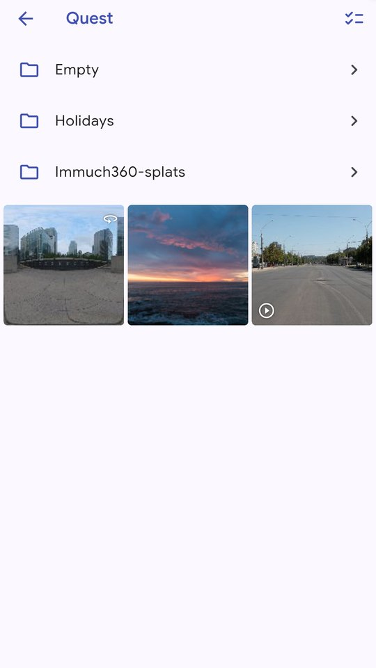
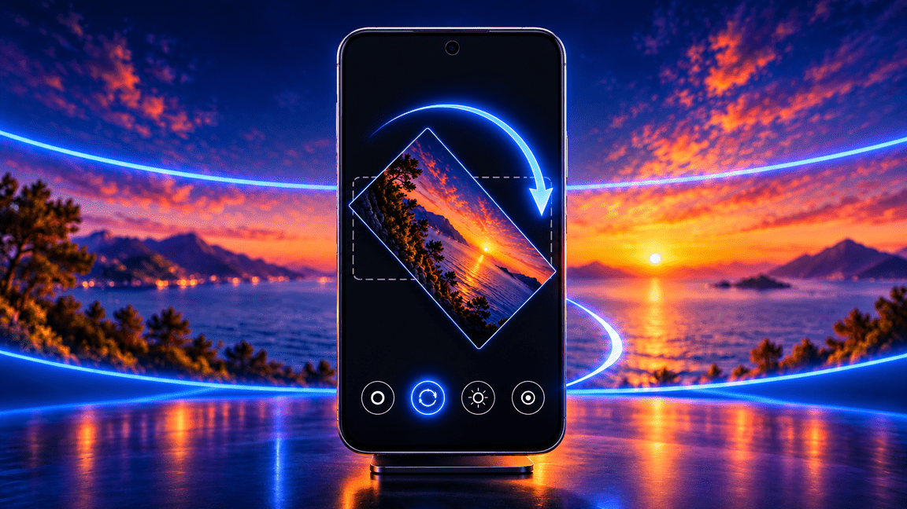
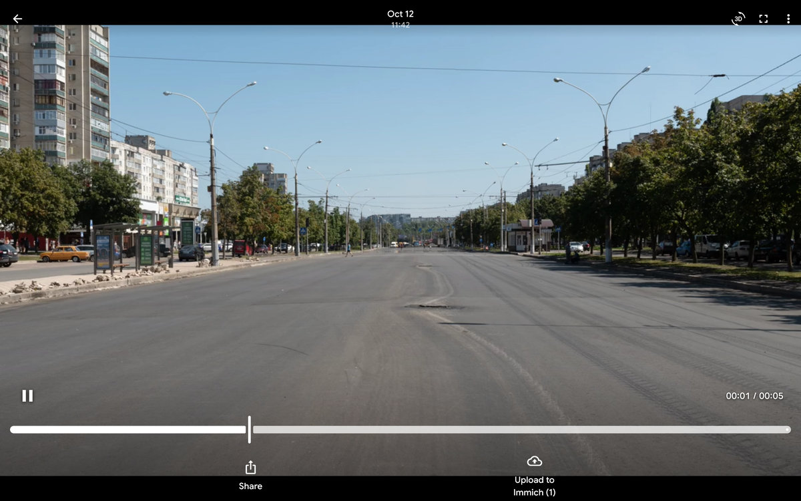

🌐 <b>Français</b> · Autres langues (88)
<a href="../README.md">English</a> · <a href="README.af.md">Afrikaans</a> · <a href="README.ar.md">العربية</a> · <a href="README.az.md">Azərbaycanca</a> · <a href="README.be.md">Беларуская</a> · <a href="README.bg.md">Български</a> · <a href="README.bi.md">Bislama</a> · <a href="README.bn.md">বাংলা</a> · <a href="README.br.md">Brezhoneg</a> · <a href="README.bs.md">Bosanski</a> · <a href="README.ca.md">Català</a> · <a href="README.cs.md">Čeština</a> · <a href="README.cv.md">Чӑвашла</a> · <a href="README.da.md">Dansk</a> · <a href="README.de.md">Deutsch</a> · <a href="README.de_CH.md">Deutsch (Schweiz)</a> · <a href="README.el.md">Ελληνικά</a> · <a href="README.en_GB.md">English (UK)</a> · <a href="README.eo.md">Esperanto</a> · <a href="README.es.md">Español</a> · <a href="README.et.md">Eesti</a> · <a href="README.eu.md">Euskara</a> · <a href="README.fa.md">فارسی</a> · <a href="README.fi.md">Suomi</a> · <a href="README.fil.md">Filipino</a> · <a href="README.ga.md">Gaeilge</a> · <a href="README.gl.md">Galego</a> · <a href="README.gsw.md">Alemannisch</a> · <a href="README.gu.md">ગુજરાતી</a> · <a href="README.he.md">עברית</a> · <a href="README.hi.md">हिन्दी</a> · <a href="README.hr.md">Hrvatski</a> · <a href="README.hu.md">Magyar</a> · <a href="README.hy.md">Հայերեն</a> · <a href="README.id.md">Bahasa Indonesia</a> · <a href="README.is.md">Íslenska</a> · <a href="README.it.md">Italiano</a> · <a href="README.ja.md">日本語</a> · <a href="README.ka.md">ქართული</a> · <a href="README.kab.md">Taqbaylit</a> · <a href="README.kk.md">Қазақша</a> · <a href="README.km.md">ខ្មែរ</a> · <a href="README.kmr.md">Kurmancî</a> · <a href="README.kn.md">ಕನ್ನಡ</a> · <a href="README.ko.md">한국어</a> · <a href="README.kxm.md">ภาษาเขมรถิ่นไทย</a> · <a href="README.lb.md">Lëtzebuergesch</a> · <a href="README.lmo.md">Lombard</a> · <a href="README.lt.md">Lietuvių</a> · <a href="README.lv.md">Latviešu</a> · <a href="README.mfa.md">Bahasa Melayu Kelantan</a> · <a href="README.mi.md">Te reo Māori</a> · <a href="README.mk.md">Македонски</a> · <a href="README.ml.md">മലയാളം</a> · <a href="README.mn.md">Монгол</a> · <a href="README.mr.md">मराठी</a> · <a href="README.ms.md">Bahasa Melayu</a> · <a href="README.nb_NO.md">Norsk bokmål</a> · <a href="README.ne.md">नेपाली</a> · <a href="README.nl.md">Nederlands</a> · <a href="README.nn.md">Norsk nynorsk</a> · <a href="README.pa.md">ਪੰਜਾਬੀ</a> · <a href="README.pl.md">Polski</a> · <a href="README.pt.md">Português</a> · <a href="README.pt_BR.md">Português (Brasil)</a> · <a href="README.ro.md">Română</a> · <a href="README.ru.md">Русский</a> · <a href="README.si.md">සිංහල</a> · <a href="README.sk.md">Slovenčina</a> · <a href="README.sl.md">Slovenščina</a> · <a href="README.sq.md">Shqip</a> · <a href="README.sr_Cyrl.md">Српски</a> · <a href="README.sr_Latn.md">Srpski</a> · <a href="README.sv.md">Svenska</a> · <a href="README.sw.md">Kiswahili</a> · <a href="README.swg.md">Schwäbisch</a> · <a href="README.ta.md">தமிழ்</a> · <a href="README.te.md">తెలుగు</a> · <a href="README.th.md">ไทย</a> · <a href="README.tl.md">Tagalog</a> · <a href="README.tr.md">Türkçe</a> · <a href="README.uk.md">Українська</a> · <a href="README.ur.md">اردو</a> · <a href="README.uz.md">Oʻzbekcha</a> · <a href="README.vi.md">Tiếng Việt</a> · <a href="README.yue_Hant.md">粵語</a> · <a href="README.zh_Hans.md">简体中文</a> · <a href="README.zh_Hant.md">繁體中文</a>

  

# Immuch360

**Vos médias. Tous les écrans. Tous les points de vue.**

🌐 <a href="https://immuch360.com/fr/"><b>immuch360.com</b></a>

Photos et vidéos à plat, 360° et 3D depuis votre appareil, votre NAS, votre serveur Immich, vos caméras et votre drone. Aucun compte nécessaire. Immuch360 est une application libre et open source qui lit vos photos et vidéos là où elles sont et joue chacune dans le visualiseur qui lui convient : à plat, en sphère dans laquelle vous regardez autour de vous, en 3D, ou tout autour de vous dans un casque. Elle fonctionne sur téléphones, tablettes, téléviseurs, casques Meta Quest et ordinateurs. Son site, [immuch360.com](https://immuch360.com/fr/), montre ce qu'elle fait sur chaque écran, en 89 langues.

**Nouveau dans le build 51 et le build 31 de la version de bureau, version 3.4.6.** Sous Windows et Linux, [Améliorer (IA)](#make-a-photo-sharper-on-your-computer-ai) fait une copie plus nette d'une photo un peu molle à côté de l'original, à trois niveaux : Accentuer la netteté, Reconstruire les détails, qui invente des détails plausibles, et Naturel, le plus fidèle, qui tourne aussi sur un Mac à puce Apple ; chaque niveau a tourné une fois sur un PC avec une RTX 4060. Un ordinateur [transforme une vidéo 360° en vidéo 360° en 3D](#a-360-video-turned-into-a-360-3d-video) par l'IA (expérimental), et sous Windows la profondeur des vidéos 3D est estimée par la carte graphique : 1,1 s par image sur une RTX 4060 au lieu de 3,1 s sur le processeur. Les fonctions d'IA prennent directement les vidéos de votre serveur Immich et d'un partage, et les téléchargent avant de commencer. Le fichier de paramètres a [sa carte dans la Bibliothèque](#keep-your-settings-in-a-file), et un téléviseur le sauvegarde et le restaure sur un partage réseau. Sur les ordinateurs, Échap revient d'une étape en arrière. Les builds des boutiques demandent une note [plus rarement et plus doucement](#privacy), et les Paramètres reçoivent « Noter Immuch360 » et « Quelque chose ne fonctionne pas ? ». Linux affiche les photos TIFF, les dossiers qui montrent d'eux-mêmes leurs nouveaux fichiers, les scènes splat faites à partir de vos photos et les vidéos 3D avec un seul œil. Le zoom des photos d'Android TV a été vu fonctionner sur un émulateur Android TV, et deux plantages sont corrigés : les photos de l'appareil sous Android 9 et antérieur, et la vue immersive d'un Quest dont l'Horizon OS est trop ancien, qui demande désormais une mise à jour.

**Nouveau dans les builds 33 à 50.** [Les films reprennent là où vous vous êtes arrêté](#pick-up-a-film-where-you-stopped). Ils démarrent plus tôt, et depuis un serveur lent ils [continuent de jouer au lieu de s'arrêter](#when-a-video-waits-or-will-not-play). La chronologie [se réduit en mois et en années](#find-a-month-or-a-year-in-a-long-timeline) sur les téléphones et les ordinateurs. Sur un téléphone Android ou un Meta Quest, [« Parcourir un dossier »](#browse-a-folder-of-your-phone-or-headset) ouvre un dossier de l'appareil comme un partage, et les photos TIFF s'affichent. Android TV [cherche par date à la télécommande](#on-android-tv-and-google-tv), un Meta Quest 3 ou 3S [ouvre les splats gaussiens](#explore-gaussian-splats-in-a-meta-quest-3-or-3s) (expérimental), qu'on fait pivoter au joystick droit, SPZ version 4 compris, et un ordinateur [fait les versions 3D des photos de votre NAS](#turn-one-photo-into-3d-a-scene-a-panorama). Sur un ordinateur portable Windows à deux puces graphiques, l'application [tourne désormais sur la plus rapide](#when-a-video-waits-or-will-not-play), si bien que les films 8K sont fluides. Les splats gaussiens [s'ouvrent désormais sur les ordinateurs et les téléphones et tablettes Android](#explore-gaussian-splats-on-your-phone-tablet-or-computer), un ordinateur Windows [fait des scènes splat à partir de vos photos ou d'une vidéo](#make-a-splat-scene-from-your-photos-or-a-video-ai) par l'IA, votre serveur Immich [les garde dans des photos](#keep-a-splat-scene-on-your-immich-server) qui s'ouvrent depuis votre chronologie, et les ordinateurs [lisent les vidéos AV2](#play-av2-videos-on-your-computer), le tout expérimental. À partir du build 42, les vidéos brutes des caméras Insta360, GoPro MAX et DJI Osmo 360, depuis votre bibliothèque Immich, un partage ou un dossier, [se lisent stabilisées avec le gyroscope de la caméra](#stabilise-your-360-videos-with-the-cameras-gyroscope-experimental) sur les téléphones, tablettes et téléviseurs Android, le créateur de splats du build 22 de la version de bureau [propose une qualité Détaillée](#make-a-splat-scene-from-your-photos-or-a-video-ai) pour les scènes que vous regardez de près, et un panorama 360° [démarre avec 3,5 GiB libres sur la carte graphique](#turn-one-photo-into-3d-a-scene-a-panorama), le tout expérimental. L'application iPhone et iPad est [sur l'App Store](https://apps.apple.com/us/app/immuch360-360-3d-player/id6817655965), version 3.4.3. À partir du build 43, l'avis de mise à jour de l'application ouvre Google Play ou l'App Store sur les téléphones et les tablettes ; son site, [immuch360.com](https://immuch360.com/fr/), a ouvert le 7 novembre. À partir du build 44 et du build 24 de la version de bureau, un Meta Quest 3 ou 3S [montre des splats jusqu'à 300 000 gaussiennes](#explore-gaussian-splats-in-a-meta-quest-3-or-3s) (expérimental), les ordinateurs [sélectionnent plusieurs photos et vidéos avec Ctrl et Shift](#use-your-computer-as-the-media-player), un téléviseur dont le décodeur refuse une vidéo [lit de lui-même l'autre fichier du serveur](#when-a-video-waits-or-will-not-play), les panoramas tournent sur la carte graphique choisie d'un portable qui en a deux (expérimental), et l'avis de mise à jour du Quest et des ordinateurs ouvre leur boutique ou leur page de téléchargement, avec de nombreuses corrections. À partir du build 45 et du build 25 de la version de bureau, version 3.4.0 sur toutes les plateformes, l'application suit l'application Immich 3.4.0 avec 11 corrections ultérieures d'Immich, montre les [photos JPEG XL des serveurs Immich 3.4](#keep-your-immich-library-with-more), ouvre [vos films Plex par année](#watch-your-plex-films) avec une page pour chaque film, leur téléchargement sur l'appareil et leur lecture sur le téléviseur depuis le téléphone (expérimental), peut demander une note dans les builds des boutiques, et, sur les ordinateurs, prend ses composants vidéo dans [leurs propres dépôts ouverts](#licences-and-credits). À partir du build 46 et du build 26 de la version de bureau, version 3.4.1, les vidéos brutes des caméras 360° [se lisent aussi stabilisées](#stabilise-your-360-videos-with-the-cameras-gyroscope-experimental) sur iPhone et iPad, dans un Meta Quest et sous Windows, un Meta Quest [lit avec libmpv les films Plex que son propre lecteur ne sait pas décoder](#watch-your-plex-films), un téléphone [envoie un tel film vers un Chromecast ou un Google TV](#watch-your-plex-films), et le relief IA d'une photo 3D [prend l'intensité que vous choisissez](#turn-one-photo-into-3d-a-scene-a-panorama), le tout expérimental ; un nouveau serveur peut aussi s'ajouter en se connectant avec votre compte Plex, et l'application [garde ses paramètres dans un fichier](#keep-your-settings-in-a-file). À partir du build 47 et du build 27 de la version de bureau, version 3.4.2, un film Plex [lit une piste audio que l'appareil décode](#watch-your-plex-films) et dit laquelle, ouvre la version qui convient à l'écran et, sur une connexion lente, en propose une plus légère, Windows et macOS lisent son son Dolby TrueHD, Android [montre son téléchargement dans une notification](#watch-your-plex-films) et Android TV télécharge aussi les films, et [les caméras Tapo sur batterie s'affichent en direct](#watch-your-home-cameras-on-the-big-screen) (expérimental) ; restaurer un fichier de paramètres avec ses comptes vous connecte désormais à votre serveur Immich. À partir du build 48 et du build 28 de la version de bureau, version 3.4.3, un ordinateur Windows [lit vos vidéos dans un casque PC VR](#watch-your-videos-in-a-pc-vr-headset-from-windows) par SteamVR, Meta Horizon Link ou un autre runtime OpenXR (pas encore essayé dans un casque par le projet), [les caméras d'autres marques s'affichent en direct](#cameras-of-other-brands-over-onvif-or-rtsp), trouvées par ONVIF ou ajoutées par leur lien RTSP (vérifiées avec une caméra simulée, aucune vraie caméra d'une autre marque essayée encore), les vidéos brutes de la [DJI Osmo 360 II et de la GoPro MAX 2 se lisent stabilisées](#open-the-raw-files-of-360-cameras) (expérimental), les films Plex [ne manquent plus de données sur les téléphones](#when-a-video-waits-or-will-not-play), les téléviseurs LG et Samsung [tournent une vidéo couchée sur le côté](#on-a-samsung-tv-tizen) d'un seul bouton (pas encore essayé sur un téléviseur LG ; le téléviseur Samsung de l'issue 17 a refusé la rotation), et « Une mise à jour du serveur est disponible » ne s'affiche plus pour un serveur à jour. À partir du build 49 et du build 29 de la version de bureau, version 3.4.4, l'application [lit elle-même vos serveurs Jellyfin et Emby](#watch-your-jellyfin-and-emby-libraries) (expérimental, pas encore essayé sur un appareil), trouvés sur votre réseau et connectés avec Quick Connect sur un téléviseur ou dans un casque, leurs fichiers d'origine lus pour qu'une vidéo 360° reste en 360° ; sur le grand écran d'un Meta Quest, les photos [gardent la taille et la position que vous avez réglées pendant que vous les parcourez, et défilent en diaporama](#browse-your-photos-on-the-big-screen-of-the-quest) (pas encore essayé dans un casque par le projet) ; le lecteur vidéo 360° des téléphones et des tablettes [reçoit les commandes des photos 360°](#360-videos-on-your-phone-with-the-controls-of-360-photos), un bouton gyroscope, le pincement pour zoomer et un glissement jusqu'en haut ou jusqu'en bas (essayé par un utilisateur sur un Samsung Galaxy S25 Ultra, pas encore sur un iPhone) ; un ordinateur [transforme vos vidéos 2D en vidéos 3D](#turn-your-2d-videos-into-3d-on-your-computer-experimental) par l'IA (expérimental, pas encore essayé sur un écran 3D ni dans un casque) ; et les téléviseurs Samsung [confient une vidéo qui doit être tournée au lecteur propre de Samsung](#on-a-samsung-tv-tizen), que le téléviseur de l'issue 17 lit mais refuse de tourner. À partir du build 50 et du build 30 de la version de bureau, version 3.4.5, pendant qu'une vidéo se lit dans la fenêtre 2D d'un Meta Quest, la fenêtre [se redessine à la fréquence de l'écran](#step-inside-your-photos-and-videos-with-a-meta-quest) au lieu d'environ 10 fois par seconde comme dans les builds 48 et 49 (mesuré sur un Meta Quest 3), Android TV [zoome dans une photo à la télécommande](#on-android-tv-and-google-tv) et la déplace avec les flèches (nouveau, pas encore essayé sur un téléviseur), et trois corrections viennent du fork Android TV de mlc70 : un balayage rapide n'affiche plus les détails de la photo laissée derrière, une photo animée libère sa mémoire, et le filtre Lieu propose les villes du nouveau pays.

  Fork non officiel de l'application mobile Immich. Sans lien avec Immich ni FUTO. Le nom se lit « I am much 360 ».

<b>Sommaire</b>

- [À qui elle s'adresse](#who-it-is-for)
- [Quels écrans](#which-screens), [ce qu'ils font ensemble](#use-cases) et [ce que fait chaque écran](#what-each-screen-does)
- [Ce que vous pouvez faire](#what-you-can-do)
- [L'installer sur votre appareil](#get-it-on-your-device)
- [Comment faire](#how-to)
  - [Regarder vos photos et vidéos, avec ou sans serveur](#watch-your-photos-and-videos-with-or-without-a-server)
  - [Explorer les panoramas, le 360°, le VR180 et la 3D](#explore-panoramas-360-vr180-and-3d) : [les vidéos 360° sur les téléphones](#360-videos-on-your-phone-with-the-controls-of-360-photos)
  - [Transformer une photo en 3D, en scène, en panorama](#turn-one-photo-into-3d-a-scene-a-panorama)
  - [Transformer vos vidéos 2D en 3D sur votre ordinateur (expérimental)](#turn-your-2d-videos-into-3d-on-your-computer-experimental) : [vidéos 360° en 360° 3D](#a-360-video-turned-into-a-360-3d-video)
  - [Rendre une photo plus nette sur votre ordinateur (IA)](#make-a-photo-sharper-on-your-computer-ai)
  - [Regarder sur le téléviseur avec la télécommande](#watch-on-the-tv-with-the-remote) : [Android TV et Google TV](#on-android-tv-and-google-tv), [LG](#on-an-lg-tv-webos), [Samsung](#on-a-samsung-tv-tizen)
  - [Connecter un téléviseur, un casque ou un ordinateur avec votre téléphone](#sign-in-a-tv-a-headset-or-a-computer-with-your-phone)
  - [Entrer dans vos photos et vidéos avec un Meta Quest](#step-inside-your-photos-and-videos-with-a-meta-quest) : [le grand écran](#browse-your-photos-on-the-big-screen-of-the-quest), [mode kiosque](#kiosk-mode-for-an-exhibition-or-a-shop)
  - [Explorer des splats gaussiens dans un Meta Quest 3 ou 3S](#explore-gaussian-splats-in-a-meta-quest-3-or-3s)
  - [Explorer des splats gaussiens sur votre téléphone, votre tablette ou votre ordinateur](#explore-gaussian-splats-on-your-phone-tablet-or-computer)
  - [Créer une scène splat à partir de vos photos ou d'une vidéo (IA)](#make-a-splat-scene-from-your-photos-or-a-video-ai)
  - [Garder une scène splat sur votre serveur Immich](#keep-a-splat-scene-on-your-immich-server)
  - [Lire les fichiers d'un NAS, d'un ordinateur, d'un serveur multimédia ou de Plex](#play-the-files-of-a-nas-a-computer-a-media-server-or-plex) : [vos films par année](#watch-your-plex-films), [Jellyfin et Emby](#watch-your-jellyfin-and-emby-libraries)
  - [Parcourir un dossier de votre téléphone ou de votre casque](#browse-a-folder-of-your-phone-or-headset)
  - [Reprendre un film là où vous vous êtes arrêté](#pick-up-a-film-where-you-stopped)
  - [Quand une vidéo attend ou ne se lit pas](#when-a-video-waits-or-will-not-play)
  - [Garder votre bibliothèque Immich, et plus encore](#keep-your-immich-library-with-more)
  - [Trouver un mois ou une année dans une longue chronologie](#find-a-month-or-a-year-in-a-long-timeline)
  - [Regarder vos caméras de la maison sur grand écran](#watch-your-home-cameras-on-the-big-screen) : [autres marques](#cameras-of-other-brands-over-onvif-or-rtsp)
  - [Votre drone DJI (expérimental)](#your-dji-drone-experimental) : [vidéo en direct](#see-what-your-drone-sees-on-your-phone), [dans un Quest ou sur Android TV](#watch-it-in-a-meta-quest-or-on-an-android-tv), [import](#bring-a-drones-or-a-camera-cards-photos-and-videos-to-immich)
  - [Ouvrir les fichiers bruts des caméras 360°](#open-the-raw-files-of-360-cameras)
  - [Stabiliser vos vidéos 360° avec le gyroscope de la caméra (expérimental)](#stabilise-your-360-videos-with-the-cameras-gyroscope-experimental)
  - [Tourner une photo d'une touche](#turn-a-photo-with-one-key)
  - [Utiliser votre ordinateur comme lecteur multimédia](#use-your-computer-as-the-media-player)
  - [Regarder vos vidéos dans un casque PC VR, depuis Windows](#watch-your-videos-in-a-pc-vr-headset-from-windows)
  - [Lire des vidéos AV2 sur votre ordinateur](#play-av2-videos-on-your-computer)
  - [Garder vos paramètres dans un fichier](#keep-your-settings-in-a-file)
- [Comparé à Immich](#compared-with-immich)
- [Vie privée](#privacy)
- [Licences et crédits](#licences-and-credits)
- [Feuille de route](#roadmap)
- [Documentation](#documentation)

## À qui elle s'adresse

- **Vous filmez en 360° ou en 3D** et voulez regarder autour de vous dans vos prises, pas les voir à plat, doublées ou étirées, et tourner vos vidéos 360° sur le téléphone comme vous tournez ses photos : [360°, VR180 et 3D](#explore-panoramas-360-vr180-and-3d), [les vidéos 360° sur les téléphones](#360-videos-on-your-phone-with-the-controls-of-360-photos).
- **Vous filmez avec une caméra 360° à la main, à vélo ou sur un casque** et voulez que les vidéos brutes de votre caméra Insta360, GoPro MAX ou MAX 2, DJI Osmo 360 ou Osmo 360 II, gardées dans Immich, sur un partage ou dans un dossier, se lisent droites et stables sur votre téléphone, votre téléviseur, votre Meta Quest ou votre ordinateur Windows (expérimental) : [stabilisées avec le gyroscope de la caméra](#stabilise-your-360-videos-with-the-cameras-gyroscope-experimental).
- **Vos photos et films sont sur un NAS, un ordinateur, Plex ou Immich** et vous les voulez sur le téléviseur sans rien copier : [sur le téléviseur](#watch-on-the-tv-with-the-remote), [NAS, partages et Plex](#play-the-files-of-a-nas-a-computer-a-media-server-or-plex).
- **Vous gardez vos films sur un serveur Plex** et voulez en choisir un par année, voir ce que c'est avant qu'il démarre, l'emporter en voyage, le lancer sur le téléviseur ou un Chromecast depuis votre téléphone, et lire même les films que votre téléphone Android, votre téléviseur ou votre Meta Quest ne sait pas décoder (expérimental) : [vos films, par année](#watch-your-plex-films).
- **Vous gardez vos films sur un serveur Jellyfin ou Emby** et les voulez dans votre Meta Quest, sur le téléviseur ou le téléphone, le 360° et la 3D gardés tels quels, et l'endroit où vous vous êtes arrêté gardé sur le serveur (expérimental, pas encore essayé sur un appareil) : [Jellyfin et Emby](#watch-your-jellyfin-and-emby-libraries).
- **Vous avez un Meta Quest** et voulez entrer dans vos propres photos et vidéos : [dans le casque](#step-inside-your-photos-and-videos-with-a-meta-quest), et parcourir vos photos sur un grand écran à la taille et à la position que vous réglez, en diaporama aussi (pas encore essayé dans un casque par le projet) : [le grand écran](#browse-your-photos-on-the-big-screen-of-the-quest).
- **Vous avez un casque PC VR sur un ordinateur Windows** et voulez vos vidéos 360° autour de vous et vos films sur un grand écran dans ce casque (pas encore essayé dans un casque par le projet) : [dans un casque PC VR](#watch-your-videos-in-a-pc-vr-headset-from-windows).
- **Vos photos sont à plat** et vous les voulez en 3D, en scène dans laquelle vous pencher dans un casque, ou au cœur d'un panorama 360°, sans appareil photo 3D : [transformer une photo en 3D, en scène, en panorama](#turn-one-photo-into-3d-a-scene-a-panorama), nouveau, fait par l'IA sur votre propre ordinateur.
- **Vos vidéos sont à plat**, celles de votre téléphone comprises, et vous les voulez en 3D pour un casque ou un écran 3D, et vos vidéos 360° en 360° 3D, faites sur votre propre ordinateur (expérimental, pas encore essayé sur un écran 3D ni dans un casque) : [des vidéos 2D en 3D](#turn-your-2d-videos-into-3d-on-your-computer-experimental), [de la 360° à la 360° 3D](#a-360-video-turned-into-a-360-3d-video).
- **Vos photos sont molles**, un peu floues ou prises dans une mauvaise lumière, et vous en voulez une copie plus nette à côté de l'original, faite sur votre propre ordinateur, avec les détails inventés dits clairement : [Améliorer (IA)](#make-a-photo-sharper-on-your-computer-ai).
- **Vous utilisez Immich** et voulez son application, plus les visualiseurs immersifs et les grands écrans que vous connectez depuis votre téléphone : [votre bibliothèque Immich](#keep-your-immich-library-with-more), [comparé à Immich](#compared-with-immich).
- **Vous surveillez votre maison avec des caméras Tapo**, sur batterie aussi (expérimental), ou des caméras d'autres marques par ONVIF ou RTSP, et les voulez à côté de vos photos, sur le téléviseur aussi (vérifié face à une caméra simulée) : [caméras de la maison](#watch-your-home-cameras-on-the-big-screen).
- **Vous pilotez un drone DJI** et voulez son image en direct sur votre téléphone sans DJI Fly, et dans un Meta Quest ou sur un Android TV pour les personnes avec vous (expérimental) : [votre drone](#see-what-your-drone-sees-on-your-phone).
- **Vous capturez des lieux et des objets en 3D, en splats gaussiens,** ou aimeriez en faire à partir de vos propres photos, et voulez vous y promener sur votre téléphone, votre ordinateur ou dans un casque (expérimental) : [sur un téléphone, une tablette ou un ordinateur](#explore-gaussian-splats-on-your-phone-tablet-or-computer), [faits à partir de vos photos](#make-a-splat-scene-from-your-photos-or-a-video-ai), [gardés dans Immich](#keep-a-splat-scene-on-your-immich-server).
- **Vous avez des vidéos AV2**, le format qui succède à l'AV1, et voulez les regarder sur votre ordinateur (expérimental) : [l'AV2 sur votre ordinateur](#play-av2-videos-on-your-computer).
- **Vous avez plusieurs écrans à la maison** et voulez qu'ils travaillent ensemble : [ce que vos écrans font ensemble](#use-cases).

Il n'y a aucun compte Immuch360 à créer, et rien ne nous parvient : l'application ne parle qu'à vos appareils et aux serveurs que vous choisissez, à partir du build 45 à Wikipedia pour la page d'un film (expérimental), à partir du build 46 à plex.tv quand vous vous connectez avec, et ne télécharge un composant d'IA ou le décodeur AV2 que lorsque vous le demandez.

## Quels écrans

| Plateforme | Où l'obtenir | État en novembre 2026 |
|---|---|---|
|  Téléphones et tablettes **Android** | [Google Play](https://play.google.com/store/apps/details?id=com.aprogsys.immuch360) · [APK](https://github.com/freeKC/Immuch360/releases) | sur Google Play (build 47 publié le 16 novembre ; build 48 en révision chez Google depuis le 16 novembre ; le build 51 suit), build 51 sur GitHub, où [les vidéos 360° brutes se lisent stabilisées](#stabilise-your-360-videos-with-the-cameras-gyroscope-experimental) (expérimental), [les films reprennent là où vous vous êtes arrêté](#pick-up-a-film-where-you-stopped), [« Parcourir un dossier »](#browse-a-folder-of-your-phone-or-headset) ouvre un dossier du téléphone et [les splats gaussiens s'ouvrent](#explore-gaussian-splats-on-your-phone-tablet-or-computer), depuis un partage ou [depuis votre chronologie Immich](#keep-a-splat-scene-on-your-immich-server) (expérimental), [les paramètres gardés dans un fichier](#keep-your-settings-in-a-file), [le téléchargement d'un film montré dans une notification](#watch-your-plex-films), à partir du build 48 [les caméras d'autres marques, en direct](#cameras-of-other-brands-over-onvif-or-rtsp) (vérifiées avec une caméra simulée) et, à partir du build 49, [les serveurs Jellyfin et Emby](#watch-your-jellyfin-and-emby-libraries) (expérimental, pas encore essayé sur un appareil) et [les commandes des photos 360° dans le lecteur vidéo 360°](#360-videos-on-your-phone-with-the-controls-of-360-photos) (essayé par un utilisateur sur un Samsung Galaxy S25 Ultra), et à partir du build 51 [la carte du fichier de paramètres dans la Bibliothèque](#keep-your-settings-in-a-file), son fichier sauvegardé aussi sur un partage réseau |
|  **iPhone et iPad** | [App Store](https://apps.apple.com/us/app/immuch360-360-3d-player/id6817655965) | version 3.4.5 sur l'App Store depuis le 22 novembre, avec [les mois et les années dans la chronologie](#find-a-month-or-a-year-in-a-long-timeline), [les films qui reprennent là où vous vous êtes arrêté](#pick-up-a-film-where-you-stopped), [la connexion d'un téléviseur, d'un casque ou d'un ordinateur](#sign-in-a-tv-a-headset-or-a-computer-with-your-phone) depuis le téléphone, les scènes splat gardées dans Immich montrées comme leur photo, les corrections d'Immich 3.4.0 et ses photos JPEG XL, [les vidéos 360° brutes stabilisées](#stabilise-your-360-videos-with-the-cameras-gyroscope-experimental) (expérimental), [les paramètres gardés dans un fichier](#keep-your-settings-in-a-file), [la vue en direct des caméras Tapo sur batterie](#watch-your-home-cameras-on-the-big-screen) (expérimental) et [la vue en direct des caméras d'autres marques](#cameras-of-other-brands-over-onvif-or-rtsp) (vérifiées avec une caméra simulée), et à partir de la version 3.4.4 [les serveurs Jellyfin et Emby](#watch-your-jellyfin-and-emby-libraries) (expérimental, pas encore essayé sur un appareil) et [les commandes des photos 360° dans le lecteur vidéo 360°](#360-videos-on-your-phone-with-the-controls-of-360-photos) (pas encore essayé sur un iPhone) ; la version 3.4.6, la version iPhone et iPad du build 51, suit, avec [la carte du fichier de paramètres](#keep-your-settings-in-a-file) et sa restauration depuis un partage réseau ; ou [compilez-la vous-même](../docs/immuch360/build.md) |
|  **Android TV et Google TV** | [Google Play](https://play.google.com/store/apps/details?id=com.aprogsys.immuch360) · [APK](#android-tv-and-google-tv) | sur Google Play, qui propose l'application sur Android TV et Google TV, et build 51 sur GitHub : [les vidéos 360° brutes stabilisées](#stabilise-your-360-videos-with-the-cameras-gyroscope-experimental) (expérimental), [la recherche par date à la télécommande](#on-android-tv-and-google-tv), la [connexion avec votre téléphone](#sign-in-a-tv-a-headset-or-a-computer-with-your-phone) en scannant un code QR, une barre de temps, l'audio et les sous-titres à la télécommande dans le lecteur vidéo, et la [vidéo en direct d'un drone](#watch-it-in-a-meta-quest-or-on-an-android-tv) relayée par un téléphone (expérimental), [les films téléchargés sur le téléviseur](#watch-your-plex-films) et, à partir du build 49, [les serveurs Jellyfin et Emby](#watch-your-jellyfin-and-emby-libraries) connectés avec Quick Connect (expérimental, pas encore essayé sur un appareil) et, à partir du build 50, [les photos zoomées à la télécommande](#on-android-tv-and-google-tv) (vu fonctionner sur un émulateur Android TV, pas encore essayé sur un téléviseur), et à partir du build 51 [le fichier de paramètres sauvegardé et restauré sur un partage réseau](#keep-your-settings-in-a-file) (vu fonctionner sur un émulateur Android TV) |
| **Téléviseurs LG** sous webOS 5.0 et plus récent | [.ipk, version 1.0.5](https://github.com/freeKC/Immuch360/releases/tag/webos-v1.0.5) · LG Content Store (en révision) | version 1.0.0, soumise au LG Content Store le 24 octobre, en cours de tests chez LG depuis le 26 octobre ; la version 1.0.1, sur GitHub depuis le 27 octobre, zoome une photo depuis les flèches et indique quand une photo est encore en cours de chargement, et la version 1.0.2, sur GitHub avec le build 46, écrit « se connecter » ログイン en japonais, la version 1.0.3, avec le build 47, indique quand un dossier d'un serveur DLNA contient des chaînes de télévision en direct, qu'elle ne sait pas encore lire, la version 1.0.4, avec le build 48, [tourne une vidéo couchée sur le côté](#on-an-lg-tv-webos) d'un seul bouton (pas encore essayé sur un téléviseur LG), et la version 1.0.5, avec le build 49, nomme Jellyfin avec son plugin DLNA parmi les serveurs DLNA ; d'ici à ce que LG publie l'application, elle s'installe en [Developer Mode](#lg-tvs-webos). La version 1.0.0 a tourné sur des téléviseurs webOS 25 du Cloud Test Lab de LG |
| **Téléviseurs Samsung** sous Tizen 5.5 et plus récent | [Build de test .wgt](https://github.com/freeKC/Immuch360/releases/tag/tizen-v0.3.6) | build de test 0.3.6 de la même application TV, à signer avec votre propre certificat Samsung et à installer en [Developer mode](#samsung-tvs-tizen) ; la 0.1.0 a tourné sur le téléviseur Samsung d'un testeur, la 0.2.0 contient les corrections issues de cet essai, la 0.3.0 ajoute le zoom des photos et la pastille Chargement de la version LG 1.0.1, et la 0.3.1 la formulation japonaise de la version LG 1.0.2, la 0.3.2 lit dans le bon sens une vidéo filmée à la verticale sur un téléphone ([issue 17](https://github.com/freeKC/Immuch360/issues/17)), les 0.3.3 et 0.3.4 [la tournent sur un téléviseur qui la déclare à l'endroit](#on-a-samsung-tv-tizen) et ajoutent un bouton qui la tourne à la main, et les 0.3.5 et 0.3.6 confient une telle vidéo au lecteur propre de Samsung ; sur le téléviseur de l'auteur de l'issue, les 0.3.4 et 0.3.5 ont laissé l'image couchée, le téléviseur refusant la rotation, et l'issue là-bas est une vidéo que votre serveur Immich transcode, enregistrée à l'endroit ; pas sur la boutique de Samsung |
|  **Meta Quest** 2, Pro, 3 et 3S | [Horizon Store](https://www.meta.com/experiences/immuch360/1384208401440714/) · [APK](#meta-quest) | sur le Horizon Store (build 47 publié le 19 novembre ; build 50, dont la fenêtre 2D se redessine à la fréquence de l'écran pendant la lecture d'une vidéo, en révision chez Meta depuis le 21 novembre ; le build 51 suit), build 51 sur GitHub, avec un [mode kiosque](#kiosk-mode-for-an-exhibition-or-a-shop), [les vidéos 360° brutes stabilisées](#stabilise-your-360-videos-with-the-cameras-gyroscope-experimental) dans la vue immersive, [les films qu'il ne sait pas décoder lus par libmpv](#watch-your-plex-films) et, sur Quest 3 et 3S, les [splats gaussiens](#explore-gaussian-splats-in-a-meta-quest-3-or-3s) et le [relief IA](#turn-one-photo-into-3d-a-scene-a-panorama) d'une photo à plat, tous expérimentaux, et à partir du build 49 [les photos parcourues sur le grand écran](#browse-your-photos-on-the-big-screen-of-the-quest) à la taille que vous réglez, en diaporama aussi (pas encore essayé dans un casque par le projet), et [les serveurs Jellyfin et Emby](#watch-your-jellyfin-and-emby-libraries) connectés avec Quick Connect (expérimental, pas encore essayé sur un appareil), et à partir du build 51 un casque dont l'Horizon OS est trop ancien pour la vue immersive demande une mise à jour au lieu de fermer l'application (pas essayé sur un tel casque) |
|  **Windows** | [Installateur ou ZIP](https://github.com/freeKC/Immuch360/releases/tag/desktop-v3.4.6-31) | build 31 de la version de bureau, une préversion signée : photos, vidéos à plat et 360°, partages, Plex, caméras (vérifiées avec une caméra simulée), connexion avec votre téléphone, photos tournées d'une touche, l'interface en 89 langues, et des [photos 3D, scènes 3D et panoramas 360° faits à partir de vos photos](#turn-one-photo-into-3d-a-scene-a-panorama) par l'IA (expérimental), y compris celles de votre NAS ; des [splats gaussiens](#explore-gaussian-splats-on-your-phone-tablet-or-computer) ouverts, [faits à partir de vos photos ou d'une vidéo](#make-a-splat-scene-from-your-photos-or-a-video-ai) et [gardés dans Immich](#keep-a-splat-scene-on-your-immich-server), les [vidéos AV2](#play-av2-videos-on-your-computer), à partir du build 22 de la version de bureau un [choix de Qualité pour les scènes splat](#make-a-splat-scene-from-your-photos-or-a-video-ai) et des [panoramas 360° dès 3,5 GiB de mémoire graphique libre](#turn-one-photo-into-3d-a-scene-a-panorama), et à partir du build 26 de la version de bureau [les vidéos 360° brutes stabilisées](#stabilise-your-360-videos-with-the-cameras-gyroscope-experimental) et [des photos 3D avec une intensité du relief et des contours plus nets](#turn-one-photo-into-3d-a-scene-a-panorama), le tout expérimental, à partir du build 27 de la version de bureau [le son Dolby TrueHD et les sous-titres Blu-ray des films](#watch-your-plex-films), à partir du build 28 de la version de bureau [vos vidéos dans un casque PC VR](#watch-your-videos-in-a-pc-vr-headset-from-windows) (pas encore essayé dans un casque par le projet), et à partir du build 29 de la version de bureau [des vidéos 3D faites à partir de vos vidéos 2D](#turn-your-2d-videos-into-3d-on-your-computer-experimental) par l'IA (expérimental, pas encore essayé sur un écran 3D ni dans un casque), et à partir du build 31 de la version de bureau [des copies plus nettes de vos photos](#make-a-photo-sharper-on-your-computer-ai) par l'IA et [des vidéos 360° transformées en vidéos 360° en 3D](#a-360-video-turned-into-a-360-3d-video) par l'IA (expérimental), la profondeur estimée par la carte graphique, les vidéos de votre serveur et d'un partage prises directement, et Échap pour revenir d'une étape en arrière |
|   **macOS et Linux** | [.deb, .rpm, DMG](https://github.com/freeKC/Immuch360/releases/tag/desktop-v3.4.6-31) | build 31 de la version de bureau, préversions : photos, photos 360° et vidéos à plat (les vidéos 360° se lisent à plat), un serveur Immich et les partages réseau, et des [photos 3D et scènes 3D](#turn-one-photo-into-3d-a-scene-a-panorama) faites par l'IA à partir de vos photos, avec les panoramas 360° sous Linux sur une carte graphique de 8 GB, dès 3,5 GiB libres sur celle-ci, et les [splats gaussiens](#explore-gaussian-splats-on-your-phone-tablet-or-computer) et les [vidéos AV2](#play-av2-videos-on-your-computer) (expérimental, pas encore essayé sur un Mac) ; le build 11 de la version de bureau essayé le 26 octobre dans un conteneur Ubuntu 24.04 et sur un Mac ; à partir du build 27 de la version de bureau, le son Dolby TrueHD des films sur macOS ; à partir du build 29 de la version de bureau, [des vidéos 3D faites à partir de vos vidéos 2D](#turn-your-2d-videos-into-3d-on-your-computer-experimental) par l'IA sous Linux et sur un Mac à puce Apple (expérimental, pas encore essayé sur un écran 3D ni dans un casque) ; à partir du build 31 de la version de bureau, sous Linux, [des copies plus nettes de vos photos](#make-a-photo-sharper-on-your-computer-ai) par l'IA, les photos TIFF, les dossiers qui montrent d'eux-mêmes leurs nouveaux fichiers, des scènes splat faites à partir de vos photos sur une carte graphique de 4 GB et les vidéos 3D montrées à plat avec un seul œil, et sur un Mac à puce Apple le niveau Naturel de « Améliorer (IA) » (pas encore essayé sur un Mac) ; non signé sur macOS |

*Les statuts sont mis à jour à chaque version ; ce que propose chaque boutique, ce qui est en révision chez elle et chaque build se trouvent dans [État des versions](../docs/immuch360/release-status.md). Le site [immuch360.com](https://immuch360.com/fr/) montre ce que fait chaque écran, un mode d'emploi par fonction et les liens des boutiques, en 89 langues.*

  

### Ce que vos écrans font ensemble

Installez Immuch360 sur chaque écran où vous regardez : chacun lit vos sources lui-même, et certains passent une image, un fichier ou une connexion à un autre. Dans chaque image, l'icône d'Immuch360 marque les appareils où l'application tourne.

#### Votre NAS sur tous vos écrans

  

**Il vous faut :** un NAS avec un partage SMB ou WebDAV, et Immuch360 sur chaque écran où vous regardez.

Ajoutez le partage sur chaque écran, et chacun lit les photos et vidéos là où elles sont, sans rien copier : téléphones, tablettes, Android TV, un Meta Quest, ordinateurs Windows, Linux et macOS, et téléviseurs LG connectés à votre serveur Immich (SMB à partir de webOS 22). Une photo 360° tourne en sphère sur le téléphone et le téléviseur, et vous entoure dans le casque. Comment faire : [Lire les fichiers d'un NAS, d'un ordinateur, d'un serveur multimédia ou de Plex](#play-the-files-of-a-nas-a-computer-a-media-server-or-plex).

#### Votre serveur Immich sur tous vos écrans, connectés depuis votre téléphone

  

**Il vous faut :** un serveur Immich, Immuch360 sur votre téléphone Android, et Immuch360 sur les écrans à connecter : Android TV, un Meta Quest, un ordinateur Windows, Linux ou macOS.

Sur le téléphone, Immuch360 garde toute l'application mobile Immich, y ajoute ses visionneuses 360°, VR180 et 3D, et s'installe à côté de l'application officielle. Connecté à votre serveur, il connecte les grands écrans : il scanne le code QR du téléviseur ou de l'ordinateur, ou vous y tapez le code que montre le casque, et votre mot de passe reste sur le téléphone. Comment faire : [Connecter un téléviseur, un casque ou un ordinateur avec votre téléphone](#sign-in-a-tv-a-headset-or-a-computer-with-your-phone).

#### Vos photos à plat en 3D, de votre ordinateur au casque (expérimental)

  

**Il vous faut :** Immuch360 sur un ordinateur Windows, Linux ou macOS et dans un Meta Quest, avec votre NAS entre les deux, ou votre serveur Immich avec « Sauvegarder aussi les versions IA » activé.

L'ordinateur lui-même fait de vos photos des photos 3D et des scènes 3D, et des panoramas 360° avec une carte graphique de 8 Go sous Windows ou Linux, et les enregistre à côté des originaux. Le casque montre une photo 3D en vraie 3D, pose une scène dans votre pièce et un panorama tout autour de vous ; téléphones et téléviseurs ouvrent les panoramas dans leur visionneuse 360°. Comment faire : [Transformer une photo en 3D, en scène, en panorama](#turn-one-photo-into-3d-a-scene-a-panorama).

#### Ce que voit votre drone, dans un casque ou sur le téléviseur (expérimental)

  

**Il vous faut :** un drone DJI et sa radiocommande DJI RC-N3, Immuch360 sur le téléphone Android branché à la radiocommande, et Immuch360 dans un Meta Quest ou sur un Android TV.

Le téléphone montre la vidéo en direct du drone et la relaie, par votre Wi-Fi ou son propre point d'accès, pour que les personnes avec vous suivent le vol dans le casque ou sur le téléviseur. Réception seule : aucune commande n'est jamais envoyée à la radiocommande ni au drone, et la radiocommande garde la main. Comment faire : [Regardez-la dans un Meta Quest ou sur un Android TV](#watch-it-in-a-meta-quest-or-on-an-android-tv).

#### Les fichiers bruts de votre caméra 360°, assemblés là où vous les regardez

  

**Il vous faut :** une caméra Insta360, GoPro MAX ou MAX 2, DJI Osmo 360 ou Osmo 360 II, votre NAS, et Immuch360 sur les écrans : téléphones, tablettes, Android TV, un Meta Quest, Windows.

Copiez tels quels les fichiers .insp, .insv, .360 ou .osv de la carte de la caméra vers un partage SMB ou WebDAV de votre NAS ; un serveur Immich prend aussi ceux d'Insta360. Chaque écran les assemble pendant la lecture, avec l'étalonnage écrit dans chaque fichier, sans export préalable dans l'application de la caméra. Comment faire : [Ouvrir les fichiers bruts des caméras 360°](#open-the-raw-files-of-360-cameras).

#### Vos serveurs Plex et DLNA sur le téléviseur et dans le casque

  

**Il vous faut :** un Plex Media Server, un serveur Jellyfin ou Emby, ou un serveur DLNA comme minidlna, et Immuch360 sur chaque écran : Android TV, un Meta Quest, téléphones, tablettes, Windows.

Plex donne les fichiers originaux de vos bibliothèques, donc une vidéo 360° reste en 360°, tout autour de vous dans le casque, à la maison et, par votre redirection de port, hors de chez vous ; les serveurs DLNA se trouvent sur le réseau de la maison. Les téléviseurs LG connectés à votre serveur Immich les lisent aussi. À partir du build 45, les téléphones, les tablettes, Android TV, le Quest et les ordinateurs ouvrent une bibliothèque de films Plex sur tous ses films par année, chaque film avec sa page, et un film choisi sur le téléphone se lit sur Android TV, le Quest ou un ordinateur, piloté à la télécommande (expérimental). À partir du build 46, le Quest lit avec libmpv les films que son propre lecteur ne sait pas décoder, votre serveur Plex convertit ceux qu'aucun lecteur d'un appareil Android ne décode, et un téléphone envoie un film vers un Chromecast ou un Google TV (expérimental). À partir du build 47, un film lit une piste audio que l'appareil décode et dit laquelle, ouvre la version qui convient à l'écran et lit son son Dolby TrueHD sous Windows et macOS (expérimental), et un dossier de chaînes de télévision en direct d'un serveur DLNA indique qu'elles ne se lisent pas encore. À partir du build 49, un serveur Jellyfin ou Emby a lui aussi un type à lui, trouvé tout seul, connecté avec Quick Connect sur un téléviseur ou dans le casque, ses fichiers d'origine lus pour que le 360° reste en 360° et l'endroit où vous vous êtes arrêté gardé sur le serveur (expérimental, pas encore essayé sur un appareil). Comment faire : [Lire les fichiers d'un NAS, d'un ordinateur, d'un serveur multimédia ou de Plex](#play-the-files-of-a-nas-a-computer-a-media-server-or-plex), [Regarder vos films Plex](#watch-your-plex-films) et [Regarder vos bibliothèques Jellyfin et Emby](#watch-your-jellyfin-and-emby-libraries).

#### Votre téléphone ou votre ordinateur Windows, ouvert dans le casque

  

**Il vous faut :** Immuch360 sur un téléphone Android, un iPhone ou un ordinateur Windows, et dans un Meta Quest, sur le même Wi-Fi de la maison.

Activez « Partager ce téléphone sur le réseau » sur le téléphone, ou « Partager cet ordinateur sur le réseau » sur l'ordinateur, et le casque lit ses photos et vidéos, les 360° tout autour de vous : ni serveur, ni NAS, ni envoi. Sur un iPhone, le partage tourne tant que l'application est à l'écran. Comment faire : [Partager ce téléphone sur le réseau](../docs/immuch360/user-guide.md#share-this-phone-on-the-network).

#### Vos caméras Tapo sur le téléviseur et dans le casque

  

**Il vous faut :** des caméras Tapo sur le réseau de la maison, et Immuch360 sur un téléphone Android, un Android TV, un Meta Quest ou un ordinateur Windows.

Chaque écran montre une caméra en direct et lit les enregistrements de sa carte mémoire jour par jour, à côté de vos photos, et le téléphone envoie un extrait à votre serveur Immich. L'application parle aux caméras sur votre réseau seulement, jamais par les serveurs de TP-Link. À partir du build 47, les caméras sur batterie s'affichent aussi en direct, par leur port média, sur les téléphones, les tablettes, Android TV et le Quest (expérimental). À partir du build 48, les caméras d'autres marques s'affichent en direct à côté d'elles, trouvées par ONVIF ou ajoutées par leur lien RTSP. Vérifié face à une caméra simulée. Comment faire : [Regarder vos caméras de la maison sur grand écran](#watch-your-home-cameras-on-the-big-screen).

#### Des splats gaussiens dans votre pièce, dans un Meta Quest 3 ou 3S (expérimental)

  

**Il vous faut :** un splat fait avec Polycam, Scaniverse, Luma ou un autre outil, en fichier .spz ou .ply binaire sur votre NAS ou dans le casque, et Immuch360 dans un Meta Quest 3 ou 3S.

Le casque pose le lieu ou l'objet à sa taille, devant vous ou tout autour de vous : faites-en le tour, glissez à travers avec le joystick gauche, pivotez avec le droit. Les splats gaussiens utilisent une API expérimentale du Meta Spatial SDK, que Meta ne prend pas en charge et ne garantit pas : tout défaut relève d'Immuch360 seul. Comment faire : [Explorer des splats gaussiens dans un Meta Quest 3 ou 3S](#explore-gaussian-splats-in-a-meta-quest-3-or-3s).

#### Un Meta Quest pour vos visiteurs (expérimental)

  

**Il vous faut :** un Meta Quest avec Immuch360, et une photo ou vidéo 360° dans le casque, sur votre NAS ou sur votre serveur Immich.

En mode kiosque, le casque ouvre votre photo ou vidéo 360° de lui-même, depuis le début, chaque fois qu'un visiteur le met, et un film se termine sur la carte de fin, avec votre texte. Les visiteurs n'appuient sur rien ; vous tenez B ou Y une seconde pour sortir. Comment faire : [Mode kiosque, pour une exposition ou une boutique](#kiosk-mode-for-an-exhibition-or-a-shop).

### Ce que fait chaque écran

Une seule base de code pour les téléphones, les tablettes, Android TV, le Meta Quest et les ordinateurs, et une application TV distincte pour les téléviseurs LG, également empaquetée pour les téléviseurs Samsung en build de test. Ce que chacun a aujourd'hui :

| Fonctionnalité | Android | iPhone, iPad | Android TV | LG webOS | Samsung Tizen | Quest |
|---|:---:|:---:|:---:|:---:|:---:|:---:|
| Galerie, albums, recherche avec un serveur Immich | ✅ | ✅ | ✅ visualiseur | ✅ visualiseur | ✅ visualiseur | ✅ |
| Chronologie par mois et par années | ✅ | ✅ | ❌ | ❌ | ❌ | ❌ |
| Connexion avec votre téléphone (code QR) | ✅ scanne le code | ✅ scanne le code | ✅ | ✅ dans le navigateur du téléphone | ❌ tapée sur le téléviseur | ✅ code tapé sur le téléphone |
| Sans serveur : les médias propres à l'appareil | ✅ | ✅ | partages seulement | ❌ | ❌ | ✅ |
| Un dossier de l'appareil, ouvert comme un partage | ✅ un dossier que vous choisissez | ❌ | ❌ | ❌ | ❌ | ✅ |
| Photos et vidéos à plat | ✅ | ✅ | ✅ | ✅ | ✅ | ✅ |
| Photos TIFF | ✅ | ✅ décodeur du système | ✅ | ✅ depuis le serveur | ✅ depuis le serveur | ✅ en immersif aussi |
| Miniatures et aperçus JPEG XL (Immich 3.4) | ✅ | ✅ à partir de 3.4.0, décodeur d'Immich, pas encore essayés sur un iPhone | ✅ | ❌ « Aperçu indisponible » | ❌ « Aperçu indisponible » | ✅ en immersif aussi |
| Tourner une photo d'une touche | ✅ | ✅ | ✅ touches de couleur | ✅ touches de couleur | ✅ | ✅ fenêtre |
| Photos 360° en sphère | ✅ | ✅ | ✅ | ✅ | ✅ | ✅ immersif |
| Vidéos 360° | ✅ | ✅ sans barre de temps | ✅ message si non décodable | à plat seulement | à plat seulement | ✅ immersif |
| Vidéos 360° : le bouton gyroscope, le pincement, un glissement jusqu'en haut et jusqu'en bas | ✅ à partir du build 49, essayé par un utilisateur sur un Samsung Galaxy S25 Ultra | ✅ à partir de la version 3.4.4, pas encore essayé sur un iPhone | ❌ | ❌ | ❌ | ❌ |
| Les films reprennent là où vous vous êtes arrêté | ✅ | ✅ | ✅ | ❌ | ❌ | ✅ en immersif aussi |
| Source vidéo : le fichier que cet appareil décode | ✅ | ✅ | ✅ | ❌ | ❌ | ✅ |
| Un serveur lent : combien de temps une vidéo attend, et pourquoi | ✅ | sa propre règle d'attente | ✅ | ❌ | ❌ | ✅ |
| Vidéos AV2 (expérimental) | ❌ | ❌ | ❌ | ❌ | ❌ | ❌ |
| 3D et VR180 | ✅ un œil | ✅ un œil | ✅ un œil | photos un œil, vidéos à plat | photos un œil, vidéos à plat | ✅ vraie 3D |
| 3D à plat d'après le nom du fichier, écrans plus nets que vous déplacez (expérimental) | ❌ | ❌ | ❌ | ❌ | ❌ | ✅ |
| Photos sur le grand écran : parcourir, diaporama, taille et position gardées | ❌ | ❌ | ❌ | ❌ | ❌ | ✅ à partir du build 49, pas encore essayé dans un casque |
| Mode kiosque pour les visiteurs (expérimental) | ❌ | ❌ | ❌ | ❌ | ❌ | ✅ |
| Spatial 2.5D (suivi de la tête) | ✅ expérimental | ✅ expérimental | ❌ | ❌ | ❌ | ❌ |
| Photos spatiales Apple | ✅ un œil | ✅ un œil | ✅ un œil | ❌ | ❌ | ✅ 3D |
| Splats gaussiens, .spz et .ply (expérimental) | ✅ | ❌ | ❌ | ❌ | ❌ | ✅ Quest 3 et 3S |
| Scènes splat gardées en photos dans Immich (expérimental) | ✅ | la photo | la photo | la photo | la photo | ✅ Quest 3 et 3S, pas encore essayé dans un casque |
| Photo 3D à partir d'une photo 2D (IA) | ✅ la lit, côte à côte | ✅ la lit, côte à côte | ✅ la lit, côte à côte | ✅ la lit, côte à côte | ✅ la lit, côte à côte | ✅ relief IA dans le casque (Quest 3 et 3S), affichée en 3D, Léger, Normal ou Fort |
| Scène 3D à partir d'une photo 2D (IA) | ✅ la lit, comme sa photo | ✅ la lit, comme sa photo | ✅ la lit, comme sa photo | ✅ la lit, comme sa photo | ✅ la lit, comme sa photo | ✅ explorée en 3D |
| Panorama 360° à partir d'une photo 2D (IA) | ✅ le lit, avec son étiquette IA | ✅ le lit comme une photo 360°, étiquette 🔜 | ✅ le lit, avec son étiquette IA | ✅ le lit comme une photo 360°, étiquette 🔜 | ✅ le lit comme une photo 360°, étiquette 🔜 | ✅ le lit tout autour de vous, avec son étiquette IA |
| Versions 3D à côté des photos d'un partage (IA) | ✅ les lit | ✅ les lit | ✅ les lit | ✅ les lit | ❌ | ✅ les lit |
| Scène splat à partir de photos ou d'une vidéo (IA) | ✅ la lit | ❌ | ❌ | ❌ | ❌ | ✅ la lit, Quest 3 et 3S, pas encore essayée dans un casque |
| Vidéo 3D à partir d'une vidéo 2D (IA, expérimental) | ✅ la lit, côte à côte | ✅ la lit, côte à côte | ✅ la lit, côte à côte | une vidéo à plat, côte à côte | une vidéo à plat, côte à côte | ✅ en 3D sur un grand écran, pas encore essayé dans un casque |
| Fichiers bruts Insta360, GoPro et DJI | ✅ | ✅ | ✅ | ❌ | ❌ | ✅ |
| Vidéos 360° brutes stabilisées avec le gyroscope de la caméra (expérimental) | ✅ Insta360, GoPro MAX et MAX 2, DJI Osmo 360 et Osmo 360 II, depuis votre bibliothèque, les partages et les dossiers | ✅ à partir de la version 3.4.1, pas encore essayé sur un iPhone | ✅ Insta360, GoPro MAX et MAX 2, DJI Osmo 360 et Osmo 360 II, depuis votre bibliothèque et les partages | ❌ | ❌ | ✅ dans la vue immersive, pas encore essayé dans un casque |
| Partages SMB, WebDAV, DLNA | ✅ | ✅ | ✅ | ✅ SMB à partir de webOS 22 | ❌ | ✅ |
| Plex Media Server | ✅ | ✅ | ✅ | ✅ | ❌ | ✅ |
| Connexion avec votre compte Plex (plex.tv) | ✅ dans le navigateur | ✅ dans le navigateur | ✅ code sur plex.tv/link | ✅ code sur plex.tv/link | ❌ | ✅ code sur plex.tv/link |
| Films Plex que cet appareil ne sait pas décoder (expérimental) | ✅ convertis par votre serveur Plex | ❌ | ✅ convertis par votre serveur Plex | ❌ | ❌ | ✅ libmpv, sinon convertis par votre serveur Plex |
| Un film Plex envoyé vers un Chromecast ou un Google TV (expérimental) | ✅ | ✅ tant que l'application reste ouverte | ❌ | ❌ | ❌ | ❌ |
| Un film Plex en plusieurs versions : celle qui convient à l'écran, votre choix gardé | ✅ | ✅ | ✅ | ❌ | ❌ | ✅ |
| Une piste audio d'un film Plex que cet appareil ne sait pas décoder : une autre piste, avec un avis | ✅ | ✅ | ✅ | ❌ | ❌ | ✅ |
| Serveurs Jellyfin et Emby (expérimental) | ✅ | ✅ à partir de la version 3.4.4 | ✅ Quick Connect d'abord | ❌ par DLNA, avec son plugin | ❌ | ✅ Quick Connect d'abord |
| Caméras Tapo : enregistrements | ✅ | ✅ | ✅ | 🔜 pas avant décembre 2026 | ❌ | ✅ |
| Caméras Tapo : vue en direct | ✅ | ✅ pas encore essayée sur un iPhone | ✅ | ✅ vidéo seulement | ❌ | ✅ |
| Caméras Tapo sur batterie : vue en direct (expérimental) | ✅ vidéo seulement | ✅ avec le son, pas encore essayé sur un iPhone | ✅ vidéo seulement | ❌ | ❌ | ✅ vidéo seulement |
| Caméras d'autres marques, ONVIF ou RTSP : vue en direct | ✅ H.264, H.265, MPEG-4 | ✅ H.264, à partir de la version 3.4.3, ajoutées par adresse ou lien | ✅ | ❌ | ❌ | ✅ |
| Partager cet appareil sur le réseau | ✅ | ✅ | ❌ | ❌ | ❌ | ❌ |
| Envoyer vers Immich depuis les partages et l'appareil | ✅ | ✅ | ❌ | ❌ | ❌ | ✅ |
| Paramètres sauvegardés dans un fichier et restaurés | ✅ | ✅ par Fichiers et Partager, pas encore essayé sur un iPhone | ✅ avec un sélecteur de fichiers ou, à partir du build 51, un partage réseau | ❌ | ❌ | ✅ |
| Importer depuis un drone DJI ou une carte par USB (expérimental) | ✅ | ❌ | ❌ | ❌ | ❌ | ❌ |
| La vidéo en direct du drone DJI (expérimental) | ✅ avec une RC-N3 | ❌ | ✅ relayée par un téléphone | ❌ | ❌ | ✅ relayée par un téléphone |
| Thème sombre | comme le système | comme le système | ✅ par défaut | ✅ seul thème | ✅ seul thème | comme le système |
| Entrée | tactile, gyroscope | tactile, gyroscope | télécommande ; Gauche et Droite aussi pendant une vidéo et sur sa barre de temps, Menu pour les détails | télécommande, Magic Remote | télécommande | manettes, mains |
| Où l'obtenir | Google Play, APK | App Store | Google Play, APK | .ipk, LG Content Store (en révision) | build de test .wgt, signé par vous | Horizon Store, APK |

| Fonctionnalité | Windows | Linux | macOS |
|---|:---:|:---:|:---:|
| Galerie, albums, recherche avec un serveur Immich | ✅ | ✅ | ✅ |
| Chronologie par mois et par années | ✅ Ctrl et la molette | ✅ Ctrl et la molette | ✅ Commande et la molette |
| Connexion avec votre téléphone (code QR) | ✅ | ✅ (sa page web essayée ; listé sous Saisir plutôt un code là où Avahi tourne) | ✅ (le moyen utilisé n'a pas été noté) |
| Sans serveur : les médias propres à l'appareil | ✅ dossiers | ✅ dossiers | ✅ dossiers |
| Un dossier de l'appareil, ouvert comme un partage | ✅ dossiers | ✅ dossiers | ✅ dossiers |
| Nouveaux fichiers d'un dossier affichés sans Actualiser | ✅ | ✅ à partir du build 31 de la version de bureau (très grandes arborescences : les dossiers les plus profonds au prochain réexamen) | ✅ pas encore vérifié sur un Mac |
| Photos et vidéos à plat | ✅ | ✅ | ✅ |
| Photos TIFF | ✅ décodeur du système | ✅ à partir du build 31 de la version de bureau, le décodeur de l'application (DNG et autres fichiers bruts exclus) | ✅ décodeur du système |
| Miniatures et aperçus JPEG XL (Immich 3.4) | ✅ | ✅ | ✅ |
| Tourner une photo d'une touche | ✅ | ✅ | ✅ |
| Photos 360° en sphère | ✅ | ✅ | ✅ |
| Vidéos 360° | ✅ | à plat seulement | à plat seulement |
| Les films reprennent là où vous vous êtes arrêté | ✅ | ✅ | ✅ |
| Source vidéo : le fichier que cet appareil décode | ✅ | ✅ | ✅ |
| Un serveur lent : combien de temps une vidéo attend, et pourquoi | ✅ | ✅ | ✅ |
| Vidéos AV2 (expérimental) | ✅ | ✅ | ✅ vérifié par le CI |
| 3D et VR180 | ✅ un œil | photos un œil, vidéos un œil, à plat, à partir du build 31 de la version de bureau | photos un œil, vidéos un œil, à plat, à partir du build 31 de la version de bureau, compilé par le CI |
| 3D à plat d'après le nom du fichier, écrans plus nets que vous déplacez (expérimental) | ❌ | ❌ | ❌ |
| Mode kiosque pour les visiteurs (expérimental) | ❌ | ❌ | ❌ |
| Un casque PC VR : vidéos 360°, 180° et à plat | ✅ à partir du build 28 de la version de bureau, pas encore essayé dans un casque | ❌ | ❌ |
| Spatial 2.5D (suivi de la tête) | 🔜 en développement | ❌ | ❌ |
| Photos spatiales Apple | ✅ un œil | ✅ un œil, depuis un serveur | ✅ un œil |
| Splats gaussiens, .spz et .ply (expérimental) | ✅ | ✅ | ✅ compilé par le CI |
| Scènes splat gardées en photos dans Immich (expérimental) | ✅ | ✅ | ✅ compilé par le CI |
| Photo 3D à partir d'une photo 2D (IA) | ✅ trois intensités, contours plus nets | ✅ trois intensités, contours plus nets | ✅ compilé par le CI, trois intensités, contours plus nets |
| Scène 3D à partir d'une photo 2D (IA) | ✅ | ✅ | ✅ compilé par le CI |
| Panorama 360° à partir d'une photo 2D (IA) | ✅ carte graphique de 8 GB | ✅ carte graphique de 8 GB, essayé en petite taille sur une puce graphique Intel | 🔜 sur la feuille de route |
| Versions 3D à côté des photos d'un partage (IA) | ✅ | ✅ | ✅ photos 3D et scènes |
| Scène splat à partir de photos ou d'une vidéo (IA) | ✅ carte graphique de 4 GB | ✅ à partir du build 31 de la version de bureau, carte graphique de 4 GB, exécuté par le CI sur le processeur, pas encore essayé sur un PC Linux avec une carte graphique | ✅ la lit, compilé par le CI |
| Vidéo 3D à partir d'une vidéo 2D (IA, expérimental) | ✅ sur la carte graphique à partir du build 31 de la version de bureau, sinon le processeur | ✅ sur le processeur | ✅ Core ML sur une puce Apple, le processeur sur un Mac Intel, exécuté par le CI, pas encore essayé sur un Mac |
| Vidéo 360° en 3D à partir d'une vidéo 360° (IA, expérimental) | ✅ à partir du build 31 de la version de bureau, sur la carte graphique | ✅ à partir du build 31 de la version de bureau, sur le processeur, exécuté par le CI | ✅ à partir du build 31 de la version de bureau, compilé par le CI, pas exécuté sur un Mac |
| Améliorer une photo (IA) : Accentuer la netteté, Reconstruire les détails, Naturel | ✅ à partir du build 31 de la version de bureau : Accentuer la netteté et Reconstruire les détails sur une carte graphique (Reconstruire les détails : une carte dédiée de 6 GB), Naturel sur le processeur (16 GB) | ✅ de même, compilé par le CI, pas encore essayé sur un PC Linux avec une carte graphique | Naturel sur une puce Apple (pas encore essayé sur un Mac) ; Accentuer la netteté et Reconstruire les détails pas encore |
| Fichiers bruts Insta360, GoPro et DJI | ✅ | ✅ photos, vidéos à plat | ✅ photos, vidéos à plat |
| Vidéos 360° brutes stabilisées avec le gyroscope de la caméra (expérimental) | ✅ dans le lecteur 360°, pas encore essayé sur un fichier de caméra | ❌ | ❌ |
| Partages SMB, WebDAV, DLNA | ✅ | ✅ | ✅ |
| Plex Media Server | ✅ | 🔧 CI | 🔧 CI |
| Connexion avec votre compte Plex (plex.tv) | ✅ dans le navigateur | 🔧 CI | 🔧 CI |
| Un film Plex en plusieurs versions : celle qui convient à l'écran, votre choix gardé | ✅ | 🔧 CI | 🔧 CI |
| Serveurs Jellyfin et Emby (expérimental) | ✅ | 🔧 CI | 🔧 CI |
| Son Dolby TrueHD et sous-titres Blu-ray (PGS) des films | ✅ à partir du build 27 de la version de bureau | ✅ la libmpv du système | ✅ TrueHD à partir du build 27 de la version de bureau, compilé par le CI |
| Caméras Tapo : enregistrements | ✅ | 🔧 CI | 🔧 CI |
| Caméras Tapo : vue en direct | ✅ | 🔧 CI | 🔧 CI |
| Caméras Tapo sur batterie : vue en direct (expérimental) | 🔜 une version ultérieure | 🔜 | 🔜 |
| Caméras d'autres marques, ONVIF ou RTSP : vue en direct | ✅ | 🔧 CI | 🔧 CI |
| Partager cet appareil sur le réseau | ✅ | ❌ | ❌ |
| Envoyer vers Immich depuis les partages et l'appareil | ✅ | ✅ | ✅ |
| Paramètres sauvegardés dans un fichier et restaurés | ✅ | ✅ | ✅ |
| Sélectionner plusieurs photos avec Ctrl+clic, Shift+clic et Ctrl+A, actions d'un clic droit | ✅ | ✅ | ✅ avec Commande, pas encore essayé sur un Mac |
| Importer depuis un drone DJI ou une carte par USB (expérimental) | ❌ | ❌ | ❌ |
| La vidéo en direct du drone DJI (expérimental) | ❌ | ❌ | ❌ |
| Thème sombre | comme le système | comme le système | comme le système |
| Entrée | souris, clavier, Échap pour revenir en arrière | souris, clavier, Échap pour revenir en arrière | souris, clavier, pavé tactile, Échap pour revenir en arrière |
| Où l'obtenir | installateur ou ZIP (préversion signée) | .deb, .rpm (préversion) | DMG ou ZIP (préversion non signée) |

*Linux et macOS : build 11 de la version de bureau, essayé le 26 octobre 2026 sur Ubuntu 24.04, dans un conteneur avec un serveur Immich de test et des partages de test, et par l'auteur sur un Mac. Les lignes IA, avec des builds de test du code du build 13 de la version de bureau, du 27 au 29 octobre 2026 : les photos 3D faites par l'application Linux dans un conteneur sur un PC Linux, les scènes par l'application Windows sur un portable avec une RTX 4060 et par le moteur sur ce PC Linux, les panoramas 360° sur ce portable. Les lignes des builds 33 à 39 : les vues par mois et par années sur un PC Windows avec le build 14 de la version de bureau, les versions 3D écrites sur un partage Samba et un partage WebDAV sur la machine de compilation du projet, « Parcourir un dossier » sur un émulateur Android 16, le démarrage des vidéos en flux sur un émulateur Android derrière des liaisons ralenties, le mode kiosque et les écrans plats plus nets dans un Quest 3 avec le build 35, les fichiers de splats du build 39 dans le module de splats d'un Quest 3 le 31 octobre, et les films et la source vidéo par les tests du CI et de la machine de compilation du projet. Les lignes du build 41 et du build 21 de la version de bureau : les splats sur un Galaxy S24+, dans l'application Windows sur un portable avec une RTX 4060 et sous Linux dans les conteneurs du CI, les scènes splat faites par ce portable, les photos splat face à des serveurs Immich de test 3.3.0 et 3.2.4, et l'AV2 sur ce portable, dans des conteneurs Ubuntu 22.04 et 24.04 et, sans écran, sur le Mac du CI. Les lignes du build 42 et du build 22 de la version de bureau : la stabilisation par les tests du CI et de la machine de build du projet sur les pistes de mouvement de fichiers d'exemple des caméras Insta360 X3, X4 et X5, GoPro MAX et DJI Osmo 360, le choix de Qualité par ses tests et une mesure de son entraînement sur le portable avec une RTX 4060, et la colonne iPhone et iPad à partir de la version 3.3.2 de l'App Store. Les lignes et cellules du build 46 et du build 26 de la version de bureau : la stabilisation, l'intensité du relief et les contours plus nets, la connexion avec votre compte Plex, les films Plex qu'un appareil ne sait pas décoder, le Chromecast et le fichier de paramètres par les tests du CI et de la machine de build du projet, aucune sur un appareil pour l'instant. Les lignes et cellules du build 47 et du build 27 de la version de bureau : les versions et la piste audio d'un film Plex, Dolby TrueHD et les sous-titres Blu-ray, et les caméras Tapo sur batterie par les tests du CI et de la machine de build du projet, aucune sur un appareil pour l'instant. Les lignes et cellules du build 48 et du build 28 de la version de bureau : les caméras d'autres marques par les tests du CI du projet et face à un serveur RTSP local, la vue dans un casque PC VR par les tests du CI du projet sous Windows, sans casque, et la GoPro MAX 2 et la DJI Osmo 360 II par les tests du projet sur des fichiers d'exemple publics, aucune sur un appareil pour l'instant. Les lignes et cellules du build 49 et du build 29 de la version de bureau : les serveurs Jellyfin et Emby face à Jellyfin 12.4, Jellyfin 10.10 et Emby 4.10 dans Docker sur la machine de build du projet, les commandes des vidéos 360° par les tests du projet sur Android et iOS, le grand écran du Quest par les tests du projet et un émulateur de son CI, et les vidéos 3D sur la machine de build et le CI du projet avec le vrai programme FFmpeg et le vrai modèle, aucune sur un appareil pour l'instant, et aucune vidéo 3D regardée sur un écran 3D ni dans un casque.*

✅ dans l'application sur cette plateforme · ❌ pas proposé là · 🔜 prévu · 🔧 CI dans les sources, compilé et démarré par le CI du projet sur ce système · à plat seulement : la vidéo se lit à plat, avec un message, parce que le moteur de rendu vidéo 360° des ordinateurs n'existe que sous Windows ; sur les téléviseurs LG, il reste à mesurer si webOS transmet les images vidéo à la sphère ; sur le téléviseur Samsung d'un testeur, le navigateur a donné des images vidéo noires à la vue 3D. « Un œil » veut dire qu'un fichier 3D montre son œil gauche sur un écran plat. Les colonnes LG et Samsung sont une seule application TV distincte : la version LG 1.0.0, dont les partages et Plex ont été vérifiés face à de vrais serveurs et les caméras face à une caméra simulée sur la machine de build du projet, et le build de test Samsung 0.3.6. Ce qui a été vérifié où, et ce qui reste à confirmer, se trouve dans [Fonctionnalités](../docs/immuch360/features.md), [Prise en charge des plateformes](../docs/immuch360/platform-support.md) et [Compatibilité](../docs/immuch360/compatibility.md).

Dans les lignes IA, « la lit » veut dire que l'appareil ouvre ce qu'un ordinateur a fait, et ne fabrique rien lui-même : une photo 3D montre ses deux yeux côte à côte, une scène s'affiche comme sa photo avec une petite marque SCÈNE 3D, un panorama s'ouvre dans le visualiseur 360°. Son étiquette IA, c'est le badge « 360° IA », la phrase « Généré par l'IA au-delà des bords de la photo » et le contour de la photo d'origine, que la feuille de route apporte aux applications iPhone, iPad, LG et Samsung. Seuls les ordinateurs et le Quest fabriquent quelque chose. Ce qui a été vérifié pour ces lignes est dans [le mode d'emploi](#turn-one-photo-into-3d-a-scene-a-panorama).

- **Téléphones et tablettes Android** : l'application complète, tactile et gyroscope, toutes les sources ; à partir du build 32, ils ouvrent les panoramas 360° faits sur un ordinateur avec leur étiquette IA ; à partir du build 38, ils parcourent les dossiers de l'appareil, affichent les photos TIFF et reprennent un film là où vous vous êtes arrêté, et à partir du build 39, une vidéo en flux démarre dès que la connexion le permet et dit pourquoi elle attend. À partir du build 41, ils ouvrent les splats gaussiens, et les scènes splat gardées dans Immich (expérimental). À partir du build 42, le lecteur 360° stabilise les vidéos brutes des caméras Insta360, GoPro MAX et DJI Osmo 360 avec le gyroscope de la caméra, depuis votre bibliothèque Immich, un partage ou un dossier de l'appareil (expérimental). À partir du build 46, un film Plex que cet appareil ne sait pas décoder peut être converti par votre serveur Plex, un film Plex se lit sur un Chromecast ou un Google TV depuis le téléphone (tous deux expérimentaux), les paramètres sont gardés dans un fichier, et la vue stabilisée démarre droite et se tourne vers le cap de la caméra en une seconde environ. À partir du build 47, un film Plex lit une piste audio que l'appareil décode et dit laquelle, ouvre la version qui convient à l'écran, dit pourquoi votre serveur Plex le convertit et, sur une connexion lente, propose une version plus légère ou une conversion à ce que la connexion apporte ; le téléchargement d'un film montre sa progression dans une notification, et les caméras Tapo sur batterie s'affichent en direct, vidéo seulement (expérimental). À partir du build 48, les caméras d'autres marques s'affichent en direct, trouvées par ONVIF ou ajoutées par leur lien RTSP, les vidéos brutes d'une DJI Osmo 360 II ou d'une GoPro MAX 2 se lisent aussi stabilisées (expérimental), et un film Plex ne manque plus de données : un Galaxy S24 avec un candidat du build 48 a reçu de 32 à 40 Mbit/s là où le build 47 en recevait de 4 à 8. À partir du build 49, les serveurs Jellyfin et Emby ont un type à eux (expérimental), et le lecteur vidéo 360° suit la rotation de l'appareil au lieu d'imposer le paysage, avec un bouton gyroscope partagé avec les photos 360° et désactivé par défaut, le zoom par pincement et double appui, et un glissement qui va jusqu'en haut et jusqu'en bas ; essayé par un utilisateur sur un Samsung Galaxy S25 Ultra.
- **iPhone et iPad** : l'application complète ; le lecteur vidéo 360° a les commandes des photos 360° à partir de la version 3.4.4 (pas encore essayé sur un iPhone), et la recherche DLNA envoie des requêtes unicast en attendant qu'Apple accorde le droit multicast. La version 3.3.2, publiée le 6 novembre 2026, a apporté le côté téléphone de la connexion avec votre téléphone, les mois et les années de la chronologie, les films qui reprennent là où vous vous êtes arrêté, la source vidéo et la vue en direct Tapo, pas encore essayée sur un iPhone. La version 3.3.3, publiée le 9 novembre 2026, a apporté un avis de mise à jour qui ouvre l'App Store. La version 3.3.4, publiée le 10 novembre 2026, avait le contenu de la 3.3.3 plus les corrections du build 44. La version 3.4.0, publiée le 12 novembre 2026, a apporté les corrections d'Immich 3.4.0, les photos JPEG XL des serveurs Immich 3.4, l'avis de mise à jour d'un écart de version majeure, les films Plex par année, leur page, leur téléchargement tant que l'application reste ouverte et « Lire sur… » vers un téléviseur ou un ordinateur (expérimental), ainsi que la demande de note propre à l'App Store ; les menus audio et sous-titres de Plex ne sont pas encore sur iPhone et iPad. La version 3.4.1, publiée le 12 novembre 2026, stabilise les vidéos 360° brutes des caméras Insta360, GoPro MAX et DJI Osmo 360 avec le gyroscope de la caméra, envoie un film Plex vers un Chromecast ou un Google TV tant que l'application reste ouverte (tous deux expérimentaux), ajoute un serveur Plex en se connectant avec votre compte Plex et garde les paramètres dans un fichier par Fichiers et Partager ; rien de tout cela n'a encore été essayé sur un iPhone. La version 3.4.2, la version du build 47, sur l'App Store depuis le 14 novembre 2026, a apporté la vue en direct des caméras Tapo sur batterie avec leur son (expérimental), les versions d'un film Plex, une notification à la fin de son téléchargement, et un fichier de paramètres restauré avec ses comptes qui vous connecte à votre serveur ; pas encore essayé sur un iPhone non plus. La version 3.4.3, la version du build 48, sur l'App Store depuis le 16 novembre 2026, a apporté la vue en direct des caméras d'autres marques en H.264, ajoutées par leur adresse ou leur lien RTSP, car la recherche sur le réseau demande le droit multicast d'Apple, les vidéos brutes d'une DJI Osmo 360 II ou d'une GoPro MAX 2 stabilisées (expérimental), et la fin d'un avis « Une mise à jour du serveur est disponible » pour un serveur à jour ; pas encore essayé sur un iPhone. La version 3.4.4, la version du build 49, sur l'App Store depuis le 20 novembre 2026, a apporté les serveurs Jellyfin et Emby (expérimental), et dans le lecteur vidéo 360° un pincement de 15° à 115°, un double appui, un glissement jusqu'en haut et jusqu'en bas et un bouton gyroscope désactivé par défaut, partagé avec les photos 360° ; pas encore essayé sur un iPhone. La version 3.4.5, la version du build 50, est sur l'App Store depuis le 22 novembre 2026 ; la version 3.4.6, la version du build 51, suit, avec la carte du fichier de paramètres et sa restauration depuis un partage réseau.
- **Android TV et Google TV** : le même APK, piloté par la télécommande, sombre par défaut ; un visualiseur : la sauvegarde, les envois et l'édition sont masqués et les détails sont en lecture seule, mais une photo se tourne toujours d'une touche. Chaque filtre de recherche fonctionne à la télécommande : Localisation et Caméra ouvrent leurs choix dans une liste, le filtre de date montre tous ses choix, et les volets Étiquettes, Localisation, Date, Type de média, Note par étoiles et Options d'affichage placent Effacer et Appliquer à côté des choix, à un appui sur Droite, sur la plus grande partie de la hauteur de l'écran. La grille de photos utilise moins de mémoire d'images, et une flèche maintenue la fait défiler d'au plus 10 rangées environ par seconde. À partir du build 28, il se connecte depuis un téléphone, par son code QR ou son code court (essayé entre deux émulateurs, le code tapé). À partir du build 29, la barre de temps d'une vidéo prend le focus de la télécommande, les films reçoivent des menus audio et sous-titres, et le fichier suivant d'un partage s'ouvre avec des commandes qui lui sont propres. Vérifié sur l'émulateur Google TV ; le build 28 a tourné sur un vrai téléviseur Android TV le 23 octobre, et les problèmes vidéo trouvés là sont les corrections du build 29, vérifiées sur l'émulateur. À partir du build 30, sa carte Drone montre la vidéo en direct d'un drone DJI relayée par un téléphone, avec les valeurs du drone et l'anneau d'obstacles (expérimental) : l'appairage et l'image ont été essayés sur un téléviseur Android TV TCL le 25 octobre, avec des saccades et une teinte verte sur le relais précédent ; le 26 octobre, avec le build 30, le flux stable qui y répond a gardé l'image de ce téléviseur pendant le vol, avec 7 gels de l'image. À partir du build 33, la Recherche et sa période fonctionnent à la télécommande, une photo montre sa date en bas à gauche et des appuis rapides sur la barre de temps avancent plus vite ; à partir du build 38, les films reprennent là où vous vous êtes arrêté et les photos TIFF s'affichent. À partir du build 42, le lecteur 360° stabilise les vidéos brutes des caméras Insta360, GoPro MAX et DJI Osmo 360 avec le gyroscope de la caméra, depuis votre bibliothèque Immich ou un partage (expérimental). À partir du build 46, un film Plex que le téléviseur ne sait pas décoder peut être converti par votre serveur Plex (expérimental), et un serveur Plex s'ajoute avec un code sur plex.tv/link. À partir du build 47, un film Plex se télécharge sur le téléviseur, qui montre d'abord la taille du film et la place libre. À partir du build 48, les caméras d'autres marques s'affichent en direct, et les vidéos brutes d'une DJI Osmo 360 II ou d'une GoPro MAX 2 se lisent aussi stabilisées (expérimental). À partir du build 49, un serveur Jellyfin ou Emby s'ajoute avec Quick Connect, son code affiché d'abord pour que la télécommande n'ait rien à taper (expérimental) ; le lecteur 360° garde ses flèches.
- **Téléviseurs LG sous webOS 5.0 et plus récent** : une application distincte pour la télécommande et la Magic Remote, construite sur [immich-tv-webos](https://github.com/Seeky91/immich-tv-webos) : un visualiseur Immich avec les photos 360° sur une sphère, une photo tournée d'une touche, un thème sombre et les 89 langues de l'application (les quelques textes propres à l'application TV en anglais pour l'instant) ; les partages réseau, Plex et la vue en direct des caméras Tapo, via son propre service sur le téléviseur (SMB à partir de webOS 22) ; les vidéos 360° à plat. La version 1.0.0, soumise au LG Content Store le 24 octobre, a tourné sur des téléviseurs webOS 25 de trois modèles dans le Cloud Test Lab de LG : connexion, page de connexion par téléphone, photos, albums, une vidéo, la vue 360°, le diaporama, une recherche et Retour depuis chaque page. La version 0.1.0 a tourné sur le téléviseur LG d'un testeur (webOS 22). Les partages et Plex ont été vérifiés face à de vrais serveurs et les caméras face à une caméra simulée sur la machine de build du projet. La version 1.0.2, sur GitHub avec le build 46, écrit « se connecter » ログイン en japonais, comme le font les applications Immich. La version 1.0.3, sur GitHub avec le build 47, indique quand un dossier d'un serveur DLNA contient des chaînes de télévision en direct, qu'elle ne sait pas encore lire. La version 1.0.4, sur GitHub avec le build 48, ajoute « Tourner l'image » et « Ajuster l'image » à la barre du haut d'une vidéo, pour une vidéo couchée sur le côté ; sur un téléviseur LG, l'application laisse la rotation d'une vidéo au lecteur du téléviseur et la tourne quand vous le demandez, pas encore essayé sur un téléviseur LG. La version 1.0.5, sur GitHub avec le build 49, nomme le type DLNA « Serveur multimédia DLNA (Jellyfin avec son plugin DLNA, NAS, box TV) », car un serveur Jellyfin n'a plus de DLNA sans ce plugin depuis Jellyfin 10.9 ; l'application TV n'a pas de type Jellyfin à elle.
- **Téléviseurs Samsung sous Tizen 5.5 et plus récent** : l'application TV LG empaquetée pour les téléviseurs Samsung, build de test 0.3.6, à signer et installer vous-même : un visualiseur Immich pour la télécommande, connecté en tapant (l'adresse du serveur, puis un e-mail et un mot de passe ou une clé API), avec le diaporama, les photos 360° sur une sphère, une photo tournée d'une touche et une page À propos qui indique ce que le téléviseur prend en charge ; la connexion avec un téléphone, les partages, Plex et les caméras sont sur sa feuille de route ; les vidéos 360° à plat, avec un avis. La version 0.1.0 a tourné sur le téléviseur Samsung d'un testeur sous Tizen 9 : les photos et vidéos jusqu'à la 4K se sont lues, rien au-dessus de la 4K n'a été décodé, et le navigateur du téléviseur a donné des images vidéo noires à la vue 3D. La version 0.2.0 contient les corrections issues de cet essai (un message pour une vidéo au-delà des décodeurs du téléviseur ou pour une vidéo qui se bloque, les vidéos 360° à plat avec un avis) et a été vérifiée par le CI du projet dans des navigateurs qui tiennent lieu de téléviseur. Le build de test 0.3.0 ajoute le zoom des photos et la pastille Chargement de la version LG 1.0.1, et la 0.3.1 la formulation japonaise de la version LG 1.0.2. Le build de test 0.3.2 lit dans le bon sens une vidéo filmée à la verticale sur un téléphone, là où le lecteur de Samsung la laissait couchée ([issue 17](https://github.com/freeKC/Immuch360/issues/17)). Le build de test 0.3.3 la tourne aussi sur un téléviseur qui la déclare à l'endroit tout en l'affichant couchée, le cas de l'issue, et ajoute « Tourner l'image » et « Ajuster l'image » à la barre du haut d'une vidéo ; la 0.3.4 a leurs textes dans les 89 langues. Sur le téléviseur de l'auteur de l'issue, un GQ65S90C sous Tizen 9.0, la 0.3.4 laissait encore l'image couchée. Le build de test 0.3.5, publié le 16 novembre, confie une vidéo qui doit être tournée au lecteur propre de Samsung, AVPlay, avec le lecteur standard en secours (« Le lecteur vidéo de Samsung n'a pas pu lire cette vidéo : le lecteur standard la lit. ») ; sur le téléviseur de l'auteur de l'issue, il a lu la vidéo, mais le téléviseur a refusé la rotation, donc l'issue là-bas est de laisser votre serveur Immich transcoder la vidéo, qu'il enregistre à l'endroit. Le build de test 0.3.6, avec le build 49, est la 0.3.5 avec cet avis dans les 89 langues. Aucun autre téléviseur Samsung n'a encore fait tourner la 0.3.5 ni la 0.3.6.
- **Meta Quest 2, Pro, 3 et 3S** : l'application en fenêtre, plus la vue immersive et, à partir du build 30, une carte Drone qui montre la vidéo en direct d'un drone DJI relayée par un téléphone (expérimental), testée pour la première fois avec le build 30 ; HEVC est le codec sûr, H.264 s'arrête vers 4096x2304 sur le Quest 3 ; l'application est vérifiée sur un Quest 3. À partir du build 32, sur un Quest 3 ou 3S, le relief IA montre une photo à plat en 3D, calculé dans le casque, et les photos 3D, scènes et panoramas faits sur un ordinateur s'ouvrent en 3D (expérimental). À partir du build 33, des écrans 3D à plat que vous déplacez et un mode kiosque ; à partir du build 38, les films repris et les photos TIFF dans la vue immersive ; à partir du build 39, les splats gaussiens sur Quest 3 et 3S. À partir du build 46, les vidéos 360° brutes des caméras Insta360, GoPro MAX et DJI Osmo 360 se lisent stabilisées dans la vue immersive et les films Plex que le casque ne sait pas décoder se lisent avec libmpv ou par la conversion de votre serveur Plex (tous deux expérimentaux), et le premier relief devrait s'afficher en 4 s environ au lieu de 7 environ, à l'intensité que vous choisissez. À partir du build 47, un film Plex dont le casque ne sait pas décoder la piste audio, du Dolby TrueHD par exemple, lit une autre piste et dit laquelle, un film Dolby Vision profil 5 lu par mpv prévient que ses couleurs peuvent être incorrectes, et les caméras Tapo sur batterie s'affichent en direct, vidéo seulement (expérimental). À partir du build 48, les caméras d'autres marques s'affichent en direct, et les vidéos brutes d'une DJI Osmo 360 II ou d'une GoPro MAX 2 se lisent stabilisées dans la vue immersive (expérimental). À partir du build 49, les photos ouvertes sur un grand écran gardent la taille et la position que vous avez réglées pendant que vous les parcourez avec le joystick gauche ou le panneau, et défilent en diaporama ; une photo rapprochée ne rétrécit plus, « Relief : Normal » change l'intensité d'un relief IA sur la photo affichée, et une copie floutée de la photo peut remplir le cadre derrière elle (expérimental), le tout pas encore essayé dans un casque par le projet ; un serveur Jellyfin ou Emby s'ajoute avec Quick Connect (expérimental).
- **Windows 10 et 11** : une préversion, avec des dossiers à la place d'une galerie, un lecteur vidéo qui lui est propre (libmpv) pour les vidéos à plat et 360°, des fichiers bruts assemblés par la puce graphique, des fichiers et dossiers ouverts avec le programme ou déposés sur la fenêtre, un installateur ou un ZIP, signés par APROGSYS ; à partir du build 13 de la version de bureau, « Convertir en 3D (IA) » transforme vos photos en photos 3D et en scènes 3D sur le processeur, et en panoramas 360° sur une carte graphique de 8 GB. À partir du build 16 de la version de bureau, « Convertir en 3D (IA) » fonctionne aussi sur les photos d'un partage réseau, à partir du build 17 de la version de bureau, une vidéo se lit depuis le fichier que cet ordinateur décode, à partir du build 18, les films reprennent là où vous vous êtes arrêté, et à partir du build 19, un film d'un serveur lent continue de jouer et dit pourquoi il attend. À partir du build 20 de la version de bureau, la fenêtre se ferme aussitôt, même quand un film attend un partage : les films ouverts gardent l'endroit où ils se sont arrêtés, et les journaux de la session sont écrits. À partir du build 21 de la version de bureau, l'application tourne sur la puce graphique rapide d'un portable qui en a deux, et les détails d'une vidéo disent comment un film est décodé. Le même build ouvre les splats gaussiens, fait des scènes splat à partir de vos photos ou d'une vidéo sur une carte graphique de 4 GB, et lit les vidéos AV2, le tout expérimental. À partir du build 22 de la version de bureau, un panorama 360° démarre avec 3,5 GiB libres sur la carte graphique, et les scènes splat existent en trois qualités, Casque, Détaillée et Maximale (expérimental). À partir du build 26 de la version de bureau, le lecteur 360° stabilise les vidéos 360° brutes des caméras Insta360, GoPro MAX et DJI Osmo 360 avec le gyroscope de la caméra et les photos 3D prennent une intensité du relief et des contours plus nets (tous deux expérimentaux), et les paramètres sont gardés dans un fichier. À partir du build 27 de la version de bureau, les films lisent leur son Dolby TrueHD et leurs sous-titres Blu-ray (PGS), un film Plex propose ses versions, et un film Dolby Vision profil 5 prévient que ses couleurs peuvent être incorrectes. À partir du build 28 de la version de bureau, « Voir dans le casque » montre vos vidéos 360° et 180° autour de vous et vos films sur un grand écran dans un casque PC VR, par SteamVR, Meta Horizon Link, Virtual Desktop ou un autre runtime OpenXR (pas encore essayé dans un casque par le projet), les caméras d'autres marques s'affichent en direct, et la ligne Version de l'application du menu du profil nomme le build de la version de bureau. À partir du build 29 de la version de bureau, « Convertir en 3D (IA) » transforme une vidéo 2D en vidéo 3D côte à côte sur le processeur, environ 10 à 30 minutes de travail par minute de vidéo selon une première estimation, avec Pause et Reprendre (expérimental, pas encore essayé sur un écran 3D ni dans un casque), et les serveurs Jellyfin et Emby ont un type à eux (expérimental). À partir du build 31 de la version de bureau, « Améliorer (IA) » fait des copies plus nettes de vos photos, une vidéo 360° devient une vidéo 360° en 3D (expérimental), la profondeur des vidéos 3D est estimée par la carte graphique via DirectML, les vidéos de votre serveur et d'un partage sont prises directement, et Échap revient d'une étape en arrière.
- **Linux** : un .deb et un .rpm compilés par le CI du projet, installés et vérifiés sur Ubuntu 22.04 et 24.04, Debian 12 et Fedora 40 et 44 ; les photos, les photos 360° et les vidéos à plat via la libmpv du système (les vidéos 360°, 3D et brutes se lisent à plat avec un message), dessinées par le chemin matériel aussi dans les sessions X11 à partir du build 7 de la version de bureau ; les partages SMB à partir d'Ubuntu 22.04 et de Debian 12 ; sans trousseau (GNOME Keyring ou KWallet), l'application ne se fige plus pendant 25 s à son premier démarrage : elle garde les mots de passe pour la session seulement et l'indique dans ses réglages ; à partir du build 13 de la version de bureau, « Convertir en 3D (IA) » fait des photos 3D et des scènes sur le processeur, et des panoramas 360° sur une carte graphique de 8 GB (essayé seulement en petite taille, sur une puce graphique Intel) ; vérifié sous WSLg et dans des conteneurs. À partir du build 16 de la version de bureau, « Convertir en 3D (IA) » fonctionne aussi sur les photos d'un partage réseau, à partir du build 17 de la version de bureau, une vidéo se lit depuis le fichier que cet ordinateur décode, à partir du build 18, les films reprennent là où vous vous êtes arrêté, et à partir du build 19, un film d'un serveur lent continue de jouer et dit pourquoi il attend. À partir du build 20 de la version de bureau, la fenêtre se ferme aussitôt, même quand un film attend un partage : les films ouverts gardent l'endroit où ils se sont arrêtés, et les journaux de la session sont écrits. À partir du build 21 de la version de bureau, l'application ouvre les splats gaussiens et lit les vidéos AV2 (expérimental). À partir du build 22 de la version de bureau, un panorama 360° démarre avec 3,5 GiB libres sur la carte graphique. À partir du build 26 de la version de bureau, les photos 3D prennent une intensité du relief et des contours plus nets (expérimental), et les paramètres sont gardés dans un fichier. À partir du build 27 de la version de bureau, un film Plex propose ses versions, et un film Dolby Vision profil 5 prévient que ses couleurs peuvent être incorrectes. À partir du build 28 de la version de bureau, les caméras d'autres marques se lisent en direct par la libmpv du système, vérifié par le CI, et la ligne Version de l'application du menu du profil nomme le build de la version de bureau. À partir du build 29 de la version de bureau, « Convertir en 3D (IA) » transforme une vidéo 2D en vidéo 3D côte à côte sur le processeur (expérimental, pas encore essayé sur un écran 3D ni dans un casque), et les serveurs Jellyfin et Emby ont un type à eux, vérifié par le CI (expérimental). À partir du build 31 de la version de bureau, les photos TIFF s'affichent (DNG et autres fichiers bruts exclus), les nouveaux fichiers des dossiers apparaissent sans Actualiser, les scènes splat se font sur une carte graphique de 4 GB, les vidéos 3D se lisent à plat avec un seul œil, « Améliorer (IA) » fait des copies plus nettes de vos photos, l'entrée du bureau demande la puce graphique rapide d'un portable qui en a deux, et sur Fedora avec son propre FFmpeg l'application dit comment installer celui de RPM Fusion ; les photos TIFF et l'annonce Avahi ont été vues fonctionner avec le .deb dans des conteneurs Ubuntu 24.04.
- **macOS** : un DMG et un ZIP compilés par le CI du projet, universels, non signés (Gatekeeper demande une fois) ; l'application démarre, ouvre les fichiers et dossiers qu'on lui donne, Finder compris, garde ses secrets dans le trousseau de session et lit les vidéos à plat avec sa propre libmpv, d'abord vérifié sur le Mac du CI du projet ; le 26 octobre 2026, l'auteur a essayé le build 11 de la version de bureau sur un Mac, et il a fonctionné. À partir du build 13 de la version de bureau, l'application Mac compilée par le CI du projet fait aussi les photos 3D et les scènes sur le processeur, et les panoramas 360° sur un Mac sont sur la feuille de route. À partir du build 16 de la version de bureau, « Convertir en 3D (IA) » fonctionne aussi sur les photos d'un partage réseau, à partir du build 17 de la version de bureau, une vidéo se lit depuis le fichier que cet ordinateur décode, à partir du build 18, les films reprennent là où vous vous êtes arrêté, et à partir du build 19, un film d'un serveur lent continue de jouer et dit pourquoi il attend. À partir du build 20 de la version de bureau, la fenêtre se ferme aussitôt, même quand un film attend un partage : les films ouverts gardent l'endroit où ils se sont arrêtés, et les journaux de la session sont écrits. À partir du build 21 de la version de bureau, l'application Mac compilée par le CI du projet ouvre aussi les splats gaussiens et lit les vidéos AV2 (expérimental), sans avoir encore été essayée sur un Mac. À partir du build 26 de la version de bureau, ses photos 3D prennent une intensité du relief et des contours plus nets (expérimental), et les paramètres sont gardés dans un fichier. À partir du build 27 de la version de bureau, les films lisent leur son Dolby TrueHD, un film Plex propose ses versions, et un film Dolby Vision profil 5 prévient que ses couleurs peuvent être incorrectes. À partir du build 28 de la version de bureau, les caméras d'autres marques se lisent en direct, vérifié par le CI, et la ligne Version de l'application du menu du profil nomme le build de la version de bureau. À partir du build 29 de la version de bureau, sur un Mac à puce Apple, « Convertir en 3D (IA) » transforme une vidéo 2D en vidéo 3D côte à côte, compilé par le CI du projet et pas encore essayé sur un Mac (expérimental), et les serveurs Jellyfin et Emby ont un type à eux (expérimental). À partir du build 31 de la version de bureau, les vidéos 3D font tourner leur modèle de profondeur via Core ML sur une puce Apple et sont proposées aussi sur un Mac Intel, lentement, le niveau Naturel de « Améliorer (IA) » fait des copies plus nettes de vos photos sur une puce Apple, et le CI du projet exécute les tests de la version de bureau sur un Mac ; rien de cela n'a encore été essayé sur un Mac.

## Ce que vous pouvez faire

Chaque ligne ouvre plus bas sa marche à suivre. Le guide complet, avec chaque option, message et limite, se trouve dans le [guide d'utilisation](../docs/immuch360/user-guide.md).

1. [Regarder vos photos et vidéos, avec ou sans serveur](#watch-your-photos-and-videos-with-or-without-a-server) : une galerie et un lecteur, sur l'appareil seul ou avec votre serveur Immich.
2. [Regarder autour de vous dans les photos et vidéos 360°, les panoramas, le VR180 et la 3D](#explore-panoramas-360-vr180-and-3d) : une sphère que vous tournez du doigt, avec le téléphone ou à la télécommande, et à partir du build 49 [les vidéos 360° sur les téléphones](#360-videos-on-your-phone-with-the-controls-of-360-photos) avec les commandes des photos (essayé par un utilisateur sur un Samsung Galaxy S25 Ultra, pas encore sur un iPhone).
3. [Transformer une photo en photo 3D, en scène 3D ou en panorama 360°](#turn-one-photo-into-3d-a-scene-a-panorama) : faits par l'IA sur votre ordinateur, vus en 3D dans un Meta Quest, qui donne aussi son relief à n'importe quelle photo à plat, à l'intensité que vous choisissez. *Nouveau, expérimental.*
4. [Regarder sur le téléviseur avec la télécommande](#watch-on-the-tv-with-the-remote) : Android TV et Google TV, les téléviseurs LG, et les téléviseurs Samsung en build de test.
5. [Connecter un téléviseur, un casque ou un ordinateur avec votre téléphone](#sign-in-a-tv-a-headset-or-a-computer-with-your-phone) : scannez son code QR, confirmez, regardez.
6. [Entrer dans vos photos et vidéos avec un Meta Quest](#step-inside-your-photos-and-videos-with-a-meta-quest) : le 360° tout autour de vous, la 3D en vraie 3D, et à partir du build 49 [les photos parcourues sur un grand écran](#browse-your-photos-on-the-big-screen-of-the-quest) à la taille que vous réglez, en diaporama aussi (pas encore essayé dans un casque par le projet).
7. [Explorer des splats gaussiens dans un Meta Quest 3 ou 3S](#explore-gaussian-splats-in-a-meta-quest-3-or-3s) : les captures 3D de Polycam, Scaniverse ou Luma, dans votre pièce. *Expérimental.*
8. [Explorer des splats gaussiens sur votre téléphone, votre tablette ou votre ordinateur](#explore-gaussian-splats-on-your-phone-tablet-or-computer) : sur un téléphone ou une tablette Android, ou sous Windows, Linux et macOS, et vous vous promenez dans la scène. *Expérimental.*
9. [Créer une scène splat à partir de vos photos ou d'une vidéo (IA)](#make-a-splat-scene-from-your-photos-or-a-video-ai) : un lieu ou un objet reconstruit sur un ordinateur Windows, pour vous y promener. *Expérimental.*
10. [Garder une scène splat sur votre serveur Immich](#keep-a-splat-scene-on-your-immich-server) : dans une photo d'elle, ouverte depuis votre chronologie. *Expérimental.*
11. [Lire les fichiers d'un NAS, d'un ordinateur, d'un serveur multimédia ou de Plex](#play-the-files-of-a-nas-a-computer-a-media-server-or-plex) : sur place, rien n'est copié ; et [vos films Plex](#watch-your-plex-films), par année, chacun avec sa page, téléchargés pour un voyage, lus sur le téléviseur ou un Chromecast depuis votre téléphone, et lus même quand votre appareil Android ou votre casque ne sait pas les décoder, avec une piste audio que l'appareil lit (expérimental).
12. [Parcourir un dossier de votre téléphone ou de votre casque](#browse-a-folder-of-your-phone-or-headset) : un dossier de l'appareil ouvert comme un partage, ses photos TIFF aussi.
13. [Reprendre un film là où vous vous êtes arrêté](#pick-up-a-film-where-you-stopped) : une barre sur sa vignette, et il reprend là où vous l'avez laissé.
14. [Quand une vidéo attend ou ne se lit pas](#when-a-video-waits-or-will-not-play) : le fichier que cet appareil décode, le temps avant qu'elle démarre, et pourquoi.
15. [Garder votre bibliothèque Immich, et plus encore](#keep-your-immich-library-with-more) : l'application mobile Immich, plus les visualiseurs immersifs et les grands écrans.
16. [Trouver un mois ou une année dans une longue chronologie](#find-a-month-or-a-year-in-a-long-timeline) : les mois, puis les années, une touche pour ouvrir.
17. [Regarder vos caméras Tapo](#watch-your-home-cameras-on-the-big-screen) : en direct, celles sur batterie aussi (expérimental), et les enregistrements de leur carte mémoire, et à partir du build 48 [les caméras d'autres marques](#cameras-of-other-brands-over-onvif-or-rtsp), en direct, par ONVIF ou RTSP ; vérifié face à une caméra simulée, aucune vraie caméra d'une autre marque encore essayée.
18. [Voir la vidéo en direct de votre drone DJI sur votre téléphone](#see-what-your-drone-sees-on-your-phone), et [dans un Meta Quest ou sur un Android TV](#watch-it-in-a-meta-quest-or-on-an-android-tv) : par une radiocommande DJI RC-N3, en réception seule. *Expérimental.*
19. [Amener vers Immich les photos et vidéos d'un drone ou d'une carte d'appareil photo](#bring-a-drones-or-a-camera-cards-photos-and-videos-to-immich) : par USB, depuis un téléphone Android. *Expérimental.*
20. [Ouvrir les fichiers bruts des caméras 360°](#open-the-raw-files-of-360-cameras) : Insta360, GoPro MAX et MAX 2, DJI Osmo 360 et Osmo 360 II, assemblés par l'application.
21. [Stabiliser vos vidéos 360° avec le gyroscope de la caméra (expérimental)](#stabilise-your-360-videos-with-the-cameras-gyroscope-experimental) : l'horizon droit et les secousses parties, sur les téléphones, tablettes et téléviseurs Android, sur iPhone et iPad, dans un Meta Quest et sous Windows.
22. [Tourner une photo d'une touche](#turn-a-photo-with-one-key) : un bouton, une touche du clavier ou une touche de couleur de la télécommande.
23. [Utiliser votre ordinateur comme lecteur multimédia](#use-your-computer-as-the-media-player) : vos dossiers, Ouvrir avec, un fichier déposé sur la fenêtre, plusieurs photos sélectionnées avec Ctrl, Shift et Ctrl+A, et Échap pour revenir d'une étape en arrière. *Préversion.*
24. [Lire des vidéos AV2 sur votre ordinateur](#play-av2-videos-on-your-computer) : décodées par le processeur, aussi vite que votre ordinateur le permet. *Expérimental.*
25. [Garder vos paramètres dans un fichier](#keep-your-settings-in-a-file), depuis la carte de la Bibliothèque : vos serveurs, partages, paramètres et albums de sauvegarde enregistrés, puis restaurés après une réinstallation, sur un autre appareil ou quand vous passez des builds des boutiques à ceux de GitHub, sur un partage réseau aussi.
26. [Regarder vos vidéos dans un casque PC VR, depuis Windows](#watch-your-videos-in-a-pc-vr-headset-from-windows) : vidéos 360° autour de vous, films à plat et 3D sur un grand écran, par SteamVR, Meta Horizon Link ou un autre runtime OpenXR. *Pas encore essayé dans un casque par le projet.*
27. [Transformer vos vidéos 2D en 3D sur votre ordinateur](#turn-your-2d-videos-into-3d-on-your-computer-experimental) : une vidéo 3D côte à côte faite par l'IA à partir d'une vidéo de votre ordinateur, de votre serveur ou d'un partage, et [une vidéo 360° en 3D à partir d'une vidéo 360°](#a-360-video-turned-into-a-360-3d-video), la profondeur estimée par la carte graphique sous Windows, pour un casque ou un écran 3D, sous Windows, sous Linux et sur un Mac à puce Apple. *Expérimental, pas encore essayé sur un écran 3D ni dans un casque.*
28. [Regarder vos bibliothèques Jellyfin et Emby](#watch-your-jellyfin-and-emby-libraries) : les films et les séries avec leurs pages, les fichiers d'origine pour que le 360° reste en 360°, Quick Connect sur un téléviseur ou dans un casque, et l'endroit où vous vous êtes arrêté gardé sur le serveur. *Expérimental, pas encore essayé sur un appareil.*
29. [Rendre une photo plus nette sur votre ordinateur](#make-a-photo-sharper-on-your-computer-ai) : une copie plus nette à côté de l'original, à trois niveaux du plus fidèle au plus saisissant, faite par l'IA sous Windows et Linux, Naturel sur un Mac à puce Apple aussi, les détails inventés dits clairement. *Nouveau.*

## L'installer sur votre appareil

Prenez l'application dans la boutique de votre appareil là où elle est publiée, ou sur la page [Releases](https://github.com/freeKC/Immuch360/releases) en attendant. La [page de téléchargement du site](https://immuch360.com/fr/download/) rassemble les mêmes liens.

### Téléphones et tablettes Android

1. [Google Play](https://play.google.com/store/apps/details?id=com.aprogsys.immuch360), ou l'APK de la page [Releases](https://github.com/freeKC/Immuch360/releases) : `Immuch360-v<version>-arm64-v8a-release.apk` pour un téléphone ; l'APK universel `Immuch360-v<version>-release.apk` fonctionne partout.
2. L'application s'installe à côté de l'application Immich officielle. L'APK de GitHub ne se met pas à jour seule : surveillez la page Releases ; une fois l'application installée depuis une boutique, prenez les mises à jour depuis cette boutique. À partir du build 43, le bouton de l'avis de mise à jour de l'application, dans le menu du profil, ouvre la page de l'application sur Google Play, ou sur l'App Store sur iPhone et iPad. À partir du build 45, « Une mise à jour est disponible » s'affiche quand votre serveur Immich a toute une version majeure d'avance (Immich 4), et plus pour un serveur 3.x plus récent ni pour une version de test de la même release. Le build Google Play et l'APK de GitHub sont signés avec des clés différentes : pour passer de l'un à l'autre, désinstallez d'abord l'application, et à partir du build 46 [gardez vos paramètres dans un fichier](#keep-your-settings-in-a-file) avant.

### iPhone et iPad

1. [App Store](https://apps.apple.com/us/app/immuch360-360-3d-player/id6817655965) : version 3.4.5, publiée le 22 novembre 2026, la version iPhone et iPad du build 50 ; version 3.4.6, la version iPhone et iPad du build 51, suit. Ou compilez l'application avec Xcode sur un Mac, voir [Compilez la vous-même](../docs/immuch360/build.md).
2. Touchez « Utiliser sans serveur », ou « Se connecter à un serveur Immich » pour vous connecter avec votre serveur ; les deux sont sur la page d'accueil à partir du build 24.

### Android TV et Google TV

1. Google Play propose l'application sur Android TV et Google TV : cherchez Immuch360 dans Google Play sur le téléviseur. Sans Google Play, prenez l'APK universel `Immuch360-v<version>-release.apk` de la page [Releases](https://github.com/freeKC/Immuch360/releases).
2. Sur le téléviseur, activez les options pour les développeurs et le débogage USB (sur un Google TV : Paramètres, Système, À propos, sélectionnez « Build de l'OS Android TV » sept fois, puis Paramètres, Système, Options pour les développeurs ; les noms varient d'un téléviseur à l'autre).
3. Depuis un ordinateur sur le même réseau, avec adb (Android SDK Platform Tools) : `adb connect <address of the TV>`, acceptez la demande sur le téléviseur, puis `adb install -r Immuch360-v<version>-release.apk`.
4. L'application apparaît parmi les applications du téléviseur, avec sa bannière. Installez la version suivante de la même façon : `-r` garde la connexion et les réglages.

### Téléviseurs LG (webOS)

1. La version 1.0.0 est en révision chez LG. Tant qu'elle n'est pas sur le LG Content Store, elle s'installe en Developer Mode : il vous faut un téléviseur LG sous webOS 5.0 ou plus récent, un ordinateur sur le même réseau et un compte développeur LG gratuit. Sur le téléviseur, installez Developer Mode depuis le LG Content Store, connectez-vous, activez Dev Mode Status et laissez le téléviseur redémarrer ; notez son adresse IP et la phrase secrète que l'application affiche.
2. Sur l'ordinateur, installez le CLI webOS (Node.js 18 ou plus récent) : `npm install -g @webos-tools/cli`, puis enregistrez le téléviseur avec `ares-setup-device` (son adresse IP, le port 9922, l'utilisateur `prisoner`) et `ares-novacom --device <name> --getkey`, qui demande la phrase secrète.
3. Depuis la [préversion webOS 1.0.5](https://github.com/freeKC/Immuch360/releases/tag/webos-v1.0.5), téléchargez `Immuch360-webOS-1.0.5.ipk` pour un téléviseur UHD, ou `Immuch360-webOS-1.0.5-1280x720.ipk` pour un téléviseur Full HD, auquel LG attribue des applications en 1280x720. Vérifiez-le avec `SHA256SUMS.txt`, puis `ares-install --device <name> Immuch360-webOS-1.0.5.ipk`. Le [webOS Dev Manager](https://github.com/webosbrew/dev-manager-desktop) de webosbrew fait la même chose sans la ligne de commande.
4. Une session Developer Mode dure 1000 heures et le bouton EXTEND de l'application Developer Mode la renouvelle ; quand elle expire, le téléviseur supprime les applications installées de cette façon. Les détails se trouvent dans [webos/README.md](../webos/README.md#install-on-a-tv-in-developer-mode).
5. Une fois l'application sur le LG Content Store, supprimez la copie du Developer Mode et installez-la depuis la boutique.

### Téléviseurs Samsung (Tizen)

1. Le build de test 0.3.6 n'est pas sur la boutique de Samsung : vous l'installez vous-même. Il vous faut un téléviseur Samsung sous Tizen 5.5 ou plus récent (modèles de 2020 et après), un ordinateur sur le même réseau et un compte Samsung. Sur le téléviseur : Applications, Paramètres des applications, tapez 12345, activez Developer mode, saisissez l'adresse IP de l'ordinateur, puis redémarrez le téléviseur.
2. Téléchargez `Immuch360-Tizen-0.3.6.wgt` depuis la [préversion Tizen](https://github.com/freeKC/Immuch360/releases/tag/tizen-v0.3.6) et vérifiez-le avec `SHA256SUMS.txt`. Un téléviseur Samsung n'installe qu'une application signée pour lui, donc le paquet doit être signé de nouveau avec un certificat Samsung qui contient le DUID de votre téléviseur : [Apps2Samsung](https://github.com/Apps2Samsung/Apps2Samsung), un outil communautaire, lit le DUID, signe le paquet avec votre compte Samsung et l'installe ; Tizen Studio avec la Samsung Certificate Extension fait la même chose à la main.
3. Ouvrez l'application et connectez-vous en tapant l'adresse de votre serveur, puis votre e-mail et votre mot de passe ou une clé API. À propos de ce téléviseur montre ce que le téléviseur prend en charge, en texte et en code QR : ce texte, publié dans [Issues](https://github.com/freeKC/Immuch360/issues) ou [Discussions](https://github.com/freeKC/Immuch360/discussions) avec ce qui ne fonctionne pas, est ce qui aide le plus.

### Meta Quest

1. Depuis le [Horizon Store](https://www.meta.com/experiences/immuch360/1384208401440714/) : la version de la boutique, mise à jour à mesure que Meta révise chaque soumission.
2. Ou installez manuellement le fichier `-quest-release.apk` d'une [release](https://github.com/freeKC/Immuch360/releases) en mode développeur avec adb ou SideQuest : `adb install -r Immuch360-v<version>-quest-release.apk`, puis ouvrez la Bibliothèque du casque, « Sources inconnues ».
3. La version de la boutique et l'APK de GitHub sont signés avec des clés différentes : pour passer de l'une à l'autre, désinstallez d'abord l'application, ce qui perd la connexion, les réglages et la liste des partages réseau ; à partir du build 46, [gardez vos paramètres dans un fichier](#keep-your-settings-in-a-file) d'abord, et restaurez-les après. À partir du build 44, l'avis de mise à jour de l'application, dans le menu du profil, ouvre la page du Horizon Store dans la version de la boutique, et la page Releases dans l'APK de GitHub.

### Windows

1. Téléchargez `Immuch360-Desktop-3.4.6-desktop.31-windows-x64-setup.exe` depuis la [préversion de bureau](https://github.com/freeKC/Immuch360/releases/tag/desktop-v3.4.6-31) (avec `SHA256SUMS.txt` pour le vérifier) et ouvrez-le. L'installateur et le ZIP sont signés ; Windows affiche APROGSYS comme éditeur. Tant que l'éditeur est nouveau pour SmartScreen, il peut encore demander une fois : « Informations complémentaires », puis « Exécuter quand même ».
2. Choisissez « Installer pour moi uniquement » (sans droits d'administrateur) ou « Installer pour tous les utilisateurs », puis la langue de l'installateur, celle déjà choisie pour Windows.
3. Lancez Immuch360 Desktop depuis le menu Démarrer. Les photos et vidéos l'obtiennent dans « Ouvrir avec » (clic droit sur un fichier, Ouvrir avec) ; elle ne se définit jamais comme leur programme par défaut. Le premier démarrage d'un nouveau build peut prendre jusqu'à une minute pendant que Windows analyse les fichiers.
4. Windows 10 ou 11, 64 bits. Pour mettre à jour, ouvrez l'installateur du build suivant : votre connexion, vos dossiers et vos réglages restent. À partir du build 24 de la version de bureau, l'avis de mise à jour du menu du profil ouvre la [page de téléchargement](https://immuch360.com/fr/download/) du site. Le ZIP de la même version est le même programme sous forme de dossier, à décompresser n'importe où pour lancer `immuch360.exe` depuis celui-ci. Sur un ordinateur où les builds 4 à 8 de la version de bureau s'arrêtaient au démarrage sur « duplicate column name: group_date », le build 9 ouvre cette base de données et garde vos données.

### Linux

Sur Ubuntu 22.04 ou plus récent et Debian 12 ou plus récent : `sudo apt install ./Immuch360-Desktop-3.4.6-desktop.31-linux-amd64.deb` ; sur Fedora 40 ou plus récent : `sudo dnf install ./Immuch360-Desktop-3.4.6-desktop.31-linux-x86_64.rpm`, tous deux depuis la [préversion de bureau](https://github.com/freeKC/Immuch360/releases/tag/desktop-v3.4.6-31). Lancez ensuite Immuch360 Desktop depuis vos applications. Une préversion : les dossiers de l'ordinateur, les photos et les photos 360° en sphère, et les vidéos à plat via la libmpv du système, que le paquet installe (les vidéos 360°, 3D et brutes se lisent à plat, avec un message) ; les partages SMB fonctionnent à partir d'Ubuntu 22.04 et de Debian 12. Sur Fedora, les vidéos de caméra demandent le FFmpeg de RPM Fusion. Sans GNOME Keyring ni KWallet, les mots de passe sont gardés pour la session seulement, et les réglages de l'application l'indiquent.

### macOS

Ouvrez `Immuch360-Desktop-3.4.6-desktop.31-macos.dmg` depuis la [préversion de bureau](https://github.com/freeKC/Immuch360/releases/tag/desktop-v3.4.6-31) et glissez l'application vers Applications (Apple Silicon et Intel, macOS 12 ou plus récent). Elle n'est pas signée, donc macOS vous demande une fois : faites un Ctrl+clic sur elle et choisissez Ouvrir sur macOS 14 et antérieur, ou choisissez « Ouvrir quand même » dans Réglages Système, Confidentialité et sécurité sur macOS 15 et plus récent. L'auteur a essayé le build 11 de la version de bureau sur un Mac le 26 octobre 2026, et il a fonctionné ; les retours d'autres Mac et versions de macOS sont les bienvenus.

## Comment faire

Chaque entrée dit ce que vous obtenez, puis les étapes, puis les limites. Le [guide d'utilisation](../docs/immuch360/user-guide.md) contient chaque option et chaque message.

### Regarder vos photos et vidéos, avec ou sans serveur

Immuch360 est d'abord une galerie et un lecteur pour les photos et vidéos ordinaires, et il ne lui faut ni compte ni serveur. « Utiliser sans serveur » ouvre l'application sur les photos et vidéos de l'appareil, avec tous les visualiseurs, la liste 360° et les sources réseau, et rien ne quitte l'appareil. Avec un serveur Immich, la chronologie, les albums, les favoris, les souvenirs et la recherche viennent de lui. Les vidéos se lisent dans un lecteur natif avec le son, le déplacement dans la vidéo, un indicateur de mise en mémoire tampon et un choix de pistes audio, dans les lecteurs 360°, Spatial et ordinateur et, à partir du build 29, dans le lecteur à plat de l'application Android, qui affiche aussi les sous-titres.

1. Ouvrez l'application. La page d'accueil affiche « Vos médias. Tous les écrans. Tous les points de vue. » et trois choix : touchez le premier, « Utiliser sans serveur ». Un serveur peut être connecté plus tard, depuis les Réglages ou l'onglet Bibliothèque.
2. Autorisez l'accès à vos photos et vidéos. Si vous refusez, l'application affiche « L'application ne peut pas voir les photos de cet appareil », avec « Autoriser l'accès » et « Ouvrir les paramètres ».
3. L'onglet Photos montre la chronologie de l'appareil ; Recherche et Albums restent grisés, car ils viennent du serveur. L'onglet Bibliothèque a 360° en haut, puis Sur cet appareil (les albums de l'appareil) et Partages réseau. Le menu en haut à droite indique « Cet appareil uniquement » : rien n'est envoyé nulle part.
4. Touchez une photo ou une vidéo pour l'ouvrir ; faites glisser à gauche et à droite pour passer à la suivante, pincez ou touchez deux fois pour zoomer. Faites glisser vers le haut sur une vidéo pour voir ses détails : codec, taille, fréquence d'images, débit, et si cet appareil la décode.
5. Sur les téléphones, tablettes et téléviseurs Android, à partir du build 29, un film avec plusieurs langues audio ou avec des sous-titres a un bouton audio et un bouton sous-titres dans ses commandes : la langue audio que vous choisissez est gardée pour les films suivants, et les sous-titres restent désactivés tant que vous ne les choisissez pas, sauf les sous-titres forcés. Le lecteur Android de l'application Immich n'a ni l'un ni l'autre.

Sur un ordinateur, les dossiers que vous choisissez tiennent le rôle de la galerie ; sur un téléviseur, qui n'a pas de photos propres, ce sont les sources réseau qui le font.

Plus : [sans serveur ni compte](../docs/immuch360/user-guide.md#without-a-server-or-an-account), [les visualiseurs et le lecteur vidéo](../docs/immuch360/user-guide.md#watch-your-photos-and-videos), [détails vidéo et décodeurs](../docs/immuch360/user-guide.md#video-details-decoders-and-why-a-video-stutters).

### Explorer les panoramas, le 360°, le VR180 et la 3D

Immuch360 connaît les photos et vidéos à plat, les panoramas, les photos et vidéos 360°, le VR180, la 3D stéréoscopique, les photos spatiales Apple et les sphères 360° des drones DJI, et ouvre chacun dans le visualiseur qui lui convient. Une photo 360° s'ouvre en sphère que vous tournez du doigt ou en déplaçant le téléphone ; une vidéo 360° se lit dans un lecteur sphérique avec le son ; les fichiers VR180 sont dessinés sur une demi-sphère ; les fichiers 3D stéréoscopiques montrent un œil sur un écran plat et les deux yeux dans un casque. Les panoramas partiels gardent leur cadrage, et l'image démarre sur la vue enregistrée par la caméra. Un fichier que le serveur ne signale pas peut être vu en 360° en un seul geste.

  
  

1. Ouvrez la photo ou la vidéo. Les fichiers 360° portent un badge 360° sur leur vignette, et l'onglet Bibliothèque a une liste 360° qui les regroupe, avec des filtres par période, source, type et caméra.
2. Touchez 360° dans la barre du haut. Faites glisser pour regarder autour de vous, pincez pour zoomer, touchez le bouton gyroscope pour regarder autour de vous en tournant le téléphone.
3. Le bouton 3D fait défiler « Mono (pas en 3D) », « 3D, haut et bas » et « 3D, côte à côte » ; le bouton 360°/180° bascule entre la sphère entière et la demi-sphère du VR180.
4. Pour un fichier qui s'affiche à plat bien qu'il soit en 360° : ⋮ en haut à droite, puis « Voir en 360° ».

Sur les téléphones et tablettes, une vidéo stéréoscopique peut aussi gagner de la profondeur sur l'écran plat : le lecteur Spatial 2.5D utilise la caméra frontale pour suivre votre tête et montre la vue à mi chemin entre les deux yeux (expérimental). Les photos spatiales Apple prises avec un iPhone sont reconnues et affichées en 3D dans un Meta Quest.

#### Les vidéos 360° sur votre téléphone, avec les commandes des photos 360°

Vous regardez autour de vous dans une vidéo 360° sur votre téléphone et voulez qu'elle reste en portrait, qu'elle suive votre doigt seul, zoomer, et regarder tout droit vers le haut et tout droit vers le bas. À partir du build 49 sur Android, et de la version 3.4.4 sur iPhone et iPad, le lecteur vidéo 360° a les commandes des photos 360° : TheBatAss les a essayées sur un Samsung Galaxy S25 Ultra, et elles ne sont pas encore essayées sur un iPhone. Demandé par TheBatAss dans l'[issue 20](https://github.com/freeKC/Immuch360/issues/20).

1. Ouvrez une vidéo 360°, un fichier brut Insta360, GoPro ou DJI compris, et touchez 360°. Le lecteur suit la rotation du téléphone, portrait ou paysage, comme le reste de l'application ; avec la rotation du téléphone verrouillée, il reste tel quel.
2. La boussole au bout à droite de la barre du haut est le bouton gyroscope des photos 360°, un seul choix pour les deux, désactivé par défaut. Désactivé, bouger le téléphone ne bouge rien et la vue suit votre doigt ; activé, tourner le téléphone tourne la vue, et un glissement s'y ajoute. Le choix est gardé pour les photos et vidéos suivantes.
3. Pincez pour zoomer, de 15° à 115° de champ, ou touchez deux fois pour zoomer à 45° et revenir à 90°, en lecture ou en pause.
4. Glissez vers le bas pour regarder tout droit vers le haut, et vers le haut pour regarder tout droit vers le bas : la vue atteint le zénith et le nadir et reste droite, l'horizon à niveau. Une vidéo VR180 s'arrête là où le bord de l'écran atteint le haut ou le bas de sa demi-sphère.

La stabilisation avec le gyroscope de la caméra et l'assemblage des vidéos brutes se lisent comme avant. Android TV garde ses flèches, et le Quest sa vue immersive. Un simple appui affiche maintenant les commandes un instant plus tard, le temps de le distinguer d'un double appui. Vérifié par les tests du projet sur Android et iOS, face à la vue de Media3 et sur les cas des photos 360° ; essayé par TheBatAss sur un Samsung Galaxy S25 Ultra, pas encore sur un iPhone.

Plus : [le lecteur vidéo 360°](../docs/immuch360/user-guide.md#the-controls-of-360-photos-in-the-360-video-player-from-build-49) dans le guide d'utilisation, et les notes du [build 49](https://github.com/freeKC/Immuch360/releases/tag/v3.4.4-49).

Plus : [photos et vidéos 360°](../docs/immuch360/user-guide.md#360-photos-and-videos-as-a-sphere), [3D et VR180](../docs/immuch360/user-guide.md#3d-and-vr180-photos-and-videos), [Spatial 2.5D](../docs/immuch360/user-guide.md#depth-on-a-flat-screen-spatial-25d-experimental), [photos et vidéos spatiales Apple](../docs/immuch360/user-guide.md#apple-spatial-photos-and-videos), [la liste 360°](../docs/immuch360/user-guide.md#find-your-360-shots-the-360-list).

### Transformer une photo en 3D, en scène, en panorama

La plupart de vos photos sont à plat, et vous ne pouvez pas revenir en arrière pour les reprendre en 3D. Immuch360 leur donne de la profondeur. Sur votre ordinateur, une photo devient une **photo 3D**, une **scène 3D** dans laquelle vous vous penchez dans un casque, ou un **panorama 360°** qui imagine le reste du lieu autour de vous. Un Quest 3 ou 3S fait le relief lui-même, pour n'importe quelle photo à plat. Tout tourne sur votre propre ordinateur et dans votre casque : pas de cloud, pas de compte, vos originaux jamais modifiés. Nouveau dans le build 32 et le build 13 de la version de bureau, expérimental et activé par défaut. L'application Immich n'a rien de tel.

  

Un vrai résultat de l'application à partir d'une photo CC0 de Poly Haven, réduit, non retouché : une photo 3D, ses deux yeux tour à tour.

**Sur votre ordinateur**, avec le build 13 de la version de bureau sous Windows, Linux ou macOS :

1. Sélectionnez une ou plusieurs photos dans la bibliothèque, dans un dossier ou sur un partage réseau, puis « Convertir en 3D (IA) ».
2. Choisissez ce que vous voulez : « Photo 3D », « Scène 3D », « Panorama 360° », ou « Version 3D d'une photo 360° » pour vos propres prises 360°. La boîte dit ce que l'IA va estimer ou inventer (« Environ 96 % de ce panorama sera inventé par l'IA »), le temps que cela prend à peu près sur cet ordinateur, et où va le fichier : « À côté de l'original » ou « Un dossier de mon choix ». Un type que cet ordinateur ne sait pas faire reste grisé, avec sa raison, comme « Pas encore sur Mac » ou « La carte graphique a 6.0 GiB de mémoire, les panoramas 360° en demandent 7.5 GiB ». À partir du build 15 de la version de bureau, « Version 3D d'une photo 360° » prend aussi une photo au cadre 2:1 sans balise 360°, listée sous « Sans balise 360°, cadre 2:1 seulement : vérifiez que chacune est une photo 360° » pour que vous la vérifiiez d'abord.
3. La première fois, la boîte propose les composants de ce type : Télécharger, une seule fois. Ils tournent sur cet ordinateur et fonctionnent ensuite hors ligne.
4. Convertir. Les tâches font la queue sur deux voies, le processeur et la carte graphique, avec leurs étapes et le temps restant ; Annuler en arrête une à tout moment, et quitter l'application demande d'abord confirmation.
5. Ouvrez le résultat. Une photo 3D s'affiche en « Œil gauche », « Côte à côte », « Oscillation » (l'animation ci-dessus) ou « Rouge et cyan » pour les lunettes ; une scène a « Aperçu en 3D », que l'on tourne à la souris ou au pavé tactile, et « Exporter pour d'autres applications 3D (.glb) » ; un panorama s'ouvre dans le visualiseur 360°.

**Intensité et qualité du relief**, à partir du build 26 de la version de bureau (expérimental) : pour une photo 3D, la boîte de dialogue propose « Intensité du relief », à quel point les objets proches se détachent de l'arrière-plan : Léger, Normal, le relief des builds précédents, ou Fort, plus saisissant, qui peut fatiguer les yeux plus vite. Chaque intensité fait une version à elle, et les détails d'une photo 3D disent laquelle l'a faite (« Relief : Fort »). Dans Paramètres, « IA et 3D », « Qualité du relief des photos 3D » propose « v2, meilleurs contours (expérimental) », choisi par défaut : sa profondeur suit les contours de la photo, si bien qu'un objet n'entraîne plus un halo d'arrière-plan avec lui, et quand les composants des panoramas 360° sont installés, MI-GAN remplit les zones que le nouvel œil découvre. « v1, rapide » est le relief des builds précédents, et celui que fait le Quest. Mesuré sur une photo de 10 Mpx sur un portable à 24 threads : la v2 a pris environ 0,25 s de plus, et le remplissage par MI-GAN environ 7 s de plus.

  
  

  

Une photo de quatre façons : de vrais résultats de l'application à partir d'une photo CC0 de Poly Haven, réduits, non retouchés, avec les badges de l'application ajoutés pour cette page, les deux vues de la scène rendues à partir du fichier de la scène. Tout ce qui est hors du contour du panorama est inventé par l'IA.

| | Photo 3D | Scène 3D | Panorama 360° |
|---|---|---|---|
| Ce que vous obtenez | `<name>_3D_LRF_Full_SBS.jpg`, une photo 3D côte à côte : votre photo pour l'œil gauche, un œil droit calculé | `<name>_scene3D.jpg`, une photo qui porte la scène, en couches | `<name>_360.jpg`, 6144 x 3072, et avec « Créer aussi la version 3D », `<name>_360_3D.jpg` |
| Ce que fait l'IA | estime le relief de la photo (Depth Anything V2 Small) | estime la forme du lieu (MoGe-2) et remplit ce que la photo cache (LaMa), pour une scène en couches | invente tout ce qui est au-delà des bords de la photo (FLUX.2 klein 4B et une LoRA 360°) ; vos propres pixels restent où ils étaient |
| Durée | quelques secondes par photo | 15 à 45 secondes par photo | environ 5 minutes sur un portable avec une RTX 4060, 30 secondes de plus pour sa version 3D |
| Où ça tourne | le processeur d'un ordinateur Windows, Linux ou macOS | le processeur d'un ordinateur Windows, Linux ou macOS | une carte graphique avec Vulkan et 8 GB de mémoire propre, dans un ordinateur Windows ou Linux avec 16 GB de mémoire ; vérifié avec une carte NVIDIA, les cartes AMD et Intel et le Mac sur la feuille de route |
| Téléchargé une fois, à votre demande | environ 110 MB | 349 MB de plus | environ 5.4 GB de plus |
| Où la voir | en 3D dans un Meta Quest ; « Oscillation » ou « Rouge et cyan » sur un ordinateur | dans un Meta Quest, où vous vous penchez dedans ; « Aperçu en 3D » sur l'ordinateur | tout autour de vous dans un Meta Quest, et dans tout visualiseur 360° |

Chaque nouveau fichier va à côté de son original, jamais par-dessus, ou dans un dossier de votre choix quand le dossier de l'original n'accepte pas de nouveau fichier ; sur un dossier réseau, seulement une fois que vous avez dit oui pour ce dossier (« Immuch360 y écrit de nouveaux fichiers, jamais les originaux »). La bibliothèque relie chaque version à son original avec son badge, « 3D IA », « Scène 3D » ou « 360° IA », dans l'album « Versions IA Immuch360 », qui reste hors de votre sauvegarde Immich sauf si vous activez « Sauvegarder aussi les versions IA » ; attention, « Tout sélectionner » dans les albums de sauvegarde choisit aussi cet album et active cette option. Pour voir un fichier dans le Quest, enregistrez-le sur votre NAS, sauvegardez-le sur votre serveur Immich ou, sous Windows, activez « Partager cet ordinateur sur le réseau ».

**Photos d'un partage réseau**, à partir du build 16 de la version de bureau : sélectionnez-les dans le partage, ou ouvrez-en une et utilisez son menu ⋮. L'application copie d'abord chaque photo sur l'ordinateur, avec sa progression, puis écrit la version 3D à côté de l'original sur un partage SMB ou WebDAV une fois que vous avez répondu « Oui, pour ce dossier réseau », jamais par-dessus un fichier. DLNA et Plex ne prennent pas de fichiers : là, la version va dans le dossier de votre choix. La page d'une photo d'un partage reçoit Versions, qui liste les versions 3D trouvées à côté d'elle. Vérifié sur la machine de compilation du projet avec un serveur Samba et un serveur WebDAV.

**Dans un Meta Quest**, avec le build 32 :

- **Relief IA** : ouvrez n'importe quelle photo à plat, depuis votre bibliothèque ou un partage, et appuyez sur « Relief IA » dans la barre du haut : le casque estime le relief lui-même et montre la photo en 3D, « Relief estimé par l'IA ». Le modèle, 99.5 MB, se télécharge la première fois que vous appuyez, et les reliefs sont gardés dans un cache. « Ouvrir les reliefs IA en 2.5D (expérimental) », dans Réglages, Avancé, « IA et 3D », fait bouger les objets proches devant l'arrière-plan quand vous bougez la tête. Sur un Quest 2 ou un Quest Pro, le bouton reste grisé, « Pas encore testé sur ce casque », jusqu'à ce que vous activiez au même endroit « Relief IA sur Quest 2 et Quest Pro (non testé) ». À partir du build 46, « Intensité du relief », dans les mêmes réglages, propose Léger, Normal ou Fort, et une photo affichée à une autre intensité recalcule son relief, environ 2 s sur un Quest 3. Le premier relief sur un casque devrait maintenant s'afficher en 4 s environ au lieu de 7 environ, sa puce graphique vérifiée ensuite, une fois par mise à jour du système : mesuré sur un Quest 3 le 30 octobre 2026, la passe de profondeur prend moins d'une seconde sur la puce graphique, un relief entier environ 2 s, et une photo qui revient 0,2 s ; pas encore vu dans un casque avec le build 46. « Arrêter le relief » garde une carte en cours d'achèvement, et une photo au cadre 2:1 reçoit son relief, sauf si ses métadonnées disent que c'est une photo 360°.
- **Photos 3D et scènes venues de l'ordinateur** : « Voir en 3D » montre une photo 3D en vraie 3D. « Voir la scène 3D » sur l'original, ou « Explorer la scène 3D » sur la scène, place la scène dans votre pièce : penchez-vous, ou glissez avec le joystick gauche dans la zone reconstruite (« Espace pour bouger : environ 0.5 m dans chaque direction » pour la pièce montrée plus haut) ; les couches s'aplatissent et s'assombrissent à sa bordure, Réinitialiser, dans le panneau qu'affichent A, X ou une gâchette de préhension, replace la scène devant vous, et B ou Y revient en arrière.
- **Panoramas** : un panorama généré s'ouvre tout autour de vous, face à votre photo, avec « Généré par l'IA au-delà des bords de la photo » et un fin contour de la photo d'origine, qui s'estompent après quelques secondes ; sa version 3D est en vraie 3D.

**Sur les téléphones, tablettes et téléviseurs**, les fichiers qu'un ordinateur a faits s'ouvrent tels quels, et rien n'y est généré. Un panorama s'ouvre dans le visualiseur 360° avec le badge « 360° IA », la phrase et le contour sur les téléphones et tablettes Android et sur Android TV ; sur iPhone, iPad et les téléviseurs LG et Samsung, il s'ouvre pour l'instant comme une simple photo 360°. Une scène s'affiche comme sa photo, avec une petite marque SCÈNE 3D dans son coin ; sur Android, ses détails ajoutent « Ouvrez-la sur un Meta Quest pour l'explorer ». Une photo 3D montre ses deux yeux côte à côte.

**Ce qui est réel et ce qui ne l'est pas, toujours dit.** C'est tout l'enjeu, pas une ligne en petits caractères. Le relief d'une photo 3D est estimé à partir d'une seule photo, et ce que la photo cache est rempli et n'est pas réel. Une scène est « Reconstruite à partir d'une seule photo, explorez-la dans ses limites ». Un panorama garde vos vrais pixels où ils étaient et invente le reste, environ 90 % de la sphère pour une photo typique, et la boîte dit combien avant que vous commenciez. L'application le dit là où vous regardez, avec « Relief estimé par l'IA », « Généré par l'IA au-delà des bords de la photo » et les badges, et les fichiers le disent aussi : dans notre XMP, et pour les scènes et les panoramas dans le type de source numérique IPTC d'une image faite avec l'IA, pour que d'autres applications puissent distinguer un panorama généré d'une vraie photo 360°. Vos originaux ne sont jamais modifiés, et rien ne quitte votre ordinateur ou votre casque. Comme le dit la boîte : « Une conversion terminée ne garantit pas un bon résultat. »

**Ce qui a été vérifié**, au 29 octobre 2026, avec des builds de test de ce code : les photos 3D par l'application Linux dans un conteneur sur un PC Linux, hors ligne aussi ; les scènes par l'application Windows sur un portable avec une RTX 4060 Laptop GPU (dix en 2 min 39 s) et par le moteur sur le PC Linux ; sur ce portable, quatre panoramas en 4 min 16 s à 4 min 44 s chacun, leurs versions 3D en environ 30 s, avec Annuler, une application tuée, un autre programme qui occupait la carte graphique, et aucune connexion réseau de l'application pendant les tests.

Limites : les panoramas 360° demandent un ordinateur Windows ou Linux avec une carte graphique adaptée, et la boîte dit pourquoi sinon (« Pas encore sur Mac », « Aucune carte graphique compatible Vulkan trouvée », « Une carte graphique intégrée partage la mémoire de l'ordinateur : trop lente pour les panoramas », avec « Essayer sur la carte graphique intégrée (non testé) » pour essayer quand même) ; à partir du build 21 de la version de bureau, avant qu'un panorama démarre, l'application libère la mémoire graphique qu'elle occupe elle-même, vidéos en pause et images en cache, et à partir du build 22 de la version de bureau elle demande ensuite 3,5 GiB libres sur la carte (sous environ 5,6 GiB, la génération se fait par morceaux, plus lentement, avec la même image, et prend jusqu'à 8 GB de la mémoire de l'ordinateur), et attend sinon, en disant ce qui est libre ([ce que peut faire chaque carte](../docs/immuch360/user-guide.md#360-panoramas-and-the-graphics-card-memory)) ; dans un panorama, le bord de votre photo peut se voir comme une marche de ton nette ; la plupart des scènes disent « Champ de vision deviné : les formes peuvent être déformées » ; une scène demande environ 2 GB de mémoire libre (« Pas assez de mémoire » sinon) ; avec les versions IA sauvegardées, la recherche de doublons d'Immich associe chaque photo à sa scène et propose souvent de garder la scène, le fichier le plus lourd : gardez l'original. Les téléphones et les téléviseurs ne fabriquent rien, et le casque ne fait que des reliefs ; une scène vient d'une seule photo, et à partir de plusieurs photos ou d'une vidéo, un ordinateur Windows [fait une scène splat](#make-a-splat-scene-from-your-photos-or-a-video-ai).

**Les composants** : sur l'ordinateur, Réglages, « IA et 3D » liste les composants de chaque fonction avec leur taille, Télécharger et Supprimer, puis « Supprimer tous les composants IA » et « Déplacer les composants IA » vers un autre disque ; « Fonctions IA » désactivé masque tous les boutons IA et ne télécharge rien. Chaque fichier est vérifié par son SHA-256. Sous Windows, ils sont dans `%LOCALAPPDATA%\com.aprogsys\Immuch360 Desktop\ai-components`, que le programme de désinstallation supprime (pas un dossier où vous les avez déplacés) ; sous Linux dans `~/.local/share/immuch360/ai-components` sur la plupart des systèmes, et sur un Mac dans `~/Library/Application Support/com.aprogsys.immuch360.desktop/ai-components`. Dans le Quest, « IA et 3D » est dans Réglages, Avancé, avec le cache des reliefs.

Plus : les notes du [build 32](https://github.com/freeKC/Immuch360/releases/tag/v3.3.0-rc.0-32), du [build 13 de la version de bureau](https://github.com/freeKC/Immuch360/releases/tag/desktop-v3.3.0-rc.0-13), du [build 15 de la version de bureau](https://github.com/freeKC/Immuch360/releases/tag/desktop-v3.3.0-rc.0-15), du [build 16 de la version de bureau](https://github.com/freeKC/Immuch360/releases/tag/desktop-v3.3.0-rc.0-16), du [build 21 de la version de bureau](https://github.com/freeKC/Immuch360/releases/tag/desktop-v3.3.0-rc.0-21), du [build 22 de la version de bureau](https://github.com/freeKC/Immuch360/releases/tag/desktop-v3.3.0-rc.0-22), du [build 46](https://github.com/freeKC/Immuch360/releases/tag/v3.4.1-46) et du [build 26 de la version de bureau](https://github.com/freeKC/Immuch360/releases/tag/desktop-v3.4.1-26), et [les modèles, leurs licences, leurs sources et leurs sommes](https://github.com/freeKC/Immuch360/blob/immuch360/licenses/ai-components/MODEL-LICENSES.md).

### Transformer vos vidéos 2D en 3D sur votre ordinateur (expérimental)

Vos vidéos sont à plat : celles de votre téléphone, d'une caméra ou d'un voyage. Sur votre ordinateur, Immuch360 Desktop en fait une vidéo 3D côte à côte, à regarder dans un casque ou sur un écran 3D : le relief de chaque image estimé par l'IA, stable d'une image à la suivante, avec le son, la date et le lieu de l'original. Tout tourne sur votre propre ordinateur, sur son processeur ou, à partir du build 31 de la version de bureau sous Windows, sur sa carte graphique, l'original n'est jamais modifié, et un travail arrêté reprend là où il s'est arrêté. À partir du build 29 de la version de bureau, expérimental et activé avec les fonctions d'IA, pas encore essayé sur un écran 3D ni dans un casque. L'application Immich ne fait rien en 3D.

**Il vous faut :** Immuch360 Desktop build 29 sous Windows, sous Linux ou sur un Mac à puce Apple, une vidéo de l'ordinateur, ou à partir du build 31 de la version de bureau de votre serveur Immich ou d'un partage, de la place libre sur son disque (la fenêtre indique combien), et du temps : l'ordinateur travaille environ 10 à 30 minutes par minute de vidéo, une première estimation tirée des mesures du projet.

1. Sélectionnez une vidéo à plat dans un dossier de l'ordinateur, sur votre serveur ou sur un partage, ou ouvrez-la, puis « Convertir en 3D (IA) » et « Vidéo 3D (expérimental) ».
2. La première fois, la fenêtre propose les deux composants des vidéos 3D, avec leur taille et leur licence : le programme FFmpeg du projet, LGPL 2.1 ou ultérieure, 8 à 15 MB selon le système, et le modèle Video Depth Anything Small, Apache 2.0, environ 111 MB. Télécharger, une fois ; ensuite ils fonctionnent hors ligne.
3. La fenêtre lit la vidéo et dit ce qu'elle en fera (« Le HDR est converti en SDR (mappage des tons) », « Toutes les pistes audio sont gardées »), l'encodeur (« H.264, par l’encodeur de cet ordinateur »), combien de temps cela peut prendre environ, une première estimation, et la mémoire et la place libre qu'il faut. Qualité : Rapide, Standard (par défaut) ou Précise (16 GB de mémoire ou plus) ; Intensité du relief : Léger (par défaut pour les vidéos), Normal ou Fort ; Côte à côte pleine largeur (par défaut) ou Côte à côte demi-largeur. Convertir.
4. Le panneau montre les images faites, le rythme et le temps restant, avec Pause et Arrêter. La pause garde le travail (« Le travail fait est gardé : Reprendre continue là où elle s’est arrêtée »), et une vidéo laissée inachevée par une fermeture ou un redémarrage est proposée à la reprise au démarrage suivant. L'ordinateur reste éveillé pendant qu'il travaille.
5. Le fichier `<name>_3D_LRF_Full_SBS.mp4`, ou `_Half_SBS`, va à côté de l'original ou dans un dossier de votre choix, et « Ouvrir la vidéo 3D » la lit. Dans un Meta Quest, « Voir en 3D » l'affiche en 3D sur un grand écran (pas encore essayé dans un casque par le projet) ; un téléphone ou un téléviseur la lit comme une vidéo à plat, ses deux yeux côte à côte.

#### Une vidéo 360° transformée en vidéo 360° en 3D

À partir du build 31 de la version de bureau (expérimental), une vidéo 360° devient une vidéo 360° en 3D : le relief de toute la sphère estimé par l'IA sur six vues autour de vous, l'œil gauche en haut, le fichier marqué 360° 3D pour que les casques et les lecteurs 360° l'affichent tout autour de vous en 3D. Le relief s'efface jusqu'à rien en haut et en bas de la sphère, et reste doux.

1. Sélectionnez la vidéo 360° dans la bibliothèque, un dossier, votre serveur Immich ou un partage, puis « Convertir en 3D (IA) » et « Vidéo 3D (expérimental) ». Une vidéo 2:1 sans marque 360° vous demande : « Oui, une vidéo 360° : en faire une vidéo 360° en 3D » ou « Non, une vidéo plate : en faire une vidéo 3D côte à côte ».
2. Sous « Vidéo 360° en 3D », gardez 3072 x 3072, 3072 x 1536 pour chaque œil : « Se lit sur la plupart des casques, téléphones et ordinateurs jusqu’à 30 images par seconde (H.264 niveau 5.2) ». 2048 x 2048 est plus léger, et 4096 x 4096 plus net pour un lecteur dont le décodeur l'accepte. « Convertir ».
3. Le fichier `<name>_360_3D.mp4` va à côté de l'original ou dans un dossier de votre choix, avec le son spatial de l'original quand il en a un. Une vidéo de votre serveur ou d'un partage est téléchargée sur le disque de sa vidéo 3D avant que le travail commence, avec sa progression, Pause et Reprendre, et la copie est supprimée une fois la vidéo 3D faite.

**La carte graphique** : à partir du build 31 de la version de bureau, sous Windows, le modèle de profondeur des vidéos 3D, à plat et 360°, tourne sur la carte graphique via DirectML, la carte que Windows utilise pour les jeux, vérifiée face au processeur avant d'être utilisée ; le processeur prend le relais si la carte échoue. Paramètres, Cet ordinateur, IA, « Profondeur des vidéos 3D » propose « Carte graphique, choisie automatiquement », une carte par son nom, ou « Processeur uniquement ». Sur un Mac à puce Apple, il tourne via Core ML, pas encore essayé sur un Mac ; sous Linux, sur le processeur. Mesuré sur un PC Windows 11 avec une RTX 4060 Laptop GPU, sur une vidéo 360° de 12 s (362 images) en 3072 x 3072 : environ 3,1 s par image sur le processeur, et 1,1 s par image sur la carte graphique, 6 min 37 s en tout. Les deux yeux de ce fichier diffèrent de 1 pixel sur l'arrière-plan et de 3 à 10 pixels sur les objets proches : un relief doux, pas encore regardé dans un casque.

**Refusées, comme le dit la fenêtre** : les vidéos VR180, les fichiers bruts des caméras 360° (exportez-les en vidéo 360° depuis l'application de la caméra), les vidéos déjà en 3D, les vidéos entrelacées, Dolby Vision profil 5, une rotation qui n'est pas un quart de tour, un fichier que le programme FFmpeg ne sait pas lire. Les sous-titres, les pistes de données et les images de couverture ne sont pas gardés. Un léger scintillement peut apparaître environ toutes les 0,7 s sur les zones texturées, là où se rejoignent les fenêtres de 32 images du modèle.

**Mesuré sur la machine de build du projet, pas encore vu sur un écran 3D ni dans un casque.** Sur un i5-1145G7 à 8 threads, en qualité Standard : environ 0,9 s par image, donc environ 26 minutes de travail par minute d'un film à 25 ou 30 images par seconde ; un ordinateur plus rapide devrait prendre moins, pas encore mesuré. La profondeur de chaque image suit le programme propre du modèle à environ un millième de son amplitude sur trois clips de test, un travail mis en pause et repris donne le même fichier à l'octet près, et les résultats ont été relus par FFmpeg et par la sonde 3D de l'application. Rien n'a été regardé sur un écran 3D ni dans un casque : dites-nous ce que cela donne dans les [Issues](https://github.com/freeKC/Immuch360/issues).

Plus : [les vidéos 3D](../docs/immuch360/user-guide.md#3d-videos-from-your-2d-videos-from-desktop-build-29-experimental) dans le guide d'utilisation, les notes du [build 29 de la version de bureau](https://github.com/freeKC/Immuch360/releases/tag/desktop-v3.4.4-29), et [les modèles, leurs licences et leurs sommes de contrôle](https://github.com/freeKC/Immuch360/blob/immuch360/licenses/ai-components/MODEL-LICENSES.md).

### Rendre une photo plus nette sur votre ordinateur (IA)

Une photo un peu floue, prise dans une mauvaise lumière ou trop petite : sur votre ordinateur, « Améliorer (IA) » en fait une copie plus nette, `<name>_enhanced.jpg`, à côté de l'original, qui n'est jamais modifié. Trois niveaux, du plus fidèle au plus saisissant, et l'application dit clairement que les détails qu'elle ajoute sont inventés. À partir du build 31 de la version de bureau, activé avec les fonctions d'IA : les trois niveaux sous Windows et Linux, Naturel sur un Mac à puce Apple. L'application Immich n'améliore pas les photos.

  

Vrais résultats de l'application, non retouchés, à partir d'une photo CC0 de Poly Haven floutée exprès : le détail dessiné dans les lettres par Reconstruire les détails est inventé.

**Il vous faut :** Immuch360 Desktop build 31 ; pour Accentuer la netteté, une carte graphique avec Vulkan et 2 GB de mémoire propre, une puce intégrée aussi ; pour Reconstruire les détails, une carte graphique dédiée de 6 GB ; pour Naturel, 16 GB de mémoire, sous Windows, sous Linux ou sur un Mac à puce Apple.

1. Sélectionnez une ou plusieurs photos dans la bibliothèque, dans un dossier de l'ordinateur ou sur votre serveur Immich, ou ouvrez-en une, puis « Améliorer (IA) », à côté de « Convertir en 3D (IA) ».
2. Choisissez le niveau. Accentuer la netteté : « Contours plus nets et détails fins, sur la carte graphique. Idéal pour les photos un peu molles ou légèrement hors mise au point. » Reconstruire les détails : « Corrige le flou en inventant des détails plausibles, sur la carte graphique. Le plus saisissant, et le moins fidèle. » Naturel : « Le plus fidèle : un gain modéré, couleurs et composition conservées. Tourne sur le processeur, lentement. » Un niveau que cet ordinateur ne peut pas faire tourner reste grisé, avec sa raison.
3. L'intensité règle quelle part du résultat remplace la photo, le reste restant l'original : 60 % pour Accentuer la netteté, 70 % pour Reconstruire les détails et 100 % pour Naturel par défaut. La fenêtre indique combien de temps cela prend environ sur cet ordinateur, et la première fois elle propose les fichiers du niveau, à télécharger une fois : environ 100 MB pour Accentuer la netteté, 4 GB pour Reconstruire les détails et 2 GB pour Naturel.
4. « Améliorer ». Chaque photo est un travail du panneau des conversions, avec ses étapes, Pause, Reprendre et Annuler, et « Mettre en pause l’amélioration » pour tout un lot. Une fois fini, « Comparer » ouvre « Avant et après » : un séparateur au-dessus des deux images, déplacé à la souris ou avec Gauche et Droite, et « 100 % » pour voir les pixels un pour un.
5. La copie va à côté de l'original, ou dans un dossier de votre choix pour les photos de votre serveur, et apparaît sous Versions comme « Photo améliorée (IA) ». Elle garde la date, le lieu et le profil de couleur de l'original, et ses métadonnées disent que l'IA l'a améliorée, pour que les autres applications puissent le savoir.

**Ce qui est inventé, dit clairement.** « Les détails sont inventés par l’IA : visages, textes et petits objets peuvent ne pas correspondre à la réalité. » Pour Reconstruire les détails : « Les visages peuvent devenir ceux de quelqu’un d’autre et les chiffres peuvent changer : pas pour des documents, des preuves ou une identification. » Et « Un flou de bougé important n’est pas corrigé. » Les photos de plus de 50 mégapixels, et les photos 360° et 3D, sont ignorées pour l'instant, et le navigateur d'un partage n'a pas encore « Améliorer (IA) ».

**Mesuré une fois, sur un PC.** Avec le moteur propre de l'application, sur un PC Windows 11 avec une RTX 4060 Laptop GPU et une photo de 3 mégapixels : Accentuer la netteté 32 s et Reconstruire les détails 38 s sur la carte graphique, et Naturel environ 4 min 40 s sur les 24 threads du processeur, exécuté par le build Linux sous WSL sur le même PC parce que Windows avait trop peu de mémoire libre ce soir-là. Rien n'a encore tourné sur un PC Linux avec une carte graphique ni sur un Mac. Les modèles : Real-ESRGAN x4plus, SeedVR2 3B via stable-diffusion.cpp, et VOSR 2.0 via ONNX Runtime, tous ouverts ([leurs licences et leurs sommes de contrôle](https://github.com/freeKC/Immuch360/blob/immuch360/licenses/ai-components/MODEL-LICENSES.md)).

Plus : [Améliorer (IA)](../docs/immuch360/user-guide.md#enhance-a-photo-from-desktop-build-31) dans le guide d'utilisation, et les notes du [build 31 de la version de bureau](https://github.com/freeKC/Immuch360/releases/tag/desktop-v3.4.6-31).

### Regarder sur le téléviseur avec la télécommande

Vos photos sur grand écran, à la télécommande. Les applications TV fonctionnent toutes de la même façon : les flèches déplacent le cadre, OK ouvre, Retour revient en arrière, et dans une photo 360° les flèches regardent autour. Un téléviseur n'a pas de photos à lui, il montre donc votre serveur Immich et, sur Android TV et les téléviseurs LG, vos partages réseau, votre serveur Plex et vos caméras.

- **Android TV et Google TV** : l'application Android elle-même, sur Google Play pour Android TV et Google TV, et build 49 sur GitHub.
- **Téléviseurs LG sous webOS 5.0 et plus récent** : une application TV à part, version 1.0.0, en révision chez LG pour le LG Content Store, et la version 1.0.5 sur GitHub.
- **Téléviseurs Samsung sous Tizen 5.5 et plus récent** : la même application TV que sur les téléviseurs LG, build de test 0.3.6, que vous signez et installez vous-même.

  

#### Sur Android TV et Google TV

La même application Android, avec un thème sombre dès le premier démarrage, et la télécommande comme seule entrée. Dans le visualiseur, Gauche et Droite passent à la photo ou à la vidéo précédente ou suivante, même pendant la lecture d'une vidéo, et dans une photo ou une vidéo 360° les flèches regardent autour.

  

1. Installez l'application depuis Google Play sur le téléviseur, ou l'APK avec adb, voir [Installer](#android-tv-and-google-tv). Sur la page d'accueil, choisissez « Ajouter un partage réseau ou un serveur multimédia » pour un partage, un serveur Plex ou une caméra, « Utiliser sans serveur », ou « Se connecter à un serveur Immich », dont la page connecte le téléviseur quand vous scannez son code QR avec votre téléphone (voir [Connexion avec votre téléphone](#sign-in-a-tv-a-headset-or-a-computer-with-your-phone)).
2. Dans un visualiseur, les touches lecture et pause, retour rapide, avance rapide, précédent et suivant de la télécommande fonctionnent. OK pendant une vidéo affiche les commandes avec lecture et pause sélectionné, et un second OK met en pause ; les boutons -10 s et +10 s suivent, puis les boutons audio et sous-titres quand le film en a. À partir du build 29, Bas depuis lecture atteint la barre de temps : Gauche et Droite avancent ou reculent de 10 s par appui, plus vite en maintenant la touche, et OK lance la lecture ou la met en pause. Les commandes et la date se masquent 5 s après la dernière touche, et Gauche et Droite passent alors au fichier précédent ou suivant ; sur un partage, ce fichier s'ouvre dans une page qui lui est propre, avec des commandes qui le pilotent. Les vidéos ne tournent plus en boucle sur un téléviseur, sauf si vous activez Réglages, Visualiseur, Vidéos, Boucle.
3. La touche Menu, la touche Info ou un appui long sur OK ouvre les détails de la photo ou de la vidéo, en lecture seule : date, lieu, caméra, codec, taille et débit. À partir du build 45, ils montrent les tags d'une photo, comme dans Immich 3.4.0 : Bas atteint chaque tag, et OK ouvre les photos qui portent ce tag. Une vidéo que le téléviseur ne peut pas décoder le signale, avec son codec, sa taille et la limite des décodeurs du téléviseur, au lieu de charger sans fin ; une vidéo 360° au-delà des décodeurs demande confirmation avant d'ouvrir le lecteur 360°, et la raison est écrite sur la page Journaux du menu du profil.
4. Rechercher à la télécommande : Retour depuis les résultats revient à la Recherche, avec le focus sur le champ de recherche, et dans Date, « Période personnalisée » choisit d'abord l'année de début et l'année de fin, puis le mois et le jour. Dans Albums, Effacer se trouve à côté du champ de recherche. C'est le travail de Michael Cloutier ([mlc70](https://github.com/mlc70/Immuch-Android-TV)), avec ses commits.
5. Une photo montre sa date et son heure en bas à gauche quand ses commandes s'affichent (« Afficher la date et l'heure de la photo », dans Paramètres, Visualiseur d'éléments). Sur la barre de temps d'une vidéo, une série rapide d'appuis sur Gauche ou Droite avance de 10 s, puis de 30 s, puis de 60 s à chaque appui, et chaque appui compte. Un album s'ouvre sur sa première photo, avec son nom dans la barre du haut.
6. À partir du build 50, une photo se zoome à la télécommande : les touches de zoom ou de chaîne de la télécommande, ou le bouton rond « Zoom avant » à droite de Tourner (Bas, puis Droite), zooment d'un cran à la fois ; les flèches déplacent alors la photo, OK affiche toujours les commandes, et Retour montre de nouveau la photo entière. Vu fonctionner sur un émulateur Android TV le 23 novembre 2026, pas encore essayé sur un téléviseur. Cela vient du fork Android TV de Michael Cloutier ([mlc70](https://github.com/mlc70/Immuch-Android-TV)).

  
  

Le build 28 a tourné sur un vrai téléviseur Android TV le 23 octobre ; les corrections vidéo du build 29 sont issues de cet essai, et les builds 29 à 35 ont été vérifiés sur l'émulateur Google TV, où 13 séries rapides d'appuis sur 13 sont tombées au bon moment avec le build 35.

#### Sur un téléviseur LG (webOS)

Les applications officielles d'Immich ne s'installent pas sur un téléviseur LG. Immuch360 a une application TV à part pour les téléviseurs LG sous webOS 5.0 et plus récent (téléviseurs de 2020 et après), pilotée par la télécommande et la Magic Remote : elle montre votre serveur Immich, vos partages réseau, votre serveur Plex et vos caméras Tapo, et place vos photos 360° sur une sphère que vous tournez avec les flèches. Elle est construite sur [immich-tv-webos](https://github.com/Seeky91/immich-tv-webos) de Seeky91, qui a apporté la chronologie, les albums, les personnes, les lieux, la recherche, le diaporama et la connexion avec un téléphone ; merci à Seeky91. La version 1.0.0 a été soumise au LG Content Store le 24 octobre et a tourné sur des téléviseurs webOS 25 du Cloud Test Lab de LG ; tant que LG ne l'a pas approuvée, elle s'installe en Developer Mode, et chaque signalement dans [Issues](https://github.com/freeKC/Immuch360/issues) aide.

1. Installez-la sur un téléviseur en Developer Mode, voir [Installer](#lg-tvs-webos). Elle a son propre identifiant d'application, donc elle s'installe à côté d'Immich TV de Seeky91.
2. Connectez-vous avec votre téléphone (scannez le code QR), avec votre e-mail et votre mot de passe, ou avec une clé API.
3. Parcourez avec les flèches et OK. Dans le visualiseur, Gauche et Droite passent à la photo ou vidéo précédente ou suivante, aussi pendant la lecture d'une vidéo ; les commandes se masquent 5 s après la dernière touche ; Info ouvre les détails ; les touches de chaîne zooment ; le pointeur et la molette de la Magic Remote fonctionnent. À partir de la version 1.0.1, sur GitHub, Haut zoome aussitôt sur une photo, les flèches la déplacent ensuite et Retour dézoome, et une pastille Chargement s'affiche tant qu'une photo arrive encore.
4. Une photo 360° s'ouvre sur une sphère : chaque appui sur une flèche la tourne d'un cran, et une touche maintenue la fait tourner en continu. « Voir en 360° » couvre une photo 2:1 que le serveur ne signale pas ; une photo VR180 s'affiche sur une demi-sphère et une photo 3D avec un œil. Les touches jaune et bleue tournent une photo à plat.
5. Une fois connecté, « Partages réseau » dans le rail de l'application : ajoutez un partage SMB, WebDAV ou DLNA, un serveur Plex (connecté avec un code sur plex.tv/link) ou une caméra Tapo. Leurs photos s'ouvrent dans le même visualiseur, les photos 360° sur la sphère.
6. Une vidéo couchée sur le côté (à partir de la version 1.0.4) : appuyez sur Haut dans la vidéo, puis OK sur « Tourner l'image », comme sur les [téléviseurs Samsung](#on-a-samsung-tv-tizen) ; les touches jaune et bleue la tournent d'un quart de tour pendant la lecture, et le choix est gardé pour cette vidéo. Sur un téléviseur LG, l'application laisse la rotation d'une vidéo au lecteur du téléviseur et la tourne quand vous le demandez ; pas encore essayé sur un téléviseur LG.

La version 1.0.0 est faite pour le LG Content Store : Retour quitte l'application depuis Photos ou la page d'accueil de la façon qu'attend chaque version de webOS, et ferme d'abord une fenêtre contextuelle ouverte ; un serveur qui ne répond pas sous 15 s aboutit à un message qui en donne la raison et un bouton Réessayer ; la politique de confidentialité s'ouvre dans l'application, avec un code QR pour lire [sa section sur les téléviseurs LG](../PRIVACY.md#lg-tvs-webos) sur un téléphone ; le téléviseur utilise son mode d'image Galerie, comme LG le demande aux applications photo ; et un second paquet convient aux téléviseurs Full HD auxquels LG attribue des applications en 1280x720.

Limites : SMB demande webOS 22 (téléviseurs de 2022) ou plus récent. Les partages, Plex et les caméras passent par le service propre de l'application sur le téléviseur, qui les lit pour elle, et ont été vérifiés face à de vrais serveurs et une caméra simulée sur la machine de build du projet. La vue en direct d'une caméra est en vidéo seulement. À venir : les enregistrements des caméras (pas avant décembre 2026) et leur son, les vidéos 360° sur la sphère (elles se lisent à plat, avec un message), les envois. Sur webOS avant la version 25, le proxy inverse placé devant Immich doit envoyer des en-têtes CORS ; l'application les explique quand elle rencontre le problème. L'application a tourné sur webOS 22 et 25, et webOS 26 est sur la feuille de route.

#### Sur un téléviseur Samsung (Tizen)

Les téléviseurs Samsung sous Tizen 5.5 et plus récent (téléviseurs de 2020 et après) reçoivent la même application TV en build de test 0.3.6, qui n'est pas sur la boutique de Samsung : connexion en tapant, la chronologie, les albums, le visualiseur et le diaporama, les photos 360° sur la sphère et une photo tournée d'une touche. Sur la feuille de route : la connexion avec un téléphone, les partages, Plex et les caméras, qui passent sur les téléviseurs LG par un service en arrière-plan.

1. Signez le paquet pour votre téléviseur et installez-le en Developer mode, voir [Installer](#samsung-tvs-tizen).
2. Connectez-vous en tapant l'adresse de votre serveur, puis votre e-mail et votre mot de passe ou une clé API.
3. Naviguez avec les flèches et OK. Une photo 360° s'ouvre sur la sphère ; une vidéo 360° se lit à plat, avec un avis la première fois, parce que sur le téléviseur d'un testeur le navigateur du téléviseur a donné des images vidéo noires à la vue 3D.
4. Une vidéo au-delà de ce qu'acceptent les décodeurs du téléviseur le signale, avec la taille que le téléviseur peut lire et la taille du fichier, au lieu de charger sans fin. Une vidéo qui se bloque affiche un avis avec son débit et la solution : laisser Immich transcoder les fichiers lourds, ou utiliser une liaison plus rapide. À propos de ce téléviseur donne le plafond vidéo du téléviseur.

La version 0.1.0 a tourné sur le téléviseur Samsung d'un testeur sous Tizen 9, et la 0.2.0 contient les corrections issues de cet essai, vérifiées par le CI du projet dans des navigateurs qui tiennent lieu de téléviseur. À partir du build de test 0.3.0, Haut zoome aussitôt sur une photo, les flèches la déplacent ensuite et Retour dézoome, et une pastille Chargement s'affiche tant qu'une photo arrive encore, comme sur les téléviseurs LG depuis la version 1.0.1 ; le test de bout en bout du CI vérifie le zoom, et aucun téléviseur Samsung n'a encore fait tourner la 0.3.0. Le build de test 0.3.1 change la formulation japonaise, rien d'autre. Le build de test 0.3.2 lit dans le bon sens une vidéo filmée à la verticale sur un téléphone : le lecteur de Samsung ignorait la rotation enregistrée dans le fichier, si bien que l'image restait couchée ([issue 17](https://github.com/freeKC/Immuch360/issues/17)). Sur le téléviseur de l'auteur de l'issue, elle restait encore couchée : le téléviseur déclarait la vidéo à l'endroit tout en affichant l'image enregistrée couchée, donc le build de test 0.3.3 la tourne aussi dans ce cas et ajoute les boutons ci-dessous, et la 0.3.4 a leurs textes dans les 89 langues. Sur le téléviseur de l'auteur de l'issue, un GQ65S90C sous Tizen 9.0, la 0.3.4 a rendu l'image plus large ou plus étroite sans jamais la tourner : le téléviseur a pris la taille que l'application demandait et ignoré la rotation. Si une vidéo reste couchée sur votre téléviseur, merci de publier la ligne « Video turn » de About this TV dans l'issue. Le texte de la page À propos, publié dans [Discussions](https://github.com/freeKC/Immuch360/discussions) ou [Issues](https://github.com/freeKC/Immuch360/issues) après un essai, est ce qui aide le plus.

**Tourner l'image** (à partir du build de test 0.3.3, et sur les téléviseurs LG à partir de la version 1.0.4) : dans une vidéo, appuyez sur Haut : la barre du haut de la vidéo s'affiche avec « Tourner l'image » sélectionné, et chaque OK tourne l'image d'un quart de tour dans le sens des aiguilles d'une montre ; les touches jaune et bleue la tournent d'un quart de tour dans un sens ou dans l'autre pendant la lecture. Là où la taille que déclare le téléviseur et la taille du fichier n'ont pas la même forme, Droite atteint « Ajuster l'image », qui alterne entre deux ajustements de l'image tournée. La barre du haut indique alors « Rotation manuelle : 90°, gardée pour cette vidéo », et le choix revient la prochaine fois que vous ouvrez cette vidéo. Bas ou Retour reviennent à la vidéo, et le Retour suivant la ferme. Sur le téléviseur Samsung de l'auteur de l'issue, il a changé la forme de l'image sans la tourner, et il n'a pas encore été essayé sur un téléviseur LG : un téléviseur peut ignorer une rotation que l'application demande, et la ligne « Video turn » de About this TV indique ce qui a été appliqué. Plus : [une vidéo sur le côté](../docs/immuch360/user-guide.md#a-video-on-its-side-on-an-lg-or-samsung-tv).

**Le lecteur propre de Samsung** (à partir du [build de test 0.3.5](https://github.com/freeKC/Immuch360/releases/tag/tizen-v0.3.5), publié le 16 novembre, et de la 0.3.6 avec le build 49) : sur un téléviseur Samsung, une vidéo qui doit être tournée, par son fichier ou par « Tourner l'image », se lit par AVPlay, le lecteur vidéo des téléviseurs Samsung, qui a sa propre rotation, au lieu du lecteur du navigateur du téléviseur, et « Tourner l'image » sur une vidéo du lecteur standard l'y fait passer au moment atteint. Quand AVPlay ne peut pas lire une vidéo, le lecteur standard la reprend au même moment (« Le lecteur vidéo de Samsung n'a pas pu lire cette vidéo : le lecteur standard la lit. ») pour le reste de la session, et la ligne « Video turn » de About this TV nomme le lecteur et ce que le téléviseur a répondu. Sur le téléviseur de l'auteur de l'issue, un GQ65S90C sous Tizen 9.0, AVPlay a lu la vidéo, mais le téléviseur a refusé la rotation (`PLAYER_DISPLAY_ROTATION_90 NotSupportedError`), donc l'image est restée couchée ; aucun autre téléviseur Samsung ne l'a encore fait tourner. Les téléviseurs LG gardent leur lecteur.

**Quand votre téléviseur refuse la rotation**, laissez votre serveur Immich tourner la vidéo : dans son application web, Administration, Settings, Video Transcoding Settings, réglez « Transcode policy » sur « Videos higher than target resolution or not in an accepted format » (ou « All videos »), choisissez une « Target resolution » (1080p est un bon début : une conversion en 4K est lourde pour le serveur), essayez d'abord avec « Hardware Acceleration » désactivé, car il peut garder la rotation comme une simple indication, puis dans Administration, Jobs, lancez « Transcode videos » sur « Missing ». Une vidéo convertie est enregistrée à l'endroit, et l'application TV la lit telle quelle.

Plus : [regarder sur votre téléviseur](../docs/immuch360/user-guide.md#watch-on-your-tv-android-tv-and-google-tv), [l'application webOS : installation, touches de la télécommande, en-têtes CORS](../webos/README.md), [prise en charge des plateformes](../docs/immuch360/platform-support.md).

### Connecter un téléviseur, un casque ou un ordinateur avec votre téléphone

**Scannez. Connectez. Regardez.** Taper l'adresse d'un serveur, un e-mail et un mot de passe avec la télécommande d'un téléviseur, ou dans un casque, prend des minutes. Avec Immuch360 sur votre téléphone, connecté à votre serveur Immich, un téléviseur, un Meta Quest ou un ordinateur se connecte en quelques secondes : le grand écran affiche un code QR, le téléphone le scanne, vous confirmez, et l'écran s'ouvre sur votre bibliothèque. Avec l'application du téléphone, votre mot de passe reste sur le téléphone. L'application Immich n'a rien de tel.

  

1. Sur le grand écran (Android TV et Google TV, la fenêtre du Meta Quest, Windows, Linux ou macOS), choisissez « Se connecter à un serveur Immich » : la page de connexion affiche « Se connecter avec votre téléphone », un code QR et un code de 10 caractères, à côté du formulaire du serveur.
2. Sur le téléphone, connecté à votre serveur : Réglages, « Connecter un téléviseur ou un ordinateur », puis « Scanner le code ». Dans un Meta Quest, dont un téléphone ne peut pas scanner l'écran, choisissez « Saisir un code à la place » et tapez le code que le casque affiche.
3. Le téléphone demande « Connecter (l'écran) ? » et affiche un nombre à six chiffres : vérifiez que l'écran affiche le même, puis touchez Se connecter. L'écran s'ouvre sur votre chronologie.

Comment cela reste sûr : le téléphone et l'écran doivent être sur le même réseau domestique, et le code dure deux minutes au plus et ne sert qu'une fois. Le téléphone demande à votre serveur une nouvelle session pour cet écran, nommée d'après lui (« Immuch360 on Téléviseur du salon »), et l'envoie chiffrée à l'écran, si bien que votre mot de passe ne quitte jamais le téléphone. « Connecter un téléviseur ou un ordinateur » liste les écrans que ce téléphone a connectés, chacun avec Déconnexion, et Immich les liste dans Paramètres du compte, Appareils autorisés, où vous pouvez aussi les révoquer. Déconnecter le téléphone les déconnecte également.

Le côté téléphone fonctionne sur Android, et sur iPhone et iPad à partir de la version 3.3.2. Sans Immuch360 sur le téléphone, scannez le code avec l'appareil photo du téléphone : une page servie par l'écran s'ouvre dans le navigateur, pour votre e-mail et votre mot de passe, chiffrés et utilisés une seule fois. Les téléviseurs LG se connectent avec un code QR qui leur est propre, dans le navigateur du téléphone ; à partir du build 28, le scanner de l'application du téléphone le reconnaît et ouvre cette page. Les téléviseurs Samsung se connectent en tapant pour l'instant.

Plus : [se connecter avec votre téléphone](../docs/immuch360/user-guide.md#sign-in-a-tv-a-headset-or-a-computer-with-your-phone), [ce que les écrans envoient et gardent](../docs/immuch360/technical-details.md#sign-in-with-your-phone).

### Entrer dans vos photos et vidéos avec un Meta Quest

Sur un Meta Quest, la même application tourne comme une fenêtre avec toute votre bibliothèque, et son bouton 360° ouvre une vue immersive où la photo ou la vidéo est tout autour de vous : vous regardez autour de vous en tournant la tête, les fichiers stéréoscopiques sont en vraie 3D, une photo spatiale Apple flotte devant vous en 3D, et les manettes ou vos mains commandent la barre de temps, précédent et suivant, et le bouton Tourner qui amène devant vous ce qui est derrière, sans tourner votre chaise. Les médias viennent de votre serveur, du casque lui-même, d'un NAS, d'un serveur multimédia, d'un téléphone ou d'un serveur Plex, lus sur place.

  
  
  

1. Installez l'application depuis le [Horizon Store](https://www.meta.com/experiences/immuch360/1384208401440714/), ou installez manuellement l'APK d'un build plus récent, voir [Installer](#meta-quest).
2. Sur la page d'accueil, touchez « Utiliser sans serveur » pour les photos et vidéos du casque lui-même, ou « Se connecter à un serveur Immich » : tapez le code que le casque affiche dans Immuch360 sur votre téléphone ([connexion avec votre téléphone](#sign-in-a-tv-a-headset-or-a-computer-with-your-phone)), ou connectez-vous avec l'adresse de votre serveur, votre e-mail et votre mot de passe.
3. Ouvrez une photo ou une vidéo 360° et appuyez sur 360° : la vue immersive s'ouvre. B ou Y, ou le bouton Retour du panneau d'informations, ramène la fenêtre.
4. Dans la vue immersive, poussez le joystick droit vers la gauche ou la droite pour tourner la vue de 30° dans ce sens. À partir du build 29, elle tourne dans le sens où vous poussez, comme dans la plupart des applications de casque ; les builds 17 à 28 la tournaient dans l'autre sens, et Réglages, Visualiseur, Vidéos, « Inverser la rotation au joystick » rétablit ce sens.
5. Dans la fenêtre, poussez un joystick vers la droite pour la photo ou la vidéo suivante, vers la gauche pour la précédente, d'après les commits de Gaurav Mukherjee ([gmfun](https://github.com/gmfun/Immuch360)).
6. « Voir sur un grand écran » place une photo ou une vidéo sur un grand écran plat devant vous : tenez une gâchette de préhension pour le déplacer, poussez le joystick pour le rapprocher ou l'éloigner, et tenez les deux gâchettes de préhension pour le redimensionner. Une vidéo nommée comme `Movie_SBS.mp4`, `Film.Half-OU.mkv` ou `clip_LR.mp4` reçoit « Voir en 3D » et se lit en 3D sur un tel écran (« 3D d'après le nom du fichier (expérimental) »), et « Écrans plats plus nets (expérimental) » dessine ces écrans avec le suréchantillonnage et l'accentuation du casque lui-même ; les deux sont dans Paramètres, Avancé.
7. Quand le décodeur arrête une vidéo en cours de route, le visualiseur la relance au-delà de la partie qui a échoué, et le dit. Un film reprend là où vous vous êtes arrêté, et les photos TIFF s'affichent aussi dans la vue immersive.

#### Parcourir vos photos sur le grand écran du Quest

Vous placez une photo à la taille et à la position qui vous plaisent sur le grand écran, et voulez que les suivantes y viennent aussi, une par une ou en diaporama, sans replacer chacune. À partir du build 49, les photos ouvertes avec « Voir sur un grand écran », en 3D ou avec « Relief IA » gardent la taille et la position que vous avez réglées pendant que vous les parcourez, et défilent en diaporama dans ce cadre, pas encore essayé dans un casque par le projet. Demandé par LiquidXCode dans l'[issue 19](https://github.com/freeKC/Immuch360/issues/19).

1. Ouvrez une photo d'un album ou de la chronologie, puis « Voir sur un grand écran », « Voir en 3D » ou « Relief IA ». Maintenez une gâchette latérale sur l'écran pour le déplacer, poussez le joystick pour le rapprocher ou l'éloigner, maintenez les deux gâchettes latérales pour le redimensionner. Une photo rapprochée garde maintenant sa taille et ne rétrécit plus, et une photo 3D dit « Réduisez-la d'abord : une photo 3D aussi proche fatigue les yeux » avant de venir trop près.
2. Poussez le joystick gauche à droite ou à gauche, ou appuyez sur Suivant et Précédent sur le panneau : les photos suivantes de l'album arrivent à la même taille et à la même position, les vidéos et les médias 360° sautés. « Garder taille et position », sur le panneau et activé par défaut, garde aussi ce cadre pour la prochaine ouverture du visualiseur ; désactivé, « Chaque photo s'ouvre devant vous ».
3. Appuyez sur Lecture sur le panneau, ou sur la gâchette avec le panneau masqué : un diaporama dans le même cadre, chaque photo pendant la durée du diaporama de l'application, la photo affichée gardée jusqu'à ce que la suivante soit prête, pour qu'aucun éclair noir ne vienne entre elles. Maintenir une gâchette latérale le met en pause, et après la dernière photo vient « Fin du diaporama ».
4. Sur un relief IA, « Relief : Normal » sur le panneau alterne entre Léger, Normal et Fort sur la photo affichée et le garde comme réglage. Parcourir depuis un relief fait de chaque photo un relief à son arrivée, et la vue 3D, 2.5D ou « 2D (originale) » que vous avez choisie reste pendant que vous parcourez : une photo parcourue en 2D n'est calculée que quand vous appuyez sur 3D.

« Arrière-plan dépoli derrière les photos (expérimental) », dans Réglages, Avancé, activé par défaut, remplit le cadre autour d'une photo avec une copie floutée et plus sombre de celle-ci (« Arrière-plan dépoli (expérimental) » s'affiche une fois) ; désactivez-le si le flou venait à couvrir la photo. Pas dans ce build : une conversion par lot d'un dossier entier, prévue pour un build ultérieur, un fondu enchaîné entre les photos, les vidéos dans ce parcours, la répétition ou l'ordre aléatoire du diaporama, et les photos d'un partage, qui s'ouvrent seules. Vérifié par les tests du projet et un émulateur de son CI ; pas encore essayé dans un casque par le projet.

Plus : [le grand écran](../docs/immuch360/user-guide.md#photos-on-the-big-screen-browse-slideshow-size-and-place-from-build-49) dans le guide d'utilisation, et les notes du [build 49](https://github.com/freeKC/Immuch360/releases/tag/v3.4.4-49).

#### Mode kiosque, pour une exposition ou une boutique

Confiez le casque aux visiteurs et il ouvre de lui-même votre photo ou vidéo 360°, depuis le début, chaque fois qu'on le met. L'idée vient des builds d'exposition de [ppawelstachh-sys](https://github.com/ppawelstachh-sys/Immuch360), réécrite sur notre code.

1. Dans Paramètres, Avancé, « Mode kiosque (expérimental) » : choisissez le « Média du kiosque », une photo ou une vidéo 360°, et si vous le voulez un « Texte de la carte de fin » (« Merci pour le voyage » sinon).
2. Au démarrage suivant, le casque annonce le média du kiosque pendant quelques secondes, avec Annuler, puis l'ouvre.
3. Le film recommence chaque fois qu'on met le casque et se termine sur la carte. Un kiosque ne prend aucun appui : tenez B ou Y une seconde pour en sortir.

Vérifié dans un Quest 3 le 30 octobre avec le build 35 : une photo côte à côte sur un écran plat plus net, une scène 3D et le kiosque deux fois, chacun refermé avec le retour de la fenêtre de l'application.

Plus : [dans le casque Meta Quest](../docs/immuch360/user-guide.md#in-the-meta-quest-3-headset), [le casque : codecs, boutique et permissions](../docs/immuch360/platform-support.md#meta-quest).

### Explorer des splats gaussiens dans un Meta Quest 3 ou 3S

Un splat gaussien est une capture 3D d'un lieu ou d'un objet, faite avec Polycam, Scaniverse, Postshot, Luma et d'autres outils. Dans un Meta Quest 3 ou 3S, Immuch360 le pose devant vous ou tout autour de vous, à sa taille, et vous en faites le tour ou glissez à travers. Expérimental, et activé par défaut.

1. Mettez vos splats .spz ou .ply sur un partage SMB ou WebDAV, ou dans un dossier du casque (« Parcourir un dossier », ou « Ouvrir un fichier splat » dans le menu + des Partages réseau). Ils viennent après les photos et les vidéos, avec un badge « Splat 3D » et leur nombre de gaussiennes.
2. Ouvrez-en un, puis « Explorer la scène splat ». Un objet se tient devant vous à hauteur des yeux, un lieu s'ouvre autour de vous. Le joystick gauche glisse à travers, et le joystick droit fait pivoter la vue de 30° autour de vous, en gardant l'endroit atteint (« Inverser la rotation au joystick » la fait tourner dans l'autre sens). Réinitialiser, dans le panneau qu'affichent A, X ou une gâchette de préhension, le replace depuis là où vous êtes, et « Redresser » tourne celui qui arrive couché ou à l'envers, et s'en souvient pour ce fichier.
3. Un splat montre 300 000 gaussiennes au plus, et un plus grand ses 300 000 plus fortes (« Réduit à 300 000 gaussiennes sur 452 451 ») ; « Grands splats (expérimental) », dans Paramètres, Avancé, en prend jusqu'à 1 000 000.
4. Le casque lit les fichiers .ply binaires et le SPZ des versions 1 à 4, la version 4 depuis le build 40.

Les splats gaussiens utilisent une API expérimentale du Meta Spatial SDK, que Meta ne prend pas en charge et ne garantit pas : tout défaut relève d'Immuch360 seul. Sur un Quest 2 ou un Quest Pro, les splats sont listés, et « Explorer la scène splat » dit « Les splats gaussiens demandent un Meta Quest 3 ou 3S ». Fichiers à essayer : les exemples CC0 de la [page de visionneuse de splats d'InnerScene](https://www.innerscene.com/tools/gaussian-splat-viewer).

Vérifié dans un Quest 3 le 31 octobre : les fichiers que le code du build 39 prépare à partir de ces exemples s'ouvrent dans le module splat du Meta Spatial SDK, celui qu'utilise l'application, chacun en vue et droit. Pour le build 40, les tests et le CI du projet ont vérifié le pivot et le SPZ version 4 : les mouvements de joystick enregistrés dans un Quest 3 avec le build 39, rejoués, font pivoter la vue de 30° par poussée et ne la réinitialisent jamais, un pivot garde l'endroit où vous avez glissé, et les fichiers en version 4 des tests sont préparés pour le casque octet pour octet comme leurs sources en version 3.

Plus : les notes du [build 36](https://github.com/freeKC/Immuch360/releases/tag/v3.3.0-rc.0-36), du [build 39](https://github.com/freeKC/Immuch360/releases/tag/v3.3.0-rc.0-39) et du [build 40](https://github.com/freeKC/Immuch360/releases/tag/v3.3.0-rc.0-40).

### Explorer des splats gaussiens sur votre téléphone, votre tablette ou votre ordinateur

Un splat fait avec Polycam, Scaniverse, Postshot, Luma ou un autre outil, ou un splat que votre ordinateur a fait à partir de vos photos, s'ouvre sur un téléphone ou une tablette Android et sous Windows, Linux et macOS, et vous vous y promenez comme dans un casque. Expérimental, activé par défaut. L'application Immich n'ouvre aucun splat.

  

1. Mettez vos splats .spz ou .ply sur un partage SMB ou WebDAV ou dans un dossier du téléphone (« Parcourir un dossier »), ou choisissez-en un avec « Ouvrir un fichier splat » dans le menu + des Partages réseau ; sur un ordinateur, un fichier splat ouvert avec le programme ou déposé sur sa fenêtre s'ouvre aussitôt. Les splats viennent après les photos et les vidéos, avec un badge « Splat 3D » et leur nombre de gaussiennes.
2. Ouvrez-en un : un lieu s'ouvre autour de vous, un objet devant vous. Sur un ordinateur, faites glisser pour regarder autour, marchez avec W, A, S, D (Z, Q, S, D en AZERTY) ou les flèches, avancez et reculez avec la molette, montez et descendez avec E et Q, et appuyez sur R pour réinitialiser et sur Échap pour revenir ; « Tourner autour » tourne autour d'un objet au lieu de marcher. Sur un téléphone, votre pouce gauche marche, un glissement regarde autour, un pincement avance et recule, deux doigts font glisser la vue et un double appui réinitialise ; le bouton du gyroscope regarde autour quand vous tournez le téléphone.
3. Réinitialiser replace la scène, « Redresser » tourne celle qui arrive couchée ou à l'envers, et s'en souvient pour ce fichier sur cet appareil, et la fiche Information dit combien de gaussiennes sont affichées et à quelle vitesse elles sont dessinées.

Le nombre de gaussiennes affichées dépend de l'appareil. Un téléphone ou une tablette en montre 150 000 au plus, les plus fortes (« Réduit à 150 000 gaussiennes sur 452 451 »), ou 500 000 avec « Grands splats (expérimental) » dans Paramètres, Avancé. Un ordinateur doté d'une carte graphique dédiée montre un splat entier, dans la limite de ce que sa mémoire contient (environ 10 millions de gaussiennes sur un portable avec 16 GB de mémoire et une carte de 8 GB), et dit « Trop grand pour cet ordinateur » au-delà. Avec une puce graphique qui partage la mémoire de l'ordinateur, il en montre 1 000 000 au plus, sauf si « Garder toutes les gaussiennes (expérimental) », dans Paramètres, Avancé, les demande toutes. Quand un splat affiché entier se dessine trop lentement, le visualiseur propose une copie plus légère ou de toutes les garder, et retient votre réponse pour ce fichier. Sous Windows, « Splats sur la carte graphique la plus puissante (expérimental) », activé par défaut, les dessine sur la carte dédiée d'un portable qui en a deux.

Vérifié sur un Galaxy S24+, où les splats des tests se sont affichés presque aussitôt et se sont déplacés avec fluidité ; dans l'application Windows sur un portable avec une RTX 4060, qui les a tous dessinés à environ 120 images par seconde, une pièce de 637 401 gaussiennes comprise ; et sous Ubuntu, Debian et Fedora par le CI du projet. L'iPhone, l'iPad et les téléviseurs n'ouvrent pas les splats, et sur un Mac le visualiseur est compilé par le CI du projet, pas encore essayé. Sous Linux avec une carte NVIDIA, quand le visualiseur ne dessine rien, lancez Immuch360 avec `WEBKIT_DISABLE_DMABUF_RENDERER=1`, comme le dit l'application.

Plus : les notes du [build 41](https://github.com/freeKC/Immuch360/releases/tag/v3.3.0-rc.0-41) et du [build 21 de la version de bureau](https://github.com/freeKC/Immuch360/releases/tag/desktop-v3.3.0-rc.0-21), et [le code et les licences du visualiseur](../licenses/splat-viewer/README.md).

### Créer une scène splat à partir de vos photos ou d'une vidéo (IA)

Vous avez filmé une pièce, un jardin ou une statue et aimeriez vous y retrouver. Sur un ordinateur Windows, Immuch360 Desktop reconstruit le lieu ou l'objet à partir de vos photos ou d'une vidéo en un splat gaussien, dans lequel vous vous promenez dans un Meta Quest 3 ou 3S ou dans le visualiseur de splats ci-dessus. Tout tourne sur votre ordinateur : pas de cloud, pas de compte. Expérimental, activé par défaut. L'application Immich n'a rien de tel.

  

Il vous faut un ordinateur Windows doté d'une carte graphique dédiée, avec Vulkan et 4 GB de mémoire ou plus, 8 GB de mémoire dans l'ordinateur, et de 20 à 200 photos du lieu ou de l'objet, ou une vidéo de 10 secondes à 5 minutes.

1. Filmez lentement, ou prenez une photo à chaque pas, chacune voyant l'essentiel de ce que voyait la précédente. Pour un lieu, longez les murs en regardant à travers le lieu, puis passez par le milieu ; pour un objet, faites-en deux fois le tour, à sa hauteur puis d'un peu plus haut. Une lumière égale, pas de zoom, rien qui bouge ; évitez les miroirs, les fenêtres à contre-jour et les surfaces brillantes.
2. Sélectionnez les photos ou la vidéo, dans la bibliothèque ou un dossier, puis « Créer une scène splat (IA) », et dites ce que vous avez filmé : « Un lieu : une pièce, une rue, un jardin » ou « Un objet, dont vous avez fait le tour ». La boîte dit quelles photos elle écarte et pourquoi, ce que recevra le casque (jusqu'à 150 000 gaussiennes), à peu près combien de temps cela prend sur cet ordinateur, et où va le fichier : à côté des photos, ou dans un dossier de votre choix. « Enregistrer aussi un .ply pour d'autres applications 3D » garde aussi les mêmes gaussiennes en .ply.
3. La boîte propose ses deux composants, à télécharger une fois : [COLMAP](../licenses/colmap/README.md) 4.2.1 (BSD 3 Clause), environ 10 MB, qui place les photos en 3D sur le processeur, et [Brush](../licenses/brush/README.md) 0.3.0 (Apache 2.0), environ 16 MB, qui entraîne le splat sur la carte graphique. Les deux sont compilés par le CI du projet à partir de leurs sources, signés par APROGSYS et vérifiés par leur SHA-256 ; ensuite, ils fonctionnent hors ligne.
4. « Créer la scène ». Le panneau montre chaque étape, la prise des images, le placement des photos en 3D, l'entraînement du splat, avec le temps restant, et Annuler l'arrête. Sur un portable avec une RTX 4060, environ 12 minutes pour 150 photos d'une pièce, et 8 pour une vidéo d'une minute d'un objet.
5. La scène, `<name>_splat.spz`, va à côté des photos ou dans votre dossier. Ouvrez-la dans le casque depuis votre NAS ou depuis son dossier Download, où elle s'affiche en entier, ou dans le visualiseur de splats d'un ordinateur, d'un téléphone ou d'une tablette, où « Enregistrer dans Immich » la garde sur votre serveur. Un objet est recadré autour de lui pour le casque, afin qu'il s'ouvre devant vous ; le .ply garde toute la scène.

**Qualité**, à partir du build 22 de la version de bureau : sous « Qu'avez-vous filmé ? », la boîte propose trois lignes, chacune nommant les appareils pour lesquels elle est faite, avec le temps qu'elle prendrait sur cet ordinateur et la taille de son fichier (« Environ 13 min sur cet ordinateur, un fichier d’environ 3,4 MiB »). « Casque (Meta Quest, téléphone, tablette, PC) » est choisie à chaque ouverture de la boîte.

- « Casque (Meta Quest, téléphone, tablette, PC) » : la scène des étapes ci-dessus, jusqu'à 150 000 gaussiennes, 5 à 6 minutes d'entraînement sur le portable avec une RTX 4060.
- « Détaillée (PC, téléphone récent ; le casque reçoit une copie réduite) » : les photos et les images préparées et entraînées à 1 920 pixels, jusqu'à un million de gaussiennes, pour qu'un texte fin, une grille ou une vis ressortent nets là où Casque les floute. Sur ce portable, 27 à 31 minutes d'entraînement, et un fichier de 3 MB pour un objet, 19 à 20 MB pour un lieu.
- « Maximale (PC avec carte graphique ; le casque et le téléphone reçoivent une copie réduite) » : Détaillée à la pleine taille de vos photos ou de votre vidéo, autant que la mémoire de cet ordinateur le permet ; la ligne dit « Identique à Détaillée sur cet ordinateur » quand ce n'est pas le cas, comme pour une vidéo 1080p.

Avec Détaillée et Maximale, `<name>_splat.spz` garde toute la scène, pour les ordinateurs et les téléphones, et `<name>_splat.headset.spz` à côté, ses 300 000 gaussiennes les plus fortes, est la copie à ouvrir dans le casque. Les chiffres et le choix sont détaillés dans [le guide de l'utilisateur](../docs/immuch360/user-guide.md#splat-scenes-the-quality-choice).

Seul ce que les photos ont vu est reconstruit : les endroits qu'aucune photo n'a vus restent vides ou flous. Quand trop peu de photos peuvent être placées en 3D, l'application dit pourquoi et quoi refilmer. Les scènes splat se font sous Windows avec une carte graphique dédiée : les cartes graphiques intégrées, les photos 360° et les vidéos 360° ne sont pas encore prises en charge.

Vérifié sur le portable de l'auteur avec une RTX 4060 Laptop GPU : une pièce à partir de 150 photos en 12 min 18 s, et sa propre vidéo d'une minute d'un objet, filmée avec un téléphone, 129 images sur 130 placées et l'objet redressé, en 7 min 47 s. Les trois qualités ont été mesurées sur ce portable avec le seul programme d'entraînement, sur cet objet, un lieu filmé en 8K et une pièce de 150 photos, et la boîte, les fichiers et la copie pour le casque par les tests du projet ; aucune scène Détaillée ou Maximale n'a encore été faite dans l'application elle-même, et aucune scène du créateur n'a encore été ouverte dans un casque.

Plus : les notes du [build 21 de la version de bureau](https://github.com/freeKC/Immuch360/releases/tag/desktop-v3.3.0-rc.0-21) et du [build 22 de la version de bureau](https://github.com/freeKC/Immuch360/releases/tag/desktop-v3.3.0-rc.0-22), et [les composants et leurs sommes](https://github.com/freeKC/Immuch360/releases/tag/ai-components-4).

### Garder une scène splat sur votre serveur Immich

Un serveur Immich n'accepte pas les fichiers .spz ou .ply. Immuch360 enregistre une scène splat dans une photo d'elle, `<name>_splat.jpg`, qu'un serveur Immich garde comme n'importe quelle photo : elle apparaît dans la chronologie de tous vos appareils, et Immuch360 en ouvre la scène. Expérimental, activé par défaut, sans rien à changer sur le serveur.

  

1. Dans le visualiseur de splats d'un ordinateur, d'un téléphone Android ou d'une tablette, allez jusqu'à une vue qui vous plaît, puis « Enregistrer dans Immich » : la vue que vous voyez devient sa photo, dans votre chronologie à la date de la scène et dans l'album « Scènes splat ». Plusieurs splats d'un partage ou d'un dossier : sélectionnez-les, puis « Envoyer vers Immich ». Un .ply est enregistré en SPZ, compressé avec une légère perte.
2. Ouvrez la photo dans votre chronologie, puis « Explorer la scène splat » : sur un ordinateur, un téléphone ou une tablette Android, ou un Meta Quest 3 ou 3S avec le build de GitHub. Chaque appareil télécharge la scène une fois (en données mobiles, il demande avant un gros téléchargement), puis l'ouvre aussitôt, hors ligne aussi.
3. La photo porte un petit repère 3D dans un coin, pour que vous la distinguiez dans Immich et dans d'autres applications ; « Marquer les photos des scènes splat enregistrées », dans Paramètres, Avancé, le retire des suivantes.

L'éditeur et la rotation d'une touche sont désactivés sur ces photos : une scène splat tourne dans son visualiseur, avec « Redresser ». Android TV, l'iPhone et l'iPad montrent la photo et disent où explorer la scène ; les téléviseurs LG et Samsung et les applications Immich montrent la photo. Une photo modifiée dans Immich garde sa scène, qui s'ouvre depuis l'original ; une copie enregistrée de nouveau par un autre programme, comme le fait une messagerie qui compresse les photos, la perd.

Vérifié face à des serveurs de test d'Immich 3.3.0 et 3.2.4 : des scènes de 38 884 à 1 000 000 gaussiennes enregistrées en 2 à 7 secondes et relues à l'octet près, aussi à travers un proxy qui ignore les requêtes de plage, un second enregistrement de la même scène l'a trouvée déjà présente, et la photo montrée avec son repère par l'application web d'Immich. Aucune photo splat n'a encore été ouverte dans un casque.

Plus : les notes du [build 41](https://github.com/freeKC/Immuch360/releases/tag/v3.3.0-rc.0-41) et du [build 21 de la version de bureau](https://github.com/freeKC/Immuch360/releases/tag/desktop-v3.3.0-rc.0-21).

### Lire les fichiers d'un NAS, d'un ordinateur, d'un serveur multimédia ou de Plex

Vos vidéos sont sur un NAS, un ordinateur, un serveur multimédia ou Plex. Immuch360 trouve seule les serveurs de votre réseau, les parcourt et lit leurs photos et vidéos sur place, dans tous les visualiseurs de l'application, sans rien copier : SMB (Samba, partages Windows), WebDAV (Nextcloud, Synology et autres) et serveurs multimédias DLNA (minidlna, Gerbera, un NAS, un boîtier TV, ou Jellyfin et Emby avec leur plugin DLNA), et à partir du build 49 [les serveurs Jellyfin et Emby](#watch-your-jellyfin-and-emby-libraries) comme un type à eux. Un téléphone peut aussi partager sa propre galerie sur le Wi-Fi pour un casque ou tout client WebDAV, et un ordinateur Windows aussi.

  
  

1. Ouvrez l'onglet Bibliothèque, puis Partages réseau, puis + et « Un partage réseau (NAS, ordinateur, serveur multimédia) ». À partir du build 24, « Ajouter un partage réseau ou un serveur multimédia » sur la page d'accueil ouvre directement Partages réseau, sans serveur.
2. Touchez un serveur sous « Trouvés sur le réseau », ou remplissez le formulaire à la main : type, nom ou adresse du serveur, partage ou chemin, dossier de départ, nom d'utilisateur et mot de passe.
3. Touchez « Tester la connexion », puis Enregistrer. Touchez le partage pour le parcourir : d'abord les dossiers, puis les photos et vidéos, avec le badge 360° sur les fichiers reconnus comme 360°.
4. Pour un serveur Plex : dans Partages réseau, + et « Un serveur Plex Media Server », puis touchez votre serveur sous « Trouvés sur le réseau », collez un jeton une fois (« Comment l'obtenir » sur la page indique où le trouver), ou à partir du build 46 touchez « Se connecter avec Plex » (ci-dessous), puis « Tester la connexion » et Sauvegarder.
5. Avec un serveur Immich connecté, sélectionnez des fichiers dans un dossier et touchez « Envoyer vers Immich » pour les envoyer sur votre serveur.

Les lecteurs lisent les octets dont ils ont besoin à travers un pont interne à l'application, avec des plages d'octets, si bien que le déplacement dans la vidéo fonctionne et que rien n'est stocké sur l'appareil ; une vidéo SMB est lue sur jusqu'à six connexions en parallèle pour une lecture fluide. À partir du build 29, les films enregistrés en M2TS (Blu-ray, caméscopes AVCHD, enregistreurs TV) se lisent dans l'application Android depuis les partages SMB et WebDAV et depuis les serveurs DLNA qui les listent comme flux de transport, et un serveur DLNA qui indique une taille de 0 ne donne plus une vidéo vide.

Un serveur multimédia DLNA ne liste que les fichiers qu'il a indexés : les fichiers bruts des caméras 360° (.insv, .360, .osv) et les fichiers de splats (.ply, .spz) n'y apparaissent généralement pas, alors ouvrez-les depuis un partage SMB ou WebDAV ou un dossier de l'appareil. À partir du build 47 et du build 27 de la version de bureau, et sur les téléviseurs LG à partir de la version 1.0.3, un dossier de chaînes de télévision en direct, comme les chaînes TV d'une Freebox, affiche « Les chaînes de télévision en direct ne sont pas encore lisibles ici » au lieu de s'ouvrir vide.

**Plex Media Server, plex.tv facultatif** : l'application s'associe directement à votre serveur, avec un jeton que vous collez une fois, et lit en direct les fichiers originaux de vos bibliothèques, si bien que le 360° reste du 360°, à la maison et, grâce à votre redirection de port, hors de chez vous. À partir du build 46, « Se connecter avec Plex » sur la même page est l'autre voie : un code confirmé sur plex.tv renseigne votre serveur et son jeton, et l'application ne parle ensuite qu'à votre serveur. Un téléphone, une tablette ou un ordinateur ouvre plex.tv dans le navigateur ; un téléviseur ou un Quest affiche un code de 4 caractères et un code QR pour plex.tv/link. Pas encore essayé avec un vrai compte Plex. Sur un téléviseur LG, Plex se connecte avec un code sur plex.tv/link.

Plus : [partages réseau](../docs/immuch360/user-guide.md#network-shares-a-nas-a-computer-or-a-media-server), [partager ce téléphone sur le réseau](../docs/immuch360/user-guide.md#share-this-phone-on-the-network), [serveurs multimédias DLNA](../docs/immuch360/user-guide.md#dlna-media-servers), [Plex Media Server](../docs/immuch360/user-guide.md#plex-media-server-without-plextv), [Se connecter avec Plex](../docs/immuch360/user-guide.md#add-a-plex-server), [Serveurs Jellyfin et Emby](../docs/immuch360/user-guide.md#jellyfin-and-emby-servers-from-build-49).

#### Regarder vos films Plex

Vous gardez vos films sur un serveur Plex et voulez les voir tous, les plus récents en haut, savoir ce qu'est un film avant qu'il démarre, en emporter un en voyage, ou le lancer sur le téléviseur avec votre téléphone. À partir du build 45 et du build 25 de la version de bureau, une bibliothèque de films Plex s'ouvre sur sa page des films, chaque film a une page à lui, et un film se télécharge sur l'appareil ou se lit sur le téléviseur depuis le téléphone. À partir du build 46, un Meta Quest lit avec libmpv les films que son propre lecteur ne sait pas décoder, votre serveur Plex convertit ceux qu'aucun lecteur d'un appareil Android ne décode, et le téléphone envoie un film vers un Chromecast ou un Google TV. À partir du build 47 et du build 27 de la version de bureau, un film lit une piste audio que l'appareil décode et dit laquelle, montre ses versions, dit pourquoi votre serveur Plex le convertit, et lit son son Dolby TrueHD sous Windows et macOS. Expérimental, activé par défaut. L'application Immich n'a pas de client Plex, et les applications Plex se connectent par plex.tv, alors qu'Immuch360 parle directement à votre serveur.

**Il vous faut :** un Plex Media Server avec une bibliothèque de films, ajouté dans Partages réseau comme ci-dessus, et Immuch360 sur les écrans où vous regardez : téléphones, tablettes, Android TV, un Meta Quest ou un ordinateur.

1. **Tous les films par année** : dans Partages réseau, ouvrez votre serveur Plex, puis sa bibliothèque de films, ou touchez Films dans l'onglet Bibliothèque. Tous les films sont dans une seule liste depuis l'année la plus récente, sous un en-tête par année avec leur nombre, chaque affiche avec son titre et son année, chargés au fil du défilement ; faites glisser la barre de défilement du bord droit jusqu'à une année. « Afficher les dossiers », dans le menu, ouvre la vue des dossiers, où chaque film montre désormais son titre sous son image.
2. **Recherche** : tapez quelques lettres dans « Rechercher un titre » : les films dont le titre les contient s'affichent, à partir du build 47 sans tenir compte des accents ni des apostrophes (« ecris » trouve « J'écris ton nom »), avec ce que la recherche propre de votre serveur ajoute pour un titre mal orthographié ; × ou Retour l'efface.
3. **Filtres** : le bouton de filtre garde les films d'une année ou d'une décennie, d'un public par âge (« 12 ans et plus », d'après les classifications de Plex), ou pas encore vus. Un filtre, pas un contrôle parental.
4. **La page du film** : touchez une affiche. La page montre ce que contient votre serveur : affiche, arrière-plan, année, durée, public, genres, synopsis, réalisation, scénario, distribution et le fichier, puis Lire, ou « Reprendre à 1:12:03 » là où vous vous êtes arrêté ici ou dans une application Plex. En dessous, le début de l'article Wikipedia du film dans la langue de l'application, trouvé par son numéro IMDb ou TMDB ; « Détails des films depuis Wikipédia », dans le menu de la page ou dans Paramètres, Avancé, le désactive. À partir du build 47, un film en plusieurs versions, 1080p et 4K par exemple, les montre sous « Versions » : Lire ouvre celle qui convient à l'écran et aux décodeurs de cet appareil, et celle que vous touchez est gardée pour la fois suivante.
5. **Audio et sous-titres** : dans le lecteur, les menus Audio et Sous-titres montrent les noms que Plex donne aux pistes et listent les fichiers de sous-titres que Plex garde à côté du film ; le film démarre avec les pistes que vous avez choisies dans Plex, et votre choix est enregistré dans Plex, la seule chose que l'application écrit sur votre serveur Plex. Sur un ordinateur, le menu Sous-titres se trouve à côté d'Audio. À partir du build 47, quand cet appareil ne sait pas décoder la piste audio du film, du Dolby TrueHD dans un Meta Quest par exemple, l'application en lit une autre, dans la même langue quand il y en a une, et dit laquelle (« Audio : Français AC3 5.1 (TrueHD n'est pas lisible sur cet appareil) ») ; un film sans son que cet appareil lit le dit, et sur Android propose « Laisser le serveur le convertir ».
6. **Téléchargement** : « Télécharger sur cet appareil », sur la page du film ou dans le menu de l'appui long sur une affiche, copie le film entier, tel qu'il est sur le serveur, sur le téléphone, la tablette, le Meta Quest ou l'ordinateur, dans le stockage de l'application et jamais dans la galerie (sur un ordinateur, le dossier de téléchargement de l'application, Downloads/Immuch360 par défaut). Il attend le Wi-Fi par défaut, avec « Télécharger en données mobiles cette fois », reprend là où il s'est arrêté après une connexion perdue et, sur Android, écran éteint. Partages réseau, « Films téléchargés », le lit sans le serveur, là où vous vous êtes arrêté. À partir du build 47, sur Android, une notification suit la copie avec sa progression, sa vitesse et le temps restant, avec Pause et Annuler, puis indique « Téléchargé » ou pourquoi elle s'est arrêtée, avec Réessayer (Android 13 et ultérieur demandent l'autorisation au premier téléchargement) ; Télécharger demande quelle version d'un film copier, et Android TV télécharge aussi les films, en montrant d'abord leur taille et la place libre. Sur iPhone et iPad, gardez l'application ouverte pendant le téléchargement ; une notification en signale la fin.
7. **Sur le téléviseur depuis votre téléphone** : quand vous [connectez le téléviseur avec votre téléphone](#sign-in-a-tv-a-headset-or-a-computer-with-your-phone), laissez « Laisser aussi ce téléphone y lancer des films » activé, ou sur le téléviseur ouvrez Paramètres, « Lire depuis un téléphone », « Associer un téléphone ». Avec Immuch360 ouvert sur le téléviseur, ouvrez un film sur le téléphone, puis « Lire sur… » : le téléviseur, la fenêtre du Quest ou un ordinateur le lit dans son lecteur habituel à la position du téléphone, piloté à la télécommande, et le téléphone devient une télécommande avec la position, Audio, Sous-titres, « Arrêter sur l'écran » et « Continuer sur ce téléphone ». Le téléphone envoie quel film, jamais votre jeton Plex ; un téléviseur sans votre serveur Plex propose « Ajouter (serveur) à (écran) », après les mêmes six chiffres sur les deux.
8. **Un film que cet appareil ne sait pas décoder** : à partir du build 46, l'application choisit le lecteur avant que le film démarre. Un Meta Quest lit avec libmpv ce que son propre lecteur ne sait pas lire (son DTS, DivX 3, WMA et WMV, H.264 10 bit), en gardant son décodage vidéo matériel. Sur tout appareil Android, un film qu'aucun lecteur de l'appareil ne décode, un son TrueHD par exemple, est converti par votre serveur Plex avec son processeur ou sa carte graphique : « Laisser le serveur Plex convertir ce que cet appareil ne peut pas lire (expérimental) », dans Paramètres, Avancé, est activé par défaut. Quand le lecteur de l'appareil échoue, l'application bascule d'elle-même et le dit (« Cet appareil n'a pas pu lire le film : mpv prend le relais »). Sur le Quest, « Lecteur : Automatique » dans le menu de la page vidéo, et « Lecteur des films » dans Paramètres, Avancé, choisissent Automatique, Appareil ou mpv. À partir du build 47, quand votre serveur Plex convertit un film, l'application dit pourquoi pendant quelques secondes (« Converti par le serveur Plex : cet appareil ne peut pas lire DTS »), l'icône de conversion du lecteur le redit d'une touche, et la page du film l'indique avant Lire. Un film Dolby Vision profil 5, dont libmpv et certains appareils Android ne savent pas montrer les couleurs, affiche « Dolby Vision profil 5 : les couleurs peuvent être incorrectes sur cet appareil », et sur Android propose « Laisser le serveur le convertir ».
9. **Sur un Chromecast ou un Google TV** (à partir du build 46) : la même feuille « Lire sur… » liste « Appareils Cast », les Chromecast, les Google TV et les téléviseurs avec Cast intégré de votre Wi-Fi, sans Immuch360 dessus, chacun avec « Devrait lire ce film », « Pourrait ne pas le lire » ou « Ne peut pas le lire » et la raison (« son DTS », « fichier AVI »). Touchez-en un : le téléphone relaie le film avec son titre, son année et son affiche, et la feuille et une barre sur chaque page portent les commandes. Gardez Immuch360 ouvert sur le téléphone pendant que le film se lit ; votre jeton Plex ne quitte jamais le téléphone.

Sur un téléviseur, la page des films a sept affiches par rangée et le clavier du téléviseur pour la recherche ; à partir du build 47, Android TV télécharge aussi les films. Sur un ordinateur, Ctrl F, Command F ou / vont à la recherche, et Ctrl ou Command avec la molette changent le nombre d'affiches par rangée. iPhone et iPad ont la page des films, la page du film, le téléchargement et « Lire sur… », sans les menus de pistes. Le Quest demande avant qu'un téléphone y lance un film, et « Demander avant qu'un téléphone lance un film » fait de même sur un téléviseur ou un ordinateur.

Limites des builds 46 et 47 : la page des films, un filtre par année, la page d'un film et les fichiers de sous-titres à côté d'un film ont été vérifiés sur un vrai serveur Plex, et trois films qui échouaient dans un Quest 3 avec le build 45 sur ce serveur (un AVI DivX 3, un MKV Dolby Vision, un disque passé hors ligne) sont les cas auxquels répond le build 46. Le 13 novembre, un Galaxy S24 avec le lecteur du build 46 a lu des films de ce serveur : un avec le lecteur de l'appareil, un film DTS et un AVI DivX 3 par la conversion du serveur, avec leur son, un film HEVC 2160p pendant trois minutes, et un téléchargement de 227 MB ; ce qu'il a montré a mené aux corrections du build 47. « Lire sur… » vers un téléviseur, libmpv, la connexion avec un vrai compte Plex, un vrai appareil Cast, ainsi que le choix de la piste audio, les versions, l'avis de conversion et la notification de téléchargement du build 47 ne sont pas encore essayés sur un appareil, et Dolby TrueHD sous Windows et macOS a été vérifié dans les builds de libmpv, pas encore avec un film. Le téléphone et l'écran doivent être sur le même réseau domestique, avec Immuch360 ouvert sur l'écran, et sous Windows pas sur un réseau que le système marque comme public. Les fichiers de sous-titres à côté d'un film ne sont pas copiés avec lui, les sous-titres dessinés en images (PGS, VobSub) sont laissés de côté, et les applications des téléviseurs LG et Samsung n'ont pas encore ces fonctions.

Plus : [tous les films par année](../docs/immuch360/user-guide.md#every-film-of-a-plex-library-by-year-from-build-45), [la page du film, les pistes et les filtres](../docs/immuch360/user-guide.md#films-of-a-plex-library-from-build-45), [télécharger un film](../docs/immuch360/user-guide.md#download-a-film-to-this-device), [lire un film sur votre téléviseur depuis votre téléphone](../docs/immuch360/user-guide.md#play-a-film-on-your-tv-from-your-phone), [un film que cet appareil ne sait pas décoder](../docs/immuch360/user-guide.md#a-film-this-device-cannot-decode-from-build-46), [quand le serveur Plex ne répond plus](../docs/immuch360/user-guide.md#when-the-plex-server-stops-answering-from-build-46), et les notes du [build 45](https://github.com/freeKC/Immuch360/releases/tag/v3.4.0-45), du [build 25 de la version de bureau](https://github.com/freeKC/Immuch360/releases/tag/desktop-v3.4.0-25), du [build 46](https://github.com/freeKC/Immuch360/releases/tag/v3.4.1-46), du [build 26 de la version de bureau](https://github.com/freeKC/Immuch360/releases/tag/desktop-v3.4.1-26), du [build 47](https://github.com/freeKC/Immuch360/releases/tag/v3.4.2-47) et du [build 27 de la version de bureau](https://github.com/freeKC/Immuch360/releases/tag/desktop-v3.4.2-27).

#### Regarder vos bibliothèques Jellyfin et Emby

Vos films et séries sont sur un serveur Jellyfin ou Emby, et vous les voulez dans le casque, sur le téléviseur ou le téléphone, une vidéo 360° en sphère et un film 3D en 3D. Depuis Jellyfin 10.9, un serveur n'a pas de DLNA sans son plugin, donc le type DLNA ne le trouve pas. À partir du build 49 et du build 29 de la version de bureau, un serveur Jellyfin ou Emby a un type à lui, expérimental et activé par défaut, pas encore essayé sur un appareil : trouvé tout seul, connecté avec Quick Connect ou un mot de passe, ses bibliothèques, films et séries parcourus, les fichiers d'origine lus dans tous les visualiseurs de l'application, et l'endroit où vous vous êtes arrêté gardé sur le serveur pour ses autres applications. L'application Immich n'a pas de client Jellyfin.

**Il vous faut :** un serveur Jellyfin (Quick Connect est activé par défaut en 10.10 et 12.4) ou un serveur Emby sur votre réseau, un utilisateur de ce serveur, et Immuch360 sur les écrans où vous regardez : un téléphone ou une tablette Android, un iPhone ou un iPad à partir de la version 3.4.4, Android TV, un Meta Quest, ou un ordinateur Windows, Linux ou macOS.

1. Bibliothèque, Partages réseau, + et « Un serveur Jellyfin ou Emby (expérimental) ». Les serveurs de votre réseau s'affichent tout seuls, marqués Jellyfin ou Emby ; touchez le vôtre, ou tapez son adresse dans « Adresse du serveur » (`http://192.168.1.20:8096`, ou `https://media.example.org/jellyfin` derrière un reverse proxy), puis Connecter.
2. Connectez-vous. « Quick Connect » affiche un code à six chiffres et un QR code : sur un téléphone ou un ordinateur déjà connecté au serveur, ouvrez votre profil, puis Quick Connect, et saisissez le code, ou scannez le QR code. Un téléviseur et le Meta Quest affichent Quick Connect d'abord, pour que rien ne se tape avec une télécommande ou dans un casque. Ou « Utilisateur et mot de passe » ; Emby n'a pas de Quick Connect (« Emby n'a pas de Quick Connect : connectez-vous avec l'utilisateur et le mot de passe. »). Enregistrer : la session est gardée dans le stockage sécurisé de l'appareil, et le mot de passe nulle part.
3. Ouvrez une bibliothèque. Un film ouvre sa page : son affiche, son année, sa durée, les flux de son fichier sur une ligne, « Reprendre à » là où vous l'avez laissé, ici ou dans les applications du serveur, et « Lire depuis le début ». Une série montre ses saisons et ses épisodes, avec « Épisode suivant ». Les vidéos personnelles et les photos s'affichent comme le serveur les liste.
4. Lisez. L'application lit le fichier tel qu'il est sur le disque du serveur, donc une vidéo 360° s'ouvre en sphère, un film 3D se lit en 3D dans le Quest, et la vue PC VR de Windows et Android TV le lisent comme un fichier d'un NAS. Un film que cet appareil ne sait pas décoder se lit avec libmpv dans le Quest et sur les ordinateurs ou, sur Android, par la conversion du serveur, comme pour Plex (« Laisser le serveur multimédia convertir ce que cet appareil ne peut pas lire (expérimental) », dans Réglages, Avancé). Pendant qu'un film se lit, l'application dit au serveur où vous en êtes, chaque minute et à chaque pause, donc un film arrêté dans le casque reprend sur le téléphone.

**Pas encore là** : la page des films par année avec ses filtres et sa recherche, les téléchargements, « Lire sur… » depuis un téléphone, un choix entre les versions d'un film, l'audio et les sous-titres réécrits sur le serveur, la musique, la télévision en direct, les collections, les listes de lecture et les livres, un certificat https autosigné, et les applications TV LG et Samsung, qui gardent le type DLNA, Jellyfin avec son plugin DLNA. Jellyfin et Emby n'indexent pas les fichiers bruts des caméras 360° : ajoutez le même dossier comme partage SMB ou WebDAV pour eux.

**Vérifié face à de vrais serveurs, pas encore essayé sur un appareil.** Le projet a fait tourner le code de l'application face à Jellyfin 12.4, Jellyfin 10.10 et Emby 4.10 dans Docker sur sa machine de build : la découverte, les deux façons de se connecter, chaque bibliothèque, chaque fichier relu jusqu'à son dernier octet, les fichiers 360° et 3D, la position écrite et relue, et la conversion. Aucun téléphone, téléviseur, casque ni ordinateur n'a encore lu de film Jellyfin ; un rapport dans les [Issues](https://github.com/freeKC/Immuch360/issues), avec la ligne « Diagnostic » de la page, aide le plus. Immuch360 n'est affilié ni au projet Jellyfin ni à Emby LLC.

Plus : [Serveurs Jellyfin et Emby](../docs/immuch360/user-guide.md#jellyfin-and-emby-servers-from-build-49) dans le guide d'utilisation, l'[issue 18](https://github.com/freeKC/Immuch360/issues/18), où LiquidXCode l'a demandé, et les notes du [build 49](https://github.com/freeKC/Immuch360/releases/tag/v3.4.4-49).

### Parcourir un dossier de votre téléphone ou de votre casque

Sur cet appareil liste les albums de l'appareil un par un, sans leurs sous-dossiers : un dossier de films dans Download/Quest ou un dossier de splats n'y apparaît donc pas tel qu'il est rangé. « Parcourir un dossier » ouvre un dossier du téléphone, de la tablette ou du Meta Quest comme un partage réseau, avec tous ses sous-dossiers, et le garde dans votre liste.

  
  

1. Bibliothèque, Sur cet appareil, « Parcourir un dossier » (ou Partages réseau, +, « Parcourir un dossier de cet appareil »).
2. Le sélecteur de dossiers d'Android s'ouvre dans Download : choisissez un dossier à l'intérieur, comme Download/Quest, puis « Utiliser ce dossier » et « Autoriser ». Android 11 et plus récents laissent les applications ouvrir un dossier dans Download, pas Download lui-même, et les photos placées directement dans Download restent dans l'album Download.
3. Le dossier s'ouvre avec ses sous-dossiers, ses photos et vidéos avec leurs badges 360° et 3D et, dans le casque, ses splats gaussiens. Il reste en haut de Sur cet appareil ; « Illisible pour l'instant » veut dire qu'il a été déplacé ou débranché, et sa croix le retire de la liste, avec Annuler, en laissant les fichiers sur l'appareil.
4. Un appui long, ou Sélectionner, puis « Envoyer vers Immich » envoie des fichiers à votre serveur Immich.

**Les photos TIFF** s'affichent aussi, sur les téléphones, les tablettes, Android TV et le Quest. Depuis votre serveur, un TIFF s'affiche à partir du JPEG que votre serveur en fait (« Aperçu du serveur affiché : cet appareil ne décode pas le TIFF ») ; depuis l'appareil ou un partage, l'application le décode elle-même (« Décodage du TIFF sur cet appareil »), et les téléchargements gardent le TIFF d'origine. Windows et macOS affichent les photos TIFF avec leurs propres décodeurs, et Linux leur donne une vignette de remplacement.

Vérifié sur un émulateur Android 16 : le sélecteur dans Download, un dossier et ses sous-dossiers, une photo, un envoi, un redémarrage de l'application, un dossier déplacé et son retrait. Le décodeur TIFF rend 24 fichiers de test au pixel près.

Plus : les notes du [build 38](https://github.com/freeKC/Immuch360/releases/tag/v3.3.0-rc.0-38).

### Reprendre un film là où vous vous êtes arrêté

Vous revenez à un film le lendemain et ne savez plus où vous en étiez, ni quels films vous avez finis. Immuch360 le retient pour vous : la vignette d'un film montre jusqu'où vous l'avez regardé, et le film reprend à partir de là.

1. Une vidéo de plus de 10 minutes compte comme un film. Sa vignette montre une barre de ce que vous avez regardé, et une coche une fois que vous l'avez regardé jusqu'à ses 2 dernières minutes.
2. Ouvrez-le de nouveau : il reprend là où vous vous êtes arrêté, avec « Reprise à 42:10 » pendant quelques secondes. Ni bouton ni fenêtre surgissante, et les balayages et les touches d'une télécommande fonctionnent comme avant.
3. « Lire depuis le début » et « Marquer comme non vue » sont dans le menu du visualiseur et dans les détails, qui disent aussi « Vue à 42 % » ou « Arrêtée à 42:10 sur 01:40:00 ». Sur un téléviseur, la télécommande les atteint dans les détails.
4. Dans Paramètres, Visualiseur d'éléments, Vidéos, « Reprendre là où je me suis arrêté » le désactive, et son curseur règle la durée d'un film, de 0 (toutes les vidéos) à 60 minutes. Les films ne tournent plus en boucle ; les vidéos plus courtes continuent de boucler.

Cela fonctionne dans le visualiseur de votre bibliothèque Immich, dans le lecteur des partages réseau et des dossiers de l'appareil, dans la vue immersive du Meta Quest et sur les ordinateurs ; les lecteurs 360° des téléphones et des ordinateurs démarrent un film depuis le début. Ce que vous avez regardé reste dans une base de données sur l'appareil et n'est jamais envoyé à votre serveur.

Vérifié par le CI du projet et sur sa machine de compilation, avec le build 38 et le build 18 de la version de bureau : toute la suite Dart est passée, avec les tests écrits pour les films, de la barre sur une vignette à la reprise dans la vue immersive du Quest.

Plus : les notes du [build 38](https://github.com/freeKC/Immuch360/releases/tag/v3.3.0-rc.0-38) et du [build 18 de la version de bureau](https://github.com/freeKC/Immuch360/releases/tag/desktop-v3.3.0-rc.0-18).

### Quand une vidéo attend ou ne se lit pas

Un film de votre serveur ou de votre NAS se lit à partir du fichier que cet appareil décode, et quand il doit attendre, il dit pourquoi et pour combien de temps.

- **Le fichier qui se décode est lu.** Immich garde l'original d'une vidéo et, quand il transcode, une copie. L'application lit celui que cet appareil décode : « Lecture de l’original : la copie du serveur (H.264 5760 x 2880) dépasse le décodeur de cet appareil ». Quand le serveur ne peut pas diffuser cet original, l'application le télécharge d'abord (« Téléchargement de l’original pour le lire : 45 % ») ; quand aucun des deux fichiers ne se décode, elle dit quoi changer dans Immich. À partir du build 44 sur Android, quand un décodeur refuse un fichier que l'appareil disait accepter (le décodeur HEVC d'un téléviseur à 5760 x 2880), l'application lit l'autre fichier une fois, le dit, et garde ce choix jusqu'à sa fermeture. Balayez vers le haut sur une vidéo : la tuile « Source vidéo » dit quel fichier est lu et pourquoi, et son bouton lit l'autre.
- **Une connexion lente.** Sous l'indicateur de chargement, « Chargement : 2 Mbit/s sur les 8,1 Mbit/s que demande cette vidéo » et « Démarre dans 37 s environ » : l'application attend ce que la connexion apporte, puis lit des passages plus longs. « Le serveur envoie cette vidéo à 2 Mbit/s, il lui faut 8,1 Mbit/s : elle fera des pauses » vient avec la solution : dans Immich, Administration, Transcodage vidéo, une résolution cible plus basse ou un débit maximal. À partir du build 47, pour un film Plex, la boîte propose aussi une version plus légère du film quand il en a une (« Lire la version 1080p HEVC, 3,0 GiB »), dès le même moment, et sur Android « Laisser le serveur le convertir à 6,3 Mbit/s », environ 70 % de ce que la connexion apporte.
- **Un serveur qui s'est arrêté.** « Le serveur n’envoie plus cette vidéo. Elle reprend dès que le serveur répond » : le film attend le serveur et reprend dès qu'il répond. Il en va de même pour un partage.
- **Un serveur Plex qui ne répond plus.** À partir du build 46, pendant qu'il redémarre par exemple, la page dit « Le serveur Plex ne répond plus » avec Réessayer, au lieu du conseil sur l'accès à distance ; l'application le redemande toutes les quelques secondes, jamais en rafale, et la page revient d'elle-même dès qu'il répond. Un film attend jusqu'à trois minutes un serveur lent à envoyer son début (« En attente du serveur… », avec Annuler), un film dont le serveur ne peut pas lire le fichier pour l'instant, son disque hors ligne après un redémarrage du NAS, le dit au lieu de « n'est plus sur le serveur », et une erreur de lecture montre la raison du serveur au lieu de « Response code: 500 ». Vérifié par les tests du projet ; pas encore essayé avec un serveur qui s'arrête vraiment.
- **Un film Plex qu'un téléphone reçoit trop lentement.** À partir du build 48, un téléphone lit un film Plex à l'écart de la partie de l'application qui dessine l'écran, et son lecteur indique sa position dix fois par seconde au lieu de 125 : le 14 novembre, un Galaxy S24 avec un candidat du build 48 a reçu un film de 21 Mbit/s à un débit de 32 à 40 Mbit/s, là où le build 47 recevait de 4 à 8 Mbit/s et faisait une pause à quelques secondes d'intervalle. Rien à régler. Les téléviseurs, le Quest et les ordinateurs lisent Plex de la même façon, pas encore mesuré là.
- **Un film Plex que cet appareil ne sait pas décoder** se lit quand même à partir du build 46 : un Meta Quest le confie à libmpv, et votre serveur Plex peut le convertir pour tout appareil Android (expérimental), voir [Regarder vos films Plex](#watch-your-plex-films).
- **Un portable à deux puces graphiques.** À partir du build 21 de la version de bureau, l'application Windows tourne sur la puce rapide : sur le portable de l'auteur, un film 8K HEVC qui montrait 15 à 19 images par seconde, avec des images noires, sur la puce intégrée en montre maintenant environ 30, sans aucune image noire. Dans les détails d'un film en cours de lecture (touche I), la ligne « Décodage vidéo » nomme la carte graphique et le décodeur (« Matériel, sur NVIDIA GeForce RTX 4060 Laptop GPU • d3d11va »), et pour un film 4K ou 8K, quand Économie d'énergie, dans les paramètres graphiques de Windows, garde l'application sur la puce intégrée, elle indique où choisir Performances élevées : Paramètres, Système, Écran, Graphiques de Windows, puis redémarrer l'application. Sur batterie, Économie d'énergie à cet endroit garde l'application sur la puce intégrée et économise l'énergie, au prix de la lecture en 4K et 8K. Sur une puce intégrée, la 8K se lit mieux qu'avec le build 20 de la version de bureau, mais pas de façon fluide : environ 23 images par seconde, avec quelques images noires.

iPhone et iPad gardent leurs décodeurs système et leur propre règle d'attente. Vérifié sur un émulateur Android avec un serveur et un partage ralentis entre 0,6 et 3 Mbit/s : les films que le build 38 abandonnait après 20 s se lisent maintenant, et un film dont le serveur s'est tu pendant une minute a repris 1,3 s après la réponse du serveur.

Plus : les notes du [build 37](https://github.com/freeKC/Immuch360/releases/tag/v3.3.0-rc.0-37), du [build 17 de la version de bureau](https://github.com/freeKC/Immuch360/releases/tag/desktop-v3.3.0-rc.0-17), du [build 39](https://github.com/freeKC/Immuch360/releases/tag/v3.3.0-rc.0-39), du [build 19 de la version de bureau](https://github.com/freeKC/Immuch360/releases/tag/desktop-v3.3.0-rc.0-19), du [build 21 de la version de bureau](https://github.com/freeKC/Immuch360/releases/tag/desktop-v3.3.0-rc.0-21) , du [build 46](https://github.com/freeKC/Immuch360/releases/tag/v3.4.1-46), du [build 47](https://github.com/freeKC/Immuch360/releases/tag/v3.4.2-47) et du [build 48](https://github.com/freeKC/Immuch360/releases/tag/v3.4.3-48), et [quand le serveur Plex ne répond plus](../docs/immuch360/user-guide.md#when-the-plex-server-stops-answering-from-build-46).

### Garder votre bibliothèque Immich, et plus encore

Avec un serveur [Immich](https://github.com/immich-app/immich), Immuch360 est l'application mobile Immich, avec le même serveur et le même compte que l'application web : sauvegarde, chronologie, albums, recherche, personnes, souvenirs, partage, partenaires, tout synchronisé avec votre serveur. Elle s'installe à côté de l'application officielle. En plus : le badge et la liste 360°, tous les visualiseurs immersifs, le choix entre le fichier original et le flux transcodé du serveur pour chaque vidéo, les détails techniques d'une vidéo, et les fichiers d'un partage ou de l'appareil envoyés sur votre serveur à la main.

1. Sur la page d'accueil, touchez « Se connecter à un serveur Immich », puis connectez-vous avec l'adresse de votre serveur, votre e-mail et votre mot de passe, comme dans l'application Immich ; Retour ramène à la page d'accueil. Jusqu'au build 23, la page de connexion s'ouvre directement. Votre bibliothèque, vos albums et vos réglages de sauvegarde sont ceux de votre compte.
2. Dans Réglages, Visualiseur, Vidéos, « Source vidéo » choisit l'original quand cet appareil le décode, toujours l'original, ou toujours le flux transcodé.
3. Pour montrer une photo 360° à quelqu'un qui n'a pas l'application, partagez-la avec un lien de partage Immich : l'application web Immich la montre en sphère dans son navigateur.
4. Si votre serveur tourne sous Immich 3.4 ou plus récent, son administrateur peut choisir JPEG XL dans Administration, Paramètres, Paramètres d'image, Format des Paramètres des miniatures et des Paramètres de l'aperçu : des fichiers plus petits pour la même image. À partir du build 45 et du build 25 de la version de bureau, Immuch360 les montre sur les téléphones, tablettes et téléviseurs Android, dans le Meta Quest (la fenêtre et la vue immersive), dans le widget de l'écran d'accueil, sous Windows, Linux et macOS, et sur iPhone et iPad à partir de la version 3.4.0, avec le décodeur propre d'Immich. Les applications des téléviseurs LG et Samsung ne peuvent pas montrer le JPEG XL : leurs photos indiquent « Aperçu indisponible », donc gardez WebP ou JPEG si vous regardez sur ces téléviseurs. Vérifié par le laboratoire du CI sur un émulateur Android 14 face à un serveur de test qui répond en JPEG XL, et par les tests de bureau sous Windows et Linux ; pas encore face à un vrai serveur Immich 3.4 réglé sur JPEG XL, ni dans un Quest, sur un boîtier TV ou sur un ordinateur à la main, ni sur un iPhone ou un iPad.

Le build actuel, le build 49, version 3.4.4, suit l'application Immich 3.4.0 avec 11 corrections ultérieures d'Immich, comme les builds 45 à 48, pour les serveurs Immich 3.3 et 3.4 ; le laboratoire du CI le fait tourner face à un serveur Immich 3.3.5 simulé, les builds 45 et 46 ont tourné sur le téléphone de l'auteur avec son propre serveur Immich à partir des 11 et 12 novembre, le build 47 à partir du 14 novembre, et un candidat du build 48 y a lu des films Plex le 14 novembre. La connexion par passkey d'Immich 3.4.0 reste désactivée dans Immuch360. À partir du build 48 et du build 28 de la version de bureau, « Une mise à jour du serveur est disponible » ne s'affiche plus quand votre serveur fait tourner la dernière version d'Immich et ne diffère de l'application que par son dernier chiffre, comme un serveur Immich 3.4.1 avec l'application 3.4.2 dans l'[issue 16](https://github.com/freeKC/Immuch360/issues/16) ; il s'affiche quand le serveur annonce une version d'Immich plus récente, ou quand il a une version mineure ou majeure de retard sur l'application. Les builds 28 à 44 reposaient sur la branche `main` d'Immich du 10 octobre 2026 (version 3.3.0-rc.0) ; le build 28 a été testé face à un serveur compilé depuis cette même branche `main` d'Immich, et le build 27 aussi face à un serveur Immich 3.2.4. Merci de signaler les problèmes dans [Issues](https://github.com/freeKC/Immuch360/issues), pas au projet Immich.

Ce qui est identique et ce qu'Immuch360 ajoute se trouve dans [Comparé à Immich](#compared-with-immich).

Plus : [tout le reste est Immich](../docs/immuch360/user-guide.md#everything-else-is-immich), [comparée à l'application Immich](../docs/immuch360/compatibility.md#compared-with-the-immich-app).

### Trouver un mois ou une année dans une longue chronologie

Dix ans de photos font un long défilement. Pincez au-delà des plus petites vignettes et la chronologie montre un bloc par mois, avec quelques vignettes minuscules et le nombre, puis un bloc par année avec ses douze mois. Demandé par ChazyChaxxx dans la [Discussion 10](https://github.com/freeKC/Immuch360/discussions/10).

1. Sur un téléphone ou une tablette, pincez ; sur un ordinateur, tenez Ctrl et tournez la molette de la souris (Commande sur un Mac), ou pincez sur le pavé tactile. « Mois » s'affiche, puis « Années ».
2. Touchez ou cliquez un mois ou une année pour l'ouvrir à votre zoom habituel ; depuis les mois et les années, Retour revient à la grille.
3. La barre de défilement à droite montre l'année et le mois sous votre doigt, et ralentit quand vous la tenez immobile.

Vérifié sur le téléphone de l'auteur et, étape par étape, sur un PC Windows avec le build 14 de la version de bureau. L'application s'ouvre toujours sur la grille, et les téléviseurs et la fenêtre du Meta Quest gardent la grille.

Plus : les notes du [build 33](https://github.com/freeKC/Immuch360/releases/tag/v3.3.0-rc.0-33) et du [build 14 de la version de bureau](https://github.com/freeKC/Immuch360/releases/tag/desktop-v3.3.0-rc.0-14).

### Regarder vos caméras de la maison sur grand écran

  

Une illustration. La prise en charge Tapo a été vérifiée face à une caméra simulée.

Vos caméras Tapo de TP-Link, à côté de vos photos, sans l'application Tapo. L'application montre une caméra en direct (téléphones et tablettes Android, Android TV, le Meta Quest, Windows et, en vidéo seulement, les téléviseurs LG ; iPhone et iPad à partir de la version 3.3.2, pas encore essayée sur eux) et liste les enregistrements de sa carte mémoire jour par jour (téléphones, tablettes, Android TV, le Quest et ordinateurs). Un clip est récupéré depuis la caméra, se lit comme n'importe quelle vidéo et peut être envoyé vers Immich. L'application parle à la caméra sur votre réseau uniquement, jamais aux serveurs de TP-Link, et ne modifie jamais rien sur la caméra. À partir du build 48, les caméras d'autres marques s'affichent aussi en direct : voir [Caméras d'autres marques](#cameras-of-other-brands-over-onvif-or-rtsp).

**Vérifié face à une caméra simulée.** Le protocole a été écrit à partir de captures d'une C510W avec le firmware 1.3.4. Un retour avec le modèle et le firmware que « Tester la caméra » affiche aide beaucoup.

1. D'abord dans l'application Tapo : créez le compte de la caméra (réglages de la caméra, Paramètres avancés, Compte de la caméra), utilisé pour la vue en direct d'une caméra sur secteur, et activez la compatibilité tierce, sous Moi, puis Tapo Lab.
2. Dans Immuch360 : Bibliothèque, Partages réseau, + et « Une caméra Tapo ». Touchez votre caméra sous « Trouvés sur le réseau », ou tapez son adresse.
3. Tapez le mot de passe de votre compte TP-Link pour les enregistrements, celui du compte de la caméra pour la vue en direct, ou les deux ; puis « Tester la caméra », et Sauvegarder.
4. Touchez la caméra : sa vue en direct est en haut de sa page, avec le son, SD ou HD et Plein écran ; en dessous viennent les jours avec des enregistrements. Touchez un clip pour le récupérer et le lire ; son menu ⋮ propose « Envoyer vers Immich ».

**Caméras sur batterie** (à partir du build 47, expérimental) : une C400 à C460 n'a ni compte de la caméra ni flux RTSP, donc sa vue en direct passe par le port média de la caméra avec le mot de passe de votre compte TP-Link, comme dans l'application Tapo, sur les téléphones, les tablettes, Android TV et le Quest, avec son son sur iPhone et iPad, vidéo seulement sur Android pour l'instant. Une caméra endormie a droit à quelques essais ; si elle ne répond toujours pas, l'application dit d'ouvrir sa vue en direct dans l'application Tapo pour la réveiller, avec Réessayer. Sur ces écrans, une caméra sur secteur sans compte de la caméra obtient la même vue en direct quand le mot de passe TP-Link est là, et une C410 en firmware 1.3.5 se connecte désormais à son port média, pour ses enregistrements aussi. Une vue en direct qui échoue dit pourquoi, avec Réessayer et une ligne « Diagnostic : » à publier dans [Issues](https://github.com/freeKC/Immuch360/issues). Pas encore essayé avec une vraie caméra ; sur les ordinateurs, cette vue en direct arrive dans une version ultérieure, et une caméra appairée à un hub Tapo ne peut pas encore diffuser par ce moyen.

**À partir du build 48**, la connexion suit ce que pytapo, Home Assistant Tapo Control et python-kasa ont appris jusqu'au 13 novembre 2026 : une caméra qui perd sa session environ toutes les dix minutes, une C100, C200 ou C220 avec le firmware 1.4 par exemple, est reconnectée aussitôt, les formes plus récentes du mot de passe que demandent certains firmwares sont comprises, un mot de passe refusé essaie la forme suivante avant de s'arrêter, et une caméra bloquée après trop d'essais est signalée comme telle. Vérifié face à une caméra simulée, pas encore avec une vraie.

Plus : [caméras Tapo](../docs/immuch360/user-guide.md#tapo-cameras-live-view-and-the-recordings-of-the-memory-card), [caméras sur batterie](../docs/immuch360/user-guide.md#battery-cameras-from-build-47), et les notes du [build 47](https://github.com/freeKC/Immuch360/releases/tag/v3.4.2-47) et du [build 48](https://github.com/freeKC/Immuch360/releases/tag/v3.4.3-48).

#### Caméras d'autres marques, par ONVIF ou RTSP

Vos caméras d'autres marques, Reolink, Hikvision, Dahua, Axis et d'autres, en direct à côté de vos photos, sans leurs applications, à partir du build 48 et du build 28 de la version de bureau. L'application trouve les caméras qui parlent ONVIF sur votre réseau, ou prend l'adresse que vous tapez ou un lien RTSP que vous collez, comme ceux que donnent UniFi Protect, Frigate ou go2rtc. La vue en direct, sans les enregistrements pour l'instant, et rien n'est écrit sur la caméra. L'application Immich n'affiche aucune caméra.

**Il vous faut :** une caméra avec ONVIF ou RTSP activé et son propre compte, souvent un utilisateur ONVIF ou RTSP à part, pas celui de son application cloud ; et Immuch360 sur un écran du réseau de la caméra : un téléphone ou une tablette Android, Android TV, un Meta Quest, un ordinateur Windows, Linux ou macOS, ou un iPhone ou un iPad à partir de la version 3.4.3.

1. Activez ONVIF ou RTSP, sur la caméra ou dans son application ; la page d'Immuch360 indique où pour chaque marque : Reolink, Server Settings (port ONVIF 8000) ; Hikvision, Integration Protocol, avec un utilisateur ONVIF ; Dahua et Amcrest, la page ONVIF de Network ; Imou et Ezviz, leur code de sécurité ou de vérification comme mot de passe ; Tapo, Camera Account (port ONVIF 2020) ; Aqara G5 Pro, RTSP dans l'application Aqara (port 8554) ; UniFi Protect, l'interrupteur RTSP de chaque caméra, puis son lien.
2. Dans Immuch360 : Bibliothèque, Partages réseau, + et « Une caméra d'une autre marque (ONVIF ou RTSP) ». En 3 s environ, les caméras qui répondent s'affichent sous « Caméras trouvées sur le réseau (ONVIF) » : touchez la vôtre. Ou tapez son adresse dans « Adresse ou lien RTSP » (192.168.1.40, ou 192.168.1.40:8000 pour un autre port ONVIF), ou collez un lien rtsp:// ou rtsps:// entier. Sur iPhone et iPad, la liste reste vide, car la recherche demande le droit multicast d'Apple : tapez l'adresse ou collez le lien.
3. Tapez le « Compte de la caméra » si la caméra en a un, puis « Lire la caméra » : la page nomme le modèle et son firmware, les flux principal et secondaire (« Flux principal H.264 2304 x 1296, flux secondaire H.264 640 x 360 ») et si cet écran les lit, ou pourquoi pas. Sauvegarder.
4. Touchez la caméra : sa vue en direct démarre sur le flux secondaire sur les téléphones et les téléviseurs, avec HD pour le principal, et sur le flux principal dans le Quest.

| Écran | Vidéo | Son | Liens |
|---|---|---|---|
| Téléphones et tablettes Android, Android TV, Meta Quest | H.264, H.265 quand l'appareil le décode, MPEG-4 | AAC, G.711 | rtsp://, et les liens UniFi rtsps:// par son port non chiffré 7447 |
| iPhone et iPad, à partir de la version 3.4.3 | H.264 | G.711 ; un flux AAC se lit sans son | rtsp://, et les liens UniFi rtsps:// par 7447 |
| Windows, Linux et macOS | ce que FFmpeg décode : H.264, H.265, MJPEG, MPEG-4 | AAC, G.711, G.726 | rtsp:// et rtsps:// |
| Téléviseurs LG et Samsung | pas encore | | |

Un flux que cet écran ne peut pas lire le dit avant de démarrer (« Cet appareil ne lit pas le MJPEG d’une caméra. Passez la caméra en H.264, ou regardez-la dans l'application pour ordinateur. »), et de même une caméra injoignable, qui refuse le compte ou qui n'est pas une caméra ONVIF.

**Les marques.** Devraient fonctionner, d'après leur documentation : Tapo sur secteur (ajoutée ici, une Tapo ne montre que sa vue en direct ; ajoutée comme « Une caméra Tapo », elle garde aussi ses enregistrements), les caméras Reolink filaires et PoE, les NVR et le Home Hub, Hikvision et Ezviz avec un utilisateur ONVIF, Dahua, Amcrest, Imou et Lorex, Axis, Vivotek et D-Link, et par un lien collé Aqara G5 Pro, G100 et G350, UniFi Protect, les rediffusions de Frigate, go2rtc et MediaMTX, et Eufy avec RTSP sur sa HomeBase. Aucune n'a encore été vue sur un vrai appareil par le projet : l'application a été vérifiée face à une caméra ONVIF simulée écrite d'après la documentation des marques, et ses flux face à un serveur RTSP local. Refusées, comme le dit la page : Ring, Nest, Blink, Arlo, Wyze et les caméras Reolink sur batterie sans hub, qui ne diffusent que par leur cloud ; si Home Assistant ou Frigate les affiche déjà, collez le lien RTSP qu'ils donnent.

**Le compte.** Aucun compte n'est envoyé avant que la caméra en demande un, et une caméra qui n'accepte que l'authentification Basic, qui envoie le mot de passe en clair, est refusée à la lecture (« La caméra n'accepte que l'authentification Basic, qui envoie le mot de passe en clair : Immuch360 ne l'accepte pas. »). Le mot de passe et l'adresse du flux, qui peut contenir un jeton, restent dans le stockage sécurisé de l'appareil, et les journaux masquent les adresses. Un fichier de paramètres avec ses comptes les emporte ; restauré sans eux, la page de la caméra vous demande de relire la caméra.

Limites : pas d'enregistrements (ONVIF Profile G), pas d'image sur la vignette, pas de PTZ ; RTSP par TCP, jamais UDP ; MJPEG sur les ordinateurs seulement, et ni H.265 ni le son AAC sur iPhone et iPad ; pas encore sur les téléviseurs LG et Samsung. Une caméra sur un autre réseau que l'écran reçoit « Rien ne répond à l'adresse » suivi de son adresse. Un serveur web sur le port 80 qui demande un compte peut arrêter la recherche avant le port ONVIF : tapez adresse:port.

Plus : [caméras d'autres marques](../docs/immuch360/user-guide.md#cameras-of-other-brands-onvif-or-rtsp-from-build-48), et les notes du [build 48](https://github.com/freeKC/Immuch360/releases/tag/v3.4.3-48).

### Votre drone DJI (expérimental)

Une carte Drone dans la Bibliothèque, expérimentale et activée par défaut, réunit ce qu'Immuch360 fait avec un drone DJI : sur un téléphone Android, la vidéo en direct du drone par sa radiocommande, et ses photos et vidéos amenées vers Immich par USB ; dans un Meta Quest ou sur un Android TV, cette vidéo en direct relayée par le téléphone, pour regarder. Immuch360 n'est pas un produit DJI et n'est pas approuvé par DJI, et rien n'est envoyé à DJI.

#### Voyez ce que voit votre drone, sur votre téléphone

  

Voyez ce que voit votre drone DJI sur votre téléphone Android, sans DJI Fly et sans aucun compte : branchez une radiocommande DJI RC-N3 sur le téléphone avec son câble, et Immuch360 affiche la vidéo en direct du drone en plein écran et en paysage, en H.265 et 1080p, avec les valeurs de vol lues sur le câble. La radiocommande garde le contrôle complet du drone. La fonction a été essayée avec une RC-N3, un DJI Neo 2 et un Samsung Galaxy S24+ : au sol avec le build 29, et en vol avec des builds de test du build 30 les 24 et 25 octobre, puis avec le build 30 le 26 octobre.

**Quelles radiocommandes et quels drones**, au 26 octobre 2026 : la vidéo en direct passe par une radiocommande DJI qui tient le téléphone sur son câble. Vous avez essayé une autre paire ? Sur l'écran en direct, ouvrez Avancé, puis Diagnostic, et dites-nous dans [Issues](https://github.com/freeKC/Immuch360/issues) quel drone et quelle radiocommande vous avez utilisés et ce qu'affiche Diagnostic.

- **Testés** : un DJI Neo 2 équipé de son Digital Transceiver, dont il a besoin pour voler avec n'importe quelle radiocommande, et une DJI RC-N3, avec un Samsung Galaxy S24+ ; au sol le 23 octobre et en vol, en intérieur, du 24 au 26 octobre.
- **Devraient fonctionner** : la RC-N3 avec les autres drones que DJI indique pour elle (Neo, Flip, Mini 4 Pro, Mini 5 Pro, Air 3, Air 3S, Lito 1, Lito X1, et l'Avata 360 d'après son propre guide), et la RC-N2, qui tient le téléphone sur le même câble, avec les mêmes drones et le Neo 2. L'application n'affiche que la vidéo H.265, et les valeurs de vol ne sont prouvées que sur le Neo 2 : avec un autre drone, l'image ou les valeurs peuvent manquer.
- **Non pris en charge** : les radiocommandes avec leur propre écran (DJI RC, RC 2, RC Pro 2), et donc le Mavic 4 Pro, que DJI livre avec l'une d'elles ; les lunettes DJI ; la RC-N1, la RC-N1C et les radiocommandes plus anciennes ; un drone piloté depuis le téléphone en Wi-Fi, sans radiocommande.

Elle ne fait qu'écouter. Aucune commande n'est jamais envoyée à la radiocommande ni au drone : l'unique octet que la page écrit chaque seconde, à partir de 20 secondes après l'ouverture de la radiocommande, indique seulement si la radiocommande accepte des données, et ne porte aucune commande.

Sur l'écran en direct : la batterie du drone et le temps moteur et, en vol, la hauteur au-dessus du point de décollage, la vitesse verticale, la vitesse et la distance sous le drone. Une valeur n'y figure qu'une fois prouvée par nos propres captures de vol : la hauteur, les vitesses et la distance sous le drone ont été prouvées sur les captures de deux vols en intérieur le 25 octobre, jusqu'à 1.8 m de haut et 1.5 m/s, pas encore au-delà ; les afficher là est nouveau dans le build 30 et testé pour la première fois avec lui. La hauteur s'affiche environ 1.5 s après le décollage, une fois que le drone a quitté le sol ou la main, et reste masquée jusqu'à l'arrêt des moteurs si elle fait un jour un saut qu'aucun aéronef ne peut faire. Le panneau Advanced ajoute la tension et la température de la batterie, le cap (son zéro non vérifié par rapport au nord) et les moteurs, et Diagnostics chaque nombre que donne la liaison, courant de la batterie compris. Aucun satellite, aucune position ni distance du point de départ ne sont affichés. Les chiffres ne sont pas encore comparés avec DJI Fly : ne pilotez pas d'après eux.

**Anneau d'obstacles**, activé par défaut : quand les capteurs du drone voient quelque chose de proche, un cercle translucide s'affiche autour du centre de l'image, avec un arc vers l'obstacle, ambre puis rouge à mesure qu'il se rapproche, sa distance à côté et un bref tic sonore qui s'accélère ; sans rien de proche, rien ne s'affiche. Le cercle et la direction de l'arc ont été vérifiés en vol, en intérieur, le 25 octobre, sur un build de test où la direction était une option ; affiché par défaut, il est testé pour la première fois avec le build 30. Dans Advanced, vous réglez les distances (« Glow from », 3.0 m, et « Strong glow from », 1.0 m), choisissez un cadre sur les bords de l'image au lieu du cercle, ou désactivez l'anneau, son son ou sa vibration. Il ne montre que ce que signalent les capteurs du drone : rien en mode Sport ni avec l'évitement d'obstacles désactivé, et l'absence de lueur ne veut pas dire que la voie est libre. Information seulement : Immuch360 ne dirige ni n'arrête jamais le drone.

1. La carte Drone est dans la Bibliothèque, et « DJI live video » sur sa page : « DJI live video (experimental) », dans Réglages, Avancé, est activé par défaut.
2. Allumez le drone et la radiocommande, fermez DJI Fly, puis ouvrez « DJI live video » et lisez l'avertissement de sécurité.
3. Branchez la radiocommande sur le téléphone avec son câble. Si Android demande quelle application doit l'ouvrir, choisissez Immuch360 sans « Toujours », ce qui retirerait la radiocommande à DJI Fly ; s'il demande un mode USB, choisissez la recharge seulement. Brancher la radiocommande ouvre ensuite cet écran de lui-même (« Open this screen when the remote is plugged in », activé par défaut dans Advanced).
4. Remote, Drone et Picture s'allument tour à tour, et l'image passe en plein écran en quelques secondes. Trois boutons (quitter, « Send to a headset or a TV » et Advanced) et les valeurs se trouvent dans les bandes noires à côté de l'image. Les notes, comme « Live », s'effacent après environ cinq secondes ; un toucher n'importe où les fait revenir, et rien sur l'image n'agit sur le drone. Une erreur qui vous demande d'agir reste affichée.
5. Advanced propose « Save a capture for a bug report », qui écrit la capture de la liaison dans `Download/Immuch360/dji-link`, « Play a saved capture », pour en rejouer une sans la radiocommande, et Diagnostics, avec chaque nombre que donne la liaison.

Les photos et vidéos du drone ne sont pas accessibles par la radiocommande, qui n'ouvre pas le stockage du drone : copiez-les depuis le drone lui-même par USB ou depuis sa carte, comme [plus bas](#bring-a-drones-or-a-camera-cards-photos-and-videos-to-immich). Gardez les captures enregistrées pour vous, comme la page le dit : elles contiennent la vidéo du drone et les numéros de série de la radiocommande et de l'aéronef, et peuvent contenir sa position ; un retour dans [Issues](https://github.com/freeKC/Immuch360/issues) avec ce que Diagnostics affiche aide, surtout avec d'autres radiocommandes DJI.

#### Regardez-la dans un Meta Quest ou sur un Android TV

Le téléphone branché sur la radiocommande peut envoyer l'image et les valeurs du drone à Immuch360 dans un Meta Quest ou sur un Android TV ou Google TV du même réseau local, pour les personnes avec vous. Un casque les montre dans une fenêtre ou, en plus grand, dans une vue de vol devant vous, et un téléviseur en plein écran, avec les mêmes valeurs et le même anneau d'obstacles que le téléphone. Ils ne font que regarder : rien de ce que fait un casque ou un téléviseur n'atteint la radiocommande ni le drone. Leurs notes, comme « Visionnage seulement », s'effacent après quelques secondes et reviennent avec une touche, un toucher ou un bouton. L'image du drone a atteint un Quest 3 une fois, le 24 octobre, sur un Wi-Fi domestique ; la fenêtre du casque et la vue de vol avec les valeurs et l'anneau d'obstacles sont testées pour la première fois avec le build 30. Si le cercle cache le centre de l'image dans le casque, « Cadre sur les bords » dans son menu garde le centre dégagé. Sur un téléviseur Android TV TCL, l'appairage et l'image ont été essayés le 25 octobre, avec des saccades et une teinte verte sur le relais précédent ; le 26 octobre, avec le build 30, après le passage au flux stable, le téléviseur a continué d'afficher l'image pendant un vol où le drone envoyait 18 Mbit/s, avec 7 gels de l'image, le plus long de 1.7 s ; l'aspect de l'image n'a pas été noté. À partir du build 31, l'avertissement de sécurité sur le téléviseur garde le focus de la télécommande (vérifié par des tests de widgets) ; dans le build 30, la vue en dessous pouvait prendre le focus, si bien que l'avertissement ne pouvait être ni lu ni accepté, et la seule sortie était Retour, qui quitte la page. Piloter en regardant le casque ou le téléviseur demande un observateur à côté de vous qui garde le drone en vue (catégorie ouverte de l'UE) ; sans observateur, regardez le drone.

1. Sur le téléphone, sur l'écran en direct, touchez « Send to a headset or a TV » et activez l'envoi.
2. **Meta Quest** : ouvrez Immuch360, Bibliothèque, Drone, et choisissez le téléphone ; tapez le code que le téléphone affiche, une fois pour ce téléphone. L'image s'ouvre dans la fenêtre ; « Open the flight view » l'agrandit, et B ou Y ramène la fenêtre.
3. **Android TV et Google TV** : ouvrez Immuch360, Bibliothèque, Drone. Sous « Let this TV watch », le téléviseur affiche un code et son code QR : sur le téléphone, dans le même panneau, touchez « Add a TV » et scannez-le, ou tapez-le. Sélectionnez ensuite le téléphone sur le téléviseur et appuyez sur OK : l'image passe en plein écran ; OK affiche ou masque les chiffres, et Menu ouvre les options.
4. Le téléphone et l'écran doivent être sur le même réseau local. Hors de chez vous, activez le point d'accès du téléphone, dans la bande 5 GHz s'il la propose, et rejoignez-le depuis le casque ou le téléviseur.
5. Pour un rapport de bug, le menu du casque et les Options du téléviseur proposent Diagnostics et « Save a reception record », qui garde ce que cet écran a reçu.

**Qualité du relais**, nouvelle dans le build 30, dans Avancé sur le téléphone : en vol, le drone envoie environ 18 Mbit/s, et le 25 octobre un trajet Wi-Fi domestique du téléphone au téléviseur en passant par le routeur n'a porté ce flux complet qu'un tiers du temps de vol ; le reste du temps, l'image du téléviseur saccadait, se désagrégeait et prenait une teinte verte. Avec Automatique, le réglage par défaut, un écran dont le Wi-Fi ne suit pas reçoit une image stable que le téléphone encode de nouveau pour lui, jusqu'à 1080p à 30 images par seconde et au débit que porte son Wi-Fi, faite pour rester propre, avec moins de détails, au lieu de se désagréger ; il revient à l'image d'origine du drone au prochain atterrissage ou décollage, une fois que son Wi-Fi a porté l'image stable pendant 30 s sans blocage ; le 26 octobre, le Wi-Fi de ce téléviseur n'y est jamais parvenu, et le téléviseur est resté sur l'image stable, à 15 images par seconde pendant 44 de ses 59 secondes. Flux complet envoie toujours l'image du drone telle qu'elle arrive, Flux stable toujours celle du téléphone. L'image stable a tourné pour la première fois sur un téléphone le 26 octobre, avec le build 30 : un Galaxy S24+, qui l'encode en HEVC matériel à débit constant. Un téléviseur sur un câble Ethernet, ou un écran relié au point d'accès du téléphone lui-même, laisse un seul saut Wi-Fi au lieu de deux.

Pas dans ce build : le drone sur iPhone et iPad (pas commencé), le relais vers les téléviseurs LG et Samsung, et la preuve des valeurs au-delà de 1.8 m et 1.5 m/s, puis les satellites et la distance du point de départ, qui attendent un vol en extérieur.

#### Amener vers Immich les photos et vidéos d'un drone ou d'une carte d'appareil photo

Importez les photos et vidéos d'un drone DJI par USB, directement vers votre serveur Immich : branchez le drone ou un lecteur de cartes sur un téléphone Android, choisissez les nouveaux fichiers et envoyez-les, avec les vidéos placées sur la carte à partir des données de vol du drone et les sphères 360° du drone affichées en 360°. L'application Immich ne sauvegarde que ce qui est déjà dans la galerie du téléphone, et le serveur Immich ne sait pas encore lire le lieu d'une vidéo du DJI Neo 2. Cette page est expérimentale, sur les téléphones et tablettes Android uniquement, et a été vérifiée sur un émulateur Android avec des fichiers de test ; un essai avec un vrai DJI Neo 2 est sur la feuille de route.

  

1. Ouvrez la carte Drone dans la Bibliothèque, puis « Photos and videos from the drone ». Son réglage, « DJI drones (experimental) » dans Réglages, Avancé, est activé par défaut ; désactivez-le là pour masquer cette page.
2. Branchez le drone (un Neo 2 peut rester éteint) ou un lecteur de cartes sur le téléphone avec un câble USB-C de données ; une radiocommande DJI sans écran (RC-N1, RC-N2, RC-N3) ne contient aucune photo. Sur la page Drone DJI, touchez « Choisir le drone ou la carte », choisissez-le dans le menu latéral du sélecteur, ouvrez son dossier DCIM ou gardez tout le support, puis « Utiliser ce dossier » et Autoriser.
3. La page liste les photos et vidéos par jour, sans les fichiers annexes .LRF, .SRT, .THM et .m4a. Touchez « Sélectionner tous les nouveaux », puis « Envoyer vers Immich » ; les fichiers déjà envoyés portent une marque de nuage et sont ignorés. « Garder sur l'appareil » copie plutôt les fichiers dans la galerie du téléphone, dans l'album « Immuch360 import ».
4. Pour qu'une vidéo se place sur la carte, activez Sous-titres vidéo dans DJI Fly (mode vidéo, Réglages, Caméra) avant de voler : le drone écrit alors un fichier .SRT à côté de chaque vidéo, l'application y lit le lieu et l'inscrit sur votre serveur après l'envoi, quand Immich n'en a trouvé aucun.

Les sphères 360° des drones DJI (Mini, Air, Mavic et autres, reconnus d'après leur caméra) s'affichent en 360° dans Immuch360 même sans balises 360°. Immich a besoin de ces balises : l'option d'envoi « Marquer les sphères de drone comme 360° pour Immich », désactivée par défaut, envoie la photo inchangée avec un petit fichier .xmp à côté, pour qu'Immich l'affiche aussi en sphère. Le Neo 2 n'a pas de mode sphère ni panorama : ses photos et vidéos sont à plat. Quand le téléphone a enregistré le son d'un clip du Neo 2, ce son est dans un fichier .m4a séparé : la page signale le clip, et Immich le reçoit sans son (téléchargez-le avec DJI Fly pour garder le son). Toute carte d'appareil photo avec un dossier DCIM fonctionne de la même façon dans un lecteur de cartes. Rien n'est envoyé à DJI.

Plus : [drones DJI par USB](../docs/immuch360/user-guide.md#dji-drones-photos-and-videos-over-usb-experimental), [diagnostic de la liaison DJI](../docs/immuch360/user-guide.md#dji-link-diagnostics-experimental).

### Ouvrir les fichiers bruts des caméras 360°

Les photos .insp et les vidéos .insv brutes des caméras Insta360 (un ou deux objectifs, en une piste, deux pistes ou deux fichiers), les fichiers .360 du GoPro MAX et du MAX 2 et les fichiers .osv du DJI Osmo 360 et de l'Osmo 360 II sont assemblés par l'application à la lecture, avec la calibration écrite dans le fichier, sans rien à installer nulle part.

1. Placez les fichiers bruts là où l'application les lit : un partage SMB ou WebDAV, votre serveur Immich (il n'accepte que les .insp et .insv), ou les dossiers d'un ordinateur. La galerie d'un téléphone Android ne liste pas les fichiers bruts, donc un fichier brut copié sur le téléphone n'apparaît ni dans sa galerie ni dans l'application.
2. Gardez ensemble les deux fichiers d'un enregistrement fait de deux fichiers : l'application cherche l'autre à côté du premier.
3. Ouvrez le fichier et touchez 360°. Une photo affiche « Fichier 360° brut, assemblé par l'application » avec la source de sa calibration ; une vidéo est assemblée pendant la lecture. Sur les téléphones, tablettes et téléviseurs Android, et à partir du build 46 sur iPhone et iPad, dans un Meta Quest et sous Windows, une vidéo Insta360, GoPro MAX ou MAX 2, DJI Osmo 360 ou Osmo 360 II se lit aussi [stabilisée avec le gyroscope de la caméra](#stabilise-your-360-videos-with-the-cameras-gyroscope-experimental) (expérimental).

| Caméra | Fichiers bruts | Assemblé | Stabilisé (expérimental) | Vérifié sur |
|---|---|---|---|---|
| Insta360 X3, X4 et X5 | .insp, .insv | ✅ | ✅ à partir du build 42 | des fichiers d'exemple de chaque caméra |
| Insta360 X6 et X4 Air | .insp, .insv | attendu | attendu | aucun fichier trouvé pour l'instant : pas vérifié sur un vrai fichier |
| Insta360 ONE X2 | .insp, .insv en deux fichiers | ✅ | ✅ à partir du build 48, ses temps d'image lus correctement | une paire publique de vidéos et une photo d'une caméra |
| Insta360 ONE RS 1-Inch 360 | .insp, .insv en deux fichiers | ✅ à l'endroit à partir du build 48, sur le côté avant | ✅ à partir du build 48 | des fichiers publics d'une caméra ; le module d'objectif ONE RS 360 reçoit les mêmes axes, pas vérifié |
| GoPro MAX | .360 | ✅ | ✅ à partir du build 42 | un fichier |
| GoPro MAX 2 | .360 | ✅ | ✅ à partir du build 48 | trois fichiers publics du firmware H24.02.01.09.71 ; son mode 8 bits pas vu |
| DJI Osmo 360 | .osv | ✅ | ✅ à partir du build 42 | des fichiers d'exemple |
| DJI Osmo 360 II | .osv | ✅ avec sa propre calibration à partir du build 48 | ✅ à partir du build 48 | un fichier public à 25 images par seconde, firmware 01.01.02.10 ; ses modes à 50 et 60 images pas vus |

*Vérifié par les tests du projet sur des fichiers d'exemple publics : la calibration, la piste de mouvement et, face à l'image, ses axes et sa synchronisation ; aucun essai de ces fichiers sur un appareil n'est encore consigné. Les nouvelles lignes sont stabilisées sur les écrans qui stabilisent déjà : téléphones, tablettes et téléviseurs Android, iPhone et iPad, le Quest et Windows.*

Linux et macOS lisent les vidéos brutes à plat, et les fichiers .dng double fisheye s'affichent à plat pour l'instant.

Plus : [fichiers bruts des caméras 360°](../docs/immuch360/user-guide.md#raw-360-camera-files-without-the-cameras-app).

### Stabiliser vos vidéos 360° avec le gyroscope de la caméra (expérimental)

Une vidéo 360° filmée à la main, à vélo ou sur un casque tremble, et son horizon penche. Les caméras enregistrent leur propre mouvement dans le fichier brut sans en stabiliser les pixels. À partir du build 42, le lecteur 360° des téléphones, tablettes et téléviseurs Android lit ce mouvement, enregistré par le gyroscope de la caméra, et redresse chaque image : l'horizon reste droit, les secousses disparaissent et la vue suit la route quand vous tournez. À partir du build 46 et du build 26 de la version de bureau, le lecteur 360° de l'iPhone et de l'iPad, la vue immersive d'un Meta Quest et le lecteur 360° de Windows le font aussi. Expérimental, activé par défaut. L'application Immich n'a rien de tel.

1. Placez les vidéos brutes là où l'application les lit : votre serveur Immich prend telles quelles les vidéos .insv d'une Insta360 X3, X4 ou X5, et un partage réseau ou un dossier de l'appareil accueille aussi les vidéos GoPro MAX et MAX 2 (.360) et DJI Osmo 360 et Osmo 360 II (.osv), qu'un serveur Immich ne prend pas. Gardez ensemble les deux fichiers d'un enregistrement fait de deux fichiers, comme dans [Ouvrir les fichiers bruts des caméras 360°](#open-the-raw-files-of-360-cameras).
2. Ouvrez la vidéo depuis votre chronologie, un partage ou [« Parcourir un dossier »](#browse-a-folder-of-your-phone-or-headset) et touchez 360° : elle démarre aussitôt, et « Stabilisée avec le gyroscope de la caméra » s'affiche quelques secondes.
3. Le bouton de stabilisation, dans la barre du haut du lecteur à côté des boutons audio, 360° et 3D, la désactive pour voir la vidéo telle qu'elle a été filmée, puis la réactive. « Stabiliser avec le gyroscope de la caméra (expérimental) », dans Paramètres, Visualiseur d'éléments, Vidéos, suit le bouton et garde votre choix pour les vidéos suivantes. Sur iPhone et iPad, le bouton est aussi dans la barre du haut du lecteur 360°, sous Windows en haut du lecteur 360°, et dans un Meta Quest « Stabiliser avec le gyroscope de la caméra (expérimental) » est dans le panneau de la vue immersive.

Une vidéo GoPro MAX a été vérifiée sur un seul fichier : l'horizon et les secousses sont corrigés, sauf quand la caméra pointe presque droit vers le haut ou vers le bas, où une partie des secousses reste. Une vidéo DJI Osmo 360 passe de l'image brute à l'image stabilisée sur ses 5 premières secondes, car l'enregistrement de la caméra pour ces secondes peut pencher jusqu'à 20°. À partir du build 48, une vidéo GoPro MAX 2 est aussi stabilisée, ses pistes lues avec les axes de la vue, et une vidéo DJI Osmo 360 II est assemblée avec sa propre calibration et stabilisée, son attitude lue dans sa propre piste ; le [tableau des caméras](#open-the-raw-files-of-360-cameras) indique sur quels fichiers. Un fichier que l'application ne peut pas lire à n'importe quelle position se lit comme avant, sans le bouton : un fichier d'un serveur DLNA ou Plex qui n'indique pas sa taille, un serveur qui envoie le fichier entier quand on lui en demande une partie, un appareil qui envoie chaque fichier depuis son début. Une vidéo sans piste de mouvement se lit comme avant, sans le bouton, et la vue peut démarrer tournée d'un côté, l'horizon droit. Linux et macOS lisent ces vidéos à plat, sans stabilisation. Dans un Meta Quest, la vue suit le cap de la caméra sur 2 secondes environ, jamais plus vite que 30 degrés par seconde, car dans un casque un brusque virage du monde est pire que les secousses. À partir du build 46 sur Android, la vue démarre droite face à l'avant de la caméra et se tourne vers son cap en une seconde environ, là où elle pouvait rester décalée jusqu'à 49 degrés sur un trajet en Insta360 X5, une vidéo en pause montre aussitôt l'image stabilisée, et un lecteur qu'Android a fermé en arrière-plan revient stabilisé.

Mesuré sur six fichiers Insta360 : le gyroscope correspond au mouvement vu dans l'image à 0,1 à 0,3° près par image, contre des secousses de 0,65 à 1,0° par image sur des trajets à moto. Vérifié par les tests et le CI du projet sur les pistes de mouvement de fichiers d'exemple des caméras Insta360 X3, X4 et X5, GoPro MAX (un fichier) et DJI Osmo 360, lus depuis la bibliothèque Immich et depuis un partage. Les lecteurs de l'iPhone et de l'iPad, du Quest et de Windows ont été vérifiés par les tests et le CI du projet : les tests Swift de l'assemblage Metal, la rotation de l'assemblage du casque face à celle du téléphone sur des fichiers d'exemple de chaque caméra, et les temps d'image du lecteur Windows sur 18 052 tracés, chacun dans une image. À partir du build 48, face à l'image de fichiers d'exemple publics : une Insta360 ONE X2 à 0,25° par image près, une Insta360 ONE RS 1-Inch 360 à 0,03° près sur un petit mouvement, et une DJI Osmo 360 II à 0,18 à 0,20° près, face à 0,55° par image de mouvement dans son image. Aucun essai de l'image stabilisée sur un téléphone, un téléviseur, un iPhone, un casque ou un ordinateur n'est encore consigné.

Plus : les notes du [build 42](https://github.com/freeKC/Immuch360/releases/tag/v3.3.0-rc.0-42), du [build 46](https://github.com/freeKC/Immuch360/releases/tag/v3.4.1-46), du [build 26 de la version de bureau](https://github.com/freeKC/Immuch360/releases/tag/desktop-v3.4.1-26) et du [build 48](https://github.com/freeKC/Immuch360/releases/tag/v3.4.3-48), et l'[issue 14](https://github.com/freeKC/Immuch360/issues/14), où Aoaodacat l'a demandée.

### Tourner une photo d'une touche

Faites pivoter une photo de 90° d'une seule pression, sans ouvrir d'éditeur : un bouton, une touche du clavier ou une touche de couleur de la télécommande du téléviseur, sur toutes les plateformes. L'application Immich tourne une photo dans son éditeur ; Immuch360 le fait d'une touche, et pour vos propres photos sur un serveur Immich 2.6 ou plus récent elle passe par ce même éditeur du serveur, si bien que l'application web et vos autres appareils les montrent tournées. Toute autre photo est tournée sur cet appareil uniquement. Les photos 360°, 180° et 3D ne tournent jamais, pour que les vues immersives restent droites.

  

1. **Téléphones, tablettes et la fenêtre du Meta Quest** : ouvrez la photo et touchez Faire pivoter dans la rangée du bas, avant Modifier, pour la tourner dans le sens des aiguilles d'une montre ; un appui long la tourne dans l'autre sens. Avec un clavier, R et Shift+R.
2. **Android TV et Google TV** : la touche jaune de la télécommande tourne la photo dans le sens des aiguilles d'une montre et la touche bleue dans le sens inverse, où que soit le focus dans le visualiseur. Sur une télécommande sans touches de couleur, appuyez sur Bas : la barre sous la photo apparaît avec Faire pivoter sélectionné (à un appui sur Droite quand la photo a un bouton texte), et chaque OK tourne la photo.
3. **Téléviseurs LG (webOS)** : jaune et bleu comme sur Android TV, R et Shift+R sur un clavier, ou le bouton de rotation des commandes de la photo. Les téléviseurs Samsung tournent aussi une photo d'une touche.
4. **Windows, Linux et macOS** : R tourne dans le sens des aiguilles d'une montre, Shift+R dans le sens inverse, ou le bouton de rotation dans la barre du haut, avant le plein écran.
5. **Photos d'un partage réseau, de Plex ou d'une caméra** : le bouton de rotation en premier dans la barre du haut, R et Shift+R, ou les touches jaune et bleue.

Où la rotation est enregistrée : une photo de votre propre compte sur Immich 2.6 ou plus récent est tournée par l'éditeur de photos du serveur, qui garde le fichier original et crée une image tournée (une fine barre s'affiche pendant le travail ; quatre rotations, ou une rotation en arrière, ramènent à l'original). Les photos de l'appareil, d'un partage, d'un partenaire ou d'un album partagé, et toutes les photos sur un serveur plus ancien sont tournées sur cet appareil uniquement, pour cette photo, et le fichier n'est jamais modifié ; l'application le signale une fois pour une photo Immich. Dans les applications Android, iOS et ordinateur, une rotation gardée sur l'appareil s'affiche dans le visualiseur, pas encore dans les vignettes, le diaporama et les souvenirs. Les vidéos, le dossier verrouillé et toutes les photos 360°, 180° ou 3D n'ont pas de bouton Faire pivoter.

### Utiliser votre ordinateur comme lecteur multimédia

Sur un ordinateur Windows, Immuch360 Desktop lit les dossiers que vous choisissez sans aucun serveur, lit les vidéos à plat et 360° dans un lecteur qui lui est propre, parcourt les mêmes partages et serveurs, et peut partager l'ordinateur avec un casque à la maison. Linux et macOS l'ont en préversions, avec les vidéos 360° lues à plat.

  

1. Installez la préversion, ou décompressez-la et lancez `immuch360.exe`, voir [Installer](#windows). Sur la page d'accueil, « Utiliser sans serveur » ouvre le choix de vos dossiers, et « Se connecter à un serveur Immich » la page de connexion, avec son code QR pour votre téléphone.
2. Une photo, une vidéo ou un dossier ouvert avec le programme, ou déposé sur sa fenêtre, s'ouvre immédiatement, un fichier 360° dans sa vue 360° ; plusieurs fichiers s'ouvrent ensemble sur une page. Les photos et vidéos le proposent dans « Ouvrir avec » ; il ne se déclare jamais comme leur programme par défaut.
3. Dans un visualiseur, le clavier pilote tout : Espace lance et met en pause, J et L reculent et avancent, F passe en plein écran, et R et Shift+R tournent une photo.
4. Pour envoyer, partager ou convertir beaucoup de photos et de vidéos d'un coup, sélectionnez-les comme dans un gestionnaire de fichiers, à partir du build 24 de la version de bureau : dans la chronologie, un album, un dossier de l'ordinateur ou d'un partage, Ctrl+clic ajoute une photo ou une vidéo ou la retire, Shift+clic ajoute tout depuis le dernier clic, Ctrl+A sélectionne toute la grille et Échap efface la sélection. Un clic droit ouvre les actions de toute la sélection, à commencer par « Envoyer vers Immich ». Vérifié par les tests du projet sous Windows et Linux ; sur un Mac, Commande remplace Ctrl, pas encore essayé.
5. À partir du build 31 de la version de bureau, Échap revient d'une étape en arrière : il ferme un menu ou une boîte de dialogue, quitte un champ de texte, efface une sélection, quitte le plein écran, ferme le visualiseur, puis revient d'une page, et ne fait rien sur la page principale. Alt+Left, Command+[ sur un Mac, et le bouton retour d'une souris reviennent aussi en arrière. Une conversion 3D en cours continue.

Plus : [sur un ordinateur Windows](../docs/immuch360/user-guide.md#on-a-windows-computer-immuch360-desktop-preview), [prise en charge des plateformes](../docs/immuch360/platform-support.md).

### Regarder vos vidéos dans un casque PC VR, depuis Windows

Vos vidéos 360° et 180° tout autour de vous, et vos films sur un grand écran, dans le casque PC VR de votre ordinateur Windows : Immuch360 Desktop envoie la vidéo qu'il lit au casque par OpenXR, le standard que parlent SteamVR, Meta Horizon Link et Virtual Desktop, depuis votre bibliothèque Immich, vos dossiers, votre NAS ou votre serveur Plex. À partir du build 28 de la version de bureau, activé par défaut, et **pas encore essayé dans un casque par le projet**. La fenêtre garde toutes les commandes. L'application Immich n'a rien de tel.

**Il vous faut :** Windows 10 ou 11 avec une carte graphique capable de faire tourner un casque PC VR ; un runtime PC VR défini comme runtime OpenXR de l'ordinateur, comme SteamVR, Meta Horizon Link pour un Meta Quest, ou Virtual Desktop ; le casque connecté à celui-ci, par son câble, Air Link, Steam Link ou Virtual Desktop ; et Immuch360 Desktop build 28 pour Windows.

1. Faites du runtime le runtime OpenXR de l'ordinateur : dans Meta Horizon Link, Settings, General, « OpenXR Runtime », « Set Meta Horizon Link as active » ; dans SteamVR, Settings, OpenXR, « Set SteamVR as OpenXR runtime ». Puis connectez le casque.
2. Dans Immuch360, Paramètres, Visualiseur d'éléments, Vidéos : « Casque PC VR » est activé, et la ligne en dessous nomme le runtime (« Runtime : SteamVR ») ; « Aucun runtime PC VR trouvé sur cet ordinateur. » signifie qu'aucun n'est défini, et le bouton reste alors caché. « Adapter le casque à la vidéo » demande 72 ou 120 Hz pour un film à 24 fps quand le casque le permet, et « Pause quand le casque est retiré » fait ce qu'il dit. « Mire de test à 24 images par seconde », et celle à 30, montrent une tache rouge à l'œil gauche, une bleue à l'œil droit et une rampe de gris, pour vérifier chaque œil et les paliers de l'image.
3. Ouvrez une vidéo depuis votre bibliothèque, un dossier, un partage ou Plex, puis « Voir dans le casque », à côté des boutons audio et sous-titres, ou appuyez sur H. Pour une vidéo 360°, « Autour de vous » ou « Sur un écran plat » ; pour un film à plat, « Sur un écran plat », « Sur un écran plat, 3D côte à côte » ou « Sur un écran plat, 3D haut et bas », celui qu'indique son nom de fichier déjà coché (`Avatar.2009.3D.HOU.mkv` reçoit 3D haut et bas). Mettez le casque : la fenêtre montre toujours le film et garde ses commandes.
4. Avec les manettes : la gâchette lit et met en pause ; le stick avance ou recule de 10 s, puis de 30 s à la fois quand il est tenu 2 s ; l'enfoncer recentre l'image devant vous, et le tenir 1 s pose l'image devant votre regard, pour regarder allongé ; tenir Menu 1 s quitte. Les manettes à pavé tactile avancent avec le pavé et recentrent avec la poignée. Un bandeau sous la vidéo montre le titre, le temps, ces indications en pause, et les sous-titres. Au clavier, Maj+H recentre, et le menu du bouton a Recentrer, « Allongé » et « Arrêter la vue dans le casque ».
5. Ouvrez la vidéo suivante dans la fenêtre : le casque la montre sans nouveau démarrage, et de retour dans la bibliothèque il indique « Choisissez une vidéo dans la fenêtre ». H de nouveau, ou « Arrêter la vue dans le casque », termine la vue. Retirer le casque met la vidéo en pause, et rien ne reprend tant que vous n'appuyez pas sur la gâchette ou n'utilisez pas la fenêtre.

**Pas encore dans le casque** : les photos, les vidéos AV2, la stabilisation, et les fichiers 360° bruts que l'application dessine avec deux lecteurs, un par objectif (le menu indique alors « Pas encore disponible pour ce fichier »). Windows pour l'instant : sous Linux et macOS, le réglage indique « Windows uniquement pour l'instant. ». Quand le runtime s'arrête, la vidéo se met en pause dans la fenêtre (« Le runtime VR s'est arrêté. La vidéo est en pause dans la fenêtre. »), et si une vue dans le casque ferme l'application deux fois de suite, Voir dans le casque se désactive jusqu'à ce que vous le réactiviez dans le même réglage. L'application vient de GitHub et du site web, pas de Steam.

**Pas encore essayé dans un casque par le projet.** La vue dans le casque a été vérifiée par les tests du projet et son CI sous Windows, sans casque et sans runtime : ce que reçoit chaque œil, la fréquence demandée, les manettes et le bandeau suivent le code et le standard OpenXR, pas ce qu'un casque a montré. Chaque vue écrit un journal dans le dossier qu'ouvre « Ouvrir le dossier des journaux du casque », dans le même réglage : le runtime, le casque, les fréquences et pourquoi la vue s'est arrêtée, jamais une adresse, un chemin, un jeton ou un titre. Ce journal et quelques lignes sur ce que vous avez vu, publiés dans [Issues](https://github.com/freeKC/Immuch360/issues), sont ce qui aide le plus.

Plus : [un casque PC VR](../docs/immuch360/user-guide.md#a-pc-vr-headset-from-desktop-build-28) dans le guide d'utilisation, et les notes du [build 28 de la version de bureau](https://github.com/freeKC/Immuch360/releases/tag/desktop-v3.4.3-28).

### Lire des vidéos AV2 sur votre ordinateur

L'AV2 est le format vidéo qui succède à l'AV1, finalisé par l'Alliance for Open Media en 2026, et aucun téléphone, aucun téléviseur ni aucune carte graphique à notre connaissance ne le décode encore. Immuch360 Desktop lit les fichiers AV2 par décodage logiciel : le processeur de votre ordinateur les décode avec dav2d de VideoLAN, aussi vite que votre ordinateur le permet. Immich ne les lit pas. Expérimental, activé par défaut, sous Windows et Linux ; sous macOS, vérifié par le CI du projet seulement, aucun Mac essayé encore.

  

1. Mettez vos fichiers AV2 `.ivf` ou `.obu` dans un dossier de votre bibliothèque, ou ouvrez le partage qui les contient, ou ouvrez-en un avec Immuch360 Desktop depuis votre gestionnaire de fichiers. Leurs vignettes portent un badge AV2.
2. Ouvrez-en un. Une fois, « Télécharger et lire » récupère le décodeur AV2 (environ 1 MB, 1,7 MB sur un Mac ; celui de Windows signé par APROGSYS) et le vérifie par son SHA-256 ; il fonctionne ensuite hors ligne, et vos vidéos AV2 reçoivent leurs vignettes. À partir du build 25 de la version de bureau, il vient d'[av2-companion](https://github.com/immuch360/av2-companion), et un décodeur installé par un build antérieur est supprimé au démarrage de l'application, si bien que la vidéo AV2 suivante propose de nouveau « Télécharger et lire ».
3. « Décodage vidéo », dans les détails de la vidéo (touche I), montre à quelle vitesse cet ordinateur la décode. Sur le portable de l'auteur, avec un Intel Core i9-13980HX, les vidéos 8 bits jusqu'en 1080p se lisent avec fluidité, la 1080p en 10 bits suit tout juste, et la 4K ne suit pas, en 8 bits comme en 10 bits : une telle vidéo fait des pauses pour rattraper son retard. Une vidéo que cet ordinateur décode trop lentement le dit avant sa lecture, avec « Lire quand même ».

Pour la désactiver : Paramètres, Visualiseur d'éléments, « Vidéos AV2 (expérimental) » ; « Supprimer le décodeur AV2 » s'y trouve aussi. Le décodage utilise tous les cœurs du processeur et fait chauffer l'ordinateur. Les téléphones, la TV et le Quest ne lisent pas encore l'AV2, et le serveur Immich n'accepte pas les fichiers `.ivf` et `.obu`.

Plus : les notes du [build 21 de la version de bureau](https://github.com/freeKC/Immuch360/releases/tag/desktop-v3.3.0-rc.0-21) et du [build 25 de la version de bureau](https://github.com/freeKC/Immuch360/releases/tag/desktop-v3.4.0-25), et [le décodeur AV2, ses sources et ses licences](https://github.com/immuch360/av2-companion), release [v1.0.1](https://github.com/immuch360/av2-companion/releases/tag/v1.0.1) (MIT, le programme Windows signé par APROGSYS).

### Garder vos paramètres dans un fichier

Le build Google Play et l'APK de GitHub sont signés avec des clés différentes, donc Android n'installe l'un par-dessus l'autre qu'après une désinstallation, qui efface les données de l'application ; une réinstallation, « Restore the app » dans la boutique d'un Quest ou un nouveau téléphone font de même. À partir du build 46 et du build 26 de la version de bureau, l'application sauvegarde ses serveurs, partages, serveurs Plex, caméras, paramètres et albums de sauvegarde dans un fichier, et les restaure depuis ce fichier. Demandé par gthrepwood dans l'[issue 16](https://github.com/freeKC/Immuch360/issues/16). L'application Immich n'a pas d'export des paramètres.

1. La carte « Fichier de paramètres » de la Bibliothèque, à partir du build 51, ou Paramètres, « Fichier de paramètres », puis « Exporter les paramètres ». Choisissez « Paramètres uniquement » : l'adresse du serveur, les sources sans leurs mots de passe, les paramètres et les albums de sauvegarde, dans un fichier que toute personne qui l'a peut lire. Ou choisissez « Paramètres, comptes et mots de passe » : aussi la session de votre compte Immich, les mots de passe des partages, les jetons Plex et les mots de passe des caméras, le fichier entier chiffré avec une phrase secrète que vous tapez deux fois (AES-256-GCM, sa clé dérivée avec Argon2id). Sans la phrase secrète, personne n'ouvre le fichier, et la phrase secrète ne peut pas être récupérée.
2. « Partager » le fichier, vers votre stockage en ligne ou un e-mail à vous-même (sur iPhone et iPad, « Save to Files »), ou « Sauvegarder dans un fichier » sur Android, le Quest, les téléviseurs et les ordinateurs. À partir du build 51, « Sauvegarder sur un partage réseau » l'écrit sur un partage SMB ou WebDAV de l'application : choisissez le partage, un dossier, puis « Sauvegarder ici » ; sur un téléviseur sans sélecteur de fichiers, c'est le moyen proposé. Le fichier reste sur l'appareil tant que vous ne le faites pas.
3. Sur la nouvelle installation, « Restaurer les paramètres depuis un fichier » sur l'écran d'accueil, ou la carte « Fichier de paramètres » de la Bibliothèque, ou Paramètres, « Fichier de paramètres » : choisissez le fichier, ou à partir du build 51 « Ouvrir depuis un partage réseau », qui liste les dossiers et les fichiers de paramètres d'un partage, (sur iPhone et iPad, ouvrez-le dans l'app Fichiers, touchez Partager, puis Immuch360), tapez la phrase secrète s'il en a une, et lisez ce qu'il contient avant que rien ne soit écrit. « Fusionner » ajoute ce que le fichier contient et garde les sources déjà là ; « Remplacer » retire d'abord les sources, les paramètres et les choix d'albums de sauvegarde de l'application. Un compte rendu dit ce qui a été restauré, et pourquoi quelque chose ne l'a pas été.

Le compte revient dans une application connectée à aucun serveur, comme la session de l'application qui a fait le fichier : si cette application sert encore, se déconnecter de l'une déconnecte l'autre. À partir du build 47, la restauration vous connecte à votre serveur Immich, là où le build 46 laissait l'application déconnectée, et le rapport indique « Connecté en tant que » avec votre nom et votre e-mail ; quand le serveur n'accepte plus la session, le rapport le dit et ouvre le formulaire de connexion avec l'adresse remplie, et quand le serveur ne répond pas, le compte est gardé et l'application se connecte dès qu'il répond. Jamais dans le fichier : les liens « Lire sur » entre votre téléphone et vos écrans, les codes de relais DJI, l'identité de cet appareil pour Plex, le code du dossier verrouillé et les films téléchargés ; reliez à nouveau les téléviseurs avec un seul scan. Un téléviseur sans sélecteur de fichiers le dit : restaurez les paramètres sur le téléphone, puis connectez le téléviseur avec lui.

Vérifié par les tests du projet, le chiffrement face à une autre implémentation d'Argon2id ; à partir du build 51, la carte, la sauvegarde sur un partage WebDAV et la restauration depuis celui-ci vues fonctionner sur un émulateur Android TV, aucun essai sur un vrai appareil pour l'instant, et la restauration sur un iPhone par l'app Fichiers n'est pas vérifiée.

Plus : [garder vos paramètres dans un fichier](../docs/immuch360/user-guide.md#keep-your-settings-in-a-file-from-build-46), et les notes du [build 46](https://github.com/freeKC/Immuch360/releases/tag/v3.4.1-46), du [build 26 de la version de bureau](https://github.com/freeKC/Immuch360/releases/tag/desktop-v3.4.1-26) et du [build 47](https://github.com/freeKC/Immuch360/releases/tag/v3.4.2-47).

## Comparé à Immich

Immuch360 garde toute l'application mobile Immich et ajoute ce qui l'entoure. En bref :

| | Immuch360, comparé à l'application Immich |
|---|---|
| **Identique** | votre serveur et votre compte Immich : sauvegarde, chronologie, albums, recherche, personnes, souvenirs, partage et partenaires, le tout synchronisé avec votre serveur. Elle s'installe à côté de l'application officielle. |
| **Sans serveur** | elle fonctionne aussi sans serveur ni compte, sur les photos et vidéos de l'appareil, les dossiers d'un ordinateur et les partages réseau ; Plex et les caméras ont leur propre connexion, jamais un compte Immuch360. |
| **360° et immersif** | photos et vidéos 360° en sphère, panoramas, VR180 et 3D, une vue immersive dans un Meta Quest, un badge 360° et une liste 360°, et sur les téléphones, tablettes, téléviseurs, le Meta Quest et Windows les vidéos brutes des caméras Insta360, GoPro MAX et MAX 2, et DJI Osmo 360 et Osmo 360 II stabilisées avec le gyroscope de la caméra (expérimental), et à partir du build 28 de la version de bureau vos vidéos dans un casque PC VR sous Windows (pas encore essayé dans un casque par le projet), et à partir du build 49 les vidéos 360° des téléphones avec les commandes des photos 360°, et dans le Quest les photos du grand écran parcourues à la taille que vous réglez et en diaporama (les vidéos 360° essayées par un utilisateur sur un Samsung Galaxy S25 Ultra, le grand écran pas encore essayé dans un casque par le projet). L'affichage 360° dans l'application mobile Immich est demandé depuis janvier 2024 et n'y est pas encore. |
| **3D à partir de vos photos** | sur un ordinateur, une photo devient une photo 3D, une scène 3D ou un panorama 360°, et dans un Meta Quest 3 ou 3S n'importe quelle photo à plat prend son relief, à l'intensité que vous choisissez : fait par l'IA sur votre propre ordinateur et dans votre casque, signalé comme tel dans l'application et dans les fichiers, l'original jamais modifié ; à partir du build 29 de la version de bureau, une vidéo 2D devient une vidéo 3D côte à côte sur l'ordinateur (expérimental, pas encore essayé sur un écran 3D ni dans un casque), et à partir du build 31 de la version de bureau une vidéo 360° devient une vidéo 360° en 3D (expérimental). L'application Immich ne fait rien en 3D. |
| **Photos plus nettes** | à partir du build 31 de la version de bureau, « Améliorer (IA) » fait une copie plus nette d'une photo à côté de l'original, sur votre propre ordinateur, à trois niveaux, les détails inventés dits clairement. L'application Immich n'améliore pas les photos. |
| **Splats gaussiens** | ouverts sur les téléphones et tablettes Android, les ordinateurs et le Meta Quest 3 et 3S, faits à partir de vos photos ou d'une vidéo sur un ordinateur Windows, et gardés sur votre serveur Immich dans une photo, puisque le serveur n'accepte aucun fichier .spz ou .ply. L'application Immich n'ouvre aucun splat. |
| **Sur le téléviseur** | la même application sur Android TV et Google TV, et une application TV pour les téléviseurs LG, également empaquetée pour les téléviseurs Samsung en build de test. Les applications officielles d'Immich ne s'installent pas sur un téléviseur LG. |
| **Connexion avec votre téléphone** | un téléviseur, un casque ou un ordinateur se connecte quand votre téléphone scanne son code QR, et votre mot de passe reste sur le téléphone. L'application Immich n'a rien de tel. |
| **Partages et Plex** | partages SMB, WebDAV et DLNA et serveurs Plex, lus sur place, et leurs fichiers envoyés vers votre serveur à la main ; à partir du build 45, les films d'une bibliothèque Plex par année, une page pour chaque film, leur téléchargement sur l'appareil et leur lecture sur le téléviseur depuis le téléphone (expérimental) ; à partir du build 46, la connexion avec votre compte Plex, les films qu'un appareil ne sait pas décoder, lus par libmpv dans le Quest ou convertis par votre serveur Plex, et un film envoyé vers un Chromecast (tous deux expérimentaux) ; à partir du build 47, une piste audio que l'appareil lit, les versions d'un film et, sur Android, son téléchargement montré dans une notification ; à partir du build 49, les serveurs Jellyfin et Emby comme un type à eux, trouvés tout seuls, connectés avec Quick Connect, leurs fichiers d'origine lus et l'endroit où vous vous êtes arrêté gardé sur le serveur (expérimental, pas encore essayé sur un appareil). L'application Immich n'a pas de client Plex ni Jellyfin. |
| **Caméras Tapo** | la vue en direct, des caméras sur batterie aussi à partir du build 47 (expérimental), et les enregistrements de la carte mémoire, à côté de vos photos ; vérifié face à une caméra simulée. |
| **Caméras d'autres marques** | à partir du build 48, la vue en direct des caméras ONVIF et RTSP, trouvées sur votre réseau ou ajoutées par leur lien, à côté de vos photos ; vérifié face à une caméra simulée. L'application Immich n'affiche aucune caméra. |
| **Rotation d'une touche** | l'application Immich tourne une photo dans son éditeur ; Immuch360 la tourne d'une touche, et pour vos propres photos sur Immich 2.6 ou plus récent elle passe par ce même éditeur du serveur, si bien que l'application web et vos autres appareils les montrent tournées. |
| **Vidéos** | menus audio et sous-titres dans le lecteur Android, que le lecteur Android de l'application Immich n'a pas ; le fichier original ou le flux transcodé, au choix pour chaque vidéo ; les détails techniques d'une vidéo ; les films qui reprennent là où vous vous êtes arrêté ; le fichier que cet appareil décode, choisi pour vous, et un serveur lent distingué d'un serveur arrêté ; sur les ordinateurs, les vidéos AV2 décodées par le processeur (expérimental), et à partir du build 27 de la version de bureau le son Dolby TrueHD des films sous Windows et macOS. |
| **Vos paramètres** | à partir du build 46, sauvegardés dans un fichier et restaurés après une réinstallation ou sur un nouvel appareil, les comptes et mots de passe chiffrés avec une phrase secrète que vous choisissez ; l'application Immich n'a pas d'export des paramètres. |
| **Votre drone** | les photos et vidéos d'un drone DJI envoyées par USB, avec les vidéos placées sur la carte d'après leurs données de vol, là où l'application Immich ne sauvegarde que ce qui est déjà dans la galerie du téléphone ; et la vidéo en direct du drone par une radiocommande RC-N3, avec ses valeurs de vol et un anneau d'obstacles, sur le téléphone et relayée vers un Meta Quest ou un Android TV. Les deux sont expérimentaux. |
| **Où signaler** | [Issues d'Immuch360](https://github.com/freeKC/Immuch360/issues), pas le projet Immich. |

La comparaison fonction par fonction se trouve dans [Comparée à l'application Immich](../docs/immuch360/compatibility.md#compared-with-the-immich-app).

## Vie privée

Rien ne va au développeur : aucun compte, aucune analyse d'usage, aucun service de rapport de plantage, aucune publicité. À partir du build 51, les builds des boutiques demandent une note plus rarement et plus doucement, après que l'application a été ouverte quatre fois sur trois jours et que deux visionnages se sont bien terminés, dont un en 360°, en 3D ou en immersif : la carte propre de Google Play sur les téléphones et tablettes Android, la demande propre de l'App Store sur iPhone et iPad, et dans la version Horizon Store du Quest une ligne qui s'efface d'elle-même au bout de 8 secondes, avec « Noter » ; jamais sur un téléviseur piloté par une télécommande, dans les builds GitHub ni sur les ordinateurs, jamais dans les 24 heures qui suivent une mise à jour ou dans les 3 jours qui suivent un plantage, trois fois au plus, à 60 jours d'écart, et plus jamais après « Noter » ou « Non merci ». Les Paramètres ont « Noter Immuch360 » dans les builds des boutiques, et « Quelque chose ne fonctionne pas ? », qui ouvre les Issues du projet, dans tous les builds ; les compteurs derrière restent sur l'appareil. L'application ne parle qu'aux serveurs que vous choisissez (votre serveur Immich, vos partages, votre serveur Plex, vos caméras), à partir du build 45 à Wikipedia quand vous ouvrez la page d'un film Plex (expérimental), à partir du build 46 à plex.tv pendant « Se connecter avec Plex » si vous le choisissez, et, sans serveur, à rien du tout. Les mots de passe et jetons restent dans le stockage sécurisé de l'appareil ; les téléviseurs LG et Samsung n'en ont pas pour l'application, donc là ils restent dans le stockage propre de l'application, non chiffrés. À partir du build 45, la déconnexion efface aussi les cookies de l'application, sur les téléphones, les téléviseurs et les ordinateurs. La caméra est utilisée sur l'appareil uniquement, par le lecteur Spatial 2.5D et pour scanner le code d'un écran que vous connectez ; ses images ne sont jamais stockées et jamais envoyées nulle part. Un écran connecté depuis votre téléphone reçoit une session qui lui est propre, envoyée chiffrée sur votre réseau domestique, jamais votre mot de passe ; un téléviseur LG est connecté par une page dans le navigateur du téléphone, qui envoie votre e-mail et votre mot de passe au téléviseur sans chiffrement sur votre réseau domestique, et le téléviseur ne garde que la session. Les captures et les enregistrements de réception des pages du drone restent sur l'appareil sauf si vous les partagez : ils contiennent la vidéo du drone et peuvent contenir sa position, et une capture les numéros de série de la radiocommande et de l'aéronef. L'image et les valeurs du drone vont du téléphone uniquement vers les casques et téléviseurs que vous appairez, sur votre réseau local, non chiffrées, comme avec un téléphone partagé sur le Wi-Fi. Rien n'est envoyé à DJI, ni à TP-Link : à partir du build 47, la vue en direct d'une caméra Tapo sur batterie envoie le mot de passe de votre compte TP-Link à la caméra elle-même, sur votre réseau, comme le font déjà les enregistrements. La politique complète est dans [PRIVACY.md](../PRIVACY.md), et les détails par source dans le [guide d'utilisation](../docs/immuch360/user-guide.md#privacy). Ce que vous avez regardé de vos films est gardé dans une base de données sur l'appareil et n'est jamais envoyé à votre serveur.

**Films Plex et Wikipedia** (à partir du build 45, expérimental) : la page d'un film Plex demande à Wikidata et Wikipedia, gérés par la Wikimedia Foundation, l'article sur ce film, en envoyant le numéro IMDb ou TMDB du film et le titre de l'article, jamais votre jeton Plex, l'adresse de votre serveur ni rien d'autre de votre bibliothèque ; les articles trouvés sont gardés sur l'appareil pendant 30 jours, et « Détails des films depuis Wikipédia », dans Paramètres, Avancé, le désactive et les supprime. L'application écrit une seule chose sur votre serveur Plex : la piste audio et les sous-titres que vous choisissez pour un film. Un film envoyé de votre téléphone à un téléviseur passe par une liaison établie une fois avec la vérification à six chiffres, chiffrée sur votre réseau domestique, et ne porte aucun jeton.

**Se connecter avec Plex, Chromecast et le fichier de paramètres** (à partir du build 46) : « Se connecter avec Plex » parle à plex.tv une fois, quand vous le choisissez sur la page d'un nouveau serveur, pour obtenir votre jeton et la liste de vos serveurs ; l'application ne parle ensuite qu'à votre serveur. Un film envoyé vers un Chromecast ou un Google TV (expérimental) part de votre téléphone par votre réseau domestique, avec son titre, son année et son affiche : l'appareil charge le récepteur multimédia par défaut de Google, comme pour toute application Cast, et votre jeton Plex reste sur le téléphone. Un fichier de paramètres reste sur l'appareil tant que vous ne le partagez ni ne le sauvegardez ; « Paramètres uniquement » ne contient aucun mot de passe, et « Paramètres, comptes et mots de passe » est chiffré avec votre phrase secrète.

**Caméras d'autres marques et casque PC VR** (à partir du build 48) : l'application parle à une caméra sur votre réseau, jamais aux serveurs de son fabricant ; elle n'envoie aucun compte avant que la caméra en demande un, refuse une caméra qui n'accepte que l'authentification Basic, qui enverrait le mot de passe en clair, et n'écrit rien sur la caméra. Le mot de passe d'une caméra et l'adresse de son flux, qui peut contenir un jeton, restent dans le stockage sécurisé de l'appareil, et les journaux masquent les adresses. La vue dans le casque passe entre l'ordinateur, son runtime et le casque, et ses journaux ne contiennent ni adresse, ni chemin, ni jeton, ni titre.

**Jellyfin, Emby et les vidéos 3D** (à partir du build 49) : l'application parle seulement à votre serveur Jellyfin ou Emby, garde sa session dans le stockage sécurisé de l'appareil et jamais le mot de passe, et dit au serveur où un film s'est arrêté, comme ses propres applications ; une adresse http hors de votre réseau domestique reçoit un avertissement. Une vidéo 3D est faite sur votre ordinateur et envoyée nulle part, et ses deux composants se téléchargent quand vous les demandez, depuis les publications du projet, chacun vérifié par son SHA-256.

**Les fonctions IA** fonctionnent sur vos appareils uniquement. La photo, son relief, sa scène et son panorama sont calculés sur votre ordinateur ou dans votre casque et ne sont envoyés nulle part. L'application ne se connecte que pour télécharger un composant que vous avez demandé, depuis les versions publiées de ce projet sur GitHub ou, à défaut, depuis la page officielle du modèle quand il en a une, vérifie chaque fichier par son SHA-256, puis fonctionne hors ligne. ONNX Runtime, qui fait tourner les modèles sur un ordinateur, envoie de la télémétrie à Microsoft dans ses builds officiels ; Immuch360 la désactive. Les nouveaux fichiers vont à côté de vos originaux, jamais par-dessus, et n'atteignent votre serveur Immich que si vous activez « Sauvegarder aussi les versions IA » (« Tout sélectionner » dans les albums de sauvegarde l'active aussi).

## Licences et crédits

Immuch360 est un fork non officiel de l'application mobile [Immich](https://github.com/immich-app/immich), sous licence [GNU AGPL v3](../LICENSE), sans lien avec l'équipe Immich ou FUTO, et non recommandée par elles. Ce fork existe parce que la visualisation 360° sur mobile est demandée dans Immich depuis janvier 2024 et n'est pas encore dans l'application officielle ; il la propose dès maintenant, recueille des retours d'appareils réels, et proposera à Immich, dans de petites pull requests, tout ce que les mainteneurs voudront. Tout ce que fait l'application officielle est conservé ; les branches, la chaîne de compilation et l'intégration continue sont décrites dans [Compilez la vous-même](../docs/immuch360/build.md).

Le visualiseur de photos 360° s'appuie sur la pull request amont [immich-app/immich#31169](https://github.com/immich-app/immich/pull/31169) de dmitry-brazhenko, elle-même construite sur le prototype de bencefr dans [#30192](https://github.com/immich-app/immich/pull/30192) ; merci aux deux. Les corrections des filtres de recherche à la télécommande et le tri des albums sur les téléviseurs sont partis du travail de mlc70 dans [mlc70/Immuch-Android-TV#1](https://github.com/mlc70/Immuch-Android-TV/pull/1), et le rail d'actions et les volets de filtres sur 80 pour cent de la hauteur de l'écran viennent de [mlc70/Immuch-Android-TV#3](https://github.com/mlc70/Immuch-Android-TV/pull/3) de mlc70, avec leur paternité conservée ; merci à mlc70. L'application LG webOS, également empaquetée pour les téléviseurs Samsung, est construite sur [immich-tv-webos](https://github.com/Seeky91/immich-tv-webos) de Seeky91, sous licence MIT, gardée dans son dossier ; merci à Seeky91. Les caméras Tapo ont été écrites à partir de ce que documentent [pytapo](https://github.com/JurajNyiri/pytapo), [Home Assistant Tapo Control](https://github.com/JurajNyiri/HomeAssistant-Tapo-Control) et [python-kasa](https://github.com/python-kasa/python-kasa), et suivies de nouveau jusqu'au 13 novembre 2026 pour le build 48 ; le client des caméras d'autres marques est celui du projet, écrit d'après les spécifications ONVIF, tout comme le client des serveurs Jellyfin et Emby du build 49, écrit d'après leur HTTP API ; Immuch360 n'est affilié ni au projet Jellyfin ni à Emby LLC. La vue Meta Quest repose sur le Meta Spatial SDK, qui n'est pas open source, donc elle reste dans ce fork. Les partages SMB utilisent libsmb2, sous LGPL 2.1 ou ultérieure : à partir du build 27 et du build 7 de la version de bureau, chaque build embarque sa notice, ses textes de licence et son archive des sources, `Immuch360-libsmb2-sources.tar.gz`, également jointe à chaque release. Les builds Windows et macOS embarquent libmpv (la bibliothèque de [mpv](https://mpv.io), avec [FFmpeg](https://ffmpeg.org)) compilée par le projet dans [libmpv-builds](https://github.com/immuch360/libmpv-builds), sous LGPL, avec ses licences et ses sources, listées sur la page des licences de l'application (Licences, en bas du menu du profil) ; à partir du build 27 de la version de bureau, ils contiennent les décodeurs TrueHD, MLP et PGS de FFmpeg, qui sont aussi des parties LGPL. À partir du build 28 de la version de bureau, le build Windows embarque le chargeur OpenXR du Khronos Group, `openxr_loader.dll`, sous licence Apache 2.0 ou MIT, avec sa notice, pour la vue dans le casque. À partir du build 29 de la version de bureau, les vidéos 3D téléchargent, quand vous le demandez, le programme FFmpeg compilé par le projet dans [libmpv-builds](https://github.com/immuch360/libmpv-builds) sans ses parties GPL, sous LGPL 2.1 ou ultérieure, avec ses sources. À partir du build 46, l'APK Quest embarque aussi libmpv, pour les films Plex que le casque ne sait pas décoder : le build de [libmpv-android-video-build](https://github.com/media-kit/libmpv-android-video-build) v1.1.7 de media-kit, sous LGPL version 3 ou ultérieure, une bibliothèque dynamique, avec FFmpeg compilé sans ses parties GPL, ses sources publiées dans [libmpv-builds](https://github.com/immuch360/libmpv-builds) et ses licences dans [ses notes](../licenses/libmpv-android/README.md). À partir du build 40, l'APK Quest embarque zstd-jni 1.5.7-3 (BSD 2-Clause), avec zstd 1.5.7 sous sa licence BSD, pour lire les splats en SPZ version 4, et sa page des licences les montre sous « zstd-jni ». À partir du build 41 et du build 21 de la version de bureau, le visualiseur de splats des ordinateurs, téléphones et tablettes embarque Spark 2.4.0 (MIT, World Labs), compilé par le CI du projet à partir de ses sources, et three.js 0.180.0 (MIT), listés dans [ses notes](../licenses/splat-viewer/README.md) ; le décodeur AV2, téléchargé seulement quand vous le demandez depuis [av2-companion](https://github.com/immuch360/av2-companion) (MIT, à partir du build 25 de la version de bureau), est construit sur dav2d de VideoLAN (BSD 2-Clause), sous l'Alliance for Open Media Patent License 1.0 ([ses licences](https://github.com/immuch360/av2-companion/tree/v1.0.1/licenses)). Les détails et les marques des plateformes nommées sur cette page se trouvent dans [Licence et marques](../docs/immuch360/platform-support.md#license-and-trademarks).

**Les composants vidéo sont des projets ouverts à part entière**, à partir du build 25 de la version de bureau : l'application télécharge son décodeur AV2 depuis [av2-companion](https://github.com/immuch360/av2-companion) v1.0.1, prend la libmpv de ses builds Windows et macOS dans [libmpv-builds](https://github.com/immuch360/libmpv-builds), et ses paquets de lecteur vidéo avec le moteur de rendu 360°, VR180 et 3D dans [media_kit_360](https://github.com/immuch360/media_kit_360), v1.1.0 à partir du build 26 de la version de bureau pour la stabilisation des vidéos 360° brutes, v1.1.1 à partir du build 27 de la version de bureau pour Dolby TrueHD et les sous-titres Blu-ray (PGS) et, à partir du build 28 de la version de bureau, sa vue OpenXR dans le casque, des dépôts de l'organisation [immuch360](https://github.com/immuch360), sous licence MIT pour leur propre code. Ils contenaient les mêmes mpv, FFmpeg et moteur de rendu qu'avant quand ils y ont été déplacés, et d'autres applications peuvent les utiliser ; la [page des composants](https://immuch360.com/fr/components/) du site les présente.

Le build 33 apporte la navigation de la Recherche de Michael Cloutier ([mlc70](https://github.com/mlc70/Immuch-Android-TV)) avec ses commits, les commits et les idées de Gaurav Mukherjee ([gmfun](https://github.com/gmfun/Immuch360)), et des idées des builds d'exposition de [ppawelstachh-sys](https://github.com/ppawelstachh-sys/Immuch360), réécrites sur notre code ; les vues par mois et par années répondent à ChazyChaxxx dans la [Discussion 10](https://github.com/freeKC/Immuch360/discussions/10). Merci à eux. Le build 42 répond à Aoaodacat, qui a demandé la stabilisation des vidéos 360° dans l'[issue 14](https://github.com/freeKC/Immuch360/issues/14), et à gthrepwood, dont les rapports dans l'[issue 13](https://github.com/freeKC/Immuch360/issues/13) ont mené à la mémoire des panoramas du build 22 de la version de bureau ; merci à tous les deux. Le build 46 répond de nouveau à gthrepwood, qui a demandé dans l'[issue 16](https://github.com/freeKC/Immuch360/issues/16) un moyen de garder les paramètres d'une réinstallation à l'autre, et apporte la stabilisation de l'issue 14 sur iPhone et iPad, le Quest et Windows. Le build 47 répond à DeltaTango69, dont le rapport dans l'[issue 17](https://github.com/freeKC/Immuch360/issues/17) a montré des vidéos filmées à la verticale couchées sur un téléviseur Samsung ; merci à DeltaTango69. Le build 48 répond de nouveau à gthrepwood, dont le rapport dans l'issue 16 a montré un avis « Une mise à jour du serveur est disponible » pour un serveur qui était à jour, et de nouveau à DeltaTango69, dont la ligne « Video turn » dans l'issue 17 a mené à la rotation du build de test Samsung 0.3.3 ; merci à tous les deux. Le build 49 répond à LiquidXCode, qui a demandé Jellyfin dans l'[issue 18](https://github.com/freeKC/Immuch360/issues/18) et le grand écran du Quest dans l'[issue 19](https://github.com/freeKC/Immuch360/issues/19), à TheBatAss, qui a demandé les commandes des photos 360° dans le lecteur vidéo 360° dans l'[issue 20](https://github.com/freeKC/Immuch360/issues/20), et de nouveau à DeltaTango69, dont les essais des builds de test Samsung 0.3.4 et 0.3.5 ont montré que son téléviseur refuse la rotation ; merci à eux.

Le build 50 apporte quatre portages du fork Android TV de Michael Cloutier ([mlc70](https://github.com/mlc70/Immuch-Android-TV)), réécrits sur notre code avec mlc70 nommé coauteur de chaque commit : le zoom d'une photo à la télécommande, les détails d'une photo laissée derrière qui ne s'affichent plus après une réponse tardive, la mémoire d'une photo animée libérée, et les villes d'un nouveau pays dans le filtre Lieu. TheBatAss a essayé les commandes vidéo 360° du build 49 sur un Samsung Galaxy S25 Ultra et nous l'a dit dans l'issue 20. Merci à tous les deux.

Les fonctions IA font tourner des modèles et des moteurs faits par d'autres, téléchargés seulement quand vous le demandez, depuis les préversions [ai-components-1](https://github.com/freeKC/Immuch360/releases/tag/ai-components-1), [ai-components-2](https://github.com/freeKC/Immuch360/releases/tag/ai-components-2), [ai-components-3](https://github.com/freeKC/Immuch360/releases/tag/ai-components-3), [ai-components-4](https://github.com/freeKC/Immuch360/releases/tag/ai-components-4), à partir du build 29 de la version de bureau, [ai-components-5](https://github.com/freeKC/Immuch360/releases/tag/ai-components-5) et, à partir du build 31 de la version de bureau, [ai-components-6](https://github.com/freeKC/Immuch360/releases/tag/ai-components-6) et [ai-components-7](https://github.com/freeKC/Immuch360/releases/tag/ai-components-7) de ce dépôt ; chaque fichier, sa source, sa licence et son SHA-256 sont dans [MODEL-LICENSES.md](https://github.com/freeKC/Immuch360/blob/immuch360/licenses/ai-components/MODEL-LICENSES.md). Merci à leurs auteurs :

- **Photos 3D** : Depth Anything V2 Small (Apache 2.0), exécuté par ONNX Runtime (MIT) sur un ordinateur et par LiteRT 2.3.0 (Apache 2.0), dans l'APK Quest, dans le casque.
- **Scènes 3D** : MoGe-2 ViT-S (MIT), exporté en ONNX par le projet à partir de ses poids MIT, et LaMa (Apache 2.0).
- **Panoramas 360°** : FLUX.2 klein base 4B avec son VAE (Apache 2.0), Qwen3 4B (Apache 2.0), la LoRA 360° de nomadoor (Apache 2.0), MI-GAN (MIT) et Real-ESRGAN x4plus (BSD 3 Clause), exécutés par stable-diffusion.cpp et ggml (MIT), compilés par le CI du projet et signés sous Windows.
- **Scènes splat** : COLMAP 4.2.1 (BSD 3 Clause), compilé sans ses parties GPL, et Brush 0.3.0 (Apache 2.0), tous deux compilés par le CI du projet et signés sous Windows.
- **Vidéos 3D** : Video Depth Anything Small (Apache 2.0), exécuté par ONNX Runtime (MIT), et le programme FFmpeg de [libmpv-builds](https://github.com/immuch360/libmpv-builds) (LGPL 2.1 ou ultérieure), compilé par le CI du projet.
- **Améliorer (IA)**, à partir du build 31 de la version de bureau : Real-ESRGAN x4plus (BSD 3 Clause) exécuté par stable-diffusion.cpp (MIT), SeedVR2 3B de ByteDance Seed (Apache 2.0) exécuté par stable-diffusion.cpp, et VOSR 2.0 1.4B (Apache 2.0) exécuté par ONNX Runtime ; sous Windows, la profondeur des vidéos 3D passe par le build DirectML de ONNX Runtime 1.24.4 (MIT) et le DirectML de Windows.

La LoRA 360° de nomadoor est sous Apache 2.0 selon sa fiche et a été entraînée sur des images CC0 et du domaine public, avec une partie sous CC BY : l'attribution de cette partie arrive dans une version ultérieure de MODEL-LICENSES.md. Rien ici n'est sous une licence non commerciale, et rien n'a besoin de CUDA. ONNX Runtime et LiteRT intègrent d'autres bibliothèques, listées dans leurs notices, parmi lesquelles Eigen sous MPL 2.0, une licence copyleft faible.

Les captures de cette page sont de vraies captures de l'application : celles du téléphone sur le build Android dans un émulateur, celles d'Android TV sur l'émulateur Google TV, celles de LG et de Samsung dans un navigateur qui tient lieu de téléviseur, celles de Windows sur un PC Windows 11 et la fenêtre du Meta Quest dans un Quest 3, toutes avec des panoramas CC0 de [Poly Haven](https://polyhaven.com) ; les captures immersives du casque ont été prises sur un Quest 3 avec les propres médias de l'auteur, et celle de l'iPad dans le simulateur iPad, avec un panorama CC0 de Poly Haven. Les images du créateur IA sont de vrais résultats de l'application, faits à partir de photos CC0 de Poly Haven, avec deux vraies captures de l'application Windows. L'image d'ouverture et les images du téléviseur, de la connexion, de la rotation, des caméras et du drone sont des illustrations faites pour le projet : elles ne montrent aucun écran de l'application, aucun logo d'une autre entreprise et aucun visage. Les cartes des cas d'usage posent une telle illustration au-dessus d'une rangée dessinée pour le projet, avec les logos des plateformes, l'icône de l'application, de vraies captures de l'application dans deux cartes et des photos CC0 de Poly Haven dans deux ; en dehors des logos des plateformes, elles ne montrent aucun logo d'une autre entreprise et aucun visage. Les quatre cartes des modes d'emploi des splats et de l'AV2 sont faites de la même façon, sans capture de l'application ; la carte de l'AV2 montre une image d'un film CC0 de Wikimedia Commons. Chaque image, avec sa source, sa date et sa licence, est listée dans [CAPTURES.md](../.github/readme/CAPTURES.md).

## Feuille de route

Ce qui n'est pas encore fait, le plus probable d'abord. Rien ici n'est une promesse, et les retours sur le [suivi des issues](https://github.com/freeKC/Immuch360/issues) aident à décider de ce qui vient en premier.

- **Les boutiques** : Google Play avec le build 48 (en révision chez Google depuis le 16 novembre, build 47 publié le 16 novembre), puis le build 51, le Meta Horizon Store avec le build 50 (en révision chez Meta depuis le 21 novembre, build 47 publié le 19 novembre), puis le build 51, l'App Store avec la version 3.4.6 du build 51 (3.4.5 publiée le 22 novembre), le LG Content Store (version 1.0.0 en révision chez LG depuis le 24 octobre, puis version 1.0.5), et plus tard la boutique de Samsung.
- **Créateur IA** : les vidéos 3D et les vidéos 360° en 3D regardées sur un écran 3D et dans un casque, puis le VR180 et les fichiers bruts des caméras 360°, avec une question sur batterie ; Améliorer (IA) pour les photos 360° et 3D, sur les photos d'un partage, Accentuer la netteté et Reconstruire les détails sur un Mac, puis pour les vidéos ; les panoramas 360° sur un Mac ; des scènes splat faites sous Linux, avec une carte graphique intégrée et à partir de photos et vidéos 360° ; la copie pour le casque des scènes splat Détaillée et Maximale mesurée dans un casque ; les étiquettes IA dans les applications iOS, LG et Samsung ; des panoramas essayés sur un PC Linux avec une carte graphique, et sur des cartes AMD et Intel.
- **Drones** : un vol en extérieur pour prouver la hauteur et les vitesses au-delà de 1.8 m et 1.5 m/s et les distances d'obstacles face à un mètre ruban, puis pour afficher les satellites et la distance du point de départ ; l'image stable du relais vérifiée dans un casque ; le relais vers les téléviseurs LG et Samsung ; le drone sur iPhone et iPad, pas commencé ; un essai de la page d'import avec un vrai DJI Neo 2, puis le son enregistré par le téléphone fusionné dans son clip. Rien qui envoie une commande à un drone n'est prévu avant ces essais.
- **Téléviseurs** : le build 29 sur un vrai téléviseur Android TV, ses commandes vidéo et la connexion avec votre téléphone comprises ; les partages, Plex et la vue en direct de l'application LG sur un vrai téléviseur LG, et webOS 26 ; le build de test Samsung 0.3.6 sur d'autres téléviseurs Samsung, la rotation de l'issue 17 comprise, et pour les téléviseurs qui refusent la rotation une étude de la rotation de l'image dans l'application, puis la connexion avec un téléphone, les partages, Plex et les caméras sur les téléviseurs Samsung ; puis les vidéos 360° sur la sphère des téléviseurs LG, le son des caméras et leurs enregistrements (pas avant décembre 2026).
- **Caméras** : les caméras Tapo vérifiées avec une vraie caméra, celles sur batterie comprises ; la vue en direct des caméras sur batterie sur les ordinateurs, avec son son sur Android, et par un hub Tapo ; les caméras d'autres marques vérifiées avec de vraies caméras, leurs enregistrements (ONVIF Profile G), MJPEG sur les téléphones et les téléviseurs, H.265 et le son AAC sur iPhone et iPad, et sur les téléviseurs LG et Samsung.
- **Ordinateurs** : le test de chaque fonction à la main sur un PC Windows, connexion avec votre téléphone comprise ; la vue dans le casque PC VR essayée dans un casque, par Meta Horizon Link et Steam Link, puis les photos, les fichiers bruts à deux objectifs et la stabilisation dans le casque ; Spatial 2.5D avec la webcam sur Windows, en développement pour novembre 2026 ; puis le moteur de rendu vidéo 360° sur Linux et macOS, un test sur un vrai PC Linux ; puis les mises à jour automatiques et une application macOS signée ; l'AV2 dans des fichiers MKV, WebM et MP4, qu'un serveur Immich accepte ; Dolby Vision profil 5 dans ses propres couleurs, et la conversion du serveur Plex sur les ordinateurs.
- **Téléphones et tablettes** : les commandes des photos 360° dans le lecteur vidéo 360° essayées sur un iPhone ; une barre de temps dans le lecteur vidéo 360° iOS, précédent et suivant dans les lecteurs 360° des téléphones, des menus piste audio et sous-titres dans le lecteur à plat iOS ; le visualiseur de splats sur iPhone et iPad ; libmpv pour les films des téléphones, tablettes et téléviseurs, comme dans le Quest, et Dolby TrueHD dans la libmpv du Quest.
- **Médias immersifs** : .dng double fisheye, la stabilisation des vidéos brutes sous Linux et macOS, l'Insta360 X6 et l'Osmo 360 II à 50 et 60 images par seconde vérifiés sur de vrais fichiers, et un essai de celle-ci sur un iPhone, dans un Quest et sous Windows, vidéos spatiales en 3D sur le Quest si ses décodeurs le permettent, précédent et suivant entre les photos spatiales dans le casque ; le grand écran du Quest essayé dans un casque, puis une conversion par lot d'un dossier en reliefs IA et un fondu enchaîné entre les photos.
- **Sources** : Jellyfin et Emby essayés avec un vrai serveur sur chaque écran, puis leur page des films par année, leurs téléchargements, « Lire sur… » et les applications TV LG et Samsung ; glisser entre les fichiers d'un dossier de partage, l'authentification Digest pour WebDAV, Se connecter avec Plex sur un serveur déjà ajouté, les vidéos d'Immich et des partages sur un Chromecast, l'IPv6 pour Plex, les enregistrements Tapo en H.265, les chaînes de télévision en direct d'un serveur DLNA, des chaînes sur l'écran d'accueil du téléviseur.
- **Upstream** : de petites pull requests vers Immich pour les parties que les mainteneurs veulent, en commençant par le visualiseur de photos 360°.

La liste complète, avec les vérifications sur appareil encore en attente pour chaque fonctionnalité, se trouve dans [État des versions](../docs/immuch360/release-status.md#roadmap).

## Documentation

- [Fonctionnalités : l'inventaire complet et la matrice des fonctionnalités par plateforme](../docs/immuch360/features.md)
- [Guide d'utilisation : chaque fonction, étape par étape, avec ses options et ses messages](../docs/immuch360/user-guide.md)
- [Compatibilité : formats, codecs, décodeurs, serveurs et appareils vérifiés, limites](../docs/immuch360/compatibility.md)
- [Prise en charge des plateformes : ce que chaque système a, comment il s'installe, ce qui diffère](../docs/immuch360/platform-support.md)
- [Problèmes connus](../docs/immuch360/known-issues.md) et [Dépannage](../docs/immuch360/troubleshooting.md), avec les journaux à joindre à un signalement
- [Détails techniques : architecture, modules Flutter et natifs, le pont média, le pipeline d'assemblage, les décodeurs](../docs/immuch360/technical-details.md)
- [Les composants IA : chaque modèle, sa source, sa licence, sa taille et sa somme](https://github.com/freeKC/Immuch360/blob/immuch360/licenses/ai-components/MODEL-LICENSES.md)
- [Le moteur de rendu vidéo 360° du bureau : libmpv, la passe de projection et les mesures qui l'accompagnent](../docs/immuch360/desktop-360-video-renderer.md)
- [État des versions : builds, boutiques et ce que chaque boutique a](../docs/immuch360/release-status.md)
- [Compilez la vous-même : téléphones, casques, téléviseurs et ordinateurs](../docs/immuch360/build.md)
- [Immuch360 pour les téléviseurs LG webOS : installation en Developer Mode, les touches de la télécommande, les en-têtes CORS](../webos/README.md)

### Fonctionnalités avancées

Ce que l'application peut lire et jouer, pour le lecteur qui veut toute l'étendue. Chaque ligne est détaillée dans le [guide d'utilisation](../docs/immuch360/user-guide.md) et la [page de compatibilité](../docs/immuch360/compatibility.md).

<b>Formats, sources, lecture et matériel, en détail</b>

- **Formats** : photos et vidéos à plat (ce que l'appareil décode : MP4, MOV, MKV et plus) ; photos et vidéos 360° équirectangulaires ; panoramas partiels (cadrage GPano) ; VR180 ; 3D stéréoscopique, haut et bas ou côte à côte, lue depuis le fichier (la boîte st3d) ou déduite de l'image ; photos spatiales Apple (paires stéréo HEIC) et vidéos spatiales (MV-HEVC, un œil) ; fichiers bruts Insta360 .insp et .insv, GoPro .360, DJI .osv ; sources 10 bits HLG et PQ converties en mappage de tons sur la sphère ; le TIFF décodé par l'application sur Android (8 et 16 bits, gris, RVB, palette et CMJN, non compressé ou en compression LZW, Deflate, PackBits ou JPEG) ; les miniatures et aperçus JPEG XL des serveurs Immich 3.4, à partir du build 45 et du build 25 de la version de bureau, décodés par le cœur Rust propre d'Immich (jxl-rs) sur Android, le Quest et, via dart:ffi, les ordinateurs ; les splats gaussiens en .spz des versions 1 à 4 et en .ply binaire, dans le Meta Quest 3 et 3S et, à partir du build 41 et du build 21 de la version de bureau, sur les téléphones et tablettes Android et sur les ordinateurs, et dans les photos `_splat.jpg` que l'application enregistre dans Immich ; l'AV2 en fichiers .ivf et .obu sur les ordinateurs (expérimental) ; à partir du build 49 et du build 29 de la version de bureau, une vidéo côte à côte dont le nom dit Full SBS garde deux yeux entiers quel que soit son format d'image, comme les vidéos 3D faites à partir de clips de téléphone en portrait.
- **Projection et métadonnées** : métadonnées GPano et sphériques lues depuis le fichier, avec des requêtes de plage sur un serveur ou un partage ; la vue initiale de la caméra ; les sphères des drones DJI reconnues d'après leur caméra, avec un fichier annexe .xmp facultatif pour qu'Immich les signale aussi ; « Voir en 360° » mémorisé sur l'appareil ; VR180 reconnu depuis le fichier ou son nom ; le lieu d'une vidéo de drone lu depuis son journal de vol .SRT ; métadonnées gardées intactes parce que le fichier original est joué, jamais une copie convertie ; un quart de tour enregistré via l'éditeur d'Immich ou gardé sur l'appareil, jamais sur un fichier immersif.
- **Lecture native** : Media3 sur Android et la TV, SceneKit et AVFoundation sur iOS, le Meta Spatial SDK dans le casque, libmpv sur Windows, issue de [libmpv-builds](https://github.com/immuch360/libmpv-builds), et les paquets de [media_kit_360](https://github.com/immuch360/media_kit_360) à partir du build 25 de la version de bureau ; libmpv dans le Quest à partir du build 46 pour les films Plex que ses propres décodeurs refusent, son décodage matériel gardé (mediacodec-copy) et FFmpeg par flux, et la conversion HLS du serveur Plex lue par Media3 quand aucun lecteur de l'appareil ne décode un film (expérimental) ; à partir du build 47 et du build 27 de la version de bureau, une piste audio que le lecteur décode choisie avant que le son démarre, ou quand mpv signale un décodeur qui a échoué ou reste muet 8 s, la version d'un film Plex choisie selon l'écran et les décodeurs, une connexion lente traitée par une version plus légère ou une conversion à 70 % du débit mesuré, et les décodeurs TrueHD, MLP et PGS de FFmpeg dans la libmpv de Windows et macOS ; à partir du build 28 de la version de bureau sous Windows, les images du moteur de rendu 360° de media_kit_360 dessinées pour chaque œil dans une session OpenXR, les vidéos 360° et 180° autour de vous et les films à plat ou 3D sur un écran, la fréquence de rafraîchissement du casque demandée comme multiple de la fréquence d'images de la vidéo (expérimental, pas encore essayé dans un casque par le projet) ; l'original ou le flux transcodé choisi selon ce que l'appareil décode, et à partir du build 44 sur Android l'autre quand un décodeur refuse celui qui est lu ; une liste des décodeurs vidéo de l'appareil dans Réglages, Avancé ; à partir du build 49, le lecteur vidéo 360° des téléphones Android pilote lui-même la vue de Media3, une longitude, une latitude jusqu'à 90° dans les deux sens et un zoom dans l'espace de l'œil, et celui d'iOS tourne sa caméra d'après la vitesse de rotation du téléphone, le gyroscope désactivé par défaut ; le choix de piste audio, les sous-titres dans le lecteur Android et un indicateur de mise en mémoire tampon, et à partir du build 45 pour un film Plex les noms que Plex donne à ses pistes, les fichiers de sous-titres que Plex garde à côté de lui, servis par le pont multimédia, le choix réécrit sur le serveur, et un menu Sous-titres sur les ordinateurs (expérimental) ; le démarrage d'une vidéo en flux réglé sur ce que la connexion apporte face à ce que la vidéo demande, et une vidéo attendue tant que son serveur se tait ; l'AV2 décodé sur le processeur par dav2d de VideoLAN, dans un petit programme du projet, [av2-companion](https://github.com/immuch360/av2-companion) à partir du build 25 de la version de bureau, qui sert les images à libmpv sur l'ordinateur seulement ; les splats gaussiens sur les ordinateurs, téléphones et tablettes dessinés par Spark 2.4.0 sur three.js dans la vue web du système (WebView2, WebKitGTK, WKWebView, Android System WebView), servis par l'application sur l'appareil seulement.
- **Fichiers bruts assemblés sur l'appareil** : un shader de fragments Flutter pour les photos ; un effet GPU dans le lecteur pour les vidéos à une seule piste ; deux décodeurs matériels à la fois et un compositeur GPU pour les vidéos avec un objectif par piste ou par fichier (OpenGL ES 3 sur Android et le Quest, Metal sur iOS, et sur Windows, à partir du build 5 de la version bureau, deux lecteurs libmpv dont l'application apparie les images sur la puce graphique) ; la calibration propre à la caméra (modèles Mei, V6 et equidistant) et l'enregistrement de l'accéléromètre ; repli sur un seul objectif, le flux transcodé, la copie LRV de la caméra ou la vidéo non assemblée quand l'appareil ne peut pas faire tourner deux décodeurs. À partir du build 42, la piste de mouvement de la caméra (le gyroscope Insta360, l'orientation et la gravité du GoPro MAX, l'attitude du DJI Osmo 360, et à partir du build 48 la piste camd de l'Osmo 360 II, les axes de la GoPro MAX 2, les temps d'image de la ONE X2 en millisecondes et les axes IMU de la ONE RS) lue dans le fichier et transformée en une rotation par image, que le lecteur 360° d'Android passe à Media3 avec chaque image (expérimental) ; à partir du build 46, l'assemblage Metal de l'iPhone et de l'iPad tourne chaque image à son heure de composition, le Quest la tourne dans son assemblage avec un cap plus lent, et à partir du build 26 de la version de bureau la passe 360° de Windows la tourne à l'heure propre de l'image (expérimental).
- **Sources** : la galerie de l'appareil ; les dossiers d'un ordinateur ; un drone ou une carte d'appareil photo par USB, via le sélecteur de dossiers du système (Android, expérimental) ; une radiocommande DJI RC-N3 par son câble pour la vidéo en direct du drone (Android, expérimental), relayée sur le réseau local vers un Meta Quest ou un Android TV ; un serveur Immich ; SMB 2 et 3, WebDAV, DLNA/UPnP, ses chaînes de télévision en direct reconnues à partir du build 47 ; Plex en HTTPS vérifié contre le certificat propre du serveur, et à partir du build 45 ses bibliothèques de films par année, en pages de 100 avec les années lues à l'avance, une page pour chaque film, la copie d'un film sur l'appareil avec reprise par plages d'octets, et un film envoyé d'un téléphone à un téléviseur par une liaison établie une fois avec une vérification à six chiffres, ses commandes sous AES-256-GCM (expérimental) ; à partir du build 46, la connexion par code PIN de plex.tv, et un film Plex relayé par le téléphone vers un appareil Cast sous une adresse faite pour ce film, le jeton gardé sur le téléphone (expérimental) ; les caméras Tapo sur le réseau local (HTTPS et RTSP), et à partir du build 47 leur port média, le flux en direct d'une caméra sur batterie transformé en liste de lecture HLS sur l'appareil (expérimental) ; à partir du build 48, les caméras d'autres marques trouvées par WS-Discovery et lues par des appels ONVIF Media 1 qui n'écrivent jamais (l'appareil, ses profils, ses adresses de flux et d'instantané), le compte répondu par le digest ONVIF UsernameToken et HTTP Digest (MD5, SHA-256), jamais Basic, et leur flux RTSP par TCP lu par Media3, par libmpv ou, sur iPhone et iPad, par une liste de lecture HLS faite sur l'appareil ; à partir du build 49, les serveurs Jellyfin 10.9 et ultérieurs et Emby trouvés par leur question UDP sur le port 7359 et un scan du port 8096, connectés par Quick Connect ou un mot de passe, lus par leur HTTP API, leurs fichiers d'origine diffusés par plages d'octets, la position renvoyée sous une session de lecture par visionnage, et leur conversion HLS lue avec la session dans un en-tête, jamais dans son adresse (expérimental) ; un téléphone ou un ordinateur partagé sur le Wi-Fi comme serveur WebDAV ; les serveurs trouvés par Bonjour/mDNS, un scan du réseau local, SSDP, GDM et la découverte TP-Link, et suivis quand ils changent d'adresse ; les dossiers d'un téléphone, d'une tablette ou d'un Meta Quest sous Android par le sélecteur de dossiers du système.
- **Lecture à la demande** : un pont local sert les lecteurs avec des plages d'octets et un jeton par session ; de gros blocs, de la lecture anticipée et jusqu'à six connexions SMB en parallèle ; des vignettes à partir d'une image de chaque vidéo ; rien copié sur l'appareil.
- **Matériel** : décodeurs matériels utilisés partout où ils existent, avec leurs limites mesurées (le plafond H.264 du Quest 3, deux objectifs 2048x2048 au maximum pour les décodeurs logiciels) ; sur Windows la vue 360° dessinée par la puce graphique à partir de chaque image décodée, la taille d'image mesurée sur chaque ordinateur, la puce intégrée ou dédiée détectée, et à partir du build 21 de la version de bureau la puce dédiée demandée aux pilotes sur un portable qui en a deux ; sur un ordinateur, les gaussiennes d'un splat comptées face à la mémoire de l'ordinateur et de sa carte graphique.
- **Spécificités par plateforme** : le gyroscope, un seul choix pour les photos 360° et, à partir du build 49, les vidéos 360°, et le lecteur Spatial 2.5D sur les téléphones ; la vue immersive, les manettes et les mains sur le Quest ; la disposition de la télécommande, la boîte de dialogue du clavier et la bannière du téléviseur sur Android TV ; sur l'ordinateur, souris et clavier, une sélection avec Ctrl+clic, Shift+clic et Ctrl+A à partir du build 24 de la version de bureau, plein écran, une seule fenêtre, fichiers et dossiers ouverts avec le programme ou déposés sur sa fenêtre, lus comme les fichiers de vos dossiers, les photos HEIC, AVIF, TIFF et les fichiers bruts de caméra des dossiers quand Windows a le décodeur correspondant, et la protection des données de Windows pour les mots de passe et jetons.
- **Créateur IA** : photos 3D en JPEG côte à côte pleine largeur, œil gauche d'abord, le relief venant de Depth Anything V2 Small via ONNX Runtime 1.31.0 sur le processeur (1.23.2 sur un Mac Intel), à partir du build 26 de la version de bureau avec une parallaxe de 1,5, 2 ou 3 % inscrite dans le XMP, et avec relief-v2 la profondeur suréchantillonnée sous la conduite des couleurs de la photo (joint bilateral) et les zones découvertes remplies par MI-GAN quand il est installé (expérimental) ; scènes sous forme de JPEG qui porte une scène glTF en couches découpées là où la profondeur se rompt, à partir de MoGe-2 ViT-S et de LaMa, avec un export .glb ; panoramas 360° de 6144 x 3072, générés par FLUX.2 klein base 4B et une LoRA 360° via stable-diffusion.cpp sur Vulkan, la couture jointe par MI-GAN, le détail relevé par Real-ESRGAN et les vrais pixels remis en place ; versions 3D des photos 360°, en dessus-dessous ; dans chaque fichier notre XMP (type, origine, le SHA-1 de l'original, indicateurs de qualité), et dans les scènes et les panoramas le type de source numérique IPTC ; le relief du Quest par LiteRT, sur sa puce graphique ou son processeur, gardé dans un cache, aux mêmes trois intensités à partir du build 46, la carte du processeur affichée aussitôt et la puce graphique vérifiée face à elle ensuite ; sur l'ordinateur, une file sur deux voies et une barrière qui lit la carte graphique via Vulkan, libère la part qu'en occupe l'application elle-même avant un panorama, en demande 3,5 GiB libres à partir du build 22 de la version de bureau, la génération étant découpée en morceaux sous environ 5,6 GiB, attend tant que d'autres programmes occupent sa mémoire et, à partir du build 24 de la version de bureau, lance le générateur sur cette carte, trouvée par son nom dans la propre liste de cartes du générateur ; chaque composant vérifié par son SHA-256, le générateur Windows signé ; les versions 3D des photos d'un partage écrites à côté d'elles sur SMB et WebDAV ; les scènes splat de 20 à 200 photos ou d'une vidéo, les caméras placées par COLMAP 4.2.1 sur le processeur et le splat entraîné par Brush 0.3.0 sur Vulkan, un objet redressé sur la surface où il est posé, écrites en SPZ de version 2 d'au plus 150 000 gaussiennes, ou à partir du build 22 de la version de bureau, avec Détaillée et Maximale, la scène entière et une copie de ses 300 000 gaussiennes les plus fortes pour le casque, et, si on le demande, en .ply ; à partir du build 29 de la version de bureau, des vidéos 3D faites sur le processeur par Video Depth Anything Small, 32 images à la fois, chaque fenêtre alignée sur les images qu'elle partage avec la précédente et recommencée à un changement de scène, l'œil droit dessiné comme celui des photos 3D, les images décodées et encodées par le programme FFmpeg du projet, en H.264 par l'encodeur de l'ordinateur ou sinon en AV1, par segments d'environ 30 s d'où reprend un travail arrêté, puis multiplexées avec toutes les pistes audio et la boîte st3d d'une vidéo gauche droite (expérimental) ; à partir du build 31 de la version de bureau, des vidéos 360° en 3D, la profondeur estimée sur six faces d'un cube et écrite en dessus-dessous avec les marques d'une vidéo 360° en 3D, le modèle de profondeur des vidéos 3D sur la carte graphique via DirectML sous Windows et Core ML sur un Mac, et des photos améliorées par Real-ESRGAN x4plus, SeedVR2 3B ou VOSR 2.0, par tuiles, mélangées avec l'original, avec notre XMP et le type de source numérique IPTC.
- **Confidentialité par construction** : aucun compte, aucun cloud, aucune analyse d'usage ; mots de passe et jetons dans le stockage sécurisé de l'appareil (sur les téléviseurs LG et Samsung, qui n'en ont pas pour l'application, dans le stockage propre de l'application, non chiffré) ; un écran connecté depuis un téléphone reçoit une session qui lui est propre, envoyée chiffrée sur le réseau domestique, jamais le mot de passe (un téléviseur LG reçoit le mot de passe depuis une page dans le navigateur du téléphone, non chiffré sur le réseau domestique, et ne garde que la session) ; la caméra du lecteur Spatial et celle du scanner de code utilisées sur l'appareil uniquement ; partages, Plex et caméras atteints sur votre réseau uniquement ; l'IA calculée sur l'appareil, ses composants téléchargés seulement à votre demande et vérifiés par leur SHA-256, la télémétrie d'ONNX Runtime désactivée ; ce que vous avez regardé de vos films gardé sur l'appareil ; à partir du build 45, le numéro IMDb ou TMDB d'un film Plex et le titre de son article envoyés à Wikipedia pour sa page (expérimental), rien de votre serveur, et les compteurs derrière l'invitation à noter gardés eux aussi sur l'appareil ; à partir du build 46, un jeton demandé une fois à plex.tv quand vous choisissez « Se connecter avec Plex », et un fichier de paramètres qui contient comptes et mots de passe chiffré en AES-256-GCM sous une clé dérivée de votre phrase secrète par Argon2id ; à partir du build 48, le mot de passe et l'adresse de flux d'une caméra d'une autre marque dans le stockage sécurisé, aucun compte envoyé avant que la caméra en demande un, et les journaux de la vue dans le casque sans adresse, chemin, jeton ni titre ; à partir du build 49, la session d'un serveur Jellyfin ou Emby dans le stockage sécurisé, jamais son mot de passe, et les vidéos 3D faites sur l'ordinateur, envoyées nulle part.

