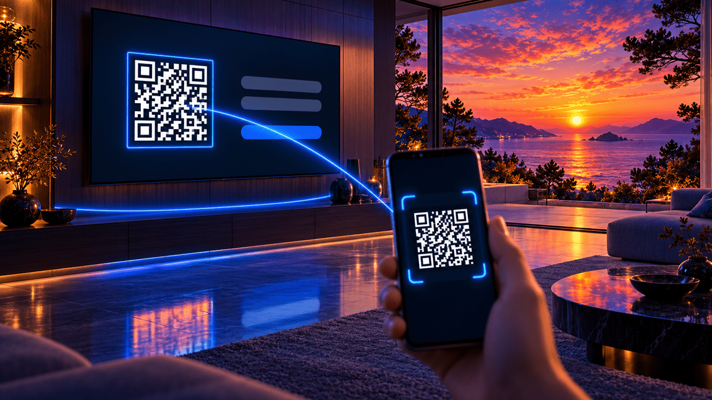

🌐 <b>Gaeilge</b> · Teangacha eile (88)
<a href="../README.md">English</a> · <a href="README.af.md">Afrikaans</a> · <a href="README.ar.md">العربية</a> · <a href="README.az.md">Azərbaycanca</a> · <a href="README.be.md">Беларуская</a> · <a href="README.bg.md">Български</a> · <a href="README.bi.md">Bislama</a> · <a href="README.bn.md">বাংলা</a> · <a href="README.br.md">Brezhoneg</a> · <a href="README.bs.md">Bosanski</a> · <a href="README.ca.md">Català</a> · <a href="README.cs.md">Čeština</a> · <a href="README.cv.md">Чӑвашла</a> · <a href="README.da.md">Dansk</a> · <a href="README.de.md">Deutsch</a> · <a href="README.de_CH.md">Deutsch (Schweiz)</a> · <a href="README.el.md">Ελληνικά</a> · <a href="README.en_GB.md">English (UK)</a> · <a href="README.eo.md">Esperanto</a> · <a href="README.es.md">Español</a> · <a href="README.et.md">Eesti</a> · <a href="README.eu.md">Euskara</a> · <a href="README.fa.md">فارسی</a> · <a href="README.fi.md">Suomi</a> · <a href="README.fil.md">Filipino</a> · <a href="README.fr.md">Français</a> · <a href="README.gl.md">Galego</a> · <a href="README.gsw.md">Alemannisch</a> · <a href="README.gu.md">ગુજરાતી</a> · <a href="README.he.md">עברית</a> · <a href="README.hi.md">हिन्दी</a> · <a href="README.hr.md">Hrvatski</a> · <a href="README.hu.md">Magyar</a> · <a href="README.hy.md">Հայերեն</a> · <a href="README.id.md">Bahasa Indonesia</a> · <a href="README.is.md">Íslenska</a> · <a href="README.it.md">Italiano</a> · <a href="README.ja.md">日本語</a> · <a href="README.ka.md">ქართული</a> · <a href="README.kab.md">Taqbaylit</a> · <a href="README.kk.md">Қазақша</a> · <a href="README.km.md">ខ្មែរ</a> · <a href="README.kmr.md">Kurmancî</a> · <a href="README.kn.md">ಕನ್ನಡ</a> · <a href="README.ko.md">한국어</a> · <a href="README.kxm.md">ภาษาเขมรถิ่นไทย</a> · <a href="README.lb.md">Lëtzebuergesch</a> · <a href="README.lmo.md">Lombard</a> · <a href="README.lt.md">Lietuvių</a> · <a href="README.lv.md">Latviešu</a> · <a href="README.mfa.md">Bahasa Melayu Kelantan</a> · <a href="README.mi.md">Te reo Māori</a> · <a href="README.mk.md">Македонски</a> · <a href="README.ml.md">മലയാളം</a> · <a href="README.mn.md">Монгол</a> · <a href="README.mr.md">मराठी</a> · <a href="README.ms.md">Bahasa Melayu</a> · <a href="README.nb_NO.md">Norsk bokmål</a> · <a href="README.ne.md">नेपाली</a> · <a href="README.nl.md">Nederlands</a> · <a href="README.nn.md">Norsk nynorsk</a> · <a href="README.pa.md">ਪੰਜਾਬੀ</a> · <a href="README.pl.md">Polski</a> · <a href="README.pt.md">Português</a> · <a href="README.pt_BR.md">Português (Brasil)</a> · <a href="README.ro.md">Română</a> · <a href="README.ru.md">Русский</a> · <a href="README.si.md">සිංහල</a> · <a href="README.sk.md">Slovenčina</a> · <a href="README.sl.md">Slovenščina</a> · <a href="README.sq.md">Shqip</a> · <a href="README.sr_Cyrl.md">Српски</a> · <a href="README.sr_Latn.md">Srpski</a> · <a href="README.sv.md">Svenska</a> · <a href="README.sw.md">Kiswahili</a> · <a href="README.swg.md">Schwäbisch</a> · <a href="README.ta.md">தமிழ்</a> · <a href="README.te.md">తెలుగు</a> · <a href="README.th.md">ไทย</a> · <a href="README.tl.md">Tagalog</a> · <a href="README.tr.md">Türkçe</a> · <a href="README.uk.md">Українська</a> · <a href="README.ur.md">اردو</a> · <a href="README.uz.md">Oʻzbekcha</a> · <a href="README.vi.md">Tiếng Việt</a> · <a href="README.yue_Hant.md">粵語</a> · <a href="README.zh_Hans.md">简体中文</a> · <a href="README.zh_Hant.md">繁體中文</a>

  

# Immuch360

**Do mheáin. Gach scáileán. Gach peirspictíocht.**

🌐 <a href="https://immuch360.com/ga/"><b>immuch360.com</b></a>

Grianghraif agus físeáin chothroma, 360° agus 3D ó do ghléas, do NAS, d'fhreastalaí Immich, do cheamaraí agus do dhrón. Gan cuntas de dhíth. Is aip shaor agus foinse oscailte í Immuch360 a léann do ghrianghraif agus d'fhíseáin san áit a bhfuil siad agus a sheinneann gach ceann acu san amharcóir a oireann dó: cothrom, mar sféar a bhféachann tú timpeall ann, i 3D, nó timpeall ort ar fad i gcluasán. Ritheann sí ar fhóin, ar tháibléid, ar theilifíseáin, ar chluasáin Meta Quest agus ar ríomhairí. Taispeánann a suíomh Gréasáin, [immuch360.com](https://immuch360.com/ga/), cad a dhéanann sí ar gach scáileán, i 89 teanga.

**Nua i dtógáil 53 agus i dtógáil deisce 34, leagan 3.4.8.** Ar ríomhairí, tugann [Spatial 2.5D](#see-your-3d-photos-and-videos-in-depth-on-your-computer) doimhneacht do do ghrianghraif 3D ar an scáileán cothrom, grianghraif 360° agus VR180 3D san áireamh, ar Windows, Linux agus macOS, agus do d’fhíseáin 3D ar Windows agus macOS: bogann an t-amharc de réir mar a bhogann tú do cheann, á leanúint ag an gceamara gréasáin nuair a aontaíonn tú, nó leis an luch, agus fanann pictiúir an cheamara gréasáin i gcuimhne an ríomhaire, gan iad a shábháil ná a sheoladh riamh; trialta ar ríomhaire glúine Windows amháin le ceamara gréasáin USB, físeáin 3D ar a chárta grafaice, ní ar Mac ná ar ríomhaire deisce Linux fós. [Súmálann an roth isteach ar ghrianghraf timpeall an phointeora](#zoom-into-a-photo-with-the-wheel) agus bogann tarraingt é. Glacann [Feabhsaigh (IS)](#make-a-photo-sharper-on-your-computer-ai) grianghraif do chomhroinnte, DLNA, Plex, Jellyfin agus Emby agus d’fhreastalaí Immich, feabhsaíonn sé grianghraif 360° agus 3D gan a n-uaim ná a dhá shúil a bhriseadh, agus tairgeann sé Géaraigh ar Mac le sliseanna Apple (níor trialadh ar Mac fós). Ón bhfón, osclaíonn [“Seinn ar…”](#show-your-photos-and-videos-on-the-tv-from-your-phone) mír 360° in amharc 360° an scáileáin, seinneann sé rogha nó albam mar thaispeántas sleamhnán, logálann sé scáileán isteach ar d’fhreastalaí agus seolann sé na grianghraif agus na físeáin atá ar an bhfón amháin; trialta idir aithriseoirí Android, ní ar fhíorfhón ná ar fhíortheilifís fós. I Meta Quest, [traschéimníonn nó sleamhnaíonn](#browse-your-photos-on-the-big-screen-of-the-quest) taispeántas sleamhnán an scáileáin mhóir idir grianghraif, thar chúlra dubh, doiléir nó passthrough a roghnaíonn tú, níor thriail an tionscadal i gcluasán fós é.

**Nua i dtógálacha 33 go 52.** [Leanann scannáin ar aghaidh ón áit ar stop tú](#pick-up-a-film-where-you-stopped). Tosaíonn siad níos luaithe, agus ó fhreastalaí mall [leanann siad ag seinm seachas stopadh](#when-a-video-waits-or-will-not-play). [Zúmálann an amlíne amach go míonna agus blianta](#find-a-month-or-a-year-in-a-long-timeline) ar fhóin agus ar ríomhairí. Ar fhón Android nó ar Meta Quest, osclaíonn [“Brabhsáil fillteán”](#browse-a-folder-of-your-phone-or-headset) fillteán den ghléas cosúil le comhroinnt, agus taispeántar grianghraif TIFF. [Cuardaíonn Android TV de réir dáta leis an gcianrialtán](#on-android-tv-and-google-tv), [osclaíonn Meta Quest 3 nó 3S splatanna Gaussacha](#explore-gaussian-splats-in-a-meta-quest-3-or-3s), á gcasadh leis an maide stiúrtha deas agus leagan 4 de SPZ san áireamh, agus [déanann ríomhaire na leaganacha 3D de ghrianghraif do NAS](#turn-one-photo-into-3d-a-scene-a-panorama). Ar ríomhaire glúine Windows a bhfuil dhá shliseog grafaicí ann, [ritheann an aip anois ar an gceann tapa](#when-a-video-waits-or-will-not-play), agus seinntear scannáin 8K go réidh dá bharr. Osclaítear splatanna Gaussacha anois [ar ríomhairí agus ar fhóin agus ar tháibléid Android](#explore-gaussian-splats-on-your-phone-tablet-or-computer), [déanann ríomhaire Windows radhairc splat ó do ghrianghraif nó ó fhíseán](#make-a-splat-scene-from-your-photos-or-a-video-ai) le IS, [coinníonn d'fhreastalaí Immich iad laistigh de ghrianghraif](#keep-a-splat-scene-on-your-immich-server) a osclaítear ó d'amlíne, agus [seinneann ríomhairí físeáin AV2](#play-av2-videos-on-your-computer). Ó thógáil 42, [seinntear físeáin amha ó cheamaraí Insta360, GoPro MAX agus DJI Osmo 360, ó do leabharlann Immich, ó chomhroinnt nó ó fhillteán, cobhsaithe le gíreascóp an cheamara](#stabilise-your-360-videos-with-the-cameras-gyroscope) ar fhóin, ar tháibléid agus ar theilifíseáin Android, [tairgeann cruthaitheoir splat thógáil deisce 22 cáilíocht Mhionsonraithe](#make-a-splat-scene-from-your-photos-or-a-video-ai) do radhairc a bhféachann tú go grinn orthu, agus [tosaíonn pánoráma 360° le 3.5 GiB saor ar an gcárta grafaice](#turn-one-photo-into-3d-a-scene-a-panorama). Tá aip an iPhone agus iPad [ar an App Store](https://apps.apple.com/us/app/immuch360-360-3d-player/id6817655965), leagan 3.4.3. Ó thógáil 43, osclaíonn fógra nuashonraithe na haipe Google Play nó an App Store ar fhóin agus ar tháibléid; osclaíodh a suíomh Gréasáin, [immuch360.com](https://immuch360.com/ga/), an 7 Samhain. Ó thógáil 44 agus thógáil deisce 24, [taispeánann Meta Quest 3 nó 3S splatanna suas le 300,000 gaussach](#explore-gaussian-splats-in-a-meta-quest-3-or-3s), [roghnaíonn ríomhairí roinnt grianghraf agus físeán le Ctrl agus Shift](#use-your-computer-as-the-media-player), [seinneann teilifís a ndiúltaíonn a díchódóir d'fhíseán an comhad eile ar an bhfreastalaí](#when-a-video-waits-or-will-not-play) uaithi féin, ritheann pánorámaí ar an gcárta grafaice roghnaithe i ríomhaire glúine a bhfuil dhá cheann aige, agus osclaíonn fógra nuashonraithe an Quest agus na ríomhairí a leathanach stóir nó íoslódála, le go leor ceartúchán. Ó thógáil 45 agus thógáil deisce 25, leagan 3.4.0 ar gach ardán, leanann an aip aip Immich 3.4.0 le 11 ceartúchán níos déanaí de chuid Immich, taispeánann sí [grianghraif JPEG XL ó fhreastalaithe Immich 3.4](#keep-your-immich-library-with-more), osclaíonn sí [do scannáin Plex de réir bliana](#watch-your-plex-films) le leathanach do gach scannán, a n-íoslódáil chuig an ngléas agus a seinm ar an teilifís ón bhfón, féadfaidh sí rátáil a iarraidh sna tógálacha stóir, agus, ar ríomhairí, tógann sí a comhpháirteanna físe óna [dtaisclanna oscailte féin](#licences-and-credits). Ó thógáil 46 agus thógáil deisce 26, leagan 3.4.1, [seinntear físeáin amha ceamaraí 360° cobhsaithe](#stabilise-your-360-videos-with-the-cameras-gyroscope) freisin ar iPhone agus iPad, i Meta Quest agus ar Windows, [seinneann Meta Quest le libmpv na scannáin Plex nach féidir lena sheinnteoir féin a dhíchódú](#watch-your-plex-films), [seolann fón scannán den sórt sin chuig Chromecast nó Google TV](#watch-your-plex-films), agus [glacann doimhneacht IS grianghraif 3D an neart a roghnaíonn tú](#turn-one-photo-into-3d-a-scene-a-panorama); is féidir freastalaí nua a chur leis freisin trí shíniú isteach le do chuntas Plex, agus [coinníonn an aip a socruithe i gcomhad](#keep-your-settings-in-a-file). Ó thógáil 47 agus thógáil deisce 27, leagan 3.4.2, [seinneann scannán Plex rian fuaime a dhíchódaíonn an gléas](#watch-your-plex-films) agus deir sé cé acu, osclaíonn sé an leagan a oireann don scáileán agus, ar nasc mall, tairgeann sé leagan níos éadroime, seinneann Windows agus macOS a fhuaim Dolby TrueHD, [taispeánann Android a íoslódáil i bhfógra](#watch-your-plex-films) agus íoslódálann Android TV scannáin freisin, agus [taispeánann ceamaraí ceallraí Tapo beo](#watch-your-home-cameras-on-the-big-screen); nuair a athchóirítear comhad socruithe lena chuntais, síníonn sé isteach anois thú i d'fhreastalaí Immich. Ó thógáil 48 agus thógáil deisce 28, leagan 3.4.3, [seinneann ríomhaire Windows d’fhíseáin i gcluasán PC VR](#watch-your-videos-in-a-pc-vr-headset-from-windows) trí SteamVR, Meta Horizon Link nó timpeallacht rite OpenXR eile (níor thriail an tionscadal i gcluasán fós é), [taispeánann ceamaraí de bhrandaí eile beo](#cameras-of-other-brands-over-onvif-or-rtsp), aimsithe trí ONVIF nó curtha leis trína nasc RTSP (seiceáilte i gcoinne ceamara insamhalta, níor triaileadh fíorcheamara de bhranda eile fós), [seinntear físeáin amha an DJI Osmo 360 II agus an GoPro MAX 2 cobhsaithe](#open-the-raw-files-of-360-cameras), [ní thagann scannáin Plex ró-mhall ar fhóin a thuilleadh](#when-a-video-waits-or-will-not-play), [casann teilifíseáin LG agus Samsung físeán atá ina luí ar a thaobh](#on-a-samsung-tv-tizen) le cnaipe amháin (níor trialadh ar theilifís LG fós; dhiúltaigh teilifís Samsung issue 17 don chasadh), agus ní thaispeántar “Tá nuashonrú freastalaí ar fáil” a thuilleadh d’fhreastalaí atá cothrom le dáta. Ó thógáil 49 agus ó thógáil deisce 29, leagan 3.4.4, [léann an aip do fhreastalaithe Jellyfin agus Emby](#watch-your-jellyfin-and-emby-libraries) í féin (níor trialadh ar ghléas fós), aimsithe ar do líonra agus sínithe isteach le Quick Connect ar theilifís nó i gcluasán, a mbunchomhaid seinnte ionas go bhfanann físeán 360° ina 360°; ar scáileán mór Meta Quest, [coinníonn grianghraif an méid agus an áit a shocraigh tú agus tú á mbrabhsáil, agus seinntear iad mar shleamhnán](#browse-your-photos-on-the-big-screen-of-the-quest) (níor thriail an tionscadal i gcluasán fós é); [faigheann seinnteoir físeáin 360° na bhfón agus na dtáibléad rialuithe na ngrianghraf 360°](#360-videos-on-your-phone-with-the-controls-of-360-photos), cnaipe gíreascóip, fáscadh chun súmáil agus tarraingt díreach suas nó síos (trialta ag úsáideoir ar Samsung Galaxy S25 Ultra, níor trialadh ar iPhone fós); [tiontaíonn ríomhaire d’fhíseáin 2D ina bhfíseáin 3D](#turn-your-2d-videos-into-3d-on-your-computer) le IS (níor trialadh ar scáileán 3D ná i gcluasán fós); agus [tugann teilifíseáin Samsung físeán a dteastaíonn casadh uaidh do sheinnteoir Samsung féin](#on-a-samsung-tv-tizen), a sheinneann teilifís issue 17 ach a ndiúltaíonn sí é a chasadh. Ó thógáil 50 agus ó thógáil deisce 30, leagan 3.4.5, fad a sheinntear físeán i bhfuinneog 2D Meta Quest, [atarraingíonn an fhuinneog ag ráta an scáileáin](#step-inside-your-photos-and-videos-with-a-meta-quest) in ionad thart ar 10 n-uaire sa soicind mar a bhí i dtógálacha 48 agus 49 (tomhaiste ar Meta Quest 3), [súmálann Android TV isteach i ngrianghraf leis an gcianrialtán](#on-android-tv-and-google-tv) agus bogann sé é leis na saighdeáin (nua, níor trialadh ar theilifís fós), agus tagann trí cheartúchán ó fhorc Android TV mlc70: ní thaispeánann svaidhpeáil thapa sonraí an ghrianghraif a fágadh ina dhiaidh a thuilleadh, scaoileann grianghraf beoite a chuimhne, agus tairgeann an scagaire Suíomh cathracha na tíre nua. Ó thógáil 51 agus ó thógáil deisce 31, leagan 3.4.6, déanann [Feabhsaigh (IS)](#make-a-photo-sharper-on-your-computer-ai) cóip níos géire de ghrianghraf bog in aice leis an mbunleagan ar Windows agus Linux, ag trí leibhéal, gach ceann rite uair amháin ar ríomhaire amháin le RTX 4060, tairgtear Nádúrtha freisin ar Mac le sliseanna Apple (gan triail ar Mac fós), [tiontaíonn ríomhaire físeán 360° ina fhíseán 360° 3D](#a-360-video-turned-into-a-360-3d-video) le IS, meastar doimhneacht na bhfíseán 3D ar an gcárta grafaice ar Windows, glacann na gnéithe IS físeáin d’fhreastalaí agus chomhroinnte go díreach, tá [a chárta féin sa Leabharlann](#keep-your-settings-in-a-file) ag an gcomhad socruithe, sábhálann teilifís é ar chomhroinnt líonra, téann Escape céim amháin siar ar ríomhairí, iarrann na tógálacha stóir rátáil [níos annaimhe agus níos séimhe](#privacy), taispeánann Linux grianghraif TIFF, radhairc splat agus físeáin 3D le súil amháin, agus tá dhá thuairt socraithe. Ó thógáil 52 agus thógáil deisce 32, leagan 3.4.7, seolann [“Seinn ar…”](#show-your-photos-and-videos-on-the-tv-from-your-phone) grianghraif agus físeáin do leabharlainne Immich, do chomhroinnte agus Jellyfin agus Emby ón bhfón chuig teilifís, Meta Quest, ríomhaire nó Chromecast, [fanann ainmneacha do ghrianghraf agus d’fhíseán inléite thar a mionsamhlacha](#play-the-files-of-a-nas-a-computer-a-media-server-or-plex), [nuashonraítear le cliceáil amháin](#update-the-ai-components-in-one-click) comhpháirteanna IS ríomhaire, faigheann Linux [AppImage](#linux), agus tógtar aip an iPhone agus an iPad le Xcode 27. Shocraigh tógáil deisce 33 [Feabhsaigh (IS)](#make-a-photo-sharper-on-your-computer-ai), a theip ar gach grianghraf i dtógálacha deisce 31 agus 32 ([issue 23](https://github.com/freeKC/Immuch360/issues/23)).

  Forc neamhoifigiúil den aip mhóbíleach Immich. Gan baint le Immich nó FUTO. Léitear an ainm mar "I am much 360".

<b>Clár ábhair</b>

- [Cé dó í](#who-it-is-for)
- [Cé na scáileáin](#which-screens), [cad a dhéanann siad le chéile](#use-cases) agus [cad a dhéanann gach scáileán](#what-each-screen-does)
- [Cad is féidir leat a dhéanamh](#what-you-can-do)
- [Faigh í ar do ghléas](#get-it-on-your-device)
- [Conas a dhéanamh](#how-to)
  - [Féach ar do ghrianghraif agus d'fhíseáin, le freastalaí nó gan é](#watch-your-photos-and-videos-with-or-without-a-server)
  - [Iniúch pánorámaí, 360°, VR180 agus 3D](#explore-panoramas-360-vr180-and-3d): [físeáin 360° ar fhóin](#360-videos-on-your-phone-with-the-controls-of-360-photos)
  - [Déan 3D, radharc nó pánoráma de ghrianghraf amháin](#turn-one-photo-into-3d-a-scene-a-panorama): [comhpháirteanna IS nuashonraithe le cliceáil amháin](#update-the-ai-components-in-one-click)
  - [Tiontaigh d’fhíseáin 2D go 3D ar do ríomhaire](#turn-your-2d-videos-into-3d-on-your-computer): [físeáin 360° go 360° 3D](#a-360-video-turned-into-a-360-3d-video)
  - [Déan grianghraf níos géire ar do ríomhaire (IS)](#make-a-photo-sharper-on-your-computer-ai)
  - [Féach ar an teilifís leis an gcianrialtán](#watch-on-the-tv-with-the-remote): [Android TV agus Google TV](#on-android-tv-and-google-tv), [LG](#on-an-lg-tv-webos), [Samsung](#on-a-samsung-tv-tizen)
  - [Logáil teilifís, cluasán nó ríomhaire isteach le d'fhón](#sign-in-a-tv-a-headset-or-a-computer-with-your-phone)
  - [Taispeáin do ghrianghraif agus d’fhíseáin ar an teilifís ó d’fhón](#show-your-photos-and-videos-on-the-tv-from-your-phone)
  - [Téigh isteach i do ghrianghraif agus i d'fhíseáin le Meta Quest](#step-inside-your-photos-and-videos-with-a-meta-quest): [an scáileán mór](#browse-your-photos-on-the-big-screen-of-the-quest), [mód ciosca](#kiosk-mode-for-an-exhibition-or-a-shop)
  - [Taiscéal splatanna Gaussacha ar Meta Quest 3 nó 3S](#explore-gaussian-splats-in-a-meta-quest-3-or-3s)
  - [Taiscéal splatanna Gaussacha ar d'fhón, ar do tháibléad nó ar do ríomhaire](#explore-gaussian-splats-on-your-phone-tablet-or-computer)
  - [Déan radharc splat ó do ghrianghraif nó ó fhíseán (IS)](#make-a-splat-scene-from-your-photos-or-a-video-ai)
  - [Coinnigh radharc splat ar d'fhreastalaí Immich](#keep-a-splat-scene-on-your-immich-server)
  - [Seinn comhaid NAS, ríomhaire, freastalaí meán nó Plex](#play-the-files-of-a-nas-a-computer-a-media-server-or-plex): [do scannáin de réir bliana](#watch-your-plex-films), [Jellyfin agus Emby](#watch-your-jellyfin-and-emby-libraries)
  - [Brabhsáil fillteán de d'fhón nó de do chluasán](#browse-a-folder-of-your-phone-or-headset)
  - [Lean ar aghaidh le scannán ón áit ar stop tú](#pick-up-a-film-where-you-stopped)
  - [Nuair a fhanann físeán nó nach seinneann sé](#when-a-video-waits-or-will-not-play)
  - [Coinnigh do leabharlann Immich, agus tuilleadh](#keep-your-immich-library-with-more)
  - [Aimsigh mí nó bliain in amlíne fhada](#find-a-month-or-a-year-in-a-long-timeline)
  - [Féach ar cheamaraí do thí ar an scáileán mór](#watch-your-home-cameras-on-the-big-screen): [brandaí eile](#cameras-of-other-brands-over-onvif-or-rtsp)
  - [Do dhrón DJI](#your-dji-drone): [físeán beo](#see-what-your-drone-sees-on-your-phone), [i Quest nó ar Android TV](#watch-it-in-a-meta-quest-or-on-an-android-tv), [iompórtáil](#bring-a-drones-or-a-camera-cards-photos-and-videos-to-immich)
  - [Oscail comhaid amha ceamaraí 360°](#open-the-raw-files-of-360-cameras)
  - [Cobhsaigh d'fhíseáin 360° le gíreascóp an cheamara](#stabilise-your-360-videos-with-the-cameras-gyroscope)
  - [Cas grianghraf le heochair amháin](#turn-a-photo-with-one-key)
  - [Úsáid do ríomhaire mar sheinnteoir meán](#use-your-computer-as-the-media-player): [súmáil leis an roth](#zoom-into-a-photo-with-the-wheel)
  - [Féach ar do ghrianghraif agus d’fhíseáin 3D le doimhneacht ar do ríomhaire](#see-your-3d-photos-and-videos-in-depth-on-your-computer)
  - [Féach ar d’fhíseáin i gcluasán PC VR, ó Windows](#watch-your-videos-in-a-pc-vr-headset-from-windows)
  - [Seinn físeáin AV2 ar do ríomhaire](#play-av2-videos-on-your-computer)
  - [Coinnigh do shocruithe i gcomhad](#keep-your-settings-in-a-file)
- [I gcomparáid le Immich](#compared-with-immich)
- [Príobháideacht](#privacy)
- [Ceadúnais agus creidiúintí](#licences-and-credits)
- [Treochlár](#roadmap)
- [Doiciméadú](#documentation)

## Cé dó í

- **Glacann tú grianghraif 360° nó 3D** agus ba mhaith leat féachaint timpeall iontu, seachas iad a fheiceáil cothrom, dúbailte nó sínte, agus do chuid físeán 360° a chasadh ar an bhfón mar a chasann tú a ghrianghraif: [360°, VR180 agus 3D](#explore-panoramas-360-vr180-and-3d), [físeáin 360° ar fhóin](#360-videos-on-your-phone-with-the-controls-of-360-photos).
- **Scannánaíonn tú le ceamara 360° i do lámh, ar rothar nó ar chlogad** agus ba mhaith leat go seinnfeadh físeáin amha do cheamara Insta360, GoPro MAX nó MAX 2, DJI Osmo 360 nó Osmo 360 II, coinnithe in Immich, ar chomhroinnt nó i bhfillteán, cothrom agus socair ar d'fhón, ar do theilifís, ar do Meta Quest nó ar do ríomhaire Windows: [cobhsaithe le gíreascóp an cheamara](#stabilise-your-360-videos-with-the-cameras-gyroscope).
- **Tá do ghrianghraif agus do scannáin ar NAS, ar ríomhaire, ar Plex nó ar Immich** agus ba mhaith leat iad ar an teilifís gan rud ar bith a chóipeáil: [ar an teilifís](#watch-on-the-tv-with-the-remote), [NAS, comhroinnt agus Plex](#play-the-files-of-a-nas-a-computer-a-media-server-or-plex).
- **Coinníonn tú do scannáin ar fhreastalaí Plex** agus ba mhaith leat ceann a roghnú de réir bliana, a fheiceáil cad é sula dtosaíonn sé, é a thabhairt leat ar thuras, é a thosú ar an teilifís nó ar Chromecast ó d'fhón, agus fiú na scannáin nach féidir le d'fhón Android, do theilifís nó do Meta Quest a dhíchódú a sheinm: [do scannáin, de réir bliana](#watch-your-plex-films).
- **Coinníonn tú do scannáin ar fhreastalaí Jellyfin nó Emby** agus ba mhaith leat iad i do Meta Quest, ar an teilifís nó ar an bhfón, 360° agus 3D coinnithe mar atá siad, agus d’áit coinnithe ar an bhfreastalaí (níor trialadh ar ghléas fós): [Jellyfin agus Emby](#watch-your-jellyfin-and-emby-libraries).
- **Tá Meta Quest agat** agus ba mhaith leat dul isteach i do ghrianghraif agus i d'fhíseáin féin: [sa chluasán](#step-inside-your-photos-and-videos-with-a-meta-quest), agus do ghrianghraif a bhrabhsáil ar scáileán mór ag an méid agus san áit a shocraíonn tú, mar shleamhnán freisin (níor thriail an tionscadal i gcluasán fós é): [an scáileán mór](#browse-your-photos-on-the-big-screen-of-the-quest).
- **Tá cluasán PC VR agat ar ríomhaire Windows** agus ba mhaith leat d’fhíseáin 360° timpeall ort agus do scannáin ar scáileán mór ann (níor thriail an tionscadal i gcluasán fós é): [i gcluasán PC VR](#watch-your-videos-in-a-pc-vr-headset-from-windows).
- **Tá do ghrianghraif cothrom** agus ba mhaith leat iad i 3D, mar radharc le claonadh isteach ann i gcluasán, nó laistigh de phánoráma 360°, gan ceamara 3D: [déan 3D, radharc nó pánoráma de ghrianghraf amháin](#turn-one-photo-into-3d-a-scene-a-panorama), nua, déanta ag IS ar do ríomhaire féin.
- **Tá d’fhíseáin cothrom**, gearrthóga d’fhóin san áireamh, agus ba mhaith leat iad i 3D do chluasán nó do scáileán 3D, agus d’fhíseáin 360° i 360° 3D, déanta ar do ríomhaire féin (níor trialadh ar scáileán 3D ná i gcluasán fós): [físeáin 2D go 3D](#turn-your-2d-videos-into-3d-on-your-computer), [360° go 360° 3D](#a-360-video-turned-into-a-360-3d-video).
- **Tá do ghrianghraif bog**, beagán as fócas nó tógtha i ndrochsholas, agus ba mhaith leat cóip níos géire in aice leis an mbunleagan, déanta ar do ríomhaire féin, ó do chomhroinnte agus d’fhreastalaithe freisin, agus na mionsonraí cumtha ráite go soiléir: [Feabhsaigh (IS)](#make-a-photo-sharper-on-your-computer-ai).
- **Tá grianghraif 3D, grianghraif 360° 3D nó físeáin 3D agat agus ríomhaire** agus ba mhaith leat iad le doimhneacht ar a scáileán cothrom, an t-amharc ag bogadh de réir mar a bhogann tú do cheann, á leanúint ag an gceamara gréasáin, nó leis an luch (trialta ar ríomhaire glúine Windows amháin le ceamara gréasáin, ní ar Mac ná ar ríomhaire deisce Linux fós): [Spatial 2.5D ar do ríomhaire](#see-your-3d-photos-and-videos-in-depth-on-your-computer).
- **Úsáideann tú Immich** agus ba mhaith leat a aip, móide na hamharcóirí tumthacha agus na scáileáin mhóra a logálann tú isteach ó d'fhón: [do leabharlann Immich](#keep-your-immich-library-with-more), [i gcomparáid le Immich](#compared-with-immich).
- **Faireann tú ar do theach le ceamaraí Tapo**, ceamaraí ceallraí freisin, nó ceamaraí de bhrandaí eile trí ONVIF nó RTSP, agus ba mhaith leat iad in aice le do ghrianghraif, ar an teilifís freisin (seiceáilte in aghaidh ceamara insamhlaithe): [ceamaraí baile](#watch-your-home-cameras-on-the-big-screen).
- **Eitlíonn tú drón DJI** agus ba mhaith leat a phictiúr beo ar d'fhón gan DJI Fly, agus i Meta Quest nó ar Android TV do na daoine atá leat: [do dhrón](#see-what-your-drone-sees-on-your-phone).
- **Gabhann tú áiteanna agus rudaí i 3D, mar splatanna Gaussacha,** nó ba mhaith leat iad a dhéanamh ó do ghrianghraif féin, agus ba mhaith leat siúl tríothu ar d'fhón, ar do ríomhaire nó i gcluasán: [ar fhón, ar tháibléad nó ar ríomhaire](#explore-gaussian-splats-on-your-phone-tablet-or-computer), [déanta ó do ghrianghraif](#make-a-splat-scene-from-your-photos-or-a-video-ai), [coinnithe in Immich](#keep-a-splat-scene-on-your-immich-server).
- **Tá físeáin AV2 agat**, an fhormáid a thagann i ndiaidh AV1, agus ba mhaith leat féachaint orthu ar do ríomhaire: [AV2 ar do ríomhaire](#play-av2-videos-on-your-computer).
- **Tá roinnt scáileán agat sa bhaile** agus ba mhaith leat go n-oibreoidís le chéile: [cad a dhéanann do scáileáin le chéile](#use-cases).

Níl cuntas Immuch360 le cruthú, agus ní thagann rud ar bith chugainne: ní labhraíonn an aip ach le do ghléasanna agus leis na freastalaithe a roghnaíonn tú, ó thógáil 45 le Wikipedia do leathanach scannáin, ó thógáil 46 le plex.tv nuair a shíníonn tú isteach leis, agus ní íoslódálann sí comhpháirt IS ná an díchódóir AV2 ach nuair a iarrann tú é.

## Cé na scáileáin

| Ardán | Cá bhfaighidh tú í | Stádas i Samhain 2026 |
|---|---|---|
|  **Android** fóin agus táibléid | [Google Play](https://play.google.com/store/apps/details?id=com.aprogsys.immuch360) · [APK](https://github.com/freeKC/Immuch360/releases) | ar Google Play (tógáil 47 foilsithe an 16 Samhain; tógáil 51 faoi athbhreithniú Google ón 24 Samhain; tógáil 53 ina dhiaidh), tógáil 53 ar GitHub, ina [seinntear físeáin amha 360° cobhsaithe](#stabilise-your-360-videos-with-the-cameras-gyroscope), ina [leanann scannáin ar aghaidh ón áit ar stop tú](#pick-up-a-film-where-you-stopped), ina n-osclaíonn [“Brabhsáil fillteán”](#browse-a-folder-of-your-phone-or-headset) fillteán den fhón agus ina n-osclaítear [splatanna Gaussacha](#explore-gaussian-splats-on-your-phone-tablet-or-computer), ó chomhroinnt nó [ó d'amlíne Immich](#keep-a-splat-scene-on-your-immich-server), ina [gcoinnítear na socruithe i gcomhad](#keep-your-settings-in-a-file), ina [dtaispeántar íoslódáil scannáin i bhfógra](#watch-your-plex-films), ó thógáil 48 [ceamaraí de bhrandaí eile, beo](#cameras-of-other-brands-over-onvif-or-rtsp) (seiceáilte i gcoinne ceamara insamhalta) agus, ó thógáil 49, [freastalaithe Jellyfin agus Emby](#watch-your-jellyfin-and-emby-libraries) (níor trialadh ar ghléas fós) agus [rialuithe na ngrianghraf 360° i seinnteoir físeáin 360°](#360-videos-on-your-phone-with-the-controls-of-360-photos) (trialta ag úsáideoir ar Samsung Galaxy S25 Ultra), agus ó thógáil 51 [cárta an chomhaid socruithe sa Leabharlann](#keep-your-settings-in-a-file), a chomhad sábháilte ar chomhroinnt líonra freisin, agus ó thógáil 52 [do ghrianghraif agus d’fhíseáin seolta chuig teilifís nó Chromecast](#show-your-photos-and-videos-on-the-tv-from-your-phone) le “Seinn ar…” (níor trialadh ar ghléas fós), agus ó thógáil 53 [míreanna 360°, rogha nó albam agus grianghraif agus físeáin an fhóin féin](#show-your-photos-and-videos-on-the-tv-from-your-phone) seolta ar an mbealach céanna (trialta idir aithriseoirí Android) |
|  **iPhone agus iPad** | [App Store](https://apps.apple.com/us/app/immuch360-360-3d-player/id6817655965) | leagan 3.4.7 ar an App Store ón 26 Samhain, le [míonna agus blianta san amlíne](#find-a-month-or-a-year-in-a-long-timeline), [scannáin a leanann ar aghaidh ón áit ar stop tú](#pick-up-a-film-where-you-stopped), [logáil isteach teilifíse, cluasáin nó ríomhaire](#sign-in-a-tv-a-headset-or-a-computer-with-your-phone) ón bhfón, na radhairc splat a choinnítear in Immich taispeánta mar a ngrianghraf, ceartúcháin Immich 3.4.0 agus a ghrianghraif JPEG XL, [físeáin amha 360° cobhsaithe](#stabilise-your-360-videos-with-the-cameras-gyroscope), [na socruithe coinnithe i gcomhad](#keep-your-settings-in-a-file), [amharc beo ceamaraí ceallraí Tapo](#watch-your-home-cameras-on-the-big-screen) agus [amharc beo ceamaraí de bhrandaí eile](#cameras-of-other-brands-over-onvif-or-rtsp) (seiceáilte i gcoinne ceamara insamhalta), agus ó leagan 3.4.4 [freastalaithe Jellyfin agus Emby](#watch-your-jellyfin-and-emby-libraries) (níor trialadh ar ghléas fós) agus [rialuithe na ngrianghraf 360° i seinnteoir físeáin 360°](#360-videos-on-your-phone-with-the-controls-of-360-photos) (níor trialadh ar iPhone fós), agus ó leagan 3.4.6 [cárta an chomhaid socruithe](#keep-your-settings-in-a-file) agus a athchóiriú ó chomhroinnt líonra, agus ó leagan 3.4.7, tógtha le Xcode 27, [“Seinn ar…” do ghrianghraif agus d’fhíseáin](#show-your-photos-and-videos-on-the-tv-from-your-phone) (níor trialadh ar iPhone fós); leagan 3.4.8, leagan iPhone agus iPad de thógáil 53, ina dhiaidh; nó [tóg féin é](../docs/immuch360/build.md) |
|  **Android TV agus Google TV** | [Google Play](https://play.google.com/store/apps/details?id=com.aprogsys.immuch360) · [APK](#android-tv-and-google-tv) | ar Google Play, a thugann an aip ar Android TV agus Google TV, agus tógáil 53 ar GitHub: [físeáin amha 360° cobhsaithe](#stabilise-your-360-videos-with-the-cameras-gyroscope), [cuardach de réir dáta leis an gcianrialtán](#on-android-tv-and-google-tv), [logáil isteach le d'fhón](#sign-in-a-tv-a-headset-or-a-computer-with-your-phone) trí chód QR a scanadh, barra ama, fuaim agus fotheidil don chianrialtán sa seinnteoir físeáin, agus [físeán beo dróin](#watch-it-in-a-meta-quest-or-on-an-android-tv) athsheolta ag fón, [scannáin íoslódáilte chuig an teilifís](#watch-your-plex-films) agus, ó thógáil 49, [freastalaithe Jellyfin agus Emby](#watch-your-jellyfin-and-emby-libraries) sínithe isteach le Quick Connect (níor trialadh ar ghléas fós) agus, ó thógáil 50, [grianghraif súmáilte leis an gcianrialtán](#on-android-tv-and-google-tv) (feicthe ag obair ar aithriseoir Android TV, níor trialadh ar theilifís fós), agus ó thógáil 51 [an comhad socruithe sábháilte agus athchóirithe ar chomhroinnt líonra](#keep-your-settings-in-a-file) (feicthe ag obair ar aithriseoir Android TV), agus ó thógáil 52 [na grianghraif agus na físeáin a sheolann fón le “Seinn ar…”](#show-your-photos-and-videos-on-the-tv-from-your-phone) (níor trialadh ar theilifís fós), agus ó thógáil 53 na grianghraif 360° a sheolann fón oscailte ina n-amharc 360°, logáil isteach ó bhileog an fhóin agus grianghraif agus físeáin an fhóin féin (feicthe ag obair ar aithriseoir Android TV) |
| **Teilifíseáin LG** le webOS 5.0 agus níos nuaí | [.ipk, leagan 1.0.5](https://github.com/freeKC/Immuch360/releases/tag/webos-v1.0.5) · LG Content Store (faoi athbhreithniú) | leagan 1.0.0, curtha faoi bhráid an LG Content Store an 24 Deireadh Fómhair, faoi thástálacha LG ón 26 Deireadh Fómhair; leagan 1.0.1, ar GitHub ón 27 Deireadh Fómhair, zúmálann sé grianghraf ó na saighdeáin agus deir sé nuair atá grianghraf fós á luchtú, agus scríobhann leagan 1.0.2, ar GitHub le tógáil 46, “sínigh isteach” mar ログイン sa tSeapáinis, deir leagan 1.0.3, le tógáil 47, nuair atá cainéil teilifíse beo i bhfillteán d'fhreastalaí DLNA, rud nach féidir léi a sheinm fós, agus [casann leagan 1.0.4, le tógáil 48, físeán atá ina luí ar a thaobh](#on-an-lg-tv-webos) le cnaipe amháin (níor trialadh ar theilifís LG fós), agus ainmníonn leagan 1.0.5, le tógáil 49, Jellyfin lena bhreiseán DLNA i measc na bhfreastalaithe DLNA; go dtí go bhfoilsíonn LG an aip, suiteálann sí i [Developer Mode](#lg-tvs-webos). Ritheadh leagan 1.0.0 ar theilifíseáin webOS 25 de Cloud Test Lab LG |
| **Teilifíseáin Samsung** le Tizen 5.5 agus níos nuaí | [.wgt, leagan 0.3.6](https://github.com/freeKC/Immuch360/releases/tag/tizen-v0.3.6) | leagan 0.3.6 den aip teilifíse chéanna, le síniú le do theastas Samsung féin agus le suiteáil i [Developer mode](#samsung-tvs-tizen); ritheadh 0.1.0 ar theilifís Samsung tástálaí, tá na ceartúcháin ón triail sin in 0.2.0, cuireann 0.3.0 an zúmáil grianghraif agus an lipéad Ag luchtú ó leagan LG 1.0.1 leis, agus 0.3.1 foclaíocht Seapáinise leagan LG 1.0.2, seinneann 0.3.2 físeán a scannánaíodh ina sheasamh ar fhón an bealach ceart suas ([issue 17](https://github.com/freeKC/Immuch360/issues/17)), agus [casann 0.3.3 agus 0.3.4 é ar theilifís a thuairiscíonn ina sheasamh é](#on-a-samsung-tv-tizen) agus cuireann siad cnaipe leis a chasann de láimh é, agus tugann 0.3.5 agus 0.3.6 a leithéid d’fhíseán do sheinnteoir Samsung féin; ar theilifís an tuairisceora, d’fhág 0.3.4 agus 0.3.5 an pictiúr ar a thaobh, an teilifís ag diúltú don chasadh, agus is é an bealach amach ansin físeán a thraschódaíonn d’fhreastalaí Immich, stóráilte ina sheasamh; níl sí i siopa Samsung |
|  **Meta Quest** 2, Pro, 3 agus 3S | [Horizon Store](https://www.meta.com/experiences/immuch360/1384208401440714/) · [APK](#meta-quest) | ar an Horizon Store (tógáil 52, foilsithe an 26 Samhain, tar éis tógáil 50, a atarraingíonn a fhuinneog 2D ag ráta an scáileáin fad a sheinneann físeán; tógáil 53 ina dhiaidh), tógáil 53 ar GitHub, le [mód ciosca](#kiosk-mode-for-an-exhibition-or-a-shop), [físeáin amha 360° cobhsaithe](#stabilise-your-360-videos-with-the-cameras-gyroscope) san amharc tumthach, [na scannáin nach féidir leis a dhíchódú seinnte ag libmpv](#watch-your-plex-films) agus, ar Quest 3 agus 3S, [splatanna Gaussacha](#explore-gaussian-splats-in-a-meta-quest-3-or-3s) agus [doimhneacht IS](#turn-one-photo-into-3d-a-scene-a-panorama) do ghrianghraf cothrom, agus ó thógáil 49 [grianghraif brabhsáilte ar an scáileán mór](#browse-your-photos-on-the-big-screen-of-the-quest) ag an méid a shocraíonn tú, mar shleamhnán freisin (níor thriail an tionscadal i gcluasán fós é), agus [freastalaithe Jellyfin agus Emby](#watch-your-jellyfin-and-emby-libraries) sínithe isteach le Quick Connect (níor trialadh ar ghléas fós), agus ó thógáil 51 iarrann cluasán a bhfuil a Horizon OS rósheanda don amharcóir tumthach nuashonrú in ionad an aip a dhúnadh (níor trialadh ar chluasán den sórt sin), agus ó thógáil 53 [traschéimniú nó sleamhnú idir grianghraif an scáileáin mhóir, thar chúlra dubh, doiléir nó passthrough](#browse-your-photos-on-the-big-screen-of-the-quest) (níor thriail an tionscadal i gcluasán fós é) |
|  **Windows** | [Suiteálaí nó ZIP](https://github.com/freeKC/Immuch360/releases/tag/desktop-v3.4.8-34) | tógáil deisce 34, sínithe: grianghraif, físeáin chothroma agus 360°, comhroinnt, Plex, ceamaraí (seiceáilte i gcoinne ceamara insamhalta), logáil isteach le d'fhón, grianghraif casta le heochair amháin, an comhéadan i 89 teanga, agus [grianghraif 3D, radhairc 3D agus pánorámaí 360° déanta as do ghrianghraif](#turn-one-photo-into-3d-a-scene-a-panorama) ag IS, as grianghraif do NAS freisin; [splatanna Gaussacha](#explore-gaussian-splats-on-your-phone-tablet-or-computer) oscailte, [déanta ó do ghrianghraif nó ó fhíseán](#make-a-splat-scene-from-your-photos-or-a-video-ai) agus [coinnithe in Immich](#keep-a-splat-scene-on-your-immich-server), [físeáin AV2](#play-av2-videos-on-your-computer), ó thógáil deisce 22 [rogha Cáilíochta do na radhairc splat](#make-a-splat-scene-from-your-photos-or-a-video-ai) agus [pánorámaí 360° ó 3.5 GiB de chuimhne grafaice shaor](#turn-one-photo-into-3d-a-scene-a-panorama), agus ó thógáil deisce 26 [físeáin amha 360° cobhsaithe](#stabilise-your-360-videos-with-the-cameras-gyroscope) agus [grianghraif 3D le neart doimhneachta agus imill níos géire](#turn-one-photo-into-3d-a-scene-a-panorama), ó thógáil deisce 27 [fuaim Dolby TrueHD agus fotheidil Blu-ray na scannán](#watch-your-plex-films), ó thógáil deisce 28 [d’fhíseáin i gcluasán PC VR](#watch-your-videos-in-a-pc-vr-headset-from-windows) (níor thriail an tionscadal i gcluasán fós é), agus ó thógáil deisce 29 [físeáin 3D déanta as d’fhíseáin 2D](#turn-your-2d-videos-into-3d-on-your-computer) le IS (níor trialadh ar scáileán 3D ná i gcluasán fós), agus ó thógáil deisce 31 [cóipeanna níos géire de do ghrianghraif](#make-a-photo-sharper-on-your-computer-ai) le IS agus [físeáin 360° tiontaithe ina bhfíseáin 360° 3D](#a-360-video-turned-into-a-360-3d-video) le IS, an doimhneacht measta ar an gcárta grafaice, físeáin d’fhreastalaí agus chomhroinnte glactha go díreach, Escape chun céim a dhul siar, ó thógáil deisce 32 [na comhpháirteanna IS nuashonraithe le cliceáil amháin](#update-the-ai-components-in-one-click), ó thógáil deisce 33 [Feabhsaigh (IS)](#make-a-photo-sharper-on-your-computer-ai) ag obair arís, agus ó thógáil deisce 34 [súmáil grianghraf leis an roth](#zoom-into-a-photo-with-the-wheel), [Spatial 2.5D do ghrianghraif agus físeáin 3D](#see-your-3d-photos-and-videos-in-depth-on-your-computer), leis an gceamara gréasáin nó leis an luch (níor thriail an tionscadal le ceamara gréasáin fós é), agus Feabhsaigh (IS) ar ghrianghraif chomhroinnte agus fhreastalaithe, grianghraif 360° agus 3D freisin |
|   **macOS agus Linux** | [.deb, .rpm, AppImage, DMG](https://github.com/freeKC/Immuch360/releases/tag/desktop-v3.4.8-34) | tógáil deisce 34: grianghraif, grianghraif 360° agus físeáin chothroma (seinntear físeáin 360° cothrom), freastalaí Immich agus comhroinnt líonra, agus [grianghraif 3D agus radhairc 3D](#turn-one-photo-into-3d-a-scene-a-panorama) déanta ag IS as do ghrianghraif, le pánorámaí 360° ar Linux ar chárta grafaice 8 GB, ó 3.5 GiB saor air, agus [splatanna Gaussacha](#explore-gaussian-splats-on-your-phone-tablet-or-computer) agus [físeáin AV2](#play-av2-videos-on-your-computer) (níor trialadh ar Mac fós); trialadh tógáil deisce 11 an 26 Deireadh Fómhair i gcoimeádán Ubuntu 24.04 agus ar Mac; ó thógáil deisce 27, fuaim Dolby TrueHD na scannán ar macOS; ó thógáil deisce 29, [físeáin 3D déanta as d’fhíseáin 2D](#turn-your-2d-videos-into-3d-on-your-computer) le IS ar Linux agus ar Mac le sliseanna Apple (níor trialadh ar scáileán 3D ná i gcluasán fós); ó thógáil deisce 31, ar Linux, [cóipeanna níos géire de do ghrianghraif](#make-a-photo-sharper-on-your-computer-ai) le IS, grianghraif TIFF, fillteáin a thaispeánann a gcomhaid nua uathu féin, radhairc splat déanta as do ghrianghraif ar chárta grafaice 4 GB agus físeáin 3D taispeánta cothrom le súil amháin, agus ar Mac le sliseanna Apple leibhéal Nádúrtha Feabhsaigh (IS) (níor trialadh ar Mac fós); ó thógáil deisce 32, [AppImage](#linux) do na dáileacháin Linux eile, seiceáilte ag an CI ar Arch Linux agus openSUSE; ó thógáil deisce 34, súmáil leis an roth, [Spatial 2.5D](#see-your-3d-photos-and-videos-in-depth-on-your-computer) do ghrianghraif 3D ar Linux agus macOS agus d’fhíseáin 3D ar macOS (níor trialadh ar Mac ná le ceamara gréasáin fós), agus ar Mac le sliseanna Apple leibhéal Géaraigh Feabhsaigh (IS) (níor trialadh ar Mac fós); gan síniú ar macOS |

*Nuashonraítear na stádais ag gach leagan; tá cad atá ag gach stór, cad atá faoina athbhreithniú agus gach tógáil i [Stádas an leagain](../docs/immuch360/release-status.md). Taispeánann an suíomh Gréasáin [immuch360.com](https://immuch360.com/ga/) cad a dhéanann gach scáileán, treoir do gach feidhm agus naisc na stóras, i 89 teanga.*

  

### Cad a dhéanann do scáileáin le chéile

Suiteáil Immuch360 ar gach scáileán a bhféachann tú air: léann gach ceann acu d'fhoinsí é féin, agus tugann cuid acu pictiúr, comhad nó logáil isteach do cheann eile. I ngach pictiúr, marcálann deilbhín Immuch360 na gléasanna a ritheann an aip.

#### Do NAS ar gach scáileán

  

**Teastaíonn uait:** NAS le comhroinnt SMB nó WebDAV, agus Immuch360 ar gach scáileán a bhféachann tú air.

Cuir an chomhroinnt leis ar gach scáileán, agus seinneann gach ceann acu na grianghraif agus na físeáin san áit a bhfuil siad, gan aon rud a chóipeáil: fóin, táibléid, Android TV, Meta Quest, ríomhairí Windows, Linux agus macOS, agus teilifíseáin LG atá logáilte isteach ar do fhreastalaí Immich (SMB ó webOS 22). Casann grianghraf 360° mar sféar ar an bhfón agus ar an teilifís, agus timpeallaíonn sé thú sa chluasán. Conas a dhéanamh: [Seinn comhaid NAS, ríomhaire, freastalaí meán nó Plex](#play-the-files-of-a-nas-a-computer-a-media-server-or-plex).

#### Do fhreastalaí Immich ar gach scáileán, logáilte isteach ó d'fhón

  

**Teastaíonn uait:** freastalaí Immich, Immuch360 ar d'fhón Android, agus Immuch360 ar na scáileáin a logálann tú isteach: Android TV, Meta Quest, ríomhaire Windows, Linux nó macOS.

Ar an bhfón, coinníonn Immuch360 aip mhóibíleach Immich ina hiomláine, cuireann sé a amharcóirí 360°, VR180 agus 3D léi, agus suiteáiltear é taobh leis an aip oifigiúil. Agus é logáilte isteach ar do fhreastalaí, logálann sé na scáileáin mhóra isteach: scanann sé cód QR na teilifíse nó an ríomhaire, nó clóscríobhann tú air an cód a thaispeánann an cluasán, agus fanann do phasfhocal ar an bhfón. Conas a dhéanamh: [Logáil teilifís, cluasán nó ríomhaire isteach le d'fhón](#sign-in-a-tv-a-headset-or-a-computer-with-your-phone).

#### Do ghrianghraif chothroma i 3D, ó do ríomhaire go dtí an cluasán

  

**Teastaíonn uait:** Immuch360 ar ríomhaire Windows, Linux nó macOS agus i Meta Quest, le do NAS eatarthu, nó do fhreastalaí Immich le “Déan cúltaca de leaganacha IS freisin” casta air.

Déanann an ríomhaire féin grianghraif 3D agus radhairc 3D de do ghrianghraif, agus pánorámaí 360° le cárta grafaice 8 GB ar Windows nó Linux, agus sábhálann sé iad in aice leis na bunchóipeanna. Taispeánann an cluasán grianghraf 3D i bhfíor-3D, cuireann sé radharc i do sheomra agus pánoráma timpeall ort; osclaíonn fóin agus teilifíseáin na pánorámaí ina n-amharcóir 360°. Conas a dhéanamh: [Déan 3D, radharc nó pánoráma de ghrianghraf amháin](#turn-one-photo-into-3d-a-scene-a-panorama).

#### Amharc beo do dhróin i gcluasán nó ar an teilifís

  

**Teastaíonn uait:** drón DJI agus a rialtóir DJI RC-N3, Immuch360 ar an bhfón Android atá plugáilte isteach sa rialtóir, agus Immuch360 i Meta Quest nó ar Android TV.

Taispeánann an fón físeán beo an dróin agus seachadann sé é, thar do Wi-Fi nó thar a bhall te féin, ionas go bhféachann na daoine atá leat ar an eitilt sa chluasán nó ar an teilifís. Glacadh amháin: ní sheoltar ordú ar bith riamh chuig an rialtóir ná chuig an drón, agus coinníonn an rialtóir smacht iomlán. Conas a dhéanamh: [Féach air i Meta Quest nó ar Android TV](#watch-it-in-a-meta-quest-or-on-an-android-tv).

#### Comhaid amha do cheamara 360°, fuaite le chéile san áit a bhféachann tú orthu

  

**Teastaíonn uait:** ceamara Insta360, GoPro MAX nó MAX 2, DJI Osmo 360 nó Osmo 360 II, do NAS, agus Immuch360 ar na scáileáin: fóin, táibléid, Android TV, Meta Quest, Windows.

Cóipeáil na comhaid .insp, .insv, .360 nó .osv ó chárta an cheamara chuig comhroinnt SMB nó WebDAV ar do NAS, mar atá siad; glacann freastalaí Immich le comhaid Insta360 freisin. Fuaigheann gach scáileán le chéile iad agus iad á seinm, leis an gcalabrú atá scríofa i ngach comhad, agus ní easpórtáiltear aon rud in aip an cheamara ar dtús. Conas a dhéanamh: [Oscail comhaid amha ceamaraí 360°](#open-the-raw-files-of-360-cameras).

#### Do fhreastalaithe Plex agus DLNA ar an teilifís agus sa chluasán

  

**Teastaíonn uait:** Plex Media Server, freastalaí Jellyfin nó Emby, nó freastalaí DLNA ar nós minidlna, agus Immuch360 ar gach scáileán: Android TV, Meta Quest, fóin, táibléid, Windows.

Tugann Plex bunchomhaid do leabharlann, mar sin fanann físeán 360° ina 360°, timpeall ort sa chluasán, sa bhaile agus, trí do chur ar aghaidh poirt, as baile; aimsítear freastalaithe DLNA ar do líonra baile. Seinneann teilifíseáin LG atá logáilte isteach ar do fhreastalaí Immich iad freisin. Ó thógáil 45, osclaíonn fóin, táibléid, Android TV, an Quest agus ríomhairí leabharlann scannán Plex ar gach scannán de réir bliana, gach scannán lena leathanach féin, agus seinntear scannán a roghnaítear ar an bhfón ar Android TV, ar an Quest nó ar ríomhaire, faoi stiúir an chianrialtáin. Ó thógáil 46, seinneann an Quest le libmpv na scannáin nach féidir lena sheinnteoir féin a dhíchódú, tiontaíonn d'fhreastalaí Plex na cinn nach ndíchódaíonn aon seinnteoir de ghléas Android, agus seolann fón scannán chuig Chromecast nó Google TV. Ó thógáil 47, seinneann scannán rian fuaime a dhíchódaíonn an gléas agus deir sé cé acu, osclaíonn sé an leagan a oireann don scáileán agus seinneann sé a fhuaim Dolby TrueHD ar Windows agus macOS, agus deir fillteán cainéal teilifíse beo d'fhreastalaí DLNA nach féidir iad a sheinm fós. Ó thógáil 49, tá a chineál féin ag freastalaí Jellyfin nó Emby freisin, aimsithe leis féin, sínithe isteach le Quick Connect ar theilifís nó sa chluasán, a bhunchomhaid seinnte ionas go bhfanann 360° ina 360° agus d’áit coinnithe ar an bhfreastalaí (níor trialadh ar ghléas fós). Conas a dhéanamh: [Seinn comhaid NAS, ríomhaire, freastalaí meán nó Plex](#play-the-files-of-a-nas-a-computer-a-media-server-or-plex), [Féach ar do scannáin Plex](#watch-your-plex-films) agus [Féach ar do leabharlanna Jellyfin agus Emby](#watch-your-jellyfin-and-emby-libraries).

#### D'fhón nó do ríomhaire Windows, oscailte sa chluasán

  

**Teastaíonn uait:** Immuch360 ar fhón Android, ar iPhone nó ar ríomhaire Windows, agus i Meta Quest, ar an Wi-Fi baile céanna.

Cas air “Comhroinn an fón seo ar an líonra” ar an bhfón, nó “Comhroinn an ríomhaire seo ar an líonra” ar an ríomhaire, agus seinneann an cluasán a chuid grianghraf agus físeán, na cinn 360° timpeall ort: gan freastalaí, gan NAS, gan uaslódáil. Ar iPhone, ritheann an chomhroinnt fad atá an aip ar an scáileán. Conas a dhéanamh: [Comhroinn an fón seo ar an líonra](../docs/immuch360/user-guide.md#share-this-phone-on-the-network).

#### Do cheamaraí Tapo ar an teilifís agus sa chluasán

  

**Teastaíonn uait:** ceamaraí Tapo ar do líonra baile, agus Immuch360 ar fhón Android, ar Android TV, ar Meta Quest nó ar ríomhaire Windows.

Taispeánann gach scáileán ceamara beo agus seinneann sé taifeadtaí a chárta cuimhne lá ar lá, in aice le do ghrianghraif, agus seolann an fón gearrthóg chuig do fhreastalaí Immich. Ní labhraíonn an aip leis na ceamaraí ach ar do líonra, agus ní théann sí trí fhreastalaithe TP-Link riamh. Ó thógáil 47, taispeánann ceamaraí ceallraí beo freisin, trína bport meán, ar fhóin, ar tháibléid, ar Android TV agus ar an Quest. Ó thógáil 48, taispeánann ceamaraí de bhrandaí eile beo in aice leo, aimsithe trí ONVIF nó curtha leis trína nasc RTSP. Seiceáilte in aghaidh ceamara insamhlaithe. Conas a dhéanamh: [Féach ar cheamaraí do thí ar an scáileán mór](#watch-your-home-cameras-on-the-big-screen).

#### Splatanna Gaussacha i do sheomra, ar Meta Quest 3 nó 3S

  

**Teastaíonn uait:** splat a rinneadh le Polycam, Scaniverse, Luma nó uirlis eile, mar chomhad .spz nó .ply dénártha ar do NAS nó sa chluasán, agus Immuch360 ar Meta Quest 3 nó 3S.

Cuireann an cluasán an áit nó an réad ina mhéid féin, os do chomhair nó timpeall ort: siúil timpeall air, sleamhnaigh tríd leis an maide stiúrtha clé, cas leis an gceann deas. Úsáideann splatanna Gaussacha cuid de Meta Spatial SDK nach dtacaíonn Meta léi agus nach dtugann sí barántas di: is ar Immuch360 amháin atá aon locht. Conas a dhéanamh: [Taiscéal splatanna Gaussacha ar Meta Quest 3 nó 3S](#explore-gaussian-splats-in-a-meta-quest-3-or-3s).

#### Meta Quest do do chuairteoirí

  

**Teastaíonn uait:** Meta Quest le Immuch360, agus grianghraf nó físeán 360° sa chluasán, ar do NAS nó ar do fhreastalaí Immich.

I mód ciosca, osclaíonn an cluasán do ghrianghraf nó d'fhíseán 360° leis féin, ón tús, gach uair a chuireann cuairteoir air é, agus críochnaíonn scannán ar chárta le do théacs. Ní bhrúnn cuairteoirí rud ar bith; coinníonn tusa B nó Y síos ar feadh soicind amháin chun imeacht. Conas a dhéanamh: [Mód ciosca, do thaispeántas nó do shiopa](#kiosk-mode-for-an-exhibition-or-a-shop).

### Cad a dhéanann gach scáileán

Bunchód amháin do na fóin, na táibléid, Android TV, an Meta Quest agus na ríomhairí, agus aip teilifíse ar leith do theilifíseáin LG, pacáistithe freisin do theilifíseáin Samsung, le suiteáil tú féin. Seo atá ag gach ceann inniu:

| Cumas | Android | iPhone, iPad | Android TV | LG webOS | Samsung Tizen | Quest |
|---|:---:|:---:|:---:|:---:|:---:|:---:|
| Gailearaí, ailbhéim, cuardach le freastalaí Immich | ✅ | ✅ | ✅ amharcóir | ✅ amharcóir | ✅ amharcóir | ✅ |
| Amlíne de réir míonna agus blianta | ✅ | ✅ | ❌ | ❌ | ❌ | ❌ |
| Logáil isteach le d'fhón (cód QR) | ✅ scanann sé an cód | ✅ scanann sé an cód | ✅ | ✅ i mbrabhsálaí an fhóin | ❌ clóscríofa ar an teilifís | ✅ cód clóscríofa ar an bhfón |
| Gan freastalaí: meáin féin an ghléis | ✅ | ✅ | comhroinnt amháin | ❌ | ❌ | ✅ |
| Fillteán den ghléas, oscailte cosúil le comhroinnt | ✅ fillteán a roghnaíonn tú | ❌ | ❌ | ❌ | ❌ | ✅ |
| Grianghraif agus físeáin chothroma | ✅ | ✅ | ✅ | ✅ | ✅ | ✅ |
| Grianghraif TIFF | ✅ | ✅ díchódóir an chórais | ✅ | ✅ ón bhfreastalaí | ✅ ón bhfreastalaí | ✅ tumthach freisin |
| Mionsamhlacha agus réamhamhairc JPEG XL (Immich 3.4) | ✅ | ✅ ó 3.4.0, díchódóir Immich, níor trialadh ar iPhone fós | ✅ | ❌ “Réamhamharc gan fáil” | ❌ “Réamhamharc gan fáil” | ✅ tumthach freisin |
| Cas grianghraf le heochair amháin | ✅ | ✅ | ✅ eochracha daite | ✅ eochracha daite | ✅ | ✅ fuinneog |
| Grianghraif 360° mar sféar | ✅ | ✅ | ✅ | ✅ | ✅ | ✅ tumthach |
| Físeáin 360° | ✅ | ✅ gan barra ama | ✅ teachtaireacht mura féidir díchódú | cothrom amháin | cothrom amháin | ✅ tumthach |
| Físeáin 360°: an cnaipe gíreascóip, fáscadh, tarraingt díreach suas agus síos | ✅ ó thógáil 49, trialta ag úsáideoir ar Samsung Galaxy S25 Ultra | ✅ ó leagan 3.4.4, níor trialadh ar iPhone fós | ❌ | ❌ | ❌ | ❌ |
| Leanann scannáin ar aghaidh ón áit ar stop tú | ✅ | ✅ | ✅ | ❌ | ❌ | ✅ tumthach freisin |
| Foinse físe: an comhad a dhíchódaíonn an gléas seo | ✅ | ✅ | ✅ | ❌ | ❌ | ✅ |
| Freastalaí mall: cá fhad a fhanann físeán, agus cén fáth | ✅ | a riail feithimh féin | ✅ | ❌ | ❌ | ✅ |
| Físeáin AV2 | ❌ | ❌ | ❌ | ❌ | ❌ | ❌ |
| 3D agus VR180 | ✅ súil amháin | ✅ súil amháin | ✅ súil amháin | grianghraif súil amháin, físeáin chothroma | grianghraif súil amháin, físeáin chothroma | ✅ 3D cheart |
| 3D cothrom de réir ainm comhaid, scáileáin níos géire a bhogann tú | ❌ | ❌ | ❌ | ❌ | ❌ | ✅ |
| Grianghraif ar an scáileán mór: brabhsáil, sleamhnán, méid agus áit coinnithe | ❌ | ❌ | ❌ | ❌ | ❌ | ✅ ó thógáil 49, níor trialadh i gcluasán fós |
| Taispeántas sleamhnán an scáileáin mhóir: traschéimniú nó sleamhnú, cúlra dubh, doiléir nó passthrough | ❌ | ❌ | ❌ | ❌ | ❌ | ✅ ó thógáil 53, níor trialadh i gcluasán fós |
| Mód ciosca do chuairteoirí | ❌ | ❌ | ❌ | ❌ | ❌ | ✅ |
| Spásúil 2.5D (rianú cinn) | ✅ | ✅ | ❌ | ❌ | ❌ | ❌ |
| Grianghraif spásúla Apple | ✅ súil amháin | ✅ súil amháin | ✅ súil amháin | ❌ | ❌ | ✅ 3D |
| Splatanna Gaussacha, .spz agus .ply | ✅ | ❌ | ❌ | ❌ | ❌ | ✅ Quest 3 agus 3S |
| Radhairc splat coinnithe mar ghrianghraif in Immich | ✅ | an grianghraf | an grianghraf | an grianghraf | an grianghraf | ✅ Quest 3 agus 3S, níor trialadh i gcluasán fós |
| Grianghraf 3D ó ghrianghraf 2D (IS) | ✅ léann sé é, taobh le taobh | ✅ léann sé é, taobh le taobh | ✅ léann sé é, taobh le taobh | ✅ léann sé é, taobh le taobh | ✅ léann sé é, taobh le taobh | ✅ doimhneacht IS sa chluasán (Quest 3 agus 3S), taispeánta i 3D, Séimh, Gnáth nó Láidir |
| Radharc 3D ó ghrianghraf 2D (IS) | ✅ léann sé é, mar a ghrianghraf | ✅ léann sé é, mar a ghrianghraf | ✅ léann sé é, mar a ghrianghraf | ✅ léann sé é, mar a ghrianghraf | ✅ léann sé é, mar a ghrianghraf | ✅ iniúchta i 3D |
| Pánoráma 360° ó ghrianghraf 2D (IS) | ✅ léann sé é, lena lipéad IS | ✅ léann sé é mar ghrianghraf 360°, lipéad 🔜 | ✅ léann sé é, lena lipéad IS | ✅ léann sé é mar ghrianghraf 360°, lipéad 🔜 | ✅ léann sé é mar ghrianghraf 360°, lipéad 🔜 | ✅ léann sé é timpeall ort, lena lipéad IS |
| Leaganacha 3D in aice le grianghraif comhroinnte (IS) | ✅ léann sé iad | ✅ léann sé iad | ✅ léann sé iad | ✅ léann sé iad | ❌ | ✅ léann sé iad |
| Radharc splat ó ghrianghraif nó ó fhíseán (IS) | ✅ léann sé é | ❌ | ❌ | ❌ | ❌ | ✅ léann sé é, Quest 3 agus 3S, níor trialadh i gcluasán fós |
| Físeán 3D ó fhíseán 2D (IS) | ✅ léann sé é, taobh le taobh | ✅ léann sé é, taobh le taobh | ✅ léann sé é, taobh le taobh | físeán cothrom, taobh le taobh | físeán cothrom, taobh le taobh | ✅ i 3D ar scáileán mór, níor trialadh i gcluasán fós |
| Comhaid amha Insta360, GoPro agus DJI | ✅ | ✅ | ✅ | ❌ | ❌ | ✅ |
| Físeáin amha 360° cobhsaithe le gíreascóp an cheamara | ✅ Insta360, GoPro MAX agus MAX 2, DJI Osmo 360 agus Osmo 360 II, ó do leabharlann, ó chomhroinntí agus ó fhillteáin | ✅ ó leagan 3.4.1, gan triail ar iPhone fós | ✅ Insta360, GoPro MAX agus MAX 2, DJI Osmo 360 agus Osmo 360 II, ó do leabharlann agus ó chomhroinntí | ❌ | ❌ | ✅ san amharc tumthach, gan triail i gcluasán fós |
| Comhroinnt SMB, WebDAV, DLNA | ✅ | ✅ | ✅ | ✅ SMB ó webOS 22 | ❌ | ✅ |
| Plex Media Server | ✅ | ✅ | ✅ | ✅ | ❌ | ✅ |
| Sínigh isteach le do chuntas Plex (plex.tv) | ✅ sa bhrabhsálaí | ✅ sa bhrabhsálaí | ✅ cód ar plex.tv/link | ✅ cód ar plex.tv/link | ❌ | ✅ cód ar plex.tv/link |
| Scannáin Plex nach féidir leis an ngléas seo a dhíchódú | ✅ tiontaithe ag d'fhreastalaí Plex | ❌ | ✅ tiontaithe ag d'fhreastalaí Plex | ❌ | ❌ | ✅ libmpv, nó tiontaithe ag d'fhreastalaí Plex |
| Scannán Plex seolta chuig Chromecast nó Google TV | ✅ | ✅ fad a fhanann an aip oscailte | ❌ | ❌ | ❌ | ❌ |
| Do ghrianghraif agus d’fhíseáin Immich, agus iad siúd ó chomhroinnt, seolta chuig teilifís nó Chromecast le “Seinn ar…” (ó thógáil 52, níor trialadh ar ghléas fós) | ✅ seolann sé iad, chuig Chromecast freisin | an cód céanna, níor trialadh ar iPhone fós | ✅ taispeánann sé iad | ❌ | ❌ | ✅ taispeánann sé iad ina fhuinneog |
| “Seinn ar…” ó thógáil 53: mír 360° in amharc 360° an scáileáin, rogha nó albam mar thaispeántas sleamhnán, scáileán logáilte isteach ón bhfón, grianghraif agus físeáin an fhóin féin | ✅ seolann sé iad, trialta ar aithriseoir | an cód céanna, níor trialadh ar iPhone fós | ✅ taispeánann sé iad, trialta ar aithriseoir | ❌ | ❌ | ✅ taispeánann sé iad, 360° sa chluasán nó san fhuinneog |
| Scannán Plex i roinnt leaganacha: an ceann a oireann don scáileán, do rogha coinnithe | ✅ | ✅ | ✅ | ❌ | ❌ | ✅ |
| Rian fuaime scannáin Plex nach féidir leis an ngléas seo a dhíchódú: rian eile, le fógra | ✅ | ✅ | ✅ | ❌ | ❌ | ✅ |
| Freastalaithe Jellyfin agus Emby | ✅ | ✅ ó leagan 3.4.4 | ✅ Quick Connect ar dtús | ❌ trí DLNA, lena bhreiseán | ❌ | ✅ Quick Connect ar dtús |
| Ceamaraí Tapo: taifeadtaí | ✅ | ✅ | ✅ | 🔜 ní roimh Nollaig 2026 | ❌ | ✅ |
| Ceamaraí Tapo: amharc beo | ✅ | ✅ níor trialadh ar iPhone fós | ✅ | ✅ físeán amháin | ❌ | ✅ |
| Ceamaraí ceallraí Tapo: amharc beo | ✅ físeán amháin | ✅ le fuaim, níor trialadh ar iPhone fós | ✅ físeán amháin | ❌ | ❌ | ✅ físeán amháin |
| Ceamaraí de bhrandaí eile, ONVIF nó RTSP: amharc beo | ✅ H.264, H.265, MPEG-4 | ✅ H.264, ó leagan 3.4.3, curtha leis le seoladh nó le nasc | ✅ | ❌ | ❌ | ✅ |
| Comhroinn an gléas seo ar an líonra | ✅ | ✅ | ❌ | ❌ | ❌ | ❌ |
| Uaslódáil chuig Immich ó chomhroinnt agus ón ghléas | ✅ | ✅ | ❌ | ❌ | ❌ | ✅ |
| Socruithe sábháilte i gcomhad agus athchóirithe | ✅ | ✅ trí Files agus Comhroinn, gan triail ar iPhone fós | ✅ le roghnóir comhad nó, ó thógáil 51, comhroinnt líonra | ❌ | ❌ | ✅ |
| Iompórtáil ó dhrón DJI nó ó chárta thar USB | ✅ | ❌ | ❌ | ❌ | ❌ | ❌ |
| Físeán beo an dróin DJI | ✅ le RC-N3 | ❌ | ✅ athsheolta ag fón | ❌ | ❌ | ✅ athsheolta ag fón |
| Téama dorcha | mar an córas | mar an córas | ✅ de réir réamhshocraithe | ✅ an t-aon téama | ✅ an t-aon téama | mar an córas |
| Ionchur | tadhall, gíreascóp | tadhall, gíreascóp | cianrialtán; Clé agus Deas le linn físeáin freisin agus ar a bharra ama, Menu do na sonraí | cianrialtán, Magic Remote | cianrialtán | rialtóirí, lámha |
| Cá bhfaighidh tú í | Google Play, APK | App Store | Google Play, APK | .ipk, LG Content Store (faoi athbhreithniú) | .wgt, sínithe agat féin | Horizon Store, APK |

| Cumas | Windows | Linux | macOS |
|---|:---:|:---:|:---:|
| Gailearaí, ailbhéim, cuardach le freastalaí Immich | ✅ | ✅ | ✅ |
| Amlíne de réir míonna agus blianta | ✅ Ctrl agus an roth | ✅ Ctrl agus an roth | ✅ Command agus an roth |
| Logáil isteach le d'fhón (cód QR) | ✅ | ✅ (a leathanach gréasáin trialta; liostaithe faoi Cuir cód isteach áit a ritheann Avahi) | ✅ (níor taifeadadh cén bealach) |
| Gan freastalaí: meáin féin an ghléis | ✅ fillteáin | ✅ fillteáin | ✅ fillteáin |
| Fillteán den ghléas, oscailte cosúil le comhroinnt | ✅ fillteáin | ✅ fillteáin | ✅ fillteáin |
| Comhaid nua fillteáin taispeánta gan Athnuaigh | ✅ | ✅ ó thógáil deisce 31 (crainn an-mhór: na fillteáin is doimhne ag an gcéad athscanadh eile) | ✅ gan seiceáil ar Mac fós |
| Grianghraif agus físeáin chothroma | ✅ | ✅ | ✅ |
| Grianghraif TIFF | ✅ díchódóir an chórais | ✅ ó thógáil deisce 31, díchódóir na haipe (seachas DNG agus comhaid amha eile) | ✅ díchódóir an chórais |
| Mionsamhlacha agus réamhamhairc JPEG XL (Immich 3.4) | ✅ | ✅ | ✅ |
| Cas grianghraf le heochair amháin | ✅ | ✅ | ✅ |
| Grianghraf súmáilte leis an roth timpeall an phointeora agus bogtha le tarraingt (ó thógáil deisce 34, seiceáilte ag tástálacha an tionscadail) | ✅ | ✅ | ✅ |
| Grianghraif 360° mar sféar | ✅ | ✅ | ✅ |
| Físeáin 360° | ✅ | cothrom amháin | cothrom amháin |
| Leanann scannáin ar aghaidh ón áit ar stop tú | ✅ | ✅ | ✅ |
| Foinse físe: an comhad a dhíchódaíonn an gléas seo | ✅ | ✅ | ✅ |
| Freastalaí mall: cá fhad a fhanann físeán, agus cén fáth | ✅ | ✅ | ✅ |
| Físeáin AV2 | ✅ | ✅ | ✅ seiceáilte ag an CI |
| 3D agus VR180 | ✅ súil amháin | grianghraif súil amháin, físeáin súil amháin, cothrom, ó thógáil deisce 31 | grianghraif súil amháin, físeáin súil amháin, cothrom, ó thógáil deisce 31, tógtha ag an CI |
| 3D cothrom de réir ainm comhaid, scáileáin níos géire a bhogann tú | ❌ | ❌ | ❌ |
| Mód ciosca do chuairteoirí | ❌ | ❌ | ❌ |
| Cluasán PC VR: físeáin 360°, 180° agus chothroma | ✅ ó thógáil deisce 28, gan triail i gcluasán fós | ❌ | ❌ |
| Spatial 2.5D: doimhneacht ar an scáileán do ghrianghraif agus físeáin 3D, leis an gceamara gréasáin nó leis an luch | ✅ ó thógáil deisce 34, grianghraif 360° 3D san áireamh, trialta ar ríomhaire glúine amháin le ceamara gréasáin | ✅ grianghraif 3D ó thógáil deisce 34, grianghraif 360° 3D san áireamh, níor trialadh ar ríomhaire deisce Linux fós; físeáin 3D 🔜 | ✅ grianghraif agus físeáin 3D ó thógáil deisce 34, tógtha ag an CI, níor trialadh ar Mac fós |
| Grianghraif spásúla Apple | ✅ súil amháin | ✅ súil amháin, ó fhreastalaí | ✅ súil amháin |
| Splatanna Gaussacha, .spz agus .ply | ✅ | ✅ | ✅ tógtha ag an CI |
| Radhairc splat coinnithe mar ghrianghraif in Immich | ✅ | ✅ | ✅ tógtha ag an CI |
| Grianghraf 3D ó ghrianghraf 2D (IS) | ✅ trí neart, imill níos géire | ✅ trí neart, imill níos géire | ✅ tógtha ag an CI, trí neart, imill níos géire |
| Radharc 3D ó ghrianghraf 2D (IS) | ✅ | ✅ | ✅ tógtha ag an CI |
| Pánoráma 360° ó ghrianghraf 2D (IS) | ✅ cárta grafaice 8 GB | ✅ cárta grafaice 8 GB, rite ag méid bheag ar ghrafaic Intel | 🔜 ar an treochlár |
| Leaganacha 3D in aice le grianghraif comhroinnte (IS) | ✅ | ✅ | ✅ grianghraif 3D agus radhairc |
| Radharc splat ó ghrianghraif nó ó fhíseán (IS) | ✅ cárta grafaice 4 GB | ✅ ó thógáil deisce 31, cárta grafaice 4 GB, rite ag an CI ar an bpróiseálaí, gan triail ar PC Linux le cárta grafaice fós | ✅ léann sé é, tógtha ag an CI |
| Físeán 3D ó fhíseán 2D (IS) | ✅ ar an gcárta grafaice ó thógáil deisce 31, an próiseálaí murach sin | ✅ ar an bpróiseálaí | ✅ Core ML ar shliseanna Apple, an próiseálaí ar Mac Intel, rite ag an CI, gan triail ar Mac fós |
| Físeán 360° 3D ó fhíseán 360° (IS) | ✅ ó thógáil deisce 31, ar an gcárta grafaice | ✅ ó thógáil deisce 31, ar an bpróiseálaí, rite ag an CI | ✅ ó thógáil deisce 31, tógtha ag an CI, gan rith ar Mac |
| Grianghraf a fheabhsú (IS): Géaraigh, Atóg na mionsonraí, Nádúrtha | ✅ ó thógáil deisce 31: Géaraigh agus Atóg na mionsonraí ar chárta grafaice (Atóg na mionsonraí: cárta tiomnaithe 6 GB), Nádúrtha ar an bpróiseálaí (16 GB) | ✅ mar an gcéanna, tógtha ag an CI, gan triail ar PC Linux le cárta grafaice | Nádúrtha ar shliseanna Apple, agus Géaraigh ó thógáil deisce 34 (níor trialadh ar Mac fós); Atóg na mionsonraí nach fós |
| Feabhsaigh (IS) ar ghrianghraif chomhroinnte, DLNA, Plex, Jellyfin, Emby agus an fhreastalaí Immich, grianghraif 360° agus 3D coinnithe mar atá siad (ó thógáil deisce 34) | ✅ | ✅ tógtha ag an CI | ✅ tógtha ag an CI, níor trialadh ar Mac fós |
| Comhaid amha Insta360, GoPro agus DJI | ✅ | ✅ grianghraif, físeáin chothroma | ✅ grianghraif, físeáin chothroma |
| Físeáin amha 360° cobhsaithe le gíreascóp an cheamara | ✅ sa seinnteoir 360°, gan triail ar chomhad ceamara fós | ❌ | ❌ |
| Comhroinnt SMB, WebDAV, DLNA | ✅ | ✅ | ✅ |
| Plex Media Server | ✅ | 🔧 CI | 🔧 CI |
| Sínigh isteach le do chuntas Plex (plex.tv) | ✅ sa bhrabhsálaí | 🔧 CI | 🔧 CI |
| Scannán Plex i roinnt leaganacha: an ceann a oireann don scáileán, do rogha coinnithe | ✅ | 🔧 CI | 🔧 CI |
| Freastalaithe Jellyfin agus Emby | ✅ | 🔧 CI | 🔧 CI |
| Grianghraif agus físeáin a sheolann fón le “Seinn ar…” (ó thógáil deisce 32, gan triail fós) | ✅ | 🔧 CI | 🔧 CI |
| Comhpháirteanna IS nuashonraithe le cliceáil amháin (ó thógáil deisce 32) | ✅ | ✅ | ✅ tógtha ag an CI |
| Fuaim Dolby TrueHD agus fotheidil Blu-ray (PGS) na scannán | ✅ ó thógáil deisce 27 | ✅ libmpv an chórais | ✅ TrueHD ó thógáil deisce 27, tógtha ag an CI |
| Ceamaraí Tapo: taifeadtaí | ✅ | 🔧 CI | 🔧 CI |
| Ceamaraí Tapo: amharc beo | ✅ | 🔧 CI | 🔧 CI |
| Ceamaraí ceallraí Tapo: amharc beo | 🔜 leagan níos déanaí | 🔜 | 🔜 |
| Ceamaraí de bhrandaí eile, ONVIF nó RTSP: amharc beo | ✅ | 🔧 CI | 🔧 CI |
| Comhroinn an gléas seo ar an líonra | ✅ | ❌ | ❌ |
| Uaslódáil chuig Immich ó chomhroinnt agus ón ghléas | ✅ | ✅ | ✅ |
| Socruithe sábháilte i gcomhad agus athchóirithe | ✅ | ✅ | ✅ |
| Roinnt grianghraf a roghnú le Ctrl+cliceáil, Shift+cliceáil agus Ctrl+A, gníomhartha ar chliceáil dheas | ✅ | ✅ | ✅ le Command, níor trialadh ar Mac fós |
| Iompórtáil ó dhrón DJI nó ó chárta thar USB | ❌ | ❌ | ❌ |
| Físeán beo an dróin DJI | ❌ | ❌ | ❌ |
| Téama dorcha | mar an córas | mar an córas | mar an córas |
| Ionchur | luch, méarchlár, Escape chun dul siar | luch, méarchlár, Escape chun dul siar | luch, méarchlár, ceap tadhaill, Escape chun dul siar |
| Cá bhfaighidh tú í | suiteálaí nó ZIP (sínithe) | .deb, .rpm, AppImage | DMG nó ZIP (gan síniú) |

*Linux agus macOS: tógáil deisce 11, trialta an 26 Deireadh Fómhair 2026 ar Ubuntu 24.04, i gcoimeádán le freastalaí Immich agus comhroinnt tástála, agus ag an údar ar Mac. Na sraitheanna IS, le tógálacha de chód thógáil deisce 13 a rinneadh do na seiceálacha seo, ón 27 go dtí an 29 Deireadh Fómhair 2026: grianghraif 3D déanta ag an aip Linux i gcoimeádán ar PC Linux, radhairc ag an aip Windows ar ríomhaire glúine le RTX 4060 agus ag an inneall ar an PC Linux sin, pánorámaí 360° ar an ríomhaire glúine sin. Sraitheanna thógálacha 33 go 39: na hamhairc mhíonna agus bhlianta ar PC Windows le tógáil deisce 14, na leaganacha 3D scríofa chuig comhroinnt Samba agus comhroinnt WebDAV ar mheaisín tógála an tionscadail, “Brabhsáil fillteán” ar aithriseoir Android 16, tús na bhfíseán sruthaithe ar aithriseoir Android taobh thiar de naisc mhoillithe, an mód ciosca agus na scáileáin chothroma níos géire i Quest 3 le tógáil 35, comhaid splat thógáil 39 i modúl splat Quest 3 an 31 Deireadh Fómhair, agus na scannáin agus an fhoinse físe trí thástálacha CI agus meaisín tógála an tionscadail. Sraitheanna thógáil 41 agus thógáil deisce 21: na splatanna ar Galaxy S24+, san aip Windows ar ríomhaire glúine le RTX 4060 agus ar Linux i gcoimeádáin an CI, na radhairc splat a rinne an ríomhaire glúine sin, na grianghraif splat in aghaidh freastalaithe tástála Immich 3.3.0 agus 3.2.4, agus AV2 ar an ríomhaire glúine sin, i gcoimeádáin Ubuntu 22.04 agus 24.04 agus, gan scáileán, ar Mac an CI. Rónna thógáil 42 agus thógáil deisce 22: an cobhsú trí thástálacha CI agus óstríomhaire tógála an tionscadail ar rianta gluaisne comhad samplach ó cheamaraí Insta360 X3, X4 agus X5, GoPro MAX agus DJI Osmo 360, an rogha Cáilíochta trína tástálacha agus tomhas ar a hoiliúint ar an ríomhaire glúine le RTX 4060, agus colún an iPhone agus iPad ó leagan 3.3.2 den App Store. Na sraitheanna agus na cealla de thógáil 46 agus de thógáil deisce 26: an cobhsú, neart na doimhneachta agus na himill níos géire, an síniú isteach le do chuntas Plex, na scannáin Plex nach féidir le gléas a dhíchódú, an Chromecast agus an comhad socruithe, trí thástálacha CI agus óstríomhaire tógála an tionscadail, ceann ar bith acu ar ghléas fós. Na sraitheanna agus na cealla de thógáil 47 agus de thógáil deisce 27: leaganacha agus rian fuaime scannáin Plex, Dolby TrueHD agus fotheidil Blu-ray, agus ceamaraí ceallraí Tapo, trí thástálacha CI agus óstríomhaire tógála an tionscadail, ceann ar bith acu ar ghléas fós. Sraitheanna agus cealla thógáil 48 agus thógáil deisce 28: na ceamaraí de bhrandaí eile trí thástálacha CI an tionscadail agus in aghaidh freastalaí RTSP áitiúil, an t-amharc i gcluasán PC VR trí thástálacha CI an tionscadail ar Windows, gan chluasán, agus an GoPro MAX 2 agus an DJI Osmo 360 II trí thástálacha an tionscadail ar chomhaid samplacha phoiblí, ceann ar bith acu ar ghléas fós. Sraitheanna agus cealla thógáil 49 agus thógáil deisce 29: na freastalaithe Jellyfin agus Emby in aghaidh Jellyfin 12.4, Jellyfin 10.10 agus Emby 4.10 in Docker ar ríomhaire tógála an tionscadail, rialuithe na bhfíseán 360° trí thástálacha an tionscadail ar Android agus iOS, scáileán mór an Quest trí thástálacha an tionscadail agus aithriseoir dá CI, agus na físeáin 3D ar ríomhaire tógála agus CI an tionscadail leis an bhfíor-ríomhchlár FFmpeg agus an fhíorshamhail, ceann ar bith acu ar ghléas fós, agus níor breathnaíodh ar aon fhíseán 3D ar scáileán 3D ná i gcluasán.*

✅ san aip ar an ardán sin · ❌ nach dtugtar ann · 🔜 pleanáilte · 🔧 CI sna foinsí, tógtha agus tosaithe ag CI an tionscadail ar an gcóras sin · cothrom amháin: seinntear an físeán cothrom, le teachtaireacht, mar nach bhfuil rindreálaí físeáin 360° na ríomhairí ann ach ar Windows; ar theilifíseáin LG, tá sé fós le tomhas an dtugann webOS frámaí físe don sféar; ar theilifís Samsung tástálaí, thug an brabhsálaí frámaí físe dubha don amharc 3D. Ciallaíonn “súil amháin” go dtaispeánann comhad 3D a shúil chlé ar scáileán cothrom. Is aip teilifíse amháin ar leith atá sna colúin LG agus Samsung: leagan LG 1.0.0, ar seiceáladh a chomhroinnt agus Plex in aghaidh freastalaithe fíor agus a cheamaraí in aghaidh ceamara insamhlaithe ar ríomhaire tógála an tionscadail, agus leagan Samsung 0.3.6. Cad a seiceáladh agus cén áit, agus cad atá fágtha le dearbhú, tá siad in [Gnéithe](../docs/immuch360/features.md), [Tacaíocht ardáin](../docs/immuch360/platform-support.md) agus [Comhoiriúnacht](../docs/immuch360/compatibility.md).

Sna sraitheanna IS, ciallaíonn “léann sé é” go n-osclaíonn an gléas an rud a rinne ríomhaire, agus nach ndéanann sé rud ar bith é féin: taispeánann grianghraf 3D a dhá shúil taobh le taobh, taispeántar radharc mar a ghrianghraf le marc beag RADHARC 3D, osclaíonn pánoráma san amharcóir 360°. Is é a lipéad IS an suaitheantas “360° IS”, an abairt “Ginte ag IS lasmuigh d'imill an ghrianghraif” agus imlíne an ghrianghraif bhunaidh, a thugann an treochlár chuig aipeanna iPhone, iPad, LG agus Samsung. Ní dhéanann ach na ríomhairí agus an Quest rud ar bith. Tá an méid a seiceáladh do na sraitheanna seo sa [treoir](#turn-one-photo-into-3d-a-scene-a-panorama).

- **Fóin agus táibléid Android**: an aip iomlán, tadhall agus gíreascóp, gach foinse; ó thógáil 32 osclaíonn siad na pánorámaí 360° a rinneadh ar ríomhaire lena lipéad IS; ó thógáil 38 brabhsálann siad fillteáin an ghléis, taispeánann siad grianghraif TIFF agus leanann siad scannán ar aghaidh ón áit ar stop tú, agus ó thógáil 39 tosaíonn físeán sruthaithe a luaithe a cheadaíonn an nasc é agus deir sé cén fáth a bhfuil sé ag fanacht. Ó thógáil 41 osclaíonn siad splatanna Gaussacha, agus na radhairc splat a choinnítear in Immich. Ó thógáil 42, cobhsaíonn an seinnteoir 360° físeáin amha ó cheamaraí Insta360, GoPro MAX agus DJI Osmo 360 le gíreascóp an cheamara, ó do leabharlann Immich, ó chomhroinnt nó ó fhillteán den ghléas. Ó thógáil 46, is féidir le d'fhreastalaí Plex scannán Plex nach féidir leis an ngléas seo a dhíchódú a thiontú, seinntear scannán Plex ar Chromecast nó ar Google TV ón bhfón, coinnítear na socruithe i gcomhad, agus tosaíonn an radharc cobhsaithe cothrom agus casann sé chuig treo an cheamara laistigh de thart ar shoicind. Ó thógáil 47, seinneann scannán Plex rian fuaime a dhíchódaíonn an gléas agus deir sé cé acu, osclaíonn sé an leagan a oireann don scáileán, deir sé cén fáth a dtiontaíonn d'fhreastalaí Plex é agus, ar nasc mall, tairgeann sé leagan níos éadroime nó tiontú go dtí an méid a thugann an nasc; taispeánann íoslódáil scannáin a dul chun cinn i bhfógra, agus taispeánann ceamaraí ceallraí Tapo beo, físeán amháin. Ó thógáil 48, taispeánann ceamaraí de bhrandaí eile beo, aimsithe trí ONVIF nó curtha leis trína nasc RTSP, seinntear físeáin amha DJI Osmo 360 II nó GoPro MAX 2 cobhsaithe freisin, agus ní thagann scannán Plex ró-mhall a thuilleadh: fuair Galaxy S24 le hiarrthóir de thógáil 48 32 go 40 Mbit/s nuair a fuair tógáil 47 4 go 8. Ó thógáil 49, tá a gcineál féin ag freastalaithe Jellyfin agus Emby, agus leanann seinnteoir físeáin 360° rothlú an ghléis in ionad an treoshuíomh tírdhreacha a bhrú, le cnaipe gíreascóip roinnte leis na grianghraif 360° agus múchta de réir réamhshocraithe, súmáil le fáscadh agus le tapáil dhúbailte, agus tarraingt a shroicheann díreach suas agus síos; trialta ag úsáideoir ar Samsung Galaxy S25 Ultra.
- **iPhone agus iPad**: an aip iomlán; tá rialuithe na ngrianghraf 360° ag an seinnteoir físeáin 360° ó leagan 3.4.4 (níor trialadh ar iPhone fós), agus seolann cuardach DLNA iarrataí aon-tharchuir go dtí go dtugann Apple an ceadúnas iltharchuir. Thug leagan 3.3.2, foilsithe an 6 Samhain 2026, taobh an fhóin de logáil isteach le d'fhón, míonna agus blianta na hamlíne, na scannáin a leanann ar aghaidh ón áit ar stop tú, foinse físe agus amharc beo Tapo, nár trialadh ar iPhone fós. Thug leagan 3.3.3, foilsithe an 9 Samhain 2026, fógra nuashonraithe a osclaíonn an App Store. Bhí ábhar 3.3.3 móide ceartúcháin thógáil 44 i leagan 3.3.4, foilsithe an 10 Samhain 2026. Thug leagan 3.4.0, foilsithe an 12 Samhain 2026, ceartúcháin Immich 3.4.0, grianghraif JPEG XL ó fhreastalaithe Immich 3.4, fógra nuashonraithe nuair atá bearna mórleagain ann, scannáin Plex de réir bliana, a leathanach, a n-íoslódáil fad a fhanann an aip oscailte agus “Seinn ar…” chuig teilifís nó ríomhaire, agus leid an App Store féin chun an aip a rátáil; níl roghchláir fuaime agus fotheideal Plex ar iPhone agus iPad fós. Cobhsaíonn leagan 3.4.1, foilsithe an 12 Samhain 2026, físeáin amha 360° ó cheamaraí Insta360, GoPro MAX agus DJI Osmo 360 le gíreascóp an cheamara, seolann sé scannán Plex chuig Chromecast nó Google TV fad a fhanann an aip oscailte, cuireann sé freastalaí Plex leis trí shíniú isteach le do chuntas Plex agus coinníonn sé na socruithe i gcomhad trí Files agus Comhroinn; níor trialadh aon chuid de ar iPhone fós. Thug leagan 3.4.2, leagan thógáil 47, ar an App Store ón 14 Samhain 2026, amharc beo ceamaraí ceallraí Tapo lena bhfuaim, leaganacha scannáin Plex, fógra ag deireadh a íoslódála, agus comhad socruithe athchóirithe lena chuntais a shíníonn isteach thú i d'fhreastalaí; níor trialadh ar iPhone fós é seo ach oiread. Thug leagan 3.4.3, leagan thógáil 48, ar an App Store ón 16 Samhain 2026, amharc beo ceamaraí de bhrandaí eile in H.264, curtha leis trína seoladh nó trína nasc RTSP, ós rud é go dteastaíonn teidlíocht multicast Apple chun an líonra a chuardach, físeáin amha DJI Osmo 360 II nó GoPro MAX 2 cobhsaithe, agus deireadh le fógra “Tá nuashonrú freastalaí ar fáil” d’fhreastalaí atá cothrom le dáta; níor trialadh ar iPhone fós. Thug leagan 3.4.4, leagan thógáil 49, ar an App Store ón 20 Samhain 2026, freastalaithe Jellyfin agus Emby, agus i seinnteoir físeáin 360° fáscadh ó 15° go 115°, tapáil dhúbailte, tarraingt díreach suas agus síos agus cnaipe gíreascóip múchta de réir réamhshocraithe, roinnte leis na grianghraif 360°; níor trialadh ar iPhone fós. Foilsíodh leagan 3.4.5, leagan thógáil 50, an 22 Samhain 2026. Thug leagan 3.4.6, leagan thógáil 51, foilsithe an 25 Samhain 2026, cárta an chomhaid socruithe agus a athchóiriú ó chomhroinnt líonra. Tá leagan 3.4.7, leagan thógáil 52, ar an App Store ón 26 Samhain 2026, tógtha le Xcode 27 agus tugann sé “Seinn ar…” do ghrianghraif agus d’fhíseáin, níor trialadh ar iPhone fós; tá leagan 3.4.8, leagan thógáil 53, ina dhiaidh.
- **Android TV agus Google TV**: an APK céanna, rialaithe ag an gcianrialtán, dorcha de réir réamhshocraithe; amharcóir: tá cúltaca, uaslódálacha agus eagarthóireacht i bhfolach agus tá na sonraí inléite amháin, ach casann grianghraf le heochair amháin fós. Oibríonn gach scagaire cuardaigh leis an gcianrialtán: osclaíonn Suíomh agus Ceamara a roghanna i liosta, taispeánann an scagaire dáta a roghanna go léir, agus cuireann bileoga Clibeanna, Suíomh, Dáta, Cineál Meán, Rátáil Réalta agus Roghanna Taispeána Glan agus Cuir isteach in aice leis na roghanna, brú amháin ar Deas uathu, ar an gcuid is mó d'airde an scáileáin. Úsáideann greille na ngrianghraf níos lú cuimhne íomhá, agus bogann saighead coinnithe í thart ar 10 ró sa soicind ar a mhéad. Ó thógáil 28 logálann sé isteach ó fhón, lena chód QR nó lena chód gearr (trialta idir dhá aithriseoir agus an cód clóscríofa). Ó thógáil 29 glacann barra ama físeáin fócas an chianrialtáin, faigheann scannáin roghchláir fuaime agus fotheideal, agus osclaíonn an chéad chomhad eile de chomhroinnt le rialuithe dá chuid féin. Seiceáilte ar aithriseoir Google TV; ritheadh tógáil 28 ar Android TV fíor an 23 Deireadh Fómhair, agus is iad na fadhbanna físeáin a aimsíodh ansin atá ceartaithe i dtógáil 29, seiceáilte ar an aithriseoir. Ó thógáil 30, taispeánann a chárta Drón físeán beo dróin DJI a athsheolann fón, le luachanna an dróin agus an fáinne constaicí: trialadh an phéireáil agus an pictiúr ar Android TV TCL an 25 Deireadh Fómhair, le stadanna agus imir ghlas ar an athsheoladh roimhe sin; an 26 Deireadh Fómhair, le tógáil 30, choinnigh an sruth seasta a fhreagraíonn dóibh pictiúr na teilifíse sin ag teacht le linn eitilte, cé gur reoigh sé 7 n-uaire. Ó thógáil 33, oibríonn an cuardach agus a raon dáta leis an gcianrialtán, taispeánann grianghraf a dháta ag an mbun ar chlé agus léimeann brúnna tapa ar an mbarra ama níos faide; ó thógáil 38, leanann scannáin ar aghaidh ón áit ar stop tú agus taispeántar grianghraif TIFF. Ó thógáil 42, cobhsaíonn an seinnteoir 360° físeáin amha ó cheamaraí Insta360, GoPro MAX agus DJI Osmo 360 le gíreascóp an cheamara, ó do leabharlann Immich nó ó chomhroinnt. Ó thógáil 46, is féidir le d'fhreastalaí Plex scannán Plex nach féidir leis an teilifís a dhíchódú a thiontú, agus cuirtear freastalaí Plex leis le cód ar plex.tv/link. Ó thógáil 47, íoslódáiltear scannán Plex chuig an teilifís, a thaispeánann méid an scannáin agus an spás saor ar dtús. Ó thógáil 48, taispeánann ceamaraí de bhrandaí eile beo, agus seinntear físeáin amha DJI Osmo 360 II nó GoPro MAX 2 cobhsaithe freisin. Ó thógáil 49, cuirtear freastalaí Jellyfin nó Emby leis le Quick Connect, a chód taispeánta ar dtús ionas nach gclóscríobhann an cianrialtán aon rud; coinníonn an seinnteoir 360° a shaighdeáin. Ó thógáil 53, osclaíonn grianghraf 360° a sheolann fón in amharcóir 360° na teilifíse, logáiltear teilifís nach bhfuil logáilte isteach ar aon fhreastalaí isteach ó bhileog an fhóin, agus seinntear grianghraif agus físeáin an fhóin féin ansin, feicthe ar aithriseoir Android TV.
- **Teilifíseáin LG le webOS 5.0 agus níos nuaí**: aip ar leith don chianrialtán agus don Magic Remote, tógtha ar [immich-tv-webos](https://github.com/Seeky91/immich-tv-webos): amharcóir Immich leis na grianghraif 360° ar sféar, grianghraf casta le heochair amháin, téama dorcha agus 89 teanga na haipe (na téacsanna beaga atá ag aip an TV féin i mBéarla faoi láthair); comhroinnt líonra, Plex agus amharc beo ceamaraí Tapo, trína seirbhís féin ar an teilifís (SMB ó webOS 22); físeáin 360° cothrom. Ritheadh leagan 1.0.0, curtha faoi bhráid an LG Content Store an 24 Deireadh Fómhair, ar theilifíseáin webOS 25 de thrí shamhail i Cloud Test Lab LG: logáil isteach, leathanach logála isteach an fhóin, grianghraif, ailbhéim, físeán, an t-amharc 360°, an taispeántas sleamhnán, cuardach agus Siar ó gach leathanach. Ritheadh leagan 0.1.0 ar theilifís LG tástálaí (webOS 22). Seiceáladh an chomhroinnt agus Plex in aghaidh freastalaithe fíor agus na ceamaraí in aghaidh ceamara insamhlaithe ar ríomhaire tógála an tionscadail. Scríobhann leagan 1.0.2, ar GitHub le tógáil 46, “sínigh isteach” mar ログイン sa tSeapáinis, mar a dhéanann aipeanna Immich. Deir leagan 1.0.3, ar GitHub le tógáil 47, nuair atá cainéil teilifíse beo i bhfillteán d'fhreastalaí DLNA, rud nach féidir léi a sheinm fós. Cuireann leagan 1.0.4, ar GitHub le tógáil 48, “Cas an pictiúr” agus “Oiriúnaigh an pictiúr” le barra uachtair físeáin, d’fhíseán atá ina luí ar a thaobh; ar theilifís LG fágann an aip casadh an fhíseáin faoi sheinnteoir na teilifíse agus casann sí é nuair a iarrann tú, níor trialadh ar theilifís LG fós. Ainmníonn leagan 1.0.5, ar GitHub le tógáil 49, an cineál DLNA “Freastalaí meán DLNA (Jellyfin lena bhreiseán DLNA, NAS, bosca teilifíse)”, ós rud é nach bhfuil DLNA ag freastalaí Jellyfin gan an breiseán sin ó Jellyfin 10.9; níl a chineál Jellyfin féin ag aip na teilifíse.
- **Teilifíseáin Samsung le Tizen 5.5 agus níos nuaí**: aip teilifíse LG pacáistithe do theilifíseáin Samsung, leagan 0.3.6, le síniú agus le suiteáil tú féin: amharcóir Immich don chianrialtán, logáilte isteach trí chlóscríobh (seoladh an fhreastalaí, ansin ríomhphost agus pasfhocal nó eochair API), leis an taispeántas sleamhnán, na grianghraif 360° ar sféar, grianghraf casta le heochair amháin agus leathanach Maidir le a insíonn cad a dtacaíonn an teilifís leis; tá logáil isteach le fón, an chomhroinnt, Plex agus na ceamaraí ar a treochlár; físeáin 360° cothrom, le fógra. Ritheadh leagan 0.1.0 ar theilifís Samsung tástálaí ar Tizen 9: seinneadh grianghraif agus físeáin suas go 4K, níor díchódaíodh rud ar bith os cionn 4K, agus thug brabhsálaí na teilifíse frámaí físe dubha don amharc 3D. Tá na ceartúcháin ón triail sin i leagan 0.2.0 (teachtaireacht d'fhíseán os cionn díchódóirí na teilifíse nó d'fhíseán a stopann, físeáin 360° cothrom le fógra) agus sheiceáil CI an tionscadail é i mbrabhsálaithe a sheasann in áit na teilifíse. Cuireann leagan 0.3.0 an zúmáil grianghraif agus an lipéad Ag luchtú ó leagan LG 1.0.1 leis, agus 0.3.1 foclaíocht Seapáinise leagan LG 1.0.2. Seinneann leagan 0.3.2 físeán a scannánaíodh ina sheasamh ar fhón an bealach ceart suas, áit ar fhág seinnteoir Samsung ar a thaobh é ([issue 17](https://github.com/freeKC/Immuch360/issues/17)). Casann leagan 0.3.3 é freisin ar theilifís a thuairiscíonn ina sheasamh é agus í á tharraingt ar a thaobh, cás an issue, agus cuireann sí “Cas an pictiúr” agus “Oiriúnaigh an pictiúr” le barra uachtair físeáin; tá a dtéacsanna sna 89 teanga ag 0.3.4. Ar theilifís an tuairisceora, GQ65S90C ar Tizen 9.0, d’fhág 0.3.4 an pictiúr ar a thaobh fós. Tugann leagan 0.3.5, foilsithe an 16 Samhain, físeán a dteastaíonn casadh uaidh do sheinnteoir Samsung féin, AVPlay, leis an seinnteoir caighdeánach mar chúltaca (“Níorbh fhéidir le seinnteoir físe Samsung an físeán seo a sheinm: seinneann an seinnteoir caighdeánach é.”); ar theilifís an tuairisceora sheinn sé an físeán, ach dhiúltaigh an teilifís don chasadh, mar sin is é an bealach amach ansin ligean do d’fhreastalaí Immich an físeán a thraschódú, rud a stórálann ina sheasamh é. Is é leagan 0.3.6, le tógáil 49, 0.3.5 leis an bhfógra sin sna 89 teanga. Níor rith aon teilifís Samsung eile 0.3.5 ná 0.3.6 fós.
- **Meta Quest 2, Pro, 3 agus 3S**: an aip mar fhuinneog, móide an t-amharc tumthach agus, ó thógáil 30, cárta Drone a thaispeánann físeán beo dróin DJI athsheolta ag fón, á thástáil den chéad uair le tógáil 30; is é HEVC an codec sábháilte, stopann H.264 thart ar 4096x2304 ar an Quest 3; tá an aip seiceáilte ar Quest 3. Ó thógáil 32, ar Quest 3 nó 3S, taispeánann an doimhneacht IS grianghraf cothrom i 3D, ríofa sa chluasán, agus osclaítear i 3D na grianghraif 3D, na radhairc agus na pánorámaí a rinneadh ar ríomhaire. Ó thógáil 33, scáileáin chothroma 3D a bhogann tú agus mód ciosca; ó thógáil 38, scannáin a leanann ar aghaidh agus grianghraif TIFF san amharc tumthach; ó thógáil 39, splatanna Gaussacha ar Quest 3 agus 3S. Ó thógáil 46, seinntear físeáin amha 360° ó cheamaraí Insta360, GoPro MAX agus DJI Osmo 360 cobhsaithe san amharc tumthach agus seinntear na scannáin Plex nach féidir leis an gcluasán a dhíchódú le libmpv nó trí thiontú d'fhreastalaí Plex, agus ba cheart go dtaispeánfaí an chéad doimhneacht i thart ar 4 s in ionad thart ar 7, ag an neart a roghnaíonn tú. Ó thógáil 47, seinneann scannán Plex nach féidir leis an gcluasán a rian fuaime a dhíchódú, Dolby TrueHD mar shampla, rian eile agus deir sé cé acu, tugann scannán Dolby Vision próifíl 5 a sheinneann mpv rabhadh go bhféadfadh a dhathanna a bheith mícheart, agus taispeánann ceamaraí ceallraí Tapo beo, físeán amháin. Ó thógáil 48, taispeánann ceamaraí de bhrandaí eile beo, agus seinntear físeáin amha DJI Osmo 360 II nó GoPro MAX 2 cobhsaithe san amharc tumthach. Ó thógáil 49, coinníonn na grianghraif a osclaítear ar scáileán mór an méid agus an áit a shocraigh tú agus tú á mbrabhsáil leis an maide stiúrtha clé nó leis an bpainéal, agus seinntear iad mar shleamhnán; ní chrapann grianghraf a thugtar níos gaire a thuilleadh, athraíonn “Doimhneacht: Gnáth” neart doimhneachta IS ar an ngrianghraf a thaispeántar, agus is féidir le cóip dhoiléir den ghrianghraf an fráma taobh thiar de a líonadh, níor thriail an tionscadal i gcluasán fós é i gcás ar bith acu; cuirtear freastalaí Jellyfin nó Emby leis le Quick Connect. Ó thógáil 53, traschéimníonn nó sleamhnaíonn taispeántas sleamhnán an scáileáin mhóir idir grianghraif, thar chúlra dubh, doiléir nó passthrough a roghnaítear ar an bpainéal, agus osclaíonn mír 360° a sheolann fón sa chluasán nó san fhuinneog, mar a roghnaíonn tú; níor thriail an tionscadal i gcluasán fós é.
- **Windows 10 agus 11**: an aip, le fillteáin in ionad gailearaí, seinnteoir físeáin dá chuid féin (libmpv) do fhíseáin chothroma agus 360°, comhaid bunaidh fuaite ar an sliseog grafaicí, comhaid agus fillteáin oscailte leis an aip nó scaoilte ar an fhuinneog, suiteálaí nó ZIP, sínithe ag APROGSYS; ó thógáil deisce 13, déanann “Tiontaigh go 3D (IS)” grianghraif 3D agus radhairc 3D de do ghrianghraif ar an bpróiseálaí, agus pánorámaí 360° ar chárta grafaice 8 GB. Ó thógáil deisce 16, oibríonn “Tiontaigh go 3D (IS)” le grianghraif chomhroinnt líonra freisin, ó thógáil deisce 17 seinntear físeán ón gcomhad a dhíchódaíonn an ríomhaire seo, ó thógáil deisce 18 leanann scannáin ar aghaidh ón áit ar stop tú, agus ó thógáil deisce 19 leanann scannán ó fhreastalaí mall ag seinm agus deir sé cén fáth a bhfuil sé ag fanacht. Ó thógáil deisce 20, dúntar an fhuinneog láithreach, fiú agus scannán ag fanacht le comhroinnt líonra: coinníonn scannáin oscailte an áit ar stop siad, agus scríobhtar logaí an tseisiúin. Ó thógáil deisce 21, ritheann an aip ar an sliseog grafaicí tapa i ríomhaire glúine a bhfuil dhá cheann aige, agus insíonn sonraí an fhíseáin conas a dhíchódaítear scannán. Osclaíonn an tógáil chéanna splatanna Gaussacha, déanann sí radhairc splat ó do ghrianghraif nó ó fhíseán ar chárta grafaice 4 GB, agus seinneann sí físeáin AV2. Ó thógáil deisce 22, tosaíonn pánoráma 360° le 3.5 GiB saor ar an gcárta grafaice, agus tagann na radhairc splat i dtrí cháilíocht, Clogad, Mionsonraithe agus Uasta. Ó thógáil deisce 26, cobhsaíonn an seinnteoir 360° físeáin amha 360° ó cheamaraí Insta360, GoPro MAX agus DJI Osmo 360 le gíreascóp an cheamara agus faigheann grianghraif 3D neart doimhneachta agus imill níos géire, agus coinnítear na socruithe i gcomhad. Ó thógáil deisce 27, seinneann scannáin a bhfuaim Dolby TrueHD agus a bhfotheidil Blu-ray (PGS), tairgeann scannán Plex a leaganacha, agus tugann scannán Dolby Vision próifíl 5 rabhadh go bhféadfadh a dhathanna a bheith mícheart. Ó thógáil deisce 28, taispeánann “Féach sa chluasán” d’fhíseáin 360° agus 180° timpeall ort agus do scannáin ar scáileán mór i gcluasán PC VR, trí SteamVR, Meta Horizon Link, Virtual Desktop nó timpeallacht rite OpenXR eile (níor thriail an tionscadal i gcluasán fós é), taispeánann ceamaraí de bhrandaí eile beo, agus ainmníonn líne App Version roghchlár na próifíle an tógáil deisce. Ó thógáil deisce 29, tiontaíonn “Tiontaigh go 3D (IS)” físeán 2D ina fhíseán 3D taobh le taobh ar an bpróiseálaí, thart ar 10 go 30 nóiméad oibre in aghaidh gach nóiméad físeáin de réir an chéad mheastacháin, le Sos agus Atosú (níor trialadh ar scáileán 3D ná i gcluasán fós), agus tá a gcineál féin ag freastalaithe Jellyfin agus Emby. Ó thógáil deisce 31, déanann “Feabhsaigh (IS)” cóipeanna níos géire de do ghrianghraif, éiríonn físeán 360° ina fhíseán 360° 3D, meastar doimhneacht na bhfíseán 3D ar an gcárta grafaice trí DirectML, glactar físeáin d’fhreastalaí agus chomhroinnte go díreach, agus téann Escape céim amháin siar. Ó thógáil deisce 34, súmálann an roth grianghraf timpeall an phointeora agus bogann tarraingt é, tugann Spatial 2.5D doimhneacht ar an scáileán do ghrianghraif agus físeáin 3D, an t-amharc ag leanúint do chinn tríd an gceamara gréasáin, nó an luch (níor thriail an tionscadal le ceamara gréasáin fós é), agus glacann “Feabhsaigh (IS)” grianghraif chomhroinnte agus fhreastalaithe agus coinníonn sé grianghraif 360° agus 3D mar atá siad.
- **Linux**: .deb agus .rpm tógtha ag CI an tionscadail, suiteáilte agus seiceáilte ar Ubuntu 22.04 agus 24.04, Debian 12 agus Fedora 40 agus 44; grianghraif, grianghraif 360° agus físeáin chothroma trí libmpv an chórais (seinntear físeáin 360°, 3D agus amha cothrom le teachtaireacht), tarraingthe ar an gconair chrua-earraí ar sheisiúin X11 freisin ó thógáil deisce 7; comhroinnt SMB ó Ubuntu 22.04 agus Debian 12 ar aghaidh; gan eochairshlabhra (GNOME Keyring nó KWallet) ní reonn an aip a thuilleadh ar feadh 25 s ag a céad tosú: coinníonn sí na pasfhocail don seisiún amháin agus deir sí é sin ina socruithe; ó thógáil deisce 13, déanann “Tiontaigh go 3D (IS)” grianghraif 3D agus radhairc ar an bpróiseálaí, agus pánorámaí 360° ar chárta grafaice 8 GB (trialta ag méid bheag amháin, ar ghrafaic Intel); seiceáilte faoi WSLg agus i gcoimeádáin. Ó thógáil deisce 16, oibríonn “Tiontaigh go 3D (IS)” le grianghraif chomhroinnt líonra freisin, ó thógáil deisce 17 seinntear físeán ón gcomhad a dhíchódaíonn an ríomhaire seo, ó thógáil deisce 18 leanann scannáin ar aghaidh ón áit ar stop tú, agus ó thógáil deisce 19 leanann scannán ó fhreastalaí mall ag seinm agus deir sé cén fáth a bhfuil sé ag fanacht. Ó thógáil deisce 20, dúntar an fhuinneog láithreach, fiú agus scannán ag fanacht le comhroinnt líonra: coinníonn scannáin oscailte an áit ar stop siad, agus scríobhtar logaí an tseisiúin. Ó thógáil deisce 21, osclaíonn sí splatanna Gaussacha agus seinneann sí físeáin AV2. Ó thógáil deisce 22, tosaíonn pánoráma 360° le 3.5 GiB saor ar an gcárta grafaice. Ó thógáil deisce 26, faigheann grianghraif 3D neart doimhneachta agus imill níos géire, agus coinnítear na socruithe i gcomhad. Ó thógáil deisce 27, tairgeann scannán Plex a leaganacha, agus tugann scannán Dolby Vision próifíl 5 rabhadh go bhféadfadh a dhathanna a bheith mícheart. Ó thógáil deisce 28, seinntear ceamaraí de bhrandaí eile beo trí libmpv an chórais, seiceáilte ag an CI, agus ainmníonn líne App Version roghchlár na próifíle an tógáil deisce. Ó thógáil deisce 29, tiontaíonn “Tiontaigh go 3D (IS)” físeán 2D ina fhíseán 3D taobh le taobh ar an bpróiseálaí (níor trialadh ar scáileán 3D ná i gcluasán fós), agus tá a gcineál féin ag freastalaithe Jellyfin agus Emby, seiceáilte ag an CI. Ó thógáil deisce 31, taispeántar grianghraif TIFF (seachas DNG agus comhaid amha eile), feictear comhaid nua na bhfillteán gan Athnuaigh, déantar radhairc splat ar chárta grafaice 4 GB, seinntear físeáin 3D cothrom le súil amháin, déanann “Feabhsaigh (IS)” cóipeanna níos géire de do ghrianghraif, iarrann iontráil na deisce slis grafaice tapa ríomhaire glúine a bhfuil dhá cheann aige, agus ar Fedora lena FFmpeg féin insíonn an aip conas ceann RPM Fusion a shuiteáil; chonacthas na grianghraif TIFF agus fógra Avahi ag obair leis an .deb i gcoimeádáin Ubuntu 24.04. Ó thógáil deisce 32, ritheann AppImage ar na dáileacháin eile freisin, seiceáilte ag an CI i gcoimeádáin Arch Linux, openSUSE Tumbleweed, Ubuntu 22.04, Debian 12 agus Fedora 44, agus insíonn sé cé na pacáistí atá in easnamh ar chóras, leis an ordú a shuiteálann iad. Ó thógáil deisce 34, an súmáil chéanna, Spatial 2.5D do ghrianghraif 3D leis an gceamara gréasáin trí V4L2, nó an luch (tiocfaidh físeáin 3D i 2.5D i leagan níos déanaí), agus “Feabhsaigh (IS)” ó chomhroinnte agus ó fhreastalaithe.
- **macOS**: DMG agus ZIP tógtha ag CI an tionscadail, uilíoch, gan síniú (fiafraíonn Gatekeeper uair amháin); tosaíonn an aip, osclaíonn sí na comhaid agus na fillteáin a thugtar di, Finder san áireamh, coinníonn sí a rúin san eochairshlabhra logála isteach agus seinneann sí físeáin chothroma lena libmpv féin, seiceáilte ar dtús ar Mac CI an tionscadail; an 26 Deireadh Fómhair 2026 thriail an t-údar tógáil deisce 11 ar Mac, agus d'oibrigh sí. Ó thógáil deisce 13, déanann an aip Mac a thógann CI an tionscadail grianghraif 3D agus radhairc ar an bpróiseálaí freisin, agus tá pánorámaí 360° ar Mac ar an treochlár. Ó thógáil deisce 16, oibríonn “Tiontaigh go 3D (IS)” le grianghraif chomhroinnt líonra freisin, ó thógáil deisce 17 seinntear físeán ón gcomhad a dhíchódaíonn an ríomhaire seo, ó thógáil deisce 18 leanann scannáin ar aghaidh ón áit ar stop tú, agus ó thógáil deisce 19 leanann scannán ó fhreastalaí mall ag seinm agus deir sé cén fáth a bhfuil sé ag fanacht. Ó thógáil deisce 20, dúntar an fhuinneog láithreach, fiú agus scannán ag fanacht le comhroinnt líonra: coinníonn scannáin oscailte an áit ar stop siad, agus scríobhtar logaí an tseisiúin. Ó thógáil deisce 21, osclaíonn an aip Mac, tógtha ag CI an tionscadail, splatanna Gaussacha agus seinneann sí físeáin AV2 freisin, níor trialadh ar Mac fós. Ó thógáil deisce 26, faigheann a grianghraif 3D neart doimhneachta agus imill níos géire, agus coinnítear na socruithe i gcomhad. Ó thógáil deisce 27, seinneann scannáin a bhfuaim Dolby TrueHD, tairgeann scannán Plex a leaganacha, agus tugann scannán Dolby Vision próifíl 5 rabhadh go bhféadfadh a dhathanna a bheith mícheart. Ó thógáil deisce 28, seinntear ceamaraí de bhrandaí eile beo, seiceáilte ag an CI, agus ainmníonn líne App Version roghchlár na próifíle an tógáil deisce. Ó thógáil deisce 29, ar Mac le sliseanna Apple, tiontaíonn “Tiontaigh go 3D (IS)” físeán 2D ina fhíseán 3D taobh le taobh, tógtha ag CI an tionscadail agus níor trialadh ar Mac fós, agus tá a gcineál féin ag freastalaithe Jellyfin agus Emby. Ó thógáil deisce 31, ritheann na físeáin 3D a samhail doimhneachta trí Core ML ar shliseanna Apple agus tairgtear iad ar Mac Intel freisin, go mall, déanann leibhéal Nádúrtha “Feabhsaigh (IS)” cóipeanna níos géire de do ghrianghraif ar shliseanna Apple, agus ritheann CI an tionscadail tástálacha na deisce ar Mac; níor trialadh aon chuid de ar Mac fós. Ó thógáil deisce 34, an súmáil chéanna, Spatial 2.5D do ghrianghraif agus físeáin 3D trí Metal, leis an gceamara gréasáin nuair a cheadaíonn macOS é, nó an luch, agus leibhéal Géaraigh “Feabhsaigh (IS)” trí inneall Metal ar shliseanna Apple, rite ag CI an tionscadail ar Mac fíorúil de chuid GitHub; níor trialadh aon chuid de ar Mac fós.

## Cad is féidir leat a dhéanamh

Osclaíonn gach líne a treoir thíos. Tá an treoir iomlán, le gach rogha, teachtaireacht agus teorainn, sa [treoir úsáideora](../docs/immuch360/user-guide.md).

1. [Féach ar do ghrianghraif agus d'fhíseáin, le freastalaí nó gan é](#watch-your-photos-and-videos-with-or-without-a-server): gailearaí agus seinnteoir, ar an ngléas amháin nó le d'fhreastalaí Immich.
2. [Féach timpeall i ngrianghraif agus i bhfíseáin 360°, pánorámaí, VR180 agus 3D](#explore-panoramas-360-vr180-and-3d): sféar a chasann tú le méar, leis an bhfón nó leis an gcianrialtán, agus ó thógáil 49 [físeáin 360° ar fhóin](#360-videos-on-your-phone-with-the-controls-of-360-photos) le rialuithe na ngrianghraf (trialta ag úsáideoir ar Samsung Galaxy S25 Ultra, níor trialadh ar iPhone fós).
3. [Déan grianghraf 3D, radharc 3D nó pánoráma 360° de ghrianghraf amháin](#turn-one-photo-into-3d-a-scene-a-panorama): déanta ag IS ar do ríomhaire, feicthe i 3D i Meta Quest, a thugann doimhneacht freisin d'aon ghrianghraf cothrom, ag an neart a roghnaíonn tú. *Nua.*
4. [Féach ar an teilifís leis an gcianrialtán](#watch-on-the-tv-with-the-remote): Android TV agus Google TV, teilifíseáin LG, agus teilifíseáin Samsung, áit a suiteálann tú féin í.
5. [Logáil teilifís, cluasán nó ríomhaire isteach le d'fhón](#sign-in-a-tv-a-headset-or-a-computer-with-your-phone): scan a chód QR, deimhnigh, féach.
6. [Téigh isteach i do ghrianghraif agus i d'fhíseáin le Meta Quest](#step-inside-your-photos-and-videos-with-a-meta-quest): 360° timpeall ort, 3D i bhfíor-3D, agus ó thógáil 49 [grianghraif brabhsáilte ar scáileán mór](#browse-your-photos-on-the-big-screen-of-the-quest) ag an méid a shocraíonn tú, mar shleamhnán freisin, ó thógáil 53 le traschéimniú nó sleamhnú thar an gcúlra a roghnaíonn tú (níor thriail an tionscadal i gcluasán fós é).
7. [Taiscéal splatanna Gaussacha ar Meta Quest 3 nó 3S](#explore-gaussian-splats-in-a-meta-quest-3-or-3s): gabhálacha 3D Polycam, Scaniverse nó Luma, i do sheomra.
8. [Taiscéal splatanna Gaussacha ar d'fhón, ar do tháibléad nó ar do ríomhaire](#explore-gaussian-splats-on-your-phone-tablet-or-computer): ar fhón nó ar tháibléad Android, nó ar Windows, Linux agus macOS, agus siúlann tú tríd an radharc.
9. [Déan radharc splat ó do ghrianghraif nó ó fhíseán (IS)](#make-a-splat-scene-from-your-photos-or-a-video-ai): áit nó rud atógtha ar ríomhaire Windows, le siúl tríd.
10. [Coinnigh radharc splat ar d'fhreastalaí Immich](#keep-a-splat-scene-on-your-immich-server): laistigh de ghrianghraf de, oscailte ó d'amlíne.
11. [Seinn comhaid NAS, ríomhaire, freastalaí meán nó Plex](#play-the-files-of-a-nas-a-computer-a-media-server-or-plex): san áit a bhfuil siad, gan rud ar bith a chóipeáil; agus [do scannáin Plex](#watch-your-plex-films), de réir bliana, gach ceann lena leathanach, íoslódáilte do thuras, seinnte ar an teilifís nó ar Chromecast ó d'fhón, agus seinnte fiú nuair nach féidir le do ghléas Android nó do chluasán iad a dhíchódú, le rian fuaime a sheinneann an gléas.
12. [Brabhsáil fillteán de d'fhón nó de do chluasán](#browse-a-folder-of-your-phone-or-headset): fillteán den ghléas oscailte cosúil le comhroinnt, a ghrianghraif TIFF san áireamh.
13. [Lean ar aghaidh le scannán ón áit ar stop tú](#pick-up-a-film-where-you-stopped): barra ar a mhionsamhail, agus leanann sé ar aghaidh ón áit ar fhág tú é.
14. [Nuair a fhanann físeán nó nach seinneann sé](#when-a-video-waits-or-will-not-play): an comhad a dhíchódaíonn an gléas seo, cá fhad go dtosóidh sé, agus cén fáth.
15. [Coinnigh do leabharlann Immich, agus tuilleadh](#keep-your-immich-library-with-more): aip shoghluaiste Immich, móide na hamharcóirí tumthacha agus na scáileáin mhóra.
16. [Aimsigh mí nó bliain in amlíne fhada](#find-a-month-or-a-year-in-a-long-timeline): míonna, ansin blianta, tadhall amháin chun oscailt.
17. [Féach ar do cheamaraí Tapo](#watch-your-home-cameras-on-the-big-screen): beo, ceamaraí ceallraí freisin, agus taifeadtaí a gcárta cuimhne, agus ó thógáil 48 [ceamaraí de bhrandaí eile](#cameras-of-other-brands-over-onvif-or-rtsp), beo, trí ONVIF nó RTSP; seiceáilte in aghaidh ceamara insamhlaithe, níor trialadh aon fhíorcheamara de bhranda eile fós.
18. [Féach ar fhíseán beo do dhróin DJI ar d'fhón](#see-what-your-drone-sees-on-your-phone), agus [i Meta Quest nó ar Android TV](#watch-it-in-a-meta-quest-or-on-an-android-tv): trí rialtóir DJI RC-N3, glacadh amháin.
19. [Tabhair grianghraif agus físeáin dróin nó cárta ceamara chuig Immich](#bring-a-drones-or-a-camera-cards-photos-and-videos-to-immich): thar USB, ó fhón Android.
20. [Oscail comhaid amha ceamaraí 360°](#open-the-raw-files-of-360-cameras): Insta360, GoPro MAX agus MAX 2, DJI Osmo 360 agus Osmo 360 II, fuaite ag an aip.
21. [Cobhsaigh d'fhíseáin 360° le gíreascóp an cheamara](#stabilise-your-360-videos-with-the-cameras-gyroscope): an léaslíne cothrom agus an crith imithe, ar fhóin, ar tháibléid agus ar theilifíseáin Android, ar iPhone agus iPad, i Meta Quest agus ar Windows.
22. [Cas grianghraf le heochair amháin](#turn-a-photo-with-one-key): cnaipe, eochair den mhéarchlár nó eochair dhaite den chianrialtán.
23. [Úsáid do ríomhaire mar sheinnteoir meán](#use-your-computer-as-the-media-player): d'fhillteáin, Oscail le, comhad a scaoiltear ar an bhfuinneog, roinnt grianghraf roghnaithe le Ctrl, Shift agus Ctrl+A, Escape chun céim a dhul siar, agus ó thógáil deisce 34 [súmáil leis an roth](#zoom-into-a-photo-with-the-wheel) ar ghrianghraif.
24. [Seinn físeáin AV2 ar do ríomhaire](#play-av2-videos-on-your-computer): díchódaithe ag an bpróiseálaí, chomh tapa agus a cheadaíonn do ríomhaire.
25. [Coinnigh do shocruithe i gcomhad](#keep-your-settings-in-a-file), ó chárta na Leabharlainne: do fhreastalaithe, do chomhroinnt, do shocruithe agus d'albaim chúltaca sábháilte, ansin athchóirithe tar éis athshuiteála, ar ghléas eile nó nuair a aistríonn tú idir tógálacha an stóir agus GitHub, ar chomhroinnt líonra freisin.
26. [Féach ar d’fhíseáin i gcluasán PC VR, ó Windows](#watch-your-videos-in-a-pc-vr-headset-from-windows): físeáin 360° timpeall ort, scannáin chothroma agus 3D ar scáileán mór, trí SteamVR, Meta Horizon Link nó timpeallacht rite OpenXR eile. *Níor thriail an tionscadal i gcluasán fós é.*
27. [Tiontaigh d’fhíseáin 2D go 3D ar do ríomhaire](#turn-your-2d-videos-into-3d-on-your-computer): físeán 3D taobh le taobh déanta ag IS ó fhíseán ar do ríomhaire, ar d’fhreastalaí nó ar chomhroinnt, agus [físeán 360° 3D ó fhíseán 360°](#a-360-video-turned-into-a-360-3d-video), an doimhneacht measta ar an gcárta grafaice ar Windows, do chluasán nó do scáileán 3D, ar Windows, Linux agus Mac le sliseanna Apple. *Níor trialadh ar scáileán 3D ná i gcluasán fós.*
28. [Féach ar do leabharlanna Jellyfin agus Emby](#watch-your-jellyfin-and-emby-libraries): scannáin agus sraitheanna lena leathanaigh, na bunchomhaid ionas go bhfanann 360° ina 360°, Quick Connect ar theilifís nó i gcluasán, agus d’áit coinnithe ar an bhfreastalaí. *Níor trialadh ar ghléas fós.*
29. [Déan grianghraf níos géire ar do ríomhaire](#make-a-photo-sharper-on-your-computer-ai): cóip níos géire in aice leis an mbunleagan, ag trí leibhéal ó dhílis go suntasach, déanta ag IS ar Windows agus Linux, Nádúrtha agus, ó thógáil deisce 34, Géaraigh ar Mac le sliseanna Apple freisin, ó do chomhroinnte agus d’fhreastalaithe agus ar ghrianghraif 360° agus 3D, agus na mionsonraí cumtha ráite go soiléir.
30. [Taispeáin do ghrianghraif agus d’fhíseáin ar an teilifís ó d’fhón](#show-your-photos-and-videos-on-the-tv-from-your-phone): seolann “Seinn ar…” iad ó do leabharlann Immich, ó chomhroinnt, ó Jellyfin nó ó Emby chuig Immuch360 ar theilifís, ar Quest nó ar ríomhaire, nó chuig Chromecast, le taispeántas sleamhnán a stiúrann tú ón bhfón, agus ó thógáil 53 mír 360° in amharc 360° an scáileáin, rogha nó albam mar thaispeántas sleamhnán, agus grianghraif agus físeáin an fhóin féin. *Trialta idir aithriseoirí Android, ní ar fhíorghléas fós.*
31. [Nuashonraigh na comhpháirteanna IS le cliceáil amháin](#update-the-ai-components-in-one-click): ar ríomhaire, tugtar suas chun dáta na comhpháirteanna a shuiteáil tú nuair atá cinn níos nuaí ag tógáil níos déanaí, gan aon rud nua íoslódáilte. *Nua.*
32. [Féach ar do ghrianghraif agus d’fhíseáin 3D le doimhneacht ar do ríomhaire](#see-your-3d-photos-and-videos-in-depth-on-your-computer): Spatial 2.5D ar Windows, Linux agus macOS, grianghraif 360° 3D san áireamh, an t-amharc ag bogadh le do cheann tríd an gceamara gréasáin, nó leis an luch. *Nua, trialta ar ríomhaire glúine Windows amháin le ceamara gréasáin, ní ar Mac ná ar ríomhaire deisce Linux fós.*
33. [Súmáil isteach ar ghrianghraf leis an roth](#zoom-into-a-photo-with-the-wheel): ar ríomhaire, timpeall an phointeora, agus bogann tarraingt an grianghraf súmáilte. *Nua.*

## Faigh í ar do ghléas

Faigh an aip ó stór do ghléis, áit a bhfuil sí foilsithe, nó ó leathanach [Releases](https://github.com/freeKC/Immuch360/releases) idir an dá linn. Bailíonn [leathanach íoslódála an tsuímh Ghréasáin](https://immuch360.com/ga/download/) na naisc chéanna.

### Fóin agus táibléid Android

1. [Google Play](https://play.google.com/store/apps/details?id=com.aprogsys.immuch360), nó APK ó leathanach [Releases](https://github.com/freeKC/Immuch360/releases): `Immuch360-v<version>-arm64-v8a-release.apk` do fhón; oibríonn an ceann uilíoch `Immuch360-v<version>-release.apk` i ngach áit.
2. Suiteálann an aip in aice leis an aip oifigiúil Immich. Ní nuashonraíonn an APK ó GitHub é féin: faire ar leathanach na Releases; nuair a bheidh an aip suiteáilte agat ó stór, faigh na nuashonraithe ón stór sin. Ó thógáil 43, osclaíonn cnaipe fhógra nuashonraithe na haipe, i roghchlár na próifíle, leathanach na haipe ar Google Play, nó ar an App Store ar iPhone agus iPad. Ó thógáil 45, taispeántar “Tá nuashonrú aip ar fáil” nuair atá d'fhreastalaí Immich mórleagan iomlán chun tosaigh (Immich 4), agus ní a thuilleadh d'fhreastalaí 3.x níos nuaí ná do leagan tástála den eisiúint chéanna. Tá tógáil Google Play agus APK GitHub sínithe le heochracha difriúla: chun aistriú ó cheann go ceann eile, dí-shuiteáil an aip ar dtús, agus ó thógáil 46 [coinnigh do shocruithe i gcomhad](#keep-your-settings-in-a-file) roimhe sin.

### iPhone agus iPad

1. [App Store](https://apps.apple.com/us/app/immuch360-360-3d-player/id6817655965): leagan 3.4.7, foilsithe an 26 Samhain 2026, leagan iPhone agus iPad de thógáil 52; leagan 3.4.8, leagan iPhone agus iPad de thógáil 53, ina dhiaidh. Nó tóg an aip le Xcode ar Mac, féach [Tóg féin é](../docs/immuch360/build.md).
2. Tapáil “Úsáid gan freastalaí”, nó “Ceangail le freastalaí Immich” chun logáil isteach le d'fhreastalaí; tá an dá cheann ar an leathanach fáilte ón tógáil 24 ar aghaidh.

### Android TV agus Google TV

1. Tugann Google Play an aip ar Android TV agus Google TV: cuardaigh Immuch360 in Google Play ar an teilifís. Gan Google Play, faigh an ceann uilíoch `Immuch360-v<version>-release.apk` ó leathanach [Releases](https://github.com/freeKC/Immuch360/releases).
2. Ar an teilifís, cas air na roghanna forbróra agus dífhabhtú USB (ar Google TV: Socruithe, Córas, Maidir le, roghnaigh “Android TV OS build” seacht n-uaire, ansin Socruithe, Córas, Roghanna forbróra; athraíonn na hainmneacha ó theilifís go teilifís).
3. Ó ríomhaire ar an líonra céanna, le adb (Android SDK Platform Tools): `adb connect <address of the TV>`, glac leis an leid ar an teilifís, ansin `adb install -r Immuch360-v<version>-release.apk`.
4. Taispeántar an aip i measc aipeanna na teilifíse, lena meirge. Suiteáil an chéad eisiúint eile ar an mbealach céanna: coinníonn `-r` an logáil isteach agus na socruithe.

### Teilifíseáin LG (webOS)

1. Tá leagan 1.0.0 faoi athbhreithniú LG. Go dtí go mbeidh sé ar an LG Content Store, suiteálann sé i Developer Mode: teastaíonn teilifís LG le webOS 5.0 nó níos nuaí, ríomhaire ar an líonra céanna agus cuntas forbróra LG saor in aisce. Ar an teilifís, suiteáil Developer Mode ón LG Content Store, logáil isteach, cas air Dev Mode Status agus lig don teilifís atosú; breac síos a seoladh IP agus an pasfhrása a thaispeánann an aip.
2. Ar an ríomhaire, suiteáil CLI webOS (Node.js 18 nó níos nuaí): `npm install -g @webos-tools/cli`, ansin cláraigh an teilifís le `ares-setup-device` (a seoladh IP, port 9922, úsáideoir `prisoner`) agus `ares-novacom --device <name> --getkey`, a iarrann an pasfhrása.
3. Ón [eisiúint webOS 1.0.5](https://github.com/freeKC/Immuch360/releases/tag/webos-v1.0.5), íoslódáil `Immuch360-webOS-1.0.5.ipk` do theilifís UHD, nó `Immuch360-webOS-1.0.5-1280x720.ipk` do theilifís Full HD, a dtugann LG aipeanna 1280x720 di. Seiceáil é in aghaidh `SHA256SUMS.txt`, ansin `ares-install --device <name> Immuch360-webOS-1.0.5.ipk`. Déanann [webOS Dev Manager](https://github.com/webosbrew/dev-manager-desktop) ó webosbrew an rud céanna gan an líne ordaithe.
4. Maireann seisiún Developer Mode 1000 uair an chloig agus athnuann cnaipe EXTEND na haipe Developer Mode é; nuair a théann sé in éag, baineann an teilifís na haipeanna a suiteáladh ar an mbealach seo. Tá na sonraí in [webos/README.md](../webos/README.md#install-on-a-tv-in-developer-mode).
5. Nuair a bheidh an aip ar an LG Content Store, bain an chóip Developer Mode agus suiteáil ón stór í.

### Teilifíseáin Samsung (Tizen)

1. Níl leagan 0.3.6 i siopa Samsung: suiteálann tú féin é. Teastaíonn teilifís Samsung le Tizen 5.5 nó níos nuaí (samhlacha 2020 agus níos déanaí), ríomhaire ar an líonra céanna agus cuntas Samsung. Ar an teilifís: Apps, App Settings, clóscríobh 12345, cas air Developer mode, cuir isteach seoladh IP an ríomhaire, ansin atosaigh an teilifís.
2. Íoslódáil `Immuch360-Tizen-0.3.6.wgt` ón [eisiúint Tizen 0.3.6](https://github.com/freeKC/Immuch360/releases/tag/tizen-v0.3.6) agus seiceáil é in aghaidh `SHA256SUMS.txt`. Ní shuiteálann teilifís Samsung ach aip atá sínithe di, mar sin ní mór an pacáiste a shíniú arís le teastas Samsung a liostaíonn DUID do theilifíse: léann [Apps2Samsung](https://github.com/Apps2Samsung/Apps2Samsung), uirlis phobail, an DUID, síníonn sé an pacáiste le do chuntas Samsung agus suiteálann sé é; déanann Tizen Studio leis an Samsung Certificate Extension an rud céanna de láimh.
3. Oscail an aip agus logáil isteach trí sheoladh d'fhreastalaí a chlóscríobh, ansin do ríomhphost agus do phasfhocal nó eochair API. Taispeánann Maidir leis an teilifís seo cad a dtacaíonn an teilifís leis, mar théacs agus mar chód QR: is é an téacs sin, curtha in [Issues](https://github.com/freeKC/Immuch360/issues) nó [Discussions](https://github.com/freeKC/Immuch360/discussions) leis an méid nach n-oibríonn, is mó a chabhraíonn.

### Meta Quest

1. Ón [Horizon Store](https://www.meta.com/experiences/immuch360/1384208401440714/): leagan an stóir, nuashonraithe de réir mar a athbhreithníonn Meta gach seoladh.
2. Nó suiteáil de láimh an comhad `-quest-release.apk` de [leagan](https://github.com/freeKC/Immuch360/releases) i mód forbróra le adb nó SideQuest: `adb install -r Immuch360-v<version>-quest-release.apk`, ansin oscail Leabharlann an chluasáin, "Foinsí anaithnide".
3. Tá leagan an stóir agus APK GitHub sínithe le eochracha difriúla: chun athrú ó cheann go ceann eile, dí-shuiteáil an aip ar dtús, rud a chailleann an logáil isteach, na socruithe agus liosta na comhroinnt líonra; ó thógáil 46, [coinnigh do shocruithe i gcomhad](#keep-your-settings-in-a-file) ar dtús, agus athchóirigh iad ina dhiaidh. Ó thógáil 44, osclaíonn fógra nuashonraithe na haipe, i roghchlár na próifíle, leathanach an Horizon Store i leagan an stóir, agus leathanach Releases in APK GitHub.

### Windows

1. Íoslódáil `Immuch360-Desktop-3.4.8-desktop.34-windows-x64-setup.exe` ón [eisiúint deisce](https://github.com/freeKC/Immuch360/releases/tag/desktop-v3.4.8-34) (le `SHA256SUMS.txt` chun é a sheiceáil) agus oscail é. Tá an suiteálaí agus an ZIP sínithe; taispeánann Windows APROGSYS mar fhoilsitheoir. Fad is atá an foilsitheoir nua do SmartScreen, seans go bhfiafróidh sé uair amháin fós: “More info”, ansin “Run anyway”.
2. Roghnaigh “Install for me only” (gan cearta riarthóra) nó “Install for all users”, ansin teanga an tsuiteálaí, agus teanga Windows roghnaithe cheana ann.
3. Tosaigh Immuch360 Desktop ón roghchlár Start. Gheobhaidh grianghraif agus físeáin í in “Oscail le” (deaschliceáil comhad, Oscail le); ní dhéanann sí í féin ina haip réamhshocraithe dóibh riamh. Is féidir leis an chéad tosú de thógáil nua suas le nóiméad a chaitheamh agus Windows ag scanadh na comhaid.
4. Windows 10 nó 11, 64 giotán. Chun í a nuashonrú, oscail suiteálaí na tógála eile: fanann do logáil isteach, d'fhillteáin agus do shocruithe. Ó thógáil deisce 24, osclaíonn fógra nuashonraithe roghchlár na próifíle [leathanach íoslódála](https://immuch360.com/ga/download/) an tsuímh Ghréasáin. Is ionann an ZIP den eisiúint chéanna agus an clár céanna mar fhillteán: is féidir é a bhaint amach áit ar bith agus `immuch360.exe` a thosú as. Ar ríomhaire inar stop tógálacha deisce 4 go 8 ag an tosú ar “duplicate column name: group_date”, osclaíonn tógáil 9 an bunachar sonraí sin agus coinníonn sí do shonraí.

### Linux

Ar Ubuntu 22.04 nó níos nuaí agus Debian 12 nó níos nuaí: `sudo apt install ./Immuch360-Desktop-3.4.8-desktop.34-linux-amd64.deb`; ar Fedora 40 nó níos nuaí: `sudo dnf install ./Immuch360-Desktop-3.4.8-desktop.34-linux-x86_64.rpm`, an dá cheann ón [eisiúint deisce](https://github.com/freeKC/Immuch360/releases/tag/desktop-v3.4.8-34). Ansin tosaigh Immuch360 Desktop ó d'aipeanna. Taispeánann sé fillteáin an ríomhaire, grianghraif agus grianghraif 360° mar sféar, agus físeáin chothroma trí libmpv an chórais, a shuiteálann an pacáiste (seinntear físeáin 360°, 3D agus amha cothrom, le teachtaireacht); oibríonn comhroinnt SMB ó Ubuntu 22.04 agus Debian 12 ar aghaidh. Ar Fedora, tá FFmpeg RPM Fusion de dhíth ar fhíseáin cheamara. Gan GNOME Keyring ná KWallet, coinnítear na pasfhocail don seisiún amháin, agus deir socruithe na haipe é sin.

Ar aon dáileachán eile, Arch Linux agus openSUSE ina measc, ritheann AppImage na heisiúna céanna, ó thógáil deisce 32, gan suiteáil: déan inrite é le `chmod +x Immuch360-Desktop-3.4.8-desktop.34-linux-x86_64.AppImage`, ansin tosaigh é. Tógann sé GTK 3, WebKitGTK 4.1, libsecret agus libmpv ó do chóras, agus nuair atá ceann in easnamh ainmníonn sé na pacáistí agus tugann sé ordú do dháileacháin, sa teirminéal nó i bhfuinneog: ar Arch Linux, mar shampla, `sudo pacman -S --needed gtk3 libepoxy webkit2gtk-4.1 libsoup3 mpv` ar chóras lom, `sudo dnf install` ar Fedora, `sudo apt install` ar Debian agus Ubuntu, `sudo zypper install` ar openSUSE. Gan FUSE, cuir `--appimage-extract-and-run` leis. Ní nuashonraíonn sé é féin fós: faigh an chéad cheann eile ó na heisiúintí. Sheiceáil an CI é i gcoimeádáin ghlana Arch Linux, openSUSE Tumbleweed, Ubuntu 22.04, Debian 12 agus Fedora 44, áit ar sheinn sé físeán; níor trialadh ar dheasc Linux fós.

### macOS

Oscail `Immuch360-Desktop-3.4.8-desktop.34-macos.dmg` ón [eisiúint deisce](https://github.com/freeKC/Immuch360/releases/tag/desktop-v3.4.8-34) agus tarraing an aip chuig Applications (Apple silicon agus Intel, macOS 12 nó níos nuaí). Níl sí sínithe, mar sin fiafraíonn macOS díot uair amháin: brúigh Control agus cliceáil í agus roghnaigh Oscail ar macOS 14 agus roimhe sin, nó roghnaigh “Open Anyway” in System Settings, Privacy & Security ar macOS 15 agus ina dhiaidh sin. Thriail an t-údar tógáil deisce 11 ar Mac an 26 Deireadh Fómhair 2026, agus d'oibrigh sí; tá fáilte roimh thuairiscí ó Macanna agus leaganacha macOS eile.

## Conas a dhéanamh

Deir gach iontráil cad a gheobhaidh tú, ansin na céimeanna, ansin na teorainneacha. Tá gach rogha agus teachtaireacht sa [treoir úsáideora](../docs/immuch360/user-guide.md).

### Féach ar do ghrianghraif agus d'fhíseáin, le freastalaí nó gan é

Is gailearaí agus seinnteoir í Immuch360, ar an gcéad dul síos, do ghrianghraif agus físeáin ghnácha, agus ní theastaíonn cuntas ná freastalaí uaithi. Osclaíonn “Úsáid gan freastalaí” an aip ar ghrianghraif agus físeáin an ghléis, le gach amharcóir, an liosta 360° agus na foinsí líonra, agus ní fhágann rud ar bith an gléas. Le freastalaí Immich, tagann an amlíne, na hailbhéim, na ceanáin, na cuimhní agus an cuardach uaidh. Seinneann físeáin i seinnteoir dúchasach le fuaim, cuardach, táscaire maolánaithe agus rogha rianta fuaime, sna seinnteoirí 360°, Spásúil agus ríomhaire agus, ó thógáil 29, i seinnteoir cothrom na haipe Android, a thaispeánann fotheidil freisin.

1. Oscail an aip. Taispeánann an leathanach fáilte “Do mheáin. Gach scáileán. Gach peirspictíocht.” agus trí rogha: tapáil an ceann tosaigh, “Úsáid gan freastalaí”. Is féidir freastalaí a cheangal níos déanaí, ó Socruithe nó ón gcluaisín Leabharlann.
2. Ceadaigh rochtain ar do ghrianghraif agus ar d'fhíseáin. Má dhiúltaíonn tú, deir an aip “Ní féidir leis an aip grianghraif an ghléis seo a fheiceáil”, le “Ceadaigh rochtain” agus “Oscail na socruithe”.
3. Taispeánann an cluaisín Grianghraif amlíne an ghléis; fanann Cuardaigh agus Albaim liathaithe, mar tagann siad ón bhfreastalaí. Tá 360° ag barr an chluaisín Leabharlann, ansin Ar an ngléas seo (albaim an ghléis) agus Comhroinnt líonra. Deir an roghchlár ag barr ar dheis “An gléas seo amháin”: ní sheoltar rud ar bith áit ar bith.
4. Tapáil grianghraf nó físeán chun é a oscailt; sleamhnaigh ar chlé agus ar dheis chun dul go dtí an chéad cheann eile, fáisc nó tapáil faoi dhó chun súmáil. Sleamhnaigh suas ar fhíseán chun a shonraí a fheiceáil: codec, méid, ráta frámaí, ráta giotán, agus an ndíchódaíonn an gléas seo é.
5. Ar fhóin, ar tháibléid agus ar theilifíseáin Android, ó thógáil 29, tá cnaipe fuaime agus cnaipe fotheideal i rialuithe scannáin a bhfuil roinnt teangacha fuaime nó fotheidil aige: coinnítear an teanga fuaime a roghnaíonn tú do na scannáin eile, agus fanann na fotheidil múchta go dtí go roghnaíonn tú iad, seachas fotheidil éigeantacha. Níl ceachtar acu ag seinnteoir Android na haipe Immich.

Ar ríomhaire, is iad na fillteáin a roghnaíonn tú a dhéanann ról an ghailearaí; ar theilifís, nach bhfuil grianghraif féin aici, is iad na foinsí líonra a dhéanann é.

Tuilleadh: [gan freastalaí nó cuntas](../docs/immuch360/user-guide.md#without-a-server-or-an-account), [na hamharcóirí agus an seinnteoir físeáin](../docs/immuch360/user-guide.md#watch-your-photos-and-videos), [sonraí físeáin agus díchódóirí](../docs/immuch360/user-guide.md#video-details-decoders-and-why-a-video-stutters).

### Iniúch pánorámaí, 360°, VR180 agus 3D

Aithníonn Immuch360 grianghraif agus físeáin chothroma, pánorámaí, grianghraif agus físeáin 360°, VR180, 3D steiréascópach, grianghraif spásúla Apple agus sféir 360° dhróin DJI, agus osclaíonn sé gach ceann san amharcóir a oireann dó. Osclaíonn grianghraf 360° mar sféar a chasann tú le méar nó ag bogadh an fhóin; seinneann físeán 360° i seinnteoir sféarúil le fuaim; tarraingítear comhaid VR180 ar leathsféar; taispeánann comhaid 3D steiréascópach súil amháin ar scáileán cothrom agus an dá shúil i gcluasán. Coinníonn pánorámaí páirteacha a mbarr, agus tosaíonn an pictiúr ar an amharc a thaifead an ceamara. Is féidir comhad nach marcálann an freastalaí a fheiceáil mar 360° le tapáil amháin.

  
  

1. Oscail an grianghraf nó an físeán. Bíonn suaitheantas 360° ar mhionsamhail comhaid 360°, agus tá liosta 360° sa chluaisín Leabharlann a chuireann iad le chéile, le scagairí de réir tréimhse, foinse, cineál agus ceamara.
2. Tapáil 360° sa barra ag an mbarr. Tarraing chun féachaint timpeall, fáisc chun súmáil, tapáil an cnaipe gíreascóip chun féachaint timpeall ag casadh an fhóin.
3. Rothlaíonn an cnaipe 3D idir "Mona (ní 3D)", "3D, barr agus bun" agus "3D, taobh le taobh"; athraíonn an cnaipe 360°/180° idir an sféar iomlán agus leathsféar VR180.
4. Do chomhad a thaispeánann cothrom cé go bhfuil sé 360°: ⋮ ag an mbarr ar dheis, ansin "Féach mar 360°".

Ar fhóin agus táibléid, is féidir le físeán steiréascópach doimhneacht a bhaint fós ar an scáileán cothrom: úsáideann an seinnteoir Spásúil 2.5D an ceamara tosaigh chun do cheann a leanúint agus taispeánann sé an amharc idir an dá shúil. Aithnítear grianghraif spásúla Apple a tógadh le iPhone agus taispeántar iad i 3D i Meta Quest.

#### Físeáin 360° ar d’fhón, le rialuithe na ngrianghraf 360°

Féachann tú timpeall i bhfíseán 360° ar d’fhón agus ba mhaith leat go bhfanfadh sé ina sheasamh, go leanfadh sé do mhéar amháin, go súmálfadh sé, agus go bhféachfadh sé díreach suas agus díreach síos. Ó thógáil 49 ar Android, agus ó leagan 3.4.4 ar iPhone agus iPad, tá rialuithe na ngrianghraf 360° ag seinnteoir físeáin 360°: thriail TheBatAss iad ar Samsung Galaxy S25 Ultra, agus níor trialadh ar iPhone fós iad. Iarrtha ag TheBatAss in [issue 20](https://github.com/freeKC/Immuch360/issues/20).

1. Oscail físeán 360°, comhad amh Insta360, GoPro nó DJI san áireamh, agus tapáil 360°. Leanann an seinnteoir rothlú an fhóin, ina sheasamh nó ina luí, mar a dhéanann an chuid eile den aip; le rothlú an fhóin faoi ghlas, fanann sé mar atá.
2. Is é an compás ag ceann deas an bharra uachtair cnaipe gíreascóip na ngrianghraf 360°, rogha amháin don dá cheann, múchta de réir réamhshocraithe. Múchta, ní bhogann bogadh an fhóin aon rud agus leanann an t-amharc do mhéar; air, casann casadh an fhóin an t-amharc, agus cuireann tarraingt leis. Coinnítear an rogha do na grianghraif agus na físeáin eile.
3. Fáisc chun súmáil, ó 15° go 115° de réimse radhairc, nó tapáil faoi dhó chun súmáil isteach go 45° agus ar ais go 90°, agus é ag seinm nó ar sos.
4. Tarraing síos chun féachaint díreach suas, agus suas chun féachaint díreach síos: sroicheann an t-amharc an buaicphointe agus an bonnphointe agus fanann sé ina sheasamh, an léaslíne cothrom. Stopann físeán VR180 san áit a sroicheann imeall an scáileáin barr nó bun a leathsféir.

Seinneann an cobhsú le gíreascóp an cheamara agus fuáil na bhfíseán amh mar a rinne siad roimhe. Coinníonn Android TV a shaighdeáin, agus an Quest a amharc tumthach. Taispeánann tapáil amháin na rialuithe nóiméad ina dhiaidh sin anois, an t-am chun í a aithint ó thapáil dhúbailte. Seiceáilte ag tástálacha an tionscadail ar Android agus iOS, in aghaidh amharc Media3 agus ar chásanna na ngrianghraf 360°; trialta ag TheBatAss ar Samsung Galaxy S25 Ultra, níor trialadh ar iPhone fós.

Tuilleadh: [seinnteoir físeáin 360°](../docs/immuch360/user-guide.md#the-controls-of-360-photos-in-the-360-video-player-from-build-49) sa treoir úsáideora, agus nótaí [thógáil 49](https://github.com/freeKC/Immuch360/releases/tag/v3.4.4-49).

Tuilleadh: [grianghraif agus físeáin 360°](../docs/immuch360/user-guide.md#360-photos-and-videos-as-a-sphere), [3D agus VR180](../docs/immuch360/user-guide.md#3d-and-vr180-photos-and-videos), [Spásúil 2.5D](../docs/immuch360/user-guide.md#depth-on-a-flat-screen-spatial-25d), [grianghraif agus físeáin spásúla Apple](../docs/immuch360/user-guide.md#apple-spatial-photos-and-videos), [an liosta 360°](../docs/immuch360/user-guide.md#find-your-360-shots-the-360-list).

### Déan 3D, radharc nó pánoráma de ghrianghraf amháin

Tá formhór do ghrianghraf cothrom, agus ní féidir leat dul ar ais agus iad a ghlacadh arís i 3D. Tugann Immuch360 doimhneacht dóibh. Ar do ríomhaire, éiríonn grianghraf amháin ina **ghrianghraf 3D**, ina **radharc 3D** a gclaonann tú isteach ann i gcluasán, nó ina **phánoráma 360°** a shamhlaíonn an chuid eile den áit timpeall ort. Déanann Quest 3 nó 3S an doimhneacht é féin, d'aon ghrianghraf cothrom. Ritheann gach rud ar do ríomhaire agus ar do chluasán féin: gan néal, gan cuntas, ní athraítear do bhunleaganacha choíche. Nua i dtógáil 32 agus i dtógáil deisce 13, casta air de réir réamhshocraithe. Níl a leithéid ag aip Immich.

  

Toradh fíor den aip ó ghrianghraf CC0 de Poly Haven, laghdaithe, gan athchóiriú: grianghraf 3D, a dhá shúil ar a seal.

**Ar do ríomhaire**, le tógáil deisce 13 ar Windows, Linux nó macOS:

1. Roghnaigh grianghraf amháin nó níos mó sa leabharlann, i bhfillteán nó i gcomhroinnt líonra, ansin “Tiontaigh go 3D (IS)”.
2. Roghnaigh an rud atá uait: “Grianghraf 3D”, “Radharc 3D”, “Lánléargas 360°”, nó “Leagan 3D de ghrianghraf 360°” do do ghrianghraif 360° féin. Deir an bosca cad a mheasfaidh nó a chumfaidh IS (“Cumfaidh IS thart ar 96% den lánléargas seo”), thart ar cé chomh fada a thógann sé ar an ríomhaire seo, agus cá dtéann an comhad: “In aice leis an mbunleagan” nó “Fillteán de mo rogha féin”. Fanann cineál nach féidir leis an ríomhaire seo a dhéanamh liathaithe, lena chúis, mar shampla “Níl ar Mac fós” nó “Tá 6.0 GiB cuimhne ag an gcárta grafaice, teastaíonn 7.5 GiB ó lánléargais 360°”. Ó thógáil deisce 15, glacann “Leagan 3D de ghrianghraf 360°” freisin le grianghraf le fráma 2:1 agus gan chlib 360°, liostaithe faoi “Gan chlib 360°, fráma 2:1 amháin: deimhnigh gur grianghraf 360° gach ceann” ionas go seiceálfaidh tú ar dtús é.
3. An chéad uair, tairgeann an bosca comhpháirteanna an chineáil sin: Íoslódáil, uair amháin. Ritheann siad ar an ríomhaire seo agus oibríonn siad as líne ina dhiaidh sin.
4. Tiontaigh. Téann na jabanna i scuaine ar dhá lána, an próiseálaí agus an cárta grafaice, lena gcéimeanna agus an t-am atá fágtha; stopann Cealaigh ceann acu am ar bith, agus fiafraíonn an aip ar dtús sula scoireann sí.
5. Oscail an toradh. Taispeántar grianghraf 3D mar “Súil chlé”, “Taobh le taobh”, “Luascadh” (an beochan thuas) nó “Dearg agus cian” do spéaclaí; tá “Réamhamharc i 3D” ag radharc, casta leis an luch nó leis an gceap tadhaill, agus “Easpórtáil d'aipeanna 3D eile (.glb)”; osclaíonn pánoráma san amharcóir 360°.

**Neart agus cáilíocht na doimhneachta**, ó thógáil deisce 26: do ghrianghraf 3D, tairgeann an bosca “Neart na doimhneachta”, an méid a sheasann rudaí gar amach ón gcúlra: Séimh, Gnáth, doimhneacht na dtógálacha roimhe, nó Láidir, níos suntasaí, a d'fhéadfadh na súile a thuirsiú níos luaithe. Déanann gach neart a leagan féin, agus insíonn sonraí grianghraif 3D cé acu a rinne é (“Doimhneacht: Láidir”). I Socruithe, “IS agus 3D”, tairgeann “Cáilíocht doimhneachta na ngrianghraf 3D” “v2, imill níos fearr”, roghnaithe de réir réamhshocraithe: leanann a dhoimhneacht imill an ghrianghraif, ionas nach dtarraingíonn rud fáinne den chúlra leis a thuilleadh, agus nuair atá comhpháirteanna na bpánorámaí 360° suiteáilte, líonann MI-GAN na limistéir a nochtann an tsúil nua. Is é “v1, tapa” doimhneacht na dtógálacha roimhe, agus an ceann a dhéanann an Quest. Tomhaiste ar ghrianghraf amháin de 10 Mpx ar ríomhaire glúine le 24 snáithe: thóg v2 thart ar 0.25 s níos mó, agus líonadh MI-GAN thart ar 7 s níos mó.

  
  

  

Grianghraf amháin ar cheithre bhealach: torthaí fíor den aip ó ghrianghraf CC0 de Poly Haven, laghdaithe, gan athchóiriú, le suaitheantais na haipe curtha leo don leathanach seo, an dá amharc ar an radharc rindreáilte ó chomhad an radhairc. Tá gach rud lasmuigh d'imlíne an phánoráma cumtha ag IS.

| | Grianghraf 3D | Radharc 3D | Pánoráma 360° |
|---|---|---|---|
| An rud a fhaigheann tú | `<name>_3D_LRF_Full_SBS.jpg`, grianghraf 3D taobh le taobh: do ghrianghraf don tsúil chlé, súil dheas ríofa | `<name>_scene3D.jpg`, grianghraf a iompraíonn an radharc, i sraitheanna | `<name>_360.jpg`, 6144 x 3072, agus le “Déan an leagan 3D freisin”, `<name>_360_3D.jpg` |
| An rud a dhéanann IS | measann sé doimhneacht an ghrianghraif (Depth Anything V2 Small) | measann sé cruth na háite (MoGe-2) agus líonann sé an méid a cheileann an grianghraf (LaMa), le haghaidh radhairc i sraitheanna | cumann sé gach rud lasmuigh d'imill an ghrianghraif (FLUX.2 klein 4B agus LoRA 360°); fanann do phicteilíní féin san áit a raibh siad |
| Cé chomh fada | cúpla soicind in aghaidh an ghrianghraif | 15 go 45 soicind in aghaidh an ghrianghraif | thart ar 5 nóiméad ar ríomhaire glúine le RTX 4060, 30 soicind eile dá leagan 3D |
| Ritheann sé ar | próiseálaí ríomhaire Windows, Linux nó macOS | próiseálaí ríomhaire Windows, Linux nó macOS | cárta grafaice le Vulkan agus 8 GB dá chuimhne féin, i ríomhaire Windows nó Linux le 16 GB cuimhne; seiceáilte le cárta NVIDIA, le cártaí AMD agus Intel agus an Mac ar an treochlár |
| Íoslódáilte uair amháin, nuair a iarrann tú | thart ar 110 MB | 349 MB eile | thart ar 5.4 GB eile |
| Cá bhfeicfidh tú é | i 3D i Meta Quest; “Luascadh” nó “Dearg agus cian” ar ríomhaire | i Meta Quest, áit a gclaonann tú isteach ann; “Réamhamharc i 3D” ar an ríomhaire | timpeall ort i Meta Quest, agus i ngach amharcóir 360° |

Téann gach comhad nua in aice lena bhunleagan, agus ní os a chionn choíche, nó isteach i bhfillteán de do rogha féin nuair nach nglacann fillteán an bhunleagain le comhad nua; ar fhillteán líonra, ach amháin nuair a deir tú tá don fhillteán sin (“Scríobhann Immuch360 comhaid nua ann, ní na bunleaganacha choíche”). Nascann an leabharlann gach leagan lena bhunleagan lena shuaitheantas, “3D IS”, “Radharc 3D” nó “360° IS”, san albam “Leaganacha IS Immuch360”, a fhanann lasmuigh de do chúltaca Immich mura gcasann tú air “Déan cúltaca de leaganacha IS freisin”; bí cúramach, roghnaíonn “Roghnaigh gach rud” sna halbaim chúltaca an t-albam seo freisin agus casann sé an lasc sin air. Chun comhad a fheiceáil sa Quest, sábháil é ar do NAS, déan cúltaca de chuig do fhreastalaí Immich nó, ar Windows, cas air “Comhroinn an ríomhaire seo”.

**Grianghraif chomhroinnt líonra**, ó thógáil deisce 16: roghnaigh iad sa chomhroinnt, nó oscail ceann agus úsáid a roghchlár ⋮. Cóipeálann an aip gach grianghraf chuig an ríomhaire ar dtús, lena dhul chun cinn, ansin scríobhann sí an leagan 3D in aice leis an mbunleagan ar chomhroinnt SMB nó WebDAV nuair a d'fhreagair tú “Is ea, don fhillteán líonra seo”, riamh thar chomhad. Ní ghlacann DLNA ná Plex le comhaid, mar sin téann an leagan ansin chuig fillteán de do rogha. Faigheann leathanach grianghraif ó chomhroinnt Leaganacha, a liostaíonn na leaganacha 3D a aimsíodh in aice leis. Seiceáilte ar mheaisín tógála an tionscadail i gcoinne freastalaí Samba agus freastalaí WebDAV.

**I Meta Quest**, le tógáil 32:

- **Doimhneacht IS**: oscail aon ghrianghraf cothrom, ó do leabharlann nó ó chomhroinnt, agus brúigh “Doimhneacht IS” sa bharra uachtair: measann an cluasán an doimhneacht é féin agus taispeánann sé an grianghraf i 3D, “Doimhneacht measta ag IS”. Íoslódáiltear an tsamhail, 99.5 MB, an chéad uair a bhrúnn tú é, agus coinnítear na doimhneachtaí i dtaisce. Le “Oscail doimhneachtaí IS i 2.5D”, i Socruithe, Ardleibhéil, “IS agus 3D”, bogann rudaí gar os comhair an chúlra agus tú ag bogadh do chinn. Ar Quest 2 nó Quest Pro fanann an cnaipe liathaithe, “Gan tástáil ar an gcluasán seo fós”, go dtí go gcasann tú air “Doimhneacht IS ar Quest 2 agus Quest Pro (gan tástáil)” ansin. Ó thógáil 46, tairgeann “Neart na doimhneachta”, sna socruithe céanna, Séimh, Gnáth nó Láidir, agus ríomhann grianghraf a thaispeántar ag neart eile a dhoimhneacht arís, thart ar 2 s ar Quest 3. Ba cheart go dtaispeánfaí an chéad doimhneacht ar chluasán anois i thart ar 4 s in ionad thart ar 7, a shliseog grafaicí seiceáilte ina dhiaidh, uair amháin in aghaidh nuashonrú córais: tomhaiste ar Quest 3 an 30 Deireadh Fómhair 2026, tógann an pas doimhneachta níos lú ná soicind ar an sliseog grafaicí, doimhneacht iomlán thart ar 2 s, agus grianghraf a thagann ar ais 0.2 s; ní fhacthas é i gcluasán le tógáil 46 fós. Coinníonn “Stop an doimhneacht” léarscáil a bhí á críochnú, agus faigheann grianghraf le fráma 2:1 a dhoimhneacht mura ndeir a mheiteashonraí gur grianghraf 360° é.
- **Grianghraif 3D agus radhairc ón ríomhaire**: taispeánann “Féach i 3D” grianghraf 3D i bhfíor-3D. Cuireann “Féach ar an radharc 3D” ar an mbunleagan, nó “Iniúch an radharc 3D” ar an radharc, an radharc i do sheomra: claon isteach, nó sleamhnaigh leis an maide stiúrtha clé laistigh den limistéar athchruthaithe (“Spás le bogadh: thart ar 0.5 m gach treo” don seomra a thaispeántar thuas); éiríonn na sraitheanna cothrom agus dorcha ag a imeall, cuireann “Athshocraigh”, sa phainéal a thaispeánann A, X nó cnaipe greama, an radharc os do chomhair arís, agus téann B nó Y ar ais.
- **Pánorámaí**: osclaíonn pánoráma ginte timpeall ort, os comhair do ghrianghraif, le “Ginte ag IS lasmuigh d'imill an ghrianghraif” agus imlíne thanaí den ghrianghraf bunaidh, a théann i léig tar éis cúpla soicind; tá a leagan 3D i bhfíor-3D.

**Ar fhóin, táibléid agus teilifíseáin**, osclaítear na comhaid a rinne ríomhaire mar atá siad, agus ní ghintear rud ar bith ansin. Osclaíonn pánoráma san amharcóir 360° leis an suaitheantas “360° IS”, an abairt agus an imlíne ar fhóin agus táibléid Android agus ar Android TV; ar iPhone, iPad agus teilifíseáin LG agus Samsung osclaíonn sé mar ghnáthghrianghraf 360° faoi láthair. Taispeántar radharc mar a ghrianghraf, le marc beag RADHARC 3D ina chúinne; ar Android, cuireann a shonraí “Oscail é ar Meta Quest chun é a iniúchadh” leis. Taispeánann grianghraf 3D a dhá shúil taobh le taobh.

**An rud atá fíor agus an rud nach bhfuil, ráite i gcónaí.** Is é sin an pointe, ní an cló beag. Meastar doimhneacht grianghraif 3D ó ghrianghraf amháin, agus líontar an méid a cheileann an grianghraf agus níl sé fíor. Tá radharc “Athchruthaithe ó ghrianghraf amháin, iniúch é laistigh dá theorainneacha”. Coinníonn pánoráma do phicteilíní fíor san áit a raibh siad agus cumann sé an chuid eile, thart ar 90% den sféar do ghnáthghrianghraf, agus deir an bosca cé mhéad sula dtosaíonn tú. Deir an aip é san áit a bhféachann tú, le “Doimhneacht measta ag IS”, “Ginte ag IS lasmuigh d'imill an ghrianghraif” agus na suaitheantais, agus deir na comhaid é freisin: inár XMP, agus do na radhairc agus na pánorámaí i gcineál foinse dhigitigh IPTC d'íomhá a rinneadh le IS, ionas gur féidir le haipeanna eile pánoráma ginte a aithint ó ghrianghraf 360° fíor. Ní athraítear do bhunleaganacha choíche, agus ní fhágann rud ar bith do ríomhaire ná do chluasán. Mar a deir an bosca: “Ní ráthaíonn tiontú críochnaithe toradh maith.”

**An méid a seiceáladh**, faoin 29 Deireadh Fómhair 2026, le tógálacha den chód seo a rinneadh do na seiceálacha seo: grianghraif 3D ag an aip Linux i gcoimeádán ar PC Linux, as líne freisin; radhairc ag an aip Windows ar ríomhaire glúine le RTX 4060 Laptop GPU (deich gcinn in 2 min 39 s) agus ag an inneall ar an PC Linux; ar an ríomhaire glúine sin, ceithre phánoráma in 4 min 16 s go 4 min 44 s an ceann, a leaganacha 3D i thart ar 30 s, le Cealaigh, aip a maraíodh, ríomhchlár eile a bhí ag úsáid an chárta grafaice, agus gan aon nasc líonra ón aip le linn na dtástálacha.

Teorainneacha: teastaíonn ríomhaire Windows nó Linux le cárta grafaice oiriúnach ó phánorámaí 360°, agus murach sin deir an bosca cén fáth (“Níl ar Mac fós”, “Níor aimsíodh aon chárta grafaice le Vulkan”, “Roinneann grafaic chomhtháite cuimhne an ríomhaire: ró-mhall do lánléargais”, le “Bain triail as ar ghrafaic chomhtháite (gan tástáil)” chun triail a bhaint as mar sin féin); ó thógáil deisce 21, sula dtosaíonn pánoráma, scaoileann an aip an chuimhne grafaice a choinníonn sí féin, físeáin ar sos agus pictiúir i dtaisce, agus ó thógáil deisce 22 iarrann sí ansin 3.5 GiB saor ar an gcárta (faoi bhun thart ar 5.6 GiB ritheann an ghiniúint ina píosaí, níos moille, leis an íomhá chéanna, agus tógann sí suas le 8 GB de chuimhne an ríomhaire), agus fanann sí murach sin, ag rá cad atá saor ([cad is féidir le gach cárta a dhéanamh](../docs/immuch360/user-guide.md#360-panoramas-and-the-graphics-card-memory)); laistigh de phánoráma, is féidir le himeall do ghrianghraif a bheith le feiceáil mar chéim ghéar sa tón; deir formhór na radharc “Réimse amhairc buailte faoi thuairim: d'fhéadfadh cruthanna a bheith as riocht”; teastaíonn thart ar 2 GB de chuimhne shaor ó radharc (“Níl go leor cuimhne ann” murach sin); le cúltaca de leaganacha IS, péireálann aimsitheoir dúblach Immich gach grianghraf lena radharc agus is minic a mholann sé an radharc a choinneáil, an comhad is troime: coinnigh an bunleagan. Ní dhéanann fóin ná teilifíseáin rud ar bith, agus ní dhéanann an cluasán ach doimhneachtaí; tagann radharc ó ghrianghraf amháin, agus ó roinnt grianghraf nó ó fhíseán [déanann ríomhaire Windows radharc splat](#make-a-splat-scene-from-your-photos-or-a-video-ai).

**Na comhpháirteanna**: ar an ríomhaire, liostaíonn Socruithe, “IS agus 3D” comhpháirteanna gach gné lena méid, Íoslódáil agus Bain, ansin “Bain gach comhpháirt IS” agus “Bog na comhpháirteanna IS” chuig tiomántán eile; nuair atá “Gnéithe IS” as, ceiltear gach cnaipe IS agus ní íoslódáiltear rud ar bith. Seiceáiltear gach comhad lena SHA-256. Ar Windows tá siad i `%LOCALAPPDATA%\com.aprogsys\Immuch360 Desktop\ai-components`, a scriosann an díshuiteálaí (ní fillteán ar bhog tú iad chuige); ar Linux i `~/.local/share/immuch360/ai-components` ar fhormhór na gcóras, agus ar Mac i `~/Library/Application Support/com.aprogsys.immuch360.desktop/ai-components`. Sa Quest, tá “IS agus 3D” i Socruithe, Ardleibhéil, le taisce na ndoimhneachtaí.

Tuilleadh: nótaí [thógáil 32](https://github.com/freeKC/Immuch360/releases/tag/v3.3.0-rc.0-32), [thógáil deisce 13](https://github.com/freeKC/Immuch360/releases/tag/desktop-v3.3.0-rc.0-13), [thógáil deisce 15](https://github.com/freeKC/Immuch360/releases/tag/desktop-v3.3.0-rc.0-15), [thógáil deisce 16](https://github.com/freeKC/Immuch360/releases/tag/desktop-v3.3.0-rc.0-16), [thógáil deisce 21](https://github.com/freeKC/Immuch360/releases/tag/desktop-v3.3.0-rc.0-21), [thógáil deisce 22](https://github.com/freeKC/Immuch360/releases/tag/desktop-v3.3.0-rc.0-22), [thógáil 46](https://github.com/freeKC/Immuch360/releases/tag/v3.4.1-46) agus [thógáil deisce 26](https://github.com/freeKC/Immuch360/releases/tag/desktop-v3.4.1-26), agus [na samhlacha, a gceadúnais, a bhfoinsí agus a suimeanna](https://github.com/freeKC/Immuch360/blob/immuch360/licenses/ai-components/MODEL-LICENSES.md).

#### Nuashonraigh na comhpháirteanna IS le cliceáil amháin

Is féidir le tógáil níos déanaí den aip leagan níos nuaí de shamhail nó d’inneall a shuiteáil tú a thabhairt. Ó thógáil deisce 32, insíonn an aip é sin agus nuashonraíonn sí iad le cliceáil amháin, ar Windows, Linux agus macOS: na comhpháirteanna a shuiteáil tú amháin, gan aon rud nua íoslódáilte, gach leagan suiteáilte coinnithe go dtí go n-íoslódáiltear agus go seiceáiltear a nuashonrú.

1. Taispeántar deilbhín nuashonraithe le líon sa bharra uachtair, in aice leis na tiontuithe, agus suaitheantas ar “An ríomhaire seo” in Socruithe. Osclaíonn “IS agus 3D” ar an líne “2 chomhpháirt IS le nuashonrú”, leis an méid le híoslódáil.
2. “Nuashonraigh gach ceann”, nó “Nuashonraigh” ar chomhpháirt amháin. Stopann Sos an íoslódáil agus coinníonn sé a bhfuil tagtha; leanann Atosaigh ar aghaidh as sin, agus fiafraíonn sé arís má d’éirigh an ceangal méadraithe idir an dá linn.
3. Déanann “Nuashonraigh comhpháirteanna IS go huathoibríoch”, ar siúl de réir réamhshocraithe, é uaidh féin tar éis an tosaithe, riamh ar cheangal méadraithe, agus fiafraíonn sé ar dtús os cionn 1 GiB. Fágann nuashonrú a theip an leagan suiteáilte mar a bhí.
4. Liostaíonn “Comhaid nach n-úsáidtear níos mó” a bhfuil fágtha ag leagan níos sine, lena mhéid: taispeánann Bain an liosta agus fiafraíonn sé ar dtús, mar d’fhéadfadh leagan eile de Immuch360 ar an ríomhaire seo iad a úsáid fós.

Ní athraíonn tógálacha 52 agus 53 aon cheann de na comhpháirteanna a d’fhéadfadh a bheith ag ríomhaire cheana (cuireann 53 inneall Metal Géaraigh le haghaidh Mac le sliseanna Apple leis, íoslódáil nua), mar sin taispeántar an fógra den chéad uair nuair a thugann tógáil níos déanaí leagan níos nuaí de cheann acu. Seiceáilte ag tástálacha an tionscadail agus ag a CI ar na trí chóras; níor léadh ceangal méadraithe macOS agus Linux ar fhíor-ríomhaire fós.

### Tiontaigh d’fhíseáin 2D go 3D ar do ríomhaire

Tá d’fhíseáin cothrom: gearrthóga d’fhóin, ceamara nó turais. Ar do ríomhaire, déanann Immuch360 Desktop físeán 3D taobh le taobh de cheann acu, le féachaint air i gcluasán nó ar scáileán 3D: doimhneacht gach fráma measta ag IS, seasmhach ó fhráma go fráma, le fuaim, dáta agus áit an bhunleagain. Ritheann gach rud ar do ríomhaire féin, ar a phróiseálaí nó, ó thógáil deisce 31 ar Windows, ar a chárta grafaice, ní athraítear an bunleagan riamh, agus leanann jab stoptha ar aghaidh ón áit ar stop sé. Ó thógáil deisce 29, air leis na gnéithe IS, níor trialadh ar scáileán 3D ná i gcluasán fós. Ní dhéanann aip Immich rud ar bith i 3D.

**Teastaíonn uait:** Immuch360 Desktop tógáil 29 ar Windows, Linux nó Mac le sliseanna Apple, físeán ón ríomhaire nó, ó thógáil deisce 31, ó d’fhreastalaí Immich nó ó chomhroinnt, spás saor ar a thiomántán (insíonn an bosca cé mhéad), agus am: oibríonn an ríomhaire thart ar 10 go 30 nóiméad in aghaidh gach nóiméad físeáin, an chéad mheastachán ó thomhais an tionscadail.

1. Roghnaigh físeán cothrom i bhfillteán ar an ríomhaire, ar d’fhreastalaí nó ar chomhroinnt, nó oscail é, ansin “Tiontaigh go 3D (IS)” agus “Físeán 3D”.
2. An chéad uair, tairgeann an bosca dhá chomhpháirt na bhfíseán 3D, lena méid agus a gceadúnas: ríomhchlár FFmpeg an tionscadail, LGPL 2.1 nó níos déanaí, 8 go 15 MB ag brath ar an gcóras, agus an tsamhail Video Depth Anything Small, Apache 2.0, thart ar 111 MB. Íoslódáil, uair amháin; ansin oibríonn siad as líne.
3. Léann an bosca an físeán agus deir sé cad a dhéanfaidh sé leis (“Mapáiltear toin HDR go SDR”, “Coinnítear gach rian fuaime”), an t-ionchódóir (“H.264, le hionchódóir an ríomhaire seo”), thart ar cé chomh fada a d’fhéadfadh sé a thógáil, buille faoi thuairim tosaigh, agus an chuimhne agus an spás saor a theastaíonn uaidh. Cáilíocht: Tapa, Caighdeánach (an réamhshocrú) nó Mín (16 GB cuimhne nó níos mó); Neart na doimhneachta: Séimh (an réamhshocrú d’fhíseáin), Gnáth nó Láidir; Taobh le taobh iomlán (an réamhshocrú) nó Leath taobh le taobh. Tiontaigh.
4. Taispeánann an painéal na frámaí déanta, an luas agus an t-am atá fágtha, le Sos agus Stad. Coinníonn Sos an obair (“Coinnítear an obair a rinneadh: leanann Atosú ar aghaidh ón áit ar stop sé”), agus tairgtear físeán a fágadh gan chríochnú de bharr scoir nó atosaithe le hatosú ag an gcéad tosú eile. Fanann an ríomhaire ina dhúiseacht fad a oibríonn sé.
5. Téann an comhad `<name>_3D_LRF_Full_SBS.mp4`, nó `_Half_SBS`, in aice leis an mbunleagan nó i bhfillteán de do rogha, agus seinneann “Oscail an físeán 3D” é. I Meta Quest, taispeánann “Féach i 3D” é i 3D ar scáileán mór (níor thriail an tionscadal i gcluasán fós é); seinneann fón nó teilifís é mar fhíseán cothrom, a dhá shúil taobh le taobh.

#### Físeán 360° tiontaithe ina fhíseán 360° 3D

Ó thógáil deisce 31, éiríonn físeán 360° ina fhíseán 360° 3D: doimhneacht na sféire ar fad measta ag IS ar shé radharc timpeall ort, an tsúil chlé ar barr, an comhad marcáilte mar 360° 3D ionas go dtaispeánann cluasáin agus seinnteoirí 360° timpeall ort é i 3D. Téann an doimhneacht i léig go dtí rud ar bith ag barr agus ag bun na sféire, agus fanann sí séimh.

1. Roghnaigh an físeán 360° sa leabharlann, i bhfillteán, ar d’fhreastalaí Immich nó ar chomhroinnt, ansin “Tiontaigh go 3D (IS)” agus “Físeán 3D”. Fiafraíonn físeán 2:1 gan marc 360° díot: “Is ea, físeán 360°: déan físeán 360° 3D de” nó “Ní hea, físeán cothrom: déan físeán 3D taobh le taobh de”.
2. Faoi “Físeán 360° 3D”, coinnigh 3072 x 3072, 3072 x 1536 do gach súil: “Seinntear é ar fhormhór na gcluasán, na bhfón agus na ríomhairí suas le 30 fráma sa soicind (H.264 leibhéal 5.2)”. Tá 2048 x 2048 níos éadroime, agus 4096 x 4096 níos géire do sheinnteoir a nglacann a dhíchódóir leis. Tiontaigh.
3. Téann an comhad `<name>_360_3D.mp4` in aice leis an mbunleagan nó isteach i bhfillteán de do rogha, le fuaim spásúil an bhunleagain nuair atá sí aige. Íoslódáiltear físeán d’fhreastalaí nó chomhroinnte chuig tiomántán a fhíseáin 3D sula dtosaíonn an obair, lena dhul chun cinn, Sos agus Atosú, agus scriostar an chóip nuair a bhíonn an físeán 3D déanta.

**An cárta grafaice**: ó thógáil deisce 31, ar Windows, ritheann samhail doimhneachta na bhfíseán 3D, cothrom agus 360°, ar an gcárta grafaice trí DirectML, an cárta a úsáideann Windows do chluichí, seiceáilte i gcoinne an phróiseálaí sula n-úsáidtear é; glacann an próiseálaí ina áit má theipeann ar an gcárta. Tairgeann Socruithe, An ríomhaire seo, IS, “Doimhneacht na bhfíseán 3D” “Cárta grafaice, roghnaithe go huathoibríoch”, cárta de réir a ainm, nó “Próiseálaí amháin”. Ar Mac le sliseanna Apple ritheann sé trí Core ML, níor trialadh ar Mac fós; ar Linux, ar an bpróiseálaí. Tomhaiste ar ríomhaire Windows 11 amháin le RTX 4060 Laptop GPU, ar fhíseán 360° de 12 s (362 fráma) ag 3072 x 3072: thart ar 3.1 s in aghaidh an fhráma ar an bpróiseálaí, agus 1.1 s in aghaidh an fhráma ar an gcárta grafaice, 6 nóim 37 s san iomlán. Tá difríocht 1 picteilín idir dhá shúil an chomhaid sin ar an gcúlra agus 3 go 10 bpicteilín ar rudaí gar: doimhneacht shéimh, nár breathnaíodh uirthi i gcluasán fós.

**Diúltaithe, mar a deir an bosca**: físeáin VR180, comhaid amha ceamaraí 360° (easpórtáil iad mar fhíseán 360° ó aip an cheamara), físeáin atá i 3D cheana, físeáin fhite, Dolby Vision próifíl 5, casadh nach casadh ceathrún é, comhad nach féidir le ríomhchlár FFmpeg a léamh. Ní choinnítear fotheidil, rianta sonraí ná pictiúir chlúdaigh. Is féidir le crith beag taispeáint thart ar gach 0.7 s ar limistéir uigeacha, áit a dtagann fuinneoga 32 fráma na samhla le chéile.

**Tomhaiste ar ríomhaire tógála an tionscadail, ní fhacthas ar scáileán 3D ná i gcluasán fós.** Ar i5-1145G7 le 8 snáithe, ag cáilíocht Caighdeánach: thart ar 0.9 s in aghaidh an fhráma, mar sin thart ar 26 nóiméad oibre in aghaidh gach nóiméad de scannán ag 25 nó 30 fráma sa soicind; ba cheart go dtógfadh ríomhaire níos tapúla níos lú, níor tomhaiseadh fós. Leanann doimhneacht gach fráma ríomhchlár na samhla féin go dtí thart ar míleú cuid dá raon ar thrí ghearrthóg tástála, tugann jab curtha ar sos agus atosaithe an comhad céanna go dtí an beart, agus léadh na torthaí ar ais ag FFmpeg agus ag tóireadóir 3D na haipe féin. Níor breathnaíodh ar rud ar bith ar scáileán 3D ná i gcluasán: inis dúinn conas a bhreathnaíonn sé in [Issues](https://github.com/freeKC/Immuch360/issues).

Tuilleadh: [físeáin 3D](../docs/immuch360/user-guide.md#3d-videos-from-your-2d-videos-from-desktop-build-29) sa treoir úsáideora, nótaí [thógáil deisce 29](https://github.com/freeKC/Immuch360/releases/tag/desktop-v3.4.4-29), agus [na samhlacha, a gceadúnais agus a suimeanna](https://github.com/freeKC/Immuch360/blob/immuch360/licenses/ai-components/MODEL-LICENSES.md).

### Déan grianghraf níos géire ar do ríomhaire (IS)

Grianghraf beagán as fócas, tógtha i ndrochsholas nó róbheag: ar do ríomhaire, déanann “Feabhsaigh (IS)” cóip níos géire de, `<name>_enhanced.jpg`, in aice leis an mbunleagan, nach n-athraítear riamh. Trí leibhéal, ó dhílis go suntasach, agus deir an aip go soiléir go bhfuil na mionsonraí a chuireann sí leis cumtha. Ó thógáil deisce 31, air leis na gnéithe IS: na trí leibhéal ar Windows agus Linux, agus ar Mac le sliseanna Apple Nádúrtha agus, ó thógáil deisce 34, Géaraigh. Ní fheabhsaíonn aip Immich grianghraif.

  

Torthaí fíora na haipe, gan athchóiriú, ó ghrianghraf CC0 de chuid Poly Haven a doiléiríodh d’aon ghnó: tá na mionsonraí a tharraingíonn Atóg na mionsonraí taobh istigh de na litreacha cumtha.

**Teastaíonn uait:** Immuch360 Desktop tógáil 33 nó níos nuaí (teipeann ar Feabhsaigh i dtógálacha deisce 31 agus 32, [issue 23](https://github.com/freeKC/Immuch360/issues/23)), tógáil 34 do na comhroinnte, na grianghraif 360° agus 3D agus Géaraigh ar Mac; do Géaraigh, cárta grafaice le Vulkan agus 2 GB dá chuimhne féin, slis chomhtháite freisin; do Atóg na mionsonraí, cárta grafaice tiomnaithe 6 GB; do Nádúrtha, 16 GB cuimhne, ar Windows, Linux nó Mac le sliseanna Apple; ar Mac le sliseanna Apple, ritheann Géaraigh ar a ghrafaic.

1. Roghnaigh grianghraf amháin nó níos mó sa leabharlann, i bhfillteán ar an ríomhaire, ar d’fhreastalaí Immich nó, ó thógáil deisce 34, i gcomhroinnt de do NAS, de DLNA, Plex, Jellyfin nó Emby, nó oscail ceann, ansin “Feabhsaigh (IS)”, in aice le “Tiontaigh go 3D (IS)”.
2. Roghnaigh an leibhéal. Géaraigh: “Imill níos géire agus mionsonraí mína, ar an gcárta grafaice. Is fearr é do ghrianghraif bhoga nó beagán as fócas.” Atóg na mionsonraí: “Deisíonn sé doiléire trí mhionsonraí sochreidte a chumadh, ar an gcárta grafaice. An ceann is suntasaí, agus an ceann is lú dílse.” Nádúrtha: “An ceann is dílse: feabhas measartha, coinnítear na dathanna agus an leagan amach. Ritheann sé ar an bpróiseálaí, go mall.” Fanann leibhéal nach féidir leis an ríomhaire seo a rith liathaithe, lena chúis.
3. Socraíonn an neart cé mhéad den toradh a thagann in áit an ghrianghraif, an chuid eile fós ina bunleagan: 60 % do Géaraigh, 70 % do Atóg na mionsonraí agus 100 % do Nádúrtha de réir réamhshocraithe. Insíonn an bosca thart ar cé chomh fada a thógann sé ar an ríomhaire seo, agus an chéad uair tairgeann sé comhaid an leibhéil, le híoslódáil uair amháin: thart ar 100 MB do Géaraigh, 4 GB do Atóg na mionsonraí agus 2 GB do Nádúrtha.
4. Feabhsaigh. Is jab de phainéal na dtiontuithe gach grianghraf, lena chéimeanna, Sos, Atosú agus Cealaigh, agus “Cuir an feabhsú ar sos” do bhaisc iomlán. Nuair atá sé déanta, osclaíonn “Cuir i gcomparáid” “Roimh agus tar éis”: deighilteoir thar an dá phictiúr, bogtha leis an luch nó le Clé agus Deas, agus “100 %” chun na picteilíní a fheiceáil ceann ar cheann.
5. Téann an chóip in aice leis an mbunleagan, nó isteach i bhfillteán de do rogha do ghrianghraif d’fhreastalaí, agus taispeántar í faoi Leaganacha mar “Grianghraf feabhsaithe (IS)”. Coinníonn sí dáta, áit agus próifíl dathanna an bhunleagain, agus deir a meiteashonraí gur fheabhsaigh IS í, ionas gur féidir le haipeanna eile é a aithint.

**An méid atá cumtha, ráite go soiléir.** “Cumann IS na mionsonraí: d’fhéadfadh nach mbeadh aghaidheanna, téacs agus rudaí beaga ag teacht leis an réaltacht.” Do Atóg na mionsonraí: “D’fhéadfadh aghaidh athrú go haghaidh duine eile agus d’fhéadfadh digití athrú: ní le haghaidh doiciméad, fianaise ná aitheantais.” Agus “Ní dheisítear croitheadh láidir ceamara.” Fágtar grianghraif os cionn 50 meigeapicteilín ar lár faoi láthair, agus grianghraif VR180, grianghraif spásúla Apple agus grianghraif amha 360° freisin.

**Ó chomhroinnte agus ó fhreastalaithe, grianghraif 360° agus 3D** (ó thógáil deisce 34). Cóipeáiltear grianghraf comhroinnte chuig an ríomhaire uair amháin, lena dhul chun cinn agus Cealaigh, agus feabhsaítear ansin é. Téann an toradh in aice leis an mbunleagan ar chomhroinnt SMB nó WebDAV, mar `<name>_enhanced.jpg`, riamh thar chomhad eile, tar éis duit aontú uair amháin don fhillteán líonra sin, agus isteach i bhfillteán de do rogha do DLNA, Plex, Jellyfin agus Emby, nach nglacann le comhad nua. Oibríonn “Cuir i gcomparáid” do na torthaí seo agus dóibh siúd ó d’fhreastalaí. Feabhsaítear uaim agus pollaí grianghraif 360° ar leith, ionas go dtagann siad le chéile fós, agus coinníonn sé a chlibeanna 360°; feabhsaítear an dá shúil de ghrianghraf 3D ar an mbealach céanna, ionas go dtaispeántar fós i 3D é. Ní thairgtear Atóg na mionsonraí ar ghrianghraif 3D: “chumfadh sé mionsonraí difriúla i ngach súil, agus ní bheadh an dá shúil ag teacht le chéile a thuilleadh”. Seiceáilte ag tástálacha an tionscadail, ar chomhroinnt a coinníodh sa chuimhne; níor ritheadh trí fhíorchomhroinnt fós.

**Ar Mac** (ó thógáil deisce 34): ar shliseanna Apple, M1 nó níos déanaí, ritheann Géaraigh trí inneall Metal agus Nádúrtha trí Core ML; coinnítear siar Atóg na mionsonraí (“Níl sé ar Mac sa leagan seo fós: níor rith sé ar shlis Apple go dtí seo.”), agus deir Mac Intel cén fáth nach féidir leis. Rith CI an tionscadail Géaraigh trí Metal ar Mac fíorúil de chuid GitHub; níor trialadh ar Mac fós, agus tomhaiseadh na hamanna a thaispeánann Mac ar ríomhaire glúine Windows.

**Tomhaiste uair amháin, ar ríomhaire amháin.** Le hinneall na haipe féin, ar ríomhaire Windows 11 le RTX 4060 Laptop GPU agus grianghraf 3 mheigeapicteilín: Géaraigh 32 s agus Atóg na mionsonraí 38 s ar an gcárta grafaice, agus Nádúrtha thart ar 4 nóim 40 s ar 24 snáithe an phróiseálaí, rite ag an leagan Linux faoi WSL ar an ríomhaire céanna mar go raibh ró-bheagán cuimhne saor ag Windows an tráthnóna sin. Níor ritheadh aon rud ar PC Linux le cárta grafaice ná ar Mac fós. Na samhlacha: Real-ESRGAN x4plus, SeedVR2 3B trí stable-diffusion.cpp, agus VOSR 2.0 trí ONNX Runtime, iad ar fad oscailte ([a gceadúnais agus a suimeanna seiceála](https://github.com/freeKC/Immuch360/blob/immuch360/licenses/ai-components/MODEL-LICENSES.md)). Theip ar thógálacha deisce 31 agus 32 ar gach grianghraf sular osclaíodh aon samhail, rud a thuairiscigh homeadmin1 in [issue 23](https://github.com/freeKC/Immuch360/issues/23); shocraigh tógáil deisce 33 é, agus ritheann tástálacha anois gach tiontú ar an mbealach a ritheann an aip é.

Tuilleadh: [Feabhsaigh (IS)](../docs/immuch360/user-guide.md#enhance-a-photo-from-desktop-build-31) sa treoir úsáideora, agus nótaí [thógáil deisce 31](https://github.com/freeKC/Immuch360/releases/tag/desktop-v3.4.6-31) agus [thógáil deisce 34](https://github.com/freeKC/Immuch360/releases/tag/desktop-v3.4.8-34).

### Féach ar an teilifís leis an gcianrialtán

Do ghrianghraif ar an scáileán mór, leis an gcianrialtán. Oibríonn na haipeanna teilifíse go léir ar an mbealach céanna: bogann na saighdeáin an fráma, osclaíonn OK, téann Siar siar, agus i ngrianghraf 360° féachann na saighdeáin timpeall. Níl grianghraif dá cuid féin ag teilifís, mar sin taispeánann sí d'fhreastalaí Immich agus, ar Android TV agus ar theilifíseáin LG, do chomhroinnt líonra, d'fhreastalaí Plex agus do cheamaraí.

- **Android TV agus Google TV**: an aip Android féin, ar Google Play do Android TV agus Google TV, agus tógáil 49 ar GitHub.
- **Teilifíseáin LG le webOS 5.0 agus níos nuaí**: aip teilifíse dá cuid féin, leagan 1.0.0, faoi athbhreithniú LG don LG Content Store, agus leagan 1.0.5 ar GitHub.
- **Teilifíseáin Samsung le Tizen 5.5 agus níos nuaí**: an aip teilifíse chéanna agus atá ar theilifíseáin LG, leagan 0.3.6, a shíníonn agus a shuiteálann tú féin.

  

#### Ar Android TV agus Google TV

An aip Android chéanna, i dtéama dorcha ón gcéad tosú, leis an gcianrialtán mar an t-aon ionchur. San amharcóir, téann Clé agus Deas chuig an ngrianghraf nó an físeán roimhe nó ina dhiaidh, fiú agus físeán ag seinm, agus i ngrianghraf nó físeán 360° féachann na saighdeáin timpeall.

  

1. Suiteáil an aip ó Google Play ar an teilifís, nó an APK le adb, féach [Suiteáil](#android-tv-and-google-tv). Ar an leathanach fáilte, roghnaigh “Cuir comhroinnt líonra nó freastalaí meán leis” do chomhroinnt, d'fhreastalaí Plex nó do cheamara, “Úsáid gan freastalaí”, nó “Ceangail le freastalaí Immich”, a logálann a leathanach an teilifís isteach nuair a scanann tú a chód QR le d'fhón (féach [Logáil isteach le d'fhón](#sign-in-a-tv-a-headset-or-a-computer-with-your-phone)).
2. In amharcóir, oibríonn eochracha seinm agus sos, atochras, mearthochras, roimhe agus ina dhiaidh an chianrialtáin. Taispeánann OK le linn físeáin na rialuithe le seinm agus sos roghnaithe, agus cuireann an dara OK ar sos é; tagann na cnaipí -10 s agus +10 s ina dhiaidh sin, ansin na cnaipí fuaime agus fotheideal nuair atá siad ag an scannán. Ó thógáil 29, sroicheann Síos ó sheinm an barra ama: bogann Clé agus Deas 10 s in aghaidh an bhrú, níos tapúla nuair a choinnítear síos iad, agus seinneann OK nó cuireann sé ar sos. Imíonn na rialuithe agus an dáta 5 s tar éis na heochrach deiridh, agus ansin téann Clé agus Deas chuig an gcomhad roimhe nó ina dhiaidh; ar chomhroinnt, osclaíonn an comhad sin i leathanach dá chuid féin, le rialuithe a stiúrann é. Ní lúbann físeáin a thuilleadh ar theilifís, mura gcasann tú air Socruithe, Amharcóir Sócmhainní, Físeáin, Lúbáil.
3. Osclaíonn an eochair Menu, an eochair Info nó OK coinnithe síos sonraí an ghrianghraif nó an fhíseáin, inléite amháin: dáta, áit, ceamara, codec, méid agus ráta giotán. Ó thógáil 45 taispeánann siad clibeanna grianghraif, mar atá in Immich 3.4.0: sroicheann Síos gach clib, agus osclaíonn OK na grianghraif a bhfuil an chlib sin orthu. Insíonn físeán nach féidir leis an teilifís a dhíchódú é sin, lena chodec, lena mhéid agus le teorainn dhíchódóirí na teilifíse, in ionad bheith ag lódáil go deo; fiafraíonn físeán 360° thar na díchódóirí sula n-osclaíonn sé an seinnteoir 360°, agus scríobhtar an chúis ar leathanach Logaí roghchlár na próifíle.
4. Cuardach leis an gcianrialtán: filleann Ar ais ó na torthaí ar Cuardaigh, leis an bhfócas ar an réimse cuardaigh, agus i nDáta roghnaíonn “Raon saincheaptha” bliain an tosaigh agus bliain an deiridh ar dtús, ansin an mhí agus an lá. In Albaim, tá Glan in aice leis an réimse cuardaigh. Is é seo obair Michael Cloutier ([mlc70](https://github.com/mlc70/Immuch-Android-TV)), lena chuid commits.
5. Taispeánann grianghraf a dháta agus a am ag an mbun ar chlé fad atá a rialuithe le feiceáil (“Taispeáin dáta agus am an ghrianghraif”, i Socruithe, Amharcóir Sócmhainní). Ar bharra ama físeáin, léimeann sraith thapa brúnna ar Clé nó Deas 10 s, ansin 30 s, ansin 60 s an brú, agus áirítear gach brú. Osclaíonn albam ag a chéad ghrianghraf, lena ainm sa bharra uachtair.
6. Ó thógáil 50, súmálann grianghraf leis an gcianrialtán: súmálann eochracha súmála nó cainéil an chianrialtáin, nó an cnaipe cruinn “Zúmáil isteach” ar dheis ó Rothlaigh (Síos, ansin Deas), isteach céim ar chéim; bogann na saighdeáin an grianghraf ansin, taispeánann OK na rialuithe fós, agus taispeánann Ar ais an grianghraf iomlán arís. Feicthe ag obair ar aithriseoir Android TV an 23 Samhain 2026, níor trialadh ar theilifís fós. Tagann sé ó fhorc Android TV Michael Cloutier ([mlc70](https://github.com/mlc70/Immuch-Android-TV)).

  
  

Ritheadh tógáil 28 ar Android TV fíor an 23 Deireadh Fómhair; tháinig ceartúcháin físeáin thógáil 29 ón triail sin, agus seiceáladh tógálacha 29 go 35 ar aithriseoir Google TV, áit ar bhuail 13 as 13 sraith thapa brúnna an t-am ceart le tógáil 35.

#### Ar theilifís LG (webOS)

Ní shuiteálann aipeanna Immich féin ar theilifís LG. Tá aip teilifíse dá cuid féin ag Immuch360 do theilifíseáin LG le webOS 5.0 agus níos nuaí (teilifíseáin ó 2020 ar aghaidh), á rialú ag an gcianrialtán agus ag an Magic Remote: taispeánann sí d'fhreastalaí Immich, do chomhroinnt líonra, d'fhreastalaí Plex agus do cheamaraí Tapo, agus cuireann sí do ghrianghraif 360° ar sféar a chasann tú leis na saighdeáin. Tá sí tógtha ar [immich-tv-webos](https://github.com/Seeky91/immich-tv-webos) le Seeky91, a thug an amlíne, na hailbhéim, daoine, áiteanna, cuardach, an taispeántas sleamhnán agus an logáil isteach le fón; buíochas le Seeky91. Cuireadh leagan 1.0.0 faoi bhráid an LG Content Store an 24 Deireadh Fómhair agus ritheadh é ar theilifíseáin webOS 25 de Cloud Test Lab LG; go dtí go bhfaomhann LG é, suiteálann sé i Developer Mode, agus cabhraíonn gach tuairisc in [Issues](https://github.com/freeKC/Immuch360/issues).

1. Suiteáil í ar theilifís i Developer Mode, féach [Suiteáil](#lg-tvs-webos). Tá a haitheantas aipe féin aici, mar sin suiteálann sí in aice le Immich TV le Seeky91.
2. Logáil isteach le d'fhón (scan an cód QR), le do ríomhphost agus do phasfhocal, nó le heochair API.
3. Brabhsáil leis na saighdeáin agus OK. San amharcóir, téann Clé agus Deas chuig an ngrianghraf nó an físeán roimhe nó ina dhiaidh, le linn físeáin freisin; imíonn na rialuithe 5 s tar éis na heochrach deiridh; osclaíonn Info na sonraí; zúmálann na heochracha cainéil; oibríonn pointeoir agus roth an Magic Remote. Ó leagan 1.0.1, ar GitHub, zúmálann Suas isteach ar ghrianghraf láithreach, bogann na saighdeáin é ansin agus zúmálann Siar amach, agus taispeántar lipéad Ag luchtú fad atá grianghraf fós ag teacht.
4. Osclaíonn grianghraf 360° ar sféar: casann gach brú ar shaighead céim é, agus coinníonn eochair choinnithe ag casadh é. Clúdaíonn “Féach mar 360°” grianghraf 2:1 nach marcálann an freastalaí; taispeántar grianghraf VR180 ar leathsféar agus grianghraf 3D le súil amháin. Casann na heochracha buí agus gorm grianghraf cothrom.
5. Nuair atá tú logáilte isteach, “Comhroinnt líonra” i ráille na haipe: cuir comhroinnt SMB, WebDAV nó DLNA leis, freastalaí Plex (logáilte isteach le cód ar plex.tv/link) nó ceamara Tapo. Osclaíonn a ngrianghraif san amharcóir céanna, grianghraif 360° ar an sféar.
6. Físeán atá ina luí ar a thaobh (ó leagan 1.0.4): brúigh Suas san fhíseán, ansin OK ar “Cas an pictiúr”, mar atá ar [theilifíseáin Samsung](#on-a-samsung-tv-tizen); casann na heochracha buí agus gorm ceathrú é agus é á sheinm, agus coinnítear an rogha don fhíseán sin. Ar theilifís LG fágann an aip casadh an fhíseáin faoi sheinnteoir na teilifíse agus casann sí é nuair a iarrann tú; níor trialadh ar theilifís LG fós.

Tá leagan 1.0.0 déanta don LG Content Store: fágann Siar an aip ó Grianghraif nó ón leathanach fáilte ar an mbealach a bhfuil súil ag gach leagan webOS leis, agus dúnann sé preabfhuinneog oscailte ar dtús; críochnaíonn freastalaí nach bhfreagraíonn laistigh de 15 s le teachtaireacht a mhíníonn an fáth agus cnaipe Atriail; osclaíonn an polasaí príobháideachta san aip, le cód QR chun [a chuid faoi theilifíseáin LG](../PRIVACY.md#lg-tvs-webos) a léamh ar fhón; úsáideann an teilifís a mód pictiúir Gailearaí, mar a iarrann LG ar aipeanna grianghraf; agus oireann an dara pacáiste do na teilifíseáin Full HD a dtugann LG aipeanna 1280x720 dóibh.

Teorainneacha: teastaíonn webOS 22 (teilifíseáin 2022) nó níos nuaí le haghaidh SMB. Tagann an chomhroinnt, Plex agus na ceamaraí trí sheirbhís na haipe féin ar an teilifís, a léann iad don aip, agus seiceáladh iad in aghaidh freastalaithe fíor agus ceamara insamhlaithe ar ríomhaire tógála an tionscadail. Is físeán amháin atá in amharc beo ceamara. Le teacht: taifeadtaí na gceamaraí (ní roimh Nollaig 2026) agus a bhfuaim, físeáin 360° ar an sféar (seinntear cothrom iad, le teachtaireacht), uaslódálacha. Ar webOS roimh 25, caithfidh an seachfhreastalaí droim ar ais os comhair Immich ceanntásca CORS a sheoladh; míníonn an aip iad nuair a bhuaileann sí leis an bhfadhb. Ritheadh an aip ar webOS 22 agus 25, agus tá webOS 26 ar an treochlár.

#### Ar theilifís Samsung (Tizen)

Faigheann teilifíseáin Samsung le Tizen 5.5 agus níos nuaí (teilifíseáin ó 2020 ar aghaidh) an aip teilifíse chéanna mar leagan 0.3.6, nach bhfuil i siopa Samsung: logáil isteach trí chlóscríobh, an amlíne, na hailbhéim, an t-amharcóir agus an taispeántas sleamhnán, grianghraif 360° ar an sféar agus grianghraf casta le heochair amháin. Ar an treochlár: logáil isteach le fón, an chomhroinnt, Plex agus na ceamaraí, a ritheann ar theilifíseáin LG i seirbhís chúlra.

1. Sínigh an pacáiste do do theilifís agus suiteáil é i Developer mode, féach [Suiteáil](#samsung-tvs-tizen).
2. Logáil isteach trí sheoladh d'fhreastalaí a chlóscríobh, ansin do ríomhphost agus do phasfhocal nó eochair API.
3. Brabhsáil leis na saighdeáin agus OK. Osclaíonn grianghraf 360° ar an sféar; seinntear físeán 360° cothrom, le fógra an chéad uair, mar gur thug brabhsálaí na teilifíse frámaí físe dubha don amharc 3D ar theilifís tástálaí.
4. Insíonn físeán os cionn a nglacann díchódóirí na teilifíse leis é sin, leis an méid is féidir leis an teilifís a sheinm agus méid an chomhaid, in ionad bheith ag lódáil go deo. Taispeánann físeán a stopann fógra lena ráta giotán agus an bealach amach: lig do Immich comhaid throma a thraschódú, nó úsáid nasc níos tapúla. Tugann Maidir leis an teilifís seo uasteorainn físe na teilifíse.

Ritheadh leagan 0.1.0 ar theilifís Samsung tástálaí ar Tizen 9, agus tá na ceartúcháin ón triail sin in 0.2.0, seiceáilte ag CI an tionscadail i mbrabhsálaithe a sheasann in áit na teilifíse. Ó leagan 0.3.0, zúmálann Suas isteach ar ghrianghraf láithreach, bogann na saighdeáin é ansin agus zúmálann Siar amach, agus taispeántar lipéad Ag luchtú fad atá grianghraf fós ag teacht, mar a dhéantar ar theilifíseáin LG ó leagan 1.0.1; seiceálann tástáil cheann go ceann an CI an zúmáil, agus níor rith aon teilifís Samsung 0.3.0 fós. Athraíonn leagan 0.3.1 an fhoclaíocht Seapáinise, agus rud ar bith eile. Seinneann leagan 0.3.2 físeán a scannánaíodh ina sheasamh ar fhón an bealach ceart suas: rinne seinnteoir Samsung neamhaird den chasadh a stóráladh sa chomhad, mar sin luigh an pictiúr ar a thaobh ([issue 17](https://github.com/freeKC/Immuch360/issues/17)). Ar theilifís an tuairisceora luigh sé ar a thaobh fós: thuairiscigh an teilifís an físeán ina sheasamh agus í ag tarraingt an phictiúir stóráilte ar a thaobh, mar sin casann leagan 0.3.3 é sa chás sin freisin agus cuireann sí na cnaipí thíos leis, agus tá a dtéacsanna sna 89 teanga ag 0.3.4. Ar theilifís an tuairisceora, GQ65S90C ar Tizen 9.0, rinne 0.3.4 an pictiúr níos leithne nó níos cúinge ach níor chas sé riamh é: ghlac an teilifís an méid a d’iarr an aip agus rinne sí neamhaird den chasadh. Má luíonn físeán ar a thaobh fós ar do theilifís, cuir líne “Video turn” ó About this TV sa issue, le do thoil. Is é téacs an leathanaigh Maidir le, curtha in [Discussions](https://github.com/freeKC/Immuch360/discussions) nó [Issues](https://github.com/freeKC/Immuch360/issues) tar éis trialach, is mó a chabhraíonn.

**Cas an pictiúr** (ó leagan 0.3.3, agus ar theilifíseáin LG ó leagan 1.0.4): i bhfíseán, brúigh Suas: taispeántar barra uachtair an fhíseáin agus “Cas an pictiúr” roghnaithe, agus casann gach OK an pictiúr ceathrú deiseal; casann na heochracha buí agus gorm ceathrú é i dtreo amháin nó sa treo eile agus é á sheinm. Nuair atá cruth difriúil ar an méid a thuairiscíonn an teilifís agus ar mhéid an chomhaid, sroicheann Deas “Oiriúnaigh an pictiúr”, a athraíonn idir dhá oiriúnú den phictiúr casta. Deir an barra uachtair ansin “Casta de láimh: 90°, coinnithe don fhíseán seo”, agus tagann an rogha ar ais an chéad uair eile a osclaíonn tú an físeán sin. Filleann Síos nó Siar ar an bhfíseán, agus dúnann an chéad Siar eile é. Ar theilifís Samsung an tuairisceora d’athraigh sé cruth an phictiúir gan é a chasadh, agus níor trialadh ar theilifís LG fós é: d’fhéadfadh teilifís neamhaird a dhéanamh de chasadh a iarrann an aip, agus deir líne “Video turn” About this TV cad a cuireadh i bhfeidhm. Tuilleadh: [físeán ar a thaobh](../docs/immuch360/user-guide.md#a-video-on-its-side-on-an-lg-or-samsung-tv).

**Seinnteoir Samsung féin** (ó [leagan 0.3.5](https://github.com/freeKC/Immuch360/releases/tag/tizen-v0.3.5), foilsithe an 16 Samhain, agus 0.3.6 le tógáil 49): ar theilifís Samsung, seinntear físeán a dteastaíonn casadh uaidh, de bharr a chomhaid nó de bharr “Cas an pictiúr”, trí AVPlay, seinnteoir físe theilifíseáin Samsung, a bhfuil a chasadh féin aige, in ionad sheinnteoir bhrabhsálaí na teilifíse, agus bogann “Cas an pictiúr” ar fhíseán den seinnteoir caighdeánach ann é ag an am a bhí sroichte aige. Nuair nach féidir le AVPlay físeán a sheinm, glacann an seinnteoir caighdeánach é ag an am céanna (“Níorbh fhéidir le seinnteoir físe Samsung an físeán seo a sheinm: seinneann an seinnteoir caighdeánach é.”) don chuid eile den seisiún, agus ainmníonn líne “Video turn” About this TV an seinnteoir agus an freagra a thug an teilifís. Ar theilifís an tuairisceora, GQ65S90C ar Tizen 9.0, sheinn AVPlay an físeán, ach dhiúltaigh an teilifís don chasadh (`PLAYER_DISPLAY_ROTATION_90 NotSupportedError`), mar sin d’fhan an pictiúr ar a thaobh; níor rith aon teilifís Samsung eile é fós. Coinníonn teilifíseáin LG a seinnteoir.

**Nuair a dhiúltaíonn do theilifís don chasadh**, lig do d’fhreastalaí Immich an físeán a chasadh: ina aip ghréasáin, Administration, Settings, Video Transcoding Settings, socraigh “Transcode policy” go “Videos higher than target resolution or not in an accepted format” (nó “All videos”), roghnaigh “Target resolution” (is tús maith é 1080p: is trom an tiontú 4K don fhreastalaí), bain triail as ar dtús le “Hardware Acceleration” múchta, mar d’fhéadfadh sé an casadh a choinneáil mar bhratach, ansin in Administration, Jobs, rith “Transcode videos” ar “Missing”. Stóráiltear físeán tiontaithe ina sheasamh, agus seinneann aip na teilifíse é mar atá sé.

Tuilleadh: [féach ar do theilifís](../docs/immuch360/user-guide.md#watch-on-your-tv-android-tv-and-google-tv), [an aip webOS: suiteáil, eochracha an chianrialtáin, ceanntásca CORS](../webos/README.md), [tacaíocht ardáin](../docs/immuch360/platform-support.md).

### Logáil teilifís, cluasán nó ríomhaire isteach le d'fhón

**Scan. Logáil isteach. Féach.** Tógann sé nóiméid seoladh freastalaí, ríomhphost agus pasfhocal a chlóscríobh le cianrialtán teilifíse, nó i gcluasán. Le Immuch360 ar d'fhón, logáilte isteach i d'fhreastalaí Immich, logáiltear teilifís, Meta Quest nó ríomhaire isteach i gceann soicindí: taispeánann an scáileán mór cód QR, scanann an fón é, deimhníonn tú, agus osclaíonn an scáileán ar do leabharlann. Le haip an fhóin, fanann do phasfhocal ar an bhfón. Níl a leithéid ag an aip Immich.

  

1. Ar an scáileán mór (Android TV agus Google TV, fuinneog Meta Quest, Windows, Linux nó macOS), roghnaigh “Ceangail le freastalaí Immich”: taispeánann an leathanach logála isteach “Logáil isteach le d'fhón”, cód QR agus cód 10 gcarachtar, in aice le foirm an fhreastalaí.
2. Ar an bhfón, logáilte isteach i d'fhreastalaí: Socruithe, “Ceangail teilifís nó ríomhaire”, ansin “Scan an cód”. I Meta Quest, nach féidir le fón a scáileán a scanadh, roghnaigh “Cuir cód isteach ina ionad” agus clóscríobh an cód a thaispeánann an cluasán.
3. Fiafraíonn an fón “Logáil (an scáileán) isteach?” agus taispeánann sé uimhir sé dhigit: seiceáil go dtaispeánann an scáileán an uimhir chéanna, ansin tapáil Logáil isteach. Osclaíonn an scáileán ar d'amlíne.

Conas a fhanann sé sábháilte: caithfidh an fón agus an scáileán a bheith ar an líonra baile céanna, agus maireann an cód dhá nóiméad ar a mhéad agus oibríonn sé uair amháin. Iarrann an fón seisiún nua ar d'fhreastalaí don scáileán sin, ainmnithe as (“Immuch360 ar Teilifís an tseomra suí”), agus seolann sé chuig an scáileán é criptithe, mar sin ní fhágann do phasfhocal an fón riamh. Liostaíonn “Ceangail teilifís nó ríomhaire” na scáileáin a logáil an fón seo isteach, gach ceann le Sínigh Amach, agus liostaíonn Immich iad i Socruithe Cuntais, Gléasanna Údaraithe, áit ar féidir leat iad a chúlghairm freisin. Nuair a logáiltear an fón amach, logáiltear amach iadsan freisin.

Oibríonn taobh an fhóin ar Android, agus ar iPhone agus iPad ó leagan 3.3.2. Gan Immuch360 ar an bhfón, scan an cód le ceamara an fhóin: osclaíonn leathanach a fhreastalaíonn an scáileán sa bhrabhsálaí, do do ríomhphost agus do phasfhocal, criptithe agus úsáidte uair amháin. Logálann teilifíseáin LG isteach le cód QR dá gcuid féin, i mbrabhsálaí an fhóin; ó thógáil 28 aithníonn scanóir aip an fhóin é agus osclaíonn sé an leathanach sin. Logáiltear teilifíseáin Samsung isteach trí chlóscríobh faoi láthair.

Tuilleadh: [logáil isteach le d'fhón](../docs/immuch360/user-guide.md#sign-in-a-tv-a-headset-or-a-computer-with-your-phone), [cad a sheolann agus a choinníonn na scáileáin](../docs/immuch360/technical-details.md#sign-in-with-your-phone).

### Taispeáin do ghrianghraif agus d’fhíseáin ar an teilifís ó d’fhón

Ba mhaith leat go bhfeicfeadh an teaghlach grianghraif turais ar an teilifís, gan an teilifís a logáil isteach in aon rud nua ná comhad a chóipeáil. Ó thógáil 52, seolann “Seinn ar…”, in amharcóir an fhóin, an grianghraf nó an físeán a bhfuil tú ag féachaint air chuig Immuch360 ar theilifís, ar Meta Quest nó ar ríomhaire, nó chuig Chromecast nó Google TV, agus stiúrann an fón é: svaidhpeáil go dtí an chéad ghrianghraf eile, nó tosaigh taispeántas sleamhnán. Oibríonn sé do ghrianghraif agus d’fhíseáin do leabharlainne Immich, do chomhroinnte SMB, WebDAV agus DLNA, agus Jellyfin agus Emby, mar a d’oibrigh sé do scannáin Plex. Ó thógáil 53, osclaíonn sé freisin mír 360° in amharc 360° an scáileáin, seinneann sé rogha nó albam mar thaispeántas sleamhnán, logálann sé scáileán isteach ar d’fhreastalaí, agus seolann sé na grianghraif agus na físeáin atá ar an bhfón amháin.

**Teastaíonn uait:** Immuch360 tógáil 52 ar an bhfón agus ar an scáileán, tógáil 53 ar an dá cheann don mhéid a tháinig leis, an dá cheann ar an líonra baile céanna, agus an scáileán nasctha leis an bhfón uair amháin: nuair a [logálann tú an scáileán isteach le d’fhón](#sign-in-a-tv-a-headset-or-a-computer-with-your-phone), fág “Lig don fhón seo scannáin, grianghraif agus físeáin a sheinm air freisin” ar siúl, nó ar an scáileán oscail Socruithe, “Seinn ó fhón”, “Nasc fón”. Ní theastaíonn aon rud suiteáilte ó Chromecast, ó Google TV ná ó theilifís a bhfuil Cast ionsuite inti.

1. Ar an bhfón, oscail grianghraf nó físeán, ansin “Seinn ar…” ina roghchlár, nó an deilbhín Cast. Liostaíonn an bhileog do scáileáin agus gléasanna Cast do Wi-Fi, agus deir gach ceann acu an féidir leis é a thaispeáint.
2. Tapáil an teilifís. Osclaíonn scáileán a ritheann Immuch360 an mhír ina ghnáth-amharcóir lena chuntas Immich féin, mar sin ní fhágann pasfhocal ná seisiún an fón; deir an barra ag bun an fhóin “Á thaispeáint ar” an teilifís, le Roimhe Seo, Sleamhnán, Ar Aghaidh agus Stop.
3. Svaidhpeáil ar an bhfón: taispeántar an chéad ghrianghraf eile ar an teilifís. Bogann Sleamhnán ar aghaidh gach 6 s, seinneann sé físeán go dtí a dheireadh sula mbogann sé ar aghaidh agus fanann sé fad atá ceann ar sos. Dúnann Stop é ar an teilifís, agus oibríonn cianrialtán na teilifíse fós.
4. Faigheann gléas Cast JPEG an fhreastalaí de ghrianghraf, HEIC agus RAW san áireamh, agus an leagan d’fhíseán is féidir leis a sheinm: an ceann a thiontaigh d’fhreastalaí Immich nuair nach seinnfeadh an bunleagan ann (“Seinneann sé an leagan a thiontaigh d’fhreastalaí Immich”). Athsheolann an fón é, mar sin coinnigh Immuch360 oscailte ar an bhfón idir an dá linn; ní fhágann do sheisiún an fón riamh, agus ní fhreagraíonn an t-athsheoladh ach an gléas sin.
5. Osclaíonn físeán ó chomhroinnt nó ó Jellyfin agus Emby ar scáileán a bhfuil an chomhroinnt nó an freastalaí céanna aige; murach sin deir an bhileog é a chur leis ansin.
6. Ó thógáil 53, osclaíonn grianghraf 360° in amharcóir 360° na teilifíse nó an ríomhaire, agus físeán 360° ina sheinnteoir 360°; fiafraíonn Meta Quest uair amháin “Sa chluasán” nó “San fhuinneog”. Dúnann Ar Aghaidh agus Roimhe Seo ar an bhfón an t-amharc sin agus taispeánann siad an chéad mhír eile.
7. Seolann “Sleamhnán ar…”, i measc ghníomhartha rogha nó i mbarra albaim, iad ceann i ndiaidh a chéile, clog an fhóin ag bogadh ar aghaidh gach 6 s: coinnigh an fón ina dhúiseacht leis an aip oscailte.
8. Deir scáileán nach bhfuil logáilte isteach ar aon fhreastalaí “Gan síniú isteach ar (freastalaí)”, le “Sínigh (scáileán) isteach ar (freastalaí)”: taispeánann an dá ghléas na sé dhigit chéanna, fiafraíonn an scáileán “Síniú isteach ar (freastalaí) le (fón)?” agus ainmníonn sé an cuntas, agus nuair a ghlacann tú leis ar an dá cheann faigheann sé seisiún dá chuid féin agus taispeánann sé an mhír. Ní logáiltear amach riamh ar an mbealach seo scáileán atá logáilte isteach cheana.
9. Téann grianghraf nó físeán atá ar an bhfón amháin, nár uaslódáladh, ón bhfón féin (“Ar an bhfón seo amháin: seolann Immuch360 chuig an scáileán é as seo”), agus seolann “Seol é ón bhfón seo” mír nach féidir leis an scáileán a oscailt lena chuntas nó lena chomhroinnt féin. Idir an dá linn taispeánann Android “Á sheoladh chuig (scáileán)” le Stop; ar iPhone agus iPad, coinnigh Immuch360 oscailte.

Ní théann grianghraf den fhillteán faoi ghlas chuig scáileán nasctha riamh, agus faigheann gléas Cast ceann tar éis duit é a dheimhniú; fiafraíonn grianghraf cartlannaithe ar dtús. Deir scáileán atá logáilte isteach i gcuntas nó i bhfreastalaí eile, nó nach bhfuil logáilte isteach, cén fáth. I gcás scáileáin atá fós ar thógáil 51, iarrann bileog an fhóin ort Immuch360 a nuashonrú ar an scáileán sin, a sheinneann scannáin fós.

**Níl sé ann fós**: taispeántas sleamhnán á stiúradh ag clog an scáileáin; amharc 360° casta ón bhfón, agus osclaíonn mír 360° a seoladh ón bhfón féin cothrom, áit a dtaispeánann cnaipe 360° an scáileáin í; grianghraf den fhillteán faoi ghlas seolta ón bhfón; Cast na ngrianghraf agus na bhfíseán atá ar an bhfón amháin; aipeanna teilifíse LG agus Samsung. Ar iPhone agus iPad ritheann an cód céanna, níor trialadh ar iPhone fós; teastaíonn an aip sa tulra don taispeántas sleamhnán agus do Cast.

**Trialta idir aithriseoirí Android, ní ar fhíorfhón, fhíortheilifís ná fhíorghléas Cast fós.** Le tógáil 53, ar aithriseoir fóin Android agus aithriseoir Google TV: grianghraf de leabharlann Immich, grianghraf 360° a d’oscail in amharcóir 360° na teilifíse, físeán a seinneadh go dtí a dheireadh, teilifís logáilte isteach ó bhileog an fhóin, agus grianghraf agus físeán den fhón féin seolta uaidh, an fón ina chodladh idir an dá linn. D’fhan tógáil 52 ar an gcéad ghrianghraf nuair a shroich svaidhpeáil físeán, rud a shocraíonn tógáil 53. Trialadh an fón agus an scáileán in aghaidh a chéile sna tástálacha freisin, agus conair Cast in aghaidh gléis insamhlaithe. Is mó cabhair tuairisc in [Issues](https://github.com/freeKC/Immuch360/issues), le gabháil den bhileog.

Tuilleadh: [seinn scannán ar do theilifís ó d’fhón](../docs/immuch360/user-guide.md#play-a-film-on-your-tv-from-your-phone), agus nótaí [thógáil 52](https://github.com/freeKC/Immuch360/releases/tag/v3.4.7-52) agus [thógáil 53](https://github.com/freeKC/Immuch360/releases/tag/v3.4.8-53).

### Téigh isteach i do ghrianghraif agus i d'fhíseáin le Meta Quest

Ar Meta Quest ritheann an aip chéanna mar fhuinneog le do leabharlann iomlán, agus osclaíonn a cnaipe 360° amharc tumthach ina bhfuil an grianghraf nó an físeán timpeall ort go hiomlán: féachann tú timpeall ag casadh do chinn, bíonn comhaid steiréascópach i 3D cheart, snámhann grianghraf spásúil Apple os do chomhair i 3D, agus is iad na rialtóirí nó do lámha a rialaíonn an barra ama, roimhe agus ina dhiaidh, agus an cnaipe Casadh a thugann an rud atá taobh thiar díot chun tosaigh gan do chathaoir a chasadh. Tagann na meáin ó d'fhreastalaí, ón chluasán féin, NAS, freastalaí meán, fón nó freastalaí Plex, seinnte san áit.

  
  
  

1. Suiteáil an aip ón [Horizon Store](https://www.meta.com/experiences/immuch360/1384208401440714/), nó suiteáil an APK de láimh ó leagan níos nuaí, féach [Suiteáil](#meta-quest).
2. Ar an leathanach fáilte, tapáil “Úsáid gan freastalaí” do ghrianghraif agus d'fhíseáin an chluasáin féin, nó “Ceangail le freastalaí Immich”: clóscríobh an cód a thaispeánann an cluasán in Immuch360 ar d'fhón ([logáil isteach le d'fhón](#sign-in-a-tv-a-headset-or-a-computer-with-your-phone)), nó logáil isteach le seoladh d'fhreastalaí, do ríomhphost agus do phasfhocal.
3. Oscail grianghraf nó físeán 360° agus brúigh 360°: osclaíonn an amharc tumthach. Tugann B nó Y, nó an cnaipe Siar ar an phainéal eolais, an fhuinneog ar ais.
4. San amharc tumthach, brúigh an maide ordóige deas ar chlé nó ar dheis chun an t-amharc a chasadh 30° sa treo sin. Ó thógáil 29 casann sé sa treo a mbrúnn tú é, mar a dhéanann formhór na n-aipeanna cluasáin; chas tógálacha 17 go 28 an bealach eile é, agus tugann Socruithe, Amharcóir Sócmhainní, Físeáin, “Aisiompaigh casadh an mhaide ordóige” an treo sin ar ais.
5. San fhuinneog, brúigh maide stiúrtha ar dheis don chéad ghrianghraf nó físeán eile, ar chlé don cheann roimhe, ó commits Gaurav Mukherjee ([gmfun](https://github.com/gmfun/Immuch360)).
6. Cuireann “Féach ar scáileán mór” grianghraf nó físeán ar scáileán mór cothrom os do chomhair: coinnigh cnaipe greama chun é a bhogadh, brúigh an maide stiúrtha chun é a thabhairt níos gaire nó níos faide uait, agus coinnigh an dá chnaipe greama chun a mhéid a athrú. Faigheann físeán le hainm cosúil le `Movie_SBS.mp4`, `Film.Half-OU.mkv` nó `clip_LR.mp4` “Féach i 3D” agus seinntear i 3D é ar scáileán den sórt sin (“3D de réir ainm comhaid”), agus tarraingíonn “Scáileáin chothroma níos géire” na scáileáin sin le forshampláil agus géarú an chluasáin féin; tá an dá cheann i Socruithe, Ardleibhéil.
7. Nuair a stopann an díchódóir físeán i lár báire, seinneann an t-amharcóir arís é tar éis na coda a theip, agus deir sé é sin. Leanann scannán ar aghaidh ón áit ar stop tú, agus taispeántar grianghraif TIFF san amharc tumthach freisin.

#### Brabhsáil do ghrianghraif ar scáileán mór an Quest

Cuireann tú grianghraf ag an méid agus san áit is maith leat ar an scáileán mór, agus ba mhaith leat na cinn eile ansin freisin, ceann ar cheann nó mar shleamhnán, gan gach ceann a chur ina áit arís. Ó thógáil 49, coinníonn na grianghraif a osclaítear le “Féach ar scáileán mór”, i 3D nó le “Doimhneacht IS” an méid agus an áit a shocraigh tú agus tú á mbrabhsáil, agus seinntear iad mar shleamhnán sa fhráma sin, níor thriail an tionscadal i gcluasán fós é. Iarrtha ag LiquidXCode in [issue 19](https://github.com/freeKC/Immuch360/issues/19), a d’iarr freisin, do thógáil 53, traschéimniú agus rogha den trasdul agus den chúlra.

1. Oscail grianghraf d’albam nó den amlíne, ansin “Féach ar scáileán mór”, “Féach i 3D” nó “Doimhneacht IS”. Coinnigh cnaipe greama ar an scáileán chun é a bhogadh, brúigh an maide stiúrtha chun é a thabhairt níos gaire nó níos faide uait, coinnigh an dá chnaipe greama chun a mhéid a athrú. Coinníonn grianghraf a thugtar níos gaire a mhéid anois agus ní chrapann sé a thuilleadh, agus deir grianghraf 3D “Déan níos lú é ar dtús: tuirsíonn grianghraf 3D chomh gar seo na súile” sula dtagann sé ró-ghar.
2. Brúigh an maide stiúrtha clé ar dheis nó ar chlé, nó brúigh Ar aghaidh agus Siar ar an bpainéal: tagann na chéad ghrianghraif eile den albam ag an méid céanna agus san áit chéanna, físeáin agus meáin 360° scipeáilte. Coinníonn “Coinnigh méid agus áit”, ar an bpainéal agus air de réir réamhshocraithe, an fráma sin freisin don chéad uair eile a osclaíonn tú an t-amharcóir; múchta, “Osclaíonn gach grianghraf os do chomhair”.
3. Brúigh Seinn ar an bpainéal, nó an truicear agus an painéal i bhfolach: sleamhnán sa fhráma céanna, gach grianghraf ar feadh fad shleamhnán na haipe, an grianghraf a thaispeántar coinnithe go dtí go mbíonn an chéad cheann eile réidh, ionas nach dtagann splanc dhubh eatarthu. Cuireann coinneáil cnaipe greama ar sos é, agus tar éis an ghrianghraif dheireanaigh tagann “Deireadh an tsleamhnáin”.
4. Ar dhoimhneacht IS, athraíonn “Doimhneacht: Gnáth” ar an bpainéal idir Séimh, Gnáth agus Láidir ar an ngrianghraf a thaispeántar agus coinníonn sé é mar do shocrú. Déanann brabhsáil ó dhoimhneacht doimhneacht de gach grianghraf de réir mar a thagann sé, agus fanann an t-amharc 3D, 2.5D nó “2D (bunleagan)” a roghnaigh tú agus tú ag brabhsáil: ní ríomhtar grianghraf a bhrabhsáiltear i 2D go dtí go mbrúnn tú 3D.

Ó thógáil 53, tá “Cúlra: Grianghraf doiléir” agus “Trasdul: Traschéimniú” ar phainéal grianghraif ar an scáileán mór: téann gach brú go dtí an chéad rogha eile, Dubh, Grianghraf doiléir nó Do sheomra, a thaispeánann an méid a fheiceann ceamaraí an chluasáin, agus Dada, Traschéimniú nó Sleamhnú, agus coinníonn an aip iad don chéad uair eile. Tá na roghanna céanna in Socruithe, Ardleibhéal, “Cúlra na ngrianghraf sa chluasán” agus “Trasdul idir grianghraif sa chluasán”, in ionad an lasca “Cúlra sioctha taobh thiar de ghrianghraif” de thógáil 49. Seinntear an trasdul fad atá “Scáileáin chothroma níos géire” air, mar atá de réir réamhshocraithe; murach sin athraíonn an grianghraf láithreach. Ní sa tógáil seo: tiontú baisce fillteáin iomláin, beartaithe do thógáil níos déanaí, físeáin sa bhrabhsáil seo, athsheinm nó suaitheadh an tsleamhnáin, agus grianghraif chomhroinnte, a osclaíonn ina n-aonar. Seiceáilte ag tástálacha an tionscadail; níor thriail an tionscadal i gcluasán fós é.

Tuilleadh: [an scáileán mór](../docs/immuch360/user-guide.md#photos-on-the-big-screen-browse-slideshow-size-and-place-from-build-49) sa treoir úsáideora, agus nótaí [thógáil 49](https://github.com/freeKC/Immuch360/releases/tag/v3.4.4-49) agus [thógáil 53](https://github.com/freeKC/Immuch360/releases/tag/v3.4.8-53).

#### Mód ciosca, do thaispeántas nó do shiopa

Tabhair an cluasán do chuairteoirí, agus osclaíonn sé do ghrianghraf nó d'fhíseán 360° leis féin, ón tús, gach uair a chuireann duine air é. Tagann an smaoineamh ó thógálacha taispeántais [ppawelstachh-sys](https://github.com/ppawelstachh-sys/Immuch360), athscríofa ar ár gcód.

1. I Socruithe, Ardleibhéil, “Mód ciosca”: roghnaigh “Meáin an chiosca”, grianghraf nó físeán 360°, agus más mian leat “Téacs an chárta deiridh” (“Go raibh maith agat as an aistear” mura roghnaíonn).
2. Ag an gcéad tosú eile, taispeánann an cluasán ainm mheáin an chiosca ar feadh cúpla soicind, le Cealaigh, ansin osclaíonn sé é.
3. Tosaíonn an scannán arís gach uair a chuireann duine an cluasán air agus críochnaíonn sé ar an gcárta. Ní ghlacann ciosca le brú ar bith: coinnigh B nó Y ar feadh soicind chun imeacht.

Seiceáilte ar Quest 3 an 30 Deireadh Fómhair le tógáil 35: grianghraf taobh le taobh ar scáileán cothrom níos géire, radharc 3D agus an ciosca faoi dhó, gach ceann dúnta agus fuinneog na haipe ar ais.

Tuilleadh: [sa chluasán Meta Quest](../docs/immuch360/user-guide.md#in-the-meta-quest-3-headset), [an cluasán: códóirí, stór agus ceadanna](../docs/immuch360/platform-support.md#meta-quest).

### Taiscéal splatanna Gaussacha ar Meta Quest 3 nó 3S

Is gabháil 3D d'áit nó de rud é splat Gaussach, déanta le Polycam, Scaniverse, Postshot, Luma agus uirlisí eile. Ar Meta Quest 3 nó 3S, cuireann Immuch360 os do chomhair é nó timpeall ort, ina mhéid féin, agus siúlann tú timpeall air nó sleamhnaíonn tú tríd. Ar siúl de réir réamhshocraithe.

1. Cuir do splatanna .spz nó .ply ar chomhroinnt SMB nó WebDAV, nó i bhfillteán den chluasán (“Brabhsáil fillteán”, nó “Oscail comhad splat” i roghchlár + Comhroinnt líonra). Tagann siad i ndiaidh na ngrianghraf agus na bhfíseán, le suaitheantas “Splat 3D” agus a líon gaussach.
2. Oscail ceann, ansin “Taiscéal radharc an splat”. Seasann rud os do chomhair ag airde na súl, osclaíonn áit timpeall ort. Sleamhnaíonn an maide stiúrtha clé tríd, agus casann an maide stiúrtha deas an t-amharc 30° timpeall ort, agus an áit a shroich tú á coinneáil (casann “Casadh an mhaide ordóige droim ar ais” an treo eile é). Cuireann “Athshocraigh”, sa phainéal a thaispeánann A, X nó cnaipe greama, an splat arís ón áit a bhfuil tú i do sheasamh, agus casann “Cuir ina sheasamh” an ceann a thagann ina luí nó bun os cionn, cuimhnithe don chomhad sin.
3. Taispeánann splat 300,000 gaussach ar a mhéad, agus taispeánann ceann níos mó a 300,000 is láidre (“Laghdaithe go 300,000 as 452,451 gaussach”); glacann “Splatanna móra”, i Socruithe, Ardleibhéil, le suas le 1,000,000.
4. Léann an cluasán comhaid .ply dhénártha agus leaganacha 1 go 4 de SPZ, leagan 4 ó thógáil 40.

Úsáideann splatanna Gaussacha cuid de Meta Spatial SDK nach dtacaíonn Meta léi agus nach dtugann sí barántas di: is ar Immuch360 amháin atá aon locht. Ar Quest 2 nó Quest Pro liostaítear na splatanna, agus deir “Taiscéal radharc an splat” “Teastaíonn Meta Quest 3 nó 3S ó splatanna Gaussacha”. Comhaid le triail: samplaí CC0 [leathanach amharcóir splat InnerScene](https://www.innerscene.com/tools/gaussian-splat-viewer).

Seiceáilte ar Quest 3 an 31 Deireadh Fómhair: osclaíonn na comhaid a ullmhaíonn cód thógáil 39 ó na samplaí sin i modúl splat Meta Spatial SDK, an ceann a úsáideann an aip, gach ceann le feiceáil agus ina sheasamh. Do thógáil 40, sheiceáil tástálacha agus CI an tionscadail an casadh agus leagan 4 de SPZ: athsheinntear gluaiseachtaí an mhaide stiúrtha a taifeadadh ar Quest 3 le tógáil 39, agus casann siad an t-amharc 30° le gach brú agus ní athshocraíonn siad riamh é, coinníonn casadh an áit ar shleamhnaigh tú chuici, agus ullmhaítear comhaid leagan 4 na dtástálacha don chluasán beart ar bheart díreach cosúil lena bhfoinsí i leagan 3.

Tuilleadh: nótaí [thógáil 36](https://github.com/freeKC/Immuch360/releases/tag/v3.3.0-rc.0-36), [thógáil 39](https://github.com/freeKC/Immuch360/releases/tag/v3.3.0-rc.0-39) agus [thógáil 40](https://github.com/freeKC/Immuch360/releases/tag/v3.3.0-rc.0-40).

### Taiscéal splatanna Gaussacha ar d'fhón, ar do tháibléad nó ar do ríomhaire

Osclaítear splat a rinneadh le Polycam, Scaniverse, Postshot, Luma nó uirlis eile, nó ceann a rinne do ríomhaire ó do ghrianghraif, ar fhón nó ar tháibléad Android agus ar Windows, Linux agus macOS, agus siúlann tú tríd mar a dhéanfá i gcluasán. Ar siúl de réir réamhshocraithe. Ní osclaíonn aip Immich splat ar bith.

  

1. Cuir do splatanna .spz nó .ply ar chomhroinnt SMB nó WebDAV nó i bhfillteán den fhón (“Brabhsáil fillteán”), nó roghnaigh ceann le “Oscail comhad splat” i roghchlár + Comhroinnt líonra; ar ríomhaire, osclaítear láithreach comhad splat a osclaítear leis an ríomhchlár nó a scaoiltear ar a fhuinneog. Tagann splatanna i ndiaidh na ngrianghraf agus na bhfíseán, le suaitheantas “Splat 3D” agus a líon gaussach.
2. Oscail ceann: osclaíonn áit timpeall ort, rud os do chomhair. Ar ríomhaire, tarraing chun féachaint timpeall, siúil le W, A, S, D (Z, Q, S, D ar AZERTY) nó leis na saigheada, téigh ar aghaidh agus ar gcúl leis an roth, suas agus síos le E agus Q, agus brúigh R chun é a athshocrú agus Esc chun dul ar ais; casann “Timpeall” timpeall ar rud in ionad siúl. Ar fhón, le d'ordóg chlé siúlann tú, le tarraingt féachann tú timpeall, le liomóg téann tú ar aghaidh agus ar gcúl, le dhá mhéar sleamhnaíonn tú agus le tapáil dhúbailte athshocraítear é; le cnaipe an ghíreascóip féachann tú timpeall de réir mar a chasann tú an fón.
3. Cuireann “Athshocraigh” an radharc arís, casann “Cuir ina sheasamh” an ceann a thagann ina luí nó bun os cionn, cuimhnithe don chomhad sin ar an ngléas seo, agus insíonn an bhileog eolais cé mhéad gaussach a thaispeántar agus cé chomh tapa a tharraingítear iad.

Braitheann líon na ngaussach a thaispeántar ar an ngléas. Taispeánann fón nó táibléad 150,000 ar a mhéad, na cinn is láidre (“Laghdaithe go 150,000 as 452,451 gaussach”), nó 500,000 le “Splatanna móra” i Socruithe, Ardleibhéil. Taispeánann ríomhaire a bhfuil a chárta grafaice féin aige splat iomlán, suas leis an méid a choinníonn a chuimhne (thart ar 10 milliún gaussach ar ríomhaire glúine le 16 GB cuimhne agus cárta 8 GB), agus deir sé “Rómhór don ríomhaire seo” thar sin. Le sliseog grafaicí a roinneann cuimhne an ríomhaire, taispeánann sé 1,000,000 ar a mhéad, mura n-iarrann “Coinnigh gach gaussach”, i Socruithe, Ardleibhéil, iad go léir. Nuair a tharraingítear splat iomlán ró-mhall, tairgeann an t-amharcóir cóip níos éadroime nó iad go léir a choinneáil, agus cuimhníonn sé ar d'fhreagra don chomhad sin. Ar Windows, tarraingíonn “Splatanna ar an gcárta grafaice is cumhachtaí”, ar siúl de réir réamhshocraithe, iad ar an gcárta ar leith i ríomhaire glúine a bhfuil dhá cheann aige.

Seiceáilte ar Galaxy S24+, áit ar thaispeáin splatanna na dtástálacha beagnach láithreach agus ar bhog siad go réidh; san aip Windows ar ríomhaire glúine le RTX 4060, a tharraing gach ceann acu ag thart ar 120 fráma sa soicind, seomra de 637,401 gaussach san áireamh; agus ar Ubuntu, Debian agus Fedora ag CI an tionscadail. Ní osclaíonn iPhone, iPad ná na teilifíseáin splatanna, agus ar Mac tá an t-amharcóir tógtha ag CI an tionscadail, níor trialadh fós é. Ar Linux le cárta NVIDIA, nuair nach dtarraingíonn an t-amharcóir rud ar bith, tosaigh Immuch360 le `WEBKIT_DISABLE_DMABUF_RENDERER=1`, mar a deir an aip.

Tuilleadh: nótaí [thógáil 41](https://github.com/freeKC/Immuch360/releases/tag/v3.3.0-rc.0-41) agus [thógáil deisce 21](https://github.com/freeKC/Immuch360/releases/tag/desktop-v3.3.0-rc.0-21), agus [cód agus ceadúnais an amharcóra](../licenses/splat-viewer/README.md).

### Déan radharc splat ó do ghrianghraif nó ó fhíseán (IS)

Scannánaigh tú seomra, gairdín nó dealbh agus ba mhaith leat seasamh ann arís. Ar ríomhaire Windows, atógann Immuch360 Desktop é ó do ghrianghraif nó ó fhíseán mar splat Gaussach, a siúlann tú tríd ar Meta Quest 3 nó 3S nó san amharcóir splat thuas. Ritheann gach rud ar do ríomhaire: gan néal, gan cuntas. Ar siúl de réir réamhshocraithe. Níl aon rud mar é ag aip Immich.

  

Teastaíonn ríomhaire Windows uait a bhfuil a chárta grafaice féin aige, le Vulkan agus 4 GB cuimhne nó níos mó, 8 GB cuimhne sa ríomhaire, agus 20 go 200 grianghraf den áit nó den rud, nó físeán amháin de, ó 10 soicind go 5 nóiméad.

1. Scannánaigh go mall, nó tóg grianghraf ag gach céim, gach ceann acu ag feiceáil an chuid is mó den rud a chonaic an ceann roimhe. Le haghaidh áite, siúil feadh na mballaí ag féachaint trasna na háite, ansin tríd an lár; le haghaidh ruda, siúil timpeall air faoi dhó, ag a airde féin, ansin ó rud beag os a chionn. Solas cothrom, gan zúmáil, gan aon rud ag bogadh; seachain scátháin, fuinneoga in aghaidh an tsolais agus dromchlaí lonracha.
2. Roghnaigh na grianghraif nó an físeán, sa leabharlann nó i bhfillteán, ansin “Déan radharc splat (IS)”, agus abair cad a scannánaigh tú: “Áit: seomra, sráid, gairdín” nó “Réad, a shiúil tú timpeall air”. Insíonn an bosca cé na grianghraif a fhágann sé ar lár agus cén fáth, cad a gheobhaidh an cluasán (suas le 150,000 gaussach), thart ar cé chomh fada a thógann sé ar an ríomhaire seo, agus cá dtéann an comhad: in aice leis na grianghraif, nó fillteán de do rogha. Coinníonn “Sábháil .ply freisin d’aipeanna 3D eile” na gaussaigh chéanna mar .ply freisin.
3. Tairgeann an bosca a dhá chomhpháirt, le híoslódáil uair amháin: [COLMAP](../licenses/colmap/README.md) 4.2.1 (BSD 3 Clause), thart ar 10 MB, a chuireann na grianghraif ina n-áit i 3D ar an bpróiseálaí, agus [Brush](../licenses/brush/README.md) 0.3.0 (Apache 2.0), thart ar 16 MB, a oileann an splat ar an gcárta grafaice. Tá an dá cheann tógtha ag CI an tionscadail óna bhfoinsí, sínithe ag APROGSYS agus seiceáilte lena SHA-256; ansin oibríonn siad as líne.
4. “Déan an radharc”. Taispeánann an painéal gach céim, na frámaí a thógáil, na grianghraif a chur ina n-áit i 3D, an splat a oiliúint, leis an am atá fágtha, agus stopann Cealaigh é. Ar ríomhaire glúine le RTX 4060, thart ar 12 nóiméad do 150 grianghraf de sheomra, agus 8 d'fhíseán nóiméid amháin de rud.
5. Téann an radharc, `<name>_splat.spz`, in aice leis na grianghraif nó isteach i d'fhillteán. Oscail é sa chluasán ó do NAS nó óna fhillteán Download, áit a dtaispeántar go hiomlán é, nó in amharcóir splat ríomhaire, fóin nó táibléid, áit a gcoinníonn “Sábháil in Immich” é ar d'fhreastalaí. Bearrtar rud timpeall air don chluasán, ionas go n-osclaíonn sé os do chomhair; coinníonn an .ply an radharc iomlán.

**Cáilíocht**, ó thógáil deisce 22: faoi “Cad a scannánaigh tú?”, tairgeann an bosca trí líne, gach ceann acu ag ainmniú na ngléasanna a bhfuil sé déanta dóibh, leis an am a thógfadh sé ar an ríomhaire seo agus méid a chomhaid (“Thart ar 13 min ar an ríomhaire seo, comhad thart ar 3.4 MiB”). Roghnaítear “Clogad (Meta Quest, fón, táibléad, ríomhaire)” gach uair a osclaíonn an bosca.

- “Clogad (Meta Quest, fón, táibléad, ríomhaire)”: radharc na gcéimeanna thuas, suas le 150,000 gaussach, 5 go 6 nóiméad oiliúna ar an ríomhaire glúine le RTX 4060.
- “Mionsonraithe (ríomhaire, fón nua; faigheann an clogad cóip laghdaithe)”: na grianghraif agus na frámaí ullmhaithe agus oilte ag 1,920 picteilín, suas le milliún gaussach, ionas go dtagann téacs mín, greille nó scriú amach géar san áit a ndéanann Clogad doiléir iad. Ar an ríomhaire glúine sin, 27 go 31 nóiméad oiliúna, agus comhad 3 MB do rud, 19 go 20 MB d'áit.
- “Uasta (ríomhaire le cárta grafaice; faigheann an clogad agus an fón cóip laghdaithe)”: Mionsonraithe ag méid iomlán do ghrianghraf nó d'fhíseáin, chomh fada agus a choinníonn cuimhne an ríomhaire seo é; deir an líne “Mar an gcéanna le Mionsonraithe ar an ríomhaire seo” nuair nach gcoinníonn, mar a tharlaíonn d'fhíseán 1080p.

Le Mionsonraithe agus Uasta, coinníonn `<name>_splat.spz` an radharc iomlán, do ríomhairí agus d'fhóin, agus is é `<name>_splat.headset.spz` in aice leis, a 300,000 gaussach is láidre, an chóip le hoscailt sa chluasán. Tá na figiúirí agus an rogha mínithe go mion i [dtreoir an úsáideora](../docs/immuch360/user-guide.md#splat-scenes-the-quality-choice).

Ní atógtar ach an rud a chonaic na grianghraif: fanann áiteanna nach bhfaca aon ghrianghraf folamh nó doiléir. Nuair nach féidir ach ró-bheagán grianghraf a chur ina n-áit i 3D, deir an aip cén fáth agus cad ba cheart a scannánú arís. Déantar radhairc splat ar Windows le cárta grafaice dá chuid féin: ní thacaítear fós le grafaic chomhtháite, le grianghraif 360° ná le físeáin 360°.

Seiceáilte ar ríomhaire glúine an údair le RTX 4060 Laptop GPU: seomra ó 150 grianghraf i 12 nóiméad 18 soicind, agus a fhíseán féin nóiméid amháin de rud, scannánaithe le fón, 129 as 130 fráma curtha ina n-áit agus an rud curtha ina sheasamh, i 7 nóiméad 47 soicind. Tomhaiseadh na trí cháilíocht ar an ríomhaire glúine sin leis an ríomhchlár oiliúna amháin, ar an rud sin, ar áit a scannánaíodh i 8K agus ar sheomra de 150 grianghraf, agus an bosca, na comhaid agus cóip an chluasáin ag tástálacha an tionscadail; ní dhearnadh radharc Mionsonraithe ná Uasta san aip féin fós, agus níor osclaíodh radharc ar bith den chruthaitheoir i gcluasán fós.

Tuilleadh: nótaí [thógáil deisce 21](https://github.com/freeKC/Immuch360/releases/tag/desktop-v3.3.0-rc.0-21) agus [thógáil deisce 22](https://github.com/freeKC/Immuch360/releases/tag/desktop-v3.3.0-rc.0-22), agus [na comhpháirteanna agus a suimeanna](https://github.com/freeKC/Immuch360/releases/tag/ai-components-4).

### Coinnigh radharc splat ar d'fhreastalaí Immich

Ní ghlacann freastalaí Immich le comhaid .spz ná .ply. Sábhálann Immuch360 radharc splat laistigh de ghrianghraf de, `<name>_splat.jpg`, a choinníonn aon fhreastalaí Immich cosúil le haon ghrianghraf eile: taispeántar é in amlíne do ghléasanna go léir, agus osclaíonn Immuch360 an radharc uaidh. Ar siúl de réir réamhshocraithe, gan aon rud le hathrú ar an bhfreastalaí.

  

1. In amharcóir splat ríomhaire, fóin Android nó táibléid, siúil go dtí amharc a thaitníonn leat, ansin “Sábháil in Immich”: éiríonn an t-amharc a fheiceann tú ina ghrianghraf aige, i d'amlíne ar dháta an radhairc agus san albam “Radhairc splat”. Roinnt splatanna de chomhroinnt nó d'fhillteán: roghnaigh iad, ansin “Uaslódáil chuig Immich”. Sábháiltear .ply mar SPZ, comhbhrúite le cailleadh beag.
2. Oscail an grianghraf i d'amlíne, ansin “Taiscéal radharc an splat”: ar ríomhaire, ar fhón nó ar tháibléad Android, nó ar Meta Quest 3 nó 3S leis an tógáil GitHub. Íoslódálann gach gléas an radharc uair amháin (ar shonraí móibíleacha, fiafraíonn sé roimh cheann mór), ansin osclaíonn sé láithreach é, as líne freisin.
3. Tá marc beag 3D i gcúinne den ghrianghraf, ionas gur féidir leat é a aithint in Immich agus in aipeanna eile; fágann “Marcáil grianghraif na radharc splat a sábháladh”, i Socruithe, Ardleibhéil, ar lár é sna cinn a thagann ina dhiaidh.

Tá an t-eagarthóir agus an rothlú le heochair amháin múchta ar na grianghraif seo: casann radharc splat ina amharcóir, le “Cuir ina sheasamh”. Taispeánann Android TV, iPhone agus iPad an grianghraf agus deir siad cá háit ar féidir é a thaiscéaladh; taispeánann teilifíseáin LG agus Samsung agus aipeanna Immich an grianghraf. Coinníonn grianghraf a cuireadh in eagar in Immich a radharc, a osclaítear ón mbunleagan; cailleann cóip a shábháil ríomhchlár eile arís é, mar a dhéanann aip teachtaireachtaí nuair a chomhbhrúnn sí grianghraif.

Seiceáilte in aghaidh freastalaithe tástála Immich 3.3.0 agus 3.2.4: radhairc de 38,884 go 1,000,000 gaussach sábháilte i 2 go 7 soicind agus léite ar ais go dtí an beart, trí sheachfhreastalaí a dhéanann neamhaird d'iarratais raoin freisin, fuair an dara sábháil den radharc céanna é ann cheana, agus taispeánadh an grianghraf lena mharc ag aip ghréasáin Immich. Níor osclaíodh grianghraf splat i gcluasán fós.

Tuilleadh: nótaí [thógáil 41](https://github.com/freeKC/Immuch360/releases/tag/v3.3.0-rc.0-41) agus [thógáil deisce 21](https://github.com/freeKC/Immuch360/releases/tag/desktop-v3.3.0-rc.0-21).

### Seinn comhaid NAS, ríomhaire, freastalaí meán nó Plex

Tá d'fhíseáin ar NAS, ríomhaire, freastalaí meán nó Plex. Aimsíonn Immuch360 freastalaithe do líonra leis féin, brabhsálann sé iad agus seinneann sé a ngrianghraif agus a bhfíseáin san áit a bhfuil siad, i ngach amharcóir san aip, gan rud ar bith a chóipeáil: SMB (Samba, comhroinnt Windows), WebDAV (Nextcloud, Synology agus eile) agus freastalaithe meán DLNA (minidlna, Gerbera, NAS, bosca TV, nó Jellyfin agus Emby lena mbreiseán DLNA), agus ó thógáil 49 [freastalaithe Jellyfin agus Emby](#watch-your-jellyfin-and-emby-libraries) mar chineál dá gcuid féin. Is féidir le fón a ghailearaí féin a chomhroinnt ar an Wi-Fi do chluasán nó aon chliant WebDAV freisin, agus ríomhaire Windows an rud céanna.

  
  

1. Oscail an cluaisín Leabharlann, ansin Comhroinnt líonra, ansin + agus “Comhroinnt líonra (NAS, ríomhaire, freastalaí meán)”. Ón tógáil 24 ar aghaidh, osclaíonn “Cuir comhroinnt líonra nó freastalaí meán leis” ar an leathanach fáilte Comhroinnt líonra go díreach, gan freastalaí.
2. Tapáil freastalaí faoi "Aimsithe ar an líonra", nó líon an fhoirm de láimh: cineál, ainm nó seoladh an fhreastalaí, comhroinnt nó conair, fillteán tosaigh, ainm úsáideora agus pasfhocal.
3. Tapáil "Tástáil an nasc", ansin Sábháil. Tapáil an comhroinnt chun í a bhrabhsáil: fillteáin ar dtús, ansin na grianghraif agus físeáin, le suaitheantas 360° ar na comhaid a aithnítear mar 360°.
4. Le haghaidh freastalaí Plex: in Comhroinnt líonra, + agus “Plex Media Server”, ansin tapáil d'fhreastalaí faoi “Aimsithe ar an líonra”, greamaigh tóiceán uair amháin (insíonn “Conas é a fháil” ar an leathanach cá bhfaighidh tú é), nó ó thógáil 46 tapáil “Sínigh isteach le Plex” (thíos), ansin “Tástáil an nasc” agus Sábháil.
5. Le freastalaí Immich nasctha, roghnaigh comhaid i bhfillteán agus tapáil “Uaslódáil chuig Immich” chun iad a sheoladh chuig d'fhreastalaí.

Léann na seinnteoirí na bearta is gá acu trí dhroichead laistigh den aip, le raonta beart, mar sin oibríonn an cuardach agus ní stóráiltear rud ar bith ar an ghléas; léitear físeán SMB trí suas le sé nasc chomhuaineach le haghaidh seinm réidh. Ó thógáil 29, seinntear scannáin a taifeadadh mar M2TS (Blu-ray, ceamthaifeadáin AVCHD, taifeadáin teilifíse) san aip Android ó chomhroinnt SMB agus WebDAV agus ó fhreastalaithe DLNA a liostaíonn iad mar shruthanna iompair, agus ní thugann freastalaí DLNA a liostaíonn méid 0 físeán folamh a thuilleadh. Ó thógáil 52 agus ó thógáil deisce 32, fanann ainm gach grianghraif agus gach físeáin thar a mhionsamhail nuair a thaispeántar an pictiúr, ar bhanda dorcha, a dheireadh coinnithe nuair atá sé fada (“PXL_2026…0815.jpg”), agus suíonn na suaitheantais 3D, AV2 agus 360° agus na fadanna ar phiolla dorcha, inléite ar spéir bhán mar a bheadh i seomra dorcha; míonna na hamlíne agus teidil na gcuimhní freisin. Ní fhacthas ar ghléas fós.

Ní liostaíonn freastalaí meán DLNA ach na comhaid a d'innéacsaigh sé: de ghnáth ní thaispeántar comhaid amha cheamaraí 360° (.insv, .360, .osv) ná comhaid splat (.ply, .spz) ann, mar sin oscail iad ó chomhroinnt SMB nó WebDAV nó ó fhillteán den ghléas. Ó thógáil 47 agus thógáil deisce 27, agus ar theilifíseáin LG ó leagan 1.0.3, deir fillteán cainéal teilifíse beo, ar nós cainéil teilifíse Freebox, “Ní féidir cainéil teilifíse beo a sheinm anseo fós” in ionad oscailt folamh.

**Plex Media Server, plex.tv roghnach**: déanann an aip péireáil le d'fhreastalaí go díreach, le tóiceán a ghreamaíonn tú uair amháin, agus léann sí comhaid bunaidh do leabharlanna beo, mar sin fanann 360° ina 360°, sa bhaile agus, trí chur ar aghaidh calafoirt, taobh amuigh den bhaile. Ó thógáil 46, is é “Sínigh isteach le Plex” ar an leathanach céanna an bealach eile: líonann cód a dheimhnítear ar plex.tv d'fhreastalaí agus a thóiceán, agus ansin ní labhraíonn an aip ach le d'fhreastalaí. Osclaíonn fón, táibléad nó ríomhaire plex.tv sa bhrabhsálaí; taispeánann teilifís nó Quest cód 4 charachtar agus cód QR do plex.tv/link. Gan triail le fíorchuntas Plex fós. Ar theilifís LG, logáiltear Plex isteach le cód ar plex.tv/link.

Tuilleadh: [comhroinnt líonra](../docs/immuch360/user-guide.md#network-shares-a-nas-a-computer-or-a-media-server), [comhroinn an fón seo ar an líonra](../docs/immuch360/user-guide.md#share-this-phone-on-the-network), [freastalaithe meán DLNA](../docs/immuch360/user-guide.md#dlna-media-servers), [Plex Media Server](../docs/immuch360/user-guide.md#plex-media-server-without-plextv), [Sínigh isteach le Plex](../docs/immuch360/user-guide.md#add-a-plex-server), [freastalaithe Jellyfin agus Emby](../docs/immuch360/user-guide.md#jellyfin-and-emby-servers-from-build-49).

#### Féach ar do scannáin Plex

Coinníonn tú do scannáin ar fhreastalaí Plex agus ba mhaith leat iad go léir a fheiceáil, na cinn is nuaí ar barr, a fhios a bheith agat cad é scannán sula dtosaíonn sé, ceann a thabhairt leat ar thuras, nó é a thosú ar an teilifís le d'fhón. Ó thógáil 45 agus thógáil deisce 25, osclaíonn leabharlann scannán Plex ar leathanach na scannán, tá leathanach dá chuid féin ag gach scannán, agus íoslódáiltear scannán chuig an ngléas nó seinntear é ar an teilifís ón bhfón. Ó thógáil 46, seinneann Meta Quest le libmpv na scannáin nach féidir lena sheinnteoir féin a dhíchódú, tiontaíonn d'fhreastalaí Plex na cinn nach ndíchódaíonn aon seinnteoir de ghléas Android, agus seolann an fón scannán chuig Chromecast nó Google TV. Ó thógáil 47 agus thógáil deisce 27, seinneann scannán rian fuaime a dhíchódaíonn an gléas agus deir sé cé acu, taispeánann sé a leaganacha, deir sé cén fáth a dtiontaíonn d'fhreastalaí Plex é, agus seinneann sé a fhuaim Dolby TrueHD ar Windows agus macOS. Ar siúl de réir réamhshocraithe. Níl cliant Plex ag aip Immich, agus logálann aipeanna Plex isteach trí plex.tv, ach labhraíonn Immuch360 le d'fhreastalaí go díreach.

**Teastaíonn uait:** Plex Media Server le leabharlann scannán, curtha leis in Comhroinnt líonra mar atá thuas, agus Immuch360 ar na scáileáin a bhféachann tú orthu: fóin, táibléid, Android TV, Meta Quest nó ríomhaire.

1. **Gach scannán de réir bliana**: in Comhroinnt líonra, oscail d'fhreastalaí Plex, ansin a leabharlann scannán, nó tapáil Scannáin sa chluaisín Leabharlann. Tá gach scannán i liosta amháin ón mbliain is nuaí, faoi cheannteideal do gach bliain lena líon, gach póstaer lena theideal agus a bhliain, lódáilte de réir mar a scrollaíonn tú; tarraing an sciorrán ar an imeall deas chuig bliain. Osclaíonn “Taispeáin na fillteáin”, sa roghchlár, an t-amharc fillteán, ina dtaispeánann gach scannán a theideal faoina phictiúr anois.
2. **Cuardach**: clóscríobh cúpla litir in “Cuardaigh teideal”: taispeántar na scannáin a bhfuil siad ina dteideal, ó thógáil 47 gan aird ar shíntí fada ná ar uaschamóga (aimsíonn “ecris” “J'écris ton nom”), leis an méid a chuireann cuardach d'fhreastalaí féin leis do theideal mílitrithe; glanann × nó Siar é.
3. **Scagairí**: coinníonn an cnaipe scagaire scannáin bliana nó deich mbliana, lucht féachana de réir aoise (“Aois 12 agus níos sine”, ó rátálacha Plex), nó na cinn nach bhfacthas fós. Scagaire, ní glas tuismitheora.
4. **Leathanach an scannáin**: tapáil póstaer. Taispeánann an leathanach a bhfuil ag d'fhreastalaí: póstaer, cúlra, bliain, fad, lucht féachana, seánraí, achoimre, stiúrthóir, scríbhneoirí, foireann agus an comhad, ansin Seinn, nó “Atosaigh ag 1:12:03” san áit ar stop tú anseo nó in aip Plex. Faoi sin, tús alt Wikipedia an scannáin i dteanga na haipe, aimsithe trína uimhir IMDb nó TMDB; múchann “Sonraí scannán ó Vicipéid”, i roghchlár an leathanaigh nó i Socruithe, Ardleibhéil, é. Ó thógáil 47, taispeánann scannán i roinnt leaganacha, 1080p agus 4K mar shampla, iad faoi “Leaganacha”: osclaíonn Seinn an ceann a oireann don scáileán agus do dhíchódóirí an ghléis seo, agus coinnítear an ceann a thapálann tú don chéad uair eile.
5. **Fuaim agus fotheidil**: sa seinnteoir, taispeánann na roghchláir Fuaim agus Fotheidil na hainmneacha a thugann Plex do na rianta agus liostaíonn siad na comhaid fotheideal a choinníonn Plex in aice leis an scannán; tosaíonn an scannán leis na rianta a roghnaigh tú in Plex, agus sábháiltear do rogha chuig Plex, an t-aon rud a scríobhann an aip chuig d'fhreastalaí Plex. Ar ríomhaire tá an roghchlár Fotheidil in aice le Fuaim. Ó thógáil 47, nuair nach féidir leis an ngléas seo rian fuaime an scannáin a dhíchódú, Dolby TrueHD i Meta Quest mar shampla, seinneann an aip rian eile, sa teanga chéanna nuair atá ceann ann, agus deir sí cé acu (“Fuaim: Fraincis AC3 5.1 (ní féidir TrueHD a sheinm ar an ngléas seo)”); deir scannán gan fuaim a sheinneann an gléas seo é sin, agus ar Android tairgeann sé “Lig don fhreastalaí é a thiontú”.
6. **Íoslódáil**: cóipeálann “Íoslódáil chuig an ngléas seo”, ar leathanach an scannáin nó i roghchlár brú fada póstaeir, an scannán iomlán, mar atá sé ar an bhfreastalaí, chuig an bhfón, an táibléad, an Meta Quest nó an ríomhaire, isteach i stóras na haipe agus riamh chuig an ngailearaí (ar ríomhaire, fillteán íoslódála na haipe, Downloads/Immuch360 de réir réamhshocraithe). Fanann sé leis an Wi-Fi de réir réamhshocraithe, le “Íoslódáil thar shonraí móibíleacha an uair seo”, leanann sé ar aghaidh ón áit ar stop sé tar éis nasc a chailleadh agus, ar Android, leis an scáileán múchta. Seinneann Comhroinnt líonra, “Scannáin íoslódáilte”, é gan an freastalaí, ón áit ar stop tú. Ó thógáil 47, ar Android, leanann fógra an chóip lena dul chun cinn, a luas agus an t-am atá fágtha, le Sos agus Cealaigh, ansin deir sé “Íoslódáilte” nó cén fáth ar stop sé, le Déan iarracht eile (iarrann Android 13 agus níos déanaí an cead ag an gcéad íoslódáil); fiafraíonn Íoslódáil cén leagan de scannán atá le cóipeáil, agus íoslódálann Android TV scannáin freisin, ag taispeáint a méid agus an spás saor ar dtús. Ar iPhone agus iPad, coinnigh an aip oscailte fad atá sí ag íoslódáil; insíonn fógra an deireadh.
7. **Ar an teilifís ó d'fhón**: nuair a [logálann tú an teilifís isteach le d'fhón](#sign-in-a-tv-a-headset-or-a-computer-with-your-phone), fág “Lig don fhón seo scannáin, grianghraif agus físeáin a sheinm air freisin” ar siúl, nó ar an teilifís oscail Socruithe, “Seinn ó fhón”, “Nasc fón”. Le Immuch360 oscailte ar an teilifís, oscail scannán ar an bhfón, ansin “Seinn ar…”: seinneann an teilifís, fuinneog an Quest nó ríomhaire é ina ghnáthsheinnteoir ag suíomh an fhóin, faoi stiúir an chianrialtáin, agus déantar cianrialtán den fhón leis an suíomh, Fuaim, Fotheidil, “Stop ar an scáileán” agus “Lean ar aghaidh ar an bhfón seo”. Seolann an fón cén scannán atá i gceist, riamh do thóiceán Plex; tairgeann teilifís gan d'fhreastalaí Plex “Cuir (freastalaí) le (scáileán)”, tar éis na sé dhigit chéanna ar an dá cheann.
8. **Scannán nach féidir leis an ngléas seo a dhíchódú**: ó thógáil 46 roghnaíonn an aip an seinnteoir sula dtosaíonn an scannán. Seinneann Meta Quest le libmpv an rud nach féidir lena sheinnteoir féin (fuaim DTS, DivX 3, WMA agus WMV, 10 bit H.264), agus coinnítear a dhíchódú físe crua-earraí. Ar gach gléas Android, tiontaíonn d'fhreastalaí Plex, lena phróiseálaí nó lena chárta grafaice, scannán nach ndíchódaíonn aon seinnteoir den ghléas, fuaim TrueHD mar shampla: tá “Lig don fhreastalaí Plex an rud nach féidir leis an ngléas seo a sheinm a thiontú”, i Socruithe, Ardleibhéil, ar siúl de réir réamhshocraithe. Nuair a theipeann ar sheinnteoir an ghléis, aistríonn an aip léi féin agus deir sí é (“Níorbh fhéidir leis an ngléas seo an scannán a sheinm: glacann mpv ceannas”). Ar an Quest, roghnaíonn “Seinnteoir: Uathoibríoch” i roghchlár leathanach an fhíseáin, agus “Seinnteoir scannán” i Socruithe, Ardleibhéil, Uathoibríoch, Gléas nó mpv. Ó thógáil 47, nuair a thiontaíonn d'fhreastalaí Plex scannán, deir an aip cén fáth ar feadh cúpla soicind (“Tiontaithe ag an bhfreastalaí Plex: ní féidir leis an ngléas seo DTS a sheinm”), deir deilbhín tiontaithe an tseinnteora arís é le tapáil, agus insíonn leathanach an scannáin é roimh Seinn. Deir scannán Dolby Vision próifíl 5, nach féidir le libmpv agus le roinnt gléasanna Android a dhathanna a thaispeáint, “Dolby Vision próifíl 5: d’fhéadfadh na dathanna a bheith mícheart ar an ngléas seo”, agus ar Android tairgeann sé “Lig don fhreastalaí é a thiontú”.
9. **Ar Chromecast nó Google TV** (ó thógáil 46): liostaíonn an bileog chéanna “Seinn ar…” “Gléasanna Cast”, na Chromecasts, na Google TVs agus na teilifíseáin le Cast ionsuite ar do Wi-Fi, gan Immuch360 orthu, gach ceann le “Ba cheart go seinnfeadh sé an scannán seo”, “B’fhéidir nach seinnfidh sé é” nó “Ní féidir leis é a sheinm” agus an fáth (“fuaim DTS”, “comhad AVI”). Tapáil ceann: athsheolann an fón an scannán lena theideal, a bhliain agus a phóstaer, agus coinníonn an bhileog agus barra ar gach leathanach na rialuithe. Coinnigh Immuch360 oscailte ar an bhfón fad a sheinntear an scannán; ní fhágann do thóiceán Plex an fón riamh.

Ar theilifís, tá seacht bpóstaer sa tsraith ar leathanach na scannán agus méarchlár na teilifíse don chuardach; ó thógáil 47, íoslódálann Android TV scannáin freisin. Ar ríomhaire, téann Ctrl F, Command F nó / chuig an gcuardach, agus athraíonn Ctrl nó Command leis an roth líon na bpóstaer sa tsraith. Tá leathanach na scannán, leathanach an scannáin, an íoslódáil agus “Seinn ar…” ag iPhone agus iPad, gan roghchláir na rianta. Fiafraíonn an Quest sula seinneann fón scannán air, agus déanann “Fiafraigh sula seinneann fón scannán” an rud céanna ar theilifís nó ar ríomhaire.

Teorainneacha thógálacha 46 agus 47: seiceáladh leathanach na scannán, scagaire bliana, leathanach an scannáin agus na comhaid fotheideal in aice le scannán ar fhíorfhreastalaí Plex, agus is iad trí scannán ar theip orthu i Quest 3 le tógáil 45 ar an bhfreastalaí sin (AVI DivX 3, MKV Dolby Vision, diosca a chuaigh as líne) na cásanna a bhfreagraíonn tógáil 46 dóibh. An 13 Samhain, sheinn Galaxy S24 le seinnteoir thógáil 46 scannáin ón bhfreastalaí sin: ceann le seinnteoir an ghléis, scannán DTS agus AVI DivX 3 trí thiontú an fhreastalaí, lena bhfuaim, scannán 2160p HEVC ar feadh trí nóiméad, agus íoslódáil 227 MB; is é an méid a thaispeáin sé a d'eascair ceartúcháin thógáil 47. Níor trialadh “Seinn ar…” chuig teilifís, libmpv, an síniú isteach le fíorchuntas Plex, fíorghléas Cast, ná rogha an riain fuaime, na leaganacha, fógra an tiontaithe agus fógra na híoslódála de thógáil 47 ar ghléas fós, agus seiceáladh Dolby TrueHD ar Windows agus macOS i dtógálacha libmpv, ach ní le scannán fós. Caithfidh an fón agus an scáileán a bheith ar an líonra baile céanna, le Immuch360 oscailte ar an scáileán, agus ar Windows ní ar líonra a mharcálann an córas mar phoiblí. Ní chóipeáiltear na comhaid fotheideal in aice le scannán leis, fágtar fotheidil tarraingthe mar phictiúir (PGS, VobSub) ar lár, agus níl na feidhmeanna seo ag aipeanna teilifíse LG agus Samsung fós.

Tuilleadh: [gach scannán de réir bliana](../docs/immuch360/user-guide.md#every-film-of-a-plex-library-by-year-from-build-45), [leathanach an scannáin, na rianta agus na scagairí](../docs/immuch360/user-guide.md#films-of-a-plex-library-from-build-45), [íoslódáil scannán](../docs/immuch360/user-guide.md#download-a-film-to-this-device), [seinn scannán ar do theilifís ó d'fhón](../docs/immuch360/user-guide.md#play-a-film-on-your-tv-from-your-phone), [scannán nach féidir leis an ngléas seo a dhíchódú](../docs/immuch360/user-guide.md#a-film-this-device-cannot-decode-from-build-46), [nuair a stopann an freastalaí Plex de bheith ag freagairt](../docs/immuch360/user-guide.md#when-the-plex-server-stops-answering-from-build-46), agus nótaí [thógáil 45](https://github.com/freeKC/Immuch360/releases/tag/v3.4.0-45), [thógáil deisce 25](https://github.com/freeKC/Immuch360/releases/tag/desktop-v3.4.0-25), [thógáil 46](https://github.com/freeKC/Immuch360/releases/tag/v3.4.1-46), [thógáil deisce 26](https://github.com/freeKC/Immuch360/releases/tag/desktop-v3.4.1-26), [thógáil 47](https://github.com/freeKC/Immuch360/releases/tag/v3.4.2-47) agus [thógáil deisce 27](https://github.com/freeKC/Immuch360/releases/tag/desktop-v3.4.2-27).

#### Féach ar do leabharlanna Jellyfin agus Emby

Tá do scannáin agus do shraitheanna ar fhreastalaí Jellyfin nó Emby, agus ba mhaith leat iad sa chluasán, ar an teilifís nó ar an bhfón, físeán 360° mar sféar agus scannán 3D i 3D. Ó Jellyfin 10.9 níl DLNA ag freastalaí mura gcuireann tú a bhreiseán leis, mar sin ní aimsíonn an cineál DLNA é. Ó thógáil 49 agus ó thógáil deisce 29, tá a chineál féin ag freastalaí Jellyfin nó Emby, air de réir réamhshocraithe, níor trialadh ar ghléas fós: aimsithe leis féin, sínithe isteach le Quick Connect nó le pasfhocal, a leabharlanna, a scannáin agus a shraitheanna brabhsáilte, na bunchomhaid seinnte i ngach amharcóir den aip, agus d’áit coinnithe ar an bhfreastalaí dá aipeanna eile. Níl cliant Jellyfin ag aip Immich.

**Teastaíonn uait:** freastalaí Jellyfin (tá Quick Connect air de réir réamhshocraithe in 10.10 agus 12.4) nó freastalaí Emby ar do líonra, úsáideoir an fhreastalaí sin, agus Immuch360 ar na scáileáin a bhféachann tú orthu: fón nó táibléad Android, iPhone nó iPad ó leagan 3.4.4, Android TV, Meta Quest, nó ríomhaire Windows, Linux nó macOS.

1. Leabharlann, Comhroinnt líonra, + agus “Freastalaí Jellyfin nó Emby”. Taispeánann freastalaithe do líonra leo féin, clibeáilte Jellyfin nó Emby; tapáil do cheann féin, nó clóscríobh a sheoladh in “Seoladh an fhreastalaí” (`http://192.168.1.20:8096`, nó `https://media.example.org/jellyfin` taobh thiar de sheachfhreastalaí droim ar ais), ansin Ceangail.
2. Sínigh isteach. Taispeánann “Quick Connect” cód sé dhigit agus cód QR: ar fhón nó ar ríomhaire atá sínithe isteach sa fhreastalaí cheana, oscail do phróifíl, ansin Quick Connect, agus cuir isteach an cód, nó scan an cód QR. Taispeánann teilifís agus an Meta Quest Quick Connect ar dtús, ionas nach gclóscríobhtar rud ar bith le cianrialtán nó i gcluasán. Nó “Úsáideoir agus pasfhocal”; níl Quick Connect ag Emby (“Níl Quick Connect ag Emby: sínigh isteach leis an úsáideoir agus an pasfhocal.”). Sábháil: coinnítear an seisiún i stóras slán an ghléis, agus an pasfhocal áit ar bith.
3. Oscail leabharlann. Osclaíonn scannán a leathanach: a phóstaer, a bhliain, a fhad, sruthanna a chomhaid i líne amháin, “Atosaigh ag” san áit ar fhág tú é, anseo nó in aipeanna an fhreastalaí, agus “Seinn ón tús”. Taispeánann sraith a séasúir agus a heipeasóidí, le “An chéad eipeasóid eile”. Taispeántar físeáin bhaile agus grianghraif mar a liostaíonn an freastalaí iad.
4. Seinn. Léann an aip an comhad mar atá sé ar dhiosca an fhreastalaí, mar sin osclaíonn físeán 360° mar sféar, seinntear scannán 3D i 3D sa Quest, agus seinneann amharc PC VR Windows agus Android TV é mar chomhad NAS. Seinntear scannán nach féidir leis an ngléas seo a dhíchódú le libmpv sa Quest agus ar ríomhairí nó, ar Android, trí thiontú an fhreastalaí, mar atá do Plex (“Lig don fhreastalaí meán an rud nach féidir leis an ngléas seo a sheinm a thiontú”, in Socruithe, Ardleibhéal). Fad a sheinntear scannán, insíonn an aip don fhreastalaí cá bhfuil tú, gach nóiméad agus ag gach sos, mar sin leanann scannán a stopadh sa chluasán ar aghaidh ar an bhfón. Ó thógáil 52, seolann [“Seinn ar…”](#show-your-photos-and-videos-on-the-tv-from-your-phone) mír chuig scáileán a bhfuil an freastalaí céanna aige, nó chuig gléas Cast.

**Níl sé ann fós**: leathanach na scannán de réir bliana lena scagairí agus a chuardach, íoslódálacha, rogha idir leaganacha scannáin, fuaim agus fotheidil scríofa ar ais chuig an bhfreastalaí, ceol, teilifís bheo, bailiúcháin, seinnliostaí agus leabhair, teastas https féinsínithe, agus aipeanna teilifíse LG agus Samsung, a choinníonn an cineál DLNA, Jellyfin lena bhreiseán DLNA. Ní innéacsaíonn Jellyfin agus Emby comhaid amha ceamaraí 360°: cuir an fillteán céanna leis mar chomhroinnt SMB nó WebDAV dóibh.

**Seiceáilte in aghaidh freastalaithe fíora, níor trialadh ar ghléas fós.** Rith an tionscadal cód na haipe in aghaidh Jellyfin 12.4, Jellyfin 10.10 agus Emby 4.10 in Docker ar a ríomhaire tógála: an t-aimsiú, an dá bhealach chun síniú isteach, gach leabharlann, gach comhad léite ar ais go dtí a bheart deireanach, na comhaid 360° agus 3D, an áit scríofa agus léite ar ais, agus an tiontú. Níor sheinn aon fhón, teilifís, cluasán ná ríomhaire scannán Jellyfin fós; is mó a chabhraíonn tuairisc in [Issues](https://github.com/freeKC/Immuch360/issues), le líne “Diagnóisic” an leathanaigh. Níl baint ag Immuch360 le tionscadal Jellyfin ná le Emby LLC.

Tuilleadh: [freastalaithe Jellyfin agus Emby](../docs/immuch360/user-guide.md#jellyfin-and-emby-servers-from-build-49) sa treoir úsáideora, [issue 18](https://github.com/freeKC/Immuch360/issues/18), áit ar iarr LiquidXCode é, agus nótaí [thógáil 49](https://github.com/freeKC/Immuch360/releases/tag/v3.4.4-49).

### Brabhsáil fillteán de d'fhón nó de do chluasán

Liostaíonn Ar an ngléas seo albaim an ghléis ceann ar cheann, gan a bhfofhillteáin, mar sin ní thaispeántar fillteán scannán i Download/Quest nó fillteán splatanna ansin mar atá sé leagtha amach. Osclaíonn “Brabhsáil fillteán” fillteán den fhón, den táibléad nó den Meta Quest cosúil le comhroinnt líonra, lena fhofhillteáin go léir, agus coinníonn sé i do liosta é.

  
  

1. Leabharlann, Ar an ngléas seo, “Brabhsáil fillteán” (nó Comhroinnt líonra, +, “Brabhsáil fillteán ar an ngléas seo”).
2. Osclaíonn roghnóir fillteán Android in Download: roghnaigh fillteán istigh ann, mar shampla Download/Quest, ansin “Use this folder” agus “Allow”. Ligeann Android 11 agus níos déanaí d'aipeanna fillteán laistigh de Download a oscailt, ní Download féin, agus fanann grianghraif a cuireadh go díreach in Download san albam Download.
3. Osclaíonn an fillteán lena fhofhillteáin, a ghrianghraif agus a fhíseáin lena suaitheantais 360° agus 3D agus, sa chluasán, a splatanna Gaussacha. Fanann sé ag barr Ar an ngléas seo; ciallaíonn “Ní féidir é a léamh anois” gur bogadh nó gur dínascadh é, agus baineann a chros den liosta é, le Cuir ar ceal, agus fágann sé na comhaid ar an ngléas.
4. Seolann brú fada, nó Roghnaigh, ansin “Uaslódáil chuig Immich” comhaid chuig do fhreastalaí Immich.

**Taispeántar grianghraif TIFF** freisin, ar fhóin, ar tháibléid, ar Android TV agus ar an Quest. Ó do fhreastalaí, taispeántar TIFF ón JPEG a dhéanann do fhreastalaí as (“Taispeántar é mar réamhamharc an fhreastalaí: ní dhíchódaíonn an gléas seo TIFF”); ón ngléas nó ó chomhroinnt, díchódaíonn an aip féin é (“An TIFF á dhíchódú ar an ngléas seo”), agus coinníonn íoslódálacha an TIFF bunaidh. Taispeánann Windows agus macOS grianghraif TIFF lena ndíchódóirí féin, agus tugann Linux mionsamhail ionaid dóibh.

Seiceáilte ar aithriseoir Android 16: an roghnóir in Download, fillteán agus a fhofhillteáin, grianghraf, uaslódáil, atosú na haipe, fillteán bogtha agus a bhaint. Tugann an díchódóir TIFF 24 chomhad tástála ar ais go beacht go dtí an picteilín.

Tuilleadh: nótaí [thógáil 38](https://github.com/freeKC/Immuch360/releases/tag/v3.3.0-rc.0-38).

### Lean ar aghaidh le scannán ón áit ar stop tú

Filleann tú ar scannán an lá dar gcionn agus níl a fhios agat cá raibh tú, ná cé na scannáin a chríochnaigh tú. Cuimhníonn Immuch360 air duit: taispeánann mionsamhail scannáin an méid atá feicthe agat, agus leanann an scannán ar aghaidh as sin.

1. Áirítear físeán níos faide ná 10 nóiméad mar scannán. Taispeánann a mhionsamhail barra den mhéid atá feicthe agat, agus marc nuair a d'fhéach tú air go dtí a 2 nóiméad deiridh.
2. Oscail arís é: leanann sé ar aghaidh ón áit ar stop tú, le “Atosaithe ag 42:10” ar feadh cúpla soicind. Gan cnaipe, gan aníos, agus oibríonn svaidhpeanna agus eochracha cianrialtáin mar a d'oibrigh siad roimhe.
3. Tá “Seinn ón tús” agus “Marcáil mar nach bhfacthas” i roghchlár an amharcóra agus sna sonraí, a deir freisin “Feicthe 42 %” nó “Stoptha ag 42:10 as 01:40:00”. Ar theilifís, sroicheann an cianrialtán iad sna sonraí.
4. I Socruithe, Amharcóir Sócmhainní, Físeáin, múchann “Cuimhnigh cá stop mé” é, agus socraíonn a sleamhnán fad scannáin, ó 0 (gach físeán) go 60 nóiméad. Ní lúbann scannáin a thuilleadh; leanann físeáin níos giorra ag lúbadh.

Oibríonn sé in amharcóir do leabharlainne Immich, i seinnteoir na gcomhroinnt líonra agus fhillteáin an ghléis, in amharc tumthach an Meta Quest agus ar ríomhairí; tosaíonn seinnteoirí 360° na bhfón agus na ríomhairí scannán ón tús. Fanann an méid atá feicthe agat i mbunachar sonraí ar an ngléas agus ní sheoltar riamh chuig do fhreastalaí é.

Seiceáilte ag CI an tionscadail agus ar a ríomhaire tógála, le tógáil 38 agus tógáil deisce 18: d'éirigh le sraith iomlán tástálacha Dart, leis na tástálacha a scríobhadh do na scannáin, ón mbarra ar mhionsamhail go dtí an leanúint ar aghaidh san amharc tumthach ar an Quest.

Tuilleadh: nótaí [thógáil 38](https://github.com/freeKC/Immuch360/releases/tag/v3.3.0-rc.0-38) agus [thógáil deisce 18](https://github.com/freeKC/Immuch360/releases/tag/desktop-v3.3.0-rc.0-18).

### Nuair a fhanann físeán nó nach seinneann sé

Seinntear scannán ó do fhreastalaí nó ó do NAS ón gcomhad a dhíchódaíonn an gléas seo, agus nuair a chaithfidh sé fanacht, deir sé cén fáth agus cá fhad.

- **Seinntear an comhad a dhíchódaítear.** Coinníonn Immich bunleagan físeáin agus, nuair a thraschódaíonn sé, cóip. Seinneann an aip an ceann a dhíchódaíonn an gléas seo: “Ag seinm an bhunleagain: sáraíonn cóip an fhreastalaí (H.264 5760 x 2880) díchódóir an ghléis seo”. Nuair nach féidir leis an bhfreastalaí an bunleagan sin a shruthú, íoslódálann an aip ar dtús é (“Ag íoslódáil an bhunleagain chun é a sheinm: 45 %”); nuair nach ndíchódaítear ceachtar comhad, deir sé cad atá le hathrú in Immich. Ó thógáil 44 ar Android, nuair a dhiúltaíonn díchódóir do chomhad a dúirt an gléas a ghlacann sé (díchódóir HEVC teilifíse ag 5760 x 2880), seinneann an aip an comhad eile uair amháin, deir sé é sin, agus coinníonn sé an rogha sin go dtí go ndúntar é. Svaidhpeáil suas ar fhíseán: deir an cárta “Foinse físe” cén comhad atá á sheinm agus cén fáth, agus seinneann a chnaipe an ceann eile.
- **Nasc mall.** Faoin táscaire lódála, “Ag lódáil: 2 Mbit/s as an 8.1 Mbit/s a theastaíonn ón bhfíseán seo” agus “Tosóidh sé i gceann thart ar 37 s”: fanann an aip leis an méid a thugann an nasc, ansin seinneann sí píosaí níos faide. Tagann “Seolann an freastalaí an físeán seo ag 2 Mbit/s, teastaíonn 8.1 Mbit/s uaidh: stopfaidh sé ó am go chéile” leis an mbealach amach: in Immich, Administration, Video transcoding, taifeach sprice níos ísle nó uasráta giotán. Ó thógáil 47, do scannán Plex, tairgeann an bosca freisin leagan níos éadroime den scannán nuair atá ceann aige (“Seinn an leagan 1080p HEVC, 3.0 GiB”), ón nóiméad céanna, agus ar Android “Lig don fhreastalaí é a thiontú go 6.3 Mbit/s”, thart ar 70 % den mhéid a thugann an nasc.
- **Freastalaí a stop.** “Stop an freastalaí ag seoladh an fhíseáin seo. Leanfaidh sé ar aghaidh a luaithe a fhreagraíonn an freastalaí”: fanann an scannán leis an bhfreastalaí agus leanann sé ar aghaidh a luaithe a fhreagraíonn sé. Mar an gcéanna do chomhroinnt.
- **Freastalaí Plex a stopann de bheith ag freagairt.** Ó thógáil 46, agus é ag atosú mar shampla, deir an leathanach “Ní fhreagraíonn an freastalaí Plex a thuilleadh” le Déan iarracht eile, in ionad na comhairle faoi rochtain chianda; fiafraíonn an aip de arís gach cúpla soicind, riamh i rachtanna, agus filleann an leathanach léi féin a luaithe a fhreagraíonn sé. Fanann scannán suas le trí nóiméad le freastalaí atá mall ag seoladh a thúis (“Ag fanacht leis an bhfreastalaí…”, le Cealaigh), deir scannán nach féidir leis an bhfreastalaí a chomhad a léamh anois, a dhiosca as líne tar éis atosú an NAS, é sin in ionad “níl sé ar an bhfreastalaí a thuilleadh”, agus taispeánann earráid seinnte fáth an fhreastalaí in ionad “Response code: 500”. Seiceáilte ag tástálacha an tionscadail; níor trialadh fós é le freastalaí a stopann i ndáiríre.
- **Scannán Plex a fhaigheann fón ró-mhall.** Ó thógáil 48, léann fón scannán Plex ar shiúl ón gcuid den aip a tharraingíonn an scáileán, agus insíonn a sheinnteoir a shuíomh deich n-uaire sa soicind in ionad 125: an 14 Samhain, fuair Galaxy S24 le hiarrthóir de thógáil 48 scannán 21 Mbit/s ag 32 go 40 Mbit/s, nuair a fuair tógáil 47 4 go 8 agus stop sé gach cúpla soicind. Níl aon rud le socrú. Léann na teilifíseáin, an Quest agus na ríomhairí Plex ar an mbealach céanna, gan tomhas ansin fós.
- **Scannán Plex nach féidir leis an ngléas seo a dhíchódú** seinntear é mar sin féin ó thógáil 46: tugann Meta Quest do libmpv é, agus is féidir le d'fhreastalaí Plex é a thiontú d'aon ghléas Android, féach [Féach ar do scannáin Plex](#watch-your-plex-films).
- **Ríomhaire glúine a bhfuil dhá shliseog grafaicí ann.** Ó thógáil deisce 21, ritheann an aip Windows ar an sliseog tapa: ar ríomhaire glúine an údair, taispeánann scannán 8K HEVC, a thaispeáin 15 go 19 bpictiúr sa soicind ar an sliseog chomhtháite, le pictiúir dhubha eatarthu, thart ar 30 anois, gan aon cheann dubh. I sonraí scannáin atá á sheinm (eochair I), ainmníonn "Díchódú físe" an cárta grafaicí agus an díchódóir ("Crua-earraí, ar NVIDIA GeForce RTX 4060 Laptop GPU • d3d11va"), agus do scannán 4K nó 8K, nuair a choinníonn Coigilt chumhachta i socruithe grafaice Windows an aip ar an sliseog chomhtháite, insíonn an líne cá roghnaítear Ardfheidhmíocht: Socruithe Windows, Córas, Taispeáint, Grafaic, agus atosaigh an aip ansin. Ar an gceallra, coinníonn Coigilt chumhachta ansin an aip ar an sliseog chomhtháite agus sábhálann sé cumhacht, ar chostas seinm 4K agus 8K. Ar shliseog chomhtháite, seinntear 8K níos fearr ná le tógáil deisce 20, ach ní go réidh: thart ar 23 pictiúr sa soicind, le roinnt pictiúr dubh.

Coinníonn iPhone agus iPad a ndíchódóirí córais agus a riail feithimh féin. Seiceáilte ar aithriseoir Android i gcoinne freastalaí agus comhroinnte a moilliú go idir 0.6 agus 3 Mbit/s: seinntear anois scannáin a thréig tógáil 38 tar éis 20 s, agus lean scannán a raibh a fhreastalaí ina thost ar feadh nóiméid ag seinm 1.3 s tar éis don fhreastalaí freagairt.

Tuilleadh: nótaí [thógáil 37](https://github.com/freeKC/Immuch360/releases/tag/v3.3.0-rc.0-37), [thógáil deisce 17](https://github.com/freeKC/Immuch360/releases/tag/desktop-v3.3.0-rc.0-17), [thógáil 39](https://github.com/freeKC/Immuch360/releases/tag/v3.3.0-rc.0-39), [thógáil deisce 19](https://github.com/freeKC/Immuch360/releases/tag/desktop-v3.3.0-rc.0-19), [thógáil deisce 21](https://github.com/freeKC/Immuch360/releases/tag/desktop-v3.3.0-rc.0-21), [thógáil 46](https://github.com/freeKC/Immuch360/releases/tag/v3.4.1-46), [thógáil 47](https://github.com/freeKC/Immuch360/releases/tag/v3.4.2-47) agus [thógáil 48](https://github.com/freeKC/Immuch360/releases/tag/v3.4.3-48), agus [nuair a stopann an freastalaí Plex de bheith ag freagairt](../docs/immuch360/user-guide.md#when-the-plex-server-stops-answering-from-build-46).

### Coinnigh do leabharlann Immich, agus tuilleadh

Le freastalaí [Immich](https://github.com/immich-app/immich), is í Immuch360 an aip mhóbíleach Immich, leis an fhreastalaí céanna agus an cuntas céanna leis an aip ghréasáin: cúltaca, amlíne, ailbhéim, cuardach, daoine, cuimhní, comhroinnt, comhpháirtithe, uile sioncronaithe le d'fhreastalaí. Suiteálann sí in aice leis an aip oifigiúil. Os a chionn sin: an suaitheantas agus an liosta 360°, gach amharcóir tumthach, an rogha idir an comhad bunaidh agus sruth trasachóideoidh an fhreastalaí do gach físeán, sonraí teicniúla físeáin, agus comhaid ó chomhroinnt nó ón ghléas a sheoltar chuig d'fhreastalaí de láimh.

1. Ar an leathanach fáilte, tapáil “Ceangail le freastalaí Immich”, ansin logáil isteach le seoladh d'fhreastalaí, do ríomhphost agus do phasfhocal, mar san aip Immich; filleann Siar ar an leathanach fáilte. Go dtí tógáil 23 osclaíonn an leathanach logála isteach go díreach. Tagann do leabharlann, d'ailbhéim agus do shocruithe cúltaca ó do chuntas.
2. Sna Socruithe, Amharcóir Sócmhainní, Físeáin, roghnaíonn "Foinse físe" an bunaidh nuair a dhíchódaíonn an gléas seo é, an bunaidh i gcónaí, nó an sruth trasachóideoidh i gcónaí.
3. Chun grianghraf 360° a thaispeáint do dhuine nach bhfuil an aip aige, comhroinn é le nasc comhroinnte Immich: taispeánann an aip ghréasáin Immich é mar sféar ina mbrabhsálaí.
4. Má ritheann d'fhreastalaí Immich 3.4 nó níos déanaí, féadfaidh a riarthóir JPEG XL a roghnú in Riarachán, Socruithe, Socruithe Íomhá, Formáid Socruithe Mionsamhail agus Socruithe Réamhamhairc: comhaid níos lú don phictiúr céanna. Ó thógáil 45 agus thógáil deisce 25, taispeánann Immuch360 iad ar fhóin, táibléid agus teilifíseáin Android, sa Meta Quest (an fhuinneog agus an t-amharc tumthach), sa ghiuirléid scáileáin baile, ar Windows, Linux agus macOS, agus ar iPhone agus iPad ó leagan 3.4.0, le díchódóir Immich féin. Ní féidir le haipeanna teilifíse LG agus Samsung JPEG XL a thaispeáint: deir a ngrianghraif “Réamhamharc gan fáil”, mar sin coinnigh WebP nó JPEG má fhéachann tú ar na teilifíseáin sin. Seiceáilte ag saotharlann an CI ar aithriseoir Android 14 in aghaidh freastalaí tástála a fhreagraíonn le JPEG XL, agus ag tástálacha deisce ar Windows agus Linux; níor seiceáladh fós in aghaidh fíorfhreastalaí Immich 3.4 socraithe ar JPEG XL, ná i Quest, ar bhosca teilifíse ná ar ríomhaire de láimh, ná ar iPhone nó iPad.

Leanann an tógáil reatha, tógáil 49, leagan 3.4.4, aip Immich 3.4.0 le 11 ceartúchán níos déanaí de chuid Immich, mar a rinne tógálacha 45 go 48, d'fhreastalaithe Immich 3.3 agus 3.4; ritheann saotharlann an CI í in aghaidh freastalaí Immich 3.3.5 insamhalta, rith tógálacha 45 agus 46 ar fhón an údair le freastalaí Immich an údair féin ón 11 agus 12 Samhain, tógáil 47 ón 14 Samhain, agus sheinn iarrthóir de thógáil 48 scannáin Plex ansin an 14 Samhain. Fanann logáil isteach le heochair phasfhocail Immich 3.4.0 múchta in Immuch360. Ó thógáil 48 agus thógáil deisce 28, ní thaispeántar “Tá nuashonrú freastalaí ar fáil” a thuilleadh nuair a ritheann d’fhreastalaí an eisiúint Immich is déanaí agus nuair nach bhfuil difríocht idir é agus an aip ach sa digit dheireanach, mar fhreastalaí Immich 3.4.1 le haip 3.4.2 in [issue 16](https://github.com/freeKC/Immuch360/issues/16); taispeántar é nuair a thuairiscíonn an freastalaí eisiúint Immich níos nuaí, nó nuair atá sé eisiúint mhion nó mhór taobh thiar den aip. Bhí tógálacha 28 go 44 bunaithe ar `main` Immich ón 10 Deireadh Fómhair 2026 (leagan 3.3.0-rc.0); tástáladh tógáil 28 in aghaidh freastalaí tógtha ón `main` céanna sin de chuid Immich, agus tógáil 27 freisin in aghaidh freastalaí Immich 3.2.4. Tuairiscigh fadhbanna le do thoil in [Issues](https://github.com/freeKC/Immuch360/issues), ní chuig tionscadal Immich.

Tá a bhfuil mar an gcéanna agus a gcuireann Immuch360 leis in [I gcomparáid le Immich](#compared-with-immich).

Tuilleadh: [is Immich é gach rud eile](../docs/immuch360/user-guide.md#everything-else-is-immich), [i gcomparáid leis an aip Immich](../docs/immuch360/compatibility.md#compared-with-the-immich-app).

### Aimsigh mí nó bliain in amlíne fhada

Is scrollú fada é deich mbliana de ghrianghraif. Pinseáil thar na mionsamhlacha is lú agus taispeánann an amlíne bloc amháin in aghaidh na míosa, le cúpla mionsamhail bheaga bídeacha agus an comhaireamh, ansin bloc amháin in aghaidh na bliana lena dhá mhí dhéag. Iarrtha ag ChazyChaxxx i [Discussion 10](https://github.com/freeKC/Immuch360/discussions/10).

1. Ar fhón nó ar tháibléad, pinseáil; ar ríomhaire, coinnigh Ctrl agus cas roth na luiche (Command ar Mac), nó pinseáil ar an gceap tadhaill. Tagann “Míonna” ar dtús, ansin “Blianta”.
2. Tadhaill nó cliceáil ar mhí nó ar bhliain chun í a oscailt ag do ghnáthzúm; ó na míonna agus na blianta, filleann Ar ais ar an ngreille.
3. Taispeánann an scrollbharra ar dheis an bhliain agus an mhí faoi do mhéar, agus moillíonn sé nuair a choinníonn tú socair é.

Seiceáilte ar fhón an údair agus, céim ar chéim, ar PC Windows le tógáil deisce 14. Osclaíonn an aip i gcónaí ag an ngreille, agus coinníonn teilifíseáin agus fuinneog an Meta Quest an ghreille.

Tuilleadh: nótaí [thógáil 33](https://github.com/freeKC/Immuch360/releases/tag/v3.3.0-rc.0-33) agus [thógáil deisce 14](https://github.com/freeKC/Immuch360/releases/tag/desktop-v3.3.0-rc.0-14).

### Féach ar cheamaraí do thí ar an scáileán mór

  

Léaráid. Seiceáladh an tacaíocht Tapo in aghaidh ceamara insamhlaithe.

Do cheamaraí Tapo ó TP-Link, in aice le do ghrianghraif, gan an aip Tapo. Taispeánann an aip ceamara beo (fóin agus táibléid Android, Android TV, an Meta Quest, Windows agus, físeán amháin, teilifíseáin LG; iPhone agus iPad ó leagan 3.3.2, nár trialadh orthu fós) agus liostaíonn sí taifeadtaí a chárta cuimhne lá ar lá (fóin, táibléid, Android TV, an Quest agus ríomhairí). Faightear gearrthóg ón gceamara, seinntear í mar aon fhíseán eile agus is féidir í a sheoladh chuig Immich. Labhraíonn an aip leis an gceamara ar do líonra féin amháin, riamh le freastalaithe TP-Link, agus ní athraíonn sí rud ar bith ar an gceamara riamh. Ó thógáil 48, taispeánann ceamaraí de bhrandaí eile beo freisin: féach [Ceamaraí de bhrandaí eile](#cameras-of-other-brands-over-onvif-or-rtsp).

**Seiceáilte in aghaidh ceamara insamhlaithe.** Scríobhadh an prótacal ó ghabhálacha de C510W le dochtearraí 1.3.4. Cabhraíonn tuairisc leis an tsamhail agus na dochtearraí a thaispeánann “Tástáil an ceamara” go mór.

1. San aip Tapo ar dtús: cruthaigh cuntas an cheamara (socruithe an cheamara, Advanced Settings, Camera Account), a úsáidtear d'amharc beo ceamara ar phríomhlíonra leictreachais, agus cas air Comhoiriúnacht tríú páirtí, faoi Mise, ansin Tapo Lab.
2. In Immuch360: Leabharlann, Comhroinnt líonra, + agus “Ceamara Tapo”. Tapáil do cheamara faoi “Aimsithe ar an líonra”, nó clóscríobh a sheoladh.
3. Clóscríobh pasfhocal do chuntais TP-Link do na taifeadtaí, pasfhocal chuntas an cheamara don amharc beo, nó an dá cheann; ansin “Tástáil an ceamara”, agus Sábháil.
4. Tapáil an ceamara: tá a amharc beo ag barr a leathanaigh, leis an bhfuaim, SD nó HD agus Lánscáileán; faoina bhun tagann na laethanta a bhfuil taifeadtaí acu. Tapáil gearrthóg chun í a fháil agus a sheinm; tá “Uaslódáil chuig Immich” ina roghchlár ⋮.

**Ceamaraí ceallraí** (ó thógáil 47): níl cuntas ceamara ná sruth RTSP ag C400 go C460, mar sin tagann a amharc beo trí phort meán an cheamara le pasfhocal do chuntais TP-Link, mar atá san aip Tapo, ar fhóin, ar tháibléid, ar Android TV agus ar an Quest, lena fhuaim ar iPhone agus iPad, físeán amháin ar Android go fóill. Faigheann ceamara ina chodladh cúpla iarracht; mura bhfreagraíonn sé fós, deir an aip a amharc beo a oscailt san aip Tapo chun é a dhúiseacht, le Déan iarracht eile. Ar na scáileáin sin, faigheann ceamara ar phríomhlíonra leictreachais gan cuntas ceamara an t-amharc beo céanna nuair atá pasfhocal TP-Link ann, agus síníonn C410 ar dhochtearraí 1.3.5 isteach ina phort meán anois, dá thaifeadtaí freisin. Deir amharc beo a theipeann cén fáth, le Déan iarracht eile agus líne “Diagnóisic:” le cur in [Issues](https://github.com/freeKC/Immuch360/issues). Níor trialadh le ceamara fíor fós; ar ríomhairí tiocfaidh an t-amharc beo seo i leagan níos déanaí, agus ní féidir le ceamara péireáilte le mol Tapo sruthú tríd fós.

**Ó thógáil 48**, leanann an síniú isteach an méid a d’fhoghlaim pytapo, Home Assistant Tapo Control agus python-kasa go dtí an 13 Samhain 2026: síntear isteach arís láithreach ceamara a chailleann a sheisiún thart ar gach deich nóiméad, C100, C200 nó C220 le dochtearraí 1.4 mar shampla, tuigtear na foirmeacha níos nuaí den phasfhocal a iarrann roinnt dochtearraí, triaileann pasfhocal diúltaithe an chéad fhoirm eile sula stopann sé, agus insítear go bhfuil ceamara faoi ghlas tar éis an iomarca iarrachtaí. Seiceáilte in aghaidh ceamara insamhlaithe, ní le ceamara fíor fós.

Tuilleadh: [ceamaraí Tapo](../docs/immuch360/user-guide.md#tapo-cameras-live-view-and-the-recordings-of-the-memory-card), [ceamaraí ceallraí](../docs/immuch360/user-guide.md#battery-cameras-from-build-47), agus nótaí [thógáil 47](https://github.com/freeKC/Immuch360/releases/tag/v3.4.2-47) agus [thógáil 48](https://github.com/freeKC/Immuch360/releases/tag/v3.4.3-48).

#### Ceamaraí de bhrandaí eile, trí ONVIF nó RTSP

Do cheamaraí de bhrandaí eile, Reolink, Hikvision, Dahua, Axis agus eile, beo in aice le do ghrianghraif, gan a n-aipeanna, ó thógáil 48 agus thógáil deisce 28. Aimsíonn an aip na ceamaraí a labhraíonn ONVIF ar do líonra, nó glacann sí an seoladh a chlóscríobhann tú nó nasc RTSP a ghreamaíonn tú, mar na naisc a thugann UniFi Protect, Frigate nó go2rtc. An t-amharc beo, gan na taifeadtaí faoi láthair, agus ní scríobhtar aon rud ar an gceamara. Ní thaispeánann aip Immich aon cheamara.

**Teastaíonn uait:** ceamara a bhfuil ONVIF nó RTSP casta air agus a chuntas féin aige, úsáideoir ONVIF nó RTSP ar leith go minic, ní cuntas a aipe néil; agus Immuch360 ar scáileán ar líonra an cheamara: fón nó táibléad Android, Android TV, Meta Quest, ríomhaire Windows, Linux nó macOS, nó iPhone nó iPad ó leagan 3.4.3.

1. Cas air ONVIF nó RTSP, ar an gceamara nó ina aip; deir leathanach Immuch360 cén áit do gach branda: Reolink, Server Settings (port ONVIF 8000); Hikvision, Integration Protocol, le húsáideoir ONVIF; Dahua agus Amcrest, leathanach ONVIF Network; Imou agus Ezviz, a gcód slándála nó fíoraithe mar phasfhocal; Tapo, Camera Account (port ONVIF 2020); Aqara G5 Pro, RTSP san aip Aqara (port 8554); UniFi Protect, lasc RTSP gach ceamara, ansin a nasc.
2. In Immuch360: Leabharlann, Comhroinnt líonra, + agus “Ceamara de bhranda eile (ONVIF nó RTSP)”. Laistigh de thart ar 3 s taispeántar na ceamaraí a fhreagraíonn faoi “Ceamaraí a aimsíodh ar an líonra (ONVIF)”: tapáil do cheann féin. Nó clóscríobh a sheoladh in “Seoladh nó nasc RTSP” (192.168.1.40, nó 192.168.1.40:8000 do phort ONVIF eile), nó greamaigh nasc iomlán rtsp:// nó rtsps://. Ar iPhone agus iPad fanann an liosta folamh, ós rud é go dteastaíonn teidlíocht multicast Apple ón gcuardach: clóscríobh an seoladh nó greamaigh an nasc.
3. Clóscríobh an “Cuntas ceamara” má tá ceann ag an gceamara, ansin “Léigh an ceamara”: ainmníonn an leathanach an tsamhail agus a dochtearraí, an príomhshruth agus an fo-shruth (“Príomhshruth H.264 2304 x 1296, fo-shruth H.264 640 x 360”) agus an seinneann an scáileán seo iad, nó cén fáth nach seinneann. Sábháil.
4. Tapáil an ceamara: tosaíonn a amharc beo ar an bhfo-shruth ar fhóin agus ar theilifíseáin, le HD don phríomhshruth, agus ar an bpríomhshruth sa Quest.

| Scáileán | Físeán | Fuaim | Naisc |
|---|---|---|---|
| Fóin agus táibléid Android, Android TV, Meta Quest | H.264, H.265 nuair a dhíchódaíonn an gléas é, MPEG-4 | AAC, G.711 | rtsp://, agus naisc UniFi rtsps:// trína phort simplí 7447 |
| iPhone agus iPad, ó leagan 3.4.3 | H.264 | G.711; seinntear sruth AAC gan fuaim | rtsp://, agus naisc UniFi rtsps:// trí 7447 |
| Windows, Linux agus macOS | an méid a dhíchódaíonn FFmpeg: H.264, H.265, MJPEG, MPEG-4 | AAC, G.711, G.726 | rtsp:// agus rtsps:// |
| Teilifíseáin LG agus Samsung | ní fós | | |

Deir sruth nach féidir leis an scáileán seo a sheinm amhlaidh sula dtosaíonn sé (“Ní sheinneann an gléas seo MJPEG ó cheamara. Athraigh an ceamara go H.264, nó féach air san aip ríomhaire.”), agus déanann ceamara nach féidir a shroicheadh, a dhiúltaíonn don chuntas nó nach ceamara ONVIF é an rud céanna.

**Na brandaí.** Táthar ag súil go n-oibreoidh siad, de réir a gcáipéisíochta: Tapo ar phríomhlíonra (curtha leis anseo, ní thaispeánann Tapo ach a amharc beo; curtha leis mar “Ceamara Tapo”, coinníonn sé a thaifeadtaí freisin), ceamaraí Reolink sreangaithe agus PoE, NVRanna agus Home Hub, Hikvision agus Ezviz le húsáideoir ONVIF, Dahua, Amcrest, Imou agus Lorex, Axis, Vivotek agus D-Link, agus le nasc greamaithe Aqara G5 Pro, G100 agus G350, UniFi Protect, athshruthanna Frigate, go2rtc agus MediaMTX, agus Eufy le RTSP ar a HomeBase. Ní fhaca an tionscadal aon cheann acu ar ghléas fíor fós: seiceáladh an aip in aghaidh ceamara ONVIF insamhlaithe a scríobhadh ó cháipéisíocht na mbrandaí, agus a sruthanna in aghaidh freastalaí RTSP áitiúil. Diúltaithe, mar a deir an leathanach: Ring, Nest, Blink, Arlo, Wyze agus ceamaraí ceallraí Reolink gan mhol, a shruthaíonn trína néal amháin; má thaispeánann Home Assistant nó Frigate iad cheana, greamaigh an nasc RTSP a thugann siad.

**An cuntas.** Ní sheoltar aon chuntas sula n-iarrann an ceamara ceann, agus diúltaítear do cheamara nach nglacann ach le fíordheimhniú Basic, a sheolann an pasfhocal gan chriptiú, nuair a léitear é (“Ní ghlacann an ceamara ach le fíordheimhniú Basic, a sheolann an pasfhocal gan chriptiú: ní dhéanann Immuch360 é sin.”). Fanann an pasfhocal agus seoladh an tsrutha, a d’fhéadfadh tóiceán a bheith ann, i stóras slán an ghléis, agus ceileann na logaí na seoltaí. Iompraíonn comhad socruithe lena chuntais iad; nuair a athchóirítear é gan iad, iarrann leathanach an cheamara ort an ceamara a léamh arís.

Teorainneacha: gan taifeadtaí (ONVIF Profile G), gan pictiúr ar an tíl, gan PTZ; RTSP thar TCP, UDP riamh; MJPEG ar ríomhairí amháin, agus gan H.265 ná fuaim AAC ar iPhone agus iPad; ní ar theilifíseáin LG agus Samsung fós. Faigheann ceamara ar líonra eile seachas líonra an scáileáin “Níl aon rud ag freagairt ag” a sheoladh. Is féidir le freastalaí gréasáin ar phort 80 a iarrann cuntas an cuardach a stopadh roimh an bport ONVIF: clóscríobh seoladh:port.

Tuilleadh: [ceamaraí de bhrandaí eile](../docs/immuch360/user-guide.md#cameras-of-other-brands-onvif-or-rtsp-from-build-48), agus nótaí [thógáil 48](https://github.com/freeKC/Immuch360/releases/tag/v3.4.3-48).

### Do dhrón DJI

Bailíonn cárta Drón sa Leabharlann, casta air de réir réamhshocraithe, a ndéanann Immuch360 le drón DJI: ar fhón Android, físeán beo an dróin trína rialtóir, agus a ghrianghraif agus a fhíseáin tugtha chuig Immich thar USB; i Meta Quest nó ar Android TV, an físeán beo sin athsheolta ag an bhfón, le féachaint air. Ní táirge DJI é Immuch360 agus níl sé faofa ag DJI, agus ní sheoltar rud ar bith chuig DJI.

#### Féach ar a bhfeiceann do dhrón, ar d'fhón

  

Féach ar a bhfeiceann do dhrón DJI ar d'fhón Android, gan DJI Fly agus gan cuntas ar bith: ceangail rialtóir DJI RC-N3 leis an bhfón lena chábla, agus taispeánann Immuch360 físeán beo an dróin ar an scáileán iomlán i dtírdhreach, H.265 i 1080p, leis na luachanna eitilte léite ón gcábla. Coinníonn an rialtóir smacht iomlán ar an drón. Trialadh é le RC-N3, DJI Neo 2 agus Samsung Galaxy S24+: ar an talamh le tógáil 29, agus ag eitilt le tógálacha luatha de thógáil 30 an 24 agus an 25 Deireadh Fómhair, ansin le tógáil 30 an 26 Deireadh Fómhair.

**Cé na rialtóirí agus cé na dróin**, ar 26 Deireadh Fómhair 2026: tagann an físeán beo trí rialtóir DJI a choinníonn an fón ar a chábla. Ar thriail tú péire eile? Ar an scáileán beo, oscail Ardleibhéil, ansin Diagnóisic, agus inis dúinn in [Issues](https://github.com/freeKC/Immuch360/issues) cén drón agus cén rialtóir a d'úsáid tú agus a dtaispeánann Diagnóisic.

- **Trialta**: DJI Neo 2 feistithe lena Digital Transceiver, a theastaíonn uaidh chun eitilt le rialtóir ar bith, agus DJI RC-N3, le Samsung Galaxy S24+; ar an talamh an 23 Deireadh Fómhair agus ag eitilt, laistigh, ón 24 go dtí an 26 Deireadh Fómhair.
- **Ba cheart go n-oibreoidís**: an RC-N3 leis na dróin eile a liostaíonn DJI di (Neo, Flip, Mini 4 Pro, Mini 5 Pro, Air 3, Air 3S, Lito 1, Lito X1, agus an Avata 360 de réir a threorach féin), agus an RC-N2, a choinníonn an fón ar an gcábla céanna, leis na dróin chéanna agus an Neo 2. Ní thaispeánann an aip ach físeán H.265, agus níl na luachanna eitilte cruthaithe ach ar an Neo 2: le drón eile d'fhéadfadh an pictiúr nó na luachanna a bheith in easnamh.
- **Gan tacaíocht**: rialtóirí a bhfuil a scáileán féin acu (DJI RC, RC 2, RC Pro 2), agus mar sin an Mavic 4 Pro, a sheolann DJI le ceann acu; spéaclaí DJI; an RC-N1, an RC-N1C agus rialtóirí níos sine; drón a stiúrtar ón bhfón thar Wi-Fi, gan rialtóir.

Ní dhéanann sé ach éisteacht. Ní sheoltar ordú ar bith riamh chuig an rialtóir ná chuig an drón: ní insíonn an t-aon bheart amháin a scríobhann an leathanach gach soicind, ó 20 soicind tar éis don rialtóir oscailt, ach an nglacann an rialtóir le sonraí, agus níl ordú ar bith ann.

Ar an scáileán beo: ceallra an dróin agus am na mótar agus, ag eitilt, an airde os cionn an phointe éirí de thalamh, an luas ingearach, an luas agus an fad faoin drón. Ní théann luach ann go dtí go gcruthaíonn ár ngabhálacha eitilte féin é: cruthaíodh an airde, na luasanna agus an fad faoin drón ar ghabhálacha dhá eitilt laistigh an 25 Deireadh Fómhair, suas go 1.8 m ar airde agus 1.5 m/s, ní thairis sin fós; is nua i dtógáil 30 iad a thaispeáint ansin agus tástáiltear é sin den chéad uair léi. Taispeántar an airde thart ar 1.5 s tar éis éirí de thalamh, nuair atá an drón tar éis an talamh nó an lámh a fhágáil, agus fanann sí i bhfolach go stopann na mótair má léimeann sí riamh ar bhealach nach féidir le haon aerárthach. Cuireann Advanced voltas agus teocht an cheallra, an ceannteideal (a nialas gan seiceáil in aghaidh an tuaiscirt) agus na mótair leis, agus Diagnostics gach uimhir a thugann an nasc, sruth an cheallra san áireamh. Ní thaispeántar satailítí, suíomh ná fad ón mbaile. Níl na figiúirí curtha i gcomparáid le DJI Fly fós: ná heitil dá réir.

**Fáinne constaicí**, casta air de réir réamhshocraithe: nuair a fheiceann braiteoirí an dróin rud éigin gar, taispeántar ciorcal tréshoilseach timpeall lár an phictiúir, le stua i dtreo na constaice, ómra ag iompú dearg de réir mar a thagann sí níos gaire, a fad lena taobh agus ticeáil ghearr a bhrostaíonn; mura bhfuil rud ar bith gar, ní thaispeántar rud ar bith. Seiceáladh an ciorcal agus treo an stua ag eitilt, laistigh, an 25 Deireadh Fómhair, ar thógáil ina raibh an treo ina rogha; á thaispeáint de réir réamhshocraithe, tástáiltear é den chéad uair le tógáil 30. In Advanced socraíonn tú na faid (“Glow from”, 3.0 m, agus “Strong glow from”, 1.0 m), roghnaíonn tú fráma ar imill an phictiúir in ionad an chiorcail, nó múchann tú an fáinne, a fhuaim nó a chreathadh. Ní thaispeánann sé ach a dtuairiscíonn braiteoirí an dróin: rud ar bith i mód Sport nó le seachaint constaicí múchta, agus ní chiallaíonn easpa gealán go bhfuil an bealach glan. Faisnéis amháin: ní stiúrann ná ní stopann Immuch360 an drón riamh.

1. Tá an cárta Drone sa Leabharlann, agus “DJI live video” ar a leathanach: tá “DJI live video”, i Socruithe, Ardleibhéil, casta air de réir réamhshocraithe.
2. Cas air an drón agus an rialtóir, dún DJI Fly, ansin oscail “DJI live video” agus léigh an fógra sábháilteachta.
3. Ceangail an rialtóir leis an bhfón lena chábla. Má fhiafraíonn Android cén aip ba cheart é a oscailt, roghnaigh Immuch360 gan “I gcónaí”, rud a bhainfeadh an rialtóir de DJI Fly; má iarrann sé mód USB, roghnaigh luchtú amháin. Ansin osclaíonn ceangal an rialtóra an scáileán seo leis féin (“Open this screen when the remote is plugged in”, casta air de réir réamhshocraithe in Advanced).
4. Lasann Remote, Drone agus Picture ceann i ndiaidh a chéile, agus tagann an pictiúr ar an scáileán iomlán laistigh de chúpla soicind. Tá trí chnaipe (fág, “Send to a headset or a TV” agus Advanced) agus na luachanna sna bandaí dubha in aice leis an bpictiúr. Imíonn na nótaí, mar “Live”, tar éis thart ar chúig soicind; tugann tapáil áit ar bith ar ais iad, agus ní ghníomhaíonn rud ar bith ar an bpictiúr ar an drón. Fanann earráid a iarrann ort gníomhú.
5. Tá “Save a capture for a bug report” in Advanced, a scríobhann gabháil an naisc chuig `Download/Immuch360/dji-link`, “Play a saved capture”, chun ceann a sheinm arís gan an rialtóir, agus Diagnostics, le gach uimhir a thugann an nasc.

Ní féidir grianghraif agus físeáin an dróin a shroicheadh tríd an rialtóir, nach n-osclaíonn stóras an dróin: cóipeáil iad ón drón féin thar USB nó óna chárta, mar atá [thíos](#bring-a-drones-or-a-camera-cards-photos-and-videos-to-immich). Coinnigh na gabhálacha sábháilte agat féin, mar a deir an leathanach: tá físeán an dróin agus sraithuimhreacha an rialtóra agus an aerárthaigh iontu, agus d'fhéadfadh a shuíomh a bheith iontu; cabhraíonn tuairisc in [Issues](https://github.com/freeKC/Immuch360/issues) leis an méid a thaispeánann Diagnostics, go háirithe le rialtóirí DJI eile.

#### Féach air i Meta Quest nó ar Android TV

Is féidir leis an bhfón atá ceangailte leis an rialtóir pictiúr agus luachanna an dróin a sheoladh chuig Immuch360 i Meta Quest nó ar Android TV nó Google TV ar an líonra logánta céanna, do na daoine atá leat. Taispeánann cluasán iad i bhfuinneog nó, níos mó, in amharc eitilte os do chomhair, agus teilifís ar an scáileán iomlán, leis na luachanna céanna agus an fáinne constaicí céanna agus atá ar an bhfón. Ní dhéanann siad ach féachaint: ní shroicheann aon rud a dhéanann cluasán nó teilifís an rialtóir ná an drón. Imíonn a nótaí, mar “Ag féachaint amháin”, tar éis cúpla soicind agus tagann siad ar ais le heochair, tapáil nó cnaipe. Shroich pictiúr an dróin Quest 3 uair amháin, an 24 Deireadh Fómhair, thar Wi-Fi baile; tástáiltear fuinneog an chluasáin agus an t-amharc eitilte leis na luachanna agus an fáinne constaicí den chéad uair le tógáil 30. Má cheileann an ciorcal lár an phictiúir sa chluasán, coinníonn “Fráma ag na himill” ina roghchlár an lár glan. Ar Android TV TCL, trialadh an phéireáil agus an pictiúr an 25 Deireadh Fómhair, le stadanna agus imir ghlas ar an athsheoladh roimhe sin; an 26 Deireadh Fómhair, le tógáil 30, tar éis an athraithe go dtí an sruth seasta, lean an teilifís ag taispeáint an phictiúir ar feadh eitilte inar sheol an drón 18 Mbit/s, agus reoigh an pictiúr 7 n-uaire, an ceann ab fhaide 1.7 s; níor taifeadadh cén chuma a bhí ar an bpictiúr. Ó thógáil 31 coinníonn an fógra sábháilteachta ar an teilifís fócas an chianrialtáin (seiceáilte le tástálacha giuirléidí); i dtógáil 30 d'fhéadfadh an t-amharc faoina bhun an fócas a ghlacadh, mar sin níorbh fhéidir an fógra a léamh ná a ghlacadh, agus ba é Ar ais an t-aon bhealach amach, a fhágann an leathanach. Má eitlíonn tú agus tú ag féachaint ar an gcluasán nó ar an teilifís, teastaíonn breathnóir in aice leat a choinníonn an drón ina radharc (catagóir oscailte an AE); gan duine acu, féach ar an drón.

1. Ar an bhfón, ar an scáileán beo, tapáil “Send to a headset or a TV” agus cas air é.
2. **Meta Quest**: oscail Immuch360, Leabharlann, Drone, agus roghnaigh an fón; clóscríobh an cód a thaispeánann an fón, uair amháin don fhón sin. Osclaíonn an pictiúr san fhuinneog; déanann “Open the flight view” níos mó é, agus tugann B nó Y an fhuinneog ar ais.
3. **Android TV agus Google TV**: oscail Immuch360, Leabharlann, Drone. Faoi “Let this TV watch”, taispeánann an teilifís cód agus a chód QR: ar an bhfón, sa phainéal céanna, tapáil “Add a TV” agus scan é, nó clóscríobh é. Ansin roghnaigh an fón ar an teilifís agus brúigh OK: tagann an pictiúr ar an scáileán iomlán; taispeánann nó ceileann OK na figiúirí, agus osclaíonn Menu na roghanna.
4. Caithfidh an fón agus an scáileán a bheith ar an líonra logánta céanna. Taobh amuigh den bhaile, cas air ball te an fhóin, sa bhanda 5 GHz má thairgeann sé é, agus ceangail leis ón gcluasán nó ón teilifís.
5. Le haghaidh tuairisc fabht, tá Diagnostics agus “Save a reception record” i roghchlár an chluasáin agus in Options na teilifíse, a choinníonn a bhfuair an scáileán sin.

**Cáilíocht an athsheachadta**, nua i dtógáil 30, in Ardleibhéil ar an bhfón: ag eitilt seolann an drón thart ar 18 Mbit/s, agus an 25 Deireadh Fómhair níor iompair cosán Wi-Fi baile ón bhfón tríd an ródaire go dtí an teilifís an sruth iomlán sin ach ar feadh trian den am eitilte; an chuid eile den am stad pictiúr na teilifíse, bhris sé suas agus fuair sé imir ghlas. Leis an rogha Uathoibríoch, an réamhshocrú, faigheann scáileán nach féidir lena Wi-Fi coinneáil suas pictiúr seasta a ionchódaíonn an fón arís dó, suas go 1080p ag 30 pictiúr sa soicind agus ag an ráta a iompraíonn a Wi-Fi, déanta le fanacht glan, le níos lú mionsonraí, in ionad briseadh suas; filleann sé ar phictiúr an dróin féin ag an gcéad tuirlingt nó éirí de thalamh eile, nuair a bheidh an pictiúr seasta iompartha ag a Wi-Fi ar feadh 30 s gan stad; an 26 Deireadh Fómhair níor éirigh sé sin riamh le Wi-Fi na teilifíse sin, agus d'fhan an teilifís ar an bpictiúr seasta, ag 15 pictiúr sa soicind ar feadh 44 de na 59 soicind a bhí aici air. Seolann Sruth iomlán pictiúr an dróin i gcónaí mar a thagann sé, Sruth seasta pictiúr an fhóin i gcónaí. Ritheadh an pictiúr seasta ar fhón den chéad uair an 26 Deireadh Fómhair, le tógáil 30: Galaxy S24+, á ionchódú i HEVC crua-earraí ag ráta giotán seasta. Fágann teilifís ar chábla Ethernet, nó scáileán ceangailte le ball te an fhóin féin, léim Wi-Fi amháin in ionad dhá cheann.

Ní sa tógáil seo: an drón ar iPhone agus iPad (gan tosú), an t-athsheoladh chuig teilifíseáin LG agus Samsung, agus cruthúnas na luachanna os cionn 1.8 m agus 1.5 m/s, ansin na satailítí agus an fad ón mbaile, atá ag fanacht ar eitilt amuigh faoin aer.

#### Tabhair grianghraif agus físeáin dróin nó cárta ceamara chuig Immich

Iompórtáil grianghraif agus físeáin dróin DJI thar USB, díreach chuig d'fhreastalaí Immich: ceangail an drón nó léitheoir cártaí le fón Android, roghnaigh na comhaid nua agus seol iad, leis na físeáin curtha ar an léarscáil ó shonraí eitilte an dróin agus sféir 360° an dróin taispeánta mar 360°. Ní dhéanann an aip Immich cúltaca ach ar a bhfuil i ngailearaí an fhóin cheana, agus ní féidir le freastalaí Immich áit físeáin DJI Neo 2 a léamh fós. Tá an leathanach seo ar fhóin agus táibléid Android amháin, agus seiceáladh é ar aithriseoir Android le comhaid tástála; tá triail le DJI Neo 2 fíor ar an treochlár.

  

1. Oscail an cárta Drone sa Leabharlann, ansin “Photos and videos from the drone”. Tá a shocrú, “DJI drones” i Socruithe, Ardleibhéil, casta air de réir réamhshocraithe; cas as ansin é chun an leathanach sin a cheilt.
2. Ceangail an drón (is féidir le Neo 2 fanacht múchta) nó léitheoir cártaí leis an bhfón le cábla sonraí USB-C; níl grianghraf ar bith i rialtóir DJI gan scáileán (RC-N1, RC-N2, RC-N3). Ar leathanach Drón DJI, tapáil “Roghnaigh an drón nó an cárta”, roghnaigh é i roghchlár taoibh an roghnóra, oscail a fhillteán DCIM nó coinnigh an tiomántán ar fad, ansin “Úsáid an fillteán seo” agus Ceadaigh.
3. Liostaíonn an leathanach na grianghraif agus na físeáin de réir lae, gan na comhaid taoibh .LRF, .SRT, .THM agus .m4a. Tapáil “Roghnaigh gach ceann nua”, ansin “Uaslódáil chuig Immich”; tá marc scamaill ar na comhaid a seoladh roimhe agus fágtar ar lár iad. Cóipeálann “Coinnigh ar an ngléas” na comhaid chuig gailearaí an fhóin ina ionad sin, san albam “Immuch360 import”.
4. Chun go dtiocfaidh físeán ar an léarscáil, cas air Video Subtitles in DJI Fly (mód físe, Socruithe, Ceamara) sula n-eitlíonn tú: scríobhann an drón ansin comhad .SRT in aice le gach físeán, léann an aip an áit uaidh agus socraíonn sí í ar d'fhreastalaí tar éis na huaslódála, nuair nár aimsigh Immich ceann.

Taispeántar sféir 360° na ndrón DJI (Mini, Air, Mavic agus eile, aitheanta óna gceamara) mar 360° in Immuch360 fiú gan clibeanna 360°. Tá na clibeanna sin de dhíth ar Immich: seolann an rogha uaslódála “Clibeáil sféir dróin mar 360° do Immich”, múchta de réir réamhshocraithe, an grianghraf gan athrú le comhad beag .xmp lena thaobh, ionas go dtaispeánann Immich mar sféar é freisin. Níl mód sféir ná pánorámach ag an Neo 2: tá a ghrianghraif agus a fhíseáin cothrom. Nuair a thaifead an fón fuaim gearrthóige Neo 2, tá an fhuaim sin i gcomhad .m4a ar leith: marcálann an leathanach an ghearrthóg, agus faigheann Immich í gan fuaim (íoslódáil í le DJI Fly chun an fhuaim a choinneáil). Oibríonn aon chárta ceamara le fillteán DCIM ar an mbealach céanna i léitheoir cártaí. Ní sheoltar aon rud chuig DJI.

Tuilleadh: [dróin DJI thar USB](../docs/immuch360/user-guide.md#dji-drones-photos-and-videos-over-usb), [diagnóisic an naisc DJI](../docs/immuch360/user-guide.md#dji-link-diagnostics).

### Oscail comhaid amha ceamaraí 360°

Fuáiltear le chéile na grianghraif amha .insp agus na físeáin amha .insv de cheamaraí Insta360 (lionsa amháin nó dhá lionsa, i rian amháin, dhá rian nó dhá chomhad), comhaid .360 an GoPro MAX agus an MAX 2 agus comhaid .osv an DJI Osmo 360 agus an Osmo 360 II ag an aip agus iad á seinm, agus an calabrú scríofa sa chomhad, gan rud ar bith le suiteáil in áit ar bith.

1. Cuir na comhaid amha san áit a léann an aip iad: comhroinnt SMB nó WebDAV, d'fhreastalaí Immich (ní ghlacann sé ach le .insp agus .insv), nó fillteáin ríomhaire. Ní liostaíonn gailearaí fóin Android comhaid amha, mar sin ní thaispeántar comhad amh a cóipeáladh chuig an bhfón ina ghailearaí ná san aip.
2. Coinnigh le chéile an dá chomhad de thaifeadadh atá déanta de dhá chomhad: lorgaíonn an aip an ceann eile in aice leis an gcéad cheann.
3. Oscail an comhad agus tapáil 360°. Taispeánann grianghraf “Comhad amh 360°, fuaite ag an aip” le foinse a chalabraithe; fuáiltear físeán agus é á sheinm. Ar fhóin, ar tháibléid agus ar theilifíseáin Android, agus ó thógáil 46 ar iPhone agus iPad, i Meta Quest agus ar Windows, seinntear físeán Insta360, GoPro MAX nó MAX 2, DJI Osmo 360 nó Osmo 360 II [cobhsaithe le gíreascóp an cheamara](#stabilise-your-360-videos-with-the-cameras-gyroscope) freisin.

| Ceamara | Comhaid amha | Fuaite | Cobhsaithe | Seiceáilte ar |
|---|---|---|---|---|
| Insta360 X3, X4 agus X5 | .insp, .insv | ✅ | ✅ ó thógáil 42 | comhaid samplacha de gach ceamara |
| Insta360 X6 agus X4 Air | .insp, .insv | táthar ag súil leis | táthar ag súil leis | níor aimsíodh comhad fós: gan seiceáil ar chomhad fíor |
| Insta360 ONE X2 | .insp, .insv i dhá chomhad | ✅ | ✅ ó thógáil 48, a amanna frámaí léite i gceart | péire físeán poiblí agus grianghraf ó cheamara amháin |
| Insta360 ONE RS 1-Inch 360 | .insp, .insv i dhá chomhad | ✅ ina seasamh ó thógáil 48, ar a dtaobh roimhe sin | ✅ ó thógáil 48 | comhaid phoiblí ó cheamara amháin; faigheann modúl lionsa ONE RS 360 na haiseanna céanna, gan seiceáil |
| GoPro MAX | .360 | ✅ | ✅ ó thógáil 42 | comhad amháin |
| GoPro MAX 2 | .360 | ✅ | ✅ ó thógáil 48 | trí chomhad phoiblí le dochtearraí H24.02.01.09.71; ní fhacthas a mhód 8 ngiotán |
| DJI Osmo 360 | .osv | ✅ | ✅ ó thógáil 42 | comhaid samplacha |
| DJI Osmo 360 II | .osv | ✅ lena chalabrú féin ó thógáil 48 | ✅ ó thógáil 48 | comhad poiblí amháin ag 25 fráma sa soicind, dochtearraí 01.01.02.10; ní fhacthas a mhódanna 50 agus 60 fráma |

*Seiceáilte ag tástálacha an tionscadail ar chomhaid samplacha phoiblí: an calabrú, an rian gluaisne agus, in aghaidh an phictiúir, a aiseanna agus a uainiú; níl rith de na comhaid seo ar ghléas taifeadta fós. Cobhsaítear na sraitheanna nua ar na scáileáin a chobhsaíonn cheana: fóin, táibléid agus teilifíseáin Android, iPhone agus iPad, an Quest agus Windows.*

Seinneann Linux agus macOS físeáin amha cothrom, agus taispeántar comhaid .dng súil éisc dhúbailte cothrom faoi láthair.

Tuilleadh: [comhaid amha ceamaraí 360°](../docs/immuch360/user-guide.md#raw-360-camera-files-without-the-cameras-app).

### Cobhsaigh d'fhíseáin 360° le gíreascóp an cheamara

Bíonn crith ar fhíseán 360° a scannánaítear sa lámh, ar rothar nó ar chlogad, agus bíonn claon ar a léaslíne. Taifeadann na ceamaraí a ngluaiseacht féin sa chomhad amh gan a phicteilíní a chobhsú. Ó thógáil 42, léann seinnteoir 360° fón, táibléad agus teilifíseán Android an ghluaiseacht sin, a thaifead gíreascóp an cheamara, agus casann sé gach fráma ar ais: fanann an léaslíne cothrom, imíonn an crith agus leanann an radharc an bóthar nuair a chasann tú. Ó thógáil 46 agus thógáil deisce 26, déanann seinnteoir 360° iPhone agus iPad, amharc tumthach Meta Quest agus seinnteoir 360° Windows é freisin. Ar siúl de réir réamhshocraithe. Níl aon rud mar é ag aip Immich.

1. Cuir na físeáin amha san áit a léann an aip iad: glacann d'fhreastalaí Immich le físeáin .insv Insta360 X3, X4 nó X5 mar atá siad, agus coinníonn comhroinnt líonra nó fillteán den ghléas freisin na físeáin ón GoPro MAX agus ón MAX 2 (.360) agus ón DJI Osmo 360 agus ón Osmo 360 II (.osv), nach nglacann freastalaí Immich leo. Coinnigh le chéile an dá chomhad de thaifeadadh atá déanta de dhá chomhad, mar atá in [Oscail comhaid amha ceamaraí 360°](#open-the-raw-files-of-360-cameras).
2. Oscail an físeán ó d'amlíne, ó chomhroinnt nó ó [“Brabhsáil fillteán”](#browse-a-folder-of-your-phone-or-headset) agus tapáil 360°: tosaíonn sé láithreach, agus taispeántar “Cobhsaithe le gíreascóp an cheamara” ar feadh cúpla soicind.
3. Múchann an cnaipe cobhsaithe, i mbarra uachtair an tseinnteora in aice leis na cnaipí fuaime, 360° agus 3D, é chun an físeán a fheiceáil mar a scannánaíodh é, agus cuireann sé ar siúl arís é. Leanann “Cobhsaigh le gíreascóp an cheamara”, i Socruithe, Amharcóir Sócmhainní, Físeáin, an cnaipe agus coinníonn sé do rogha do na físeáin ina dhiaidh sin. Ar iPhone agus iPad tá an cnaipe i mbarra uachtair an tseinnteora 360° freisin, ar Windows ag barr an tseinnteora 360°, agus i Meta Quest tá “Cobhsaigh le gíreascóp an cheamara” i bpainéal an amhairc thumthaigh.

Seiceáladh físeán GoPro MAX ar chomhad amháin: ceartaítear an léaslíne agus an crith, ach amháin fad a dhíríonn an ceamara beagnach díreach suas nó síos, áit a bhfanann cuid den chrith. Téann físeán DJI Osmo 360 ón bpictiúr amh go dtí an pictiúr cobhsaithe thar a chéad 5 soicind, mar is féidir le taifead an cheamara do na soicindí sin claonadh suas le 20°. Ó thógáil 48, cobhsaítear físeán GoPro MAX 2 freisin, a rianta léite le haiseanna an amhairc, agus fuáiltear físeán DJI Osmo 360 II lena chalabrú féin agus cobhsaítear é, a staidiúir léite óna rian féin; deir [tábla na gceamaraí](#open-the-raw-files-of-360-cameras) cé na comhaid. Seinntear comhad nach féidir leis an aip a léamh ag aon áit mar a seinneadh roimhe, gan an cnaipe: comhad ó fhreastalaí DLNA nó Plex nach dtugann a mhéid, freastalaí a sheolann an comhad ar fad nuair a iarrtar cuid de, gléas a sheolann gach comhad óna thús. Seinntear físeán gan rian gluaisne mar a seinneadh roimhe, gan an cnaipe, agus is féidir leis an radharc tosú casta ar leataobh, an léaslíne cothrom. Seinneann Linux agus macOS na físeáin seo cothrom, gan chobhsú. I Meta Quest leanann an radharc treo an cheamara thar thart ar 2 shoicind, riamh níos tapúla ná 30 céim sa soicind, mar gur measa casadh tobann an domhain i gcluasán ná an crith. Ó thógáil 46 ar Android, tosaíonn an radharc cothrom le tosach an cheamara agus casann sé chuig a threo laistigh de thart ar shoicind, áit a bhféadfadh sé fanacht suas le 49 céim as ar thuras le Insta360 X5, taispeánann físeán ar sos an fráma cobhsaithe láithreach, agus filleann seinnteoir a dhún Android sa chúlra cobhsaithe.

Tomhaiste ar shé chomhad Insta360: tagann an gíreascóp leis an ngluaiseacht a fheictear sa phictiúr laistigh de 0.1 go 0.3° in aghaidh an fhráma, i gcoinne creatha 0.65 go 1.0° in aghaidh an fhráma ar thurais gluaisrothair. Seiceáilte ag tástálacha agus CI an tionscadail ar rianta gluaisne comhad samplach ó cheamaraí Insta360 X3, X4 agus X5, GoPro MAX (comhad amháin) agus DJI Osmo 360, léite ón leabharlann Immich agus ó chomhroinnt. Seiceáladh seinnteoirí iPhone agus iPad, an Quest agus Windows ag tástálacha agus CI an tionscadail: tástálacha Swift fuáil Metal, casadh fuáil an chluasáin i gcomparáid le fuáil an fhóin ar chomhaid shamplacha gach ceamara, agus amanna fráma sheinnteoir Windows ar 18,052 tarraingt, gach ceann laistigh d'fhráma amháin. Ó thógáil 48, in aghaidh phictiúr comhad samplach poiblí: Insta360 ONE X2 laistigh de 0.25° in aghaidh an fhráma, Insta360 ONE RS 1-Inch 360 laistigh de 0.03° ar ghluaiseacht bheag, agus DJI Osmo 360 II laistigh de 0.18 go 0.20°, in aghaidh 0.55° de ghluaiseacht in aghaidh an fhráma ina phictiúr. Níl rith den phictiúr cobhsaithe ar fhón, ar theilifís, ar iPhone, ar chluasán ná ar ríomhaire taifeadta fós.

Tuilleadh: nótaí [thógáil 42](https://github.com/freeKC/Immuch360/releases/tag/v3.3.0-rc.0-42), [thógáil 46](https://github.com/freeKC/Immuch360/releases/tag/v3.4.1-46), [thógáil deisce 26](https://github.com/freeKC/Immuch360/releases/tag/desktop-v3.4.1-26) agus [thógáil 48](https://github.com/freeKC/Immuch360/releases/tag/v3.4.3-48), agus [issue 14](https://github.com/freeKC/Immuch360/issues/14), áit ar iarr Aoaodacat é.

### Cas grianghraf le heochair amháin

Rothlaigh grianghraf 90° le brú amháin, gan eagarthóir a oscailt: cnaipe, eochair den mhéarchlár nó eochair dhaite de chianrialtán na teilifíse, ar gach ardán. Casann an aip Immich grianghraf ina heagarthóir; déanann Immuch360 é le heochair amháin, agus do do ghrianghraif féin ar fhreastalaí Immich 2.6 nó níos nuaí téann sé tríd an eagarthóir céanna sin ar an bhfreastalaí, ionas go dtaispeánann an aip ghréasáin agus do ghléasanna eile casta iad. Ní chastar aon ghrianghraf eile ach ar an ngléas seo. Ní chasann grianghraif 360°, 180° ná 3D riamh, ionas go bhfanann na hamhairc thumthacha ar leibhéal.

  

1. **Fóin, táibléid agus fuinneog an Meta Quest**: oscail an grianghraf agus tapáil Rothlaigh sa ró íochtair, roimh Cuir in Eagar, chun é a chasadh deiseal; casann brú fada an treo eile é. Le méarchlár, R agus Shift+R.
2. **Android TV agus Google TV**: casann eochair bhuí an chianrialtáin an grianghraf deiseal agus an eochair ghorm tuathal, cibé áit a bhfuil an fócas san amharcóir. Ar chianrialtán gan eochracha daite, brúigh Síos: taispeántar an barra faoin ngrianghraf le Rothlaigh roghnaithe (brú amháin ar Deas uaidh nuair atá cnaipe téacs ag an ngrianghraf), agus casann gach OK an grianghraf.
3. **Teilifíseáin LG (webOS)**: buí agus gorm mar ar Android TV, R agus Shift+R ar mhéarchlár, nó cnaipe casta rialuithe an ghrianghraif. Casann teilifíseáin Samsung grianghraf le heochair amháin freisin.
4. **Windows, Linux agus macOS**: casann R deiseal, Shift+R tuathal, nó an cnaipe rothlaithe sa bharra uachtair, roimh an scáileán iomlán.
5. **Grianghraif ó chomhroinnt líonra, Plex nó ceamara**: an cnaipe rothlaithe ar dtús sa bharra uachtair, R agus Shift+R, nó na heochracha buí agus gorm.

Cá sábháiltear an casadh: castar grianghraf de do chuntas féin ar Immich 2.6 nó níos nuaí trí eagarthóir grianghraf an fhreastalaí, a choinníonn an comhad bunaidh agus a dhéanann pictiúr casta (taispeántar barra tanaí fad a oibríonn sé; tugann ceithre chasadh, nó casadh amháin siar, ar ais chuig an mbunleagan é). Na grianghraif ar an ngléas, ar chomhroinnt, ó pháirtí nó ó albam comhroinnte, agus gach grianghraf ar fhreastalaí níos sine, ní chastar iad ach ar an ngléas seo, don ghrianghraf sin, agus ní athraítear an comhad riamh; deir an aip é sin uair amháin do ghrianghraf Immich. In aipeanna Android, iOS agus ríomhaire, taispeántar casadh a choinnítear ar an ngléas san amharcóir, ach ní fós sna mionsamhlacha, sa taispeántas sleamhnán ná sna cuimhní. Níl Rothlaigh ag físeáin, ag an bhfillteán faoi ghlas ná ag aon ghrianghraf 360°, 180° nó 3D.

### Úsáid do ríomhaire mar sheinnteoir meán

Ar ríomhaire Windows, léann Immuch360 Desktop na fillteáin a roghnaíonn tú gan freastalaí ar bith, seinneann sé físeáin chothroma agus 360° i seinnteoir dá chuid féin, brabhsálann sé an chomhroinnt agus na freastalaithe céanna, agus is féidir leis an ríomhaire a chomhroinnt le cluasán sa bhaile. Tá sé ag Linux agus macOS freisin, le físeáin 360° seinnte cothrom.

  

1. Suiteáil é, nó bain amach an ZIP agus tosaigh `immuch360.exe`, féach [Suiteáil](#windows). Ar an leathanach fáilte, osclaíonn “Úsáid gan freastalaí” roghnú d'fhillteán, agus “Ceangail le freastalaí Immich” an leathanach logála isteach, lena chód QR do d'fhón.
2. Osclaíonn grianghraf, físeán nó fillteán a osclaítear leis an ríomhchlár, nó a scaoiltear ar a fhuinneog, ar an toirt, ceann 360° ina amharc 360°; osclaíonn roinnt comhad le chéile ar leathanach amháin. Faigheann grianghraif agus físeáin é in “Oscail le”; ní dhéanann sé é féin a ríomhchlár réamhshocraithe riamh.
3. In amharcóir, is é an méarchlár a stiúrann é: seinneann agus cuireann Spás ar sos, téann J agus L siar agus ar aghaidh, is é F an scáileán iomlán, agus casann R agus Shift+R grianghraf.
4. Chun go leor grianghraf agus físeán a uaslódáil, a chomhroinnt nó a thiontú in aon iarraidh, roghnaigh iad mar a dhéanfá i mbainisteoir comhad, ó thógáil deisce 24: san amlíne, in albam, i bhfillteán den ríomhaire nó de chomhroinnt, cuireann Ctrl+cliceáil grianghraf nó físeán leis nó baineann sé amach é, cuireann Shift+cliceáil gach rud leis ón gceann deireanach a cliceáladh, roghnaíonn Ctrl+A an eangach iomlán agus glanann Esc an roghnúchán. Osclaíonn cliceáil dheas gníomhartha an roghnúcháin iomláin, ag tosú le “Uaslódáil chuig Immich”. Seiceáilte ag tástálacha an tionscadail ar Windows agus Linux; ar Mac, tógann Command áit Ctrl, níor trialadh ansin fós.
5. Ó thógáil deisce 31, téann Escape céim amháin siar: dúnann sé roghchlár nó dialóg, scaoileann sé réimse téacs, glanann sé roghnúchán, fágann sé an lánscáileán, dúnann sé an t-amharcóir, ansin téann sé leathanach amháin siar, agus ní dhéanann sé rud ar bith ar an bpríomhleathanach. Téann Alt+Left, Command+[ ar Mac agus cnaipe siar luiche siar freisin. Leanann tiontú 3D atá ar siúl ar aghaidh.

Tuilleadh: [ar ríomhaire Windows](../docs/immuch360/user-guide.md#on-a-windows-computer-immuch360-desktop), [tacaíocht ardáin](../docs/immuch360/platform-support.md).

#### Súmáil isteach ar ghrianghraf leis an roth

Grianghraf mór ar scáileán ríomhaire, agus ba mhaith leat féachaint ar mhionsonra. Ó thógáil deisce 34, súmálann an roth isteach ar ghrianghraf timpeall an phointeora agus bogann tarraingt an grianghraf súmáilte, in amharcóir do leabharlainne agus d’fhillteán, i ngrianghraif chomhroinnte agus in “Cuir i gcomparáid” de Feabhsaigh (IS), ar Windows, Linux agus macOS.

1. Cas an roth os cionn an mhionsonra: fanann sé faoin bpointeoir, agus taispeántar an leibhéal ag an mbun ar feadh nóiméid. Nuair a chastar siar é, stopann an roth ag an ngrianghraf iomlán.
2. Agus é súmáilte, tarraing leis an gcnaipe clé chun an grianghraf a bhogadh, a stopann ag a imill; ar cheap tadhaill, fáisc chun súmáil agus bog é le dhá mhéar.
3. Taispeánann cliceáil dhúbailte 100 %, picteilíní an bhunleagain, san áit ar chliceáil tú, agus ceann eile an grianghraf iomlán. Súmálann na heochracha móide agus lúide, le 1 feictear 100 %, le 0 an grianghraf iomlán, bogann na saigheada grianghraf súmáilte, agus taispeánann Escape iomlán é sula ndúnann sé an t-amharcóir.
4. Agus é súmáilte, luchtaíonn an t-amharcóir an bunghrianghraf, mar sin fanann na mionsonraí géar fiú le “Luchtaigh an íomhá bhunaidh” múchta.

Ag an méid iomlán, téann na saigheada agus na sabhrúin go dtí an chéad ghrianghraf eile fós, agus coinníonn grianghraif 360° a roth agus a dtarraingt féin. Seiceáilte ag tástálacha an tionscadail agus ag a CI ar na trí chóras; níor trialadh de láimh ar ríomhaire fós.

### Féach ar do ghrianghraif agus d’fhíseáin 3D le doimhneacht ar do ríomhaire

Tá grianghraif 3D agat, taobh le taobh nó barr agus bun, ó cheamara 3D nó déanta ag “Tiontaigh go 3D (IS)”, agus ríomhaire le scáileán cothrom. Ó thógáil deisce 34, taispeánann Spatial 2.5D iad le doimhneacht ar an scáileán sin: tomhaiseann an aip an doimhneacht ón dá shúil agus tarraingíonn sí an radharc ón áit a bhfuil tú, mar sin bogann sé amhail is dá bhfeicfí trí fhuinneog é nuair a bhogann tú do cheann, á leanúint ag an gceamara gréasáin, nó an luch. Grianghraif ar Windows, Linux agus macOS, ó do leabharlann, ó fhillteán nó ó chomhroinnt, grianghraif 360° agus VR180 3D san áireamh, agus físeáin 3D ar Windows agus macOS, VR180 agus 360° 3D san áireamh.

**Teastaíonn uait:** Immuch360 Desktop tógáil 34; ceamara gréasáin do do cheann, ionsuite nó ar USB, nó an luch.

1. Oscail grianghraf 3D nó, ar Windows agus macOS, físeán 3D, ansin “Spatial 2.5D” sa bharra uachtair (deilbhín 3D a chasann). Tá sé ann fad atá “Spatial 2.5D”, in Socruithe, Amharcóir Sócmhainní, Físeáin, air, mar atá de réir réamhshocraithe; taispeánann grianghraf leathleithid den leabharlann é nuair a roghnaíonn tú a mhód amhairc.
2. An chéad uair, deir an cárta “Do cheann a leanúint leis an gceamara gréasáin?” cad a dhéanann sé: osclaíonn “Úsáid an ceamara gréasáin” é, fágann “Úsáid an luch” dúnta é, agus bogann an pointeoir a bhogtar thar an bpictiúr an t-amharc. Ar Mac, fiafraíonn macOS ansin an féidir le Immuch360 an ceamara a úsáid. Mura dtosaíonn an ceamara gréasáin ar chúis a théann thart, glao briste ar sheirbhís cheamara Windows mar shampla, déanann an aip iarracht eile uaithi féin tar éis 2 s; má theipeann air sin freisin, tosaíonn “Bain triail eile as an gceamara” é.
3. Fad atá an ceamara gréasáin ar siúl, taispeántar deilbhín ceamara ar an leathanach (“Ceamara gréasáin ar siúl: fanann a phictiúir sa chuimhne, ní úsáidtear ach suíomh d’aghaidhe”). Athlárnaíonn R an t-amharc ar an áit a bhfuil tú i do shuí, taispeánann D an doimhneacht, agus roghnaíonn “Bog an t-amharc le” “Ceann (ceamara gréasáin)”, “Luch”, “Luascadh uathoibríoch” nó “Eochracha amháin”. Dúnann Escape an leathanach, agus an ceamara gréasáin leis.
4. Seinneann agus cuireann físeán ar sos le Spás nó K, balbhaíonn M é agus lorgaíonn na saigheada; casann físeán 360° 3D nó VR180 le tarraingt agus súmálann sé leis an roth.
5. In Socruithe, Amharcóir Sócmhainní, Físeáin: “Úsáid an ceamara gréasáin chun an ceann a rianú” (múchta, bogann an luch an t-amharc), an ceamara gréasáin le húsáid, “Neart na gluaiseachta” agus “Aisiompaigh an treo”.
6. Faigheann gnáthghrianghraf ó do leabharlann nó ó chomhroinnt “Spatial 2.5D” freisin nuair a ghlacann “Tiontaigh go 3D (IS)” leis: le brú déantar a ghrianghraf 3D le “Tiontaigh go 3D (IS)”, sa dialóg chéanna, leantar an jab le Cealaigh, ansin osclaítear an toradh in 2.5D, agus le brú eile osclaítear é láithreach. Seiceáilte ag tástálacha an tionscadail, agus trialta ar ríomhaire glúine Windows amháin: rinneadh grianghraf de 4000 x 1848 picteilín ina ghrianghraf 3D in 42 s, ansin osclaíodh in 2.5D é.
7. Faigheann grianghraf 360° 3D, a dhá shúil ceann os cionn an chinn eile nó taobh le taobh, nó grianghraf VR180 3D, “Spatial 2.5D” in aice leis an gcnaipe 360°: is é amharc an amharcóra 360° an t-amharc, casann tarraingt é agus zúmálann an roth (“Tarraing chun breathnú timpeall, zúmálann an roth”), agus bogann an pointe amhairc idir an dá shúil de réir mar a bhogann tú. Faigheann gnáthghrianghraf 360° é nuair a ghlacann “Tiontaigh go 3D (IS)” leis: le brú déantar a leagan 360° 3D (“Leagan 3D de ghrianghraf 360°”), leantar an jab le Cealaigh, ansin osclaítear é. Tomhaistear an doimhneacht uair amháin don sféar ar fad, mar sin bíonn a himill bog, agus d’fhéadfadh sí a bheith níos neamhchruinne díreach taobh thiar díot, áit a dtagann imill an ghrianghraif le chéile; léitear an grianghraf ag 4,096 picteilín ar a mhéad ar a thaobh fada. Seiceáilte ag tástálacha an tionscadail le sféir shintéiseacha, agus trialta ar ríomhaire glúine Windows amháin: osclaíodh grianghraf 360° 3D a rinne an aip san amharc seo, agus rinneadh grianghraf 360° ó cheamara, 11968 x 5984 picteilín, ina leagan 360° 3D in 26 s, ansin osclaíodh ann é. Níor trialadh fós ar ghrianghraf 360° 3D ó cheamara 3D.

**An ceamara gréasáin, ráite go soiléir.** Osclaíonn sé tar éis do thoilithe, fad atá leathanach Spatial 2.5D ar an scáileán, agus dúnann sé nuair a dhúntar nó a chlúdaítear an leathanach, nuair a íoslaghdaítear an fhuinneog, agus nuair a ghlasálann an ríomhaire nó nuair a théann a scáileán a chodladh. Próiseáiltear a phictiúir i gcuimhne an ríomhaire ag brathadóir aghaidhe atá ionsuite san aip ([libfacedetection](../licenses/libfacedetection/README.md)), a choinníonn suíomh d’aghaidhe agus rud ar bith eile: ní scríobhtar aon phictiúr i gcomhad, ní thaifeadtar é agus ní sheoltar áit ar bith é. Insítear i bhfocail aip eile a bhfuil an ceamara gréasáin aici, rochtain ceamara múchta sa chóras, nó Center Stage ar Mac, agus glacann an luch an t-ionad. Ar Linux faoi Wayland, d’fhéadfadh fuinneog íoslaghdaithe an ceamara gréasáin a choinneáil ar siúl go dtí go ndúntar an leathanach.

**Níl sé ann fós**: físeáin 3D i 2.5D ar Linux (“Ar Linux, taispeánann Spatial 2.5D grianghraif 3D: tiocfaidh físeáin 3D i leagan níos déanaí”), grianghraif spásúla Apple i 2.5D, agus ar Linux ceamara gréasáin nach seolann ach pictiúir chomhbhrúite.

**Seiceáilte ag tástálacha an tionscadail agus ag a CI, agus trialta ar ríomhaire glúine Windows amháin.** Lean an rianú cinn ceann taifeadta i CI na dtrí chóras, agus rith pasanna na bhfíseán 3D in aip thógtha ar Windows, ar a rindreálaí bogearraí, agus ar Mac fíorúil de chuid GitHub. Ar ríomhaire glúine Windows 11 amháin le NVIDIA GeForce RTX 4060 Laptop GPU agus ceamara gréasáin USB, rith físeán HEVC barr agus bun 3840 x 3840 i 2.5D ar an gcárta grafaice gan aon fhráma caillte sa díchódú, agus lean an ceamara gréasáin an ceann ar a dhara tosú, tar éis tosú a theip roimh aon phictiúr (tháinig an iarracht nua uathoibríoch ina dhiaidh sin agus níor ritheadh ansin í). Ar 27 Samhain, ar an ríomhaire glúine céanna, thaispeáin leagan níos luaithe den tógáil seo grianghraif 3D i 2.5D, grianghraif 360° san áireamh, agus rinne sé an grianghraf 3D de ghnáthghrianghraf agus de ghrianghraf 360° sular oscail sé in 2.5D é, an t-amharc á bhogadh leis na heochracha, le tarraingt agus leis an roth. D’aimsigh sé dhá locht sna físeáin 3D, a deisíodh sa tógáil seo agus nár trialadh arís ansin: gearradh taobh le taobh físeán cearnach 360° a socraíodh ar 180°, agus níor sheinn an leathanach aon fhuaim. Níor trialadh fós: Mac, ríomhaire deisce Linux, ceamaraí gréasáin agus cártaí grafaice eile. Is mó cabhair tuairisc in [Issues](https://github.com/freeKC/Immuch360/issues).

Tuilleadh: [Spatial 2.5D ar ríomhaire](../docs/immuch360/user-guide.md#on-a-computer-from-desktop-build-34) sa treoir úsáideora, agus nótaí [thógáil deisce 34](https://github.com/freeKC/Immuch360/releases/tag/desktop-v3.4.8-34).

### Féach ar d’fhíseáin i gcluasán PC VR, ó Windows

D’fhíseáin 360° agus 180° timpeall ort ar fad, agus do scannáin ar scáileán mór, i gcluasán PC VR do ríomhaire Windows: seolann Immuch360 Desktop an físeán a sheinneann sé chuig an gcluasán trí OpenXR, an caighdeán a labhraíonn SteamVR, Meta Horizon Link agus Virtual Desktop, ó do leabharlann Immich, d’fhillteáin, do NAS nó d’fhreastalaí Plex. Ó thógáil deisce 28, casta air de réir réamhshocraithe, agus **níor thriail an tionscadal i gcluasán fós é**. Coinníonn an fhuinneog gach rialú. Níl aon rud mar é ag aip Immich.

**Teastaíonn uait:** Windows 10 nó 11 le cárta grafaice atá in ann cluasán PC VR a thiomáint; timpeallacht rite PC VR socraithe mar thimpeallacht rite OpenXR an ríomhaire, mar SteamVR, Meta Horizon Link do Meta Quest, nó Virtual Desktop; an cluasán ceangailte léi, trína chábla, Air Link, Steam Link nó Virtual Desktop; agus Immuch360 Desktop, tógáil deisce 28 do Windows.

1. Déan timpeallacht rite OpenXR an ríomhaire den timpeallacht rite: in Meta Horizon Link, Settings, General, “OpenXR Runtime”, “Set Meta Horizon Link as active”; in SteamVR, Settings, OpenXR, “Set SteamVR as OpenXR runtime”. Ansin ceangail an cluasán.
2. In Immuch360, Socruithe, Asset Viewer, Físeáin: tá “Cluasán PC VR” casta air, agus ainmníonn an líne faoi an timpeallacht rite (“Timpeallacht rite: SteamVR”); ciallaíonn “Níor aimsíodh aon timpeallacht rite PC VR ar an ríomhaire seo.” nach bhfuil ceann ar bith socraithe, agus fanann an cnaipe i bhfolach ansin. Iarrann “Cuir an cluasán in oiriúint don fhíseán” 72 nó 120 Hz do scannán 24 fps nuair a cheadaíonn an cluasán é, agus déanann “Cuir ar sos nuair a bhaintear an cluasán” an rud a deir sé. Taispeánann “Patrún tástála ag 24 fráma sa soicind”, agus an ceann ag 30, paiste dearg don tsúil chlé, ceann gorm don tsúil dheas agus rampa liath, chun gach súil agus céimeanna an phictiúir a sheiceáil.
3. Oscail físeán ó do leabharlann, ó fhillteán, ó chomhroinnt nó ó Plex, ansin “Féach sa chluasán”, in aice le cnaipí na fuaime agus na bhfotheideal, nó brúigh H. D’fhíseán 360°, “Timpeall ort” nó “Ar scáileán cothrom”; do scannán cothrom, “Ar scáileán cothrom”, “Ar scáileán cothrom, 3D taobh le taobh” nó “Ar scáileán cothrom, 3D barr agus bun”, an ceann a deir ainm a chomhaid marcáilte cheana (faigheann `Avatar.2009.3D.HOU.mkv` 3D barr agus bun). Cuir ort an cluasán: taispeánann an fhuinneog an scannán fós agus coinníonn sí a rialuithe.
4. Leis na rialaitheoirí: seinneann agus cuireann an truicear ar sos; léimeann an maide 10 s, ansin 30 s ag an am nuair a choinnítear é 2 s; nuair a bhrúitear é athláraíonn sé an pictiúr os do chomhair, agus nuair a choinnítear é 1 s leagann sé an pictiúr os comhair do shúl, chun féachaint i do luí; fágann tú nuair a choinníonn tú Menu 1 s. Léimeann rialaitheoirí le ceap rianaithe leis an gceap agus athláraíonn siad leis an ngreim. Taispeánann stiall faoin bhfíseán an teideal, an t-am, na leideanna seo le linn sosa, agus na fotheidil. Ar an méarchlár, athláraíonn Shift+H, agus tá “Athláraigh”, “Ina luí” agus “Stop an radharc sa chluasán” i roghchlár an chnaipe.
5. Oscail an chéad fhíseán eile san fhuinneog: taispeánann an cluasán é gan tosú nua, agus ar ais sa leabharlann deir sé “Roghnaigh físeán san fhuinneog”. H arís, nó “Stop an radharc sa chluasán”, críochnaíonn sé an t-amharc. Cuireann baint an chluasáin an físeán ar sos, agus ní sheinntear aon rud ar aghaidh go dtí go mbrúnn tú an truicear nó go n-úsáideann tú an fhuinneog.

**Ní sa chluasán fós**: grianghraif, físeáin AV2, an cobhsú, agus na comhaid amha 360° a tharraingíonn an aip le dhá sheinnteoir, ceann in aghaidh an lionsa (deir an roghchlár ansin “Níl sé ar fáil don chomhad seo fós”). Windows faoi láthair: ar Linux agus macOS deir an socrú “Windows amháin faoi láthair.”. Nuair a stopann an timpeallacht rite, cuirtear an físeán ar sos san fhuinneog (“Stop an timpeallacht rite VR. Tá an físeán ar sos san fhuinneog.”), agus má dhúnann amharc cluasáin an aip faoi dhó as a chéile, múchann Féach sa chluasán é féin go dtí go gcasann tú air arís é sa socrú céanna. Tagann an aip ó GitHub agus ón suíomh Gréasáin, ní ó Steam.

**Níor thriail an tionscadal i gcluasán fós é.** Seiceáladh an t-amharc sa chluasán ag tástálacha an tionscadail agus a CI ar Windows, gan chluasán agus gan timpeallacht rite: leanann an méid a fhaigheann gach súil, an ráta athnuachana a iarradh, na rialaitheoirí agus an stiall an cód agus caighdeán OpenXR, ní an méid a thaispeáin cluasán. Scríobhann gach amharc log san fhillteán a osclaíonn “Oscail fillteán logaí an chluasáin”, sa socrú céanna: an timpeallacht rite, an cluasán, na rátaí athnuachana agus cén fáth ar stop an t-amharc, riamh seoladh, cosán, tóiceán ná teideal. Cabhraíonn an log sin agus cúpla líne faoin méid a chonaic tú, curtha in [Issues](https://github.com/freeKC/Immuch360/issues), go mór.

Tuilleadh: [cluasán PC VR](../docs/immuch360/user-guide.md#a-pc-vr-headset-from-desktop-build-28) sa treoir úsáideora, agus nótaí [thógáil deisce 28](https://github.com/freeKC/Immuch360/releases/tag/desktop-v3.4.3-28).

### Seinn físeáin AV2 ar do ríomhaire

Is é AV2 an fhormáid físe a thagann i ndiaidh AV1, curtha i gcrích ag Alliance for Open Media in 2026, agus níl fón, teilifís ná cárta grafaice ar bith ar eolas againn a dhíchódaíonn é fós. Léann Immuch360 Desktop comhaid AV2 le díchódú bogearraí: díchódaíonn próiseálaí do ríomhaire iad le dav2d le VideoLAN, chomh tapa agus a cheadaíonn do ríomhaire. Ní sheinneann Immich iad. Ar siúl de réir réamhshocraithe, ar Windows agus Linux; ar macOS, seiceáilte ag CI an tionscadail amháin, níor trialadh ar aon Mac fós.

  

1. Cuir do chomhaid AV2 `.ivf` nó `.obu` i bhfillteán de do leabharlann, nó oscail an chomhroinnt a choinníonn iad, nó oscail ceann le Immuch360 Desktop ó do bhainisteoir comhad. Tá suaitheantas AV2 ar a leacáin.
2. Oscail ceann. Uair amháin, faigheann “Íoslódáil agus seinn” an díchódóir AV2 (thart ar 1 MB, 1.7 MB ar Mac; an ceann Windows sínithe ag APROGSYS) agus seiceálann sé lena SHA-256 é; oibríonn sé as líne ansin, agus faigheann d'fhíseáin AV2 a mionsamhlacha. Ó thógáil deisce 25 tagann sé ó [av2-companion](https://github.com/immuch360/av2-companion), agus baintear díchódóir a shuiteáil tógáil níos luaithe nuair a thosaíonn an aip, mar sin tairgeann an chéad fhíseán AV2 eile “Íoslódáil agus seinn” arís.
3. Taispeánann “Díchódú físe”, i sonraí an fhíseáin (eochair I), cé chomh tapa a dhíchódaíonn an ríomhaire seo é. Ar ríomhaire glúine an údair, le Intel Core i9-13980HX, seinntear físeáin 8 giotán suas le 1080p go réidh, is ar éigean a choinníonn 1080p 10 giotán suas, agus ní choinníonn 4K suas, in 8 giotán ná in 10 giotán: stadann físeán den sórt sin chun teacht suas. Deir físeán a dhíchódaíonn an ríomhaire seo ró-mhall é sin sula seinntear é, le “Seinn ar aon nós”.

Chun é a mhúchadh: Socruithe, Amharcóir Sócmhainní, “Físeáin AV2”; tá “Bain an díchódóir AV2” ansin freisin. Úsáideann an díchódú gach croí den phróiseálaí agus cuireann sé teas sa ríomhaire. Ní sheinneann na fóin, an teilifís ná an Quest AV2 fós, agus ní ghlacann freastalaí Immich le comhaid `.ivf` ná `.obu`.

Tuilleadh: nótaí [thógáil deisce 21](https://github.com/freeKC/Immuch360/releases/tag/desktop-v3.3.0-rc.0-21) agus [thógáil deisce 25](https://github.com/freeKC/Immuch360/releases/tag/desktop-v3.4.0-25), agus [an díchódóir AV2, a fhoinse agus a cheadúnais](https://github.com/immuch360/av2-companion), eisiúint [v1.0.1](https://github.com/immuch360/av2-companion/releases/tag/v1.0.1) (MIT, an ríomhchlár Windows sínithe ag APROGSYS).

### Coinnigh do shocruithe i gcomhad

Tá tógáil Google Play agus APK GitHub sínithe le heochracha difriúla, mar sin suiteálann Android ceann acu thar an gceann eile tar éis dí-shuiteála, a scriosann sonraí na haipe; déanann athshuiteáil, “Restore the app” i stór Quest nó fón nua an rud céanna. Ó thógáil 46 agus thógáil deisce 26, sábhálann an aip a freastalaithe, a comhroinnt, a freastalaithe Plex, a ceamaraí, a socruithe agus a halbaim chúltaca i gcomhad, agus athchóiríonn sí uaidh iad. Iarrtha ag gthrepwood in [issue 16](https://github.com/freeKC/Immuch360/issues/16). Níl easpórtáil socruithe ag aip Immich.

1. Cárta “Comhad socruithe” na Leabharlainne, ó thógáil 51, nó Socruithe, “Comhad socruithe”, ansin “Easpórtáil na socruithe”. Roghnaigh “Socruithe amháin”: seoladh an fhreastalaí, na foinsí gan a bpasfhocail, na socruithe agus na halbaim chúltaca, i gcomhad is féidir le duine ar bith a bhfuil sé aige a léamh. Nó roghnaigh “Socruithe, cuntais agus pasfhocail”: freisin seisiún do chuntais Immich, pasfhocail na comhroinnte, na tóiceáin Plex agus pasfhocail na gceamaraí, an comhad ar fad criptithe le pasfhrása a chlóscríobhann tú faoi dhó (AES-256-GCM, a eochair díorthaithe le Argon2id). Gan an pasfhrása ní osclaíonn aon duine an comhad, agus ní féidir an pasfhrása a aisghabháil.
2. “Comhroinn” é, chuig do thiomántán scamall nó i ríomhphost chugat féin (ar iPhone agus iPad, “Save to Files”), nó “Sábháil i gcomhad” ar Android, ar an Quest, ar na teilifíseáin agus ar na ríomhairí. Ó thógáil 51, scríobhann “Sábháil i gcomhroinnt líonra” é chuig comhroinnt SMB nó WebDAV den aip: roghnaigh an chomhroinnt, fillteán, ansin “Sábháil anseo”; ar theilifís gan roghnóir comhad is é an bealach a thairgtear. Fanann an comhad ar an ngléas go dtí go ndéanann tú é sin.
3. Ar an suiteáil nua, “Athchóirigh socruithe ó chomhad” ar an scáileán fáilte, nó cárta “Comhad socruithe” na Leabharlainne, nó Socruithe, “Comhad socruithe”: roghnaigh an comhad, nó ó thógáil 51 “Oscail ó chomhroinnt líonra”, a liostaíonn fillteáin agus comhaid socruithe comhroinnte, (ar iPhone agus iPad, oscail é san aip Files, tapáil Comhroinn, ansin Immuch360), clóscríobh an pasfhrása má tá ceann aige, agus léigh a bhfuil ann sula scríobhtar aon rud. Cuireann “Cumaisc” leis a bhfuil sa chomhad agus coinníonn sé na foinsí atá ann cheana; baineann “Ionadaigh” foinsí, socruithe agus roghanna albam cúltaca na haipe ar dtús. Insíonn tuairisc cad a athchóiríodh, agus cén fáth nár athchóiríodh rud éigin.

Filleann an cuntas isteach in aip nach bhfuil sínithe isteach in aon fhreastalaí, mar sheisiún na haipe a rinne an comhad: má tá an aip sin fós in úsáid, síníonn síniú amach ar cheann acu an ceann eile amach. Ó thógáil 47, síníonn an athchóiriú isteach thú i d'fhreastalaí Immich, áit ar fhág tógáil 46 an aip sínithe amach, agus deir an tuairisc “Sínithe isteach mar” le d'ainm agus do ríomhphost; nuair nach nglacann an freastalaí leis an seisiún a thuilleadh, deir an tuairisc é sin agus osclaíonn sí an fhoirm síniú isteach leis an seoladh líonta, agus nuair nach bhfreagraíonn an freastalaí, coinnítear an cuntas agus síníonn an aip isteach a luaithe a fhreagraíonn sé. Riamh sa chomhad: na naisc Seinn ar idir d'fhón agus do scáileáin, cóid athsheolta DJI, aitheantas an ghléis seo do Plex, UAP an fhillteáin faoi ghlas agus na scannáin íoslódáilte; nasc na teilifíseáin arís le scanadh amháin. Deir teilifís gan roghnóir comhad é sin: athchóirigh na socruithe ar an bhfón, ansin sínigh an teilifís isteach leis.

Seiceáilte ag tástálacha an tionscadail, an criptiú in aghaidh feidhmiúchán eile de Argon2id; ó thógáil 51 chonacthas an cárta, an sábháil ar chomhroinnt WebDAV agus an t-athchóiriú uaithi ag obair ar aithriseoir Android TV, gan rith ar ghléas fíor fós, agus níl an t-athchóiriú ar iPhone tríd an aip Files seiceáilte.

Tuilleadh: [coinnigh do shocruithe i gcomhad](../docs/immuch360/user-guide.md#keep-your-settings-in-a-file-from-build-46), agus nótaí [thógáil 46](https://github.com/freeKC/Immuch360/releases/tag/v3.4.1-46), [thógáil deisce 26](https://github.com/freeKC/Immuch360/releases/tag/desktop-v3.4.1-26) agus [thógáil 47](https://github.com/freeKC/Immuch360/releases/tag/v3.4.2-47).

## I gcomparáid le Immich

Coinníonn Immuch360 aip shoghluaiste Immich ar fad agus cuireann sé leis an méid atá timpeall uirthi. Go hachomair:

| | Immuch360, i gcomparáid leis an aip Immich |
|---|---|
| **Mar an gcéanna** | d'fhreastalaí agus do chuntas Immich: cúltaca, amlíne, ailbhéim, cuardach, daoine, cuimhní, comhroinnt agus comhpháirtithe, iad go léir sioncronaithe le d'fhreastalaí. Suiteálann sé in aice leis an aip oifigiúil. |
| **Gan freastalaí de dhíth** | ritheann sé freisin gan freastalaí ná cuntas, ar ghrianghraif agus físeáin an ghléis, fillteáin ríomhaire agus comhroinnt líonra; úsáideann Plex agus na ceamaraí a logáil isteach féin, riamh cuntas Immuch360. |
| **360° agus tumthach** | grianghraif agus físeáin 360° mar sféar, pánorámaí, VR180 agus 3D, amharc tumthach i Meta Quest, suaitheantas 360° agus liosta 360°, agus ar fhóin, ar tháibléid, ar theilifíseáin, ar an Meta Quest agus ar Windows na físeáin amha ó cheamaraí Insta360, GoPro MAX agus MAX 2, agus DJI Osmo 360 agus Osmo 360 II cobhsaithe le gíreascóp an cheamara, agus ó thógáil deisce 28 d’fhíseáin i gcluasán PC VR ar Windows (níor thriail an tionscadal i gcluasán fós é), agus ó thógáil 49 físeáin 360° na bhfón le rialuithe na ngrianghraf 360°, agus sa Quest grianghraif an scáileáin mhóir brabhsáilte ag an méid a shocraíonn tú agus seinnte mar shleamhnán (na físeáin 360° trialta ag úsáideoir ar Samsung Galaxy S25 Ultra, an scáileán mór níor thriail an tionscadal i gcluasán fós é). Iarradh amharc 360° in aip shoghluaiste Immich ó Eanáir 2024 agus níl sé ann fós. |
| **3D ó do ghrianghraif** | ar ríomhaire, éiríonn grianghraf amháin ina ghrianghraf 3D, ina radharc 3D nó ina phánoráma 360°, agus i Meta Quest 3 nó 3S faigheann aon ghrianghraf cothrom a dhoimhneacht, ag an neart a roghnaíonn tú: déanta ag IS ar do ríomhaire agus ar do chluasán féin, lipéadaithe mar sin san aip agus sna comhaid, an bunleagan gan athrú riamh; ó thógáil deisce 29, éiríonn físeán 2D ina fhíseán 3D taobh le taobh ar an ríomhaire (níor trialadh ar scáileán 3D ná i gcluasán fós), agus ó thógáil deisce 31 físeán 360° ina fhíseán 360° 3D. Ní dhéanann aip Immich rud ar bith i 3D. |
| **Grianghraif níos géire** | ó thógáil deisce 31, déanann “Feabhsaigh (IS)” cóip níos géire de ghrianghraf in aice leis an mbunleagan, ar do ríomhaire féin, ag trí leibhéal, agus na mionsonraí cumtha ráite go soiléir, agus ó thógáil deisce 34 ar ghrianghraif chomhroinnte agus fhreastalaithe agus ar ghrianghraif 360° agus 3D. Ní fheabhsaíonn aip Immich grianghraif. |
| **Doimhneacht ar scáileán ríomhaire** | ó thógáil deisce 34, taispeánann Spatial 2.5D grianghraif 3D, grianghraif 360° 3D san áireamh, agus físeáin 3D ar Windows agus macOS, le doimhneacht ar scáileán cothrom ríomhaire, an t-amharc ag bogadh le do cheann tríd an gceamara gréasáin, nó leis an luch (trialta ar ríomhaire glúine Windows amháin le ceamara gréasáin, ní ar Mac ná ar ríomhaire deisce Linux fós). Níl a leithéid ag an aip Immich. |
| **Splatanna Gaussacha** | oscailte ar fhóin agus táibléid Android, ar ríomhairí agus ar Meta Quest 3 agus 3S, déanta ó do ghrianghraif nó ó fhíseán ar ríomhaire Windows, agus coinnithe ar d'fhreastalaí Immich laistigh de ghrianghraf, ós rud é nach nglacann an freastalaí le comhad .spz ná .ply. Ní osclaíonn aip Immich splat ar bith. |
| **Ar an teilifís** | an aip chéanna ar Android TV agus Google TV, agus aip teilifíse do theilifíseáin LG, pacáistithe freisin do theilifíseáin Samsung, le suiteáil tú féin. Ní shuiteálann aipeanna Immich féin ar theilifís LG. |
| **Logáil isteach le d'fhón** | logáiltear teilifís, cluasán nó ríomhaire isteach nuair a scanann d'fhón a chód QR, agus fanann do phasfhocal ar an bhfón. Níl a leithéid ag an aip Immich. Ó thógáil 52, seolann “Seinn ar…” grianghraf nó físeán chuig an scáileán sin, a osclaíonn é lena chuntas féin, nó chuig Chromecast tríd an bhfón, do sheisiún coinnithe ar an bhfón, áit a dtugann Cast aip Immich seoladh le heochair seisiúin don ghléas. Ó thógáil 53, logálann an fón scáileán isteach ón mbileog sin freisin, agus seolann sé na grianghraif agus na físeáin atá aige féin amháin. |
| **Comhroinnt agus Plex** | comhroinnt SMB, WebDAV agus DLNA agus freastalaithe Plex, seinnte san áit a bhfuil siad, agus a gcomhaid seolta chuig d'fhreastalaí de láimh; ó thógáil 45, scannáin leabharlann Plex de réir bliana, leathanach do gach scannán, a n-íoslódáil chuig an ngléas agus a seinm ar an teilifís ón bhfón; ó thógáil 46, an síniú isteach le do chuntas Plex, na scannáin nach féidir le gléas a dhíchódú, seinnte ag libmpv sa Quest nó tiontaithe ag d'fhreastalaí Plex, agus scannán seolta chuig Chromecast; ó thógáil 47, rian fuaime a sheinneann an gléas, leaganacha scannáin agus, ar Android, a íoslódáil taispeánta i bhfógra; ó thógáil 49, freastalaithe Jellyfin agus Emby mar chineál dá gcuid féin, aimsithe leo féin, sínithe isteach le Quick Connect, a mbunchomhaid seinnte agus d’áit coinnithe ar an bhfreastalaí (níor trialadh ar ghléas fós). Níl cliant Plex ná Jellyfin ag aip Immich. |
| **Ceamaraí Tapo** | an t-amharc beo, ceamaraí ceallraí freisin ó thógáil 47, agus taifeadtaí an chárta cuimhne, in aice le do ghrianghraif; seiceáilte in aghaidh ceamara insamhlaithe. |
| **Ceamaraí de bhrandaí eile** | ó thógáil 48, amharc beo ceamaraí ONVIF agus RTSP, aimsithe ar do líonra nó curtha leis trína nasc, in aice le do ghrianghraif; seiceáilte in aghaidh ceamara insamhlaithe. Ní thaispeánann aip Immich aon cheamara. |
| **Rothlú le heochair amháin** | casann an aip Immich grianghraf ina heagarthóir; casann Immuch360 é le heochair amháin, agus do do ghrianghraif féin ar Immich 2.6 nó níos nuaí téann sé tríd an eagarthóir céanna sin ar an bhfreastalaí, ionas go dtaispeánann an aip ghréasáin agus do ghléasanna eile casta iad. |
| **Físeáin** | roghchláir fuaime agus fotheideal sa seinnteoir Android, nach bhfuil ag seinnteoir Android na haipe Immich; an comhad bunaidh nó an sruth traschódaithe, roghnaithe in aghaidh an fhíseáin; sonraí teicniúla físeáin; scannáin a leanann ar aghaidh ón áit ar stop tú; an comhad a dhíchódaíonn an gléas seo, roghnaithe duit, agus freastalaí mall idirdhealaithe ó fhreastalaí a stop; ar ríomhairí, físeáin AV2 díchódaithe ag an bpróiseálaí, agus ó thógáil deisce 27 fuaim Dolby TrueHD na scannán ar Windows agus macOS. |
| **Do shocruithe** | ó thógáil 46, sábháilte i gcomhad agus athchóirithe tar éis athshuiteála nó ar ghléas nua, na cuntais agus na pasfhocail criptithe le pasfhrása a roghnaíonn tú; níl easpórtáil socruithe ag aip Immich. |
| **Do dhrón** | grianghraif agus físeáin dróin DJI seolta thar USB, leis na físeáin curtha ar an léarscáil óna shonraí eitilte, áit nach ndéanann an aip Immich cúltaca ach ar a bhfuil i ngailearaí an fhóin cheana; agus físeán beo an dróin trí rialtóir RC-N3, lena luachanna eitilte agus fáinne constaicí, ar an bhfón agus athsheolta chuig Meta Quest nó Android TV. |
| **Cá dtuairisceofar** | [Issues Immuch360](https://github.com/freeKC/Immuch360/issues), ní tionscadal Immich. |

Tá an chomparáid feidhm ar fheidhm in [I gcomparáid leis an aip Immich](../docs/immuch360/compatibility.md#compared-with-the-immich-app).

## Príobháideacht

Ní théann rud ar bith chuig an bhforbróir: gan cuntas, gan anailísíocht, gan seirbhís tuairiscithe tuairteála, gan fógraíocht. Ó thógáil 51, iarrann na tógálacha stóir rátáil níos annaimhe agus níos séimhe, tar éis an aip a oscailt ceithre huaire thar thrí lá agus dhá fhéachaint a chríochnaigh go maith, ceann acu i 360°, i 3D nó tumthach: cárta Google Play féin ar fhóin agus táibléid Android, leid an App Store féin ar iPhone agus iPad, agus i leagan Horizon Store den Quest líne a théann i léig uaithi féin tar éis 8 soicind, le “Rátáil”; riamh ar theilifís a stiúrtar le cianrialtán, sna tógálacha GitHub ná ar ríomhairí, riamh laistigh de 24 uair tar éis nuashonraithe nó 3 lá tar éis tuairteála, trí huaire ar a mhéad, 60 lá óna chéile, agus riamh arís tar éis “Rátáil” nó “Ní raibh maith agat”. Tá “Rátáil Immuch360” ag Socruithe sna tógálacha stóir, agus “Rud éigin nach bhfuil ag obair?”, a osclaíonn Issues an tionscadail, i ngach tógáil; fanann na comhairimh taobh thiar de ar an ngléas. Ní labhraíonn an aip ach leis na freastalaithe a roghnaíonn tú (d'fhreastalaí Immich, do chomhroinnt, d'fhreastalaí Plex, do cheamaraí), ó thógáil 45 le Wikipedia nuair a osclaíonn tú leathanach scannáin Plex, ó thógáil 46 le plex.tv le linn “Sínigh isteach le Plex” má roghnaíonn tú é, agus, gan freastalaí, le rud ar bith ar chor ar bith. Fanann pasfhocail agus tóiceáin i stóras daingean an ghléis; níl a leithéid ag teilifíseáin LG agus Samsung don aip, mar sin fanann siad ansin i stóras na haipe féin, gan chriptiú. Ó thógáil 45, glanann logáil amach fianáin na haipe freisin, ar fhóin, ar theilifíseáin agus ar ríomhairí. Úsáidtear an ceamara ar an ngléas amháin, ag an seinnteoir Spásúil 2.5D ar fhóin agus, ó thógáil deisce 34, ag Spatial 2.5D ar ríomhairí tar éis duit aontú, agus chun cód scáileáin a logálann tú isteach a scanadh; ní stóráiltear a íomhánna riamh agus ní sheoltar iad riamh in áit ar bith. Faigheann scáileán a logáiltear isteach ó d'fhón seisiún dá chuid féin, seolta criptithe ar do líonra baile, riamh do phasfhocal; logáiltear teilifís LG isteach trí leathanach i mbrabhsálaí an fhóin, a sheolann do ríomhphost agus do phasfhocal chuig an teilifís gan chriptiú ar do líonra baile, agus ní choinníonn an teilifís ach an seisiún. Fanann gabhálacha agus taifid ghlactha leathanaigh an dróin ar an ngléas mura gcomhroinneann tú iad: tá físeán an dróin iontu agus d'fhéadfadh a shuíomh a bheith iontu, agus i ngabháil, sraithuimhreacha an rialtóra agus an aerárthaigh. Ní théann pictiúr agus luachanna an dróin ón bhfón ach chuig na cluasáin agus na teilifíseáin a phéireálann tú, ar do líonra logánta, gan chriptiú, mar a tharlaíonn le fón comhroinnte ar an Wi-Fi. Ní sheoltar rud ar bith chuig DJI, ná chuig TP-Link: ó thógáil 47, seolann amharc beo ceamara ceallraí Tapo pasfhocal do chuntais TP-Link chuig an gceamara féin, ar do líonra, mar a dhéanann na taifeadtaí cheana. Tá an polasaí iomlán in [PRIVACY.md](../PRIVACY.md), agus na sonraí de réir foinse sa [treoir úsáideora](../docs/immuch360/user-guide.md#privacy). Coinnítear an méid atá feicthe agat de do scannáin i mbunachar sonraí ar an ngléas agus ní sheoltar riamh chuig do fhreastalaí é.

**Scannáin Plex agus Wikipedia** (ó thógáil 45): iarrann leathanach scannáin Plex ar Wikidata agus Wikipedia, arna reáchtáil ag an Wikimedia Foundation, an t-alt faoin scannán sin, ag seoladh uimhir IMDb nó TMDB an scannáin agus teideal an ailt, riamh do thóiceán Plex, seoladh d'fhreastalaí ná aon rud eile de do leabharlann; coinnítear na hailt a aimsítear ar an ngléas ar feadh 30 lá, agus múchann “Sonraí scannán ó Vicipéid”, i Socruithe, Ardleibhéil, é agus scriosann sé iad. Scríobhann an aip rud amháin chuig d'fhreastalaí Plex: an rian fuaime agus na fotheidil a roghnaíonn tú do scannán. Téann scannán a sheoltar ó d'fhón chuig teilifís thar nasc a rinneadh uair amháin leis an seiceáil sé dhigit, criptithe ar do líonra baile, agus níl tóiceán ar bith ann.

**Sínigh isteach le Plex, Chromecast agus an comhad socruithe** (ó thógáil 46): labhraíonn “Sínigh isteach le Plex” le plex.tv uair amháin, nuair a roghnaíonn tú é ar leathanach freastalaí nua, chun do thóiceán agus liosta do fhreastalaithe a fháil; ansin ní labhraíonn an aip ach le d'fhreastalaí. Téann scannán seolta chuig Chromecast nó Google TV ó d'fhón thar do líonra baile, lena theideal, a bhliain agus a phóstaer: lódálann an gléas glacadóir meán réamhshocraithe Google, mar a dhéanann sé d'aon aip Cast, agus fanann do thóiceán Plex ar an bhfón. Fanann comhad socruithe ar an ngléas go dtí go gcomhroinneann nó go sábhálann tú é; níl aon phasfhocal i “Socruithe amháin”, agus tá “Socruithe, cuntais agus pasfhocail” criptithe le do phasfhrása.

**Ceamaraí de bhrandaí eile agus an cluasán PC VR** (ó thógáil 48): labhraíonn an aip le ceamara ar do líonra, riamh le freastalaithe a dhéantóra; ní sheolann sí aon chuntas sula n-iarrann an ceamara ceann, diúltaíonn sí do cheamara nach nglacann ach le fíordheimhniú Basic, a sheolfadh an pasfhocal gan chriptiú, agus ní scríobhann sí aon rud ar an gceamara. Fanann pasfhocal ceamara agus seoladh a shrutha, a d’fhéadfadh tóiceán a bheith ann, i stóras slán an ghléis, agus ceileann na logaí na seoltaí. Ritheann an t-amharc sa chluasán idir an ríomhaire, a thimpeallacht rite agus an cluasán, agus níl seoladh, cosán, tóiceán ná teideal ina logaí.

**Jellyfin, Emby agus na físeáin 3D** (ó thógáil 49): labhraíonn an aip le d’fhreastalaí Jellyfin nó Emby amháin, coinníonn sí a seisiún i stóras slán an ghléis agus an pasfhocal riamh, agus insíonn sí don fhreastalaí cár stop scannán, mar a dhéanann a aipeanna féin; faigheann seoladh http lasmuigh de do líonra baile rabhadh. Déantar físeán 3D ar do ríomhaire agus ní sheoltar áit ar bith é, agus íoslódáiltear a dhá chomhpháirt nuair a iarrann tú iad, ó eisiúintí an tionscadail, gach ceann seiceáilte lena SHA-256. Ó thógáil 52, seolann “Seinn ar…” chuig scáileán nasctha aitheantas grianghraif nó físeáin agus haiseáil de sheoladh d’fhreastalaí, riamh pasfhocal, seisiún ná an seoladh féin; chuig gléas Cast athsheolann an fón an pictiúr nó an físeán faoi sheoladh a rinneadh don mhír sin, nach bhfreagraíonn ach an gléas sin. Íoslódálann nuashonrú na gcomhpháirteanna IS na leaganacha níos nuaí de na comhpháirteanna a shuiteáil tú agus rud ar bith eile, ó na heisiúintí céanna, gach ceann seiceáilte lena SHA-256. Ó thógáil 53, téann grianghraf nó físeán atá ar an bhfón amháin ón bhfón chuig an scáileán faoi sheoladh a rinneadh don scáileán sin, ceangailte lena sheoladh líonra agus seiceáilte le heochair an naisc, nach féidir le gléas ar bith eile a léamh; faigheann scáileán a logáiltear isteach ó bhileog “Seinn ar…” seisiún dá chuid féin, mar a tharlaíonn le logáil isteach le d’fhón.

Oibríonn **na gnéithe IS** ar do ghléasanna amháin. Ríomhtar an grianghraf, a dhoimhneacht, a radharc agus a phánoráma ar do ríomhaire nó i do chluasán agus ní sheoltar áit ar bith iad. Ní cheanglaíonn an aip ach chun comhpháirt a d'iarr tú a íoslódáil, ó eisiúintí an tionscadail seo ar GitHub nó, mura féidir, ó leathanach oifigiúil na samhla nuair atá ceann aici, seiceálann sí gach comhad lena SHA-256, agus oibríonn sí as líne ansin. Seolann ONNX Runtime, a ritheann na samhlacha ar ríomhaire, teiliméadracht chuig Microsoft ina thógálacha oifigiúla; casann Immuch360 as í. Téann na comhaid nua in aice le do bhunleaganacha, agus ní os a gcionn choíche, agus ní shroicheann siad do fhreastalaí Immich ach má chasann tú air “Déan cúltaca de leaganacha IS freisin” (casann “Roghnaigh gach rud” sna halbaim chúltaca air é freisin).

**Spatial 2.5D ar ríomhairí** (ó thógáil deisce 34): osclaíonn an ceamara gréasáin tar éis duit aontú ar a chárta, fad atá leathanach Spatial 2.5D ar an scáileán agus an fhuinneog le feiceáil, agus dúnann sé leis an leathanach, nuair a íoslaghdaítear an fhuinneog agus nuair a ghlasálann an ríomhaire; taispeántar deilbhín ceamara fad atá sé ar siúl. Próiseáiltear a phictiúir i gcuimhne an ríomhaire ag an mbrathadóir aghaidhe atá ionsuite san aip, a choinníonn suíomh d’aghaidhe: ní shábháiltear, ní thaifeadtar agus ní sheoltar aon phictiúr. Múchann “Úsáid an ceamara gréasáin chun an ceann a rianú”, in Socruithe, Amharcóir Sócmhainní, Físeáin, é.

## Ceadúnais agus creidiúintí

Is forc neamhoifigiúil de aip mhóbíleach [Immich](https://github.com/immich-app/immich) í Immuch360, faoin [GNU AGPL v3](../LICENSE), gan baint le, ná formheas ó, foireann Immich nó FUTO. Tá an forc ann mar iarradh amharc 360° ar mhóibíleach in Immich ó mhí Eanáir 2024 agus níl sé san aip oifigiúil fós; soláthraíonn sé é anois, bailíonn sé aiseolas ó ghléasanna fíor, agus tairgfidh sé ar ais chuig Immich, i pull requests beaga, cibé rud atá uathu ag na cothaitheoirí. Coinnítear gach rud a dhéanann an aip oifigiúil; déantar cur síos ar na brainsí, slabhra na tógála agus an CI in [Tóg féin é](../docs/immuch360/build.md).

Tá an amharcóir grianghraf 360° bunaithe ar an pull request bunfhoinse [immich-app/immich#31169](https://github.com/immich-app/immich/pull/31169) le dmitry-brazhenko, é féin tógtha ar an fhrotaitíopa le bencefr in [#30192](https://github.com/immich-app/immich/pull/30192); go raibh maith acu beirt. Thosaigh ceartúcháin an chianrialtáin do na scagairí cuardaigh agus sórtáil na n-albam ar an TV ó obair mlc70 in [mlc70/Immuch-Android-TV#1](https://github.com/mlc70/Immuch-Android-TV/pull/1), agus tagann an ráille gníomhartha agus na bileoga scagaire ar 80 faoin gcéad d'airde an scáileáin ó [mlc70/Immuch-Android-TV#3](https://github.com/mlc70/Immuch-Android-TV/pull/3) le mlc70, agus a n-údaracht coinnithe; buíochas le mlc70. Tá aip LG webOS, pacáistithe freisin do theilifíseáin Samsung, tógtha ar [immich-tv-webos](https://github.com/Seeky91/immich-tv-webos) le Seeky91, faoin gceadúnas MIT, coinnithe ina fhillteán féin; buíochas le Seeky91. Scríobhadh na ceamaraí Tapo ón rud a dhoiciméadaíonn [pytapo](https://github.com/JurajNyiri/pytapo), [Home Assistant Tapo Control](https://github.com/JurajNyiri/HomeAssistant-Tapo-Control) agus [python-kasa](https://github.com/python-kasa/python-kasa), agus leanadh arís iad go dtí an 13 Samhain 2026 do thógáil 48; is le tionscadal féin cliant na ceamaraí de bhrandaí eile, scríofa ó shonraíochtaí ONVIF, agus mar an gcéanna cliant fhreastalaithe Jellyfin agus Emby thógáil 49, scríofa óna HTTP API; níl baint ag Immuch360 le tionscadal Jellyfin ná le Emby LLC. Braitheann an t-amharc Meta Quest ar an Meta Spatial SDK, nach foinse oscailte é, mar sin fanann sé san forc seo. Úsáideann comhroinnt SMB libsmb2, faoin LGPL 2.1 nó níos déanaí: ó leagan 27 agus tógáil deisce 7, iompraíonn gach tógáil a fógra, a téacsanna ceadúnais agus a cartlann foinse, `Immuch360-libsmb2-sources.tar.gz`, atá ceangailte freisin le gach eisiúint. Iompraíonn tógálacha Windows agus macOS libmpv (leabharlann [mpv](https://mpv.io), le [FFmpeg](https://ffmpeg.org)) tógtha ag an tionscadal in [libmpv-builds](https://github.com/immuch360/libmpv-builds), faoin LGPL, lena cheadúnais agus a fhoinsí, liostaithe ar leathanach ceadúnas na haipe (Ceadúnais, ag bun roghchlár na próifíle); ó thógáil deisce 27 tá díchódóirí TrueHD, MLP agus PGS FFmpeg iontu, ar codanna LGPL iad freisin. Ó thógáil deisce 28, iompraíonn tógáil Windows lódálaí OpenXR an Khronos Group, `openxr_loader.dll`, faoin gceadúnas Apache 2.0 nó MIT, lena fhógra, don amharc sa chluasán. Ó thógáil deisce 29, íoslódálann na físeáin 3D, nuair a iarrann tú, ríomhchlár FFmpeg a thógann an tionscadal in [libmpv-builds](https://github.com/immuch360/libmpv-builds) gan a chodanna GPL, faoin LGPL 2.1 nó níos déanaí, lena fhoinsí. Ó thógáil 46, iompraíonn APK an Quest libmpv freisin, do na scannáin Plex nach féidir leis an gcluasán a dhíchódú: tógáil [libmpv do Android ó media-kit](https://github.com/media-kit/libmpv-android-video-build) v1.1.7, faoin LGPL leagan 3 nó níos déanaí, leabharlann dhinimiciúil, le FFmpeg tógtha gan a chodanna GPL, a fhoinsí foilsithe in [libmpv-builds](https://github.com/immuch360/libmpv-builds) agus a cheadúnais ina [nótaí](../licenses/libmpv-android/README.md). Ó thógáil 40, iompraíonn APK an Quest zstd-jni 1.5.7-3 (BSD 2-Clause), le zstd 1.5.7 faoina cheadúnas BSD, chun splatanna i leagan 4 de SPZ a léamh, agus taispeánann leathanach ceadúnas na haipe iad faoi “zstd-jni”. Ó thógáil 41 agus thógáil deisce 21, iompraíonn amharcóir splat na ríomhairí, na bhfón agus na dtáibléad Spark 2.4.0 (MIT, World Labs), tógtha ag CI an tionscadail óna fhoinsí, agus three.js 0.180.0 (MIT), liostaithe in [a nótaí](../licenses/splat-viewer/README.md); tá an díchódóir AV2, nach n-íoslódáiltear ach nuair a iarrann tú é ó [av2-companion](https://github.com/immuch360/av2-companion) (MIT, ó thógáil deisce 25), tógtha ar dav2d VideoLAN (BSD 2-Clause), faoin Alliance for Open Media Patent License 1.0 ([a cheadúnais](https://github.com/immuch360/av2-companion/tree/v1.0.1/licenses)). Tá na sonraí agus trádmharcanna na n-ardán ainmnithe ar an leathanach seo in [Ceadúnas agus trádmharcanna](../docs/immuch360/platform-support.md#license-and-trademarks).

**Is tionscadail oscailte ina gceart féin iad na comhpháirteanna físe**, ó thógáil deisce 25: íoslódálann an aip a díchódóir AV2 ó [av2-companion](https://github.com/immuch360/av2-companion) v1.0.1, tógann sí libmpv a tógálacha Windows agus macOS ó [libmpv-builds](https://github.com/immuch360/libmpv-builds), agus pacáistí a seinnteora físe leis an rindreálaí 360°, VR180 agus 3D ó [media_kit_360](https://github.com/immuch360/media_kit_360), v1.1.0 ó thógáil deisce 26 do chobhsú na bhfíseán amh 360°, v1.1.1 ó thógáil deisce 27 do Dolby TrueHD agus fotheidil Blu-ray (PGS) agus, ó thógáil deisce 28, a amharc cluasáin OpenXR, agus v1.3.0 ó thógáil deisce 34 do Spatial 2.5D ar Windows agus macOS, taisclanna den eagraíocht [immuch360](https://github.com/immuch360), faoin gceadúnas MIT dá gcód féin. Bhí an mpv, an FFmpeg agus an rindreálaí céanna iontu agus a bhí roimhe nuair a bogadh ann iad, agus is féidir le haipeanna eile iad a úsáid; liostaíonn [leathanach na gcomhpháirteanna](https://immuch360.com/ga/components/) ar an suíomh Gréasáin iad.

Tugann tógáil 33 nascleanúint chuardaigh Michael Cloutier ([mlc70](https://github.com/mlc70/Immuch-Android-TV)) lena chuid commits, commits agus smaointe Gaurav Mukherjee ([gmfun](https://github.com/gmfun/Immuch360)), agus smaointe ó thógálacha taispeántais [ppawelstachh-sys](https://github.com/ppawelstachh-sys/Immuch360), athscríofa ar ár gcód; freagraíonn na hamhairc mhíonna agus bhlianta do ChazyChaxxx i [Discussion 10](https://github.com/freeKC/Immuch360/discussions/10). Go raibh maith acu. Freagraíonn tógáil 42 do Aoaodacat, a d'iarr cobhsú físeán 360° in [issue 14](https://github.com/freeKC/Immuch360/issues/14), agus do gthrepwood; mar thoradh ar thuairiscí gthrepwood in [issue 13](https://github.com/freeKC/Immuch360/issues/13) a tháinig cuimhne pánoráma thógáil deisce 22; go raibh maith acu beirt. Freagraíonn tógáil 46 gthrepwood arís, a d'iarr in [issue 16](https://github.com/freeKC/Immuch360/issues/16) bealach chun na socruithe a choinneáil thar athshuiteáil, agus tugann sí cobhsú issue 14 chuig iPhone agus iPad, an Quest agus Windows. Freagraíonn tógáil 47 DeltaTango69, ar léirigh a thuairisc in [issue 17](https://github.com/freeKC/Immuch360/issues/17) físeáin ina seasamh ag luí ar a dtaobh ar theilifís Samsung; go raibh maith agat, DeltaTango69. Freagraíonn tógáil 48 gthrepwood arís, ar léirigh a thuairisc in issue 16 fógra “Tá nuashonrú freastalaí ar fáil” d’fhreastalaí a bhí cothrom le dáta, agus DeltaTango69 arís, ar thug a líne “Video turn” in issue 17 casadh leagan Samsung 0.3.3; go raibh maith agaibh beirt. Freagraíonn tógáil 49 LiquidXCode, a d’iarr Jellyfin in [issue 18](https://github.com/freeKC/Immuch360/issues/18) agus scáileán mór an Quest in [issue 19](https://github.com/freeKC/Immuch360/issues/19), TheBatAss, a d’iarr rialuithe na ngrianghraf 360° i seinnteoir físeáin 360° in [issue 20](https://github.com/freeKC/Immuch360/issues/20), agus DeltaTango69 arís, ar léirigh a thrialacha ar leaganacha Samsung 0.3.4 agus 0.3.5 go ndiúltaíonn a theilifís don chasadh; go raibh maith agaibh.

Tugann tógáil 50 ceithre phortáil ó fhorc Android TV Michael Cloutier ([mlc70](https://github.com/mlc70/Immuch-Android-TV)), athscríofa ar ár gcód le mlc70 ainmnithe mar chomhúdar gach commit: súmáil grianghraif leis an gcianrialtán, sonraí grianghraif a fágadh ina dhiaidh nach dtaispeántar a thuilleadh tar éis freagra déanach, cuimhne grianghraif bheoite saortha, agus cathracha tíre nua sa scagaire Suíomh. Thriail TheBatAss rialuithe físeáin 360° thógáil 49 ar Samsung Galaxy S25 Ultra agus d’inis sé dúinn é in issue 20. Go raibh maith agaibh beirt. Freagraíonn tógáil 52 gthrepwood arís, a d’iarr nuashonrú le cliceáil amháin ar na comhpháirteanna IS in [issue 21](https://github.com/freeKC/Immuch360/issues/21), agus PTALTS-LK, a d’iarr AppImage in [issue 22](https://github.com/freeKC/Immuch360/issues/22); go raibh maith agaibh beirt. Freagraíonn tógáil 53 LiquidXCode arís, a d’iarr rogha den trasdul agus de chúlra thaispeántas sleamhnán an Quest in [issue 19](https://github.com/freeKC/Immuch360/issues/19), agus homeadmin1, ar threoraigh a thuairisc in [issue 23](https://github.com/freeKC/Immuch360/issues/23) chuig socrú Feabhsaigh (IS) i dtógáil deisce 33; go raibh maith agaibh beirt.

Ritheann na gnéithe IS samhlacha agus innill a rinne daoine eile, íoslódáilte ach amháin nuair a iarrann tú, ó eisiúintí [ai-components-1](https://github.com/freeKC/Immuch360/releases/tag/ai-components-1), [ai-components-2](https://github.com/freeKC/Immuch360/releases/tag/ai-components-2), [ai-components-3](https://github.com/freeKC/Immuch360/releases/tag/ai-components-3) , [ai-components-4](https://github.com/freeKC/Immuch360/releases/tag/ai-components-4), ó thógáil deisce 29, [ai-components-5](https://github.com/freeKC/Immuch360/releases/tag/ai-components-5) agus, ó thógáil deisce 31, [ai-components-6](https://github.com/freeKC/Immuch360/releases/tag/ai-components-6) agus [ai-components-7](https://github.com/freeKC/Immuch360/releases/tag/ai-components-7) an stórais seo; tá gach comhad, a fhoinse, a cheadúnas agus a SHA-256 in [MODEL-LICENSES.md](https://github.com/freeKC/Immuch360/blob/immuch360/licenses/ai-components/MODEL-LICENSES.md). Buíochas lena n-údair:

- **Grianghraif 3D**: Depth Anything V2 Small (Apache 2.0), rite ag ONNX Runtime (MIT) ar ríomhaire agus ag LiteRT 2.3.0 (Apache 2.0), taobh istigh den APK Quest, sa chluasán.
- **Radhairc 3D**: MoGe-2 ViT-S (MIT), easpórtáilte go ONNX ag an tionscadal óna mheáchain MIT, agus LaMa (Apache 2.0).
- **Pánorámaí 360°**: FLUX.2 klein base 4B lena VAE (Apache 2.0), Qwen3 4B (Apache 2.0), LoRA 360° nomadoor (Apache 2.0), MI-GAN (MIT) agus Real-ESRGAN x4plus (BSD 3 Clause), rite ag stable-diffusion.cpp agus ggml (MIT), tógtha ag CI an tionscadail agus sínithe ar Windows.
- **Radhairc splat**: COLMAP 4.2.1 (BSD 3 Clause), tógtha gan a chodanna GPL, agus Brush 0.3.0 (Apache 2.0), an dá cheann tógtha ag CI an tionscadail agus sínithe ar Windows.
- **Físeáin 3D**: Video Depth Anything Small (Apache 2.0), rite ag ONNX Runtime (MIT), agus ríomhchlár FFmpeg [libmpv-builds](https://github.com/immuch360/libmpv-builds) (LGPL 2.1 nó níos déanaí), tógtha ag CI an tionscadail.
- **Feabhsaigh (IS)**, ó thógáil deisce 31: Real-ESRGAN x4plus (BSD 3 Clause) rite ag stable-diffusion.cpp (MIT), SeedVR2 3B de chuid ByteDance Seed (Apache 2.0) rite ag stable-diffusion.cpp, agus VOSR 2.0 1.4B (Apache 2.0) rite ag ONNX Runtime, ó thógáil deisce 34 le leagan Metal de stable-diffusion.cpp do Géaraigh ar Mac le sliseanna Apple, déanta ag CI an tionscadail; ar Windows, ritheann doimhneacht na bhfíseán 3D trí leagan DirectML de ONNX Runtime 1.24.4 (MIT) agus DirectML Windows.

Tá LoRA 360° nomadoor faoi Apache 2.0 ar a cárta agus traenáladh é ar íomhánna CC0 agus fearann poiblí, le cuid faoi CC BY: tiocfaidh sannadh na coda sin i leagan níos déanaí de MODEL-LICENSES.md. Níl rud ar bith anseo faoi cheadúnas neamhthráchtála, agus ní theastaíonn CUDA ó rud ar bith. Tá leabharlanna eile ionsuite in ONNX Runtime agus LiteRT, liostaithe ina bhfógraí, ina measc Eigen faoin MPL 2.0, ceadúnas copyleft lag.

**Rianú cinn** ar ríomhairí, ó thógáil deisce 34, aimsíonn sé d’aghaidh le [libfacedetection](https://github.com/ShiqiYu/libfacedetection) de chuid Shiqi Yu (BSD 3 Clause), a chód agus a mheáchain ionsuite san aip, gan aon rud íoslódáilte. Traenáladh a mheáchain ar íomhánna WIDER FACE le marcanna sainiúla InsightFace, sonraí a choinníonn a n-údair do thaighde neamhthráchtála; is aip shaor in aisce í Immuch360 gan díol ná fógraíocht, agus taifeadann [a nóta](../licenses/libfacedetection/README.md) na fíricí seo agus cinneadh an tionscadail í a chur san aip.

Is gabhálacha fíor den aip iad gabhálacha an leathanaigh seo: na cinn fóin ar an tógáil Android in aithriseoir, na cinn Android TV ar aithriseoir Google TV, na cinn LG agus Samsung i mbrabhsálaí a sheasann in áit na teilifíse, na cinn Windows ar ríomhaire Windows 11 agus fuinneog Meta Quest i Quest 3, iad go léir le pánorámaí CC0 ó [Poly Haven](https://polyhaven.com); glacadh gabhálacha tumthacha an chluasáin ar Quest 3 le meáin an údair féin, agus an ceann iPad san insamhlóir iPad, le pánoráma CC0 Poly Haven. Is torthaí fíor den aip iad pictiúir chruthaitheoir IS, déanta ó ghrianghraif CC0 de Poly Haven, le dhá ghabháil fhíor den aip Windows. Is léaráidí a rinneadh don tionscadal iad an íomhá oscailte agus pictiúir na teilifíse, na logála isteach, an rothlaithe, na gceamaraí agus an dróin: ní thaispeánann siad scáileán ar bith den aip, lógó ar bith de chuideachta eile ná aghaidh ar bith. Cuireann cártaí na gcásanna úsáide léaráid den sórt sin os cionn sraithe a tarraingíodh don tionscadal, le lógónna na n-ardán, deilbhín na haipe, gabhálacha fíor den aip i dhá chárta agus grianghraif CC0 de Poly Haven i dhá cheann; seachas lógónna na n-ardán, ní thaispeánann siad lógó ar bith de chuideachta eile ná aghaidh ar bith. Déantar ceithre chárta na dtreoracha do na splatanna agus do AV2 ar an mbealach céanna, gan gabháil ar bith den aip; taispeánann an cárta AV2 fráma de scannán CC0 ó Wikimedia Commons. Tá gach íomhá, lena foinse, a dáta agus a ceadúnas, liostaithe in [CAPTURES.md](../.github/readme/CAPTURES.md).

## Treochlár

An méid nach bhfuil déanta fós, an rud is dóichí ar dtús. Ní gealltanas aon rud anseo, agus cabhraíonn aiseolas ar an [rianaire fadhbanna](https://github.com/freeKC/Immuch360/issues) le cinneadh a dhéanamh cad a thiocfaidh ar dtús.

- **Na stórais**: Google Play le tógáil 51 (faoi athbhreithniú Google ón 24 Samhain, tógáil 47 foilsithe an 16 Samhain), ansin tógáil 53, an Meta Horizon Store le tógáil 52 (foilsithe an 26 Samhain), ansin tógáil 53, an App Store le leagan 3.4.8 de thógáil 53 (3.4.7 foilsithe an 26 Samhain), an LG Content Store (leagan 1.0.0 faoi athbhreithniú LG ón 24 Deireadh Fómhair, ansin leagan 1.0.5), agus níos déanaí stór Samsung.
- **Cruthaitheoir IS**: na físeáin 3D agus na físeáin 360° 3D breathnaithe orthu ar scáileán 3D agus i gcluasán, ansin VR180 agus comhaid amha ceamaraí 360°, le ceist faoin gceallra; Atóg na mionsonraí de Feabhsaigh (IS) ar Mac nuair a bheidh sé rite ar shliseanna Apple, Feabhsaigh rite trí fhíorchomhroinnt, ansin VR180, grianghraif spásúla Apple agus físeáin; pánorámaí 360° ar Mac; radhairc splat déanta ar Linux, le grafaic chomhtháite agus ó ghrianghraif agus físeáin 360°; cóip chluasáin na radharc splat Mionsonraithe agus Uasta tomhaiste i gcluasán; na lipéid IS sna haipeanna iOS, LG agus Samsung; pánorámaí trialta ar PC Linux le cárta grafaice, agus ar chártaí AMD agus Intel.
- **Dróin**: eitilt amuigh faoin aer chun an airde agus na luasanna os cionn 1.8 m agus 1.5 m/s agus faid na gconstaicí a chruthú in aghaidh téip tomhais, ansin chun na satailítí agus an fad ón mbaile a thaispeáint; pictiúr seasta an athsheolta seiceáilte i gcluasán; an t-athsheoladh chuig teilifíseáin LG agus Samsung; an drón ar iPhone agus iPad, gan tosú; tástáil ar an leathanach iompórtála le DJI Neo 2 fíor, ansin an fhuaim a thaifead an fón cumaiscthe ina ghearrthóg. Níl aon rud a sheolann ordú chuig drón pleanáilte roimh na tástálacha sin.
- **Teilifíseáin**: tógáil 29 ar Android TV fíor, a rialuithe físeáin agus logáil isteach le d'fhón san áireamh; comhroinnt, Plex agus amharc beo na haipe LG ar theilifís LG fíor, agus webOS 26; leagan Samsung 0.3.6 ar níos mó teilifíseán Samsung, casadh issue 17 san áireamh, agus do na teilifíseáin a dhiúltaíonn don chasadh staidéar ar an bpictiúr a chasadh taobh istigh den aip, ansin logáil isteach le fón, comhroinnt, Plex agus na ceamaraí ar theilifíseáin Samsung; ansin na físeáin 360° ar sféar theilifíseáin LG, fuaim na gceamaraí agus a dtaifeadtaí (ní roimh Nollaig 2026).
- **Ceamaraí**: na ceamaraí Tapo seiceáilte le ceamara fíor, ceamaraí ceallraí san áireamh; amharc beo ceamaraí ceallraí ar ríomhairí, lena fhuaim ar Android, agus trí mhol Tapo; na ceamaraí de bhrandaí eile seiceáilte le ceamaraí fíor, a dtaifeadtaí (ONVIF Profile G), MJPEG ar fhóin agus ar theilifíseáin, H.265 agus fuaim AAC ar iPhone agus iPad, agus ar theilifíseáin LG agus Samsung.
- **Ríomhairí**: tástáil gach feidhme de láimh ar PC Windows, logáil isteach le d'fhón san áireamh; an t-amharc i gcluasán PC VR trialta i gcluasán, trí Meta Horizon Link agus Steam Link, ansin grianghraif, comhaid amha dhá lionsa agus an cobhsú sa chluasán; Spatial 2.5D trialta ar Linux agus macOS, le níos mó ceamaraí gréasáin agus cártaí grafaice, ansin a fhíseáin 3D ar Linux, grianghraif spásúla Apple agus ráta frámaí níos ísle do chártaí grafaice malla; ansin an rindreálaí físeáin 360° ar Linux agus macOS, tástáil ar PC Linux fíor; ansin nuashonruithe uathoibríocha na haipe, an AppImage san áireamh, libmpv dá chuid féin san AppImage agus pacáiste AUR Arch Linux, agus aip macOS shínithe; AV2 i gcomhaid MKV, WebM agus MP4, a nglacann freastalaí Immich leo; Dolby Vision próifíl 5 ina dhathanna féin, agus tiontú an fhreastalaí Plex ar ríomhairí.
- **Fóin agus táibléid**: rialuithe na ngrianghraf 360° i seinnteoir físeáin 360° trialta ar iPhone; barra ama i seinnteoir físeáin 360° iOS, roimhe agus ina dhiaidh i seinnteoirí 360° na bhfón, roghchláir rian fuaime agus fotheideal sa seinnteoir cothrom iOS; an t-amharcóir splat ar iPhone agus iPad; libmpv do scannáin na bhfón, na dtáibléad agus na dteilifíseán, mar atá sa Quest, agus Dolby TrueHD i libmpv an Quest.
- **Meáin tumthach**: .dng súil éisc dúbailte, cobhsú na bhfíseán amh ar Linux agus macOS, an Insta360 X6 agus an Osmo 360 II ag 50 agus 60 fráma sa soicind seiceáilte ar chomhaid fhíora, agus súil air ar iPhone, i Quest agus ar Windows, físeáin spásúla i 3D ar an Quest má cheadaíonn a dhíchódóirí é, roimhe agus ina dhiaidh idir grianghraif spásúla sa chluasán; scáileán mór an Quest agus a thrasdulta trialta i gcluasán, ansin tiontú baisce fillteáin go doimhneachtaí IS agus grianghraif chomhroinnte ar an scáileán mór.
- **Foinsí**: Jellyfin agus Emby trialta le fíorfhreastalaí ar gach scáileán, ansin a leathanach scannán de réir bliana, a n-íoslódálacha agus aipeanna teilifíse LG agus Samsung; sleamhnú idir comhaid fillteán comhroinnte, fíordheimhniú Digest do WebDAV, Sínigh isteach le Plex ar fhreastalaí atá curtha leis cheana, “Seinn ar…” trialta ar fhíorfhón, ar fhíortheilifís agus le fíorghléas Cast, ansin an t-amharc 360° casta ón bhfón, an fillteán faoi ghlas agus Cast do na grianghraif nár uaslódáladh, agus ar theilifíseáin LG agus Samsung; IPv6 do Plex, taifeadtaí Tapo H.265, cainéil teilifíse beo freastalaí DLNA, cainéil ar scáileán baile an TV.
- **Upstream**: iarratais tarraingthe bheaga chuig Immich do na codanna is mian leis na cothaitheoirí, ag tosú leis an amharcóir grianghraf 360°.

Tá an liosta iomlán, le seiceálacha gléis fós ar feitheamh do gach gné, in [Stádas an leagain](../docs/immuch360/release-status.md#roadmap).

## Doiciméadú

- [Gnéithe: an fardal iomlán agus maitrís na ngnéithe de réir ardáin](../docs/immuch360/features.md)
- [Treoir úsáideora: gach feidhm, céim ar chéim, lena roghanna agus teachtaireachtaí](../docs/immuch360/user-guide.md)
- [Comhoiriúnacht: formáidí, códóirí, díchódóirí, freastalaithe agus gléasanna seiceáilte, teorainneacha](../docs/immuch360/compatibility.md)
- [Tacaíocht ardáin: cad atá ag gach córas, conas a shuiteáiltear é, cad a athraíonn](../docs/immuch360/platform-support.md)
- [Fadhbanna ar eol](../docs/immuch360/known-issues.md) agus [Fabhtcheartú](../docs/immuch360/troubleshooting.md), leis na logaí le ceangal le tuairisc
- [Sonraí teicniúla: ailtireacht, modúil Flutter agus dúchasacha, droichead na meán, an bealach fuála, na díchódóirí](../docs/immuch360/technical-details.md)
- [Na comhpháirteanna IS: gach samhail, a foinse, a ceadúnas, a méid agus a suim](https://github.com/freeKC/Immuch360/blob/immuch360/licenses/ai-components/MODEL-LICENSES.md)
- [Rindreálaí físeáin 360° an deisce: libmpv, an pas teilgin agus na tomhais taobh thiar de](../docs/immuch360/desktop-360-video-renderer.md)
- [Stádas an leagain: leaganacha, stórais agus cad atá ag gach stór](../docs/immuch360/release-status.md)
- [Tóg féin é: fóin, cluasáin, teilifíseáin agus ríomhairí](../docs/immuch360/build.md)
- [Immuch360 do theilifíseáin LG webOS: suiteáil i Developer Mode, eochracha an chianrialtáin, na ceanntásca CORS](../webos/README.md)

### Gnéithe forchéimnithe

Cad is féidir leis an aip a léamh agus a sheinm, don léitheoir ar mian leis an mhéid iomlán. Déantar mionsonrú ar gach líne sa [treoir úsáideora](../docs/immuch360/user-guide.md) agus ar an [leathanach comhoiriúnachta](../docs/immuch360/compatibility.md).

<b>Formáidí, foinsí, seinm agus crua-earraí, go mion</b>

- **Formáidí**: grianghraif agus físeáin chothroma (an rud a dhíchódaíonn an gléas: MP4, MOV, MKV agus eile); grianghraif agus físeáin 360° chomhréiteach; pánorámaí páirteacha (barr GPano); VR180; 3D steiréascópach, barr agus bun nó taobh le taobh, léite ón gcomhad (an bosca st3d) nó tuartha ón fhráma; grianghraif spásúla Apple (péirí steiréo HEIC) agus físeáin spásúla (MV-HEVC, súil amháin); amha Insta360 .insp agus .insv, GoPro .360, DJI .osv; foinsí 10 giotán HLG agus PQ léarscáilithe ton ar an sféar; TIFF díchódaithe ag an aip ar Android (8 agus 16 ghiotán, liath, RGB, pailéad agus CMYK, neamhchomhbhrúite nó le comhbhrú LZW, Deflate, PackBits nó JPEG); mionsamhlacha agus réamhamhairc JPEG XL ó fhreastalaithe Immich 3.4, ó thógáil 45 agus thógáil deisce 25, díchódaithe ag croí Rust Immich féin (jxl-rs) ar Android, ar an Quest agus, trí dart:ffi, ar na ríomhairí; splatanna Gaussacha in .spz leaganacha 1 go 4 agus .ply dénártha, ar Meta Quest 3 agus 3S agus, ó thógáil 41 agus thógáil deisce 21, ar fhóin agus táibléid Android agus ar ríomhairí, agus laistigh de na grianghraif `_splat.jpg` a shábhálann an aip in Immich; AV2 i gcomhaid .ivf agus .obu ar ríomhairí; ó thógáil 49 agus ó thógáil deisce 29, coinníonn físeán taobh le taobh a deir a ainm Full SBS dhá shúil iomlána cibé fráma atá aige, mar na físeáin 3D déanta ó ghearrthóga fóin ina seasamh.
- **Teilgean agus meiteashonraí**: léitear meiteashonraí GPano agus sféarúla ón gcomhad, le hiarrataí raoin ar fhreastalaí nó comhroinnt; amharc tosaigh an cheamara; aithnítear sféir na ndrón DJI óna gceamara, le comhad taoibh .xmp roghnach ionas go marcálann Immich iad freisin; cuimhnítear "Féach mar 360°" ar an ghléas; aithnítear VR180 ón gcomhad nó a ainm; léitear áit físeáin dróin óna loga eitilte .SRT; coinnítear meiteashonraí slán mar seinntear an comhad bunaidh, riamh cóip tiontaithe; ceathrú casta sábháilte trí eagarthóir Immich nó coinnithe ar an ngléas, riamh ar chomhad tumthach.
- **Seinm dúchasach**: Media3 ar Android agus an teilifís, SceneKit agus AVFoundation ar iOS, Meta Spatial SDK sa chluasán, libmpv ar Windows, ó [libmpv-builds](https://github.com/immuch360/libmpv-builds) agus pacáistí [media_kit_360](https://github.com/immuch360/media_kit_360) ó thógáil deisce 25; libmpv sa Quest ó thógáil 46 do na scannáin Plex a dhiúltaíonn a dhíchódóirí féin, a dhíchódú crua-earraí coinnithe (mediacodec-copy) agus FFmpeg in aghaidh an tsrutha, agus tiontú HLS an fhreastalaí Plex seinnte ag Media3 nuair nach ndíchódaíonn aon seinnteoir den ghléas scannán; ó thógáil 47 agus thógáil deisce 27, rian fuaime a dhíchódaíonn an seinnteoir roghnaithe sula dtosaíonn an fhuaim, nó nuair a thuairiscíonn mpv díchódóir a theip nó a fhanann ina thost 8 s, leagan scannáin Plex roghnaithe de réir an scáileáin agus na ndíchódóirí, nasc mall freagartha le leagan níos éadroime nó le tiontú ag 70 % den ráta tomhaiste, agus díchódóirí TrueHD, MLP agus PGS FFmpeg i libmpv Windows agus macOS; ó thógáil deisce 28 ar Windows, frámaí rindreálaí 360° media_kit_360 tarraingthe do gach súil isteach i seisiún OpenXR, físeáin 360° agus 180° timpeall ort agus scannáin chothroma nó 3D ar scáileán, ráta athnuachana an chluasáin iarrtha mar iolraí de ráta frámaí an fhíseáin (níor thriail an tionscadal i gcluasán fós é); roghnaítear an bunaidh nó an sruth trasachóidithe bunaithe ar cad a dhíchódaíonn an gléas, agus ó thógáil 44 ar Android an ceann eile nuair a dhiúltaíonn díchódóir don cheann atá á sheinm; liosta díchódóirí físeáin an ghléis sna Socruithe, Ardleibhéil; ó thógáil 49, stiúrann seinnteoir físeáin 360° fhóin Android amharc Media3 é féin, domhanfhad, domhanleithead suas le 90° ar gach taobh agus súmáil i spás na súl, agus casann seinnteoir iOS a cheamara ó ráta rothlaithe an fhóin, an gíreascóp múchta de réir réamhshocraithe; rogha an rian fuaime, fotheidil sa seinnteoir Android agus táscaire maolánaithe, agus ó thógáil 45 do scannán Plex na hainmneacha a thugann Plex dá rianta, na comhaid fotheideal a choinníonn Plex in aice leis, seirbheáilte ag an droichead meán, an rogha scríofa ar ais chuig an bhfreastalaí, agus roghchlár Fotheidil ar ríomhairí; tús físeáin sruthaithe de réir an méid a thugann an nasc i gcomparáid leis an méid a theastaíonn ón bhfíseán, agus físeán a bhfantar leis fad atá a fhreastalaí ina thost; AV2 díchódaithe ar an bpróiseálaí ag dav2d VideoLAN, i ríomhchlár beag den tionscadal, [av2-companion](https://github.com/immuch360/av2-companion) ó thógáil deisce 25, a sheirbheálann na frámaí do libmpv ar an ríomhaire amháin; splatanna Gaussacha ar ríomhairí, fóin agus táibléid tarraingthe ag Spark 2.4.0 ar three.js in amharc gréasáin an chórais (WebView2, WebKitGTK, WKWebView, Android System WebView), seirbheáilte ag an aip ar an ngléas amháin.
- **Comhaid amha fuáilte ar an ghléas**: scáthadóir blúire Flutter do ghrianghraif; éifeacht GPU sa seinnteoir le haghaidh físeán le rian amháin; dhá dhíchódóir crua-earraí ag an am céanna agus cumascóir GPU le haghaidh físeán le lionsa amháin sa rian nó sa chomhad (OpenGL ES 3 ar Android agus ar an Quest, Metal ar iOS, agus ar Windows, ó tógáil deisce 5 ar aghaidh, dhá sheinnteoir libmpv a nascann an aip ar an sliseog grafaicí); calabrú an cheamara féin (múnlaí Mei, V6 agus equidistant) agus taifead an luasmhéadair; mar chúltaca, lionsa amháin, an sruth trasachóideoidh, cóip LRV an cheamara nó an físeán neamhfhuáilte nuair nach féidir leis an ghléas dhá dhíchódóir a rith. Ó thógáil 42, rian gluaisne an cheamara (gíreascóp Insta360, treoshuíomh agus imtharraingt an GoPro MAX, staidiúir an DJI Osmo 360, agus ó thógáil 48 rian camd an Osmo 360 II, aiseanna an GoPro MAX 2, amanna frámaí an ONE X2 i milleasoicindí agus aiseanna IMU an ONE RS) léite sa chomhad agus iompaithe ina rothlú amháin in aghaidh an fhráma, a thugann seinnteoir 360° Android do Media3 le gach fráma; ó thógáil 46 casann fuáil Metal iPhone agus iPad gach fráma ag a am cumadóireachta, casann an Quest é taobh istigh dá fhuáil le treo níos moille, agus ó thógáil deisce 26 casann pas 360° Windows é ag am an fhráma féin.
- **Foinsí**: gailearaí an ghléis; fillteáin ríomhaire; drón nó cárta ceamara thar USB, trí roghnóir fillteán an chórais (Android); rialtóir DJI RC-N3 thar a chábla d'fhíseán beo an dróin (Android), athsheolta ar an líonra logánta chuig Meta Quest nó Android TV; freastalaí Immich; SMB 2 agus 3, WebDAV, DLNA/UPnP, a chainéil teilifíse beo aitheanta ó thógáil 47; Plex trí HTTPS seiceáilte in aghaidh teastas an fhreastalaí féin, agus ó thógáil 45 a leabharlanna scannán de réir bliana, i leathanaigh de 100 leis na blianta léite roimh ré, leathanach do gach scannán, cóip scannáin chuig an ngléas le raonta beart atosaithe, agus scannán seolta ó fhón chuig teilifís thar nasc a rinneadh uair amháin le seiceáil sé dhigit, a orduithe faoi AES-256-GCM; ó thógáil 46, síniú isteach UAP plex.tv, agus scannán Plex athsheolta ag an bhfón chuig gléas Cast faoi sheoladh déanta don scannán sin, an tóiceán coinnithe ar an bhfón; ceamaraí Tapo tríd an líonra logánta (HTTPS agus RTSP), agus ó thógáil 47 a bport meán, sruth beo ceamara ceallraí iompaithe ina sheinnliosta HLS ar an ngléas; ó thógáil 48, ceamaraí de bhrandaí eile aimsithe trí WS-Discovery agus léite le glaonna ONVIF Media 1 nach scríobhann riamh (an gléas, a phróifílí, seoltaí a shrutha agus a ghrianghraf), an cuntas freagartha le digest ONVIF UsernameToken agus HTTP Digest (MD5, SHA-256), Basic riamh, agus a sruth RTSP thar TCP seinnte ag Media3, ag libmpv nó, ar iPhone agus iPad, trí sheinnliosta HLS déanta ar an ngléas; ó thógáil 49, freastalaithe Jellyfin 10.9 agus níos déanaí agus Emby aimsithe trína gceist UDP ar phort 7359 agus scanadh ar phort 8096, sínithe isteach le Quick Connect nó le pasfhocal, léite trína HTTP API, a mbunchomhaid sruthaithe le raonta beart, an áit tuairiscithe ar ais faoi sheisiún seinnte amháin in aghaidh gach féachana, agus a dtiontú HLS léite leis an seisiún i gceanntásc, riamh ina sheoladh; fón nó ríomhaire comhroinnte ar an Wi-Fi mar fhreastalaí WebDAV; freastalaithe aimsithe trí Bonjour/mDNS, scanadh líonra logánta, SSDP, GDM agus aimsiú TP-Link, agus leanta nuair a athraíonn siad seoladh; fillteáin fóin, táibléid nó Meta Quest Android trí roghnóir fillteán an chórais.
- **Léamh ar éileamh**: freastalaíonn droichead logánta ar na seinnteoirí le raonta beart agus tóiceán in aghaidh gach seisiúin; bloic mhóra, réamhléamh agus suas le sé nasc SMB chomhuaineach; mionsamhlacha ó fhráma gach físeáin; ní chóipeáiltear rud ar bith chuig an ghléas.
- **Crua-earraí**: úsáidtear díchódóirí crua-earraí cibé áit a bhfuil siad, lena dteorainneacha tomhaiste (uasteorainn H.264 ar an Quest 3, dhá lionsa 2048x2048 ar a mhéad do dhíchódóirí bogearraí); ar Windows tarraingíonn an sliseog grafaicí an amharc 360° ó gach fráma díchódaithe, tomhaistear méid an fhráma ar gach ríomhaire, aimsítear an sliseog comhtháite nó tiomnaithe, agus ó thógáil deisce 21 iarrtar an ceann tiomnaithe ar na tiománaithe i ríomhaire glúine a bhfuil dhá cheann ann; ar ríomhaire, comhairtear gaussaigh splat i gcomparáid le cuimhne an ríomhaire agus a chárta grafaice.
- **Sonraí ardáin**: an gíreascóp, rogha amháin do na grianghraif 360° agus, ó thógáil 49, do na físeáin 360°, agus an seinnteoir Spásúil 2.5D ar fhóin; an amharc tumthach, rialtóirí agus lámha ar an Quest; leagan amach an chianrialtáin, dialóg an mhéarchláir agus meirge an TV ar Android TV; ar an ríomhaire, luch agus méarchlár, roghnúchán le Ctrl+cliceáil, Shift+cliceáil agus Ctrl+A ó thógáil deisce 24, lánscáileán, fuinneog amháin, comhaid agus fillteáin oscailte leis an aip nó scaoilte ar fhuinneog na haipe, léite mar chomhaid d'fhillteáin, grianghraif HEIC, AVIF, TIFF agus amha ceamara na bhfillteán nuair a bhíonn díchódóir ag Windows dóibh, agus cosaint sonraí Windows do phasfhocail agus do thóiceáin.
- **Cruthaitheoir IS**: grianghraif 3D mar JPEGanna taobh le taobh lánleithid, súil chlé ar dtús, an doimhneacht ó Depth Anything V2 Small trí ONNX Runtime 1.31.0 ar an bpróiseálaí (1.23.2 ar Mac Intel), ó thógáil deisce 26 ag parallax de 1.5, 2 nó 3 % scríofa san XMP, agus le relief-v2 an doimhneacht méadaithe faoi threoir dhathanna an ghrianghraif (joint bilateral) agus na limistéir nochta líonta ag MI-GAN nuair atá sé suiteáilte; radhairc mar JPEG a iompraíonn radharc glTF i sraitheanna gearrtha san áit a mbriseann an doimhneacht, ó MoGe-2 ViT-S agus LaMa, le heaspórtáil .glb; pánorámaí 360° de 6144 x 3072, ginte ag FLUX.2 klein base 4B agus LoRA 360° trí stable-diffusion.cpp ar Vulkan, an uaim ceangailte ag MI-GAN, an mionsonra ardaithe ag Real-ESRGAN agus na picteilíní fíor curtha ar ais; leaganacha 3D de ghrianghraif 360°, barr agus bun; i ngach comhad ár XMP (cineál, bunús, SHA-1 an bhunleagain, bratacha cáilíochta), agus sna radhairc agus sna pánorámaí cineál foinse dhigitigh IPTC; doimhneacht an Quest ag LiteRT, ar a shliseog grafaicí nó ar a phróiseálaí, coinnithe i dtaisce, ag na trí neart céanna ó thógáil 46, léarscáil an phróiseálaí taispeánta láithreach agus an sliseog grafaicí seiceáilte ina coinne ina dhiaidh; ar an ríomhaire, scuaine ar dhá lána agus geata a léann an cárta grafaice trí Vulkan, a shaorann sciar na haipe féin de roimh phánoráma, a iarrann 3.5 GiB saor air ó thógáil deisce 22, leis an nginiúint gearrtha ina píosaí faoi bhun thart ar 5.6 GiB, a fhanann fad atá a chuimhne á húsáid ag ríomhchláir eile agus, ó thógáil deisce 24, a ritheann an gineadóir ar an gcárta sin, aimsithe de réir a ainm i liosta cártaí an ghineadóra féin; gach comhpháirt seiceáilte lena SHA-256, gineadóir Windows sínithe; leaganacha 3D de ghrianghraif chomhroinnte scríofa in aice leo ar SMB agus WebDAV; radhairc splat ó 20 go 200 grianghraf nó ó fhíseán, na ceamaraí curtha ina n-áit ag COLMAP 4.2.1 ar an bpróiseálaí agus an splat oilte ag Brush 0.3.0 ar Vulkan, rud curtha ina sheasamh ar an dromchla a seasann sé air, scríofa mar SPZ de leagan 2 de suas le 150,000 gaussach, nó ó thógáil deisce 22, le Mionsonraithe agus Uasta, an radharc iomlán agus cóip dá 300,000 gaussach is láidre don chluasán, agus, nuair a iarrtar, .ply; ó thógáil deisce 29, físeáin 3D déanta ar an bpróiseálaí ag Video Depth Anything Small, 32 fráma ag an am, gach fuinneog ailínithe ar na frámaí a roinneann sí leis an gceann roimhe agus atosaithe ag gearradh radhairc, an tsúil dheas tarraingthe mar shúil na ngrianghraf 3D, na frámaí díchódaithe agus ionchódaithe ag ríomhchlár FFmpeg an tionscadail, H.264 le hionchódóir an ríomhaire nó AV1 murach sin, i míreanna de thart ar 30 s óna leanann jab stoptha ar aghaidh, ansin ilphléacsáilte le gach rian fuaime agus bosca st3d físeáin clé deas; ó thógáil deisce 31, físeáin 360° 3D, an doimhneacht measta ar shé aghaidh ciúbóide agus scríofa barr agus bun le marcanna físeáin 360° 3D, samhail doimhneachta na bhfíseán 3D ar an gcárta grafaice trí DirectML ar Windows agus Core ML ar Mac, agus grianghraif feabhsaithe ag Real-ESRGAN x4plus, SeedVR2 3B nó VOSR 2.0, i dtíleanna, measctha leis an mbunleagan, lenár XMP féin agus cineál foinse digití IPTC.
- **Príobháideacht de réir tógála**: gan cuntas, gan néal, gan anailísíocht; pasfhocail agus tóiceáin i stóras daingean an ghléis (ar theilifíseáin LG agus Samsung, nach bhfuil a leithéid acu don aip, i stóras na haipe féin, gan chriptiú); faigheann scáileán a logáiltear isteach ó fhón seisiún dá chuid féin, seolta criptithe ar an líonra baile, riamh an pasfhocal (faigheann teilifís LG an pasfhocal ó leathanach i mbrabhsálaí an fhóin, gan chriptiú ar an líonra baile, agus ní choinníonn sí ach an seisiún); úsáidtear ceamara an tseinnteora Spásúil agus scanóir an chóid ar an ghléas amháin; sroichtear comhroinnt, Plex agus ceamaraí ar do líonra féin amháin; an IS ríofa ar an ngléas, a chomhpháirteanna íoslódáilte ach amháin nuair a iarrann tú agus seiceáilte lena SHA-256, teiliméadracht ONNX Runtime casta as; an méid atá feicthe agat de do scannáin, coinnithe ar an ngléas; ó thógáil 45, uimhir IMDb nó TMDB scannáin Plex agus teideal a ailt seolta chuig Wikipedia dá leathanach, gan rud ar bith ó d'fhreastalaí, agus na comhairimh taobh thiar den chuireadh rátála coinnithe ar an ngléas freisin; ó thógáil 46, iarrtar tóiceán ar plex.tv uair amháin nuair a roghnaíonn tú “Sínigh isteach le Plex”, agus comhad socruithe a bhfuil cuntais agus pasfhocail ann criptithe le AES-256-GCM faoi eochair díorthaithe ó do phasfhrása le Argon2id; ó thógáil 48, pasfhocal agus seoladh srutha ceamara de bhranda eile sa stóras slán, cuntas ar bith seolta sula n-iarrann an ceamara, agus logaí an amhairc sa chluasán gan seoladh, cosán, tóiceán ná teideal; ó thógáil 49, seisiún freastalaí Jellyfin nó Emby sa stóras slán, a phasfhocal riamh, agus na físeáin 3D déanta ar an ríomhaire, seolta áit ar bith.

