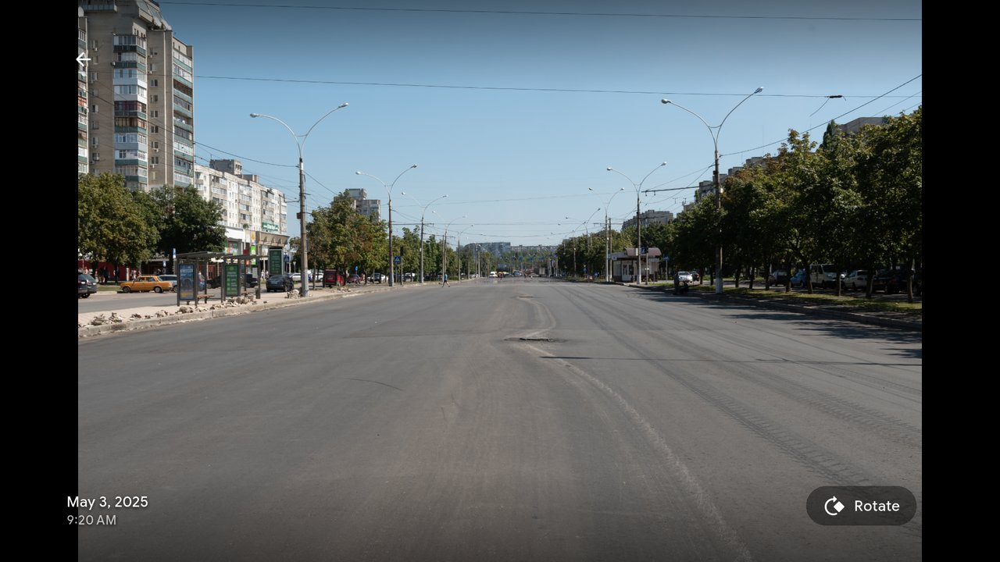

🌐 <b>Galego</b> · Outras linguas (88)
<a href="../README.md">English</a> · <a href="README.af.md">Afrikaans</a> · <a href="README.ar.md">العربية</a> · <a href="README.az.md">Azərbaycanca</a> · <a href="README.be.md">Беларуская</a> · <a href="README.bg.md">Български</a> · <a href="README.bi.md">Bislama</a> · <a href="README.bn.md">বাংলা</a> · <a href="README.br.md">Brezhoneg</a> · <a href="README.bs.md">Bosanski</a> · <a href="README.ca.md">Català</a> · <a href="README.cs.md">Čeština</a> · <a href="README.cv.md">Чӑвашла</a> · <a href="README.da.md">Dansk</a> · <a href="README.de.md">Deutsch</a> · <a href="README.de_CH.md">Deutsch (Schweiz)</a> · <a href="README.el.md">Ελληνικά</a> · <a href="README.en_GB.md">English (UK)</a> · <a href="README.eo.md">Esperanto</a> · <a href="README.es.md">Español</a> · <a href="README.et.md">Eesti</a> · <a href="README.eu.md">Euskara</a> · <a href="README.fa.md">فارسی</a> · <a href="README.fi.md">Suomi</a> · <a href="README.fil.md">Filipino</a> · <a href="README.fr.md">Français</a> · <a href="README.ga.md">Gaeilge</a> · <a href="README.gsw.md">Alemannisch</a> · <a href="README.gu.md">ગુજરાતી</a> · <a href="README.he.md">עברית</a> · <a href="README.hi.md">हिन्दी</a> · <a href="README.hr.md">Hrvatski</a> · <a href="README.hu.md">Magyar</a> · <a href="README.hy.md">Հայերեն</a> · <a href="README.id.md">Bahasa Indonesia</a> · <a href="README.is.md">Íslenska</a> · <a href="README.it.md">Italiano</a> · <a href="README.ja.md">日本語</a> · <a href="README.ka.md">ქართული</a> · <a href="README.kab.md">Taqbaylit</a> · <a href="README.kk.md">Қазақша</a> · <a href="README.km.md">ខ្មែរ</a> · <a href="README.kmr.md">Kurmancî</a> · <a href="README.kn.md">ಕನ್ನಡ</a> · <a href="README.ko.md">한국어</a> · <a href="README.kxm.md">ภาษาเขมรถิ่นไทย</a> · <a href="README.lb.md">Lëtzebuergesch</a> · <a href="README.lmo.md">Lombard</a> · <a href="README.lt.md">Lietuvių</a> · <a href="README.lv.md">Latviešu</a> · <a href="README.mfa.md">Bahasa Melayu Kelantan</a> · <a href="README.mi.md">Te reo Māori</a> · <a href="README.mk.md">Македонски</a> · <a href="README.ml.md">മലയാളം</a> · <a href="README.mn.md">Монгол</a> · <a href="README.mr.md">मराठी</a> · <a href="README.ms.md">Bahasa Melayu</a> · <a href="README.nb_NO.md">Norsk bokmål</a> · <a href="README.ne.md">नेपाली</a> · <a href="README.nl.md">Nederlands</a> · <a href="README.nn.md">Norsk nynorsk</a> · <a href="README.pa.md">ਪੰਜਾਬੀ</a> · <a href="README.pl.md">Polski</a> · <a href="README.pt.md">Português</a> · <a href="README.pt_BR.md">Português (Brasil)</a> · <a href="README.ro.md">Română</a> · <a href="README.ru.md">Русский</a> · <a href="README.si.md">සිංහල</a> · <a href="README.sk.md">Slovenčina</a> · <a href="README.sl.md">Slovenščina</a> · <a href="README.sq.md">Shqip</a> · <a href="README.sr_Cyrl.md">Српски</a> · <a href="README.sr_Latn.md">Srpski</a> · <a href="README.sv.md">Svenska</a> · <a href="README.sw.md">Kiswahili</a> · <a href="README.swg.md">Schwäbisch</a> · <a href="README.ta.md">தமிழ்</a> · <a href="README.te.md">తెలుగు</a> · <a href="README.th.md">ไทย</a> · <a href="README.tl.md">Tagalog</a> · <a href="README.tr.md">Türkçe</a> · <a href="README.uk.md">Українська</a> · <a href="README.ur.md">اردو</a> · <a href="README.uz.md">Oʻzbekcha</a> · <a href="README.vi.md">Tiếng Việt</a> · <a href="README.yue_Hant.md">粵語</a> · <a href="README.zh_Hans.md">简体中文</a> · <a href="README.zh_Hant.md">繁體中文</a>

  

# Immuch360

**Os teus ficheiros. Calquera pantalla. Cada perspectiva.**

🌐 <a href="https://immuch360.com/gl/"><b>immuch360.com</b></a>

Fotos e vídeos planos, 360° e 3D desde o teu dispositivo, o teu NAS, o teu servidor Immich, as túas cámaras e o teu dron. Sen necesidade de conta. Immuch360 é unha aplicación libre e de código aberto que le as túas fotos e vídeos alí onde están e reproduce cada un no visor que lle corresponde: en plano, como unha esfera na que miras arredor, en 3D, ou arredor de ti nun casco. Funciona en teléfonos, tabletas, televisores, cascos Meta Quest e ordenadores. O seu sitio web, [immuch360.com](https://immuch360.com/gl/), mostra o que fai en cada pantalla, en 89 idiomas.

**Novidades da build 51 e da build de escritorio 31, versión 3.4.6.** En Windows e Linux, [Mellorar (IA)](#make-a-photo-sharper-on-your-computer-ai) fai unha copia máis nítida dunha foto pouco nítida xunto ao orixinal, en tres niveis: Nitidez, Reconstrución de detalles, que inventa detalles plausibles, e Natural, o máis fiel, que tamén funciona nun Mac con chip de Apple; cada nivel executouse unha vez nun PC cunha RTX 4060. Un ordenador [converte un vídeo 360° nun vídeo 360° en 3D](#a-360-video-turned-into-a-360-3d-video) mediante IA (experimental), e en Windows a profundidade dos vídeos 3D estímaa a tarxeta gráfica: 1.1 s por fotograma nunha RTX 4060 en lugar de 3.1 s no procesador. As funcións de IA toman directamente os vídeos do teu servidor Immich e dun recurso compartido, e descárganos antes de comezar. O ficheiro de axustes ten [a súa tarxeta na Biblioteca](#keep-your-settings-in-a-file), e un televisor gárdao e restáurao nun recurso compartido de rede. Nos ordenadores, Esc volve un paso atrás. As builds das tendas piden unha valoración [con menos frecuencia e con máis delicadeza](#privacy), e os Axustes reciben “Valorar Immuch360” e “Algo non funciona?”. Linux mostra as fotos TIFF, os cartafoles que mostran os seus ficheiros novos por si sós, as escenas splat feitas a partir das túas fotos e os vídeos 3D cun ollo. O zoom de fotos de Android TV viuse funcionar nun emulador de Android TV, e corríxense dous peches inesperados: as fotos do dispositivo en Android 9 e anteriores, e o visor inmersivo dun Meta Quest cuxo Horizon OS é demasiado antigo, que agora pide unha actualización.

**Novidades das builds 33 a 50.** [As películas seguen onde as deixaches](#pick-up-a-film-where-you-stopped). Comezan antes e, desde un servidor lento, [seguen reproducíndose en lugar de deterse](#when-a-video-waits-or-will-not-play). A liña do tempo [redúcese a meses e anos](#find-a-month-or-a-year-in-a-long-timeline) en teléfonos e ordenadores. Nun teléfono Android ou nun Meta Quest, [“Explorar un cartafol”](#browse-a-folder-of-your-phone-or-headset) abre un cartafol do dispositivo como un recurso compartido, e as fotos TIFF móstranse. Android TV [busca por data co mando](#on-android-tv-and-google-tv), un Meta Quest 3 ou 3S [abre splats gaussianos](#explore-gaussian-splats-in-a-meta-quest-3-or-3s) (experimental), que se xiran co joystick dereito, versión 4 de SPZ incluída, e un ordenador [fai as versións 3D das fotos do teu NAS](#turn-one-photo-into-3d-a-scene-a-panorama). Nun portátil Windows con dous chips gráficos, a aplicación [funciona agora no rápido](#when-a-video-waits-or-will-not-play), así que as películas 8K reprodúcense con fluidez. Os splats gaussianos agora [ábrense en ordenadores e en teléfonos e tabletas Android](#explore-gaussian-splats-on-your-phone-tablet-or-computer), un ordenador Windows [fai escenas splat a partir das túas fotos ou dun vídeo](#make-a-splat-scene-from-your-photos-or-a-video-ai) pola IA, o teu servidor Immich [gárdaas dentro de fotos](#keep-a-splat-scene-on-your-immich-server) que se abren desde a túa cronoloxía, e os ordenadores [reproducen vídeos AV2](#play-av2-videos-on-your-computer), todo experimental. Desde a build 42, os vídeos en bruto das cámaras Insta360, GoPro MAX e DJI Osmo 360, desde a túa biblioteca de Immich, un recurso compartido ou un cartafol, [reprodúcense estabilizados co xiroscopio da cámara](#stabilise-your-360-videos-with-the-cameras-gyroscope-experimental) en teléfonos, tabletas e televisores Android, o creador de splats da build de escritorio 22 [ofrece unha calidade Detallada](#make-a-splat-scene-from-your-photos-or-a-video-ai) para as escenas que miras de preto, e unha panorámica 360° [comeza con 3,5 GiB libres na tarxeta gráfica](#turn-one-photo-into-3d-a-scene-a-panorama), todo experimental. A aplicación de iPhone e iPad está [na App Store](https://apps.apple.com/us/app/immuch360-360-3d-player/id6817655965), versión 3.4.3. Desde a build 43, o aviso de actualización da aplicación abre Google Play ou a App Store en teléfonos e tabletas; o seu sitio web, [immuch360.com](https://immuch360.com/gl/), abriu o 7 de novembro. Desde a build 44 e a build de escritorio 24, un Meta Quest 3 ou 3S [mostra splats de ata 300.000 gaussianas](#explore-gaussian-splats-in-a-meta-quest-3-or-3s) (experimental), os ordenadores [seleccionan varias fotos e vídeos con Ctrl e Shift](#use-your-computer-as-the-media-player), un televisor cuxo decodificador rexeita un vídeo [reproduce por si só o outro ficheiro do servidor](#when-a-video-waits-or-will-not-play), as panorámicas funcionan na tarxeta gráfica escollida dun portátil que ten dúas (experimental), e o aviso de actualización do Quest e dos ordenadores abre a súa tenda ou a súa páxina de descarga, con moitas correccións. Desde a build 45 e a build de escritorio 25, versión 3.4.0 en todas as plataformas, a aplicación segue a aplicación Immich 3.4.0 con 11 correccións posteriores de Immich, mostra as [fotos JPEG XL dos servidores Immich 3.4](#keep-your-immich-library-with-more), abre [as túas películas de Plex por ano](#watch-your-plex-films) cunha páxina para cada película, a súa descarga no dispositivo e a súa reprodución na televisión desde o teléfono (experimental), pode pedir unha valoración nas builds das tendas, e, nos ordenadores, toma os seus compoñentes de vídeo dos [seus propios repositorios abertos](#licences-and-credits). Desde a build 46 e a build de escritorio 26, versión 3.4.1, os vídeos en bruto das cámaras 360° tamén [se reproducen estabilizados](#stabilise-your-360-videos-with-the-cameras-gyroscope-experimental) en iPhone e iPad, nun Meta Quest e en Windows, un Meta Quest [reproduce con libmpv as películas de Plex que o seu propio reprodutor non pode descodificar](#watch-your-plex-films), un teléfono [envía unha película así a un Chromecast ou a un Google TV](#watch-your-plex-films), e o relevo IA dunha foto 3D [toma a intensidade que escollas](#turn-one-photo-into-3d-a-scene-a-panorama), todo experimental; tamén se pode engadir un servidor novo iniciando sesión coa túa conta de Plex, e a aplicación [garda os seus axustes nun ficheiro](#keep-your-settings-in-a-file). Desde a build 47 e a build de escritorio 27, versión 3.4.2, unha película de Plex [reproduce unha pista de audio que o dispositivo descodifica](#watch-your-plex-films) e di cal, abre a versión que mellor vai coa pantalla e, cunha conexión lenta, ofrece unha máis lixeira, Windows e macOS reproducen o seu son Dolby TrueHD, Android [mostra a súa descarga nunha notificación](#watch-your-plex-films) e Android TV tamén descarga películas, e [as cámaras Tapo de batería mostran a imaxe en directo](#watch-your-home-cameras-on-the-big-screen) (experimental); restaurar un ficheiro de axustes coas súas contas agora inicia a túa sesión no teu servidor Immich. Desde a build 48 e a build de escritorio 28, versión 3.4.3, un ordenador Windows [reproduce os teus vídeos nun casco PC VR](#watch-your-videos-in-a-pc-vr-headset-from-windows) a través de SteamVR, Meta Horizon Link ou outro runtime OpenXR (o proxecto aínda non o probou nun casco), [as cámaras doutras marcas mostran a imaxe en directo](#cameras-of-other-brands-over-onvif-or-rtsp), atopadas por ONVIF ou engadidas pola súa ligazón RTSP (comprobado cunha cámara simulada, aínda non se probou ningunha cámara real doutra marca), os vídeos en bruto da [DJI Osmo 360 II e da GoPro MAX 2 reprodúcense estabilizados](#open-the-raw-files-of-360-cameras) (experimental), as películas de Plex [xa non chegan con demasiada lentitude aos teléfonos](#when-a-video-waits-or-will-not-play), os televisores LG e Samsung [xiran un vídeo que queda deitado](#on-a-samsung-tv-tizen) cun botón (aínda sen probar nun televisor LG; o televisor Samsung da issue 17 rexeitou o xiro), e “Hai unha actualización do servidor dispoñible” xa non aparece para un servidor que está ao día. Desde a build 49 e a build de escritorio 29, versión 3.4.4, a aplicación [le os teus servidores Jellyfin e Emby](#watch-your-jellyfin-and-emby-libraries) por si mesma (experimental, aínda sen probar nun dispositivo), atopados na túa rede e con sesión iniciada con Quick Connect nun televisor ou nun casco, cos seus ficheiros orixinais reproducidos para que un vídeo 360° siga sendo 360°; na pantalla grande dun Meta Quest, as fotos [manteñen o tamaño e o lugar que fixas mentres as percorres, e reprodúcense como presentación](#browse-your-photos-on-the-big-screen-of-the-quest) (o proxecto aínda non o probou nun casco); o reprodutor de vídeo 360° de teléfonos e tabletas [recibe os controis das fotos 360°](#360-videos-on-your-phone-with-the-controls-of-360-photos), un botón de xiroscopio, achegar cos dedos e arrastrar recto cara arriba ou cara abaixo (probado por un usuario nun Samsung Galaxy S25 Ultra, aínda sen probar nun iPhone); un ordenador [converte os teus vídeos 2D en vídeos 3D](#turn-your-2d-videos-into-3d-on-your-computer-experimental) mediante IA (experimental, aínda sen probar nunha pantalla 3D nin nun casco); e os televisores Samsung [pasan un vídeo que precisa un xiro ao reprodutor propio de Samsung](#on-a-samsung-tv-tizen), que o televisor da issue 17 reproduce pero négase a xirar. Desde a build 50 e a build de escritorio 30, versión 3.4.5, mentres se reproduce un vídeo na xanela 2D dun Meta Quest, a xanela [redebúxase á frecuencia da pantalla](#step-inside-your-photos-and-videos-with-a-meta-quest) en lugar de unhas 10 veces por segundo como nas builds 48 e 49 (medido nun Meta Quest 3), Android TV [achega unha foto co mando](#on-android-tv-and-google-tv) e móvea coas frechas (novo, aínda sen probar nun televisor), e tres correccións veñen da bifurcación Android TV de mlc70: un desprazamento rápido xa non mostra os detalles da foto deixada atrás, unha foto animada libera a súa memoria, e o filtro Localización ofrece as cidades do novo país.

  Bifurcación non oficial da aplicación móbil de Immich. Non está afiliada a Immich nin a FUTO. O nome lese como "I am much 360".

<b>Contidos</b>

- [Para quen é](#who-it-is-for)
- [Que pantallas](#which-screens), [que fan xuntas](#use-cases) e [que fai cada pantalla](#what-each-screen-does)
- [Que podes facer](#what-you-can-do)
- [Obtela no teu dispositivo](#get-it-on-your-device)
- [Como facer](#how-to)
  - [Mira as túas fotos e vídeos, con ou sen servidor](#watch-your-photos-and-videos-with-or-without-a-server)
  - [Explora panorámicas, 360°, VR180 e 3D](#explore-panoramas-360-vr180-and-3d): [vídeos 360° nos teléfonos](#360-videos-on-your-phone-with-the-controls-of-360-photos)
  - [Converter unha foto en 3D, nunha escena, nunha panorámica](#turn-one-photo-into-3d-a-scene-a-panorama)
  - [Converte os teus vídeos 2D en 3D no teu ordenador (experimental)](#turn-your-2d-videos-into-3d-on-your-computer-experimental): [vídeos 360° a 360° en 3D](#a-360-video-turned-into-a-360-3d-video)
  - [Fai unha foto máis nítida no teu ordenador (IA)](#make-a-photo-sharper-on-your-computer-ai)
  - [Mira na televisión co mando](#watch-on-the-tv-with-the-remote): [Android TV e Google TV](#on-android-tv-and-google-tv), [LG](#on-an-lg-tv-webos), [Samsung](#on-a-samsung-tv-tizen)
  - [Iniciar sesión nun televisor, un casco ou un ordenador co teu teléfono](#sign-in-a-tv-a-headset-or-a-computer-with-your-phone)
  - [Entra nas túas fotos e vídeos cun Meta Quest](#step-inside-your-photos-and-videos-with-a-meta-quest): [a pantalla grande](#browse-your-photos-on-the-big-screen-of-the-quest), [modo quiosco](#kiosk-mode-for-an-exhibition-or-a-shop)
  - [Explora splats gaussianos nun Meta Quest 3 ou 3S](#explore-gaussian-splats-in-a-meta-quest-3-or-3s)
  - [Explora splats gaussianos no teu teléfono, tableta ou ordenador](#explore-gaussian-splats-on-your-phone-tablet-or-computer)
  - [Fai unha escena splat a partir das túas fotos ou dun vídeo (IA)](#make-a-splat-scene-from-your-photos-or-a-video-ai)
  - [Garda unha escena splat no teu servidor Immich](#keep-a-splat-scene-on-your-immich-server)
  - [Reproduce os ficheiros dun NAS, un ordenador, un servidor multimedia ou Plex](#play-the-files-of-a-nas-a-computer-a-media-server-or-plex): [as túas películas por ano](#watch-your-plex-films), [Jellyfin e Emby](#watch-your-jellyfin-and-emby-libraries)
  - [Explora un cartafol do teu teléfono ou do teu casco](#browse-a-folder-of-your-phone-or-headset)
  - [Retoma unha película onde a deixaches](#pick-up-a-film-where-you-stopped)
  - [Cando un vídeo agarda ou non se reproduce](#when-a-video-waits-or-will-not-play)
  - [Conserva a túa biblioteca de Immich, con máis](#keep-your-immich-library-with-more)
  - [Atopa un mes ou un ano nunha liña do tempo longa](#find-a-month-or-a-year-in-a-long-timeline)
  - [Mira as cámaras da túa casa na pantalla grande](#watch-your-home-cameras-on-the-big-screen): [outras marcas](#cameras-of-other-brands-over-onvif-or-rtsp)
  - [O teu dron DJI (experimental)](#your-dji-drone-experimental): [vídeo en directo](#see-what-your-drone-sees-on-your-phone), [nun Quest ou en Android TV](#watch-it-in-a-meta-quest-or-on-an-android-tv), [importación](#bring-a-drones-or-a-camera-cards-photos-and-videos-to-immich)
  - [Abre os ficheiros en bruto das cámaras 360°](#open-the-raw-files-of-360-cameras)
  - [Estabiliza os teus vídeos 360° co xiroscopio da cámara (experimental)](#stabilise-your-360-videos-with-the-cameras-gyroscope-experimental)
  - [Xirar unha foto cunha tecla](#turn-a-photo-with-one-key)
  - [Usa o teu ordenador como reprodutor multimedia](#use-your-computer-as-the-media-player)
  - [Mira os teus vídeos nun casco PC VR, desde Windows](#watch-your-videos-in-a-pc-vr-headset-from-windows)
  - [Reproduce vídeos AV2 no teu ordenador](#play-av2-videos-on-your-computer)
  - [Garda os teus axustes nun ficheiro](#keep-your-settings-in-a-file)
- [Comparación con Immich](#compared-with-immich)
- [Privacidade](#privacy)
- [Licenzas e créditos](#licences-and-credits)
- [Folla de ruta](#roadmap)
- [Documentación](#documentation)

## Para quen é

- **Fas fotos e vídeos 360° ou 3D** e queres mirar arredor nas túas tomas, non velas planas, dobradas ou estiradas, e xirar os teus vídeos 360° no teléfono como xiras as súas fotos: [360°, VR180 e 3D](#explore-panoramas-360-vr180-and-3d), [vídeos 360° nos teléfonos](#360-videos-on-your-phone-with-the-controls-of-360-photos).
- **Filmas cunha cámara 360° na man, nunha bicicleta ou nun casco** e queres que os vídeos en bruto da túa cámara Insta360, GoPro MAX ou MAX 2, DJI Osmo 360 ou Osmo 360 II, gardados en Immich, nun recurso compartido ou nun cartafol, se reproduzan rectos e estables no teu teléfono, no teu televisor, no teu Meta Quest ou no teu ordenador con Windows (experimental): [estabilizados co xiroscopio da cámara](#stabilise-your-360-videos-with-the-cameras-gyroscope-experimental).
- **As túas fotos e películas están nun NAS, un ordenador, Plex ou Immich** e queres velas na televisión sen copiar nada: [na televisión](#watch-on-the-tv-with-the-remote), [NAS, recursos compartidos e Plex](#play-the-files-of-a-nas-a-computer-a-media-server-or-plex).
- **Gardas as túas películas nun servidor Plex** e queres escoller unha por ano, ver que é antes de que comece, levala de viaxe, comezala na televisión ou nun Chromecast desde o teu teléfono, e reproducir mesmo as películas que o teu teléfono Android, o teu televisor ou o teu Meta Quest non poden descodificar (experimental): [as túas películas, por ano](#watch-your-plex-films).
- **Gardas as túas películas nun servidor Jellyfin ou Emby** e queres velas no teu Meta Quest, no televisor ou no teléfono, co 360° e o 3D tal como son, e o teu punto gardado no servidor (experimental, aínda sen probar nun dispositivo): [Jellyfin e Emby](#watch-your-jellyfin-and-emby-libraries).
- **Tes un Meta Quest** e queres entrar nas túas propias fotos e vídeos: [no casco](#step-inside-your-photos-and-videos-with-a-meta-quest), e percorrer as túas fotos nunha pantalla grande co tamaño e no lugar que fixas, tamén como presentación (o proxecto aínda non o probou nun casco): [a pantalla grande](#browse-your-photos-on-the-big-screen-of-the-quest).
- **Tes un casco PC VR nun ordenador Windows** e queres nel os teus vídeos 360° arredor de ti e as túas películas nunha pantalla grande (o proxecto aínda non o probou nun casco): [nun casco PC VR](#watch-your-videos-in-a-pc-vr-headset-from-windows).
- **As túas fotos son planas** e queres velas en 3D, como unha escena na que inclinarte cun casco, ou dentro dunha panorámica 360°, sen cámara 3D: [converter unha foto en 3D, nunha escena, nunha panorámica](#turn-one-photo-into-3d-a-scene-a-panorama), novo, feito pola IA no teu propio ordenador.
- **Os teus vídeos son planos**, incluídos os clips do teu teléfono, e queres velos en 3D para un casco ou unha pantalla 3D, e os teus vídeos 360° en 360° 3D, feitos no teu propio ordenador (experimental, aínda sen probar nunha pantalla 3D nin nun casco): [vídeos 2D a 3D](#turn-your-2d-videos-into-3d-on-your-computer-experimental), [360° a 360° 3D](#a-360-video-turned-into-a-360-3d-video).
- **As túas fotos son pouco nítidas**, un pouco desenfocadas ou feitas con pouca luz, e queres unha copia máis nítida xunto ao orixinal, feita no teu propio ordenador, co detalle inventado dito claramente: [Mellorar (IA)](#make-a-photo-sharper-on-your-computer-ai).
- **Usas Immich** e queres a súa aplicación, máis os visores inmersivos e as pantallas grandes nas que inicias sesión desde o teu teléfono: [a túa biblioteca de Immich](#keep-your-immich-library-with-more), [comparación con Immich](#compared-with-immich).
- **Vixías a túa casa con cámaras Tapo**, tamén de batería (experimental), ou cámaras doutras marcas por ONVIF ou RTSP, e queres velas xunto ás túas fotos, tamén na televisión (comprobado cunha cámara simulada): [cámaras da casa](#watch-your-home-cameras-on-the-big-screen).
- **Voas un dron DJI** e queres a súa imaxe en directo no teu teléfono sen DJI Fly, e nun Meta Quest ou nun Android TV para as persoas que están contigo (experimental): [o teu dron](#see-what-your-drone-sees-on-your-phone).
- **Capturas lugares e obxectos en 3D, como splats gaussianos,** ou gustaríache facelos a partir das túas propias fotos, e queres camiñar por eles no teu teléfono, no teu ordenador ou nun casco (experimental): [nun teléfono, unha tableta ou un ordenador](#explore-gaussian-splats-on-your-phone-tablet-or-computer), [feitos a partir das túas fotos](#make-a-splat-scene-from-your-photos-or-a-video-ai), [gardados en Immich](#keep-a-splat-scene-on-your-immich-server).
- **Tes vídeos AV2**, o formato que segue a AV1, e queres velos no teu ordenador (experimental): [AV2 no teu ordenador](#play-av2-videos-on-your-computer).
- **Tes varias pantallas na casa** e queres que traballen xuntas: [que fan xuntas as túas pantallas](#use-cases).

Non hai ningunha conta de Immuch360 que crear, e nada chega a nós: a aplicación fala só cos teus dispositivos e cos servidores que escollas, desde a build 45 con Wikipedia para a páxina dunha película (experimental), desde a build 46 con plex.tv cando inicias sesión con el, e só descarga un compoñente de IA ou o descodificador AV2 cando ti o pides.

## Que pantallas

| Plataforma | Onde conseguila | Estado en novembro de 2026 |
|---|---|---|
|  **Android** teléfonos e tabletas | [Google Play](https://play.google.com/store/apps/details?id=com.aprogsys.immuch360) · [APK](https://github.com/freeKC/Immuch360/releases) | en Google Play (build 47 publicada o 16 de novembro; build 48 en revisión de Google desde o 16 de novembro; despois chega a build 51), build 51 en GitHub, onde [os vídeos 360° en bruto reprodúcense estabilizados](#stabilise-your-360-videos-with-the-cameras-gyroscope-experimental) (experimental), [as películas seguen onde as deixaches](#pick-up-a-film-where-you-stopped), [“Explorar un cartafol”](#browse-a-folder-of-your-phone-or-headset) abre un cartafol do teléfono e [os splats gaussianos ábrense](#explore-gaussian-splats-on-your-phone-tablet-or-computer), desde un recurso compartido ou [desde a túa cronoloxía de Immich](#keep-a-splat-scene-on-your-immich-server) (experimental), [os axustes gardados nun ficheiro](#keep-your-settings-in-a-file), [a descarga dunha película mostrada nunha notificación](#watch-your-plex-films), desde a build 48 [as cámaras doutras marcas, en directo](#cameras-of-other-brands-over-onvif-or-rtsp) (comprobado cunha cámara simulada) e, desde a build 49, [os servidores Jellyfin e Emby](#watch-your-jellyfin-and-emby-libraries) (experimental, aínda sen probar nun dispositivo) e [os controis das fotos 360° no reprodutor de vídeo 360°](#360-videos-on-your-phone-with-the-controls-of-360-photos) (probado por un usuario nun Samsung Galaxy S25 Ultra) e, desde a build 51, [a tarxeta do ficheiro de axustes na Biblioteca](#keep-your-settings-in-a-file), co seu ficheiro gardado tamén nun recurso compartido de rede |
|  **iPhone e iPad** | [App Store](https://apps.apple.com/us/app/immuch360-360-3d-player/id6817655965) | versión 3.4.5 na App Store desde o 22 de novembro, con [meses e anos na liña do tempo](#find-a-month-or-a-year-in-a-long-timeline), [películas que seguen onde as deixaches](#pick-up-a-film-where-you-stopped), [o inicio de sesión dun televisor, un casco ou un ordenador](#sign-in-a-tv-a-headset-or-a-computer-with-your-phone) desde o teléfono, as escenas splat gardadas en Immich mostradas como a súa foto, as correccións de Immich 3.4.0 e as súas fotos JPEG XL, [vídeos 360° en bruto estabilizados](#stabilise-your-360-videos-with-the-cameras-gyroscope-experimental) (experimental), [os axustes gardados nun ficheiro](#keep-your-settings-in-a-file) e [a visión en directo das cámaras Tapo de batería](#watch-your-home-cameras-on-the-big-screen) (experimental) e a [visión en directo das cámaras doutras marcas](#cameras-of-other-brands-over-onvif-or-rtsp) (comprobado cunha cámara simulada), e desde a versión 3.4.4 os [servidores Jellyfin e Emby](#watch-your-jellyfin-and-emby-libraries) (experimental, aínda sen probar nun dispositivo) e [os controis das fotos 360° no reprodutor de vídeo 360°](#360-videos-on-your-phone-with-the-controls-of-360-photos) (aínda sen probar nun iPhone); a versión 3.4.6, a versión de iPhone e iPad da build 51, chega despois, coa [tarxeta do ficheiro de axustes](#keep-your-settings-in-a-file) e a súa restauración desde un recurso compartido de rede; ou [compílala ti mesmo](../docs/immuch360/build.md) |
|  **Android TV e Google TV** | [Google Play](https://play.google.com/store/apps/details?id=com.aprogsys.immuch360) · [APK](#android-tv-and-google-tv) | en Google Play, que ofrece a aplicación en Android TV e Google TV, e build 51 en GitHub: [vídeos 360° en bruto estabilizados](#stabilise-your-360-videos-with-the-cameras-gyroscope-experimental) (experimental), [busca por data co mando](#on-android-tv-and-google-tv), [inicio de sesión co teu teléfono](#sign-in-a-tv-a-headset-or-a-computer-with-your-phone) escaneando un código QR, unha barra de tempo, audio e subtítulos para o mando no reprodutor de vídeo, e o [vídeo en directo dun dron](#watch-it-in-a-meta-quest-or-on-an-android-tv) retransmitido por un teléfono (experimental), [películas descargadas no televisor](#watch-your-plex-films) e, desde a build 49, [servidores Jellyfin e Emby](#watch-your-jellyfin-and-emby-libraries) con sesión iniciada mediante Quick Connect (experimental, aínda sen probar nun dispositivo) e, desde a build 50, [fotos achegadas co mando](#on-android-tv-and-google-tv) (visto funcionando nun emulador de Android TV, aínda sen probar nun televisor) e, desde a build 51, [o ficheiro de axustes gardado e restaurado nun recurso compartido de rede](#keep-your-settings-in-a-file) (visto funcionando nun emulador de Android TV) |
| **Televisores LG** con webOS 5.0 e posteriores | [.ipk, versión 1.0.5](https://github.com/freeKC/Immuch360/releases/tag/webos-v1.0.5) · LG Content Store (en revisión) | versión 1.0.0, enviada á LG Content Store o 24 de outubro, nas probas de LG desde o 26 de outubro; a versión 1.0.1, en GitHub desde o 27 de outubro, fai zoom nunha foto desde as frechas e indica cando unha foto aínda se está a cargar, e a versión 1.0.2, en GitHub coa build 46, escribe “iniciar sesión” como ログイン en xaponés, a versión 1.0.3, coa build 47, indica cando un cartafol dun servidor DLNA contén canles de televisión en directo, que aínda non pode reproducir, a versión 1.0.4, coa build 48, [xira un vídeo que queda deitado](#on-an-lg-tv-webos) cun botón (aínda sen probar nun televisor LG), e a versión 1.0.5, coa build 49, nomea Jellyfin co seu complemento DLNA entre os servidores DLNA; ata que LG publique a aplicación, instálase en [Developer Mode](#lg-tvs-webos). A versión 1.0.0 funcionou en televisores webOS 25 do Cloud Test Lab de LG |
| **Televisores Samsung** con Tizen 5.5 e posteriores | [Build de proba .wgt](https://github.com/freeKC/Immuch360/releases/tag/tizen-v0.3.6) | build de proba 0.3.6 da mesma aplicación de televisión, para asinar co teu propio certificado de Samsung e instalar en [Developer mode](#samsung-tvs-tizen); a 0.1.0 funcionou no televisor Samsung dun probador, a 0.2.0 inclúe as correccións desa proba, a 0.3.0 engade o zoom das fotos e a pastilla de carga da versión 1.0.1 de LG, e a 0.3.1 a redacción en xaponés da versión 1.0.2 de LG, a 0.3.2 reproduce co lado correcto cara arriba un vídeo gravado en vertical nun teléfono ([issue 17](https://github.com/freeKC/Immuch360/issues/17)), a 0.3.3 e a 0.3.4 [xírano nun televisor que o informa en vertical](#on-a-samsung-tv-tizen) e engaden un botón que o xira á man, e a 0.3.5 e a 0.3.6 pasan un vídeo así ao reprodutor propio de Samsung; no televisor de quen informou, a 0.3.4 e a 0.3.5 deixaron a imaxe deitada, porque o televisor rexeita o xiro, e a saída alí é un vídeo que o teu servidor Immich transcodifica, gardado en vertical; non está na tenda de Samsung |
|  **Meta Quest** 2, Pro, 3 e 3S | [Horizon Store](https://www.meta.com/experiences/immuch360/1384208401440714/) · [APK](#meta-quest) | na Horizon Store (build 47 publicada o 19 de novembro; build 50, cuxa xanela 2D se redebuxa á frecuencia da pantalla mentres se reproduce un vídeo, en revisión de Meta desde o 21 de novembro; despois chega a build 51), build 51 en GitHub, cun [modo quiosco](#kiosk-mode-for-an-exhibition-or-a-shop), [vídeos 360° en bruto estabilizados](#stabilise-your-360-videos-with-the-cameras-gyroscope-experimental) na vista inmersiva, [as películas que non pode descodificar reproducidas por libmpv](#watch-your-plex-films) e, en Quest 3 e 3S, [splats gaussianos](#explore-gaussian-splats-in-a-meta-quest-3-or-3s) e o [relevo IA](#turn-one-photo-into-3d-a-scene-a-panorama) dunha foto plana, todo experimental, e desde a build 49 [as fotos percorridas na pantalla grande](#browse-your-photos-on-the-big-screen-of-the-quest) co tamaño que fixas, tamén como presentación (o proxecto aínda non o probou nun casco), e [os servidores Jellyfin e Emby](#watch-your-jellyfin-and-emby-libraries) con sesión iniciada mediante Quick Connect (experimental, aínda sen probar nun dispositivo) e, desde a build 51, un casco cuxo Horizon OS é demasiado antigo para o visor inmersivo pide unha actualización en lugar de pechar a aplicación (sen probar nun casco así) |
|  **Windows** | [Instalador ou ZIP](https://github.com/freeKC/Immuch360/releases/tag/desktop-v3.4.6-31) | build de escritorio 31, unha vista previa asinada: fotos, vídeos planos e 360°, recursos compartidos, Plex, cámaras (comprobado cunha cámara simulada), inicio de sesión co teu teléfono, fotos xiradas cunha tecla, a interface en 89 idiomas, e [fotos 3D, escenas 3D e panorámicas 360° feitas a partir das túas fotos](#turn-one-photo-into-3d-a-scene-a-panorama) pola IA (experimental), tamén das fotos do teu NAS; [splats gaussianos](#explore-gaussian-splats-on-your-phone-tablet-or-computer) abertos, [feitos a partir das túas fotos ou dun vídeo](#make-a-splat-scene-from-your-photos-or-a-video-ai) e [gardados en Immich](#keep-a-splat-scene-on-your-immich-server), [vídeos AV2](#play-av2-videos-on-your-computer), desde a build de escritorio 22 unha [opción de Calidade para as escenas splat](#make-a-splat-scene-from-your-photos-or-a-video-ai) e [panorámicas 360° desde 3,5 GiB de memoria gráfica libre](#turn-one-photo-into-3d-a-scene-a-panorama), e desde a build de escritorio 26 [vídeos 360° en bruto estabilizados](#stabilise-your-360-videos-with-the-cameras-gyroscope-experimental) e [fotos 3D cunha intensidade do relevo e bordos máis nítidos](#turn-one-photo-into-3d-a-scene-a-panorama), todo experimental, desde a build de escritorio 27 [o son Dolby TrueHD e os subtítulos Blu-ray das películas](#watch-your-plex-films), desde a build de escritorio 28 [os teus vídeos nun casco PC VR](#watch-your-videos-in-a-pc-vr-headset-from-windows) (o proxecto aínda non o probou nun casco), e desde a build de escritorio 29 [vídeos 3D feitos a partir dos teus vídeos 2D](#turn-your-2d-videos-into-3d-on-your-computer-experimental) mediante IA (experimental, aínda sen probar nunha pantalla 3D nin nun casco) e, desde a build de escritorio 31, [copias máis nítidas das túas fotos](#make-a-photo-sharper-on-your-computer-ai) mediante IA e [vídeos 360° convertidos en vídeos 360° en 3D](#a-360-video-turned-into-a-360-3d-video) mediante IA (experimental), a profundidade estimada pola tarxeta gráfica, os vídeos do teu servidor e dun recurso compartido tomados directamente, e Esc para volver un paso atrás |
|   **macOS e Linux** | [.deb, .rpm, DMG](https://github.com/freeKC/Immuch360/releases/tag/desktop-v3.4.6-31) | build de escritorio 31, vistas previas: fotos, fotos 360° e vídeos planos (os vídeos 360° reprodúcense en plano), un servidor Immich e recursos compartidos de rede, e [fotos 3D e escenas 3D](#turn-one-photo-into-3d-a-scene-a-panorama) feitas pola IA a partir das túas fotos, con panorámicas 360° en Linux cunha tarxeta gráfica de 8 GB, desde 3,5 GiB libres nela, e [splats gaussianos](#explore-gaussian-splats-on-your-phone-tablet-or-computer) e [vídeos AV2](#play-av2-videos-on-your-computer) (experimental, aínda sen probar nun Mac); a build de escritorio 11 probouse o 26 de outubro nun contedor Ubuntu 24.04 e nun Mac; desde a build de escritorio 27, o son Dolby TrueHD das películas en macOS; desde a build de escritorio 29, [vídeos 3D feitos a partir dos teus vídeos 2D](#turn-your-2d-videos-into-3d-on-your-computer-experimental) mediante IA en Linux e nun Mac con chip de Apple (experimental, aínda sen probar nunha pantalla 3D nin nun casco); desde a build de escritorio 31, en Linux, [copias máis nítidas das túas fotos](#make-a-photo-sharper-on-your-computer-ai) mediante IA, as fotos TIFF, os cartafoles que mostran os seus ficheiros novos por si sós, as escenas splat feitas a partir das túas fotos nunha tarxeta gráfica de 4 GB e os vídeos 3D mostrados en plano cun ollo, e nun Mac con chip de Apple o nivel Natural de Mellorar (IA) (aínda sen probar nun Mac); sen asinar en macOS |

*Os estados actualízanse en cada publicación; o que ten cada tenda, o que está en revisión e cada build están en [Estado das publicacións](../docs/immuch360/release-status.md). O sitio web [immuch360.com](https://immuch360.com/gl/) mostra o que fai cada pantalla, un como facer para cada función e as ligazóns ás tendas, en 89 idiomas.*

  

### Que fan xuntas as túas pantallas

Instala Immuch360 en cada pantalla na que miras: cada unha le as túas fontes por si mesma, e algunhas pasan unha imaxe, un ficheiro ou un inicio de sesión a outra. En cada imaxe, a icona de Immuch360 marca os dispositivos que executan a aplicación.

#### O teu NAS en todas as pantallas

  

**Necesitas:** un NAS cun recurso compartido SMB ou WebDAV, e Immuch360 en cada pantalla na que miras.

Engade o recurso compartido en cada pantalla, e cada unha reproduce as fotos e os vídeos alí onde están, sen copiar nada: teléfonos, tabletas, Android TV, un Meta Quest, ordenadores con Windows, Linux e macOS, e televisores LG con sesión iniciada no teu servidor Immich (SMB desde webOS 22). Unha foto 360° xira como unha esfera no teléfono e no televisor, e rodéate no casco. Como facer: [Reproduce os ficheiros dun NAS, un ordenador, un servidor multimedia ou Plex](#play-the-files-of-a-nas-a-computer-a-media-server-or-plex).

#### O teu servidor Immich en todas as pantallas, coa sesión iniciada desde o teu teléfono

  

**Necesitas:** un servidor Immich, Immuch360 no teu teléfono Android, e Immuch360 nas pantallas nas que inicias sesión: Android TV, un Meta Quest, un ordenador con Windows, Linux ou macOS.

No teléfono, Immuch360 conserva toda a aplicación móbil de Immich, engade os seus visores 360°, VR180 e 3D, e instálase xunto á aplicación oficial. Coa sesión iniciada no teu servidor, inicia a sesión nas pantallas grandes: escanea o código QR do televisor ou do ordenador, ou ti escribes nel o código que mostra o casco, e o teu contrasinal queda no teléfono. Como facer: [Iniciar sesión nun televisor, un casco ou un ordenador co teu teléfono](#sign-in-a-tv-a-headset-or-a-computer-with-your-phone).

#### As túas fotos planas en 3D, do teu ordenador ao casco (experimental)

  

**Necesitas:** Immuch360 nun ordenador con Windows, Linux ou macOS e nun Meta Quest, co teu NAS entre eles, ou o teu servidor Immich con “Facer tamén copia de seguridade das versións IA” activado.

O propio ordenador converte as túas fotos en fotos 3D e escenas 3D, e en panorámicas 360° cunha tarxeta gráfica de 8 GB en Windows ou Linux, e gárdaas xunto aos orixinais. O casco mostra unha foto 3D en 3D de verdade, pon unha escena no teu cuarto e unha panorámica ao teu arredor; os teléfonos e os televisores abren as panorámicas no seu visor 360°. Como facer: [Converter unha foto en 3D, nunha escena, nunha panorámica](#turn-one-photo-into-3d-a-scene-a-panorama).

#### A vista en directo do teu dron nun casco ou no televisor (experimental)

  

**Necesitas:** un dron DJI e o seu radiocontrol DJI RC-N3, Immuch360 no teléfono Android conectado ao radiocontrol, e Immuch360 nun Meta Quest ou nun Android TV.

O teléfono mostra o vídeo en directo do dron e retransmíteo, pola túa Wi-Fi ou polo seu propio punto de acceso, para que as persoas que están contigo vexan o voo no casco ou no televisor. Só recepción: nunca se envía ningunha orde ao radiocontrol nin ao dron, e o radiocontrol mantén o control total. Como facer: [Míraa nun Meta Quest ou nun Android TV](#watch-it-in-a-meta-quest-or-on-an-android-tv).

#### Os ficheiros en bruto da túa cámara 360°, unidos alí onde os miras

  

**Necesitas:** unha cámara Insta360, GoPro MAX ou MAX 2, DJI Osmo 360 ou Osmo 360 II, o teu NAS, e Immuch360 nas pantallas: teléfonos, tabletas, Android TV, un Meta Quest, Windows.

Copia os ficheiros .insp, .insv, .360 ou .osv da tarxeta da cámara a un recurso compartido SMB ou WebDAV do teu NAS, tal como están; un servidor Immich tamén acepta os de Insta360. Cada pantalla úneos mentres os reproduce, coa calibración escrita en cada ficheiro, e non se exporta nada antes na aplicación da cámara. Como facer: [Abre os ficheiros en bruto das cámaras 360°](#open-the-raw-files-of-360-cameras).

#### Os teus servidores Plex e DLNA no televisor e no casco

  

**Necesitas:** un Plex Media Server, un servidor Jellyfin ou Emby, ou un servidor DLNA como minidlna, e Immuch360 en cada pantalla: Android TV, un Meta Quest, teléfonos, tabletas, Windows.

Plex dá os ficheiros orixinais das túas bibliotecas, de xeito que un vídeo 360° segue sendo 360°, ao teu arredor no casco, na casa e, mediante a túa redirección de portos, fóra da casa; os servidores DLNA atópanse na rede da túa casa. Os televisores LG con sesión iniciada no teu servidor Immich tamén os reproducen. Desde a build 45, os teléfonos, as tabletas, Android TV, o Quest e os ordenadores abren unha biblioteca de películas de Plex con todas as películas por ano, cada película coa súa páxina, e unha película escollida no teléfono reprodúcese en Android TV, no Quest ou nun ordenador, co mando ao control (experimental). Desde a build 46, o Quest reproduce con libmpv as películas que o seu propio reprodutor non pode descodificar, o teu servidor Plex converte as que ningún reprodutor dun dispositivo Android descodifica, e un teléfono envía unha película a un Chromecast ou a un Google TV (experimental). Desde a build 47, unha película reproduce unha pista de audio que o dispositivo descodifica e di cal, abre a versión que mellor vai coa pantalla e reproduce o seu son Dolby TrueHD en Windows e macOS (experimental), e un cartafol de canles de televisión en directo dun servidor DLNA indica que aínda non se poden reproducir. Desde a build 49, un servidor Jellyfin ou Emby tamén ten un tipo propio, atopado por si mesmo, con sesión iniciada mediante Quick Connect nun televisor ou no casco, cos seus ficheiros orixinais reproducidos para que o 360° siga sendo 360° e o teu punto gardado no servidor (experimental, aínda sen probar nun dispositivo). Como facer: [Reproduce os ficheiros dun NAS, un ordenador, un servidor multimedia ou Plex](#play-the-files-of-a-nas-a-computer-a-media-server-or-plex), [Mira as túas películas de Plex](#watch-your-plex-films) e [Mira as túas bibliotecas de Jellyfin e Emby](#watch-your-jellyfin-and-emby-libraries).

#### O teu teléfono ou o teu ordenador con Windows, aberto no casco

  

**Necesitas:** Immuch360 nun teléfono Android, un iPhone ou un ordenador con Windows, e nun Meta Quest, na mesma Wi-Fi da casa.

Activa “Compartir este teléfono na rede” no teléfono, ou “Compartir este ordenador na rede” no ordenador, e o casco reproduce as súas fotos e vídeos, os 360° ao teu arredor: sen servidor, sen NAS, sen subidas. Nun iPhone, a compartición funciona mentres a aplicación está en pantalla. Como facer: [Compartir este teléfono na rede](../docs/immuch360/user-guide.md#share-this-phone-on-the-network).

#### As túas cámaras Tapo no televisor e no casco

  

**Necesitas:** cámaras Tapo na rede da túa casa, e Immuch360 nun teléfono Android, un Android TV, un Meta Quest ou un ordenador con Windows.

Cada pantalla mostra unha cámara en directo e reproduce as gravacións da súa tarxeta de memoria día a día, xunto ás túas fotos, e o teléfono envía un fragmento ao teu servidor Immich. A aplicación fala coas cámaras só na túa rede, nunca a través dos servidores de TP-Link. Desde a build 47, as cámaras de batería tamén mostran a imaxe en directo, a través do seu porto multimedia, en teléfonos, tabletas, Android TV e o Quest (experimental). Desde a build 48, as cámaras doutras marcas tamén mostran a imaxe en directo xunto a elas, atopadas por ONVIF ou engadidas pola súa ligazón RTSP. Comprobado cunha cámara simulada. Como facer: [Mira as cámaras da túa casa na pantalla grande](#watch-your-home-cameras-on-the-big-screen).

#### Splats gaussianos no teu cuarto, nun Meta Quest 3 ou 3S (experimental)

  

**Necesitas:** un splat feito con Polycam, Scaniverse, Luma ou outra ferramenta, como ficheiro .spz ou .ply binario no teu NAS ou no casco, e Immuch360 nun Meta Quest 3 ou 3S.

O casco pon o lugar ou o obxecto ao seu tamaño, diante de ti ou ao teu arredor: camiña ao seu redor, deslízate a través del co joystick esquerdo, xira co dereito. Os splats gaussianos usan unha API experimental do Meta Spatial SDK, que Meta non admite nin garante: calquera defecto é responsabilidade exclusiva de Immuch360. Como facer: [Explora splats gaussianos nun Meta Quest 3 ou 3S](#explore-gaussian-splats-in-a-meta-quest-3-or-3s).

#### Un Meta Quest para os teus visitantes (experimental)

  

**Necesitas:** un Meta Quest con Immuch360, e unha foto ou un vídeo 360° no casco, no teu NAS ou no teu servidor Immich.

En modo quiosco, o casco abre a túa foto ou o teu vídeo 360° por si mesmo, desde o principio, cada vez que un visitante o pon, e unha película remata nunha tarxeta final co teu texto. Os visitantes non premen nada; ti mantés B ou Y durante un segundo para saír. Como facer: [Modo quiosco, para unha exposición ou unha tenda](#kiosk-mode-for-an-exhibition-or-a-shop).

### Que fai cada pantalla

Unha soa base de código para os teléfonos, as tabletas, Android TV, o Meta Quest e os ordenadores, e unha aplicación de televisión á parte para televisores LG, tamén empaquetada para televisores Samsung como build de proba. O que ten cada un hoxe:

| Capacidade | Android | iPhone, iPad | Android TV | LG webOS | Samsung Tizen | Quest |
|---|:---:|:---:|:---:|:---:|:---:|:---:|
| Galería, álbums, busca cun servidor Immich | ✅ | ✅ | ✅ visor | ✅ visor | ✅ visor | ✅ |
| Liña do tempo por meses e anos | ✅ | ✅ | ❌ | ❌ | ❌ | ❌ |
| Iniciar sesión co teu teléfono (código QR) | ✅ escanea o código | ✅ escanea o código | ✅ | ✅ no navegador do teléfono | ❌ escrito no televisor | ✅ código escrito no teléfono |
| Sen servidor: os propios ficheiros do dispositivo | ✅ | ✅ | só recursos compartidos | ❌ | ❌ | ✅ |
| Un cartafol do dispositivo, aberto como un recurso compartido | ✅ un cartafol que escolles | ❌ | ❌ | ❌ | ❌ | ✅ |
| Fotos e vídeos planos | ✅ | ✅ | ✅ | ✅ | ✅ | ✅ |
| Fotos TIFF | ✅ | ✅ descodificador do sistema | ✅ | ✅ desde o servidor | ✅ desde o servidor | ✅ tamén inmersivo |
| Miniaturas e vistas previas JPEG XL (Immich 3.4) | ✅ | ✅ desde 3.4.0, descodificador de Immich, aínda sen probar nun iPhone | ✅ | ❌ “Vista previa non dispoñible” | ❌ “Vista previa non dispoñible” | ✅ tamén inmersivo |
| Xirar unha foto cunha tecla | ✅ | ✅ | ✅ teclas de cor | ✅ teclas de cor | ✅ | ✅ xanela |
| Fotos 360° como esfera | ✅ | ✅ | ✅ | ✅ | ✅ | ✅ inmersivo |
| Vídeos 360° | ✅ | ✅ sen barra de tempo | ✅ mensaxe se non se pode decodificar | só plano | só plano | ✅ inmersivo |
| Vídeos 360°: o botón de xiroscopio, achegar cos dedos, arrastrar recto cara arriba e cara abaixo | ✅ desde a build 49, probado por un usuario nun Samsung Galaxy S25 Ultra | ✅ desde a versión 3.4.4, aínda sen probar nun iPhone | ❌ | ❌ | ❌ | ❌ |
| As películas seguen onde as deixaches | ✅ | ✅ | ✅ | ❌ | ❌ | ✅ tamén inmersivo |
| Fonte do vídeo: o ficheiro que descodifica este dispositivo | ✅ | ✅ | ✅ | ❌ | ❌ | ✅ |
| Un servidor lento: canto agarda un vídeo, e por que | ✅ | a súa propia regra de espera | ✅ | ❌ | ❌ | ✅ |
| Vídeos AV2 (experimental) | ❌ | ❌ | ❌ | ❌ | ❌ | ❌ |
| 3D e VR180 | ✅ un ollo | ✅ un ollo | ✅ un ollo | fotos un ollo, vídeos planos | fotos un ollo, vídeos planos | ✅ verdadeiro 3D |
| 3D plano segundo o nome do ficheiro, pantallas máis nítidas que moves (experimental) | ❌ | ❌ | ❌ | ❌ | ❌ | ✅ |
| Fotos na pantalla grande: percorrer, presentación, tamaño e lugar mantidos | ❌ | ❌ | ❌ | ❌ | ❌ | ✅ desde a build 49, aínda sen probar nun casco |
| Modo quiosco para visitantes (experimental) | ❌ | ❌ | ❌ | ❌ | ❌ | ✅ |
| Spatial 2.5D (seguimento da cabeza) | ✅ experimental | ✅ experimental | ❌ | ❌ | ❌ | ❌ |
| Fotos espaciais de Apple | ✅ un ollo | ✅ un ollo | ✅ un ollo | ❌ | ❌ | ✅ 3D |
| Splats gaussianos, .spz e .ply (experimental) | ✅ | ❌ | ❌ | ❌ | ❌ | ✅ Quest 3 e 3S |
| Escenas splat gardadas como fotos en Immich (experimental) | ✅ | a foto | a foto | a foto | a foto | ✅ Quest 3 e 3S, aínda sen probar nun casco |
| Foto 3D a partir dunha foto 2D (IA) | ✅ léa, lado a lado | ✅ léa, lado a lado | ✅ léa, lado a lado | ✅ léa, lado a lado | ✅ léa, lado a lado | ✅ relevo IA no casco (Quest 3 e 3S), mostrada en 3D, Suave, Normal ou Forte |
| Escena 3D a partir dunha foto 2D (IA) | ✅ léa, como a súa foto | ✅ léa, como a súa foto | ✅ léa, como a súa foto | ✅ léa, como a súa foto | ✅ léa, como a súa foto | ✅ explorada en 3D |
| Panorámica 360° a partir dunha foto 2D (IA) | ✅ léa, coa súa etiqueta de IA | ✅ léa como unha foto 360°, etiqueta 🔜 | ✅ léa, coa súa etiqueta de IA | ✅ léa como unha foto 360°, etiqueta 🔜 | ✅ léa como unha foto 360°, etiqueta 🔜 | ✅ léa todo ao teu redor, coa súa etiqueta de IA |
| Versións 3D xunto ás fotos dun recurso compartido (IA) | ✅ leas | ✅ leas | ✅ leas | ✅ leas | ❌ | ✅ leas |
| Escena splat a partir de fotos ou dun vídeo (IA) | ✅ léa | ❌ | ❌ | ❌ | ❌ | ✅ léa, Quest 3 e 3S, aínda sen probar nun casco |
| Vídeo 3D a partir dun vídeo 2D (IA, experimental) | ✅ leno, lado a lado | ✅ leno, lado a lado | ✅ leno, lado a lado | un vídeo plano, lado a lado | un vídeo plano, lado a lado | ✅ en 3D nunha pantalla grande, aínda sen probar nun casco |
| Ficheiros en bruto Insta360, GoPro e DJI | ✅ | ✅ | ✅ | ❌ | ❌ | ✅ |
| Vídeos 360° en bruto estabilizados co xiroscopio da cámara (experimental) | ✅ Insta360, GoPro MAX e MAX 2, DJI Osmo 360 e Osmo 360 II, desde a túa biblioteca, os recursos compartidos e os cartafoles | ✅ desde a versión 3.4.1, aínda sen probar nun iPhone | ✅ Insta360, GoPro MAX e MAX 2, DJI Osmo 360 e Osmo 360 II, desde a túa biblioteca e os recursos compartidos | ❌ | ❌ | ✅ na vista inmersiva, aínda sen probar nun casco |
| Recursos compartidos SMB, WebDAV, DLNA | ✅ | ✅ | ✅ | ✅ SMB desde webOS 22 | ❌ | ✅ |
| Plex Media Server | ✅ | ✅ | ✅ | ✅ | ❌ | ✅ |
| Iniciar sesión coa túa conta de Plex (plex.tv) | ✅ no navegador | ✅ no navegador | ✅ código en plex.tv/link | ✅ código en plex.tv/link | ❌ | ✅ código en plex.tv/link |
| Películas de Plex que este dispositivo non pode descodificar (experimental) | ✅ convertidas polo teu servidor Plex | ❌ | ✅ convertidas polo teu servidor Plex | ❌ | ❌ | ✅ libmpv, se non convertidas polo teu servidor Plex |
| Unha película de Plex enviada a un Chromecast ou a un Google TV (experimental) | ✅ | ✅ mentres a aplicación segue aberta | ❌ | ❌ | ❌ | ❌ |
| Unha película de Plex en varias versións: a que mellor vai coa pantalla, a túa escolla gardada | ✅ | ✅ | ✅ | ❌ | ❌ | ✅ |
| Unha pista de audio dunha película de Plex que este dispositivo non pode descodificar: outra pista, cun aviso | ✅ | ✅ | ✅ | ❌ | ❌ | ✅ |
| Servidores Jellyfin e Emby (experimental) | ✅ | ✅ desde a versión 3.4.4 | ✅ Quick Connect primeiro | ❌ a través de DLNA, co seu complemento | ❌ | ✅ Quick Connect primeiro |
| Cámaras Tapo: gravacións | ✅ | ✅ | ✅ | 🔜 non antes de decembro de 2026 | ❌ | ✅ |
| Cámaras Tapo: visión en directo | ✅ | ✅ aínda sen probar nun iPhone | ✅ | ✅ só vídeo | ❌ | ✅ |
| Cámaras Tapo de batería: visión en directo (experimental) | ✅ só vídeo | ✅ con son, aínda sen probar nun iPhone | ✅ só vídeo | ❌ | ❌ | ✅ só vídeo |
| Cámaras doutras marcas, ONVIF ou RTSP: visión en directo | ✅ H.264, H.265, MPEG-4 | ✅ H.264, desde a versión 3.4.3, engadidas por enderezo ou ligazón | ✅ | ❌ | ❌ | ✅ |
| Compartir este dispositivo na rede | ✅ | ✅ | ❌ | ❌ | ❌ | ❌ |
| Subida a Immich desde recursos compartidos e o dispositivo | ✅ | ✅ | ❌ | ❌ | ❌ | ✅ |
| Axustes gardados nun ficheiro e restaurados | ✅ | ✅ mediante Ficheiros e Compartir, aínda sen probar nun iPhone | ✅ cun selector de ficheiros ou, desde a build 51, un recurso compartido de rede | ❌ | ❌ | ✅ |
| Importar dun dron DJI ou dunha tarxeta por USB (experimental) | ✅ | ❌ | ❌ | ❌ | ❌ | ❌ |
| O vídeo en directo do dron DJI (experimental) | ✅ cun RC-N3 | ❌ | ✅ retransmitido por un teléfono | ❌ | ❌ | ✅ retransmitido por un teléfono |
| Tema escuro | como o sistema | como o sistema | ✅ por defecto | ✅ único tema | ✅ único tema | como o sistema |
| Entrada | toque, xiroscopio | toque, xiroscopio | mando; Esquerda e Dereita tamén durante un vídeo e na súa barra de tempo, Menu para os detalles | mando, Magic Remote | mando | controladores, mans |
| Onde conseguila | Google Play, APK | App Store | Google Play, APK | .ipk, LG Content Store (en revisión) | build de proba .wgt, asinada por ti | Horizon Store, APK |

| Capacidade | Windows | Linux | macOS |
|---|:---:|:---:|:---:|
| Galería, álbums, busca cun servidor Immich | ✅ | ✅ | ✅ |
| Liña do tempo por meses e anos | ✅ Ctrl e a roda | ✅ Ctrl e a roda | ✅ Comando e a roda |
| Iniciar sesión co teu teléfono (código QR) | ✅ | ✅ (probada a súa páxina web; na lista de Introducir un código onde funciona Avahi) | ✅ (non se anotou de que xeito) |
| Sen servidor: os propios ficheiros do dispositivo | ✅ cartafoles | ✅ cartafoles | ✅ cartafoles |
| Un cartafol do dispositivo, aberto como un recurso compartido | ✅ cartafoles | ✅ cartafoles | ✅ cartafoles |
| Ficheiros novos dun cartafol mostrados sen Actualizar | ✅ | ✅ desde a build de escritorio 31 (árbores moi grandes: os cartafoles máis profundos na seguinte reexploración) | ✅ aínda sen comprobar nun Mac |
| Fotos e vídeos planos | ✅ | ✅ | ✅ |
| Fotos TIFF | ✅ descodificador do sistema | ✅ desde a build de escritorio 31, o descodificador da aplicación (excluídos DNG e outros ficheiros en bruto) | ✅ descodificador do sistema |
| Miniaturas e vistas previas JPEG XL (Immich 3.4) | ✅ | ✅ | ✅ |
| Xirar unha foto cunha tecla | ✅ | ✅ | ✅ |
| Fotos 360° como esfera | ✅ | ✅ | ✅ |
| Vídeos 360° | ✅ | só plano | só plano |
| As películas seguen onde as deixaches | ✅ | ✅ | ✅ |
| Fonte do vídeo: o ficheiro que descodifica este dispositivo | ✅ | ✅ | ✅ |
| Un servidor lento: canto agarda un vídeo, e por que | ✅ | ✅ | ✅ |
| Vídeos AV2 (experimental) | ✅ | ✅ | ✅ comprobado pola CI |
| 3D e VR180 | ✅ un ollo | fotos un ollo, vídeos un ollo, en plano, desde a build de escritorio 31 | fotos un ollo, vídeos un ollo, en plano, desde a build de escritorio 31, compilado pola CI |
| 3D plano segundo o nome do ficheiro, pantallas máis nítidas que moves (experimental) | ❌ | ❌ | ❌ |
| Modo quiosco para visitantes (experimental) | ❌ | ❌ | ❌ |
| Un casco PC VR: vídeos 360°, 180° e planos | ✅ desde a build de escritorio 28, aínda sen probar nun casco | ❌ | ❌ |
| Spatial 2.5D (seguimento da cabeza) | 🔜 en desenvolvemento | ❌ | ❌ |
| Fotos espaciais de Apple | ✅ un ollo | ✅ un ollo, desde un servidor | ✅ un ollo |
| Splats gaussianos, .spz e .ply (experimental) | ✅ | ✅ | ✅ compilado pola CI |
| Escenas splat gardadas como fotos en Immich (experimental) | ✅ | ✅ | ✅ compilado pola CI |
| Foto 3D a partir dunha foto 2D (IA) | ✅ tres intensidades, bordos máis nítidos | ✅ tres intensidades, bordos máis nítidos | ✅ compilado pola CI, tres intensidades, bordos máis nítidos |
| Escena 3D a partir dunha foto 2D (IA) | ✅ | ✅ | ✅ compilado pola CI |
| Panorámica 360° a partir dunha foto 2D (IA) | ✅ tarxeta gráfica de 8 GB | ✅ tarxeta gráfica de 8 GB, probado a tamaño pequeno con gráficos Intel | 🔜 na folla de ruta |
| Versións 3D xunto ás fotos dun recurso compartido (IA) | ✅ | ✅ | ✅ fotos 3D e escenas |
| Escena splat a partir de fotos ou dun vídeo (IA) | ✅ tarxeta gráfica de 4 GB | ✅ desde a build de escritorio 31, tarxeta gráfica de 4 GB, executado pola CI no procesador, aínda sen probar nun PC con Linux cunha tarxeta gráfica | ✅ léa, compilado pola CI |
| Vídeo 3D a partir dun vídeo 2D (IA, experimental) | ✅ na tarxeta gráfica desde a build de escritorio 31, se non no procesador | ✅ no procesador | ✅ Core ML nun chip de Apple, o procesador nun Mac Intel, executado pola CI, aínda sen probar nun Mac |
| Vídeo 360° en 3D a partir dun vídeo 360° (IA, experimental) | ✅ desde a build de escritorio 31, na tarxeta gráfica | ✅ desde a build de escritorio 31, no procesador, executado pola CI | ✅ desde a build de escritorio 31, compilado pola CI, sen executar nun Mac |
| Mellorar unha foto (IA): Nitidez, Reconstrución de detalles, Natural | ✅ desde a build de escritorio 31: Nitidez e Reconstrución de detalles nunha tarxeta gráfica (Reconstrución de detalles: unha tarxeta dedicada de 6 GB), Natural no procesador (16 GB) | ✅ o mesmo, compilado pola CI, sen probar nun PC con Linux cunha tarxeta gráfica | Natural nun chip de Apple (aínda sen probar nun Mac); Nitidez e Reconstrución de detalles aínda non |
| Ficheiros en bruto Insta360, GoPro e DJI | ✅ | ✅ fotos, vídeos planos | ✅ fotos, vídeos planos |
| Vídeos 360° en bruto estabilizados co xiroscopio da cámara (experimental) | ✅ no reprodutor 360°, aínda sen probar cun ficheiro de cámara | ❌ | ❌ |
| Recursos compartidos SMB, WebDAV, DLNA | ✅ | ✅ | ✅ |
| Plex Media Server | ✅ | 🔧 CI | 🔧 CI |
| Iniciar sesión coa túa conta de Plex (plex.tv) | ✅ no navegador | 🔧 CI | 🔧 CI |
| Unha película de Plex en varias versións: a que mellor vai coa pantalla, a túa escolla gardada | ✅ | 🔧 CI | 🔧 CI |
| Servidores Jellyfin e Emby (experimental) | ✅ | 🔧 CI | 🔧 CI |
| Son Dolby TrueHD e subtítulos Blu-ray (PGS) das películas | ✅ desde a build de escritorio 27 | ✅ a libmpv do sistema | ✅ TrueHD desde a build de escritorio 27, compilado pola CI |
| Cámaras Tapo: gravacións | ✅ | 🔧 CI | 🔧 CI |
| Cámaras Tapo: visión en directo | ✅ | 🔧 CI | 🔧 CI |
| Cámaras Tapo de batería: visión en directo (experimental) | 🔜 nunha versión posterior | 🔜 | 🔜 |
| Cámaras doutras marcas, ONVIF ou RTSP: visión en directo | ✅ | 🔧 CI | 🔧 CI |
| Compartir este dispositivo na rede | ✅ | ❌ | ❌ |
| Subida a Immich desde recursos compartidos e o dispositivo | ✅ | ✅ | ✅ |
| Axustes gardados nun ficheiro e restaurados | ✅ | ✅ | ✅ |
| Seleccionar varias fotos con Ctrl+clic, Shift+clic e Ctrl+A, accións cun clic dereito | ✅ | ✅ | ✅ con Comando, aínda sen probar nun Mac |
| Importar dun dron DJI ou dunha tarxeta por USB (experimental) | ❌ | ❌ | ❌ |
| O vídeo en directo do dron DJI (experimental) | ❌ | ❌ | ❌ |
| Tema escuro | como o sistema | como o sistema | como o sistema |
| Entrada | rato, teclado, Esc para volver | rato, teclado, Esc para volver | rato, teclado, panel táctil, Esc para volver |
| Onde conseguila | instalador ou ZIP (vista previa asinada) | .deb, .rpm (vista previa) | DMG ou ZIP (vista previa sen asinar) |

*Linux e macOS: build de escritorio 11, probada o 26 de outubro de 2026 en Ubuntu 24.04, nun contedor cun servidor Immich de proba e recursos compartidos de proba, e polo autor nun Mac. As filas de IA, con builds de proba do código da build de escritorio 13, do 27 ao 29 de outubro de 2026: fotos 3D feitas pola aplicación de Linux nun contedor nun PC con Linux, escenas pola aplicación de Windows nun portátil cunha RTX 4060 e polo motor nese PC con Linux, panorámicas 360° nese portátil. As filas das builds 33 a 39: as vistas por meses e anos nun PC con Windows coa build de escritorio 14, as versións 3D escritas nun recurso compartido Samba e noutro WebDAV na máquina de compilación do proxecto, “Explorar un cartafol” nun emulador de Android 16, o inicio dos vídeos en streaming nun emulador de Android detrás de conexións ralentizadas, o modo quiosco e as pantallas planas máis nítidas nun Quest 3 coa build 35, os ficheiros de splats da build 39 no módulo de splats dun Quest 3 o 31 de outubro, e as películas e a fonte do vídeo mediante as probas da CI e da máquina de compilación do proxecto. As filas da build 41 e da build de escritorio 21: os splats nun Galaxy S24+, na aplicación de Windows nun portátil cunha RTX 4060 e en Linux nos contedores da CI, as escenas splat feitas por ese portátil, as fotos splat con servidores Immich de proba 3.3.0 e 3.2.4, e AV2 nese portátil, en contedores Ubuntu 22.04 e 24.04 e, sen pantalla, no Mac da CI. As filas da build 42 e da build de escritorio 22: a estabilización polas probas da CI e da máquina de compilación do proxecto sobre as pistas de movemento de ficheiros de mostra de cámaras Insta360 X3, X4 e X5, GoPro MAX e DJI Osmo 360, a opción de Calidade polas súas probas e unha medida do seu adestramento no portátil cunha RTX 4060, e a columna de iPhone e iPad a partir da versión 3.3.2 da App Store. As filas e as celas da build 46 e da build de escritorio 26: a estabilización, a intensidade do relevo e os bordos máis nítidos, o inicio de sesión coa túa conta de Plex, as películas de Plex que un dispositivo non pode descodificar, o Chromecast e o ficheiro de axustes polas probas da CI e da máquina de compilación do proxecto, ningunha aínda nun dispositivo. As filas e celas da build 47 e da build de escritorio 27: as versións e a pista de audio dunha película de Plex, Dolby TrueHD e os subtítulos Blu-ray, e as cámaras Tapo de batería polas probas da CI e da máquina de compilación do proxecto, ningunha aínda nun dispositivo. As filas e celas da build 48 e da build de escritorio 28: as cámaras doutras marcas polas probas da CI do proxecto e contra un servidor RTSP local, a vista no casco PC VR polas probas da CI do proxecto en Windows, sen casco, e a GoPro MAX 2 e a DJI Osmo 360 II polas probas do proxecto sobre ficheiros de mostra públicos, ningunha aínda nun dispositivo. As filas e as celas da build 49 e da build de escritorio 29: os servidores Jellyfin e Emby contra Jellyfin 12.4, Jellyfin 10.10 e Emby 4.10 en Docker na máquina de compilación do proxecto, os controis dos vídeos 360° polas probas do proxecto en Android e iOS, a pantalla grande do Quest polas probas do proxecto e un emulador da súa CI, e os vídeos 3D na máquina de compilación e na CI do proxecto co programa FFmpeg e o modelo reais, ningunha aínda nun dispositivo, e ningún vídeo 3D visto nunha pantalla 3D nin nun casco.*

✅ na aplicación nesa plataforma · ❌ non ofrecido alí · 🔜 previsto · 🔧 CI no código fonte, compilado e iniciado pola CI do proxecto nese sistema · só plano: o vídeo reprodúcese en plano, cunha mensaxe, porque o renderizador de vídeo 360° dos ordenadores só existe en Windows; nos televisores LG aínda está por medir se webOS entrega os fotogramas de vídeo á esfera; no televisor Samsung dun probador, o navegador deu fotogramas de vídeo negros á vista 3D. “Un ollo” significa que un ficheiro 3D mostra o seu ollo esquerdo nunha pantalla plana. As columnas LG e Samsung son unha mesma aplicación de televisión á parte: a versión de LG 1.0.0, cuxos recursos compartidos e Plex se comprobaron con servidores reais e as súas cámaras cunha cámara simulada na máquina de compilación do proxecto, e a build de proba de Samsung 0.3.6. O que se comprobou e onde, e o que queda por confirmar, está en [Funcionalidades](../docs/immuch360/features.md), [Compatibilidade de plataformas](../docs/immuch360/platform-support.md) e [Compatibilidade](../docs/immuch360/compatibility.md).

Nas filas de IA, “léa” significa que o dispositivo abre o que fixo un ordenador, e el mesmo non fai nada: unha foto 3D mostra os seus dous ollos lado a lado, unha escena móstrase como a súa foto cunha pequena marca ESCENA 3D, unha panorámica ábrese no visor 360°. A súa etiqueta de IA é a insignia “360° IA”, a frase “Xerado pola IA máis alá dos bordos da foto” e o contorno da foto orixinal, que a folla de ruta leva ás aplicacións de iPhone, iPad, LG e Samsung. Só os ordenadores e o Quest fabrican algo. O que se comprobou para estas filas está [na guía](#turn-one-photo-into-3d-a-scene-a-panorama).

- **Teléfonos e tabletas Android**: a aplicación completa, toque e xiroscopio, todas as orixes; desde a build 32 abren as panorámicas 360° feitas nun ordenador coa súa etiqueta de IA; desde a build 38 exploran os cartafoles do dispositivo, mostran fotos TIFF e retoman unha película onde a deixaches, e desde a build 39 un vídeo en streaming comeza en canto a conexión o permite e di por que agarda. Desde a build 41 abren splats gaussianos, e as escenas splat gardadas en Immich (experimental). Desde a build 42, o reprodutor 360° estabiliza os vídeos en bruto das cámaras Insta360, GoPro MAX e DJI Osmo 360 co xiroscopio da cámara, desde a túa biblioteca de Immich, un recurso compartido ou un cartafol do dispositivo (experimental). Desde a build 46, unha película de Plex que este dispositivo non pode descodificar pode ser convertida polo teu servidor Plex, unha película de Plex reprodúcese nun Chromecast ou nun Google TV desde o teléfono (ambas experimentais), os axustes gárdanse nun ficheiro, e a vista estabilizada comeza recta e xira cara á dirección da cámara en cousa dun segundo. Desde a build 47, unha película de Plex reproduce unha pista de audio que o dispositivo descodifica e di cal, abre a versión que mellor vai coa pantalla, di por que o teu servidor Plex a converte e, cunha conexión lenta, ofrece unha versión máis lixeira ou unha conversión ao que leva a conexión; a descarga dunha película mostra o seu progreso nunha notificación, e as cámaras Tapo de batería mostran a imaxe en directo, só vídeo (experimental). Desde a build 48, as cámaras doutras marcas mostran a imaxe en directo, atopadas por ONVIF ou engadidas pola súa ligazón RTSP, os vídeos en bruto dunha DJI Osmo 360 II ou dunha GoPro MAX 2 tamén se reproducen estabilizados (experimental), e unha película de Plex xa non chega con demasiada lentitude: un Galaxy S24 cunha candidata da build 48 recibiu de 32 a 40 Mbit/s onde a build 47 obtiña de 4 a 8. Desde a build 49, os servidores Jellyfin e Emby teñen un tipo propio (experimental), e o reprodutor de vídeo 360° segue a rotación do dispositivo en lugar de forzar a horizontal, cun botón de xiroscopio compartido coas fotos 360° e desactivado por defecto, zoom cos dedos e con dobre toque, e un arrastre que chega recto cara arriba e cara abaixo; probado por un usuario nun Samsung Galaxy S25 Ultra.
- **iPhone e iPad**: a aplicación completa; o reprodutor de vídeo 360° ten os controis das fotos 360° desde a versión 3.4.4 (aínda sen probar nun iPhone), e a busca DLNA envía solicitudes unicast até que Apple conceda o permiso multicast. A versión 3.3.2, publicada o 6 de novembro de 2026, trouxo o lado do teléfono do inicio de sesión co teu teléfono, os meses e anos da liña do tempo, as películas que seguen onde as deixaches, a fonte do vídeo e a visión en directo de Tapo, aínda sen probar nun iPhone. A versión 3.3.3, publicada o 9 de novembro de 2026, trouxo un aviso de actualización que abre a App Store. A versión 3.3.4, publicada o 10 de novembro de 2026, tiña o contido da 3.3.3 máis as correccións da build 44. A versión 3.4.0, publicada o 12 de novembro de 2026, trouxo as correccións de Immich 3.4.0, as fotos JPEG XL dos servidores Immich 3.4, o aviso de actualización dunha diferenza de versión principal, as películas de Plex por ano, a súa páxina, a súa descarga mentres a aplicación segue aberta e “Reproducir en…” cara a un televisor ou un ordenador (experimental), e a propia solicitude da App Store para valorar a aplicación; os menús de audio e subtítulos de Plex aínda non están en iPhone e iPad. A versión 3.4.1, publicada o 12 de novembro de 2026, estabiliza co xiroscopio da cámara os vídeos 360° en bruto das cámaras Insta360, GoPro MAX e DJI Osmo 360, envía unha película de Plex a un Chromecast ou a un Google TV mentres a aplicación segue aberta (ambas experimentais), engade un servidor Plex iniciando sesión coa túa conta de Plex e garda os axustes nun ficheiro mediante Ficheiros e Compartir; nada diso se probou aínda nun iPhone. A versión 3.4.2, a versión da build 47, na App Store desde o 14 de novembro de 2026, trouxo a visión en directo das cámaras Tapo de batería co seu son (experimental), as versións dunha película de Plex, unha notificación ao final da súa descarga, e un ficheiro de axustes restaurado coas súas contas que inicia a túa sesión no teu servidor; tampouco probado aínda nun iPhone. A versión 3.4.3, a versión da build 48, na App Store desde o 16 de novembro de 2026, trouxo a visión en directo das cámaras doutras marcas en H.264, engadidas polo seu enderezo ou pola súa ligazón RTSP, xa que a busca na rede necesita o permiso de multicast de Apple, os vídeos en bruto dunha DJI Osmo 360 II ou dunha GoPro MAX 2 estabilizados (experimental), e o fin dun aviso “Hai unha actualización do servidor dispoñible” para un servidor que está ao día; aínda sen probar nun iPhone. A versión 3.4.4, a versión da build 49, na App Store desde o 20 de novembro de 2026, trouxo os servidores Jellyfin e Emby (experimental), e no reprodutor de vídeo 360° un zoom cos dedos de 15° a 115°, un dobre toque, un arrastre recto cara arriba e cara abaixo e un botón de xiroscopio desactivado por defecto, compartido coas fotos 360°; aínda sen probar nun iPhone. A versión 3.4.5, a versión da build 50, está na App Store desde o 22 de novembro de 2026; a versión 3.4.6, a versión da build 51, chega despois, coa tarxeta do ficheiro de axustes e a súa restauración desde un recurso compartido de rede.
- **Android TV e Google TV**: o mesmo APK, controlado co mando, escuro por defecto; un visor: a copia de seguridade, as subidas e a edición están ocultas e os detalles son só de lectura, pero unha foto aínda se xira cunha tecla. Todos os filtros de busca funcionan co mando: Localización e Cámara abren as súas opcións nunha lista, o filtro de data mostra todas as súas opcións, e as follas Etiquetas, Localización, Data, Tipo de Medio, Clasificación por estrelas e Opcións de Visualización poñen Limpar e Aplicar xunto ás opcións, a unha pulsación de Dereita, en case toda a altura da pantalla. A grade de fotos usa menos memoria de imaxe, e unha frecha mantida desprázaa como máximo unhas 10 filas por segundo. Desde a build 28 inicia sesión desde un teléfono, polo seu código QR ou o seu código curto (probado entre dous emuladores co código escrito). Desde a build 29 a barra de tempo dun vídeo recibe o foco do mando, as películas teñen menús de audio e subtítulos, e o seguinte ficheiro dun recurso compartido ábrese con controis propios. Comprobado no emulador de Google TV; a build 28 funcionou nun Android TV real o 23 de outubro, e os problemas de vídeo atopados alí son as correccións da build 29, comprobadas no emulador. Desde a build 30, a súa tarxeta Dron mostra o vídeo en directo dun dron DJI retransmitido por un teléfono, cos valores do dron e o anel de obstáculos (experimental): o emparellamento e a imaxe probáronse nun Android TV de TCL o 25 de outubro, con tirones e un ton verde na retransmisión anterior; o 26 de outubro, coa build 30, o fluxo estable que resolve iso mantivo a imaxe chegando a ese televisor durante o voo, con 7 conxelacións. Desde a build 33, a busca e o seu rango de datas funcionan co mando, unha foto mostra a súa data abaixo á esquerda e as pulsacións rápidas na barra de tempo saltan máis lonxe; desde a build 38, as películas seguen onde as deixaches e as fotos TIFF móstranse. Desde a build 42, o reprodutor 360° estabiliza os vídeos en bruto das cámaras Insta360, GoPro MAX e DJI Osmo 360 co xiroscopio da cámara, desde a túa biblioteca de Immich ou un recurso compartido (experimental). Desde a build 46, unha película de Plex que o televisor non pode descodificar pode ser convertida polo teu servidor Plex (experimental), e un servidor Plex engádese cun código en plex.tv/link. Desde a build 47, unha película de Plex descárgase no televisor, que mostra primeiro o tamaño da película e o espazo libre. Desde a build 48, as cámaras doutras marcas mostran a imaxe en directo, e os vídeos en bruto dunha DJI Osmo 360 II ou dunha GoPro MAX 2 tamén se reproducen estabilizados (experimental). Desde a build 49, engádese un servidor Jellyfin ou Emby con Quick Connect, co seu código mostrado primeiro para que o mando non teclee nada (experimental); o reprodutor 360° mantén as súas frechas.
- **Televisores LG con webOS 5.0 e posteriores**: unha aplicación á parte para o mando e o Magic Remote, construída sobre [immich-tv-webos](https://github.com/Seeky91/immich-tv-webos): un visor de Immich coas fotos 360° nunha esfera, unha foto xirada cunha tecla, un tema escuro e os 89 idiomas da aplicación (os poucos textos propios da aplicación de televisor, en inglés de momento); os recursos compartidos de rede, Plex e a visión en directo das cámaras Tapo, a través do seu propio servizo no televisor (SMB desde webOS 22); vídeos 360° en plano. A versión 1.0.0, enviada á LG Content Store o 24 de outubro, funcionou en televisores webOS 25 de tres modelos no Cloud Test Lab de LG: inicio de sesión, a páxina de inicio de sesión co teléfono, fotos, álbums, un vídeo, a vista 360°, a presentación, unha busca e Atrás desde cada páxina. A versión 0.1.0 funcionou no televisor LG dun probador (webOS 22). Os recursos compartidos e Plex comprobáronse con servidores reais e as cámaras cunha cámara simulada na máquina de compilación do proxecto. A versión 1.0.2, en GitHub coa build 46, escribe “iniciar sesión” como ログイン en xaponés, como fan as aplicacións de Immich. A versión 1.0.3, en GitHub coa build 47, indica cando un cartafol dun servidor DLNA contén canles de televisión en directo, que aínda non pode reproducir. A versión 1.0.4, en GitHub coa build 48, engade “Xirar a imaxe” e “Axustar a imaxe” á barra superior dun vídeo, para un vídeo que queda deitado; nun televisor LG a aplicación deixa o xiro dun vídeo ao reprodutor do televisor e xírao cando ti o pides, aínda sen probar nun televisor LG. A versión 1.0.5, en GitHub coa build 49, chama ao tipo DLNA “Servidor multimedia DLNA (Jellyfin co seu complemento DLNA, NAS, TV box)”, xa que un servidor Jellyfin non ten DLNA sen ese complemento desde Jellyfin 10.9; a aplicación de televisión non ten un tipo Jellyfin propio.
- **Televisores Samsung con Tizen 5.5 e posteriores**: a aplicación de televisión de LG empaquetada para televisores Samsung, build de proba 0.3.6, para asinar e instalar ti mesmo: un visor de Immich para o mando, con inicio de sesión escribindo (o enderezo do servidor, e logo un correo e un contrasinal ou unha chave de API), coa presentación, as fotos 360° nunha esfera, unha foto xirada cunha tecla e unha páxina Acerca de que indica o que admite o televisor; o inicio de sesión cun teléfono, os recursos compartidos, Plex e as cámaras están na súa folla de ruta; vídeos 360° en plano, cun aviso. A versión 0.1.0 funcionou no televisor Samsung dun probador con Tizen 9: reproducíronse fotos e vídeos ata 4K, nada por riba de 4K se decodificou, e o navegador do televisor deu fotogramas de vídeo negros á vista 3D. A versión 0.2.0 inclúe as correccións desa proba (unha mensaxe para un vídeo que supera os decodificadores do televisor ou que se detén, vídeos 360° en plano cun aviso) e foi comprobada pola CI do proxecto en navegadores que fan de televisor. A build de proba 0.3.0 engade o zoom das fotos e a pastilla de carga da versión 1.0.1 de LG, e a 0.3.1 a redacción en xaponés da versión 1.0.2 de LG. A build de proba 0.3.2 reproduce co lado correcto cara arriba un vídeo gravado en vertical nun teléfono, onde o reprodutor de Samsung o deixaba deitado ([issue 17](https://github.com/freeKC/Immuch360/issues/17)). A build de proba 0.3.3 tamén o xira nun televisor que o informa en vertical mentres o debuxa deitado, o caso da issue, e engade “Xirar a imaxe” e “Axustar a imaxe” á barra superior dun vídeo; a 0.3.4 ten os seus textos nas 89 linguas. No televisor de quen informou, un GQ65S90C con Tizen 9.0, a 0.3.4 aínda deixou a imaxe deitada. A build de proba 0.3.5, publicada o 16 de novembro, pasa un vídeo que precisa un xiro ao reprodutor propio de Samsung, AVPlay, co reprodutor estándar como alternativa (“O reprodutor de vídeo de Samsung non puido reproducir este vídeo: reprodúceo o reprodutor estándar.”); no televisor de quen informou reproduciu o vídeo, pero o televisor rexeitou o xiro, así que a saída alí é deixar que o teu servidor Immich transcodifique o vídeo, que o garda en vertical. A build de proba 0.3.6, coa build 49, é a 0.3.5 con ese aviso nas 89 linguas. Ningún outro televisor Samsung executou aínda a 0.3.5 nin a 0.3.6.
- **Meta Quest 2, Pro, 3 e 3S**: a aplicación nunha xanela, máis a vista inmersiva e, desde a build 30, unha tarxeta Drone que mostra o vídeo en directo dun dron DJI retransmitido por un teléfono (experimental), que se proba por primeira vez coa build 30; HEVC é o códec seguro, H.264 detense arredor de 4096x2304 no Quest 3; a aplicación está comprobada nun Quest 3. Desde a build 32, nun Quest 3 ou 3S, o relevo IA mostra unha foto plana en 3D, calculado no casco, e as fotos 3D, escenas e panorámicas feitas nun ordenador ábrense en 3D (experimental). Desde a build 33, pantallas 3D planas que moves e un modo quiosco; desde a build 38, películas retomadas e fotos TIFF na vista inmersiva; desde a build 39, splats gaussianos en Quest 3 e 3S. Desde a build 46, os vídeos 360° en bruto das cámaras Insta360, GoPro MAX e DJI Osmo 360 reprodúcense estabilizados na vista inmersiva e as películas de Plex que o casco non pode descodificar reprodúcense con libmpv ou mediante a conversión do teu servidor Plex (ambas experimentais), e o primeiro relevo debería aparecer en arredor de 4 s en lugar de arredor de 7, coa intensidade que escollas. Desde a build 47, unha película de Plex cuxa pista de audio o casco non pode descodificar, Dolby TrueHD por exemplo, reproduce outra pista e di cal, unha película Dolby Vision perfil 5 reproducida por mpv avisa de que as súas cores poden ser incorrectas, e as cámaras Tapo de batería mostran a imaxe en directo, só vídeo (experimental). Desde a build 48, as cámaras doutras marcas mostran a imaxe en directo, e os vídeos en bruto dunha DJI Osmo 360 II ou dunha GoPro MAX 2 reprodúcense estabilizados na vista inmersiva (experimental). Desde a build 49, as fotos abertas nunha pantalla grande manteñen o tamaño e o lugar que fixas mentres as percorres co joystick esquerdo ou co panel, e reprodúcense como presentación; unha foto achegada xa non encolle, “Relevo: Normal” cambia a intensidade dun relevo IA na foto mostrada, e unha copia desenfocada da foto pode encher o marco detrás dela (experimental), e o proxecto aínda non probou nada diso nun casco; engádese un servidor Jellyfin ou Emby con Quick Connect (experimental).
- **Windows 10 e 11**: unha vista previa, con cartafoles no lugar dunha galería, un reprodutor de vídeo propio (libmpv) para vídeos planos e 360°, ficheiros en bruto cosidos no chip gráfico, ficheiros e cartafoles abertos coa aplicación ou soltados na xanela, un instalador ou un ZIP, asinados por APROGSYS; desde a build de escritorio 13, “Facer 3D (IA)” converte as túas fotos en fotos 3D e escenas 3D no procesador, e en panorámicas 360° nunha tarxeta gráfica de 8 GB. Desde a build de escritorio 16, “Facer 3D (IA)” tamén funciona coas fotos dun recurso compartido de rede, desde a build de escritorio 17 un vídeo reprodúcese a partir do ficheiro que descodifica este ordenador, desde a build de escritorio 18 as películas seguen onde as deixaches, e desde a build de escritorio 19 unha película dun servidor lento segue reproducíndose e di por que espera. Desde a build de escritorio 20, a xanela péchase de inmediato, mesmo mentres unha película espera por un recurso compartido: as películas abertas gardan o punto onde quedaron, e escríbense os rexistros da sesión. Desde a build de escritorio 21, a aplicación funciona no chip gráfico rápido dun portátil que ten dous, e os detalles do vídeo din como se descodifica unha película. A mesma build abre splats gaussianos, fai escenas splat a partir das túas fotos ou dun vídeo cunha tarxeta gráfica de 4 GB e reproduce vídeos AV2, todo experimental. Desde a build de escritorio 22, unha panorámica 360° comeza con 3,5 GiB libres na tarxeta gráfica, e as escenas splat veñen en tres calidades, Visor, Detallada e Máxima (experimental). Desde a build de escritorio 26, o reprodutor 360° estabiliza co xiroscopio da cámara os vídeos 360° en bruto das cámaras Insta360, GoPro MAX e DJI Osmo 360 e as fotos 3D toman unha intensidade do relevo e bordos máis nítidos (ambas experimentais), e os axustes gárdanse nun ficheiro. Desde a build de escritorio 27, as películas reproducen o seu son Dolby TrueHD e os seus subtítulos Blu-ray (PGS), unha película de Plex ofrece as súas versións, e unha película Dolby Vision perfil 5 avisa de que as súas cores poden ser incorrectas. Desde a build de escritorio 28, “Ver no visor” mostra os teus vídeos 360° e 180° arredor de ti e as túas películas nunha pantalla grande nun casco PC VR, a través de SteamVR, Meta Horizon Link, Virtual Desktop ou outro runtime OpenXR (o proxecto aínda non o probou nun casco), as cámaras doutras marcas mostran a imaxe en directo, e a liña App Version do menú do perfil nomea a build de escritorio. Desde a build de escritorio 29, “Facer 3D (IA)” converte un vídeo 2D nun vídeo 3D lado a lado no procesador, uns 10 a 30 minutos de traballo por minuto de vídeo segundo unha primeira estimación, con Pausa e Reanudar (experimental, aínda sen probar nunha pantalla 3D nin nun casco), e os servidores Jellyfin e Emby teñen un tipo propio (experimental). Desde a build de escritorio 31, “Mellorar (IA)” fai copias máis nítidas das túas fotos, un vídeo 360° convértese nun vídeo 360° en 3D (experimental), a profundidade dos vídeos 3D estímaa a tarxeta gráfica mediante DirectML, os vídeos do teu servidor e dun recurso compartido tómanse directamente, e Esc volve un paso atrás.
- **Linux**: un .deb e un .rpm compilados pola CI do proxecto, instalados e comprobados en Ubuntu 22.04 e 24.04, Debian 12 e Fedora 40 e 44; fotos, fotos 360° e vídeos planos mediante a libmpv do sistema (os vídeos 360°, 3D e en bruto reprodúcense en plano cunha mensaxe), debuxados pola vía de hardware tamén en sesións X11 desde a build de escritorio 7; recursos compartidos SMB a partir de Ubuntu 22.04 e Debian 12; sen chaveiro (GNOME Keyring ou KWallet) a aplicación xa non se conxela 25 s no primeiro inicio: garda os contrasinais só para a sesión e indícao nos seus axustes; desde a build de escritorio 13, “Facer 3D (IA)” fai fotos 3D e escenas no procesador, e panorámicas 360° nunha tarxeta gráfica de 8 GB (probado só a tamaño pequeno, con gráficos Intel); comprobado baixo WSLg e en contedores. Desde a build de escritorio 16, “Facer 3D (IA)” tamén funciona coas fotos dun recurso compartido de rede, desde a build de escritorio 17 un vídeo reprodúcese a partir do ficheiro que descodifica este ordenador, desde a build de escritorio 18 as películas seguen onde as deixaches, e desde a build de escritorio 19 unha película dun servidor lento segue reproducíndose e di por que espera. Desde a build de escritorio 20, a xanela péchase de inmediato, mesmo mentres unha película espera por un recurso compartido: as películas abertas gardan o punto onde quedaron, e escríbense os rexistros da sesión. Desde a build de escritorio 21, abre splats gaussianos e reproduce vídeos AV2 (experimental). Desde a build de escritorio 22, unha panorámica 360° comeza con 3,5 GiB libres na tarxeta gráfica. Desde a build de escritorio 26, as fotos 3D toman unha intensidade do relevo e bordos máis nítidos (experimental), e os axustes gárdanse nun ficheiro. Desde a build de escritorio 27, unha película de Plex ofrece as súas versións, e unha película Dolby Vision perfil 5 avisa de que as súas cores poden ser incorrectas. Desde a build de escritorio 28, as cámaras doutras marcas reprodúcense en directo a través da libmpv do sistema, comprobado pola CI, e a liña App Version do menú do perfil nomea a build de escritorio. Desde a build de escritorio 29, “Facer 3D (IA)” converte un vídeo 2D nun vídeo 3D lado a lado no procesador (experimental, aínda sen probar nunha pantalla 3D nin nun casco), e os servidores Jellyfin e Emby teñen un tipo propio, comprobado pola CI (experimental). Desde a build de escritorio 31, móstranse as fotos TIFF (excluídos DNG e outros ficheiros en bruto), os ficheiros novos dos cartafoles aparecen sen Actualizar, as escenas splat fanse nunha tarxeta gráfica de 4 GB, os vídeos 3D reprodúcense en plano cun ollo, “Mellorar (IA)” fai copias máis nítidas das túas fotos, a entrada do escritorio pide o chip gráfico rápido dun portátil que ten dous, e en Fedora co seu propio FFmpeg a aplicación indica como instalar o de RPM Fusion; as fotos TIFF e o anuncio de Avahi víronse funcionar co .deb en contedores Ubuntu 24.04.
- **macOS**: un DMG e un ZIP compilados pola CI do proxecto, universais, sen asinar (Gatekeeper pregunta unha vez); iníciase, abre os ficheiros e cartafoles que se lle pasan, Finder incluído, garda os seus segredos no chaveiro de inicio de sesión e reproduce vídeos planos coa súa propia libmpv, comprobado primeiro no Mac da CI do proxecto; o 26 de outubro de 2026 o autor probou a build de escritorio 11 nun Mac, e funcionou. Desde a build de escritorio 13, a aplicación de Mac compilada pola CI do proxecto tamén fai fotos 3D e escenas no procesador, e as panorámicas 360° nun Mac están na folla de ruta. Desde a build de escritorio 16, “Facer 3D (IA)” tamén funciona coas fotos dun recurso compartido de rede, desde a build de escritorio 17 un vídeo reprodúcese a partir do ficheiro que descodifica este ordenador, desde a build de escritorio 18 as películas seguen onde as deixaches, e desde a build de escritorio 19 unha película dun servidor lento segue reproducíndose e di por que espera. Desde a build de escritorio 20, a xanela péchase de inmediato, mesmo mentres unha película espera por un recurso compartido: as películas abertas gardan o punto onde quedaron, e escríbense os rexistros da sesión. Desde a build de escritorio 21, a aplicación de Mac compilada pola CI do proxecto tamén abre splats gaussianos e reproduce vídeos AV2 (experimental), aínda sen probar nun Mac. Desde a build de escritorio 26, as súas fotos 3D toman unha intensidade do relevo e bordos máis nítidos (experimental), e os axustes gárdanse nun ficheiro. Desde a build de escritorio 27, as películas reproducen o seu son Dolby TrueHD, unha película de Plex ofrece as súas versións, e unha película Dolby Vision perfil 5 avisa de que as súas cores poden ser incorrectas. Desde a build de escritorio 28, as cámaras doutras marcas reprodúcense en directo, comprobado pola CI, e a liña App Version do menú do perfil nomea a build de escritorio. Desde a build de escritorio 29, nun Mac con chip de Apple, “Facer 3D (IA)” converte un vídeo 2D nun vídeo 3D lado a lado, compilado pola CI do proxecto e aínda sen probar nun Mac (experimental), e os servidores Jellyfin e Emby teñen un tipo propio (experimental). Desde a build de escritorio 31, os vídeos 3D executan o seu modelo de profundidade mediante Core ML nun chip de Apple e ofrécense tamén nun Mac Intel, lentamente, o nivel Natural de “Mellorar (IA)” fai copias máis nítidas das túas fotos nun chip de Apple, e a CI do proxecto executa as probas de escritorio nun Mac; nada diso aínda probado nun Mac.

## Que podes facer

Cada liña abre a súa guía máis abaixo. A guía completa, con cada opción, mensaxe e límite, está na [guía de usuario](../docs/immuch360/user-guide.md).

1. [Mira as túas fotos e vídeos, con ou sen servidor](#watch-your-photos-and-videos-with-or-without-a-server): unha galería e un reprodutor, só no dispositivo ou co teu servidor Immich.
2. [Mira arredor en fotos e vídeos 360°, panorámicas, VR180 e 3D](#explore-panoramas-360-vr180-and-3d): unha esfera que xiras cun dedo, co teléfono ou co mando, e desde a build 49 [vídeos 360° nos teléfonos](#360-videos-on-your-phone-with-the-controls-of-360-photos) cos controis das fotos (probado por un usuario nun Samsung Galaxy S25 Ultra, aínda sen probar nun iPhone).
3. [Converter unha foto nunha foto 3D, nunha escena 3D ou nunha panorámica 360°](#turn-one-photo-into-3d-a-scene-a-panorama): feito pola IA no teu ordenador, visto en 3D nun Meta Quest, que tamén lle dá relevo a calquera foto plana, coa intensidade que escollas. *Novo, experimental.*
4. [Mira na televisión co mando](#watch-on-the-tv-with-the-remote): Android TV e Google TV, televisores LG, e televisores Samsung como build de proba.
5. [Inicia sesión nun televisor, un casco ou un ordenador co teu teléfono](#sign-in-a-tv-a-headset-or-a-computer-with-your-phone): escanea o seu código QR, confirma, mira.
6. [Entra nas túas fotos e vídeos cun Meta Quest](#step-inside-your-photos-and-videos-with-a-meta-quest): 360° arredor de ti, 3D en verdadeiro 3D, e desde a build 49 [fotos percorridas nunha pantalla grande](#browse-your-photos-on-the-big-screen-of-the-quest) co tamaño que fixas, tamén como presentación (o proxecto aínda non o probou nun casco).
7. [Explora splats gaussianos nun Meta Quest 3 ou 3S](#explore-gaussian-splats-in-a-meta-quest-3-or-3s): as capturas 3D de Polycam, Scaniverse ou Luma, no teu cuarto. *Experimental.*
8. [Explora splats gaussianos no teu teléfono, tableta ou ordenador](#explore-gaussian-splats-on-your-phone-tablet-or-computer): nun teléfono ou unha tableta Android, ou en Windows, Linux e macOS, e camiñas pola escena. *Experimental.*
9. [Fai unha escena splat a partir das túas fotos ou dun vídeo (IA)](#make-a-splat-scene-from-your-photos-or-a-video-ai): un lugar ou un obxecto reconstruído nun ordenador Windows, para camiñar por el. *Experimental.*
10. [Garda unha escena splat no teu servidor Immich](#keep-a-splat-scene-on-your-immich-server): dentro dunha foto dela, aberta desde a túa cronoloxía. *Experimental.*
11. [Reproduce os ficheiros dun NAS, un ordenador, un servidor multimedia ou Plex](#play-the-files-of-a-nas-a-computer-a-media-server-or-plex): no seu lugar, sen copiar nada; e [as túas películas de Plex](#watch-your-plex-films), por ano, cada unha coa súa páxina, descargadas para unha viaxe, reproducidas na televisión ou nun Chromecast desde o teu teléfono, e reproducidas mesmo cando o teu dispositivo Android ou o teu casco non as pode descodificar, cunha pista de audio que o dispositivo reproduce (experimental).
12. [Explora un cartafol do teu teléfono ou do teu casco](#browse-a-folder-of-your-phone-or-headset): un cartafol do dispositivo aberto como un recurso compartido, tamén as súas fotos TIFF.
13. [Retoma unha película onde a deixaches](#pick-up-a-film-where-you-stopped): unha barra na súa miniatura, e segue desde onde a deixaches.
14. [Cando un vídeo agarda ou non se reproduce](#when-a-video-waits-or-will-not-play): o ficheiro que descodifica este dispositivo, canto falta para que comece, e por que.
15. [Conserva a túa biblioteca de Immich, con máis](#keep-your-immich-library-with-more): a aplicación móbil de Immich, máis os visores inmersivos e as pantallas grandes.
16. [Atopa un mes ou un ano nunha liña do tempo longa](#find-a-month-or-a-year-in-a-long-timeline): meses, logo anos, un toque para abrir.
17. [Mira as túas cámaras Tapo](#watch-your-home-cameras-on-the-big-screen): en directo, tamén as cámaras de batería (experimental), e as gravacións da súa tarxeta de memoria, e desde a build 48 [as cámaras doutras marcas](#cameras-of-other-brands-over-onvif-or-rtsp), en directo, por ONVIF ou RTSP; comprobado cunha cámara simulada, aínda sen probar ningunha cámara real doutra marca.
18. [Mira o vídeo en directo do teu dron DJI no teu teléfono](#see-what-your-drone-sees-on-your-phone), e [nun Meta Quest ou nun Android TV](#watch-it-in-a-meta-quest-or-on-an-android-tv): a través dun radiocontrol DJI RC-N3, só recepción. *Experimental.*
19. [Leva a Immich as fotos e vídeos dun dron ou dunha tarxeta de cámara](#bring-a-drones-or-a-camera-cards-photos-and-videos-to-immich): por USB, desde un teléfono Android. *Experimental.*
20. [Abre os ficheiros en bruto das cámaras 360°](#open-the-raw-files-of-360-cameras): Insta360, GoPro MAX e MAX 2, DJI Osmo 360 e Osmo 360 II, unidos pola aplicación.
21. [Estabiliza os teus vídeos 360° co xiroscopio da cámara (experimental)](#stabilise-your-360-videos-with-the-cameras-gyroscope-experimental): o horizonte recto e sen vibración, en teléfonos, tabletas e televisores Android, iPhone e iPad, nun Meta Quest e en Windows.
22. [Xira unha foto cunha tecla](#turn-a-photo-with-one-key): un botón, unha tecla do teclado ou unha tecla de cor do mando.
23. [Usa o teu ordenador como reprodutor multimedia](#use-your-computer-as-the-media-player): os teus cartafoles, Abrir con, un ficheiro soltado na xanela, varias fotos seleccionadas con Ctrl, Shift e Ctrl+A, e Esc para volver un paso atrás. *Vista previa.*
24. [Reproduce vídeos AV2 no teu ordenador](#play-av2-videos-on-your-computer): descodificados polo procesador, tan rápido como permite o teu ordenador. *Experimental.*
25. [Garda os teus axustes nun ficheiro](#keep-your-settings-in-a-file), desde a tarxeta da Biblioteca: os teus servidores, recursos compartidos, axustes e álbums de copia de seguridade gardados, e logo restaurados despois dunha reinstalación, noutro dispositivo ou cando pasas das builds da tenda ás de GitHub ou ao revés, tamén nun recurso compartido de rede.
26. [Mira os teus vídeos nun casco PC VR, desde Windows](#watch-your-videos-in-a-pc-vr-headset-from-windows): vídeos 360° arredor de ti, películas planas e 3D nunha pantalla grande, a través de SteamVR, Meta Horizon Link ou outro runtime OpenXR. *O proxecto aínda non o probou nun casco.*
27. [Converte os teus vídeos 2D en 3D no teu ordenador](#turn-your-2d-videos-into-3d-on-your-computer-experimental): un vídeo 3D lado a lado feito mediante IA a partir dun vídeo do teu ordenador, do teu servidor ou dun recurso compartido, e [un vídeo 360° en 3D a partir dun vídeo 360°](#a-360-video-turned-into-a-360-3d-video), coa profundidade estimada pola tarxeta gráfica en Windows, para un casco ou unha pantalla 3D, en Windows, Linux e nun Mac con chip de Apple. *Experimental, aínda sen probar nunha pantalla 3D nin nun casco.*
28. [Mira as túas bibliotecas de Jellyfin e Emby](#watch-your-jellyfin-and-emby-libraries): películas e series coas súas páxinas, os ficheiros orixinais para que o 360° siga sendo 360°, Quick Connect nun televisor ou nun casco, e o teu punto gardado no servidor. *Experimental, aínda sen probar nun dispositivo.*
29. [Fai unha foto máis nítida no teu ordenador](#make-a-photo-sharper-on-your-computer-ai): unha copia máis nítida xunto ao orixinal, en tres niveis de fiel a rechamante, feita mediante IA en Windows e Linux, e Natural tamén nun Mac con chip de Apple, co detalle inventado dito claramente. *Novo.*

## Obtela no teu dispositivo

Colle a aplicación da tenda do teu dispositivo onde estea publicada, ou mentres tanto da páxina [Releases](https://github.com/freeKC/Immuch360/releases). A [páxina de descargas do sitio web](https://immuch360.com/gl/download/) reúne as mesmas ligazóns.

### Teléfonos e tabletas Android

1. [Google Play](https://play.google.com/store/apps/details?id=com.aprogsys.immuch360), ou o APK da páxina [Releases](https://github.com/freeKC/Immuch360/releases): `Immuch360-v<version>-arm64-v8a-release.apk` para un teléfono; o universal `Immuch360-v<version>-release.apk` funciona en todas partes.
2. A aplicación instálase xunto á aplicación oficial de Immich. O APK de GitHub non se actualiza por si mesmo: fica atento á páxina Releases; unha vez instalada a aplicación desde unha tenda, toma as actualizacións desa tenda. Desde a build 43, o botón do aviso de actualización da aplicación, no menú do perfil, abre a páxina da aplicación en Google Play, ou na App Store en iPhone e iPad. Desde a build 45, “Hai unha actualización da aplicación dispoñible” aparece cando o teu servidor Immich vai unha versión principal enteira por diante (Immich 4), e xa non para un servidor 3.x máis recente nin para unha versión de proba do mesmo lanzamento. A build de Google Play e o APK de GitHub están asinados con claves diferentes: para pasar dunha ao outro, desinstala primeiro a aplicación, e desde a build 46 [garda os teus axustes nun ficheiro](#keep-your-settings-in-a-file) antes.

### iPhone e iPad

1. [App Store](https://apps.apple.com/us/app/immuch360-360-3d-player/id6817655965): versión 3.4.5, publicada o 22 de novembro de 2026, a versión de iPhone e iPad da build 50; a versión 3.4.6, a versión de iPhone e iPad da build 51, chega despois. Ou compila a aplicación con Xcode nun Mac, consulta [Compílao ti mesmo](../docs/immuch360/build.md).
2. Toca “Usar sen servidor”, ou “Conectar a un servidor Immich” para iniciar sesión co teu servidor; as dúas opcións están na páxina de benvida desde a build 24.

### Android TV e Google TV

1. Google Play ofrece a aplicación en Android TV e Google TV: busca Immuch360 en Google Play no televisor. Sen Google Play, toma o universal `Immuch360-v<version>-release.apk` da páxina [Releases](https://github.com/freeKC/Immuch360/releases).
2. Na televisión, activa as opcións de programador e a depuración USB (nunha Google TV: Axustes, Sistema, Información, selecciona “Android TV OS build” sete veces, e despois Axustes, Sistema, Opcións de programador; os nomes varían dunha televisión a outra).
3. Desde un ordenador na mesma rede, con adb (Android SDK Platform Tools): `adb connect <address of the TV>`, acepta o aviso na televisión, e despois `adb install -r Immuch360-v<version>-release.apk`.
4. A aplicación aparece entre as aplicacións da televisión, co seu banner. Instala a seguinte versión do mesmo xeito: `-r` conserva a sesión e os axustes.

### Televisores LG (webOS)

1. A versión 1.0.0 está en revisión por LG. Mentres non estea na LG Content Store, instálase en Developer Mode: necesitas un televisor LG con webOS 5.0 ou posterior, un ordenador na mesma rede e unha conta de programador de LG gratuíta. No televisor, instala Developer Mode desde a LG Content Store, inicia sesión, activa Dev Mode Status e deixa que o televisor se reinicie; anota o seu enderezo IP e a frase de paso que mostra a aplicación.
2. No ordenador, instala a CLI de webOS (Node.js 18 ou posterior): `npm install -g @webos-tools/cli`, e logo rexistra o televisor con `ares-setup-device` (o seu enderezo IP, porto 9922, usuario `prisoner`) e `ares-novacom --device <name> --getkey`, que pide a frase de paso.
3. Desde o [prelanzamento de webOS 1.0.5](https://github.com/freeKC/Immuch360/releases/tag/webos-v1.0.5), descarga `Immuch360-webOS-1.0.5.ipk` para un televisor UHD, ou `Immuch360-webOS-1.0.5-1280x720.ipk` para un televisor Full HD, ao que LG lle dá aplicacións en 1280x720. Compróbao con `SHA256SUMS.txt`, e logo `ares-install --device <name> Immuch360-webOS-1.0.5.ipk`. O [webOS Dev Manager](https://github.com/webosbrew/dev-manager-desktop) de webosbrew fai o mesmo sen a liña de comandos.
4. Unha sesión de Developer Mode dura 1000 horas e o botón EXTEND da aplicación Developer Mode renóvaa; cando caduca, o televisor elimina as aplicacións instaladas deste xeito. Os detalles están en [webos/README.md](../webos/README.md#install-on-a-tv-in-developer-mode).
5. Cando a aplicación estea na LG Content Store, elimina a copia de Developer Mode e instálaa desde a tenda.

### Televisores Samsung (Tizen)

1. A build de proba 0.3.6 non está na tenda de Samsung: instálala ti mesmo. Necesitas un televisor Samsung con Tizen 5.5 ou posterior (modelos de 2020 en diante), un ordenador na mesma rede e unha conta de Samsung. No televisor: Aplicacións, Configuración das aplicacións, escribe 12345, activa Developer mode, introduce o enderezo IP do ordenador, e logo reinicia o televisor.
2. Descarga `Immuch360-Tizen-0.3.6.wgt` desde o [prelanzamento de Tizen](https://github.com/freeKC/Immuch360/releases/tag/tizen-v0.3.6) e compróbao con `SHA256SUMS.txt`. Un televisor Samsung só instala unha aplicación asinada para el, así que o paquete debe asinarse de novo cun certificado de Samsung que inclúa o DUID do teu televisor: [Apps2Samsung](https://github.com/Apps2Samsung/Apps2Samsung), unha ferramenta da comunidade, le o DUID, asina o paquete coa túa conta de Samsung e instálao; Tizen Studio coa Samsung Certificate Extension fai o mesmo á man.
3. Abre a aplicación e inicia sesión escribindo o enderezo do teu servidor, e logo o teu correo e contrasinal ou unha chave de API. Acerca deste televisor mostra o que admite o televisor, como texto e como código QR: ese texto, publicado en [Issues](https://github.com/freeKC/Immuch360/issues) ou [Discussions](https://github.com/freeKC/Immuch360/discussions) xunto co que non funciona, é o que máis axuda.

### Meta Quest

1. Desde a [Horizon Store](https://www.meta.com/experiences/immuch360/1384208401440714/): a versión da tenda, actualizada a medida que Meta revisa cada envío.
2. Ou instala manualmente o ficheiro `-quest-release.apk` dun [release](https://github.com/freeKC/Immuch360/releases) en modo desenvolvedor con adb ou SideQuest: `adb install -r Immuch360-v<version>-quest-release.apk`, logo abre a Biblioteca do casco, "Fontes descoñecidas".
3. A versión da tenda e o APK de GitHub están asinados con claves diferentes: para pasar dunha á outra, desinstala primeiro a aplicación, o que perde o inicio de sesión, os axustes e a lista de recursos compartidos de rede; desde a build 46, [garda os teus axustes nun ficheiro](#keep-your-settings-in-a-file) primeiro, e restáuraos despois. Desde a build 44, o aviso de actualización da aplicación, no menú do perfil, abre a páxina da Horizon Store na versión da tenda, e a páxina Releases no APK de GitHub.

### Windows

1. Descarga `Immuch360-Desktop-3.4.6-desktop.31-windows-x64-setup.exe` desde o [prelanzamento de escritorio](https://github.com/freeKC/Immuch360/releases/tag/desktop-v3.4.6-31) (con `SHA256SUMS.txt` para comprobalo) e ábreo. O instalador e o ZIP están asinados; Windows mostra APROGSYS como editor. Mentres o editor sexa novo para SmartScreen, aínda pode preguntar unha vez: “More info”, e logo “Run anyway”.
2. Escolle “Install for me only” (sen dereitos de administrador) ou “Install for all users”, e despois o idioma do instalador, co idioma de Windows xa seleccionado.
3. Inicia Immuch360 Desktop desde o menú Inicio. As fotos e os vídeos téñena dispoñible en “Abrir con” (clic co botón dereito nun ficheiro, Abrir con); nunca se converte na súa aplicación predeterminada. O primeiro inicio dunha build nova pode levar até un minuto mentres Windows escanea os ficheiros.
4. Windows 10 ou 11, 64 bits. Para actualizar, abre o instalador da seguinte build: o teu inicio de sesión, os cartafoles e os axustes mantéñense. Desde a build de escritorio 24, o aviso de actualización do menú do perfil abre a [páxina de descarga](https://immuch360.com/gl/download/) do sitio web. O ZIP da mesma versión é o mesmo programa en forma de cartafol, para descomprimir en calquera lugar e iniciar `immuch360.exe` desde el. Nun ordenador onde as builds de escritorio 4 a 8 se detiñan ao iniciar con “duplicate column name: group_date”, a build 9 abre esa base de datos e conserva os teus datos.

### Linux

En Ubuntu 22.04 ou posterior e Debian 12 ou posterior: `sudo apt install ./Immuch360-Desktop-3.4.6-desktop.31-linux-amd64.deb`; en Fedora 40 ou posterior: `sudo dnf install ./Immuch360-Desktop-3.4.6-desktop.31-linux-x86_64.rpm`, ambos desde o [prelanzamento de escritorio](https://github.com/freeKC/Immuch360/releases/tag/desktop-v3.4.6-31). Despois inicia Immuch360 Desktop desde as túas aplicacións. Unha vista previa: os cartafoles do ordenador, fotos e fotos 360° como esfera, e vídeos planos mediante a libmpv do sistema, que instala o paquete (os vídeos 360°, 3D e en bruto reprodúcense en plano, cunha mensaxe); os recursos compartidos SMB funcionan a partir de Ubuntu 22.04 e Debian 12. En Fedora, os vídeos de cámara necesitan o FFmpeg de RPM Fusion. Sen GNOME Keyring nin KWallet, os contrasinais gárdanse só para a sesión, e os axustes da aplicación indícano.

### macOS

Abre `Immuch360-Desktop-3.4.6-desktop.31-macos.dmg` desde o [prelanzamento de escritorio](https://github.com/freeKC/Immuch360/releases/tag/desktop-v3.4.6-31) e arrastra a aplicación a Aplicacións (Apple Silicon e Intel, macOS 12 ou posterior). Non está asinada, así que macOS pregúntache unha vez: fai clic mantendo premida Control e escolle Abrir en macOS 14 e anteriores, ou escolle “Open Anyway” en System Settings, Privacy & Security en macOS 15 e posteriores. O autor probou a build de escritorio 11 nun Mac o 26 de outubro de 2026, e funcionou; os informes doutros Mac e outras versións de macOS son benvidos.

## Como facer

Cada entrada indica o que obtés, despois os pasos, despois os límites. A [guía de usuario](../docs/immuch360/user-guide.md) ten cada opción e cada mensaxe.

### Mira as túas fotos e vídeos, con ou sen servidor

Immuch360 é primeiro unha galería e un reprodutor para as fotos e vídeos normais, e non necesita nin conta nin servidor. “Usar sen servidor” abre a aplicación coas fotos e vídeos do dispositivo, con todos os visores, a lista 360° e as orixes de rede, e nada sae do dispositivo. Cun servidor Immich, a cronoloxía, os álbums, os favoritos, os recordos e a busca veñen del. Os vídeos reprodúcense nun reprodutor nativo con son, busca na liña de tempo, un indicador de carga e unha escolla de pistas de audio, nos reprodutores de 360°, espacial e de ordenador e, desde a build 29, no reprodutor plano da aplicación Android, que tamén mostra subtítulos.

1. Abre a aplicación. A páxina de benvida mostra “Os teus ficheiros. Calquera pantalla. Cada perspectiva.” e tres opcións: toca a primeira, “Usar sen servidor”. Pódese conectar un servidor máis tarde, desde Axustes ou a lapela Biblioteca.
2. Permite o acceso ás túas fotos e vídeos. Se o rexeitas, a aplicación di “A aplicación non pode ver as fotos deste dispositivo”, con “Permitir acceso” e “Abrir axustes”.
3. A lapela Fotos mostra a cronoloxía do dispositivo; Buscar e Álbums quedan en gris, porque veñen do servidor. A lapela Biblioteca ten 360° arriba, despois Neste dispositivo (os álbums do dispositivo) e Recursos compartidos de rede. O menú de arriba á dereita indica “Só este dispositivo”: non se envía nada a ningures.
4. Toca unha foto ou un vídeo para abrilo; pasa cara á esquerda ou á dereita para pasar ao seguinte, pinza ou toca dúas veces para ampliar. Pasa cara arriba nun vídeo para ver os seus detalles: códec, tamaño, fotogramas por segundo, taxa de bits, e se este dispositivo o decodifica.
5. Nos teléfonos, tabletas e televisores Android, desde a build 29, unha película con varios idiomas de audio ou con subtítulos ten un botón de audio e un botón de subtítulos nos seus controis: o idioma de audio que escollas mantense para as seguintes películas, e os subtítulos seguen desactivados até que os escollas, agás os forzados. O reprodutor Android da aplicación Immich non ten ningún dos dous.

Nun ordenador, os cartafoles que escollas fan de galería; nun televisor, que non ten fotos propias, fano as orixes de rede.

Máis información: [sen servidor nin conta](../docs/immuch360/user-guide.md#without-a-server-or-an-account), [os visores e o reprodutor de vídeo](../docs/immuch360/user-guide.md#watch-your-photos-and-videos), [detalles de vídeo e decodificadores](../docs/immuch360/user-guide.md#video-details-decoders-and-why-a-video-stutters).

### Explora panorámicas, 360°, VR180 e 3D

Immuch360 recoñece fotos e vídeos planos, panorámicas, fotos e vídeos 360°, VR180, 3D estereoscópico, fotos espaciais de Apple e as esferas 360° dos drons DJI, e abre cada un no visor que lle corresponde. Unha foto 360° ábrese como unha esfera que xiras cun dedo ou movendo o teléfono; un vídeo 360° reprodúcese nun reprodutor esférico con son; os ficheiros VR180 debúxanse sobre unha media esfera; os ficheiros 3D estereoscópicos mostran un ollo nunha pantalla plana e os dous ollos nun casco. As panorámicas parciais manteñen o seu recorte, e a imaxe comeza na vista que gravou a cámara. Un ficheiro que o servidor non marca pódese ver como 360° cun só toque.

  
  

1. Abre a foto ou o vídeo. Os ficheiros 360° levan unha insignia 360° na súa miniatura, e a lapela Biblioteca ten unha lista 360° que os reúne, con filtros por período, orixe, tipo e cámara.
2. Toca 360° na barra superior. Arrastra para mirar ao redor, pinza para ampliar, toca o botón do xiroscopio para mirar ao redor xirando o teléfono.
3. O botón 3D percorre "Mono (non 3D)", "3D, arriba e abaixo" e "3D, lado a lado"; o botón 360°/180° cambia entre a esfera completa e a media esfera de VR180.
4. Para un ficheiro que se mostra plano aínda sendo 360°: ⋮ arriba á dereita, logo "Ver como 360°".

En teléfonos e tabletas, un vídeo estereoscópico tamén pode gañar profundidade na pantalla plana: o reprodutor Spatial 2.5D usa a cámara frontal para seguir a túa cabeza e mostra a vista entre os dous ollos (experimental). As fotos espaciais de Apple tomadas cun iPhone recoñécense e móstranse en 3D nun Meta Quest.

#### Vídeos 360° no teu teléfono, cos controis das fotos 360°

Miras arredor nun vídeo 360° no teu teléfono e queres que quede en vertical, que siga só o teu dedo, que faga zoom, e que mire recto cara arriba e recto cara abaixo. Desde a build 49 en Android, e desde a versión 3.4.4 en iPhone e iPad, o reprodutor de vídeo 360° ten os controis das fotos 360°: TheBatAss probounos nun Samsung Galaxy S25 Ultra, e aínda están sen probar nun iPhone. Pedido por TheBatAss na [issue 20](https://github.com/freeKC/Immuch360/issues/20).

1. Abre un vídeo 360°, incluído un ficheiro en bruto de Insta360, GoPro ou DJI, e toca 360°. O reprodutor segue a rotación do teléfono, en vertical ou en horizontal, como o resto da aplicación; coa rotación do teléfono bloqueada, queda como está.
2. O compás no extremo dereito da barra superior é o botón de xiroscopio das fotos 360°, unha soa opción para ambos, desactivado por defecto. Desactivado, mover o teléfono non move nada e a vista segue o teu dedo; activado, xirar o teléfono xira a vista, e un arrastre súmase. A opción gárdase para as seguintes fotos e vídeos.
3. Achega cos dedos para facer zoom, de 15° a 115° de campo de visión, ou toca dúas veces para achegar a 45° e volver a 90°, reproducindo ou en pausa.
4. Arrastra cara abaixo para mirar recto cara arriba, e cara arriba para mirar recto cara abaixo: a vista chega ao cénit e ao nadir e queda dereita, co horizonte nivelado. Un vídeo VR180 detense onde o bordo da pantalla chega á parte superior ou inferior da súa media esfera.

A estabilización co xiroscopio da cámara e a unión dos vídeos en bruto funcionan coma antes. Android TV mantén as súas frechas, e o Quest a súa vista inmersiva. Un toque simple mostra agora os controis un momento despois, o tempo de distinguilo dun dobre toque. Comprobado polas probas do proxecto en Android e iOS, contra a vista de Media3 e nos casos das fotos 360°; probado por TheBatAss nun Samsung Galaxy S25 Ultra, aínda sen probar nun iPhone.

Máis información: [o reprodutor de vídeo 360°](../docs/immuch360/user-guide.md#the-controls-of-360-photos-in-the-360-video-player-from-build-49) na guía de usuario, e as notas da [build 49](https://github.com/freeKC/Immuch360/releases/tag/v3.4.4-49).

Máis información: [fotos e vídeos 360°](../docs/immuch360/user-guide.md#360-photos-and-videos-as-a-sphere), [3D e VR180](../docs/immuch360/user-guide.md#3d-and-vr180-photos-and-videos), [Spatial 2.5D](../docs/immuch360/user-guide.md#depth-on-a-flat-screen-spatial-25d-experimental), [fotos e vídeos espaciais de Apple](../docs/immuch360/user-guide.md#apple-spatial-photos-and-videos), [a lista 360°](../docs/immuch360/user-guide.md#find-your-360-shots-the-360-list).

### Converter unha foto en 3D, nunha escena, nunha panorámica

A maioría das túas fotos son planas, e non podes volver atrás para facelas de novo en 3D. Immuch360 dálles profundidade. No teu ordenador, unha foto convértese nunha **foto 3D**, nunha **escena 3D** na que te inclinas cun casco, ou nunha **panorámica 360°** que imaxina o resto do lugar ao teu redor. Un Quest 3 ou 3S fai o relevo el mesmo, para calquera foto plana. Todo funciona no teu propio ordenador e no teu casco: sen nube, sen conta, os teus orixinais nunca se modifican. Novo na build 32 e na build de escritorio 13, experimental e activado por defecto. A aplicación de Immich non ten nada parecido.

  

Un resultado real da aplicación a partir dunha foto CC0 de Poly Haven, reducido, sen retocar: unha foto 3D, os seus dous ollos por quendas.

**No teu ordenador**, coa build de escritorio 13 en Windows, Linux ou macOS:

1. Selecciona unha ou varias fotos na biblioteca, nun cartafol ou nun recurso compartido de rede, e logo “Facer 3D (IA)”.
2. Escolle o que queres: “Foto 3D”, “Escena 3D”, “Panorama 360°”, ou “Versión 3D dunha foto 360°” para as túas propias tomas 360°. A caixa di o que a IA vai estimar ou inventar (“Arredor do 96% deste panorama será inventado pola IA”), canto tempo leva aproximadamente neste ordenador, e onde vai o ficheiro: “Xunto ao orixinal” ou “Un cartafol que eu escolla”. Un tipo que este ordenador non pode facer queda en gris, coa súa razón, como “Aínda non en Mac” ou “A tarxeta gráfica ten 6.0 GiB de memoria, os panoramas 360° necesitan 7.5 GiB”. Desde a build de escritorio 15, “Versión 3D dunha foto 360°” tamén acepta unha foto con formato 2:1 e sen etiqueta 360°, listada en “Sen etiqueta 360°, só formato 2:1: comproba que cada unha sexa unha foto 360°” para que a comprobes primeiro.
3. A primeira vez, a caixa ofrece os compoñentes dese tipo: Descargar, unha vez. Funcionan neste ordenador e despois traballan sen conexión.
4. Converter. As tarefas fan cola en dúas vías, o procesador e a tarxeta gráfica, cos seus pasos e o tempo restante; Cancelar detén unha en calquera momento, e saír da aplicación pide confirmación antes.
5. Abre o resultado. Unha foto 3D móstrase como “Ollo esquerdo”, “Lado a lado”, “Oscilación” (a animación de enriba) ou “Vermello e cian” para lentes; unha escena ten “Vista previa en 3D”, que se xira co rato ou co panel táctil, e “Exportar para outras apps 3D (.glb)”; unha panorámica ábrese no visor 360°.

**Intensidade e calidade do relevo**, desde a build de escritorio 26 (experimental): para unha foto 3D, a caixa ofrece “Intensidade do relevo”, canto destacan os obxectos próximos sobre o fondo: Suave, Normal, o relevo das builds anteriores, ou Forte, máis rechamante, que pode cansar os ollos antes. Cada intensidade fai unha versión propia, e os detalles dunha foto 3D indican cal a fixo (“Relevo: Forte”). En Axustes, “IA e 3D”, “Calidade do relevo das fotos 3D” ofrece “v2, mellores bordos (experimental)”, escollida por defecto: a súa profundidade segue os bordos da foto, de xeito que un obxecto xa non arrastra consigo un halo de fondo, e cando os compoñentes das panorámicas 360° están instalados, MI-GAN enche as zonas que descobre o novo ollo. “v1, rápido” é o relevo das builds anteriores, e o que fai o Quest. Medido nunha foto de 10 Mpx nun portátil con 24 fíos: v2 levou arredor de 0,25 s máis, e o recheo de MI-GAN arredor de 7 s máis.

  
  

  

Unha foto de catro maneiras: resultados reais da aplicación a partir dunha foto CC0 de Poly Haven, reducidos, sen retocar, coas insignias da aplicación engadidas para esta páxina, as dúas vistas da escena renderizadas a partir do ficheiro da escena. Todo o que está fóra do contorno da panorámica é inventado pola IA.

| | Foto 3D | Escena 3D | Panorámica 360° |
|---|---|---|---|
| O que obtés | `<name>_3D_LRF_Full_SBS.jpg`, unha foto 3D lado a lado: a túa foto para o ollo esquerdo, un ollo dereito calculado | `<name>_scene3D.jpg`, unha foto que leva a escena, en capas | `<name>_360.jpg`, 6144 x 3072, e con “Facer tamén a versión 3D”, `<name>_360_3D.jpg` |
| O que fai a IA | estima o relevo da foto (Depth Anything V2 Small) | estima a forma do lugar (MoGe-2) e enche o que a foto oculta (LaMa), para unha escena en capas | inventa todo o que hai máis alá dos bordos da foto (FLUX.2 klein 4B e unha LoRA 360°); os teus propios píxeles quedan onde estaban |
| Canto tarda | uns segundos por foto | de 15 a 45 segundos por foto | uns 5 minutos nun portátil cunha RTX 4060, 30 segundos máis para a súa versión 3D |
| Onde funciona | o procesador dun ordenador con Windows, Linux ou macOS | o procesador dun ordenador con Windows, Linux ou macOS | unha tarxeta gráfica con Vulkan e 8 GB de memoria propia, nun ordenador con Windows ou Linux con 16 GB de memoria; comprobado cunha tarxeta NVIDIA, coas tarxetas AMD e Intel e o Mac na folla de ruta |
| Descargado unha vez, cando o pides | uns 110 MB | 349 MB máis | uns 5.4 GB máis |
| Onde velo | en 3D nun Meta Quest; “Oscilación” ou “Vermello e cian” nun ordenador | nun Meta Quest, onde te inclinas dentro dela; “Vista previa en 3D” no ordenador | todo ao teu redor nun Meta Quest, e en calquera visor 360° |

Cada ficheiro novo vai xunto ao seu orixinal, nunca por riba del, ou a un cartafol que ti escollas cando o cartafol do orixinal non admite ficheiros novos; nun cartafol de rede, só despois de que digas que si para ese cartafol (“Immuch360 escribe alí ficheiros novos, nunca os orixinais”). A biblioteca liga cada versión ao seu orixinal coa súa insignia, “3D IA”, “Escena 3D” ou “360° IA”, no álbum “Versións IA de Immuch360”, que queda fóra da túa copia de seguridade de Immich a menos que actives “Facer tamén copia de seguridade das versións IA”; coidado, “Seleccionar todo” nos álbums da copia de seguridade tamén escolle este álbum e activa ese interruptor. Para ver un ficheiro no Quest, gárdao no teu NAS, fai copia de seguridade no teu servidor Immich ou, en Windows, activa “Compartir este ordenador”.

**Fotos dun recurso compartido de rede**, desde a build de escritorio 16: selecciónaas no recurso compartido, ou abre unha e usa o seu menú ⋮. A aplicación primeiro copia cada foto no ordenador, co seu progreso, e despois escribe a versión 3D xunto ao orixinal nun recurso compartido SMB ou WebDAV unha vez que respondiches “Si, para este cartafol de rede”, nunca enriba dun ficheiro. DLNA e Plex non aceptan ficheiros, así que alí a versión vai ao cartafol que elixas. A páxina dunha foto dun recurso compartido ten Versións, que lista as versións 3D atopadas ao seu carón. Comprobado na máquina de compilación do proxecto cun servidor Samba e un WebDAV.

**Nun Meta Quest**, coa build 32:

- **Relevo IA**: abre calquera foto plana, da túa biblioteca ou dun recurso compartido, e preme “Relevo IA” na barra superior: o casco estima o relevo el mesmo e mostra a foto en 3D, “Relevo estimado pola IA”. O modelo, de 99.5 MB, descárgase a primeira vez que o premes, e os relevos gárdanse nunha caché. “Abrir os relevos IA en 2.5D (experimental)”, en Axustes, Avanzado, “IA e 3D”, fai que os obxectos próximos se movan diante do fondo cando moves a cabeza. Nun Quest 2 ou nun Quest Pro o botón queda en gris, “Aínda non probado neste visor”, ata que actives alí “Relevo IA en Quest 2 e Quest Pro (sen probar)”. Desde a build 46, “Intensidade do relevo”, nos mesmos axustes, ofrece Suave, Normal ou Forte, e unha foto mostrada noutra intensidade calcula de novo o seu relevo, arredor de 2 s nun Quest 3. O primeiro relevo nun casco debería aparecer agora en arredor de 4 s en lugar de arredor de 7, co seu chip gráfico comprobado despois, unha vez por cada actualización do sistema: medido nun Quest 3 o 30 de outubro de 2026, o paso de profundidade leva menos dun segundo no chip gráfico, un relevo enteiro arredor de 2 s, e unha foto que volve 0,2 s; aínda non visto nun casco coa build 46. “Deter o relevo” conserva un mapa que se estaba a rematar, e unha foto cun encadre 2:1 recibe o seu relevo agás se os seus metadatos indican que é unha foto 360°.
- **Fotos 3D e escenas do ordenador**: “Ver en 3D” mostra unha foto 3D en 3D real. “Ver a escena 3D” no orixinal, ou “Explorar a escena 3D” na escena, pon a escena na túa habitación: inclínate, ou deslízate co joystick esquerdo dentro da zona reconstruída (“Espazo para moverse: arredor de 0.5 m en cada dirección” para a habitación que se ve enriba); as capas aplánanse e escurécense no seu bordo, Restablecer, no panel que mostran A, X ou un botón de agarre, volve colocar a escena diante de ti, e B ou Y volve atrás.
- **Panorámicas**: unha panorámica xerada ábrese todo ao teu redor, de cara á túa foto, con “Xerado pola IA máis alá dos bordos da foto” e un contorno fino da foto orixinal, que se esvaecen despois duns segundos; a súa versión 3D está en 3D real.

**Nos teléfonos, tabletas e televisores**, os ficheiros que fixo un ordenador ábrense tal como son, e alí non se xera nada. Unha panorámica ábrese no visor 360° coa insignia “360° IA”, a frase e o contorno nos teléfonos e tabletas Android e en Android TV; en iPhone, iPad e televisores LG e Samsung ábrese de momento como unha simple foto 360°. Unha escena móstrase como a súa foto, cunha pequena marca ESCENA 3D na esquina; en Android, os seus detalles engaden “Ábrea nun Meta Quest para explorala”. Unha foto 3D mostra os seus dous ollos lado a lado.

**O que é real e o que non, sempre dito.** É a cuestión central, non a letra pequena. O relevo dunha foto 3D estímase a partir dunha soa foto, e o que a foto oculta énchese e non é real. Unha escena está “Reconstruída a partir dunha soa foto, explóraa dentro dos seus límites”. Unha panorámica conserva os teus píxeles reais onde estaban e inventa o resto, arredor do 90% da esfera para unha foto típica, e a caixa di canto antes de que comeces. A aplicación dio onde miras, con “Relevo estimado pola IA”, “Xerado pola IA máis alá dos bordos da foto” e as insignias, e os ficheiros tamén o din: no noso XMP, e para as escenas e as panorámicas no tipo de orixe dixital IPTC dunha imaxe feita con IA, para que outras aplicacións poidan distinguir unha panorámica xerada dunha foto 360° real. Os teus orixinais nunca se modifican, e nada sae do teu ordenador nin do teu casco. Como di a caixa: “Unha conversión rematada non garante un bo resultado.”

**O que se comprobou**, ata o 29 de outubro de 2026, con builds de proba deste código: fotos 3D pola aplicación de Linux nun contedor nun PC con Linux, tamén sen conexión; escenas pola aplicación de Windows nun portátil cunha RTX 4060 Laptop GPU (dez en 2 min 39 s) e polo motor no PC con Linux; nese portátil, catro panorámicas de 4 min 16 s a 4 min 44 s cada unha, as súas versións 3D en arredor de 30 s, con Cancelar, unha aplicación pechada á forza, outro programa ocupando a tarxeta gráfica, e ningunha conexión de rede da aplicación durante as probas.

Límites: as panorámicas 360° necesitan un ordenador con Windows ou Linux cunha tarxeta gráfica axeitada, e se non a caixa di por que (“Aínda non en Mac”, “Non se atopou ningunha tarxeta gráfica con Vulkan”, “Os gráficos integrados comparten a memoria do ordenador: demasiado lentos para panoramas”, con “Tentar cos gráficos integrados (sen probar)” para tentalo igualmente); desde a build de escritorio 21, antes de que comece unha panorámica, a aplicación libera a memoria gráfica que ocupa ela mesma, vídeos en pausa e imaxes en caché, e desde a build de escritorio 22 pide despois 3,5 GiB libres na tarxeta (por debaixo duns 5,6 GiB a xeración faise por partes, máis lenta, coa mesma imaxe, e ocupa ata 8 GB da memoria do ordenador), e se non agarda, dicindo canto hai libre ([o que pode facer cada tarxeta](../docs/immuch360/user-guide.md#360-panoramas-and-the-graphics-card-memory)); dentro dunha panorámica, o bordo da túa foto pode verse como un salto de ton marcado; a maioría das escenas din “Campo de visión estimado: as formas poden estar deformadas”; unha escena necesita uns 2 GB de memoria libre (“Non hai memoria abonda” se non); coas versións de IA na copia de seguridade, o buscador de duplicados de Immich empareca cada foto coa súa escena e adoita propoñer conservar a escena, o ficheiro máis pesado: conserva o orixinal. Os teléfonos e os televisores non fabrican nada, e o casco só fai relevos; unha escena sae dunha soa foto, e a partir de varias fotos ou dun vídeo un ordenador Windows [fai unha escena splat](#make-a-splat-scene-from-your-photos-or-a-video-ai).

**Os compoñentes**: no ordenador, Axustes, “IA e 3D” lista os compoñentes de cada función co seu tamaño, Descargar e Eliminar, e logo “Eliminar todos os compoñentes de IA” e “Mover os compoñentes de IA” a outra unidade; con “Funcións de IA” desactivado ocúltanse todos os botóns de IA e non se descarga nada. Cada ficheiro compróbase polo seu SHA-256. En Windows están en `%LOCALAPPDATA%\com.aprogsys\Immuch360 Desktop\ai-components`, que o desinstalador elimina (non un cartafol ao que os moveses); en Linux en `~/.local/share/immuch360/ai-components` na maioría dos sistemas, e nun Mac en `~/Library/Application Support/com.aprogsys.immuch360.desktop/ai-components`. No Quest, “IA e 3D” está en Axustes, Avanzado, coa caché dos relevos.

Máis: as notas da [build 32](https://github.com/freeKC/Immuch360/releases/tag/v3.3.0-rc.0-32), da [build de escritorio 13](https://github.com/freeKC/Immuch360/releases/tag/desktop-v3.3.0-rc.0-13), da [build de escritorio 15](https://github.com/freeKC/Immuch360/releases/tag/desktop-v3.3.0-rc.0-15), da [build de escritorio 16](https://github.com/freeKC/Immuch360/releases/tag/desktop-v3.3.0-rc.0-16), da [build de escritorio 21](https://github.com/freeKC/Immuch360/releases/tag/desktop-v3.3.0-rc.0-21), da [build de escritorio 22](https://github.com/freeKC/Immuch360/releases/tag/desktop-v3.3.0-rc.0-22), da [build 46](https://github.com/freeKC/Immuch360/releases/tag/v3.4.1-46) e da [build de escritorio 26](https://github.com/freeKC/Immuch360/releases/tag/desktop-v3.4.1-26), e [os modelos, as súas licenzas, as súas orixes e as súas sumas](https://github.com/freeKC/Immuch360/blob/immuch360/licenses/ai-components/MODEL-LICENSES.md).

### Converte os teus vídeos 2D en 3D no teu ordenador (experimental)

Os teus vídeos son planos: os clips do teu teléfono, dunha cámara ou dunha viaxe. No teu ordenador, Immuch360 Desktop fai dun deles un vídeo 3D lado a lado, para velo nun casco ou nunha pantalla 3D: o relevo de cada fotograma estimado mediante IA, estable dun fotograma ao seguinte, co son, a data e o lugar do orixinal. Todo funciona no teu propio ordenador, no seu procesador ou, desde a build de escritorio 31 en Windows, na súa tarxeta gráfica, o orixinal nunca se modifica, e un traballo detido continúa onde se detivo. Desde a build de escritorio 29, experimental e activado coas funcións de IA, aínda sen probar nunha pantalla 3D nin nun casco. A aplicación de Immich non fai nada en 3D.

**Necesitas:** Immuch360 Desktop build 29 en Windows, Linux ou nun Mac con chip de Apple, un vídeo do ordenador ou, desde a build de escritorio 31, do teu servidor Immich ou dun recurso compartido, espazo libre no seu disco (a caixa di canto), e tempo: o ordenador traballa uns 10 a 30 minutos por minuto de vídeo, unha primeira estimación a partir das medicións do proxecto.

1. Selecciona un vídeo plano nun cartafol do ordenador, no teu servidor ou nun recurso compartido, ou ábreo, e logo “Facer 3D (IA)” e “Vídeo 3D (experimental)”.
2. A primeira vez, a caixa ofrece os dous compoñentes dos vídeos 3D, co seu tamaño e a súa licenza: o programa FFmpeg do proxecto, LGPL 2.1 ou posterior, de 8 a 15 MB segundo o sistema, e o modelo Video Depth Anything Small, Apache 2.0, uns 111 MB. Descargar, unha vez; despois funcionan sen conexión.
3. A caixa le o vídeo e di o que fará con el (“O HDR convértese a SDR por mapeo de tons”, “Consérvanse todas as pistas de audio”), o codificador (“H.264, co codificador deste ordenador”), canto pode tardar aproximadamente, unha primeira estimación, e a memoria e o espazo libre que necesita. Calidade: Rápida, Estándar (a predeterminada) ou Fina (16 GB de memoria ou máis); Intensidade do relevo: Suave (a predeterminada para vídeos), Normal ou Forte; Lado a lado completo (o predeterminado) ou Medio lado a lado. Converter.
4. O panel mostra os fotogramas feitos, o ritmo e o tempo restante, con Pausa e Deter. Pausa conserva o traballo (“O traballo feito consérvase: Reanudar segue onde se detivo”), e un vídeo deixado sen rematar por unha saída ou un reinicio ofrécese para reanudar no seguinte inicio. O ordenador permanece esperto mentres traballa.
5. O ficheiro `<name>_3D_LRF_Full_SBS.mp4`, ou `_Half_SBS`, vai xunto ao orixinal ou a un cartafol que escollas, e “Abrir o vídeo 3D” reprodúceo. Nun Meta Quest, “Ver en 3D” móstrao en 3D nunha pantalla grande (o proxecto aínda non o probou nun casco); un teléfono ou un televisor reprodúceo como un vídeo plano, cos seus dous ollos lado a lado.

#### Un vídeo 360° convertido nun vídeo 360° en 3D

Desde a build de escritorio 31 (experimental), un vídeo 360° convértese nun vídeo 360° en 3D: o relevo de toda a esfera estimado mediante IA en seis vistas arredor de ti, o ollo esquerdo arriba, e o ficheiro marcado como 360° 3D para que os cascos e os reprodutores 360° o mostren arredor de ti en 3D. O relevo esvaécese ata desaparecer na parte superior e na inferior da esfera, e segue sendo suave.

1. Selecciona o vídeo 360° na biblioteca, nun cartafol, no teu servidor Immich ou nun recurso compartido, e logo “Facer 3D (IA)” e “Vídeo 3D (experimental)”. Un vídeo 2:1 sen marca 360° pregúntache: “Si, un vídeo 360°: convertelo nun vídeo 360° en 3D” ou “Non, un vídeo plano: convertelo nun vídeo 3D lado a lado”.
2. En “Vídeo 360° en 3D”, deixa 3072 x 3072, 3072 x 1536 por ollo: “Reprodúcese na maioría de visores, teléfonos e ordenadores ata 30 fotogramas por segundo (H.264 nivel 5.2)”. 2048 x 2048 é máis lixeiro, e 4096 x 4096 máis nítido para un reprodutor cuxo descodificador o admita. Converter.
3. O ficheiro `<name>_360_3D.mp4` gárdase xunto ao orixinal ou nun cartafol que escollas, co son espacial do orixinal cando o ten. Un vídeo do teu servidor ou dun recurso compartido descárgase no disco do seu vídeo 3D antes de que comece o traballo, co seu progreso, Pausa e Reanudar, e a copia elimínase unha vez feito o vídeo 3D.

**A tarxeta gráfica**: desde a build de escritorio 31, en Windows, o modelo de profundidade dos vídeos 3D, planos e 360°, execútase na tarxeta gráfica mediante DirectML, a tarxeta que Windows usa para os xogos, comprobada fronte ao procesador antes de usala; o procesador toma o relevo se a tarxeta falla. Axustes, Este ordenador, IA, “Profundidade dos vídeos 3D” ofrece “Tarxeta gráfica, escollida automaticamente”, unha tarxeta polo seu nome, ou “Só o procesador”. Nun Mac con chip de Apple execútase mediante Core ML, aínda sen probar nun Mac; en Linux, no procesador. Medido nun PC con Windows 11 e unha RTX 4060 Laptop GPU, cun vídeo 360° de 12 s (362 fotogramas) a 3072 x 3072: uns 3.1 s por fotograma no procesador, e 1.1 s por fotograma na tarxeta gráfica, 6 min 37 s en total. Os dous ollos dese ficheiro difiren en 1 píxel no fondo e de 3 a 10 píxeles nos obxectos próximos: un relevo suave, aínda sen mirar nun casco.

**Rexeitados, como di a caixa**: vídeos VR180, os ficheiros en bruto das cámaras 360° (expórtaos como vídeo 360° desde a aplicación da cámara), vídeos que xa están en 3D, vídeos entrelazados, Dolby Vision perfil 5, un xiro que non é un cuarto de volta, un ficheiro que o programa FFmpeg non pode ler. Os subtítulos, as pistas de datos e as imaxes de portada non se conservan. Pode aparecer un leve escintileo aproximadamente cada 0.7 s en zonas con textura, onde se xuntan as fiestras de 32 fotogramas do modelo.

**Medido na máquina de compilación do proxecto, aínda sen ver nunha pantalla 3D nin nun casco.** Nun i5-1145G7 con 8 fíos, en calidade Estándar: uns 0.9 s por fotograma, polo tanto uns 26 minutos de traballo por minuto dunha película a 25 ou 30 fotogramas por segundo; un ordenador máis rápido debería tardar menos, aínda sen medir. A profundidade de cada fotograma segue o propio programa do modelo ata aproximadamente unha milésima do seu rango en tres clips de proba, un traballo pausado e reanudado dá o mesmo ficheiro byte a byte, e as saídas foron lidas de novo por FFmpeg e pola propia sonda 3D da aplicación. Non se mirou nada nunha pantalla 3D nin nun casco: cóntanos como se ve en [Issues](https://github.com/freeKC/Immuch360/issues).

Máis información: [vídeos 3D](../docs/immuch360/user-guide.md#3d-videos-from-your-2d-videos-from-desktop-build-29-experimental) na guía de usuario, as notas da [build de escritorio 29](https://github.com/freeKC/Immuch360/releases/tag/desktop-v3.4.4-29), e [os modelos, as súas licenzas e as súas sumas](https://github.com/freeKC/Immuch360/blob/immuch360/licenses/ai-components/MODEL-LICENSES.md).

### Fai unha foto máis nítida no teu ordenador (IA)

Unha foto un pouco desenfocada, feita con pouca luz ou demasiado pequena: no teu ordenador, “Mellorar (IA)” fai unha copia máis nítida dela, `<name>_enhanced.jpg`, xunto ao orixinal, que nunca se modifica. Tres niveis, de fiel a rechamante, e a aplicación di claramente que o detalle que engade é inventado. Desde a build de escritorio 31, activado coas funcións de IA: os tres niveis en Windows e Linux, e Natural nun Mac con chip de Apple. A aplicación de Immich non mellora fotos.

  

Resultados reais da aplicación, sen retocar, a partir dunha foto CC0 de Poly Haven desenfocada a propósito: o detalle que Reconstrución de detalles debuxa dentro das letras é inventado.

**Necesitas:** Immuch360 Desktop build 31; para Nitidez, unha tarxeta gráfica con Vulkan e 2 GB de memoria propia, tamén un chip integrado; para Reconstrución de detalles, unha tarxeta gráfica dedicada de 6 GB; para Natural, 16 GB de memoria, en Windows, Linux ou nun Mac con chip de Apple.

1. Selecciona unha ou varias fotos na biblioteca, nun cartafol do ordenador ou no teu servidor Immich, ou abre unha, e logo “Mellorar (IA)”, xunto a “Facer 3D (IA)”.
2. Escolle o nivel. Nitidez: “Bordos máis nítidos e detalle fino, na tarxeta gráfica. Mellor en fotos pouco nítidas ou lixeiramente desenfocadas.” Reconstrución de detalles: “Corrixe o desenfoque inventando detalles plausibles, na tarxeta gráfica. O máis rechamante, e o menos fiel.” Natural: “O máis fiel: unha mellora moderada, conservando cores e composición. Execútase no procesador, lentamente.” Un nivel que este ordenador non pode executar queda en gris, co seu motivo.
3. A intensidade fixa canto do resultado substitúe a foto, e o resto segue sendo o orixinal: 60 % para Nitidez, 70 % para Reconstrución de detalles e 100 % para Natural por defecto. A caixa indica canto tarda aproximadamente neste ordenador, e a primeira vez ofrece os ficheiros do nivel, para descargar unha soa vez: uns 100 MB para Nitidez, 4 GB para Reconstrución de detalles e 2 GB para Natural.
4. Mellorar. Cada foto é un traballo do panel das conversións, cos seus pasos, Pausa, Reanudar e Cancelar, e “Pausar a mellora” para un lote enteiro. Ao rematar, “Comparar” abre “Antes e despois”: un divisor sobre as dúas imaxes, que se move co rato ou con Esquerda e Dereita, e “100 %” para ver os píxeles un a un.
5. A copia gárdase xunto ao orixinal, ou nun cartafol que escollas para as fotos do teu servidor, e aparece en Versións como “Foto mellorada (IA)”. Conserva a data, o lugar e o perfil de cor do orixinal, e os seus metadatos indican que a IA a mellorou, para que outras aplicacións o saiban.

**O que se inventa, dito claramente.** “Os detalles invéntaos a IA: caras, textos e obxectos pequenos poden non corresponder á realidade.” Para Reconstrución de detalles: “As caras poden converterse nas doutra persoa e as cifras poden cambiar: non é para documentos, probas nin identificación.” E “Non se corrixe un movemento forte da cámara.” As fotos de máis de 50 megapíxeles, e as fotos 360° e 3D, omítense polo de agora, e o explorador dun recurso compartido aínda non ten “Mellorar (IA)”.

**Medido unha vez, nun PC.** Co motor propio da aplicación, nun PC con Windows 11, unha RTX 4060 Laptop GPU e unha foto de 3 megapíxeles: Nitidez 32 s e Reconstrución de detalles 38 s na tarxeta gráfica, e Natural uns 4 min 40 s nos 24 fíos do procesador, executado pola build de Linux en WSL no mesmo PC porque Windows tiña moi pouca memoria libre aquela tarde. Nada se executou aínda nun PC con Linux cunha tarxeta gráfica nin nun Mac. Os modelos: Real-ESRGAN x4plus, SeedVR2 3B mediante stable-diffusion.cpp, e VOSR 2.0 mediante ONNX Runtime, todos abertos ([as súas licenzas e sumas](https://github.com/freeKC/Immuch360/blob/immuch360/licenses/ai-components/MODEL-LICENSES.md)).

Máis: [Mellorar (IA)](../docs/immuch360/user-guide.md#enhance-a-photo-from-desktop-build-31) na guía de usuario, e as notas da [build de escritorio 31](https://github.com/freeKC/Immuch360/releases/tag/desktop-v3.4.6-31).

### Mira na televisión co mando

As túas fotos na pantalla grande, co mando. As aplicacións de televisión funcionan todas igual: as frechas moven o marco, OK abre, Atrás volve, e nunha foto 360° as frechas miran arredor. Un televisor non ten fotos propias, así que mostra o teu servidor Immich e, en Android TV e nos televisores LG, os teus recursos compartidos de rede, o teu servidor Plex e as túas cámaras.

- **Android TV e Google TV**: a propia aplicación Android, en Google Play para Android TV e Google TV, e build 49 en GitHub.
- **Televisores LG con webOS 5.0 e posteriores**: unha aplicación de televisión propia, versión 1.0.0, en revisión por LG para a LG Content Store, e a versión 1.0.5 en GitHub.
- **Televisores Samsung con Tizen 5.5 e posteriores**: a mesma aplicación de televisión que nos televisores LG, build de proba 0.3.6, que asinas e instalas ti mesmo.

  

#### En Android TV e Google TV

A mesma aplicación Android, cun tema escuro desde o primeiro inicio, co mando como única entrada. No visor, Esquerda e Dereita pasan á foto ou ao vídeo anterior ou seguinte, mesmo mentres se reproduce un vídeo, e nunha foto ou vídeo 360° as frechas miran arredor.

  

1. Instala a aplicación desde Google Play no televisor, ou o APK con adb, consulta [Instalar](#android-tv-and-google-tv). Na páxina de benvida, escolle “Engadir un recurso compartido de rede ou un servidor multimedia” para un recurso compartido, un servidor Plex ou unha cámara, “Usar sen servidor”, ou “Conectar a un servidor Immich”, cuxa páxina inicia sesión no televisor cando escaneas o seu código QR co teu teléfono (consulta [Iniciar sesión co teu teléfono](#sign-in-a-tv-a-headset-or-a-computer-with-your-phone)).
2. Nun visor funcionan as teclas de reproducir e pausa, retroceder, avanzar, anterior e seguinte do mando. OK durante un vídeo mostra os controis con reproducir e pausa seleccionado, e un segundo OK pon en pausa; despois veñen os botóns -10 s e +10 s, e logo os botóns de audio e subtítulos cando a película os ten. Desde a build 29, Abaixo desde reproducir chega á barra de tempo: Esquerda e Dereita moven 10 s por pulsación, máis rápido se as mantés premidas, e OK reproduce ou pon en pausa. Os controis e a data ocúltanse 5 s despois da última tecla, e Esquerda e Dereita pasan entón ao ficheiro anterior ou seguinte; nun recurso compartido, ese ficheiro ábrese nunha páxina propia, con controis que o manexan. Os vídeos xa non se repiten nun televisor, salvo que actives Axustes, Visor de Activos, Vídeos, En bucle.
3. A tecla Menu, a tecla Info ou OK mantido abre os detalles da foto ou do vídeo, só de lectura: data, lugar, cámara, códec, tamaño e taxa de bits. Desde a build 45 mostran as etiquetas dunha foto, como en Immich 3.4.0: Abaixo chega a cada etiqueta, e OK abre as fotos con esa etiqueta. Un vídeo que o televisor non pode decodificar dío, co seu códec, o seu tamaño e o límite dos decodificadores do televisor, en vez de cargar para sempre; un vídeo 360° que supera os decodificadores pregunta antes de abrir o reprodutor 360°, e o motivo escríbese na páxina Rexistros do menú do perfil.
4. Busca co mando: Atrás desde os resultados volve a Buscar, co foco no campo de busca, e en Data, “Rango personalizado” elixe primeiro o ano de inicio e o de fin, e logo o mes e o día. En Álbums, Limpar está xunto ao campo de busca. É o traballo de Michael Cloutier ([mlc70](https://github.com/mlc70/Immuch-Android-TV)), cos seus commits.
5. Unha foto mostra a súa data e hora abaixo á esquerda mentres se ven os seus controis (“Mostrar a data e a hora da foto”, en Axustes, Visor de Activos). Na barra de tempo dun vídeo, unha serie rápida de pulsacións de Esquerda ou Dereita salta 10 s, logo 30 s, logo 60 s por pulsación, e cada pulsación conta. Un álbum ábrese na súa primeira foto, co seu nome na barra superior.
6. Desde a build 50, unha foto achégase co mando: as teclas de zoom ou de canle do mando, ou o botón redondo “Achegar” á dereita de Xirar (Abaixo, logo Dereita), achegan un paso de cada vez; as frechas moven entón a foto, OK segue mostrando os controis, e Atrás volve mostrar a foto enteira. Visto funcionando nun emulador de Android TV o 23 de novembro de 2026, aínda sen probar nun televisor. Vén da bifurcación Android TV de Michael Cloutier ([mlc70](https://github.com/mlc70/Immuch-Android-TV)).

  
  

A build 28 funcionou nun Android TV real o 23 de outubro; as correccións de vídeo da build 29 saíron desa proba, e as builds 29 a 35 comprobáronse no emulador de Google TV, onde 13 series rápidas de pulsacións de 13 caeron no momento correcto coa build 35.

#### Nun televisor LG (webOS)

As propias aplicacións de Immich non se instalan nun televisor LG. Immuch360 ten unha aplicación de televisión propia para televisores LG con webOS 5.0 e posteriores (televisores de 2020 en diante), controlada co mando e o Magic Remote: mostra o teu servidor Immich, os teus recursos compartidos de rede, o teu servidor Plex e as túas cámaras Tapo, e pon as túas fotos 360° nunha esfera que xiras coas frechas. Está construída sobre [immich-tv-webos](https://github.com/Seeky91/immich-tv-webos) de Seeky91, que achegou a cronoloxía, os álbums, as persoas, os lugares, a busca, a presentación e o inicio de sesión cun teléfono; grazas a Seeky91. A versión 1.0.0 enviouse á LG Content Store o 24 de outubro e funcionou en televisores webOS 25 do Cloud Test Lab de LG; ata que LG a aprobe, instálase en Developer Mode, e cada informe en [Issues](https://github.com/freeKC/Immuch360/issues) axuda.

1. Instálaa nun televisor en Developer Mode, consulta [Instalar](#lg-tvs-webos). Ten o seu propio identificador de aplicación, así que se instala xunto a Immich TV de Seeky91.
2. Inicia sesión co teu teléfono (escanea o código QR), co teu correo e contrasinal, ou cunha clave API.
3. Navega coas frechas e OK. No visor, Esquerda e Dereita pasan á foto ou vídeo anterior ou seguinte, tamén mentres se reproduce un vídeo; os controis ocúltanse 5 s despois da última tecla; Info abre os detalles; as teclas de canle fan zoom; o punteiro e a roda do Magic Remote funcionan. Desde a versión 1.0.1, en GitHub, Arriba amplía unha foto ao momento, as frechas móvena despois e Atrás reduce, e unha pastilla de carga aparece mentres unha foto aínda está a chegar.
4. Unha foto 360° ábrese nunha esfera: cada pulsación dunha frecha xírana un paso, e unha tecla mantida segue xirándoa. “Ver como 360°” cobre unha foto 2:1 que o servidor non marca; unha foto VR180 móstrase nunha media esfera e unha foto 3D cun ollo. As teclas amarela e azul xiran unha foto plana.
5. Coa sesión iniciada, “Recursos compartidos de rede” na barra lateral da aplicación: engade un recurso compartido SMB, WebDAV ou DLNA, un servidor Plex (coa sesión iniciada cun código en plex.tv/link) ou unha cámara Tapo. As súas fotos ábrense no mesmo visor, as fotos 360° na esfera.
6. Un vídeo que queda deitado (desde a versión 1.0.4): preme Arriba no vídeo, e logo OK en “Xirar a imaxe”, como nos [televisores Samsung](#on-a-samsung-tv-tizen); as teclas amarela e azul xírano un cuarto de volta mentres se reproduce, e a escolla gárdase para ese vídeo. Nun televisor LG a aplicación deixa o xiro dun vídeo ao reprodutor do televisor e xírao cando ti o pides; aínda sen probar nun televisor LG.

A versión 1.0.0 está feita para a LG Content Store: Atrás sae da aplicación desde Fotos ou desde a páxina de benvida da maneira que espera cada versión de webOS, e pecha primeiro unha xanela emerxente aberta; un servidor que non responde en 15 s remata cunha mensaxe que explica o motivo e un botón Tentar de novo; a política de privacidade ábrese na aplicación, cun código QR para ler [a súa sección sobre televisores LG](../PRIVACY.md#lg-tvs-webos) nun teléfono; o televisor usa o seu modo de imaxe Galería, como LG lles pide ás aplicacións de fotos; e un segundo paquete axústase aos televisores Full HD aos que LG lles dá aplicacións en 1280x720.

Límites: SMB necesita webOS 22 (televisores de 2022) ou posterior. Os recursos compartidos, Plex e as cámaras pasan polo servizo propio da aplicación no televisor, que os le para a aplicación, e comprobáronse con servidores reais e unha cámara simulada na máquina de compilación do proxecto. A visión en directo dunha cámara é só vídeo. Proximamente: as gravacións das cámaras (non antes de decembro de 2026) e o seu son, os vídeos 360° na esfera (reprodúcense en plano, cunha mensaxe), as subidas. En webOS anterior a 25, o proxy inverso diante de Immich debe enviar cabeceiras CORS; a aplicación explícaas cando atopa o problema. A aplicación funcionou en webOS 22 e 25, e webOS 26 está na folla de ruta.

#### Nun televisor Samsung (Tizen)

Os televisores Samsung con Tizen 5.5 e posteriores (televisores de 2020 en diante) reciben a mesma aplicación de televisión como build de proba 0.3.6, que non está na tenda de Samsung: inicio de sesión escribindo, a cronoloxía, os álbums, o visor e a presentación, as fotos 360° na esfera e unha foto xirada cunha tecla. Na folla de ruta: o inicio de sesión cun teléfono, os recursos compartidos, Plex e as cámaras, que nos televisores LG funcionan nun servizo en segundo plano.

1. Asina o paquete para o teu televisor e instálao en Developer mode, consulta [Instalar](#samsung-tvs-tizen).
2. Inicia sesión escribindo o enderezo do teu servidor, e logo o teu correo e contrasinal ou unha chave de API.
3. Navega coas frechas e OK. Unha foto 360° ábrese na esfera; un vídeo 360° reprodúcese en plano, cun aviso a primeira vez, porque no televisor dun probador o navegador do televisor deu fotogramas de vídeo negros á vista 3D.
4. Un vídeo que supera o que aceptan os decodificadores do televisor dío, co tamaño que o televisor pode reproducir e o tamaño do ficheiro, en vez de cargar para sempre. Un vídeo que se detén mostra un aviso coa súa taxa de bits e a saída: deixar que Immich transcodifique os ficheiros pesados, ou usar unha conexión máis rápida. Acerca deste televisor indica o teito de vídeo do televisor.

A versión 0.1.0 funcionou no televisor Samsung dun probador con Tizen 9, e a 0.2.0 inclúe as correccións desa proba, comprobadas pola CI do proxecto en navegadores que fan de televisor. Desde a build de proba 0.3.0, Arriba amplía unha foto ao momento, as frechas móvena despois e Atrás reduce, e unha pastilla de carga aparece mentres unha foto aínda está a chegar, como nos televisores LG desde a versión 1.0.1; a proba de extremo a extremo da CI comproba o zoom, e ningún televisor Samsung executou aínda a 0.3.0. A build de proba 0.3.1 cambia a redacción en xaponés, nada máis. A build de proba 0.3.2 reproduce co lado correcto cara arriba un vídeo gravado en vertical nun teléfono: o reprodutor de Samsung ignoraba o xiro gardado no ficheiro, así que a imaxe quedaba deitada ([issue 17](https://github.com/freeKC/Immuch360/issues/17)). No televisor de quen informou da issue aínda quedaba deitada: o televisor informaba o vídeo en vertical mentres debuxaba a imaxe gardada deitada, así que a build de proba 0.3.3 xírao tamén nese caso e engade os botóns de abaixo, e a 0.3.4 ten os seus textos nas 89 linguas. No televisor de quen informou, un GQ65S90C con Tizen 9.0, a 0.3.4 fixo a imaxe máis ancha ou máis estreita pero nunca a xirou: o televisor tomou o tamaño que a aplicación pediu e ignorou o xiro. Se un vídeo aínda queda deitado no teu televisor, publica na issue a liña “Video turn” de Acerca deste televisor, por favor. O texto da páxina Acerca de, publicado en [Discussions](https://github.com/freeKC/Immuch360/discussions) ou [Issues](https://github.com/freeKC/Immuch360/issues) despois dunha proba, é o que máis axuda.

**Xirar a imaxe** (desde a build de proba 0.3.3, e nos televisores LG desde a versión 1.0.4): nun vídeo, preme Arriba: a barra superior do vídeo aparece con “Xirar a imaxe” seleccionado, e cada OK xira a imaxe un cuarto de volta no sentido das agullas do reloxo; as teclas amarela e azul xírana un cuarto de volta nun sentido ou noutro mentres se reproduce. Onde o tamaño que informa o televisor e o tamaño do ficheiro difiren na forma, Dereita chega a “Axustar a imaxe”, que alterna entre dous axustes da imaxe xirada. A barra superior di entón “Xirada a man: 90°, gardado para este vídeo”, e a escolla volve a próxima vez que abras ese vídeo. Abaixo ou Atrás volven ao vídeo, e o seguinte Atrás péchao. No televisor Samsung de quen informou cambiou a forma da imaxe sen xirala, e aínda non se probou nun televisor LG: un televisor pode ignorar un xiro que a aplicación pide, e a liña “Video turn” de Acerca deste televisor di o que se aplicou. Máis: [un vídeo deitado](../docs/immuch360/user-guide.md#a-video-on-its-side-on-an-lg-or-samsung-tv).

**O reprodutor propio de Samsung** (desde a [build de proba 0.3.5](https://github.com/freeKC/Immuch360/releases/tag/tizen-v0.3.5), publicada o 16 de novembro, e a 0.3.6 coa build 49): nun televisor Samsung, un vídeo que precisa un xiro, polo seu ficheiro ou por “Xirar a imaxe”, reprodúcese a través de AVPlay, o reprodutor de vídeo dos televisores Samsung, que ten unha rotación propia, en lugar do reprodutor do navegador do televisor, e “Xirar a imaxe” nun vídeo do reprodutor estándar lévao alí no momento ao que chegara. Cando AVPlay non pode reproducir un vídeo, o reprodutor estándar retómao no mesmo momento (“O reprodutor de vídeo de Samsung non puido reproducir este vídeo: reprodúceo o reprodutor estándar.”) durante o resto da sesión, e a liña “Video turn” de Acerca deste televisor nomea o reprodutor e o que respondeu o televisor. No televisor de quen informou, un GQ65S90C con Tizen 9.0, AVPlay reproduciu o vídeo, pero o televisor rexeitou o xiro (`PLAYER_DISPLAY_ROTATION_90 NotSupportedError`), así que a imaxe quedou deitada; ningún outro televisor Samsung o executou aínda. Os televisores LG manteñen o seu reprodutor.

**Cando o teu televisor rexeita o xiro**, deixa que o teu servidor Immich xire o vídeo: na súa aplicación web, Administration, Settings, Video Transcoding Settings, pon “Transcode policy” en “Videos higher than target resolution or not in an accepted format” (ou “All videos”), escolle unha “Target resolution” (1080p é un bo comezo: unha conversión a 4K é pesada para o servidor), proba primeiro con “Hardware Acceleration” desactivada, xa que pode manter o xiro como unha marca, e logo en Administration, Jobs, executa “Transcode videos” en “Missing”. Un vídeo convertido gárdase en vertical, e a aplicación de televisión reprodúceo tal como está.

Máis información: [mira na túa televisión](../docs/immuch360/user-guide.md#watch-on-your-tv-android-tv-and-google-tv), [a aplicación webOS: instalación, teclas do mando, cabeceiras CORS](../webos/README.md), [compatibilidade de plataformas](../docs/immuch360/platform-support.md).

### Iniciar sesión nun televisor, un casco ou un ordenador co teu teléfono

**Escanea. Inicia sesión. Mira.** Escribir o enderezo dun servidor, un correo electrónico e un contrasinal co mando dun televisor, ou nun casco, leva minutos. Con Immuch360 no teu teléfono, coa sesión iniciada no teu servidor Immich, un televisor, un Meta Quest ou un ordenador inicia sesión en segundos: a pantalla grande mostra un código QR, o teléfono escanéao, confirmas, e a pantalla ábrese na túa biblioteca. Coa aplicación do teléfono, o teu contrasinal queda no teléfono. A aplicación Immich non ten nada semellante.

  

1. Na pantalla grande (Android TV e Google TV, a xanela do Meta Quest, Windows, Linux ou macOS), escolle “Conectar a un servidor Immich”: a páxina de inicio de sesión mostra “Iniciar sesión co teu teléfono”, un código QR e un código de 10 caracteres, xunto ao formulario do servidor.
2. No teléfono, coa sesión iniciada no teu servidor: Axustes, “Conectar un televisor ou un ordenador”, e logo “Escanear o código”. Nun Meta Quest, cuxa pantalla un teléfono non pode escanear, escolle “Introducir un código no seu lugar” e escribe o código que mostra o casco.
3. O teléfono pregunta “Iniciar sesión en (a pantalla)?” e mostra un número de seis cifras: comproba que a pantalla mostra o mesmo, e logo toca Iniciar sesión. A pantalla ábrese na túa cronoloxía.

Como se mantén seguro: o teléfono e a pantalla deben estar na mesma rede doméstica, e o código dura dous minutos como máximo e funciona unha soa vez. O teléfono pide ao teu servidor unha sesión nova para esa pantalla, co seu nome (“Immuch360 en Televisor do salón”), e envíaa cifrada á pantalla, así que o teu contrasinal nunca sae do teléfono. “Conectar un televisor ou un ordenador” lista as pantallas nas que este teléfono iniciou sesión, cada unha con Pechar sesión, e Immich lístaas en Configuración da conta, Dispositivos autorizados, onde tamén podes revogalas. Pechar a sesión do teléfono péchaa tamén nelas.

O lado do teléfono funciona en Android, e en iPhone e iPad a partir da versión 3.3.2. Sen Immuch360 no teléfono, escanea o código coa cámara do teléfono: ábrese no navegador unha páxina servida pola pantalla, para o teu correo e contrasinal, cifrados e usados unha soa vez. Os televisores LG inician sesión cun código QR propio, no navegador do teléfono; desde a build 28 o escáner da aplicación do teléfono recoñéceo e abre esa páxina. Nos televisores Samsung iníciase sesión escribindo, de momento.

Máis información: [iniciar sesión co teu teléfono](../docs/immuch360/user-guide.md#sign-in-a-tv-a-headset-or-a-computer-with-your-phone), [o que envían e gardan as pantallas](../docs/immuch360/technical-details.md#sign-in-with-your-phone).

### Entra nas túas fotos e vídeos cun Meta Quest

Nun Meta Quest, a mesma aplicación funciona como unha xanela coa túa biblioteca enteira, e o seu botón 360° abre unha vista inmersiva na que a foto ou o vídeo te rodean por completo: miras ao redor xirando a cabeza, os ficheiros estereoscópicos están en verdadeiro 3D, unha foto espacial de Apple flota diante de ti en 3D, e os controladores ou as túas mans controlan a barra de tempo, anterior e seguinte, e o botón "Xirar" que traza diante o que está detrás de ti sen xirar a cadeira. Os ficheiros proceden do teu servidor, do propio casco, dun NAS, dun servidor multimedia, dun teléfono ou dun servidor Plex, reproducidos no seu lugar.

  
  
  

1. Instala a aplicación desde a [Horizon Store](https://www.meta.com/experiences/immuch360/1384208401440714/), ou instala manualmente o APK dunha build máis recente, consulta [Instalar](#meta-quest).
2. Na páxina de benvida, toca “Usar sen servidor” para as propias fotos e vídeos do casco, ou “Conectar a un servidor Immich”: escribe o código que mostra o casco en Immuch360 no teu teléfono ([iniciar sesión co teu teléfono](#sign-in-a-tv-a-headset-or-a-computer-with-your-phone)), ou inicia sesión co enderezo do teu servidor, o teu correo e o teu contrasinal.
3. Abre unha foto ou vídeo 360° e preme 360°: ábrese a vista inmersiva. B ou Y, ou o botón Atrás do panel de información, devolven a xanela.
4. Na vista inmersiva, empurra o joystick dereito cara á esquerda ou á dereita para xirar a vista 30° nese sentido. Desde a build 29 xira cara a onde o empurras, como na maioría das aplicacións de cascos; as builds 17 a 28 xirábana ao revés, e Axustes, Visor de Activos, Vídeos, “Inverter o xiro do joystick” devolve ese sentido.
5. Na xanela, empurra un joystick á dereita para a foto ou o vídeo seguinte, á esquerda para o anterior, a partir dos commits de Gaurav Mukherjee ([gmfun](https://github.com/gmfun/Immuch360)).
6. “Ver nunha pantalla grande” pon unha foto ou un vídeo nunha gran pantalla plana diante de ti: mantén premido un botón de agarre para movela, empurra o joystick para achegala ou afastala, e mantén premidos os dous botóns de agarre para cambiar o seu tamaño. Un vídeo cun nome como `Movie_SBS.mp4`, `Film.Half-OU.mkv` ou `clip_LR.mp4` ten “Ver en 3D” e reprodúcese en 3D nunha pantalla así (“3D segundo o nome do ficheiro (experimental)”), e “Pantallas planas máis nítidas (experimental)” debuxa esas pantallas coa supermostraxe e o enfoque do propio casco; ambos están en Axustes, Avanzado.
7. Cando o descodificador detén un vídeo á metade, o visor volve reproducilo pasada a parte que fallou, e dío. Unha película segue onde a deixaches, e as fotos TIFF tamén se mostran na vista inmersiva.

#### Percorre as túas fotos na pantalla grande do Quest

Pos unha foto co tamaño e no lugar que che gustan na pantalla grande, e queres que as seguintes tamén aparezan alí, unha a unha ou como presentación, sen colocar cada unha de novo. Desde a build 49, as fotos abertas con “Ver nunha pantalla grande”, en 3D ou con “Relevo IA” manteñen o tamaño e o lugar que fixas mentres as percorres, e reprodúcense como presentación nese marco, o proxecto aínda non o probou nun casco. Pedido por LiquidXCode na [issue 19](https://github.com/freeKC/Immuch360/issues/19).

1. Abre unha foto dun álbum ou da cronoloxía, e logo “Ver nunha pantalla grande”, “Ver en 3D” ou “Relevo IA”. Mantén premido un botón de agarre na pantalla para movela, empurra o joystick para achegala ou afastala, mantén premidos os dous botóns de agarre para cambiar o seu tamaño. Unha foto achegada agora mantén o seu tamaño e xa non encolle, e unha foto 3D di “Faina máis pequena primeiro: unha foto 3D tan preto cansa os ollos” antes de achegarse demasiado.
2. Empurra o joystick esquerdo á dereita ou á esquerda, ou preme Seguinte e Anterior no panel: as seguintes fotos do álbum chegan co mesmo tamaño e no mesmo lugar, e sáltanse os vídeos e os medios 360°. “Manter tamaño e lugar”, no panel e activado por defecto, tamén garda ese marco para a próxima vez que abras o visor; desactivado, “Cada foto ábrese diante de ti”.
3. Preme Reproducir no panel, ou o gatillo co panel oculto: unha presentación no mesmo marco, cada foto durante o tempo da presentación da aplicación, a foto mostrada mantida ata que a seguinte estea lista, para que non apareza ningún flash negro entre elas. Manter premido un botón de agarre pona en pausa, e despois da última foto aparece “Fin da presentación”.
4. Nun relevo IA, “Relevo: Normal” no panel alterna entre Suave, Normal e Forte na foto mostrada e gárdao como o teu axuste. Percorrer desde un relevo converte cada foto nun relevo a medida que chega, e a vista 3D, 2.5D ou “2D (orixinal)” que escolliches mantense mentres percorres: unha foto percorrida en 2D só se calcula cando premes 3D.

“Fondo esmerilado detrás das fotos (experimental)”, en Axustes, Avanzado, activado por defecto, enche o marco arredor dunha foto cunha copia desenfocada e máis escura dela (“Fondo esmerilado (experimental)” aparece unha vez); desactívao se o desenfoque chega a tapar a foto. Non nesta build: unha conversión en lote dun cartafol enteiro, prevista para unha build posterior, unha transición fundida entre fotos, vídeos neste percorrido, repetición ou orde aleatoria da presentación, e as fotos dun recurso compartido, que se abren soas. Comprobado polas probas do proxecto e un emulador da súa CI; o proxecto aínda non o probou nun casco.

Máis información: [a pantalla grande](../docs/immuch360/user-guide.md#photos-on-the-big-screen-browse-slideshow-size-and-place-from-build-49) na guía de usuario, e as notas da [build 49](https://github.com/freeKC/Immuch360/releases/tag/v3.4.4-49).

#### Modo quiosco, para unha exposición ou unha tenda

Dálles o casco aos visitantes e abre só a túa foto ou o teu vídeo 360°, desde o principio, cada vez que alguén o pon. A idea vén das builds para exposicións de [ppawelstachh-sys](https://github.com/ppawelstachh-sys/Immuch360), reescrita sobre o noso código.

1. En Axustes, Avanzado, “Modo quiosco (experimental)”: elixe o “Contido do quiosco”, unha foto ou un vídeo 360°, e se queres un “Texto da tarxeta final” (“Grazas pola viaxe” se non).
2. No seguinte inicio, o casco mostra o nome do contido do quiosco uns segundos, con Cancelar, e despois ábreo.
3. A película volve comezar cada vez que alguén pon o casco e remata na tarxeta. Un quiosco non acepta pulsacións: mantén premido B ou Y un segundo para saír.

Comprobado nun Quest 3 o 30 de outubro coa build 35: unha foto en paralelo nunha pantalla plana máis nítida, unha escena 3D e o quiosco dúas veces, cada un pechado coa xanela da aplicación de volta.

Máis información: [no casco Meta Quest](../docs/immuch360/user-guide.md#in-the-meta-quest-3-headset), [o casco: códecs, tenda e permisos](../docs/immuch360/platform-support.md#meta-quest).

### Explora splats gaussianos nun Meta Quest 3 ou 3S

Un splat gaussiano é unha captura 3D dun lugar ou dun obxecto, feita con Polycam, Scaniverse, Postshot, Luma e outras ferramentas. Nun Meta Quest 3 ou 3S, Immuch360 colócao diante de ti ou ao teu redor, ao seu tamaño, e rodéalo ou esvaras a través del. Experimental e activado por defecto.

1. Pon os teus splats .spz ou .ply nun recurso compartido SMB ou WebDAV, ou nun cartafol do casco (“Explorar un cartafol”, ou “Abrir un ficheiro splat” no menú + de Recursos compartidos de rede). Aparecen despois das fotos e dos vídeos, cunha insignia “Splat 3D” e o seu número de gaussianas.
2. Abre un, e logo “Explorar a escena splat”. Un obxecto sitúase diante de ti á altura dos ollos, un lugar ábrese ao teu redor. O joystick esquerdo esvara a través, e o joystick dereito xira a vista 30° arredor de ti, conservando o punto ao que chegaches (“Inverter o xiro da panca analóxica” xíraa no outro sentido). Restablecer, no panel que mostran A, X ou un botón de agarre, volve colocalo desde onde estás, e “Endereitar” xira o que chega deitado ou do revés, e lémbrao para ese ficheiro.
3. Un splat mostra como máximo 300.000 gaussianas, e un máis grande as súas 300.000 máis fortes (“Reducido a 300.000 de 452.451 gaussianas”); “Splats grandes (experimental)”, en Axustes, Avanzado, acepta ata 1.000.000.
4. O casco le ficheiros .ply binarios e SPZ das versións 1 a 4, a versión 4 desde a build 40.

Os splats gaussianos usan unha API experimental do Meta Spatial SDK, que Meta non admite nin garante: calquera defecto é responsabilidade exclusiva de Immuch360. Nun Quest 2 ou nun Quest Pro os splats lístanse, e “Explorar a escena splat” di “Os splats gaussianos precisan unhas Meta Quest 3 ou 3S”. Ficheiros para probar: as mostras CC0 da [páxina do visor de splats de InnerScene](https://www.innerscene.com/tools/gaussian-splat-viewer).

Comprobado nun Quest 3 o 31 de outubro: os ficheiros que o código da build 39 prepara a partir desas mostras ábrense no módulo de splats do Meta Spatial SDK, o que usa a aplicación, cada un á vista e dereito. Para a build 40, as probas e a CI do proxecto comprobaron o xiro e a versión 4 de SPZ: os movementos do joystick gravados nun Quest 3 coa build 39, reproducidos, xiran a vista 30° en cada empuxe e nunca a restablecen, un xiro conserva o punto ata onde esvaraches, e os ficheiros da versión 4 das probas prepáranse para o casco byte a byte igual que as súas fontes da versión 3.

Máis: as notas da [build 36](https://github.com/freeKC/Immuch360/releases/tag/v3.3.0-rc.0-36), da [build 39](https://github.com/freeKC/Immuch360/releases/tag/v3.3.0-rc.0-39) e da [build 40](https://github.com/freeKC/Immuch360/releases/tag/v3.3.0-rc.0-40).

### Explora splats gaussianos no teu teléfono, tableta ou ordenador

Un splat feito con Polycam, Scaniverse, Postshot, Luma ou outra ferramenta, ou un que o teu ordenador fixo a partir das túas fotos, ábrese nun teléfono ou nunha tableta Android e en Windows, Linux e macOS, e camiñas por el como nun casco. Experimental e activado por defecto. A aplicación de Immich non abre ningún splat.

  

1. Pon os teus splats .spz ou .ply nun recurso compartido SMB ou WebDAV ou nun cartafol do teléfono (“Explorar un cartafol”), ou escolle un con “Abrir un ficheiro splat” no menú + de Recursos compartidos de rede; nun ordenador, un ficheiro splat aberto co programa ou soltado na súa xanela ábrese de inmediato. Os splats aparecen despois das fotos e dos vídeos, cunha insignia “Splat 3D” e o seu número de gaussianas.
2. Abre un: un lugar ábrese ao teu redor, un obxecto diante de ti. Nun ordenador, arrastra para mirar ao redor, camiña con W, A, S, D (Z, Q, S, D en AZERTY) ou coas frechas, avanza e retrocede coa roda, sobe e baixa con E e Q, e preme R para restablecer e Esc para volver; “Xirar arredor” xira arredor dun obxecto en vez de camiñar. Nun teléfono, o teu polgar esquerdo camiña, un arrastre mira ao redor, unha pinza avanza e retrocede, dous dedos desprazan e un dobre toque restablece; o botón do xiroscopio mira ao redor mentres xiras o teléfono.
3. Restablecer volve colocar a escena, “Endereitar” xira a que chega deitada ou do revés, e lémbrao para ese ficheiro neste dispositivo, e a folla de información di cantas gaussianas se mostran e a que velocidade se debuxan.

Cantas gaussianas se mostran depende do dispositivo. Un teléfono ou unha tableta mostra como máximo 150.000, as máis fortes (“Reducido a 150.000 de 452.451 gaussianas”), ou 500.000 con “Splats grandes (experimental)” en Axustes, Avanzado. Un ordenador cunha tarxeta gráfica propia mostra un splat enteiro, ata o que admite a súa memoria (uns 10 millóns de gaussianas nun portátil con 16 GB de memoria e unha tarxeta de 8 GB), e máis alá di “Demasiado grande para este ordenador”. Cun chip gráfico que comparte a memoria do ordenador, mostra como máximo 1.000.000, a non ser que “Conservar todas as gaussianas (experimental)”, en Axustes, Avanzado, as pida todas. Cando un splat mostrado enteiro se debuxa demasiado lento, o visor ofrece unha copia máis lixeira ou conservalas todas, e lembra a túa resposta para ese ficheiro. En Windows, “Splats na tarxeta gráfica máis potente (experimental)”, activado por defecto, debúxaas na tarxeta dedicada dun portátil que ten dúas.

Comprobado nun Galaxy S24+, onde os splats das probas aparecían case de inmediato e se movían con fluidez; na aplicación de Windows nun portátil cunha RTX 4060, que debuxaba cada un deles a unhas 120 imaxes por segundo, incluído un cuarto de 637.401 gaussianas; e en Ubuntu, Debian e Fedora pola CI do proxecto. iPhone, iPad e os televisores non abren splats, e nun Mac o visor compílao a CI do proxecto, aínda sen probar. En Linux cunha tarxeta NVIDIA, cando o visor non debuxa nada, inicia Immuch360 con `WEBKIT_DISABLE_DMABUF_RENDERER=1`, como indica a aplicación.

Máis: as notas da [build 41](https://github.com/freeKC/Immuch360/releases/tag/v3.3.0-rc.0-41) e da [build de escritorio 21](https://github.com/freeKC/Immuch360/releases/tag/desktop-v3.3.0-rc.0-21), e [o código e as licenzas do visor](../licenses/splat-viewer/README.md).

### Fai unha escena splat a partir das túas fotos ou dun vídeo (IA)

Filmaches un cuarto, un xardín ou unha estatua e gustaríache volver estar alí. Nun ordenador Windows, Immuch360 Desktop reconstrúeo a partir das túas fotos ou dun vídeo como un splat gaussiano, polo que camiñas nun Meta Quest 3 ou 3S ou no visor de splats de arriba. Todo funciona no teu ordenador: sen nube, sen conta. Experimental e activado por defecto. A aplicación de Immich non ten nada parecido.

  

Necesitas un ordenador Windows cunha tarxeta gráfica propia, con Vulkan e 4 GB de memoria ou máis, 8 GB de memoria no ordenador, e de 20 a 200 fotos do lugar ou do obxecto, ou un vídeo del, de 10 segundos a 5 minutos.

1. Filma amodo, ou fai unha foto a cada paso, cada unha vendo a maior parte do que viu a anterior. Para un lugar, camiña ao longo das paredes mirando cara ao outro lado, e logo polo medio; para un obxecto, dálle a volta dúas veces, á súa altura e logo desde un pouco máis arriba. Luz uniforme, sen zoom, nada en movemento; evita espellos, fiestras a contraluz e superficies brillantes.
2. Selecciona as fotos ou o vídeo, na biblioteca ou nun cartafol, e logo “Facer unha escena splat (IA)”, e di o que filmaches: “Un lugar: un cuarto, unha rúa, un xardín” ou “Un obxecto, ao que lle deches a volta”. A caixa di que fotos deixa fóra e por que, o que recibirá o casco (ata 150.000 gaussianas), canto tarda aproximadamente neste ordenador, e onde vai o ficheiro: ao carón das fotos, ou nun cartafol que ti escollas. “Gardar tamén un .ply para outras aplicacións 3D” conserva tamén as mesmas gaussianas nun .ply.
3. A caixa ofrece os seus dous compoñentes, para descargar unha vez: [COLMAP](../licenses/colmap/README.md) 4.2.1 (BSD 3 Clause), duns 10 MB, que sitúa as fotos en 3D no procesador, e [Brush](../licenses/brush/README.md) 0.3.0 (Apache 2.0), duns 16 MB, que adestra o splat na tarxeta gráfica. Os dous están compilados pola CI do proxecto a partir das súas fontes, asinados por APROGSYS e comprobados polo seu SHA-256; despois funcionan sen conexión.
4. “Facer a escena”. O panel mostra cada paso, a toma dos fotogramas, a colocación das fotos en 3D, o adestramento do splat, co tempo restante, e Cancelar deteno. Nun portátil cunha RTX 4060, uns 12 minutos para 150 fotos dun cuarto, e 8 para un vídeo dun minuto dun obxecto.
5. A escena, `<name>_splat.spz`, vai ao carón das fotos ou ao teu cartafol. Ábrea no casco desde o teu NAS ou desde o seu cartafol Download, onde se mostra enteira, ou no visor de splats dun ordenador, un teléfono ou unha tableta, onde “Gardar en Immich” a garda no teu servidor. Un obxecto recórtase ao seu redor para o casco, para que se abra diante de ti; o .ply conserva a escena enteira.

**Calidade**, desde a build de escritorio 22: baixo “Que gravaches?”, a caixa ofrece tres liñas, cada unha co nome dos dispositivos para os que está feita, co tempo que levaría neste ordenador e o tamaño do seu ficheiro (“Uns 13 min neste ordenador, un ficheiro duns 3,4 MiB”). “Visor (Meta Quest, teléfono, tableta, PC)” está escollida cada vez que se abre a caixa.

- “Visor (Meta Quest, teléfono, tableta, PC)”: a escena dos pasos de arriba, ata 150.000 gaussianas, de 5 a 6 minutos de adestramento no portátil cunha RTX 4060.
- “Detallada (PC, teléfono recente; o visor recibe unha copia reducida)”: as fotos e os fotogramas preparados e adestrados a 1.920 píxeles, ata un millón de gaussianas, para que un texto fino, unha reixa ou un parafuso saian nítidos onde Visor os desenfoca. Nese portátil, de 27 a 31 minutos de adestramento, e un ficheiro de 3 MB para un obxecto, de 19 a 20 MB para un lugar.
- “Máxima (PC con tarxeta gráfica; o visor e o teléfono reciben unha copia reducida)”: Detallada ao tamaño completo das túas fotos ou do teu vídeo, ata onde o permita a memoria deste ordenador; a liña di “Igual que Detallada neste ordenador” cando non o permite, como cun vídeo 1080p.

Con Detallada e Máxima, `<name>_splat.spz` contén a escena enteira, para ordenadores e teléfonos, e `<name>_splat.headset.spz` ao seu carón, coas súas 300.000 gaussianas máis fortes, é a copia para abrir no casco. As cifras e a opción detállanse na [guía do usuario](../docs/immuch360/user-guide.md#splat-scenes-the-quality-choice).

Só se reconstrúe o que viron as fotos: os lugares que ningunha foto viu quedan baleiros ou borrosos. Cando se poden situar en 3D moi poucas fotos, a aplicación di por que e que volver filmar. As escenas splat fanse en Windows cunha tarxeta gráfica propia: os gráficos integrados, as fotos 360° e os vídeos 360° aínda non se admiten.

Comprobado no portátil do autor cunha RTX 4060 Laptop GPU: un cuarto a partir de 150 fotos en 12 min 18 s, e un vídeo seu dun minuto dun obxecto, filmado cun teléfono, con 129 de 130 fotogramas situados e o obxecto endereitado, en 7 min 47 s. As tres calidades medíronse nese portátil só co programa de adestramento, nese obxecto, nun lugar filmado en 8K e nun cuarto de 150 fotos, e a caixa, os ficheiros e a copia para o casco polas probas do proxecto; aínda non se fixo ningunha escena Detallada nin Máxima na propia aplicación, e aínda non se abriu nun casco ningunha escena do creador.

Máis: as notas da [build de escritorio 21](https://github.com/freeKC/Immuch360/releases/tag/desktop-v3.3.0-rc.0-21) e da [build de escritorio 22](https://github.com/freeKC/Immuch360/releases/tag/desktop-v3.3.0-rc.0-22), e [os compoñentes e as súas sumas](https://github.com/freeKC/Immuch360/releases/tag/ai-components-4).

### Garda unha escena splat no teu servidor Immich

Un servidor Immich non acepta ficheiros .spz nin .ply. Immuch360 garda unha escena splat dentro dunha foto dela, `<name>_splat.jpg`, que calquera servidor Immich conserva como calquera outra foto: aparece na cronoloxía de todos os teus dispositivos, e Immuch360 abre a escena a partir dela. Experimental e activado por defecto, sen nada que cambiar no servidor.

  

1. No visor de splats dun ordenador, un teléfono Android ou unha tableta, camiña ata unha vista que che guste, e logo “Gardar en Immich”: a vista que ves convértese na súa foto, na túa cronoloxía na data da escena e no álbum “Escenas splat”. Varios splats dun recurso compartido ou dun cartafol: selecciónaos, e logo “Subir a Immich”. Un .ply gárdase como SPZ, comprimido cunha lixeira perda.
2. Abre a foto na túa cronoloxía, e logo “Explorar a escena splat”: nun ordenador, un teléfono ou unha tableta Android, ou un Meta Quest 3 ou 3S coa build de GitHub. Cada dispositivo descarga a escena unha vez (con datos móbiles, pregunta antes dunha grande), e despois ábrea de inmediato, tamén sen conexión.
3. A foto leva unha pequena marca 3D nunha esquina, para que a distingas en Immich e noutras aplicacións; “Marcar as fotos das escenas splat gardadas”, en Axustes, Avanzado, omítea nas seguintes.

O editor e o xiro cunha tecla están desactivados nestas fotos: unha escena splat xírase no seu visor, con “Endereitar”. Android TV, iPhone e iPad mostran a foto e din onde explorala; os televisores LG e Samsung e as aplicacións de Immich mostran a foto. Unha foto editada en Immich conserva a súa escena, que se abre desde o orixinal; unha copia gardada de novo por outro programa, como fai unha aplicación de mensaxería cando comprime fotos, pérdea.

Comprobado con servidores de proba de Immich 3.3.0 e 3.2.4: escenas de 38.884 a 1.000.000 gaussianas gardadas en 2 a 7 segundos e lidas de volta byte a byte, tamén a través dun proxy que descarta as solicitudes de rango, un segundo gardado da mesma escena atopouna xa alí, e a foto mostrada coa súa marca pola aplicación web de Immich. Aínda non se abriu ningunha foto splat nun casco.

Máis: as notas da [build 41](https://github.com/freeKC/Immuch360/releases/tag/v3.3.0-rc.0-41) e da [build de escritorio 21](https://github.com/freeKC/Immuch360/releases/tag/desktop-v3.3.0-rc.0-21).

### Reproduce os ficheiros dun NAS, un ordenador, un servidor multimedia ou Plex

Os teus vídeos están nun NAS, un ordenador, un servidor multimedia ou Plex. Immuch360 atopa os servidores da túa rede por si mesma, explóraos e reproduce as súas fotos e vídeos no seu lugar, en todos os visores da aplicación, sen copiar nada: SMB (Samba, recursos compartidos de Windows), WebDAV (Nextcloud, Synology e outros) e servidores multimedia DLNA (minidlna, Gerbera, un NAS, unha caixa de televisión, ou Jellyfin e Emby co seu complemento DLNA), e desde a build 49 [os servidores Jellyfin e Emby](#watch-your-jellyfin-and-emby-libraries) como un tipo propio. Un teléfono tamén pode compartir a súa propia galería na Wi-Fi para un casco ou calquera cliente WebDAV, e o mesmo pode facer un ordenador Windows.

  
  

1. Abre a lapela Biblioteca, logo Recursos compartidos de rede, logo + e “Un recurso compartido de rede (NAS, ordenador, servidor multimedia)”. Desde a build 24, “Engadir un recurso compartido de rede ou un servidor multimedia” na páxina de benvida abre Recursos compartidos de rede directamente, sen servidor.
2. Toca un servidor baixo "Atopados na rede", ou completa o formulario á man: tipo, nome ou enderezo do servidor, recurso compartido ou ruta, cartafol inicial, nome de usuario e contrasinal.
3. Toca "Probar a conexión", logo Gardar. Toca o recurso compartido para explorarlo: primeiro os cartafoles, logo as fotos e vídeos, coa insignia 360° nos ficheiros recoñecidos como 360°.
4. Para un servidor Plex: en Recursos compartidos de rede, + e “Un Plex Media Server”, despois toca o teu servidor en “Atopados na rede”, pega un token unha vez (“Como obtelo” na páxina indica onde atopalo), ou desde a build 46 toca “Iniciar sesión con Plex” (máis abaixo), e logo “Probar a conexión” e Gardar.
5. Cun servidor Immich conectado, selecciona ficheiros dun cartafol e toca “Subir a Immich” para envialos ao teu servidor.

Os reprodutores len os bytes que precisan a través dunha ponte dentro da aplicación, con intervalos de bytes, de xeito que a busca na liña de tempo funciona e nada se almacena no dispositivo; un vídeo SMB lese a través de até seis conexións en paralelo para unha reprodución fluída. Desde a build 29, as películas gravadas en M2TS (Blu-ray, videocámaras AVCHD, gravadores de televisión) reprodúcense na aplicación Android desde recursos compartidos SMB e WebDAV e desde servidores DLNA que as listan como fluxos de transporte, e un servidor DLNA que indica un tamaño de 0 xa non dá un vídeo baleiro.

Un servidor multimedia DLNA só lista os ficheiros que indexou: os ficheiros en bruto das cámaras 360° (.insv, .360, .osv) e os ficheiros de splats (.ply, .spz) normalmente non aparecen alí, así que ábreos desde un recurso compartido SMB ou WebDAV ou desde un cartafol do dispositivo. Desde a build 47 e a build de escritorio 27, e nos televisores LG desde a versión 1.0.3, un cartafol de canles de televisión en directo, como as canles de televisión dunha Freebox, di “As canles de televisión en directo aínda non se poden reproducir aquí” en lugar de abrirse baleiro.

**Plex Media Server, plex.tv opcional**: a aplicación conéctase directamente co teu servidor, cun token que pegas unha vez, e le en directo os ficheiros orixinais das túas bibliotecas, de xeito que o 360° segue sendo 360°, na casa e, mediante a túa redirección de portos, fóra da casa. Desde a build 46, “Iniciar sesión con Plex” na mesma páxina é a outra vía: un código confirmado en plex.tv enche o teu servidor e o seu token, e a aplicación fala despois só co teu servidor. Un teléfono, unha tableta ou un ordenador abre plex.tv no navegador; un televisor ou un Quest mostra un código de 4 caracteres e un código QR para plex.tv/link. Aínda sen probar cunha conta real de Plex. Nun televisor LG, Plex inicia sesión cun código en plex.tv/link.

Máis información: [recursos compartidos de rede](../docs/immuch360/user-guide.md#network-shares-a-nas-a-computer-or-a-media-server), [comparte este teléfono na rede](../docs/immuch360/user-guide.md#share-this-phone-on-the-network), [servidores multimedia DLNA](../docs/immuch360/user-guide.md#dlna-media-servers), [Plex Media Server](../docs/immuch360/user-guide.md#plex-media-server-without-plextv), [Iniciar sesión con Plex](../docs/immuch360/user-guide.md#add-a-plex-server), [servidores Jellyfin e Emby](../docs/immuch360/user-guide.md#jellyfin-and-emby-servers-from-build-49).

#### Mira as túas películas de Plex

Gardas as túas películas nun servidor Plex e queres velas todas, as máis novas arriba, saber que é unha película antes de que comece, levar unha de viaxe ou comezala na televisión co teu teléfono. Desde a build 45 e a build de escritorio 25, unha biblioteca de películas de Plex ábrese na súa páxina de películas, cada película ten unha páxina propia, e unha película descárgase no dispositivo ou reprodúcese na televisión desde o teléfono. Desde a build 46, un Meta Quest reproduce con libmpv as películas que o seu propio reprodutor non pode descodificar, o teu servidor Plex converte as que ningún reprodutor dun dispositivo Android descodifica, e o teléfono envía unha película a un Chromecast ou a un Google TV. Desde a build 47 e a build de escritorio 27, unha película reproduce unha pista de audio que o dispositivo descodifica e di cal, mostra as súas versións, di por que o teu servidor Plex a converte, e reproduce o seu son Dolby TrueHD en Windows e macOS. Experimental e activado por defecto. A aplicación de Immich non ten cliente de Plex, e as aplicacións de Plex inician sesión a través de plex.tv, mentres que Immuch360 fala directamente co teu servidor.

**Necesitas:** un Plex Media Server cunha biblioteca de películas, engadido en Recursos compartidos de rede como arriba, e Immuch360 nas pantallas onde miras: teléfonos, tabletas, Android TV, un Meta Quest ou un ordenador.

1. **Todas as películas por ano**: en Recursos compartidos de rede, abre o teu servidor Plex, logo a súa biblioteca de películas, ou toca Películas na lapela Biblioteca. Todas as películas están nunha soa lista desde o ano máis recente, baixo unha cabeceira por ano co seu número, cada póster co seu título e o seu ano, cargadas mentres desprazas; arrastra a barra de desprazamento do bordo dereito ata un ano. “Mostrar os cartafoles”, no menú, abre a vista de cartafoles, onde cada película mostra agora o seu título baixo a súa imaxe.
2. **Busca**: escribe unhas letras en “Buscar un título”: aparecen as películas cuxo título as contén, desde a build 47 sen ter en conta acentos nin apóstrofos (“ecris” atopa “J'écris ton nom”), co que engade a busca propia do teu servidor para un título mal escrito; × ou Atrás bórraa.
3. **Filtros**: o botón de filtro garda as películas dun ano ou dunha década, dun público por idade (“A partir de 12 anos”, desde as clasificacións de Plex), ou aínda sen ver. Un filtro, non un control parental.
4. **A páxina da película**: toca un póster. A páxina mostra o que garda o teu servidor: póster, fondo, ano, duración, público, xéneros, sinopse, dirección, guionistas, reparto e o ficheiro, logo Reproducir, ou “Reanudar en 1:12:03” onde o deixaches aquí ou nunha aplicación de Plex. Debaixo, o comezo do artigo da película en Wikipedia no idioma da aplicación, atopado polo seu número de IMDb ou TMDB; “Detalles das películas da Wikipedia”, no menú da páxina ou en Axustes, Avanzado, desactívao. Desde a build 47, unha película en varias versións, 1080p e 4K por exemplo, móstraas en “Versións”: Reproducir abre a que mellor vai coa pantalla e cos descodificadores deste dispositivo, e a que toques gárdase para a próxima vez.
5. **Audio e subtítulos**: no reprodutor, os menús Audio e Subtítulos mostran os nomes que Plex dá ás pistas e listan os ficheiros de subtítulos que Plex garda xunto á película; a película comeza coas pistas que escolliches en Plex, e a túa escolla gárdase en Plex, a única cousa que a aplicación escribe no teu servidor Plex. Nun ordenador o menú Subtítulos está xunto a Audio. Desde a build 47, cando este dispositivo non pode descodificar a pista de audio da película, Dolby TrueHD nun Meta Quest por exemplo, a aplicación reproduce outra, no mesmo idioma cando a hai, e di cal (“Audio: Francés AC3 5.1 (TrueHD non se pode reproducir neste dispositivo)”); unha película sen ningún son que este dispositivo reproduza dio, e en Android ofrece “Deixar que o servidor a converta”.
6. **Descarga**: “Descargar neste dispositivo”, na páxina da película ou no menú de pulsación longa dun póster, copia a película enteira, tal como está no servidor, no teléfono, a tableta, o Meta Quest ou o ordenador, no almacenamento da aplicación e nunca na galería (nun ordenador, no cartafol de descargas da aplicación, Downloads/Immuch360 por defecto). Agarda pola Wi-Fi por defecto, con “Descargar con datos móbiles esta vez”, continúa onde parou tras perder a conexión e, en Android, coa pantalla apagada. Recursos compartidos de rede, “Películas descargadas”, reprodúcea sen o servidor, onde a deixaches. Desde a build 47, en Android, unha notificación segue a copia co seu progreso, a súa velocidade e o tempo restante, con Pausa e Cancelar, e despois di “Descargada” ou por que se detivo, con Tentar de novo (Android 13 e posteriores piden o permiso na primeira descarga); Descargar pregunta que versión dunha película copiar, e Android TV tamén descarga películas, mostrando primeiro o seu tamaño e o espazo libre. En iPhone e iPad, mantén a aplicación aberta mentres descarga; unha notificación avisa do final.
7. **Na televisión desde o teu teléfono**: cando [inicias sesión no televisor co teu teléfono](#sign-in-a-tv-a-headset-or-a-computer-with-your-phone), deixa activado “Permitir tamén que este teléfono reproduza películas nel”, ou no televisor abre Axustes, “Reprodución desde un teléfono”, “Vincular un teléfono”. Con Immuch360 aberto no televisor, abre unha película no teléfono, logo “Reproducir en…”: o televisor, a xanela do Quest ou un ordenador reprodúcea no seu reprodutor habitual na posición do teléfono, co mando ao control, e o teléfono convértese nun mando coa posición, Audio, Subtítulos, “Deter na pantalla” e “Continuar neste teléfono”. O teléfono envía que película, nunca o teu token de Plex; un televisor sen o teu servidor Plex ofrece “Engadir (servidor) a (pantalla)”, tras os mesmos seis díxitos nos dous.
8. **Unha película que este dispositivo non pode descodificar**: desde a build 46 a aplicación escolle o reprodutor antes de que comece a película. Un Meta Quest reproduce con libmpv o que o seu propio reprodutor non pode (son DTS, DivX 3, WMA e WMV, H.264 de 10 bit), conservando a descodificación de vídeo por hardware. En calquera dispositivo Android, unha película que ningún reprodutor do dispositivo descodifica, son TrueHD por exemplo, é convertida polo teu servidor Plex co seu procesador ou a súa tarxeta gráfica: “Deixar que o servidor Plex converta o que este dispositivo non pode reproducir (experimental)”, en Axustes, Avanzado, está activado por defecto. Cando o reprodutor do dispositivo falla, a aplicación cambia por si mesma e dío (“Este dispositivo non puido reproducir a película: mpv encárgase dela”). No Quest, “Reprodutor: Automático” no menú da páxina do vídeo, e “Reprodutor de películas” en Axustes, Avanzado, escollen Automático, Dispositivo ou mpv. Desde a build 47, cando o teu servidor Plex converte unha película, a aplicación di por que durante uns segundos (“Convertida polo servidor Plex: este dispositivo non pode reproducir DTS”), a icona de conversión do reprodutor volve dicilo cun toque, e a páxina da película indícao antes de Reproducir. Unha película Dolby Vision perfil 5, cuxas cores libmpv e algúns dispositivos Android non poden mostrar, di “Dolby Vision perfil 5: as cores poden ser incorrectas neste dispositivo”, e en Android ofrece “Deixar que o servidor a converta”.
9. **Nun Chromecast ou nun Google TV** (desde a build 46): a mesma folla “Reproducir en…” lista “Dispositivos Cast”, os Chromecast, os Google TV e os televisores con Cast integrado da túa wifi, sen Immuch360 neles, cada un con “Debería reproducir esta película”, “Pode que non a reproduza” ou “Non a pode reproducir” e por que (“son DTS”, “ficheiro AVI”). Toca un: o teléfono retransmite a película co seu título, ano e cartel, e a folla e unha barra en cada páxina levan os controis. Mantén Immuch360 aberto no teléfono mentres se reproduce a película; o teu token de Plex nunca sae do teléfono.

Nun televisor, a páxina de películas ten sete pósteres por fila e o teclado do televisor para a busca; desde a build 47, Android TV tamén descarga películas. Nun ordenador, Ctrl F, Command F ou / van á busca, e Ctrl ou Command coa roda cambian o número de pósteres por fila. iPhone e iPad teñen a páxina de películas, a páxina da película, a descarga e “Reproducir en…”, sen os menús de pistas. O Quest pregunta antes de que un teléfono reproduza unha película nel, e “Preguntar antes de reproducir desde un teléfono” fai o mesmo nun televisor ou nun ordenador.

Límites das builds 46 e 47: a páxina das películas, un filtro por ano, a páxina da película e os ficheiros de subtítulos xunto a unha película comprobáronse nun servidor Plex real, e tres películas que fallaron nun Quest 3 coa build 45 nese servidor (un AVI DivX 3, un MKV Dolby Vision, un disco que quedou sen conexión) son os casos aos que responde a build 46. O 13 de novembro, un Galaxy S24 co reprodutor da build 46 reproduciu películas dese servidor: unha co reprodutor do dispositivo, unha película DTS e un AVI DivX 3 mediante a conversión do servidor, co seu son, unha película 2160p HEVC durante tres minutos, e unha descarga de 227 MB; o que mostrou levou ás correccións da build 47. “Reproducir en…” cara a unha TV, libmpv, o inicio de sesión cunha conta real de Plex, un dispositivo Cast real, e a escolla da pista de audio, as versións, o aviso de conversión e a notificación de descarga da build 47 aínda non se probaron nun dispositivo, e Dolby TrueHD en Windows e macOS comprobouse nas compilacións de libmpv, aínda non cunha película. O teléfono e a pantalla deben estar na mesma rede doméstica, con Immuch360 aberto na pantalla, e en Windows non nunha rede que o sistema marca como pública. Os ficheiros de subtítulos xunto a unha película non se copian con ela, os subtítulos debuxados como imaxes (PGS, VobSub) quedan fóra, e as aplicacións dos televisores LG e Samsung aínda non teñen estas funcións.

Máis: [todas as películas por ano](../docs/immuch360/user-guide.md#every-film-of-a-plex-library-by-year-from-build-45), [a páxina da película, as pistas e os filtros](../docs/immuch360/user-guide.md#films-of-a-plex-library-from-build-45), [descargar unha película](../docs/immuch360/user-guide.md#download-a-film-to-this-device), [reproducir unha película na túa televisión desde o teu teléfono](../docs/immuch360/user-guide.md#play-a-film-on-your-tv-from-your-phone), [unha película que este dispositivo non pode descodificar](../docs/immuch360/user-guide.md#a-film-this-device-cannot-decode-from-build-46), [cando o servidor Plex deixa de responder](../docs/immuch360/user-guide.md#when-the-plex-server-stops-answering-from-build-46), e as notas da [build 45](https://github.com/freeKC/Immuch360/releases/tag/v3.4.0-45), da [build de escritorio 25](https://github.com/freeKC/Immuch360/releases/tag/desktop-v3.4.0-25), da [build 46](https://github.com/freeKC/Immuch360/releases/tag/v3.4.1-46), da [build de escritorio 26](https://github.com/freeKC/Immuch360/releases/tag/desktop-v3.4.1-26), da [build 47](https://github.com/freeKC/Immuch360/releases/tag/v3.4.2-47) e da [build de escritorio 27](https://github.com/freeKC/Immuch360/releases/tag/desktop-v3.4.2-27).

#### Mira as túas bibliotecas de Jellyfin e Emby

As túas películas e series están nun servidor Jellyfin ou Emby, e queres velas no casco, no televisor ou no teléfono, un vídeo 360° como esfera e unha película 3D en 3D. Desde Jellyfin 10.9 un servidor non ten DLNA salvo que engadas o seu complemento, así que o tipo DLNA non o atopa. Desde a build 49 e a build de escritorio 29, un servidor Jellyfin ou Emby ten un tipo propio, experimental e activado por defecto, aínda sen probar nun dispositivo: atopado por si mesmo, con sesión iniciada mediante Quick Connect ou un contrasinal, coas súas bibliotecas, películas e series percorridas, os ficheiros orixinais reproducidos en todos os visores da aplicación, e o teu punto gardado no servidor para as súas outras aplicacións. A aplicación de Immich non ten cliente de Jellyfin.

**Necesitas:** un servidor Jellyfin (Quick Connect está activado por defecto en 10.10 e 12.4) ou un servidor Emby na túa rede, un usuario dese servidor, e Immuch360 nas pantallas nas que miras: un teléfono ou unha tableta Android, un iPhone ou un iPad desde a versión 3.4.4, Android TV, un Meta Quest, ou un ordenador con Windows, Linux ou macOS.

1. Biblioteca, Recursos compartidos de rede, + e “Un servidor Jellyfin ou Emby (experimental)”. Os servidores da túa rede aparecen por si mesmos, marcados como Jellyfin ou Emby; toca o teu, ou escribe o seu enderezo en “Enderezo do servidor” (`http://192.168.1.20:8096`, ou `https://media.example.org/jellyfin` detrás dun proxy inverso), e logo Conectar.
2. Inicia sesión. “Quick Connect” mostra un código de seis díxitos e un código QR: nun teléfono ou nun ordenador que xa teña a sesión iniciada no servidor, abre o teu perfil, logo Quick Connect, e introduce o código, ou escanea o código QR. Un televisor e o Meta Quest mostran Quick Connect primeiro, para que non se teclee nada cun mando nin nun casco. Ou “Usuario e contrasinal”; Emby non ten Quick Connect (“Emby non ten Quick Connect: inicia sesión co usuario e o contrasinal.”). Gardar: a sesión gárdase no almacenamento seguro do dispositivo, e o contrasinal en ningures.
3. Abre unha biblioteca. Unha película abre a súa páxina: o seu cartel, o seu ano, a súa duración, os fluxos do seu ficheiro nunha liña, “Reanudar en” onde a deixaches, aquí ou nas aplicacións do servidor, e “Reproducir desde o inicio”. Unha serie mostra as súas tempadas e os seus episodios, con “Seguinte episodio”. Os vídeos caseiros e as fotos aparecen tal como os lista o servidor.
4. Reproduce. A aplicación le o ficheiro tal como está no disco do servidor, así que un vídeo 360° ábrese como esfera, unha película 3D reprodúcese en 3D no Quest, e a vista PC VR de Windows e Android TV reprodúceno como un ficheiro dun NAS. Unha película que este dispositivo non pode descodificar reprodúcese con libmpv no Quest e nos ordenadores ou, en Android, a través da conversión do servidor, como con Plex (“Deixar que o servidor multimedia converta o que este dispositivo non pode reproducir (experimental)”, en Axustes, Avanzado). Mentres se reproduce unha película, a aplicación dille ao servidor onde estás, cada minuto e en cada pausa, así que unha película detida no casco continúa no teléfono.

**Aínda non está**: a páxina de películas por ano cos seus filtros e a súa busca, as descargas, “Reproducir en…” desde un teléfono, unha escolla entre as versións dunha película, audio e subtítulos escritos de volta no servidor, música, televisión en directo, coleccións, listas de reprodución e libros, un certificado https autoasinado, e as aplicacións de televisión de LG e Samsung, que manteñen o tipo DLNA, Jellyfin co seu complemento DLNA. Jellyfin e Emby non indexan os ficheiros en bruto das cámaras 360°: engade o mesmo cartafol como recurso compartido SMB ou WebDAV para eles.

**Comprobado contra servidores reais, aínda sen probar nun dispositivo.** O proxecto executou o código da aplicación contra Jellyfin 12.4, Jellyfin 10.10 e Emby 4.10 en Docker na súa máquina de compilación: a detección, as dúas formas de iniciar sesión, cada biblioteca, cada ficheiro lido de volta ata o seu último byte, os ficheiros 360° e 3D, o punto escrito e lido de volta, e a conversión. Ningún teléfono, televisor, casco nin ordenador reproduciu aínda unha película de Jellyfin; un informe en [Issues](https://github.com/freeKC/Immuch360/issues), coa liña “Diagnóstico” da páxina, é o que máis axuda. Immuch360 non está afiliado ao proxecto Jellyfin nin a Emby LLC.

Máis información: [servidores Jellyfin e Emby](../docs/immuch360/user-guide.md#jellyfin-and-emby-servers-from-build-49) na guía de usuario, a [issue 18](https://github.com/freeKC/Immuch360/issues/18), onde LiquidXCode o pediu, e as notas da [build 49](https://github.com/freeKC/Immuch360/releases/tag/v3.4.4-49).

### Explora un cartafol do teu teléfono ou do teu casco

Neste dispositivo lista os álbums do dispositivo un a un, sen os seus subcartafoles, así que un cartafol de películas en Download/Quest ou un cartafol de splats non aparece alí tal como está gardado. “Explorar un cartafol” abre un cartafol do teléfono, da tableta ou do Meta Quest como un recurso compartido de rede, con todos os seus subcartafoles, e gárdao na túa lista.

  
  

1. Biblioteca, Neste dispositivo, “Explorar un cartafol” (ou Recursos compartidos de rede, +, “Explorar un cartafol deste dispositivo”).
2. O selector de cartafoles de Android ábrese en Download: elixe un cartafol dentro, como Download/Quest, e logo “Usar este cartafol” e “Permitir”. Android 11 e posteriores deixan que as aplicacións abran un cartafol dentro de Download, pero non o propio Download, e as fotos postas directamente en Download quedan no álbum Download.
3. O cartafol ábrese cos seus subcartafoles, as súas fotos e vídeos coas súas insignias 360° e 3D e, no casco, os seus splats gaussianos. Queda arriba en Neste dispositivo; “Non se pode ler agora” significa que se moveu ou se desconectou, e a súa cruz quítao da lista, con Desfacer, deixando os ficheiros no dispositivo.
4. Unha pulsación longa, ou Seleccionar, e logo “Subir a Immich” envía ficheiros ao teu servidor Immich.

**As fotos TIFF** tamén se mostran, en teléfonos, tabletas, Android TV e o Quest. Desde o teu servidor, un TIFF móstrase a partir do JPEG que fai o teu servidor (“Móstrase a vista previa do servidor: este dispositivo non descodifica TIFF”); desde o dispositivo ou un recurso compartido, a aplicación descodifícao ela mesma (“Descodificando o TIFF neste dispositivo”), e as descargas conservan o TIFF orixinal. Windows e macOS mostran as fotos TIFF cos seus propios descodificadores, e Linux dálles unha miniatura de substitución.

Comprobado nun emulador de Android 16: o selector en Download, un cartafol e os seus subcartafoles, unha foto, unha subida, un reinicio da aplicación, un cartafol movido e a súa eliminación. O descodificador TIFF devolve 24 ficheiros de proba exactos ao píxel.

Máis: as notas da [build 38](https://github.com/freeKC/Immuch360/releases/tag/v3.3.0-rc.0-38).

### Retoma unha película onde a deixaches

Volves a unha película ao día seguinte e non sabes onde estabas, nin que películas remataches. Immuch360 lémbrao por ti: a miniatura dunha película mostra canto dela viches, e a película segue desde aí.

1. Un vídeo de máis de 10 minutos conta como película. A súa miniatura mostra unha barra do que viches, e unha marca cando a viches ata os seus 2 últimos minutos.
2. Ábrea de novo: segue onde a deixaches, con “Retomado en 42:10” durante uns segundos. Sen botón nin xanela emerxente, e os pases do dedo e as teclas dun mando funcionan coma antes.
3. “Reproducir desde o principio” e “Marcar como non visto” están no menú do visor e nos detalles, que tamén din “Visto 42 %” ou “Detido en 42:10 de 01:40:00”. Nunha TV, o mando chega a eles nos detalles.
4. En Axustes, Visor de Activos, Vídeos, “Lembrar onde parei” desactívao, e o seu control desprazable fixa a duración dunha película, de 0 (todos os vídeos) a 60 minutos. As películas xa non se repiten en bucle; os vídeos máis curtos seguen en bucle.

Funciona no visor da túa biblioteca Immich, no reprodutor dos recursos compartidos de rede e dos cartafoles do dispositivo, na vista inmersiva do Meta Quest e nos ordenadores; os reprodutores 360° de teléfonos e ordenadores comezan unha película desde o principio. O que viches queda nunha base de datos no dispositivo e nunca se envía ao teu servidor.

Comprobado pola CI do proxecto e na súa máquina de compilación, coa build 38 e a build de escritorio 18: toda a suite de Dart pasou, coas probas escritas para as películas, desde a barra nunha miniatura ata a retoma na vista inmersiva do Quest.

Máis: as notas da [build 38](https://github.com/freeKC/Immuch360/releases/tag/v3.3.0-rc.0-38) e da [build de escritorio 18](https://github.com/freeKC/Immuch360/releases/tag/desktop-v3.3.0-rc.0-18).

### Cando un vídeo agarda ou non se reproduce

Unha película do teu servidor ou do teu NAS reprodúcese desde o ficheiro que descodifica este dispositivo, e cando ten que agardar, di por que e canto tempo.

- **Reprodúcese o ficheiro que se descodifica.** Immich garda o orixinal dun vídeo e, cando transcodifica, unha copia. A aplicación reproduce o que descodifica este dispositivo: “Reproducindo o orixinal: a copia do servidor (H.264 5760 x 2880) supera o decodificador deste dispositivo”. Cando o servidor non pode transmitir ese orixinal, a aplicación descárgao primeiro (“Descargando o orixinal para reproducilo: 45 %”); cando ningún dos dous ficheiros se descodifica, di que cambiar en Immich. Desde a build 44 en Android, cando un decodificador rexeita un ficheiro que o dispositivo dixo aceptar (o decodificador HEVC dun televisor a 5760 x 2880), a aplicación reproduce o outro ficheiro unha vez, dío e mantén esa escolla ata que se pecha. Pasa o dedo cara arriba sobre un vídeo: a tarxeta “Fonte do vídeo” di que ficheiro se reproduce e por que, e o seu botón reproduce o outro.
- **Unha conexión lenta.** Baixo o indicador de carga, “Cargando: 2 Mbit/s dos 8.1 Mbit/s que precisa este vídeo” e “Comeza en arredor de 37 s”: a aplicación agarda o que trae a conexión, e logo reproduce tramos máis longos. “O servidor envía este vídeo a 2 Mbit/s e precisa 8.1 Mbit/s: deterase de cando en vez” vén coa saída: en Immich, Administration, Video transcoding, unha resolución obxectivo máis baixa ou unha taxa de bits máxima. Desde a build 47, para unha película de Plex, o recadro tamén ofrece unha versión máis lixeira da película cando a ten (“Reproducir a versión 1080p HEVC, 3,0 GiB”), desde o mesmo momento, e en Android “Deixar que o servidor a converta a 6,3 Mbit/s”, arredor do 70 % do que leva a conexión.
- **Un servidor que se detivo.** “O servidor deixou de enviar este vídeo. Continuará en canto responda o servidor”: a película agarda polo servidor e segue en canto responde. O mesmo vale para un recurso compartido.
- **Un servidor Plex que deixa de responder.** Desde a build 46, mentres se reinicia por exemplo, a páxina di “O servidor Plex deixou de responder” con “Tentar de novo”, en lugar do consello para o acceso remoto; a aplicación pregúntalle de novo cada poucos segundos, nunca en ráfagas, e a páxina volve por si soa en canto responde. Unha película agarda ata tres minutos por un servidor lento en enviar o seu comezo (“Agardando polo servidor…”, con “Cancelar”), unha película cuxo ficheiro o servidor non pode ler agora mesmo, co seu disco sen conexión tras un reinicio do NAS, dío en lugar de “xa non está no servidor”, e un erro de reprodución mostra o motivo do servidor en lugar de “Response code: 500”. Comprobado polas probas do proxecto; aínda non probado cun servidor que se deteña de verdade.
- **Unha película de Plex que un teléfono recibe con demasiada lentitude.** Desde a build 48, un teléfono le unha película de Plex lonxe da parte da aplicación que debuxa a pantalla, e o seu reprodutor indica a súa posición dez veces por segundo en lugar de 125: o 14 de novembro, un Galaxy S24 cunha candidata da build 48 recibiu unha película de 21 Mbit/s a de 32 a 40 Mbit/s, onde a build 47 obtiña de 4 a 8 e se detiña cada poucos segundos. Nada que configurar. Os televisores, o Quest e os ordenadores len Plex do mesmo xeito, aínda sen medir alí.
- **Unha película de Plex que este dispositivo non pode descodificar** reprodúcese igualmente desde a build 46: un Meta Quest pásaa a libmpv, e o teu servidor Plex pode convertela para calquera dispositivo Android (experimental), consulta [Mira as túas películas de Plex](#watch-your-plex-films).
- **Un portátil con dous chips gráficos.** Desde a build de escritorio 21, a aplicación de Windows funciona no chip rápido: no portátil do autor, unha película 8K HEVC que amosaba 15 a 19 imaxes por segundo, con imaxes negras, no chip integrado amosa agora unhas 30, sen ningunha negra. Nos detalles dunha película que se reproduce (tecla I), "Descodificación do vídeo" nomea a tarxeta gráfica e o descodificador ("Hardware, en NVIDIA GeForce RTX 4060 Laptop GPU • d3d11va"), e para unha película 4K ou 8K, cando Aforro de enerxía, na configuración de gráficos de Windows, mantén a aplicación no chip integrado, indica onde escoller Alto rendemento: Configuración de Windows, Sistema, Pantalla, Gráficos, e logo reiniciar a aplicación. Con batería, Aforro de enerxía aí mantén a aplicación no chip integrado e aforra enerxía, a costa da reprodución en 4K e 8K. Nun chip integrado, o 8K reprodúcese mellor que coa build de escritorio 20, pero non con fluidez: unhas 23 imaxes por segundo, con algunhas imaxes negras.

O iPhone e o iPad conservan os seus descodificadores do sistema e a súa propia regra de espera. Comprobado nun emulador de Android cun servidor e un recurso compartido ralentizados a entre 0.6 e 3 Mbit/s: as películas que a build 38 abandonaba aos 20 s agora reprodúcense, e unha película cuxo servidor quedou calado durante un minuto seguiu reproducíndose 1.3 s despois de que o servidor respondese.

Máis: as notas da [build 37](https://github.com/freeKC/Immuch360/releases/tag/v3.3.0-rc.0-37), da [build de escritorio 17](https://github.com/freeKC/Immuch360/releases/tag/desktop-v3.3.0-rc.0-17), da [build 39](https://github.com/freeKC/Immuch360/releases/tag/v3.3.0-rc.0-39), da [build de escritorio 19](https://github.com/freeKC/Immuch360/releases/tag/desktop-v3.3.0-rc.0-19), da [build de escritorio 21](https://github.com/freeKC/Immuch360/releases/tag/desktop-v3.3.0-rc.0-21), da [build 46](https://github.com/freeKC/Immuch360/releases/tag/v3.4.1-46), da [build 47](https://github.com/freeKC/Immuch360/releases/tag/v3.4.2-47) e da [build 48](https://github.com/freeKC/Immuch360/releases/tag/v3.4.3-48), e [cando o servidor Plex deixa de responder](../docs/immuch360/user-guide.md#when-the-plex-server-stops-answering-from-build-46).

### Conserva a túa biblioteca de Immich, con máis

Cun servidor [Immich](https://github.com/immich-app/immich), Immuch360 é a aplicación móbil de Immich, co mesmo servidor e a mesma conta que a aplicación web: copia de seguridade, cronoloxía, álbums, busca, persoas, recordos, compartición, parellas, todo sincronizado co teu servidor. Instálase xunto á aplicación oficial. Por riba diso: a insignia e a lista 360°, cada visor inmersivo, a escolla entre o ficheiro orixinal e o fluxo transcodificado polo servidor para cada vídeo, os detalles técnicos dun vídeo, e os ficheiros dun recurso compartido ou do dispositivo enviados ao teu servidor á man.

1. Na páxina de benvida, toca “Conectar a un servidor Immich”, e despois inicia sesión co enderezo do teu servidor, o teu correo electrónico e o teu contrasinal, coma na aplicación Immich; Atrás volve á páxina de benvida. Até a build 23 a páxina de inicio de sesión abría directamente. A túa biblioteca, os teus álbums e os axustes de copia de seguridade son os da túa conta.
2. En Axustes, Visor de ficheiros, Vídeos, "Orixe do vídeo" escolle o orixinal cando este dispositivo o decodifica, sempre o orixinal, ou sempre o fluxo transcodificado.
3. Para mostrar unha foto 360° a alguén que non ten a aplicación, compártea cunha ligazón de compartición de Immich: a aplicación web de Immich mostraa como unha esfera no seu navegador.
4. Se o teu servidor executa Immich 3.4 ou posterior, a súa administración pode escoller JPEG XL en Administración, Axustes, Configuración da imaxe, Formato da Configuración da miniatura e da Configuración da vista previa: ficheiros máis pequenos para a mesma imaxe. Desde a build 45 e a build de escritorio 25, Immuch360 móstraas en teléfonos, tabletas e televisores Android, no Meta Quest (a xanela e a vista inmersiva), no widget da pantalla de inicio, en Windows, Linux e macOS, e en iPhone e iPad desde a versión 3.4.0, co propio descodificador de Immich. As aplicacións dos televisores LG e Samsung non poden mostrar JPEG XL: as súas fotos din “Vista previa non dispoñible”, así que mantén WebP ou JPEG se miras nesas televisións. Comprobado polo laboratorio da CI nun emulador Android 14 contra un servidor de proba que responde en JPEG XL, e polas probas de escritorio en Windows e Linux; aínda non contra un servidor Immich 3.4 real configurado en JPEG XL, nin nun Quest, nunha caixa de TV ou nun ordenador á man, nin nun iPhone ou un iPad.

A build actual, a build 49, versión 3.4.4, segue a aplicación Immich 3.4.0 con 11 correccións posteriores de Immich, como fixeron as builds 45 a 48, para servidores Immich 3.3 e 3.4; o laboratorio da CI execútaa contra un servidor Immich 3.3.5 simulado, as builds 45 e 46 funcionaron no teléfono do autor co seu propio servidor Immich a partir do 11 e do 12 de novembro, a build 47 a partir do 14 de novembro, e unha candidata da build 48 reproduciu alí películas de Plex o 14 de novembro. O inicio de sesión con chave de acceso (passkey) de Immich 3.4.0 segue desactivado en Immuch360. Desde a build 48 e a build de escritorio 28, “Hai unha actualización do servidor dispoñible” xa non aparece cando o teu servidor executa a última versión de Immich e se diferencia da aplicación na súa última cifra, como un servidor Immich 3.4.1 coa aplicación 3.4.2 na [issue 16](https://github.com/freeKC/Immuch360/issues/16); aparece cando o servidor informa dunha versión de Immich máis nova, ou cando vai unha versión menor ou maior por detrás da aplicación. As builds 28 a 44 baseábanse no `main` de Immich do 10 de outubro de 2026 (versión 3.3.0-rc.0); a build 28 probouse cun servidor compilado desde ese mesmo `main` de Immich, e a build 27 tamén cun servidor Immich 3.2.4. Por favor, informa dos problemas en [Issues](https://github.com/freeKC/Immuch360/issues), non ao proxecto Immich.

O que é igual e o que engade Immuch360 está en [Comparación con Immich](#compared-with-immich).

Máis información: [todo o demais é Immich](../docs/immuch360/user-guide.md#everything-else-is-immich), [comparación coa aplicación Immich](../docs/immuch360/compatibility.md#compared-with-the-immich-app).

### Atopa un mes ou un ano nunha liña do tempo longa

Dez anos de fotos son un desprazamento longo. Belisca máis alá das miniaturas máis pequenas e a liña do tempo mostra un bloque por mes, con algunhas miniaturas diminutas e a conta, e logo un bloque por ano cos seus doce meses. Pediuno ChazyChaxxx na [Discussion 10](https://github.com/freeKC/Immuch360/discussions/10).

1. Nun teléfono ou nunha tableta, belisca; nun ordenador, mantén Ctrl e xira a roda do rato (Comando nun Mac), ou belisca no panel táctil. Aparece “Meses”, e logo “Anos”.
2. Toca ou fai clic nun mes ou nun ano para abrilo co teu zoom habitual; desde os meses e os anos, Atrás volve á grade.
3. A barra de desprazamento da dereita mostra o ano e o mes baixo o teu dedo, e vai máis amodo cando a mantés quieta.

Comprobado no teléfono do autor e, paso a paso, nun PC con Windows coa build de escritorio 14. A aplicación sempre se abre na grade, e os televisores e a xanela do Meta Quest manteñen a grade.

Máis: as notas da [build 33](https://github.com/freeKC/Immuch360/releases/tag/v3.3.0-rc.0-33) e da [build de escritorio 14](https://github.com/freeKC/Immuch360/releases/tag/desktop-v3.3.0-rc.0-14).

### Mira as cámaras da túa casa na pantalla grande

  

Unha ilustración. A compatibilidade con Tapo comprobouse cunha cámara simulada.

As túas cámaras Tapo de TP-Link, xunto ás túas fotos, sen a aplicación Tapo. A aplicación mostra unha cámara en directo (teléfonos e tabletas Android, Android TV, o Meta Quest, Windows e, só vídeo, os televisores LG; iPhone e iPad desde a versión 3.3.2, aínda sen probar neles) e lista as gravacións da súa tarxeta de memoria día a día (teléfonos, tabletas, Android TV, o Quest e ordenadores). Un fragmento tráese da cámara, reprodúcese coma calquera vídeo e pódese enviar a Immich. A aplicación fala coa cámara só na túa rede, nunca cos servidores de TP-Link, e nunca cambia nada na cámara. Desde a build 48, as cámaras doutras marcas tamén mostran a imaxe en directo: consulta [Cámaras doutras marcas](#cameras-of-other-brands-over-onvif-or-rtsp).

**Comprobado cunha cámara simulada.** O protocolo escribiuse a partir de capturas dunha C510W co firmware 1.3.4. Un informe co modelo e o firmware que mostra “Probar a cámara” axuda moito.

1. Primeiro na aplicación Tapo: crea a conta da cámara (axustes da cámara, Configuración avanzada, Conta da cámara), usada para a visión en directo dunha cámara conectada á corrente, e activa a compatibilidade con terceiros, en Eu e despois Tapo Lab.
2. En Immuch360: Biblioteca, Recursos compartidos de rede, + e “Unha cámara Tapo”. Toca a túa cámara en “Atopados na rede”, ou escribe o seu enderezo.
3. Escribe o contrasinal da túa conta de TP-Link para as gravacións, o da conta da cámara para a visión en directo, ou ambos; despois “Probar a cámara”, e Gardar.
4. Toca a cámara: a súa visión en directo está na parte superior da súa páxina, co son, SD ou HD e Pantalla completa; debaixo veñen os días con gravacións. Toca un fragmento para traelo e reproducilo; o seu menú ⋮ ten “Subir a Immich”.

**Cámaras de batería** (desde a build 47, experimental): unha C400 a C460 non ten conta da cámara nin fluxo RTSP, así que a súa visión en directo chega polo porto multimedia da cámara co contrasinal da túa conta de TP-Link, como na aplicación Tapo, en teléfonos, tabletas, Android TV e o Quest, co seu son en iPhone e iPad, só vídeo en Android polo momento. Unha cámara durmida recibe uns cantos intentos; se aínda non responde, a aplicación indica que abras a súa visión en directo na aplicación Tapo para espertala, con Tentar de novo. Nesas pantallas, unha cámara conectada á corrente sen conta da cámara obtén a mesma visión en directo cando o contrasinal de TP-Link está gardado, e unha C410 co firmware 1.3.5 agora inicia sesión no seu porto multimedia, tamén para as súas gravacións. Unha visión en directo que falla di por que, con Tentar de novo e unha liña “Diagnóstico:” para publicar en [Issues](https://github.com/freeKC/Immuch360/issues). Aínda sen probar cunha cámara real; nos ordenadores esta visión en directo chega nunha versión posterior, e unha cámara emparellada cun Tapo hub aínda non pode transmitir por ela.

**Desde a build 48**, o inicio de sesión segue o que pytapo, Home Assistant Tapo Control e python-kasa aprenderon ata o 13 de novembro de 2026: unha cámara que perde a súa sesión aproximadamente cada dez minutos, unha C100, C200 ou C220 co firmware 1.4 por exemplo, inicia sesión de novo deseguida, enténdense as formas máis novas do contrasinal que pide algún firmware, un contrasinal rexeitado proba a seguinte forma antes de parar, e unha cámara bloqueada despois de demasiados intentos indícase como tal. Comprobado cunha cámara simulada, aínda non cunha real.

Máis información: [cámaras Tapo](../docs/immuch360/user-guide.md#tapo-cameras-live-view-and-the-recordings-of-the-memory-card), [cámaras de batería](../docs/immuch360/user-guide.md#battery-cameras-from-build-47), e as notas da [build 47](https://github.com/freeKC/Immuch360/releases/tag/v3.4.2-47) e da [build 48](https://github.com/freeKC/Immuch360/releases/tag/v3.4.3-48).

#### Cámaras doutras marcas, por ONVIF ou RTSP

As túas cámaras doutras marcas, Reolink, Hikvision, Dahua, Axis e outras, en directo xunto ás túas fotos, sen as súas aplicacións, desde a build 48 e a build de escritorio 28. A aplicación atopa as cámaras que falan ONVIF na túa rede, ou toma o enderezo que escribes ou unha ligazón RTSP que pegas, como as que dan UniFi Protect, Frigate ou go2rtc. A visión en directo, polo de agora sen as gravacións, e non se escribe nada na cámara. A aplicación Immich non mostra ningunha cámara.

**Necesitas:** unha cámara con ONVIF ou RTSP activado e a súa propia conta, a miúdo un usuario ONVIF ou RTSP aparte, non o da súa aplicación na nube; e Immuch360 nunha pantalla na rede da cámara: un teléfono ou tableta Android, Android TV, un Meta Quest, un ordenador Windows, Linux ou macOS, ou un iPhone ou iPad desde a versión 3.4.3.

1. Activa ONVIF ou RTSP, na cámara ou na súa aplicación; a páxina de Immuch360 di onde para cada marca: Reolink, Server Settings (porto ONVIF 8000); Hikvision, Integration Protocol, cun usuario ONVIF; Dahua e Amcrest, a páxina ONVIF de Network; Imou e Ezviz, o seu código de seguridade ou de verificación como contrasinal; Tapo, Camera Account (porto ONVIF 2020); Aqara G5 Pro, RTSP na aplicación Aqara (porto 8554); UniFi Protect, o interruptor RTSP de cada cámara, e logo a súa ligazón.
2. En Immuch360: Biblioteca, Recursos compartidos de rede, + e “Unha cámara doutra marca (ONVIF ou RTSP)”. En arredor de 3 s as cámaras que responden aparecen en “Cámaras atopadas na rede (ONVIF)”: toca a túa. Ou escribe o seu enderezo en “Enderezo ou ligazón RTSP” (192.168.1.40, ou 192.168.1.40:8000 para outro porto ONVIF), ou pega unha ligazón rtsp:// ou rtsps:// completa. En iPhone e iPad a lista queda baleira, xa que a busca necesita o permiso de multicast de Apple: escribe o enderezo ou pega a ligazón.
3. Escribe a “Conta da cámara” se a cámara ten unha, e logo “Ler a cámara”: a páxina nomea o modelo e o seu firmware, os fluxos principal e secundario (“Fluxo principal H.264 2304 x 1296, fluxo secundario H.264 640 x 360”) e se esta pantalla os reproduce, ou por que non. Garda.
4. Toca a cámara: a súa visión en directo comeza no fluxo secundario en teléfonos e televisores, con HD para o principal, e no fluxo principal no Quest.

| Pantalla | Vídeo | Son | Ligazóns |
|---|---|---|---|
| Teléfonos e tabletas Android, Android TV, Meta Quest | H.264, H.265 cando o dispositivo o descodifica, MPEG-4 | AAC, G.711 | rtsp://, e ligazóns rtsps:// de UniFi a través do seu porto simple 7447 |
| iPhone e iPad, desde a versión 3.4.3 | H.264 | G.711; un fluxo AAC reprodúcese sen son | rtsp://, e ligazóns rtsps:// de UniFi a través do 7447 |
| Windows, Linux e macOS | o que FFmpeg descodifica: H.264, H.265, MJPEG, MPEG-4 | AAC, G.711, G.726 | rtsp:// e rtsps:// |
| Televisores LG e Samsung | aínda non | | |

Un fluxo que esta pantalla non pode reproducir dio antes de comezar (“Este dispositivo non reproduce MJPEG dunha cámara. Pasa a cámara a H.264 ou mírao na app do ordenador.”), e o mesmo fai unha cámara á que non se pode chegar, que rexeita a conta ou que non é unha cámara ONVIF.

**As marcas.** Espérase que funcionen, segundo a súa documentación: Tapo conectada á corrente (engadida aquí, unha Tapo mostra só a súa visión en directo; engadida como “Unha cámara Tapo”, conserva tamén as súas gravacións), as cámaras Reolink con cable e PoE, os NVR e o Home Hub, Hikvision e Ezviz cun usuario ONVIF, Dahua, Amcrest, Imou e Lorex, Axis, Vivotek e D-Link, e mediante unha ligazón pegada Aqara G5 Pro, G100 e G350, UniFi Protect, as retransmisións de Frigate, go2rtc e MediaMTX, e Eufy con RTSP na súa HomeBase. O proxecto aínda non viu ningunha delas nun dispositivo real: a aplicación comprobouse contra unha cámara ONVIF simulada escrita a partir da documentación das marcas, e os seus fluxos contra un servidor RTSP local. Rexeitadas, como di a páxina: Ring, Nest, Blink, Arlo, Wyze e as cámaras Reolink de batería sen hub, que só emiten a través da súa nube; se Home Assistant ou Frigate xa as mostra, pega a ligazón RTSP que dan.

**A conta.** Non se envía ningunha conta antes de que a cámara a pida, e unha cámara que só acepta a autenticación Basic, que envía o contrasinal sen cifrar, rexéitase ao lela (“A cámara só acepta a autenticación Basic, que envía o contrasinal sen cifrar: Immuch360 non o fai.”). O contrasinal e o enderezo do fluxo, que pode levar un token, quedan no almacenamento seguro do dispositivo, e os rexistros ocultan os enderezos. Un ficheiro de axustes coas súas contas lévaos; restaurado sen elas, a páxina da cámara pídeche que volvas ler a cámara.

Límites: sen gravacións (ONVIF Profile G), sen imaxe na tesela, sen PTZ; RTSP sobre TCP, nunca UDP; MJPEG nos ordenadores, e nin H.265 nin son AAC en iPhone e iPad; aínda non nos televisores LG e Samsung. Unha cámara noutra rede distinta da pantalla recibe “Nada responde en” o seu enderezo. Un servidor web no porto 80 que pide unha conta pode deter a busca antes do porto ONVIF: escribe enderezo:porto.

Máis: [cámaras doutras marcas](../docs/immuch360/user-guide.md#cameras-of-other-brands-onvif-or-rtsp-from-build-48), e as notas da [build 48](https://github.com/freeKC/Immuch360/releases/tag/v3.4.3-48).

### O teu dron DJI (experimental)

Unha tarxeta Dron na Biblioteca, experimental e activada por defecto, reúne o que fai Immuch360 cun dron DJI: nun teléfono Android, o vídeo en directo do dron a través do seu radiocontrol, e as súas fotos e vídeos levados a Immich por USB; nun Meta Quest ou nun Android TV, ese vídeo en directo retransmitido polo teléfono, para miralo. Immuch360 non é un produto de DJI nin está aprobado por DJI, e non se envía nada a DJI.

#### Mira o que ve o teu dron, no teu teléfono

  

Mira o que ve o teu dron DJI no teu teléfono Android, sen DJI Fly e sen ningunha conta: conecta un radiocontrol DJI RC-N3 ao teléfono co seu cable, e Immuch360 mostra o vídeo en directo do dron a pantalla completa en horizontal, en H.265 a 1080p, cos valores de voo lidos desde o cable. O radiocontrol mantén o control total do dron. Probouse cun RC-N3, un DJI Neo 2 e un Samsung Galaxy S24+: en terra coa build 29, e en voo con builds de proba da build 30 o 24 e o 25 de outubro, e despois coa build 30 o 26 de outubro.

**Que radiocontrois e que drons**, o 26 de outubro de 2026: o vídeo en directo chega a través dun radiocontrol DJI que suxeita o teléfono co seu cable. Probaches outra parella? Na pantalla en directo, abre Avanzado, logo Diagnóstico, e cóntanos en [Issues](https://github.com/freeKC/Immuch360/issues) que dron e que radiocontrol usaches e que mostra Diagnóstico.

- **Probado**: un DJI Neo 2 equipado co seu Digital Transceiver, que necesita para voar con calquera radiocontrol, e un DJI RC-N3, cun Samsung Galaxy S24+; en terra o 23 de outubro e en voo, en interior, do 24 ao 26 de outubro.
- **Deberían funcionar**: o RC-N3 cos outros drons que DJI indica para el (Neo, Flip, Mini 4 Pro, Mini 5 Pro, Air 3, Air 3S, Lito 1, Lito X1, e o Avata 360 segundo a súa propia guía), e o RC-N2, que suxeita o teléfono co mesmo cable, cos mesmos drons e o Neo 2. A aplicación só mostra vídeo H.265, e os valores de voo só están demostrados no Neo 2: con outro dron pode faltar a imaxe ou os valores.
- **Sen compatibilidade**: os radiocontrois con pantalla propia (DJI RC, RC 2, RC Pro 2), e polo tanto o Mavic 4 Pro, que DJI vende cun deles; as gafas DJI; o RC-N1, o RC-N1C e radiocontrois máis antigos; un dron pilotado desde o teléfono por Wi-Fi, sen radiocontrol.

Só escoita. Nunca se envía ningunha orde ao radiocontrol nin ao dron: o único byte que a páxina escribe cada segundo, desde 20 segundos despois de abrirse o radiocontrol, só indica se o radiocontrol acepta datos, e non leva ningunha orde.

Na pantalla en directo: a batería do dron e o tempo de motores e, en voo, a altura sobre o punto de despegue, a velocidade vertical, a velocidade e a distancia debaixo do dron. Un valor só aparece aí cando as nosas propias capturas de voo o demostran: a altura, as velocidades e a distancia debaixo demostráronse coas capturas de dous voos en interior o 25 de outubro, ata 1.8 m de altura e 1.5 m/s, aínda non máis alá; mostralos aí é novo na build 30 e próbase por primeira vez con ela. A altura aparece uns 1.5 s despois do despegue, cando o dron deixou o chan ou a man, e queda oculta ata que os motores se deteñen se algunha vez salta dun xeito que ningunha aeronave pode. Advanced engade a tensión e a temperatura da batería, o rumbo (o seu cero sen comprobar co norte) e os motores, e Diagnostics cada número que dá a ligazón, incluída a corrente da batería. Non se mostran satélites, posición nin distancia ao punto de partida. As cifras aínda non se compararon coas de DJI Fly: non voes guiándote por elas.

**Anel de obstáculos**, activado por defecto: cando os sensores do dron ven algo preto, aparece un círculo translúcido arredor do centro da imaxe, cun arco cara ao obstáculo, ámbar que pasa a vermello segundo se achega, a súa distancia ao lado e un pitido curto que se acelera; se non hai nada preto, non aparece nada. O círculo e a dirección do arco comprobáronse en voo, en interior, o 25 de outubro, nunha build de proba na que a dirección era unha opción; mostrado por defecto, próbase por primeira vez coa build 30. En Advanced axustas as distancias (“Glow from”, 3.0 m, e “Strong glow from”, 1.0 m), escolles un marco nos bordos da imaxe en lugar do círculo, ou desactivas o anel, o seu son ou a súa vibración. Só mostra o que informan os sensores do dron: nada no modo Sport nin coa evitación de obstáculos desactivada, e que non haxa brillo non significa que o camiño estea libre. Só información: Immuch360 nunca dirixe nin detén o dron.

1. A tarxeta Drone está na Biblioteca, e “DJI live video” na súa páxina: “DJI live video (experimental)”, en Axustes, Avanzado, está activado por defecto.
2. Acende o dron e o radiocontrol, pecha DJI Fly, e logo abre “DJI live video” e le o aviso de seguridade.
3. Conecta o radiocontrol ao teléfono co seu cable. Se Android pregunta que aplicación debe abrilo, escolle Immuch360 sen “Sempre”, o que lle quitaría o radiocontrol a DJI Fly; se pide un modo USB, escolle só carga. Despois, conectar o radiocontrol abre esta pantalla por si mesmo (“Open this screen when the remote is plugged in”, activado por defecto en Advanced).
4. Remote, Drone e Picture acéndense por orde, e a imaxe ocupa a pantalla completa en poucos segundos. Tres botóns (saír, “Send to a headset or a TV” e Advanced) e os valores están nas bandas negras xunto á imaxe. As notas, como “Live”, desaparecen despois duns cinco segundos; un toque en calquera lugar tráeas de volta, e nada na imaxe actúa sobre o dron. Un erro que che pide actuar permanece.
5. Advanced ten “Save a capture for a bug report”, que escribe a captura da ligazón en `Download/Immuch360/dji-link`, “Play a saved capture”, para reproducir unha de novo sen o radiocontrol, e Diagnostics, con cada número que dá a ligazón.

As fotos e vídeos do dron non se poden alcanzar a través do radiocontrol, que non abre o almacenamento do dron: cópiaos desde o propio dron por USB ou desde a súa tarxeta, como [máis abaixo](#bring-a-drones-or-a-camera-cards-photos-and-videos-to-immich). Garda as capturas gardadas para ti, como di a páxina: conteñen o vídeo do dron e os números de serie do radiocontrol e da aeronave, e poden conter a súa posición; un informe en [Issues](https://github.com/freeKC/Immuch360/issues) co que mostra Diagnostics axuda, sobre todo con outros radiocontrois DJI.

#### Míraa nun Meta Quest ou nun Android TV

O teléfono conectado ao radiocontrol pode enviar a imaxe e os valores do dron a Immuch360 nun Meta Quest ou nun Android TV ou Google TV da mesma rede local, para as persoas que están contigo. Un casco móstraos nunha xanela ou, máis grande, nunha vista de voo diante de ti, e un televisor a pantalla completa, cos mesmos valores e o mesmo anel de obstáculos que o teléfono. Só miran: nada do que fai un casco ou un televisor chega ao radiocontrol nin ao dron. As súas notas, como “Só mirar”, desaparecen despois duns segundos e volven cunha tecla, un toque ou un botón. A imaxe do dron chegou a un Quest 3 unha vez, o 24 de outubro, por unha Wi-Fi doméstica; a xanela do casco e a vista de voo cos valores e o anel de obstáculos próbanse por primeira vez coa build 30. Se o círculo tapa o centro da imaxe no casco, “Marco nos bordos” no seu menú deixa o centro libre. Nun Android TV de TCL, o emparellamento e a imaxe probáronse o 25 de outubro, con tirones e un ton verde na retransmisión anterior; o 26 de outubro, coa build 30, despois do cambio ao fluxo estable, o televisor seguiu mostrando a imaxe durante un voo no que o dron enviaba 18 Mbit/s, con 7 conxelacións, a máis longa de 1.7 s; non se anotou como se vía a imaxe. Desde a build 31 o aviso de seguridade no televisor mantén o foco do mando (comprobado con probas de widgets); na build 30 a vista de debaixo podía coller o foco, así que o aviso non se podía ler nin aceptar, e a única saída era Atrás, que deixa a páxina. Voar mentres miras o casco ou o televisor require un observador ao teu lado que manteña o dron á vista (categoría aberta da UE); se non o tes, mira o dron.

1. No teléfono, na pantalla en directo, toca “Send to a headset or a TV” e actívao.
2. **Meta Quest**: abre Immuch360, Biblioteca, Drone, e escolle o teléfono; escribe o código que mostra o teléfono, unha vez para ese teléfono. A imaxe ábrese na xanela; “Open the flight view” faina máis grande, e B ou Y devolve a xanela.
3. **Android TV e Google TV**: abre Immuch360, Biblioteca, Drone. En “Let this TV watch”, o televisor mostra un código e o seu código QR: no teléfono, no mesmo panel, toca “Add a TV” e escanéao, ou escríbeo. Despois selecciona o teléfono no televisor e preme OK: a imaxe ocupa a pantalla completa; OK mostra ou oculta as cifras, e Menu abre as opcións.
4. O teléfono e a pantalla deben estar na mesma rede local. Fóra da casa, activa o punto de acceso do teléfono, na banda de 5 GHz se a ofrece, e conéctate a el desde o casco ou o televisor.
5. Para un informe de erro, o menú do casco e as Options do televisor teñen Diagnostics e “Save a reception record”, que garda o que recibiu esa pantalla.

**Calidade da retransmisión**, nova na build 30, en Avanzado no teléfono: en voo o dron envía uns 18 Mbit/s, e o 25 de outubro un camiño Wi-Fi doméstico do teléfono ao televisor pasando polo router levou ese fluxo completo só un terzo do tempo de voo; o resto do tempo a imaxe do televisor daba tirones, rompíase e collía un ton verde. Con Automática, o valor por defecto, unha pantalla cuxa Wi-Fi non dá abasto recibe unha imaxe estable que o teléfono codifica de novo para ela, ata 1080p a 30 imaxes por segundo e á taxa que leva a súa Wi-Fi, feita para manterse limpa, con menos detalle, en lugar de romperse; volve á imaxe orixinal do dron na seguinte aterraxe ou no seguinte despegue, unha vez que a súa Wi-Fi levou a imaxe estable durante 30 s sen ningún parón; o 26 de outubro a Wi-Fi dese televisor nunca o conseguiu, e o televisor quedou na imaxe estable, a 15 imaxes por segundo durante 44 dos seus 59 segundos. Fluxo completo envía sempre a imaxe do dron tal como chega, Fluxo estable sempre a do teléfono. A imaxe estable funcionou por primeira vez nun teléfono o 26 de outubro, coa build 30: un Galaxy S24+, que a codifica en HEVC por hardware a taxa de bits constante. Un televisor cun cable Ethernet, ou unha pantalla conectada ao propio punto de acceso do teléfono, deixa un só salto Wi-Fi en lugar de dous.

Non nesta build: o dron en iPhone e iPad (sen comezar), a retransmisión a televisores LG e Samsung, e a proba dos valores por riba de 1.8 m e 1.5 m/s, e despois os satélites e a distancia ao punto de partida, que agardan por un voo ao aire libre.

#### Leva a Immich as fotos e vídeos dun dron ou dunha tarxeta de cámara

Importa as fotos e vídeos dun dron DJI por USB, directamente ao teu servidor Immich: conecta o dron ou un lector de tarxetas a un teléfono Android, escolle os ficheiros novos e envíaos, cos vídeos situados no mapa a partir dos datos de voo do dron e as esferas 360° do dron mostradas como 360°. A aplicación Immich só fai copia de seguridade do que xa está na galería do teléfono, e o servidor Immich aínda non sabe ler o lugar dun vídeo do DJI Neo 2. Esta páxina é experimental, só en teléfonos e tabletas Android, e comprobouse nun emulador de Android con ficheiros de proba; unha proba cun DJI Neo 2 real está na folla de ruta.

  

1. Abre a tarxeta Drone na Biblioteca, e despois “Photos and videos from the drone”. O seu axuste, “DJI drones (experimental)” en Axustes, Avanzado, está activado por defecto; desactívao aí para agochar esa páxina.
2. Conecta o dron (un Neo 2 pode quedar apagado) ou un lector de tarxetas ao teléfono cun cable USB-C de datos; un radiocontrol DJI sen pantalla (RC-N1, RC-N2, RC-N3) non garda fotos. Na páxina Dron DJI, toca “Escoller o dron ou a tarxeta”, escólleo no menú lateral do selector, abre o seu cartafol DCIM ou mantén a unidade enteira, e logo “Usar este cartafol” e Permitir.
3. A páxina lista as fotos e vídeos por día, sen os ficheiros auxiliares .LRF, .SRT, .THM e .m4a. Toca "Seleccionar todos os novos", e logo "Subir a Immich"; os ficheiros enviados antes levan unha marca de nube e omítense. "Gardar no dispositivo" copia no seu lugar os ficheiros á galería do teléfono, no álbum "Immuch360 import".
4. Para que un vídeo apareza no mapa, activa Subtítulos de vídeo en DJI Fly (modo vídeo, Axustes, Cámara) antes de voar: o dron escribe entón un ficheiro .SRT xunto a cada vídeo, a aplicación le nel o lugar e fíxao no teu servidor despois da subida, cando Immich non atopou ningún.

As esferas 360° dos drons DJI (Mini, Air, Mavic e outros, recoñecidos pola súa cámara) móstranse como 360° en Immuch360 mesmo sen etiquetas 360°. Immich necesita esas etiquetas: a opción de subida "Etiquetar as esferas de dron como 360° para Immich", desactivada por defecto, envía a foto sen cambios cun pequeno ficheiro .xmp ao lado, para que Immich tamén a mostre como esfera. O Neo 2 non ten modo esfera nin panorámica: as súas fotos e vídeos son planos. Cando o teléfono gravou o son dun clip do Neo 2, ese son está nun ficheiro .m4a separado: a páxina marca o clip, e Immich recíbeo sen son (descárgao con DJI Fly para conservar o son). Calquera tarxeta de cámara cun cartafol DCIM funciona do mesmo xeito nun lector de tarxetas. Non se envía nada a DJI.

Máis información: [drons DJI por USB](../docs/immuch360/user-guide.md#dji-drones-photos-and-videos-over-usb-experimental), [diagnóstico da ligazón DJI](../docs/immuch360/user-guide.md#dji-link-diagnostics-experimental).

### Abre os ficheiros en bruto das cámaras 360°

As fotos .insp e os vídeos .insv en bruto das cámaras Insta360 (unha ou dúas lentes, nunha pista, dúas pistas ou dous ficheiros), os ficheiros .360 da GoPro MAX e MAX 2 e os ficheiros .osv da DJI Osmo 360 e Osmo 360 II son unidos pola aplicación mentres se reproducen, coa calibración escrita no ficheiro, sen nada que instalar en ningures.

1. Pon os ficheiros en bruto onde os le a aplicación: un recurso compartido SMB ou WebDAV, o teu servidor Immich (só acepta .insp e .insv), ou os cartafoles dun ordenador. A galería dun teléfono Android non lista os ficheiros en bruto, así que un ficheiro en bruto copiado ao teléfono non aparece nin na súa galería nin na aplicación.
2. Mantén xuntos os dous ficheiros dunha gravación feita de dous ficheiros: a aplicación busca o outro ao lado do primeiro.
3. Abre o ficheiro e toca 360°. Unha foto mostra “Ficheiro 360° en bruto, unido pola aplicación” coa orixe da súa calibración; un vídeo únese mentres se reproduce. En teléfonos, tabletas e televisores Android, e desde a build 46 en iPhone e iPad, nun Meta Quest e en Windows, un vídeo Insta360, GoPro MAX ou MAX 2, DJI Osmo 360 ou Osmo 360 II tamén se reproduce [estabilizado co xiroscopio da cámara](#stabilise-your-360-videos-with-the-cameras-gyroscope-experimental) (experimental).

| Cámara | Ficheiros en bruto | Unidos | Estabilizados (experimental) | Comprobado en |
|---|---|---|---|---|
| Insta360 X3, X4 e X5 | .insp, .insv | ✅ | ✅ desde a build 42 | ficheiros de mostra de cada cámara |
| Insta360 X6 e X4 Air | .insp, .insv | esperado | esperado | aínda sen ficheiro atopado: sen comprobar nun ficheiro real |
| Insta360 ONE X2 | .insp, .insv en dous ficheiros | ✅ | ✅ desde a build 48, cos seus tempos de fotograma ben lidos | un par público de vídeos e unha foto dunha cámara |
| Insta360 ONE RS 1-Inch 360 | .insp, .insv en dous ficheiros | ✅ dereitos desde a build 48, deitados antes | ✅ desde a build 48 | ficheiros públicos dunha cámara; o módulo de lente ONE RS 360 recibe os mesmos eixes, sen comprobar |
| GoPro MAX | .360 | ✅ | ✅ desde a build 42 | un ficheiro |
| GoPro MAX 2 | .360 | ✅ | ✅ desde a build 48 | tres ficheiros públicos do firmware H24.02.01.09.71; o seu modo de 8 bits sen ver |
| DJI Osmo 360 | .osv | ✅ | ✅ desde a build 42 | ficheiros de mostra |
| DJI Osmo 360 II | .osv | ✅ coa súa propia calibración desde a build 48 | ✅ desde a build 48 | un ficheiro público a 25 fotogramas por segundo, firmware 01.01.02.10; os seus modos de 50 e 60 fotogramas sen ver |

*Comprobado polas probas do proxecto sobre ficheiros de mostra públicos: a calibración, a pista de movemento e, fronte á imaxe, os seus eixes e a súa sincronización; aínda non consta ningunha proba destes ficheiros nun dispositivo. As filas novas estabilízanse nas pantallas que xa estabilizan: teléfonos, tabletas e televisores Android, iPhone e iPad, o Quest e Windows.*

Linux e macOS reproducen os vídeos en bruto en plano, e os ficheiros .dng de dobre ollo de peixe móstranse en plano de momento.

Máis información: [ficheiros en bruto das cámaras 360°](../docs/immuch360/user-guide.md#raw-360-camera-files-without-the-cameras-app).

### Estabiliza os teus vídeos 360° co xiroscopio da cámara (experimental)

Un vídeo 360° filmado na man, nunha bicicleta ou nun casco treme, e o seu horizonte inclínase. As cámaras gravan o seu propio movemento no ficheiro en bruto sen estabilizar os seus píxeles. Desde a build 42, o reprodutor 360° de teléfonos, tabletas e televisores Android le ese movemento, gravado polo xiroscopio da cámara, e xira cada fotograma en sentido contrario: o horizonte mantense recto, a vibración desaparece e a vista segue a estrada cando xiras. Desde a build 46 e a build de escritorio 26, o reprodutor 360° de iPhone e iPad, a vista inmersiva dun Meta Quest e o reprodutor 360° de Windows tamén o fan. Experimental e activado por defecto. A aplicación de Immich non ten nada parecido.

1. Pon os vídeos en bruto onde a aplicación os le: o teu servidor Immich acepta tal como son os vídeos .insv dunha Insta360 X3, X4 ou X5, e un recurso compartido de rede ou un cartafol do dispositivo tamén garda os vídeos da GoPro MAX e MAX 2 (.360) e da DJI Osmo 360 e Osmo 360 II (.osv), que un servidor Immich non acepta. Mantén xuntos os dous ficheiros dunha gravación feita de dous ficheiros, como en [Abre os ficheiros en bruto das cámaras 360°](#open-the-raw-files-of-360-cameras).
2. Abre o vídeo desde a túa cronoloxía, un recurso compartido ou [“Explorar un cartafol”](#browse-a-folder-of-your-phone-or-headset) e toca 360°: comeza de inmediato, e “Estabilizado co xiroscopio da cámara” aparece durante uns segundos.
3. O botón de estabilización, na barra superior do reprodutor ao lado dos botóns de audio, 360° e 3D, desactívaa para ver o vídeo tal como se filmou, e volve activala. “Estabilizar co xiroscopio da cámara (experimental)”, en Axustes, Visor de Activos, Vídeos, segue o botón e garda a túa escolla para os seguintes vídeos. En iPhone e iPad o botón tamén está na barra superior do reprodutor 360°, en Windows na parte superior do reprodutor 360°, e nun Meta Quest “Estabilizar co xiroscopio da cámara (experimental)” está no panel da vista inmersiva.

Un vídeo da GoPro MAX comprobouse cun ficheiro: o horizonte e a vibración corríxense, agás cando a cámara apunta case en vertical cara arriba ou cara abaixo, onde queda parte da vibración. Un vídeo da DJI Osmo 360 pasa da imaxe en bruto á estabilizada nos seus primeiros 5 segundos, porque o rexistro da cámara neses segundos pode inclinarse ata 20°. Desde a build 48, un vídeo da GoPro MAX 2 tamén se estabiliza, coas súas pistas lidas cos eixes da vista, e un vídeo da DJI Osmo 360 II únese coa súa propia calibración e estabilízase, coa súa actitude lida da súa propia pista; a [táboa das cámaras](#open-the-raw-files-of-360-cameras) di en que ficheiros. Un ficheiro que a aplicación non pode ler en calquera posición reprodúcese coma antes, sen o botón: un ficheiro dun servidor DLNA ou Plex que non indica o seu tamaño, un servidor que envía o ficheiro enteiro cando se lle pide unha parte, un dispositivo que envía cada ficheiro desde o seu comezo. Un vídeo sen pista de movemento reprodúcese coma antes, sen o botón, e a vista pode comezar xirada cara a un lado, co horizonte recto. Linux e macOS reproducen estes vídeos en plano, sen estabilización. Nun Meta Quest a vista segue a dirección da cámara ao longo de arredor de 2 segundos, nunca máis rápido de 30 graos por segundo, xa que nun casco un xiro brusco do mundo é peor que a vibración. Desde a build 46 en Android, a vista comeza recta coa parte dianteira da cámara e xira cara á súa dirección en cousa dun segundo, onde antes podía quedar ata 49 graos desviada nun traxecto cunha Insta360 X5, un vídeo en pausa mostra ao momento o fotograma estabilizado, e un reprodutor que Android pechou en segundo plano volve estabilizado.

Medido en seis ficheiros Insta360: o xiroscopio coincide co movemento que se ve na imaxe cunha marxe de 0,1 a 0,3° por fotograma, fronte a unha vibración de 0,65 a 1,0° por fotograma en traxectos en moto. Comprobado polas probas e a CI do proxecto sobre as pistas de movemento de ficheiros de mostra de cámaras Insta360 X3, X4 e X5, GoPro MAX (un ficheiro) e DJI Osmo 360, lidos desde a biblioteca de Immich e desde un recurso compartido. Os reprodutores de iPhone e iPad, do Quest e de Windows comprobáronse polas probas e a CI do proxecto: as probas Swift da unión Metal, o xiro da unión do casco fronte ao do teléfono sobre ficheiros de mostra de cada cámara, e os tempos de fotograma do reprodutor de Windows en 18.052 debuxados, cada un dentro dun fotograma. Desde a build 48, fronte á imaxe de ficheiros de mostra públicos: unha Insta360 ONE X2 dentro de 0,25° por fotograma, unha Insta360 ONE RS 1-Inch 360 dentro de 0,03° nun movemento pequeno, e unha DJI Osmo 360 II dentro de 0,18 a 0,20°, fronte a 0,55° por fotograma de movemento na súa imaxe. Aínda non consta ningunha proba da imaxe estabilizada nun teléfono, un televisor, un iPhone, un casco ou un ordenador.

Máis: as notas da [build 42](https://github.com/freeKC/Immuch360/releases/tag/v3.3.0-rc.0-42), da [build 46](https://github.com/freeKC/Immuch360/releases/tag/v3.4.1-46), da [build de escritorio 26](https://github.com/freeKC/Immuch360/releases/tag/desktop-v3.4.1-26) e da [build 48](https://github.com/freeKC/Immuch360/releases/tag/v3.4.3-48), e a [issue 14](https://github.com/freeKC/Immuch360/issues/14), onde Aoaodacat o pediu.

### Xirar unha foto cunha tecla

Xira unha foto 90° cunha soa pulsación, sen abrir un editor: un botón, unha tecla do teclado ou unha tecla de cor do mando do televisor, en todas as plataformas. A aplicación Immich xira unha foto no seu editor; Immuch360 faino cunha tecla, e para as túas propias fotos nun servidor Immich 2.6 ou posterior pasa por ese mesmo editor do servidor, así que a aplicación web e os teus outros dispositivos móstranas xiradas. Calquera outra foto xírase só neste dispositivo. As fotos 360°, 180° e 3D nunca xiran, para que as vistas inmersivas sigan niveladas.

  

1. **Teléfonos, tabletas e a xanela do Meta Quest**: abre a foto e toca Xirar na fila inferior, antes de Editar, para xirala no sentido das agullas do reloxo; unha pulsación longa xíraa no outro sentido. Cun teclado, R e Shift+R.
2. **Android TV e Google TV**: a tecla amarela do mando xira a foto no sentido das agullas do reloxo e a azul no sentido contrario, estea onde estea o foco no visor. Nun mando sen teclas de cor, preme Abaixo: a barra baixo a foto aparece con Xirar seleccionado (a unha pulsación de Dereita cando a foto ten un botón de texto), e cada OK xira a foto.
3. **Televisores LG (webOS)**: amarela e azul como en Android TV, R e Shift+R nun teclado, ou o botón de xirar dos controis da foto. Os televisores Samsung tamén xiran unha foto cunha tecla.
4. **Windows, Linux e macOS**: R xira no sentido das agullas do reloxo, Shift+R no contrario, ou o botón de xirar na barra superior, antes de pantalla completa.
5. **Fotos dun recurso compartido de rede, de Plex ou dunha cámara**: o botón de xirar primeiro na barra superior, R e Shift+R, ou as teclas amarela e azul.

Onde se garda o xiro: unha foto da túa propia conta en Immich 2.6 ou posterior xírase mediante o editor de fotos do servidor, que conserva o ficheiro orixinal e crea unha imaxe xirada (mentres traballa móstrase unha barra fina; catro xiros, ou un xiro cara atrás, volven ao orixinal). As fotos do dispositivo, dun recurso compartido, dun compañeiro ou dun álbum compartido, e todas as fotos nun servidor máis antigo xíranse só neste dispositivo, para esa foto, e o ficheiro nunca se modifica; a aplicación avísao unha vez para unha foto de Immich. Nas aplicacións de Android, iOS e ordenador, un xiro gardado no dispositivo vese no visor, aínda non nas miniaturas, na presentación nin nos recordos. Os vídeos, o cartafol bloqueado e calquera foto 360°, 180° ou 3D non teñen Xirar.

### Usa o teu ordenador como reprodutor multimedia

Nun ordenador Windows, Immuch360 Desktop le os cartafoles que escollas sen ningún servidor, reproduce vídeos planos e 360° nun reprodutor propio, explora os mesmos recursos compartidos e servidores, e pode compartir o ordenador cun casco na casa. Linux e macOS teñen vistas previas, cos vídeos 360° reproducidos en plano.

  

1. Instala a vista previa, ou descomprímea e inicia `immuch360.exe`, consulta [Instalar](#windows). Na páxina de benvida, “Usar sen servidor” abre a escolla dos teus cartafoles, e “Conectar a un servidor Immich” a páxina de inicio de sesión, co seu código QR para o teu teléfono.
2. Unha foto, un vídeo ou un cartafol aberto co programa, ou soltado na súa xanela, ábrese ao instante, un 360° na súa vista 360°; varios ficheiros ábrense xuntos nunha soa páxina. As fotos e os vídeos teñen o programa en “Abrir con”; nunca se converte por si só no seu programa predeterminado.
3. Nun visor, o teclado contrólao: Espazo reproduce e pon en pausa, J e L retroceden e avanzan, F é pantalla completa, e R e Shift+R xiran unha foto.
4. Para subir, compartir ou converter moitas fotos e vídeos dunha vez, selecciónaos como nun xestor de ficheiros, desde a build de escritorio 24: na liña do tempo, nun álbum, nun cartafol do ordenador ou dun recurso compartido, Ctrl+clic engade unha foto ou un vídeo ou quítao, Shift+clic engade todo desde o último no que fixeches clic, Ctrl+A selecciona toda a grade e Esc borra a selección. Un clic dereito abre as accións de toda a selección, comezando por “Subir a Immich”. Comprobado polas probas do proxecto en Windows e Linux; nun Mac, Comando ocupa o lugar de Ctrl, aínda sen probar alí.
5. Desde a build de escritorio 31, Esc volve un paso atrás: pecha un menú ou un diálogo, solta un campo de texto, borra unha selección, sae da pantalla completa, pecha o visor, logo volve unha páxina atrás, e non fai nada na páxina principal. Alt+Left, Command+[ nun Mac, e o botón de retroceso dun rato tamén volven atrás. Unha conversión 3D en curso continúa.

Máis información: [nun ordenador Windows](../docs/immuch360/user-guide.md#on-a-windows-computer-immuch360-desktop-preview), [compatibilidade de plataformas](../docs/immuch360/platform-support.md).

### Mira os teus vídeos nun casco PC VR, desde Windows

Os teus vídeos 360° e 180° todo arredor de ti, e as túas películas nunha pantalla grande, no casco PC VR do teu ordenador Windows: Immuch360 Desktop envía o vídeo que reproduce ao casco a través de OpenXR, o estándar que falan SteamVR, Meta Horizon Link e Virtual Desktop, desde a túa biblioteca de Immich, os teus cartafoles, o teu NAS ou o teu servidor Plex. Desde a build de escritorio 28, activado por defecto, e **o proxecto aínda non o probou nun casco**. A xanela conserva todos os controis. A aplicación Immich non ten nada parecido.

**Necesitas:** Windows 10 ou 11 cunha tarxeta gráfica capaz de mover un casco PC VR; un runtime de PC VR configurado como o runtime OpenXR do ordenador, como SteamVR, Meta Horizon Link para un Meta Quest, ou Virtual Desktop; o casco conectado a el, polo seu cable, Air Link, Steam Link ou Virtual Desktop; e Immuch360 Desktop build 28 para Windows.

1. Fai do runtime o runtime OpenXR do ordenador: en Meta Horizon Link, Settings, General, “OpenXR Runtime”, “Set Meta Horizon Link as active”; en SteamVR, Settings, OpenXR, “Set SteamVR as OpenXR runtime”. Despois conecta o casco.
2. En Immuch360, Axustes, Visor de Activos, Vídeos: “Visor PC VR” está activado, e a liña debaixo nomea o runtime (“Runtime: SteamVR”); “Non se atopou ningún runtime de PC VR neste ordenador.” significa que non hai ningún configurado, e o botón queda entón oculto. “Axustar o visor ao vídeo” pide 72 ou 120 Hz para unha película de 24 fps cando o casco o permite, e “Pausar ao quitar o visor” fai o que di. “Imaxe de proba a 24 fotogramas por segundo”, e a de 30, mostran unha mancha vermella ao ollo esquerdo, unha azul ao dereito e unha gradación gris, para comprobar cada ollo e os chanzos da imaxe.
3. Abre un vídeo da túa biblioteca, dun cartafol, dun recurso compartido ou de Plex, e logo “Ver no visor”, xunto aos botóns de audio e subtítulos, ou preme H. Para un vídeo 360°, “Arredor de ti” ou “Nunha pantalla plana”; para unha película plana, “Nunha pantalla plana”, “Nunha pantalla plana, 3D lado a lado” ou “Nunha pantalla plana, 3D arriba e abaixo”, co que di o nome do ficheiro xa marcado (`Avatar.2009.3D.HOU.mkv` recibe 3D arriba e abaixo). Ponte o casco: a xanela segue mostrando a película e conserva os seus controis.
4. Cos mandos: o gatillo reproduce e pausa; o stick avanza ou retrocede 10 s, e logo 30 s de cada vez cando se mantén 2 s; premelo recentra a imaxe diante de ti, e mantelo 1 s pon a imaxe diante da túa mirada, para ver deitado; manter Menu 1 s sae. Os mandos con trackpad avanzan co pad e recentran co agarre. Unha franxa debaixo do vídeo mostra o título, o tempo, estas axudas en pausa e os subtítulos. No teclado, Shift+H recentra, e o menú do botón ten “Recentrar”, “Deitado” e “Deter a vista no visor”.
5. Abre o seguinte vídeo na xanela: o casco móstrao sen un novo arranque, e de volta na biblioteca di “Escolle un vídeo na xanela”. H de novo, ou “Deter a vista no visor”, remata a vista. Quitar o casco pausa o vídeo, e nada segue reproducíndose ata que premes o gatillo ou usas a xanela.

**Aínda non no casco**: as fotos, os vídeos AV2, a estabilización, e os ficheiros 360° en bruto que a aplicación debuxa con dous reprodutores, un por lente (o menú di entón “Aínda non dispoñible para este ficheiro”). Polo de agora Windows: en Linux e macOS o axuste di “Polo de agora só en Windows.”. Cando o runtime se detén, o vídeo pausa na xanela (“O runtime de VR detívose. O vídeo está en pausa na xanela.”), e se unha vista no casco pecha a aplicación dúas veces seguidas, Ver no visor desactívase só ata que o volvas activar no mesmo axuste. A aplicación vén de GitHub e do sitio web, non de Steam.

**O proxecto aínda non o probou nun casco.** A vista no casco comprobouse polas probas do proxecto e a súa CI en Windows, sen casco e sen runtime: o que recibe cada ollo, a frecuencia de actualización pedida, os mandos e a franxa seguen o código e o estándar OpenXR, non o que mostrou un casco. Cada vista escribe un rexistro no cartafol que abre “Abrir o cartafol dos rexistros do visor”, no mesmo axuste: o runtime, o casco, as frecuencias de actualización e por que se detivo a vista, nunca un enderezo, unha ruta, un token ou un título. Ese rexistro e unhas liñas sobre o que viches, publicados en [Issues](https://github.com/freeKC/Immuch360/issues), son o que máis axuda.

Máis: [un casco PC VR](../docs/immuch360/user-guide.md#a-pc-vr-headset-from-desktop-build-28) na guía de usuario, e as notas da [build de escritorio 28](https://github.com/freeKC/Immuch360/releases/tag/desktop-v3.4.3-28).

### Reproduce vídeos AV2 no teu ordenador

AV2 é o formato de vídeo que segue a AV1, finalizado pola Alliance for Open Media en 2026, e ningún teléfono, televisor nin tarxeta gráfica que coñezamos o descodifica aínda. Immuch360 Desktop le os ficheiros AV2 con descodificación por software: o procesador do teu ordenador descodifícaos con dav2d de VideoLAN, tan rápido como permite o teu ordenador. Immich non os reproduce. Experimental e activado por defecto, en Windows e Linux; en macOS, comprobado só pola CI do proxecto, aínda sen probar en ningún Mac.

  

1. Pon os teus ficheiros AV2 `.ivf` ou `.obu` nun cartafol da túa biblioteca, ou abre o recurso compartido que os contén, ou abre un con Immuch360 Desktop desde o teu xestor de ficheiros. As súas miniaturas levan unha insignia AV2.
2. Abre un. Unha vez, “Descargar e reproducir” obtén o descodificador AV2 (arredor de 1 MB, 1,7 MB nun Mac; o de Windows asinado por APROGSYS) e compróbao polo seu SHA-256; despois funciona sen conexión, e os teus vídeos AV2 teñen as súas miniaturas. Desde a build de escritorio 25 vén de [av2-companion](https://github.com/immuch360/av2-companion), e un descodificador instalado por unha build anterior elimínase cando a aplicación arranca, así que o seguinte vídeo AV2 ofrece de novo “Descargar e reproducir”.
3. “Descodificación do vídeo”, nos detalles do vídeo (tecla I), mostra a que velocidade o descodifica este ordenador. No portátil do autor, cun Intel Core i9-13980HX, os vídeos de 8 bits ata 1080p reprodúcense con fluidez, os de 10 bits en 1080p xusto dan abasto, e o 4K non dá abasto, tanto en 8 bits como en 10 bits: un vídeo así detense para poñerse ao día. Un vídeo que este ordenador descodifica demasiado lento dío antes de reproducirse, con “Reproducir igualmente”.

Para desactivalo: Axustes, Visor de Activos, “Vídeos AV2 (experimental)”; “Eliminar o descodificador AV2” tamén está aí. A descodificación usa todos os núcleos do procesador e quenta o ordenador. Os teléfonos, o televisor e o Quest aínda non reproducen AV2, e o servidor Immich non acepta ficheiros `.ivf` nin `.obu`.

Máis: as notas da [build de escritorio 21](https://github.com/freeKC/Immuch360/releases/tag/desktop-v3.3.0-rc.0-21) e da [build de escritorio 25](https://github.com/freeKC/Immuch360/releases/tag/desktop-v3.4.0-25), e [o descodificador AV2, o seu código fonte e as súas licenzas](https://github.com/immuch360/av2-companion), versión [v1.0.1](https://github.com/immuch360/av2-companion/releases/tag/v1.0.1) (MIT, o programa de Windows asinado por APROGSYS).

### Garda os teus axustes nun ficheiro

A build de Google Play e o APK de GitHub están asinados con claves diferentes, así que Android instala unha sobre o outro despois dunha desinstalación, que borra os datos da aplicación; unha reinstalación, “Restore the app” na tenda dun Quest ou un teléfono novo fan o mesmo. Desde a build 46 e a build de escritorio 26, a aplicación garda os seus servidores, recursos compartidos, servidores Plex, cámaras, axustes e álbums de copia de seguridade nun ficheiro, e restáuraos desde el. Pediuno gthrepwood na [issue 16](https://github.com/freeKC/Immuch360/issues/16). A aplicación de Immich non ten exportación de axustes.

1. A tarxeta “Ficheiro de axustes” da Biblioteca, desde a build 51, ou Axustes, “Ficheiro de axustes”, e logo “Exportar os axustes”. Escolle “Só os axustes”: o enderezo do servidor, as orixes sen os seus contrasinais, os axustes e os álbums de copia de seguridade, nun ficheiro que pode ler calquera que o teña. Ou escolle “Axustes, contas e contrasinais”: tamén a sesión da túa conta de Immich, os contrasinais dos recursos compartidos, os tokens de Plex e os contrasinais das cámaras, co ficheiro enteiro cifrado cunha frase de paso que escribes dúas veces (AES-256-GCM, coa súa clave derivada con Argon2id). Sen a frase de paso ninguén abre o ficheiro, e a frase de paso non se pode recuperar.
2. “Compartir” o ficheiro, á túa nube ou a un correo para ti mesmo (en iPhone e iPad, “Save to Files”), ou “Gardar nun ficheiro” en Android, no Quest, nos televisores e nos ordenadores. Desde a build 51, “Gardar nun cartafol compartido en rede” escríbeo nun recurso compartido SMB ou WebDAV da aplicación: escolle o recurso compartido, un cartafol e logo “Gardar aquí”; nun televisor sen selector de ficheiros é a opción que se ofrece. O ficheiro queda no dispositivo ata que o fagas.
3. Na instalación nova, “Restaurar os axustes desde un ficheiro” na páxina de benvida, ou a tarxeta “Ficheiro de axustes” da Biblioteca, ou Axustes, “Ficheiro de axustes”: escolle o ficheiro, ou desde a build 51 “Abrir desde un cartafol compartido en rede”, que lista os cartafoles e os ficheiros de axustes dun recurso compartido, (en iPhone e iPad, ábreo na aplicación Ficheiros, toca Compartir e logo Immuch360), escribe a frase de paso se ten unha, e le o que contén antes de que se escriba nada. “Fusionar” engade o que contén o ficheiro e conserva as orixes que xa hai; “Substituír” elimina primeiro as orixes, os axustes e as escollas de álbums de copia de seguridade da aplicación. Un informe indica o que se restaurou, e por que algo non.

A conta volve a unha aplicación sen sesión iniciada en ningún servidor, como a sesión da aplicación que fixo o ficheiro: se esa aplicación aínda está en uso, pechar a sesión nunha péchaa na outra. Desde a build 47 a restauración inicia a túa sesión no teu servidor Immich, onde a build 46 deixaba a aplicación sen sesión, e o informe di “Sesión iniciada como” co teu nome e correo electrónico; cando o servidor xa non acepta a sesión, o informe dio e abre o formulario de inicio de sesión co enderezo cuberto, e cando o servidor non responde, a conta consérvase e a aplicación inicia sesión en canto responda. Nunca no ficheiro: as ligazóns de “Reproducir en” entre o teu teléfono e as túas pantallas, os códigos de retransmisión de DJI, a identidade deste dispositivo para Plex, o PIN do cartafol bloqueado e as películas descargadas; vincula de novo os televisores cun escaneo. Un televisor sen selector de ficheiros dío: restaura os axustes no teléfono, e logo inicia sesión no televisor con el.

Comprobado polas probas do proxecto, o cifrado fronte a outra implementación de Argon2id; desde a build 51, a tarxeta, o gardado nun recurso compartido WebDAV e a restauración desde el vistos funcionando nun emulador de Android TV, aínda sen probas nun dispositivo real, e a restauración nun iPhone mediante a aplicación Ficheiros non está comprobada.

Máis: [garda os teus axustes nun ficheiro](../docs/immuch360/user-guide.md#keep-your-settings-in-a-file-from-build-46), e as notas da [build 46](https://github.com/freeKC/Immuch360/releases/tag/v3.4.1-46), da [build de escritorio 26](https://github.com/freeKC/Immuch360/releases/tag/desktop-v3.4.1-26) e da [build 47](https://github.com/freeKC/Immuch360/releases/tag/v3.4.2-47).

## Comparación con Immich

Immuch360 conserva toda a aplicación móbil de Immich e engade o que a rodea. En resumo:

| | Immuch360, comparado coa aplicación Immich |
|---|---|
| **O mesmo** | o teu servidor e a túa conta de Immich: copia de seguridade, cronoloxía, álbums, busca, persoas, recordos, compartir e compañeiros, todo sincronizado co teu servidor. Instálase xunto á aplicación oficial. |
| **Sen servidor** | tamén funciona sen servidor nin conta, coas fotos e vídeos do dispositivo, os cartafoles dun ordenador e os recursos compartidos de rede; Plex e as cámaras usan o seu propio inicio de sesión, nunca unha conta de Immuch360. |
| **360° e inmersivo** | fotos e vídeos 360° como esfera, panorámicas, VR180 e 3D, unha vista inmersiva nun Meta Quest, unha insignia 360° e unha lista 360°, e en teléfonos, tabletas, televisores, o Meta Quest e Windows os vídeos en bruto das cámaras Insta360, GoPro MAX e MAX 2, e DJI Osmo 360 e Osmo 360 II estabilizados co xiroscopio da cámara (experimental), e desde a build de escritorio 28 os teus vídeos nun casco PC VR en Windows (o proxecto aínda non o probou nun casco), e desde a build 49 os vídeos 360° dos teléfonos cos controis das fotos 360°, e no Quest as fotos da pantalla grande percorridas co tamaño que fixas e reproducidas como presentación (os vídeos 360° probados por un usuario nun Samsung Galaxy S25 Ultra, a pantalla grande o proxecto aínda non a probou nun casco). A visualización 360° na aplicación móbil de Immich pídese desde xaneiro de 2024 e aínda non está. |
| **3D a partir das túas fotos** | nun ordenador, unha foto convértese nunha foto 3D, nunha escena 3D ou nunha panorámica 360°, e nun Meta Quest 3 ou 3S calquera foto plana cobra relevo, coa intensidade que escollas: feito pola IA no teu propio ordenador e no teu casco, etiquetado como tal na aplicación e nos ficheiros, o orixinal nunca modificado; desde a build de escritorio 29, un vídeo 2D convértese nun vídeo 3D lado a lado no ordenador (experimental, aínda sen probar nunha pantalla 3D nin nun casco), e desde a build de escritorio 31 un vídeo 360° convértese nun vídeo 360° en 3D (experimental). A aplicación de Immich non fai nada en 3D. |
| **Fotos máis nítidas** | desde a build de escritorio 31, “Mellorar (IA)” fai unha copia máis nítida dunha foto xunto ao orixinal, no teu propio ordenador, en tres niveis, co detalle inventado dito claramente. A aplicación de Immich non mellora fotos. |
| **Splats gaussianos** | abertos en teléfonos e tabletas Android, en ordenadores e no Meta Quest 3 e 3S, feitos a partir das túas fotos ou dun vídeo nun ordenador Windows, e gardados no teu servidor Immich dentro dunha foto, xa que o servidor non acepta ningún ficheiro .spz nin .ply. A aplicación de Immich non abre ningún splat. |
| **Na televisión** | a mesma aplicación en Android TV e Google TV, e unha aplicación de televisión para televisores LG, tamén empaquetada para televisores Samsung como build de proba. As propias aplicacións de Immich non se instalan nun televisor LG. |
| **Inicio de sesión co teu teléfono** | un televisor, un casco ou un ordenador inicia sesión cando o teu teléfono escanea o seu código QR, e o teu contrasinal queda no teléfono. A aplicación Immich non ten nada semellante. |
| **Recursos compartidos e Plex** | recursos compartidos SMB, WebDAV e DLNA e servidores Plex, reproducidos no seu lugar, e os seus ficheiros enviados ao teu servidor á man; desde a build 45, as películas dunha biblioteca de Plex por ano, unha páxina para cada película, a súa descarga no dispositivo e a súa reprodución na televisión desde o teléfono (experimental); desde a build 46, o inicio de sesión coa túa conta de Plex, as películas que un dispositivo non pode descodificar, reproducidas por libmpv no Quest ou convertidas polo teu servidor Plex, e unha película enviada a un Chromecast (ambas experimentais); desde a build 47, unha pista de audio que o dispositivo reproduce, as versións dunha película e, en Android, a súa descarga mostrada nunha notificación; desde a build 49, os servidores Jellyfin e Emby como un tipo propio, atopados por si mesmos, con sesión iniciada mediante Quick Connect, os seus ficheiros orixinais reproducidos e o teu punto gardado no servidor (experimental, aínda sen probar nun dispositivo). A aplicación de Immich non ten cliente de Plex nin de Jellyfin. |
| **Cámaras Tapo** | a visión en directo, tamén das cámaras de batería desde a build 47 (experimental), e as gravacións da tarxeta de memoria, xunto ás túas fotos; comprobado cunha cámara simulada. |
| **Cámaras doutras marcas** | desde a build 48, a visión en directo das cámaras ONVIF e RTSP, atopadas na túa rede ou engadidas pola súa ligazón, xunto ás túas fotos; comprobado cunha cámara simulada. A aplicación Immich non mostra ningunha cámara. |
| **Xiro cunha tecla** | a aplicación Immich xira unha foto no seu editor; Immuch360 xíraa cunha tecla, e para as túas propias fotos en Immich 2.6 ou posterior pasa por ese mesmo editor do servidor, así que a aplicación web e os teus outros dispositivos móstranas xiradas. |
| **Vídeos** | menús de audio e subtítulos no reprodutor Android, que o reprodutor Android da aplicación Immich non ten; o ficheiro orixinal ou o fluxo transcodificado, escollido para cada vídeo; os detalles técnicos dun vídeo; películas que seguen onde as deixaches; o ficheiro que descodifica este dispositivo, elixido por ti, e un servidor lento distinguido dun que se detivo; nos ordenadores, vídeos AV2 descodificados polo procesador (experimental), e desde a build de escritorio 27 o son Dolby TrueHD das películas en Windows e macOS. |
| **Os teus axustes** | desde a build 46, gardados nun ficheiro e restaurados despois dunha reinstalación ou nun dispositivo novo, coas contas e os contrasinais cifrados cunha frase de paso que ti escolles; a aplicación de Immich non ten exportación de axustes. |
| **O teu dron** | as fotos e vídeos dun dron DJI enviados por USB, cos vídeos situados no mapa a partir dos seus datos de voo, mentres que a aplicación Immich só fai copia do que xa está na galería do teléfono; e o vídeo en directo do dron a través dun radiocontrol RC-N3, cos seus valores de voo e un anel de obstáculos, no teléfono e retransmitido a un Meta Quest ou un Android TV. Ambos experimentais. |
| **Onde informar** | [Issues de Immuch360](https://github.com/freeKC/Immuch360/issues), non o proxecto Immich. |

A comparación función por función está en [Comparación coa aplicación Immich](../docs/immuch360/compatibility.md#compared-with-the-immich-app).

## Privacidade

Nada vai ao desenvolvedor: sen conta, sen análises, sen servizo de informes de erros, sen publicidade. Desde a build 51 as builds das tendas piden unha valoración con menos frecuencia e con máis delicadeza, despois de que a aplicación se abra catro veces ao longo de tres días e de que dúas reproducións rematen ben, unha delas en 360°, en 3D ou inmersiva: a propia tarxeta de Google Play en teléfonos e tabletas Android, a propia solicitude da App Store en iPhone e iPad, e na versión do Quest da Horizon Store unha liña que se esvaece soa despois de 8 segundos, con “Valorar”; nunca nun televisor manexado cun mando, nas builds de GitHub nin nos ordenadores, nunca nas 24 horas seguintes a unha actualización nin nos 3 días seguintes a un fallo, tres veces como máximo, con 60 días de separación, e nunca máis despois de “Valorar” ou “Non, grazas”. Os Axustes teñen “Valorar Immuch360” nas builds das tendas, e “Algo non funciona?”, que abre as Issues do proxecto, en todas as builds; os contadores que hai detrás quedan no dispositivo. A aplicación fala só cos servidores que escollas (o teu servidor Immich, os teus recursos compartidos, o teu servidor Plex, as túas cámaras), desde a build 45 con Wikipedia cando abres a páxina dunha película de Plex (experimental), desde a build 46 con plex.tv durante “Iniciar sesión con Plex” se o escolles, e, sen servidor, con nada en absoluto. Os contrasinais e os tokens permanecen no almacenamento seguro do dispositivo; os televisores LG e Samsung non o teñen para a aplicación, así que alí permanecen no almacenamento propio da aplicación, sen cifrar. Desde a build 45, pechar a sesión tamén borra as cookies da aplicación, en teléfonos, televisores e ordenadores. A cámara úsase só no dispositivo, polo reprodutor Spatial 2.5D e para escanear o código dunha pantalla na que inicias sesión; as súas imaxes nunca se almacenan nin se envían a ningún lugar. Unha pantalla na que inicias sesión desde o teu teléfono recibe unha sesión propia, enviada cifrada pola túa rede doméstica, nunca o teu contrasinal; nun televisor LG iníciase sesión mediante unha páxina no navegador do teléfono, que envía o teu correo e o teu contrasinal ao televisor sen cifrar pola túa rede doméstica, e o televisor só garda a sesión. As capturas e os rexistros de recepción das páxinas do dron quedan no dispositivo salvo que os compartas: conteñen o vídeo do dron e poden conter a súa posición, e unha captura os números de serie do radiocontrol e da aeronave. A imaxe e os valores do dron van do teléfono só aos cascos e televisores que emparellas, na túa rede local, sen cifrar, como cun teléfono compartido na Wi-Fi. Non se envía nada a DJI, nin a TP-Link: desde a build 47, a visión en directo dunha cámara Tapo de batería envía o contrasinal da túa conta de TP-Link á propia cámara, na túa rede, como xa fan as gravacións. A política completa está en [PRIVACY.md](../PRIVACY.md), e os detalles por orixe na [guía de usuario](../docs/immuch360/user-guide.md#privacy). O que viches das túas películas gárdase nunha base de datos no dispositivo e nunca se envía ao teu servidor.

**Películas de Plex e Wikipedia** (desde a build 45, experimental): a páxina dunha película de Plex pide a Wikidata e Wikipedia, xestionadas pola Wikimedia Foundation, o artigo sobre esa película, enviando o número de IMDb ou TMDB da película e o título do artigo, nunca o teu token de Plex, o enderezo do teu servidor nin ningunha outra cousa da túa biblioteca; os artigos atopados gárdanse no dispositivo durante 30 días, e “Detalles das películas da Wikipedia”, en Axustes, Avanzado, desactívao e bórraos. A aplicación escribe unha cousa no teu servidor Plex: a pista de audio e os subtítulos que escolles para unha película. Unha película enviada desde o teu teléfono a un televisor pasa por unha ligazón feita unha vez coa comprobación de seis díxitos, cifrada na túa rede doméstica, e non leva ningún token.

**Iniciar sesión con Plex, Chromecast e o ficheiro de axustes** (desde a build 46): “Iniciar sesión con Plex” fala con plex.tv unha vez, cando o escolles na páxina dun servidor novo, para obter o teu token e a lista dos teus servidores; despois a aplicación fala só co teu servidor. Unha película enviada a un Chromecast ou a un Google TV (experimental) vai desde o teu teléfono pola rede da túa casa, co seu título, ano e cartel: o dispositivo carga o receptor multimedia predeterminado de Google, como para calquera aplicación Cast, e o teu token de Plex queda no teléfono. Un ficheiro de axustes queda no dispositivo ata que o compartes ou o gardas; “Só os axustes” non contén ningún contrasinal, e “Axustes, contas e contrasinais” vai cifrado coa túa frase de paso.

**Cámaras doutras marcas e o casco PC VR** (desde a build 48): a aplicación fala cunha cámara na túa rede, nunca cos servidores do seu fabricante; non envía ningunha conta antes de que a cámara a pida, rexeita unha cámara que só acepta a autenticación Basic, que enviaría o contrasinal sen cifrar, e non escribe nada na cámara. O contrasinal dunha cámara e o enderezo do seu fluxo, que pode levar un token, quedan no almacenamento seguro do dispositivo, e os rexistros ocultan os enderezos. A vista no casco funciona entre o ordenador, o seu runtime e o casco, e os seus rexistros non levan enderezo, ruta, token nin título.

**Jellyfin, Emby e os vídeos 3D** (desde a build 49): a aplicación fala só co teu servidor Jellyfin ou Emby, garda a súa sesión no almacenamento seguro do dispositivo e nunca o contrasinal, e dille ao servidor onde se detivo unha película, como fan as súas propias aplicacións; un enderezo http fóra da túa rede doméstica recibe un aviso. Un vídeo 3D faise no teu ordenador e non se envía a ningures, e os seus dous compoñentes descárganse cando os pides, desde as publicacións do proxecto, cada un comprobado polo seu SHA-256.

**As funcións de IA** funcionan só nos teus dispositivos. A foto, o seu relevo, a súa escena e a súa panorámica calcúlanse no teu ordenador ou no teu casco e non se envían a ningures. A aplicación só se conecta para descargar un compoñente que pediches, desde as publicacións deste proxecto en GitHub ou, se non, desde a páxina oficial do modelo cando a ten, comproba cada ficheiro polo seu SHA-256, e despois funciona sen conexión. ONNX Runtime, que executa os modelos nun ordenador, envía telemetría a Microsoft nas súas builds oficiais; Immuch360 desactívaa. Os ficheiros novos van xunto aos teus orixinais, nunca por riba deles, e só chegan ao teu servidor Immich se activas “Facer tamén copia de seguridade das versións IA” (“Seleccionar todo” nos álbums da copia de seguridade tamén o activa).

## Licenzas e créditos

Immuch360 é unha bifurcación non oficial da aplicación móbil [Immich](https://github.com/immich-app/immich), baixo a [GNU AGPL v3](../LICENSE), sen relación con, nin apoio de, o equipo de Immich ou FUTO. A bifurcación existe porque a visualización 360° en móbil pídese en Immich desde xaneiro de 2024 e aínda non está na aplicación oficial; agora lánzaa, recolle comentarios de dispositivos reais, e ofrecerá de volta a Immich, en pequenas pull requests, o que os mantedores queiran. Todo o que fai a aplicación oficial mantense; as ramas, a cadea de compilación e a CI descríbense en [Compílao ti mesmo](../docs/immuch360/build.md).

O visor de fotos 360° baséase na pull request orixinal [immich-app/immich#31169](https://github.com/immich-app/immich/pull/31169) de dmitry-brazhenko, construída á súa vez sobre o prototipo de bencefr en [#30192](https://github.com/immich-app/immich/pull/30192); grazas aos dous. As correccións do mando nos filtros de busca e a ordenación dos álbums nos televisores partiron do traballo de mlc70 en [mlc70/Immuch-Android-TV#1](https://github.com/mlc70/Immuch-Android-TV/pull/1), e a barra de accións e as follas de filtros ao 80 por cento da altura da pantalla veñen de [mlc70/Immuch-Android-TV#3](https://github.com/mlc70/Immuch-Android-TV/pull/3) de mlc70, conservando a súa autoría; grazas a mlc70. A aplicación LG webOS, empaquetada tamén para televisores Samsung, está construída sobre [immich-tv-webos](https://github.com/Seeky91/immich-tv-webos) de Seeky91, baixo a licenza MIT, conservada no seu cartafol; grazas a Seeky91. As cámaras Tapo escribíronse a partir do que documentan [pytapo](https://github.com/JurajNyiri/pytapo), [Home Assistant Tapo Control](https://github.com/JurajNyiri/HomeAssistant-Tapo-Control) e [python-kasa](https://github.com/python-kasa/python-kasa), e seguido de novo ata o 13 de novembro de 2026 para a build 48; o cliente das cámaras doutras marcas é propio do proxecto, escrito a partir das especificacións ONVIF, e tamén o cliente dos servidores Jellyfin e Emby da build 49, escrito a partir da súa API HTTP; Immuch360 non está afiliado ao proxecto Jellyfin nin a Emby LLC. A vista de Meta Quest depende do Meta Spatial SDK, que non é de código aberto, polo que permanece nesta bifurcación. Os recursos compartidos SMB usan libsmb2, baixo a LGPL 2.1 ou posterior: desde a build 27 e a build de escritorio 7, cada build inclúe o seu aviso, os seus textos de licenza e o seu arquivo de código fonte, `Immuch360-libsmb2-sources.tar.gz`, que tamén se anexa a cada versión publicada. As builds de Windows e macOS inclúen libmpv (a biblioteca de [mpv](https://mpv.io), con [FFmpeg](https://ffmpeg.org)) compilada polo proxecto en [libmpv-builds](https://github.com/immuch360/libmpv-builds), baixo a LGPL, coas súas licenzas e código fonte, listadas na páxina de licenzas da aplicación (Licenzas, ao final do menú do perfil); desde a build de escritorio 27 inclúen os descodificadores TrueHD, MLP e PGS de FFmpeg, que tamén son partes baixo LGPL. Desde a build de escritorio 28, a build de Windows inclúe o cargador OpenXR do Khronos Group, `openxr_loader.dll`, baixo a licenza Apache 2.0 ou MIT, co seu aviso, para a vista no casco. Desde a build de escritorio 29, os vídeos 3D descargan, cando o pides, o programa FFmpeg compilado polo proxecto en [libmpv-builds](https://github.com/immuch360/libmpv-builds) sen as súas partes GPL, baixo a LGPL 2.1 ou posterior, coas súas fontes. Desde a build 46, o APK de Quest tamén inclúe libmpv, para as películas de Plex que o casco non pode descodificar: a build de [libmpv-android-video-build](https://github.com/media-kit/libmpv-android-video-build) v1.1.7 de media-kit, baixo a LGPL versión 3 ou posterior, unha biblioteca dinámica, con FFmpeg compilado sen as súas partes GPL, co seu código fonte publicado en [libmpv-builds](https://github.com/immuch360/libmpv-builds) e as súas licenzas nas [súas notas](../licenses/libmpv-android/README.md). Desde a build 40, o APK de Quest inclúe zstd-jni 1.5.7-3 (BSD 2-Clause), con zstd 1.5.7 baixo a súa licenza BSD, para ler os splats da versión 4 de SPZ, e a páxina de licenzas da aplicación móstraos baixo “zstd-jni”. Desde a build 41 e a build de escritorio 21, o visor de splats dos ordenadores, teléfonos e tabletas inclúe Spark 2.4.0 (MIT, World Labs), compilado pola CI do proxecto a partir das súas fontes, e three.js 0.180.0 (MIT), listados nas [súas notas](../licenses/splat-viewer/README.md); o descodificador AV2, descargado só cando o pides desde [av2-companion](https://github.com/immuch360/av2-companion) (MIT, desde a build de escritorio 25), está construído sobre dav2d de VideoLAN (BSD 2-Clause), baixo a Alliance for Open Media Patent License 1.0 ([as súas licenzas](https://github.com/immuch360/av2-companion/tree/v1.0.1/licenses)). Os detalles e as marcas rexistradas das plataformas nomeadas nesta páxina están en [Licenza e marcas rexistradas](../docs/immuch360/platform-support.md#license-and-trademarks).

**Os compoñentes de vídeo son proxectos abertos propios**, desde a build de escritorio 25: a aplicación descarga o seu descodificador AV2 de [av2-companion](https://github.com/immuch360/av2-companion) v1.0.1, toma a libmpv das súas builds de Windows e macOS de [libmpv-builds](https://github.com/immuch360/libmpv-builds), e os paquetes do seu reprodutor de vídeo co renderizador 360°, VR180 e 3D de [media_kit_360](https://github.com/immuch360/media_kit_360), v1.1.0 desde a build de escritorio 26 para a estabilización dos vídeos 360° en bruto v1.1.1 desde a build de escritorio 27 para Dolby TrueHD e os subtítulos Blu-ray (PGS) e, desde a build de escritorio 28, a súa vista OpenXR no casco, repositorios da organización [immuch360](https://github.com/immuch360), baixo a licenza MIT para o seu propio código. Contiñan os mesmos mpv, FFmpeg e renderizador que antes cando se mudaron alí, e outras aplicacións poden usalos; a [páxina de compoñentes](https://immuch360.com/gl/components/) do sitio web lístaos.

A build 33 trae a navegación de Buscar de Michael Cloutier ([mlc70](https://github.com/mlc70/Immuch-Android-TV)) cos seus commits, os commits e as ideas de Gaurav Mukherjee ([gmfun](https://github.com/gmfun/Immuch360)), e ideas das builds para exposicións de [ppawelstachh-sys](https://github.com/ppawelstachh-sys/Immuch360), reescritas sobre o noso código; as vistas por meses e anos responden a ChazyChaxxx na [Discussion 10](https://github.com/freeKC/Immuch360/discussions/10). Grazas a eles. A build 42 responde a Aoaodacat, que pediu a estabilización dos vídeos 360° na [issue 14](https://github.com/freeKC/Immuch360/issues/14), e a gthrepwood, cuxos informes na [issue 13](https://github.com/freeKC/Immuch360/issues/13) levaron á memoria das panorámicas da build de escritorio 22; grazas a ambos. A build 46 responde de novo a gthrepwood, que pediu na [issue 16](https://github.com/freeKC/Immuch360/issues/16) un xeito de conservar os axustes tras unha reinstalación, e leva a estabilización da issue 14 a iPhone e iPad, ao Quest e a Windows. A build 47 responde a DeltaTango69, cuxo informe na [issue 17](https://github.com/freeKC/Immuch360/issues/17) mostrou vídeos verticais deitados nun televisor Samsung; grazas a DeltaTango69. A build 48 responde de novo a gthrepwood, cuxo informe na issue 16 mostrou un aviso “Hai unha actualización do servidor dispoñible” para un servidor que estaba ao día, e de novo a DeltaTango69, cuxa liña “Video turn” na issue 17 levou ao xiro da build de proba de Samsung 0.3.3; grazas a ambos. A build 49 responde a LiquidXCode, que pediu Jellyfin na [issue 18](https://github.com/freeKC/Immuch360/issues/18) e a pantalla grande do Quest na [issue 19](https://github.com/freeKC/Immuch360/issues/19), a TheBatAss, que pediu os controis das fotos 360° no reprodutor de vídeo 360° na [issue 20](https://github.com/freeKC/Immuch360/issues/20), e de novo a DeltaTango69, cuxas probas das builds de proba de Samsung 0.3.4 e 0.3.5 mostraron que o seu televisor rexeita o xiro; grazas a todos.

A build 50 trae catro adaptacións da bifurcación Android TV de Michael Cloutier ([mlc70](https://github.com/mlc70/Immuch-Android-TV)), reescritas sobre o noso código con mlc70 nomeado coautor de cada commit: o zoom dunha foto co mando, os detalles dunha foto deixada atrás que xa non se mostran tras unha resposta tardía, a memoria dunha foto animada liberada, e as cidades dun novo país no filtro Localización. TheBatAss probou os controis de vídeo 360° da build 49 nun Samsung Galaxy S25 Ultra e contóunolo na issue 20. Grazas a ambos.

As funcións de IA executan modelos e motores feitos por outras persoas, descargados só cando o pides, desde as versións preliminares [ai-components-1](https://github.com/freeKC/Immuch360/releases/tag/ai-components-1), [ai-components-2](https://github.com/freeKC/Immuch360/releases/tag/ai-components-2), [ai-components-3](https://github.com/freeKC/Immuch360/releases/tag/ai-components-3), [ai-components-4](https://github.com/freeKC/Immuch360/releases/tag/ai-components-4), desde a build de escritorio 29, [ai-components-5](https://github.com/freeKC/Immuch360/releases/tag/ai-components-5) e, desde a build de escritorio 31, [ai-components-6](https://github.com/freeKC/Immuch360/releases/tag/ai-components-6) e [ai-components-7](https://github.com/freeKC/Immuch360/releases/tag/ai-components-7) deste repositorio; cada ficheiro, a súa orixe, a súa licenza e o seu SHA-256 están en [MODEL-LICENSES.md](https://github.com/freeKC/Immuch360/blob/immuch360/licenses/ai-components/MODEL-LICENSES.md). Grazas aos seus autores:

- **Fotos 3D**: Depth Anything V2 Small (Apache 2.0), executado por ONNX Runtime (MIT) nun ordenador e por LiteRT 2.3.0 (Apache 2.0), dentro do APK do Quest, no casco.
- **Escenas 3D**: MoGe-2 ViT-S (MIT), exportado a ONNX polo proxecto a partir dos seus pesos MIT, e LaMa (Apache 2.0).
- **Panorámicas 360°**: FLUX.2 klein base 4B co seu VAE (Apache 2.0), Qwen3 4B (Apache 2.0), a LoRA 360° de nomadoor (Apache 2.0), MI-GAN (MIT) e Real-ESRGAN x4plus (BSD 3 Clause), executados por stable-diffusion.cpp e ggml (MIT), compilados pola CI do proxecto e asinados en Windows.
- **Escenas splat**: COLMAP 4.2.1 (BSD 3 Clause), compilado sen as súas partes GPL, e Brush 0.3.0 (Apache 2.0), ambos compilados pola CI do proxecto e asinados en Windows.
- **Vídeos 3D**: Video Depth Anything Small (Apache 2.0), executado por ONNX Runtime (MIT), e o programa FFmpeg de [libmpv-builds](https://github.com/immuch360/libmpv-builds) (LGPL 2.1 ou posterior), compilado pola CI do proxecto.
- **Mellorar (IA)**, desde a build de escritorio 31: Real-ESRGAN x4plus (BSD 3 Clause) executado por stable-diffusion.cpp (MIT), SeedVR2 3B de ByteDance Seed (Apache 2.0) executado por stable-diffusion.cpp, e VOSR 2.0 1.4B (Apache 2.0) executado por ONNX Runtime; en Windows, a profundidade dos vídeos 3D execútase mediante a build DirectML de ONNX Runtime 1.24.4 (MIT) e o DirectML de Windows.

A LoRA 360° de nomadoor é Apache 2.0 segundo a súa ficha e adestrouse con imaxes CC0 e de dominio público, cunha parte baixo CC BY: a atribución desa parte chega nunha versión posterior de MODEL-LICENSES.md. Nada aquí está baixo unha licenza non comercial, e nada necesita CUDA. ONNX Runtime e LiteRT inclúen outras bibliotecas, listadas nos seus avisos, entre elas Eigen baixo a MPL 2.0, unha licenza copyleft débil.

As capturas desta páxina son capturas reais da aplicación: as do teléfono na build de Android nun emulador, as de Android TV no emulador de Google TV, as de LG e Samsung nun navegador que fai de televisor, as de Windows nun PC con Windows 11 e a xanela do Meta Quest nun Quest 3, todas con panorámicas CC0 de [Poly Haven](https://polyhaven.com); as capturas inmersivas do casco tomáronse nun Quest 3 con ficheiros propios do autor, e a do iPad no simulador de iPad, cunha panorámica CC0 de Poly Haven. As imaxes do creador de IA son resultados reais da aplicación, feitos a partir de fotos CC0 de Poly Haven, con dúas capturas reais da aplicación de Windows. A imaxe de apertura e as imaxes do televisor, do inicio de sesión, do xiro, das cámaras e do dron son ilustracións feitas para o proxecto: non mostran ningunha pantalla da aplicación, ningún logotipo doutra empresa nin ningunha cara. As tarxetas dos casos de uso poñen unha ilustración así enriba dunha fila debuxada para o proxecto, cos logotipos das plataformas, a icona da aplicación, capturas reais da aplicación en dúas tarxetas e fotos CC0 de Poly Haven noutras dúas; ademais dos logotipos das plataformas, non mostran ningún logotipo doutra empresa nin ningunha cara. As catro tarxetas de Como facer dos splats e de AV2 están feitas do mesmo xeito, sen ningunha captura da aplicación; a tarxeta de AV2 mostra un fotograma dunha película CC0 de Wikimedia Commons. Cada imaxe, coa súa orixe, data e licenza, está listada en [CAPTURES.md](../.github/readme/CAPTURES.md).

## Folla de ruta

O que aínda non está feito, o máis probable primeiro. Nada disto é unha promesa, e as impresións no [rexistro de issues](https://github.com/freeKC/Immuch360/issues) axudan a decidir que vai primeiro.

- **As tendas**: Google Play coa build 48 (en revisión de Google desde o 16 de novembro, build 47 publicada o 16 de novembro), e logo a build 51, Meta Horizon Store coa build 50 (en revisión de Meta desde o 21 de novembro, build 47 publicada o 19 de novembro), e logo a build 51, App Store coa versión 3.4.6 da build 51 (3.4.5 publicada o 22 de novembro), LG Content Store (versión 1.0.0 en revisión por LG desde o 24 de outubro, logo a versión 1.0.5), e máis adiante a tenda de Samsung.
- **Creador de IA**: os vídeos 3D e os vídeos 360° en 3D vistos nunha pantalla 3D e nun casco, e logo VR180 e os ficheiros en bruto das cámaras 360°, cunha pregunta sobre a batería; Mellorar (IA) para as fotos 360° e 3D, nas fotos dun recurso compartido, Nitidez e Reconstrución de detalles nun Mac, e logo para vídeos; panorámicas 360° nun Mac; escenas splat feitas en Linux, con gráficos integrados e a partir de fotos e vídeos 360°; a copia para o casco das escenas splat Detallada e Máxima medida nun casco; as etiquetas de IA nas aplicacións de iOS, LG e Samsung; panorámicas probadas nun PC con Linux cunha tarxeta gráfica, e en tarxetas AMD e Intel.
- **Drons**: un voo ao aire libre para demostrar a altura e as velocidades por riba de 1.8 m e 1.5 m/s e as distancias aos obstáculos cunha cinta métrica, e despois para mostrar os satélites e a distancia ao punto de partida; a imaxe estable da retransmisión comprobada nun casco; a retransmisión a televisores LG e Samsung; o dron en iPhone e iPad, sen comezar; unha proba da páxina de importación cun DJI Neo 2 real, e despois o son gravado polo teléfono combinado no seu fragmento. Nada que envíe unha orde a un dron está previsto antes desas probas.
- **Televisores**: a build 29 nun Android TV real, incluídos os seus controis de vídeo e o inicio de sesión co teu teléfono; os recursos compartidos, Plex e a visión en directo da aplicación de LG nun televisor LG real, e webOS 26; a build de proba de Samsung 0.3.6 en máis televisores Samsung, incluído o xiro da issue 17, e para os televisores que rexeitan o xiro un estudo de xirar a imaxe dentro da aplicación, e despois o inicio de sesión cun teléfono, os recursos compartidos, Plex e as cámaras nos televisores Samsung; logo os vídeos 360° na esfera dos televisores LG, o son das cámaras e as súas gravacións (non antes de decembro de 2026).
- **Cámaras**: as cámaras Tapo comprobadas cunha cámara real, incluídas as de batería; a visión en directo das cámaras de batería nos ordenadores, co seu son en Android, e a través dun Tapo hub; as cámaras doutras marcas comprobadas con cámaras reais, as súas gravacións (ONVIF Profile G), MJPEG en teléfonos e televisores, H.265 e o son AAC en iPhone e iPad, e nos televisores LG e Samsung.
- **Ordenadores**: a proba de cada función á man nun PC Windows, inicio de sesión co teu teléfono incluído; a vista no casco PC VR probada nun casco, a través de Meta Horizon Link e Steam Link, e logo as fotos, os ficheiros en bruto de dúas lentes e a estabilización no casco; Spatial 2.5D coa cámara web en Windows, en desenvolvemento para novembro de 2026; logo o renderizador de vídeo 360° en Linux e macOS, unha proba nun PC Linux real; logo actualizacións automáticas e unha aplicación de macOS asinada; AV2 en ficheiros MKV, WebM e MP4, que un servidor Immich acepta; Dolby Vision perfil 5 coas súas propias cores, e a conversión do servidor Plex nos ordenadores.
- **Teléfonos e tabletas**: os controis das fotos 360° no reprodutor de vídeo 360° probados nun iPhone; unha barra de tempo no reprodutor de vídeo 360° de iOS, anterior e seguinte nos reprodutores 360° de teléfonos, menús de pista de audio e subtítulos no reprodutor plano de iOS; o visor de splats en iPhone e iPad; libmpv para as películas de teléfonos, tabletas e televisores, como no Quest, e Dolby TrueHD na libmpv do Quest.
- **Ficheiros inmersivos**: .dng de dobre fisheye, a estabilización dos vídeos en bruto en Linux e macOS, a Insta360 X6 e a Osmo 360 II a 50 e 60 fotogramas por segundo comprobadas en ficheiros reais, e unha ollada a ela nun iPhone, nun Quest e en Windows, vídeos espaciais en 3D no Quest se os seus decodificadores o permiten, anterior e seguinte entre fotos espaciais no casco; a pantalla grande do Quest probada nun casco, e logo unha conversión en lote dun cartafol a relevos IA e unha transición fundida entre fotos.
- **Orixes**: Jellyfin e Emby probados cun servidor real en cada pantalla, e logo a súa páxina de películas por ano, as súas descargas, “Reproducir en…” e as aplicacións de televisión de LG e Samsung; deslizar entre os ficheiros dun cartafol compartido, autenticación Digest para WebDAV, Iniciar sesión con Plex nun servidor xa engadido, os vídeos de Immich e dos recursos compartidos nun Chromecast, IPv6 para Plex, gravacións Tapo en H.265, as canles de televisión en directo dun servidor DLNA, canles na pantalla de inicio da televisión.
- **Upstream**: pequenas pull requests a Immich para as partes que queiran os mantedores, comezando polo visor de fotos 360°.

A lista completa, coas comprobacións de dispositivos aínda pendentes para cada función, está en [Estado das publicacións](../docs/immuch360/release-status.md#roadmap).

## Documentación

- [Funcionalidades: o inventario completo e a matriz de funcións por plataforma](../docs/immuch360/features.md)
- [Guía de usuario: cada función, paso a paso, cos seus axustes e mensaxes](../docs/immuch360/user-guide.md)
- [Compatibilidade: formatos, códecs, decodificadores, servidores e dispositivos comprobados, límites](../docs/immuch360/compatibility.md)
- [Compatibilidade de plataformas: o que ten cada sistema, como se instala, o que é diferente](../docs/immuch360/platform-support.md)
- [Problemas coñecidos](../docs/immuch360/known-issues.md) e [Resolución de problemas](../docs/immuch360/troubleshooting.md), cos rexistros a adxuntar a un informe
- [Detalles técnicos: arquitectura, módulos Flutter e nativos, a ponte de ficheiros, o proceso de unión, os decodificadores](../docs/immuch360/technical-details.md)
- [Os compoñentes de IA: cada modelo, a súa orixe, a súa licenza, o seu tamaño e a súa suma](https://github.com/freeKC/Immuch360/blob/immuch360/licenses/ai-components/MODEL-LICENSES.md)
- [O renderizador de vídeo 360° de escritorio: libmpv, o paso de proxección e as medicións detrás del](../docs/immuch360/desktop-360-video-renderer.md)
- [Estado das publicacións: builds, tendas e o que ten cada tenda](../docs/immuch360/release-status.md)
- [Compílao ti mesmo: teléfonos, cascos, televisores e ordenadores](../docs/immuch360/build.md)
- [Immuch360 para televisores LG webOS: instalación en Developer Mode, as teclas do mando, as cabeceiras CORS](../webos/README.md)

### Funcións avanzadas

O que a aplicación pode ler e reproducir, para quen quere coñecer todo o alcance. Cada liña detállase na [guía de usuario](../docs/immuch360/user-guide.md) e na [páxina de compatibilidade](../docs/immuch360/compatibility.md).

<b>Formatos, orixes, reprodución e hardware, en detalle</b>

- **Formatos**: fotos e vídeos planos (o que o dispositivo decodifica: MP4, MOV, MKV e máis); fotos e vídeos 360° equirectangulares; panorámicas parciais (recorte GPano); VR180; 3D estereoscópico, arriba e abaixo ou lado a lado, lido do ficheiro (a caixa st3d) ou adiviñado do fotograma; fotos espaciais de Apple (pares estéreo HEIC) e vídeos espaciais (MV-HEVC, un ollo); Insta360 .insp e .insv en bruto, GoPro .360, DJI .osv; orixes HLG e PQ de 10 bits mapeadas en ton sobre a esfera; TIFF descodificado pola aplicación en Android (8 e 16 bits, gris, RGB, paleta e CMYK, sen comprimir ou con compresión LZW, Deflate, PackBits ou JPEG); miniaturas e vistas previas JPEG XL dos servidores Immich 3.4, desde a build 45 e a build de escritorio 25, descodificadas polo propio núcleo Rust de Immich (jxl-rs) en Android, no Quest e, mediante dart:ffi, nos ordenadores; splats gaussianos en .spz das versións 1 a 4 e en .ply binario, no Meta Quest 3 e 3S e, desde a build 41 e a build de escritorio 21, en teléfonos e tabletas Android e en ordenadores, e dentro das fotos `_splat.jpg` que a aplicación garda en Immich; AV2 en ficheiros .ivf e .obu nos ordenadores (experimental); desde a build 49 e a build de escritorio 29, un vídeo lado a lado cuxo nome di Full SBS mantén dous ollos completos sexa cal sexa o seu fotograma, como os vídeos 3D feitos a partir de clips verticais de teléfono.
- **Proxección e metadatos**: metadatos GPano e esféricos lidos do ficheiro, con solicitudes por intervalos nun servidor ou recurso compartido; a vista inicial da cámara; as esferas dos drons DJI recoñecidas pola súa cámara, cun ficheiro auxiliar .xmp opcional para que Immich tamén as marque; "Ver como 360°" lembrado no dispositivo; VR180 recoñecido polo ficheiro ou o seu nome; o lugar dun vídeo de dron lido do seu rexistro de voo .SRT; os metadatos manteñen a súa integridade porque se reproduce o ficheiro orixinal, nunca unha copia convertida; un cuarto de volta gardado mediante o editor de Immich ou no dispositivo, nunca nun ficheiro inmersivo.
- **Reprodución nativa**: Media3 en Android e na televisión, SceneKit e AVFoundation en iOS, o Meta Spatial SDK no casco, libmpv en Windows, desde [libmpv-builds](https://github.com/immuch360/libmpv-builds) e os paquetes de [media_kit_360](https://github.com/immuch360/media_kit_360) desde a build de escritorio 25; libmpv no Quest desde a build 46 para as películas de Plex que rexeitan os seus propios decodificadores, conservando a súa descodificación por hardware (mediacodec-copy) e FFmpeg por fluxo, e a conversión HLS do servidor Plex reproducida por Media3 cando ningún reprodutor do dispositivo descodifica unha película (experimental); desde a build 47 e a build de escritorio 27, unha pista de audio que o reprodutor descodifica, escollida antes de que comece o son, ou cando mpv informa dun descodificador que fallou ou que queda en silencio 8 s, a versión dunha película de Plex escollida segundo a pantalla e os descodificadores, unha conexión lenta respondida cunha versión máis lixeira ou unha conversión ao 70 % da taxa medida, e os descodificadores TrueHD, MLP e PGS de FFmpeg na libmpv de Windows e macOS; desde a build de escritorio 28 en Windows, os fotogramas do renderizador 360° de media_kit_360 debuxados para cada ollo nunha sesión OpenXR, vídeos 360° e 180° arredor de ti e películas planas ou 3D nunha pantalla, coa frecuencia de actualización do casco pedida como un múltiplo da taxa de fotogramas do vídeo (experimental, o proxecto aínda non o probou nun casco); o orixinal ou o fluxo transcodificado escollidos segundo o que o dispositivo decodifica, e desde a build 44 en Android o outro cando un decodificador rexeita o que se reproduce; unha lista dos decodificadores de vídeo do dispositivo en Axustes, Avanzado; desde a build 49, o reprodutor de vídeo 360° dos teléfonos Android controla a vista de Media3 por si mesmo, unha lonxitude, unha latitude de ata 90° en calquera sentido e un zoom no espazo do ollo, e o de iOS xira a súa cámara segundo a velocidade de rotación do teléfono, co xiroscopio desactivado por defecto; a escolla de pista de audio, subtítulos no reprodutor Android e un indicador de carga, e desde a build 45 para unha película de Plex os nomes que Plex dá ás súas pistas, os ficheiros de subtítulos que Plex garda xunto a ela, servidos pola ponte multimedia, a escolla escrita de volta no servidor, e un menú Subtítulos nos ordenadores (experimental); o inicio dun vídeo en streaming fixado polo que trae a conexión fronte ao que precisa o vídeo, e un vídeo que se agarda mentres o seu servidor cala; AV2 descodificado no procesador por dav2d de VideoLAN, nun pequeno programa do proxecto, [av2-companion](https://github.com/immuch360/av2-companion) desde a build de escritorio 25, que serve os fotogramas a libmpv só no ordenador; splats gaussianos en ordenadores, teléfonos e tabletas debuxados por Spark 2.4.0 sobre three.js na vista web do sistema (WebView2, WebKitGTK, WKWebView, Android System WebView), servidos pola aplicación só no dispositivo.
- **Ficheiros en bruto unidos no dispositivo**: un shader de fragmentos de Flutter para as fotos; un efecto de GPU no reprodutor para os vídeos de pista única; dous decodificadores de hardware á vez e un compositor de GPU para os vídeos cunha lente por pista ou por ficheiro (OpenGL ES 3 en Android e no Quest, Metal en iOS, e en Windows, a partir da build de escritorio 5, dous reprodutores libmpv cuxos fotogramas a aplicación emparella no chip gráfico); a propia calibración da cámara (modelos Mei, V6 e equidistant) e o rexistro do acelerómetro; como alternativa, unha soa lente, o fluxo transcodificado, a copia LRV da cámara ou o vídeo non unido cando o dispositivo non pode executar dous decodificadores. Desde a build 42, a pista de movemento da cámara (o xiroscopio de Insta360, a orientación e a gravidade da GoPro MAX, a actitude da DJI Osmo 360, e desde a build 48 a pista camd da Osmo 360 II, os eixes da GoPro MAX 2, os tempos de fotograma da ONE X2 en milisegundos e os eixes IMU da ONE RS) lida no ficheiro e convertida nunha rotación por fotograma, que o reprodutor 360° de Android pasa a Media3 con cada fotograma (experimental); desde a build 46 a unión Metal de iPhone e iPad xira cada fotograma no seu tempo de composición, o Quest xírao dentro da súa unión cunha dirección máis lenta, e desde a build de escritorio 26 o paso 360° de Windows xírao no tempo propio do fotograma (experimental).
- **Orixes**: a galería do dispositivo; os cartafoles dun ordenador; un dron ou unha tarxeta de cámara por USB, mediante o selector de cartafoles do sistema (Android, experimental); un radiocontrol DJI RC-N3 polo seu cable para o vídeo en directo do dron (Android, experimental), retransmitido na rede local a un Meta Quest ou un Android TV; un servidor Immich; SMB 2 e 3, WebDAV, DLNA/UPnP, coas súas canles de televisión en directo distinguidas desde a build 47; Plex por HTTPS comprobado contra o propio certificado do servidor, e desde a build 45 as súas bibliotecas de películas por ano, en páxinas de 100 cos anos lidos de antemán, unha páxina para cada película, a copia dunha película no dispositivo con intervalos de bytes retomados, e unha película enviada desde un teléfono a un televisor por unha ligazón feita unha vez cunha comprobación de seis díxitos, coas súas ordes baixo AES-256-GCM (experimental); desde a build 46, o inicio de sesión por PIN de plex.tv, e unha película de Plex retransmitida polo teléfono a un dispositivo Cast nun enderezo feito para esa película, co token gardado no teléfono (experimental); cámaras Tapo na rede local (HTTPS e RTSP), e desde a build 47 o seu porto multimedia, co fluxo en directo dunha cámara de batería convertido nunha lista de reprodución HLS no dispositivo (experimental); desde a build 48, cámaras doutras marcas atopadas por WS-Discovery e lidas por chamadas ONVIF Media 1 que nunca escriben (o dispositivo, os seus perfís, os seus enderezos de fluxo e de instantánea), a conta respondida polo resumo ONVIF UsernameToken e HTTP Digest (MD5, SHA-256), nunca Basic, e o seu fluxo RTSP sobre TCP reproducido por Media3, por libmpv ou, en iPhone e iPad, a través dunha lista de reprodución HLS feita no dispositivo; desde a build 49, servidores Jellyfin 10.9 e posteriores e Emby atopados pola súa pregunta UDP no porto 7359 e unha exploración do porto 8096, con sesión iniciada mediante Quick Connect ou un contrasinal, lidos a través da súa API HTTP, os seus ficheiros orixinais transmitidos con rangos de bytes, o punto comunicado de volta baixo unha sesión de reprodución por visionado, e a súa conversión HLS lida coa sesión nunha cabeceira, nunca no seu enderezo (experimental); un teléfono ou un ordenador compartido na Wi-Fi como servidor WebDAV; servidores atopados por Bonjour/mDNS, unha exploración da rede local, SSDP, GDM e a detección de TP-Link, e seguidos cando cambian de enderezo; os cartafoles dun teléfono, unha tableta ou un Meta Quest con Android mediante o selector de cartafoles do sistema.
- **Lectura por demanda**: unha ponte local serve aos reprodutores con intervalos de bytes e un token por sesión; bloques grandes, lectura anticipada e até seis conexións SMB en paralelo; miniaturas dun fotograma de cada vídeo; nada se copia ao dispositivo.
- **Hardware**: decodificadores de hardware usados onde existen, cos seus límites medidos (o límite H.264 do Quest 3, como máximo dúas lentes 2048x2048 para decodificadores de software); en Windows a vista 360° debuxada polo chip gráfico desde cada fotograma decodificado, o tamaño do fotograma medido en cada ordenador, o chip integrado ou dedicado detectado, e desde a build de escritorio 21 o dedicado solicitado aos controladores nun portátil que ten dous; nun ordenador, as gaussianas dun splat contadas fronte á memoria do ordenador e da súa tarxeta gráfica.
- **Detalles por plataforma**: o xiroscopio, unha soa opción para as fotos 360° e, desde a build 49, os vídeos 360°, e o reprodutor Spatial 2.5D nos teléfonos; a vista inmersiva, os controladores e as mans no Quest; a disposición do mando, a caixa de diálogo do teclado e o banner do televisor en Android TV; no ordenador, rato e teclado, unha selección con Ctrl+clic, Shift+clic e Ctrl+A desde a build de escritorio 24, pantalla completa, unha soa xanela, ficheiros e cartafoles abertos coa aplicación ou soltados na súa xanela, lidos coma os ficheiros dos teus cartafoles, fotos en HEIC, AVIF, TIFF e en bruto de cámara dos cartafoles cando Windows ten un decodificador para elas, e a protección de datos de Windows para contrasinais e tokens.
- **Creador de IA**: fotos 3D como JPEG lado a lado a ancho completo, primeiro o ollo esquerdo, o relevo de Depth Anything V2 Small mediante ONNX Runtime 1.31.0 no procesador (1.23.2 nun Mac Intel), desde a build de escritorio 26 cunha paralaxe de 1,5, 2 ou 3 % escrita no XMP, e con relief-v2 a profundidade ampliada guiada polas cores da foto (joint bilateral) e as zonas descubertas enchidas por MI-GAN cando está instalado (experimental); escenas como un JPEG que leva unha escena glTF en capas cortadas onde a profundidade rompe, a partir de MoGe-2 ViT-S e LaMa, cunha exportación .glb; panorámicas 360° de 6144 x 3072, xeradas por FLUX.2 klein base 4B e unha LoRA 360° mediante stable-diffusion.cpp sobre Vulkan, a costura unida por MI-GAN, o detalle aumentado por Real-ESRGAN e os píxeles reais repostos; versións 3D de fotos 360°, arriba e abaixo; en cada ficheiro o noso XMP (tipo, orixe, o SHA-1 do orixinal, marcas de calidade), e nas escenas e panorámicas o tipo de orixe dixital IPTC; o relevo do Quest por LiteRT, no seu chip gráfico ou no seu procesador, gardado nunha caché, coas mesmas tres intensidades desde a build 46, o mapa do procesador mostrado ao momento e o chip gráfico comprobado fronte a el despois; no ordenador, unha cola en dúas vías e unha barreira que le a tarxeta gráfica mediante Vulkan, libera a parte dela que ocupa a propia aplicación antes dunha panorámica, pide 3,5 GiB dela libres desde a build de escritorio 22, coa xeración dividida en partes por debaixo duns 5,6 GiB, agarda mentres outros programas ocupan a súa memoria e, desde a build de escritorio 24, executa o xerador nesa tarxeta, atopada polo seu nome na propia lista de tarxetas do xerador; cada compoñente comprobado polo seu SHA-256, o xerador de Windows asinado; as versións 3D das fotos dun recurso compartido escritas ao seu carón en SMB e WebDAV; escenas splat de 20 a 200 fotos ou dun vídeo, as cámaras situadas por COLMAP 4.2.1 no procesador e o splat adestrado por Brush 0.3.0 sobre Vulkan, un obxecto endereitado sobre a superficie na que se apoia, escritas como un SPZ da versión 2 de ata 150.000 gaussianas, ou desde a build de escritorio 22, con Detallada e Máxima, a escena enteira e unha copia das súas 300.000 gaussianas máis fortes para o casco, e, se se pide, un .ply; desde a build de escritorio 29, vídeos 3D feitos no procesador por Video Depth Anything Small, 32 fotogramas de cada vez, cada fiestra aliñada nos fotogramas que comparte coa anterior e reiniciada nun corte de escena, o ollo dereito debuxado coma o das fotos 3D, os fotogramas descodificados e codificados polo programa FFmpeg do proxecto, H.264 polo codificador do ordenador ou se non AV1, en segmentos de uns 30 s desde os que continúa un traballo detido, e despois multiplexados con todas as pistas de audio e a caixa st3d dun vídeo esquerda dereita (experimental); desde a build de escritorio 31, os vídeos 360° en 3D, coa profundidade estimada en seis caras dun cubo e escrita arriba e abaixo coas marcas dun vídeo 360° en 3D, o modelo de profundidade dos vídeos 3D na tarxeta gráfica mediante DirectML en Windows e Core ML nun Mac, e as fotos melloradas por Real-ESRGAN x4plus, SeedVR2 3B ou VOSR 2.0, en mosaicos, mesturadas co orixinal, co noso XMP e o tipo de fonte dixital IPTC.
- **Privacidade por deseño**: sen conta, sen nube, sen análises; contrasinais e tokens no almacenamento seguro do dispositivo (nos televisores LG e Samsung, que non o teñen para a aplicación, no almacenamento propio da aplicación, sen cifrar); unha pantalla na que se inicia sesión desde un teléfono recibe unha sesión propia, enviada cifrada pola rede doméstica, nunca o contrasinal (un televisor LG recibe o contrasinal desde unha páxina no navegador do teléfono, sen cifrar pola rede doméstica, e só garda a sesión); a cámara do reprodutor Spatial e a do escáner de códigos úsanse só no dispositivo; recursos compartidos, Plex e cámaras accedidos só na túa rede; a IA calculada no dispositivo, os seus compoñentes descargados só cando o pides e comprobados polo seu SHA-256, a telemetría de ONNX Runtime desactivada; o que viches das túas películas gardado no dispositivo; desde a build 45, o número de IMDb ou TMDB dunha película de Plex e o título do seu artigo enviados a Wikipedia para a súa páxina (experimental), nada do teu servidor, e os contadores detrás da invitación a valorar gardados tamén no dispositivo; desde a build 46, plex.tv consultado unha vez para obter un token cando escolles “Iniciar sesión con Plex”, e un ficheiro de axustes que contén contas e contrasinais cifrado con AES-256-GCM baixo unha clave derivada da túa frase de paso por Argon2id; desde a build 48, o contrasinal e o enderezo do fluxo dunha cámara doutra marca no almacenamento seguro, ningunha conta enviada antes de que a cámara a pida, e os rexistros da vista no casco sen enderezo, ruta, token nin título; desde a build 49, a sesión dun servidor Jellyfin ou Emby no almacenamento seguro, nunca o seu contrasinal, e os vídeos 3D feitos no ordenador, sen enviar a ningures.

