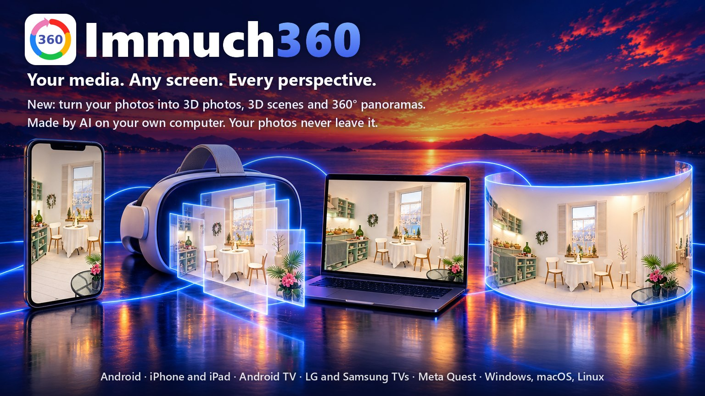

🌐 <b>עברית</b> · שפות אחרות (88)
<a href="../README.md">English</a> · <a href="README.af.md">Afrikaans</a> · <a href="README.ar.md">العربية</a> · <a href="README.az.md">Azərbaycanca</a> · <a href="README.be.md">Беларуская</a> · <a href="README.bg.md">Български</a> · <a href="README.bi.md">Bislama</a> · <a href="README.bn.md">বাংলা</a> · <a href="README.br.md">Brezhoneg</a> · <a href="README.bs.md">Bosanski</a> · <a href="README.ca.md">Català</a> · <a href="README.cs.md">Čeština</a> · <a href="README.cv.md">Чӑвашла</a> · <a href="README.da.md">Dansk</a> · <a href="README.de.md">Deutsch</a> · <a href="README.de_CH.md">Deutsch (Schweiz)</a> · <a href="README.el.md">Ελληνικά</a> · <a href="README.en_GB.md">English (UK)</a> · <a href="README.eo.md">Esperanto</a> · <a href="README.es.md">Español</a> · <a href="README.et.md">Eesti</a> · <a href="README.eu.md">Euskara</a> · <a href="README.fa.md">فارسی</a> · <a href="README.fi.md">Suomi</a> · <a href="README.fil.md">Filipino</a> · <a href="README.fr.md">Français</a> · <a href="README.ga.md">Gaeilge</a> · <a href="README.gl.md">Galego</a> · <a href="README.gsw.md">Alemannisch</a> · <a href="README.gu.md">ગુજરાતી</a> · <a href="README.hi.md">हिन्दी</a> · <a href="README.hr.md">Hrvatski</a> · <a href="README.hu.md">Magyar</a> · <a href="README.hy.md">Հայերեն</a> · <a href="README.id.md">Bahasa Indonesia</a> · <a href="README.is.md">Íslenska</a> · <a href="README.it.md">Italiano</a> · <a href="README.ja.md">日本語</a> · <a href="README.ka.md">ქართული</a> · <a href="README.kab.md">Taqbaylit</a> · <a href="README.kk.md">Қазақша</a> · <a href="README.km.md">ខ្មែរ</a> · <a href="README.kmr.md">Kurmancî</a> · <a href="README.kn.md">ಕನ್ನಡ</a> · <a href="README.ko.md">한국어</a> · <a href="README.kxm.md">ภาษาเขมรถิ่นไทย</a> · <a href="README.lb.md">Lëtzebuergesch</a> · <a href="README.lmo.md">Lombard</a> · <a href="README.lt.md">Lietuvių</a> · <a href="README.lv.md">Latviešu</a> · <a href="README.mfa.md">Bahasa Melayu Kelantan</a> · <a href="README.mi.md">Te reo Māori</a> · <a href="README.mk.md">Македонски</a> · <a href="README.ml.md">മലയാളം</a> · <a href="README.mn.md">Монгол</a> · <a href="README.mr.md">मराठी</a> · <a href="README.ms.md">Bahasa Melayu</a> · <a href="README.nb_NO.md">Norsk bokmål</a> · <a href="README.ne.md">नेपाली</a> · <a href="README.nl.md">Nederlands</a> · <a href="README.nn.md">Norsk nynorsk</a> · <a href="README.pa.md">ਪੰਜਾਬੀ</a> · <a href="README.pl.md">Polski</a> · <a href="README.pt.md">Português</a> · <a href="README.pt_BR.md">Português (Brasil)</a> · <a href="README.ro.md">Română</a> · <a href="README.ru.md">Русский</a> · <a href="README.si.md">සිංහල</a> · <a href="README.sk.md">Slovenčina</a> · <a href="README.sl.md">Slovenščina</a> · <a href="README.sq.md">Shqip</a> · <a href="README.sr_Cyrl.md">Српски</a> · <a href="README.sr_Latn.md">Srpski</a> · <a href="README.sv.md">Svenska</a> · <a href="README.sw.md">Kiswahili</a> · <a href="README.swg.md">Schwäbisch</a> · <a href="README.ta.md">தமிழ்</a> · <a href="README.te.md">తెలుగు</a> · <a href="README.th.md">ไทย</a> · <a href="README.tl.md">Tagalog</a> · <a href="README.tr.md">Türkçe</a> · <a href="README.uk.md">Українська</a> · <a href="README.ur.md">اردو</a> · <a href="README.uz.md">Oʻzbekcha</a> · <a href="README.vi.md">Tiếng Việt</a> · <a href="README.yue_Hant.md">粵語</a> · <a href="README.zh_Hans.md">简体中文</a> · <a href="README.zh_Hant.md">繁體中文</a>

  

# Immuch360

**המדיה שלך. כל מסך. כל זווית.**

תמונות וסרטונים שטוחים, 360° ו-3D מהמכשיר שלך, מה-NAS שלך, משרת ה-Immich שלך, מהמצלמות שלך ומהרחפן שלך. לא צריך חשבון. Immuch360 היא אפליקציה חופשית בקוד פתוח שקוראת את התמונות והסרטונים שלך במקום שבו הם נמצאים ומנגנת כל אחד מהם במציג שמתאים לו: שטוח, כספירה שמסתכלים סביב בתוכה, ב-3D, או סביבך לגמרי בקסדה. היא רצה בטלפונים, בטאבלטים, בטלוויזיות, בקסדות Meta Quest ובמחשבים.

**חדש: התמונות השטוחות שלך, ב-3D.** בחר תמונה במחשב שלך וקבל תמונת 3D, סצנת 3D להיכנס אליה, או פנורמת 360° שמדמיינת את שאר המקום סביבך. ב-Meta Quest 3 או 3S, לחיצה אחת על "עומק AI" וכל תמונה שטוחה בולטת. ה-AI רץ במחשב ובקסדה שלך, ושום דבר לא נשלח לשום מקום. ניסיוני. [איך עושים את זה](#turn-one-photo-into-3d-a-scene-a-panorama).

  

  

תוצרים אמיתיים של האפליקציה מתמונות CC0 של Poly Haven, מוקטנים, לא מרוטשים, עם התגים של האפליקציה שנוספו לעמוד הזה. למעלה, תמונת 3D, שתי העיניים שלה לסירוגין; למטה, תמונה אחת בארבע דרכים, שתי תצוגות הסצנה רונדרו מקובץ הסצנה. כל מה שמחוץ לקו המתאר של הפנורמה הומצא על ידי AI.

  פיצול (fork) לא רשמי של אפליקציית המובייל של Immich. לא קשור ל-Immich או ל-FUTO. השם נשמע כמו "I am much 360".

<b>תוכן העניינים</b>

- [למי זה מיועד](#who-it-is-for)
- [אילו מסכים](#which-screens), ו[מה כל מסך עושה](#what-each-screen-does)
- [מה אפשר לעשות](#what-you-can-do)
- [להשיג אותה במכשיר שלך](#get-it-on-your-device)
- [איך עושים](#how-to)
  - [להפוך תמונה אחת ל-3D, לסצנה, לפנורמה](#turn-one-photo-into-3d-a-scene-a-panorama)
  - [לצפות בתמונות ובסרטונים שלך, עם שרת או בלעדיו](#watch-your-photos-and-videos-with-or-without-a-server)
  - [לחקור פנורמות, 360°, VR180 ו-3D](#explore-panoramas-360-vr180-and-3d)
  - [לצפות בטלוויזיה עם השלט](#watch-on-the-tv-with-the-remote): [Android TV ו-Google TV](#on-android-tv-and-google-tv), [LG](#on-an-lg-tv-webos), [Samsung](#on-a-samsung-tv-tizen)
  - [לחבר טלוויזיה, קסדה או מחשב עם הטלפון שלך](#sign-in-a-tv-a-headset-or-a-computer-with-your-phone)
  - [להיכנס לתוך התמונות והסרטונים שלך עם Meta Quest](#step-inside-your-photos-and-videos-with-a-meta-quest)
  - [לנגן את הקבצים של NAS, מחשב, שרת מדיה או Plex](#play-the-files-of-a-nas-a-computer-a-media-server-or-plex)
  - [לשמור על ספריית ה-Immich שלך, ועוד](#keep-your-immich-library-with-more)
  - [לצפות במצלמות הבית שלך על המסך הגדול](#watch-your-home-cameras-on-the-big-screen)
  - [רחפן ה-DJI שלך (ניסיוני)](#your-dji-drone-experimental): [וידאו חי](#see-what-your-drone-sees-on-your-phone), [ב-Quest או ב-Android TV](#watch-it-in-a-meta-quest-or-on-an-android-tv), [ייבוא](#bring-a-drones-or-a-camera-cards-photos-and-videos-to-immich)
  - [לפתוח את הקבצים הגולמיים של מצלמות 360°](#open-the-raw-files-of-360-cameras)
  - [לסובב תמונה במקש אחד](#turn-a-photo-with-one-key)
  - [להשתמש במחשב שלך כנגן המדיה](#use-your-computer-as-the-media-player)
- [בהשוואה ל-Immich](#compared-with-immich)
- [פרטיות](#privacy)
- [רישיונות וקרדיטים](#licences-and-credits)
- [מפת דרכים](#roadmap)
- [תיעוד](#documentation)

## למי זה מיועד

- **התמונות שלך שטוחות** ואתה רוצה אותן ב-3D, כסצנה להתכופף לתוכה בקסדה, או בתוך פנורמת 360°, בלי מצלמת 3D: [להפוך תמונה אחת ל-3D, לסצנה, לפנורמה](#turn-one-photo-into-3d-a-scene-a-panorama), חדש, נוצר על ידי AI במחשב שלך.
- **אתה מצלם ב-360° או ב-3D** ורוצה להסתכל סביב בתוך הצילומים שלך, ולא לראות אותם שטוחים, כפולים או מתוחים: [360°, VR180 ו-3D](#explore-panoramas-360-vr180-and-3d).
- **התמונות והסרטים שלך נמצאים על NAS, מחשב, Plex או Immich** ואתה רוצה אותם בטלוויזיה בלי להעתיק כלום: [בטלוויזיה](#watch-on-the-tv-with-the-remote), [NAS, שיתופים ו-Plex](#play-the-files-of-a-nas-a-computer-a-media-server-or-plex).
- **יש לך Meta Quest** ואתה רוצה להיכנס לתוך התמונות והסרטונים שלך: [בקסדה](#step-inside-your-photos-and-videos-with-a-meta-quest).
- **אתה מריץ Immich** ורוצה את האפליקציה שלו, ובנוסף את המציגים הסוחפים ואת המסכים הגדולים שמתחברים מהטלפון שלך: [ספריית ה-Immich שלך](#keep-your-immich-library-with-more), [בהשוואה ל-Immich](#compared-with-immich).
- **אתה שומר על הבית שלך עם מצלמות Tapo** ורוצה אותן ליד התמונות שלך, גם בטלוויזיה (עוד לא נבדק עם מצלמה אמיתית): [מצלמות הבית](#watch-your-home-cameras-on-the-big-screen).
- **אתה מטיס רחפן DJI** ורוצה את התמונה החיה שלו בטלפון שלך בלי DJI Fly, וב-Meta Quest או ב-Android TV לאנשים שאיתך (ניסיוני): [הרחפן שלך](#see-what-your-drone-sees-on-your-phone).

אין חשבון Immuch360 ליצור, ושום דבר לא מגיע אלינו: האפליקציה מתקשרת רק עם המכשירים שלך ועם השרתים שבחרת, ומורידה רכיב AI רק כשאתה מבקש.

## אילו מסכים

| פלטפורמה | איפה להשיג | מצב ב-29 באוקטובר 2026 |
|---|---|---|
|  טלפונים וטאבלטים עם **Android** | [Google Play](https://play.google.com/store/apps/details?id=com.aprogsys.immuch360) · [APK](https://github.com/freeKC/Immuch360/releases) | ב-Google Play (בנייה 25; בנייה 32 נשלחה לבדיקת Google ב-29 באוקטובר, במקום בנייה 31), בנייה 32 ב-GitHub, שפותחת את [פנורמות ה-360° שנוצרו במחשב](#turn-one-photo-into-3d-a-scene-a-panorama) עם סימון ה-AI שלהן |
|  **iPhone ו-iPad** | App Store | גרסה 3.3.1 (בנייה 27) מחכה לבדיקת Apple מאז 22 באוקטובר, ואחריה גרסה 3.3.2 (בנייה 28), ב-TestFlight לבדיקות פנימיות; בינתיים אפשר [לבנות בעצמך](../docs/immuch360/build.md) |
|  **Android TV ו-Google TV** | [APK](#android-tv-and-google-tv) · Google Play | בנייה 32 ב-GitHub: [התחברות עם הטלפון שלך](#sign-in-a-tv-a-headset-or-a-computer-with-your-phone) בסריקת קוד QR, [סרגל זמן, שמע וכתוביות](#on-android-tv-and-google-tv) לשלט בנגן הווידאו, ו[וידאו חי של רחפן](#watch-it-in-a-meta-quest-or-on-an-android-tv) שמועבר דרך טלפון (ניסיוני); רישום הטלוויזיה בבדיקת Google |
| **טלוויזיות LG** עם webOS 5.0 ואילך | [.ipk, גרסה 1.0.1](https://github.com/freeKC/Immuch360/releases/tag/webos-v1.0.1) · LG Content Store (בבדיקה) | גרסה 1.0.0, הוגשה ל-LG Content Store ב-24 באוקטובר, בבדיקות של LG מאז 26 באוקטובר; גרסה 1.0.1, ב-GitHub מאז 27 באוקטובר, מבצעת זום לתמונה מהחצים ומציינת מתי תמונה עדיין נטענת; עד ש-LG תפרסם את האפליקציה, היא מותקנת ב-[Developer Mode](#lg-tvs-webos). גרסה 1.0.0 רצה על טלוויזיות webOS 25 ב-Cloud Test Lab של LG |
| **טלוויזיות Samsung** עם Tizen 5.5 ואילך | [בניית בדיקה .wgt](https://github.com/freeKC/Immuch360/releases/tag/tizen-v0.2.0) | בניית בדיקה 0.2.0 של אותה אפליקציית טלוויזיה, לחתימה עם תעודת Samsung משלך ולהתקנה ב-[Developer mode](#samsung-tvs-tizen); 0.1.0 רצה על טלוויזיית Samsung של בודק, ו-0.2.0 כוללת את התיקונים מההרצה הזו; לא בחנות של Samsung |
|  **Meta Quest** 2, Pro, 3 ו-3S | [Horizon Store](https://www.meta.com/experiences/immuch360/1384208401440714/) · [APK](#meta-quest) | ב-Horizon Store (בנייה 31, זמינה מאז 28 באוקטובר; בנייה 32 הוגשה ב-29 באוקטובר), בנייה 32 ב-GitHub, עם [עומק AI](#turn-one-photo-into-3d-a-scene-a-panorama) לתמונה שטוחה ב-Quest 3 וב-3S (ניסיוני) |
|  **Windows** | [תוכנת התקנה או ZIP](https://github.com/freeKC/Immuch360/releases/tag/desktop-v3.3.0-rc.0-13) | בנייה 13 של שולחן העבודה, תצוגה מקדימה חתומה: תמונות, סרטונים שטוחים ו-360°, שיתופים, Plex, מצלמות (עוד לא נבדק עם מצלמה אמיתית), התחברות עם הטלפון שלך, תמונות שמסתובבות במקש אחד, הממשק ב-89 שפות, וחדש, [תמונות 3D, סצנות 3D ופנורמות 360° מהתמונות שלך](#turn-one-photo-into-3d-a-scene-a-panorama) על ידי AI (ניסיוני) |
|   **macOS ו-Linux** | [.deb, .rpm, DMG](https://github.com/freeKC/Immuch360/releases/tag/desktop-v3.3.0-rc.0-13) | בנייה 13 של שולחן העבודה, תצוגות מקדימות: תמונות, תמונות 360° וסרטונים שטוחים (סרטוני 360° מתנגנים שטוחים), שרת Immich ושיתופי רשת, וחדש, [תמונות 3D וסצנות 3D](#turn-one-photo-into-3d-a-scene-a-panorama) שנוצרות על ידי AI מהתמונות שלך, עם פנורמות 360° ב-Linux על כרטיס מסך של 8 GB; בנייה 11 של שולחן העבודה נוסתה ב-26 באוקטובר בקונטיינר Ubuntu 24.04 וב-Mac; לא חתומה ב-macOS |

*הסטטוסים מתעדכנים בכל גרסה; הפרטים, בנייה אחר בנייה, נמצאים ב[סטטוס הגרסאות](../docs/immuch360/release-status.md).*

  

### מה כל מסך עושה

בסיס קוד אחד לטלפונים, לטאבלטים, ל-Android TV, ל-Meta Quest ולמחשבים, ואפליקציית טלוויזיה נפרדת לטלוויזיות LG, שארוזה גם לטלוויזיות Samsung כבניית בדיקה. מה יש בכל אחת מהן כיום:

| יכולת | Android | iPhone, iPad | Android TV | LG webOS | Samsung Tizen | Quest |
|---|:---:|:---:|:---:|:---:|:---:|:---:|
| גלריה, אלבומים, חיפוש עם שרת Immich | ✅ | ✅ | ✅ מציג | ✅ מציג | ✅ מציג | ✅ |
| התחברות עם הטלפון שלך (קוד QR) | ✅ סורק את הקוד | 🔜 גרסת ה-iOS הבאה | ✅ | ✅ בדפדפן של הטלפון | ❌ הקלדה בטלוויזיה | ✅ קוד שמוקלד בטלפון |
| בלי שרת: המדיה של המכשיר עצמו | ✅ | ✅ | רק שיתופים | ❌ | ❌ | ✅ |
| תמונות וסרטונים שטוחים | ✅ | ✅ | ✅ | ✅ | ✅ | ✅ |
| סיבוב תמונה במקש אחד | ✅ | ✅ | ✅ מקשים צבעוניים | ✅ מקשים צבעוניים | ✅ | ✅ חלון |
| תמונות 360° כספירה | ✅ | ✅ | ✅ | ✅ | ✅ | ✅ סוחף |
| סרטוני 360° | ✅ | ✅ בלי סרגל זמן | ✅ הודעה אם לא ניתן לפענח | שטוח בלבד | שטוח בלבד | ✅ סוחף |
| 3D ו-VR180 | ✅ עין אחת | ✅ עין אחת | ✅ עין אחת | תמונות בעין אחת, סרטונים שטוחים | תמונות בעין אחת, סרטונים שטוחים | ✅ 3D אמיתי |
| Spatial 2.5D (מעקב ראש) | ✅ ניסיוני | ✅ ניסיוני | ❌ | ❌ | ❌ | ❌ |
| תמונות Spatial של Apple | ✅ עין אחת | ✅ עין אחת | ✅ עין אחת | ❌ | ❌ | ✅ 3D |
| תמונת 3D מתמונת 2D (AI) | ✅ קורא אותה, זה לצד זה | ✅ קורא אותה, זה לצד זה | ✅ קורא אותה, זה לצד זה | ✅ קורא אותה, זה לצד זה | ✅ קורא אותה, זה לצד זה | ✅ עומק AI בקסדה (Quest 3 ו-3S), מוצגת ב-3D |
| סצנת 3D מתמונת 2D (AI) | ✅ קורא אותה, כתמונה שלה | ✅ קורא אותה, כתמונה שלה | ✅ קורא אותה, כתמונה שלה | ✅ קורא אותה, כתמונה שלה | ✅ קורא אותה, כתמונה שלה | ✅ סיור ב-3D |
| פנורמת 360° מתמונת 2D (AI) | ✅ קורא אותה, עם סימון ה-AI שלה | ✅ קורא אותה כתמונת 360°, סימון 🔜 | ✅ קורא אותה, עם סימון ה-AI שלה | ✅ קורא אותה כתמונת 360°, סימון 🔜 | ✅ קורא אותה כתמונת 360°, סימון 🔜 | ✅ קורא אותה סביבך, עם סימון ה-AI שלה |
| קבצי Insta360, GoPro ו-DJI גולמיים | ✅ | ✅ | ✅ | ❌ | ❌ | ✅ |
| שיתופי SMB, WebDAV, DLNA | ✅ | ✅ | ✅ | ✅ SMB החל מ-webOS 22 | ❌ | ✅ |
| Plex Media Server | ✅ | ✅ | ✅ | ✅ | ❌ | ✅ |
| מצלמות Tapo: הקלטות | ✅ | ✅ | ✅ | 🔜 לא לפני דצמבר 2026 | ❌ | ✅ |
| מצלמות Tapo: שידור חי | ✅ | 🔜 גרסת ה-iOS הבאה | ✅ | ✅ וידאו בלבד | ❌ | ✅ |
| שיתוף המכשיר הזה ברשת | ✅ | ✅ | ❌ | ❌ | ❌ | ❌ |
| העלאה ל-Immich משיתופים ומהמכשיר | ✅ | ✅ | ❌ | ❌ | ❌ | ✅ |
| ייבוא מרחפן DJI או מכרטיס דרך USB (ניסיוני) | ✅ | ❌ | ❌ | ❌ | ❌ | ❌ |
| הווידאו החי של רחפן ה-DJI (ניסיוני) | ✅ עם RC-N3 | ❌ | ✅ מועבר דרך טלפון | ❌ | ❌ | ✅ מועבר דרך טלפון |
| ערכת נושא כהה | כמו המערכת | כמו המערכת | ✅ כברירת מחדל | ✅ ערכת הנושא היחידה | ✅ ערכת הנושא היחידה | כמו המערכת |
| קלט | מגע, גירוסקופ | מגע, גירוסקופ | שלט; שמאלה וימינה גם במהלך סרטון ועל סרגל הזמן שלו, Menu לפרטים | שלט, Magic Remote | שלט | בקרים, ידיים |
| איפה להשיג | Google Play, APK | App Store (בבדיקה) | APK, Google Play (בבדיקה) | .ipk, LG Content Store (בבדיקה) | בניית בדיקה .wgt, חתומה על ידך | Horizon Store, APK |

| יכולת | Windows | Linux | macOS |
|---|:---:|:---:|:---:|
| גלריה, אלבומים, חיפוש עם שרת Immich | ✅ | ✅ | ✅ |
| התחברות עם הטלפון שלך (קוד QR) | ✅ | ✅ (דף האינטרנט שלה נוסה) | ✅ (לא נרשם באיזו דרך) |
| בלי שרת: המדיה של המכשיר עצמו | ✅ תיקיות | ✅ תיקיות | ✅ תיקיות |
| תמונות וסרטונים שטוחים | ✅ | ✅ | ✅ |
| סיבוב תמונה במקש אחד | ✅ | ✅ | ✅ |
| תמונות 360° כספירה | ✅ | ✅ | ✅ |
| סרטוני 360° | ✅ | שטוח בלבד | שטוח בלבד |
| 3D ו-VR180 | ✅ עין אחת | תמונות בעין אחת, סרטונים שטוחים | תמונות בעין אחת, סרטונים שטוחים |
| Spatial 2.5D (מעקב ראש) | 🔜 בפיתוח | ❌ | ❌ |
| תמונות Spatial של Apple | ✅ עין אחת | ✅ עין אחת, משרת | ✅ עין אחת |
| תמונת 3D מתמונת 2D (AI) | ✅ | ✅ | ✅ עדיין לא נוסה ב-Mac |
| סצנת 3D מתמונת 2D (AI) | ✅ | ✅ | ✅ עדיין לא נוסה ב-Mac |
| פנורמת 360° מתמונת 2D (AI) | ✅ כרטיס מסך של 8 GB | ✅ כרטיס מסך של 8 GB, עדיין לא נוסה עם כרטיס כזה | 🔜 עדיין לא ב-Mac |
| קבצי Insta360, GoPro ו-DJI גולמיים | ✅ | ✅ תמונות, סרטונים שטוחים | ✅ תמונות, סרטונים שטוחים |
| שיתופי SMB, WebDAV, DLNA | ✅ | ✅ | ✅ |
| Plex Media Server | ✅ | 🔧 CI | 🔧 CI |
| מצלמות Tapo: הקלטות | ✅ | 🔧 CI | 🔧 CI |
| מצלמות Tapo: שידור חי | ✅ | 🔧 CI | 🔧 CI |
| שיתוף המכשיר הזה ברשת | ✅ | ❌ | ❌ |
| העלאה ל-Immich משיתופים ומהמכשיר | ✅ | ✅ | ✅ |
| ייבוא מרחפן DJI או מכרטיס דרך USB (ניסיוני) | ❌ | ❌ | ❌ |
| הווידאו החי של רחפן ה-DJI (ניסיוני) | ❌ | ❌ | ❌ |
| ערכת נושא כהה | כמו המערכת | כמו המערכת | כמו המערכת |
| קלט | עכבר, מקלדת | עכבר, מקלדת | עכבר, מקלדת, משטח מגע |
| איפה להשיג | תוכנת התקנה או ZIP (תצוגה מקדימה חתומה) | .deb, .rpm (תצוגה מקדימה) | DMG או ZIP (תצוגה מקדימה לא חתומה) |

*Linux ו-macOS: בנייה 11 של שולחן העבודה, נוסתה ב-26 באוקטובר 2026 ב-Ubuntu 24.04, בקונטיינר עם שרת Immich לבדיקה ושיתופים לבדיקה, ועל ידי המחבר ב-Mac. שורות ה-AI, עם בניות בדיקה של הקוד של בנייה 13 של שולחן העבודה, מ-27 עד 29 באוקטובר 2026: תמונות 3D שנוצרו על ידי אפליקציית Linux בקונטיינר במחשב Linux, סצנות על ידי אפליקציית Windows במחשב נייד עם RTX 4060 ועל ידי המנוע באותו מחשב Linux, פנורמות 360° באותו מחשב נייד; עדיין לא נוסה ב-Mac.*

✅ באפליקציה בפלטפורמה הזו · ❌ לא מוצע בה · 🔜 מתוכנן · 🔧 CI במקורות, נבנה והופעל על ידי ה-CI של הפרויקט במערכת הזו, עדיין לא נבדק שם עם שרת, שיתוף או מצלמה אמיתיים · שטוח בלבד: הסרטון מתנגן שטוח, עם הודעה, כי מנוע הרינדור של סרטוני 360° במחשבים קיים רק ב-Windows; בטלוויזיות LG עוד צריך למדוד אם webOS מעביר את פריימי הווידאו לספירה; בטלוויזיית Samsung של בודק, הדפדפן נתן פריימי וידאו שחורים לתצוגת ה-3D. "עין אחת" פירושו שקובץ 3D מציג את העין השמאלית שלו במסך שטוח. עמודות LG ו-Samsung הן אפליקציית טלוויזיה נפרדת אחת: גרסת LG 1.0.0, שהשיתופים וה-Plex שלה נבדקו מול שרתים אמיתיים והמצלמות שלה מול מצלמה מדומה במכונת הבנייה של הפרויקט, עדיין לא על טלוויזיה, ובניית הבדיקה של Samsung 0.2.0. לא כל ה-✅ נבדק עדיין במכשיר אמיתי: מה נבדק ואיפה, ומה נותר לאשר, מופיע ב[תכונות](../docs/immuch360/features.md), ב[תמיכה בפלטפורמות](../docs/immuch360/platform-support.md) וב[תאימות](../docs/immuch360/compatibility.md).

בשורות ה-AI, "קורא אותה" פירושו שהמכשיר פותח את מה שמחשב יצר, ולא יוצר דבר בעצמו: תמונת 3D מציגה את שתי העיניים שלה זו לצד זו, סצנה מוצגת כתמונה שלה עם סימן קטן סצנת 3D, פנורמה נפתחת במציג ה-360°. סימון ה-AI שלה הוא התג "360° AI", המשפט "נוצר על ידי AI מעבר לשולי התמונה" וקו המתאר של התמונה המקורית, שאפליקציות iPhone, iPad, LG ו-Samsung עדיין לא מציגות. רק המחשבים וה-Quest יוצרים משהו. מה שנבדק עבור השורות האלה נמצא [במדריך](#turn-one-photo-into-3d-a-scene-a-panorama), עדיין לא בתכונות ובתמיכה בפלטפורמות.

- **טלפונים וטאבלטים עם Android**: האפליקציה המלאה, מגע וגירוסקופ, כל מקור; החל מבנייה 32 הם פותחים את פנורמות ה-360° שנוצרו במחשב עם סימון ה-AI שלהן.
- **iPhone ו-iPad**: האפליקציה המלאה; לנגן הווידאו של 360° יש רק הפעלה והשהיה, השידור החי של Tapo וצד הטלפון של ההתחברות עם הטלפון מגיעים עם גרסת ה-iOS הבאה, וחיפוש ה-DLNA שולח בקשות unicast עד ש-Apple תעניק את הרשאת ה-multicast.
- **Android TV ו-Google TV**: אותו APK, מופעל על ידי השלט, כהה כברירת מחדל; מציג בלבד: גיבוי, העלאות והעורך מוסתרים והפרטים לקריאה בלבד, אבל תמונה עדיין מסתובבת במקש אחד. כל מסנן חיפוש עובד עם השלט: "מיקום" ו"מצלמה" פותחים את האפשרויות שלהם ברשימה, מסנן התאריך מציג את כל האפשרויות שלו, והגיליונות "תגים", "מיקום", "תאריך", "סוג מדיה", "דירוג כוכבים" ו"אפשרויות תצוגה" מציבים את "נקה" ו"החל" ליד האפשרויות, במרחק לחיצה אחת ימינה, על רוב גובה המסך. רשת התמונות משתמשת בפחות זיכרון תמונה, וחץ לחוץ מזיז אותה לכל היותר כ-10 שורות בשנייה. החל מבנייה 28 היא מתחברת מטלפון, דרך קוד ה-QR שלה או הקוד הקצר שלה (נוסה בין שני אמולטורים עם הקוד מוקלד, עדיין לא עם מצלמה). החל מבנייה 29 סרגל הזמן של סרטון מקבל את המיקוד של השלט, לסרטים יש תפריטי שמע וכתוביות, והקובץ הבא של שיתוף נפתח עם פקדים משלו. נבדק על אמולטור Google TV; בנייה 28 רצה על Android TV אמיתי ב-23 באוקטובר, ובעיות הווידאו שנמצאו שם הן התיקונים של בנייה 29, שנבדקו על האמולטור, עדיין לא על הטלוויזיה הזו. החל מבנייה 30, כרטיס ה"רחפן" שלה מציג את הווידאו החי של רחפן DJI שטלפון מעביר, עם הערכים של הרחפן וטבעת המכשולים (ניסיוני): הצימוד והתמונה נוסו על Android TV של TCL ב-25 באוקטובר, עם גמגומים וגוון ירוק בהעברה הקודמת; ב-26 באוקטובר, עם בנייה 30, הזרם היציב שעונה על כך שמר על התמונה בטלוויזיה הזו לאורך הטיסה, עם 7 קפיאות.
- **טלוויזיות LG עם webOS 5.0 ואילך**: אפליקציה נפרדת לשלט ול-Magic Remote, בנויה על [immich-tv-webos](https://github.com/Seeky91/immich-tv-webos): מציג Immich עם תמונות ה-360° על ספירה, תמונה שמסתובבת במקש אחד, ערכת נושא כהה ו-89 השפות של האפליקציה (הטקסטים המעטים של אפליקציית הטלוויזיה עצמה באנגלית בינתיים); שיתופי הרשת, Plex והשידור החי של מצלמות Tapo, דרך השירות שלה בטלוויזיה (SMB החל מ-webOS 22); סרטוני 360° שטוחים. גרסה 1.0.0, שהוגשה ל-LG Content Store ב-24 באוקטובר, רצה על טלוויזיות webOS 25 משלושה דגמים ב-Cloud Test Lab של LG: התחברות, דף ההתחברות בטלפון, תמונות, אלבומים, סרטון, תצוגת ה-360°, מצגת השקופיות, חיפוש ו-Back מכל עמוד. גרסה 0.1.0 רצה על טלוויזיית LG של בודק (webOS 22). השיתופים ו-Plex נבדקו מול שרתים אמיתיים והמצלמות מול מצלמה מדומה במכונת הבנייה של הפרויקט, עדיין לא על טלוויזיה.
- **טלוויזיות Samsung עם Tizen 5.5 ואילך**: אפליקציית הטלוויזיה של LG ארוזה לטלוויזיות Samsung, בניית בדיקה 0.2.0, לחתימה ולהתקנה בעצמך: מציג Immich לשלט, עם התחברות בהקלדה (כתובת השרת, ואז אימייל וסיסמה או מפתח API), עם מצגת שקופיות, תמונות 360° על ספירה, תמונה שמסתובבת במקש אחד ועמוד "אודות" שמציין במה הטלוויזיה תומכת; עדיין בלי התחברות עם טלפון, שיתופים, Plex או מצלמות; סרטוני 360° שטוחים, עם הודעה. גרסה 0.1.0 רצה על טלוויזיית Samsung של בודק עם Tizen 9: תמונות וסרטונים עד 4K התנגנו, שום דבר מעל 4K לא פוענח, והדפדפן של הטלוויזיה נתן פריימי וידאו שחורים לתצוגת ה-3D. גרסה 0.2.0 כוללת את התיקונים מההרצה הזו (הודעה לסרטון שחורג ממפענחי הטלוויזיה או לסרטון שנתקע, סרטוני 360° שטוחים עם הודעה) ועדיין לא רצה על טלוויזיה.
- **Meta Quest 2, Pro, 3 ו-3S**: האפליקציה כחלון, ובנוסף התצוגה הסוחפת, והחל מבנייה 30 כרטיס Drone שמציג את הווידאו החי של רחפן DJI שמועבר דרך טלפון (ניסיוני), שנבדק לראשונה עם בנייה 30; HEVC הוא הקודק הבטוח, H.264 נעצר בסביבות 4096x2304 ב-Quest 3; רק ה-Quest 3 נבדק, ה-Quest 2, ה-Quest Pro וה-Quest 3S עדיין לא נבדקו. החל מבנייה 32, ב-Quest 3 או 3S, עומק ה-AI מציג תמונה שטוחה ב-3D, מחושב בקסדה, ותמונות ה-3D, הסצנות והפנורמות שנוצרו במחשב נפתחות ב-3D (ניסיוני).
- **Windows 10 ו-11**: תצוגה מקדימה, עם תיקיות במקום גלריה, נגן וידאו משלו (libmpv) לסרטונים שטוחים ו-360°, קבצים גולמיים מאוחדים בשבב הגרפיקה, קבצים ותיקיות שנפתחים עם התוכנה או שנגררים לחלון, תוכנת התקנה או ZIP, חתומים על ידי APROGSYS; החל מבנייה 13 של שולחן העבודה, "יצירת 3D (AI)" הופך את התמונות שלך לתמונות 3D ולסצנות 3D במעבד, ולפנורמות 360° בכרטיס מסך של 8 GB.
- **Linux**: קובץ .deb וקובץ .rpm שנבנו על ידי ה-CI של הפרויקט, הותקנו ונבדקו ב-Ubuntu 22.04 ו-24.04, ב-Debian 12 וב-Fedora 40 ו-44; תמונות, תמונות 360° וסרטונים שטוחים דרך ה-libmpv של המערכת (סרטוני 360°, 3D וסרטונים גולמיים מתנגנים שטוחים עם הודעה), מצוירים במסלול החומרה גם בסשנים של X11 החל מבנייה 7 של שולחן העבודה; שיתופי SMB החל מ-Ubuntu 22.04 ו-Debian 12; בלי מחזיק מפתחות (GNOME Keyring או KWallet) האפליקציה כבר לא קופאת למשך 25 s בהפעלה הראשונה: היא שומרת את הסיסמאות לסשן בלבד ואומרת זאת בהגדרות שלה; החל מבנייה 13 של שולחן העבודה, "יצירת 3D (AI)" יוצר תמונות 3D וסצנות במעבד, ופנורמות 360° בכרטיס מסך של 8 GB (נוסה רק בגודל קטן, על גרפיקה של Intel); עדיין לא הורץ על מחשב Linux אמיתי, רק תחת WSLg ובקונטיינרים.
- **macOS**: קובץ DMG וקובץ ZIP שנבנו על ידי ה-CI של הפרויקט, אוניברסליים, לא חתומים (Gatekeeper שואל פעם אחת); האפליקציה מופעלת, פותחת את הקבצים והתיקיות שמועברים אליה, כולל מ-Finder, שומרת את הסודות שלה בצרור המפתחות של ההתחברות ומנגנת סרטונים שטוחים עם ה-libmpv שלה, נבדק תחילה ב-Mac של ה-CI של הפרויקט; ב-26 באוקטובר 2026 המחבר ניסה את בנייה 11 של שולחן העבודה על Mac, והיא עבדה. החל מבנייה 13 של שולחן העבודה, תמונות 3D וסצנות נוצרות גם במעבד (עדיין לא נוסה ב-Mac); עדיין אין פנורמות 360° ב-Mac.

## מה אפשר לעשות

כל שורה פותחת למטה את ההוראות שלה. המדריך המלא, עם כל האפשרויות, ההודעות והמגבלות, נמצא ב[מדריך למשתמש](../docs/immuch360/user-guide.md).

1. [להפוך תמונה אחת לתמונת 3D, לסצנת 3D או לפנורמת 360°](#turn-one-photo-into-3d-a-scene-a-panorama): נוצר על ידי AI במחשב שלך, נצפה ב-3D ב-Meta Quest, שגם נותן עומק לכל תמונה שטוחה. *חדש, ניסיוני.*
2. [לצפות בתמונות ובסרטונים שלך, עם שרת או בלעדיו](#watch-your-photos-and-videos-with-or-without-a-server): גלריה ונגן, במכשיר לבד או עם שרת ה-Immich שלך.
3. [להסתכל סביב בתמונות ובסרטוני 360°, פנורמות, VR180 ו-3D](#explore-panoramas-360-vr180-and-3d): ספירה שמסובבים באצבע, עם הטלפון או עם השלט.
4. [לצפות בטלוויזיה עם השלט](#watch-on-the-tv-with-the-remote): Android TV ו-Google TV, טלוויזיות LG, וטלוויזיות Samsung כבניית בדיקה.
5. [לחבר טלוויזיה, קסדה או מחשב עם הטלפון שלך](#sign-in-a-tv-a-headset-or-a-computer-with-your-phone): לסרוק את קוד ה-QR, לאשר, לצפות.
6. [להיכנס לתוך התמונות והסרטונים שלך עם Meta Quest](#step-inside-your-photos-and-videos-with-a-meta-quest): 360° סביבך, 3D ב-3D אמיתי.
7. [לנגן את הקבצים של NAS, מחשב, שרת מדיה או Plex](#play-the-files-of-a-nas-a-computer-a-media-server-or-plex): במקומם, בלי להעתיק כלום.
8. [לשמור על ספריית ה-Immich שלך, ועוד](#keep-your-immich-library-with-more): אפליקציית Immich לנייד, ובנוסף המציגים הסוחפים והמסכים הגדולים.
9. [לצפות במצלמות ה-Tapo שלך](#watch-your-home-cameras-on-the-big-screen): בשידור חי, וההקלטות של כרטיס הזיכרון שלהן; עוד לא נבדק עם מצלמה אמיתית.
10. [לראות את הווידאו החי של רחפן ה-DJI שלך בטלפון](#see-what-your-drone-sees-on-your-phone), ו[ב-Meta Quest או ב-Android TV](#watch-it-in-a-meta-quest-or-on-an-android-tv): דרך בקר DJI RC-N3, קבלה בלבד. *ניסיוני.*
11. [להעביר ל-Immich את התמונות והסרטונים של רחפן או של כרטיס מצלמה](#bring-a-drones-or-a-camera-cards-photos-and-videos-to-immich): דרך USB, מטלפון Android. *ניסיוני.*
12. [לפתוח את הקבצים הגולמיים של מצלמות 360°](#open-the-raw-files-of-360-cameras): Insta360, GoPro MAX ו-DJI Osmo 360, מאוחדים על ידי האפליקציה.
13. [לסובב תמונה במקש אחד](#turn-a-photo-with-one-key): כפתור, מקש במקלדת או מקש צבעוני בשלט.
14. [להשתמש במחשב שלך כנגן המדיה](#use-your-computer-as-the-media-player): התיקיות שלך, "פתח באמצעות", קובץ שנגרר לחלון. *תצוגה מקדימה.*

## להשיג אותה במכשיר שלך

קח את האפליקציה מחנות המכשיר שלך במקום שבו היא פורסמה, או בינתיים מעמוד ה-[Releases](https://github.com/freeKC/Immuch360/releases).

### טלפונים וטאבלטים עם Android

1. [Google Play](https://play.google.com/store/apps/details?id=com.aprogsys.immuch360), או ה-APK מעמוד ה[גרסאות](https://github.com/freeKC/Immuch360/releases): `Immuch360-v<version>-arm64-v8a-release.apk` לטלפון; הגרסה האוניברסלית `Immuch360-v<version>-release.apk` עובדת בכל מקום.
2. האפליקציה מותקנת לצד אפליקציית Immich הרשמית. ה-APK מ-GitHub לא מתעדכן בעצמו: יש לעקוב אחרי עמוד הגרסאות; אחרי שהאפליקציה הותקנה מחנות, יש לקבל את העדכונים מאותה חנות.

### iPhone ו-iPad

1. הגרסה של App Store מחכה לבדיקת Apple. עד שתתפרסם, אפשר לבנות את האפליקציה עם Xcode על Mac, ראה [לבנות בעצמך](../docs/immuch360/build.md).
2. הקש על "שימוש ללא שרת", או "התחברות לשרת Immich" כדי להתחבר עם השרת שלך; שניהם נמצאים בדף הפתיחה מבנייה 24.

### Android TV ו-Google TV

1. עד ש-Google Play יציע את האפליקציה בטלוויזיות, אפשר לקחת את הגרסה האוניברסלית `Immuch360-v<version>-release.apk` מעמוד ה[גרסאות](https://github.com/freeKC/Immuch360/releases).
2. בטלוויזיה, הפעילו את אפשרויות המפתחים ואת ניפוי הבאגים ב-USB (ב-Google TV: הגדרות, מערכת, מידע, בחרו "Android TV OS build" שבע פעמים, ואז הגדרות, מערכת, אפשרויות למפתחים; השמות משתנים בין טלוויזיות).
3. ממחשב באותה רשת, עם adb ‏(Android SDK Platform Tools): `adb connect <address of the TV>`, אשרו את הבקשה בטלוויזיה, ואז `adb install -r Immuch360-v<version>-release.apk`.
4. האפליקציה מופיעה בין האפליקציות של הטלוויזיה, עם הבאנר שלה. התקינו את הגרסה הבאה באותה דרך: `-r` שומר את ההתחברות ואת ההגדרות.

### טלוויזיות LG (webOS)

1. גרסה 1.0.0 בבדיקת LG. עד שהיא תהיה ב-LG Content Store, היא מותקנת ב-Developer Mode: צריך טלוויזיית LG עם webOS 5.0 ואילך, מחשב באותה רשת וחשבון מפתח LG חינמי. בטלוויזיה, התקן את Developer Mode מ-LG Content Store, התחבר, הפעל את Dev Mode Status ותן לטלוויזיה להפעיל את עצמה מחדש; רשום את כתובת ה-IP שלה ואת ביטוי הסיסמה שהאפליקציה מציגה.
2. במחשב, התקן את webOS CLI (Node.js 18 ואילך): `npm install -g @webos-tools/cli`, ואז רשום את הטלוויזיה עם `ares-setup-device` (כתובת ה-IP שלה, פורט 9922, משתמש `prisoner`) ו-`ares-novacom --device <name> --getkey`, שמבקש את ביטוי הסיסמה.
3. מ[הגרסה המקדימה של webOS 1.0.1](https://github.com/freeKC/Immuch360/releases/tag/webos-v1.0.1), הורד את `Immuch360-webOS-1.0.1.ipk` לטלוויזיית UHD, או את `Immuch360-webOS-1.0.1-1280x720.ipk` לטלוויזיית Full HD, ש-LG נותנת לה אפליקציות ב-1280x720. בדוק אותו מול `SHA256SUMS.txt`, ואז `ares-install --device <name> Immuch360-webOS-1.0.1.ipk`. [webOS Dev Manager](https://github.com/webosbrew/dev-manager-desktop) של webosbrew עושה את אותו הדבר בלי שורת הפקודה.
4. סשן של Developer Mode נמשך 1000 שעות, וכפתור EXTEND באפליקציית Developer Mode מחדש אותו; כשהוא פג, הטלוויזיה מסירה את האפליקציות שהותקנו בדרך הזו. הפרטים נמצאים ב-[webos/README.md](../webos/README.md#install-on-a-tv-in-developer-mode).
5. כשהאפליקציה תהיה ב-LG Content Store, הסר את העותק של Developer Mode והתקן אותה מהחנות.

### טלוויזיות Samsung (Tizen)

1. בניית הבדיקה 0.2.0 לא נמצאת בחנות של Samsung: אתה מתקין אותה בעצמך. צריך טלוויזיית Samsung עם Tizen 5.5 ואילך (דגמים משנת 2020 והלאה), מחשב באותה רשת וחשבון Samsung. בטלוויזיה: Apps, App Settings, הקלד 12345, הפעל את Developer mode, הזן את כתובת ה-IP של המחשב, ואז הפעל מחדש את הטלוויזיה.
2. הורד את `Immuch360-Tizen-0.2.0.wgt` מ[הגרסה המקדימה של Tizen](https://github.com/freeKC/Immuch360/releases/tag/tizen-v0.2.0) ובדוק אותו מול `SHA256SUMS.txt`. טלוויזיית Samsung מתקינה רק אפליקציה שנחתמה עבורה, ולכן יש לחתום את החבילה מחדש בתעודת Samsung שכוללת את ה-DUID של הטלוויזיה שלך: [Apps2Samsung](https://github.com/Apps2Samsung/Apps2Samsung), כלי קהילתי, קורא את ה-DUID, חותם את החבילה עם חשבון ה-Samsung שלך ומתקין אותה; Tizen Studio עם Samsung Certificate Extension עושה את אותו הדבר ידנית.
3. פתח את האפליקציה והתחבר בהקלדת כתובת השרת שלך, ואז האימייל והסיסמה שלך או מפתח API. "אודות הטלוויזיה הזו" מציג במה הטלוויזיה תומכת, כטקסט וכקוד QR: הטקסט הזה, כשהוא מפורסם ב[Issues](https://github.com/freeKC/Immuch360/issues) או ב[Discussions](https://github.com/freeKC/Immuch360/discussions) יחד עם מה שלא עובד, עוזר הכי הרבה.

### Meta Quest

1. מה[Horizon Store](https://www.meta.com/experiences/immuch360/1384208401440714/): גרסת החנות, מתעדכנת כש-Meta בודקת כל הגשה.
2. או התקן ידנית (sideload) את קובץ `-quest-release.apk` של [גרסה](https://github.com/freeKC/Immuch360/releases) במצב מפתחים עם adb או SideQuest: `adb install -r Immuch360-v<version>-quest-release.apk`, ואז פתח את הספרייה של הקסדה, "Unknown sources".
3. גרסת החנות וה-APK מ-GitHub חתומים עם מפתחות שונים: כדי לעבור מאחת לשנייה, יש להסיר את ההתקנה של האפליקציה קודם, מה שמוחק את ההתחברות, ההגדרות ורשימת שיתופי הרשת.

### Windows

1. הורד את `Immuch360-Desktop-3.3.0-rc.0-desktop.13-windows-x64-setup.exe` מ[הגרסה המקדימה של שולחן העבודה](https://github.com/freeKC/Immuch360/releases/tag/desktop-v3.3.0-rc.0-13) (עם `SHA256SUMS.txt` כדי לבדוק אותו) ופתח אותו. תוכנת ההתקנה וה-ZIP חתומים; Windows מציג את APROGSYS כמפרסם. כל עוד המפרסם חדש עבור SmartScreen, הוא עשוי עדיין לשאול פעם אחת: "מידע נוסף", ואז "הפעל בכל זאת".
2. בחר ב"Install for me only" (בלי הרשאות מנהל) או ב"Install for all users", ואז את שפת תוכנת ההתקנה, זו של Windows שכבר נבחרה.
3. הפעל את Immuch360 Desktop מתפריט ההתחלה. תמונות וסרטונים מקבלים אותה ב"פתח באמצעות" (לחיצה ימנית על קובץ, פתח באמצעות); היא לעולם לא הופכת את עצמה לתוכנת המחדל שלהם. ההפעלה הראשונה של בנייה חדשה יכולה לקחת עד דקה בזמן ש-Windows סורק את הקבצים.
4. Windows 10 או 11, 64 סיביות. לעדכון, פתח את תוכנת ההתקנה של הבנייה הבאה: ההתחברות, התיקיות וההגדרות שלך נשארות. קובץ ה-ZIP של אותה גרסה הוא אותה תוכנה כתיקייה, לחילוץ בכל מקום ולהפעלת `immuch360.exe` ממנה. במחשב שבו בניות 4 עד 8 של שולחן העבודה נעצרו בהפעלה עם "duplicate column name: group_date", בנייה 9 פותחת את מסד הנתונים הזה ושומרת את הנתונים שלך.

### Linux

ב-Ubuntu 22.04 ואילך וב-Debian 12 ואילך: `sudo apt install ./Immuch360-Desktop-3.3.0-rc.0-desktop.13-linux-amd64.deb`; ב-Fedora 40 ואילך: `sudo dnf install ./Immuch360-Desktop-3.3.0-rc.0-desktop.13-linux-x86_64.rpm`, שניהם מ[הגרסה המקדימה של שולחן העבודה](https://github.com/freeKC/Immuch360/releases/tag/desktop-v3.3.0-rc.0-13). לאחר מכן הפעל את Immuch360 Desktop מהיישומים שלך. תצוגה מקדימה: התיקיות של המחשב, תמונות ותמונות 360° כספירה, וסרטונים שטוחים דרך ה-libmpv של המערכת, שהחבילה מתקינה (סרטוני 360°, 3D וסרטונים גולמיים מתנגנים שטוחים, עם הודעה); שיתופי SMB עובדים החל מ-Ubuntu 22.04 ו-Debian 12. ב-Fedora, סרטוני מצלמה דורשים את ה-FFmpeg של RPM Fusion. בלי GNOME Keyring או KWallet, הסיסמאות נשמרות לסשן בלבד, וההגדרות של האפליקציה אומרות זאת.

### macOS

פתח את `Immuch360-Desktop-3.3.0-rc.0-desktop.13-macos.dmg` מ[הגרסה המקדימה של שולחן העבודה](https://github.com/freeKC/Immuch360/releases/tag/desktop-v3.3.0-rc.0-13) וגרור את האפליקציה ליישומים (Apple silicon ו-Intel, macOS 12 ואילך). היא עדיין לא חתומה ולא מאושרת (notarized): לחץ עליה עם Control ובחר לפתוח אותה ב-macOS 14 ומטה, או בחר "פתח בכל זאת" ב"הגדרות המערכת, פרטיות ואבטחה" ב-macOS 15 ואילך. המחבר ניסה את בנייה 11 של שולחן העבודה על Mac ב-26 באוקטובר 2026, והיא עבדה; מחשבי Mac וגרסאות macOS אחרים לא נוסו, ודיווחים מתקבלים בברכה.

## איך עושים

כל סעיף אומר מה תקבל, אחר כך את השלבים, ואחר כך את המגבלות. ב[מדריך למשתמש](../docs/immuch360/user-guide.md) יש כל אפשרות וכל הודעה.

### להפוך תמונה אחת ל-3D, לסצנה, לפנורמה

רוב התמונות שלך שטוחות, ואי אפשר לחזור אחורה ולצלם אותן שוב ב-3D. Immuch360 נותנת להן עומק. במחשב שלך, תמונה אחת הופכת ל**תמונת 3D**, ל**סצנת 3D** שאתה מתכופף לתוכה בקסדה, או ל**פנורמת 360°** שמדמיינת את שאר המקום סביבך. Quest 3 או 3S יוצרים את העומק בעצמם, לכל תמונה שטוחה. הכל רץ במחשב ובקסדה שלך: בלי ענן, בלי חשבון, המקוריים שלך לעולם לא משתנים. חדש בבנייה 32 ובבנייה 13 של שולחן העבודה, ניסיוני ומופעל כברירת מחדל. לאפליקציית Immich אין שום דבר כזה.

**במחשב שלך**, עם בנייה 13 של שולחן העבודה ב-Windows, Linux או macOS:

1. בחר תמונה אחת או יותר בספרייה או בתיקייה, ואז "יצירת 3D (AI)".
2. בחר מה אתה רוצה: "תמונת 3D", "סצנת 3D", "פנורמת 360°", או "גרסת 3D של תמונת 360°" לצילומי ה-360° שלך. החלון אומר מה ה-AI יעריך או ימציא ("כ-96% מהפנורמה הזו יומצאו על ידי AI"), בערך כמה זמן זה לוקח במחשב הזה, ולאן הקובץ הולך: "ליד המקור" או "תיקייה לבחירתי". סוג שהמחשב הזה לא יכול ליצור נשאר אפור, עם הסיבה, כמו "עדיין לא ב-Mac" או "לכרטיס המסך יש 6.0 GiB זיכרון, פנורמות 360° צריכות 7.5 GiB".
3. בפעם הראשונה, החלון מציע את הרכיבים של הסוג הזה: הורדה, פעם אחת. הם רצים במחשב הזה ועובדים אחר כך בלי חיבור לרשת.
4. המרה. המשימות עומדות בתור בשני מסלולים, המעבד וכרטיס המסך, עם השלבים שלהן והזמן שנותר; ביטול עוצר אחת מהן בכל רגע, ויציאה מהאפליקציה שואלת קודם.
5. פתח את התוצאה. תמונת 3D מוצגת כ"עין שמאל", "זה לצד זה", "נדנוד" (האנימציה בראש העמוד הזה) או "אדום וציאן" למשקפיים; לסצנה יש "תצוגה מקדימה ב-3D", שמסובבים עם העכבר או משטח המגע, ו"ייצוא לאפליקציות 3D אחרות (.glb)"; פנורמה נפתחת במציג ה-360°.

  
  

| | תמונת 3D | סצנת 3D | פנורמת 360° |
|---|---|---|---|
| מה מקבלים | `<name>_3D_LRF_Full_SBS.jpg`, תמונת 3D בתצורת זה לצד זה: התמונה שלך לעין השמאלית, עין ימנית מחושבת | `<name>_scene3D.jpg`, תמונה שנושאת את הסצנה, בשכבות | `<name>_360.jpg`, 6144 x 3072, ועם "יצירה גם של גרסת ה-3D", `<name>_360_3D.jpg` |
| מה ה-AI עושה | מעריך את העומק של התמונה (Depth Anything V2 Small) | מעריך את צורת המקום (MoGe-2) וממלא את מה שהתמונה מסתירה (LaMa), לסצנה בשכבות | ממציא את כל מה שמעבר לשולי התמונה (FLUX.2 klein 4B ו-LoRA של 360°); הפיקסלים שלך נשארים במקומם |
| כמה זמן | כמה שניות לתמונה | 15 עד 45 שניות לתמונה | כ-5 דקות במחשב נייד עם RTX 4060, ועוד 30 שניות לגרסת ה-3D שלה |
| רץ על | המעבד של מחשב Windows, Linux או macOS | המעבד של מחשב Windows, Linux או macOS | כרטיס מסך עם Vulkan ו-8 GB זיכרון משלו, במחשב Windows או Linux עם 16 GB זיכרון; NVIDIA נוסה, כרטיסי AMD ו-Intel עדיין לא; עדיין לא ב-Mac |
| הורדה חד פעמית, כשאתה מבקש | כ-110 MB | עוד 349 MB | עוד כ-5.4 GB |
| איפה רואים | ב-3D ב-Meta Quest; "נדנוד" או "אדום וציאן" במחשב | ב-Meta Quest, שם אתה מתכופף לתוכה; "תצוגה מקדימה ב-3D" במחשב | סביבך ב-Meta Quest, ובכל מציג 360° |

כל קובץ חדש נשמר ליד המקור שלו, לעולם לא מעליו, או בתיקייה לבחירתך כשתיקיית המקור לא מקבלת קובץ חדש; בתיקיית רשת, רק אחרי שאמרת כן לתיקייה הזו ("Immuch360 כותב שם קבצים חדשים, לעולם לא את המקוריים"). הספרייה מקשרת כל גרסה למקור שלה עם התג שלה, "3D AI", "סצנת 3D" או "360° AI", באלבום "גרסאות AI של Immuch360", שנשאר מחוץ לגיבוי ה-Immich שלך אלא אם תפעיל "גיבוי גם של גרסאות AI"; זהירות, "בחר הכל" באלבומי הגיבוי בוחר גם את האלבום הזה ומפעיל את המתג הזה. כדי לראות קובץ ב-Quest, שמור אותו ב-NAS שלך, גבה אותו לשרת ה-Immich שלך או, ב-Windows, הפעל "שיתוף המחשב הזה ברשת".

**ב-Meta Quest**, עם בנייה 32:

- **עומק AI**: פתח כל תמונה שטוחה, מהספרייה שלך או משיתוף, ולחץ על "עומק AI" בסרגל העליון: הקסדה מעריכה את העומק בעצמה ומציגה את התמונה ב-3D, "עומק שהוערך על ידי AI". המודל, 99.5 MB, יורד בפעם הראשונה שאתה לוחץ, והעומקים נשמרים במטמון. "פתיחת עומק AI ב-2.5D (ניסיוני)", בהגדרות, מתקדם, "AI ו-3D", גורם לעצמים קרובים לזוז מול הרקע כשאתה מזיז את הראש. ב-Quest 2 או ב-Quest Pro הכפתור נשאר אפור, "עדיין לא נבדק במשקפת הזו", עד שתפעיל שם את "עומק AI ב-Quest 2 וב-Quest Pro (לא נבדק)".
- **תמונות 3D וסצנות מהמחשב**: "הצגה ב-3D" מציג תמונת 3D ב-3D אמיתי. "הצגת סצנת ה-3D" על המקור, או "סיור בסצנת ה-3D" על הסצנה, מציב את הסצנה בחדר שלך: התכופף פנימה, או גלוש עם הסטיק השמאלי בתוך האזור המשוחזר ("מרחב תנועה: כ-0.5 m לכל כיוון" לחדר שבראש העמוד הזה); השכבות משתטחות ומחשיכות בשוליו, לחיצה על סטיק מאפסת את התצוגה, ו-B או Y חוזרים אחורה.
- **פנורמות**: פנורמה שנוצרה נפתחת סביבך, מול התמונה שלך, עם "נוצר על ידי AI מעבר לשולי התמונה" וקו מתאר דק של התמונה המקורית, שדוהים אחרי כמה שניות; גרסת ה-3D שלה היא ב-3D אמיתי.

**בטלפונים, בטאבלטים ובטלוויזיות**, הקבצים שמחשב יצר נפתחים כמו שהם, ושום דבר לא נוצר שם. פנורמה נפתחת במציג ה-360° עם התג "360° AI", המשפט וקו המתאר בטלפונים ובטאבלטים עם Android וב-Android TV; ב-iPhone, ב-iPad ובטלוויזיות LG ו-Samsung היא נפתחת בינתיים כתמונת 360° רגילה. סצנה מוצגת כתמונה שלה, עם סימן קטן סצנת 3D בפינה; ב-Android, הפרטים שלה מוסיפים "פתחו אותה ב-Meta Quest כדי לסייר בה". תמונת 3D מציגה את שתי העיניים שלה זו לצד זו.

**מה אמיתי ומה לא, תמיד נאמר.** זה העיקר, לא האותיות הקטנות. העומק של תמונת 3D מוערך מתמונה אחת, ומה שהתמונה מסתירה ממולא ואינו אמיתי. סצנה היא "שוחזרה מתמונה אחת, סיירו בה בגבולותיה". פנורמה שומרת את הפיקסלים האמיתיים שלך במקומם וממציאה את השאר, כ-90% מהכדור לתמונה טיפוסית, והחלון אומר כמה לפני שאתה מתחיל. האפליקציה אומרת את זה איפה שאתה מסתכל, עם "עומק שהוערך על ידי AI", "נוצר על ידי AI מעבר לשולי התמונה" והתגים, וגם הקבצים אומרים את זה: ב-XMP שלנו, ובסצנות ובפנורמות בסוג המקור הדיגיטלי של IPTC של תמונה שנוצרה עם AI, כדי שאפליקציות אחרות יוכלו להבחין בין פנורמה שנוצרה לבין תמונת 360° אמיתית. המקוריים שלך לעולם לא משתנים, ושום דבר לא יוצא מהמחשב או מהקסדה שלך. כמו שהחלון אומר: "המרה שהסתיימה אינה מבטיחה תוצאה טובה."

**מה נבדק**, עד 29 באוקטובר 2026, עם בניות בדיקה של הקוד הזה: תמונות 3D על ידי אפליקציית Linux בקונטיינר במחשב Linux, גם בלי חיבור לרשת; סצנות על ידי אפליקציית Windows במחשב נייד עם RTX 4060 Laptop GPU (עשר ב-2 min 39 s) ועל ידי המנוע במחשב ה-Linux; באותו מחשב נייד, ארבע פנורמות ב-4 min 16 s עד 4 min 44 s כל אחת, גרסאות ה-3D שלהן בכ-30 s, עם ביטול, אפליקציה שנסגרה בכוח, תוכנה אחרת שתפסה את כרטיס המסך, ובלי שום חיבור רשת של האפליקציה במהלך הבדיקות.

מגבלות: עדיין אין פנורמת 360° ב-Mac ("עדיין לא ב-Mac"), וגם לא בלי כרטיס מסך מתאים, והחלון אומר למה ("לא נמצא כרטיס מסך עם Vulkan", "גרפיקה משולבת חולקת את הזיכרון של המחשב: איטית מדי לפנורמות", עם "ניסיון על גרפיקה משולבת (לא נבדק)" כדי לנסות בכל זאת); בתוך פנורמה, שולי התמונה שלך יכולים להיראות כמדרגה חדה בגוון; רוב הסצנות אומרות "שדה הראייה נוחש: הצורות עלולות להיות מעוותות"; סצנה צריכה כ-2 GB זיכרון פנוי (אחרת "אין מספיק זיכרון"); כשגרסאות AI מגובות, מאתר הכפילויות של Immich מצמיד כל תמונה לסצנה שלה ולעתים קרובות מציע לשמור את הסצנה, הקובץ הכבד יותר: שמור את המקור. טלפונים וטלוויזיות לא יוצרים דבר, והקסדה יוצרת רק עומק; סצנה נוצרת מתמונה אחת, עדיין לא מכמה תמונות של אותו מקום.

**הרכיבים**: במחשב, הגדרות, "AI ו-3D" מציג את הרכיבים של כל תכונה עם הגודל שלהם, הורדה והסרה, ואז "הסרת כל רכיבי ה-AI" ו"העברת רכיבי ה-AI" לכונן אחר; כש"תכונות AI" כבוי, כל כפתורי ה-AI מוסתרים ושום דבר לא יורד. כל קובץ נבדק לפי ה-SHA-256 שלו. ב-Windows הם נמצאים ב-`%LOCALAPPDATA%\com.aprogsys\Immuch360 Desktop\ai-components`, שתוכנת ההסרה מוחקת (לא תיקייה שהעברת אליה אותם); ב-Linux ב-`~/.local/share/immuch360/ai-components` ברוב המערכות, וב-Mac ב-`~/Library/Application Support/com.aprogsys.immuch360.desktop/ai-components`. ב-Quest, "AI ו-3D" נמצא בהגדרות, מתקדם, עם מטמון העומק.

עוד: ההערות של [בנייה 32](https://github.com/freeKC/Immuch360/releases/tag/v3.3.0-rc.0-32) ושל [בנייה 13 של שולחן העבודה](https://github.com/freeKC/Immuch360/releases/tag/desktop-v3.3.0-rc.0-13), ו[המודלים, הרישיונות שלהם, המקורות שלהם וסכומי הביקורת שלהם](https://github.com/freeKC/Immuch360/blob/immuch360/licenses/ai-components/MODEL-LICENSES.md). מדריך המשתמש יקבל את פרק ה-AI שלו בסבב הבא; עד אז, הסעיף הזה הוא המדריך.

### לצפות בתמונות ובסרטונים שלך, עם שרת או בלעדיו

Immuch360 היא בראש ובראשונה גלריה ונגן לתמונות וסרטונים רגילים, והיא לא צריכה לא חשבון ולא שרת. "שימוש ללא שרת" פותח את האפליקציה על התמונות והסרטונים של המכשיר, עם כל המציגים, רשימת ה-360° ומקורות הרשת, ושום דבר לא יוצא מהמכשיר. עם שרת Immich, ציר הזמן, האלבומים, המועדפים, הזכרונות והחיפוש מגיעים ממנו. סרטונים מתנגנים בנגן טבעי עם קול, דילוג בציר הזמן, מחוון טעינה ובחירת פסי שמע, בנגני ה-360°, ה-Spatial והמחשב, והחל מבנייה 29 גם בנגן השטוח של אפליקציית Android, שמציג גם כתוביות.

1. פתחו את האפליקציה. דף הפתיחה מציג את "המדיה שלך. כל מסך. כל זווית." ושלוש אפשרויות: הקשו על הראשונה, "שימוש ללא שרת". אפשר לחבר שרת מאוחר יותר, מההגדרות או מלשונית הספרייה.
2. אפשרו גישה לתמונות ולסרטונים שלכם. אם תסרבו, האפליקציה תציג "האפליקציה לא יכולה לראות את התמונות של המכשיר הזה", עם "לאפשר גישה" ו"לפתוח את ההגדרות".
3. לשונית התמונות מציגה את ציר הזמן של המכשיר; חיפוש ואלבומים נשארים אפורים, כי הם מגיעים מהשרת. בלשונית הספרייה יש 360° למעלה, ואז במכשיר הזה (האלבומים של המכשיר) ושיתופי רשת. התפריט בפינה הימנית העליונה אומר "המכשיר הזה בלבד": שום דבר לא נשלח לשום מקום.
4. הקש על תמונה או סרטון כדי לפתוח אותם; החלק שמאלה וימינה לעבור לפריט הבא, צבוט או הקש פעמיים כדי להתקרב. החלק למעלה על סרטון כדי לראות את הפרטים שלו: קודק, גודל, קצב פריימים, קצב סיביות, והאם המכשיר הזה מפענח אותו.
5. בטלפונים, בטאבלטים ובטלוויזיות עם Android, החל מבנייה 29, לסרט עם כמה שפות שמע או עם כתוביות יש כפתור שמע וכפתור כתוביות בפקדים שלו: שפת השמע שבחרת נשמרת לסרטים הבאים, והכתוביות נשארות כבויות עד שתבחר אותן, מלבד כתוביות מאולצות. לנגן ה-Android של אפליקציית Immich אין אף אחד מהם.

במחשב, התיקיות שבחרת ממלאות את התפקיד של הגלריה; בטלוויזיה, שאין לה תמונות משלה, מקורות הרשת ממלאים את אותו תפקיד.

עוד: [בלי שרת או חשבון](../docs/immuch360/user-guide.md#without-a-server-or-an-account), [המציגים ונגן הווידאו](../docs/immuch360/user-guide.md#watch-your-photos-and-videos), [פרטי וידאו ומפענחים](../docs/immuch360/user-guide.md#video-details-decoders-and-why-a-video-stutters).

### לחקור פנורמות, 360°, VR180 ו-3D

Immuch360 מכירה תמונות וסרטונים שטוחים, פנורמות, תמונות וסרטוני 360°, VR180, 3D סטריאוסקופי, תמונות Spatial של Apple וספירות 360° של רחפני DJI, ופותחת כל אחד מהם במציג שמתאים לו. תמונת 360° נפתחת כספירה שסובבים באצבע או על ידי הזזת הטלפון; סרטון 360° מתנגן בנגן ספירי עם קול; קבצי VR180 מוצגים על חצי ספירה; קבצי 3D סטריאוסקופיים מציגים עין אחת במסך שטוח ושתי עיניים בקסדה. פנורמות חלקיות שומרות על החיתוך שלהן, והתמונה מתחילה מהזווית שהמצלמה הקליטה. קובץ שהשרת לא מסמן אפשר לצפות בו כ-360° בהקשה אחת.

  
  

1. פתח את התמונה או הסרטון. לקבצי 360° יש תג 360° על התמונה הממוזערת שלהם, ובלשונית הספרייה יש רשימת 360° שאוספת אותם, עם סינון לפי תקופה, מקור, סוג ומצלמה.
2. הקש על 360° בסרגל העליון. גרור כדי להסתכל מסביב, צבוט כדי להתקרב, הקש על כפתור הגירוסקופ כדי להסתכל מסביב על ידי סיבוב הטלפון.
3. כפתור ה-3D עובר במעגל בין "מונו (לא 3D)", "3D, למעלה ולמטה" ו-"3D, זה לצד זה"; כפתור ה-360°/180° מחליף בין הספירה המלאה לחצי הספירה של VR180.
4. לקובץ שמוצג שטוח אף שהוא קובץ 360°: ⋮ בפינה הימנית העליונה, ואז "הצג כ-360°".

בטלפונים ובטאבלטים, סרטון סטריאוסקופי יכול גם לקבל עומק במסך השטוח: נגן ה-Spatial 2.5D משתמש במצלמה הקדמית כדי לעקוב אחר הראש שלך ומציג את התצוגה שבין שתי העיניים (ניסיוני). תמונות Spatial של Apple שצולמו ב-iPhone מזוהות ומוצגות ב-3D ב-Meta Quest.

עוד: [תמונות וסרטוני 360°](../docs/immuch360/user-guide.md#360-photos-and-videos-as-a-sphere), [3D ו-VR180](../docs/immuch360/user-guide.md#3d-and-vr180-photos-and-videos), [Spatial 2.5D](../docs/immuch360/user-guide.md#depth-on-a-flat-screen-spatial-25d-experimental), [תמונות וסרטוני Spatial של Apple](../docs/immuch360/user-guide.md#apple-spatial-photos-and-videos), [רשימת ה-360°](../docs/immuch360/user-guide.md#find-your-360-shots-the-360-list).

### לצפות בטלוויזיה עם השלט

התמונות שלך על המסך הגדול, עם השלט. כל אפליקציות הטלוויזיה עובדות באותה דרך: החצים מזיזים את המסגרת, OK פותח, Back חוזר, ובתמונת 360° החצים מסתכלים סביב. לטלוויזיה אין תמונות משלה, ולכן היא מציגה את שרת ה-Immich שלך, וב-Android TV ובטלוויזיות LG גם את שיתופי הרשת שלך, את שרת ה-Plex שלך ואת המצלמות שלך.

- **Android TV ו-Google TV**: אפליקציית ה-Android עצמה, בנייה 32, מ-GitHub עד ש-Google Play יציע אותה בטלוויזיות.
- **טלוויזיות LG עם webOS 5.0 ואילך**: אפליקציית טלוויזיה משלה, גרסה 1.0.0, בבדיקת LG עבור LG Content Store, וגרסה 1.0.1 ב-GitHub.
- **טלוויזיות Samsung עם Tizen 5.5 ואילך**: אותה אפליקציית טלוויזיה כמו בטלוויזיות LG, בניית בדיקה 0.2.0, שאתה חותם ומתקין בעצמך.

  

#### ב-Android TV וב-Google TV

אותה אפליקציית Android, בערכת נושא כהה מההפעלה הראשונה, כשהשלט הוא הקלט היחיד. במציג, שמאלה וימינה עוברים לתמונה או לסרטון הקודם או הבא, גם בזמן שסרטון מתנגן, ובתמונה או בסרטון 360° החצים מסתכלים סביב.

  

1. התקן את ה-APK באמצעות adb, ראה [התקנה](#android-tv-and-google-tv). בדף הפתיחה, בחר ב"הוספת שיתוף רשת או שרת מדיה" לשיתוף, שרת Plex או מצלמה, ב"שימוש ללא שרת", או ב"התחברות לשרת Immich", שהדף שלה מחבר את הטלוויזיה כשאתה סורק את קוד ה-QR שלה עם הטלפון שלך (ראה [התחברות עם הטלפון שלך](#sign-in-a-tv-a-headset-or-a-computer-with-your-phone)).
2. במציג, מקשי ההפעלה וההשהיה, החזרה לאחור, ההרצה קדימה, הקודם והבא של השלט עובדים. OK במהלך סרטון מציג את הפקדים כשהפעלה והשהיה מסומן, ו-OK שני משהה; אחריו באים הכפתורים -10 s ו-+10 s, ואז כפתורי השמע והכתוביות כשיש לסרט כאלה. החל מבנייה 29, מקש למטה מכפתור ההפעלה מגיע לסרגל הזמן: שמאלה וימינה מזיזים 10 s בכל לחיצה, מהר יותר בלחיצה ממושכת, ו-OK מפעיל או משהה. הפקדים והתאריך נעלמים 5 s אחרי המקש האחרון, ואז שמאלה וימינה עוברים לקובץ הקודם או הבא; בשיתוף, הקובץ הזה נפתח בעמוד משלו, עם פקדים שמפעילים אותו. סרטונים כבר לא מתנגנים בלולאה בטלוויזיה, אלא אם תפעיל את הגדרות, מציג התמונות, סרטונים, הפעלה חוזרת.
3. מקש Menu, מקש Info או לחיצה ארוכה על OK פותחים את פרטי התמונה או הסרטון, לקריאה בלבד: תאריך, מקום, מצלמה, קודק, גודל וקצב סיביות. סרטון שהטלוויזיה לא יכולה לפענח אומר זאת, עם הקודק שלו, הגודל שלו והמגבלה של מפענחי הטלוויזיה, במקום להיטען לנצח; סרטון 360° שחורג מהמפענחים שואל לפני פתיחת נגן ה-360°, והסיבה נכתבת בעמוד "יומנים" בתפריט הפרופיל.

בנייה 28 רצה על Android TV אמיתי ב-23 באוקטובר; תיקוני הווידאו של בנייה 29 נולדו מההרצה הזו ונבדקו על אמולטור Google TV, עדיין לא על הטלוויזיה הזו.

#### בטלוויזיית LG ‏(webOS)

האפליקציות של Immich עצמה לא מותקנות בטלוויזיית LG. ל-Immuch360 יש אפליקציית טלוויזיה משלה לטלוויזיות LG עם webOS 5.0 ואילך (טלוויזיות משנת 2020 והלאה), שמופעלת בשלט וב-Magic Remote: היא מציגה את שרת ה-Immich שלך, את שיתופי הרשת שלך, את שרת ה-Plex שלך ואת מצלמות ה-Tapo שלך, ומניחה את תמונות ה-360° שלך על ספירה שאתה מסובב בחצים. היא בנויה על [immich-tv-webos](https://github.com/Seeky91/immich-tv-webos) של Seeky91, שהביא את ציר הזמן, האלבומים, האנשים, המקומות, החיפוש, המצגת וההתחברות עם טלפון; תודה ל-Seeky91. גרסה 1.0.0 הוגשה ל-LG Content Store ב-24 באוקטובר ורצה על טלוויזיות webOS 25 ב-Cloud Test Lab של LG; עד ש-LG תאשר אותה, היא מותקנת ב-Developer Mode, וכל דיווח ב[Issues](https://github.com/freeKC/Immuch360/issues) עוזר.

1. התקן אותה בטלוויזיה ב-Developer Mode, ראה [התקנה](#lg-tvs-webos). יש לה מזהה אפליקציה משלה, כך שהיא מותקנת לצד Immich TV של Seeky91.
2. התחבר עם הטלפון שלך (סרוק את קוד ה-QR), עם הדוא"ל והסיסמה שלך, או עם מפתח API.
3. דפדף עם החצים ו-OK. במציג, שמאלה וימינה עוברים לתמונה או לסרטון הקודם או הבא, גם בזמן שסרטון מתנגן; הפקדים נעלמים 5 s אחרי המקש האחרון; Info פותח את הפרטים; מקשי הערוצים מבצעים זום; הסמן והגלגלת של ה-Magic Remote עובדים. החל מגרסה 1.0.1, ב-GitHub, למעלה מגדיל תמונה מיד, החצים מזיזים אותה אחר כך וחזרה מקטינה, ותווית טעינה מופיעה כל עוד תמונה עדיין מגיעה.
4. תמונת 360° נפתחת על ספירה: כל לחיצה על חץ מסובבת אותה בצעד, ומקש לחוץ ממשיך לסובב אותה. "הצג כ-360°" מכסה תמונה ביחס 2:1 שהשרת לא מסמן; תמונת VR180 מוצגת על חצי ספירה ותמונת 3D בעין אחת. המקשים הצהוב והכחול מסובבים תמונה שטוחה.
5. אחרי ההתחברות, "שיתופי רשת" בסרגל הצד של האפליקציה: הוסף שיתוף SMB, WebDAV או DLNA, שרת Plex (מחובר עם קוד ב-plex.tv/link) או מצלמת Tapo. התמונות שלהם נפתחות באותו מציג, תמונות 360° על הספירה.

גרסה 1.0.0 נועדה ל-LG Content Store: Back יוצא מהאפליקציה מעמוד התמונות או מדף הפתיחה בדרך שכל גרסת webOS מצפה לה, וסוגר קודם חלון קופץ פתוח; שרת שלא עונה תוך 15 s מסתיים בהודעה שמסבירה למה ובכפתור "נסה שוב"; מדיניות הפרטיות נפתחת באפליקציה, עם קוד QR לקריאת [הסעיף שלה על טלוויזיות LG](../PRIVACY.md#lg-tvs-webos) בטלפון; הטלוויזיה משתמשת במצב התמונה "גלריה" שלה, כפי ש-LG מבקשת מאפליקציות תמונות; וחבילה שנייה מתאימה לטלוויזיות Full HD ש-LG נותנת להן אפליקציות ב-1280x720.

מגבלות: SMB דורש webOS 22 (טלוויזיות משנת 2022) ואילך. השיתופים, Plex והמצלמות עוברים דרך השירות של האפליקציה עצמה בטלוויזיה, שקורא אותם עבור האפליקציה, ונבדקו מול שרתים אמיתיים ומול מצלמה מדומה במכונת הבנייה של הפרויקט, עדיין לא על טלוויזיה. השידור החי של מצלמה הוא וידאו בלבד. עדיין לא: ההקלטות של המצלמות (לא לפני דצמבר 2026) והקול שלהן, סרטוני 360° על הספירה (הם מתנגנים שטוחים, עם הודעה), העלאות. ב-webOS לפני 25, ה-reverse proxy שמול Immich חייב לשלוח כותרות CORS; האפליקציה מסבירה אותן כשהיא נתקלת בבעיה. webOS 26 עוד לא נוסה.

#### בטלוויזיית Samsung ‏(Tizen)

טלוויזיות Samsung עם Tizen 5.5 ואילך (טלוויזיות משנת 2020 והלאה) מקבלות את אותה אפליקציית טלוויזיה כבניית בדיקה 0.2.0, שאינה בחנות של Samsung: התחברות בהקלדה, ציר הזמן, האלבומים, המציג ומצגת השקופיות, תמונות 360° על הספירה ותמונה שמסתובבת במקש אחד. עדיין לא: ההתחברות עם טלפון, השיתופים, Plex והמצלמות, שבטלוויזיות LG פועלים בשירות רקע שאין עדיין לגרסת Samsung.

1. חתום את החבילה עבור הטלוויזיה שלך והתקן אותה ב-Developer mode, ראה [התקנה](#samsung-tvs-tizen).
2. התחבר בהקלדת כתובת השרת שלך, ואז האימייל והסיסמה שלך או מפתח API.
3. דפדף עם החצים ו-OK. תמונת 360° נפתחת על הספירה; סרטון 360° מתנגן שטוח, עם הודעה בפעם הראשונה, כי בטלוויזיה של בודק הדפדפן של הטלוויזיה נתן פריימי וידאו שחורים לתצוגת ה-3D.
4. סרטון שחורג ממה שמפענחי הטלוויזיה מקבלים אומר זאת, עם הגודל שהטלוויזיה יכולה לנגן והגודל של הקובץ, במקום להיטען לנצח. סרטון שנתקע מציג הודעה עם קצב הסיביות שלו והדרך החוצה: לתת ל-Immich לקודד מחדש קבצים כבדים, או להשתמש בחיבור מהיר יותר. "אודות הטלוויזיה הזו" נותן את תקרת הווידאו של הטלוויזיה.

גרסה 0.1.0 רצה על טלוויזיית Samsung של בודק עם Tizen 9, ו-0.2.0 כוללת את התיקונים מההרצה הזו; 0.2.0 עדיין לא רצה על טלוויזיה. הטקסט של עמוד "אודות", כשהוא מפורסם ב[Discussions](https://github.com/freeKC/Immuch360/discussions) או ב[Issues](https://github.com/freeKC/Immuch360/issues) אחרי הרצה, עוזר הכי הרבה.

עוד: [לצפות בטלוויזיה שלך](../docs/immuch360/user-guide.md#watch-on-your-tv-android-tv-and-google-tv), [אפליקציית webOS: התקנה, מקשי השלט, כותרות CORS](../webos/README.md), [תמיכה בפלטפורמות](../docs/immuch360/platform-support.md).

### לחבר טלוויזיה, קסדה או מחשב עם הטלפון שלך

**סורקים. מתחברים. צופים.** הקלדה של כתובת שרת, אימייל וסיסמה עם שלט של טלוויזיה, או בתוך קסדה, לוקחת דקות. עם Immuch360 בטלפון שלך, מחובר לשרת ה-Immich שלך, טלוויזיה, Meta Quest או מחשב מתחברים תוך שניות: המסך הגדול מציג קוד QR, הטלפון סורק אותו, אתה מאשר, והמסך נפתח על הספרייה שלך. עם אפליקציית הטלפון, הסיסמה שלך נשארת בטלפון. לאפליקציית Immich אין שום דבר דומה.

  

1. במסך הגדול (Android TV ו-Google TV, חלון ה-Meta Quest, Windows, Linux או macOS), בחר ב"התחברות לשרת Immich": דף ההתחברות מציג "התחברות עם הטלפון שלך", קוד QR וקוד בן 10 תווים, לצד טופס השרת.
2. בטלפון, כשהוא מחובר לשרת שלך: הגדרות, "חיבור טלוויזיה או מחשב", ואז "סריקת הקוד". ב-Meta Quest, שאת המסך שלו טלפון לא יכול לסרוק, בחר ב"הזנת קוד במקום זאת" והקלד את הקוד שהקסדה מציגה.
3. הטלפון שואל "לחבר את (המסך)?" ומציג מספר בן שש ספרות: ודא שהמסך מציג את אותו המספר, ואז הקש על התחברות. המסך נפתח על ציר הזמן שלך.

איך זה נשאר בטוח: הטלפון והמסך חייבים להיות באותה רשת ביתית, והקוד תקף לשתי דקות לכל היותר ועובד פעם אחת. הטלפון מבקש מהשרת שלך סשן חדש עבור המסך הזה, שנקרא על שמו ("Immuch360 בטלוויזיה בסלון"), ושולח אותו מוצפן למסך, כך שהסיסמה שלך לעולם לא יוצאת מהטלפון. "חיבור טלוויזיה או מחשב" מציג את המסכים שהטלפון הזה חיבר, כל אחד עם יציאה מהמערכת, ו-Immich מציג אותם בהגדרות חשבון, מכשירים מורשים, שם אפשר גם לבטל אותם. ניתוק הטלפון מנתק גם אותם.

צד הטלפון עובד עכשיו ב-Android, וב-iPhone וב-iPad החל מגרסת ה-iOS הבאה. בלי Immuch360 בטלפון, סרוק את הקוד עם המצלמה של הטלפון: דף שהמסך מגיש נפתח בדפדפן, לאימייל ולסיסמה שלך, מוצפנים ובשימוש חד-פעמי. טלוויזיות LG מתחברות עם קוד QR משלהן, בדפדפן של הטלפון; החל מבנייה 28 הסורק של אפליקציית הטלפון מזהה אותו ופותח את הדף הזה. טלוויזיות Samsung מתחברות בהקלדה בינתיים.

עוד: [התחברות עם הטלפון שלך](../docs/immuch360/user-guide.md#sign-in-a-tv-a-headset-or-a-computer-with-your-phone), [מה המסכים שולחים ושומרים](../docs/immuch360/technical-details.md#sign-in-with-your-phone).

### להיכנס לתוך התמונות והסרטונים שלך עם Meta Quest

ב-Meta Quest אותה אפליקציה רצה כחלון עם כל הספרייה שלך, וכפתור ה-360° שלה פותח תצוגה סוחפת שבה התמונה או הסרטון מקיפים אותך מכל הצדדים: אתה מסתכל מסביב על ידי סיבוב הראש, קבצים סטריאוסקופיים מוצגים ב-3D אמיתי, תמונת Spatial של Apple צפה לפניך ב-3D, והבקרים או הידיים שלך מפעילים את סרגל הזמן, הקודם והבא, וכפתור הסיבוב שמביא קדימה את מה שנמצא מאחוריך בלי לסובב את הכיסא. המדיה מגיעה מהשרת שלך, מהקסדה עצמה, מ-NAS, משרת מדיה, מטלפון או משרת Plex, ומתנגנת במקום.

  
  
  

1. התקן את האפליקציה מה[Horizon Store](https://www.meta.com/experiences/immuch360/1384208401440714/), או טען ידנית (sideload) את ה-APK של בנייה חדשה יותר, ראה [התקנה](#meta-quest).
2. בדף הפתיחה, הקש על "שימוש ללא שרת" לתמונות ולסרטונים של הקסדה עצמה, או על "התחברות לשרת Immich": הקלד את הקוד שהקסדה מציגה ב-Immuch360 בטלפון שלך ([התחברות עם הטלפון שלך](#sign-in-a-tv-a-headset-or-a-computer-with-your-phone)), או התחבר עם כתובת השרת, האימייל והסיסמה שלך.
3. פתח תמונה או סרטון 360° ולחץ על 360°: התצוגה הסוחפת נפתחת. B או Y, או כפתור החזרה של חלונית המידע, מחזיר את החלון.
4. בתצוגה הסוחפת, דחוף את הסטיק הימני שמאלה או ימינה כדי לסובב את התצוגה ב-30° לאותו כיוון. החל מבנייה 29 היא מסתובבת לכיוון שאליו אתה דוחף, כמו ברוב אפליקציות הקסדה; בניות 17 עד 28 סובבו אותה לכיוון ההפוך, והגדרות, מציג התמונות, סרטונים, "היפוך סיבוב הסטיק" מחזיר את הכיוון הזה.

עוד: [בקסדת Meta Quest](../docs/immuch360/user-guide.md#in-the-meta-quest-3-headset), [הקסדה: קודקים, חנות והרשאות](../docs/immuch360/platform-support.md#meta-quest).

### לנגן את הקבצים של NAS, מחשב, שרת מדיה או Plex

הסרטונים שלך נמצאים על NAS, מחשב, שרת מדיה או Plex. Immuch360 מוצאת את שרתי הרשת שלך בעצמה, מעיינת בהם ומפעילה את התמונות והסרטונים שלהם במקום, בכל המציגים של האפליקציה, בלי להעתיק שום דבר: SMB (Samba, שיתופי Windows), WebDAV (Nextcloud, Synology ואחרים) ושרתי מדיה מסוג DLNA (Jellyfin, Emby, minidlna, NAS, תיבת טלוויזיה). טלפון יכול גם לשתף את הגלריה שלו עצמו ב-Wi-Fi לקסדה או לכל לקוח WebDAV, וגם מחשב Windows יכול לעשות זאת.

  
  

1. פתח את לשונית הספרייה, ואז שיתופי רשת, ואז + ו"שיתוף רשת (NAS, מחשב, שרת מדיה)". מבנייה 24, "הוספת שיתוף רשת או שרת מדיה" בדף הפתיחה פותחת את שיתופי הרשת ישירות, בלי שרת.
2. הקש על שרת מתחת ל"נמצאו ברשת", או מלא את הטופס בעצמך: סוג, שם השרת או הכתובת שלו, שיתוף או נתיב, תיקיית התחלה, שם משתמש וסיסמה.
3. הקש על "בדיקת החיבור", ואז שמור. הקש על השיתוף כדי לעיין בו: תיקיות קודם, ואז התמונות והסרטונים, עם תג 360° על הקבצים שזוהו כ-360°.
4. לשרת Plex: בשיתופי רשת, + ו-"Plex Media Server", ואז הקש על השרת שלך תחת "נמצאו ברשת", הדבק טוקן פעם אחת ("איך משיגים אותו" בעמוד אומר איפה למצוא אותו), ואז "בדיקת החיבור" ו"שמור".
5. כשמחובר שרת Immich, בחר קבצים בתיקייה והקש על "העלאה ל-Immich" כדי לשלוח אותם לשרת שלך.

הנגנים קוראים את הבייטים הדרושים להם באמצעות גשר בתוך האפליקציה, עם טווחי בייטים, כך שדילוג בציר הזמן עובד ושום דבר לא נשמר במכשיר; סרטון SMB נקרא בעד שישה חיבורים במקביל להפעלה חלקה. החל מבנייה 29, סרטים שהוקלטו כ-M2TS (Blu-ray, מצלמות וידאו AVCHD, מקליטי טלוויזיה) מתנגנים באפליקציית Android משיתופי SMB ו-WebDAV ומשרתי DLNA שמציגים אותם כזרמי תעבורה (transport streams), ושרת DLNA שמציין גודל 0 כבר לא נותן סרטון ריק.

**Plex Media Server, בלי plex.tv**: האפליקציה מתחברת לשרת שלך ישירות, עם טוקן שמדביקים פעם אחת, וקוראת בשידור חי את הקבצים המקוריים של הספריות שלך, כך ש-360° נשאר 360°, בבית וגם, דרך הפניית הפורטים שלך, מרחוק. בטלוויזיית LG, Plex מתחבר עם קוד ב-plex.tv/link.

עוד: [שיתופי רשת](../docs/immuch360/user-guide.md#network-shares-a-nas-a-computer-or-a-media-server), [לשתף את הטלפון הזה ברשת](../docs/immuch360/user-guide.md#share-this-phone-on-the-network), [שרתי מדיה מסוג DLNA](../docs/immuch360/user-guide.md#dlna-media-servers), [Plex Media Server](../docs/immuch360/user-guide.md#plex-media-server-without-plextv).

### לשמור על ספריית ה-Immich שלך, ועוד

עם שרת [Immich](https://github.com/immich-app/immich), Immuch360 היא אפליקציית המובייל של Immich, עם אותו שרת ואותו חשבון כמו באפליקציית האינטרנט: גיבוי, ציר זמן, אלבומים, חיפוש, אנשים, זכרונות, שיתוף, שותפים, הכול מסונכרן עם השרת שלך. היא מותקנת לצד האפליקציה הרשמית. ומעבר לכך: תג ורשימת ה-360°, כל מציג סוחף, הבחירה בין הקובץ המקורי לזרם המומר של השרת לכל סרטון, הפרטים הטכניים של סרטון, והקבצים של שיתוף או של המכשיר שנשלחו לשרת שלך ביד.

1. בדף הפתיחה, הקש על "התחברות לשרת Immich", ואז התחבר עם כתובת השרת שלך, האימייל שלך והסיסמה שלך, כמו באפליקציית Immich; Back חוזר לדף הפתיחה. עד בנייה 23 דף ההתחברות נפתח ישירות. הספרייה, האלבומים והגדרות הגיבוי שלך הם אלה של החשבון שלך.
2. בהגדרות, מציג הפריטים, סרטונים, "מקור הווידאו" בוחר את הקובץ המקורי כשהמכשיר הזה מפענח אותו, תמיד את המקורי, או תמיד את הזרם המומר.
3. כדי להציג תמונת 360° למישהו שאין לו את האפליקציה, שתף אותה עם קישור משותף של Immich: אפליקציית האינטרנט של Immich מציגה אותה כספירה בדפדפן שלו.

הבנייה הנוכחית, בנייה 32, מבוססת על `main` של Immich מתאריך 10 באוקטובר 2026 (גרסה 3.3.0-rc.0), כמו בניות 28 עד 31; בנייה 28 נבדקה מול שרת שנבנה מאותו `main` של Immich, ובנייה 27 גם מול שרת Immich בגרסה 3.2.4. יש לדווח על תקלות ב[Issues](https://github.com/freeKC/Immuch360/issues), ולא לפרויקט Immich.

מה זהה ומה Immuch360 מוסיפה מופיע ב[בהשוואה ל-Immich](#compared-with-immich).

עוד: [כל השאר הוא Immich](../docs/immuch360/user-guide.md#everything-else-is-immich), [בהשוואה לאפליקציית Immich](../docs/immuch360/compatibility.md#compared-with-the-immich-app).

### לצפות במצלמות הבית שלך על המסך הגדול

  

איור. התמיכה ב-Tapo עוד לא נבדקה עם מצלמה אמיתית.

מצלמות ה-Tapo של TP-Link שלך, ליד התמונות שלך, בלי אפליקציית Tapo. האפליקציה מציגה מצלמה בשידור חי (טלפונים וטאבלטים עם Android, Android TV, ה-Meta Quest, Windows, ובווידאו בלבד, טלוויזיות LG; iPhone ו-iPad החל מגרסת ה-iOS הבאה) ומציגה את ההקלטות של כרטיס הזיכרון שלה יום אחר יום (טלפונים, טאבלטים, Android TV, ה-Quest ומחשבים). קליפ נשלף מהמצלמה, מתנגן כמו כל סרטון וניתן לשלוח אותו ל-Immich. האפליקציה מתקשרת עם המצלמה ברשת שלך בלבד, לעולם לא עם השרתים של TP-Link, ולעולם לא משנה שום דבר במצלמה.

**עוד לא נבדק עם מצלמה אמיתית.** הפרוטוקול נכתב לפי הקלטות של C510W עם קושחה 1.3.4, והאפליקציה נבדקה רק מול מצלמה מדומה. דיווח עם הדגם והקושחה ש"בדיקת המצלמה" מציגה עוזר מאוד.

1. קודם באפליקציית Tapo: צור את חשבון המצלמה (הגדרות המצלמה, הגדרות מתקדמות, חשבון מצלמה), שמשמש לשידור החי, והפעל את התאימות לצד שלישי, תחת "אני", ואז Tapo Lab.
2. ב-Immuch360: ספרייה, שיתופי רשת, + ו"מצלמת Tapo". הקש על המצלמה שלך תחת "נמצאו ברשת", או הקלד את הכתובת שלה.
3. הקלד את הסיסמה של חשבון ה-TP-Link שלך בשביל ההקלטות, את חשבון המצלמה בשביל השידור החי, או את שניהם; ואז "בדיקת המצלמה", ו"שמור".
4. הקש על המצלמה: השידור החי שלה נמצא בראש העמוד שלה, עם הקול, SD או HD ו"מסך מלא"; מתחתיו מופיעים הימים שיש בהם הקלטות. הקש על קליפ כדי לשלוף אותו ולנגן אותו; בתפריט ה-⋮ שלו יש "העלאה ל-Immich".

עוד: [מצלמות Tapo](../docs/immuch360/user-guide.md#tapo-cameras-live-view-and-the-recordings-of-the-memory-card).

### רחפן ה-DJI שלך (ניסיוני)

כרטיס "רחפן" בספרייה, ניסיוני ומופעל כברירת מחדל, מרכז את מה ש-Immuch360 עושה עם רחפן DJI: בטלפון Android, הווידאו החי של הרחפן דרך הבקר שלו, והתמונות והסרטונים שלו שמועברים ל-Immich דרך USB; ב-Meta Quest או ב-Android TV, אותו וידאו חי שמועבר דרך הטלפון, לצפייה. Immuch360 אינה מוצר של DJI ואינה מאושרת על ידי DJI, ושום דבר לא נשלח ל-DJI.

#### לראות את מה שהרחפן שלך רואה, בטלפון שלך

  

ראה את מה שרחפן ה-DJI שלך רואה בטלפון ה-Android שלך, בלי DJI Fly ובלי שום חשבון: חבר בקר DJI RC-N3 לטלפון עם הכבל שלו, ו-Immuch360 מציגה את הווידאו החי של הרחפן במסך מלא לרוחב, H.265 ב-1080p, עם ערכי הטיסה שנקראים מהכבל. הבקר שומר על שליטה מלאה ברחפן. זה נוסה עם RC-N3, DJI Neo 2 ו-Samsung Galaxy S24+: על הקרקע עם בנייה 29, ובטיסה עם בניות בדיקה של בנייה 30 ב-24 וב-25 באוקטובר, ואחר כך עם בנייה 30 ב-26 באוקטובר.

**אילו בקרים ואילו רחפנים**, נכון ל-26 באוקטובר 2026: הווידאו החי מגיע דרך בקר DJI שמחזיק את הטלפון על הכבל שלו. ניסית זוג אחר? במסך החי, פתח את "מתקדם", ואז "אבחון", וספר לנו ב[Issues](https://github.com/freeKC/Immuch360/issues) באיזה רחפן ובאיזה בקר השתמשת ומה "אבחון" מציג.

- **נבדק**: DJI Neo 2 עם ה-Digital Transceiver שלו, שהוא צריך כדי לטוס עם בקר כלשהו, ו-DJI RC-N3, עם Samsung Galaxy S24+; על הקרקע ב-23 באוקטובר ובטיסה, בתוך מבנה, מ-24 עד 26 באוקטובר.
- **צפוי לעבוד, לא נוסה**: ה-RC-N3 עם שאר הרחפנים ש-DJI מציינת עבורו (Neo, Flip, Mini 4 Pro, Mini 5 Pro, Air 3, Air 3S, Lito 1, Lito X1, וה-Avata 360 לפי המדריך שלו), וה-RC-N2, שמחזיק את הטלפון על אותו כבל, עם אותם רחפנים וה-Neo 2. האפליקציה מציגה רק וידאו H.265, וערכי הטיסה הוכחו רק על ה-Neo 2: עם רחפן אחר התמונה או הערכים עלולים לחסור.
- **לא נתמך**: בקרים עם מסך משלהם (DJI RC, RC 2, RC Pro 2), ולכן גם ה-Mavic 4 Pro, ש-DJI מספקת עם אחד מהם; משקפות DJI; ה-RC-N1, ה-RC-N1C ובקרים ישנים יותר; רחפן שמוטס מהטלפון דרך Wi-Fi, בלי בקר.

הוא רק מאזין. אף פקודה לא נשלחת לעולם לבקר או לרחפן: הבייט היחיד שהעמוד כותב בכל שנייה, החל מ-20 שניות אחרי שהבקר נפתח, רק מציין אם הבקר מקבל נתונים, ואינו נושא שום פקודה.

במסך החי: הסוללה של הרחפן וזמן המנועים, ובטיסה, הגובה מעל נקודת ההמראה, המהירות האנכית, המהירות והמרחק מתחת לרחפן. ערך מופיע שם רק אחרי שהקלטות הטיסה שלנו מוכיחות אותו: הגובה, המהירויות והמרחק מתחת לרחפן הוכחו בהקלטות של שתי טיסות בתוך מבנה ב-25 באוקטובר, עד גובה 1.8 m ו-1.5 m/s, עדיין לא מעבר לכך; הצגתם שם חדשה בבנייה 30 ונבדקת לראשונה איתה. הגובה מופיע כ-1.5 s אחרי ההמראה, ברגע שהרחפן עזב את הקרקע או את היד, ונשאר מוסתר עד שהמנועים נעצרים אם הוא אי פעם קופץ בצורה שאף כלי טיס לא יכול. Advanced מוסיף את המתח והטמפרטורה של הסוללה, את הכיוון (האפס שלו לא נבדק מול הצפון) ואת המנועים, ו-Diagnostics כל מספר שהקישור נותן, כולל זרם הסוללה. לא מוצגים לווינים, מיקום או מרחק מנקודת הבית. המספרים עוד לא הושוו ל-DJI Fly: אל תטוס לפיהם.

**טבעת מכשולים**, מופעלת כברירת מחדל: כשהחיישנים של הרחפן רואים משהו קרוב, עיגול שקוף למחצה מופיע סביב מרכז התמונה, עם קשת לכיוון המכשול, ענברית שהופכת לאדומה ככל שהוא מתקרב, המרחק שלו לצידה וצליל קצר שמאיץ; כשאין שום דבר קרוב, שום דבר לא מופיע. העיגול וכיוון הקשת נבדקו בטיסה, בתוך מבנה, ב-25 באוקטובר, בבניית בדיקה שבה הכיוון היה אפשרות; כשהיא מוצגת כברירת מחדל, היא נבדקת לראשונה עם בנייה 30. ב-Advanced אתה קובע את המרחקים ("Glow from", 3.0 m, ו-"Strong glow from", 1.0 m), בוחר מסגרת בשולי התמונה במקום העיגול, או מכבה את הטבעת, את הצליל שלה או את הרטט שלה. היא מציגה רק את מה שהחיישנים של הרחפן מדווחים: שום דבר במצב Sport או כשהתחמקות ממכשולים כבויה, והיעדר זוהר לא אומר שהדרך פנויה. מידע בלבד: Immuch360 אף פעם לא מכוונת ולא עוצרת את הרחפן.

1. כרטיס ה-Drone נמצא בספרייה, ו-"DJI live video" בעמוד שלו: "DJI live video (experimental)", בהגדרות, מתקדם, מופעל כברירת מחדל.
2. הדלק את הרחפן ואת הבקר, סגור את DJI Fly, ואז פתח את "DJI live video" וקרא את הודעת הבטיחות.
3. חבר את הבקר לטלפון עם הכבל שלו. אם Android שואל איזו אפליקציה צריכה לפתוח אותו, בחר ב-Immuch360 בלי "תמיד", כי זה היה לוקח את הבקר מ-DJI Fly; אם הוא שואל על מצב USB, בחר טעינה בלבד. מעכשיו, חיבור הבקר פותח את המסך הזה מעצמו ("Open this screen when the remote is plugged in", מופעל כברירת מחדל ב-Advanced).
4. Remote, Drone ו-Picture נדלקים בזה אחר זה, והתמונה עוברת למסך מלא תוך כמה שניות. שלושה כפתורים (יציאה, "Send to a headset or a TV" ו-Advanced) והערכים נמצאים בפסים השחורים לצד התמונה. ההערות, כמו "Live", נמוגות אחרי כחמש שניות; הקשה בכל מקום מחזירה אותן, ושום דבר על התמונה לא פועל על הרחפן. שגיאה שמבקשת ממך לפעול נשארת.
5. ב-Advanced יש "Save a capture for a bug report", שכותב את הקלטת הקישור ל-`Download/Immuch360/dji-link`, "Play a saved capture", כדי לנגן אחת שוב בלי הבקר, ו-Diagnostics, עם כל מספר שהקישור נותן.

אי אפשר להגיע לתמונות ולסרטונים של הרחפן דרך הבקר, שאינו פותח את האחסון של הרחפן: העתק אותם מהרחפן עצמו דרך USB או מהכרטיס שלו, כמו [למטה](#bring-a-drones-or-a-camera-cards-photos-and-videos-to-immich). שמור את ההקלטות השמורות לעצמך, כמו שהעמוד אומר: הן מכילות את הווידאו של הרחפן ואת המספרים הסידוריים של הבקר ושל כלי הטיס, ועשויות להכיל את המיקום שלו; דיווח ב[Issues](https://github.com/freeKC/Immuch360/issues) עם מה ש-Diagnostics מציג עוזר, במיוחד עם בקרי DJI אחרים.

#### לצפות בו ב-Meta Quest או ב-Android TV

הטלפון שמחובר לבקר יכול לשלוח את התמונה והערכים של הרחפן ל-Immuch360 ב-Meta Quest או ב-Android TV או Google TV באותה רשת מקומית, בשביל האנשים שאיתך. קסדה מציגה אותם בחלון או, בגדול יותר, בתצוגת טיסה מולך, וטלוויזיה במסך מלא, עם אותם ערכים ואותה טבעת מכשולים כמו בטלפון. הם רק צופים: שום דבר שקסדה או טלוויזיה עושות לא מגיע לבקר או לרחפן. ההערות שלהם, כמו "צפייה בלבד", נמוגות אחרי כמה שניות וחוזרות עם מקש, הקשה או כפתור. התמונה של הרחפן הגיעה ל-Quest 3 פעם אחת, ב-24 באוקטובר, דרך Wi-Fi ביתי; חלון הקסדה ותצוגת הטיסה עם הערכים וטבעת המכשולים נבדקים לראשונה עם בנייה 30, וה-Quest 2, ה-Pro וה-3S לא נוסו. אם העיגול מסתיר את מרכז התמונה בקסדה, "מסגרת בשוליים" בתפריט שלה משאירה את המרכז פנוי. ב-Android TV של TCL, הצימוד והתמונה נוסו ב-25 באוקטובר, עם גמגומים וגוון ירוק בהעברה הקודמת; ב-26 באוקטובר, עם בנייה 30, אחרי המעבר לזרם היציב, הטלוויזיה המשיכה להציג את התמונה לאורך טיסה שבה הרחפן שלח 18 Mbit/s, עם 7 קפיאות, הארוכה שבהן 1.7 s; איך התמונה נראתה לא נרשם. החל מבנייה 31 הודעת הבטיחות בטלוויזיה שומרת על המיקוד של השלט (נבדק בבדיקות ווידג'טים, עדיין לא על הטלוויזיה הזו); בבנייה 30 התצוגה שמתחתיה יכלה לקחת את המיקוד, כך שלא ניתן היה לקרוא את ההודעה או לאשר אותה, והדרך היחידה לצאת הייתה Back, שעוזב את העמוד. טיסה בזמן שאתה צופה בקסדה או בטלוויזיה דורשת צופה לידך שמשאיר את הרחפן בטווח ראייה (הקטגוריה הפתוחה של האיחוד האירופי); בלי צופה כזה, הסתכל על הרחפן.

1. בטלפון, במסך החי, הקש על "Send to a headset or a TV" והפעל את זה.
2. **Meta Quest**: פתח את Immuch360, ספרייה, Drone, ובחר את הטלפון; הקלד את הקוד שהטלפון מציג, פעם אחת לאותו טלפון. התמונה נפתחת בחלון; "Open the flight view" מגדיל אותה, ו-B או Y מחזירים את החלון.
3. **Android TV ו-Google TV**: פתח את Immuch360, ספרייה, Drone. תחת "Let this TV watch", הטלוויזיה מציגה קוד ואת קוד ה-QR שלו: בטלפון, באותה חלונית, הקש על "Add a TV" וסרוק אותו, או הקלד אותו. אחר כך בחר את הטלפון בטלוויזיה ולחץ OK: התמונה עוברת למסך מלא; OK מציג או מסתיר את המספרים, ו-Menu פותח את האפשרויות.
4. הטלפון והמסך חייבים להיות באותה רשת מקומית. מחוץ לבית, הפעל את הנקודה החמה של הטלפון, בפס 5 GHz אם הוא מציע אותו, והצטרף אליה מהקסדה או מהטלוויזיה.
5. לדיווח על באג, בתפריט של הקסדה וב-Options של הטלוויזיה יש Diagnostics ו-"Save a reception record", ששומר את מה שהמסך הזה קיבל.

**איכות ההעברה**, חדש בבנייה 30, ב"מתקדם" בטלפון: בטיסה הרחפן שולח כ-18 Mbit/s, וב-25 באוקטובר מסלול Wi-Fi ביתי מהטלפון דרך הנתב לטלוויזיה העביר את הזרם המלא הזה רק בשליש מזמן הטיסה; בשאר הזמן התמונה בטלוויזיה גמגמה, התפרקה וקיבלה גוון ירוק. עם "אוטומטית", ברירת המחדל, מסך שה-Wi-Fi שלו לא עומד בקצב מקבל תמונה יציבה שהטלפון מקודד מחדש עבורו, עד 1080p ב-30 תמונות בשנייה ובקצב שה-Wi-Fi שלו מעביר, שנועדה להישאר נקייה, עם פחות פרטים, במקום להתפרק; הוא חוזר לתמונה של הרחפן עצמו בנחיתה או בהמראה הבאה, אחרי שה-Wi-Fi שלו העביר את התמונה היציבה 30 s בלי עצירה; ב-26 באוקטובר ה-Wi-Fi של הטלוויזיה הזו לא הצליח בכך אף פעם, והטלוויזיה נשארה על התמונה היציבה, ב-15 תמונות בשנייה במשך 44 מתוך 59 השניות שלה. "זרם מלא" שולח תמיד את התמונה של הרחפן כפי שהיא מגיעה, "זרם יציב" תמיד את זו של הטלפון. התמונה היציבה רצה לראשונה על טלפון ב-26 באוקטובר, עם בנייה 30: Galaxy S24+, שמקודד אותה ב-HEVC בחומרה בקצב סיביות קבוע. טלוויזיה בכבל Ethernet, או מסך שמחובר לנקודה החמה של הטלפון עצמו, משאירים קפיצת Wi-Fi אחת במקום שתיים.

לא בבנייה הזו: הרחפן ב-iPhone וב-iPad (לא התחיל), ההעברה לטלוויזיות LG ו-Samsung, וההוכחה של הערכים מעל 1.8 m ו-1.5 m/s, ואחר כך הלווינים והמרחק מנקודת הבית, שמחכים לטיסה בחוץ.

#### להעביר ל-Immich את התמונות והסרטונים של רחפן או של כרטיס מצלמה

ייבא את התמונות והסרטונים של רחפן DJI דרך USB, ישירות לשרת ה-Immich שלך: חבר את הרחפן או קורא כרטיסים לטלפון Android, בחר את הקבצים החדשים ושלח אותם, כשהסרטונים ממוקמים על המפה לפי נתוני הטיסה של הרחפן וספירות ה-360° של הרחפן מוצגות כ-360°. אפליקציית Immich מגבה רק את מה שכבר נמצא בגלריה של הטלפון, ושרת Immich עדיין לא יודע לקרוא את המיקום של סרטון DJI Neo 2. העמוד הזה ניסיוני, בטלפונים ובטאבלטים עם Android בלבד, ועדיין לא נוסה עם רחפן אמיתי.

  

1. פתח את כרטיס ה-Drone בספרייה, ואז "Photos and videos from the drone". ההגדרה שלו, "DJI drones (experimental)" בהגדרות, מתקדם, מופעלת כברירת מחדל; כבה אותה שם כדי להסתיר את העמוד הזה.
2. חבר את הרחפן (Neo 2 יכול להישאר כבוי) או קורא כרטיסים לטלפון בכבל נתונים USB-C; בקר DJI בלי מסך (RC-N1, RC-N2, RC-N3) לא מכיל תמונות. בעמוד רחפן DJI, הקש על "בחר את הרחפן או הכרטיס", בחר אותו בתפריט הצד של הבורר, פתח את תיקיית ה-DCIM שלו או השאר את הכונן כולו, ואז "שימוש בתיקייה הזו" ו"אישור".
3. העמוד מציג את התמונות והסרטונים לפי יום, בלי קובצי הלוואי .LRF, .SRT, .THM ו-.m4a. הקש על "בחר את כל החדשים", ואז "העלה ל-Immich"; הקבצים שנשלחו קודם נושאים סימן ענן ומדולגים. "שמור במכשיר" מעתיק במקום זאת את הקבצים לגלריה של הטלפון, לאלבום "Immuch360 import".
4. כדי שסרטון יופיע על המפה, הפעל את Video Subtitles ב-DJI Fly (מצב וידאו, הגדרות, מצלמה) לפני הטיסה: הרחפן כותב אז קובץ .SRT ליד כל סרטון, האפליקציה קוראת ממנו את המיקום וקובעת אותו בשרת שלך אחרי ההעלאה, כש-Immich לא מצא מיקום.

ספירות ה-360° של רחפני DJI (Mini, Air, Mavic ואחרים, שמזוהים לפי המצלמה שלהם) מוצגות כ-360° ב-Immuch360 גם בלי תגיות 360°. Immich צריך את התגיות האלה: אפשרות ההעלאה "תייג ספירות רחפן כ-360° עבור Immich", כבויה כברירת מחדל, שולחת את התמונה ללא שינוי עם קובץ .xmp קטן לצידה, כדי ש-Immich יציג אותה גם כספירה. ל-Neo 2 אין מצב ספירה או פנורמה: התמונות והסרטונים שלו שטוחים. כשהטלפון הקליט את הקול של קליפ של Neo 2, הקול הזה נמצא בקובץ .m4a נפרד: העמוד מסמן את הקליפ, ו-Immich מקבל אותו בלי קול (הורד אותו עם DJI Fly כדי לשמור על הקול). כל כרטיס מצלמה עם תיקיית DCIM עובד באותה דרך בקורא כרטיסים. שום דבר לא נשלח ל-DJI.

עוד: [רחפני DJI דרך USB](../docs/immuch360/user-guide.md#dji-drones-photos-and-videos-over-usb-experimental), [אבחון קישור DJI](../docs/immuch360/user-guide.md#dji-link-diagnostics-experimental).

### לפתוח את הקבצים הגולמיים של מצלמות 360°

התמונות הגולמיות .insp והסרטונים הגולמיים .insv של מצלמות Insta360 (עדשה אחת או שתיים, בפס אחד, שני פסים או שני קבצים), הקבצים .360 של GoPro MAX והקבצים .osv של DJI Osmo 360 מאוחדים על ידי האפליקציה בזמן ההפעלה, עם הכיול כתוב בקובץ, בלי שום דבר להתקין בשום מקום.

1. שים את הקבצים הגולמיים במקום שהאפליקציה קוראת מהם: שיתוף SMB או WebDAV, שרת ה-Immich שלך (הוא מקבל רק .insp ו-.insv), או התיקיות של מחשב. הגלריה של טלפון Android לא מציגה קבצים גולמיים, ולכן קובץ גולמי שהועתק לטלפון לא מופיע לא בגלריה שלו ולא באפליקציה.
2. שמור יחד את שני הקבצים של הקלטה שעשויה משני קבצים: האפליקציה מחפשת את השני ליד הראשון.
3. פתח את הקובץ והקש על 360°. תמונה מציגה "קובץ 360° גולמי, מחובר על ידי האפליקציה" עם מקור הכיול שלה; סרטון מאוחד בזמן שהוא מתנגן.

Linux ו-macOS מנגנים סרטונים גולמיים שטוחים, וקבצי .dng של עין דג כפולה מוצגים שטוחים בינתיים.

עוד: [קבצים גולמיים של מצלמות 360°](../docs/immuch360/user-guide.md#raw-360-camera-files-without-the-cameras-app).

### לסובב תמונה במקש אחד

סובב תמונה ב-90° בלחיצה אחת, בלי לפתוח עורך: כפתור, מקש במקלדת או מקש צבעוני בשלט הטלוויזיה, בכל פלטפורמה. אפליקציית Immich מסובבת תמונה בעורך שלה; Immuch360 עושה זאת במקש אחד, ועבור התמונות שלך בשרת Immich בגרסה 2.6 ואילך היא עוברת דרך אותו עורך של השרת, כך שאפליקציית הרשת והמכשירים האחרים שלך מציגים אותן מסובבות. כל תמונה אחרת מסתובבת במכשיר הזה בלבד. תמונות 360°, 180° ו-3D לעולם לא מסתובבות, כדי שהתצוגות הסוחפות יישארו ישרות.

  

1. **טלפונים, טאבלטים וחלון ה-Meta Quest**: פתח את התמונה והקש על "סובב" בשורה התחתונה, לפני "ערוך", כדי לסובב אותה בכיוון השעון; לחיצה ארוכה מסובבת אותה לכיוון השני. עם מקלדת, R ו-Shift+R.
2. **Android TV ו-Google TV**: המקש הצהוב בשלט מסובב את התמונה בכיוון השעון והמקש הכחול נגד כיוון השעון, בכל מקום שבו נמצא המיקוד במציג. בשלט בלי מקשים צבעוניים, לחץ למטה: הסרגל שמתחת לתמונה מופיע כש"סובב" מסומן (במרחק לחיצה אחת ימינה כשלתמונה יש כפתור טקסט), וכל OK מסובב את התמונה.
3. **טלוויזיות LG (webOS)**: צהוב וכחול כמו ב-Android TV, R ו-Shift+R במקלדת, או כפתור הסיבוב בפקדי התמונה. גם טלוויזיות Samsung מסובבות תמונה במקש אחד.
4. **Windows, Linux ו-macOS**: R מסובב בכיוון השעון, Shift+R נגד כיוון השעון, או כפתור הסיבוב בסרגל העליון, לפני מסך מלא.
5. **תמונות משיתוף רשת, מ-Plex או ממצלמה**: כפתור הסיבוב ראשון בסרגל העליון, R ו-Shift+R, או המקשים הצהוב והכחול.

היכן הסיבוב נשמר: תמונה מהחשבון שלך ב-Immich 2.6 ואילך מסובבת דרך עורך התמונות של השרת, ששומר את הקובץ המקורי ויוצר תמונה מסובבת (סרגל דק מוצג בזמן העבודה; ארבעה סיבובים, או סיבוב אחד אחורה, מחזירים למקור). התמונות של המכשיר, של שיתוף, של שותף או של אלבום משותף, וכל תמונה בשרת ישן יותר מסובבות במכשיר הזה בלבד, עבור אותה תמונה, והקובץ לעולם לא משתנה; האפליקציה אומרת זאת פעם אחת עבור תמונת Immich. באפליקציות Android, iOS והמחשב, סיבוב שנשמר במכשיר מופיע במציג, עדיין לא בתמונות הממוזערות, במצגת ובזיכרונות. לסרטונים, לתיקייה הנעולה ולכל תמונת 360°, 180° או 3D אין "סובב".

### להשתמש במחשב שלך כנגן המדיה

במחשב Windows, Immuch360 Desktop קוראת את התיקיות שבחרת בלי שום שרת, מנגנת סרטונים שטוחים וסרטוני 360° בנגן משלה, מעיינת באותם שיתופים ושרתים, ויכולה לשתף את המחשב עם קסדה בבית. ב-Linux וב-macOS היא זמינה כתצוגות מקדימות, עם סרטוני 360° שמתנגנים שטוחים.

  

1. התקן את התצוגה המקדימה, או חלץ אותה והפעל את `immuch360.exe`, ראה [התקנה](#windows). בדף הפתיחה, "שימוש ללא שרת" פותח את בחירת התיקיות שלך, ו"התחברות לשרת Immich" את דף ההתחברות, עם קוד ה-QR שלו לטלפון שלך.
2. תמונה, סרטון או תיקייה שנפתחים עם התוכנה, או שנגררים לחלון שלה, נפתחים מיד, קובץ 360° בתצוגת ה-360° שלו; כמה קבצים נפתחים יחד בעמוד אחד. תמונות וסרטונים מקבלים אותה ב"פתח באמצעות"; היא אף פעם לא הופכת את עצמה לתוכנת ברירת המחדל שלהם.
3. במציג, המקלדת מפעילה אותו: Space מנגן ומשהה, J ו-L חוזרים אחורה וקדימה, F הוא מסך מלא, ו-R ו-Shift+R מסובבים תמונה.

עוד: [במחשב Windows](../docs/immuch360/user-guide.md#on-a-windows-computer-immuch360-desktop-preview), [תמיכה בפלטפורמות](../docs/immuch360/platform-support.md).

## בהשוואה ל-Immich

Immuch360 שומרת את כל אפליקציית Immich לנייד ומוסיפה את מה שמסביב לה. בקצרה:

| | Immuch360, בהשוואה לאפליקציית Immich |
|---|---|
| **אותו הדבר** | שרת ה-Immich והחשבון שלך: גיבוי, ציר זמן, אלבומים, חיפוש, אנשים, זכרונות, שיתוף ושותפים, הכול מסונכרן עם השרת שלך. היא מותקנת לצד האפליקציה הרשמית. |
| **בלי צורך בשרת** | היא רצה גם בלי שרת או חשבון, על התמונות והסרטונים של המכשיר, התיקיות של מחשב ושיתופי רשת; Plex והמצלמות משתמשים בהתחברות משלהם, אף פעם לא בחשבון Immuch360. |
| **360° וסוחף** | תמונות וסרטוני 360° כספירה, פנורמות, VR180 ו-3D, תצוגה סוחפת ב-Meta Quest, תג 360° ורשימת 360°. צפייה ב-360° באפליקציית Immich לנייד מתבקשת מאז ינואר 2024 ועדיין לא קיימת. |
| **3D מהתמונות שלך** | במחשב, תמונה אחת הופכת לתמונת 3D, לסצנת 3D או לפנורמת 360°, וב-Meta Quest 3 או 3S כל תמונה שטוחה מקבלת עומק: נוצר על ידי AI במחשב ובקסדה שלך, מסומן ככזה באפליקציה ובקבצים, המקור לעולם לא משתנה. אפליקציית Immich לא יוצרת שום דבר ב-3D. |
| **בטלוויזיה** | אותה אפליקציה ב-Android TV וב-Google TV, ואפליקציית טלוויזיה לטלוויזיות LG, שארוזה גם לטלוויזיות Samsung כבניית בדיקה. האפליקציות של Immich עצמה לא מותקנות בטלוויזיית LG. |
| **התחברות עם הטלפון שלך** | טלוויזיה, קסדה או מחשב מתחברים כשהטלפון שלך סורק את קוד ה-QR שלהם, והסיסמה שלך נשארת בטלפון. לאפליקציית Immich אין שום דבר דומה. |
| **שיתופים ו-Plex** | שיתופי SMB, WebDAV ו-DLNA ושרתי Plex, שמתנגנים במקומם, והקבצים שלהם נשלחים לשרת שלך ידנית. |
| **מצלמות Tapo** | השידור החי וההקלטות של כרטיס הזיכרון, ליד התמונות שלך; עוד לא נבדק עם מצלמה אמיתית. |
| **סיבוב במקש אחד** | אפליקציית Immich מסובבת תמונה בעורך שלה; Immuch360 מסובבת אותה במקש אחד, ועבור התמונות שלך ב-Immich 2.6 ואילך היא עוברת דרך אותו עורך של השרת, כך שאפליקציית הרשת והמכשירים האחרים שלך מציגים אותן מסובבות. |
| **סרטונים** | תפריטי שמע וכתוביות בנגן ה-Android, שאין לנגן ה-Android של אפליקציית Immich; הקובץ המקורי או הזרם המקודד מחדש, לבחירה לכל סרטון; הפרטים הטכניים של סרטון. |
| **הרחפן שלך** | התמונות והסרטונים של רחפן DJI נשלחים דרך USB, עם הסרטונים ממוקמים על המפה לפי נתוני הטיסה שלו, כשאפליקציית Immich מגבה רק את מה שכבר נמצא בגלריה של הטלפון; והווידאו החי של הרחפן דרך בקר RC-N3, עם ערכי הטיסה שלו וטבעת מכשולים, בטלפון ובהעברה ל-Meta Quest או ל-Android TV. שניהם ניסיוניים. |
| **איפה לדווח** | [Issues של Immuch360](https://github.com/freeKC/Immuch360/issues), לא בפרויקט Immich. |

ההשוואה פונקציה אחר פונקציה נמצאת ב[בהשוואה לאפליקציית Immich](../docs/immuch360/compatibility.md#compared-with-the-immich-app).

## פרטיות

שום דבר לא מגיע למפתח: בלי חשבון, בלי אנליטיקס, בלי שירות דיווח קריסות, בלי פרסומות. האפליקציה מתקשרת רק עם השרתים שבחרת (שרת ה-Immich שלך, השיתופים שלך, שרת ה-Plex שלך, המצלמות שלך), ובלי שרת, עם שום דבר בכלל. סיסמאות וטוקנים נשארים באחסון המאובטח של המכשיר; לטלוויזיות LG ו-Samsung אין אחסון כזה לאפליקציה, ולכן שם הם נשארים באחסון של האפליקציה עצמה, לא מוצפנים. המצלמה בשימוש במכשיר בלבד, על ידי נגן ה-Spatial 2.5D וכדי לסרוק את הקוד של מסך שאתה מחבר; התמונות שלה לעולם לא נשמרות ולעולם לא נשלחות לשום מקום. מסך שמתחבר מהטלפון שלך מקבל סשן משלו, שנשלח מוצפן ברשת הביתית שלך, לעולם לא את הסיסמה שלך; טלוויזיית LG מתחברת דרך עמוד בדפדפן של הטלפון, ששולח את האימייל והסיסמה שלך לטלוויזיה בלי הצפנה ברשת הביתית שלך, והטלוויזיה שומרת רק את הסשן. ההקלטות ורשומות הקבלה של עמודי הרחפן נשארות במכשיר אלא אם תשתף אותן: הן מכילות את הווידאו של הרחפן ועשויות להכיל את המיקום שלו, והקלטה מכילה גם את המספרים הסידוריים של הבקר ושל כלי הטיס. התמונה והערכים של הרחפן עוברים מהטלפון רק לקסדות ולטלוויזיות שאתה מצמד, ברשת המקומית שלך, לא מוצפנים, כמו עם טלפון שמשותף ב-Wi-Fi. שום דבר לא נשלח ל-DJI, וגם לא ל-TP-Link. המדיניות המלאה נמצאת ב[PRIVACY.md](../PRIVACY.md), והפרטים לפי מקור ב[מדריך למשתמש](../docs/immuch360/user-guide.md#privacy).

**תכונות ה-AI** עובדות במכשירים שלך בלבד. התמונה, העומק שלה, הסצנה שלה והפנורמה שלה מחושבים במחשב או בקסדה שלך ולא נשלחים לשום מקום. האפליקציה מתחברת רק כדי להוריד רכיב שביקשת, מהגרסאות של הפרויקט הזה ב-GitHub או, אם זה לא אפשרי, מהעמוד הרשמי של המודל כשיש לו כזה, בודקת כל קובץ לפי ה-SHA-256 שלו, ואז עובדת בלי חיבור לרשת. ONNX Runtime, שמריץ את המודלים במחשב, שולח טלמטריה ל-Microsoft בבניות הרשמיות שלו; Immuch360 מכבה אותה. הקבצים החדשים נשמרים ליד המקוריים שלך, לעולם לא מעליהם, ומגיעים לשרת ה-Immich שלך רק אם תפעיל "גיבוי גם של גרסאות AI" ("בחר הכל" באלבומי הגיבוי מפעיל את זה גם כן).

## רישיונות וקרדיטים

Immuch360 היא פיצול (fork) לא רשמי של אפליקציית המובייל של [Immich](https://github.com/immich-app/immich), במסגרת רישיון [GNU AGPL v3](../LICENSE), ואינה קשורה לצוות Immich או ל-FUTO ואינה מאושרת על ידם. הפיצול קיים כי צפייה ב-360° במובייל מתבקשת ב-Immich מינואר 2024 ועדיין לא נמצאת באפליקציה הרשמית; הוא מציע אותה כבר עכשיו, אוסף משוב ממכשירים אמיתיים, ויחזיר ל-Immich, בבקשות משיכה (pull requests) קטנות, כל מה שהמתחזקים ירצו. כל מה שהאפליקציה הרשמית עושה נשמר; הענפים, שרשרת הבנייה וה-CI מתוארים ב[לבנות בעצמך](../docs/immuch360/build.md).

מציג התמונות של 360° מבוסס על בקשת המשיכה המקורית (upstream) [immich-app/immich#31169](https://github.com/immich-app/immich/pull/31169) של dmitry-brazhenko, שעצמה נבנתה על הפרוטוטייפ של bencefr ב-[#30192](https://github.com/immich-app/immich/pull/30192); תודה לשניהם. התיקונים לשלט הרחוק במסנני החיפוש ומיון האלבומים בטלוויזיות התחילו מהעבודה של mlc70 ב-[mlc70/Immuch-Android-TV#1](https://github.com/mlc70/Immuch-Android-TV/pull/1), ומסילת הפעולות וגיליונות המסננים על 80 אחוז מגובה המסך מגיעים מ-[mlc70/Immuch-Android-TV#3](https://github.com/mlc70/Immuch-Android-TV/pull/3) של mlc70, עם שמירת המחברות שלהם; תודה ל-mlc70. אפליקציית LG webOS, שארוזה גם לטלוויזיות Samsung, בנויה על [immich-tv-webos](https://github.com/Seeky91/immich-tv-webos) של Seeky91, תחת רישיון MIT, שמורה בתיקייה שלה; תודה ל-Seeky91. מצלמות ה-Tapo נכתבו לפי מה שמתועד ב-[pytapo](https://github.com/JurajNyiri/pytapo), ב-[Home Assistant Tapo Control](https://github.com/JurajNyiri/HomeAssistant-Tapo-Control) וב-[python-kasa](https://github.com/python-kasa/python-kasa). התצוגה של Meta Quest נשענת על Meta Spatial SDK, שאינו קוד פתוח, ולכן היא נשארת בפיצול הזה. שיתופי SMB משתמשים ב-libsmb2, תחת LGPL 2.1 ואילך: החל מבנייה 27 ובנייה 7 של שולחן העבודה, כל בנייה נושאת את ההודעה שלה, את טקסטי הרישיון שלה ואת ארכיון המקורות שלה, `Immuch360-libsmb2-sources.tar.gz`, שמצורף גם לכל גרסה. הבנייות של Windows ו-macOS נושאות את libmpv (הספרייה של [mpv](https://mpv.io), עם [FFmpeg](https://ffmpeg.org)) שנבנתה על ידי הפרויקט, במסגרת רישיון LGPL, עם הרישיונות והמקורות שלה, המפורטים בעמוד הרישיונות של האפליקציה ("רישיונות", בתחתית תפריט הפרופיל); הפרטים וסימני המסחר של הפלטפורמות הנקובות בעמוד הזה נמצאים ב[רישיון וסימני מסחר](../docs/immuch360/platform-support.md#license-and-trademarks).

תכונות ה-AI מריצות מודלים ומנועים שאחרים יצרו, שיורדים רק כשאתה מבקש, מגרסאות הקדם [ai-components-1](https://github.com/freeKC/Immuch360/releases/tag/ai-components-1), [ai-components-2](https://github.com/freeKC/Immuch360/releases/tag/ai-components-2) ו-[ai-components-3](https://github.com/freeKC/Immuch360/releases/tag/ai-components-3) של המאגר הזה; כל קובץ, המקור שלו, הרישיון שלו וה-SHA-256 שלו נמצאים ב-[MODEL-LICENSES.md](https://github.com/freeKC/Immuch360/blob/immuch360/licenses/ai-components/MODEL-LICENSES.md). תודה ליוצרים שלהם:

- **תמונות 3D**: Depth Anything V2 Small (Apache 2.0), מורץ על ידי ONNX Runtime (MIT) במחשב ועל ידי LiteRT 2.3.0 (Apache 2.0), בתוך ה-APK של Quest, בקסדה.
- **סצנות 3D**: MoGe-2 ViT-S (MIT), שיוצא ל-ONNX על ידי הפרויקט מהמשקלים שלו ברישיון MIT, ו-LaMa (Apache 2.0).
- **פנורמות 360°**: FLUX.2 klein base 4B עם ה-VAE שלו (Apache 2.0), Qwen3 4B (Apache 2.0), ה-LoRA של 360° של nomadoor (Apache 2.0), MI-GAN (MIT) ו-Real-ESRGAN x4plus (BSD 3 Clause), מורצים על ידי stable-diffusion.cpp ו-ggml (MIT), נבנים על ידי ה-CI של הפרויקט וחתומים ב-Windows.

ה-LoRA של 360° של nomadoor הוא Apache 2.0 לפי הכרטיס שלו ואומן על תמונות CC0 ונחלת הכלל, עם חלק תחת CC BY: הייחוס של החלק הזה יגיע בגרסה מאוחרת יותר של MODEL-LICENSES.md. שום דבר כאן אינו תחת רישיון לא מסחרי, ושום דבר לא צריך CUDA. ב-ONNX Runtime וב-LiteRT משולבות ספריות אחרות, הרשומות בהודעות שלהן, ביניהן Eigen תחת MPL 2.0, רישיון copyleft חלש.

צילומי המסך בעמוד הזה הם צילומי מסך אמיתיים של האפליקציה: אלה של הטלפון בבניית Android באמולטור, אלה של Android TV באמולטור Google TV, אלה של LG ו-Samsung בדפדפן שמחליף את הטלוויזיה, אלה של Windows במחשב Windows 11 וחלון ה-Meta Quest ב-Quest 3, כולם עם פנורמות CC0 מ-[Poly Haven](https://polyhaven.com); צילומי המסך הסוחפים של הקסדה צולמו ב-Quest 3 עם המדיה של המחבר עצמו, וזה של ה-iPad בסימולטור iPad, עם פנורמה CC0 של Poly Haven. התמונות של יוצר ה-AI הן תוצרים אמיתיים של האפליקציה, שנוצרו מתמונות CC0 של Poly Haven, עם שני צילומי מסך אמיתיים של אפליקציית Windows. תמונת הפתיחה והתמונות של הטלוויזיה, ההתחברות, הסיבוב, המצלמות והרחפן הן איורים שנעשו לפרויקט: הם לא מציגים שום מסך של האפליקציה, שום לוגו של חברה אחרת ושום פנים. כל תמונה, עם המקור, התאריך והרישיון שלה, רשומה ב-[CAPTURES.md](../.github/readme/CAPTURES.md).

## מפת דרכים

מה שעוד לא בוצע, הסביר ביותר קודם. שום דבר כאן אינו הבטחה, ומשוב ב[מעקב הבעיות](https://github.com/freeKC/Immuch360/issues) עוזר להחליט מה בא קודם.

- **החנויות**: Google Play (בנייה 32 בבדיקה מאז 29 באוקטובר, במקום בנייה 31; רישום הטלוויזיה בבדיקה), App Store (גרסה 3.3.1 בבדיקה, ואז גרסה 3.3.2 עם בנייה 28), Meta Horizon Store עם בנייה 32 (בנייה 31 שם מאז 28 באוקטובר), LG Content Store (גרסה 1.0.0 בבדיקת LG מאז 24 באוקטובר, ואז גרסה 1.0.1), ובהמשך החנות של Samsung.
- **יוצר ה-AI**: פנורמות 360° ב-Mac; סצנה שמשוחזרת מכמה תמונות של אותו מקום; Gaussian splats (.spz, .ply) שנוצרו בכלים אחרים, נקראים בקסדה; סימוני ה-AI באפליקציות iOS, LG ו-Samsung; פנורמות שנוסו במחשב Linux עם כרטיס מסך, ועל כרטיסי AMD ו-Intel.
- **רחפנים**: טיסה בחוץ כדי להוכיח את הגובה והמהירויות מעל 1.8 m ו-1.5 m/s ואת המרחקים מהמכשולים מול סרט מדידה, ואחר כך כדי להציג את הלווינים ואת המרחק מנקודת הבית; התמונה היציבה של ההעברה נבדקת בקסדה; ההעברה לטלוויזיות LG ו-Samsung; הרחפן ב-iPhone וב-iPad, לא התחיל; בדיקה של עמוד הייבוא עם DJI Neo 2 אמיתי, ואחר כך הקול שהטלפון הקליט ממוזג לתוך הקליפ שלו. שום דבר ששולח פקודה לרחפן לא מתוכנן לפני הבדיקות האלה.
- **טלוויזיות**: בנייה 29 על Android TV אמיתי, כולל פקדי הווידאו שלה וההתחברות עם הטלפון; השיתופים, Plex והשידור החי של אפליקציית LG על טלוויזיית LG אמיתית, ו-webOS 26; בניית הבדיקה של Samsung 0.2.0 על טלוויזיית Samsung אמיתית, ואחר כך ההתחברות עם טלפון, השיתופים, Plex והמצלמות בטלוויזיות Samsung; ואז סרטוני ה-360° על הספירה של טלוויזיות LG, הקול של המצלמות וההקלטות שלהן (לא לפני דצמבר 2026).
- **מצלמות**: מצלמות Tapo שנבדקו עם מצלמה אמיתית.
- **מחשבים**: בדיקה של כל פונקציה ביד על מחשב Windows, כולל התחברות עם הטלפון; Spatial 2.5D עם מצלמת האינטרנט ב-Windows, בפיתוח לנובמבר 2026; ואז מנוע הרינדור של סרטוני 360° ב-Linux וב-macOS, ובדיקה על מחשב Linux אמיתי; ואז עדכונים אוטומטיים ואפליקציית macOS חתומה.
- **טלפונים וטאבלטים**: השידור החי של Tapo וההתחברות של מסכים גדולים ב-iPhone וב-iPad עם גרסת ה-iOS הבאה; סרגל זמן בנגן הווידאו של 360° ב-iOS, קודם והבא בנגני ה-360° של הטלפונים, תפריטי פס שמע וכתוביות בנגן השטוח של iOS.
- **מדיה סוחפת**: קבצי .dng בעין-דג כפולה (dual fisheye), יישור של סרטוני GoPro ו-DJI מנתוני התנועה שלהם עצמם, סרטוני Spatial ב-3D ב-Quest אם המפענחים שלו מאפשרים זאת, קודם והבא בין תמונות Spatial בקסדה.
- **מקורות**: החלקה בין הקבצים של תיקיית שיתוף, אימות Digest ל-WebDAV, קוד QR להעברת הטוקן של Plex מהמחשב, IPv6 ל-Plex, הקלטות Tapo ב-H.265, ערוצים במסך הבית של הטלוויזיה.
- **Upstream**: בקשות משיכה (pull requests) קטנות ל-Immich עבור החלקים שהמתחזקים רוצים, החל ממציג תמונות ה-360°.

הרשימה המלאה, עם בדיקות המכשירים שעדיין ממתינות לכל תכונה, נמצאת ב[סטטוס הגרסאות](../docs/immuch360/release-status.md#roadmap).

## תיעוד

- [תכונות: המלאי המלא ומטריצת התכונות לפי פלטפורמה](../docs/immuch360/features.md)
- [מדריך למשתמש: כל פונקציה, שלב אחר שלב, עם האפשרויות וההודעות שלה](../docs/immuch360/user-guide.md)
- [תאימות: פורמטים, קודקים, מפענחים, שרתים ומכשירים שנבדקו, מגבלות](../docs/immuch360/compatibility.md)
- [תמיכה בפלטפורמות: מה יש בכל מערכת, איך מתקינים אותה, מה שונה](../docs/immuch360/platform-support.md)
- [תקלות ידועות](../docs/immuch360/known-issues.md) ו[פתרון תקלות](../docs/immuch360/troubleshooting.md), עם היומנים (logs) לצרף לדיווח
- [פרטים טכניים: ארכיטקטורה, מודולי Flutter ומודולים טבעיים, גשר המדיה, צינור האיחוד, המפענחים](../docs/immuch360/technical-details.md)
- [רכיבי ה-AI: כל מודל, המקור שלו, הרישיון שלו, הגודל שלו וסכום הביקורת שלו](https://github.com/freeKC/Immuch360/blob/immuch360/licenses/ai-components/MODEL-LICENSES.md)
- [מרנדר הווידאו של 360° בשולחן העבודה: libmpv, מעבר ההטלה והמדידות שמאחוריו](../docs/immuch360/desktop-360-video-renderer.md)
- [סטטוס הגרסאות: בניות, חנויות ומה יש בכל חנות](../docs/immuch360/release-status.md)
- [לבנות בעצמך: טלפונים, קסדות, טלוויזיות ומחשבים](../docs/immuch360/build.md)
- [Immuch360 לטלוויזיות LG webOS: התקנה ב-Developer Mode, מקשי השלט, כותרות CORS](../webos/README.md)

### יכולות מתקדמות

מה האפליקציה יכולה לקרוא ולהפעיל, בשביל מי שרוצה את התמונה המלאה. כל שורה מפורטת ב[מדריך למשתמש](../docs/immuch360/user-guide.md) וב[עמוד התאימות](../docs/immuch360/compatibility.md).

<b>פורמטים, מקורות, ניגון וחומרה, בפירוט</b>

- **פורמטים**: תמונות וסרטונים שטוחים (מה שהמכשיר מפענח: MP4, MOV, MKV ועוד); תמונות וסרטוני 360° אקווירקטנגולריים; פנורמות חלקיות (חיתוך GPano); VR180; 3D סטריאוסקופי, למעלה ולמטה או זה לצד זה, נקרא מהקובץ (תיבת st3d) או מוסק מהפריים; תמונות Spatial של Apple (זוגות סטריאו ב-HEIC) וסרטוני Spatial (MV-HEVC, עין אחת); קבצים גולמיים .insp ו-.insv של Insta360, .360 של GoPro, .osv של DJI; מקורות 10 סיביות HLG ו-PQ עם מיפוי גוונים על הספירה.
- **הטלה ומטא-דאטה**: מטא-דאטה מסוג GPano וספירי נקרא מהקובץ, עם בקשות טווח בשרת או בשיתוף; זווית הפתיחה של המצלמה; הספירות של רחפני DJI מזוהות לפי המצלמה שלהן, עם קובץ .xmp נלווה אופציונלי כדי ש-Immich יסמן אותן גם; "הצג כ-360°" נשמר במכשיר; VR180 מזוהה מהקובץ או מהשם שלו; המיקום של סרטון רחפן נקרא מיומן הטיסה .SRT שלו; המטא-דאטה נשמר שלם כי הקובץ המקורי הוא זה שמתנגן, ולעולם לא עותק מומר; רבע סיבוב נשמר דרך העורך של Immich או במכשיר, לעולם לא על קובץ סוחף.
- **הפעלה טבעית**: Media3 ב-Android ובטלוויזיה, SceneKit ו-AVFoundation ב-iOS, Meta Spatial SDK בקסדה, libmpv ב-Windows; הקובץ המקורי או הזרם המומר נבחרים לפי מה שהמכשיר מפענח; רשימת מפענחי הווידאו של המכשיר בהגדרות, מתקדם; בחירת פס השמע, כתוביות בנגן ה-Android ומחוון טעינה.
- **קבצים גולמיים מאוחדים במכשיר**: fragment shader של Flutter לתמונות; אפקט GPU בנגן לסרטונים עם פס אחד; שני מפענחי חומרה בו-זמנית ו-compositor GPU לסרטונים עם עדשה אחת לכל פס או לכל קובץ (OpenGL ES 3 ב-Android וב-Quest, Metal ב-iOS, וב-Windows, מבנייה 5 של שולחן העבודה, שני נגני libmpv שהאפליקציה מצמידה את הפריימים שלהם על שבב הגרפיקה); הכיול העצמי של המצלמה (דגמי Mei, V6 ו-equidistant) ורישום מד התאוצה; כחלופה, עדשה אחת, הזרם המומר, עותק LRV של המצלמה או הסרטון הלא מאוחד כשהמכשיר לא מצליח להפעיל שני מפענחים.
- **מקורות**: הגלריה של המכשיר; התיקיות של מחשב; רחפן או כרטיס מצלמה דרך USB, באמצעות בורר התיקיות של המערכת (Android, ניסיוני); בקר DJI RC-N3 דרך הכבל שלו לווידאו החי של הרחפן (Android, ניסיוני), שמועבר ברשת המקומית ל-Meta Quest או ל-Android TV; שרת Immich; SMB 2 ו-3, WebDAV, DLNA/UPnP; Plex מעל HTTPS שנבדק מול התעודה של השרת עצמו; מצלמות Tapo ברשת המקומית (HTTPS ו-RTSP); טלפון או מחשב המשותפים ב-Wi-Fi כשרת WebDAV; שרתים שמתגלים באמצעות Bonjour/mDNS, סריקת רשת מקומית, SSDP, GDM וגילוי TP-Link, ונעקבים כשהם משנים כתובת.
- **קריאה לפי דרישה**: גשר מקומי מגיש לנגנים טווחי בייטים וטוקן לכל הפעלה; בלוקים גדולים, קריאה מקדימה ועד שש חיבורי SMB במקביל; תמונות ממוזערות מפריים של כל סרטון; שום דבר לא מועתק למכשיר.
- **חומרה**: מפענחי חומרה בשימוש בכל מקום שהם קיימים, עם המגבלות הנמדדות שלהם (התקרה של H.264 ב-Quest 3, עד שתי עדשות 2048x2048 למפענחי תוכנה); ב-Windows התצוגה של 360° מצוירת על ידי שבב הגרפיקה מכל פריים מפוענח, גודל הפריים נמדד בכל מחשב, השבב המשולב או הנפרד מתגלה.
- **פרטי הפלטפורמות**: הגירוסקופ ונגן ה-Spatial 2.5D בטלפונים; התצוגה הסוחפת, הבקרים והידיים ב-Quest; פריסת השלט, תיבת הדו-שיח של המקלדת והבאנר ב-Android TV; במחשב, עכבר ומקלדת, מסך מלא, חלון יחיד, קבצים ותיקיות שנפתחים עם התוכנה או שנגררים לחלון שלה, נקראים כמו הקבצים של התיקיות שלך, תמונות HEIC, AVIF, TIFF, וגם תמונות גולמיות של מצלמה, מהתיקיות, כש-Windows יש לו מפענח בשבילן, וההגנה על הנתונים של Windows לסיסמאות וטוקנים.
- **יוצר ה-AI**: תמונות 3D כקובצי JPEG זה לצד זה ברוחב מלא, העין השמאלית קודם, העומק מ-Depth Anything V2 Small דרך ONNX Runtime 1.31.0 במעבד (1.23.2 ב-Mac עם Intel); סצנות כקובץ JPEG שנושא סצנת glTF בשכבות שנחתכות היכן שהעומק נשבר, מ-MoGe-2 ViT-S ו-LaMa, עם ייצוא .glb; פנורמות 360° של 6144 x 3072, שנוצרות על ידי FLUX.2 klein base 4B ו-LoRA של 360° דרך stable-diffusion.cpp על Vulkan, התפר מחובר על ידי MI-GAN, הפרטים מחודדים על ידי Real-ESRGAN והפיקסלים האמיתיים מוחזרים למקומם; גרסאות 3D של תמונות 360°, למעלה ולמטה; בכל קובץ ה-XMP שלנו (סוג, מוצא, ה-SHA-1 של המקור, דגלי איכות), ובסצנות ובפנורמות סוג המקור הדיגיטלי של IPTC; העומק של ה-Quest על ידי LiteRT, בשבב הגרפיקה או במעבד שלו, נשמר במטמון; במחשב, תור בשני מסלולים ושער שקורא את כרטיס המסך דרך Vulkan ומחכה כל עוד תוכנות אחרות תופסות את הזיכרון שלו; כל רכיב נבדק לפי ה-SHA-256 שלו, המחולל של Windows חתום.
- **פרטיות מובנית**: בלי חשבון, בלי ענן, בלי אנליטיקס; סיסמאות וטוקנים באחסון המאובטח של המכשיר (בטלוויזיות LG ו-Samsung, שאין בהן אחסון כזה לאפליקציה, באחסון של האפליקציה עצמה, לא מוצפן); מסך שמתחבר מטלפון מקבל סשן משלו, שנשלח מוצפן ברשת הביתית, לעולם לא את הסיסמה (טלוויזיית LG מקבלת את הסיסמה מעמוד בדפדפן של הטלפון, לא מוצפנת ברשת הביתית, ושומרת רק את הסשן); המצלמה של נגן ה-Spatial ושל סורק הקוד בשימוש במכשיר בלבד; שיתופים, Plex ומצלמות מושגים ברשת שלך בלבד; ה-AI מחושב במכשיר, הרכיבים שלו יורדים רק כשאתה מבקש ונבדקים לפי ה-SHA-256 שלהם, הטלמטריה של ONNX Runtime כבויה.

