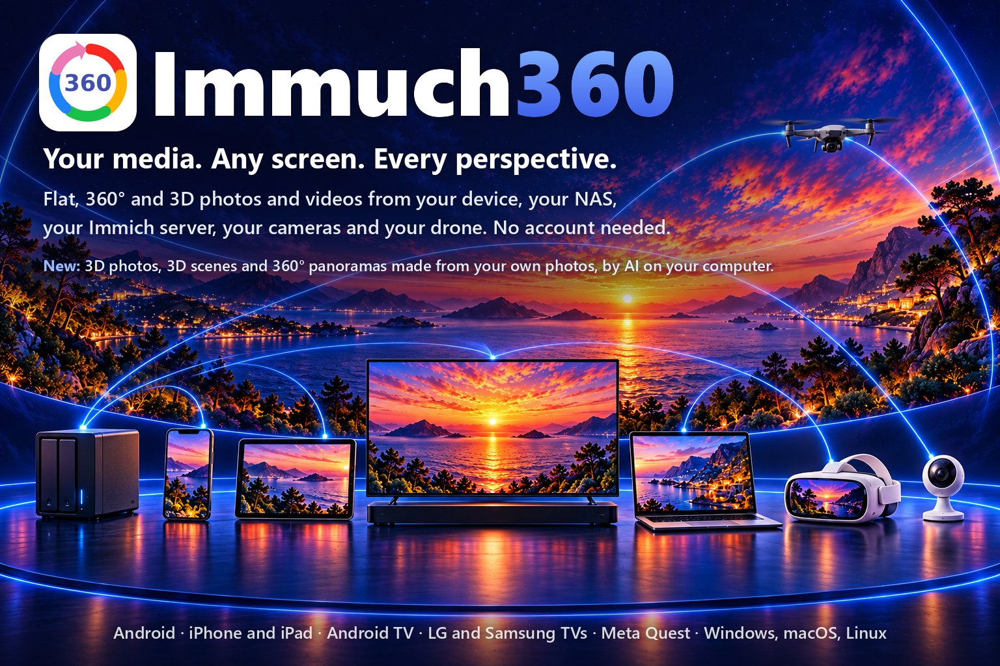

🌐 <b>עברית</b> · שפות אחרות (88)
<a href="../README.md">English</a> · <a href="README.af.md">Afrikaans</a> · <a href="README.ar.md">العربية</a> · <a href="README.az.md">Azərbaycanca</a> · <a href="README.be.md">Беларуская</a> · <a href="README.bg.md">Български</a> · <a href="README.bi.md">Bislama</a> · <a href="README.bn.md">বাংলা</a> · <a href="README.br.md">Brezhoneg</a> · <a href="README.bs.md">Bosanski</a> · <a href="README.ca.md">Català</a> · <a href="README.cs.md">Čeština</a> · <a href="README.cv.md">Чӑвашла</a> · <a href="README.da.md">Dansk</a> · <a href="README.de.md">Deutsch</a> · <a href="README.de_CH.md">Deutsch (Schweiz)</a> · <a href="README.el.md">Ελληνικά</a> · <a href="README.en_GB.md">English (UK)</a> · <a href="README.eo.md">Esperanto</a> · <a href="README.es.md">Español</a> · <a href="README.et.md">Eesti</a> · <a href="README.eu.md">Euskara</a> · <a href="README.fa.md">فارسی</a> · <a href="README.fi.md">Suomi</a> · <a href="README.fil.md">Filipino</a> · <a href="README.fr.md">Français</a> · <a href="README.ga.md">Gaeilge</a> · <a href="README.gl.md">Galego</a> · <a href="README.gsw.md">Alemannisch</a> · <a href="README.gu.md">ગુજરાતી</a> · <a href="README.hi.md">हिन्दी</a> · <a href="README.hr.md">Hrvatski</a> · <a href="README.hu.md">Magyar</a> · <a href="README.hy.md">Հայերեն</a> · <a href="README.id.md">Bahasa Indonesia</a> · <a href="README.is.md">Íslenska</a> · <a href="README.it.md">Italiano</a> · <a href="README.ja.md">日本語</a> · <a href="README.ka.md">ქართული</a> · <a href="README.kab.md">Taqbaylit</a> · <a href="README.kk.md">Қазақша</a> · <a href="README.km.md">ខ្មែរ</a> · <a href="README.kmr.md">Kurmancî</a> · <a href="README.kn.md">ಕನ್ನಡ</a> · <a href="README.ko.md">한국어</a> · <a href="README.kxm.md">ภาษาเขมรถิ่นไทย</a> · <a href="README.lb.md">Lëtzebuergesch</a> · <a href="README.lmo.md">Lombard</a> · <a href="README.lt.md">Lietuvių</a> · <a href="README.lv.md">Latviešu</a> · <a href="README.mfa.md">Bahasa Melayu Kelantan</a> · <a href="README.mi.md">Te reo Māori</a> · <a href="README.mk.md">Македонски</a> · <a href="README.ml.md">മലയാളം</a> · <a href="README.mn.md">Монгол</a> · <a href="README.mr.md">मराठी</a> · <a href="README.ms.md">Bahasa Melayu</a> · <a href="README.nb_NO.md">Norsk bokmål</a> · <a href="README.ne.md">नेपाली</a> · <a href="README.nl.md">Nederlands</a> · <a href="README.nn.md">Norsk nynorsk</a> · <a href="README.pa.md">ਪੰਜਾਬੀ</a> · <a href="README.pl.md">Polski</a> · <a href="README.pt.md">Português</a> · <a href="README.pt_BR.md">Português (Brasil)</a> · <a href="README.ro.md">Română</a> · <a href="README.ru.md">Русский</a> · <a href="README.si.md">සිංහල</a> · <a href="README.sk.md">Slovenčina</a> · <a href="README.sl.md">Slovenščina</a> · <a href="README.sq.md">Shqip</a> · <a href="README.sr_Cyrl.md">Српски</a> · <a href="README.sr_Latn.md">Srpski</a> · <a href="README.sv.md">Svenska</a> · <a href="README.sw.md">Kiswahili</a> · <a href="README.swg.md">Schwäbisch</a> · <a href="README.ta.md">தமிழ்</a> · <a href="README.te.md">తెలుగు</a> · <a href="README.th.md">ไทย</a> · <a href="README.tl.md">Tagalog</a> · <a href="README.tr.md">Türkçe</a> · <a href="README.uk.md">Українська</a> · <a href="README.ur.md">اردو</a> · <a href="README.uz.md">Oʻzbekcha</a> · <a href="README.vi.md">Tiếng Việt</a> · <a href="README.yue_Hant.md">粵語</a> · <a href="README.zh_Hans.md">简体中文</a> · <a href="README.zh_Hant.md">繁體中文</a>

  

# Immuch360

**המדיה שלך. כל מסך. כל זווית.**

🌐 <a href="https://immuch360.com/he/"><b>immuch360.com</b></a>

תמונות וסרטונים שטוחים, 360° ו-3D מהמכשיר שלך, מה-NAS שלך, משרת ה-Immich שלך, מהמצלמות שלך ומהרחפן שלך. לא צריך חשבון. Immuch360 היא אפליקציה חופשית בקוד פתוח שקוראת את התמונות והסרטונים שלך במקום שבו הם נמצאים ומנגנת כל אחד מהם במציג שמתאים לו: שטוח, כספירה שמסתכלים סביב בתוכה, ב-3D, או סביבך לגמרי בקסדה. היא רצה בטלפונים, בטאבלטים, בטלוויזיות, בקסדות Meta Quest ובמחשבים. האתר שלה, [immuch360.com](https://immuch360.com/he/), מראה מה היא עושה בכל מסך, ב-89 שפות.

**חדש בבניות 33 עד 47.** [סרטים ממשיכים מהמקום שבו עצרת](#pick-up-a-film-where-you-stopped). הם מתחילים מוקדם יותר, ומשרת איטי הם [ממשיכים להתנגן במקום להיעצר](#when-a-video-waits-or-will-not-play). ציר הזמן [מתרחק עד חודשים ושנים](#find-a-month-or-a-year-in-a-long-timeline) בטלפונים ובמחשבים. בטלפון Android או ב-Meta Quest, ["עיון בתיקייה"](#browse-a-folder-of-your-phone-or-headset) פותח תיקייה של המכשיר כמו שיתוף, ותמונות TIFF מוצגות. Android TV [מחפש לפי תאריך עם השלט](#on-android-tv-and-google-tv), Meta Quest 3 או 3S [פותח ספלאטים גאוסיאניים](#explore-gaussian-splats-in-a-meta-quest-3-or-3s) (ניסיוני), עם סיבוב בג'ויסטיק הימני ותמיכה ב-SPZ בגרסה 4, ומחשב [יוצר את גרסאות ה-3D של התמונות ב-NAS שלך](#turn-one-photo-into-3d-a-scene-a-panorama). במחשב נייד עם Windows ושני שבבים גרפיים, האפליקציה [רצה עכשיו על המהיר](#when-a-video-waits-or-will-not-play), כך שסרטי 8K מתנגנים בצורה חלקה. ספלאטים גאוסיאניים [נפתחים עכשיו במחשבים ובטלפונים ובטאבלטים עם Android](#explore-gaussian-splats-on-your-phone-tablet-or-computer), מחשב Windows [יוצר סצנות ספלאט מהתמונות שלך או מסרטון](#make-a-splat-scene-from-your-photos-or-a-video-ai) על ידי AI, שרת ה-Immich שלך [שומר אותן בתוך תמונות](#keep-a-splat-scene-on-your-immich-server) שנפתחות מציר הזמן שלך, ומחשבים [מנגנים סרטוני AV2](#play-av2-videos-on-your-computer), הכול ניסיוני. החל מבנייה 42, הסרטונים הגולמיים של מצלמות Insta360, GoPro MAX ו-DJI Osmo 360, מספריית ה-Immich שלך, משיתוף או מתיקייה, [מתנגנים מיוצבים בעזרת הג'ירוסקופ של המצלמה](#stabilise-your-360-videos-with-the-cameras-gyroscope-experimental) בטלפונים, בטאבלטים ובטלוויזיות עם Android, יוצר הספלאטים של בנייה 22 של שולחן העבודה [מציע איכות מפורטת](#make-a-splat-scene-from-your-photos-or-a-video-ai) לסצנות שאתה מסתכל עליהן מקרוב, ופנורמת 360° [מתחילה עם 3.5 GiB פנויים בכרטיס המסך](#turn-one-photo-into-3d-a-scene-a-panorama), הכול ניסיוני. האפליקציה ל-iPhone ול-iPad נמצאת [ב-App Store](https://apps.apple.com/us/app/immuch360-360-3d-player/id6817655965), גרסה 3.4.1. החל מבנייה 43, הודעת העדכון של האפליקציה פותחת את Google Play או את App Store בטלפונים ובטאבלטים; האתר שלה, [immuch360.com](https://immuch360.com/he/), נפתח ב-7 בנובמבר. החל מבנייה 44 ובנייה 24 של שולחן העבודה, Meta Quest 3 או 3S [מציג ספלאטים של עד 300,000 גאוסיאנים](#explore-gaussian-splats-in-a-meta-quest-3-or-3s) (ניסיוני), מחשבים [בוחרים כמה תמונות וסרטונים עם Ctrl ו-Shift](#use-your-computer-as-the-media-player), טלוויזיה שהמפענח שלה דוחה סרטון [מנגנת מעצמה את הקובץ האחר של השרת](#when-a-video-waits-or-will-not-play), פנורמות רצות על כרטיס המסך שנבחר במחשב נייד שיש בו שניים (ניסיוני), והודעת העדכון של ה-Quest ושל המחשבים פותחת את דף החנות או דף ההורדה שלהם, עם תיקונים רבים. החל מבנייה 45 ובנייה 25 של שולחן העבודה, גרסה 3.4.0 בכל הפלטפורמות, האפליקציה עוקבת אחרי אפליקציית Immich 3.4.0 עם 11 תיקונים מאוחרים יותר של Immich, מציגה את [תמונות ה-JPEG XL של שרתי Immich 3.4](#keep-your-immich-library-with-more), פותחת את [סרטי ה-Plex שלך לפי שנה](#watch-your-plex-films) עם עמוד לכל סרט, ההורדה שלהם למכשיר והניגון שלהם בטלוויזיה מהטלפון (ניסיוני), עשויה לבקש דירוג בבניות של החנויות, ובמחשבים לוקחת את רכיבי הווידאו שלה [ממאגרים פתוחים משלהם](#licences-and-credits). החל מבנייה 46 ובנייה 26 של שולחן העבודה, גרסה 3.4.1, הסרטונים הגולמיים של מצלמות 360° [מתנגנים מיוצבים](#stabilise-your-360-videos-with-the-cameras-gyroscope-experimental) גם ב-iPhone וב-iPad, ב-Meta Quest וב-Windows, Meta Quest [מנגן עם libmpv את סרטי ה-Plex שהנגן שלו עצמו לא מסוגל לפענח](#watch-your-plex-films), טלפון [שולח סרט כזה ל-Chromecast או ל-Google TV](#watch-your-plex-films), ועומק ה-AI של תמונת 3D [מקבל את העוצמה שבחרת](#turn-one-photo-into-3d-a-scene-a-panorama), הכול ניסיוני; אפשר גם להוסיף שרת חדש בהתחברות עם חשבון ה-Plex שלך, והאפליקציה [שומרת את ההגדרות שלה בקובץ](#keep-your-settings-in-a-file). החל מבנייה 47 ובנייה 27 של שולחן העבודה, גרסה 3.4.2, סרט Plex [מנגן רצועת שמע שהמכשיר מפענח](#watch-your-plex-films) ואומר איזו, פותח את הגרסה שמתאימה למסך, ובחיבור איטי מציע גרסה קלה יותר, Windows ו-macOS מנגנים את שמע ה-Dolby TrueHD שלו, Android [מציג את ההורדה שלו בהתראה](#watch-your-plex-films) ו-Android TV מוריד גם הוא סרטים, ו[מצלמות Tapo על סוללה מוצגות בשידור חי](#watch-your-home-cameras-on-the-big-screen) (ניסיוני); שחזור קובץ הגדרות עם החשבונות שלו מחבר אותך עכשיו לשרת ה-Immich שלך.

  פיצול (fork) לא רשמי של אפליקציית המובייל של Immich. לא קשור ל-Immich או ל-FUTO. השם נשמע כמו "I am much 360".

<b>תוכן העניינים</b>

- [למי זה מיועד](#who-it-is-for)
- [אילו מסכים](#which-screens), [מה הם עושים יחד](#use-cases) ו[מה כל מסך עושה](#what-each-screen-does)
- [מה אפשר לעשות](#what-you-can-do)
- [להשיג אותה במכשיר שלך](#get-it-on-your-device)
- [איך עושים](#how-to)
  - [לצפות בתמונות ובסרטונים שלך, עם שרת או בלעדיו](#watch-your-photos-and-videos-with-or-without-a-server)
  - [לחקור פנורמות, 360°, VR180 ו-3D](#explore-panoramas-360-vr180-and-3d)
  - [להפוך תמונה אחת ל-3D, לסצנה, לפנורמה](#turn-one-photo-into-3d-a-scene-a-panorama)
  - [לצפות בטלוויזיה עם השלט](#watch-on-the-tv-with-the-remote): [Android TV ו-Google TV](#on-android-tv-and-google-tv), [LG](#on-an-lg-tv-webos), [Samsung](#on-a-samsung-tv-tizen)
  - [לחבר טלוויזיה, קסדה או מחשב עם הטלפון שלך](#sign-in-a-tv-a-headset-or-a-computer-with-your-phone)
  - [להיכנס לתוך התמונות והסרטונים שלך עם Meta Quest](#step-inside-your-photos-and-videos-with-a-meta-quest): [מצב קיוסק](#kiosk-mode-for-an-exhibition-or-a-shop)
  - [לחקור ספלאטים גאוסיאניים ב-Meta Quest 3 או 3S](#explore-gaussian-splats-in-a-meta-quest-3-or-3s)
  - [לחקור ספלאטים גאוסיאניים בטלפון, בטאבלט או במחשב שלך](#explore-gaussian-splats-on-your-phone-tablet-or-computer)
  - [ליצור סצנת ספלאט מהתמונות שלך או מסרטון (AI)](#make-a-splat-scene-from-your-photos-or-a-video-ai)
  - [לשמור סצנת ספלאט בשרת ה-Immich שלך](#keep-a-splat-scene-on-your-immich-server)
  - [לנגן את הקבצים של NAS, מחשב, שרת מדיה או Plex](#play-the-files-of-a-nas-a-computer-a-media-server-or-plex): [הסרטים שלך לפי שנה](#watch-your-plex-films)
  - [לעיין בתיקייה של הטלפון או הקסדה שלך](#browse-a-folder-of-your-phone-or-headset)
  - [להמשיך סרט מהמקום שבו עצרת](#pick-up-a-film-where-you-stopped)
  - [כשסרטון ממתין או לא מתנגן](#when-a-video-waits-or-will-not-play)
  - [לשמור על ספריית ה-Immich שלך, ועוד](#keep-your-immich-library-with-more)
  - [למצוא חודש או שנה בציר זמן ארוך](#find-a-month-or-a-year-in-a-long-timeline)
  - [לצפות במצלמות הבית שלך על המסך הגדול](#watch-your-home-cameras-on-the-big-screen)
  - [רחפן ה-DJI שלך (ניסיוני)](#your-dji-drone-experimental): [וידאו חי](#see-what-your-drone-sees-on-your-phone), [ב-Quest או ב-Android TV](#watch-it-in-a-meta-quest-or-on-an-android-tv), [ייבוא](#bring-a-drones-or-a-camera-cards-photos-and-videos-to-immich)
  - [לפתוח את הקבצים הגולמיים של מצלמות 360°](#open-the-raw-files-of-360-cameras)
  - [לייצב את סרטוני ה-360° שלך בעזרת הג'ירוסקופ של המצלמה (ניסיוני)](#stabilise-your-360-videos-with-the-cameras-gyroscope-experimental)
  - [לסובב תמונה במקש אחד](#turn-a-photo-with-one-key)
  - [להשתמש במחשב שלך כנגן המדיה](#use-your-computer-as-the-media-player)
  - [לנגן סרטוני AV2 במחשב שלך](#play-av2-videos-on-your-computer)
  - [לשמור את ההגדרות שלך בקובץ](#keep-your-settings-in-a-file)
- [בהשוואה ל-Immich](#compared-with-immich)
- [פרטיות](#privacy)
- [רישיונות וקרדיטים](#licences-and-credits)
- [מפת דרכים](#roadmap)
- [תיעוד](#documentation)

## למי זה מיועד

- **אתה מצלם ב-360° או ב-3D** ורוצה להסתכל סביב בתוך הצילומים שלך, ולא לראות אותם שטוחים, כפולים או מתוחים: [360°, VR180 ו-3D](#explore-panoramas-360-vr180-and-3d).
- **אתה מצלם במצלמת 360° ביד, על אופניים או על קסדה** ורוצה שהסרטונים הגולמיים של מצלמת ה-Insta360, ה-GoPro MAX או ה-DJI Osmo 360 שלך, השמורים ב-Immich, בשיתוף או בתיקייה, יתנגנו ישרים ויציבים בטלפון שלך, בטלוויזיה שלך, ב-Meta Quest שלך או במחשב ה-Windows שלך (ניסיוני): [מיוצבים בעזרת הג'ירוסקופ של המצלמה](#stabilise-your-360-videos-with-the-cameras-gyroscope-experimental).
- **התמונות והסרטים שלך נמצאים על NAS, מחשב, Plex או Immich** ואתה רוצה אותם בטלוויזיה בלי להעתיק כלום: [בטלוויזיה](#watch-on-the-tv-with-the-remote), [NAS, שיתופים ו-Plex](#play-the-files-of-a-nas-a-computer-a-media-server-or-plex).
- **הסרטים שלך שמורים בשרת Plex** ואתה רוצה לבחור אחד לפי שנה, לראות מה הוא לפני שהוא מתחיל, לקחת אותו לטיול, להתחיל אותו בטלוויזיה או ב-Chromecast מהטלפון שלך, ולנגן אפילו את הסרטים שטלפון ה-Android, הטלוויזיה או ה-Meta Quest שלך לא מסוגלים לפענח (ניסיוני): [הסרטים שלך, לפי שנה](#watch-your-plex-films).
- **יש לך Meta Quest** ואתה רוצה להיכנס לתוך התמונות והסרטונים שלך: [בקסדה](#step-inside-your-photos-and-videos-with-a-meta-quest).
- **התמונות שלך שטוחות** ואתה רוצה אותן ב-3D, כסצנה להתכופף לתוכה בקסדה, או בתוך פנורמת 360°, בלי מצלמת 3D: [להפוך תמונה אחת ל-3D, לסצנה, לפנורמה](#turn-one-photo-into-3d-a-scene-a-panorama), חדש, נוצר על ידי AI במחשב שלך.
- **אתה מריץ Immich** ורוצה את האפליקציה שלו, ובנוסף את המציגים הסוחפים ואת המסכים הגדולים שמתחברים מהטלפון שלך: [ספריית ה-Immich שלך](#keep-your-immich-library-with-more), [בהשוואה ל-Immich](#compared-with-immich).
- **אתה שומר על הבית שלך עם מצלמות Tapo**, גם כאלה על סוללה (ניסיוני), ורוצה אותן ליד התמונות שלך, גם בטלוויזיה (נבדק מול מצלמה מדומה): [מצלמות הבית](#watch-your-home-cameras-on-the-big-screen).
- **אתה מטיס רחפן DJI** ורוצה את התמונה החיה שלו בטלפון שלך בלי DJI Fly, וב-Meta Quest או ב-Android TV לאנשים שאיתך (ניסיוני): [הרחפן שלך](#see-what-your-drone-sees-on-your-phone).
- **אתה מצלם מקומות וחפצים ב-3D, כספלאטים גאוסיאניים,** או היית רוצה ליצור אותם מהתמונות שלך, ורוצה ללכת בתוכם בטלפון שלך, במחשב שלך או בקסדה (ניסיוני): [בטלפון, בטאבלט או במחשב](#explore-gaussian-splats-on-your-phone-tablet-or-computer), [נוצרים מהתמונות שלך](#make-a-splat-scene-from-your-photos-or-a-video-ai), [נשמרים ב-Immich](#keep-a-splat-scene-on-your-immich-server).
- **יש לך סרטוני AV2**, הפורמט שבא אחרי AV1, ואתה רוצה לצפות בהם במחשב שלך (ניסיוני): [AV2 במחשב שלך](#play-av2-videos-on-your-computer).
- **יש לך כמה מסכים בבית** ואתה רוצה שיעבדו יחד: [מה המסכים שלך עושים יחד](#use-cases).

אין חשבון Immuch360 ליצור, ושום דבר לא מגיע אלינו: האפליקציה מתקשרת רק עם המכשירים שלך ועם השרתים שבחרת, החל מבנייה 45 עם Wikipedia בשביל העמוד של סרט (ניסיוני), החל מבנייה 46 עם plex.tv כשאתה מתחבר דרכו, ומורידה רכיב AI או את מפענח ה-AV2 רק כשאתה מבקש.

## אילו מסכים

| פלטפורמה | איפה להשיג | מצב בנובמבר 2026 |
|---|---|---|
|  טלפונים וטאבלטים עם **Android** | [Google Play](https://play.google.com/store/apps/details?id=com.aprogsys.immuch360) · [APK](https://github.com/freeKC/Immuch360/releases) | ב-Google Play (בנייה 40 זמינה; בנייה 47 נשלחה לבדיקת Google), בנייה 47 ב-GitHub, שבה [סרטוני 360° גולמיים מתנגנים מיוצבים](#stabilise-your-360-videos-with-the-cameras-gyroscope-experimental) (ניסיוני), [סרטים ממשיכים מהמקום שבו עצרת](#pick-up-a-film-where-you-stopped), ["עיון בתיקייה"](#browse-a-folder-of-your-phone-or-headset) פותח תיקייה של הטלפון ו[ספלאטים גאוסיאניים נפתחים](#explore-gaussian-splats-on-your-phone-tablet-or-computer), משיתוף או [מציר הזמן שלך ב-Immich](#keep-a-splat-scene-on-your-immich-server) (ניסיוני), [ההגדרות שנשמרות בקובץ](#keep-your-settings-in-a-file) ו[ההורדה של סרט שמוצגת בהתראה](#watch-your-plex-films) |
|  **iPhone ו-iPad** | [App Store](https://apps.apple.com/us/app/immuch360-360-3d-player/id6817655965) | גרסה 3.4.1 ב-App Store מאז 12 בנובמבר, עם [חודשים ושנים בציר הזמן](#find-a-month-or-a-year-in-a-long-timeline), [סרטים שממשיכים מהמקום שבו עצרת](#pick-up-a-film-where-you-stopped), [ההתחברות של טלוויזיה, קסדה או מחשב](#sign-in-a-tv-a-headset-or-a-computer-with-your-phone) מהטלפון, סצנות הספלאט השמורות ב-Immich שמוצגות כתמונה שלהן, התיקונים של Immich 3.4.0 ותמונות ה-JPEG XL שלו, [סרטוני 360° גולמיים מיוצבים](#stabilise-your-360-videos-with-the-cameras-gyroscope-experimental) (ניסיוני) ו[ההגדרות שנשמרות בקובץ](#keep-your-settings-in-a-file); גרסה 3.4.2, גרסת ה-iPhone וה-iPad של בנייה 47, תבוא אחריה, עם [השידור החי של מצלמות Tapo על סוללה](#watch-your-home-cameras-on-the-big-screen) (ניסיוני); או אפשר [לבנות בעצמך](../docs/immuch360/build.md) |
|  **Android TV ו-Google TV** | [Google Play](https://play.google.com/store/apps/details?id=com.aprogsys.immuch360) · [APK](#android-tv-and-google-tv) | ב-Google Play, שמציע את האפליקציה ב-Android TV וב-Google TV, ובנייה 47 ב-GitHub: [סרטוני 360° גולמיים מיוצבים](#stabilise-your-360-videos-with-the-cameras-gyroscope-experimental) (ניסיוני), [חיפוש לפי תאריך עם השלט](#on-android-tv-and-google-tv), [התחברות עם הטלפון שלך](#sign-in-a-tv-a-headset-or-a-computer-with-your-phone) בסריקת קוד QR, סרגל זמן, שמע וכתוביות לשלט בנגן הווידאו, ו[וידאו חי של רחפן](#watch-it-in-a-meta-quest-or-on-an-android-tv) שמועבר דרך טלפון (ניסיוני), ו[סרטים שהורדו לטלוויזיה](#watch-your-plex-films) |
| **טלוויזיות LG** עם webOS 5.0 ואילך | [.ipk, גרסה 1.0.3](https://github.com/freeKC/Immuch360/releases/tag/webos-v1.0.3) · LG Content Store (בבדיקה) | גרסה 1.0.0, הוגשה ל-LG Content Store ב-24 באוקטובר, בבדיקות של LG מאז 26 באוקטובר; גרסה 1.0.1, ב-GitHub מאז 27 באוקטובר, מבצעת זום לתמונה מהחצים ומציינת מתי תמונה עדיין נטענת, וגרסה 1.0.2, ב-GitHub עם בנייה 46, כותבת "התחברות" בתור ログイン ביפנית, וגרסה 1.0.3, עם בנייה 47, מציינת מתי תיקייה של שרת DLNA מכילה ערוצי טלוויזיה בשידור חי, שהיא עדיין לא יכולה לנגן; עד ש-LG תפרסם את האפליקציה, היא מותקנת ב-[Developer Mode](#lg-tvs-webos). גרסה 1.0.0 רצה על טלוויזיות webOS 25 ב-Cloud Test Lab של LG |
| **טלוויזיות Samsung** עם Tizen 5.5 ואילך | [בניית בדיקה .wgt](https://github.com/freeKC/Immuch360/releases/tag/tizen-v0.3.2) | בניית בדיקה 0.3.2 של אותה אפליקציית טלוויזיה, לחתימה עם תעודת Samsung משלך ולהתקנה ב-[Developer mode](#samsung-tvs-tizen); 0.1.0 רצה על טלוויזיית Samsung של בודק, 0.2.0 כוללת את התיקונים מההרצה הזו, 0.3.0 מוסיפה את הזום של התמונות ואת תווית הטעינה של גרסת LG 1.0.1, ו-0.3.1 את הניסוח היפני של גרסת LG 1.0.2, ו-0.3.2 מנגנת בכיוון הנכון סרטון שצולם לאורך בטלפון ([issue 17](https://github.com/freeKC/Immuch360/issues/17)), ואף אחת משלושתן עדיין לא הורצה על טלוויזיית Samsung; לא בחנות של Samsung |
|  **Meta Quest** 2, Pro, 3 ו-3S | [Horizon Store](https://www.meta.com/experiences/immuch360/1384208401440714/) · [APK](#meta-quest) | ב-Horizon Store (בנייה 45, זמינה מאז 13 בנובמבר; בנייה 47 תבוא אחריה), בנייה 47 ב-GitHub, עם [מצב קיוסק](#kiosk-mode-for-an-exhibition-or-a-shop), [סרטוני 360° גולמיים מיוצבים](#stabilise-your-360-videos-with-the-cameras-gyroscope-experimental) בתצוגה הסוחפת, [הסרטים שהוא לא מסוגל לפענח מנוגנים על ידי libmpv](#watch-your-plex-films) וב-Quest 3 וב-3S גם [ספלאטים גאוסיאניים](#explore-gaussian-splats-in-a-meta-quest-3-or-3s) ו[עומק AI](#turn-one-photo-into-3d-a-scene-a-panorama) לתמונה שטוחה, הכול ניסיוני |
|  **Windows** | [תוכנת התקנה או ZIP](https://github.com/freeKC/Immuch360/releases/tag/desktop-v3.4.2-27) | בנייה 27 של שולחן העבודה, תצוגה מקדימה חתומה: תמונות, סרטונים שטוחים ו-360°, שיתופים, Plex, מצלמות (נבדק מול מצלמה מדומה), התחברות עם הטלפון שלך, תמונות שמסתובבות במקש אחד, הממשק ב-89 שפות, ו[תמונות 3D, סצנות 3D ופנורמות 360° מהתמונות שלך](#turn-one-photo-into-3d-a-scene-a-panorama) על ידי AI (ניסיוני), גם מהתמונות ב-NAS שלך; [ספלאטים גאוסיאניים](#explore-gaussian-splats-on-your-phone-tablet-or-computer) שנפתחים, [שנוצרים מהתמונות שלך או מסרטון](#make-a-splat-scene-from-your-photos-or-a-video-ai) ו[שנשמרים ב-Immich](#keep-a-splat-scene-on-your-immich-server), [סרטוני AV2](#play-av2-videos-on-your-computer), החל מבנייה 22 של שולחן העבודה [בחירת איכות לסצנות הספלאט](#make-a-splat-scene-from-your-photos-or-a-video-ai) ו[פנורמות 360° החל מ-3.5 GiB של זיכרון גרפיקה פנוי](#turn-one-photo-into-3d-a-scene-a-panorama), והחל מבנייה 26 של שולחן העבודה [סרטוני 360° גולמיים מיוצבים](#stabilise-your-360-videos-with-the-cameras-gyroscope-experimental) ו[תמונות 3D עם עוצמת עומק וקצוות חדים יותר](#turn-one-photo-into-3d-a-scene-a-panorama), הכול ניסיוני, והחל מבנייה 27 של שולחן העבודה [שמע ה-Dolby TrueHD וכתוביות ה-Blu-ray של סרטים](#watch-your-plex-films) |
|   **macOS ו-Linux** | [.deb, .rpm, DMG](https://github.com/freeKC/Immuch360/releases/tag/desktop-v3.4.2-27) | בנייה 27 של שולחן העבודה, תצוגות מקדימות: תמונות, תמונות 360° וסרטונים שטוחים (סרטוני 360° מתנגנים שטוחים), שרת Immich ושיתופי רשת, ו[תמונות 3D וסצנות 3D](#turn-one-photo-into-3d-a-scene-a-panorama) שנוצרות על ידי AI מהתמונות שלך, עם פנורמות 360° ב-Linux על כרטיס מסך של 8 GB, החל מ-3.5 GiB פנויים בו, ו[ספלאטים גאוסיאניים](#explore-gaussian-splats-on-your-phone-tablet-or-computer) ו[סרטוני AV2](#play-av2-videos-on-your-computer) (ניסיוני, עדיין לא נוסו ב-Mac); בנייה 11 של שולחן העבודה נוסתה ב-26 באוקטובר בקונטיינר Ubuntu 24.04 וב-Mac; החל מבנייה 27 של שולחן העבודה, שמע ה-Dolby TrueHD של סרטים ב-macOS; לא חתומה ב-macOS |

*הסטטוסים מתעדכנים בכל גרסה; מה שיש בכל חנות, מה שנמצא בבדיקה שלה וכל בנייה נמצאים ב[סטטוס הגרסאות](../docs/immuch360/release-status.md). האתר [immuch360.com](https://immuch360.com/he/) מראה מה עושה כל מסך, מדריך לכל פונקציה ואת הקישורים לחנויות, ב-89 שפות.*

  

### מה המסכים שלך עושים יחד

התקן את Immuch360 בכל מסך שאתה צופה בו: כל אחד קורא את המקורות שלך בעצמו, וחלקם מעבירים לאחר תמונה, קובץ או התחברות. בכל תמונה, הסמל של Immuch360 מסמן את המכשירים שמריצים את האפליקציה.

#### ה-NAS שלך בכל מסך

  

**מה צריך:** NAS עם שיתוף SMB או WebDAV, ו-Immuch360 בכל מסך שאתה צופה בו.

הוסף את השיתוף בכל מסך, וכל אחד מנגן את התמונות והסרטונים במקום שבו הם נמצאים, בלי להעתיק דבר: טלפונים, טאבלטים, Android TV, Meta Quest, מחשבי Windows, Linux ו-macOS, וטלוויזיות LG שמחוברות לשרת ה-Immich שלך (SMB החל מ-webOS 22). תמונת 360° מסתובבת ככדור בטלפון ובטלוויזיה, ומקיפה אותך בקסדה. איך עושים: [לנגן את הקבצים של NAS, מחשב, שרת מדיה או Plex](#play-the-files-of-a-nas-a-computer-a-media-server-or-plex).

#### שרת ה-Immich שלך בכל מסך, מחובר מהטלפון שלך

  

**מה צריך:** שרת Immich, Immuch360 בטלפון ה-Android שלך, ו-Immuch360 במסכים שאתה מחבר: Android TV, Meta Quest, מחשב Windows, Linux או macOS.

בטלפון, Immuch360 שומרת את כל אפליקציית Immich לנייד, מוסיפה את מציגי ה-360°, VR180 וה-3D שלה, ומותקנת לצד האפליקציה הרשמית. כשהיא מחוברת לשרת שלך, היא מחברת את המסכים הגדולים: היא סורקת את קוד ה-QR של הטלוויזיה או המחשב, או שאתה מקליד בטלפון את הקוד שהקסדה מציגה, והסיסמה שלך נשארת בטלפון. איך עושים: [לחבר טלוויזיה, קסדה או מחשב עם הטלפון שלך](#sign-in-a-tv-a-headset-or-a-computer-with-your-phone).

#### התמונות השטוחות שלך ב-3D, מהמחשב לקסדה (ניסיוני)

  

**מה צריך:** Immuch360 במחשב Windows, Linux או macOS וב-Meta Quest, עם ה-NAS שלך ביניהם, או שרת ה-Immich שלך כש-"גיבוי גם של גרסאות AI" מופעל.

המחשב עצמו הופך את התמונות שלך לתמונות 3D ולסצנות 3D, ולפנורמות 360° עם כרטיס מסך של 8 GB ב-Windows או ב-Linux, ושומר אותן ליד המקוריות. הקסדה מציגה תמונת 3D ב-3D אמיתי, מציבה סצנה בחדר שלך ופנורמה מסביבך; טלפונים וטלוויזיות פותחים את הפנורמות במציג ה-360° שלהם. איך עושים: [להפוך תמונה אחת ל-3D, לסצנה, לפנורמה](#turn-one-photo-into-3d-a-scene-a-panorama).

#### התמונה החיה של הרחפן שלך בקסדה או בטלוויזיה (ניסיוני)

  

**מה צריך:** רחפן DJI והבקר DJI RC-N3 שלו, Immuch360 בטלפון ה-Android שמחובר לבקר, ו-Immuch360 ב-Meta Quest או ב-Android TV.

הטלפון מציג את הווידאו החי של הרחפן ומעביר אותו, דרך ה-Wi-Fi שלך או נקודה חמה משלו, כדי שהאנשים שאיתך יצפו בטיסה בקסדה או בטלוויזיה. קבלה בלבד: אף פקודה לא נשלחת לעולם לבקר או לרחפן, והבקר שומר על שליטה מלאה. איך עושים: [לצפות בו ב-Meta Quest או ב-Android TV](#watch-it-in-a-meta-quest-or-on-an-android-tv).

#### הקבצים הגולמיים של מצלמת ה-360° שלך, נתפרים במקום שבו אתה צופה בהם

  

**מה צריך:** מצלמת Insta360, GoPro MAX או DJI Osmo 360, ה-NAS שלך, ו-Immuch360 במסכים: טלפונים, טאבלטים, Android TV, Meta Quest, Windows.

העתק את הקבצים .insp, .insv, .360 או .osv מכרטיס המצלמה לשיתוף SMB או WebDAV של ה-NAS שלך, כמו שהם; שרת Immich מקבל גם את אלה של Insta360. כל מסך תופר אותם תוך כדי ניגון, עם הכיול שכתוב בכל קובץ, ושום דבר לא מיוצא קודם באפליקציה של המצלמה. איך עושים: [לפתוח את הקבצים הגולמיים של מצלמות 360°](#open-the-raw-files-of-360-cameras).

#### שרתי ה-Plex וה-DLNA שלך בטלוויזיה ובקסדה

  

**מה צריך:** Plex Media Server או שרת DLNA כמו Jellyfin, Emby או minidlna, ו-Immuch360 בכל מסך: Android TV, Meta Quest, טלפונים, טאבלטים, Windows.

Plex נותן את הקבצים המקוריים של הספריות שלך, כך שווידאו 360° נשאר 360°, מסביבך בקסדה, בבית ומחוץ לבית דרך העברת הפורטים שלך; שרתי DLNA נמצאים ברשת הביתית שלך. גם טלוויזיות LG שמחוברות לשרת ה-Immich שלך מנגנות אותם. החל מבנייה 45, טלפונים, טאבלטים, Android TV, ה-Quest ומחשבים פותחים ספריית סרטים של Plex על כל הסרטים לפי שנה, כל סרט עם העמוד שלו, וסרט שנבחר בטלפון מתנגן ב-Android TV, ב-Quest או במחשב, כשהשלט שולט (ניסיוני). החל מבנייה 46, ה-Quest מנגן עם libmpv את הסרטים שהנגן שלו עצמו לא מסוגל לפענח, שרת ה-Plex שלך ממיר את אלה שאף נגן של מכשיר Android לא מפענח, וטלפון שולח סרט ל-Chromecast או ל-Google TV (ניסיוני). החל מבנייה 47, סרט מנגן רצועת שמע שהמכשיר מפענח ואומר איזו, פותח את הגרסה שמתאימה למסך ומנגן את שמע ה-Dolby TrueHD שלו ב-Windows וב-macOS (ניסיוני), ותיקייה של ערוצי טלוויזיה בשידור חי של שרת DLNA אומרת שעדיין אי אפשר לנגן אותם. איך עושים: [לנגן את הקבצים של NAS, מחשב, שרת מדיה או Plex](#play-the-files-of-a-nas-a-computer-a-media-server-or-plex) ו[לצפות בסרטי ה-Plex שלך](#watch-your-plex-films).

#### הטלפון שלך או מחשב ה-Windows שלך, פתוחים בקסדה

  

**מה צריך:** Immuch360 בטלפון Android, ב-iPhone או במחשב Windows, וב-Meta Quest, באותה רשת Wi-Fi ביתית.

הפעל את "שיתוף הטלפון הזה ברשת" בטלפון, או את "שיתוף המחשב הזה ברשת" במחשב, והקסדה מנגנת את התמונות והסרטונים שלו, את אלה של 360° מסביבך: בלי שרת, בלי NAS, בלי העלאה. ב-iPhone, השיתוף פועל כל עוד האפליקציה מוצגת על המסך. איך עושים: [שיתוף הטלפון הזה ברשת](../docs/immuch360/user-guide.md#share-this-phone-on-the-network).

#### מצלמות ה-Tapo שלך בטלוויזיה ובקסדה

  

**מה צריך:** מצלמות Tapo ברשת הביתית שלך, ו-Immuch360 בטלפון Android, ב-Android TV, ב-Meta Quest או במחשב Windows.

כל מסך מציג מצלמה בשידור חי ומנגן את ההקלטות של כרטיס הזיכרון שלה יום אחר יום, ליד התמונות שלך, והטלפון שולח קטע לשרת ה-Immich שלך. האפליקציה מדברת עם המצלמות ברשת שלך בלבד, אף פעם לא דרך השרתים של TP-Link. החל מבנייה 47, גם מצלמות על סוללה מוצגות בשידור חי, דרך פורט המדיה שלהן, בטלפונים, בטאבלטים, ב-Android TV וב-Quest (ניסיוני). נבדק מול מצלמה מדומה. איך עושים: [לצפות במצלמות הבית שלך על המסך הגדול](#watch-your-home-cameras-on-the-big-screen).

#### ספלאטים גאוסיאניים בחדר שלך, ב-Meta Quest 3 או 3S (ניסיוני)

  

**מה צריך:** ספלאט שנוצר עם Polycam, Scaniverse, Luma או כלי אחר, כקובץ .spz או .ply בינארי ב-NAS שלך או בקסדה, ו-Immuch360 ב-Meta Quest 3 או 3S.

הקסדה מציבה את המקום או את החפץ בגודלו, מולך או מסביבך: הקף אותו בהליכה, גלוש דרכו עם הג'ויסטיק השמאלי, הסתובב עם הימני. ספלאטים גאוסיאניים משתמשים ב־API ניסיוני של Meta Spatial SDK, ש־Meta אינה תומכת בו ואינה ערבה לו: כל פגם הוא באחריות Immuch360 בלבד. איך עושים: [לחקור ספלאטים גאוסיאניים ב-Meta Quest 3 או 3S](#explore-gaussian-splats-in-a-meta-quest-3-or-3s).

#### Meta Quest למבקרים שלך (ניסיוני)

  

**מה צריך:** Meta Quest עם Immuch360, ותמונה או וידאו 360° בקסדה, ב-NAS שלך או בשרת ה-Immich שלך.

במצב קיוסק, הקסדה פותחת את תמונת או וידאו ה-360° שלך מעצמה, מההתחלה, בכל פעם שמבקר חובש אותה, וסרט מסתיים בכרטיס סיום עם הטקסט שלך. המבקרים לא לוחצים על כלום; אתה מחזיק B או Y שנייה אחת כדי לצאת. איך עושים: [מצב קיוסק, לתערוכה או לחנות](#kiosk-mode-for-an-exhibition-or-a-shop).

### מה כל מסך עושה

בסיס קוד אחד לטלפונים, לטאבלטים, ל-Android TV, ל-Meta Quest ולמחשבים, ואפליקציית טלוויזיה נפרדת לטלוויזיות LG, שארוזה גם לטלוויזיות Samsung כבניית בדיקה. מה יש בכל אחת מהן כיום:

| יכולת | Android | iPhone, iPad | Android TV | LG webOS | Samsung Tizen | Quest |
|---|:---:|:---:|:---:|:---:|:---:|:---:|
| גלריה, אלבומים, חיפוש עם שרת Immich | ✅ | ✅ | ✅ מציג | ✅ מציג | ✅ מציג | ✅ |
| ציר זמן לפי חודשים ושנים | ✅ | ✅ | ❌ | ❌ | ❌ | ❌ |
| התחברות עם הטלפון שלך (קוד QR) | ✅ סורק את הקוד | ✅ סורק את הקוד | ✅ | ✅ בדפדפן של הטלפון | ❌ הקלדה בטלוויזיה | ✅ קוד שמוקלד בטלפון |
| בלי שרת: המדיה של המכשיר עצמו | ✅ | ✅ | רק שיתופים | ❌ | ❌ | ✅ |
| תיקייה של המכשיר, נפתחת כמו שיתוף | ✅ תיקייה שאתה בוחר | ❌ | ❌ | ❌ | ❌ | ✅ |
| תמונות וסרטונים שטוחים | ✅ | ✅ | ✅ | ✅ | ✅ | ✅ |
| תמונות TIFF | ✅ | ✅ מפענח המערכת | ✅ | ✅ מהשרת | ✅ מהשרת | ✅ גם בתצוגה הסוחפת |
| תמונות ממוזערות ותצוגות מקדימות של JPEG XL (Immich 3.4) | ✅ | ✅ החל מ-3.4.0, המפענח של Immich, עדיין לא נוסה ב-iPhone | ✅ | ❌ "התצוגה המקדימה לא זמינה" | ❌ "התצוגה המקדימה לא זמינה" | ✅ גם בתצוגה האימרסיבית |
| סיבוב תמונה במקש אחד | ✅ | ✅ | ✅ מקשים צבעוניים | ✅ מקשים צבעוניים | ✅ | ✅ חלון |
| תמונות 360° כספירה | ✅ | ✅ | ✅ | ✅ | ✅ | ✅ סוחף |
| סרטוני 360° | ✅ | ✅ בלי סרגל זמן | ✅ הודעה אם לא ניתן לפענח | שטוח בלבד | שטוח בלבד | ✅ סוחף |
| סרטים ממשיכים מהמקום שבו עצרת | ✅ | ✅ | ✅ | ❌ | ❌ | ✅ גם בתצוגה הסוחפת |
| מקור הווידאו: הקובץ שהמכשיר הזה מפענח | ✅ | ✅ | ✅ | ❌ | ❌ | ✅ |
| שרת איטי: כמה זמן סרטון ממתין, ולמה | ✅ | כלל המתנה משלו | ✅ | ❌ | ❌ | ✅ |
| סרטוני AV2 (ניסיוני) | ❌ | ❌ | ❌ | ❌ | ❌ | ❌ |
| 3D ו-VR180 | ✅ עין אחת | ✅ עין אחת | ✅ עין אחת | תמונות בעין אחת, סרטונים שטוחים | תמונות בעין אחת, סרטונים שטוחים | ✅ 3D אמיתי |
| 3D שטוח לפי שם הקובץ, מסכים חדים יותר שאפשר להזיז (ניסיוני) | ❌ | ❌ | ❌ | ❌ | ❌ | ✅ |
| מצב קיוסק למבקרים (ניסיוני) | ❌ | ❌ | ❌ | ❌ | ❌ | ✅ |
| Spatial 2.5D (מעקב ראש) | ✅ ניסיוני | ✅ ניסיוני | ❌ | ❌ | ❌ | ❌ |
| תמונות Spatial של Apple | ✅ עין אחת | ✅ עין אחת | ✅ עין אחת | ❌ | ❌ | ✅ 3D |
| ספלאטים גאוסיאניים, .spz ו-.ply (ניסיוני) | ✅ | ❌ | ❌ | ❌ | ❌ | ✅ Quest 3 ו-3S |
| סצנות ספלאט שנשמרות כתמונות ב-Immich (ניסיוני) | ✅ | התמונה | התמונה | התמונה | התמונה | ✅ Quest 3 ו-3S, עדיין לא נוסה בקסדה |
| תמונת 3D מתמונת 2D (AI) | ✅ קורא אותה, זה לצד זה | ✅ קורא אותה, זה לצד זה | ✅ קורא אותה, זה לצד זה | ✅ קורא אותה, זה לצד זה | ✅ קורא אותה, זה לצד זה | ✅ עומק AI בקסדה (Quest 3 ו-3S), מוצגת ב-3D, עדין, רגיל או חזק |
| סצנת 3D מתמונת 2D (AI) | ✅ קורא אותה, כתמונה שלה | ✅ קורא אותה, כתמונה שלה | ✅ קורא אותה, כתמונה שלה | ✅ קורא אותה, כתמונה שלה | ✅ קורא אותה, כתמונה שלה | ✅ סיור ב-3D |
| פנורמת 360° מתמונת 2D (AI) | ✅ קורא אותה, עם סימון ה-AI שלה | ✅ קורא אותה כתמונת 360°, סימון 🔜 | ✅ קורא אותה, עם סימון ה-AI שלה | ✅ קורא אותה כתמונת 360°, סימון 🔜 | ✅ קורא אותה כתמונת 360°, סימון 🔜 | ✅ קורא אותה סביבך, עם סימון ה-AI שלה |
| גרסאות 3D ליד התמונות של שיתוף (AI) | ✅ קורא אותן | ✅ קורא אותן | ✅ קורא אותן | ✅ קורא אותן | ❌ | ✅ קורא אותן |
| סצנת ספלאט מתמונות או מסרטון (AI) | ✅ קורא אותה | ❌ | ❌ | ❌ | ❌ | ✅ קורא אותה, Quest 3 ו-3S, עדיין לא נוסה בקסדה |
| קבצי Insta360, GoPro ו-DJI גולמיים | ✅ | ✅ | ✅ | ❌ | ❌ | ✅ |
| סרטוני 360° גולמיים מיוצבים בעזרת הג'ירוסקופ של המצלמה (ניסיוני) | ✅ Insta360, GoPro MAX, DJI Osmo 360, מהספרייה שלך, משיתופים ומתיקיות | ✅ החל מגרסה 3.4.1, עדיין לא נוסה ב-iPhone | ✅ Insta360, GoPro MAX, DJI Osmo 360, מהספרייה שלך ומשיתופים | ❌ | ❌ | ✅ בתצוגה הסוחפת, עדיין לא נוסה בקסדה |
| שיתופי SMB, WebDAV, DLNA | ✅ | ✅ | ✅ | ✅ SMB החל מ-webOS 22 | ❌ | ✅ |
| Plex Media Server | ✅ | ✅ | ✅ | ✅ | ❌ | ✅ |
| התחברות עם חשבון ה-Plex שלך (plex.tv) | ✅ בדפדפן | ✅ בדפדפן | ✅ קוד ב-plex.tv/link | ✅ קוד ב-plex.tv/link | ❌ | ✅ קוד ב-plex.tv/link |
| סרטי Plex שהמכשיר הזה לא מסוגל לפענח (ניסיוני) | ✅ מומרים על ידי שרת ה-Plex שלך | ❌ | ✅ מומרים על ידי שרת ה-Plex שלך | ❌ | ❌ | ✅ libmpv, אחרת מומרים על ידי שרת ה-Plex שלך |
| סרט Plex שנשלח ל-Chromecast או ל-Google TV (ניסיוני) | ✅ | ✅ כל עוד האפליקציה נשארת פתוחה | ❌ | ❌ | ❌ | ❌ |
| סרט Plex בכמה גרסאות: זו שמתאימה למסך, הבחירה שלך נשמרת | ✅ | ✅ | ✅ | ❌ | ❌ | ✅ |
| רצועת שמע של סרט Plex שהמכשיר הזה לא מסוגל לפענח: רצועה אחרת, עם הודעה | ✅ | ✅ | ✅ | ❌ | ❌ | ✅ |
| מצלמות Tapo: הקלטות | ✅ | ✅ | ✅ | 🔜 לא לפני דצמבר 2026 | ❌ | ✅ |
| מצלמות Tapo: שידור חי | ✅ | ✅ עדיין לא נוסה ב-iPhone | ✅ | ✅ וידאו בלבד | ❌ | ✅ |
| מצלמות Tapo על סוללה: שידור חי (ניסיוני) | ✅ וידאו בלבד | ✅ עם קול, עדיין לא נוסה ב-iPhone | ✅ וידאו בלבד | ❌ | ❌ | ✅ וידאו בלבד |
| שיתוף המכשיר הזה ברשת | ✅ | ✅ | ❌ | ❌ | ❌ | ❌ |
| העלאה ל-Immich משיתופים ומהמכשיר | ✅ | ✅ | ❌ | ❌ | ❌ | ✅ |
| הגדרות שנשמרות בקובץ ומשוחזרות | ✅ | ✅ דרך Files ושתף, עדיין לא נוסה ב-iPhone | ✅ עם בוחר קבצים, אחרת מהטלפון | ❌ | ❌ | ✅ |
| ייבוא מרחפן DJI או מכרטיס דרך USB (ניסיוני) | ✅ | ❌ | ❌ | ❌ | ❌ | ❌ |
| הווידאו החי של רחפן ה-DJI (ניסיוני) | ✅ עם RC-N3 | ❌ | ✅ מועבר דרך טלפון | ❌ | ❌ | ✅ מועבר דרך טלפון |
| ערכת נושא כהה | כמו המערכת | כמו המערכת | ✅ כברירת מחדל | ✅ ערכת הנושא היחידה | ✅ ערכת הנושא היחידה | כמו המערכת |
| קלט | מגע, גירוסקופ | מגע, גירוסקופ | שלט; שמאלה וימינה גם במהלך סרטון ועל סרגל הזמן שלו, Menu לפרטים | שלט, Magic Remote | שלט | בקרים, ידיים |
| איפה להשיג | Google Play, APK | App Store | Google Play, APK | .ipk, LG Content Store (בבדיקה) | בניית בדיקה .wgt, חתומה על ידך | Horizon Store, APK |

| יכולת | Windows | Linux | macOS |
|---|:---:|:---:|:---:|
| גלריה, אלבומים, חיפוש עם שרת Immich | ✅ | ✅ | ✅ |
| ציר זמן לפי חודשים ושנים | ✅ Ctrl והגלגלת | ✅ Ctrl והגלגלת | ✅ Command והגלגלת |
| התחברות עם הטלפון שלך (קוד QR) | ✅ | ✅ (דף האינטרנט שלה נוסה) | ✅ (לא נרשם באיזו דרך) |
| בלי שרת: המדיה של המכשיר עצמו | ✅ תיקיות | ✅ תיקיות | ✅ תיקיות |
| תיקייה של המכשיר, נפתחת כמו שיתוף | ✅ תיקיות | ✅ תיקיות | ✅ תיקיות |
| תמונות וסרטונים שטוחים | ✅ | ✅ | ✅ |
| תמונות TIFF | ✅ מפענח המערכת | ❌ תמונה ממלאת מקום | ✅ מפענח המערכת |
| תמונות ממוזערות ותצוגות מקדימות של JPEG XL (Immich 3.4) | ✅ | ✅ | ✅ |
| סיבוב תמונה במקש אחד | ✅ | ✅ | ✅ |
| תמונות 360° כספירה | ✅ | ✅ | ✅ |
| סרטוני 360° | ✅ | שטוח בלבד | שטוח בלבד |
| סרטים ממשיכים מהמקום שבו עצרת | ✅ | ✅ | ✅ |
| מקור הווידאו: הקובץ שהמכשיר הזה מפענח | ✅ | ✅ | ✅ |
| שרת איטי: כמה זמן סרטון ממתין, ולמה | ✅ | ✅ | ✅ |
| סרטוני AV2 (ניסיוני) | ✅ | ✅ | ✅ נבדק על ידי ה-CI בלבד |
| 3D ו-VR180 | ✅ עין אחת | תמונות בעין אחת, סרטונים שטוחים | תמונות בעין אחת, סרטונים שטוחים |
| 3D שטוח לפי שם הקובץ, מסכים חדים יותר שאפשר להזיז (ניסיוני) | ❌ | ❌ | ❌ |
| מצב קיוסק למבקרים (ניסיוני) | ❌ | ❌ | ❌ |
| Spatial 2.5D (מעקב ראש) | 🔜 בפיתוח | ❌ | ❌ |
| תמונות Spatial של Apple | ✅ עין אחת | ✅ עין אחת, משרת | ✅ עין אחת |
| ספלאטים גאוסיאניים, .spz ו-.ply (ניסיוני) | ✅ | ✅ | ✅ נבנה על ידי ה-CI |
| סצנות ספלאט שנשמרות כתמונות ב-Immich (ניסיוני) | ✅ | ✅ | ✅ נבנה על ידי ה-CI |
| תמונת 3D מתמונת 2D (AI) | ✅ שלוש עוצמות, קצוות חדים יותר | ✅ שלוש עוצמות, קצוות חדים יותר | ✅ נבנה על ידי ה-CI, שלוש עוצמות, קצוות חדים יותר |
| סצנת 3D מתמונת 2D (AI) | ✅ | ✅ | ✅ נבנה על ידי ה-CI |
| פנורמת 360° מתמונת 2D (AI) | ✅ כרטיס מסך של 8 GB | ✅ כרטיס מסך של 8 GB, הורץ בגודל קטן על גרפיקה של Intel | 🔜 במפת הדרכים |
| גרסאות 3D ליד התמונות של שיתוף (AI) | ✅ | ✅ | ✅ תמונות 3D וסצנות |
| סצנת ספלאט מתמונות או מסרטון (AI) | ✅ כרטיס מסך של 4 GB | ✅ קורא אותה | ✅ קורא אותה, נבנה על ידי ה-CI |
| קבצי Insta360, GoPro ו-DJI גולמיים | ✅ | ✅ תמונות, סרטונים שטוחים | ✅ תמונות, סרטונים שטוחים |
| סרטוני 360° גולמיים מיוצבים בעזרת הג'ירוסקופ של המצלמה (ניסיוני) | ✅ בנגן ה-360°, עדיין לא נוסה על קובץ של מצלמה | ❌ | ❌ |
| שיתופי SMB, WebDAV, DLNA | ✅ | ✅ | ✅ |
| Plex Media Server | ✅ | 🔧 CI | 🔧 CI |
| התחברות עם חשבון ה-Plex שלך (plex.tv) | ✅ בדפדפן | 🔧 CI | 🔧 CI |
| סרט Plex בכמה גרסאות: זו שמתאימה למסך, הבחירה שלך נשמרת | ✅ | 🔧 CI | 🔧 CI |
| שמע Dolby TrueHD וכתוביות Blu-ray (PGS) של סרטים | ✅ החל מבנייה 27 של שולחן העבודה | ✅ ה-libmpv של המערכת | ✅ TrueHD החל מבנייה 27 של שולחן העבודה, נבנה על ידי ה-CI |
| מצלמות Tapo: הקלטות | ✅ | 🔧 CI | 🔧 CI |
| מצלמות Tapo: שידור חי | ✅ | 🔧 CI | 🔧 CI |
| מצלמות Tapo על סוללה: שידור חי (ניסיוני) | 🔜 גרסה מאוחרת יותר | 🔜 | 🔜 |
| שיתוף המכשיר הזה ברשת | ✅ | ❌ | ❌ |
| העלאה ל-Immich משיתופים ומהמכשיר | ✅ | ✅ | ✅ |
| הגדרות שנשמרות בקובץ ומשוחזרות | ✅ | ✅ | ✅ |
| בחירת כמה תמונות עם Ctrl+לחיצה, Shift+לחיצה ו-Ctrl+A, פעולות בלחיצה ימנית | ✅ | ✅ | ✅ עם Command, עדיין לא נוסה ב-Mac |
| ייבוא מרחפן DJI או מכרטיס דרך USB (ניסיוני) | ❌ | ❌ | ❌ |
| הווידאו החי של רחפן ה-DJI (ניסיוני) | ❌ | ❌ | ❌ |
| ערכת נושא כהה | כמו המערכת | כמו המערכת | כמו המערכת |
| קלט | עכבר, מקלדת | עכבר, מקלדת | עכבר, מקלדת, משטח מגע |
| איפה להשיג | תוכנת התקנה או ZIP (תצוגה מקדימה חתומה) | .deb, .rpm (תצוגה מקדימה) | DMG או ZIP (תצוגה מקדימה לא חתומה) |

*Linux ו-macOS: בנייה 11 של שולחן העבודה, נוסתה ב-26 באוקטובר 2026 ב-Ubuntu 24.04, בקונטיינר עם שרת Immich לבדיקה ושיתופים לבדיקה, ועל ידי המחבר ב-Mac. שורות ה-AI, עם בניות בדיקה של הקוד של בנייה 13 של שולחן העבודה, מ-27 עד 29 באוקטובר 2026: תמונות 3D שנוצרו על ידי אפליקציית Linux בקונטיינר במחשב Linux, סצנות על ידי אפליקציית Windows במחשב נייד עם RTX 4060 ועל ידי המנוע באותו מחשב Linux, פנורמות 360° באותו מחשב נייד. השורות של בניות 33 עד 39: תצוגות החודשים והשנים במחשב Windows עם בנייה 14 של שולחן העבודה, גרסאות ה-3D שנכתבו לשיתוף Samba ולשיתוף WebDAV במכונת הבנייה של הפרויקט, "עיון בתיקייה" על אמולטור Android 16, תחילת הסרטונים בהזרמה על אמולטור Android מאחורי חיבורים מואטים, מצב הקיוסק והמסכים השטוחים החדים יותר ב-Quest 3 עם בנייה 35, קובצי הספלאטים של בנייה 39 במודול הספלאטים של Quest 3 ב-31 באוקטובר, והסרטים ומקור הווידאו דרך הבדיקות של ה-CI ושל מכונת הבנייה של הפרויקט. השורות של בנייה 41 ושל בנייה 21 של שולחן העבודה: הספלאטים ב-Galaxy S24+, באפליקציית Windows במחשב נייד עם RTX 4060 וב-Linux בקונטיינרים של ה-CI, סצנות הספלאט שנוצרו על ידי המחשב הנייד הזה, תמונות הספלאט מול שרתי Immich לבדיקה 3.3.0 ו-3.2.4, ו-AV2 במחשב הנייד הזה, בקונטיינרים של Ubuntu 22.04 ו-24.04 וב-Mac של ה-CI, בלי מסך. השורות של בנייה 42 ושל בנייה 22 של שולחן העבודה: הייצוב בבדיקות של ה-CI ושל מחשב הבנייה של הפרויקט על רצועות התנועה של קובצי דוגמה של מצלמות Insta360 X3, X4 ו-X5, GoPro MAX ו-DJI Osmo 360, בחירת האיכות בבדיקות שלה ובמדידה של האימון שלה במחשב הנייד עם RTX 4060, ועמודת ה-iPhone וה-iPad מגרסה 3.3.2 של App Store. השורות והתאים של בנייה 46 ושל בנייה 26 של שולחן העבודה: הייצוב, עוצמת העומק והקצוות החדים יותר, ההתחברות עם חשבון ה-Plex שלך, סרטי ה-Plex שמכשיר לא מסוגל לפענח, ה-Chromecast וקובץ ההגדרות בבדיקות של ה-CI ושל מחשב הבנייה של הפרויקט, אף אחד מהם עדיין לא במכשיר. השורות והתאים של בנייה 47 ושל בנייה 27 של שולחן העבודה: הגרסאות ורצועת השמע של סרט Plex, Dolby TrueHD וכתוביות ה-Blu-ray, ומצלמות Tapo על סוללה בבדיקות של ה-CI ושל מחשב הבנייה של הפרויקט, אף אחד מהם עדיין לא במכשיר.*

✅ באפליקציה בפלטפורמה הזו · ❌ לא מוצע בה · 🔜 מתוכנן · 🔧 CI במקורות, נבנה והופעל על ידי ה-CI של הפרויקט במערכת הזו · שטוח בלבד: הסרטון מתנגן שטוח, עם הודעה, כי מנוע הרינדור של סרטוני 360° במחשבים קיים רק ב-Windows; בטלוויזיות LG עוד צריך למדוד אם webOS מעביר את פריימי הווידאו לספירה; בטלוויזיית Samsung של בודק, הדפדפן נתן פריימי וידאו שחורים לתצוגת ה-3D. "עין אחת" פירושו שקובץ 3D מציג את העין השמאלית שלו במסך שטוח. עמודות LG ו-Samsung הן אפליקציית טלוויזיה נפרדת אחת: גרסת LG 1.0.0, שהשיתופים וה-Plex שלה נבדקו מול שרתים אמיתיים והמצלמות שלה מול מצלמה מדומה במכונת הבנייה של הפרויקט, ובניית הבדיקה של Samsung 0.3.2. מה נבדק ואיפה, ומה נותר לאשר, מופיע ב[תכונות](../docs/immuch360/features.md), ב[תמיכה בפלטפורמות](../docs/immuch360/platform-support.md) וב[תאימות](../docs/immuch360/compatibility.md).

בשורות ה-AI, "קורא אותה" פירושו שהמכשיר פותח את מה שמחשב יצר, ולא יוצר דבר בעצמו: תמונת 3D מציגה את שתי העיניים שלה זו לצד זו, סצנה מוצגת כתמונה שלה עם סימן קטן סצנת 3D, פנורמה נפתחת במציג ה-360°. סימון ה-AI שלה הוא התג "360° AI", המשפט "נוצר על ידי AI מעבר לשולי התמונה" וקו המתאר של התמונה המקורית, שמפת הדרכים מביאה לאפליקציות iPhone, iPad, LG ו-Samsung. רק המחשבים וה-Quest יוצרים משהו. מה שנבדק עבור השורות האלה נמצא [במדריך](#turn-one-photo-into-3d-a-scene-a-panorama).

- **טלפונים וטאבלטים עם Android**: האפליקציה המלאה, מגע וגירוסקופ, כל מקור; החל מבנייה 32 הם פותחים את פנורמות ה-360° שנוצרו במחשב עם סימון ה-AI שלהן; החל מבנייה 38 הם מעיינים בתיקיות של המכשיר, מציגים תמונות TIFF וממשיכים סרט מהמקום שבו עצרת, והחל מבנייה 39 סרטון בהזרמה מתחיל ברגע שהחיבור מאפשר ואומר למה הוא ממתין. החל מבנייה 41 הם פותחים ספלאטים גאוסיאניים, ואת סצנות הספלאט שנשמרו ב-Immich (ניסיוני). החל מבנייה 42, נגן ה-360° מייצב בעזרת הג'ירוסקופ של המצלמה את הסרטונים הגולמיים של מצלמות Insta360, GoPro MAX ו-DJI Osmo 360, מספריית ה-Immich שלך, משיתוף או מתיקייה של המכשיר (ניסיוני). החל מבנייה 46, סרט Plex שהמכשיר הזה לא מסוגל לפענח יכול לעבור המרה בשרת ה-Plex שלך, סרט Plex מתנגן ב-Chromecast או ב-Google TV מהטלפון (שניהם ניסיוניים), ההגדרות נשמרות בקובץ, והתצוגה המיוצבת מתחילה ישרה ומסתובבת לכיוון של המצלמה בתוך כשנייה. החל מבנייה 47, סרט Plex מנגן רצועת שמע שהמכשיר מפענח ואומר איזו, פותח את הגרסה שמתאימה למסך, אומר למה שרת ה-Plex שלך ממיר אותו, ובחיבור איטי מציע גרסה קלה יותר או המרה למה שהחיבור מביא; ההורדה של סרט מציגה את ההתקדמות שלה בהתראה, ומצלמות Tapo על סוללה מוצגות בשידור חי, וידאו בלבד (ניסיוני).
- **iPhone ו-iPad**: האפליקציה המלאה; לנגן הווידאו של 360° יש רק הפעלה והשהיה, וחיפוש ה-DLNA שולח בקשות unicast עד ש-Apple תעניק את הרשאת ה-multicast. גרסה 3.3.2, שפורסמה ב-6 בנובמבר 2026, הביאה את צד הטלפון של ההתחברות עם הטלפון, את החודשים והשנים של ציר הזמן, את הסרטים שממשיכים מהמקום שבו עצרת, את מקור הווידאו ואת השידור החי של Tapo, עדיין לא נוסה ב-iPhone. גרסה 3.3.3, שפורסמה ב-9 בנובמבר 2026, הביאה הודעת עדכון שפותחת את App Store. גרסה 3.3.4, שפורסמה ב-10 בנובמבר 2026, כללה את התוכן של 3.3.3 ועוד התיקונים של בנייה 44. גרסה 3.4.0, שפורסמה ב-12 בנובמבר 2026, הביאה את התיקונים של Immich 3.4.0, את תמונות ה-JPEG XL של שרתי Immich 3.4, את הודעת העדכון של פער בגרסה ראשית, את סרטי ה-Plex לפי שנה, העמוד שלהם, ההורדה שלהם כל עוד האפליקציה נשארת פתוחה ו"הפעלה במסך…" לטלוויזיה או למחשב (ניסיוני), ואת הבקשה של App Store עצמה לדרג את האפליקציה; תפריטי השמע והכתוביות של Plex עדיין לא קיימים ב-iPhone וב-iPad. גרסה 3.4.1, ב-App Store מאז 12 בנובמבר 2026, מייצבת בעזרת הג'ירוסקופ של המצלמה את סרטוני ה-360° הגולמיים של מצלמות Insta360, GoPro MAX ו-DJI Osmo 360, שולחת סרט Plex ל-Chromecast או ל-Google TV כל עוד האפליקציה נשארת פתוחה (שניהם ניסיוניים), מוסיפה שרת Plex בהתחברות עם חשבון ה-Plex שלך ושומרת את ההגדרות בקובץ דרך Files ושתף; שום דבר מזה עדיין לא נוסה ב-iPhone. גרסה 3.4.2, הגרסה של בנייה 47, תבוא אחריה: השידור החי של מצלמות Tapo על סוללה עם הקול שלהן (ניסיוני), הגרסאות של סרט Plex, התראה בסוף ההורדה שלו, וקובץ הגדרות ששוחזר עם החשבונות שלו ומחבר אותך לשרת שלך; גם היא עדיין לא נוסתה ב-iPhone.
- **Android TV ו-Google TV**: אותו APK, מופעל על ידי השלט, כהה כברירת מחדל; מציג בלבד: גיבוי, העלאות והעורך מוסתרים והפרטים לקריאה בלבד, אבל תמונה עדיין מסתובבת במקש אחד. כל מסנן חיפוש עובד עם השלט: "מיקום" ו"מצלמה" פותחים את האפשרויות שלהם ברשימה, מסנן התאריך מציג את כל האפשרויות שלו, והגיליונות "תגים", "מיקום", "תאריך", "סוג מדיה", "דירוג כוכבים" ו"אפשרויות תצוגה" מציבים את "נקה" ו"החל" ליד האפשרויות, במרחק לחיצה אחת ימינה, על רוב גובה המסך. רשת התמונות משתמשת בפחות זיכרון תמונה, וחץ לחוץ מזיז אותה לכל היותר כ-10 שורות בשנייה. החל מבנייה 28 היא מתחברת מטלפון, דרך קוד ה-QR שלה או הקוד הקצר שלה (נוסה בין שני אמולטורים עם הקוד מוקלד). החל מבנייה 29 סרגל הזמן של סרטון מקבל את המיקוד של השלט, לסרטים יש תפריטי שמע וכתוביות, והקובץ הבא של שיתוף נפתח עם פקדים משלו. נבדק על אמולטור Google TV; בנייה 28 רצה על Android TV אמיתי ב-23 באוקטובר, ובעיות הווידאו שנמצאו שם הן התיקונים של בנייה 29, שנבדקו על האמולטור. החל מבנייה 30, כרטיס ה"רחפן" שלה מציג את הווידאו החי של רחפן DJI שטלפון מעביר, עם הערכים של הרחפן וטבעת המכשולים (ניסיוני): הצימוד והתמונה נוסו על Android TV של TCL ב-25 באוקטובר, עם גמגומים וגוון ירוק בהעברה הקודמת; ב-26 באוקטובר, עם בנייה 30, הזרם היציב שעונה על כך שמר על התמונה בטלוויזיה הזו לאורך הטיסה, עם 7 קפיאות. החל מבנייה 33, החיפוש וטווח התאריכים שלו עובדים עם השלט, תמונה מציגה את התאריך שלה למטה משמאל ולחיצות מהירות על סרגל הזמן קופצות רחוק יותר; החל מבנייה 38, סרטים ממשיכים מהמקום שבו עצרת ותמונות TIFF מוצגות. החל מבנייה 42, נגן ה-360° מייצב בעזרת הג'ירוסקופ של המצלמה את הסרטונים הגולמיים של מצלמות Insta360, GoPro MAX ו-DJI Osmo 360, מספריית ה-Immich שלך או משיתוף (ניסיוני). החל מבנייה 46, סרט Plex שהטלוויזיה לא מסוגלת לפענח יכול לעבור המרה בשרת ה-Plex שלך (ניסיוני), ושרת Plex מתווסף עם קוד ב-plex.tv/link. החל מבנייה 47, סרט Plex יורד לטלוויזיה, שמציגה קודם את גודל הסרט ואת המקום הפנוי.
- **טלוויזיות LG עם webOS 5.0 ואילך**: אפליקציה נפרדת לשלט ול-Magic Remote, בנויה על [immich-tv-webos](https://github.com/Seeky91/immich-tv-webos): מציג Immich עם תמונות ה-360° על ספירה, תמונה שמסתובבת במקש אחד, ערכת נושא כהה ו-89 השפות של האפליקציה (הטקסטים המעטים של אפליקציית הטלוויזיה עצמה באנגלית בינתיים); שיתופי הרשת, Plex והשידור החי של מצלמות Tapo, דרך השירות שלה בטלוויזיה (SMB החל מ-webOS 22); סרטוני 360° שטוחים. גרסה 1.0.0, שהוגשה ל-LG Content Store ב-24 באוקטובר, רצה על טלוויזיות webOS 25 משלושה דגמים ב-Cloud Test Lab של LG: התחברות, דף ההתחברות בטלפון, תמונות, אלבומים, סרטון, תצוגת ה-360°, מצגת השקופיות, חיפוש ו-Back מכל עמוד. גרסה 0.1.0 רצה על טלוויזיית LG של בודק (webOS 22). השיתופים ו-Plex נבדקו מול שרתים אמיתיים והמצלמות מול מצלמה מדומה במכונת הבנייה של הפרויקט. גרסה 1.0.2, ב-GitHub עם בנייה 46, כותבת "התחברות" בתור ログイン ביפנית, כמו שעושות אפליקציות Immich. גרסה 1.0.3, ב-GitHub עם בנייה 47, מציינת מתי תיקייה של שרת DLNA מכילה ערוצי טלוויזיה בשידור חי, שהיא עדיין לא יכולה לנגן.
- **טלוויזיות Samsung עם Tizen 5.5 ואילך**: אפליקציית הטלוויזיה של LG ארוזה לטלוויזיות Samsung, בניית בדיקה 0.3.2, לחתימה ולהתקנה בעצמך: מציג Immich לשלט, עם התחברות בהקלדה (כתובת השרת, ואז אימייל וסיסמה או מפתח API), עם מצגת שקופיות, תמונות 360° על ספירה, תמונה שמסתובבת במקש אחד ועמוד "אודות" שמציין במה הטלוויזיה תומכת; ההתחברות עם טלפון, השיתופים, Plex והמצלמות נמצאים במפת הדרכים שלה; סרטוני 360° שטוחים, עם הודעה. גרסה 0.1.0 רצה על טלוויזיית Samsung של בודק עם Tizen 9: תמונות וסרטונים עד 4K התנגנו, שום דבר מעל 4K לא פוענח, והדפדפן של הטלוויזיה נתן פריימי וידאו שחורים לתצוגת ה-3D. גרסה 0.2.0 כוללת את התיקונים מההרצה הזו (הודעה לסרטון שחורג ממפענחי הטלוויזיה או לסרטון שנתקע, סרטוני 360° שטוחים עם הודעה) ונבדקה על ידי ה-CI של הפרויקט בדפדפנים שמשמשים במקום הטלוויזיה. בניית הבדיקה 0.3.0 מוסיפה את הזום של התמונות ואת תווית הטעינה של גרסת LG 1.0.1, ו-0.3.1 את הניסוח היפני של גרסת LG 1.0.2. בניית הבדיקה 0.3.2 מנגנת בכיוון הנכון סרטון שצולם לאורך בטלפון, במקום שבו הנגן של Samsung השאיר אותו על הצד ([issue 17](https://github.com/freeKC/Immuch360/issues/17)). אף אחת משלושתן עדיין לא הורצה על טלוויזיית Samsung.
- **Meta Quest 2, Pro, 3 ו-3S**: האפליקציה כחלון, ובנוסף התצוגה הסוחפת, והחל מבנייה 30 כרטיס Drone שמציג את הווידאו החי של רחפן DJI שמועבר דרך טלפון (ניסיוני), שנבדק לראשונה עם בנייה 30; HEVC הוא הקודק הבטוח, H.264 נעצר בסביבות 4096x2304 ב-Quest 3; האפליקציה נבדקה ב-Quest 3. החל מבנייה 32, ב-Quest 3 או 3S, עומק ה-AI מציג תמונה שטוחה ב-3D, מחושב בקסדה, ותמונות ה-3D, הסצנות והפנורמות שנוצרו במחשב נפתחות ב-3D (ניסיוני). החל מבנייה 33, מסכי 3D שטוחים שאפשר להזיז ומצב קיוסק; החל מבנייה 38, סרטים שממשיכים ותמונות TIFF בתצוגה הסוחפת; החל מבנייה 39, ספלאטים גאוסיאניים ב-Quest 3 וב-3S. החל מבנייה 46, סרטוני ה-360° הגולמיים של מצלמות Insta360, GoPro MAX ו-DJI Osmo 360 מתנגנים מיוצבים בתצוגה הסוחפת וסרטי ה-Plex שהקסדה לא מסוגלת לפענח מתנגנים עם libmpv או דרך ההמרה של שרת ה-Plex שלך (שניהם ניסיוניים), והעומק הראשון אמור להופיע תוך כ-4 s במקום כ-7, בעוצמה שבחרת. החל מבנייה 47, סרט Plex שהקסדה לא מסוגלת לפענח את רצועת השמע שלו, Dolby TrueHD למשל, מנגן רצועה אחרת ואומר איזו, סרט Dolby Vision פרופיל 5 שמתנגן ב-mpv מזהיר שהצבעים שלו עלולים להיות שגויים, ומצלמות Tapo על סוללה מוצגות בשידור חי, וידאו בלבד (ניסיוני).
- **Windows 10 ו-11**: תצוגה מקדימה, עם תיקיות במקום גלריה, נגן וידאו משלו (libmpv) לסרטונים שטוחים ו-360°, קבצים גולמיים מאוחדים בשבב הגרפיקה, קבצים ותיקיות שנפתחים עם התוכנה או שנגררים לחלון, תוכנת התקנה או ZIP, חתומים על ידי APROGSYS; החל מבנייה 13 של שולחן העבודה, "יצירת 3D (AI)" הופך את התמונות שלך לתמונות 3D ולסצנות 3D במעבד, ולפנורמות 360° בכרטיס מסך של 8 GB. החל מבנייה 16 של שולחן העבודה, "יצירת 3D (AI)" עובד גם עם תמונות של שיתוף רשת, החל מבנייה 17 של שולחן העבודה סרטון מתנגן מהקובץ שהמחשב הזה מפענח, החל מבנייה 18 של שולחן העבודה סרטים ממשיכים מהמקום שבו עצרת, והחל מבנייה 19 של שולחן העבודה סרט משרת איטי ממשיך להתנגן ואומר למה הוא ממתין. החל מבנייה 20 של שולחן העבודה, החלון נסגר מיד, גם כשסרט ממתין לשיתוף: סרטים פתוחים שומרים את המקום שבו עצרו, ויומני הסשן נכתבים. החל מבנייה 21 של שולחן העבודה, האפליקציה רצה על השבב הגרפי המהיר של מחשב נייד שיש בו שניים, ופרטי הסרטון אומרים איך הסרט מפוענח. אותה בנייה פותחת ספלאטים גאוסיאניים, יוצרת סצנות ספלאט מהתמונות שלך או מסרטון על כרטיס מסך של 4 GB, ומנגנת סרטוני AV2, הכול ניסיוני. החל מבנייה 22 של שולחן העבודה, פנורמת 360° מתחילה עם 3.5 GiB פנויים בכרטיס המסך, וסצנות הספלאט מגיעות בשלוש איכויות, משקפיים, מפורטת ומרבית (ניסיוני). החל מבנייה 26 של שולחן העבודה, נגן ה-360° מייצב בעזרת הג'ירוסקופ של המצלמה את סרטוני ה-360° הגולמיים של מצלמות Insta360, GoPro MAX ו-DJI Osmo 360 ותמונות 3D מקבלות עוצמת עומק וקצוות חדים יותר (שניהם ניסיוניים), וההגדרות נשמרות בקובץ. החל מבנייה 27 של שולחן העבודה, סרטים מנגנים את שמע ה-Dolby TrueHD שלהם ואת כתוביות ה-Blu-ray (PGS) שלהם, סרט Plex מציע את הגרסאות שלו, וסרט Dolby Vision פרופיל 5 מזהיר שהצבעים שלו עלולים להיות שגויים.
- **Linux**: קובץ .deb וקובץ .rpm שנבנו על ידי ה-CI של הפרויקט, הותקנו ונבדקו ב-Ubuntu 22.04 ו-24.04, ב-Debian 12 וב-Fedora 40 ו-44; תמונות, תמונות 360° וסרטונים שטוחים דרך ה-libmpv של המערכת (סרטוני 360°, 3D וסרטונים גולמיים מתנגנים שטוחים עם הודעה), מצוירים במסלול החומרה גם בסשנים של X11 החל מבנייה 7 של שולחן העבודה; שיתופי SMB החל מ-Ubuntu 22.04 ו-Debian 12; בלי מחזיק מפתחות (GNOME Keyring או KWallet) האפליקציה כבר לא קופאת למשך 25 s בהפעלה הראשונה: היא שומרת את הסיסמאות לסשן בלבד ואומרת זאת בהגדרות שלה; החל מבנייה 13 של שולחן העבודה, "יצירת 3D (AI)" יוצר תמונות 3D וסצנות במעבד, ופנורמות 360° בכרטיס מסך של 8 GB (נוסה רק בגודל קטן, על גרפיקה של Intel); נבדק תחת WSLg ובקונטיינרים. החל מבנייה 16 של שולחן העבודה, "יצירת 3D (AI)" עובד גם עם תמונות של שיתוף רשת, החל מבנייה 17 של שולחן העבודה סרטון מתנגן מהקובץ שהמחשב הזה מפענח, החל מבנייה 18 של שולחן העבודה סרטים ממשיכים מהמקום שבו עצרת, והחל מבנייה 19 של שולחן העבודה סרט משרת איטי ממשיך להתנגן ואומר למה הוא ממתין. החל מבנייה 20 של שולחן העבודה, החלון נסגר מיד, גם כשסרט ממתין לשיתוף: סרטים פתוחים שומרים את המקום שבו עצרו, ויומני הסשן נכתבים. החל מבנייה 21 של שולחן העבודה, היא פותחת ספלאטים גאוסיאניים ומנגנת סרטוני AV2 (ניסיוני). החל מבנייה 22 של שולחן העבודה, פנורמת 360° מתחילה עם 3.5 GiB פנויים בכרטיס המסך. החל מבנייה 26 של שולחן העבודה, תמונות 3D מקבלות עוצמת עומק וקצוות חדים יותר (ניסיוני), וההגדרות נשמרות בקובץ. החל מבנייה 27 של שולחן העבודה, סרט Plex מציע את הגרסאות שלו, וסרט Dolby Vision פרופיל 5 מזהיר שהצבעים שלו עלולים להיות שגויים.
- **macOS**: קובץ DMG וקובץ ZIP שנבנו על ידי ה-CI של הפרויקט, אוניברסליים, לא חתומים (Gatekeeper שואל פעם אחת); האפליקציה מופעלת, פותחת את הקבצים והתיקיות שמועברים אליה, כולל מ-Finder, שומרת את הסודות שלה בצרור המפתחות של ההתחברות ומנגנת סרטונים שטוחים עם ה-libmpv שלה, נבדק תחילה ב-Mac של ה-CI של הפרויקט; ב-26 באוקטובר 2026 המחבר ניסה את בנייה 11 של שולחן העבודה על Mac, והיא עבדה. החל מבנייה 13 של שולחן העבודה, אפליקציית ה-Mac שנבנתה על ידי ה-CI של הפרויקט יוצרת גם תמונות 3D וסצנות במעבד, ופנורמות 360° ב-Mac נמצאות במפת הדרכים. החל מבנייה 16 של שולחן העבודה, "יצירת 3D (AI)" עובד גם עם תמונות של שיתוף רשת, החל מבנייה 17 של שולחן העבודה סרטון מתנגן מהקובץ שהמחשב הזה מפענח, החל מבנייה 18 של שולחן העבודה סרטים ממשיכים מהמקום שבו עצרת, והחל מבנייה 19 של שולחן העבודה סרט משרת איטי ממשיך להתנגן ואומר למה הוא ממתין. החל מבנייה 20 של שולחן העבודה, החלון נסגר מיד, גם כשסרט ממתין לשיתוף: סרטים פתוחים שומרים את המקום שבו עצרו, ויומני הסשן נכתבים. החל מבנייה 21 של שולחן העבודה, אפליקציית ה-Mac שנבנית על ידי ה-CI של הפרויקט פותחת גם היא ספלאטים גאוסיאניים ומנגנת סרטוני AV2 (ניסיוני), עדיין לא נוסתה ב-Mac. החל מבנייה 26 של שולחן העבודה, תמונות ה-3D שלה מקבלות עוצמת עומק וקצוות חדים יותר (ניסיוני), וההגדרות נשמרות בקובץ. החל מבנייה 27 של שולחן העבודה, סרטים מנגנים את שמע ה-Dolby TrueHD שלהם, סרט Plex מציע את הגרסאות שלו, וסרט Dolby Vision פרופיל 5 מזהיר שהצבעים שלו עלולים להיות שגויים.

## מה אפשר לעשות

כל שורה פותחת למטה את ההוראות שלה. המדריך המלא, עם כל האפשרויות, ההודעות והמגבלות, נמצא ב[מדריך למשתמש](../docs/immuch360/user-guide.md).

1. [לצפות בתמונות ובסרטונים שלך, עם שרת או בלעדיו](#watch-your-photos-and-videos-with-or-without-a-server): גלריה ונגן, במכשיר לבד או עם שרת ה-Immich שלך.
2. [להסתכל סביב בתמונות ובסרטוני 360°, פנורמות, VR180 ו-3D](#explore-panoramas-360-vr180-and-3d): ספירה שמסובבים באצבע, עם הטלפון או עם השלט.
3. [להפוך תמונה אחת לתמונת 3D, לסצנת 3D או לפנורמת 360°](#turn-one-photo-into-3d-a-scene-a-panorama): נוצר על ידי AI במחשב שלך, נצפה ב-3D ב-Meta Quest, שגם נותן עומק לכל תמונה שטוחה, בעוצמה שבחרת. *חדש, ניסיוני.*
4. [לצפות בטלוויזיה עם השלט](#watch-on-the-tv-with-the-remote): Android TV ו-Google TV, טלוויזיות LG, וטלוויזיות Samsung כבניית בדיקה.
5. [לחבר טלוויזיה, קסדה או מחשב עם הטלפון שלך](#sign-in-a-tv-a-headset-or-a-computer-with-your-phone): לסרוק את קוד ה-QR, לאשר, לצפות.
6. [להיכנס לתוך התמונות והסרטונים שלך עם Meta Quest](#step-inside-your-photos-and-videos-with-a-meta-quest): 360° סביבך, 3D ב-3D אמיתי.
7. [לחקור ספלאטים גאוסיאניים ב-Meta Quest 3 או 3S](#explore-gaussian-splats-in-a-meta-quest-3-or-3s): לכידות ה-3D של Polycam, Scaniverse או Luma, בחדר שלך. *ניסיוני.*
8. [לחקור ספלאטים גאוסיאניים בטלפון, בטאבלט או במחשב שלך](#explore-gaussian-splats-on-your-phone-tablet-or-computer): בטלפון או בטאבלט Android, או ב-Windows, Linux ו-macOS, ואתה הולך בתוך הסצנה. *ניסיוני.*
9. [ליצור סצנת ספלאט מהתמונות שלך או מסרטון (AI)](#make-a-splat-scene-from-your-photos-or-a-video-ai): מקום או חפץ ששוחזרו במחשב Windows, כדי ללכת בתוכם. *ניסיוני.*
10. [לשמור סצנת ספלאט בשרת ה-Immich שלך](#keep-a-splat-scene-on-your-immich-server): בתוך תמונה שלה, שנפתחת מציר הזמן שלך. *ניסיוני.*
11. [לנגן את הקבצים של NAS, מחשב, שרת מדיה או Plex](#play-the-files-of-a-nas-a-computer-a-media-server-or-plex): במקומם, בלי להעתיק כלום; ו[סרטי ה-Plex שלך](#watch-your-plex-films), לפי שנה, כל אחד עם העמוד שלו, מורדים לטיול, מתנגנים בטלוויזיה או ב-Chromecast מהטלפון שלך, ומתנגנים אפילו כשמכשיר ה-Android או הקסדה שלך לא מסוגלים לפענח אותם, עם רצועת שמע שהמכשיר מנגן (ניסיוני).
12. [לעיין בתיקייה של הטלפון או הקסדה שלך](#browse-a-folder-of-your-phone-or-headset): תיקייה של המכשיר שנפתחת כמו שיתוף, כולל תמונות ה-TIFF שבה.
13. [להמשיך סרט מהמקום שבו עצרת](#pick-up-a-film-where-you-stopped): סרגל על התמונה הממוזערת שלו, והוא ממשיך מהמקום שבו השארת אותו.
14. [כשסרטון ממתין או לא מתנגן](#when-a-video-waits-or-will-not-play): הקובץ שהמכשיר הזה מפענח, כמה זמן עד שהוא מתחיל, ולמה.
15. [לשמור על ספריית ה-Immich שלך, ועוד](#keep-your-immich-library-with-more): אפליקציית Immich לנייד, ובנוסף המציגים הסוחפים והמסכים הגדולים.
16. [למצוא חודש או שנה בציר זמן ארוך](#find-a-month-or-a-year-in-a-long-timeline): חודשים, אחר כך שנים, נגיעה אחת לפתיחה.
17. [לצפות במצלמות ה-Tapo שלך](#watch-your-home-cameras-on-the-big-screen): בשידור חי, גם מצלמות על סוללה (ניסיוני), וההקלטות של כרטיס הזיכרון שלהן; נבדק מול מצלמה מדומה.
18. [לראות את הווידאו החי של רחפן ה-DJI שלך בטלפון](#see-what-your-drone-sees-on-your-phone), ו[ב-Meta Quest או ב-Android TV](#watch-it-in-a-meta-quest-or-on-an-android-tv): דרך בקר DJI RC-N3, קבלה בלבד. *ניסיוני.*
19. [להעביר ל-Immich את התמונות והסרטונים של רחפן או של כרטיס מצלמה](#bring-a-drones-or-a-camera-cards-photos-and-videos-to-immich): דרך USB, מטלפון Android. *ניסיוני.*
20. [לפתוח את הקבצים הגולמיים של מצלמות 360°](#open-the-raw-files-of-360-cameras): Insta360, GoPro MAX ו-DJI Osmo 360, מאוחדים על ידי האפליקציה.
21. [לייצב את סרטוני ה-360° שלך בעזרת הג'ירוסקופ של המצלמה (ניסיוני)](#stabilise-your-360-videos-with-the-cameras-gyroscope-experimental): אופק ישר ובלי רעד, בטלפונים, בטאבלטים ובטלוויזיות עם Android, ב-iPhone וב-iPad, ב-Meta Quest וב-Windows.
22. [לסובב תמונה במקש אחד](#turn-a-photo-with-one-key): כפתור, מקש במקלדת או מקש צבעוני בשלט.
23. [להשתמש במחשב שלך כנגן המדיה](#use-your-computer-as-the-media-player): התיקיות שלך, "פתח באמצעות", קובץ שנגרר לחלון, כמה תמונות שנבחרו עם Ctrl, Shift ו-Ctrl+A. *תצוגה מקדימה.*
24. [לנגן סרטוני AV2 במחשב שלך](#play-av2-videos-on-your-computer): מפוענחים במעבד, מהר ככל שהמחשב שלך מאפשר. *ניסיוני.*
25. [לשמור את ההגדרות שלך בקובץ](#keep-your-settings-in-a-file): השרתים, השיתופים, ההגדרות ואלבומי הגיבוי שלך נשמרים, ואז משוחזרים אחרי התקנה מחדש, במכשיר אחר או כשעוברים בין בניות החנות לבניות GitHub.

## להשיג אותה במכשיר שלך

קח את האפליקציה מחנות המכשיר שלך במקום שבו היא פורסמה, או בינתיים מעמוד ה-[Releases](https://github.com/freeKC/Immuch360/releases). [עמוד ההורדה של האתר](https://immuch360.com/he/download/) מרכז את אותם קישורים.

### טלפונים וטאבלטים עם Android

1. [Google Play](https://play.google.com/store/apps/details?id=com.aprogsys.immuch360), או ה-APK מעמוד ה[גרסאות](https://github.com/freeKC/Immuch360/releases): `Immuch360-v<version>-arm64-v8a-release.apk` לטלפון; הגרסה האוניברסלית `Immuch360-v<version>-release.apk` עובדת בכל מקום.
2. האפליקציה מותקנת לצד אפליקציית Immich הרשמית. ה-APK מ-GitHub לא מתעדכן בעצמו: יש לעקוב אחרי עמוד הגרסאות; אחרי שהאפליקציה הותקנה מחנות, יש לקבל את העדכונים מאותה חנות. החל מבנייה 43, הכפתור של הודעת העדכון של האפליקציה, בתפריט הפרופיל, פותח את העמוד של האפליקציה ב-Google Play, או ב-App Store ב-iPhone וב-iPad. החל מבנייה 45, "יש עדכון לאפליקציה" מופיע כששרת ה-Immich שלך מקדים בגרסה ראשית שלמה (Immich 4), וכבר לא בשביל שרת 3.x חדש יותר או גרסת בדיקה של אותה מהדורה. בניית Google Play וה-APK מ-GitHub חתומים עם מפתחות שונים: כדי לעבור מאחד לשני, יש להסיר את ההתקנה של האפליקציה קודם, והחל מבנייה 46 [לשמור את ההגדרות שלך בקובץ](#keep-your-settings-in-a-file) לפני כן.

### iPhone ו-iPad

1. [App Store](https://apps.apple.com/us/app/immuch360-360-3d-player/id6817655965): גרסה 3.4.1, שפורסמה ב-12 בנובמבר 2026, גרסת ה-iPhone וה-iPad של בנייה 46; גרסה 3.4.2, גרסת ה-iPhone וה-iPad של בנייה 47, תבוא אחריה. או אפשר לבנות את האפליקציה עם Xcode על Mac, ראה [לבנות בעצמך](../docs/immuch360/build.md).
2. הקש על "שימוש ללא שרת", או "התחברות לשרת Immich" כדי להתחבר עם השרת שלך; שניהם נמצאים בדף הפתיחה מבנייה 24.

### Android TV ו-Google TV

1. Google Play מציע את האפליקציה ב־Android TV וב־Google TV: חפשו את Immuch360 ב־Google Play בטלוויזיה. בלי Google Play, אפשר לקחת את הגרסה האוניברסלית `Immuch360-v<version>-release.apk` מעמוד ה[גרסאות](https://github.com/freeKC/Immuch360/releases).
2. בטלוויזיה, הפעילו את אפשרויות המפתחים ואת ניפוי הבאגים ב-USB (ב-Google TV: הגדרות, מערכת, מידע, בחרו "Android TV OS build" שבע פעמים, ואז הגדרות, מערכת, אפשרויות למפתחים; השמות משתנים בין טלוויזיות).
3. ממחשב באותה רשת, עם adb ‏(Android SDK Platform Tools): `adb connect <address of the TV>`, אשרו את הבקשה בטלוויזיה, ואז `adb install -r Immuch360-v<version>-release.apk`.
4. האפליקציה מופיעה בין האפליקציות של הטלוויזיה, עם הבאנר שלה. התקינו את הגרסה הבאה באותה דרך: `-r` שומר את ההתחברות ואת ההגדרות.

### טלוויזיות LG (webOS)

1. גרסה 1.0.0 בבדיקת LG. עד שהיא תהיה ב-LG Content Store, היא מותקנת ב-Developer Mode: צריך טלוויזיית LG עם webOS 5.0 ואילך, מחשב באותה רשת וחשבון מפתח LG חינמי. בטלוויזיה, התקן את Developer Mode מ-LG Content Store, התחבר, הפעל את Dev Mode Status ותן לטלוויזיה להפעיל את עצמה מחדש; רשום את כתובת ה-IP שלה ואת ביטוי הסיסמה שהאפליקציה מציגה.
2. במחשב, התקן את webOS CLI (Node.js 18 ואילך): `npm install -g @webos-tools/cli`, ואז רשום את הטלוויזיה עם `ares-setup-device` (כתובת ה-IP שלה, פורט 9922, משתמש `prisoner`) ו-`ares-novacom --device <name> --getkey`, שמבקש את ביטוי הסיסמה.
3. מ[הגרסה המקדימה של webOS 1.0.3](https://github.com/freeKC/Immuch360/releases/tag/webos-v1.0.3), הורד את `Immuch360-webOS-1.0.3.ipk` לטלוויזיית UHD, או את `Immuch360-webOS-1.0.3-1280x720.ipk` לטלוויזיית Full HD, ש-LG נותנת לה אפליקציות ב-1280x720. בדוק אותו מול `SHA256SUMS.txt`, ואז `ares-install --device <name> Immuch360-webOS-1.0.3.ipk`. [webOS Dev Manager](https://github.com/webosbrew/dev-manager-desktop) של webosbrew עושה את אותו הדבר בלי שורת הפקודה.
4. סשן של Developer Mode נמשך 1000 שעות, וכפתור EXTEND באפליקציית Developer Mode מחדש אותו; כשהוא פג, הטלוויזיה מסירה את האפליקציות שהותקנו בדרך הזו. הפרטים נמצאים ב-[webos/README.md](../webos/README.md#install-on-a-tv-in-developer-mode).
5. כשהאפליקציה תהיה ב-LG Content Store, הסר את העותק של Developer Mode והתקן אותה מהחנות.

### טלוויזיות Samsung (Tizen)

1. בניית הבדיקה 0.3.2 לא נמצאת בחנות של Samsung: אתה מתקין אותה בעצמך. צריך טלוויזיית Samsung עם Tizen 5.5 ואילך (דגמים משנת 2020 והלאה), מחשב באותה רשת וחשבון Samsung. בטלוויזיה: Apps, App Settings, הקלד 12345, הפעל את Developer mode, הזן את כתובת ה-IP של המחשב, ואז הפעל מחדש את הטלוויזיה.
2. הורד את `Immuch360-Tizen-0.3.2.wgt` מ[הגרסה המקדימה של Tizen](https://github.com/freeKC/Immuch360/releases/tag/tizen-v0.3.2) ובדוק אותו מול `SHA256SUMS.txt`. טלוויזיית Samsung מתקינה רק אפליקציה שנחתמה עבורה, ולכן יש לחתום את החבילה מחדש בתעודת Samsung שכוללת את ה-DUID של הטלוויזיה שלך: [Apps2Samsung](https://github.com/Apps2Samsung/Apps2Samsung), כלי קהילתי, קורא את ה-DUID, חותם את החבילה עם חשבון ה-Samsung שלך ומתקין אותה; Tizen Studio עם Samsung Certificate Extension עושה את אותו הדבר ידנית.
3. פתח את האפליקציה והתחבר בהקלדת כתובת השרת שלך, ואז האימייל והסיסמה שלך או מפתח API. "אודות הטלוויזיה הזו" מציג במה הטלוויזיה תומכת, כטקסט וכקוד QR: הטקסט הזה, כשהוא מפורסם ב[Issues](https://github.com/freeKC/Immuch360/issues) או ב[Discussions](https://github.com/freeKC/Immuch360/discussions) יחד עם מה שלא עובד, עוזר הכי הרבה.

### Meta Quest

1. מה[Horizon Store](https://www.meta.com/experiences/immuch360/1384208401440714/): גרסת החנות, מתעדכנת כש-Meta בודקת כל הגשה.
2. או התקן ידנית (sideload) את קובץ `-quest-release.apk` של [גרסה](https://github.com/freeKC/Immuch360/releases) במצב מפתחים עם adb או SideQuest: `adb install -r Immuch360-v<version>-quest-release.apk`, ואז פתח את הספרייה של הקסדה, "Unknown sources".
3. גרסת החנות וה-APK מ-GitHub חתומים עם מפתחות שונים: כדי לעבור מאחת לשנייה, יש להסיר את ההתקנה של האפליקציה קודם, מה שמוחק את ההתחברות, ההגדרות ורשימת שיתופי הרשת; החל מבנייה 46, יש [לשמור את ההגדרות שלך בקובץ](#keep-your-settings-in-a-file) קודם, ולשחזר אותן אחר כך. החל מבנייה 44, הודעת העדכון של האפליקציה, בתפריט הפרופיל, פותחת את דף ה-Horizon Store בגרסת החנות, ואת דף Releases ב-APK מ-GitHub.

### Windows

1. הורד את `Immuch360-Desktop-3.4.2-desktop.27-windows-x64-setup.exe` מ[הגרסה המקדימה של שולחן העבודה](https://github.com/freeKC/Immuch360/releases/tag/desktop-v3.4.2-27) (עם `SHA256SUMS.txt` כדי לבדוק אותו) ופתח אותו. תוכנת ההתקנה וה-ZIP חתומים; Windows מציג את APROGSYS כמפרסם. כל עוד המפרסם חדש עבור SmartScreen, הוא עשוי עדיין לשאול פעם אחת: "מידע נוסף", ואז "הפעל בכל זאת".
2. בחר ב"Install for me only" (בלי הרשאות מנהל) או ב"Install for all users", ואז את שפת תוכנת ההתקנה, זו של Windows שכבר נבחרה.
3. הפעל את Immuch360 Desktop מתפריט ההתחלה. תמונות וסרטונים מקבלים אותה ב"פתח באמצעות" (לחיצה ימנית על קובץ, פתח באמצעות); היא לעולם לא הופכת את עצמה לתוכנת המחדל שלהם. ההפעלה הראשונה של בנייה חדשה יכולה לקחת עד דקה בזמן ש-Windows סורק את הקבצים.
4. Windows 10 או 11, 64 סיביות. לעדכון, פתח את תוכנת ההתקנה של הבנייה הבאה: ההתחברות, התיקיות וההגדרות שלך נשארות. החל מבנייה 24 של שולחן העבודה, הודעת העדכון של תפריט הפרופיל פותחת את [דף ההורדה](https://immuch360.com/he/download/) של האתר. קובץ ה-ZIP של אותה גרסה הוא אותה תוכנה כתיקייה, לחילוץ בכל מקום ולהפעלת `immuch360.exe` ממנה. במחשב שבו בניות 4 עד 8 של שולחן העבודה נעצרו בהפעלה עם "duplicate column name: group_date", בנייה 9 פותחת את מסד הנתונים הזה ושומרת את הנתונים שלך.

### Linux

ב-Ubuntu 22.04 ואילך וב-Debian 12 ואילך: `sudo apt install ./Immuch360-Desktop-3.4.2-desktop.27-linux-amd64.deb`; ב-Fedora 40 ואילך: `sudo dnf install ./Immuch360-Desktop-3.4.2-desktop.27-linux-x86_64.rpm`, שניהם מ[הגרסה המקדימה של שולחן העבודה](https://github.com/freeKC/Immuch360/releases/tag/desktop-v3.4.2-27). לאחר מכן הפעל את Immuch360 Desktop מהיישומים שלך. תצוגה מקדימה: התיקיות של המחשב, תמונות ותמונות 360° כספירה, וסרטונים שטוחים דרך ה-libmpv של המערכת, שהחבילה מתקינה (סרטוני 360°, 3D וסרטונים גולמיים מתנגנים שטוחים, עם הודעה); שיתופי SMB עובדים החל מ-Ubuntu 22.04 ו-Debian 12. ב-Fedora, סרטוני מצלמה דורשים את ה-FFmpeg של RPM Fusion. בלי GNOME Keyring או KWallet, הסיסמאות נשמרות לסשן בלבד, וההגדרות של האפליקציה אומרות זאת.

### macOS

פתח את `Immuch360-Desktop-3.4.2-desktop.27-macos.dmg` מ[הגרסה המקדימה של שולחן העבודה](https://github.com/freeKC/Immuch360/releases/tag/desktop-v3.4.2-27) וגרור את האפליקציה ליישומים (Apple silicon ו-Intel, macOS 12 ואילך). היא לא חתומה, ולכן macOS שואל אותך פעם אחת: לחץ עליה עם Control ובחר לפתוח אותה ב-macOS 14 ומטה, או בחר "פתח בכל זאת" ב"הגדרות המערכת, פרטיות ואבטחה" ב-macOS 15 ואילך. המחבר ניסה את בנייה 11 של שולחן העבודה על Mac ב-26 באוקטובר 2026, והיא עבדה; דיווחים ממחשבי Mac וגרסאות macOS אחרים מתקבלים בברכה.

## איך עושים

כל סעיף אומר מה תקבל, אחר כך את השלבים, ואחר כך את המגבלות. ב[מדריך למשתמש](../docs/immuch360/user-guide.md) יש כל אפשרות וכל הודעה.

### לצפות בתמונות ובסרטונים שלך, עם שרת או בלעדיו

Immuch360 היא בראש ובראשונה גלריה ונגן לתמונות וסרטונים רגילים, והיא לא צריכה לא חשבון ולא שרת. "שימוש ללא שרת" פותח את האפליקציה על התמונות והסרטונים של המכשיר, עם כל המציגים, רשימת ה-360° ומקורות הרשת, ושום דבר לא יוצא מהמכשיר. עם שרת Immich, ציר הזמן, האלבומים, המועדפים, הזכרונות והחיפוש מגיעים ממנו. סרטונים מתנגנים בנגן טבעי עם קול, דילוג בציר הזמן, מחוון טעינה ובחירת פסי שמע, בנגני ה-360°, ה-Spatial והמחשב, והחל מבנייה 29 גם בנגן השטוח של אפליקציית Android, שמציג גם כתוביות.

1. פתחו את האפליקציה. דף הפתיחה מציג את "המדיה שלך. כל מסך. כל זווית." ושלוש אפשרויות: הקשו על הראשונה, "שימוש ללא שרת". אפשר לחבר שרת מאוחר יותר, מההגדרות או מלשונית הספרייה.
2. אפשרו גישה לתמונות ולסרטונים שלכם. אם תסרבו, האפליקציה תציג "האפליקציה לא יכולה לראות את התמונות של המכשיר הזה", עם "לאפשר גישה" ו"לפתוח את ההגדרות".
3. לשונית התמונות מציגה את ציר הזמן של המכשיר; חיפוש ואלבומים נשארים אפורים, כי הם מגיעים מהשרת. בלשונית הספרייה יש 360° למעלה, ואז במכשיר הזה (האלבומים של המכשיר) ושיתופי רשת. התפריט בפינה הימנית העליונה אומר "המכשיר הזה בלבד": שום דבר לא נשלח לשום מקום.
4. הקש על תמונה או סרטון כדי לפתוח אותם; החלק שמאלה וימינה לעבור לפריט הבא, צבוט או הקש פעמיים כדי להתקרב. החלק למעלה על סרטון כדי לראות את הפרטים שלו: קודק, גודל, קצב פריימים, קצב סיביות, והאם המכשיר הזה מפענח אותו.
5. בטלפונים, בטאבלטים ובטלוויזיות עם Android, החל מבנייה 29, לסרט עם כמה שפות שמע או עם כתוביות יש כפתור שמע וכפתור כתוביות בפקדים שלו: שפת השמע שבחרת נשמרת לסרטים הבאים, והכתוביות נשארות כבויות עד שתבחר אותן, מלבד כתוביות מאולצות. לנגן ה-Android של אפליקציית Immich אין אף אחד מהם.

במחשב, התיקיות שבחרת ממלאות את התפקיד של הגלריה; בטלוויזיה, שאין לה תמונות משלה, מקורות הרשת ממלאים את אותו תפקיד.

עוד: [בלי שרת או חשבון](../docs/immuch360/user-guide.md#without-a-server-or-an-account), [המציגים ונגן הווידאו](../docs/immuch360/user-guide.md#watch-your-photos-and-videos), [פרטי וידאו ומפענחים](../docs/immuch360/user-guide.md#video-details-decoders-and-why-a-video-stutters).

### לחקור פנורמות, 360°, VR180 ו-3D

Immuch360 מכירה תמונות וסרטונים שטוחים, פנורמות, תמונות וסרטוני 360°, VR180, 3D סטריאוסקופי, תמונות Spatial של Apple וספירות 360° של רחפני DJI, ופותחת כל אחד מהם במציג שמתאים לו. תמונת 360° נפתחת כספירה שסובבים באצבע או על ידי הזזת הטלפון; סרטון 360° מתנגן בנגן ספירי עם קול; קבצי VR180 מוצגים על חצי ספירה; קבצי 3D סטריאוסקופיים מציגים עין אחת במסך שטוח ושתי עיניים בקסדה. פנורמות חלקיות שומרות על החיתוך שלהן, והתמונה מתחילה מהזווית שהמצלמה הקליטה. קובץ שהשרת לא מסמן אפשר לצפות בו כ-360° בהקשה אחת.

  
  

1. פתח את התמונה או הסרטון. לקבצי 360° יש תג 360° על התמונה הממוזערת שלהם, ובלשונית הספרייה יש רשימת 360° שאוספת אותם, עם סינון לפי תקופה, מקור, סוג ומצלמה.
2. הקש על 360° בסרגל העליון. גרור כדי להסתכל מסביב, צבוט כדי להתקרב, הקש על כפתור הגירוסקופ כדי להסתכל מסביב על ידי סיבוב הטלפון.
3. כפתור ה-3D עובר במעגל בין "מונו (לא 3D)", "3D, למעלה ולמטה" ו-"3D, זה לצד זה"; כפתור ה-360°/180° מחליף בין הספירה המלאה לחצי הספירה של VR180.
4. לקובץ שמוצג שטוח אף שהוא קובץ 360°: ⋮ בפינה הימנית העליונה, ואז "הצג כ-360°".

בטלפונים ובטאבלטים, סרטון סטריאוסקופי יכול גם לקבל עומק במסך השטוח: נגן ה-Spatial 2.5D משתמש במצלמה הקדמית כדי לעקוב אחר הראש שלך ומציג את התצוגה שבין שתי העיניים (ניסיוני). תמונות Spatial של Apple שצולמו ב-iPhone מזוהות ומוצגות ב-3D ב-Meta Quest.

עוד: [תמונות וסרטוני 360°](../docs/immuch360/user-guide.md#360-photos-and-videos-as-a-sphere), [3D ו-VR180](../docs/immuch360/user-guide.md#3d-and-vr180-photos-and-videos), [Spatial 2.5D](../docs/immuch360/user-guide.md#depth-on-a-flat-screen-spatial-25d-experimental), [תמונות וסרטוני Spatial של Apple](../docs/immuch360/user-guide.md#apple-spatial-photos-and-videos), [רשימת ה-360°](../docs/immuch360/user-guide.md#find-your-360-shots-the-360-list).

### להפוך תמונה אחת ל-3D, לסצנה, לפנורמה

רוב התמונות שלך שטוחות, ואי אפשר לחזור אחורה ולצלם אותן שוב ב-3D. Immuch360 נותנת להן עומק. במחשב שלך, תמונה אחת הופכת ל**תמונת 3D**, ל**סצנת 3D** שאתה מתכופף לתוכה בקסדה, או ל**פנורמת 360°** שמדמיינת את שאר המקום סביבך. Quest 3 או 3S יוצרים את העומק בעצמם, לכל תמונה שטוחה. הכל רץ במחשב ובקסדה שלך: בלי ענן, בלי חשבון, המקוריים שלך לעולם לא משתנים. חדש בבנייה 32 ובבנייה 13 של שולחן העבודה, ניסיוני ומופעל כברירת מחדל. לאפליקציית Immich אין שום דבר כזה.

  

תוצר אמיתי של האפליקציה מתמונת CC0 של Poly Haven, מוקטן, לא מרוטש: תמונת 3D, שתי העיניים שלה לסירוגין.

**במחשב שלך**, עם בנייה 13 של שולחן העבודה ב-Windows, Linux או macOS:

1. בחר תמונה אחת או יותר בספרייה, בתיקייה או בשיתוף רשת, ואז "יצירת 3D (AI)".
2. בחר מה אתה רוצה: "תמונת 3D", "סצנת 3D", "פנורמת 360°", או "גרסת 3D של תמונת 360°" לצילומי ה-360° שלך. החלון אומר מה ה-AI יעריך או ימציא ("כ-96% מהפנורמה הזו יומצאו על ידי AI"), בערך כמה זמן זה לוקח במחשב הזה, ולאן הקובץ הולך: "ליד המקור" או "תיקייה לבחירתי". סוג שהמחשב הזה לא יכול ליצור נשאר אפור, עם הסיבה, כמו "עדיין לא ב-Mac" או "לכרטיס המסך יש 6.0 GiB זיכרון, פנורמות 360° צריכות 7.5 GiB". החל מבנייה 15 של שולחן העבודה, "גרסת 3D של תמונת 360°" מקבלת גם תמונה עם מסגרת 2:1 בלי תג 360°, שמופיעה תחת "אין תג 360°, רק מסגרת 2:1: ודאו שכל אחת היא תמונת 360°" כדי שתבדוק אותה קודם.
3. בפעם הראשונה, החלון מציע את הרכיבים של הסוג הזה: הורדה, פעם אחת. הם רצים במחשב הזה ועובדים אחר כך בלי חיבור לרשת.
4. המרה. המשימות עומדות בתור בשני מסלולים, המעבד וכרטיס המסך, עם השלבים שלהן והזמן שנותר; ביטול עוצר אחת מהן בכל רגע, ויציאה מהאפליקציה שואלת קודם.
5. פתח את התוצאה. תמונת 3D מוצגת כ"עין שמאל", "זה לצד זה", "נדנוד" (האנימציה למעלה) או "אדום וציאן" למשקפיים; לסצנה יש "תצוגה מקדימה ב-3D", שמסובבים עם העכבר או משטח המגע, ו"ייצוא לאפליקציות 3D אחרות (.glb)"; פנורמה נפתחת במציג ה-360°.

**עוצמה ואיכות של העומק**, החל מבנייה 26 של שולחן העבודה (ניסיוני): לתמונת 3D, החלון מציע "עוצמת העומק", כמה רחוק עצמים קרובים בולטים מהרקע: עדין, רגיל, העומק של הבניות הקודמות, או חזק, בולט יותר, שעלול לעייף את העיניים מוקדם יותר. כל עוצמה יוצרת גרסה משלה, והפרטים של תמונת 3D אומרים איזו עוצמה יצרה אותה ("עומק: חזק"). בהגדרות, "AI ו-3D", "איכות העומק של תמונות 3D" מציעה "v2, קצוות טובים יותר (ניסיוני)", שנבחרת כברירת מחדל: העומק שלה עוקב אחרי הקצוות של התמונה, כך שעצם כבר לא גורר איתו הילה של רקע, וכשהרכיבים של פנורמות ה-360° מותקנים, MI-GAN ממלא את האזורים שהעין החדשה חושפת. "v1, מהיר" הוא העומק של הבניות הקודמות, וזה שה-Quest יוצר. נמדד על תמונה אחת של 10 Mpx במחשב נייד עם 24 תהליכונים: v2 לקחה כ-0.25 s יותר, והמילוי של MI-GAN כ-7 s יותר.

  
  

  

תמונה אחת בארבע דרכים: תוצרים אמיתיים של האפליקציה מתמונת CC0 של Poly Haven, מוקטנים, לא מרוטשים, עם התגים של האפליקציה שנוספו לעמוד הזה, שתי תצוגות הסצנה רונדרו מקובץ הסצנה. כל מה שמחוץ לקו המתאר של הפנורמה הומצא על ידי AI.

| | תמונת 3D | סצנת 3D | פנורמת 360° |
|---|---|---|---|
| מה מקבלים | `<name>_3D_LRF_Full_SBS.jpg`, תמונת 3D בתצורת זה לצד זה: התמונה שלך לעין השמאלית, עין ימנית מחושבת | `<name>_scene3D.jpg`, תמונה שנושאת את הסצנה, בשכבות | `<name>_360.jpg`, 6144 x 3072, ועם "יצירה גם של גרסת ה-3D", `<name>_360_3D.jpg` |
| מה ה-AI עושה | מעריך את העומק של התמונה (Depth Anything V2 Small) | מעריך את צורת המקום (MoGe-2) וממלא את מה שהתמונה מסתירה (LaMa), לסצנה בשכבות | ממציא את כל מה שמעבר לשולי התמונה (FLUX.2 klein 4B ו-LoRA של 360°); הפיקסלים שלך נשארים במקומם |
| כמה זמן | כמה שניות לתמונה | 15 עד 45 שניות לתמונה | כ-5 דקות במחשב נייד עם RTX 4060, ועוד 30 שניות לגרסת ה-3D שלה |
| רץ על | המעבד של מחשב Windows, Linux או macOS | המעבד של מחשב Windows, Linux או macOS | כרטיס מסך עם Vulkan ו-8 GB זיכרון משלו, במחשב Windows או Linux עם 16 GB זיכרון; נבדק עם כרטיס NVIDIA, וכרטיסי AMD ו-Intel וה-Mac במפת הדרכים |
| הורדה חד פעמית, כשאתה מבקש | כ-110 MB | עוד 349 MB | עוד כ-5.4 GB |
| איפה רואים | ב-3D ב-Meta Quest; "נדנוד" או "אדום וציאן" במחשב | ב-Meta Quest, שם אתה מתכופף לתוכה; "תצוגה מקדימה ב-3D" במחשב | סביבך ב-Meta Quest, ובכל מציג 360° |

כל קובץ חדש נשמר ליד המקור שלו, לעולם לא מעליו, או בתיקייה לבחירתך כשתיקיית המקור לא מקבלת קובץ חדש; בתיקיית רשת, רק אחרי שאמרת כן לתיקייה הזו ("Immuch360 כותב שם קבצים חדשים, לעולם לא את המקוריים"). הספרייה מקשרת כל גרסה למקור שלה עם התג שלה, "3D AI", "סצנת 3D" או "360° AI", באלבום "גרסאות AI של Immuch360", שנשאר מחוץ לגיבוי ה-Immich שלך אלא אם תפעיל "גיבוי גם של גרסאות AI"; זהירות, "בחר הכל" באלבומי הגיבוי בוחר גם את האלבום הזה ומפעיל את המתג הזה. כדי לראות קובץ ב-Quest, שמור אותו ב-NAS שלך, גבה אותו לשרת ה-Immich שלך או, ב-Windows, הפעל "שיתוף המחשב הזה ברשת".

**תמונות של שיתוף רשת**, החל מבנייה 16 של שולחן העבודה: בחר אותן בשיתוף, או פתח אחת והשתמש בתפריט ⋮ שלה. האפליקציה מעתיקה קודם כל תמונה למחשב, עם התקדמות, ואז כותבת את גרסת ה-3D ליד המקור בשיתוף SMB או WebDAV אחרי שענית "כן, עבור תיקיית הרשת הזו", אף פעם לא מעל קובץ. DLNA ו-Plex לא מקבלים קבצים, ולכן שם הגרסה נשמרת בתיקייה שתבחר. בעמוד של תמונה משיתוף יש גרסאות, שמפרט את גרסאות ה-3D שנמצאו לידה. נבדק במכונת הבנייה של הפרויקט מול שרת Samba ושרת WebDAV.

**ב-Meta Quest**, עם בנייה 32:

- **עומק AI**: פתח כל תמונה שטוחה, מהספרייה שלך או משיתוף, ולחץ על "עומק AI" בסרגל העליון: הקסדה מעריכה את העומק בעצמה ומציגה את התמונה ב-3D, "עומק שהוערך על ידי AI". המודל, 99.5 MB, יורד בפעם הראשונה שאתה לוחץ, והעומקים נשמרים במטמון. "פתיחת עומק AI ב-2.5D (ניסיוני)", בהגדרות, מתקדם, "AI ו-3D", גורם לעצמים קרובים לזוז מול הרקע כשאתה מזיז את הראש. ב-Quest 2 או ב-Quest Pro הכפתור נשאר אפור, "עדיין לא נבדק במשקפת הזו", עד שתפעיל שם את "עומק AI ב-Quest 2 וב-Quest Pro (לא נבדק)". החל מבנייה 46, "עוצמת העומק", באותן הגדרות, מציעה עדין, רגיל או חזק, ותמונה שמוצגת בעוצמה אחרת מחשבת את העומק שלה מחדש, כ-2 s ב-Quest 3. העומק הראשון בקסדה אמור להופיע עכשיו תוך כ-4 s במקום כ-7, ושבב הגרפיקה שלה נבדק אחר כך, פעם אחת לכל עדכון מערכת: נמדד ב-Quest 3 ב-30 באוקטובר 2026, שלב העומק לוקח פחות משנייה בשבב הגרפיקה, עומק שלם כ-2 s, ותמונה שחוזרים אליה 0.2 s; עדיין לא נראה בקסדה עם בנייה 46. "עצירת העומק" שומרת מפה שהייתה בסיום, ותמונה עם מסגרת 2:1 מקבלת את העומק שלה אלא אם המטא-נתונים שלה אומרים שהיא תמונת 360°.
- **תמונות 3D וסצנות מהמחשב**: "הצגה ב-3D" מציג תמונת 3D ב-3D אמיתי. "הצגת סצנת ה-3D" על המקור, או "סיור בסצנת ה-3D" על הסצנה, מציב את הסצנה בחדר שלך: התכופף פנימה, או גלוש עם הסטיק השמאלי בתוך האזור המשוחזר ("מרחב תנועה: כ-0.5 m לכל כיוון" לחדר שמוצג למעלה); השכבות משתטחות ומחשיכות בשוליו, "איפוס", בחלונית ש-A, X או כפתור האחיזה מציגים, ממקם את הסצנה מחדש מולך, ו-B או Y חוזרים אחורה.
- **פנורמות**: פנורמה שנוצרה נפתחת סביבך, מול התמונה שלך, עם "נוצר על ידי AI מעבר לשולי התמונה" וקו מתאר דק של התמונה המקורית, שדוהים אחרי כמה שניות; גרסת ה-3D שלה היא ב-3D אמיתי.

**בטלפונים, בטאבלטים ובטלוויזיות**, הקבצים שמחשב יצר נפתחים כמו שהם, ושום דבר לא נוצר שם. פנורמה נפתחת במציג ה-360° עם התג "360° AI", המשפט וקו המתאר בטלפונים ובטאבלטים עם Android וב-Android TV; ב-iPhone, ב-iPad ובטלוויזיות LG ו-Samsung היא נפתחת בינתיים כתמונת 360° רגילה. סצנה מוצגת כתמונה שלה, עם סימן קטן סצנת 3D בפינה; ב-Android, הפרטים שלה מוסיפים "פתחו אותה ב-Meta Quest כדי לסייר בה". תמונת 3D מציגה את שתי העיניים שלה זו לצד זו.

**מה אמיתי ומה לא, תמיד נאמר.** זה העיקר, לא האותיות הקטנות. העומק של תמונת 3D מוערך מתמונה אחת, ומה שהתמונה מסתירה ממולא ואינו אמיתי. סצנה היא "שוחזרה מתמונה אחת, סיירו בה בגבולותיה". פנורמה שומרת את הפיקסלים האמיתיים שלך במקומם וממציאה את השאר, כ-90% מהכדור לתמונה טיפוסית, והחלון אומר כמה לפני שאתה מתחיל. האפליקציה אומרת את זה איפה שאתה מסתכל, עם "עומק שהוערך על ידי AI", "נוצר על ידי AI מעבר לשולי התמונה" והתגים, וגם הקבצים אומרים את זה: ב-XMP שלנו, ובסצנות ובפנורמות בסוג המקור הדיגיטלי של IPTC של תמונה שנוצרה עם AI, כדי שאפליקציות אחרות יוכלו להבחין בין פנורמה שנוצרה לבין תמונת 360° אמיתית. המקוריים שלך לעולם לא משתנים, ושום דבר לא יוצא מהמחשב או מהקסדה שלך. כמו שהחלון אומר: "המרה שהסתיימה אינה מבטיחה תוצאה טובה."

**מה נבדק**, עד 29 באוקטובר 2026, עם בניות בדיקה של הקוד הזה: תמונות 3D על ידי אפליקציית Linux בקונטיינר במחשב Linux, גם בלי חיבור לרשת; סצנות על ידי אפליקציית Windows במחשב נייד עם RTX 4060 Laptop GPU (עשר ב-2 min 39 s) ועל ידי המנוע במחשב ה-Linux; באותו מחשב נייד, ארבע פנורמות ב-4 min 16 s עד 4 min 44 s כל אחת, גרסאות ה-3D שלהן בכ-30 s, עם ביטול, אפליקציה שנסגרה בכוח, תוכנה אחרת שתפסה את כרטיס המסך, ובלי שום חיבור רשת של האפליקציה במהלך הבדיקות.

מגבלות: פנורמות 360° דורשות מחשב Windows או Linux עם כרטיס מסך מתאים, ואחרת החלון אומר למה ("עדיין לא ב-Mac", "לא נמצא כרטיס מסך עם Vulkan", "גרפיקה משולבת חולקת את הזיכרון של המחשב: איטית מדי לפנורמות", עם "ניסיון על גרפיקה משולבת (לא נבדק)" כדי לנסות בכל זאת); החל מבנייה 21 של שולחן העבודה, לפני שפנורמה מתחילה, האפליקציה משחררת את זיכרון הגרפיקה שהיא עצמה תופסת, סרטונים מושהים ותמונות במטמון, והחל מבנייה 22 של שולחן העבודה היא מבקשת אז 3.5 GiB פנויים בכרטיס (מתחת לכ-5.6 GiB היצירה רצה בחלקים, לאט יותר, עם אותה תמונה, ותופסת עד 8 GB מהזיכרון של המחשב), ואחרת ממתינה ואומרת מה פנוי ([מה כל כרטיס יכול לעשות](../docs/immuch360/user-guide.md#360-panoramas-and-the-graphics-card-memory)); בתוך פנורמה, שולי התמונה שלך יכולים להיראות כמדרגה חדה בגוון; רוב הסצנות אומרות "שדה הראייה נוחש: הצורות עלולות להיות מעוותות"; סצנה צריכה כ-2 GB זיכרון פנוי (אחרת "אין מספיק זיכרון"); כשגרסאות AI מגובות, מאתר הכפילויות של Immich מצמיד כל תמונה לסצנה שלה ולעתים קרובות מציע לשמור את הסצנה, הקובץ הכבד יותר: שמור את המקור. טלפונים וטלוויזיות לא יוצרים דבר, והקסדה יוצרת רק עומק; סצנה נוצרת מתמונה אחת, ומכמה תמונות או מסרטון מחשב Windows [יוצר סצנת ספלאט](#make-a-splat-scene-from-your-photos-or-a-video-ai).

**הרכיבים**: במחשב, הגדרות, "AI ו-3D" מציג את הרכיבים של כל תכונה עם הגודל שלהם, הורדה והסרה, ואז "הסרת כל רכיבי ה-AI" ו"העברת רכיבי ה-AI" לכונן אחר; כש"תכונות AI" כבוי, כל כפתורי ה-AI מוסתרים ושום דבר לא יורד. כל קובץ נבדק לפי ה-SHA-256 שלו. ב-Windows הם נמצאים ב-`%LOCALAPPDATA%\com.aprogsys\Immuch360 Desktop\ai-components`, שתוכנת ההסרה מוחקת (לא תיקייה שהעברת אליה אותם); ב-Linux ב-`~/.local/share/immuch360/ai-components` ברוב המערכות, וב-Mac ב-`~/Library/Application Support/com.aprogsys.immuch360.desktop/ai-components`. ב-Quest, "AI ו-3D" נמצא בהגדרות, מתקדם, עם מטמון העומק.

עוד: ההערות של [בנייה 32](https://github.com/freeKC/Immuch360/releases/tag/v3.3.0-rc.0-32), של [בנייה 13 של שולחן העבודה](https://github.com/freeKC/Immuch360/releases/tag/desktop-v3.3.0-rc.0-13), של [בנייה 15 של שולחן העבודה](https://github.com/freeKC/Immuch360/releases/tag/desktop-v3.3.0-rc.0-15), של [בנייה 16 של שולחן העבודה](https://github.com/freeKC/Immuch360/releases/tag/desktop-v3.3.0-rc.0-16), של [בנייה 21 של שולחן העבודה](https://github.com/freeKC/Immuch360/releases/tag/desktop-v3.3.0-rc.0-21) של [בנייה 22 של שולחן העבודה](https://github.com/freeKC/Immuch360/releases/tag/desktop-v3.3.0-rc.0-22), של [בנייה 46](https://github.com/freeKC/Immuch360/releases/tag/v3.4.1-46) ושל [בנייה 26 של שולחן העבודה](https://github.com/freeKC/Immuch360/releases/tag/desktop-v3.4.1-26), ו[המודלים, הרישיונות שלהם, המקורות שלהם וסכומי הביקורת שלהם](https://github.com/freeKC/Immuch360/blob/immuch360/licenses/ai-components/MODEL-LICENSES.md).

### לצפות בטלוויזיה עם השלט

התמונות שלך על המסך הגדול, עם השלט. כל אפליקציות הטלוויזיה עובדות באותה דרך: החצים מזיזים את המסגרת, OK פותח, Back חוזר, ובתמונת 360° החצים מסתכלים סביב. לטלוויזיה אין תמונות משלה, ולכן היא מציגה את שרת ה-Immich שלך, וב-Android TV ובטלוויזיות LG גם את שיתופי הרשת שלך, את שרת ה-Plex שלך ואת המצלמות שלך.

- **Android TV ו-Google TV**: אפליקציית ה-Android עצמה, ב-Google Play ל-Android TV ול-Google TV, ובנייה 47 ב-GitHub.
- **טלוויזיות LG עם webOS 5.0 ואילך**: אפליקציית טלוויזיה משלה, גרסה 1.0.0, בבדיקת LG עבור LG Content Store, וגרסה 1.0.3 ב-GitHub.
- **טלוויזיות Samsung עם Tizen 5.5 ואילך**: אותה אפליקציית טלוויזיה כמו בטלוויזיות LG, בניית בדיקה 0.3.2, שאתה חותם ומתקין בעצמך.

  

#### ב-Android TV וב-Google TV

אותה אפליקציית Android, בערכת נושא כהה מההפעלה הראשונה, כשהשלט הוא הקלט היחיד. במציג, שמאלה וימינה עוברים לתמונה או לסרטון הקודם או הבא, גם בזמן שסרטון מתנגן, ובתמונה או בסרטון 360° החצים מסתכלים סביב.

  

1. התקן את האפליקציה מ-Google Play בטלוויזיה, או את ה-APK באמצעות adb, ראה [התקנה](#android-tv-and-google-tv). בדף הפתיחה, בחר ב"הוספת שיתוף רשת או שרת מדיה" לשיתוף, שרת Plex או מצלמה, ב"שימוש ללא שרת", או ב"התחברות לשרת Immich", שהדף שלה מחבר את הטלוויזיה כשאתה סורק את קוד ה-QR שלה עם הטלפון שלך (ראה [התחברות עם הטלפון שלך](#sign-in-a-tv-a-headset-or-a-computer-with-your-phone)).
2. במציג, מקשי ההפעלה וההשהיה, החזרה לאחור, ההרצה קדימה, הקודם והבא של השלט עובדים. OK במהלך סרטון מציג את הפקדים כשהפעלה והשהיה מסומן, ו-OK שני משהה; אחריו באים הכפתורים -10 s ו-+10 s, ואז כפתורי השמע והכתוביות כשיש לסרט כאלה. החל מבנייה 29, מקש למטה מכפתור ההפעלה מגיע לסרגל הזמן: שמאלה וימינה מזיזים 10 s בכל לחיצה, מהר יותר בלחיצה ממושכת, ו-OK מפעיל או משהה. הפקדים והתאריך נעלמים 5 s אחרי המקש האחרון, ואז שמאלה וימינה עוברים לקובץ הקודם או הבא; בשיתוף, הקובץ הזה נפתח בעמוד משלו, עם פקדים שמפעילים אותו. סרטונים כבר לא מתנגנים בלולאה בטלוויזיה, אלא אם תפעיל את הגדרות, מציג התמונות, סרטונים, הפעלה חוזרת.
3. מקש Menu, מקש Info או לחיצה ארוכה על OK פותחים את פרטי התמונה או הסרטון, לקריאה בלבד: תאריך, מקום, מצלמה, קודק, גודל וקצב סיביות. החל מבנייה 45 הם מציגים את התגיות של תמונה, כמו ב-Immich 3.4.0: Down מגיע לכל תגית, ו-OK פותח את התמונות עם התגית הזו. סרטון שהטלוויזיה לא יכולה לפענח אומר זאת, עם הקודק שלו, הגודל שלו והמגבלה של מפענחי הטלוויזיה, במקום להיטען לנצח; סרטון 360° שחורג מהמפענחים שואל לפני פתיחת נגן ה-360°, והסיבה נכתבת בעמוד "יומנים" בתפריט הפרופיל.
4. חיפוש עם השלט: חזרה מהתוצאות מחזירה לחיפוש, עם המיקוד בשדה החיפוש, וב"תאריך", "טווח מותאם אישית" בוחר קודם את שנת ההתחלה ושנת הסיום, ואז את החודש והיום. ב"אלבומים", "נקה" נמצא ליד שדה החיפוש. זו העבודה של Michael Cloutier ([mlc70](https://github.com/mlc70/Immuch-Android-TV)), עם ה-commits שלו.
5. תמונה מציגה את התאריך והשעה שלה למטה משמאל כל עוד הפקדים שלה גלויים ("הצגת התאריך והשעה של התמונה", בהגדרות, מציג התמונות). בסרגל הזמן של סרטון, סדרה מהירה של לחיצות שמאלה או ימינה קופצת 10 s, אחר כך 30 s, אחר כך 60 s בכל לחיצה, וכל לחיצה נספרת. אלבום נפתח בתמונה הראשונה שלו, עם השם שלו בסרגל העליון.

  
  

בנייה 28 רצה על Android TV אמיתי ב-23 באוקטובר; תיקוני הווידאו של בנייה 29 נולדו מההרצה הזו, ובניות 29 עד 35 נבדקו על אמולטור Google TV, שבו עם בנייה 35 13 מתוך 13 סדרות לחיצות מהירות נחתו בזמן הנכון.

#### בטלוויזיית LG ‏(webOS)

האפליקציות של Immich עצמה לא מותקנות בטלוויזיית LG. ל-Immuch360 יש אפליקציית טלוויזיה משלה לטלוויזיות LG עם webOS 5.0 ואילך (טלוויזיות משנת 2020 והלאה), שמופעלת בשלט וב-Magic Remote: היא מציגה את שרת ה-Immich שלך, את שיתופי הרשת שלך, את שרת ה-Plex שלך ואת מצלמות ה-Tapo שלך, ומניחה את תמונות ה-360° שלך על ספירה שאתה מסובב בחצים. היא בנויה על [immich-tv-webos](https://github.com/Seeky91/immich-tv-webos) של Seeky91, שהביא את ציר הזמן, האלבומים, האנשים, המקומות, החיפוש, המצגת וההתחברות עם טלפון; תודה ל-Seeky91. גרסה 1.0.0 הוגשה ל-LG Content Store ב-24 באוקטובר ורצה על טלוויזיות webOS 25 ב-Cloud Test Lab של LG; עד ש-LG תאשר אותה, היא מותקנת ב-Developer Mode, וכל דיווח ב[Issues](https://github.com/freeKC/Immuch360/issues) עוזר.

1. התקן אותה בטלוויזיה ב-Developer Mode, ראה [התקנה](#lg-tvs-webos). יש לה מזהה אפליקציה משלה, כך שהיא מותקנת לצד Immich TV של Seeky91.
2. התחבר עם הטלפון שלך (סרוק את קוד ה-QR), עם הדוא"ל והסיסמה שלך, או עם מפתח API.
3. דפדף עם החצים ו-OK. במציג, שמאלה וימינה עוברים לתמונה או לסרטון הקודם או הבא, גם בזמן שסרטון מתנגן; הפקדים נעלמים 5 s אחרי המקש האחרון; Info פותח את הפרטים; מקשי הערוצים מבצעים זום; הסמן והגלגלת של ה-Magic Remote עובדים. החל מגרסה 1.0.1, ב-GitHub, למעלה מגדיל תמונה מיד, החצים מזיזים אותה אחר כך וחזרה מקטינה, ותווית טעינה מופיעה כל עוד תמונה עדיין מגיעה.
4. תמונת 360° נפתחת על ספירה: כל לחיצה על חץ מסובבת אותה בצעד, ומקש לחוץ ממשיך לסובב אותה. "הצג כ-360°" מכסה תמונה ביחס 2:1 שהשרת לא מסמן; תמונת VR180 מוצגת על חצי ספירה ותמונת 3D בעין אחת. המקשים הצהוב והכחול מסובבים תמונה שטוחה.
5. אחרי ההתחברות, "שיתופי רשת" בסרגל הצד של האפליקציה: הוסף שיתוף SMB, WebDAV או DLNA, שרת Plex (מחובר עם קוד ב-plex.tv/link) או מצלמת Tapo. התמונות שלהם נפתחות באותו מציג, תמונות 360° על הספירה.

גרסה 1.0.0 נועדה ל-LG Content Store: Back יוצא מהאפליקציה מעמוד התמונות או מדף הפתיחה בדרך שכל גרסת webOS מצפה לה, וסוגר קודם חלון קופץ פתוח; שרת שלא עונה תוך 15 s מסתיים בהודעה שמסבירה למה ובכפתור "נסה שוב"; מדיניות הפרטיות נפתחת באפליקציה, עם קוד QR לקריאת [הסעיף שלה על טלוויזיות LG](../PRIVACY.md#lg-tvs-webos) בטלפון; הטלוויזיה משתמשת במצב התמונה "גלריה" שלה, כפי ש-LG מבקשת מאפליקציות תמונות; וחבילה שנייה מתאימה לטלוויזיות Full HD ש-LG נותנת להן אפליקציות ב-1280x720.

מגבלות: SMB דורש webOS 22 (טלוויזיות משנת 2022) ואילך. השיתופים, Plex והמצלמות עוברים דרך השירות של האפליקציה עצמה בטלוויזיה, שקורא אותם עבור האפליקציה, ונבדקו מול שרתים אמיתיים ומול מצלמה מדומה במכונת הבנייה של הפרויקט. השידור החי של מצלמה הוא וידאו בלבד. בהמשך: ההקלטות של המצלמות (לא לפני דצמבר 2026) והקול שלהן, סרטוני 360° על הספירה (הם מתנגנים שטוחים, עם הודעה), העלאות. ב-webOS לפני 25, ה-reverse proxy שמול Immich חייב לשלוח כותרות CORS; האפליקציה מסבירה אותן כשהיא נתקלת בבעיה. האפליקציה רצה על webOS 22 ו-25, ו-webOS 26 נמצא במפת הדרכים.

#### בטלוויזיית Samsung ‏(Tizen)

טלוויזיות Samsung עם Tizen 5.5 ואילך (טלוויזיות משנת 2020 והלאה) מקבלות את אותה אפליקציית טלוויזיה כבניית בדיקה 0.3.2, שאינה בחנות של Samsung: התחברות בהקלדה, ציר הזמן, האלבומים, המציג ומצגת השקופיות, תמונות 360° על הספירה ותמונה שמסתובבת במקש אחד. במפת הדרכים: ההתחברות עם טלפון, השיתופים, Plex והמצלמות, שבטלוויזיות LG פועלים בשירות רקע.

1. חתום את החבילה עבור הטלוויזיה שלך והתקן אותה ב-Developer mode, ראה [התקנה](#samsung-tvs-tizen).
2. התחבר בהקלדת כתובת השרת שלך, ואז האימייל והסיסמה שלך או מפתח API.
3. דפדף עם החצים ו-OK. תמונת 360° נפתחת על הספירה; סרטון 360° מתנגן שטוח, עם הודעה בפעם הראשונה, כי בטלוויזיה של בודק הדפדפן של הטלוויזיה נתן פריימי וידאו שחורים לתצוגת ה-3D.
4. סרטון שחורג ממה שמפענחי הטלוויזיה מקבלים אומר זאת, עם הגודל שהטלוויזיה יכולה לנגן והגודל של הקובץ, במקום להיטען לנצח. סרטון שנתקע מציג הודעה עם קצב הסיביות שלו והדרך החוצה: לתת ל-Immich לקודד מחדש קבצים כבדים, או להשתמש בחיבור מהיר יותר. "אודות הטלוויזיה הזו" נותן את תקרת הווידאו של הטלוויזיה.

גרסה 0.1.0 רצה על טלוויזיית Samsung של בודק עם Tizen 9, ו-0.2.0 כוללת את התיקונים מההרצה הזו, שנבדקו על ידי ה-CI של הפרויקט בדפדפנים שמשמשים במקום הטלוויזיה. החל מבניית בדיקה 0.3.0, למעלה מגדיל תמונה מיד, החצים מזיזים אותה אחר כך וחזרה מקטינה, ותווית טעינה מופיעה כל עוד תמונה עדיין מגיעה, כמו בטלוויזיות LG החל מגרסה 1.0.1; בדיקת הקצה לקצה של ה-CI בודקת את הזום, ואף טלוויזיית Samsung עדיין לא הריצה את 0.3.0. בניית הבדיקה 0.3.1 משנה את הניסוח היפני, ותו לא. בניית הבדיקה 0.3.2 מנגנת בכיוון הנכון סרטון שצולם לאורך בטלפון: הנגן של Samsung התעלם מהסיבוב השמור בקובץ, ולכן התמונה שכבה על הצד ([issue 17](https://github.com/freeKC/Immuch360/issues/17)). אם זה עדיין קורה בטלוויזיה שלך, עמוד "אודות" מציג שורת "Video turn": נא לפרסם אותה ב-issue. הטקסט של עמוד "אודות", כשהוא מפורסם ב[Discussions](https://github.com/freeKC/Immuch360/discussions) או ב[Issues](https://github.com/freeKC/Immuch360/issues) אחרי הרצה, עוזר הכי הרבה.

עוד: [לצפות בטלוויזיה שלך](../docs/immuch360/user-guide.md#watch-on-your-tv-android-tv-and-google-tv), [אפליקציית webOS: התקנה, מקשי השלט, כותרות CORS](../webos/README.md), [תמיכה בפלטפורמות](../docs/immuch360/platform-support.md).

### לחבר טלוויזיה, קסדה או מחשב עם הטלפון שלך

**סורקים. מתחברים. צופים.** הקלדה של כתובת שרת, אימייל וסיסמה עם שלט של טלוויזיה, או בתוך קסדה, לוקחת דקות. עם Immuch360 בטלפון שלך, מחובר לשרת ה-Immich שלך, טלוויזיה, Meta Quest או מחשב מתחברים תוך שניות: המסך הגדול מציג קוד QR, הטלפון סורק אותו, אתה מאשר, והמסך נפתח על הספרייה שלך. עם אפליקציית הטלפון, הסיסמה שלך נשארת בטלפון. לאפליקציית Immich אין שום דבר דומה.

  

1. במסך הגדול (Android TV ו-Google TV, חלון ה-Meta Quest, Windows, Linux או macOS), בחר ב"התחברות לשרת Immich": דף ההתחברות מציג "התחברות עם הטלפון שלך", קוד QR וקוד בן 10 תווים, לצד טופס השרת.
2. בטלפון, כשהוא מחובר לשרת שלך: הגדרות, "חיבור טלוויזיה או מחשב", ואז "סריקת הקוד". ב-Meta Quest, שאת המסך שלו טלפון לא יכול לסרוק, בחר ב"הזנת קוד במקום זאת" והקלד את הקוד שהקסדה מציגה.
3. הטלפון שואל "לחבר את (המסך)?" ומציג מספר בן שש ספרות: ודא שהמסך מציג את אותו המספר, ואז הקש על התחברות. המסך נפתח על ציר הזמן שלך.

איך זה נשאר בטוח: הטלפון והמסך חייבים להיות באותה רשת ביתית, והקוד תקף לשתי דקות לכל היותר ועובד פעם אחת. הטלפון מבקש מהשרת שלך סשן חדש עבור המסך הזה, שנקרא על שמו ("Immuch360 בטלוויזיה בסלון"), ושולח אותו מוצפן למסך, כך שהסיסמה שלך לעולם לא יוצאת מהטלפון. "חיבור טלוויזיה או מחשב" מציג את המסכים שהטלפון הזה חיבר, כל אחד עם יציאה מהמערכת, ו-Immich מציג אותם בהגדרות חשבון, מכשירים מורשים, שם אפשר גם לבטל אותם. ניתוק הטלפון מנתק גם אותם.

צד הטלפון עובד ב-Android, וב-iPhone וב-iPad החל מגרסה 3.3.2. בלי Immuch360 בטלפון, סרוק את הקוד עם המצלמה של הטלפון: דף שהמסך מגיש נפתח בדפדפן, לאימייל ולסיסמה שלך, מוצפנים ובשימוש חד-פעמי. טלוויזיות LG מתחברות עם קוד QR משלהן, בדפדפן של הטלפון; החל מבנייה 28 הסורק של אפליקציית הטלפון מזהה אותו ופותח את הדף הזה. טלוויזיות Samsung מתחברות בהקלדה בינתיים.

עוד: [התחברות עם הטלפון שלך](../docs/immuch360/user-guide.md#sign-in-a-tv-a-headset-or-a-computer-with-your-phone), [מה המסכים שולחים ושומרים](../docs/immuch360/technical-details.md#sign-in-with-your-phone).

### להיכנס לתוך התמונות והסרטונים שלך עם Meta Quest

ב-Meta Quest אותה אפליקציה רצה כחלון עם כל הספרייה שלך, וכפתור ה-360° שלה פותח תצוגה סוחפת שבה התמונה או הסרטון מקיפים אותך מכל הצדדים: אתה מסתכל מסביב על ידי סיבוב הראש, קבצים סטריאוסקופיים מוצגים ב-3D אמיתי, תמונת Spatial של Apple צפה לפניך ב-3D, והבקרים או הידיים שלך מפעילים את סרגל הזמן, הקודם והבא, וכפתור הסיבוב שמביא קדימה את מה שנמצא מאחוריך בלי לסובב את הכיסא. המדיה מגיעה מהשרת שלך, מהקסדה עצמה, מ-NAS, משרת מדיה, מטלפון או משרת Plex, ומתנגנת במקום.

  
  
  

1. התקן את האפליקציה מה[Horizon Store](https://www.meta.com/experiences/immuch360/1384208401440714/), או טען ידנית (sideload) את ה-APK של בנייה חדשה יותר, ראה [התקנה](#meta-quest).
2. בדף הפתיחה, הקש על "שימוש ללא שרת" לתמונות ולסרטונים של הקסדה עצמה, או על "התחברות לשרת Immich": הקלד את הקוד שהקסדה מציגה ב-Immuch360 בטלפון שלך ([התחברות עם הטלפון שלך](#sign-in-a-tv-a-headset-or-a-computer-with-your-phone)), או התחבר עם כתובת השרת, האימייל והסיסמה שלך.
3. פתח תמונה או סרטון 360° ולחץ על 360°: התצוגה הסוחפת נפתחת. B או Y, או כפתור החזרה של חלונית המידע, מחזיר את החלון.
4. בתצוגה הסוחפת, דחוף את הסטיק הימני שמאלה או ימינה כדי לסובב את התצוגה ב-30° לאותו כיוון. החל מבנייה 29 היא מסתובבת לכיוון שאליו אתה דוחף, כמו ברוב אפליקציות הקסדה; בניות 17 עד 28 סובבו אותה לכיוון ההפוך, והגדרות, מציג התמונות, סרטונים, "היפוך סיבוב הסטיק" מחזיר את הכיוון הזה.
5. בחלון, דחוף ג'ויסטיק ימינה לתמונה או לסרטון הבאים, שמאלה לקודמים, מתוך ה-commits של Gaurav Mukherjee ([gmfun](https://github.com/gmfun/Immuch360)).
6. "הצגה במסך גדול" מציבה תמונה או סרטון על מסך שטוח גדול לפניך: החזק כפתור אחיזה כדי להזיז אותו, דחוף את הג'ויסטיק כדי לקרב או להרחיק אותו, והחזק את שני כפתורי האחיזה כדי לשנות את גודלו. סרטון עם שם כמו `Movie_SBS.mp4`, `Film.Half-OU.mkv` או `clip_LR.mp4` מקבל "הצגה ב-3D" ומתנגן ב-3D על מסך כזה ("3D לפי שם הקובץ (ניסיוני)"), ו"מסכים שטוחים חדים יותר (ניסיוני)" מצייר את המסכים האלה עם הדגימת היתר והחידוד של הקסדה עצמה; שניהם בהגדרות, מתקדם.
7. כשהמפענח עוצר סרטון באמצע, המציג מנגן אותו שוב אחרי החלק שנכשל, ואומר זאת. סרט ממשיך מהמקום שבו עצרת, ותמונות TIFF מוצגות גם בתצוגה הסוחפת.

#### מצב קיוסק, לתערוכה או לחנות

תן את הקסדה למבקרים, והיא פותחת בעצמה את תמונת או סרטון ה-360° שלך, מההתחלה, בכל פעם שמישהו חובש אותה. הרעיון מגיע מבניות התערוכה של [ppawelstachh-sys](https://github.com/ppawelstachh-sys/Immuch360), שנכתב מחדש על הקוד שלנו.

1. בהגדרות, מתקדם, "מצב קיוסק (ניסיוני)": בחר את "מדיית הקיוסק", תמונה או סרטון 360°, ואם תרצה "טקסט כרטיס הסיום" (אחרת "תודה על המסע").
2. בהפעלה הבאה, הקסדה מציגה את שם מדיית הקיוסק כמה שניות, עם ביטול, ואז פותחת אותה.
3. הסרט מתחיל מחדש בכל פעם שמישהו חובש את הקסדה ומסתיים בכרטיס. קיוסק לא מקבל לחיצות: החזק B או Y שנייה אחת כדי לצאת.

נבדק ב-Quest 3 ב-30 באוקטובר עם בנייה 35: תמונה צד לצד על מסך שטוח חד יותר, סצנת 3D והקיוסק פעמיים, כל אחד נסגר וחלון האפליקציה חזר.

עוד: [בקסדת Meta Quest](../docs/immuch360/user-guide.md#in-the-meta-quest-3-headset), [הקסדה: קודקים, חנות והרשאות](../docs/immuch360/platform-support.md#meta-quest).

### לחקור ספלאטים גאוסיאניים ב-Meta Quest 3 או 3S

ספלאט גאוסיאני הוא לכידת 3D של מקום או חפץ, שנוצרה עם Polycam, Scaniverse, Postshot, Luma וכלים אחרים. ב-Meta Quest 3 או 3S, Immuch360 מציב אותו לפניך או סביבך, בגודלו, ואתה מסתובב סביבו או גולש דרכו. ניסיוני, ומופעל כברירת מחדל.

1. שים את ספלאטי ה-.spz או ה-.ply שלך בשיתוף SMB או WebDAV, או בתיקייה של הקסדה ("עיון בתיקייה", או "לפתוח קובץ ספלאט" בתפריט + של שיתופי רשת). הם מופיעים אחרי התמונות והסרטונים, עם תג "ספלאט 3D" ומספר הגאוסיאנים שלהם.
2. פתח אחד, ואז "לחקור את סצנת הספלאט". חפץ עומד לפניך בגובה העיניים, מקום נפתח סביבך. הג'ויסטיק השמאלי גולש דרכו, והג'ויסטיק הימני מסובב את התצוגה ב-30° סביבך ושומר על הנקודה שהגעת אליה ("היפוך כיוון הסיבוב בג׳ויסטיק" מסובב אותה לכיוון השני). "איפוס", בחלונית ש-A, X או כפתור האחיזה מציגים, ממקם אותו מחדש מהמקום שבו אתה עומד, ו"ליישר" מסובב את מה שמגיע שוכב או הפוך, ונזכר בזה עבור הקובץ.
3. ספלאט מציג לכל היותר 300,000 גאוסיאנים, וספלאט גדול יותר את 300,000 החזקים שבו ("צומצם ל־300,000 מתוך 452,451 גאוסיאנים"); "ספלאטים גדולים (ניסיוני)", בהגדרות, מתקדם, מקבל עד 1,000,000.
4. הקסדה קוראת קובצי .ply בינאריים ו-SPZ בגרסאות 1 עד 4, גרסה 4 החל מבנייה 40.

ספלאטים גאוסיאניים משתמשים ב־API ניסיוני של Meta Spatial SDK, ש־Meta אינה תומכת בו ואינה ערבה לו: כל פגם הוא באחריות Immuch360 בלבד. ב-Quest 2 או ב-Quest Pro הספלאטים מופיעים ברשימה, ו"לחקור את סצנת הספלאט" אומר "ספלאטים גאוסיאניים דורשים Meta Quest 3 או 3S". קבצים לניסיון: דוגמאות ה-CC0 של [דף מציג הספלאטים של InnerScene](https://www.innerscene.com/tools/gaussian-splat-viewer).

נבדק ב-Quest 3 ב-31 באוקטובר: הקבצים שהקוד של בנייה 39 מכין מהדוגמאות האלה נפתחים במודול הספלאטים של Meta Spatial SDK, זה שהאפליקציה משתמשת בו, כל אחד גלוי וזקוף. עבור בנייה 40, הבדיקות וה-CI של הפרויקט בדקו את הסיבוב ואת SPZ בגרסה 4: תנועות ג'ויסטיק שהוקלטו ב-Quest 3 עם בנייה 39, כשהבדיקות מפעילות אותן מחדש, מסובבות את התצוגה ב-30° בכל דחיפה ולעולם לא מאפסות אותה, סיבוב שומר על הנקודה שאליה גלשת, וקובצי גרסה 4 של הבדיקות מוכנים עבור הקסדה בייט אחר בייט כמו מקורות גרסה 3 שלהם.

עוד: ההערות של [בנייה 36](https://github.com/freeKC/Immuch360/releases/tag/v3.3.0-rc.0-36), של [בנייה 39](https://github.com/freeKC/Immuch360/releases/tag/v3.3.0-rc.0-39) ושל [בנייה 40](https://github.com/freeKC/Immuch360/releases/tag/v3.3.0-rc.0-40).

### לחקור ספלאטים גאוסיאניים בטלפון, בטאבלט או במחשב שלך

ספלאט שנוצר עם Polycam, Scaniverse, Postshot, Luma או כלי אחר, או ספלאט שהמחשב שלך יצר מהתמונות שלך, נפתח בטלפון או בטאבלט Android וב-Windows, Linux ו-macOS, ואתה הולך בתוכו כמו בקסדה. ניסיוני, מופעל כברירת מחדל. אפליקציית Immich לא פותחת שום ספלאט.

  

1. שים את ספלאטי ה-.spz או ה-.ply שלך בשיתוף SMB או WebDAV או בתיקייה של הטלפון ("עיון בתיקייה"), או בחר אחד עם "לפתוח קובץ ספלאט" בתפריט + של שיתופי רשת; במחשב, קובץ ספלאט שנפתח עם התוכנה או שנגרר לחלון שלה נפתח מיד. ספלאטים מופיעים אחרי התמונות והסרטונים, עם תג "ספלאט 3D" ומספר הגאוסיאנים שלהם.
2. פתח אחד: מקום נפתח סביבך, חפץ לפניך. במחשב, גרור כדי להסתכל מסביב, לך עם W, A, S, D (Z, Q, S, D ב-AZERTY) או החצים, התקדם ונסוג עם הגלגלת, עלה ורד עם E ו-Q, ולחץ על R כדי לאפס ועל Esc כדי לחזור; "הסתובבות סביב" מסתובב סביב חפץ במקום ללכת. בטלפון, האגודל השמאלי שלך הולך, גרירה מסתכלת מסביב, צביטה מתקדמת ונסוגה, שתי אצבעות מחליקות והקשה כפולה מאפסת; כפתור הגירוסקופ מסתכל מסביב כשאתה מסובב את הטלפון.
3. "איפוס" ממקם את הסצנה מחדש, "ליישר" מסובב את מה שמגיע שוכב או הפוך, ונזכר בזה עבור הקובץ במכשיר הזה, וגיליון המידע אומר כמה גאוסיאנים מוצגים ובאיזו מהירות הם מצוירים.

כמה גאוסיאנים מוצגים תלוי במכשיר. טלפון או טאבלט מציג לכל היותר 150,000, החזקים שבהם ("צומצם ל־150,000 מתוך 452,451 גאוסיאנים"), או 500,000 עם "ספלאטים גדולים (ניסיוני)" בהגדרות, מתקדם. מחשב עם כרטיס מסך משלו מציג ספלאט בשלמותו, עד מה שהזיכרון שלו מכיל (כ-10 מיליון גאוסיאנים במחשב נייד עם 16 GB זיכרון וכרטיס של 8 GB), ואומר "גדול מדי למחשב הזה" מעבר לזה. עם שבב גרפי שחולק את הזיכרון של המחשב, הוא מציג לכל היותר 1,000,000, אלא אם "שמירת כל הגאוסיאנים (ניסיוני)", בהגדרות, מתקדם, מבקש את כולם. כשספלאט שמוצג בשלמותו מצויר לאט מדי, המציג מציע עותק קל יותר או לשמור את כולם, וזוכר את התשובה שלך עבור הקובץ הזה. ב-Windows, "ספלאטים בכרטיס המסך החזק יותר (ניסיוני)", שמופעל כברירת מחדל, מצייר אותם על הכרטיס הייעודי של מחשב נייד שיש בו שניים.

נבדק ב-Galaxy S24+, שבו הספלאטים של הבדיקות הופיעו כמעט מיד וזזו בצורה חלקה; באפליקציית Windows במחשב נייד עם RTX 4060, שצייר כל אחד מהם בכ-120 פריימים בשנייה, כולל חדר של 637,401 גאוסיאנים; וב-Ubuntu, Debian ו-Fedora על ידי ה-CI של הפרויקט. iPhone, iPad והטלוויזיות לא פותחים ספלאטים, וב-Mac המציג נבנה על ידי ה-CI של הפרויקט, ועדיין לא נוסה. ב-Linux עם כרטיס NVIDIA, כשהמציג לא מצייר כלום, הפעל את Immuch360 עם `WEBKIT_DISABLE_DMABUF_RENDERER=1`, כפי שהאפליקציה אומרת.

עוד: ההערות של [בנייה 41](https://github.com/freeKC/Immuch360/releases/tag/v3.3.0-rc.0-41) ושל [בנייה 21 של שולחן העבודה](https://github.com/freeKC/Immuch360/releases/tag/desktop-v3.3.0-rc.0-21), ו[הקוד של המציג והרישיונות שלו](../licenses/splat-viewer/README.md).

### ליצור סצנת ספלאט מהתמונות שלך או מסרטון (AI)

צילמת חדר, גינה או פסל והיית רוצה לעמוד בתוכו שוב. במחשב Windows, Immuch360 Desktop משחזר אותו מהתמונות שלך או מסרטון כספלאט גאוסיאני, שבתוכו אתה הולך ב-Meta Quest 3 או 3S או במציג הספלאטים שלמעלה. הכול רץ במחשב שלך: בלי ענן, בלי חשבון. ניסיוני, מופעל כברירת מחדל. לאפליקציית Immich אין שום דבר כזה.

  

אתה צריך מחשב Windows עם כרטיס מסך משלו, עם Vulkan ו-4 GB זיכרון או יותר, 8 GB זיכרון במחשב, ו-20 עד 200 תמונות של המקום או החפץ, או סרטון אחד שלו, מ-10 שניות עד 5 דקות.

1. צלם סרטון לאט, או צלם תמונה בכל צעד, כשכל אחת רואה את רוב מה שהקודמת ראתה. למקום, לך לאורך הקירות כשאתה מסתכל לרוחבו, ואז דרך האמצע; לחפץ, הסתובב סביבו פעמיים, בגובה שלו ואז מעט מלמעלה. תאורה אחידה, בלי זום, בלי שום דבר שזז; הימנע ממראות, מחלונות מול האור וממשטחים מבריקים.
2. בחר את התמונות או את הסרטון, בספרייה או בתיקייה, ואז "יצירת סצנת ספלאט (AI)", ואמור מה צילמת: "מקום: חדר, רחוב, גינה" או "חפץ, שהסתובבתם סביבו". החלון אומר אילו תמונות הוא משאיר בחוץ ולמה, מה הקסדה תקבל (עד 150,000 גאוסיאנים), כמה זמן זה לוקח בערך במחשב הזה, ולאן הקובץ הולך: ליד התמונות, או לתיקייה לבחירתך. "לשמור גם .ply לאפליקציות 3D אחרות" שומר את אותם גאוסיאנים גם כ-.ply.
3. החלון מציע את שני הרכיבים שלו, להורדה פעם אחת: [COLMAP](../licenses/colmap/README.md) 4.2.1 (BSD 3 Clause), כ-10 MB, שממקם את התמונות ב-3D במעבד, ו-[Brush](../licenses/brush/README.md) 0.3.0 (Apache 2.0), כ-16 MB, שמאמן את הספלאט על כרטיס המסך. שניהם נבנים על ידי ה-CI של הפרויקט מהמקורות שלהם, חתומים על ידי APROGSYS ונבדקים לפי ה-SHA-256 שלהם; אחר כך הם עובדים בלי חיבור לרשת.
4. "יצירת הסצנה". החלונית מציגה כל שלב, לקיחת הפריימים, מיקום התמונות ב-3D, אימון הספלאט, עם הזמן שנותר, וביטול עוצר אותו. במחשב נייד עם RTX 4060, כ-12 דקות ל-150 תמונות של חדר, ו-8 לסרטון של דקה אחת של חפץ.
5. הסצנה, `<name>_splat.spz`, הולכת ליד התמונות או לתיקייה שלך. פתח אותה בקסדה מה-NAS שלך או מתיקיית ה-Download שלה, שבה היא מוצגת במלואה, או במציג הספלאטים של מחשב, טלפון או טאבלט, שבו "שמירה ב-Immich" שומר אותה בשרת שלך. חפץ נחתך סביבו עבור הקסדה, כדי שייפתח לפניך; ה-.ply שומר את כל הסצנה.

**איכות**, החל מבנייה 22 של שולחן העבודה: מתחת ל-"מה צילמתם?", החלון מציע שלוש שורות, שכל אחת מהן מציינת את המכשירים שהיא מיועדת להם, עם הזמן שזה ייקח במחשב הזה והגודל של הקובץ שלה ("בערך 13 דקות במחשב הזה, קובץ של בערך 3.4 MiB"). השורה "משקפיים (Meta Quest, טלפון, טאבלט, מחשב)" נבחרת בכל פעם שהחלון נפתח.

- "משקפיים (Meta Quest, טלפון, טאבלט, מחשב)": הסצנה של השלבים שלמעלה, עד 150,000 גאוסיאנים, 5 עד 6 דקות של אימון במחשב הנייד עם RTX 4060.
- "מפורטת (מחשב, טלפון חדש; המשקפיים מקבלים עותק מוקטן)": התמונות והפריימים מוכנים ומאומנים ב-1,920 פיקסלים, עד מיליון גאוסיאנים, כך שטקסט קטן, רשת או בורג יוצאים חדים במקום שבו משקפיים מטשטשים אותם. במחשב הנייד הזה, 27 עד 31 דקות של אימון, וקובץ של 3 MB לחפץ, 19 עד 20 MB למקום.
- "מרבית (מחשב עם כרטיס מסך; המשקפיים והטלפון מקבלים עותק מוקטן)": מפורטת, בגודל המלא של התמונות או הסרטון שלך, ככל שהזיכרון של המחשב הזה מחזיק אותו; השורה אומרת "כמו מפורטת במחשב הזה" כשהוא לא מחזיק, כמו בסרטון 1080p.

עם מפורטת ומרבית, `<name>_splat.spz` מכיל את כל הסצנה, למחשבים ולטלפונים, ו-`<name>_splat.headset.spz` שלידו, 300,000 הגאוסיאנים החזקים ביותר שלה, הוא העותק שפותחים בקסדה. הנתונים והבחירה מפורטים ב[מדריך למשתמש](../docs/immuch360/user-guide.md#splat-scenes-the-quality-choice).

רק מה שהתמונות ראו משוחזר: מקומות שאף תמונה לא ראתה נשארים ריקים או מטושטשים. כשאפשר למקם ב-3D מעט מדי תמונות, האפליקציה אומרת למה ומה לצלם שוב. סצנות ספלאט נוצרות ב-Windows עם כרטיס מסך משלו: גרפיקה משולבת, תמונות 360° וסרטוני 360° עדיין לא נתמכים.

נבדק במחשב הנייד של המחבר עם RTX 4060 Laptop GPU: חדר מ-150 תמונות ב-12 דקות ו-18 שניות, וסרטון של דקה אחת של חפץ שהוא עצמו צילם בטלפון, 129 מתוך 130 פריימים ממוקמים והחפץ הוצב זקוף, ב-7 דקות ו-47 שניות. שלוש האיכויות נמדדו במחשב הנייד הזה עם תוכנת האימון בלבד, על החפץ הזה, על מקום שצולם ב-8K ועל חדר של 150 תמונות, והחלון, הקבצים ועותק הקסדה בבדיקות של הפרויקט; עדיין לא נוצרה אף סצנה מפורטת או מרבית באפליקציה עצמה, ועדיין לא נפתחה אף סצנה של יוצר הספלאטים בקסדה.

עוד: ההערות של [בנייה 21 של שולחן העבודה](https://github.com/freeKC/Immuch360/releases/tag/desktop-v3.3.0-rc.0-21) ושל [בנייה 22 של שולחן העבודה](https://github.com/freeKC/Immuch360/releases/tag/desktop-v3.3.0-rc.0-22), ו[הרכיבים וסכומי הביקורת שלהם](https://github.com/freeKC/Immuch360/releases/tag/ai-components-4).

### לשמור סצנת ספלאט בשרת ה-Immich שלך

שרת Immich לא מקבל קובצי .spz או .ply. Immuch360 שומר סצנת ספלאט בתוך תמונה שלה, `<name>_splat.jpg`, שכל שרת Immich שומר כמו כל תמונה אחרת: היא מופיעה בציר הזמן של כל המכשירים שלך, ו-Immuch360 פותח את הסצנה ממנה. ניסיוני, מופעל כברירת מחדל, בלי שום דבר לשנות בשרת.

  

1. במציג הספלאטים של מחשב, טלפון Android או טאבלט, לך לנקודת מבט שאתה אוהב, ואז "שמירה ב-Immich": התצוגה שאתה רואה הופכת לתמונה שלה, בציר הזמן שלך בתאריך של הסצנה ובאלבום "סצנות ספלאט". כמה ספלאטים של שיתוף או של תיקייה: בחר אותם, ואז "העלאה ל-Immich". קובץ .ply נשמר כ-SPZ, דחוס עם אובדן קל.
2. פתח את התמונה בציר הזמן שלך, ואז "לחקור את סצנת הספלאט": במחשב, בטלפון או בטאבלט Android, או ב-Meta Quest 3 או 3S עם הבנייה של GitHub. כל מכשיר מוריד את הסצנה פעם אחת (בנתונים סלולריים, הוא שואל לפני סצנה גדולה), ואז פותח אותה מיד, גם בלי חיבור לרשת.
3. התמונה נושאת סימן 3D קטן בפינה, כדי שתבחין בה ב-Immich ובאפליקציות אחרות; "סימון התמונות של סצנות ספלאט שנשמרו", בהגדרות, מתקדם, משמיט אותו מהתמונות הבאות.

העורך והסיבוב במקש אחד כבויים בתמונות האלה: סצנת ספלאט מסתובבת במציג שלה, עם "ליישר". Android TV, iPhone ו-iPad מציגים את התמונה ואומרים איפה לחקור אותה; טלוויזיות LG ו-Samsung ואפליקציות Immich מציגות את התמונה. תמונה שנערכה ב-Immich שומרת את הסצנה שלה, שנפתחת מהמקור; עותק שנשמר שוב על ידי תוכנה אחרת, כמו שאפליקציית הודעות עושה כשהיא דוחסת תמונות, מאבד אותה.

נבדק מול שרתי בדיקה של Immich 3.3.0 ו-3.2.4: סצנות של 38,884 עד 1,000,000 גאוסיאנים נשמרו ב-2 עד 7 שניות ונקראו בחזרה עד הבייט, גם דרך פרוקסי שמשמיט בקשות טווח, שמירה שנייה של אותה סצנה מצאה אותה כבר שם, והתמונה הוצגה עם הסימן שלה על ידי אפליקציית האינטרנט של Immich. עדיין לא נפתחה אף תמונת ספלאט בקסדה.

עוד: ההערות של [בנייה 41](https://github.com/freeKC/Immuch360/releases/tag/v3.3.0-rc.0-41) ושל [בנייה 21 של שולחן העבודה](https://github.com/freeKC/Immuch360/releases/tag/desktop-v3.3.0-rc.0-21).

### לנגן את הקבצים של NAS, מחשב, שרת מדיה או Plex

הסרטונים שלך נמצאים על NAS, מחשב, שרת מדיה או Plex. Immuch360 מוצאת את שרתי הרשת שלך בעצמה, מעיינת בהם ומפעילה את התמונות והסרטונים שלהם במקום, בכל המציגים של האפליקציה, בלי להעתיק שום דבר: SMB (Samba, שיתופי Windows), WebDAV (Nextcloud, Synology ואחרים) ושרתי מדיה מסוג DLNA (Jellyfin, Emby, minidlna, NAS, תיבת טלוויזיה). טלפון יכול גם לשתף את הגלריה שלו עצמו ב-Wi-Fi לקסדה או לכל לקוח WebDAV, וגם מחשב Windows יכול לעשות זאת.

  
  

1. פתח את לשונית הספרייה, ואז שיתופי רשת, ואז + ו"שיתוף רשת (NAS, מחשב, שרת מדיה)". מבנייה 24, "הוספת שיתוף רשת או שרת מדיה" בדף הפתיחה פותחת את שיתופי הרשת ישירות, בלי שרת.
2. הקש על שרת מתחת ל"נמצאו ברשת", או מלא את הטופס בעצמך: סוג, שם השרת או הכתובת שלו, שיתוף או נתיב, תיקיית התחלה, שם משתמש וסיסמה.
3. הקש על "בדיקת החיבור", ואז שמור. הקש על השיתוף כדי לעיין בו: תיקיות קודם, ואז התמונות והסרטונים, עם תג 360° על הקבצים שזוהו כ-360°.
4. לשרת Plex: בשיתופי רשת, + ו-"Plex Media Server", ואז הקש על השרת שלך תחת "נמצאו ברשת", הדבק טוקן פעם אחת ("איך משיגים אותו" בעמוד אומר איפה למצוא אותו), או החל מבנייה 46 הקש על "התחברות עם Plex" (למטה), ואז "בדיקת החיבור" ו"שמור".
5. כשמחובר שרת Immich, בחר קבצים בתיקייה והקש על "העלאה ל-Immich" כדי לשלוח אותם לשרת שלך.

הנגנים קוראים את הבייטים הדרושים להם באמצעות גשר בתוך האפליקציה, עם טווחי בייטים, כך שדילוג בציר הזמן עובד ושום דבר לא נשמר במכשיר; סרטון SMB נקרא בעד שישה חיבורים במקביל להפעלה חלקה. החל מבנייה 29, סרטים שהוקלטו כ-M2TS (Blu-ray, מצלמות וידאו AVCHD, מקליטי טלוויזיה) מתנגנים באפליקציית Android משיתופי SMB ו-WebDAV ומשרתי DLNA שמציגים אותם כזרמי תעבורה (transport streams), ושרת DLNA שמציין גודל 0 כבר לא נותן סרטון ריק.

שרת מדיה DLNA מציג רק את הקבצים שהוא אינדקס: הקבצים הגולמיים של מצלמות 360° (.insv, .360, .osv) וקובצי הספלאט (.ply, .spz) בדרך כלל לא מופיעים שם, אז פתח אותם משיתוף SMB או WebDAV או מתיקייה של המכשיר. החל מבנייה 47 ובנייה 27 של שולחן העבודה, ובטלוויזיות LG החל מגרסה 1.0.3, תיקייה של ערוצי טלוויזיה בשידור חי, כמו ערוצי הטלוויזיה של Freebox, אומרת "ערוצי טלוויזיה בשידור חי עדיין לא ניתנים להפעלה כאן" במקום להיפתח ריקה.

**Plex Media Server, plex.tv לא חובה**: האפליקציה מתחברת לשרת שלך ישירות, עם טוקן שמדביקים פעם אחת, וקוראת בשידור חי את הקבצים המקוריים של הספריות שלך, כך ש-360° נשאר 360°, בבית וגם, דרך הפניית הפורטים שלך, מרחוק. החל מבנייה 46, "התחברות עם Plex" באותו עמוד היא הדרך האחרת: קוד שמאושר ב-plex.tv ממלא את השרת שלך ואת הטוקן שלו, ואז האפליקציה מדברת רק עם השרת שלך. טלפון, טאבלט או מחשב פותחים את plex.tv בדפדפן; טלוויזיה או Quest מציגים קוד של 4 תווים וקוד QR עבור plex.tv/link. עדיין לא נוסה עם חשבון Plex אמיתי. בטלוויזיית LG, Plex מתחבר עם קוד ב-plex.tv/link.

עוד: [שיתופי רשת](../docs/immuch360/user-guide.md#network-shares-a-nas-a-computer-or-a-media-server), [לשתף את הטלפון הזה ברשת](../docs/immuch360/user-guide.md#share-this-phone-on-the-network), [שרתי מדיה מסוג DLNA](../docs/immuch360/user-guide.md#dlna-media-servers), [Plex Media Server](../docs/immuch360/user-guide.md#plex-media-server-without-plextv), [התחברות עם Plex](../docs/immuch360/user-guide.md#add-a-plex-server).

#### לצפות בסרטי ה-Plex שלך

הסרטים שלך שמורים בשרת Plex ואתה רוצה לראות את כולם, החדשים ביותר למעלה, לדעת מה הוא סרט לפני שהוא מתחיל, לקחת אחד לטיול, או להתחיל אותו בטלוויזיה עם הטלפון שלך. החל מבנייה 45 ובנייה 25 של שולחן העבודה, ספריית סרטים של Plex נפתחת בעמוד הסרטים שלה, לכל סרט יש עמוד משלו, וסרט יורד למכשיר או מתנגן בטלוויזיה מהטלפון. החל מבנייה 46, Meta Quest מנגן עם libmpv את הסרטים שהנגן שלו עצמו לא מסוגל לפענח, שרת ה-Plex שלך ממיר את אלה שאף נגן של מכשיר Android לא מפענח, והטלפון שולח סרט ל-Chromecast או ל-Google TV. החל מבנייה 47 ובנייה 27 של שולחן העבודה, סרט מנגן רצועת שמע שהמכשיר מפענח ואומר איזו, מציג את הגרסאות שלו, אומר למה שרת ה-Plex שלך ממיר אותו, ומנגן את שמע ה-Dolby TrueHD שלו ב-Windows וב-macOS. ניסיוני, מופעל כברירת מחדל. לאפליקציית Immich אין לקוח Plex, ואפליקציות Plex מתחברות דרך plex.tv, בעוד ש-Immuch360 מדברת ישירות עם השרת שלך.

**מה צריך:** Plex Media Server עם ספריית סרטים, שנוסף בשיתופי רשת כמו למעלה, ו-Immuch360 במסכים שבהם אתה צופה: טלפונים, טאבלטים, Android TV, Meta Quest או מחשב.

1. **כל הסרטים לפי שנה**: בשיתופי רשת, פתח את שרת ה-Plex שלך, ואז את ספריית הסרטים שלו, או הקש על סרטים בלשונית הספרייה. כל הסרטים נמצאים ברשימה אחת מהשנה החדשה ביותר, תחת כותרת לכל שנה עם המספר שלה, כל פוסטר עם השם והשנה שלו, נטענים תוך כדי גלילה; גרור את פס הגלילה בקצה הימני לשנה. "הצגת התיקיות", בתפריט, פותח את תצוגת התיקיות, שבה כל סרט מציג עכשיו את השם שלו מתחת לתמונה שלו.
2. **חיפוש**: הקלד כמה אותיות ב"חיפוש כותרת": מופיעים הסרטים שהשם שלהם מכיל אותן, החל מבנייה 47 בלי להתחשב בסימנים ובגרשים ("ecris" מוצא את "J'écris ton nom"), עם מה שהחיפוש של השרת שלך עצמו מוסיף לשם עם שגיאת כתיב; × או Back מנקה אותו.
3. **מסננים**: כפתור הסינון שומר את הסרטים של שנה או של עשור, של קהל לפי גיל ("מגיל 12 ומעלה", לפי הדירוגים של Plex), או כאלה שעוד לא נצפו. מסנן, לא נעילת הורים.
4. **עמוד הסרט**: הקש על פוסטר. העמוד מציג את מה שיש בשרת שלך: פוסטר, רקע, שנה, משך, קהל, ז'אנרים, תקציר, במאי, תסריטאים, שחקנים והקובץ, ואז הפעלה, או "המשך מ-1:12:03" מהמקום שבו עצרת כאן או באפליקציית Plex. מתחתיו, הפתיחה של הערך של הסרט ב-Wikipedia בשפת האפליקציה, שנמצא לפי המספר שלו ב-IMDb או ב-TMDB; "פרטי סרטים מוויקיפדיה", בתפריט העמוד או בהגדרות, מתקדם, מכבה אותה. החל מבנייה 47, סרט בכמה גרסאות, 1080p ו-4K למשל, מציג אותן תחת "גרסאות": הפעלה פותחת את זו שמתאימה למסך ולמפענחים של המכשיר הזה, וזו שאתה מקיש עליה נשמרת לפעם הבאה.
5. **שמע וכתוביות**: בנגן, התפריטים שמע וכתוביות מציגים את השמות ש-Plex נותן לרצועות ומפרטים את קובצי הכתוביות ש-Plex שומר לצד הסרט; הסרט מתחיל עם הרצועות שבחרת ב-Plex, והבחירה שלך נשמרת ב-Plex, הדבר היחיד שהאפליקציה כותבת לשרת ה-Plex שלך. במחשב התפריט כתוביות נמצא ליד שמע. החל מבנייה 47, כשהמכשיר הזה לא מסוגל לפענח את רצועת השמע של הסרט, Dolby TrueHD ב-Meta Quest למשל, האפליקציה מנגנת רצועה אחרת, באותה שפה כשיש כזו, ואומרת איזו ("שמע: צרפתית AC3 5.1 (TrueHD לא ניתן לניגון במכשיר הזה)"); סרט שאין בו שמע שהמכשיר הזה מנגן אומר זאת, וב-Android מציע "לאפשר לשרת להמיר אותו".
6. **הורדה**: "הורדה למכשיר הזה", בעמוד הסרט או בתפריט הלחיצה הארוכה של פוסטר, מעתיקה את הסרט כולו, כמו שהוא בשרת, לטלפון, לטאבלט, ל-Meta Quest או למחשב, לאחסון של האפליקציה ולעולם לא לגלריה (במחשב, לתיקיית ההורדות של האפליקציה, Downloads/Immuch360 כברירת מחדל). היא ממתינה ל-Wi-Fi כברירת מחדל, עם "הורדה בנתונים סלולריים, רק הפעם", ממשיכה מהמקום שבו נעצרה אחרי חיבור שאבד, וב-Android גם כשהמסך כבוי. שיתופי רשת, "סרטים שהורדו", מנגן אותו בלי השרת, מהמקום שבו עצרת. החל מבנייה 47, ב-Android, התראה עוקבת אחרי ההעתקה עם ההתקדמות שלה, המהירות שלה והזמן שנותר, עם השהיה וביטול, ואז אומרת "הורד" או למה היא נעצרה, עם נסה שוב (Android 13 ואילך מבקשים את ההרשאה בהורדה הראשונה); הורדה שואלת איזו גרסה של סרט להעתיק, ו-Android TV מוריד גם הוא סרטים, ומציג קודם את הגודל שלהם ואת המקום הפנוי. ב-iPhone וב-iPad, השאר את האפליקציה פתוחה בזמן ההורדה; התראה מודיעה על הסיום.
7. **בטלוויזיה מהטלפון שלך**: כש[אתה מחבר את הטלוויזיה עם הטלפון שלך](#sign-in-a-tv-a-headset-or-a-computer-with-your-phone), השאר את "לאפשר גם לטלפון הזה להפעיל בו סרטים" מופעל, או בטלוויזיה פתח את הגדרות, "הפעלה מטלפון", "קישור טלפון". כש-Immuch360 פתוחה בטלוויזיה, פתח סרט בטלפון, ואז "הפעלה במסך…": הטלוויזיה, החלון של ה-Quest או מחשב מנגנים אותו בנגן הרגיל שלהם במיקום של הטלפון, כשהשלט שולט, והטלפון הופך לשלט עם המיקום, שמע, כתוביות, "עצירה במסך" ו"המשך צפייה בטלפון הזה". הטלפון שולח איזה סרט, לעולם לא את טוקן ה-Plex שלך; טלוויזיה בלי שרת ה-Plex שלך מציעה "הוספת (שרת) ל-(מסך)", אחרי אותן שש ספרות בשניהם.
8. **סרט שהמכשיר הזה לא מסוגל לפענח**: החל מבנייה 46 האפליקציה בוחרת את הנגן לפני שהסרט מתחיל. Meta Quest מנגן עם libmpv את מה שהנגן שלו עצמו לא מסוגל (שמע DTS, DivX 3, WMA ו-WMV, H.264 של 10 ביט), תוך שמירה על פענוח הווידאו בחומרה. בכל מכשיר Android, סרט שאף נגן של המכשיר לא מפענח, שמע TrueHD למשל, מומר על ידי שרת ה-Plex שלך עם המעבד או כרטיס המסך שלו: "לאפשר לשרת Plex להמיר את מה שהמכשיר הזה לא יכול להפעיל (ניסיוני)", בהגדרות, מתקדם, מופעל כברירת מחדל. כשהנגן של המכשיר נכשל, האפליקציה מחליפה בעצמה ואומרת זאת ("המכשיר הזה לא הצליח להפעיל את הסרט: mpv נכנס במקומו"). ב-Quest, "נגן: אוטומטי" בתפריט של עמוד הסרטון, ו"נגן סרטים" בהגדרות, מתקדם, בוחרים בין אוטומטי, מכשיר או mpv. החל מבנייה 47, כששרת ה-Plex שלך ממיר סרט, האפליקציה אומרת למה במשך כמה שניות ("מומר על ידי שרת Plex: המכשיר הזה לא יכול להפעיל DTS"), סמל ההמרה של הנגן אומר זאת שוב בהקשה, ועמוד הסרט מציין זאת לפני הפעלה. סרט Dolby Vision פרופיל 5, שאת הצבעים שלו libmpv וחלק ממכשירי Android לא מסוגלים להציג, אומר "Dolby Vision פרופיל 5: ייתכן שהצבעים יהיו שגויים במכשיר הזה", וב-Android מציע "לאפשר לשרת להמיר אותו".
9. **ב-Chromecast או ב-Google TV** (החל מבנייה 46): אותו גיליון "הפעלה במסך…" מציג "מכשירי Cast", מכשירי ה-Chromecast, ה-Google TV והטלוויזיות עם Cast מובנה ברשת ה-Wi-Fi שלך, בלי Immuch360 עליהם, כל אחד עם "אמור להפעיל את הסרט הזה", "ייתכן שלא יפעיל אותו" או "לא יכול להפעיל אותו" והסיבה ("שמע DTS", "קובץ AVI"). הקש על אחד: הטלפון מעביר את הסרט עם השם, השנה והפוסטר שלו, והגיליון וסרגל בכל עמוד מחזיקים את הפקדים. השאר את Immuch360 פתוחה בטלפון בזמן שהסרט מתנגן; טוקן ה-Plex שלך אף פעם לא יוצא מהטלפון.

בטלוויזיה, בעמוד הסרטים יש שבעה פוסטרים בשורה ומקלדת הטלוויזיה לחיפוש; החל מבנייה 47, Android TV מוריד גם הוא סרטים. במחשב, Ctrl F, Command F או / עוברים לחיפוש, ו-Ctrl או Command עם הגלגלת משנים את מספר הפוסטרים בשורה. ב-iPhone וב-iPad יש את עמוד הסרטים, עמוד הסרט, ההורדה ו"הפעלה במסך…", בלי תפריטי הרצועות. ה-Quest שואל לפני שטלפון מנגן בו סרט, ו"לשאול לפני שטלפון מפעיל סרט" עושה אותו דבר בטלוויזיה או במחשב.

המגבלות של בניות 46 ו-47: עמוד הסרטים, מסנן לפי שנה, עמוד הסרט וקובצי הכתוביות שליד סרט נבדקו בשרת Plex אמיתי, ושלושה סרטים שנכשלו ב-Quest 3 עם בנייה 45 באותו שרת (AVI של DivX 3, MKV של Dolby Vision, דיסק שהתנתק) הם המקרים שבנייה 46 עונה עליהם. ב-13 בנובמבר, Galaxy S24 עם הנגן של בנייה 46 ניגן סרטים מאותו שרת: אחד עם הנגן של המכשיר, סרט DTS ו-AVI של DivX 3 דרך ההמרה של השרת, עם הקול שלהם, סרט HEVC של 2160p במשך שלוש דקות, והורדה של 227 MB; מה שהוא הראה הוביל לתיקונים של בנייה 47. "הפעלה במסך…" לטלוויזיה, libmpv, ההתחברות עם חשבון Plex אמיתי, מכשיר Cast אמיתי, ובחירת רצועת השמע, הגרסאות, הודעת ההמרה והתראת ההורדה של בנייה 47 עדיין לא נוסו במכשיר, ו-Dolby TrueHD ב-Windows וב-macOS נבדק בבניות של libmpv, עדיין לא עם סרט. הטלפון והמסך חייבים להיות באותה רשת ביתית, כש-Immuch360 פתוחה במסך, וב-Windows לא ברשת שהמערכת מסמנת כציבורית. קובצי הכתוביות שליד סרט לא מועתקים איתו, כתוביות שמצוירות כתמונות (PGS, VobSub) לא נכללות, ולאפליקציות לטלוויזיות LG ו-Samsung עדיין אין את הפונקציות האלה.

עוד: [כל הסרטים לפי שנה](../docs/immuch360/user-guide.md#every-film-of-a-plex-library-by-year-from-build-45), [עמוד הסרט, הרצועות והמסננים](../docs/immuch360/user-guide.md#films-of-a-plex-library-from-build-45), [להוריד סרט](../docs/immuch360/user-guide.md#download-a-film-to-this-device), [לנגן סרט בטלוויזיה שלך מהטלפון שלך](../docs/immuch360/user-guide.md#play-a-film-on-your-tv-from-your-phone), [סרט שהמכשיר הזה לא מסוגל לפענח](../docs/immuch360/user-guide.md#a-film-this-device-cannot-decode-from-build-46), [כששרת ה-Plex מפסיק לענות](../docs/immuch360/user-guide.md#when-the-plex-server-stops-answering-from-build-46), וההערות של [בנייה 45](https://github.com/freeKC/Immuch360/releases/tag/v3.4.0-45), של [בנייה 25 של שולחן העבודה](https://github.com/freeKC/Immuch360/releases/tag/desktop-v3.4.0-25), של [בנייה 46](https://github.com/freeKC/Immuch360/releases/tag/v3.4.1-46), של [בנייה 26 של שולחן העבודה](https://github.com/freeKC/Immuch360/releases/tag/desktop-v3.4.1-26), של [בנייה 47](https://github.com/freeKC/Immuch360/releases/tag/v3.4.2-47) ושל [בנייה 27 של שולחן העבודה](https://github.com/freeKC/Immuch360/releases/tag/desktop-v3.4.2-27).

### לעיין בתיקייה של הטלפון או הקסדה שלך

"במכשיר הזה" מציג את האלבומים של המכשיר אחד אחד, בלי תתי-התיקיות שלהם, כך שתיקיית סרטים ב-Download/Quest או תיקיית ספלאטים לא מופיעה שם כפי שהיא מסודרת. "עיון בתיקייה" פותח תיקייה של הטלפון, הטאבלט או ה-Meta Quest כמו שיתוף רשת, עם כל תתי-התיקיות שלה, ושומר אותה ברשימה שלך.

  
  

1. ספרייה, במכשיר הזה, "עיון בתיקייה" (או שיתופי רשת, +, "עיון בתיקייה של המכשיר הזה").
2. בוחר התיקיות של Android נפתח ב-Download: בחר תיקייה בתוכו, למשל Download/Quest, ואז "Use this folder" ו-"Allow". Android 11 ואילך מאפשרים לאפליקציות לפתוח תיקייה בתוך Download, לא את Download עצמה, ותמונות שהונחו ישירות ב-Download נשארות באלבום Download.
3. התיקייה נפתחת עם תתי-התיקיות, התמונות והסרטונים שלה עם תגי ה-360° וה-3D שלהם, ובקסדה עם הספלאטים הגאוסיאניים שלה. היא נשארת בראש "במכשיר הזה"; "אי אפשר לקרוא כרגע" אומר שהיא הועברה או נותקה, והאיקס שלה מסיר אותה מהרשימה, עם אפשרות לבטל, ומשאיר את הקבצים במכשיר.
4. לחיצה ארוכה, או בחר, ואז "העלאה ל-Immich" שולחת קבצים לשרת ה-Immich שלך.

**תמונות TIFF** מוצגות גם, בטלפונים, בטאבלטים, ב-Android TV וב-Quest. מהשרת שלך, TIFF מוצג מה-JPEG שהשרת שלך יוצר ממנו ("מוצג כתצוגה המקדימה של השרת: מכשיר זה אינו מפענח TIFF"); מהמכשיר או משיתוף, האפליקציה מפענחת אותו בעצמה ("מפענח את ה־TIFF במכשיר זה"), והורדות שומרות את ה-TIFF המקורי. Windows ו-macOS מציגים תמונות TIFF עם המפענחים שלהם, ו-Linux נותן להן תמונה ממלאת מקום.

נבדק על אמולטור Android 16: הבוחר ב-Download, תיקייה ותתי-התיקיות שלה, תמונה, העלאה, הפעלה מחדש של האפליקציה, תיקייה שהועברה והסרתה. מפענח ה-TIFF מחזיר 24 קובצי בדיקה מדויקים עד הפיקסל.

עוד: ההערות של [בנייה 38](https://github.com/freeKC/Immuch360/releases/tag/v3.3.0-rc.0-38).

### להמשיך סרט מהמקום שבו עצרת

אתה חוזר לסרט למחרת ולא יודע איפה היית, או אילו סרטים סיימת. Immuch360 זוכר את זה בשבילך: התמונה הממוזערת של סרט מראה כמה ממנו צפית, והסרט ממשיך משם.

1. סרטון ארוך מ-10 דקות נחשב לסרט. התמונה הממוזערת שלו מציגה סרגל של מה שצפית, וסימן כשצפית בו עד 2 הדקות האחרונות שלו.
2. פתח אותו שוב: הוא ממשיך מהמקום שבו עצרת, עם "הומשך מ־42:10" למשך כמה שניות. בלי כפתור, בלי חלון קופץ, והחלקות ומקשי השלט עובדים כמו קודם.
3. "הפעלה מההתחלה" ו"סימון כלא נצפה" נמצאים בתפריט של המציג ובפרטים, שאומרים גם "נצפה 42 %" או "נעצר ב־42:10 מתוך 01:40:00". בטלוויזיה, השלט מגיע אליהם בפרטים.
4. בהגדרות, מציג התמונות, סרטונים, "לזכור איפה עצרתי" מכבה את זה, והמחוון שלו קובע את אורך הסרט, מ-0 (כל סרטון) עד 60 דקות. סרטים כבר לא מתנגנים בלולאה; סרטונים קצרים יותר ממשיכים בלולאה.

זה עובד במציג של ספריית ה-Immich שלך, בנגן של שיתופי הרשת ושל תיקיות המכשיר, בתצוגה הסוחפת של ה-Meta Quest ובמחשבים; נגני ה-360° של הטלפונים והמחשבים מתחילים סרט מההתחלה. מה שצפית נשאר במסד נתונים במכשיר ואף פעם לא נשלח לשרת שלך.

נבדק על ידי ה-CI של הפרויקט ובמכונת הבנייה שלו, עם בנייה 38 ובנייה 18 של שולחן העבודה: כל חבילת הבדיקות של Dart עברה, כולל הבדיקות שנכתבו עבור הסרטים, מהסרגל על התמונה הממוזערת ועד ההמשך בתצוגה הסוחפת של ה-Quest.

עוד: ההערות של [בנייה 38](https://github.com/freeKC/Immuch360/releases/tag/v3.3.0-rc.0-38) ושל [בנייה 18 של שולחן העבודה](https://github.com/freeKC/Immuch360/releases/tag/desktop-v3.3.0-rc.0-18).

### כשסרטון ממתין או לא מתנגן

סרט מהשרת או מה-NAS שלך מתנגן מהקובץ שהמכשיר הזה מפענח, וכשהוא צריך להמתין, הוא אומר למה וכמה זמן.

- **הקובץ שמתפענח הוא זה שמתנגן.** Immich שומר את המקור של סרטון וכשהוא מקודד מחדש, גם עותק. האפליקציה מנגנת את מה שהמכשיר הזה מפענח: "מנגן את הקובץ המקורי: העותק של השרת (H.264 5760 x 2880) חורג ממפענח המכשיר הזה". כשהשרת לא יכול להזרים את המקור הזה, האפליקציה מורידה אותו קודם ("מוריד את הקובץ המקורי כדי לנגן אותו: 45 %"); כשאף אחד מהקבצים לא מתפענח, היא אומרת מה לשנות ב-Immich. החל מבנייה 44 ב-Android, כשמפענח דוחה קובץ שהמכשיר אמר שהוא מקבל (מפענח ה-HEVC של טלוויזיה ב-5760 x 2880), האפליקציה מנגנת את הקובץ האחר פעם אחת, אומרת זאת, ושומרת את הבחירה הזו עד שהיא נסגרת. החלק למעלה על סרטון: הכרטיס "מקור הווידאו" אומר איזה קובץ מתנגן ולמה, והכפתור שלו מנגן את השני.
- **חיבור איטי.** מתחת למחוון הטעינה, "בטעינה: 2 Mbit/s מתוך 8.1 Mbit/s שהסרטון הזה צריך" ו"יתחיל בעוד כ־37 שנ׳": האפליקציה ממתינה למה שהחיבור מביא, ואז מנגנת קטעים ארוכים יותר. "השרת שולח את הסרטון הזה ב־2 Mbit/s, הוא צריך 8.1 Mbit/s: הוא ייעצר מדי פעם" מגיע עם הפתרון: ב-Immich, Administration, Video transcoding, רזולוציית יעד נמוכה יותר או קצב סיביות מרבי. החל מבנייה 47, לסרט Plex, החלונית מציעה גם גרסה קלה יותר של הסרט כשיש לו כזו ("הפעלת הגרסה 1080p HEVC, 3.0 GiB"), מאותו רגע, וב-Android "לאפשר לשרת להמיר אותו ל-6.3 Mbit/s", כ-70 % ממה שהחיבור מביא.
- **שרת שהפסיק.** "השרת הפסיק לשלוח את הסרטון הזה. הניגון ימשיך ברגע שהשרת יענה": הסרט ממתין לשרת וממשיך ברגע שהוא עונה. כך גם לשיתוף.
- **שרת Plex שמפסיק לענות.** החל מבנייה 46, בזמן שהוא מופעל מחדש למשל, העמוד אומר "שרת Plex הפסיק לענות" עם נסה שוב, במקום העצות לגישה מרחוק; האפליקציה שואלת אותו שוב כל כמה שניות, אף פעם לא בפרצים, והעמוד חוזר בעצמו ברגע שהוא עונה. סרט ממתין עד שלוש דקות לשרת שאיטי בשליחת ההתחלה שלו ("ממתין לשרת…", עם ביטול), סרט שהשרת לא מסוגל לקרוא את הקובץ שלו כרגע, כשהדיסק שלו מנותק אחרי הפעלה מחדש של ה-NAS, אומר זאת במקום "כבר לא בשרת", ושגיאת ניגון מציגה את הסיבה של השרת במקום "Response code: 500". נבדק בבדיקות של הפרויקט; עדיין לא נוסה עם שרת שבאמת מפסיק לענות.
- **סרט Plex שהמכשיר הזה לא מסוגל לפענח** מתנגן בכל זאת החל מבנייה 46: Meta Quest מעביר אותו ל-libmpv, ושרת ה-Plex שלך יכול להמיר אותו לכל מכשיר Android (ניסיוני), ראה [לצפות בסרטי ה-Plex שלך](#watch-your-plex-films).
- **מחשב נייד עם שני שבבים גרפיים.** החל מבנייה 21 של שולחן העבודה, אפליקציית Windows רצה על השבב המהיר: במחשב הנייד של המחבר, סרט 8K HEVC שהציג 15 עד 19 תמונות בשנייה על השבב המשולב, עם תמונות שחורות, מציג עכשיו כ-30, בלי אף תמונה שחורה. בפרטי סרט שמתנגן (מקש I), "פענוח וידאו" מציין את כרטיס המסך ואת המפענח ("חומרה, ב-NVIDIA GeForce RTX 4060 Laptop GPU • d3d11va"), ולסרט 4K או 8K, כשחיסכון בחשמל בהגדרות הגרפיקה של Windows משאיר את האפליקציה על השבב המשולב, השורה אומרת איפה לבחור ביצועים גבוהים: הגדרות Windows, מערכת, תצוגה, גרפיקה, ואז הפעילו מחדש את האפליקציה. על סוללה, חיסכון בחשמל שם משאיר את האפליקציה על השבב המשולב וחוסך חשמל, על חשבון ניגון ב-4K וב-8K. על שבב משולב, 8K מתנגן טוב יותר מאשר עם בנייה 20 של שולחן העבודה, אבל לא בצורה חלקה: כ-23 תמונות בשנייה, עם כמה תמונות שחורות.

iPhone ו-iPad שומרים על מפענחי המערכת שלהם ועל כלל ההמתנה שלהם. נבדק על אמולטור Android מול שרת ושיתוף שהואטו לקצב שבין 0.6 ל-3 Mbit/s: סרטים שבנייה 38 נטשה אחרי 20 s מתנגנים עכשיו, וסרט שהשרת שלו שתק דקה המשיך להתנגן 1.3 s אחרי שהשרת ענה.

עוד: ההערות של [בנייה 37](https://github.com/freeKC/Immuch360/releases/tag/v3.3.0-rc.0-37), של [בנייה 17 של שולחן העבודה](https://github.com/freeKC/Immuch360/releases/tag/desktop-v3.3.0-rc.0-17), של [בנייה 39](https://github.com/freeKC/Immuch360/releases/tag/v3.3.0-rc.0-39), של [בנייה 19 של שולחן העבודה](https://github.com/freeKC/Immuch360/releases/tag/desktop-v3.3.0-rc.0-19), של [בנייה 21 של שולחן העבודה](https://github.com/freeKC/Immuch360/releases/tag/desktop-v3.3.0-rc.0-21), של [בנייה 46](https://github.com/freeKC/Immuch360/releases/tag/v3.4.1-46) ושל [בנייה 47](https://github.com/freeKC/Immuch360/releases/tag/v3.4.2-47), ו[כששרת ה-Plex מפסיק לענות](../docs/immuch360/user-guide.md#when-the-plex-server-stops-answering-from-build-46).

### לשמור על ספריית ה-Immich שלך, ועוד

עם שרת [Immich](https://github.com/immich-app/immich), Immuch360 היא אפליקציית המובייל של Immich, עם אותו שרת ואותו חשבון כמו באפליקציית האינטרנט: גיבוי, ציר זמן, אלבומים, חיפוש, אנשים, זכרונות, שיתוף, שותפים, הכול מסונכרן עם השרת שלך. היא מותקנת לצד האפליקציה הרשמית. ומעבר לכך: תג ורשימת ה-360°, כל מציג סוחף, הבחירה בין הקובץ המקורי לזרם המומר של השרת לכל סרטון, הפרטים הטכניים של סרטון, והקבצים של שיתוף או של המכשיר שנשלחו לשרת שלך ביד.

1. בדף הפתיחה, הקש על "התחברות לשרת Immich", ואז התחבר עם כתובת השרת שלך, האימייל שלך והסיסמה שלך, כמו באפליקציית Immich; Back חוזר לדף הפתיחה. עד בנייה 23 דף ההתחברות נפתח ישירות. הספרייה, האלבומים והגדרות הגיבוי שלך הם אלה של החשבון שלך.
2. בהגדרות, מציג הפריטים, סרטונים, "מקור הווידאו" בוחר את הקובץ המקורי כשהמכשיר הזה מפענח אותו, תמיד את המקורי, או תמיד את הזרם המומר.
3. כדי להציג תמונת 360° למישהו שאין לו את האפליקציה, שתף אותה עם קישור משותף של Immich: אפליקציית האינטרנט של Immich מציגה אותה כספירה בדפדפן שלו.
4. אם השרת שלך מריץ Immich 3.4 ומעלה, מנהל השרת יכול לבחור JPEG XL בניהול, הגדרות, הגדרות תמונה, פורמט של הגדרות תמונה ממוזערת ושל הגדרות תצוגה מקדימה: קבצים קטנים יותר לאותה תמונה. החל מבנייה 45 ובנייה 25 של שולחן העבודה, Immuch360 מציגה אותן בטלפונים, בטאבלטים ובטלוויזיות עם Android, ב-Meta Quest (החלון והתצוגה האימרסיבית), בווידג'ט של מסך הבית, ב-Windows, ב-Linux וב-macOS, וב-iPhone וב-iPad החל מגרסה 3.4.0, עם המפענח של Immich עצמו. האפליקציות לטלוויזיות LG ו-Samsung לא יכולות להציג JPEG XL: התמונות שלהן אומרות "התצוגה המקדימה לא זמינה", אז השאר WebP או JPEG אם אתה צופה בטלוויזיות האלה. נבדק במעבדה של ה-CI באמולטור Android 14 מול שרת בדיקה שעונה ב-JPEG XL, ובבדיקות של שולחן העבודה ב-Windows וב-Linux; עדיין לא מול שרת Immich 3.4 אמיתי שמוגדר ל-JPEG XL, לא ב-Quest, לא בממיר טלוויזיה ולא במחשב באופן ידני, וגם לא ב-iPhone או ב-iPad.

הבנייה הנוכחית, בנייה 47, גרסה 3.4.2, עוקבת אחרי אפליקציית Immich 3.4.0 עם 11 תיקונים מאוחרים יותר של Immich, כמו בניות 45 ו-46, לשרתי Immich 3.3 ו-3.4; המעבדה של ה-CI מריצה אותה מול שרת Immich 3.3.5 מדומה, בניות 45 ו-46 רצו בטלפון של המחבר עם שרת ה-Immich של המחבר עצמו החל מ-11 ומ-12 בנובמבר, ומועמדת של בנייה 46 עם התיקון של קובץ ההגדרות רצה שם מאז 13 בנובמבר. ההתחברות עם passkey של Immich 3.4.0 נשארת כבויה ב-Immuch360. בניות 28 עד 44 היו מבוססות על `main` של Immich מתאריך 10 באוקטובר 2026 (גרסה 3.3.0-rc.0); בנייה 28 נבדקה מול שרת שנבנה מאותו `main` של Immich, ובנייה 27 גם מול שרת Immich בגרסה 3.2.4. יש לדווח על תקלות ב[Issues](https://github.com/freeKC/Immuch360/issues), ולא לפרויקט Immich.

מה זהה ומה Immuch360 מוסיפה מופיע ב[בהשוואה ל-Immich](#compared-with-immich).

עוד: [כל השאר הוא Immich](../docs/immuch360/user-guide.md#everything-else-is-immich), [בהשוואה לאפליקציית Immich](../docs/immuch360/compatibility.md#compared-with-the-immich-app).

### למצוא חודש או שנה בציר זמן ארוך

עשר שנים של תמונות הן גלילה ארוכה. צבוט מעבר לתמונות הממוזערות הקטנות ביותר וציר הזמן מציג גוש לכל חודש, עם כמה תמונות ממוזערות זעירות והספירה, ואז גוש לכל שנה עם שנים-עשר החודשים שלה. התבקש על ידי ChazyChaxxx ב-[Discussion 10](https://github.com/freeKC/Immuch360/discussions/10).

1. בטלפון או בטאבלט, צבוט; במחשב, החזק Ctrl וסובב את גלגלת העכבר (Command ב-Mac), או צבוט על משטח המגע. "חודשים" מופיע, ואז "שנים".
2. גע או לחץ על חודש או שנה כדי לפתוח אותם בזום הרגיל שלך; מהחודשים והשנים, חזרה מחזירה לרשת.
3. פס הגלילה מימין מציג את השנה והחודש מתחת לאצבע שלך, ומאט כשאתה מחזיק אותו במקום.

נבדק בטלפון של המחבר ושלב אחר שלב במחשב Windows עם בנייה 14 של שולחן העבודה. האפליקציה תמיד נפתחת ברשת, והטלוויזיות וחלון ה-Meta Quest נשארים ברשת.

עוד: ההערות של [בנייה 33](https://github.com/freeKC/Immuch360/releases/tag/v3.3.0-rc.0-33) ושל [בנייה 14 של שולחן העבודה](https://github.com/freeKC/Immuch360/releases/tag/desktop-v3.3.0-rc.0-14).

### לצפות במצלמות הבית שלך על המסך הגדול

  

איור. התמיכה ב-Tapo נבדקה מול מצלמה מדומה.

מצלמות ה-Tapo של TP-Link שלך, ליד התמונות שלך, בלי אפליקציית Tapo. האפליקציה מציגה מצלמה בשידור חי (טלפונים וטאבלטים עם Android, Android TV, ה-Meta Quest, Windows, ובווידאו בלבד, טלוויזיות LG; iPhone ו-iPad החל מגרסה 3.3.2, עדיין לא נוסה בהם) ומציגה את ההקלטות של כרטיס הזיכרון שלה יום אחר יום (טלפונים, טאבלטים, Android TV, ה-Quest ומחשבים). קליפ נשלף מהמצלמה, מתנגן כמו כל סרטון וניתן לשלוח אותו ל-Immich. האפליקציה מתקשרת עם המצלמה ברשת שלך בלבד, לעולם לא עם השרתים של TP-Link, ולעולם לא משנה שום דבר במצלמה.

**נבדק מול מצלמה מדומה.** הפרוטוקול נכתב לפי הקלטות של C510W עם קושחה 1.3.4. דיווח עם הדגם והקושחה ש"בדיקת המצלמה" מציגה עוזר מאוד.

1. קודם באפליקציית Tapo: צור את חשבון המצלמה (הגדרות המצלמה, הגדרות מתקדמות, חשבון מצלמה), שמשמש לשידור החי של מצלמה שמחוברת לחשמל, והפעל את התאימות לצד שלישי, תחת "אני", ואז Tapo Lab.
2. ב-Immuch360: ספרייה, שיתופי רשת, + ו"מצלמת Tapo". הקש על המצלמה שלך תחת "נמצאו ברשת", או הקלד את הכתובת שלה.
3. הקלד את הסיסמה של חשבון ה-TP-Link שלך בשביל ההקלטות, את חשבון המצלמה בשביל השידור החי, או את שניהם; ואז "בדיקת המצלמה", ו"שמור".
4. הקש על המצלמה: השידור החי שלה נמצא בראש העמוד שלה, עם הקול, SD או HD ו"מסך מלא"; מתחתיו מופיעים הימים שיש בהם הקלטות. הקש על קליפ כדי לשלוף אותו ולנגן אותו; בתפריט ה-⋮ שלו יש "העלאה ל-Immich".

**מצלמות על סוללה** (החל מבנייה 47, ניסיוני): ל-C400 עד C460 אין חשבון מצלמה ואין זרם RTSP, ולכן השידור החי שלהן מגיע דרך פורט המדיה של המצלמה עם הסיסמה של חשבון ה-TP-Link שלך, כמו באפליקציית Tapo, בטלפונים, בטאבלטים, ב-Android TV וב-Quest, עם הקול שלה ב-iPhone וב-iPad, וידאו בלבד ב-Android בינתיים. מצלמה ישנה מקבלת כמה ניסיונות; אם היא עדיין לא עונה, האפליקציה אומרת לפתוח את השידור החי שלה באפליקציית Tapo כדי להעיר אותה, עם נסה שוב. במסכים האלה, מצלמה שמחוברת לחשמל בלי חשבון מצלמה מקבלת את אותו שידור חי כשסיסמת ה-TP-Link קיימת, ו-C410 עם קושחה 1.3.5 מתחברת עכשיו לפורט המדיה שלה, גם בשביל ההקלטות שלה. שידור חי שנכשל אומר למה, עם נסה שוב ושורת "אבחון:" לפרסום ב-[Issues](https://github.com/freeKC/Immuch360/issues). עדיין לא נוסה עם מצלמה אמיתית; במחשבים השידור החי הזה יגיע בגרסה מאוחרת יותר, ומצלמה שמצומדת ל-Tapo hub עדיין לא יכולה לשדר דרכו.

עוד: [מצלמות Tapo](../docs/immuch360/user-guide.md#tapo-cameras-live-view-and-the-recordings-of-the-memory-card), [מצלמות על סוללה](../docs/immuch360/user-guide.md#battery-cameras-from-build-47), וההערות של [בנייה 47](https://github.com/freeKC/Immuch360/releases/tag/v3.4.2-47).

### רחפן ה-DJI שלך (ניסיוני)

כרטיס "רחפן" בספרייה, ניסיוני ומופעל כברירת מחדל, מרכז את מה ש-Immuch360 עושה עם רחפן DJI: בטלפון Android, הווידאו החי של הרחפן דרך הבקר שלו, והתמונות והסרטונים שלו שמועברים ל-Immich דרך USB; ב-Meta Quest או ב-Android TV, אותו וידאו חי שמועבר דרך הטלפון, לצפייה. Immuch360 אינה מוצר של DJI ואינה מאושרת על ידי DJI, ושום דבר לא נשלח ל-DJI.

#### לראות את מה שהרחפן שלך רואה, בטלפון שלך

  

ראה את מה שרחפן ה-DJI שלך רואה בטלפון ה-Android שלך, בלי DJI Fly ובלי שום חשבון: חבר בקר DJI RC-N3 לטלפון עם הכבל שלו, ו-Immuch360 מציגה את הווידאו החי של הרחפן במסך מלא לרוחב, H.265 ב-1080p, עם ערכי הטיסה שנקראים מהכבל. הבקר שומר על שליטה מלאה ברחפן. זה נוסה עם RC-N3, DJI Neo 2 ו-Samsung Galaxy S24+: על הקרקע עם בנייה 29, ובטיסה עם בניות בדיקה של בנייה 30 ב-24 וב-25 באוקטובר, ואחר כך עם בנייה 30 ב-26 באוקטובר.

**אילו בקרים ואילו רחפנים**, נכון ל-26 באוקטובר 2026: הווידאו החי מגיע דרך בקר DJI שמחזיק את הטלפון על הכבל שלו. ניסית זוג אחר? במסך החי, פתח את "מתקדם", ואז "אבחון", וספר לנו ב[Issues](https://github.com/freeKC/Immuch360/issues) באיזה רחפן ובאיזה בקר השתמשת ומה "אבחון" מציג.

- **נבדק**: DJI Neo 2 עם ה-Digital Transceiver שלו, שהוא צריך כדי לטוס עם בקר כלשהו, ו-DJI RC-N3, עם Samsung Galaxy S24+; על הקרקע ב-23 באוקטובר ובטיסה, בתוך מבנה, מ-24 עד 26 באוקטובר.
- **צפוי לעבוד**: ה-RC-N3 עם שאר הרחפנים ש-DJI מציינת עבורו (Neo, Flip, Mini 4 Pro, Mini 5 Pro, Air 3, Air 3S, Lito 1, Lito X1, וה-Avata 360 לפי המדריך שלו), וה-RC-N2, שמחזיק את הטלפון על אותו כבל, עם אותם רחפנים וה-Neo 2. האפליקציה מציגה רק וידאו H.265, וערכי הטיסה הוכחו רק על ה-Neo 2: עם רחפן אחר התמונה או הערכים עלולים לחסור.
- **לא נתמך**: בקרים עם מסך משלהם (DJI RC, RC 2, RC Pro 2), ולכן גם ה-Mavic 4 Pro, ש-DJI מספקת עם אחד מהם; משקפות DJI; ה-RC-N1, ה-RC-N1C ובקרים ישנים יותר; רחפן שמוטס מהטלפון דרך Wi-Fi, בלי בקר.

הוא רק מאזין. אף פקודה לא נשלחת לעולם לבקר או לרחפן: הבייט היחיד שהעמוד כותב בכל שנייה, החל מ-20 שניות אחרי שהבקר נפתח, רק מציין אם הבקר מקבל נתונים, ואינו נושא שום פקודה.

במסך החי: הסוללה של הרחפן וזמן המנועים, ובטיסה, הגובה מעל נקודת ההמראה, המהירות האנכית, המהירות והמרחק מתחת לרחפן. ערך מופיע שם רק אחרי שהקלטות הטיסה שלנו מוכיחות אותו: הגובה, המהירויות והמרחק מתחת לרחפן הוכחו בהקלטות של שתי טיסות בתוך מבנה ב-25 באוקטובר, עד גובה 1.8 m ו-1.5 m/s, עדיין לא מעבר לכך; הצגתם שם חדשה בבנייה 30 ונבדקת לראשונה איתה. הגובה מופיע כ-1.5 s אחרי ההמראה, ברגע שהרחפן עזב את הקרקע או את היד, ונשאר מוסתר עד שהמנועים נעצרים אם הוא אי פעם קופץ בצורה שאף כלי טיס לא יכול. Advanced מוסיף את המתח והטמפרטורה של הסוללה, את הכיוון (האפס שלו לא נבדק מול הצפון) ואת המנועים, ו-Diagnostics כל מספר שהקישור נותן, כולל זרם הסוללה. לא מוצגים לווינים, מיקום או מרחק מנקודת הבית. המספרים עוד לא הושוו ל-DJI Fly: אל תטוס לפיהם.

**טבעת מכשולים**, מופעלת כברירת מחדל: כשהחיישנים של הרחפן רואים משהו קרוב, עיגול שקוף למחצה מופיע סביב מרכז התמונה, עם קשת לכיוון המכשול, ענברית שהופכת לאדומה ככל שהוא מתקרב, המרחק שלו לצידה וצליל קצר שמאיץ; כשאין שום דבר קרוב, שום דבר לא מופיע. העיגול וכיוון הקשת נבדקו בטיסה, בתוך מבנה, ב-25 באוקטובר, בבניית בדיקה שבה הכיוון היה אפשרות; כשהיא מוצגת כברירת מחדל, היא נבדקת לראשונה עם בנייה 30. ב-Advanced אתה קובע את המרחקים ("Glow from", 3.0 m, ו-"Strong glow from", 1.0 m), בוחר מסגרת בשולי התמונה במקום העיגול, או מכבה את הטבעת, את הצליל שלה או את הרטט שלה. היא מציגה רק את מה שהחיישנים של הרחפן מדווחים: שום דבר במצב Sport או כשהתחמקות ממכשולים כבויה, והיעדר זוהר לא אומר שהדרך פנויה. מידע בלבד: Immuch360 אף פעם לא מכוונת ולא עוצרת את הרחפן.

1. כרטיס ה-Drone נמצא בספרייה, ו-"DJI live video" בעמוד שלו: "DJI live video (experimental)", בהגדרות, מתקדם, מופעל כברירת מחדל.
2. הדלק את הרחפן ואת הבקר, סגור את DJI Fly, ואז פתח את "DJI live video" וקרא את הודעת הבטיחות.
3. חבר את הבקר לטלפון עם הכבל שלו. אם Android שואל איזו אפליקציה צריכה לפתוח אותו, בחר ב-Immuch360 בלי "תמיד", כי זה היה לוקח את הבקר מ-DJI Fly; אם הוא שואל על מצב USB, בחר טעינה בלבד. מעכשיו, חיבור הבקר פותח את המסך הזה מעצמו ("Open this screen when the remote is plugged in", מופעל כברירת מחדל ב-Advanced).
4. Remote, Drone ו-Picture נדלקים בזה אחר זה, והתמונה עוברת למסך מלא תוך כמה שניות. שלושה כפתורים (יציאה, "Send to a headset or a TV" ו-Advanced) והערכים נמצאים בפסים השחורים לצד התמונה. ההערות, כמו "Live", נמוגות אחרי כחמש שניות; הקשה בכל מקום מחזירה אותן, ושום דבר על התמונה לא פועל על הרחפן. שגיאה שמבקשת ממך לפעול נשארת.
5. ב-Advanced יש "Save a capture for a bug report", שכותב את הקלטת הקישור ל-`Download/Immuch360/dji-link`, "Play a saved capture", כדי לנגן אחת שוב בלי הבקר, ו-Diagnostics, עם כל מספר שהקישור נותן.

אי אפשר להגיע לתמונות ולסרטונים של הרחפן דרך הבקר, שאינו פותח את האחסון של הרחפן: העתק אותם מהרחפן עצמו דרך USB או מהכרטיס שלו, כמו [למטה](#bring-a-drones-or-a-camera-cards-photos-and-videos-to-immich). שמור את ההקלטות השמורות לעצמך, כמו שהעמוד אומר: הן מכילות את הווידאו של הרחפן ואת המספרים הסידוריים של הבקר ושל כלי הטיס, ועשויות להכיל את המיקום שלו; דיווח ב[Issues](https://github.com/freeKC/Immuch360/issues) עם מה ש-Diagnostics מציג עוזר, במיוחד עם בקרי DJI אחרים.

#### לצפות בו ב-Meta Quest או ב-Android TV

הטלפון שמחובר לבקר יכול לשלוח את התמונה והערכים של הרחפן ל-Immuch360 ב-Meta Quest או ב-Android TV או Google TV באותה רשת מקומית, בשביל האנשים שאיתך. קסדה מציגה אותם בחלון או, בגדול יותר, בתצוגת טיסה מולך, וטלוויזיה במסך מלא, עם אותם ערכים ואותה טבעת מכשולים כמו בטלפון. הם רק צופים: שום דבר שקסדה או טלוויזיה עושות לא מגיע לבקר או לרחפן. ההערות שלהם, כמו "צפייה בלבד", נמוגות אחרי כמה שניות וחוזרות עם מקש, הקשה או כפתור. התמונה של הרחפן הגיעה ל-Quest 3 פעם אחת, ב-24 באוקטובר, דרך Wi-Fi ביתי; חלון הקסדה ותצוגת הטיסה עם הערכים וטבעת המכשולים נבדקים לראשונה עם בנייה 30. אם העיגול מסתיר את מרכז התמונה בקסדה, "מסגרת בשוליים" בתפריט שלה משאירה את המרכז פנוי. ב-Android TV של TCL, הצימוד והתמונה נוסו ב-25 באוקטובר, עם גמגומים וגוון ירוק בהעברה הקודמת; ב-26 באוקטובר, עם בנייה 30, אחרי המעבר לזרם היציב, הטלוויזיה המשיכה להציג את התמונה לאורך טיסה שבה הרחפן שלח 18 Mbit/s, עם 7 קפיאות, הארוכה שבהן 1.7 s; איך התמונה נראתה לא נרשם. החל מבנייה 31 הודעת הבטיחות בטלוויזיה שומרת על המיקוד של השלט (נבדק בבדיקות ווידג'טים); בבנייה 30 התצוגה שמתחתיה יכלה לקחת את המיקוד, כך שלא ניתן היה לקרוא את ההודעה או לאשר אותה, והדרך היחידה לצאת הייתה Back, שעוזב את העמוד. טיסה בזמן שאתה צופה בקסדה או בטלוויזיה דורשת צופה לידך שמשאיר את הרחפן בטווח ראייה (הקטגוריה הפתוחה של האיחוד האירופי); בלי צופה כזה, הסתכל על הרחפן.

1. בטלפון, במסך החי, הקש על "Send to a headset or a TV" והפעל את זה.
2. **Meta Quest**: פתח את Immuch360, ספרייה, Drone, ובחר את הטלפון; הקלד את הקוד שהטלפון מציג, פעם אחת לאותו טלפון. התמונה נפתחת בחלון; "Open the flight view" מגדיל אותה, ו-B או Y מחזירים את החלון.
3. **Android TV ו-Google TV**: פתח את Immuch360, ספרייה, Drone. תחת "Let this TV watch", הטלוויזיה מציגה קוד ואת קוד ה-QR שלו: בטלפון, באותה חלונית, הקש על "Add a TV" וסרוק אותו, או הקלד אותו. אחר כך בחר את הטלפון בטלוויזיה ולחץ OK: התמונה עוברת למסך מלא; OK מציג או מסתיר את המספרים, ו-Menu פותח את האפשרויות.
4. הטלפון והמסך חייבים להיות באותה רשת מקומית. מחוץ לבית, הפעל את הנקודה החמה של הטלפון, בפס 5 GHz אם הוא מציע אותו, והצטרף אליה מהקסדה או מהטלוויזיה.
5. לדיווח על באג, בתפריט של הקסדה וב-Options של הטלוויזיה יש Diagnostics ו-"Save a reception record", ששומר את מה שהמסך הזה קיבל.

**איכות ההעברה**, חדש בבנייה 30, ב"מתקדם" בטלפון: בטיסה הרחפן שולח כ-18 Mbit/s, וב-25 באוקטובר מסלול Wi-Fi ביתי מהטלפון דרך הנתב לטלוויזיה העביר את הזרם המלא הזה רק בשליש מזמן הטיסה; בשאר הזמן התמונה בטלוויזיה גמגמה, התפרקה וקיבלה גוון ירוק. עם "אוטומטית", ברירת המחדל, מסך שה-Wi-Fi שלו לא עומד בקצב מקבל תמונה יציבה שהטלפון מקודד מחדש עבורו, עד 1080p ב-30 תמונות בשנייה ובקצב שה-Wi-Fi שלו מעביר, שנועדה להישאר נקייה, עם פחות פרטים, במקום להתפרק; הוא חוזר לתמונה של הרחפן עצמו בנחיתה או בהמראה הבאה, אחרי שה-Wi-Fi שלו העביר את התמונה היציבה 30 s בלי עצירה; ב-26 באוקטובר ה-Wi-Fi של הטלוויזיה הזו לא הצליח בכך אף פעם, והטלוויזיה נשארה על התמונה היציבה, ב-15 תמונות בשנייה במשך 44 מתוך 59 השניות שלה. "זרם מלא" שולח תמיד את התמונה של הרחפן כפי שהיא מגיעה, "זרם יציב" תמיד את זו של הטלפון. התמונה היציבה רצה לראשונה על טלפון ב-26 באוקטובר, עם בנייה 30: Galaxy S24+, שמקודד אותה ב-HEVC בחומרה בקצב סיביות קבוע. טלוויזיה בכבל Ethernet, או מסך שמחובר לנקודה החמה של הטלפון עצמו, משאירים קפיצת Wi-Fi אחת במקום שתיים.

לא בבנייה הזו: הרחפן ב-iPhone וב-iPad (לא התחיל), ההעברה לטלוויזיות LG ו-Samsung, וההוכחה של הערכים מעל 1.8 m ו-1.5 m/s, ואחר כך הלווינים והמרחק מנקודת הבית, שמחכים לטיסה בחוץ.

#### להעביר ל-Immich את התמונות והסרטונים של רחפן או של כרטיס מצלמה

ייבא את התמונות והסרטונים של רחפן DJI דרך USB, ישירות לשרת ה-Immich שלך: חבר את הרחפן או קורא כרטיסים לטלפון Android, בחר את הקבצים החדשים ושלח אותם, כשהסרטונים ממוקמים על המפה לפי נתוני הטיסה של הרחפן וספירות ה-360° של הרחפן מוצגות כ-360°. אפליקציית Immich מגבה רק את מה שכבר נמצא בגלריה של הטלפון, ושרת Immich עדיין לא יודע לקרוא את המיקום של סרטון DJI Neo 2. העמוד הזה ניסיוני, בטלפונים ובטאבלטים עם Android בלבד, ונבדק על אמולטור Android עם קובצי בדיקה; ניסיון עם DJI Neo 2 אמיתי נמצא במפת הדרכים.

  

1. פתח את כרטיס ה-Drone בספרייה, ואז "Photos and videos from the drone". ההגדרה שלו, "DJI drones (experimental)" בהגדרות, מתקדם, מופעלת כברירת מחדל; כבה אותה שם כדי להסתיר את העמוד הזה.
2. חבר את הרחפן (Neo 2 יכול להישאר כבוי) או קורא כרטיסים לטלפון בכבל נתונים USB-C; בקר DJI בלי מסך (RC-N1, RC-N2, RC-N3) לא מכיל תמונות. בעמוד רחפן DJI, הקש על "בחר את הרחפן או הכרטיס", בחר אותו בתפריט הצד של הבורר, פתח את תיקיית ה-DCIM שלו או השאר את הכונן כולו, ואז "שימוש בתיקייה הזו" ו"אישור".
3. העמוד מציג את התמונות והסרטונים לפי יום, בלי קובצי הלוואי .LRF, .SRT, .THM ו-.m4a. הקש על "בחר את כל החדשים", ואז "העלה ל-Immich"; הקבצים שנשלחו קודם נושאים סימן ענן ומדולגים. "שמור במכשיר" מעתיק במקום זאת את הקבצים לגלריה של הטלפון, לאלבום "Immuch360 import".
4. כדי שסרטון יופיע על המפה, הפעל את Video Subtitles ב-DJI Fly (מצב וידאו, הגדרות, מצלמה) לפני הטיסה: הרחפן כותב אז קובץ .SRT ליד כל סרטון, האפליקציה קוראת ממנו את המיקום וקובעת אותו בשרת שלך אחרי ההעלאה, כש-Immich לא מצא מיקום.

ספירות ה-360° של רחפני DJI (Mini, Air, Mavic ואחרים, שמזוהים לפי המצלמה שלהם) מוצגות כ-360° ב-Immuch360 גם בלי תגיות 360°. Immich צריך את התגיות האלה: אפשרות ההעלאה "תייג ספירות רחפן כ-360° עבור Immich", כבויה כברירת מחדל, שולחת את התמונה ללא שינוי עם קובץ .xmp קטן לצידה, כדי ש-Immich יציג אותה גם כספירה. ל-Neo 2 אין מצב ספירה או פנורמה: התמונות והסרטונים שלו שטוחים. כשהטלפון הקליט את הקול של קליפ של Neo 2, הקול הזה נמצא בקובץ .m4a נפרד: העמוד מסמן את הקליפ, ו-Immich מקבל אותו בלי קול (הורד אותו עם DJI Fly כדי לשמור על הקול). כל כרטיס מצלמה עם תיקיית DCIM עובד באותה דרך בקורא כרטיסים. שום דבר לא נשלח ל-DJI.

עוד: [רחפני DJI דרך USB](../docs/immuch360/user-guide.md#dji-drones-photos-and-videos-over-usb-experimental), [אבחון קישור DJI](../docs/immuch360/user-guide.md#dji-link-diagnostics-experimental).

### לפתוח את הקבצים הגולמיים של מצלמות 360°

התמונות הגולמיות .insp והסרטונים הגולמיים .insv של מצלמות Insta360 (עדשה אחת או שתיים, בפס אחד, שני פסים או שני קבצים), הקבצים .360 של GoPro MAX והקבצים .osv של DJI Osmo 360 מאוחדים על ידי האפליקציה בזמן ההפעלה, עם הכיול כתוב בקובץ, בלי שום דבר להתקין בשום מקום.

1. שים את הקבצים הגולמיים במקום שהאפליקציה קוראת מהם: שיתוף SMB או WebDAV, שרת ה-Immich שלך (הוא מקבל רק .insp ו-.insv), או התיקיות של מחשב. הגלריה של טלפון Android לא מציגה קבצים גולמיים, ולכן קובץ גולמי שהועתק לטלפון לא מופיע לא בגלריה שלו ולא באפליקציה.
2. שמור יחד את שני הקבצים של הקלטה שעשויה משני קבצים: האפליקציה מחפשת את השני ליד הראשון.
3. פתח את הקובץ והקש על 360°. תמונה מציגה "קובץ 360° גולמי, מחובר על ידי האפליקציה" עם מקור הכיול שלה; סרטון מאוחד בזמן שהוא מתנגן. בטלפונים, בטאבלטים ובטלוויזיות עם Android, והחל מבנייה 46 ב-iPhone וב-iPad, ב-Meta Quest וב-Windows, סרטון Insta360, GoPro MAX או DJI Osmo 360 גם מתנגן [מיוצב בעזרת הג'ירוסקופ של המצלמה](#stabilise-your-360-videos-with-the-cameras-gyroscope-experimental) (ניסיוני).

Linux ו-macOS מנגנים סרטונים גולמיים שטוחים, וקבצי .dng של עין דג כפולה מוצגים שטוחים בינתיים.

עוד: [קבצים גולמיים של מצלמות 360°](../docs/immuch360/user-guide.md#raw-360-camera-files-without-the-cameras-app).

### לייצב את סרטוני ה-360° שלך בעזרת הג'ירוסקופ של המצלמה (ניסיוני)

סרטון 360° שצולם ביד, על אופניים או על קסדה רועד, והאופק שלו נוטה. המצלמות רושמות את התנועה שלהן עצמן בקובץ הגולמי בלי לייצב את הפיקסלים שלו. החל מבנייה 42, נגן ה-360° של טלפונים, טאבלטים וטלוויזיות עם Android קורא את התנועה הזו, שנרשמה על ידי הג'ירוסקופ של המצלמה, ומסובב כל פריים בחזרה: האופק נשאר ישר, הרעד נעלם והתצוגה עוקבת אחרי הדרך כשאתה פונה. החל מבנייה 46 ובנייה 26 של שולחן העבודה, נגן ה-360° של iPhone ו-iPad, התצוגה הסוחפת של Meta Quest ונגן ה-360° של Windows עושים זאת גם כן. ניסיוני, מופעל כברירת מחדל. לאפליקציית Immich אין שום דבר כזה.

1. שים את הסרטונים הגולמיים במקום שבו האפליקציה קוראת אותם: שרת ה-Immich שלך מקבל את סרטוני ה-.insv של Insta360 X3, X4 או X5 כמו שהם, ושיתוף רשת או תיקייה של המכשיר מחזיקים גם את הסרטונים של GoPro MAX (.360) ושל DJI Osmo 360 (.osv), ששרת Immich לא מקבל. שמור יחד את שני הקבצים של הקלטה שעשויה משני קבצים, כמו ב[לפתוח את הקבצים הגולמיים של מצלמות 360°](#open-the-raw-files-of-360-cameras).
2. פתח את הסרטון מציר הזמן שלך, משיתוף או מ["עיון בתיקייה"](#browse-a-folder-of-your-phone-or-headset) והקש על 360°: הוא מתחיל מיד, ו-"יוצב בעזרת הג'ירוסקופ של המצלמה" מוצג לכמה שניות.
3. כפתור הייצוב, בסרגל העליון של הנגן ליד כפתורי השמע, 360° ו-3D, מכבה אותו כדי לראות את הסרטון כפי שצולם, ומדליק אותו שוב. "ייצוב בעזרת הג'ירוסקופ של המצלמה (ניסיוני)", בהגדרות, מציג התמונות, סרטונים, עוקב אחרי הכפתור ושומר את הבחירה שלך לסרטונים הבאים. ב-iPhone וב-iPad הכפתור נמצא גם בסרגל העליון של נגן ה-360°, ב-Windows בחלק העליון של נגן ה-360°, וב-Meta Quest "ייצוב בעזרת הג'ירוסקופ של המצלמה (ניסיוני)" נמצא בלוח של התצוגה הסוחפת.

סרטון של GoPro MAX נבדק על קובץ אחד: האופק והרעד מתוקנים, חוץ מבזמן שהמצלמה מכוונת כמעט ישר למעלה או למטה, שם חלק מהרעד נשאר. סרטון של DJI Osmo 360 עובר מהתמונה הגולמית לתמונה המיוצבת במהלך 5 השניות הראשונות שלו, כי התיעוד של המצלמה לשניות האלה יכול לנטות עד 20°. סרטון של GoPro MAX 2 מתנגן כמו קודם, בלי הכפתור, וכך גם קובץ שהאפליקציה לא יכולה לקרוא מכל מיקום: קובץ של שרת DLNA או Plex שלא מוסר את גודלו, שרת ששולח את כל הקובץ כשמבקשים ממנו חלק, מכשיר ששולח כל קובץ מתחילתו. סרטון בלי רצועת תנועה מתנגן כמו קודם, בלי הכפתור, והתצוגה יכולה להתחיל כשהיא מופנית לצד אחד, עם האופק ישר. Linux ו-macOS מנגנים את הסרטונים האלה שטוחים, בלי ייצוב. ב-Meta Quest התצוגה עוקבת אחרי הכיוון של המצלמה במשך כ-2 שניות, אף פעם לא מהר יותר מ-30 מעלות בשנייה, כי בקסדה סיבוב פתאומי של העולם גרוע יותר מהרעד. החל מבנייה 46 ב-Android, התצוגה מתחילה ישרה עם החזית של המצלמה ומסתובבת לכיוון שלה בתוך כשנייה, היכן שקודם יכלה להישאר סטויה של עד 49 מעלות בנסיעה עם Insta360 X5, סרטון מושהה מציג את הפריים המיוצב מיד, ונגן ש-Android סגר ברקע חוזר מיוצב.

נמדד על שישה קובצי Insta360: הג'ירוסקופ תואם את התנועה שנראית בתמונה בטווח של 0.1 עד 0.3° לפריים, לעומת רעד של 0.65 עד 1.0° לפריים בנסיעות על אופנוע. נבדק בבדיקות וב-CI של הפרויקט על רצועות התנועה של קובצי דוגמה של מצלמות Insta360 X3, X4 ו-X5, GoPro MAX (קובץ אחד) ו-DJI Osmo 360, שנקראו מספריית ה-Immich ומשיתוף. הנגנים של iPhone ו-iPad, של ה-Quest ושל Windows נבדקו בבדיקות וב-CI של הפרויקט: בדיקות ה-Swift של האיחוד ב-Metal, הסיבוב של האיחוד בקסדה מול זה של הטלפון על קובצי דוגמה של כל מצלמה, וזמני הפריים של הנגן של Windows על 18,052 ציורים, כל אחד בתוך פריים אחד. עדיין לא תועדה הפעלה של התמונה המיוצבת בטלפון, בטלוויזיה, ב-iPhone, בקסדה או במחשב.

עוד: ההערות של [בנייה 42](https://github.com/freeKC/Immuch360/releases/tag/v3.3.0-rc.0-42), של [בנייה 46](https://github.com/freeKC/Immuch360/releases/tag/v3.4.1-46) ושל [בנייה 26 של שולחן העבודה](https://github.com/freeKC/Immuch360/releases/tag/desktop-v3.4.1-26), ו-[issue 14](https://github.com/freeKC/Immuch360/issues/14), שבו הבקשה הגיעה מ-Aoaodacat.

### לסובב תמונה במקש אחד

סובב תמונה ב-90° בלחיצה אחת, בלי לפתוח עורך: כפתור, מקש במקלדת או מקש צבעוני בשלט הטלוויזיה, בכל פלטפורמה. אפליקציית Immich מסובבת תמונה בעורך שלה; Immuch360 עושה זאת במקש אחד, ועבור התמונות שלך בשרת Immich בגרסה 2.6 ואילך היא עוברת דרך אותו עורך של השרת, כך שאפליקציית הרשת והמכשירים האחרים שלך מציגים אותן מסובבות. כל תמונה אחרת מסתובבת במכשיר הזה בלבד. תמונות 360°, 180° ו-3D לעולם לא מסתובבות, כדי שהתצוגות הסוחפות יישארו ישרות.

  

1. **טלפונים, טאבלטים וחלון ה-Meta Quest**: פתח את התמונה והקש על "סובב" בשורה התחתונה, לפני "ערוך", כדי לסובב אותה בכיוון השעון; לחיצה ארוכה מסובבת אותה לכיוון השני. עם מקלדת, R ו-Shift+R.
2. **Android TV ו-Google TV**: המקש הצהוב בשלט מסובב את התמונה בכיוון השעון והמקש הכחול נגד כיוון השעון, בכל מקום שבו נמצא המיקוד במציג. בשלט בלי מקשים צבעוניים, לחץ למטה: הסרגל שמתחת לתמונה מופיע כש"סובב" מסומן (במרחק לחיצה אחת ימינה כשלתמונה יש כפתור טקסט), וכל OK מסובב את התמונה.
3. **טלוויזיות LG (webOS)**: צהוב וכחול כמו ב-Android TV, R ו-Shift+R במקלדת, או כפתור הסיבוב בפקדי התמונה. גם טלוויזיות Samsung מסובבות תמונה במקש אחד.
4. **Windows, Linux ו-macOS**: R מסובב בכיוון השעון, Shift+R נגד כיוון השעון, או כפתור הסיבוב בסרגל העליון, לפני מסך מלא.
5. **תמונות משיתוף רשת, מ-Plex או ממצלמה**: כפתור הסיבוב ראשון בסרגל העליון, R ו-Shift+R, או המקשים הצהוב והכחול.

היכן הסיבוב נשמר: תמונה מהחשבון שלך ב-Immich 2.6 ואילך מסובבת דרך עורך התמונות של השרת, ששומר את הקובץ המקורי ויוצר תמונה מסובבת (סרגל דק מוצג בזמן העבודה; ארבעה סיבובים, או סיבוב אחד אחורה, מחזירים למקור). התמונות של המכשיר, של שיתוף, של שותף או של אלבום משותף, וכל תמונה בשרת ישן יותר מסובבות במכשיר הזה בלבד, עבור אותה תמונה, והקובץ לעולם לא משתנה; האפליקציה אומרת זאת פעם אחת עבור תמונת Immich. באפליקציות Android, iOS והמחשב, סיבוב שנשמר במכשיר מופיע במציג, עדיין לא בתמונות הממוזערות, במצגת ובזיכרונות. לסרטונים, לתיקייה הנעולה ולכל תמונת 360°, 180° או 3D אין "סובב".

### להשתמש במחשב שלך כנגן המדיה

במחשב Windows, Immuch360 Desktop קוראת את התיקיות שבחרת בלי שום שרת, מנגנת סרטונים שטוחים וסרטוני 360° בנגן משלה, מעיינת באותם שיתופים ושרתים, ויכולה לשתף את המחשב עם קסדה בבית. ב-Linux וב-macOS היא זמינה כתצוגות מקדימות, עם סרטוני 360° שמתנגנים שטוחים.

  

1. התקן את התצוגה המקדימה, או חלץ אותה והפעל את `immuch360.exe`, ראה [התקנה](#windows). בדף הפתיחה, "שימוש ללא שרת" פותח את בחירת התיקיות שלך, ו"התחברות לשרת Immich" את דף ההתחברות, עם קוד ה-QR שלו לטלפון שלך.
2. תמונה, סרטון או תיקייה שנפתחים עם התוכנה, או שנגררים לחלון שלה, נפתחים מיד, קובץ 360° בתצוגת ה-360° שלו; כמה קבצים נפתחים יחד בעמוד אחד. תמונות וסרטונים מקבלים אותה ב"פתח באמצעות"; היא אף פעם לא הופכת את עצמה לתוכנת ברירת המחדל שלהם.
3. במציג, המקלדת מפעילה אותו: Space מנגן ומשהה, J ו-L חוזרים אחורה וקדימה, F הוא מסך מלא, ו-R ו-Shift+R מסובבים תמונה.
4. כדי להעלות, לשתף או להמיר הרבה תמונות וסרטונים בבת אחת, בחר אותם כמו במנהל קבצים, החל מבנייה 24 של שולחן העבודה: בציר הזמן, באלבום, בתיקייה של המחשב או של שיתוף, Ctrl+לחיצה מוסיפה תמונה או סרטון או מוציאה אותם, Shift+לחיצה מוסיפה הכול מהפריט האחרון שנלחץ, Ctrl+A בוחר את כל הרשת ו-Esc מנקה את הבחירה. לחיצה ימנית פותחת את הפעולות של כל הבחירה, ובראשן "העלאה ל-Immich". נבדק על ידי הבדיקות של הפרויקט ב-Windows וב-Linux; ב-Mac, Command בא במקום Ctrl, עדיין לא נוסה שם.

עוד: [במחשב Windows](../docs/immuch360/user-guide.md#on-a-windows-computer-immuch360-desktop-preview), [תמיכה בפלטפורמות](../docs/immuch360/platform-support.md).

### לנגן סרטוני AV2 במחשב שלך

AV2 הוא פורמט הווידאו שבא אחרי AV1, שהושלם על ידי Alliance for Open Media ב-2026, ואף טלפון, טלוויזיה או כרטיס מסך שאנחנו מכירים עדיין לא מפענח אותו. Immuch360 Desktop קורא קובצי AV2 בפענוח תוכנה: המעבד של המחשב שלך מפענח אותם עם dav2d של VideoLAN, מהר ככל שהמחשב שלך מאפשר. Immich לא מנגן אותם. ניסיוני, מופעל כברירת מחדל, ב-Windows וב-Linux; ב-macOS, נבדק על ידי ה-CI של הפרויקט בלבד, עדיין לא נוסה באף Mac.

  

1. שים את קובצי ה-AV2 שלך מסוג `.ivf` או `.obu` בתיקייה של הספרייה שלך, או פתח את השיתוף שמכיל אותם, או פתח אחד עם Immuch360 Desktop ממנהל הקבצים שלך. האריחים שלהם נושאים תג AV2.
2. פתח אחד. פעם אחת, "הורדה והפעלה" מביא את מפענח ה-AV2 (כ-1 MB, 1.7 MB ב-Mac; זה של Windows חתום על ידי APROGSYS) ובודק אותו לפי ה-SHA-256 שלו; אחר כך הוא עובד בלי חיבור לרשת, וסרטוני ה-AV2 שלך מקבלים את התמונות הממוזערות שלהם. החל מבנייה 25 של שולחן העבודה הוא מגיע מ-[av2-companion](https://github.com/immuch360/av2-companion), ומפענח שהותקן על ידי בנייה קודמת מוסר כשהאפליקציה מופעלת, כך שסרטון ה-AV2 הבא מציע שוב "הורדה והפעלה".
3. "פענוח וידאו", בפרטי הסרטון (מקש I), מציג באיזו מהירות המחשב הזה מפענח אותו. במחשב הנייד של המחבר, עם Intel Core i9-13980HX, סרטוני 8 סיביות עד 1080p מתנגנים בצורה חלקה, 1080p ב-10 סיביות בקושי עומד בקצב, ו-4K לא עומד בקצב, ב-8 סיביות כמו ב-10 סיביות: סרטון כזה עוצר כדי להדביק את הפער. סרטון שהמחשב הזה מפענח לאט מדי אומר זאת לפני שהוא מתנגן, עם "לנגן בכל זאת".

כדי לכבות את זה: הגדרות, מציג התמונות, "סרטוני AV2 (ניסיוני)"; גם "הסרת מפענח AV2" נמצא שם. הפענוח משתמש בכל ליבה של המעבד ומחמם את המחשב. הטלפונים, הטלוויזיה וה-Quest עדיין לא מנגנים AV2, ושרת Immich לא מקבל קובצי `.ivf` ו-`.obu`.

עוד: ההערות של [בנייה 21 של שולחן העבודה](https://github.com/freeKC/Immuch360/releases/tag/desktop-v3.3.0-rc.0-21) ושל [בנייה 25 של שולחן העבודה](https://github.com/freeKC/Immuch360/releases/tag/desktop-v3.4.0-25), ו[מפענח ה-AV2, קוד המקור שלו והרישיונות שלו](https://github.com/immuch360/av2-companion), מהדורה [v1.0.1](https://github.com/immuch360/av2-companion/releases/tag/v1.0.1) (MIT, התוכנה ל-Windows חתומה על ידי APROGSYS).

### לשמור את ההגדרות שלך בקובץ

בניית Google Play וה-APK מ-GitHub חתומים עם מפתחות שונים, כך ש-Android מתקין אחד על השני רק אחרי הסרת התקנה, שמוחקת את הנתונים של האפליקציה; התקנה מחדש, "Restore the app" בחנות של Quest או טלפון חדש עושים אותו דבר. החל מבנייה 46 ובנייה 26 של שולחן העבודה, האפליקציה שומרת את השרתים, השיתופים, שרתי ה-Plex, המצלמות, ההגדרות ואלבומי הגיבוי שלה בקובץ, ומשחזרת אותם ממנו. התבקש על ידי gthrepwood ב-[issue 16](https://github.com/freeKC/Immuch360/issues/16). לאפליקציית Immich אין ייצוא הגדרות.

1. הגדרות, "קובץ הגדרות", "ייצוא ההגדרות". בחר "הגדרות בלבד": כתובת השרת, המקורות בלי הסיסמאות שלהם, ההגדרות ואלבומי הגיבוי, בקובץ שכל מי שמחזיק בו יכול לקרוא. או בחר "הגדרות, חשבונות וסיסמאות": גם הסשן של חשבון ה-Immich שלך, הסיסמאות של השיתופים, הטוקנים של Plex והסיסמאות של המצלמות, כל הקובץ מוצפן עם משפט סיסמה שאתה מקליד פעמיים (AES-256-GCM, המפתח שלו נגזר עם Argon2id). בלי משפט הסיסמה אף אחד לא פותח את הקובץ, ואי אפשר לשחזר את משפט הסיסמה.
2. "שתף" אותו, לאחסון הענן שלך או באימייל לעצמך (ב-iPhone וב-iPad, "Save to Files"), או "שמור בקובץ" ב-Android, ב-Quest, בטלוויזיות ובמחשבים. הקובץ נשאר במכשיר עד שאתה עושה זאת.
3. בהתקנה החדשה, "שחזור הגדרות מקובץ" במסך הפתיחה, או הגדרות, "קובץ הגדרות": בחר את הקובץ (ב-iPhone וב-iPad, פתח אותו באפליקציית Files, הקש על שתף, ואז על Immuch360), הקלד את משפט הסיסמה אם יש לו, וקרא מה הוא מכיל לפני שמשהו נכתב. "מיזוג" מוסיף את מה שהקובץ מכיל ושומר את המקורות שכבר קיימים; "החלפה" מסירה קודם את המקורות, ההגדרות ובחירות אלבומי הגיבוי של האפליקציה. דוח אומר מה שוחזר, ולמה משהו לא שוחזר.

החשבון חוזר לאפליקציה שלא מחוברת לאף שרת, בתור הסשן של האפליקציה שיצרה את הקובץ: אם האפליקציה הזו עדיין בשימוש, התנתקות באחת מנתקת את השנייה. החל מבנייה 47 השחזור מחבר אותך לשרת ה-Immich שלך, במקום שבו בנייה 46 השאירה את האפליקציה מנותקת, והדוח אומר "מחובר בתור" עם השם והאימייל שלך; כשהשרת כבר לא מקבל את הסשן, הדוח אומר זאת ופותח את טופס ההתחברות עם הכתובת ממולאת, וכשהשרת לא עונה, החשבון נשמר והאפליקציה מתחברת ברגע שהוא עונה. אף פעם לא בקובץ: הקישורים של הפעלה במסך בין הטלפון שלך למסכים שלך, קודי ההעברה של DJI, הזהות של המכשיר הזה מול Plex, ה-PIN של התיקייה הנעולה והסרטים שהורדו; חבר את הטלוויזיות מחדש בסריקה אחת. טלוויזיה בלי בורר קבצים אומרת זאת: שחזר את ההגדרות בטלפון, ואז חבר איתו את הטלוויזיה.

נבדק בבדיקות של הפרויקט, ההצפנה מול מימוש אחר של Argon2id; עדיין בלי הרצה במכשיר, והשחזור ב-iPhone דרך אפליקציית Files לא נבדק.

עוד: [לשמור את ההגדרות שלך בקובץ](../docs/immuch360/user-guide.md#keep-your-settings-in-a-file-from-build-46), וההערות של [בנייה 46](https://github.com/freeKC/Immuch360/releases/tag/v3.4.1-46), של [בנייה 26 של שולחן העבודה](https://github.com/freeKC/Immuch360/releases/tag/desktop-v3.4.1-26) ושל [בנייה 47](https://github.com/freeKC/Immuch360/releases/tag/v3.4.2-47).

## בהשוואה ל-Immich

Immuch360 שומרת את כל אפליקציית Immich לנייד ומוסיפה את מה שמסביב לה. בקצרה:

| | Immuch360, בהשוואה לאפליקציית Immich |
|---|---|
| **אותו הדבר** | שרת ה-Immich והחשבון שלך: גיבוי, ציר זמן, אלבומים, חיפוש, אנשים, זכרונות, שיתוף ושותפים, הכול מסונכרן עם השרת שלך. היא מותקנת לצד האפליקציה הרשמית. |
| **בלי צורך בשרת** | היא רצה גם בלי שרת או חשבון, על התמונות והסרטונים של המכשיר, התיקיות של מחשב ושיתופי רשת; Plex והמצלמות משתמשים בהתחברות משלהם, אף פעם לא בחשבון Immuch360. |
| **360° וסוחף** | תמונות וסרטוני 360° כספירה, פנורמות, VR180 ו-3D, תצוגה סוחפת ב-Meta Quest, תג 360° ורשימת 360°, ובטלפונים, בטאבלטים, בטלוויזיות, ב-Meta Quest וב-Windows, הסרטונים הגולמיים של מצלמות Insta360, GoPro MAX ו-DJI Osmo 360 מיוצבים בעזרת הג'ירוסקופ של המצלמה (ניסיוני). צפייה ב-360° באפליקציית Immich לנייד מתבקשת מאז ינואר 2024 ועדיין לא קיימת. |
| **3D מהתמונות שלך** | במחשב, תמונה אחת הופכת לתמונת 3D, לסצנת 3D או לפנורמת 360°, וב-Meta Quest 3 או 3S כל תמונה שטוחה מקבלת עומק, בעוצמה שבחרת: נוצר על ידי AI במחשב ובקסדה שלך, מסומן ככזה באפליקציה ובקבצים, המקור לעולם לא משתנה. אפליקציית Immich לא יוצרת שום דבר ב-3D. |
| **ספלאטים גאוסיאניים** | נפתחים בטלפונים ובטאבלטים עם Android, במחשבים וב-Meta Quest 3 ו-3S, נוצרים מהתמונות שלך או מסרטון במחשב Windows, ונשמרים בשרת ה-Immich שלך בתוך תמונה, כי השרת לא מקבל שום קובץ .spz או .ply. אפליקציית Immich לא פותחת שום ספלאט. |
| **בטלוויזיה** | אותה אפליקציה ב-Android TV וב-Google TV, ואפליקציית טלוויזיה לטלוויזיות LG, שארוזה גם לטלוויזיות Samsung כבניית בדיקה. האפליקציות של Immich עצמה לא מותקנות בטלוויזיית LG. |
| **התחברות עם הטלפון שלך** | טלוויזיה, קסדה או מחשב מתחברים כשהטלפון שלך סורק את קוד ה-QR שלהם, והסיסמה שלך נשארת בטלפון. לאפליקציית Immich אין שום דבר דומה. |
| **שיתופים ו-Plex** | שיתופי SMB, WebDAV ו-DLNA ושרתי Plex, שמתנגנים במקומם, והקבצים שלהם נשלחים לשרת שלך ידנית; החל מבנייה 45, הסרטים של ספריית Plex לפי שנה, עמוד לכל סרט, ההורדה שלהם למכשיר והניגון שלהם בטלוויזיה מהטלפון (ניסיוני); החל מבנייה 46, ההתחברות עם חשבון ה-Plex שלך, הסרטים שמכשיר לא מסוגל לפענח, שמתנגנים על ידי libmpv ב-Quest או מומרים על ידי שרת ה-Plex שלך, וסרט שנשלח ל-Chromecast (שניהם ניסיוניים); החל מבנייה 47, רצועת שמע שהמכשיר מנגן, הגרסאות של סרט, וב-Android ההורדה שלו שמוצגת בהתראה. לאפליקציית Immich אין לקוח Plex. |
| **מצלמות Tapo** | השידור החי, גם של מצלמות על סוללה החל מבנייה 47 (ניסיוני), וההקלטות של כרטיס הזיכרון, ליד התמונות שלך; נבדק מול מצלמה מדומה. |
| **סיבוב במקש אחד** | אפליקציית Immich מסובבת תמונה בעורך שלה; Immuch360 מסובבת אותה במקש אחד, ועבור התמונות שלך ב-Immich 2.6 ואילך היא עוברת דרך אותו עורך של השרת, כך שאפליקציית הרשת והמכשירים האחרים שלך מציגים אותן מסובבות. |
| **סרטונים** | תפריטי שמע וכתוביות בנגן ה-Android, שאין לנגן ה-Android של אפליקציית Immich; הקובץ המקורי או הזרם המקודד מחדש, לבחירה לכל סרטון; הפרטים הטכניים של סרטון; סרטים שממשיכים מהמקום שבו עצרת; הקובץ שהמכשיר הזה מפענח, שנבחר בשבילך, ושרת איטי שמובחן משרת שהפסיק; במחשבים, סרטוני AV2 שמפוענחים במעבד (ניסיוני), והחל מבנייה 27 של שולחן העבודה שמע ה-Dolby TrueHD של סרטים ב-Windows וב-macOS. |
| **ההגדרות שלך** | החל מבנייה 46, נשמרות בקובץ ומשוחזרות אחרי התקנה מחדש או במכשיר חדש, החשבונות והסיסמאות מוצפנים עם משפט סיסמה שאתה בוחר; לאפליקציית Immich אין ייצוא הגדרות. |
| **הרחפן שלך** | התמונות והסרטונים של רחפן DJI נשלחים דרך USB, עם הסרטונים ממוקמים על המפה לפי נתוני הטיסה שלו, כשאפליקציית Immich מגבה רק את מה שכבר נמצא בגלריה של הטלפון; והווידאו החי של הרחפן דרך בקר RC-N3, עם ערכי הטיסה שלו וטבעת מכשולים, בטלפון ובהעברה ל-Meta Quest או ל-Android TV. שניהם ניסיוניים. |
| **איפה לדווח** | [Issues של Immuch360](https://github.com/freeKC/Immuch360/issues), לא בפרויקט Immich. |

ההשוואה פונקציה אחר פונקציה נמצאת ב[בהשוואה לאפליקציית Immich](../docs/immuch360/compatibility.md#compared-with-the-immich-app).

## פרטיות

שום דבר לא מגיע למפתח: בלי חשבון, בלי אנליטיקס, בלי שירות דיווח קריסות, בלי פרסומות. החל מבנייה 45 הבניות של החנויות עשויות לבקש דירוג, אחרי כמה צפיות טובות במשך כמה ימים: הכרטיס של Google Play עצמו בטלפונים ובטאבלטים עם Android וב-Google TV, הבקשה של App Store עצמה ב-iPhone וב-iPad, ובגרסת ה-Horizon Store של ה-Quest משפט אחד עם "לא עכשיו" ו"דירוג"; אף פעם לא בבניות של GitHub ולא במחשבים, אף פעם לא בתוך 24 שעות מעדכון או אחרי קריסה של הבנייה, לכל היותר פעמיים, בהפרש של 90 ימים, ולעולם לא שוב אחרי דירוג או פעמיים לא עכשיו; הספירות שמאחורי זה נשארות במכשיר. האפליקציה מתקשרת רק עם השרתים שבחרת (שרת ה-Immich שלך, השיתופים שלך, שרת ה-Plex שלך, המצלמות שלך), החל מבנייה 45 עם Wikipedia כשאתה פותח את העמוד של סרט Plex (ניסיוני), החל מבנייה 46 עם plex.tv במהלך "התחברות עם Plex" אם אתה בוחר בה, ובלי שרת, עם שום דבר בכלל. סיסמאות וטוקנים נשארים באחסון המאובטח של המכשיר; לטלוויזיות LG ו-Samsung אין אחסון כזה לאפליקציה, ולכן שם הם נשארים באחסון של האפליקציה עצמה, לא מוצפנים. החל מבנייה 45, התנתקות מוחקת גם את העוגיות של האפליקציה, בטלפונים, בטלוויזיות ובמחשבים. המצלמה בשימוש במכשיר בלבד, על ידי נגן ה-Spatial 2.5D וכדי לסרוק את הקוד של מסך שאתה מחבר; התמונות שלה לעולם לא נשמרות ולעולם לא נשלחות לשום מקום. מסך שמתחבר מהטלפון שלך מקבל סשן משלו, שנשלח מוצפן ברשת הביתית שלך, לעולם לא את הסיסמה שלך; טלוויזיית LG מתחברת דרך עמוד בדפדפן של הטלפון, ששולח את האימייל והסיסמה שלך לטלוויזיה בלי הצפנה ברשת הביתית שלך, והטלוויזיה שומרת רק את הסשן. ההקלטות ורשומות הקבלה של עמודי הרחפן נשארות במכשיר אלא אם תשתף אותן: הן מכילות את הווידאו של הרחפן ועשויות להכיל את המיקום שלו, והקלטה מכילה גם את המספרים הסידוריים של הבקר ושל כלי הטיס. התמונה והערכים של הרחפן עוברים מהטלפון רק לקסדות ולטלוויזיות שאתה מצמד, ברשת המקומית שלך, לא מוצפנים, כמו עם טלפון שמשותף ב-Wi-Fi. שום דבר לא נשלח ל-DJI, וגם לא ל-TP-Link: החל מבנייה 47, השידור החי של מצלמת Tapo על סוללה שולח את הסיסמה של חשבון ה-TP-Link שלך למצלמה עצמה, ברשת שלך, כמו שההקלטות כבר עושות. המדיניות המלאה נמצאת ב[PRIVACY.md](../PRIVACY.md), והפרטים לפי מקור ב[מדריך למשתמש](../docs/immuch360/user-guide.md#privacy). מה שצפית מהסרטים שלך נשמר במסד נתונים במכשיר ואף פעם לא נשלח לשרת שלך.

**סרטי Plex ו-Wikipedia** (החל מבנייה 45, ניסיוני): העמוד של סרט Plex מבקש מ-Wikidata ומ-Wikipedia, שמופעלות על ידי Wikimedia Foundation, את הערך על הסרט הזה, ושולח את המספר של הסרט ב-IMDb או ב-TMDB ואת שם הערך, לעולם לא את טוקן ה-Plex שלך, את הכתובת של השרת שלך או כל דבר אחר מהספרייה שלך; הערכים שנמצאו נשמרים במכשיר למשך 30 ימים, ו"פרטי סרטים מוויקיפדיה", בהגדרות, מתקדם, מכבה את זה ומוחק אותם. האפליקציה כותבת דבר אחד לשרת ה-Plex שלך: רצועת השמע והכתוביות שאתה בוחר לסרט. סרט שנשלח מהטלפון שלך לטלוויזיה עובר בקישור שנוצר פעם אחת עם בדיקת שש הספרות, מוצפן ברשת הביתית שלך, ולא נושא שום טוקן.

**התחברות עם Plex, Chromecast וקובץ ההגדרות** (החל מבנייה 46): "התחברות עם Plex" מדברת עם plex.tv פעם אחת, כשאתה בוחר בה בעמוד של שרת חדש, כדי לקבל את הטוקן שלך ואת רשימת השרתים שלך; אחר כך האפליקציה מדברת רק עם השרת שלך. סרט שנשלח ל-Chromecast או ל-Google TV (ניסיוני) עובר מהטלפון שלך ברשת הביתית שלך, עם השם, השנה והפוסטר שלו: המכשיר טוען את מקלט המדיה המוגדר כברירת מחדל של Google, כמו לכל אפליקציית Cast, וטוקן ה-Plex שלך נשאר בטלפון. קובץ הגדרות נשאר במכשיר עד שאתה משתף או שומר אותו; "הגדרות בלבד" לא מכיל אף סיסמה, ו"הגדרות, חשבונות וסיסמאות" מוצפן עם משפט הסיסמה שלך.

**תכונות ה-AI** עובדות במכשירים שלך בלבד. התמונה, העומק שלה, הסצנה שלה והפנורמה שלה מחושבים במחשב או בקסדה שלך ולא נשלחים לשום מקום. האפליקציה מתחברת רק כדי להוריד רכיב שביקשת, מהגרסאות של הפרויקט הזה ב-GitHub או, אם זה לא אפשרי, מהעמוד הרשמי של המודל כשיש לו כזה, בודקת כל קובץ לפי ה-SHA-256 שלו, ואז עובדת בלי חיבור לרשת. ONNX Runtime, שמריץ את המודלים במחשב, שולח טלמטריה ל-Microsoft בבניות הרשמיות שלו; Immuch360 מכבה אותה. הקבצים החדשים נשמרים ליד המקוריים שלך, לעולם לא מעליהם, ומגיעים לשרת ה-Immich שלך רק אם תפעיל "גיבוי גם של גרסאות AI" ("בחר הכל" באלבומי הגיבוי מפעיל את זה גם כן).

## רישיונות וקרדיטים

Immuch360 היא פיצול (fork) לא רשמי של אפליקציית המובייל של [Immich](https://github.com/immich-app/immich), במסגרת רישיון [GNU AGPL v3](../LICENSE), ואינה קשורה לצוות Immich או ל-FUTO ואינה מאושרת על ידם. הפיצול קיים כי צפייה ב-360° במובייל מתבקשת ב-Immich מינואר 2024 ועדיין לא נמצאת באפליקציה הרשמית; הוא מציע אותה כבר עכשיו, אוסף משוב ממכשירים אמיתיים, ויחזיר ל-Immich, בבקשות משיכה (pull requests) קטנות, כל מה שהמתחזקים ירצו. כל מה שהאפליקציה הרשמית עושה נשמר; הענפים, שרשרת הבנייה וה-CI מתוארים ב[לבנות בעצמך](../docs/immuch360/build.md).

מציג התמונות של 360° מבוסס על בקשת המשיכה המקורית (upstream) [immich-app/immich#31169](https://github.com/immich-app/immich/pull/31169) של dmitry-brazhenko, שעצמה נבנתה על הפרוטוטייפ של bencefr ב-[#30192](https://github.com/immich-app/immich/pull/30192); תודה לשניהם. התיקונים לשלט הרחוק במסנני החיפוש ומיון האלבומים בטלוויזיות התחילו מהעבודה של mlc70 ב-[mlc70/Immuch-Android-TV#1](https://github.com/mlc70/Immuch-Android-TV/pull/1), ומסילת הפעולות וגיליונות המסננים על 80 אחוז מגובה המסך מגיעים מ-[mlc70/Immuch-Android-TV#3](https://github.com/mlc70/Immuch-Android-TV/pull/3) של mlc70, עם שמירת המחברות שלהם; תודה ל-mlc70. אפליקציית LG webOS, שארוזה גם לטלוויזיות Samsung, בנויה על [immich-tv-webos](https://github.com/Seeky91/immich-tv-webos) של Seeky91, תחת רישיון MIT, שמורה בתיקייה שלה; תודה ל-Seeky91. מצלמות ה-Tapo נכתבו לפי מה שמתועד ב-[pytapo](https://github.com/JurajNyiri/pytapo), ב-[Home Assistant Tapo Control](https://github.com/JurajNyiri/HomeAssistant-Tapo-Control) וב-[python-kasa](https://github.com/python-kasa/python-kasa). התצוגה של Meta Quest נשענת על Meta Spatial SDK, שאינו קוד פתוח, ולכן היא נשארת בפיצול הזה. שיתופי SMB משתמשים ב-libsmb2, תחת LGPL 2.1 ואילך: החל מבנייה 27 ובנייה 7 של שולחן העבודה, כל בנייה נושאת את ההודעה שלה, את טקסטי הרישיון שלה ואת ארכיון המקורות שלה, `Immuch360-libsmb2-sources.tar.gz`, שמצורף גם לכל גרסה. הבנייות של Windows ו-macOS נושאות את libmpv (הספרייה של [mpv](https://mpv.io), עם [FFmpeg](https://ffmpeg.org)) שנבנתה על ידי הפרויקט ב-[libmpv-builds](https://github.com/immuch360/libmpv-builds), במסגרת רישיון LGPL, עם הרישיונות והמקורות שלה, המפורטים בעמוד הרישיונות של האפליקציה ("רישיונות", בתחתית תפריט הפרופיל); החל מבנייה 27 של שולחן העבודה הן מכילות את המפענחים TrueHD, MLP ו-PGS של FFmpeg, שגם הם חלקי LGPL. החל מבנייה 46, ה-APK של Quest נושא גם את libmpv, לסרטי ה-Plex שהקסדה לא מסוגלת לפענח: הבנייה של [libmpv-android-video-build](https://github.com/media-kit/libmpv-android-video-build) v1.1.7 של media-kit, תחת LGPL גרסה 3 ואילך, ספרייה דינמית, עם FFmpeg שנבנה בלי החלקים שלו שתחת GPL, המקורות שלה מפורסמים ב-[libmpv-builds](https://github.com/immuch360/libmpv-builds) והרישיונות שלה ב[הערות שלה](../licenses/libmpv-android/README.md). החל מבנייה 40, ה-APK של Quest נושא את zstd-jni 1.5.7-3 (BSD 2-Clause), עם zstd 1.5.7 תחת רישיון BSD שלה, כדי לקרוא ספלאטים ב-SPZ גרסה 4, ועמוד הרישיונות של האפליקציה מציג אותן תחת "zstd-jni". החל מבנייה 41 ובנייה 21 של שולחן העבודה, מציג הספלאטים של המחשבים, הטלפונים והטאבלטים נושא את Spark 2.4.0 (MIT, World Labs), שנבנה על ידי ה-CI של הפרויקט מהמקורות שלו, ואת three.js 0.180.0 (MIT), המפורטים ב[הערות שלו](../licenses/splat-viewer/README.md); מפענח ה-AV2, שיורד רק כשאתה מבקש מ-[av2-companion](https://github.com/immuch360/av2-companion) (MIT, החל מבנייה 25 של שולחן העבודה), בנוי על dav2d של VideoLAN (BSD 2-Clause), תחת Alliance for Open Media Patent License 1.0 ([הרישיונות שלו](https://github.com/immuch360/av2-companion/tree/v1.0.1/licenses)). הפרטים וסימני המסחר של הפלטפורמות הנקובות בעמוד הזה נמצאים ב[רישיון וסימני מסחר](../docs/immuch360/platform-support.md#license-and-trademarks).

**רכיבי הווידאו הם פרויקטים פתוחים משלהם**, החל מבנייה 25 של שולחן העבודה: האפליקציה מורידה את מפענח ה-AV2 שלה מ-[av2-companion](https://github.com/immuch360/av2-companion) v1.0.1, לוקחת את ה-libmpv של הבניות שלה ל-Windows ול-macOS מ-[libmpv-builds](https://github.com/immuch360/libmpv-builds), ואת חבילות נגן הווידאו שלה עם המרנדר של 360°, VR180 ו-3D מ-[media_kit_360](https://github.com/immuch360/media_kit_360), גרסה v1.1.0 החל מבנייה 26 של שולחן העבודה לייצוב של סרטוני 360° גולמיים וגרסה v1.1.1 החל מבנייה 27 של שולחן העבודה בשביל Dolby TrueHD וכתוביות ה-Blu-ray (PGS), מאגרים של הארגון [immuch360](https://github.com/immuch360), תחת רישיון MIT לקוד שלהם עצמם. הם הכילו את אותם mpv, FFmpeg ומרנדר כמו קודם כשהם עברו לשם, ואפליקציות אחרות יכולות להשתמש בהם; [עמוד הרכיבים](https://immuch360.com/he/components/) של האתר מפרט אותם.

בנייה 33 מביאה את ניווט החיפוש של Michael Cloutier ([mlc70](https://github.com/mlc70/Immuch-Android-TV)) עם ה-commits שלו, ה-commits והרעיונות של Gaurav Mukherjee ([gmfun](https://github.com/gmfun/Immuch360)), ורעיונות מבניות התערוכה של [ppawelstachh-sys](https://github.com/ppawelstachh-sys/Immuch360), שנכתבו מחדש על הקוד שלנו; תצוגות החודשים והשנים עונות ל-ChazyChaxxx ב-[Discussion 10](https://github.com/freeKC/Immuch360/discussions/10). תודה להם. בנייה 42 עונה לבקשה של Aoaodacat לייצוב סרטוני 360° ב-[issue 14](https://github.com/freeKC/Immuch360/issues/14), ולדיווחים של gthrepwood ב-[issue 13](https://github.com/freeKC/Immuch360/issues/13), שהובילו לזיכרון הפנורמה של בנייה 22 של שולחן העבודה; תודה לשניהם. בנייה 46 עונה שוב ל-gthrepwood, שביקש ב-[issue 16](https://github.com/freeKC/Immuch360/issues/16) דרך לשמור את ההגדרות לאורך התקנה מחדש, ומביאה את הייצוב של issue 14 ל-iPhone ול-iPad, ל-Quest ול-Windows. בנייה 47 עונה ל-DeltaTango69, שהדיווח שלו ב-[issue 17](https://github.com/freeKC/Immuch360/issues/17) הראה סרטונים שצולמו לאורך שוכבים על הצד בטלוויזיית Samsung; תודה ל-DeltaTango69.

תכונות ה-AI מריצות מודלים ומנועים שאחרים יצרו, שיורדים רק כשאתה מבקש, מגרסאות הקדם [ai-components-1](https://github.com/freeKC/Immuch360/releases/tag/ai-components-1), [ai-components-2](https://github.com/freeKC/Immuch360/releases/tag/ai-components-2), [ai-components-3](https://github.com/freeKC/Immuch360/releases/tag/ai-components-3) ו-[ai-components-4](https://github.com/freeKC/Immuch360/releases/tag/ai-components-4) של המאגר הזה; כל קובץ, המקור שלו, הרישיון שלו וה-SHA-256 שלו נמצאים ב-[MODEL-LICENSES.md](https://github.com/freeKC/Immuch360/blob/immuch360/licenses/ai-components/MODEL-LICENSES.md). תודה ליוצרים שלהם:

- **תמונות 3D**: Depth Anything V2 Small (Apache 2.0), מורץ על ידי ONNX Runtime (MIT) במחשב ועל ידי LiteRT 2.3.0 (Apache 2.0), בתוך ה-APK של Quest, בקסדה.
- **סצנות 3D**: MoGe-2 ViT-S (MIT), שיוצא ל-ONNX על ידי הפרויקט מהמשקלים שלו ברישיון MIT, ו-LaMa (Apache 2.0).
- **פנורמות 360°**: FLUX.2 klein base 4B עם ה-VAE שלו (Apache 2.0), Qwen3 4B (Apache 2.0), ה-LoRA של 360° של nomadoor (Apache 2.0), MI-GAN (MIT) ו-Real-ESRGAN x4plus (BSD 3 Clause), מורצים על ידי stable-diffusion.cpp ו-ggml (MIT), נבנים על ידי ה-CI של הפרויקט וחתומים ב-Windows.
- **סצנות ספלאט**: COLMAP 4.2.1 (BSD 3 Clause), שנבנה בלי חלקי ה-GPL שלו, ו-Brush 0.3.0 (Apache 2.0), שניהם נבנים על ידי ה-CI של הפרויקט וחתומים ב-Windows.

ה-LoRA של 360° של nomadoor הוא Apache 2.0 לפי הכרטיס שלו ואומן על תמונות CC0 ונחלת הכלל, עם חלק תחת CC BY: הייחוס של החלק הזה יגיע בגרסה מאוחרת יותר של MODEL-LICENSES.md. שום דבר כאן אינו תחת רישיון לא מסחרי, ושום דבר לא צריך CUDA. ב-ONNX Runtime וב-LiteRT משולבות ספריות אחרות, הרשומות בהודעות שלהן, ביניהן Eigen תחת MPL 2.0, רישיון copyleft חלש.

צילומי המסך בעמוד הזה הם צילומי מסך אמיתיים של האפליקציה: אלה של הטלפון בבניית Android באמולטור, אלה של Android TV באמולטור Google TV, אלה של LG ו-Samsung בדפדפן שמחליף את הטלוויזיה, אלה של Windows במחשב Windows 11 וחלון ה-Meta Quest ב-Quest 3, כולם עם פנורמות CC0 מ-[Poly Haven](https://polyhaven.com); צילומי המסך הסוחפים של הקסדה צולמו ב-Quest 3 עם המדיה של המחבר עצמו, וזה של ה-iPad בסימולטור iPad, עם פנורמה CC0 של Poly Haven. התמונות של יוצר ה-AI הן תוצרים אמיתיים של האפליקציה, שנוצרו מתמונות CC0 של Poly Haven, עם שני צילומי מסך אמיתיים של אפליקציית Windows. תמונת הפתיחה והתמונות של הטלוויזיה, ההתחברות, הסיבוב, המצלמות והרחפן הן איורים שנעשו לפרויקט: הם לא מציגים שום מסך של האפליקציה, שום לוגו של חברה אחרת ושום פנים. כרטיסי תרחישי השימוש מציבים איור כזה מעל שורה שצוירה לפרויקט, עם הלוגואים של הפלטפורמות, הסמל של האפליקציה, צילומי מסך אמיתיים של האפליקציה בשני כרטיסים ותמונות CC0 של Poly Haven בשניים; מלבד הלוגואים של הפלטפורמות, הם לא מציגים שום לוגו של חברה אחרת ושום פנים. ארבעת הכרטיסים של המדריכים לספלאטים ול-AV2 נעשו באותה דרך, בלי שום צילום מסך של האפליקציה; הכרטיס של AV2 מציג פריים מסרט CC0 של Wikimedia Commons. כל תמונה, עם המקור, התאריך והרישיון שלה, רשומה ב-[CAPTURES.md](../.github/readme/CAPTURES.md).

## מפת דרכים

מה שעוד לא בוצע, הסביר ביותר קודם. שום דבר כאן אינו הבטחה, ומשוב ב[מעקב הבעיות](https://github.com/freeKC/Immuch360/issues) עוזר להחליט מה בא קודם.

- **החנויות**: Google Play עם בנייה 47 (נשלחה לבדיקת Google), Meta Horizon Store עם בנייה 45 (זמינה מאז 13 בנובמבר), ואז בנייה 47, App Store עם גרסה 3.4.2 של בנייה 47 (3.4.1 פורסמה ב-12 בנובמבר), LG Content Store (גרסה 1.0.0 בבדיקת LG מאז 24 באוקטובר, ואז גרסה 1.0.3), ובהמשך החנות של Samsung.
- **יוצר ה-AI**: פנורמות 360° ב-Mac; סצנות ספלאט שנוצרות ב-Linux, עם גרפיקה משולבת ומתמונות וסרטוני 360°; עותק הקסדה של סצנות ספלאט מפורטת ומרבית, שנמדד בקסדה; סימוני ה-AI באפליקציות iOS, LG ו-Samsung; פנורמות שנוסו במחשב Linux עם כרטיס מסך, ועל כרטיסי AMD ו-Intel.
- **רחפנים**: טיסה בחוץ כדי להוכיח את הגובה והמהירויות מעל 1.8 m ו-1.5 m/s ואת המרחקים מהמכשולים מול סרט מדידה, ואחר כך כדי להציג את הלווינים ואת המרחק מנקודת הבית; התמונה היציבה של ההעברה נבדקת בקסדה; ההעברה לטלוויזיות LG ו-Samsung; הרחפן ב-iPhone וב-iPad, לא התחיל; בדיקה של עמוד הייבוא עם DJI Neo 2 אמיתי, ואחר כך הקול שהטלפון הקליט ממוזג לתוך הקליפ שלו. שום דבר ששולח פקודה לרחפן לא מתוכנן לפני הבדיקות האלה.
- **טלוויזיות**: בנייה 29 על Android TV אמיתי, כולל פקדי הווידאו שלה וההתחברות עם הטלפון; השיתופים, Plex והשידור החי של אפליקציית LG על טלוויזיית LG אמיתית, ו-webOS 26; בניית הבדיקה של Samsung 0.3.2 על טלוויזיית Samsung אמיתית, ואחר כך ההתחברות עם טלפון, השיתופים, Plex והמצלמות בטלוויזיות Samsung; ואז סרטוני ה-360° על הספירה של טלוויזיות LG, הקול של המצלמות וההקלטות שלהן (לא לפני דצמבר 2026).
- **מצלמות**: מצלמות Tapo שנבדקו עם מצלמה אמיתית, כולל כאלה על סוללה; השידור החי של מצלמות על סוללה במחשבים, עם הקול שלו ב-Android, ודרך Tapo hub.
- **מחשבים**: בדיקה של כל פונקציה ביד על מחשב Windows, כולל התחברות עם הטלפון; Spatial 2.5D עם מצלמת האינטרנט ב-Windows, בפיתוח לנובמבר 2026; ואז מנוע הרינדור של סרטוני 360° ב-Linux וב-macOS, ובדיקה על מחשב Linux אמיתי; ואז עדכונים אוטומטיים ואפליקציית macOS חתומה; AV2 בקובצי MKV, WebM ו-MP4, ששרת Immich מקבל; Dolby Vision פרופיל 5 בצבעים שלו עצמו, וההמרה של שרת ה-Plex במחשבים.
- **טלפונים וטאבלטים**: סרגל זמן בנגן הווידאו של 360° ב-iOS, קודם והבא בנגני ה-360° של הטלפונים, תפריטי פס שמע וכתוביות בנגן השטוח של iOS; מציג הספלאטים ב-iPhone וב-iPad; libmpv לסרטים של טלפונים, טאבלטים וטלוויזיות, כמו ב-Quest, ו-Dolby TrueHD ב-libmpv של ה-Quest.
- **מדיה סוחפת**: קבצי .dng בעין-דג כפולה (dual fisheye), הייצוב של הסרטונים הגולמיים ב-Linux וב-macOS ושל קובצי GoPro MAX 2, ובדיקה שלו ב-iPhone, ב-Quest וב-Windows, סרטוני Spatial ב-3D ב-Quest אם המפענחים שלו מאפשרים זאת, קודם והבא בין תמונות Spatial בקסדה.
- **מקורות**: החלקה בין הקבצים של תיקיית שיתוף, אימות Digest ל-WebDAV, התחברות עם Plex בשרת שכבר נוסף, הסרטונים של Immich ושל השיתופים ב-Chromecast, IPv6 ל-Plex, הקלטות Tapo ב-H.265, ערוצי הטלוויזיה בשידור חי של שרת DLNA, ערוצים במסך הבית של הטלוויזיה.
- **Upstream**: בקשות משיכה (pull requests) קטנות ל-Immich עבור החלקים שהמתחזקים רוצים, החל ממציג תמונות ה-360°.

הרשימה המלאה, עם בדיקות המכשירים שעדיין ממתינות לכל תכונה, נמצאת ב[סטטוס הגרסאות](../docs/immuch360/release-status.md#roadmap).

## תיעוד

- [תכונות: המלאי המלא ומטריצת התכונות לפי פלטפורמה](../docs/immuch360/features.md)
- [מדריך למשתמש: כל פונקציה, שלב אחר שלב, עם האפשרויות וההודעות שלה](../docs/immuch360/user-guide.md)
- [תאימות: פורמטים, קודקים, מפענחים, שרתים ומכשירים שנבדקו, מגבלות](../docs/immuch360/compatibility.md)
- [תמיכה בפלטפורמות: מה יש בכל מערכת, איך מתקינים אותה, מה שונה](../docs/immuch360/platform-support.md)
- [תקלות ידועות](../docs/immuch360/known-issues.md) ו[פתרון תקלות](../docs/immuch360/troubleshooting.md), עם היומנים (logs) לצרף לדיווח
- [פרטים טכניים: ארכיטקטורה, מודולי Flutter ומודולים טבעיים, גשר המדיה, צינור האיחוד, המפענחים](../docs/immuch360/technical-details.md)
- [רכיבי ה-AI: כל מודל, המקור שלו, הרישיון שלו, הגודל שלו וסכום הביקורת שלו](https://github.com/freeKC/Immuch360/blob/immuch360/licenses/ai-components/MODEL-LICENSES.md)
- [מרנדר הווידאו של 360° בשולחן העבודה: libmpv, מעבר ההטלה והמדידות שמאחוריו](../docs/immuch360/desktop-360-video-renderer.md)
- [סטטוס הגרסאות: בניות, חנויות ומה יש בכל חנות](../docs/immuch360/release-status.md)
- [לבנות בעצמך: טלפונים, קסדות, טלוויזיות ומחשבים](../docs/immuch360/build.md)
- [Immuch360 לטלוויזיות LG webOS: התקנה ב-Developer Mode, מקשי השלט, כותרות CORS](../webos/README.md)

### יכולות מתקדמות

מה האפליקציה יכולה לקרוא ולהפעיל, בשביל מי שרוצה את התמונה המלאה. כל שורה מפורטת ב[מדריך למשתמש](../docs/immuch360/user-guide.md) וב[עמוד התאימות](../docs/immuch360/compatibility.md).

<b>פורמטים, מקורות, ניגון וחומרה, בפירוט</b>

- **פורמטים**: תמונות וסרטונים שטוחים (מה שהמכשיר מפענח: MP4, MOV, MKV ועוד); תמונות וסרטוני 360° אקווירקטנגולריים; פנורמות חלקיות (חיתוך GPano); VR180; 3D סטריאוסקופי, למעלה ולמטה או זה לצד זה, נקרא מהקובץ (תיבת st3d) או מוסק מהפריים; תמונות Spatial של Apple (זוגות סטריאו ב-HEIC) וסרטוני Spatial (MV-HEVC, עין אחת); קבצים גולמיים .insp ו-.insv של Insta360, .360 של GoPro, .osv של DJI; מקורות 10 סיביות HLG ו-PQ עם מיפוי גוונים על הספירה; TIFF שהאפליקציה מפענחת ב-Android (8 ו-16 סיביות, אפור, RGB, פלטה ו-CMYK, לא דחוס או עם דחיסת LZW, Deflate, PackBits או JPEG); תמונות ממוזערות ותצוגות מקדימות של JPEG XL משרתי Immich 3.4, החל מבנייה 45 ובנייה 25 של שולחן העבודה, שמפוענחות על ידי ליבת ה-Rust של Immich עצמו (jxl-rs) ב-Android, ב-Quest, ובמחשבים דרך dart:ffi; ספלאטים גאוסיאניים ב-.spz בגרסאות 1 עד 4 וב-.ply בינארי, ב-Meta Quest 3 וב-3S, והחל מבנייה 41 ובנייה 21 של שולחן העבודה, בטלפונים ובטאבלטים עם Android ובמחשבים, ובתוך תמונות ה-`_splat.jpg` שהאפליקציה שומרת ב-Immich; AV2 בקובצי .ivf ו-.obu במחשבים (ניסיוני).
- **הטלה ומטא-דאטה**: מטא-דאטה מסוג GPano וספירי נקרא מהקובץ, עם בקשות טווח בשרת או בשיתוף; זווית הפתיחה של המצלמה; הספירות של רחפני DJI מזוהות לפי המצלמה שלהן, עם קובץ .xmp נלווה אופציונלי כדי ש-Immich יסמן אותן גם; "הצג כ-360°" נשמר במכשיר; VR180 מזוהה מהקובץ או מהשם שלו; המיקום של סרטון רחפן נקרא מיומן הטיסה .SRT שלו; המטא-דאטה נשמר שלם כי הקובץ המקורי הוא זה שמתנגן, ולעולם לא עותק מומר; רבע סיבוב נשמר דרך העורך של Immich או במכשיר, לעולם לא על קובץ סוחף.
- **הפעלה טבעית**: Media3 ב-Android ובטלוויזיה, SceneKit ו-AVFoundation ב-iOS, Meta Spatial SDK בקסדה, libmpv ב-Windows, מ-[libmpv-builds](https://github.com/immuch360/libmpv-builds) והחבילות של [media_kit_360](https://github.com/immuch360/media_kit_360) החל מבנייה 25 של שולחן העבודה; libmpv ב-Quest החל מבנייה 46 לסרטי ה-Plex שהמפענחים שלו עצמו דוחים, תוך שמירה על פענוח החומרה שלו (mediacodec-copy) ו-FFmpeg לפי זרם, וההמרה ל-HLS של שרת ה-Plex שמתנגנת על ידי Media3 כשאף נגן של המכשיר לא מפענח סרט (ניסיוני); החל מבנייה 47 ובנייה 27 של שולחן העבודה, רצועת שמע שהנגן מפענח שנבחרת לפני שהשמע מתחיל, או כש-mpv מדווח על מפענח שנכשל או שותק 8 s, הגרסה של סרט Plex שנבחרת לפי המסך והמפענחים, חיבור איטי שנענה בגרסה קלה יותר או בהמרה ל-70 % מהקצב שנמדד, והמפענחים TrueHD, MLP ו-PGS של FFmpeg ב-libmpv של Windows ו-macOS; הקובץ המקורי או הזרם המומר נבחרים לפי מה שהמכשיר מפענח, והחל מבנייה 44 ב-Android האחר כשמפענח דוחה את זה שמתנגן; רשימת מפענחי הווידאו של המכשיר בהגדרות, מתקדם; בחירת פס השמע, כתוביות בנגן ה-Android ומחוון טעינה, והחל מבנייה 45 לסרט Plex השמות ש-Plex נותן לרצועות שלו, קובצי הכתוביות ש-Plex שומר לצידו, שמוגשים על ידי גשר המדיה, הבחירה שנכתבת בחזרה לשרת, ותפריט כתוביות במחשבים (ניסיוני); תחילת סרטון בהזרמה לפי מה שהחיבור מביא לעומת מה שהסרטון צריך, וסרטון שממתינים לו כל עוד השרת שלו שותק; AV2 שמפוענח במעבד על ידי dav2d של VideoLAN, בתוכנה קטנה של הפרויקט, [av2-companion](https://github.com/immuch360/av2-companion) החל מבנייה 25 של שולחן העבודה, שמגישה את הפריימים ל-libmpv, במחשב בלבד; ספלאטים גאוסיאניים במחשבים, בטלפונים ובטאבלטים, שמצוירים על ידי Spark 2.4.0 על three.js בתצוגת האינטרנט של המערכת (WebView2, WebKitGTK, WKWebView, Android System WebView), ומוגשים על ידי האפליקציה במכשיר בלבד.
- **קבצים גולמיים מאוחדים במכשיר**: fragment shader של Flutter לתמונות; אפקט GPU בנגן לסרטונים עם פס אחד; שני מפענחי חומרה בו-זמנית ו-compositor GPU לסרטונים עם עדשה אחת לכל פס או לכל קובץ (OpenGL ES 3 ב-Android וב-Quest, Metal ב-iOS, וב-Windows, מבנייה 5 של שולחן העבודה, שני נגני libmpv שהאפליקציה מצמידה את הפריימים שלהם על שבב הגרפיקה); הכיול העצמי של המצלמה (דגמי Mei, V6 ו-equidistant) ורישום מד התאוצה; כחלופה, עדשה אחת, הזרם המומר, עותק LRV של המצלמה או הסרטון הלא מאוחד כשהמכשיר לא מצליח להפעיל שני מפענחים. החל מבנייה 42, רצועת התנועה של המצלמה (הג'ירוסקופ של Insta360, הכיוון והכבידה של GoPro MAX, התנוחה של DJI Osmo 360) נקראת בקובץ והופכת לסיבוב אחד לכל פריים, שנגן ה-360° של Android מעביר ל-Media3 עם כל פריים (ניסיוני); החל מבנייה 46 האיחוד ב-Metal של iPhone ו-iPad מסובב כל פריים בזמן ההרכבה שלו, ה-Quest מסובב אותו בתוך האיחוד שלו עם כיוון איטי יותר, והחל מבנייה 26 של שולחן העבודה שלב ה-360° של Windows מסובב אותו בזמן של הפריים עצמו (ניסיוני).
- **מקורות**: הגלריה של המכשיר; התיקיות של מחשב; רחפן או כרטיס מצלמה דרך USB, באמצעות בורר התיקיות של המערכת (Android, ניסיוני); בקר DJI RC-N3 דרך הכבל שלו לווידאו החי של הרחפן (Android, ניסיוני), שמועבר ברשת המקומית ל-Meta Quest או ל-Android TV; שרת Immich; SMB 2 ו-3, WebDAV, DLNA/UPnP, עם ערוצי הטלוויזיה בשידור חי שלו שמובחנים החל מבנייה 47; Plex מעל HTTPS שנבדק מול התעודה של השרת עצמו, והחל מבנייה 45 ספריות הסרטים שלו לפי שנה, בעמודים של 100 עם השנים שנקראות מראש, עמוד לכל סרט, העתקת סרט למכשיר עם טווחי בייטים שממשיכים, וסרט שנשלח מטלפון לטלוויזיה בקישור שנוצר פעם אחת עם בדיקה של שש ספרות, והפקודות שלו תחת AES-256-GCM (ניסיוני); החל מבנייה 46, ההתחברות עם PIN של plex.tv, וסרט Plex שהטלפון מעביר למכשיר Cast בכתובת שנוצרה בשביל הסרט הזה, כשהטוקן נשמר בטלפון (ניסיוני); מצלמות Tapo ברשת המקומית (HTTPS ו-RTSP), והחל מבנייה 47 פורט המדיה שלהן, כשהזרם החי של מצלמה על סוללה הופך לרשימת השמעה HLS במכשיר (ניסיוני); טלפון או מחשב המשותפים ב-Wi-Fi כשרת WebDAV; שרתים שמתגלים באמצעות Bonjour/mDNS, סריקת רשת מקומית, SSDP, GDM וגילוי TP-Link, ונעקבים כשהם משנים כתובת; התיקיות של טלפון, טאבלט או Meta Quest עם Android דרך בוחר התיקיות של המערכת.
- **קריאה לפי דרישה**: גשר מקומי מגיש לנגנים טווחי בייטים וטוקן לכל הפעלה; בלוקים גדולים, קריאה מקדימה ועד שש חיבורי SMB במקביל; תמונות ממוזערות מפריים של כל סרטון; שום דבר לא מועתק למכשיר.
- **חומרה**: מפענחי חומרה בשימוש בכל מקום שהם קיימים, עם המגבלות הנמדדות שלהם (התקרה של H.264 ב-Quest 3, עד שתי עדשות 2048x2048 למפענחי תוכנה); ב-Windows התצוגה של 360° מצוירת על ידי שבב הגרפיקה מכל פריים מפוענח, גודל הפריים נמדד בכל מחשב, השבב המשולב או הנפרד מתגלה, והחל מבנייה 21 של שולחן העבודה הנפרד מתבקש מהדרייברים במחשב נייד שיש בו שניים; במחשב, הגאוסיאנים של ספלאט נספרים מול הזיכרון של המחשב ושל כרטיס המסך שלו.
- **פרטי הפלטפורמות**: הגירוסקופ ונגן ה-Spatial 2.5D בטלפונים; התצוגה הסוחפת, הבקרים והידיים ב-Quest; פריסת השלט, תיבת הדו-שיח של המקלדת והבאנר ב-Android TV; במחשב, עכבר ומקלדת, בחירה עם Ctrl+לחיצה, Shift+לחיצה ו-Ctrl+A החל מבנייה 24 של שולחן העבודה, מסך מלא, חלון יחיד, קבצים ותיקיות שנפתחים עם התוכנה או שנגררים לחלון שלה, נקראים כמו הקבצים של התיקיות שלך, תמונות HEIC, AVIF, TIFF, וגם תמונות גולמיות של מצלמה, מהתיקיות, כש-Windows יש לו מפענח בשבילן, וההגנה על הנתונים של Windows לסיסמאות וטוקנים.
- **יוצר ה-AI**: תמונות 3D כקובצי JPEG זה לצד זה ברוחב מלא, העין השמאלית קודם, העומק מ-Depth Anything V2 Small דרך ONNX Runtime 1.31.0 במעבד (1.23.2 ב-Mac עם Intel), החל מבנייה 26 של שולחן העבודה עם פרלקסה של 1.5, 2 או 3 % שנכתבת ב-XMP, ועם relief-v2 העומק מוגדל בהנחיית הצבעים של התמונה (joint bilateral) והאזורים שנחשפים ממולאים על ידי MI-GAN כשהוא מותקן (ניסיוני); סצנות כקובץ JPEG שנושא סצנת glTF בשכבות שנחתכות היכן שהעומק נשבר, מ-MoGe-2 ViT-S ו-LaMa, עם ייצוא .glb; פנורמות 360° של 6144 x 3072, שנוצרות על ידי FLUX.2 klein base 4B ו-LoRA של 360° דרך stable-diffusion.cpp על Vulkan, התפר מחובר על ידי MI-GAN, הפרטים מחודדים על ידי Real-ESRGAN והפיקסלים האמיתיים מוחזרים למקומם; גרסאות 3D של תמונות 360°, למעלה ולמטה; בכל קובץ ה-XMP שלנו (סוג, מוצא, ה-SHA-1 של המקור, דגלי איכות), ובסצנות ובפנורמות סוג המקור הדיגיטלי של IPTC; העומק של ה-Quest על ידי LiteRT, בשבב הגרפיקה או במעבד שלו, נשמר במטמון, באותן שלוש עוצמות החל מבנייה 46, המפה של המעבד מוצגת מיד ושבב הגרפיקה נבדק מולה אחר כך; במחשב, תור בשני מסלולים ושער שקורא את כרטיס המסך דרך Vulkan, משחרר את החלק שהאפליקציה עצמה תופסת בו לפני פנורמה, מבקש 3.5 GiB פנויים בו החל מבנייה 22 של שולחן העבודה, כשהיצירה מחולקת לחלקים מתחת לכ-5.6 GiB, מחכה כל עוד תוכנות אחרות תופסות את הזיכרון שלו, והחל מבנייה 24 של שולחן העבודה מריץ את המחולל על הכרטיס הזה, שנמצא לפי שמו ברשימת הכרטיסים של המחולל עצמו; כל רכיב נבדק לפי ה-SHA-256 שלו, המחולל של Windows חתום; גרסאות ה-3D של התמונות של שיתוף, שנכתבות לידן ב-SMB וב-WebDAV; סצנות ספלאט מ-20 עד 200 תמונות או מסרטון, המצלמות ממוקמות על ידי COLMAP 4.2.1 במעבד והספלאט מאומן על ידי Brush 0.3.0 על Vulkan, חפץ מוצב זקוף על המשטח שעליו הוא עומד, נכתבות כ-SPZ בגרסה 2 עם עד 150,000 גאוסיאנים, או, החל מבנייה 22 של שולחן העבודה, עם מפורטת ומרבית, כל הסצנה ועותק של 300,000 הגאוסיאנים החזקים ביותר שלה עבור הקסדה, וכשמבקשים, כ-.ply.
- **פרטיות מובנית**: בלי חשבון, בלי ענן, בלי אנליטיקס; סיסמאות וטוקנים באחסון המאובטח של המכשיר (בטלוויזיות LG ו-Samsung, שאין בהן אחסון כזה לאפליקציה, באחסון של האפליקציה עצמה, לא מוצפן); מסך שמתחבר מטלפון מקבל סשן משלו, שנשלח מוצפן ברשת הביתית, לעולם לא את הסיסמה (טלוויזיית LG מקבלת את הסיסמה מעמוד בדפדפן של הטלפון, לא מוצפנת ברשת הביתית, ושומרת רק את הסשן); המצלמה של נגן ה-Spatial ושל סורק הקוד בשימוש במכשיר בלבד; שיתופים, Plex ומצלמות מושגים ברשת שלך בלבד; ה-AI מחושב במכשיר, הרכיבים שלו יורדים רק כשאתה מבקש ונבדקים לפי ה-SHA-256 שלהם, הטלמטריה של ONNX Runtime כבויה; מה שצפית מהסרטים שלך, שנשמר במכשיר; החל מבנייה 45, המספר ב-IMDb או ב-TMDB של סרט Plex ושם הערך שלו שנשלחים ל-Wikipedia בשביל העמוד שלו (ניסיוני), שום דבר מהשרת שלך, והספירות שמאחורי בקשת הדירוג נשמרות גם הן במכשיר; החל מבנייה 46, פנייה ל-plex.tv לקבלת טוקן פעם אחת כשאתה בוחר "התחברות עם Plex", וקובץ הגדרות שמכיל חשבונות וסיסמאות מוצפן עם AES-256-GCM במפתח שנגזר ממשפט הסיסמה שלך על ידי Argon2id.

