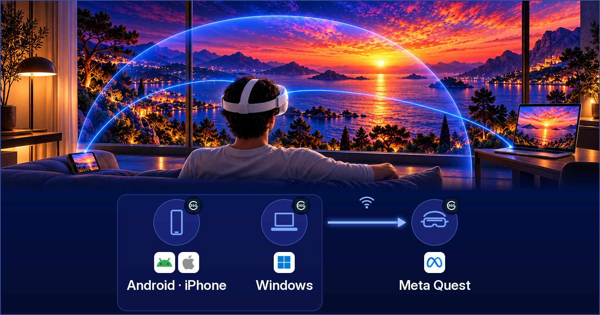
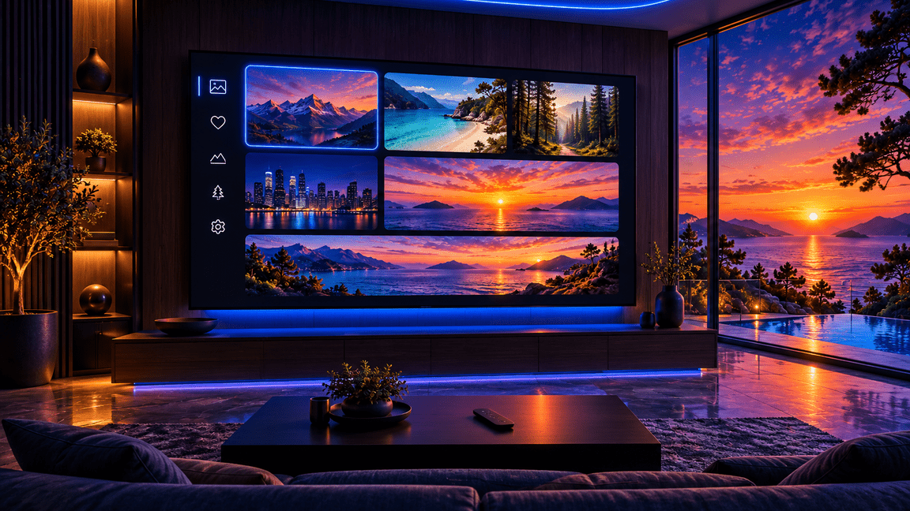

🌐 <b>Magyar</b> · További nyelvek (88)
<a href="../README.md">English</a> · <a href="README.af.md">Afrikaans</a> · <a href="README.ar.md">العربية</a> · <a href="README.az.md">Azərbaycanca</a> · <a href="README.be.md">Беларуская</a> · <a href="README.bg.md">Български</a> · <a href="README.bi.md">Bislama</a> · <a href="README.bn.md">বাংলা</a> · <a href="README.br.md">Brezhoneg</a> · <a href="README.bs.md">Bosanski</a> · <a href="README.ca.md">Català</a> · <a href="README.cs.md">Čeština</a> · <a href="README.cv.md">Чӑвашла</a> · <a href="README.da.md">Dansk</a> · <a href="README.de.md">Deutsch</a> · <a href="README.de_CH.md">Deutsch (Schweiz)</a> · <a href="README.el.md">Ελληνικά</a> · <a href="README.en_GB.md">English (UK)</a> · <a href="README.eo.md">Esperanto</a> · <a href="README.es.md">Español</a> · <a href="README.et.md">Eesti</a> · <a href="README.eu.md">Euskara</a> · <a href="README.fa.md">فارسی</a> · <a href="README.fi.md">Suomi</a> · <a href="README.fil.md">Filipino</a> · <a href="README.fr.md">Français</a> · <a href="README.ga.md">Gaeilge</a> · <a href="README.gl.md">Galego</a> · <a href="README.gsw.md">Alemannisch</a> · <a href="README.gu.md">ગુજરાતી</a> · <a href="README.he.md">עברית</a> · <a href="README.hi.md">हिन्दी</a> · <a href="README.hr.md">Hrvatski</a> · <a href="README.hy.md">Հայերեն</a> · <a href="README.id.md">Bahasa Indonesia</a> · <a href="README.is.md">Íslenska</a> · <a href="README.it.md">Italiano</a> · <a href="README.ja.md">日本語</a> · <a href="README.ka.md">ქართული</a> · <a href="README.kab.md">Taqbaylit</a> · <a href="README.kk.md">Қазақша</a> · <a href="README.km.md">ខ្មែរ</a> · <a href="README.kmr.md">Kurmancî</a> · <a href="README.kn.md">ಕನ್ನಡ</a> · <a href="README.ko.md">한국어</a> · <a href="README.kxm.md">ภาษาเขมรถิ่นไทย</a> · <a href="README.lb.md">Lëtzebuergesch</a> · <a href="README.lmo.md">Lombard</a> · <a href="README.lt.md">Lietuvių</a> · <a href="README.lv.md">Latviešu</a> · <a href="README.mfa.md">Bahasa Melayu Kelantan</a> · <a href="README.mi.md">Te reo Māori</a> · <a href="README.mk.md">Македонски</a> · <a href="README.ml.md">മലയാളം</a> · <a href="README.mn.md">Монгол</a> · <a href="README.mr.md">मराठी</a> · <a href="README.ms.md">Bahasa Melayu</a> · <a href="README.nb_NO.md">Norsk bokmål</a> · <a href="README.ne.md">नेपाली</a> · <a href="README.nl.md">Nederlands</a> · <a href="README.nn.md">Norsk nynorsk</a> · <a href="README.pa.md">ਪੰਜਾਬੀ</a> · <a href="README.pl.md">Polski</a> · <a href="README.pt.md">Português</a> · <a href="README.pt_BR.md">Português (Brasil)</a> · <a href="README.ro.md">Română</a> · <a href="README.ru.md">Русский</a> · <a href="README.si.md">සිංහල</a> · <a href="README.sk.md">Slovenčina</a> · <a href="README.sl.md">Slovenščina</a> · <a href="README.sq.md">Shqip</a> · <a href="README.sr_Cyrl.md">Српски</a> · <a href="README.sr_Latn.md">Srpski</a> · <a href="README.sv.md">Svenska</a> · <a href="README.sw.md">Kiswahili</a> · <a href="README.swg.md">Schwäbisch</a> · <a href="README.ta.md">தமிழ்</a> · <a href="README.te.md">తెలుగు</a> · <a href="README.th.md">ไทย</a> · <a href="README.tl.md">Tagalog</a> · <a href="README.tr.md">Türkçe</a> · <a href="README.uk.md">Українська</a> · <a href="README.ur.md">اردو</a> · <a href="README.uz.md">Oʻzbekcha</a> · <a href="README.vi.md">Tiếng Việt</a> · <a href="README.yue_Hant.md">粵語</a> · <a href="README.zh_Hans.md">简体中文</a> · <a href="README.zh_Hant.md">繁體中文</a>

  

# Immuch360

**A saját médiája. Bármelyik képernyőn. Minden nézőpontból.**

🌐 <a href="https://immuch360.com/hu/"><b>immuch360.com</b></a>

Sík, 360°-os és 3D fényképek és videók az eszközéről, a NAS-áról, az Immich szerveréről, a kameráiról és a drónjáról. Nem kell fiók. Az Immuch360 egy ingyenes, nyílt forráskódú alkalmazás, amely ott olvassa a fényképeit és videóit, ahol vannak, és mindegyiket a hozzá illő nézegetőben játssza le: síkban, gömbként, amelyben körülnézhet, 3D-ben, vagy egy headsetben teljesen Ön körül. Telefonokon, táblagépeken, tévéken, Meta Quest headseteken és számítógépeken fut. A weboldala, [immuch360.com](https://immuch360.com/hu/), 89 nyelven mutatja meg, mit tesz az egyes képernyőkön.

**Újdonságok a build 52-ben és a desktop build 32-ben, 3.4.7 verzió.** A telefonjáról a [„Lejátszás ezen…”](#show-your-photos-and-videos-on-the-tv-from-your-phone) most az Immich-képtára, a megosztásai, valamint a Jellyfin és az Emby fényképeit és videóit egy Immuch360-at futtató tévére, Meta Questre vagy számítógépre küldi, amely a saját fiókjával nyitja meg őket, vagy egy Chromecastra vagy Google TV-re, a telefon Előző, Diavetítés és Következő gombjai pedig léptetik a nagy képernyőt; eszközön vagy valódi Cast-eszközzel még nem kipróbálva. A fényképei és videói neve [olvasható marad a bélyegképeik fölött](#play-the-files-of-a-nas-a-computer-a-media-server-or-plex), ahogy a jelvények, az időtartamok és az idővonal hónapjai is. A számítógépeken a telepített MI-összetevők [egy kattintással frissülnek](#update-the-ai-components-in-one-click), amint egy későbbi build újabb verziót hoz valamelyikükből, soha nem forgalomkorlátos kapcsolaton, és minden telepített verzió megmarad, amíg a frissítését nem ellenőrizték. A Linux kap egy [AppImage-et](#linux), amely telepítés nélkül fut, és ha hiányzik egy könyvtár, megadja a disztribúciója parancsát, amely telepíti, a CI ellenőrizte Arch Linuxon, openSUSE Tumbleweeden, Ubuntu 22.04-en, Debian 12-n és Fedora 44-en. Az iPhone- és iPad-alkalmazás Xcode 27-tel és az iOS 27 SDK-val készül.

**Újdonságok a 33. és 51. közötti buildekben.** [A filmek ott folytatódnak, ahol abbahagyta](#pick-up-a-film-where-you-stopped). Hamarabb indulnak, és lassú szerverről [megállás helyett tovább játszódnak](#when-a-video-waits-or-will-not-play). Az idővonal [hónapokra és évekre kicsinyít](#find-a-month-or-a-year-in-a-long-timeline) telefonon és számítógépen. Android telefonon vagy Meta Questen a [„Mappa böngészése”](#browse-a-folder-of-your-phone-or-headset) az eszköz egy mappáját megosztásként nyitja meg, és a TIFF fényképek is megjelennek. Az Android TV [dátum szerint keres a távirányítóval](#on-android-tv-and-google-tv), a Meta Quest 3 vagy 3S [megnyitja a gauss-splateket](#explore-gaussian-splats-in-a-meta-quest-3-or-3s), amelyek a jobb hüvelykujjkarral forgathatók, az SPZ 4-es verziót is beleértve, egy számítógép pedig [elkészíti a NAS-án lévő fényképek 3D változatait](#turn-one-photo-into-3d-a-scene-a-panorama). Egy két grafikus chipes Windows laptopon az alkalmazás [mostantól a gyorsabbon fut](#when-a-video-waits-or-will-not-play), így a 8K-s filmek simán játszódnak. A gauss-splatek mostantól [megnyílnak számítógépeken, valamint Android telefonokon és táblagépeken](#explore-gaussian-splats-on-your-phone-tablet-or-computer), egy Windows számítógép MI-vel [splat-jeleneteket készít a fényképeiből vagy egy videóból](#make-a-splat-scene-from-your-photos-or-a-video-ai), az Immich szervere [fényképekben őrzi meg őket](#keep-a-splat-scene-on-your-immich-server), amelyek az idővonaláról nyílnak meg, a számítógépek pedig [lejátsszák az AV2-videókat](#play-av2-videos-on-your-computer). A build 42-től az Insta360, GoPro MAX és DJI Osmo 360 kamerák nyers videói az Immich-képtárából, egy megosztásról vagy egy mappából [a kamera giroszkópjával stabilizálva játszódnak le](#stabilise-your-360-videos-with-the-cameras-gyroscope) Android telefonokon, táblagépeken és tévéken, a desktop build 22 splat-készítője [Részletes minőséget kínál](#make-a-splat-scene-from-your-photos-or-a-video-ai) a közelről nézett jelenetekhez, egy 360°-os panoráma pedig [a videokártya 3,5 GiB szabad memóriájával indul](#turn-one-photo-into-3d-a-scene-a-panorama). Az iPhone- és iPad-alkalmazás [az App Store-ban van](https://apps.apple.com/us/app/immuch360-360-3d-player/id6817655965), 3.4.3 verzió. A build 43-tól az alkalmazás frissítési értesítése a Google Play-t vagy az App Store-t nyitja meg telefonokon és táblagépeken; a weboldala, [immuch360.com](https://immuch360.com/hu/), november 7-én nyílt meg. A build 44-től és a desktop build 24-től egy Meta Quest 3 vagy 3S [legfeljebb 300 000 gauss-elemes splateket mutat](#explore-gaussian-splats-in-a-meta-quest-3-or-3s), a számítógépek [több fényképet és videót jelölnek ki a Ctrl és a Shift billentyűvel](#use-your-computer-as-the-media-player), egy tévé, amelynek dekódere elutasít egy videót, [magától a szerver másik fájlját játssza le](#when-a-video-waits-or-will-not-play), a panorámák egy két videokártyás laptop kiválasztott videokártyáján futnak, a Quest és a számítógépek frissítési értesítése pedig az áruházukat vagy a letöltési oldalukat nyitja meg, sok javítással. A build 45-től és a desktop build 25-től, minden platformon 3.4.0 verzióval, az alkalmazás az Immich 3.4.0 alkalmazást követi az Immich 11 későbbi javításával, megjeleníti az [Immich 3.4 szerverek JPEG XL fényképeit](#keep-your-immich-library-with-more), megnyitja [a Plex filmjeit év szerint](#watch-your-plex-films), minden filmhez egy oldallal, a letöltésükkel az eszközre és a lejátszásukkal a tévén a telefonról, az áruházi buildekben értékelést kérhet, a videós összetevőit pedig a számítógépeken [a saját nyílt tárolóikból](#licences-and-credits) veszi. A build 46-tól és a desktop build 26-tól, 3.4.1 verzióval, a 360°-os kamerák nyers videói iPhone-on és iPaden, egy Meta Questben és Windowson is [stabilizálva játszódnak le](#stabilise-your-360-videos-with-the-cameras-gyroscope), egy Meta Quest [libmpv-vel lejátssza azokat a Plex filmeket, amelyeket a saját lejátszója nem tud dekódolni](#watch-your-plex-films), egy telefon [egy ilyen filmet egy Chromecastra vagy egy Google TV-re küld](#watch-your-plex-films), egy 3D fénykép MI-térhatása pedig [az Ön által választott erősséget kapja](#turn-one-photo-into-3d-a-scene-a-panorama); egy új szerver a Plex-fiókjával való bejelentkezéssel is hozzáadható, az alkalmazás pedig [egy fájlban őrzi meg a beállításait](#keep-your-settings-in-a-file). A build 47-től és a desktop build 27-től, a 3.4.2 verzióval, egy Plex film [olyan hangsávot játszik le, amelyet az eszköz dekódol](#watch-your-plex-films), és megmondja, melyiket, a képernyőhöz illő verziót nyitja meg, lassú kapcsolaton pedig egy könnyebbet kínál, a Windows és a macOS lejátssza a Dolby TrueHD hangját, az Android [értesítésben mutatja a letöltését](#watch-your-plex-films), és az Android TV is letölt filmeket, az [akkumulátoros Tapo kamerák pedig élőben látszanak](#watch-your-home-cameras-on-the-big-screen); egy beállításfájl visszaállítása a fiókjaival most be is jelentkezteti az Immich szerverére. A build 48-tól és a desktop build 28-tól, 3.4.3 verzió, egy Windows számítógép [egy PC VR headsetben játssza le a videóit](#watch-your-videos-in-a-pc-vr-headset-from-windows) a SteamVR, a Meta Horizon Link vagy egy másik OpenXR futtatókörnyezet révén (a projekt még nem próbálta ki headsetben), [más márkájú kamerák élőben látszanak](#cameras-of-other-brands-over-onvif-or-rtsp), ONVIF-en keresztül megtalálva vagy az RTSP-hivatkozásukkal hozzáadva (szimulált kamerával ellenőrizve, más márka valódi kameráját még nem próbálták ki), a [DJI Osmo 360 II és a GoPro MAX 2 nyers videói stabilizálva játszódnak le](#open-the-raw-files-of-360-cameras), a Plex filmek [már nem érkeznek túl lassan a telefonokra](#when-a-video-waits-or-will-not-play), az LG és Samsung tévék egy gombbal [elforgatják az oldalán fekvő videót](#on-a-samsung-tv-tizen) (LG tévén még nem kipróbálva; az issue 17 Samsung tévéje megtagadta az elforgatást), és a „Szerverfrissítés érhető el” üzenet már nem jelenik meg egy naprakész szervernél. A build 49-től és a desktop build 29-től, 3.4.4 verzió, az alkalmazás maga [olvassa a Jellyfin és Emby szervereit](#watch-your-jellyfin-and-emby-libraries) (eszközön még nem kipróbálva), amelyeket a hálózatán talál meg, és tévén vagy headsetben Quick Connecttel jelentkezik be rájuk, az eredeti fájljaikat lejátszva, hogy egy 360°-os videó 360°-os maradjon; egy Meta Quest nagy képernyőjén a fényképek [megtartják az Ön által beállított méretet és helyet, miközben lapoz köztük, és diavetítésként is lejátszódnak](#browse-your-photos-on-the-big-screen-of-the-quest) (a projekt még nem próbálta ki headsetben); a telefonok és táblagépek 360°-os videólejátszója [megkapja a 360°-os fényképek vezérlőit](#360-videos-on-your-phone-with-the-controls-of-360-photos), egy giroszkóp gombot, csippentéses nagyítást és egyenesen felfelé vagy lefelé húzást (egy felhasználó kipróbálta egy Samsung Galaxy S25 Ultra készüléken, iPhone-on még nem); egy számítógép MI segítségével [3D videóvá alakítja a 2D videóit](#turn-your-2d-videos-into-3d-on-your-computer) (3D képernyőn vagy headsetben még nem kipróbálva); a Samsung tévék pedig [a forgatást igénylő videót a Samsung saját lejátszójának adják át](#on-a-samsung-tv-tizen), amelyet az issue 17 tévéje lejátszik, de nem hajlandó elforgatni. A build 50-től és a desktop build 30-tól, 3.4.5 verzió, miközben egy videó játszódik egy Meta Quest 2D ablakában, az ablak [a kijelző frissítési ütemében rajzolódik újra](#step-inside-your-photos-and-videos-with-a-meta-quest) a build 48 és 49 körülbelül másodpercenként 10 rajzolása helyett (Meta Quest 3-on mérve), az Android TV [a távirányítóval belenagyít egy fényképbe](#on-android-tv-and-google-tv), és a nyílgombokkal mozgatja (új, tévén még nem kipróbálva), három javítás pedig mlc70 Android TV forkjából érkezik: egy gyors lapozás már nem mutatja a hátrahagyott fénykép részleteit, egy animált fénykép felszabadítja a memóriáját, a Hely szűrő pedig felkínálja az új ország városait. A build 51-től és a desktop build 31-től, 3.4.6 verzió, a [Feljavítás (MI)](#make-a-photo-sharper-on-your-computer-ai) élesebb másolatot készít egy lágy fényképről az eredeti mellé Windowson és Linuxon, három szinten, amelyek mindegyike egyszer futott egy RTX 4060-as PC-n, a Természetes Apple chipes Macen is elérhető (Macen még nem próbáltuk ki), egy számítógép MI-vel [360°-os videóból 360°-os 3D videót készít](#a-360-video-turned-into-a-360-3d-video), Windowson a 3D videók mélységét a videokártya becsli meg, az MI-funkciók közvetlenül veszik át a szervere és egy megosztás videóit, a beállításfájlnak [saját kártyája van a Képtárban](#keep-your-settings-in-a-file), egy tévé hálózati megosztásra menti, a számítógépeken az Esc egy lépést lép vissza, az áruházi buildek [ritkábban és kíméletesebben](#privacy) kérnek értékelést, a Linux megjeleníti a TIFF fényképeket, a splat-jeleneteket és a 3D videókat egy szemmel, és két összeomlás javítva.

  Az Immich mobilalkalmazás nem hivatalos forkja. Nem áll kapcsolatban az Immich csapatával vagy a FUTO-val. A név angol kiejtése úgy hangzik, mint az „I am much 360” („nagyon 360 vagyok”).

<b>Tartalom</b>

- [Kinek szól](#who-it-is-for)
- [Mely képernyők](#which-screens), [mit tesznek együtt](#use-cases) és [mit tud az egyes képernyő](#what-each-screen-does)
- [Mit tehet](#what-you-can-do)
- [Szerezze be az eszközére](#get-it-on-your-device)
- [Útmutatók](#how-to)
  - [Nézze meg fényképeit és videóit, szerverrel vagy anélkül](#watch-your-photos-and-videos-with-or-without-a-server)
  - [Fedezze fel a panorámákat, a 360°-os, VR180 és 3D felvételeket](#explore-panoramas-360-vr180-and-3d): [360°-os videók telefonokon](#360-videos-on-your-phone-with-the-controls-of-360-photos)
  - [Alakítson egy fényképet 3D-vé, jelenetté, panorámává](#turn-one-photo-into-3d-a-scene-a-panorama): [Egy kattintással frissített MI-összetevők](#update-the-ai-components-in-one-click)
  - [Alakítsa 3D-vé a 2D videóit a számítógépén](#turn-your-2d-videos-into-3d-on-your-computer): [360°-os videókból 360°-os 3D](#a-360-video-turned-into-a-360-3d-video)
  - [Tegyen élesebbé egy fényképet a számítógépén (MI)](#make-a-photo-sharper-on-your-computer-ai)
  - [Nézze a tévén a távirányítóval](#watch-on-the-tv-with-the-remote): [Android TV és Google TV](#on-android-tv-and-google-tv), [LG](#on-an-lg-tv-webos), [Samsung](#on-a-samsung-tv-tizen)
  - [Jelentkeztessen be egy tévét, headsetet vagy számítógépet a telefonjával](#sign-in-a-tv-a-headset-or-a-computer-with-your-phone)
  - [Mutassa meg a fényképeit és videóit a tévén a telefonjáról](#show-your-photos-and-videos-on-the-tv-from-your-phone)
  - [Lépjen be a fényképeibe és videóiba egy Meta Questtel](#step-inside-your-photos-and-videos-with-a-meta-quest): [a nagy képernyő](#browse-your-photos-on-the-big-screen-of-the-quest), [kioszk mód](#kiosk-mode-for-an-exhibition-or-a-shop)
  - [Gauss-splatek felfedezése Meta Quest 3-on vagy 3S-en](#explore-gaussian-splats-in-a-meta-quest-3-or-3s)
  - [Gauss-splatek felfedezése a telefonján, táblagépén vagy számítógépén](#explore-gaussian-splats-on-your-phone-tablet-or-computer)
  - [Splat-jelenet készítése a fényképeiből vagy egy videóból (MI)](#make-a-splat-scene-from-your-photos-or-a-video-ai)
  - [Splat-jelenet megőrzése az Immich szerverén](#keep-a-splat-scene-on-your-immich-server)
  - [Játssza le egy NAS, egy számítógép, egy médiaszerver vagy a Plex fájljait](#play-the-files-of-a-nas-a-computer-a-media-server-or-plex): [a filmjei év szerint](#watch-your-plex-films), [Jellyfin és Emby](#watch-your-jellyfin-and-emby-libraries)
  - [A telefon vagy a headset egy mappájának böngészése](#browse-a-folder-of-your-phone-or-headset)
  - [Film folytatása ott, ahol abbahagyta](#pick-up-a-film-where-you-stopped)
  - [Amikor egy videó vár vagy nem indul el](#when-a-video-waits-or-will-not-play)
  - [Tartsa meg Immich képtárát, és kapjon többet](#keep-your-immich-library-with-more)
  - [Egy hónap vagy év megkeresése egy hosszú idővonalon](#find-a-month-or-a-year-in-a-long-timeline)
  - [Nézze otthoni kameráit a nagy képernyőn](#watch-your-home-cameras-on-the-big-screen): [más márkák](#cameras-of-other-brands-over-onvif-or-rtsp)
  - [A DJI drónja](#your-dji-drone): [élő videó](#see-what-your-drone-sees-on-your-phone), [Questben vagy Android TV-n](#watch-it-in-a-meta-quest-or-on-an-android-tv), [importálás](#bring-a-drones-or-a-camera-cards-photos-and-videos-to-immich)
  - [Nyissa meg a 360°-os kamerák nyers fájljait](#open-the-raw-files-of-360-cameras)
  - [Stabilizálja a 360°-os videóit a kamera giroszkópjával](#stabilise-your-360-videos-with-the-cameras-gyroscope)
  - [Forgasson el egy fényképet egyetlen gombbal](#turn-a-photo-with-one-key)
  - [Használja a számítógépét médialejátszóként](#use-your-computer-as-the-media-player)
  - [Nézze videóit egy PC VR headsetben, Windowsról](#watch-your-videos-in-a-pc-vr-headset-from-windows)
  - [AV2-videók lejátszása a számítógépén](#play-av2-videos-on-your-computer)
  - [Őrizze meg a beállításait egy fájlban](#keep-your-settings-in-a-file)
- [Összehasonlítva az Immichcsel](#compared-with-immich)
- [Adatvédelem](#privacy)
- [Licencek és köszönetnyilvánítás](#licences-and-credits)
- [Ütemterv](#roadmap)
- [Dokumentáció](#documentation)

## Kinek szól

- **360°-ban vagy 3D-ben fotózik** és körül szeretne nézni a felvételeiben, nem síkban, megduplázva vagy megnyújtva látni őket, és a 360°-os videóit a telefonon úgy forgatná, ahogy a fényképeit: [360°, VR180 és 3D](#explore-panoramas-360-vr180-and-3d), [360°-os videók telefonokon](#360-videos-on-your-phone-with-the-controls-of-360-photos).
- **360°-os kamerával filmez kézben, biciklin vagy sisakon** és azt szeretné, hogy az Insta360, GoPro MAX vagy MAX 2, DJI Osmo 360 vagy Osmo 360 II kamerája Immichben, egy megosztáson vagy egy mappában tárolt nyers videói vízszintesen és stabilan játszódjanak le a telefonján, a tévéjén, a Meta Questjén vagy a windowsos számítógépén: [a kamera giroszkópjával stabilizálva](#stabilise-your-360-videos-with-the-cameras-gyroscope).
- **A fényképei és filmjei egy NAS-on, egy számítógépen, a Plexen vagy az Immichen vannak** és a tévén szeretné látni őket, másolás nélkül: [a tévén](#watch-on-the-tv-with-the-remote), [NAS, megosztások és Plex](#play-the-files-of-a-nas-a-computer-a-media-server-or-plex).
- **A filmjeit egy Plex szerveren tartja**, és év szerint szeretne választani egyet, látni, miről szól, mielőtt elindul, magával vinni egy útra, a telefonjáról elindítani a tévén vagy egy Chromecaston, és lejátszani azokat a filmeket is, amelyeket az androidos telefonja, a tévéje vagy a Meta Questje nem tud dekódolni: [a filmjei, év szerint](#watch-your-plex-films).
- **A filmjeit egy Jellyfin vagy Emby szerveren tartja**, és a Meta Questjében, a tévén vagy a telefonon szeretné nézni őket, a 360°-ot és a 3D-t úgy megtartva, ahogy vannak, a helyét pedig a szerveren megőrizve (eszközön még nem kipróbálva): [Jellyfin és Emby](#watch-your-jellyfin-and-emby-libraries).
- **Van egy Meta Questje** és belépne a saját fényképeibe és videóiba: [a headsetben](#step-inside-your-photos-and-videos-with-a-meta-quest), és egy nagy képernyőn lapozná a fényképeit az Ön által beállított méretben és helyen, diavetítésként is (a projekt még nem próbálta ki headsetben): [a nagy képernyő](#browse-your-photos-on-the-big-screen-of-the-quest).
- **Van egy PC VR headsete egy Windows számítógépen**, és benne szeretné látni a 360°-os videóit Ön körül, a filmjeit pedig egy nagy vásznon (a projekt még nem próbálta ki headsetben): [egy PC VR headsetben](#watch-your-videos-in-a-pc-vr-headset-from-windows).
- **Sík fényképei vannak**, és 3D-ben szeretné látni őket, jelenetként, amelybe egy headsetben belehajolhat, vagy egy 360°-os panoráma belsejében, 3D kamera nélkül: [alakítson egy fényképet 3D-vé, jelenetté, panorámává](#turn-one-photo-into-3d-a-scene-a-panorama), újdonság, MI készíti a saját számítógépén.
- **A videói síkok**, a telefonja klipjei is, és 3D-ben szeretné őket egy headsethez vagy egy 3D képernyőhöz, a 360°-os videóit pedig 360°-os 3D-ben, a saját számítógépén elkészítve (3D képernyőn vagy headsetben még nem kipróbálva): [2D videókból 3D](#turn-your-2d-videos-into-3d-on-your-computer), [360°-ból 360°-os 3D](#a-360-video-turned-into-a-360-3d-video).
- **A fényképei lágyak**, kissé életlenek vagy gyenge fényben készültek, és élesebb másolatot szeretne az eredeti mellé, a saját számítógépén elkészítve, a kitalált részleteket nyíltan kimondva: [Feljavítás (MI)](#make-a-photo-sharper-on-your-computer-ai).
- **Immichet használ** és szeretné az alkalmazását, hozzá az immerzív nézegetőket és a nagy képernyőket, amelyeket a telefonjáról jelentkeztet be: [az Immich képtára](#keep-your-immich-library-with-more), [összehasonlítva az Immichcsel](#compared-with-immich).
- **Tapo kamerákkal figyeli az otthonát**, akkumulátoros kamerákkal is, vagy más márkájú kamerákkal ONVIF-en vagy RTSP-n keresztül, és a fényképei mellett, a tévén is látni szeretné őket (szimulált kamerával ellenőrizve): [otthoni kamerák](#watch-your-home-cameras-on-the-big-screen).
- **DJI drónt repül** és az élő képét DJI Fly nélkül szeretné a telefonján, valamint egy Meta Questben vagy egy Android TV-n a társai számára: [a drónja](#see-what-your-drone-sees-on-your-phone).
- **Helyeket és tárgyakat rögzít 3D-ben, gauss-splatekként,** vagy a saját fényképeiből készítené el őket, és be szeretné járni őket a telefonján, a számítógépén vagy egy headsetben: [telefonon, táblagépen vagy számítógépen](#explore-gaussian-splats-on-your-phone-tablet-or-computer), [a fényképeiből készítve](#make-a-splat-scene-from-your-photos-or-a-video-ai), [az Immichben megőrizve](#keep-a-splat-scene-on-your-immich-server).
- **AV2-videói vannak**, az AV1-et követő formátumban, és a számítógépén szeretné megnézni őket: [AV2 a számítógépén](#play-av2-videos-on-your-computer).
- **Több képernyője van otthon** és szeretné, ha együtt működnének: [mit tesznek együtt a képernyői](#use-cases).

Nincs Immuch360 fiók, amit létre kellene hozni, és semmi sem jut el hozzánk: az alkalmazás csak az Ön eszközeivel és az Ön által választott szerverekkel beszél, a build 45-től egy film oldalához a Wikipedia felé is, a build 46-tól a plex.tv felé, amikor azzal jelentkezik be, és MI-összetevőt vagy az AV2-dekódert csak akkor tölt le, ha Ön kéri.

## Mely képernyők

| Platform | Honnan szerezhető be | Állapot 2026 novemberében |
|---|---|---|
|  **Android** telefonok és táblagépek | [Google Play](https://play.google.com/store/apps/details?id=com.aprogsys.immuch360) · [APK](https://github.com/freeKC/Immuch360/releases) | a Google Play-en (a build 47 november 16-án publikálva; a build 51 november 24. óta a Google felülvizsgálata alatt; a build 52 következik), build 52 a GitHubon, amelyben [a nyers 360°-os videók stabilizálva játszódnak le](#stabilise-your-360-videos-with-the-cameras-gyroscope), [a filmek ott folytatódnak, ahol abbahagyta](#pick-up-a-film-where-you-stopped), a [„Mappa böngészése”](#browse-a-folder-of-your-phone-or-headset) pedig a telefon egy mappáját nyitja meg, és [megnyílnak a gauss-splatek](#explore-gaussian-splats-on-your-phone-tablet-or-computer), egy megosztásról vagy [az Immich idővonaláról](#keep-a-splat-scene-on-your-immich-server), [a beállítások egy fájlban megőrizve](#keep-your-settings-in-a-file), [egy film letöltése értesítésben megjelenítve](#watch-your-plex-films), a build 48-tól [más márkájú kamerák, élőben](#cameras-of-other-brands-over-onvif-or-rtsp) (szimulált kamerával ellenőrizve) és, a build 49-től, [Jellyfin és Emby szerverek](#watch-your-jellyfin-and-emby-libraries) (eszközön még nem kipróbálva) és [a 360°-os fényképek vezérlői a 360°-os videólejátszóban](#360-videos-on-your-phone-with-the-controls-of-360-photos) (egy felhasználó kipróbálta egy Samsung Galaxy S25 Ultra készüléken), a build 51-től pedig [a beállításfájl kártyája a Képtárban](#keep-your-settings-in-a-file), a fájlja hálózati megosztásra is mentve, a build 52-től pedig [a tévére vagy Chromecastra küldött fényképei és videói](#show-your-photos-and-videos-on-the-tv-from-your-phone) a „Lejátszás ezen…” funkcióval (eszközön még nem kipróbálva) |
|  **iPhone és iPad** | [App Store](https://apps.apple.com/us/app/immuch360-360-3d-player/id6817655965) | a 3.4.6 verzió november 25. óta az App Store-ban, [hónapokkal és évekkel az idővonalon](#find-a-month-or-a-year-in-a-long-timeline), [ott folytatódó filmekkel, ahol abbahagyta](#pick-up-a-film-where-you-stopped), [egy tévé, headset vagy számítógép bejelentkeztetésével](#sign-in-a-tv-a-headset-or-a-computer-with-your-phone) a telefonról, az Immichben megőrzött splat-jelenetekkel, amelyek a fényképükként jelennek meg, az Immich 3.4.0 javításaival és JPEG XL fényképeivel, [stabilizált nyers 360°-os videókkal](#stabilise-your-360-videos-with-the-cameras-gyroscope), [a beállítások egy fájlban megőrizve](#keep-your-settings-in-a-file) és [az akkumulátoros Tapo kamerák élő nézetével](#watch-your-home-cameras-on-the-big-screen) és [a más márkájú kamerák élő nézetével](#cameras-of-other-brands-over-onvif-or-rtsp) (szimulált kamerával ellenőrizve), a 3.4.4 verziótól pedig [Jellyfin és Emby szerverekkel](#watch-your-jellyfin-and-emby-libraries) (eszközön még nem kipróbálva) és [a 360°-os fényképek vezérlőivel a 360°-os videólejátszóban](#360-videos-on-your-phone-with-the-controls-of-360-photos) (iPhone-on még nem kipróbálva), a 3.4.6 verziótól pedig [a beállításfájl kártyájával](#keep-your-settings-in-a-file) és hálózati megosztásról való visszaállításával; a 3.4.7 verzió, a build 52 iPhone- és iPad-verziója, Xcode 27-tel készítve, következik; vagy [építse meg saját maga](../docs/immuch360/build.md) |
|  **Android TV és Google TV** | [Google Play](https://play.google.com/store/apps/details?id=com.aprogsys.immuch360) · [APK](#android-tv-and-google-tv) | a Google Play-en, amely Android TV-n és Google TV-n kínálja az alkalmazást, és build 52 a GitHubon: [nyers 360°-os videók stabilizálva](#stabilise-your-360-videos-with-the-cameras-gyroscope), [keresés dátum szerint a távirányítóval](#on-android-tv-and-google-tv), [bejelentkezés a telefonjával](#sign-in-a-tv-a-headset-or-a-computer-with-your-phone) egy QR-kód beolvasásával, idősáv, hang és feliratok a távirányítóhoz a videólejátszóban, és egy [drón élő videója](#watch-it-in-a-meta-quest-or-on-an-android-tv), amelyet egy telefon továbbít, [a tévére letöltött filmek](#watch-your-plex-films) és, a build 49-től, Quick Connecttel bejelentkezett [Jellyfin és Emby szerverek](#watch-your-jellyfin-and-emby-libraries) (eszközön még nem kipróbálva) és, a build 50-től, [a távirányítóval nagyított fényképek](#on-android-tv-and-google-tv) (működés közben látták egy Android TV emulátoron, tévén még nem kipróbálva), a build 51-től pedig [a hálózati megosztásra mentett és onnan visszaállított beállításfájl](#keep-your-settings-in-a-file) (működés közben látták egy Android TV emulátoron), a build 52-től pedig [a telefon által a „Lejátszás ezen…” funkcióval küldött fényképek és videók](#show-your-photos-and-videos-on-the-tv-from-your-phone) (tévén még nem kipróbálva) |
| **LG tévék** webOS 5.0 vagy újabb rendszerrel | [.ipk, 1.0.5 verzió](https://github.com/freeKC/Immuch360/releases/tag/webos-v1.0.5) · LG Content Store (felülvizsgálat alatt) | 1.0.0 verzió, október 24-én beküldve az LG Content Store-ba, október 26. óta az LG tesztjei alatt; az 1.0.1 verzió, október 27. óta a GitHubon, a nyilakkal nagyít egy fényképet, és jelzi, ha egy fénykép még töltődik, az 1.0.2 verzió pedig, a GitHubon a build 46-tal, japánul ログイン formában írja a „bejelentkezés” szót, az 1.0.3 verzió, a build 47-tel, jelzi, ha egy DLNA szerver egy mappája élő tévécsatornákat tartalmaz, amelyeket még nem tud lejátszani, az 1.0.4 verzió, a build 48-cal, egy gombbal [elforgatja az oldalán fekvő videót](#on-an-lg-tv-webos) (LG tévén még nem kipróbálva), az 1.0.5 verzió pedig, a build 49-cel, a DLNA szerverek között megnevezi a Jellyfint a DLNA bővítményével; amíg az LG meg nem jelenteti az alkalmazást, [Developer Mode](#lg-tvs-webos) módban telepíthető. Az 1.0.0 verzió az LG Cloud Test Lab webOS 25 tévéin futott |
| **Samsung tévék** Tizen 5.5 vagy újabb rendszerrel | [.wgt, 0.3.6 verzió](https://github.com/freeKC/Immuch360/releases/tag/tizen-v0.3.6) | ugyanannak a tévés alkalmazásnak a 0.3.6 verziója, amelyet a saját Samsung tanúsítványával kell aláírnia és [Developer mode](#samsung-tvs-tizen) módban telepítenie; a 0.1.0 egy tesztelő Samsung tévéjén futott, a 0.2.0 az akkor talált hibák javításait tartalmazza, a 0.3.0 hozzáadja az LG 1.0.1 verziójának fényképnagyítását és Betöltés jelzését, a 0.3.1 pedig az LG 1.0.2 verziójának japán szövegezését, a 0.3.2 a telefonnal állóan felvett videót a helyes irányban játssza le ([issue 17](https://github.com/freeKC/Immuch360/issues/17)), a 0.3.3 és a 0.3.4 [elforgatja egy olyan tévén, amely állónak jelenti](#on-a-samsung-tv-tizen), és egy gombot ad hozzá, amely kézzel forgatja el, a 0.3.5 és a 0.3.6 pedig az ilyen videót a Samsung saját lejátszójának adja át; a bejelentő tévéjén a 0.3.4 és a 0.3.5 az oldalán hagyta a képet, mert a tévé elutasítja a forgatást, és ott a kiút egy olyan videó, amelyet az Immich szervere átkódol, állóként tárolva; nincs fent a Samsung áruházában |
|  **Meta Quest** 2, Pro, 3 és 3S | [Horizon Store](https://www.meta.com/experiences/immuch360/1384208401440714/) · [APK](#meta-quest) | a Horizon Store-on (a build 50, amelynek 2D ablaka egy videó lejátszása közben a kijelző frissítési ütemében rajzolódik újra, november 25-én publikálva; a build 52 következik), build 52 a GitHubon, [kioszk móddal](#kiosk-mode-for-an-exhibition-or-a-shop), [stabilizált nyers 360°-os videókkal](#stabilise-your-360-videos-with-the-cameras-gyroscope) az immerzív nézetben, [a libmpv által lejátszott filmekkel, amelyeket nem tud dekódolni](#watch-your-plex-films), Quest 3-on és 3S-en pedig [gauss-splatekkel](#explore-gaussian-splats-in-a-meta-quest-3-or-3s) és egy sík fénykép [MI-térhatásával](#turn-one-photo-into-3d-a-scene-a-panorama), a build 49-től pedig [a nagy képernyőn lapozott fényképek](#browse-your-photos-on-the-big-screen-of-the-quest) az Ön által beállított méretben, diavetítésként is (a projekt még nem próbálta ki headsetben), és Quick Connecttel bejelentkezett [Jellyfin és Emby szerverek](#watch-your-jellyfin-and-emby-libraries) (eszközön még nem kipróbálva), a build 51-től pedig egy headset, amelynek Horizon OS-e túl régi az immerzív nézegetőhöz, frissítést kér az alkalmazás bezárása helyett (ilyen headseten nem kipróbálva) |
|  **Windows** | [Telepítő vagy ZIP](https://github.com/freeKC/Immuch360/releases/tag/desktop-v3.4.7-32) | desktop build 32, aláírva: fényképek, sík és 360°-os videók, megosztások, Plex, kamerák (szimulált kamerával ellenőrizve), bejelentkezés a telefonjával, egyetlen gombbal elforgatott fényképek, a felület 89 nyelven, és [3D fényképek, 3D jelenetek és 360°-os panorámák az Ön fényképeiből](#turn-one-photo-into-3d-a-scene-a-panorama), MI által, a NAS-án lévő fényképekből is; [gauss-splatek](#explore-gaussian-splats-on-your-phone-tablet-or-computer) megnyitva, [a fényképeiből vagy egy videóból elkészítve](#make-a-splat-scene-from-your-photos-or-a-video-ai) és [az Immichben megőrizve](#keep-a-splat-scene-on-your-immich-server), [AV2-videók](#play-av2-videos-on-your-computer), a desktop build 22-től [minőségválasztás a splat-jelenetekhez](#make-a-splat-scene-from-your-photos-or-a-video-ai) és [360°-os panorámák 3,5 GiB szabad grafikus memóriától](#turn-one-photo-into-3d-a-scene-a-panorama), a desktop build 26-tól pedig [stabilizált nyers 360°-os videók](#stabilise-your-360-videos-with-the-cameras-gyroscope) és [3D fényképek térhatás-erősséggel és élesebb élekkel](#turn-one-photo-into-3d-a-scene-a-panorama), a desktop build 27-től [a filmek Dolby TrueHD hangja és Blu-ray feliratai](#watch-your-plex-films), a desktop build 28-tól [a videói egy PC VR headsetben](#watch-your-videos-in-a-pc-vr-headset-from-windows) (a projekt még nem próbálta ki headsetben), a desktop build 29-től pedig MI-vel [a 2D videóiból készült 3D videók](#turn-your-2d-videos-into-3d-on-your-computer) (3D képernyőn vagy headsetben még nem kipróbálva), a desktop build 31-től pedig MI-vel [a fényképei élesebb másolatai](#make-a-photo-sharper-on-your-computer-ai) és MI-vel [360°-os 3D videókká alakított 360°-os videók](#a-360-video-turned-into-a-360-3d-video), a videokártya által becsült mélység, a szervere és egy megosztás videói közvetlenül átvéve, és az Esc egy lépés visszalépéshez, a desktop build 32-től pedig [az egy kattintással frissített MI-összetevők](#update-the-ai-components-in-one-click) |
|   **macOS és Linux** | [.deb, .rpm, AppImage, DMG](https://github.com/freeKC/Immuch360/releases/tag/desktop-v3.4.7-32) | desktop build 32: fényképek, 360°-os fényképek és sík videók (a 360°-os videók síkban játszódnak le), egy Immich szerver és hálózati megosztások, és [3D fényképek és 3D jelenetek](#turn-one-photo-into-3d-a-scene-a-panorama), amelyeket MI készít a fényképeiből, Linuxon pedig 360°-os panorámák is egy 8 GB-os videokártyán, annak 3,5 GiB szabad memóriájától kezdve, valamint [gauss-splatek](#explore-gaussian-splats-on-your-phone-tablet-or-computer) és [AV2-videók](#play-av2-videos-on-your-computer) (Macen még nem kipróbálva); a desktop build 11-et október 26-án kipróbálták egy Ubuntu 24.04 konténerben és egy Macen; a desktop build 27-től a filmek Dolby TrueHD hangja macOS-en; a desktop build 29-től MI-vel [a 2D videóiból készült 3D videók](#turn-your-2d-videos-into-3d-on-your-computer) Linuxon és Apple chipes Macen (3D képernyőn vagy headsetben még nem kipróbálva); a desktop build 31-től Linuxon MI-vel [a fényképei élesebb másolatai](#make-a-photo-sharper-on-your-computer-ai), TIFF fényképek, a maguktól megjelenő új fájlokat mutató mappák, a fényképeiből készült splat-jelenetek egy 4 GB-os videokártyán és egy szemmel síkban mutatott 3D videók, Apple chipes Macen pedig a „Feljavítás (MI)” Természetes szintje (Macen még nem kipróbálva); a desktop build 32-től [egy AppImage](#linux) a többi Linux-disztribúcióhoz, a CI ellenőrizte Arch Linuxon és openSUSE-n; macOS-en aláírás nélkül |

*Az állapotok minden kiadásnál frissülnek; hogy melyik áruházban mi van, mi van felülvizsgálat alatt és az egyes buildek itt találhatók: [Kiadási állapot](../docs/immuch360/release-status.md). Az [immuch360.com](https://immuch360.com/hu/) weboldal 89 nyelven megmutatja, mit tesz egy-egy képernyő, minden funkcióhoz ad egy útmutatót, és összegyűjti az áruházak linkjeit.*

  

### Mit tesznek együtt a képernyői

Telepítse az Immuch360-at minden képernyőre, amelyen néz: mindegyik maga olvassa a forrásait, és némelyik egy képet, egy fájlt vagy egy bejelentkezést ad át egy másiknak. Minden képen az Immuch360 ikonja jelöli azokat az eszközöket, amelyeken az alkalmazás fut.

#### A NAS-a minden képernyőn

  

**Amire szüksége van:** egy NAS SMB- vagy WebDAV-megosztással, és az Immuch360 minden képernyőn, amelyen néz.

Adja hozzá a megosztást minden képernyőn, és mindegyik ott játssza le a fényképeket és videókat, ahol vannak, semmit sem másol: telefonok, táblagépek, Android TV, egy Meta Quest, Windows, Linux és macOS rendszerű számítógépek, valamint az Immich-szerverére bejelentkezett LG tévék (SMB a webOS 22-től). Egy 360°-os fénykép gömbként forog a telefonon és a tévén, a headsetben pedig körülveszi Önt. Útmutató: [Játssza le egy NAS, egy számítógép, egy médiaszerver vagy a Plex fájljait](#play-the-files-of-a-nas-a-computer-a-media-server-or-plex).

#### Az Immich-szervere minden képernyőn, a telefonjáról bejelentkeztetve

  

**Amire szüksége van:** egy Immich-szerver, az Immuch360 az androidos telefonján, és az Immuch360 azokon a képernyőkön, amelyeket bejelentkeztet: Android TV, egy Meta Quest, egy Windows, Linux vagy macOS rendszerű számítógép.

A telefonon az Immuch360 megtartja a teljes Immich mobilalkalmazást, hozzáadja a 360°-os, VR180 és 3D nézegetőit, és a hivatalos alkalmazás mellé települ. A szerverére bejelentkezve bejelentkezteti a nagy képernyőket: beolvassa a tévé vagy a számítógép QR-kódját, vagy Ön beírja rajta a headset által mutatott kódot, és a jelszava a telefonon marad. Útmutató: [Jelentkeztessen be egy tévét, headsetet vagy számítógépet a telefonjával](#sign-in-a-tv-a-headset-or-a-computer-with-your-phone).

#### Sík fényképei 3D-ben, a számítógépétől a headsetig

  

**Amire szüksége van:** az Immuch360 egy Windows, Linux vagy macOS rendszerű számítógépen és egy Meta Questben, köztük a NAS-ával, vagy az Immich-szerverével, bekapcsolt „Az MI-változatok mentése is” beállítással.

Maga a számítógép alakítja a fényképeit 3D fényképekké és 3D jelenetekké, valamint Windowson vagy Linuxon egy 8 GB-os videokártyával 360°-os panorámákká, és az eredetik mellé menti őket. A headset egy 3D fényképet valódi 3D-ben mutat, egy jelenetet a szobájába helyez, egy panorámát pedig Ön köré; a telefonok és tévék a 360°-os nézegetőjükben nyitják meg a panorámákat. Útmutató: [Alakítson egy fényképet 3D-vé, jelenetté, panorámává](#turn-one-photo-into-3d-a-scene-a-panorama).

#### A drónja élő képe egy headsetben vagy a tévén

  

**Amire szüksége van:** egy DJI drón és annak DJI RC-N3 távirányítója, az Immuch360 a távirányítóhoz csatlakoztatott androidos telefonon, és az Immuch360 egy Meta Questben vagy egy Android TV-n.

A telefon mutatja a drón élő videóját és továbbítja azt, a Wi-Fi-jén vagy a saját hotspotján át, így a társai a headsetben vagy a tévén követik a repülést. Csak vétel: soha semmilyen parancs nem megy a távirányítónak vagy a drónnak, és a távirányító megtartja a teljes irányítást. Útmutató: [Nézze egy Meta Questben vagy egy Android TV-n](#watch-it-in-a-meta-quest-or-on-an-android-tv).

#### A 360°-os kamerája nyers fájljai, ott összefűzve, ahol nézi őket

  

**Amire szüksége van:** egy Insta360, GoPro MAX vagy MAX 2, DJI Osmo 360 vagy Osmo 360 II kamera, a NAS-a, és az Immuch360 a képernyőkön: telefonok, táblagépek, Android TV, egy Meta Quest, Windows.

Másolja az .insp, .insv, .360 vagy .osv fájlokat a kamera kártyájáról a NAS-a egy SMB- vagy WebDAV-megosztására, úgy, ahogy vannak; egy Immich-szerver az Insta360 fájljait is fogadja. Minden képernyő lejátszás közben fűzi össze őket, az egyes fájlokban rögzített kalibrációval, és előtte semmit sem kell exportálni a kamera alkalmazásában. Útmutató: [Nyissa meg a 360°-os kamerák nyers fájljait](#open-the-raw-files-of-360-cameras).

#### A Plex- és DLNA-szerverei a tévén és a headsetben

  

**Amire szüksége van:** egy Plex Media Server, egy Jellyfin vagy Emby szerver, vagy egy DLNA-szerver, például minidlna, és az Immuch360 minden képernyőn: Android TV, egy Meta Quest, telefonok, táblagépek, Windows.

A Plex a könyvtárai eredeti fájljait adja, így egy 360°-os videó 360°-os marad, Ön körül a headsetben, otthon és a porttovábbításán át otthonától távol is; a DLNA-szervereket az otthoni hálózatán találja meg. Az Immich-szerverére bejelentkezett LG tévék is lejátsszák őket. A build 45-től a telefonok, a táblagépek, az Android TV, a Quest és a számítógépek egy Plex filmkönyvtárat az összes filmjével, év szerint nyitnak meg, minden filmet a saját oldalával, és egy a telefonon kiválasztott film az Android TV-n, a Questen vagy egy számítógépen játszódik le, a távirányító irányításával. A build 46-tól a Quest libmpv-vel lejátssza azokat a filmeket, amelyeket a saját lejátszója nem tud dekódolni, a Plex szervere konvertálja azokat, amelyeket egy androidos eszköz egyik lejátszója sem dekódol, egy telefon pedig egy filmet egy Chromecastra vagy egy Google TV-re küld. A build 47-től egy film olyan hangsávot játszik le, amelyet az eszköz dekódol, és megmondja, melyiket, a képernyőhöz illő verziót nyitja meg, és Windowson és macOS-en lejátssza a Dolby TrueHD hangját, egy DLNA szerver élő tévécsatornákat tartalmazó mappája pedig jelzi, hogy ezek még nem játszhatók le. A build 49-től egy Jellyfin vagy Emby szervernek is saját típusa van, magától megtalálva, tévén vagy a headsetben Quick Connecttel bejelentkezve, az eredeti fájljait lejátszva, hogy a 360° 360° maradjon, a helyét pedig a szerveren megőrizve (eszközön még nem kipróbálva). Útmutató: [Játssza le egy NAS, egy számítógép, egy médiaszerver vagy a Plex fájljait](#play-the-files-of-a-nas-a-computer-a-media-server-or-plex), [Nézze a Plex filmjeit](#watch-your-plex-films) és [Nézze a Jellyfin és Emby könyvtárait](#watch-your-jellyfin-and-emby-libraries).

#### A telefonja vagy a windowsos számítógépe, megnyitva a headsetben

  

**Amire szüksége van:** az Immuch360 egy androidos telefonon, egy iPhone-on vagy egy windowsos számítógépen, és egy Meta Questben, ugyanazon az otthoni Wi-Fi-n.

Kapcsolja be „A telefon megosztása a hálózaton” lehetőséget a telefonon, vagy „A számítógép megosztása a hálózaton” lehetőséget a számítógépen, és a headset lejátssza annak fényképeit és videóit, a 360°-osakat Ön körül: nincs szerver, nincs NAS, nincs feltöltés. iPhone-on a megosztás addig fut, amíg az alkalmazás a képernyőn van. Útmutató: [A telefon megosztása a hálózaton](../docs/immuch360/user-guide.md#share-this-phone-on-the-network).

#### A Tapo kamerái a tévén és a headsetben

  

**Amire szüksége van:** Tapo kamerák az otthoni hálózatán, és az Immuch360 egy androidos telefonon, egy Android TV-n, egy Meta Questben vagy egy windowsos számítógépen.

Minden képernyő élőben mutat egy kamerát, és napról napra lejátssza a memóriakártyája felvételeit, a fényképei mellett, a telefon pedig egy klipet küld az Immich-szerverére. Az alkalmazás csak a hálózatán beszél a kamerákkal, soha nem a TP-Link szerverein keresztül. A build 47-től az akkumulátoros kamerák is élőben látszanak, a médiaportjukon keresztül, telefonokon, táblagépeken, Android TV-n és a Questen. A build 48-tól más márkájú kamerák is élőben látszanak mellettük, ONVIF-en keresztül megtalálva vagy az RTSP-hivatkozásukkal hozzáadva. Szimulált kamerával ellenőrizve. Útmutató: [Nézze otthoni kameráit a nagy képernyőn](#watch-your-home-cameras-on-the-big-screen).

#### Gauss-splatek a szobájában, egy Meta Quest 3-on vagy 3S-en

  

**Amire szüksége van:** egy Polycam, Scaniverse, Luma vagy más eszköz segítségével készült splat, .spz vagy bináris .ply fájlként a NAS-án vagy a headsetben, és az Immuch360 egy Meta Quest 3-on vagy 3S-en.

A headset a helyet vagy a tárgyat a saját méretében helyezi el, Ön előtt vagy Ön körül: járja körbe, sikljon át rajta a bal karral, forduljon a jobbal. A gauss-splatek a Meta Spatial SDK egy olyan részét használják, amelyet a Meta nem támogat és nem garantál: minden hibáért kizárólag az Immuch360 felel. Útmutató: [Gauss-splatek felfedezése Meta Quest 3-on vagy 3S-en](#explore-gaussian-splats-in-a-meta-quest-3-or-3s).

#### Egy Meta Quest a látogatóinak

  

**Amire szüksége van:** egy Meta Quest az Immuch360-nal, és egy 360°-os fénykép vagy videó a headsetben, a NAS-án vagy az Immich-szerverén.

Kioszk módban a headset magától nyitja meg a 360°-os fényképét vagy videóját, az elejéről, minden alkalommal, amikor egy látogató felveszi, és egy film az Ön szövegét tartalmazó kártyán ér véget. A látogatók semmit sem nyomnak meg; Ön egy másodpercig nyomva tartja a B vagy Y gombot a kilépéshez. Útmutató: [Kioszk mód kiállításhoz vagy üzlethez](#kiosk-mode-for-an-exhibition-or-a-shop).

### Mit tud az egyes képernyő

Egy kódbázis a telefonokhoz, a táblagépekhez, az Android TV-hez, a Meta Questhez és a számítógépekhez, és egy külön tévés alkalmazás az LG tévékhez, amely Samsung tévékre is be van csomagolva, saját telepítésre. Mi van meg ma mindegyikben:

| Képesség | Android | iPhone, iPad | Android TV | LG webOS | Samsung Tizen | Quest |
|---|:---:|:---:|:---:|:---:|:---:|:---:|
| Galéria, albumok, keresés egy Immich szerverrel | ✅ | ✅ | ✅ nézegető | ✅ nézegető | ✅ nézegető | ✅ |
| Idővonal hónapok és évek szerint | ✅ | ✅ | ❌ | ❌ | ❌ | ❌ |
| Bejelentkezés a telefonjával (QR-kód) | ✅ beolvassa a kódot | ✅ beolvassa a kódot | ✅ | ✅ a telefon böngészőjében | ❌ gépelés a tévén | ✅ a telefonon begépelt kód |
| Szerver nélkül: az eszköz saját médiája | ✅ | ✅ | csak megosztások | ❌ | ❌ | ✅ |
| Az eszköz egy mappája, megosztásként megnyitva | ✅ egy Ön által választott mappa | ❌ | ❌ | ❌ | ❌ | ✅ |
| Sík fényképek és videók | ✅ | ✅ | ✅ | ✅ | ✅ | ✅ |
| TIFF fényképek | ✅ | ✅ rendszerdekóder | ✅ | ✅ a szerverről | ✅ a szerverről | ✅ magával ragadó nézetben is |
| JPEG XL bélyegképek és előnézetek (Immich 3.4) | ✅ | ✅ a 3.4.0-tól, az Immich dekódere, iPhone-on még nem kipróbálva | ✅ | ❌ „Az előnézet nem érhető el” | ❌ „Az előnézet nem érhető el” | ✅ magával ragadó nézetben is |
| Fénykép elforgatása egyetlen gombbal | ✅ | ✅ | ✅ színes gombok | ✅ színes gombok | ✅ | ✅ ablak |
| 360°-os fényképek gömbként | ✅ | ✅ | ✅ | ✅ | ✅ | ✅ immerzív |
| 360°-os videók | ✅ | ✅ nincs idősáv | ✅ üzenet, ha nem dekódolható | csak sík | csak sík | ✅ immerzív |
| 360°-os videók: a giroszkóp gomb, csippentés, egyenesen felfelé és lefelé húzás | ✅ a build 49-től, egy felhasználó kipróbálta egy Samsung Galaxy S25 Ultra készüléken | ✅ a 3.4.4 verziótól, iPhone-on még nem kipróbálva | ❌ | ❌ | ❌ | ❌ |
| A filmek ott folytatódnak, ahol abbahagyta | ✅ | ✅ | ✅ | ❌ | ❌ | ✅ magával ragadó nézetben is |
| Videóforrás: a fájl, amelyet ez az eszköz dekódol | ✅ | ✅ | ✅ | ❌ | ❌ | ✅ |
| Lassú szerver: mennyit vár egy videó, és miért | ✅ | saját várakozási szabály | ✅ | ❌ | ❌ | ✅ |
| AV2-videók | ❌ | ❌ | ❌ | ❌ | ❌ | ❌ |
| 3D és VR180 | ✅ egy szem | ✅ egy szem | ✅ egy szem | fényképek egy szem, videók sík | fényképek egy szem, videók sík | ✅ valódi 3D |
| Sík 3D a fájlnév alapján, élesebb mozgatható képernyők | ❌ | ❌ | ❌ | ❌ | ❌ | ✅ |
| Fényképek a nagy képernyőn: lapozás, diavetítés, megtartott méret és hely | ❌ | ❌ | ❌ | ❌ | ❌ | ✅ a build 49-től, headsetben még nem kipróbálva |
| Kioszk mód látogatóknak | ❌ | ❌ | ❌ | ❌ | ❌ | ✅ |
| Spatial 2.5D (fejkövetés) | ✅ | ✅ | ❌ | ❌ | ❌ | ❌ |
| Apple térbeli fényképek | ✅ egy szem | ✅ egy szem | ✅ egy szem | ❌ | ❌ | ✅ 3D |
| Gauss-splatek, .spz és .ply | ✅ | ❌ | ❌ | ❌ | ❌ | ✅ Quest 3 és 3S |
| Immichben fényképként megőrzött splat-jelenetek | ✅ | a fénykép | a fénykép | a fénykép | a fénykép | ✅ Quest 3 és 3S, headsetben még nem kipróbálva |
| 3D fénykép egy 2D fényképből (MI) | ✅ megnyitja, egymás mellett | ✅ megnyitja, egymás mellett | ✅ megnyitja, egymás mellett | ✅ megnyitja, egymás mellett | ✅ megnyitja, egymás mellett | ✅ MI-térhatás a headsetben (Quest 3 és 3S), 3D-ben megjelenítve, Enyhe, Normál vagy Erős |
| 3D jelenet egy 2D fényképből (MI) | ✅ megnyitja, a fényképeként | ✅ megnyitja, a fényképeként | ✅ megnyitja, a fényképeként | ✅ megnyitja, a fényképeként | ✅ megnyitja, a fényképeként | ✅ 3D-ben bejárható |
| 360°-os panoráma egy 2D fényképből (MI) | ✅ megnyitja, az MI-címkéjével | ✅ 360°-os fényképként nyitja meg, címke 🔜 | ✅ megnyitja, az MI-címkéjével | ✅ 360°-os fényképként nyitja meg, címke 🔜 | ✅ 360°-os fényképként nyitja meg, címke 🔜 | ✅ körös-körül megnyitja, az MI-címkéjével |
| 3D változatok egy megosztás fényképei mellett (MI) | ✅ beolvassa | ✅ beolvassa | ✅ beolvassa | ✅ beolvassa | ❌ | ✅ beolvassa |
| Splat-jelenet fényképekből vagy egy videóból (MI) | ✅ megnyitja | ❌ | ❌ | ❌ | ❌ | ✅ megnyitja, Quest 3 és 3S, headsetben még nem kipróbálva |
| 3D videó 2D videóból (MI) | ✅ beolvassa, egymás mellett | ✅ beolvassa, egymás mellett | ✅ beolvassa, egymás mellett | sík videó, egymás mellett | sík videó, egymás mellett | ✅ 3D-ben egy nagy képernyőn, headsetben még nem kipróbálva |
| Nyers Insta360, GoPro és DJI fájlok | ✅ | ✅ | ✅ | ❌ | ❌ | ✅ |
| Nyers 360°-os videók a kamera giroszkópjával stabilizálva | ✅ Insta360, GoPro MAX és MAX 2, DJI Osmo 360 és Osmo 360 II, a képtárából, megosztásokról és mappákból | ✅ a 3.4.1 verziótól, iPhone-on még nem kipróbálva | ✅ Insta360, GoPro MAX és MAX 2, DJI Osmo 360 és Osmo 360 II, a képtárából és megosztásokról | ❌ | ❌ | ✅ az immerzív nézetben, headsetben még nem kipróbálva |
| SMB, WebDAV, DLNA megosztások | ✅ | ✅ | ✅ | ✅ SMB webOS 22-től | ❌ | ✅ |
| Plex Media Server | ✅ | ✅ | ✅ | ✅ | ❌ | ✅ |
| Bejelentkezés a Plex-fiókjával (plex.tv) | ✅ a böngészőben | ✅ a böngészőben | ✅ kód a plex.tv/link oldalon | ✅ kód a plex.tv/link oldalon | ❌ | ✅ kód a plex.tv/link oldalon |
| Plex filmek, amelyeket ez az eszköz nem tud dekódolni | ✅ a Plex szervere konvertálja | ❌ | ✅ a Plex szervere konvertálja | ❌ | ❌ | ✅ libmpv, különben a Plex szervere konvertálja |
| Chromecastra vagy Google TV-re küldött Plex film | ✅ | ✅ amíg az alkalmazás nyitva marad | ❌ | ❌ | ❌ | ❌ |
| Az Immich fényképei és videói, valamint egy megosztáséi, tévére vagy Chromecastra küldve a „Lejátszás ezen…” funkcióval (a build 52-től, eszközön még nem kipróbálva) | ✅ elküldi őket, Chromecastra is | ugyanaz a kód, iPhone-on még nem kipróbálva | ✅ megjeleníti őket | ❌ | ❌ | ✅ megjeleníti őket az ablakában |
| Több verzióban elérhető Plex film: a képernyőhöz illő verzió, a választása megőrizve | ✅ | ✅ | ✅ | ❌ | ❌ | ✅ |
| Plex film hangsávja, amelyet ez az eszköz nem tud dekódolni: egy másik sáv, figyelmeztetéssel | ✅ | ✅ | ✅ | ❌ | ❌ | ✅ |
| Jellyfin és Emby szerverek | ✅ | ✅ a 3.4.4 verziótól | ✅ először Quick Connect | ❌ DLNA-n keresztül, a bővítményével | ❌ | ✅ először Quick Connect |
| Tapo kamerák: felvételek | ✅ | ✅ | ✅ | 🔜 nem 2026 decembere előtt | ❌ | ✅ |
| Tapo kamerák: élő nézet | ✅ | ✅ iPhone-on még nem kipróbálva | ✅ | ✅ csak videó | ❌ | ✅ |
| Akkumulátoros Tapo kamerák: élő nézet | ✅ csak videó | ✅ hanggal, iPhone-on még nem kipróbálva | ✅ csak videó | ❌ | ❌ | ✅ csak videó |
| Más márkájú kamerák, ONVIF vagy RTSP: élő nézet | ✅ H.264, H.265, MPEG-4 | ✅ H.264, a 3.4.3 verziótól, címmel vagy hivatkozással hozzáadva | ✅ | ❌ | ❌ | ✅ |
| Ennek az eszköznek a megosztása a hálózaton | ✅ | ✅ | ❌ | ❌ | ❌ | ❌ |
| Feltöltés az Immichbe megosztásokból és az eszközről | ✅ | ✅ | ❌ | ❌ | ❌ | ✅ |
| Fájlba mentett és visszaállított beállítások | ✅ | ✅ a Fájlok és a Megosztás révén, iPhone-on még nem kipróbálva | ✅ fájlválasztóval vagy, a build 51-től, hálózati megosztással | ❌ | ❌ | ✅ |
| Importálás DJI drónról vagy kártyáról USB-n | ✅ | ❌ | ❌ | ❌ | ❌ | ❌ |
| A DJI drón élő videója | ✅ egy RC-N3-mal | ❌ | ✅ egy telefon továbbítja | ❌ | ❌ | ✅ egy telefon továbbítja |
| Sötét téma | a rendszer szerint | a rendszer szerint | ✅ alapértelmezett | ✅ az egyetlen téma | ✅ az egyetlen téma | a rendszer szerint |
| Bemenet | érintés, giroszkóp | érintés, giroszkóp | távirányító; Bal és Jobb videó közben és az idősávján is, Menu a részletekhez | távirányító, Magic Remote | távirányító | kontrollerek, kezek |
| Honnan szerezhető be | Google Play, APK | App Store | Google Play, APK | .ipk, LG Content Store (felülvizsgálat alatt) | .wgt, Ön írja alá | Horizon Store, APK |

| Képesség | Windows | Linux | macOS |
|---|:---:|:---:|:---:|
| Galéria, albumok, keresés egy Immich szerverrel | ✅ | ✅ | ✅ |
| Idővonal hónapok és évek szerint | ✅ Ctrl és görgő | ✅ Ctrl és görgő | ✅ Command és görgő |
| Bejelentkezés a telefonjával (QR-kód) | ✅ | ✅ (a weboldalát kipróbálták; ahol az Avahi fut, az Inkább kód megadása alatt jelenik meg) | ✅ (nincs feljegyezve, melyik módon) |
| Szerver nélkül: az eszköz saját médiája | ✅ mappák | ✅ mappák | ✅ mappák |
| Az eszköz egy mappája, megosztásként megnyitva | ✅ mappák | ✅ mappák | ✅ mappák |
| Egy mappa új fájljai Frissítés nélkül megjelenítve | ✅ | ✅ a desktop build 31-től (nagyon nagy fák: a legmélyebb mappák a következő újraolvasáskor) | ✅ Macen még nem ellenőrizve |
| Sík fényképek és videók | ✅ | ✅ | ✅ |
| TIFF fényképek | ✅ rendszerdekóder | ✅ a desktop build 31-től, az alkalmazás dekódere (a DNG és más nyers fájlok kivételével) | ✅ rendszerdekóder |
| JPEG XL bélyegképek és előnézetek (Immich 3.4) | ✅ | ✅ | ✅ |
| Fénykép elforgatása egyetlen gombbal | ✅ | ✅ | ✅ |
| 360°-os fényképek gömbként | ✅ | ✅ | ✅ |
| 360°-os videók | ✅ | csak sík | csak sík |
| A filmek ott folytatódnak, ahol abbahagyta | ✅ | ✅ | ✅ |
| Videóforrás: a fájl, amelyet ez az eszköz dekódol | ✅ | ✅ | ✅ |
| Lassú szerver: mennyit vár egy videó, és miért | ✅ | ✅ | ✅ |
| AV2-videók | ✅ | ✅ | ✅ a CI ellenőrizte |
| 3D és VR180 | ✅ egy szem | fényképek egy szem, videók egy szem, síkban, a desktop build 31-től | fényképek egy szem, videók egy szem, síkban, a desktop build 31-től, a CI építette |
| Sík 3D a fájlnév alapján, élesebb mozgatható képernyők | ❌ | ❌ | ❌ |
| Kioszk mód látogatóknak | ❌ | ❌ | ❌ |
| Egy PC VR headset: 360°-os, 180°-os és sík videók | ✅ a desktop build 28-tól, headsetben még nem kipróbálva | ❌ | ❌ |
| Spatial 2.5D (fejkövetés) | 🔜 fejlesztés alatt | ❌ | ❌ |
| Apple térbeli fényképek | ✅ egy szem | ✅ egy szem, szerverről | ✅ egy szem |
| Gauss-splatek, .spz és .ply | ✅ | ✅ | ✅ a CI építette |
| Immichben fényképként megőrzött splat-jelenetek | ✅ | ✅ | ✅ a CI építette |
| 3D fénykép egy 2D fényképből (MI) | ✅ három erősség, élesebb élek | ✅ három erősség, élesebb élek | ✅ a CI építette, három erősség, élesebb élek |
| 3D jelenet egy 2D fényképből (MI) | ✅ | ✅ | ✅ a CI építette |
| 360°-os panoráma egy 2D fényképből (MI) | ✅ 8 GB-os videokártya | ✅ 8 GB-os videokártya, kis méretben futtatva Intel grafikán | 🔜 az ütemtervben |
| 3D változatok egy megosztás fényképei mellett (MI) | ✅ | ✅ | ✅ 3D fényképek és jelenetek |
| Splat-jelenet fényképekből vagy egy videóból (MI) | ✅ 4 GB-os videokártya | ✅ a desktop build 31-től, 4 GB-os videokártya, a CI futtatta a processzoron, videokártyás linuxos PC-n még nem kipróbálva | ✅ megnyitja, a CI építette |
| 3D videó 2D videóból (MI) | ✅ a videokártyán a desktop build 31-től, különben a processzoron | ✅ a processzoron | ✅ Core ML Apple chipen, a processzor Intel Macen, a CI futtatta, Macen még nem kipróbálva |
| 360°-os 3D videó 360°-os videóból (MI) | ✅ a desktop build 31-től, a videokártyán | ✅ a desktop build 31-től, a processzoron, a CI futtatta | ✅ a desktop build 31-től, a CI építette, Macen nem futtatva |
| Fénykép feljavítása (MI): Élesítés, Részletek újraépítése, Természetes | ✅ a desktop build 31-től: Élesítés és Részletek újraépítése videokártyán (Részletek újraépítése: egy 6 GB-os dedikált kártya), Természetes a processzoron (16 GB) | ✅ ugyanez, a CI építette, videokártyás linuxos PC-n még nem kipróbálva | Természetes Apple chipen (Macen még nem kipróbálva); Élesítés és Részletek újraépítése még nem |
| Nyers Insta360, GoPro és DJI fájlok | ✅ | ✅ fényképek, videók sík | ✅ fényképek, videók sík |
| Nyers 360°-os videók a kamera giroszkópjával stabilizálva | ✅ a 360°-os lejátszóban, kamerafájlon még nem kipróbálva | ❌ | ❌ |
| SMB, WebDAV, DLNA megosztások | ✅ | ✅ | ✅ |
| Plex Media Server | ✅ | 🔧 CI | 🔧 CI |
| Bejelentkezés a Plex-fiókjával (plex.tv) | ✅ a böngészőben | 🔧 CI | 🔧 CI |
| Több verzióban elérhető Plex film: a képernyőhöz illő verzió, a választása megőrizve | ✅ | 🔧 CI | 🔧 CI |
| Jellyfin és Emby szerverek | ✅ | 🔧 CI | 🔧 CI |
| A telefon által a „Lejátszás ezen…” funkcióval küldött fényképek és videók (a desktop build 32-től, még nem kipróbálva) | ✅ | 🔧 CI | 🔧 CI |
| Egy kattintással frissített MI-összetevők (a desktop build 32-től) | ✅ | ✅ | ✅ a CI építette |
| A filmek Dolby TrueHD hangja és Blu-ray (PGS) feliratai | ✅ a desktop build 27-től | ✅ a rendszer libmpv könyvtára | ✅ TrueHD a desktop build 27-től, a CI által építve |
| Tapo kamerák: felvételek | ✅ | 🔧 CI | 🔧 CI |
| Tapo kamerák: élő nézet | ✅ | 🔧 CI | 🔧 CI |
| Akkumulátoros Tapo kamerák: élő nézet | 🔜 egy későbbi verzióban | 🔜 | 🔜 |
| Más márkájú kamerák, ONVIF vagy RTSP: élő nézet | ✅ | 🔧 CI | 🔧 CI |
| Ennek az eszköznek a megosztása a hálózaton | ✅ | ❌ | ❌ |
| Feltöltés az Immichbe megosztásokból és az eszközről | ✅ | ✅ | ✅ |
| Fájlba mentett és visszaállított beállítások | ✅ | ✅ | ✅ |
| Több fénykép kijelölése Ctrl+kattintással, Shift+kattintással és Ctrl+A-val, műveletek jobb kattintásra | ✅ | ✅ | ✅ Commanddal, Macen még nem kipróbálva |
| Importálás DJI drónról vagy kártyáról USB-n | ❌ | ❌ | ❌ |
| A DJI drón élő videója | ❌ | ❌ | ❌ |
| Sötét téma | a rendszer szerint | a rendszer szerint | a rendszer szerint |
| Bemenet | egér, billentyűzet, Esc a visszalépéshez | egér, billentyűzet, Esc a visszalépéshez | egér, billentyűzet, trackpad, Esc a visszalépéshez |
| Honnan szerezhető be | telepítő vagy ZIP (aláírva) | .deb, .rpm, AppImage | DMG vagy ZIP (aláíratlan) |

*Linux és macOS: desktop build 11, 2026. október 26-án kipróbálva Ubuntu 24.04-en, egy konténerben egy teszt Immich szerverrel és teszt megosztásokkal, valamint a szerző által egy Macen. Az MI sorai a desktop build 13 kódjának ezekhez az ellenőrzésekhez készült buildjeivel, 2026. október 27. és 29. között: 3D fényképek a Linux alkalmazással egy konténerben egy linuxos PC-n, jelenetek a Windows alkalmazással egy RTX 4060-as laptopon és a motorral azon a linuxos PC-n, 360°-os panorámák azon a laptopon. A 33. és 39. közötti buildek sorai: a hónap- és évnézetek egy windowsos PC-n a desktop build 14-gyel, a Samba- és WebDAV-megosztásra írt 3D változatok a projekt buildgépén, a „Mappa böngészése” egy Android 16 emulátoron, a streamelt videók indulása egy Android emulátoron lassított kapcsolatokon át, a kioszk és az élesebb sík képernyők egy Quest 3-on a build 35-tel, a build 39 splatfájljai egy Quest 3 splat moduljában október 31-én, a filmek és a videóforrás pedig a projekt CI-jének és buildgépének tesztjeivel. A build 41 és a desktop build 21 sorai: a splatek egy Galaxy S24+-on, a Windows-alkalmazásban egy RTX 4060-as laptopon és Linuxon a CI konténereiben, az ezzel a laptoppal készült splat-jelenetek, a splat-fényképek Immich 3.3.0 és 3.2.4 tesztszervereken, az AV2 pedig ugyanezen a laptopon, Ubuntu 22.04 és 24.04 konténerekben, valamint képernyő nélkül a CI Macén. A build 42 és a desktop build 22 sorai: a stabilizálás a projekt CI-jének és buildgépének tesztjei alapján, Insta360 X3, X4 és X5, GoPro MAX és DJI Osmo 360 kamerák mintafájljainak mozgássávjain, a minőségválasztás a tesztjei és a betanításának az RTX 4060-as laptopon végzett mérése alapján, az iPhone és iPad oszlop pedig az App Store 3.3.2 verziója alapján. A build 46 és a desktop build 26 sorai és cellái: a stabilizálás, a térhatás erőssége és az élesebb élek, a bejelentkezés a Plex-fiókjával, az eszköz által nem dekódolható Plex filmek, a Chromecast és a beállításfájl a projekt CI-jének és buildgépének tesztjei alapján, eszközön még egyik sem. A build 47 és a desktop build 27 sorai és cellái: egy Plex film verziói és hangsávja, a Dolby TrueHD és a Blu-ray feliratok, valamint az akkumulátoros Tapo kamerák a projekt CI-jének és buildgépének tesztjei alapján, eszközön még egyik sem. A build 48 és a desktop build 28 sorai és cellái: a más márkájú kamerák a projekt CI-jének tesztjei alapján és egy helyi RTSP szerverrel szemben, a PC VR headsetnézet a projekt CI-jének tesztjei alapján Windowson, headset nélkül, a GoPro MAX 2 és a DJI Osmo 360 II pedig a projekt tesztjei alapján nyilvános mintafájlokon, eszközön még egyik sem. A build 49 és a desktop build 29 sorai és cellái: a Jellyfin és Emby szerverek Jellyfin 12.4, Jellyfin 10.10 és Emby 4.10 ellen Dockerben a projekt build gépén, a 360°-os videók vezérlői a projekt tesztjei alapján Androidon és iOS-en, a Quest nagy képernyője a projekt tesztjei és a CI-je egy emulátora alapján, a 3D videók pedig a projekt build gépén és CI-jén a valódi FFmpeg programmal és modellel, eszközön még egyik sem, és egyetlen 3D videót sem néztek meg 3D képernyőn vagy headsetben.*

✅ megvan az alkalmazásban azon a platformon · ❌ ott nem elérhető · 🔜 tervezett · 🔧 CI megvan a forráskódban, a projekt CI-je lefordítja és elindítja azon a rendszeren · csak sík: a videó síkban játszódik le, egy üzenettel, mert a számítógépek 360°-os videómegjelenítője csak Windowson érhető el; LG tévéken még mérni kell, hogy a webOS átadja-e a videókockákat a gömbnek; egy tesztelő Samsung tévéjén a böngésző fekete videókockákat adott a 3D nézetnek. Az „egy szem” azt jelenti, hogy egy 3D fájl a bal szemét mutatja egy sík képernyőn. Az LG és a Samsung oszlop egyetlen külön tévés alkalmazás: az LG 1.0.0 verzió, amelynek megosztásait és Plexét valódi szerverekkel, kameráit pedig egy szimulált kamerával ellenőrizték a projekt build gépén, valamint a Samsung 0.3.6 verzió. Hogy mit ellenőriztek hol, és mi vár még megerősítésre, az a [Funkciók](../docs/immuch360/features.md), a [Platformtámogatás](../docs/immuch360/platform-support.md) és a [Kompatibilitás](../docs/immuch360/compatibility.md) oldalakon található.

Az MI soraiban a „megnyitja” azt jelenti, hogy az eszköz megnyitja, amit egy számítógép készített, és maga semmit sem készít: egy 3D fénykép a két szemét egymás mellett mutatja, egy jelenet a fényképeként jelenik meg egy kis 3D SCENE jelöléssel, egy panoráma a 360°-os nézegetőben nyílik meg. Az MI-címkéje a „360° MI” jelvény, „A fotó szélein túl az MI hozta létre” mondat és az eredeti fénykép körvonala, amelyet az ütemterv elhoz az iPhone, iPad, LG és Samsung alkalmazásokba. Csak a számítógépek és a Quest készítenek bármit. Hogy mit ellenőriztünk ezekhez a sorokhoz, az [az útmutatóban](#turn-one-photo-into-3d-a-scene-a-panorama) olvasható.

- **Android telefonok és táblagépek**: a teljes alkalmazás, érintés és giroszkóp, minden forrás; a build 32-től megnyitják a számítógépen készült 360°-os panorámákat az MI-címkéjükkel; a build 38-tól böngészik az eszköz mappáit, megjelenítik a TIFF fényképeket és ott folytatják a filmet, ahol abbahagyta, a build 39-től pedig a streamelt videó azonnal indul, amint a kapcsolat engedi, és megmondja, miért vár. A build 41-től megnyitják a gauss-splateket és az Immichben megőrzött splat-jeleneteket. A build 42-től a 360°-os lejátszó a kamera giroszkópjával stabilizálja az Insta360, GoPro MAX és DJI Osmo 360 kamerák nyers videóit az Immich-képtárából, egy megosztásról vagy az eszköz egy mappájából. A build 46-tól egy Plex filmet, amelyet ez az eszköz nem tud dekódolni, a Plex szervere konvertálhat, egy Plex film a telefonról lejátszható egy Chromecaston vagy egy Google TV-n, a beállítások egy fájlban megőrizhetők, a stabilizált nézet pedig vízszintesen indul, és körülbelül egy másodpercen belül a kamera irányába fordul. A build 47-től egy Plex film olyan hangsávot játszik le, amelyet az eszköz dekódol, és megmondja, melyiket, a képernyőhöz illő verziót nyitja meg, megmondja, miért konvertálja a Plex szervere, lassú kapcsolaton pedig egy könnyebb verziót vagy a kapcsolat által vitt sebességre való konvertálást kínál; egy film letöltése értesítésben mutatja a haladását, az akkumulátoros Tapo kamerák pedig élőben látszanak, csak videó. A build 48-tól más márkájú kamerák élőben látszanak, ONVIF-en keresztül megtalálva vagy az RTSP-hivatkozásukkal hozzáadva, egy DJI Osmo 360 II vagy egy GoPro MAX 2 nyers videói is stabilizálva játszódnak le, egy Plex film pedig már nem érkezik túl lassan: egy Galaxy S24 a build 48 egy jelöltjével 32 és 40 Mbit/s között kapott, ahol a build 47 4 és 8 között kapott. A build 49-től a Jellyfin és Emby szervereknek saját típusuk van, a 360°-os videólejátszó pedig követi az eszköz elforgatását ahelyett, hogy fekvő módot kényszerítene, egy a 360°-os fényképekkel közös, alapból kikapcsolt giroszkóp gombbal, csippentéses és dupla koppintásos nagyítással, és egy egyenesen felfelé és lefelé érő húzással; egy felhasználó kipróbálta egy Samsung Galaxy S25 Ultra készüléken.
- **iPhone és iPad**: a teljes alkalmazás; a 360°-os videólejátszó a 3.4.4-es verziótól a 360°-os fotók vezérlőivel rendelkezik (iPhone-on még nem kipróbálva), és a DLNA keresés unicast kéréseket küld, amíg az Apple meg nem adja a multicast jogosultságot. A 3.3.2 verzió, amelyet 2026. november 6-án publikáltak, elhozta a telefonos bejelentkeztetés telefonos oldalát, az idővonal hónapjait és éveit, a filmek folytatását ott, ahol abbahagyta, a videóforrást és a Tapo élő nézetet, iPhone-on még nem kipróbálva. A 3.3.3 verzió, amelyet 2026. november 9-én publikáltak, egy frissítési értesítést hozott, amely az App Store-t nyitja meg. A 3.3.4 verzió, amelyet 2026. november 10-én publikáltak, a 3.3.3 tartalmát és a build 44 javításait tartalmazta. A 3.4.0 verzió, amelyet 2026. november 12-én publikáltak, elhozta az Immich 3.4.0 javításait, az Immich 3.4 szerverek JPEG XL fényképeit, a frissítési értesítést egy főverziónyi eltérésnél, a Plex filmeket év szerint, az oldalukat, a letöltésüket, amíg az alkalmazás nyitva marad, és a „Lejátszás ezen…” funkciót egy tévére vagy számítógépre, valamint az App Store saját felkérését az alkalmazás értékelésére; a Plex hang- és feliratmenüi még nincsenek meg iPhone-on és iPaden. A 3.4.1 verzió, amelyet 2026. november 12-én publikáltak, a kamera giroszkópjával stabilizálja az Insta360, GoPro MAX és DJI Osmo 360 kamerák nyers 360°-os videóit, egy Plex filmet egy Chromecastra vagy egy Google TV-re küld, amíg az alkalmazás nyitva marad, egy Plex szervert a Plex-fiókjával való bejelentkezéssel ad hozzá, és a beállításokat a Fájlok és a Megosztás révén egy fájlban őrzi meg; ezek egyikét sem próbálták még ki iPhone-on. A 3.4.2 verzió, a build 47 verziója, amely 2026. november 14. óta van az App Store-ban, ezeket hozta: az akkumulátoros Tapo kamerák élő nézete a hangjukkal, egy Plex film verziói, egy értesítés a letöltése végén, és egy a fiókjaival visszaállított beállításfájl, amely bejelentkezteti a szerverére; ezt sem próbálták még ki iPhone-on. A 3.4.3 verzió, a build 48 verziója, 2026. november 16. óta az App Store-ban, ezt hozta: a más márkájú kamerák élő nézete H.264-ben, a címükkel vagy az RTSP-hivatkozásukkal hozzáadva, mivel a hálózati kereséshez az Apple multicast jogosultsága kell, egy DJI Osmo 360 II vagy egy GoPro MAX 2 nyers videói stabilizálva, és a „Szerverfrissítés érhető el” értesítés vége egy naprakész szervernél; még nem kipróbálva iPhone-on. A 3.4.4 verzió, a build 49 verziója, 2026. november 20. óta az App Store-ban, ezt hozta: Jellyfin és Emby szerverek, a 360°-os videólejátszóban pedig csippentéses nagyítás 15°-tól 115°-ig, dupla koppintás, egyenesen felfelé és lefelé húzás és egy alapból kikapcsolt giroszkóp gomb, a 360°-os fényképekkel közös; iPhone-on még nem kipróbálva. A 3.4.5 verzió, a build 50 verziója, 2026. november 22-én jelent meg. A 3.4.6 verzió, a build 51 verziója, 2026. november 25. óta az App Store-ban, a beállításfájl kártyáját és hálózati megosztásról való visszaállítását hozta; a 3.4.7 verzió, a build 52 verziója, következik.
- **Android TV és Google TV**: ugyanaz az APK, a távirányítóval vezérelve, alapértelmezés szerint sötét; egy nézegető: a biztonsági mentés, a feltöltések és a szerkesztő el van rejtve, a részletek csak olvashatók, de egy fénykép továbbra is elforgatható egyetlen gombbal. Minden keresési szűrő működik a távirányítóval: a Hely és a Kamera listában nyitja meg a lehetőségeit, a dátumszűrő az összes lehetőségét mutatja, a Címkék, Hely, Dátum, Médiatípus, Csillagos értékelés és Megjelenítési beállítások lapok pedig a Törlés és az Alkalmaz gombot a lehetőségek mellé, egy Jobbra lépésnyire teszik, a képernyő magasságának nagy részén. A fényképrács kevesebb képmemóriát használ, és egy nyomva tartott nyíl legfeljebb kb. 10 sort mozgat rajta másodpercenként. A build 28-tól telefonról jelentkezik be, a QR-kódjával vagy a rövid kódjával (két emulátor között kipróbálva, begépelt kóddal). A build 29-től egy videó idősávja megkapja a távirányító fókuszát, a filmek hang- és feliratmenüt kapnak, egy megosztás következő fájlja pedig saját vezérlőkkel nyílik meg. A Google TV emulátoron ellenőrizve; a build 28 október 23-án egy valódi Android TV-n futott, és az ott talált videós problémákat a build 29 javítja, ezeket az emulátoron ellenőrizték. A build 30-tól a Drone kártyája egy DJI drón élő videóját mutatja, amelyet egy telefon továbbít, a drón értékeivel és az akadálygyűrűvel: a párosítást és a képet október 25-én egy TCL Android TV-n próbálták ki, a korábbi továbbításnál akadozással és zöldes színezettel; október 26-án, a build 30-cal, a stabil adatfolyam, amely erre válaszol, repülés közben végig hozta a képet azon a tévén, 7 megakadással. A build 33-tól a keresés és a dátumtartománya a távirányítóval működik, egy fénykép a bal alsó sarokban mutatja a dátumát, és az idősávon a gyors nyomások messzebbre ugranak; a build 38-tól a filmek ott folytatódnak, ahol abbahagyta, és a TIFF fényképek is megjelennek. A build 42-től a 360°-os lejátszó a kamera giroszkópjával stabilizálja az Insta360, GoPro MAX és DJI Osmo 360 kamerák nyers videóit az Immich-képtárából vagy egy megosztásról. A build 46-tól egy Plex filmet, amelyet a tévé nem tud dekódolni, a Plex szervere konvertálhat, egy Plex szerver pedig egy kóddal adható hozzá a plex.tv/link oldalon. A build 47-től egy Plex film letölthető a tévére, amely előbb megmutatja a film méretét és a szabad helyet. A build 48-tól más márkájú kamerák élőben látszanak, és egy DJI Osmo 360 II vagy egy GoPro MAX 2 nyers videói is stabilizálva játszódnak le. A build 49-től egy Jellyfin vagy Emby szerver Quick Connecttel adható hozzá, a kódja előbb jelenik meg, hogy a távirányítóval semmit ne kelljen begépelni; a 360°-os lejátszó megtartja a nyílgombjait.
- **LG tévék webOS 5.0 vagy újabb rendszerrel**: egy külön alkalmazás a távirányítóhoz és a Magic Remote-hoz, az [immich-tv-webos](https://github.com/Seeky91/immich-tv-webos) alapjain: egy Immich nézegető a 360°-os fényképekkel gömbön, egyetlen gombbal elforgatható fényképekkel, sötét témával és az alkalmazás 89 nyelvével (maga a tévés alkalmazás néhány szövege egyelőre angolul); hálózati megosztások, Plex és a Tapo kamerák élő nézete, a saját szolgáltatásán keresztül a tévén (SMB webOS 22-től); a 360°-os videók síkban. Az 1.0.0 verzió, amelyet október 24-én küldtek be az LG Content Store-ba, három modell webOS 25 tévéin futott az LG Cloud Test Labban: bejelentkezés, a telefonos bejelentkezés oldala, fényképek, albumok, egy videó, a 360°-os nézet, a diavetítés, egy keresés és a Vissza minden oldalról. A 0.1.0 verzió egy tesztelő LG tévéjén futott (webOS 22). A megosztásokat és a Plexet valódi szerverekkel, a kamerákat egy szimulált kamerával ellenőrizték a projekt build gépén. Az 1.0.2 verzió, a GitHubon a build 46-tal, japánul ログイン formában írja a „bejelentkezés” szót, ahogy az Immich alkalmazások is. Az 1.0.3 verzió, a GitHubon a build 47-tel, jelzi, ha egy DLNA szerver egy mappája élő tévécsatornákat tartalmaz, amelyeket még nem tud lejátszani. Az 1.0.4 verzió, a GitHubon a build 48-cal, a „Kép elforgatása” és a „Kép igazítása” gombot adja egy videó felső sávjához, az oldalán fekvő videóhoz; LG tévén az alkalmazás a videó elforgatását a tévé lejátszójára bízza, és akkor forgatja el, amikor Ön kéri, LG tévén még nem kipróbálva. Az 1.0.5 verzió, a GitHubon a build 49-cel, a DLNA típust így nevezi: „DLNA médiaszerver (Jellyfin a DLNA bővítményével, NAS, TV-okosdoboz)”, mivel egy Jellyfin szervernek a Jellyfin 10.9 óta nincs DLNA-ja e bővítmény nélkül; a tévés alkalmazásnak nincs saját Jellyfin típusa.
- **Tizen 5.5 vagy újabb rendszerű Samsung tévék**: az LG tévés alkalmazás Samsung tévékre csomagolva, 0.3.6 verzió, amelyet saját magának kell aláírnia és telepítenie: egy Immich nézegető a távirányítóhoz, gépeléssel bejelentkezve (a szerver címe, majd egy e-mail-cím és jelszó vagy egy API-kulcs), diavetítéssel, gömbön megjelenő 360°-os fényképekkel, egyetlen gombbal elforgatható fényképpel és egy Névjegy oldallal, amely megmutatja, mit támogat a tévé; a telefonos bejelentkezés, a megosztások, a Plex és a kamerák az ütemtervében szerepelnek; a 360°-os videók síkban, egy figyelmeztetéssel. A 0.1.0 verzió egy tesztelő Tizen 9-es Samsung tévéjén futott: a 4K-ig terjedő fényképek és videók lejátszódtak, 4K felett semmit nem dekódolt, és a tévé böngészője fekete videókockákat adott a 3D nézetnek. A 0.2.0 verzió az akkor talált hibák javításait tartalmazza (üzenet a tévé dekódereinek korlátját meghaladó vagy elakadó videóhoz, a 360°-os videók síkban, figyelmeztetéssel), és a projekt CI-je a tévét helyettesítő böngészőkben ellenőrizte. A 0.3.0 verzió hozzáadja az LG 1.0.1 verziójának fényképnagyítását és Betöltés jelzését, a 0.3.1 pedig az LG 1.0.2 verziójának japán szövegezését. A 0.3.2 verzió a telefonnal állóan felvett videót a helyes irányban játssza le, ahol a Samsung lejátszója az oldalára fektetve hagyta ([issue 17](https://github.com/freeKC/Immuch360/issues/17)). A 0.3.3 verzió azon a tévén is elforgatja, amely állónak jelenti, miközben az oldalán rajzolja ki, ez az issue esete, és a „Kép elforgatása” és a „Kép igazítása” gombot adja egy videó felső sávjához; a 0.3.4-ben ezek szövegei mind a 89 nyelven megvannak. A bejelentő tévéjén, egy Tizen 9.0-s GQ65S90C-n, a 0.3.4 még mindig az oldalán hagyta a képet. A november 16-án publikált 0.3.5 verzió a forgatást igénylő videót a Samsung saját lejátszójának, az AVPlay-nek adja át, tartalékként a szabványos lejátszóval („A Samsung videolejátszója nem tudta lejátszani ezt a videót: a szabványos lejátszó játssza le.”); a bejelentő tévéjén lejátszotta a videót, de a tévé elutasította a forgatást, így ott a kiút az, hogy az Immich szervere átkódolja a videót, amely állóként tárolja. A 0.3.6 verzió, a build 49-cel, a 0.3.5 ezzel az értesítéssel mind a 89 nyelven. Más Samsung tévén még nem futott a 0.3.5 vagy a 0.3.6.
- **Meta Quest 2, Pro, 3 és 3S**: az alkalmazás ablakként, plusz az immerzív nézet és, a build 30-tól, egy Drone kártya, amely egy telefon által továbbított DJI drón élő videóját mutatja, és a build 30-cal tesztelik először; a HEVC a biztos kodek, a H.264 körülbelül 4096x2304-nél megáll a Quest 3-on; az alkalmazás Quest 3-on van ellenőrizve. A build 32-től egy Quest 3-on vagy 3S-en az MI-térhatás 3D-ben mutat egy sík fényképet, a headsetben kiszámítva, és a számítógépen készült 3D fényképek, jelenetek és panorámák 3D-ben nyílnak meg. A build 33-tól mozgatható sík 3D képernyők és kioszk mód; a build 38-tól folytatható filmek és TIFF fényképek a magával ragadó nézetben; a build 39-től gauss-splatek Quest 3-on és 3S-en. A build 46-tól az Insta360, GoPro MAX és DJI Osmo 360 kamerák nyers 360°-os videói stabilizálva játszódnak le az immerzív nézetben, és a Plex filmek, amelyeket a headset nem tud dekódolni, a libmpv-vel vagy a Plex szervere konvertálásával játszódnak le, az első térhatásnak pedig körülbelül 7 helyett körülbelül 4 s alatt kellene megjelennie, az Ön által választott erősséggel. A build 47-től egy Plex film, amelynek hangsávját a headset nem tudja dekódolni, például Dolby TrueHD, egy másik sávot játszik le, és megmondja, melyiket, egy mpv által lejátszott Dolby Vision 5-ös profilú film figyelmeztet, hogy a színei hibásak lehetnek, az akkumulátoros Tapo kamerák pedig élőben látszanak, csak videó. A build 48-tól más márkájú kamerák élőben látszanak, egy DJI Osmo 360 II vagy egy GoPro MAX 2 nyers videói pedig stabilizálva játszódnak le az immerzív nézetben. A build 49-től a nagy képernyőn megnyitott fényképek megtartják az Ön által beállított méretet és helyet, miközben a bal karral vagy a panellel lapoz köztük, és diavetítésként is lejátszódnak; a közelebb hozott fénykép már nem zsugorodik, a „Térhatás: Normál” megváltoztatja egy MI-térhatás erősségét a megjelenített fényképen, a fénykép elmosott másolata pedig kitöltheti mögötte a keretet, mindezt a projekt még nem próbálta ki headsetben; egy Jellyfin vagy Emby szerver Quick Connecttel adható hozzá.
- **Windows 10 és 11**: az alkalmazás, mappákkal a galéria helyett, saját videólejátszóval (libmpv) a sík és 360°-os videókhoz, a grafikus chipen összefűzött nyers fájlokkal, a programmal megnyitott vagy az ablakra húzott fájlokkal és mappákkal, egy telepítővel vagy egy ZIP-pel, az APROGSYS aláírásával; a desktop build 13-tól a „3D készítése (MI)” a processzoron 3D fényképekké és 3D jelenetekké alakítja a fényképeit, egy 8 GB-os videokártyán pedig 360°-os panorámákká. A desktop build 16-tól a „3D készítése (MI)” hálózati megosztás fényképeivel is működik, a desktop build 17-től a videó abból a fájlból játszódik le, amelyet ez a számítógép dekódol, a desktop build 18-tól a filmek ott folytatódnak, ahol abbahagyta, a desktop build 19-től pedig egy lassú szerverről érkező film tovább játszódik, és megmondja, miért vár. A desktop build 20-tól az ablak azonnal bezárul, akkor is, ha egy film egy hálózati megosztásra vár: a megnyitott filmek megőrzik, hol álltak meg, és a munkamenet naplói kiíródnak. A desktop build 21-től az alkalmazás egy két grafikus chipes laptop gyors grafikus chipjén fut, és a videó részletei megmondják, hogyan dekódolódik egy film. Ugyanez a build megnyitja a gauss-splateket, egy 4 GB-os videokártyán splat-jeleneteket készít a fényképeiből vagy egy videóból, és lejátssza az AV2-videókat. A desktop build 22-től egy 360°-os panoráma a videokártya 3,5 GiB szabad memóriájával indul, a splat-jelenetek pedig három minőségben készülnek: Headset, Részletes és Maximális. A desktop build 26-tól a 360°-os lejátszó a kamera giroszkópjával stabilizálja az Insta360, GoPro MAX és DJI Osmo 360 kamerák nyers 360°-os videóit, és a 3D fényképek térhatás-erősséget és élesebb éleket kapnak, a beállítások pedig egy fájlban megőrizhetők. A desktop build 27-től a filmek lejátsszák a Dolby TrueHD hangjukat és a Blu-ray (PGS) feliratukat, egy Plex film felkínálja a verzióit, egy Dolby Vision 5-ös profilú film pedig figyelmeztet, hogy a színei hibásak lehetnek. A desktop build 28-tól a „Nézés headsetben” a 360°-os és 180°-os videóit Ön körül, a filmjeit pedig egy nagy vásznon mutatja egy PC VR headsetben, a SteamVR, a Meta Horizon Link, a Virtual Desktop vagy egy másik OpenXR futtatókörnyezet révén (a projekt még nem próbálta ki headsetben), más márkájú kamerák élőben látszanak, a profilmenü App Version sora pedig megnevezi a desktop buildet. A desktop build 29-től a „3D készítése (MI)” egy 2D videót egymás melletti 3D videóvá alakít a processzoron, egy első becslés szerint videóperenként nagyjából 10 és 30 perc közötti munkával, Szünettel és Folytatással (3D képernyőn vagy headsetben még nem kipróbálva), a Jellyfin és Emby szervereknek pedig saját típusuk van. A desktop build 31-től a „Feljavítás (MI)” élesebb másolatokat készít a fényképeiről, egy 360°-os videóból 360°-os 3D videó lesz, a 3D videók mélységét a videokártya becsli meg a DirectML révén, a szervere és egy megosztás videóit közvetlenül veszi át, és az Esc egy lépést lép vissza.
- **Linux**: a projekt CI-je által épített .deb és .rpm csomag, telepítve és ellenőrizve Ubuntu 22.04 és 24.04, Debian 12, valamint Fedora 40 és 44 rendszereken; fényképek, 360°-os fényképek és sík videók a rendszer libmpv könyvtárán keresztül (a 360°-os, 3D és nyers videók síkban játszódnak le, egy üzenettel), a desktop build 7-től X11 munkameneteken is hardveres úton kirajzolva; SMB megosztások Ubuntu 22.04 és Debian 12 verziótól kezdve; kulcstartó (GNOME Keyring vagy KWallet) nélkül az alkalmazás már nem fagy le 25 s-ra az első indításkor: a jelszavakat csak a munkamenet idejére őrzi meg, és ezt a beállításaiban jelzi; a desktop build 13-tól a „3D készítése (MI)” a processzoron 3D fényképeket és jeleneteket készít, egy 8 GB-os videokártyán pedig 360°-os panorámákat (csak kis méretben kipróbálva, Intel grafikán); WSLg alatt és konténerekben ellenőrizve. A desktop build 16-tól a „3D készítése (MI)” hálózati megosztás fényképeivel is működik, a desktop build 17-től a videó abból a fájlból játszódik le, amelyet ez a számítógép dekódol, a desktop build 18-tól a filmek ott folytatódnak, ahol abbahagyta, a desktop build 19-től pedig egy lassú szerverről érkező film tovább játszódik, és megmondja, miért vár. A desktop build 20-tól az ablak azonnal bezárul, akkor is, ha egy film egy hálózati megosztásra vár: a megnyitott filmek megőrzik, hol álltak meg, és a munkamenet naplói kiíródnak. A desktop build 21-től megnyitja a gauss-splateket és lejátssza az AV2-videókat. A desktop build 22-től egy 360°-os panoráma a videokártya 3,5 GiB szabad memóriájával indul. A desktop build 26-tól a 3D fényképek térhatás-erősséget és élesebb éleket kapnak, a beállítások pedig egy fájlban megőrizhetők. A desktop build 27-től egy Plex film felkínálja a verzióit, egy Dolby Vision 5-ös profilú film pedig figyelmeztet, hogy a színei hibásak lehetnek. A desktop build 28-tól más márkájú kamerák élőben játszódnak le a rendszer libmpv könyvtárán keresztül, a CI által ellenőrizve, a profilmenü App Version sora pedig megnevezi a desktop buildet. A desktop build 29-től a „3D készítése (MI)” egy 2D videót egymás melletti 3D videóvá alakít a processzoron (3D képernyőn vagy headsetben még nem kipróbálva), a Jellyfin és Emby szervereknek pedig saját típusuk van, a CI által ellenőrizve. A desktop build 31-től megjelennek a TIFF fényképek (a DNG és más nyers fájlok kivételével), a mappák új fájljai Frissítés nélkül feltűnnek, a splat-jelenetek egy 4 GB-os videokártyán készülnek, a 3D videók egy szemmel síkban játszódnak le, a „Feljavítás (MI)” élesebb másolatokat készít a fényképeiről, az asztali bejegyzés a két grafikus chippel rendelkező laptop gyors grafikus chipjét kéri, saját FFmpeg csomaggal rendelkező Fedorán pedig az alkalmazás megmondja, hogyan telepítse az RPM Fusion csomagját; a TIFF fényképeket és az Avahi bejelentést működés közben látták a .deb csomaggal Ubuntu 24.04 konténerekben. A desktop build 32-től egy AppImage a többi disztribúción is fut, a CI ellenőrizte Arch Linux, openSUSE Tumbleweed, Ubuntu 22.04, Debian 12 és Fedora 44 konténerekben, és megmondja, mely csomagok hiányoznak egy rendszerről, az őket telepítő paranccsal.
- **macOS**: a projekt CI-je által épített DMG és ZIP, univerzális, aláíratlan (a Gatekeeper egyszer rákérdez); elindul, megnyitja a neki átadott fájlokat és mappákat, a Finderből is, a titkait a bejelentkezési kulcskarikában tárolja, és a saját libmpv könyvtárával lejátssza a sík videókat, először a projekt CI Mac gépén ellenőrizve; 2026. október 26-án a szerző kipróbálta a desktop build 11-et egy Macen, és működött. A desktop build 13-tól a projekt CI-je által épített Mac alkalmazás is a processzoron készít 3D fényképeket és jeleneteket, a 360°-os panorámák Macen pedig az ütemtervben szerepelnek. A desktop build 16-tól a „3D készítése (MI)” hálózati megosztás fényképeivel is működik, a desktop build 17-től a videó abból a fájlból játszódik le, amelyet ez a számítógép dekódol, a desktop build 18-tól a filmek ott folytatódnak, ahol abbahagyta, a desktop build 19-től pedig egy lassú szerverről érkező film tovább játszódik, és megmondja, miért vár. A desktop build 20-tól az ablak azonnal bezárul, akkor is, ha egy film egy hálózati megosztásra vár: a megnyitott filmek megőrzik, hol álltak meg, és a munkamenet naplói kiíródnak. A desktop build 21-től a projekt CI-je által épített Mac-alkalmazás is megnyitja a gauss-splateket és lejátssza az AV2-videókat, Macen még nem kipróbálva. A desktop build 26-tól a 3D fényképei térhatás-erősséget és élesebb éleket kapnak, a beállítások pedig egy fájlban megőrizhetők. A desktop build 27-től a filmek lejátsszák a Dolby TrueHD hangjukat, egy Plex film felkínálja a verzióit, egy Dolby Vision 5-ös profilú film pedig figyelmeztet, hogy a színei hibásak lehetnek. A desktop build 28-tól más márkájú kamerák élőben játszódnak le, a CI által ellenőrizve, a profilmenü App Version sora pedig megnevezi a desktop buildet. A desktop build 29-től egy Apple chipes Macen a „3D készítése (MI)” egy 2D videót egymás melletti 3D videóvá alakít, a projekt CI-je építette, és Macen még nem kipróbálva, a Jellyfin és Emby szervereknek pedig saját típusuk van. A desktop build 31-től a 3D videók a mélységmodelljüket Apple chipen a Core ML révén futtatják, és Intel Macen is elérhetők, lassan, a „Feljavítás (MI)” Természetes szintje Apple chipen élesebb másolatokat készít a fényképeiről, a projekt CI-je pedig Macen futtatja a desktop teszteket; mindez Macen még nem kipróbálva.

## Mit tehet

Minden sor alább a saját útmutatóját nyitja meg. A teljes útmutató, minden beállítással, üzenettel és korláttal, itt található: [felhasználói útmutató](../docs/immuch360/user-guide.md).

1. [Nézze meg fényképeit és videóit, szerverrel vagy anélkül](#watch-your-photos-and-videos-with-or-without-a-server): egy galéria és egy lejátszó, csak az eszközön vagy az Immich szerverével.
2. [Nézzen körül a 360°-os fényképekben és videókban, panorámákban, VR180 és 3D felvételekben](#explore-panoramas-360-vr180-and-3d): egy gömb, amelyet az ujjával, a telefonnal vagy a távirányítóval forgat, a build 49-től pedig [360°-os videók telefonokon](#360-videos-on-your-phone-with-the-controls-of-360-photos) a fényképek vezérlőivel (egy felhasználó kipróbálta egy Samsung Galaxy S25 Ultra készüléken, iPhone-on még nem).
3. [Alakítson egy fényképet 3D fényképpé, 3D jelenetté vagy 360°-os panorámává](#turn-one-photo-into-3d-a-scene-a-panorama): MI készíti a számítógépén, és 3D-ben látható egy Meta Questben, amely bármely sík fényképnek is térhatást ad, az Ön által választott erősséggel. *Új.*
4. [Nézze a tévén a távirányítóval](#watch-on-the-tv-with-the-remote): Android TV és Google TV, LG tévék, és Samsung tévék, amelyekre saját maga telepíti.
5. [Jelentkeztessen be egy tévét, headsetet vagy számítógépet a telefonjával](#sign-in-a-tv-a-headset-or-a-computer-with-your-phone): olvassa be a QR-kódját, erősítse meg, nézze.
6. [Lépjen be a fényképeibe és videóiba egy Meta Questtel](#step-inside-your-photos-and-videos-with-a-meta-quest): 360° Ön körül, a 3D valódi 3D-ben, a build 49-től pedig [nagy képernyőn lapozott fényképek](#browse-your-photos-on-the-big-screen-of-the-quest) az Ön által beállított méretben, diavetítésként is (a projekt még nem próbálta ki headsetben).
7. [Gauss-splatek felfedezése Meta Quest 3-on vagy 3S-en](#explore-gaussian-splats-in-a-meta-quest-3-or-3s): a Polycam, a Scaniverse vagy a Luma 3D felvételei az Ön szobájában.
8. [Gauss-splatek felfedezése a telefonján, táblagépén vagy számítógépén](#explore-gaussian-splats-on-your-phone-tablet-or-computer): Android telefonon vagy táblagépen, illetve Windowson, Linuxon és macOS-en, Ön pedig bejárja a jelenetet.
9. [Splat-jelenet készítése a fényképeiből vagy egy videóból (MI)](#make-a-splat-scene-from-your-photos-or-a-video-ai): egy hely vagy egy tárgy, amelyet egy Windows számítógép újraépít, hogy bejárhassa.
10. [Splat-jelenet megőrzése az Immich szerverén](#keep-a-splat-scene-on-your-immich-server): egy róla készült fényképben, az idővonaláról megnyitva.
11. [Játssza le egy NAS, egy számítógép, egy médiaszerver vagy a Plex fájljait](#play-the-files-of-a-nas-a-computer-a-media-server-or-plex): helyben, semmit sem másolva; és [a Plex filmjei](#watch-your-plex-films), év szerint, mindegyik a saját oldalával, letöltve egy útra, a telefonjáról lejátszva a tévén vagy egy Chromecaston, és lejátszva akkor is, ha az androidos eszköze vagy a headsete nem tudja dekódolni őket, olyan hangsávval, amelyet az eszköz lejátszik.
12. [A telefon vagy a headset egy mappájának böngészése](#browse-a-folder-of-your-phone-or-headset): az eszköz egy mappája megosztásként megnyitva, a TIFF fényképeivel együtt.
13. [Film folytatása ott, ahol abbahagyta](#pick-up-a-film-where-you-stopped): egy sáv a bélyegképén, és ott folytatódik, ahol abbahagyta.
14. [Amikor egy videó vár vagy nem indul el](#when-a-video-waits-or-will-not-play): a fájl, amelyet ez az eszköz dekódol, mennyi idő múlva indul, és miért.
15. [Tartsa meg Immich képtárát, és kapjon többet](#keep-your-immich-library-with-more): az Immich mobilalkalmazás, hozzá az immerzív nézegetők és a nagy képernyők.
16. [Egy hónap vagy év megkeresése egy hosszú idővonalon](#find-a-month-or-a-year-in-a-long-timeline): hónapok, aztán évek, egy koppintás a megnyitáshoz.
17. [Nézze Tapo kameráit](#watch-your-home-cameras-on-the-big-screen): élőben, az akkumulátoros kamerák is, és a memóriakártyájuk felvételeit, a build 48-tól pedig [más márkájú kamerákat](#cameras-of-other-brands-over-onvif-or-rtsp), élőben, ONVIF-en vagy RTSP-n keresztül; szimulált kamerával ellenőrizve, más márka valódi kameráját még nem próbálták ki.
18. [Lássa DJI drónja élő videóját a telefonján](#see-what-your-drone-sees-on-your-phone), és [egy Meta Questben vagy egy Android TV-n](#watch-it-in-a-meta-quest-or-on-an-android-tv): egy DJI RC-N3 távirányítón keresztül, csak vétel.
19. [Vigye át egy drón vagy egy kamerakártya fényképeit és videóit az Immichbe](#bring-a-drones-or-a-camera-cards-photos-and-videos-to-immich): USB-n, egy Android telefonról.
20. [Nyissa meg a 360°-os kamerák nyers fájljait](#open-the-raw-files-of-360-cameras): Insta360, GoPro MAX és MAX 2, DJI Osmo 360 és Osmo 360 II, az alkalmazás fűzi össze őket.
21. [Stabilizálja a 360°-os videóit a kamera giroszkópjával](#stabilise-your-360-videos-with-the-cameras-gyroscope): a horizont egyenes, a rázkódás eltűnik, Android telefonokon, táblagépeken és tévéken, iPhone-on és iPaden, egy Meta Questben és Windowson.
22. [Forgasson el egy fényképet egyetlen gombbal](#turn-a-photo-with-one-key): egy gomb, egy billentyű vagy a távirányító egy színes gombja.
23. [Használja a számítógépét médialejátszóként](#use-your-computer-as-the-media-player): a mappái, Megnyitás ezzel, egy az ablakra húzott fájl, több fénykép kijelölve a Ctrl, a Shift és a Ctrl+A billentyűkkel, és az Esc egy lépés visszalépéshez.
24. [AV2-videók lejátszása a számítógépén](#play-av2-videos-on-your-computer): a processzor dekódolja őket, olyan gyorsan, ahogy a számítógépe engedi.
25. [Őrizze meg a beállításait egy fájlban](#keep-your-settings-in-a-file), a Képtár kártyájáról: a szerverei, megosztásai, beállításai és biztonsági mentési albumai elmentve, majd visszaállítva egy újratelepítés után, egy másik eszközön, vagy amikor az áruházi és a GitHubos buildek között vált, hálózati megosztáson is.
26. [Nézze videóit egy PC VR headsetben, Windowsról](#watch-your-videos-in-a-pc-vr-headset-from-windows): 360°-os videók Ön körül, sík és 3D filmek egy nagy vásznon, a SteamVR, a Meta Horizon Link vagy egy másik OpenXR futtatókörnyezet révén. *A projekt még nem próbálta ki headsetben.*
27. [Alakítsa 3D-vé a 2D videóit a számítógépén](#turn-your-2d-videos-into-3d-on-your-computer): egymás melletti 3D videó, amelyet MI készít a számítógépe, a szervere vagy egy megosztás egy videójából, és [360°-os 3D videó egy 360°-os videóból](#a-360-video-turned-into-a-360-3d-video), a mélységet Windowson a videokártya becsli meg, headsethez vagy 3D képernyőhöz, Windowson, Linuxon és Apple chipes Macen. *3D képernyőn vagy headsetben még nem kipróbálva.*
28. [Nézze a Jellyfin és Emby könyvtárait](#watch-your-jellyfin-and-emby-libraries): filmek és sorozatok az oldalaikkal, az eredeti fájlok, hogy a 360° 360° maradjon, Quick Connect tévén vagy headsetben, és a helye a szerveren megőrizve. *Eszközön még nem kipróbálva.*
29. [Tegyen élesebbé egy fényképet a számítógépén](#make-a-photo-sharper-on-your-computer-ai): élesebb másolat az eredeti mellé, három szinten a hűtől a leglátványosabbig, MI-vel készítve Windowson és Linuxon, a Természetes Apple chipes Macen is, a kitalált részleteket nyíltan kimondva. *Új.*
30. [Mutassa meg a fényképeit és videóit a tévén a telefonjáról](#show-your-photos-and-videos-on-the-tv-from-your-phone): a „Lejátszás ezen…” az Immich-képtárából, egy megosztásról, a Jellyfinből vagy az Embyből küldi őket egy tévén, Questen vagy számítógépen futó Immuch360-ba, vagy egy Chromecastra, a telefonról irányított diavetítéssel. *Új, eszközön még nem kipróbálva.*
31. [Frissítse az MI-összetevőket egy kattintással](#update-the-ai-components-in-one-click): egy számítógépen a telepített összetevők frissülnek, amikor egy későbbi build újabbakat hoz, semmi új letöltése nélkül. *Új.*

## Szerezze be az eszközére

Töltse le az alkalmazást az eszköze áruházából, ahol már megjelent, vagy addig a [Releases](https://github.com/freeKC/Immuch360/releases) oldalról. A [weboldal letöltési oldala](https://immuch360.com/hu/download/) ugyanezeket a linkeket gyűjti össze.

### Android telefonok és táblagépek

1. [Google Play](https://play.google.com/store/apps/details?id=com.aprogsys.immuch360), vagy a [Kiadások](https://github.com/freeKC/Immuch360/releases) oldal APK-ja: `Immuch360-v<version>-arm64-v8a-release.apk` telefonhoz; az univerzális `Immuch360-v<version>-release.apk` mindenhol működik.
2. Az alkalmazás a hivatalos Immich alkalmazás mellett települ. A GitHubról származó APK nem frissül magától: kövesse a Kiadások oldalt; ha egyszer egy store-ból telepítette az alkalmazást, onnantól abból a store-ból fogadja a frissítéseket. A build 43-tól az alkalmazás frissítési értesítésének gombja, a profilmenüben, az alkalmazás Google Play-oldalát nyitja meg, iPhone-on és iPaden pedig az App Store-oldalát. A build 45-től az „Egy új frissítés érhető el” akkor jelenik meg, ha az Immich szervere egy teljes főverzióval előrébb jár (Immich 4), és már nem egy újabb 3.x szerver vagy ugyanannak a kiadásnak egy tesztverziója miatt. A Google Play build és a GitHub APK különböző kulcsokkal van aláírva: hogy az egyikről a másikra váltson, előbb távolítsa el az alkalmazást, a build 46-tól pedig előtte [őrizze meg a beállításait egy fájlban](#keep-your-settings-in-a-file).

### iPhone és iPad

1. [App Store](https://apps.apple.com/us/app/immuch360-360-3d-player/id6817655965): a 3.4.6 verzió, 2026. november 25-én publikálva, a build 51 iPhone- és iPad-verziója; a 3.4.7 verzió, a build 52 iPhone- és iPad-verziója, következik. Vagy fordítsa le az alkalmazást Xcode-dal egy Macen, lásd: [Építse meg saját maga](../docs/immuch360/build.md).
2. Koppintson a „Használat szerver nélkül” lehetőségre, vagy a „Csatlakozás egy Immich szerverhez” lehetőségre, hogy bejelentkezzen a szerverével; mindkettő az üdvözlő lapon van a build 24-től.

### Android TV és Google TV

1. A Google Play kínálja az alkalmazást Android TV és Google TV készülékekre: keresse meg az Immuch360 alkalmazást a tévé Google Play áruházában. Google Play nélkül töltse le a [Kiadások](https://github.com/freeKC/Immuch360/releases) oldal univerzális `Immuch360-v<version>-release.apk` fájlját.
2. A tévén kapcsolja be a fejlesztői beállításokat és az USB-hibakeresést (Google TV-n: Beállítások, Rendszer, Névjegy, válassza ki hétszer az „Android TV OS build” elemet, majd Beállítások, Rendszer, Fejlesztői beállítások; a nevek tévénként eltérnek).
3. Egy ugyanazon a hálózaton lévő számítógépről, adb-vel (Android SDK Platform Tools): `adb connect <address of the TV>`, fogadja el a kérést a tévén, majd `adb install -r Immuch360-v<version>-release.apk`.
4. Az alkalmazás megjelenik a tévé alkalmazásai között, a szalaghirdetésével (banner). A következő kiadást ugyanígy telepítse: a `-r` megtartja a bejelentkezést és a beállításokat.

### LG tévék (webOS)

1. Az 1.0.0 verzió az LG felülvizsgálata alatt áll. Amíg nincs fent az LG Content Store-ban, Developer Mode módban telepíthető: szüksége lesz egy webOS 5.0 vagy újabb rendszerű LG tévére, egy ugyanazon a hálózaton lévő számítógépre és egy ingyenes LG fejlesztői fiókra. A tévén telepítse a Developer Mode alkalmazást az LG Content Store-ból, jelentkezzen be, kapcsolja be a Dev Mode Status opciót, és hagyja újraindulni a tévét; jegyezze fel az IP-címét és az alkalmazás által mutatott jelmondatot.
2. A számítógépen telepítse a webOS CLI-t (Node.js 18 vagy újabb): `npm install -g @webos-tools/cli`, majd regisztrálja a tévét az `ares-setup-device` paranccsal (IP-cím, 9922-es port, `prisoner` felhasználó) és az `ares-novacom --device <name> --getkey` paranccsal, amely bekéri a jelmondatot.
3. A [webOS 1.0.5 kiadásból](https://github.com/freeKC/Immuch360/releases/tag/webos-v1.0.5) töltse le az `Immuch360-webOS-1.0.5.ipk` fájlt egy UHD tévéhez, vagy az `Immuch360-webOS-1.0.5-1280x720.ipk` fájlt egy Full HD tévéhez, amelynek az LG 1280x720-as alkalmazásokat ad. Ellenőrizze a `SHA256SUMS.txt` alapján, majd futtassa: `ares-install --device <name> Immuch360-webOS-1.0.5.ipk`. A webosbrew [webOS Dev Manager](https://github.com/webosbrew/dev-manager-desktop) programja ugyanezt parancssor nélkül teszi meg.
4. Egy Developer Mode munkamenet 1000 óráig tart, és a Developer Mode alkalmazás EXTEND gombja megújítja; amikor lejár, a tévé eltávolítja az így telepített alkalmazásokat. A részletek a [webos/README.md](../webos/README.md#install-on-a-tv-in-developer-mode) fájlban találhatók.
5. Amint az alkalmazás fent van az LG Content Store-ban, távolítsa el a Developer Mode példányt, és telepítse az áruházból.

### Samsung tévék (Tizen)

1. A 0.3.6 verzió nincs fent a Samsung áruházában: saját maga telepíti. Szüksége lesz egy Tizen 5.5 vagy újabb rendszerű Samsung tévére (2020-as és újabb modellek), egy ugyanazon a hálózaton lévő számítógépre és egy Samsung-fiókra. A tévén: Apps (Alkalmazások), App Settings (Alkalmazásbeállítások), írja be: 12345, kapcsolja be a Developer mode-ot, adja meg a számítógép IP-címét, majd indítsa újra a tévét.
2. Töltse le az `Immuch360-Tizen-0.3.6.wgt` fájlt a [Tizen 0.3.6 kiadásból](https://github.com/freeKC/Immuch360/releases/tag/tizen-v0.3.6), és ellenőrizze a `SHA256SUMS.txt` alapján. Egy Samsung tévé csak a számára aláírt alkalmazást telepíti, ezért a csomagot újra alá kell írni egy olyan Samsung tanúsítvánnyal, amely tartalmazza a tévé DUID azonosítóját: az [Apps2Samsung](https://github.com/Apps2Samsung/Apps2Samsung), egy közösségi eszköz, kiolvassa a DUID-t, aláírja a csomagot a Samsung-fiókjával, és telepíti; a Tizen Studio a Samsung Certificate Extension bővítménnyel ugyanezt kézzel végzi el.
3. Nyissa meg az alkalmazást, és jelentkezzen be a szervere címének, majd az e-mail-címének és jelszavának vagy egy API-kulcsnak a begépelésével. Az „Erről a tévéről” oldal szövegként és QR-kódként is megmutatja, mit támogat a tévé: ez a szöveg, az [Issues](https://github.com/freeKC/Immuch360/issues) vagy a [Discussions](https://github.com/freeKC/Immuch360/discussions) oldalon közzétéve azzal együtt, ami nem működik, segít a legtöbbet.

### Meta Quest

1. A [Horizon Store](https://www.meta.com/experiences/immuch360/1384208401440714/)-ból: a store-os verzió, amely minden beküldött frissítés Meta általi felülvizsgálata után frissül.
2. Vagy telepítse kézzel egy [kiadás](https://github.com/freeKC/Immuch360/releases) `-quest-release.apk` fájlját fejlesztői módban adb-vel vagy SideQuesttel: `adb install -r Immuch360-v<version>-quest-release.apk`, majd nyissa meg a headset Könyvtárát, „Ismeretlen források”.
3. A store-os verzió és a GitHub APK különböző kulcsokkal van aláírva: hogy az egyikről a másikra váltson, előbb távolítsa el az alkalmazást, amivel elvesznek a bejelentkezés, a beállítások és a hálózati megosztások listája; a build 46-tól előbb [őrizze meg a beállításait egy fájlban](#keep-your-settings-in-a-file), és utána állítsa vissza őket. A build 44-től az alkalmazás frissítési értesítése, a profilmenüben, a store-os verzióban a Horizon Store oldalát, a GitHub APK-ban pedig a Kiadások oldalt nyitja meg.

### Windows

1. Töltse le az `Immuch360-Desktop-3.4.7-desktop.32-windows-x64-setup.exe` fájlt a [desktop kiadásból](https://github.com/freeKC/Immuch360/releases/tag/desktop-v3.4.7-32) (a `SHA256SUMS.txt` fájllal ellenőrizve), és nyissa meg. A telepítő és a ZIP alá van írva; a Windows az APROGSYS-t mutatja kiadóként. Amíg a kiadó új a SmartScreen számára, egyszer még rákérdezhet: „További információ”, majd „Futtatás mindenképp”.
2. Válassza az „Install for me only” (rendszergazdai jogosultság nélkül) vagy az „Install for all users” lehetőséget, majd a telepítő nyelvét, azt, amelyik már ki van választva a Windowsban.
3. Indítsa el az Immuch360 Desktopot a Start menüből. A fényképek és videók megkapják a „Megnyitás ezzel” menüben (kattintson jobb gombbal egy fájlra, Megnyitás ezzel); soha nem állítja be magát alapértelmezett programként. Egy új build első indítása akár egy percig is tarthat, amíg a Windows átvizsgálja a fájlokat.
4. Windows 10 vagy 11, 64 bit. A frissítéshez nyissa meg a következő build telepítőjét: a bejelentkezése, a mappái és a beállításai megmaradnak. A desktop build 24-től a profilmenü frissítési értesítése a weboldal [letöltési oldalát](https://immuch360.com/hu/download/) nyitja meg. Ugyanazon kiadás ZIP-je ugyanaz a program mappaként, amelyet akárhova kicsomagolhat, és onnan indíthatja el az `immuch360.exe` fájlt. Egy olyan számítógépen, ahol a 4. és 8. közötti desktop buildek indításkor megálltak a „duplicate column name: group_date” hibánál, a build 9 megnyitja azt az adatbázist, és megtartja az adatait.

### Linux

Ubuntu 22.04 vagy újabb és Debian 12 vagy újabb esetén: `sudo apt install ./Immuch360-Desktop-3.4.7-desktop.32-linux-amd64.deb`; Fedora 40 vagy újabb esetén: `sudo dnf install ./Immuch360-Desktop-3.4.7-desktop.32-linux-x86_64.rpm`, mindkettő a [desktop kiadásból](https://github.com/freeKC/Immuch360/releases/tag/desktop-v3.4.7-32). Majd indítsa el az Immuch360 Desktopot az alkalmazásai közül. Ezt nyújtja: a számítógép mappái, fényképek és 360°-os fényképek gömbként, valamint sík videók a rendszer libmpv könyvtárán keresztül, amelyet a csomag telepít (a 360°-os, 3D és nyers videók síkban játszódnak le, egy üzenettel); az SMB megosztások Ubuntu 22.04 és Debian 12 verziótól kezdve működnek. Fedorán a kameravideókhoz az RPM Fusion FFmpeg csomagja szükséges. GNOME Keyring vagy KWallet nélkül a jelszavak csak a munkamenet idejére maradnak meg, és az alkalmazás beállításai ezt jelzik.

Bármely más disztribúción, köztük Arch Linuxon és openSUSE-n, ugyanannak a kiadásnak az AppImage-e, a desktop build 32-től, telepítés nélkül fut: tegye futtathatóvá a `chmod +x Immuch360-Desktop-3.4.7-desktop.32-linux-x86_64.AppImage` paranccsal, majd indítsa el. A GTK 3, a WebKitGTK 4.1, a libsecret és a libmpv könyvtárat a rendszeréből veszi, és ha valamelyik hiányzik, megnevezi a csomagokat, és megadja a disztribúciója parancsát, a terminálban vagy egy ablakban: Arch Linuxon például `sudo pacman -S --needed gtk3 libepoxy webkit2gtk-4.1 libsoup3 mpv` egy alap rendszeren, `sudo dnf install` Fedorán, `sudo apt install` Debianon és Ubuntun, `sudo zypper install` openSUSE-n. FUSE nélkül adja hozzá a `--appimage-extract-and-run` kapcsolót. Még nem frissíti magát: a következőt a kiadásokból vegye. A CI tiszta Arch Linux, openSUSE Tumbleweed, Ubuntu 22.04, Debian 12 és Fedora 44 konténerekben ellenőrizte, ahol lejátszott egy videót; Linux asztali gépen még nem kipróbálva.

### macOS

Nyissa meg az `Immuch360-Desktop-3.4.7-desktop.32-macos.dmg` fájlt a [desktop kiadásból](https://github.com/freeKC/Immuch360/releases/tag/desktop-v3.4.7-32), és húzza az alkalmazást a Programok mappába (Apple silicon és Intel, macOS 12 vagy újabb). Nincs aláírva, ezért a macOS egyszer rákérdez: Control-kattintson rá, és válassza a Megnyitást macOS 14-en és korábbi verziókon, vagy válassza a „Megnyitás mindenképp” lehetőséget a Rendszerbeállítások, Adatvédelem és biztonság menüben macOS 15-ön és újabb verziókon. A szerző 2026. október 26-án kipróbálta a desktop build 11-et egy Macen, és működött; más Macekről és macOS verziókról szívesen fogadjuk a visszajelzéseket.

## Útmutatók

Minden szakasz elmondja, mit kap, aztán a lépéseket, aztán a korlátokat. A [felhasználói útmutató](../docs/immuch360/user-guide.md) minden beállítást és üzenetet tartalmaz.

### Nézze meg fényképeit és videóit, szerverrel vagy anélkül

Az Immuch360 mindenekelőtt egy galéria és lejátszó a hétköznapi fényképekhez és videókhoz, és sem fiók, sem szerver nem kell hozzá. A „Használat szerver nélkül” az eszköz fényképein és videóin nyitja meg az alkalmazást, minden nézegetővel, a 360°-os listával és a hálózati forrásokkal, és semmi sem hagyja el az eszközt. Egy Immich szerverrel az idővonal, az albumok, a kedvencek, az emlékek és a keresés onnan jönnek. A videók egy natív lejátszóban játszódnak le hanggal, pozícionálással, pufferelésjelzővel és hangsáv-választással a 360°-os, a Spatial és a számítógépes lejátszókban, a build 29-től pedig az Android alkalmazás sík lejátszójában is, amely feliratokat is megjelenít.

1. Nyissa meg az alkalmazást. Az üdvözlő lap megjeleníti: „A saját médiája. Bármelyik képernyőn. Minden nézőpontból.”, és három lehetőséget: koppintson az elsőre, „Használat szerver nélkül”. Szervert később is csatlakoztathat, a Beállításokból vagy a Képtár lapról.
2. Engedélyezze a hozzáférést a fotóihoz és videóihoz. Ha elutasítja, az alkalmazás ezt írja ki: „Az alkalmazás nem látja ennek az eszköznek a fotóit”, a „Hozzáférés engedélyezése” és a „Beállítások megnyitása” gombokkal.
3. A Fotók lap az eszköz idővonalát mutatja; a Keresés és az Albumok kiszürkítve maradnak, mivel ezek a szerverről jönnek. A Képtár lapon felül a 360° áll, majd az Ezen az eszközön (az eszköz albumai) és a Hálózati megosztások. A jobb felső menü azt mondja: „Csak ez az eszköz”: semmi sem kerül elküldésre sehová.
4. Koppintson egy fényképre vagy videóra a megnyitásához; csúsztasson balra és jobbra a következőhöz, csippentsen vagy koppintson duplán a nagyításhoz. Csúsztasson felfelé egy videón a részleteiért: kodek, méret, képkockasebesség, bitráta, és hogy ez az eszköz dekódolja-e.
5. Android telefonokon, táblagépeken és tévéken a build 29-től egy több hangnyelvű vagy feliratos film vezérlői között van egy hang gomb és egy feliratok gomb: a kiválasztott hangnyelv a következő filmeknél is megmarad, a feliratok pedig kikapcsolva maradnak, amíg ki nem választja őket, a kényszerített feliratok kivételével. Az Immich alkalmazás Android lejátszójában egyik sincs meg.

Számítógépen a kiválasztott mappák töltik be a galéria szerepét; tévén, amelynek nincsenek saját fényképei, ezt a hálózati források teszik.

Részletek: [szerver vagy fiók nélkül](../docs/immuch360/user-guide.md#without-a-server-or-an-account), [a nézegetők és a videólejátszó](../docs/immuch360/user-guide.md#watch-your-photos-and-videos), [videórészletek és dekóderek](../docs/immuch360/user-guide.md#video-details-decoders-and-why-a-video-stutters).

### Fedezze fel a panorámákat, a 360°-os, VR180 és 3D felvételeket

Az Immuch360 ismeri a sík fényképeket és videókat, a panorámákat, a 360°-os fényképeket és videókat, a VR180-at, a sztereoszkópikus 3D-t, az Apple térbeli fényképeit és a DJI drónok 360°-os gömbjeit, és mindegyiket a hozzá illő nézegetőben nyitja meg. Egy 360°-os fénykép gömbként nyílik meg, amelyet egy ujjal vagy a telefon mozgatásával forgathat; egy 360°-os videó egy gömbnézegető lejátszóban játszódik le hanggal; a VR180 fájlok egy félgömbön jelennek meg; a sztereoszkópikus 3D fájlok egy szemet mutatnak egy sík képernyőn, és mindkét szemet egy headsetben. A részleges panorámák megtartják a kivágásukat, és a kép azon a nézeten kezdődik, amelyet a kamera rögzített. Az a fájl, amelyet a szerver nem jelöl meg, egy koppintással megtekinthető 360°-ként.

  
  

1. Nyissa meg a fényképet vagy a videót. A 360°-os fájlok bélyegképén egy 360° jelvény látható, és a Képtár lapon található egy 360° lista, amely összegyűjti őket, időszak, forrás, típus és kamera szerinti szűrőkkel.
2. Koppintson a 360°-ra a felső sávban. Húzással nézzen körbe, csippentéssel nagyítson, és koppintson a giroszkóp gombra, hogy a telefon elforgatásával nézzen körbe.
3. A 3D gomb végiglépkedik a „Mono (nem 3D)”, „3D, felül és alul” és „3D, egymás mellett” beállításokon; a 360°/180° gomb a teljes gömb és a VR180 félgömbje között váltja át a nézetet.
4. Ha egy fájl síkban jelenik meg, bár valójában 360°-os: ⋮ a jobb felső sarokban, majd „Megtekintés 360°-ként”.

Telefonokon és táblagépeken egy sztereoszkópikus videó mélységet is kaphat a sík képernyőn: a Spatial 2.5D lejátszó az elülső kamerával követi a fejmozgást, és a két szem közötti nézetet mutatja. Az iPhone-nal készült Apple térbeli fényképeket az alkalmazás felismeri, és 3D-ben jeleníti meg egy Meta Questen.

#### 360°-os videók a telefonján, a 360°-os fényképek vezérlőivel

Egy 360°-os videóban néz körül a telefonján, és azt szeretné, hogy álló helyzetben maradjon, csak az ujját kövesse, nagyítson, és egyenesen felfelé és egyenesen lefelé is nézzen. A build 49-től Androidon és a 3.4.4 verziótól iPhone-on és iPaden a 360°-os videólejátszó megkapja a 360°-os fényképek vezérlőit: TheBatAss kipróbálta őket egy Samsung Galaxy S25 Ultra készüléken, iPhone-on pedig még nincsenek kipróbálva. TheBatAss kérte az [issue 20](https://github.com/freeKC/Immuch360/issues/20) témában.

1. Nyisson meg egy 360°-os videót, egy nyers Insta360, GoPro vagy DJI fájlt is, és koppintson a 360°-ra. A lejátszó követi a telefon elforgatását, állóban vagy fekvőben, mint az alkalmazás többi része; zárolt elforgatásnál úgy marad, ahogy van.
2. A felső sáv jobb szélén lévő iránytű a 360°-os fényképek giroszkóp gombja, egyetlen választás mindkettőhöz, alapból kikapcsolva. Kikapcsolva a telefon mozgatása semmit sem mozgat, és a nézet az ujját követi; bekapcsolva a telefon forgatása forgatja a nézetet, és egy húzás hozzáadódik. A választás megmarad a következő fényképekhez és videókhoz.
3. Csippentsen a nagyításhoz, 15°-tól 115°-ig terjedő látószögben, vagy koppintson duplán a 45°-ra nagyításhoz és a 90°-ra visszatéréshez, lejátszás közben vagy szüneteltetve.
4. Húzza lefelé, hogy egyenesen felfelé nézzen, és felfelé, hogy egyenesen lefelé nézzen: a nézet eléri a zenitet és a nadírt, és egyenes marad, a horizont vízszintes. Egy VR180 videó ott áll meg, ahol a képernyő széle eléri a félgömbje tetejét vagy alját.

A kamera giroszkópjával végzett stabilizálás és a nyers videók összefűzése úgy működik, mint eddig. Az Android TV megtartja a nyílgombjait, a Quest pedig az immerzív nézetét. Egy egyszeri koppintás most egy pillanattal később mutatja a vezérlőket, annyi idővel, hogy megkülönböztesse egy dupla koppintástól. A projekt tesztjei ellenőrizték Androidon és iOS-en, a Media3 nézetével szemben és a 360°-os fényképek eseteivel; TheBatAss kipróbálta egy Samsung Galaxy S25 Ultra készüléken, iPhone-on még nem.

Részletek: [a 360°-os videólejátszó](../docs/immuch360/user-guide.md#the-controls-of-360-photos-in-the-360-video-player-from-build-49) a felhasználói útmutatóban, és a [build 49](https://github.com/freeKC/Immuch360/releases/tag/v3.4.4-49) kiadási jegyzetei.

Részletek: [360°-os fényképek és videók](../docs/immuch360/user-guide.md#360-photos-and-videos-as-a-sphere), [3D és VR180](../docs/immuch360/user-guide.md#3d-and-vr180-photos-and-videos), [Spatial 2.5D](../docs/immuch360/user-guide.md#depth-on-a-flat-screen-spatial-25d), [Apple térbeli fényképek és videók](../docs/immuch360/user-guide.md#apple-spatial-photos-and-videos), [a 360° lista](../docs/immuch360/user-guide.md#find-your-360-shots-the-360-list).

### Alakítson egy fényképet 3D-vé, jelenetté, panorámává

A legtöbb fényképe sík, és nem mehet vissza, hogy 3D-ben újra elkészítse őket. Az Immuch360 mélységet ad nekik. A számítógépén egy fényképből **3D fénykép**, egy headsetben belehajolható **3D jelenet**, vagy egy **360°-os panoráma** lesz, amely elképzeli Ön köré a hely többi részét. Egy Quest 3 vagy 3S maga készíti el a térhatást, bármely sík fényképhez. Minden a saját számítógépén és headsetén fut: nincs felhő, nincs fiók, az eredetijei sosem változnak. Új a build 32-ben és a desktop build 13-ban, alapértelmezés szerint be van kapcsolva. Az Immich alkalmazásban nincs ilyen.

  

Az alkalmazás valódi kimenete a Poly Haven egy CC0 fényképéből, kicsinyítve, retusálás nélkül: egy 3D fénykép, a két szeme felváltva.

**A számítógépén**, a desktop build 13-mal Windowson, Linuxon vagy macOS-en:

1. Jelöljön ki egy vagy több fényképet a képtárban, egy mappában vagy egy hálózati megosztásban, majd válassza a „3D készítése (MI)” lehetőséget.
2. Válassza ki, mit szeretne: „3D fotó”, „3D jelenet”, „360°-os panoráma” vagy „Egy 360°-os fotó 3D változata” a saját 360°-os felvételeihez. A párbeszédablak megmondja, mit fog az MI megbecsülni vagy kitalálni („A panoráma kb. 96%-át az MI fogja kitalálni”), nagyjából mennyi ideig tart ezen a számítógépen, és hová kerül a fájl: „Az eredeti mellett” vagy „Egy általam választott mappa”. Az a típus, amelyet ez a számítógép nem tud elkészíteni, szürke marad, az okával együtt, például „Macen még nem” vagy „A videokártyának 6.0 GiB memóriája van, a 360°-os panorámákhoz 7.5 GiB kell”. A desktop build 15-től az „Egy 360°-os fotó 3D változata” olyan fényképet is elfogad, amelynek 2:1-es a képaránya és nincs 360°-os címkéje; ezek a „Nincs 360°-os címke, csak 2:1-es képarány: ellenőrizze, hogy mindegyik 360°-os fotó-e” alatt szerepelnek, hogy előbb ellenőrizhesse őket.
3. Az első alkalommal a párbeszédablak felkínálja az adott típus összetevőit: „Letöltés”, egyetlen egyszer. Ezen a számítógépen futnak, és utána internet nélkül is működnek.
4. „Átalakítás”. A feladatok két sávon állnak sorba, a processzoron és a videokártyán, a lépéseikkel és a hátralévő idővel; a „Mégsem” bármikor leállít egyet, kilépés előtt pedig az alkalmazás rákérdez.
5. Nyissa meg az eredményt. Egy 3D fénykép „Bal szem”, „Egymás mellett”, „Billegés” (a fenti animáció) vagy „Piros és cián” nézetben jelenik meg, utóbbi szemüveghez való; egy jelenetnél van „Előnézet 3D-ben”, egérrel vagy érintőpaddal forgatható, és „Exportálás más 3D alkalmazásokhoz (.glb)”; egy panoráma a 360°-os nézegetőben nyílik meg.

**A térhatás erőssége és minősége**, a desktop build 26-tól: egy 3D fényképhez az ablak a „Térhatás erőssége” lehetőséget kínálja, vagyis hogy a közeli tárgyak mennyire emelkednek ki a háttérből: Enyhe, Normál, a korábbi buildek térhatása, vagy Erős, látványosabb, amely hamarabb fárasztja a szemet. Minden erősség saját változatot készít, és egy 3D fénykép részletei megmondják, melyik készítette („Térhatás: Erős”). A Beállítások, „MI és 3D” alatt „A 3D-fotók térhatásának minősége” a „v2, jobb élek” lehetőséget kínálja, alapértelmezés szerint kiválasztva: a mélysége követi a fénykép éleit, így egy tárgy már nem húz maga után hátteret glóriaként, és ha a 360°-os panorámák összetevői telepítve vannak, az MI-GAN kitölti azokat a területeket, amelyeket az új szem felfed. A „v1, gyors” a korábbi buildek térhatása, és az, amelyet a Quest készít. Egy 10 Mpx-es fényképen mérve egy 24 szálas laptopon: a v2 körülbelül 0,25 s-mal tovább tartott, az MI-GAN kitöltés pedig körülbelül 7 s-mal.

  
  

  

Egy fénykép négyféleképpen: az alkalmazás valódi kimenetei a Poly Haven egy CC0 fényképéből, kicsinyítve, retusálás nélkül, az alkalmazás jelvényeivel, amelyeket ehhez az oldalhoz tettünk rá, a jelenet két nézete a jelenetfájlból rajzolva. A panoráma körvonalán kívül mindent az MI talált ki.

| | 3D fénykép | 3D jelenet | 360°-os panoráma |
|---|---|---|---|
| Mit kap | `<name>_3D_LRF_Full_SBS.jpg`, egy egymás melletti 3D fénykép: a fényképe a bal szemnek, egy kiszámított jobb szem | `<name>_scene3D.jpg`, egy fénykép, amely rétegekben hordozza a jelenetet | `<name>_360.jpg`, 6144 x 3072, és „A 3D változat elkészítése is” esetén `<name>_360_3D.jpg` |
| Mit csinál az MI | megbecsüli a fénykép térhatását (Depth Anything V2 Small) | megbecsüli a hely alakját (MoGe-2), és kitölti, amit a fénykép eltakar (LaMa), egy rétegekből álló jelenethez | mindent kitalál a fénykép szélein túl (FLUX.2 klein 4B és egy 360°-os LoRA); az Ön saját pixelei ott maradnak, ahol voltak |
| Mennyi ideig tart | fényképenként néhány másodperc | fényképenként 15 és 45 másodperc között | körülbelül 5 perc egy RTX 4060-as laptopon, a 3D változathoz további 30 másodperc |
| Hol fut | egy Windows, Linux vagy macOS számítógép processzorán | egy Windows, Linux vagy macOS számítógép processzorán | egy Vulkant támogató, 8 GB saját memóriával rendelkező videokártyán, egy 16 GB memóriás Windows vagy Linux számítógépben; NVIDIA kártyával ellenőrizve, az AMD és Intel kártyák és a Mac az ütemtervben |
| Egyszer letöltve, amikor kéri | körülbelül 110 MB | további 349 MB | további körülbelül 5.4 GB |
| Hol nézheti meg | 3D-ben egy Meta Questben; „Billegés” vagy „Piros és cián” egy számítógépen | egy Meta Questben, ahol belehajolhat; „Előnézet 3D-ben” a számítógépen | körös-körül egy Meta Questben, és minden 360°-os nézegetőben |

Minden új fájl az eredetije mellé kerül, sosem írja felül, vagy egy Ön által választott mappába, ha az eredeti mappája nem fogad új fájlt; hálózati mappában csak azután, hogy arra a mappára igent mondott („Az Immuch360 új fájlokat ír oda, az eredetieket soha.”). A képtár minden változatot a jelvényével az eredetijéhez kapcsol, „3D MI”, „3D jelenet” vagy „360° MI”, az „Immuch360 MI-változatok” albumban, amely kimarad az Immich mentéséből, hacsak be nem kapcsolja „Az MI-változatok mentése is” lehetőséget; vigyázat, a mentési albumoknál az „Összes kijelölése” ezt az albumot is kijelöli, és ezt a kapcsolót is bekapcsolja. Ha a Questben szeretne látni egy fájlt, mentse a NAS-ára, mentse az Immich szerverére, vagy Windowson kapcsolja be „A számítógép megosztása a hálózaton” lehetőséget.

**Hálózati megosztás fényképei**, a desktop build 16-tól: jelölje ki őket a megosztásban, vagy nyisson meg egyet, és használja a ⋮ menüjét. Az alkalmazás előbb minden fényképet átmásol a számítógépre, a folyamat kijelzésével, majd az eredeti mellé írja a 3D változatot egy SMB- vagy WebDAV-megosztásra, miután Ön azt válaszolta, hogy „Igen, ehhez a hálózati mappához”, soha nem egy fájl fölé. A DLNA és a Plex nem fogad fájlokat, ezért ott a változat egy Ön által választott mappába kerül. Egy megosztásból származó fénykép oldalán megjelenik a Változatok, amely felsorolja a mellette talált 3D változatokat. A projekt buildgépén ellenőrizve egy Samba- és egy WebDAV-szerverrel.

**Egy Meta Questben**, a build 32-vel:

- **MI-térhatás**: nyisson meg bármely sík fényképet a képtárából vagy egy megosztásból, és nyomja meg az „MI-térhatás” gombot a felső sávon: a headset maga becsüli meg a térhatást, és 3D-ben mutatja a fényképet, „MI által becsült térhatás”. A modell, 99.5 MB, az első gombnyomáskor töltődik le, a térhatások pedig egy gyorsítótárban maradnak. A Beállítások, Haladó, „MI és 3D” részben az „MI-térhatás megnyitása 2.5D-ben” a közeli tárgyakat a háttér előtt mozgatja, ahogy a fejét mozgatja. Quest 2-n vagy Quest Prón a gomb szürke marad, „Ezen a headseten még nem tesztelt”, amíg ugyanott be nem kapcsolja az „MI-térhatás Quest 2 és Quest Pro eszközön (nem tesztelt)” lehetőséget. A build 46-tól ugyanezekben a beállításokban a „Térhatás erőssége” Enyhe, Normál vagy Erős lehet, és egy más erősséggel megjelenített fénykép újraszámolja a térhatását, Quest 3-on körülbelül 2 s alatt. Az első térhatásnak egy headseten most körülbelül 7 helyett körülbelül 4 s alatt kellene megjelennie, a grafikus chipjét utólag ellenőrizve, rendszerfrissítésenként egyszer: egy Quest 3-on 2026. október 30-án mérve a mélységszámítás a grafikus chipen egy másodpercnél rövidebb, egy teljes térhatás körülbelül 2 s, egy visszatérő fénykép pedig 0,2 s; a build 46-tal headsetben még nem látták. A „Térhatás leállítása” megtartja a befejezés alatt álló térképet, egy 2:1 képarányú fénykép pedig megkapja a térhatását, hacsak a metaadatai szerint nem 360°-os fénykép.
- **3D fényképek és jelenetek a számítógépről**: a „Megtekintés 3D-ben” valódi 3D-ben mutat egy 3D fényképet. Az eredetin „A 3D jelenet megtekintése”, a jeleneten pedig „A 3D jelenet bejárása” a szobájába helyezi a jelenetet: hajoljon bele, vagy csússzon a bal hüvelykujjkarral az újraépített területen belül („Mozgástér: minden irányban kb. 0.5 m” a fent látható szobánál); a rétegek a terület szélén ellaposodnak és elsötétülnek, az A, az X vagy a markolatgomb által megjelenített panelen a „Visszaállítás” újra Ön elé helyezi a jelenetet, a B vagy az Y pedig visszalép.
- **Panorámák**: egy generált panoráma körös-körül nyílik meg Ön körül, a fényképével szemben, „A fotó szélein túl az MI hozta létre” felirattal és az eredeti fénykép vékony körvonalával, amelyek néhány másodperc után elhalványulnak; a 3D változata valódi 3D-ben látható.

**Telefonokon, táblagépeken és tévéken** a számítógép által készített fájlok úgy nyílnak meg, ahogy vannak, és ott semmi sem generálódik. Egy panoráma a 360°-os nézegetőben nyílik meg a „360° MI” jelvénnyel, a mondattal és a körvonallal Android telefonokon, táblagépeken és Android TV-n; iPhone-on, iPaden, LG és Samsung tévéken egyelőre sima 360°-os fényképként nyílik meg. Egy jelenet a fényképeként jelenik meg, a sarkában egy kis 3D SCENE jelöléssel; Androidon a részletei hozzáteszik: „Nyissa meg egy Meta Questen a bejárásához”. Egy 3D fénykép a két szemét egymás mellett mutatja.

**Mindig kimondjuk, mi valódi és mi nem.** Ez a lényeg, nem az apró betűs rész. Egy 3D fénykép térhatása egyetlen fényképből becsült, és amit a fénykép eltakar, az ki van töltve, és nem valódi. Egy jelenet „Egyetlen fotóból rekonstruálva, a határain belül fedezze fel”. Egy panoráma ott tartja az Ön valódi pixeleit, ahol voltak, és kitalálja a többit, egy átlagos fényképnél a gömb körülbelül 90%-át, és a párbeszédablak a kezdés előtt megmondja, mennyit. Az alkalmazás ott mondja ki, ahová néz, „MI által becsült térhatás”, „A fotó szélein túl az MI hozta létre” és a jelvények által, és a fájlok is kimondják: a saját XMP-nkben, a jeleneteknél és a panorámáknál pedig az MI-vel készült kép IPTC digitális forrástípusában, hogy más alkalmazások meg tudják különböztetni a generált panorámát egy valódi 360°-os fényképtől. Az eredetijei sosem változnak, és semmi sem hagyja el a számítógépét vagy a headsetét. Ahogy a párbeszédablak fogalmaz: „A befejezett átalakítás nem garantál jó eredményt.”

**Amit ellenőriztünk**, 2026. október 29-ig, ennek a kódnak az ezekhez az ellenőrzésekhez készült buildjeivel: 3D fényképek a Linux alkalmazással egy konténerben egy linuxos PC-n, internet nélkül is; jelenetek a Windows alkalmazással egy RTX 4060 Laptop GPU-s laptopon (tíz darab 2 min 39 s alatt) és a motorral a linuxos PC-n; azon a laptopon négy panoráma, egyenként 4 min 16 s és 4 min 44 s között, a 3D változataik körülbelül 30 s alatt, a Mégsem gombbal, egy leállított alkalmazással, egy másik programmal, amely a videokártyát foglalta, és úgy, hogy az alkalmazás a tesztek alatt egyszer sem kapcsolódott a hálózathoz.

Korlátok: a 360°-os panorámákhoz Windows vagy Linux számítógép és megfelelő videokártya kell, különben a párbeszédablak megmondja, miért („Macen még nem”, „Nem található Vulkant támogató videokártya”, „Az integrált grafika a számítógép memóriáját használja: túl lassú a panorámákhoz”, a „Kipróbálás integrált grafikán (nem tesztelt)” lehetőséggel, ha mégis kipróbálná); a desktop build 21-től egy panoráma indulása előtt az alkalmazás felszabadítja a saját maga által foglalt grafikus memóriát, a szüneteltetett videókat és a gyorsítótárazott képeket, a desktop build 22-től pedig ezután 3,5 GiB szabad memóriát kér a kártyán (körülbelül 5,6 GiB alatt a generálás részletekben fut, lassabban, ugyanazzal a képpel, és legfeljebb 8 GB-ot foglal a számítógép memóriájából), különben vár, és megmondja, mennyi szabad ([mire képes egy-egy kártya](../docs/immuch360/user-guide.md#360-panoramas-and-the-graphics-card-memory)); egy panorámán belül a fénykép széle éles tónusugrásként látszhat; a legtöbb jelenet ezt írja: „A látószög becsült: a formák torzulhatnak”; egy jelenethez körülbelül 2 GB szabad memória kell (különben „Nincs elég memória”); ha az MI-változatokat is menti, az Immich duplikátumkeresője minden fényképet párba állít a jelenetével, és gyakran a jelenet, a nagyobb fájl megtartását javasolja: az eredetit tartsa meg. A telefonok és a tévék semmit sem készítenek, a headset pedig csak térhatást; egy jelenet egyetlen fényképből készül, több fényképből vagy egy videóból pedig egy Windows számítógép [splat-jelenetet készít](#make-a-splat-scene-from-your-photos-or-a-video-ai).

**Az összetevők**: a számítógépen a Beállítások, „MI és 3D” felsorolja az egyes funkciók összetevőit a méretükkel, „Letöltés” és „Eltávolítás” gombbal, majd „Minden MI-összetevő eltávolítása” és „MI-összetevők áthelyezése” egy másik meghajtóra; az „MI-funkciók” kikapcsolása minden MI-gombot elrejt, és semmit sem tölt le. Minden fájlt a SHA-256 összege alapján ellenőriz. Windowson a `%LOCALAPPDATA%\com.aprogsys\Immuch360 Desktop\ai-components` mappában vannak, amelyet az eltávolító töröl (azt a mappát nem, ahová áthelyezte őket); Linuxon a legtöbb rendszeren a `~/.local/share/immuch360/ai-components` mappában, Macen pedig a `~/Library/Application Support/com.aprogsys.immuch360.desktop/ai-components` mappában. A Questben az „MI és 3D” a Beállítások, Haladó részben van, a térhatás-gyorsítótárral együtt.

Továbbiak: a [build 32](https://github.com/freeKC/Immuch360/releases/tag/v3.3.0-rc.0-32), a [desktop build 13](https://github.com/freeKC/Immuch360/releases/tag/desktop-v3.3.0-rc.0-13), a [desktop build 15](https://github.com/freeKC/Immuch360/releases/tag/desktop-v3.3.0-rc.0-15), a [desktop build 16](https://github.com/freeKC/Immuch360/releases/tag/desktop-v3.3.0-rc.0-16), a [desktop build 21](https://github.com/freeKC/Immuch360/releases/tag/desktop-v3.3.0-rc.0-21), a [desktop build 22](https://github.com/freeKC/Immuch360/releases/tag/desktop-v3.3.0-rc.0-22), a [build 46](https://github.com/freeKC/Immuch360/releases/tag/v3.4.1-46) és a [desktop build 26](https://github.com/freeKC/Immuch360/releases/tag/desktop-v3.4.1-26) kiadási megjegyzései, valamint [a modellek, licenceik, forrásaik és ellenőrzőösszegeik](https://github.com/freeKC/Immuch360/blob/immuch360/licenses/ai-components/MODEL-LICENSES.md).

#### Frissítse az MI-összetevőket egy kattintással

Az alkalmazás egy későbbi buildje újabb verziót hozhat egy telepített modellből vagy motorból. A desktop build 32-től az alkalmazás jelzi ezt, és egy kattintással frissíti őket Windowson, Linuxon és macOS-en: csak a telepített összetevőket, semmi új letöltése nélkül, és minden telepített verzió megmarad, amíg a frissítése le nem töltődik és ellenőrzésre nem kerül.

1. A felső sávon, az átalakítások mellett egy frissítési ikon jelenik meg egy számmal, a Beállításokban pedig egy jelvény „Ez a számítógép” mellett. Az „MI és 3D” a „2 MI-összetevő frissíthető” soron nyílik meg, a letöltendő mérettel.
2. „Összes frissítése”, vagy „Frissítés” egy összetevőn. A szüneteltetés leállítja a letöltést, és megtartja, ami megérkezett; a folytatás onnan halad tovább, és újra rákérdez, ha a kapcsolat közben forgalomkorlátossá vált.
3. Az „MI-összetevők automatikus frissítése”, alapértelmezés szerint bekapcsolva, magától elvégzi az indítás után, soha nem forgalomkorlátos kapcsolaton, és 1 GiB felett előbb rákérdez. Egy sikertelen frissítés a telepített verziót változatlanul hagyja.
4. A „Már nem használt fájlok” felsorolja, amit egy régebbi verzió hátrahagyott, a méretével: az eltávolítás megmutatja a listát, és előbb rákérdez, mert az Immuch360 egy másik verziója ezen a számítógépen még használhatja őket.

A build 52-ben egyetlen összetevő sem változik, így az értesítés először akkor jelenik meg, amikor egy későbbi build újabb verziót hoz valamelyikből. A projekt tesztjei és a CI-je ellenőrizte a három rendszeren; a macOS és a Linux forgalomkorlátos kapcsolatát még nem olvasták ki valódi számítógépen.

### Alakítsa 3D-vé a 2D videóit a számítógépén

A videói síkok: a telefonja, egy kamera vagy egy utazás klipjei. A számítógépén az Immuch360 Desktop egymás melletti 3D videót készít az egyikből, hogy headsetben vagy 3D képernyőn nézze: minden képkocka térhatását MI becsli meg, egyik képkockától a következőig egyenletesen, az eredeti hangjával, dátumával és helyével. Minden a saját számítógépén fut, a processzorán vagy, a desktop build 31-től Windowson, a videokártyáján, az eredeti sosem változik, és egy leállított munka ott folytatódik, ahol abbamaradt. A desktop build 29-től, az MI funkciókkal együtt bekapcsolva, 3D képernyőn vagy headsetben még nem kipróbálva. Az Immich alkalmazás semmit sem készít 3D-ben.

**Amire szüksége van:** az Immuch360 Desktop build 29 Windowson, Linuxon vagy Apple chipes Macen, egy videó a számítógépről, vagy a desktop build 31-től az Immich szerveréről vagy egy megosztásról, szabad hely a meghajtóján (a párbeszédablak megmondja, mennyi), és idő: a számítógép videóperenként nagyjából 10 és 30 perc között dolgozik, a projekt méréseiből származó első becslés szerint.

1. Jelöljön ki egy sík videót a számítógép egy mappájában, a szerverén vagy egy megosztáson, vagy nyissa meg, majd „3D készítése (MI)” és „3D videó”.
2. Első alkalommal a párbeszédablak felkínálja a 3D videók két összetevőjét, a méretükkel és a licencükkel: a projekt FFmpeg programja, LGPL 2.1 vagy újabb, rendszertől függően 8 és 15 MB között, és a Video Depth Anything Small modell, Apache 2.0, nagyjából 111 MB. Letöltés, egyszer; utána offline működnek.
3. A párbeszédablak beolvassa a videót, és megmondja, mit tesz vele („A HDR tónusleképezéssel SDR lesz”, „Minden hangsáv megmarad”), a kódolót („H.264, a számítógép saját kódolójával”), nagyjából mennyi ideig tarthat, egy első becslés, valamint a szükséges memóriát és szabad helyet. Minőség: Gyors, Normál (az alapértelmezett) vagy Finom (16 GB memória vagy több); Térhatás erőssége: Enyhe (videóknál az alapértelmezett), Normál vagy Erős; Teljes, egymás mellett (az alapértelmezett) vagy Fél, egymás mellett. Átalakítás.
4. A panel mutatja az elkészült képkockákat, a tempót és a hátralévő időt, Szünet és Leállítás gombbal. A Szünet megőrzi a munkát („Az elvégzett munka megmarad: a Folytatás onnan folytatja, ahol abbamaradt”), egy kilépés vagy újraindítás miatt befejezetlenül maradt videót pedig a következő indításkor felajánl a folytatásra. A számítógép ébren marad, amíg dolgozik.
5. A `<name>_3D_LRF_Full_SBS.mp4` vagy `_Half_SBS` fájl az eredeti mellé vagy egy Ön által választott mappába kerül, és „A 3D videó megnyitása” lejátssza. Egy Meta Questben a „Megtekintés 3D-ben” 3D-ben mutatja egy nagy képernyőn (a projekt még nem próbálta ki headsetben); egy telefon vagy egy tévé sík videóként játssza le, a két szemét egymás mellett.

#### Egy 360°-os videóból 360°-os 3D videó

A desktop build 31-től egy 360°-os videóból 360°-os 3D videó lesz: a teljes gömb térhatását MI becsli meg hat, Ön körüli nézeten, a bal szem felül, a fájl 360°-os 3D-ként megjelölve, hogy a headsetek és a 360°-os lejátszók Ön körül, 3D-ben mutassák. A térhatás a gömb tetején és alján a semmibe halványul, és kíméletes marad.

1. Jelölje ki a 360°-os videót a képtárban, egy mappában, az Immich szerverén vagy egy megosztáson, majd „3D készítése (MI)” és „3D videó”. Egy 360°-os jelölés nélküli 2:1-es videónál a kérdés: „Igen, 360°-os videó: legyen belőle 360°-os 3D videó” vagy „Nem, sima videó: legyen belőle egymás melletti 3D videó”.
2. A „360°-os 3D videó” alatt hagyja meg a 3072 x 3072-t, szemenként 3072 x 1536-ot: „A legtöbb headseten, telefonon és számítógépen lejátszható, másodpercenként legfeljebb 30 képkockáig (H.264, 5.2-es szint)”. A 2048 x 2048 könnyebb, a 4096 x 4096 pedig élesebb egy olyan lejátszónak, amelynek dekódere elbírja. „Átalakítás”.
3. A `<name>_360_3D.mp4` fájl az eredeti mellé vagy egy Ön által választott mappába kerül, az eredeti térhangjával, ha van neki. A szervere vagy egy megosztás videója a munka kezdete előtt letöltődik a 3D videója meghajtójára, a folyamatjelzővel, Szünettel és Folytatással, a másolat pedig törlődik, amint a 3D videó elkészült.

**A videokártya**: a desktop build 31-től Windowson a 3D videók mélységmodellje, síkoké és 360°-osoké egyaránt, a videokártyán fut a DirectML révén, azon a kártyán, amelyet a Windows a játékokhoz használ, használat előtt a processzorral összevetve; ha a kártya hibázik, a processzor veszi át. Beállítások, Ez a számítógép, MI, „A 3D videók mélysége” ezt kínálja: „Videokártya, automatikusan kiválasztva”, egy kártya a neve szerint, vagy „Csak processzor”. Apple chipes Macen a Core ML révén fut, Macen még nem kipróbálva; Linuxon a processzoron. Egy RTX 4060 Laptop GPU-val szerelt Windows 11-es PC-n mérve, egy 12 s-os (362 képkockás) 360°-os videón 3072 x 3072-ben: képkockánként nagyjából 3,1 s a processzoron, és képkockánként 1,1 s a videokártyán, összesen 6 perc 37 s. A fájl két szeme a háttéren 1 pixellel, a közeli dolgokon 3 és 10 pixel között tér el: kíméletes térhatás, headsetben még nem megnézve.

**Elutasítva, ahogy a párbeszédablak jelzi**: VR180 videók, a 360°-os kamerák nyers fájljai (exportálja őket 360°-os videóként a kamera alkalmazásából), már 3D-s videók, váltottsoros videók, Dolby Vision 5-ös profil, a negyed fordulattól eltérő forgatás és egy fájl, amelyet az FFmpeg program nem tud beolvasni. A feliratok, az adatsávok és a borítóképek nem maradnak meg. Enyhe vibrálás látszhat nagyjából 0.7 s-onként a mintázott felületeken, ahol a modell 32 képkockás ablakai találkoznak.

**A projekt build gépén mérve, 3D képernyőn vagy headsetben még nem megnézve.** Egy 8 szálas i5-1145G7-en, Normál minőségben: nagyjából 0.9 s képkockánként, így nagyjából 26 perc munka egy 25 vagy 30 képkocka/másodperces film percenként; egy gyorsabb számítógépnek kevesebb kell, ezt még nem mérték. Minden képkocka mélysége a modell saját programját követi a tartománya nagyjából ezredrészéig három tesztklipen, egy szüneteltetett és folytatott munka bájtra ugyanazt a fájlt adja, a kimeneteket pedig az FFmpeg és az alkalmazás saját 3D vizsgálója visszaolvasta. Semmit sem néztek meg 3D képernyőn vagy headsetben: mondja el nekünk az [Issues](https://github.com/freeKC/Immuch360/issues) oldalon, hogyan néz ki.

Részletek: [3D videók](../docs/immuch360/user-guide.md#3d-videos-from-your-2d-videos-from-desktop-build-29) a felhasználói útmutatóban, a [desktop build 29](https://github.com/freeKC/Immuch360/releases/tag/desktop-v3.4.4-29) kiadási jegyzetei, és [a modellek, a licenceik és az ellenőrzőösszegeik](https://github.com/freeKC/Immuch360/blob/immuch360/licenses/ai-components/MODEL-LICENSES.md).

### Tegyen élesebbé egy fényképet a számítógépén (MI)

Egy kissé életlen, gyenge fényben készült vagy túl kicsi fénykép: a számítógépén a „Feljavítás (MI)” élesebb másolatot készít róla, `<name>_enhanced.jpg`, az eredeti mellé, amely sosem változik. Három szint, a hűtől a leglátványosabbig, és az alkalmazás nyíltan kimondja, hogy az általa hozzáadott részletek kitaláltak. A desktop build 31-től, az MI funkciókkal együtt bekapcsolva: a három szint Windowson és Linuxon, a Természetes Apple chipes Macen. Az Immich alkalmazás nem javít fel fényképeket.

  

Az alkalmazás valódi, retusálatlan kimenetei a Poly Haven egy szándékosan elmosott CC0 fényképéből: a betűkbe a Részletek újraépítése által rajzolt részlet kitalált.

**Amire szüksége van:** Immuch360 Desktop build 31; az Élesítéshez egy Vulkant támogató, 2 GB saját memóriájú videokártya, integrált chip is lehet; a Részletek újraépítéséhez egy 6 GB-os dedikált videokártya; a Természeteshez 16 GB memória, Windowson, Linuxon vagy Apple chipes Macen.

1. Jelöljön ki egy vagy több fényképet a képtárban, a számítógép egy mappájában vagy az Immich szerverén, vagy nyisson meg egyet, majd „Feljavítás (MI)”, a „3D készítése (MI)” mellett.
2. Válassza ki a szintet. Élesítés: „Élesebb kontúrok és finom részletek, a videokártyán. Legjobb lágy vagy kissé életlen fotókhoz.” Részletek újraépítése: „Hihető részletek kitalálásával javítja a homályosságot, a videokártyán. A leglátványosabb, és a legkevésbé hű.” Természetes: „A leghűbb: mérsékelt javulás, a színek és a kompozíció megmaradnak. A processzoron fut, lassan.” Egy szint, amelyet ez a számítógép nem tud futtatni, szürke marad, az okával együtt.
3. Az erősség megadja, hogy az eredmény mekkora része váltja fel a fényképet, a többi az eredeti marad: alapértelmezés szerint 60 % az Élesítésnél, 70 % a Részletek újraépítésénél és 100 % a Természetesnél. A párbeszédablak megmondja, nagyjából mennyi ideig tart ezen a számítógépen, és első alkalommal felkínálja a szint fájljait egyszeri letöltésre: nagyjából 100 MB az Élesítéshez, 4 GB a Részletek újraépítéséhez és 2 GB a Természeteshez.
4. „Feljavítás”. Minden fénykép az átalakítások paneljének egy munkája, a lépéseivel, Szünettel, Folytatással és Mégsemmel, egy teljes köteghez pedig ott a „Feljavítás szüneteltetése”. Ha kész, az „Összehasonlítás” megnyitja az „Előtte és utána” nézetet: egy elválasztó a két kép fölött, egérrel vagy a Bal és Jobb gombbal mozgatva, és „100 %” a pixelek egy az egyhez való megtekintéséhez.
5. A másolat az eredeti mellé kerül, vagy a szervere fényképeinél egy Ön által választott mappába, és a Változatok alatt „Feljavított fotó (MI)” néven jelenik meg. Megtartja az eredeti dátumát, helyét és színprofilját, a metaadatai pedig jelzik, hogy MI javította fel, hogy más alkalmazások is tudják.

**Ami kitalált, nyíltan kimondva.** „A részleteket az MI találja ki: az arcok, a szövegek és a kis tárgyak eltérhetnek a valóságtól.” A Részletek újraépítésénél: „Az arcok valaki más arcává válhatnak, és a számjegyek megváltozhatnak: nem dokumentumokhoz, bizonyítékokhoz vagy azonosításhoz.” És „Az erős bemozdulást nem javítja ki.” Az 50 megapixelnél nagyobb fényképeket, valamint a 360°-os és 3D fényképeket egyelőre kihagyja, és egy megosztás böngészőjében még nincs „Feljavítás (MI)”.

**Egyszer mérve, egy PC-n.** Az alkalmazás saját motorjával, egy RTX 4060 Laptop GPU-val szerelt Windows 11-es PC-n és egy 3 megapixeles fényképpel: Élesítés 32 s és Részletek újraépítése 38 s a videokártyán, Természetes nagyjából 4 perc 40 s a processzor 24 szálán, a linuxos buildből futtatva WSL alatt ugyanazon a PC-n, mert a Windowsnak aznap este túl kevés szabad memóriája volt. Videokártyás linuxos PC-n vagy Macen még semmi sem futott. A modellek: Real-ESRGAN x4plus, SeedVR2 3B a stable-diffusion.cpp révén és VOSR 2.0 az ONNX Runtime révén, mind nyílt ([a licenceik és az ellenőrző összegeik](https://github.com/freeKC/Immuch360/blob/immuch360/licenses/ai-components/MODEL-LICENSES.md)).

Részletek: [Feljavítás (MI)](../docs/immuch360/user-guide.md#enhance-a-photo-from-desktop-build-31) a felhasználói útmutatóban, valamint a [desktop build 31](https://github.com/freeKC/Immuch360/releases/tag/desktop-v3.4.6-31) kiadási jegyzetei.

### Nézze a tévén a távirányítóval

A fényképei a nagy képernyőn, a távirányítóval. A tévés alkalmazások mind ugyanúgy működnek: a nyilak a keretet mozgatják, az OK megnyit, a Vissza visszalép, egy 360°-os fényképen pedig a nyilakkal körülnézhet. Egy tévének nincsenek saját fényképei, ezért az Immich szerverét mutatja, Android TV-n és LG tévéken pedig a hálózati megosztásait, a Plex szerverét és a kameráit is.

- **Android TV és Google TV**: maga az Android alkalmazás, a Google Play-en Android TV-hez és Google TV-hez, és build 49 a GitHubon.
- **LG tévék webOS 5.0 vagy újabb rendszerrel**: egy saját tévés alkalmazás, 1.0.0 verzió, az LG felülvizsgálata alatt az LG Content Store-hoz, és az 1.0.5 verzió a GitHubon.
- **Samsung tévék Tizen 5.5 vagy újabb rendszerrel**: ugyanaz a tévés alkalmazás, mint az LG tévéken, 0.3.6 verzió, amelyet saját maga ír alá és telepít.

  

#### Android TV-n és Google TV-n

Ugyanaz az Android alkalmazás, az első indítástól sötét témával, és a távirányító az egyetlen bemenet. A nézegetőben a Bal és a Jobb az előző vagy a következő fényképre vagy videóra lép, még videó lejátszása közben is, egy 360°-os fényképen vagy videón pedig a nyilakkal körülnézhet.

  

1. Telepítse az alkalmazást a tévén a Google Play-ről, vagy az APK-t adb-vel, lásd: [Telepítés](#android-tv-and-google-tv). Az üdvözlő lapon válassza a „Hálózati megosztás vagy médiaszerver hozzáadása” lehetőséget egy megosztáshoz, egy Plex szerverhez vagy egy kamerához, a „Használat szerver nélkül”-t, vagy a „Csatlakozás egy Immich szerverhez”-t, amelynek lapja bejelentkezteti a tévét, amikor a QR-kódját beolvassa a telefonjával (lásd: [Bejelentkezés a telefonjával](#sign-in-a-tv-a-headset-or-a-computer-with-your-phone)).
2. Egy nézegetőben a távirányító lejátszás és szünet, visszacsévélés, előrecsévélés, előző és következő gombjai működnek. Videó közben az OK megjeleníti a vezérlőket, a lejátszás és szünet gombbal kijelölve, és egy második OK szünetelteti a lejátszást; ezt a -10 s és +10 s gombok követik, majd a hang és a feliratok gombjai, ha a filmben vannak ilyenek. A build 29-től a lejátszás gombról a Le gomb az idősávra visz: a Bal és a Jobb gombnyomásonként 10 s-ot léptet, nyomva tartva gyorsabban, az OK pedig elindítja vagy szünetelteti a lejátszást. A vezérlők és a dátum 5 s-mal az utolsó gombnyomás után eltűnnek, és ekkor a Bal és a Jobb az előző vagy a következő fájlra lép; egy megosztáson ez a fájl egy saját lapon nyílik meg, az őt vezérlő gombokkal. Tévén a videók már nem ismétlődnek, hacsak be nem kapcsolja a Beállítások, Elemnézegető, Videók, Ismétlés opciót.
3. A Menu gomb, az Info gomb vagy az OK nyomva tartása megnyitja a fénykép vagy videó részleteit, csak olvasható módon: dátum, hely, kamera, kodek, méret és bitráta. A build 45-től a fénykép címkéit is mutatják, ahogy az Immich 3.4.0: a Le gomb minden címkéhez elér, az OK pedig megnyitja az adott címkéjű fényképeket. Egy videó, amelyet a tévé nem tud dekódolni, ezt jelzi, a kodekjével, a méretével és a tévé dekódereinek korlátjával, ahelyett hogy végtelenül töltene; egy a dekóderek korlátját meghaladó 360°-os videó a 360°-os lejátszó megnyitása előtt rákérdez, és az ok a profilmenü Naplók oldalára kerül.
4. Keresés a távirányítóval: a találatokból a Vissza a Keresésre tér vissza, a fókusszal a keresőmezőn, a Dátumnál pedig az „Egyedi tartomány” előbb a kezdő és a záró évet, majd a hónapot és a napot választja ki. Az Albumoknál a Törlés a keresőmező mellett van. Ez Michael Cloutier munkája ([mlc70](https://github.com/mlc70/Immuch-Android-TV)), a commitjaival.
5. Egy fénykép a bal alsó sarokban mutatja a dátumát és idejét, amíg a vezérlői láthatók („A fotó dátumának és idejének megjelenítése”, a Beállítások, Elemnézegető alatt). Egy videó idősávján a Bal vagy Jobb gyors nyomássorozata nyomásonként 10 s-ot, aztán 30 s-ot, aztán 60 s-ot ugrik, és minden nyomás számít. Egy album az első fényképénél nyílik meg, a nevével a felső sávban.
6. A build 50-től egy fénykép a távirányítóval nagyítható: a távirányító nagyítás- vagy csatornagombjai, illetve a Forgatás jobb oldalán lévő kerek „Nagyítás” gomb (Le, aztán Jobb) lépésenként nagyítanak; a nyílgombok ezután mozgatják a fényképet, az OK továbbra is a vezérlőket mutatja, a Vissza pedig ismét a teljes fényképet mutatja. Működés közben látták egy Android TV emulátoron 2026. november 23-án, tévén még nem kipróbálva. Michael Cloutier ([mlc70](https://github.com/mlc70/Immuch-Android-TV)) Android TV forkjából származik.

  
  

A build 28 október 23-án egy valódi Android TV-n futott; a build 29 videós javításai ebből a futtatásból születtek, a 29. és 35. közötti buildeket pedig a Google TV emulátoron ellenőrizték, ahol a build 35-tel a 13 gyors nyomássorozatból 13 a megfelelő időpontra érkezett.

#### LG tévén (webOS)

Az Immich saját alkalmazásai nem telepíthetők LG tévére. Az Immuch360-nak saját tévés alkalmazása van a webOS 5.0 vagy újabb rendszerű LG tévékhez (a 2020-as tévéktől), amelyet a távirányító és a Magic Remote vezérel: megmutatja az Immich szerverét, a hálózati megosztásait, a Plex szerverét és a Tapo kameráit, és a 360°-os fényképeit egy gömbre helyezi, amelyet a nyilakkal forgathat. Seeky91 [immich-tv-webos](https://github.com/Seeky91/immich-tv-webos) projektjére épül, amely az idővonalat, az albumokat, a személyeket, a helyeket, a keresést, a diavetítést és a telefonos bejelentkezést hozta; köszönet Seeky91-nek. Az 1.0.0 verziót október 24-én küldték be az LG Content Store-ba, és az LG Cloud Test Lab webOS 25 tévéin futott; amíg az LG jóvá nem hagyja, Developer Mode módban telepíthető, és minden bejelentés segít az [Issues](https://github.com/freeKC/Immuch360/issues) oldalon.

1. Telepítse egy Developer Mode módban lévő tévére, lásd: [Telepítés](#lg-tvs-webos). Saját alkalmazásazonosítója van, így Seeky91 Immich TV alkalmazása mellé települ.
2. Jelentkezzen be a telefonjával (olvassa be a QR-kódot), az e-mail-címével és jelszavával, vagy egy API-kulccsal.
3. Böngésszen a nyilakkal és az OK gombbal. A nézegetőben a Bal és a Jobb gomb az előző vagy a következő fényképre vagy videóra lép, videó lejátszása közben is; a vezérlők 5 s-mal az utolsó gombnyomás után eltűnnek; az Info megnyitja a részleteket; a csatornagombok nagyítanak; a Magic Remote mutatója és görgője működik. Az 1.0.1 verziótól, a GitHubon, a Fel gomb azonnal ránagyít egy fényképre, a nyilak ezután mozgatják, a Vissza pedig kicsinyít, és egy Betöltés jelzés látszik, amíg egy fénykép még érkezik.
4. Egy 360°-os fénykép egy gömbön nyílik meg: a nyíl minden lenyomása egy lépéssel elforgatja, a nyomva tartott gomb pedig tovább forgatja. A „Megtekintés 360°-ként” egy olyan 2:1 arányú fényképre is kiterjed, amelyet a szerver nem jelöl meg; egy VR180 fénykép félgömbön jelenik meg, egy 3D fénykép egy szemmel. A sárga és a kék gomb elforgat egy sík fényképet.
5. Bejelentkezés után az alkalmazás oldalsávjában a „Hálózati megosztások”: adjon hozzá egy SMB, WebDAV vagy DLNA megosztást, egy Plex szervert (egy kóddal bejelentkezve a plex.tv/link oldalon) vagy egy Tapo kamerát. A fényképeik ugyanabban a nézegetőben nyílnak meg, a 360°-os fényképek a gömbön.
6. Az oldalán fekvő videó (az 1.0.4 verziótól): nyomja meg a Fel gombot a videóban, majd az OK gombot a „Kép elforgatása” elemen, ahogy a [Samsung tévéken](#on-a-samsung-tv-tizen); a sárga és a kék gomb lejátszás közben negyed fordulattal forgatja el, és a választás megmarad ehhez a videóhoz. LG tévén az alkalmazás a videó elforgatását a tévé lejátszójára bízza, és akkor forgatja el, amikor Ön kéri; LG tévén még nem kipróbálva.

Az 1.0.0 verzió az LG Content Store számára készült: a Vissza a Fotók lapról vagy az üdvözlő lapról úgy lép ki az alkalmazásból, ahogy az egyes webOS verziók elvárják, és előbb bezárja a nyitott felugró ablakot; egy szerver, amely 15 s-on belül nem válaszol, egy az okot megadó üzenettel és egy Újra gombbal zárul; az adatvédelmi szabályzat az alkalmazásban nyílik meg, egy QR-kóddal, amellyel [az LG tévékről szóló része](../PRIVACY.md#lg-tvs-webos) telefonon is elolvasható; a tévé a Galéria képmódot használja, ahogy az LG a fotós alkalmazásoktól kéri; és egy második csomag azokhoz a Full HD tévékhez készült, amelyeknek az LG 1280x720-as alkalmazásokat ad.

Korlátok: az SMB-hez webOS 22 (2022-es tévék) vagy újabb kell. A megosztások, a Plex és a kamerák az alkalmazás saját szolgáltatásán keresztül jönnek a tévén, amely beolvassa őket az alkalmazásnak, és ezeket valódi szerverekkel és egy szimulált kamerával ellenőrizték a projekt build gépén. Egy kamera élő nézete csak videó. A jövőben: a kamerák felvételei (nem 2026 decembere előtt) és a hangjuk, 360°-os videók a gömbön (síkban játszódnak le, egy üzenettel), feltöltések. 25 előtti webOS-en az Immich előtti fordított proxynak CORS fejléceket kell küldenie; az alkalmazás elmagyarázza őket, amikor ebbe a problémába ütközik. Az alkalmazás webOS 22-n és 25-ön futott, a webOS 26 pedig az ütemtervben szerepel.

#### Samsung tévén (Tizen)

A Tizen 5.5 vagy újabb rendszerű Samsung tévék (a 2020-as tévéktől) ugyanezt a tévés alkalmazást kapják 0.3.6 verzióként, amely nincs fent a Samsung áruházában: bejelentkezés gépeléssel, az idővonal, az albumok, a nézegető és a diavetítés, 360°-os fényképek a gömbön és egyetlen gombbal elforgatott fénykép. Az ütemtervben: telefonos bejelentkezés, megosztások, Plex és kamerák, amelyek LG tévéken egy háttérszolgáltatásban futnak.

1. Írja alá a csomagot a tévéjéhez, és telepítse Developer mode módban, lásd: [Telepítés](#samsung-tvs-tizen).
2. Jelentkezzen be a szervere címének, majd az e-mail-címének és jelszavának vagy egy API-kulcsnak a begépelésével.
3. Böngésszen a nyilakkal és az OK gombbal. Egy 360°-os fénykép a gömbön nyílik meg; egy 360°-os videó síkban játszódik le, első alkalommal egy figyelmeztetéssel, mert egy tesztelő tévéjén a tévé böngészője fekete videókockákat adott a 3D nézetnek.
4. Egy videó, amely meghaladja a tévé dekóderei által elfogadottat, ezt jelzi, azzal a mérettel, amelyet a tévé le tud játszani, és a fájl méretével, ahelyett hogy végtelenül töltene. Egy elakadó videó figyelmeztetést mutat a bitrátájával és a kiúttal: hagyja, hogy az Immich átkódolja a nehéz fájlokat, vagy használjon gyorsabb kapcsolatot. Az „Erről a tévéről” oldal megadja a tévé videós felső korlátját.

A 0.1.0 verzió egy tesztelő Tizen 9-es Samsung tévéjén futott, a 0.2.0 pedig az akkor talált hibák javításait tartalmazza, amelyeket a projekt CI-je a tévét helyettesítő böngészőkben ellenőrzött. A 0.3.0 verziótól a Fel gomb azonnal ránagyít egy fényképre, a nyilak ezután mozgatják, a Vissza pedig kicsinyít, és egy Betöltés jelzés látszik, amíg egy fénykép még érkezik, ahogy az LG tévéken az 1.0.1 verziótól; a CI end to end tesztje ellenőrzi a nagyítást, és még egyetlen Samsung tévé sem futtatta a 0.3.0-t. A 0.3.1 verzió a japán szövegezést változtatja meg, semmi mást. A 0.3.2 verzió a telefonnal állóan felvett videót a helyes irányban játssza le: a Samsung lejátszója figyelmen kívül hagyta a fájlban tárolt elforgatást, így a kép az oldalán feküdt ([issue 17](https://github.com/freeKC/Immuch360/issues/17)). A bejelentő tévéjén még mindig az oldalán feküdt: a tévé állónak jelentette a videót, miközben a tárolt képet az oldalán rajzolta ki, ezért a 0.3.3 verzió ebben az esetben is elforgatja, és hozzáadja a lent leírt gombokat, a 0.3.4-ben pedig ezek szövegei mind a 89 nyelven megvannak. A bejelentő tévéjén, egy Tizen 9.0-s GQ65S90C-n, a 0.3.4 szélesebbé vagy keskenyebbé tette a képet, de soha nem forgatta el: a tévé átvette az alkalmazás által kért méretet, a forgatást pedig figyelmen kívül hagyta. Ha egy videó a tévéjén még mindig az oldalán fekszik, kérjük, tegye közzé az issue-ban a Névjegy oldal „Video turn” sorát. A Névjegy oldal szövege, egy futtatás után a [Discussions](https://github.com/freeKC/Immuch360/discussions) vagy az [Issues](https://github.com/freeKC/Immuch360/issues) oldalon közzétéve, segít a legtöbbet.

**Kép elforgatása** (a 0.3.3 verziótól, LG tévéken pedig az 1.0.4 verziótól): egy videóban nyomja meg a Fel gombot: megjelenik a videó felső sávja a „Kép elforgatása” elemmel kijelölve, és minden OK negyed fordulattal elforgatja a képet az óramutató járásával megegyezően; a sárga és a kék gomb lejátszás közben negyed fordulattal forgatja el egyik vagy másik irányba. Ahol a tévé által jelentett méret és a fájl mérete alakban eltér, a Jobbra gomb a „Kép igazítása” elemhez visz, amely az elforgatott kép két illesztése között vált. A felső sáv ekkor ezt írja: „Kézzel elforgatva: 90°, megtartva ehhez a videóhoz”, és a választás visszatér, amikor legközelebb megnyitja azt a videót. A Le vagy a Vissza visszatér a videóhoz, a következő Vissza pedig bezárja. A bejelentő Samsung tévéjén a kép alakját megváltoztatta, de nem forgatta el, LG tévén pedig még nem próbálták ki: egy tévé figyelmen kívül hagyhatja az alkalmazás által kért elforgatást, és a Névjegy oldal „Video turn” sora megmondja, mit alkalmazott. Részletek: [az oldalán fekvő videó](../docs/immuch360/user-guide.md#a-video-on-its-side-on-an-lg-or-samsung-tv).

**A Samsung saját lejátszója** (a november 16-án publikált [0.3.5 verziótól](https://github.com/freeKC/Immuch360/releases/tag/tizen-v0.3.5), és a 0.3.6-tól a build 49-cel): egy Samsung tévén a forgatást igénylő videó, a fájlja vagy a „Kép elforgatása” miatt, az AVPlay-en, a Samsung tévék saját forgatással rendelkező videolejátszóján játszódik le a tévé böngészőjének lejátszója helyett, a szabványos lejátszó egy videóján pedig a „Kép elforgatása” oda viszi át az elért időpontnál. Ha az AVPlay nem tud lejátszani egy videót, a szabványos lejátszó ugyanott átveszi („A Samsung videolejátszója nem tudta lejátszani ezt a videót: a szabványos lejátszó játssza le.”) a munkamenet hátralévő részére, a Névjegy oldal „Video turn” sora pedig megnevezi a lejátszót és azt, amit a tévé válaszolt. A bejelentő tévéjén, egy Tizen 9.0-s GQ65S90C-n, az AVPlay lejátszotta a videót, de a tévé elutasította a forgatást (`PLAYER_DISPLAY_ROTATION_90 NotSupportedError`), így a kép az oldalán maradt; más Samsung tévén még nem futott. Az LG tévék megtartják a lejátszójukat.

**Ha a tévéje elutasítja a forgatást**, forgattassa el a videót az Immich szerverével: a webes alkalmazásában az Administration, Settings, Video Transcoding Settings alatt állítsa a „Transcode policy” értékét „Videos higher than target resolution or not in an accepted format” értékre (vagy „All videos”), válasszon egy „Target resolution” értéket (az 1080p jó kezdés: egy 4K-s átalakítás nehéz a szervernek), először kikapcsolt „Hardware Acceleration” mellett próbálja, mert az a forgatást jelzőként tarthatja meg, majd az Administration, Jobs alatt futtassa a „Transcode videos” feladatot a „Missing” elemekre. Az átalakított videó állóként tárolódik, és a tévés alkalmazás úgy játssza le, ahogy van.

Részletek: [nézze a tévén](../docs/immuch360/user-guide.md#watch-on-your-tv-android-tv-and-google-tv), [a webOS alkalmazás: telepítés, a távirányító gombjai, CORS fejlécek](../webos/README.md), [platformtámogatás](../docs/immuch360/platform-support.md).

### Jelentkeztessen be egy tévét, headsetet vagy számítógépet a telefonjával

**Beolvas. Bejelentkezik. Néz.** Egy szervercím, egy e-mail-cím és egy jelszó begépelése a tévé távirányítójával vagy egy headsetben perceket vesz igénybe. Ha a telefonján lévő Immuch360 be van jelentkezve az Immich szerverére, egy tévé, egy Meta Quest vagy egy számítógép másodpercek alatt bejelentkezik: a nagy képernyő megjelenít egy QR-kódot, a telefon beolvassa, Ön megerősíti, és a képernyő megnyílik a képtárán. A telefonos alkalmazással a jelszava a telefonon marad. Az Immich alkalmazásban nincs ilyen.

  

1. A nagy képernyőn (Android TV és Google TV, a Meta Quest ablaka, Windows, Linux vagy macOS) válassza a „Csatlakozás egy Immich szerverhez” lehetőséget: a bejelentkezési lap a szerverűrlap mellett megjeleníti a „Bejelentkezés a telefonjával” feliratot, egy QR-kódot és egy 10 karakteres kódot.
2. A szerverére bejelentkezett telefonon: Beállítások, „Tévé vagy számítógép csatlakoztatása”, majd „Kód beolvasása”. Meta Questben, amelynek képernyőjét a telefon nem tudja beolvasni, válassza az „Inkább kód megadása” lehetőséget, és írja be a headset által mutatott kódot.
3. A telefon megkérdezi: „Bejelentkezteti: (képernyő)?”, és egy hatjegyű számot mutat: ellenőrizze, hogy a képernyő ugyanazt mutatja-e, majd koppintson a Bejelentkezés gombra. A képernyő az idővonalán nyílik meg.

Hogyan marad biztonságos: a telefonnak és a képernyőnek ugyanazon az otthoni hálózaton kell lennie, a kód legfeljebb két percig érvényes, és csak egyszer működik. A telefon új munkamenetet kér a szerverétől az adott képernyő számára, a képernyőről elnevezve („Immuch360 a nappali tévéjén”), és titkosítva küldi el a képernyőnek, így a jelszava soha nem hagyja el a telefont. A „Tévé vagy számítógép csatlakoztatása” felsorolja azokat a képernyőket, amelyeket ez a telefon bejelentkeztetett, mindegyiket egy Kijelentkezés gombbal, az Immich pedig a Fiókbeállítások, Engedélyezett eszközök alatt listázza őket, ahol vissza is vonhatja őket. A telefon kijelentkeztetése őket is kijelentkezteti.

A telefonos oldal Androidon működik, iPhone-on és iPaden pedig a 3.3.2 verziótól. Ha nincs Immuch360 a telefonon, olvassa be a kódot a telefon kamerájával: a böngészőben megnyílik egy, a képernyő által kiszolgált oldal az e-mail-címéhez és jelszavához, titkosítva és egyszer felhasználva. Az LG tévék saját QR-kóddal jelentkeznek be, a telefon böngészőjében; a build 28-tól a telefonos alkalmazás beolvasója felismeri, és megnyitja azt az oldalt. A Samsung tévék egyelőre gépeléssel jelentkeznek be.

Részletek: [bejelentkezés a telefonjával](../docs/immuch360/user-guide.md#sign-in-a-tv-a-headset-or-a-computer-with-your-phone), [mit küldenek és őriznek meg a képernyők](../docs/immuch360/technical-details.md#sign-in-with-your-phone).

### Mutassa meg a fényképeit és videóit a tévén a telefonjáról

Szeretné, ha a család a tévén látná egy utazás fényképeit, anélkül hogy a tévét bármi újba bejelentkeztetné vagy fájlt másolna. A build 52-től a telefon nézegetőjében a „Lejátszás ezen…” a nézett fényképet vagy videót egy tévén, Meta Questen vagy számítógépen futó Immuch360-ba, vagy egy Chromecastra vagy Google TV-re küldi, a telefon pedig irányítja: lapozzon a következő fényképre, vagy indítson diavetítést. Működik az Immich-képtára, az SMB-, WebDAV- és DLNA-megosztásai, valamint a Jellyfin és az Emby fényképeivel és videóival, ahogy a Plex filmeknél is.

**Amire szüksége van:** Immuch360 build 52 a telefonon és a képernyőn, mindkettő ugyanazon az otthoni hálózaton, és a képernyő egyszer párosítva a telefonnal: amikor [a telefonjával jelentkezteti be a képernyőt](#sign-in-a-tv-a-headset-or-a-computer-with-your-phone), hagyja bekapcsolva az „Ez a telefon is indíthasson rajta filmet” opciót, vagy a képernyőn nyissa meg a Beállításokat, „Lejátszás telefonról”, „Telefon párosítása”. Egy Chromecastnak, egy Google TV-nek vagy egy beépített Casttal rendelkező tévének semmit sem kell telepítenie.

1. A telefonon nyisson meg egy fényképet vagy videót, majd a menüjében a „Lejátszás ezen…” elemet, vagy a Cast ikont. A lap felsorolja a képernyőit és a Wi-Fi-hálózata Cast-eszközeit, mindegyiknél jelezve, meg tudja-e jeleníteni.
2. Koppintson a tévére. Egy Immuch360-at futtató képernyő a szokásos nézegetőjében, a saját Immich fiókjával nyitja meg az elemet, így semmilyen jelszó vagy munkamenet nem hagyja el a telefont; a telefon alsó sávja a „Megjelenítés itt:” felirattal mutatja a tévét, az „Előző”, „Diavetítés”, „Következő” gombokkal és egy leállítás gombbal.
3. Lapozzon a telefonon: a következő fénykép megjelenik a tévén. A „Diavetítés” 6 s-onként lép tovább, egy videót a végéig lejátszik, mielőtt továbblép, és vár, amíg egy videó szünetel. A leállítás bezárja a tévén, és a tévé távirányítója továbbra is működik.
4. Egy Cast-eszköz egy fénykép szerver által készített JPEG-jét kapja, a HEIC és a RAW fájlokét is, és egy videónak azt a verzióját, amelyet le tud játszani: azt, amelyet az Immich szervere átalakított, ha az eredeti ott nem játszódott le („Az Ön Immich szervere által átalakított verziót játssza le”). A telefon továbbítja, ezért közben tartsa nyitva az Immuch360-at a telefonon; a munkamenete soha nem hagyja el a telefont, és a továbbítás csak annak az eszköznek válaszol.
5. Egy megosztás vagy a Jellyfin és az Emby videója olyan képernyőn nyílik meg, amelyen ugyanaz a megosztás vagy szerver van; különben a lap jelzi, hogy ott hozzá kell adni.

A zárolt mappa fényképe soha nem kerül párosított képernyőre, egy Cast-eszköz pedig csak az Ön megerősítése után kapja meg; egy archivált fényképnél az alkalmazás előbb rákérdez. Egy másik fiókba vagy szerverre bejelentkezett, illetve be nem jelentkezett képernyő megmondja, miért. Egy még a build 51-en lévő képernyőnél a telefon lapja arra kéri, hogy frissítse az Immuch360-at azon a képernyőn, amely továbbra is lejátssza a filmeket.

**Még nincs benne**: a csak ezen a telefonon lévő, fel nem töltött fényképek és videók; egy kijelölés diavetítése, vagy a képernyő órája által vezérelt diavetítés; a telefonról forgatott 360°-os nézet (egy Cast-eszköz síkban mutat egy 360°-os fényképet); az LG és Samsung tévés alkalmazások. iPhone-on és iPaden ugyanaz a kód fut, iPhone-on még nem kipróbálva; a diavetítéshez és a Casthoz az alkalmazásnak előtérben kell lennie.

**A projekt tesztjei építették és ellenőrizték, eszközön még nem kipróbálva.** A telefont és a képernyőt a tesztekben egymással próbálták ki, egyetlen számítógép loopback kapcsolatán, a Cast útvonalat pedig egy szimulált eszközzel; még egyetlen tévé, headset vagy valódi Cast-eszköz sem mutatott így küldött fényképet. Egy bejelentés az [Issues](https://github.com/freeKC/Immuch360/issues) oldalon, a lap képernyőképével, segít a legtöbbet.

Részletek: [film lejátszása a tévén a telefonjáról](../docs/immuch360/user-guide.md#play-a-film-on-your-tv-from-your-phone), és a [build 52](https://github.com/freeKC/Immuch360/releases/tag/v3.4.7-52) kiadási megjegyzései.

### Lépjen be a fényképeibe és videóiba egy Meta Questtel

Egy Meta Questen ugyanaz az alkalmazás egy ablakként fut, a teljes képtárával, és a 360° gombja egy immerzív nézetet nyit meg, ahol a fénykép vagy a videó körülveszi: a fejmozgatással néz körbe, a sztereoszkópikus fájlok valódi 3D-ben jelennek meg, egy Apple térbeli fénykép 3D-ben lebeg előtte, és a kontrollerek vagy a kezek irányítják az idősávot, az előzőt és a következőt, valamint a Forgás gombot, amely a mögötte lévőt előre hozza anélkül, hogy meg kellene fordulnia a székével. A média a szerveréről, magából a headsetből, egy NAS-ról, egy médiaszerverről, egy telefonról vagy egy Plex szerverről érkezik, helyben lejátszva.

  
  
  

1. Telepítse az alkalmazást a [Horizon Store](https://www.meta.com/experiences/immuch360/1384208401440714/)-ból, vagy telepítse kézzel egy újabb build APK-ját, lásd: [Telepítés](#meta-quest).
2. Az üdvözlő lapon koppintson a „Használat szerver nélkül” lehetőségre a headset saját fényképeihez és videóihoz, vagy a „Csatlakozás egy Immich szerverhez” lehetőségre: írja be a headset által mutatott kódot a telefonján lévő Immuch360-ba ([bejelentkezés a telefonjával](#sign-in-a-tv-a-headset-or-a-computer-with-your-phone)), vagy jelentkezzen be a szervere címével, e-mail-címével és jelszavával.
3. Nyisson meg egy 360°-os fényképet vagy videót, és nyomja meg a 360°-ot: megnyílik az immerzív nézet. A B vagy az Y gomb, vagy az információs panel Vissza gombja visszahozza az ablakot.
4. Az immerzív nézetben tolja a jobb hüvelykujjkart balra vagy jobbra, hogy a nézet 30°-kal abba az irányba forduljon. A build 29-től arra fordul, amerre tolja, mint a legtöbb headsetes alkalmazásban; a 17. és 28. közötti buildek az ellenkező irányba fordították, és a Beállítások, Elemnézegető, Videók, „Hüvelykujjkaros fordulás megfordítása” visszaállítja ezt az irányt.
5. Az ablakban nyomja a kart jobbra a következő fényképhez vagy videóhoz, balra az előzőhöz, Gaurav Mukherjee commitjai alapján ([gmfun](https://github.com/gmfun/Immuch360)).
6. A „Megtekintés nagy képernyőn” egy fényképet vagy videót egy nagy sík képernyőre tesz Ön elé: tartsa nyomva egy markolatgombot a mozgatásához, nyomja a kart a közelítéséhez vagy távolításához, és tartsa nyomva mindkét markolatgombot az átméretezéséhez. Egy `Movie_SBS.mp4`, `Film.Half-OU.mkv` vagy `clip_LR.mp4` nevű videó megkapja a „Megtekintés 3D-ben” lehetőséget, és 3D-ben játszódik le egy ilyen képernyőn („3D a fájlnév alapján”), az „Élesebb sík képernyők” pedig a headset saját túlmintavételezésével és élesítésével rajzolja ezeket a képernyőket; mindkettő a Beállítások, Haladó alatt található.
7. Ha a dekóder egy videót félúton leállít, a nézegető a hibás rész után újra lejátssza, és ezt jelzi is. Egy film ott folytatódik, ahol abbahagyta, és a TIFF fényképek a magával ragadó nézetben is megjelennek.

#### Lapozza a fényképeit a Quest nagy képernyőjén

Beállít egy fényképet a nagy képernyőn a kívánt méretben és helyen, és azt szeretné, hogy a következők is ott jelenjenek meg, egyenként vagy diavetítésként, anélkül, hogy mindegyiket újra elhelyezné. A build 49-től a „Megtekintés nagy képernyőn”, a 3D vagy az „MI-térhatás” révén megnyitott fényképek megtartják az Ön által beállított méretet és helyet, miközben lapoz köztük, és diavetítésként is lejátszódnak abban a keretben, a projekt még nem próbálta ki headsetben. LiquidXCode kérte az [issue 19](https://github.com/freeKC/Immuch360/issues/19) témában.

1. Nyisson meg egy fényképet egy albumból vagy az idővonalról, majd „Megtekintés nagy képernyőn”, „Megtekintés 3D-ben” vagy „MI-térhatás”. Tartson nyomva egy markolatgombot a képernyőn a mozgatásához, nyomja a kart a közelítéséhez vagy távolításához, tartsa nyomva mindkét markolatgombot az átméretezéséhez. A közelebb hozott fénykép most megtartja a méretét, és már nem zsugorodik, egy 3D fénykép pedig azt mondja, „Előbb kicsinyítse le: egy ilyen közeli 3D fotó fárasztja a szemet”, mielőtt túl közel kerülne.
2. Nyomja a bal kart jobbra vagy balra, vagy nyomja meg a Következő és az Előző gombot a panelen: az album következő fényképei ugyanabban a méretben és helyen érkeznek, a videók és a 360°-os médiák kimaradnak. A „Méret és hely megtartása”, a panelen és alapból bekapcsolva, a következő alkalomra is megőrzi ezt a keretet, amikor megnyitja a nézegetőt; kikapcsolva „Minden fotó Ön előtt nyílik meg”.
3. Nyomja meg a Lejátszás gombot a panelen, vagy a ravaszt rejtett panelnél: diavetítés ugyanabban a keretben, minden fénykép annyi ideig, mint az alkalmazás diavetítésében, a megjelenített fénykép megmarad, amíg a következő elkészül, így nem villan fekete közöttük. Egy markolatgomb nyomva tartása szünetelteti, az utolsó fénykép után pedig jön „A diavetítés vége”.
4. Egy MI-térhatáson a panel „Térhatás: Normál” gombja vált az Enyhe, a Normál és az Erős között a megjelenített fényképen, és beállításként megőrzi. Egy térhatásról lapozva minden fénykép térhatást kap, ahogy érkezik, és az Ön által választott 3D, 2.5D vagy „2D (eredeti)” nézet lapozás közben megmarad: egy 2D-ben lapozott fénykép csak akkor számolódik ki, ha megnyomja a 3D-t.

A „Matt háttér a fotók mögött”, a Beállítások, Speciális alatt, alapból bekapcsolva, egy fénykép körül a keretet a fénykép elmosott, sötétebb másolatával tölti ki („Matt háttér” egyszer megjelenik); kapcsolja ki, ha az elmosás valaha eltakarja a fényképet. Ebben a buildben nincs benne: egy teljes mappa kötegelt átalakítása, egy későbbi buildre tervezve, áttűnés a fényképek között, videók ebben a lapozásban, a diavetítés ismétlése vagy véletlen sorrendje, és egy megosztás fényképei, amelyek önállóan nyílnak meg. A projekt tesztjei és a CI-je egy emulátora ellenőrizte; a projekt még nem próbálta ki headsetben.

Részletek: [a nagy képernyő](../docs/immuch360/user-guide.md#photos-on-the-big-screen-browse-slideshow-size-and-place-from-build-49) a felhasználói útmutatóban, és a [build 49](https://github.com/freeKC/Immuch360/releases/tag/v3.4.4-49) kiadási jegyzetei.

#### Kioszk mód kiállításhoz vagy üzlethez

Adja a headsetet a látogatóknak, és az magától megnyitja az Ön 360°-os fényképét vagy videóját az elejéről, valahányszor valaki felveszi. Az ötlet [ppawelstachh-sys](https://github.com/ppawelstachh-sys/Immuch360) kiállítási buildjeiből származik, a mi kódunkra újraírva.

1. A Beállítások, Haladó alatt, „Kioszk mód”: válassza ki a „Kioszk média” elemet, egy 360°-os fényképet vagy videót, és ha kívánja, „A záró kártya szövege” mezőt (különben „Köszönjük az utazást”).
2. A következő indításkor a headset néhány másodpercig mutatja a kioszk média nevét a Mégsem gombbal, majd megnyitja.
3. A film újraindul, valahányszor valaki felveszi a headsetet, és a kártyánál ér véget. A kioszk nem fogad nyomásokat: a kilépéshez tartsa nyomva a B-t vagy az Y-t egy másodpercig.

Quest 3-on ellenőrizve október 30-án a build 35-tel: egy egymás melletti fénykép egy élesebb sík képernyőn, egy 3D jelenet és kétszer a kioszk, mindegyik bezárva, az alkalmazás ablakának visszatérésével.

Részletek: [a Meta Quest headsetben](../docs/immuch360/user-guide.md#in-the-meta-quest-3-headset), [a headset: kodekek, áruház és engedélyek](../docs/immuch360/platform-support.md#meta-quest).

### Gauss-splatek felfedezése Meta Quest 3-on vagy 3S-en

A gauss-splat egy hely vagy tárgy 3D felvétele, amely Polycammel, Scaniverse-szel, Postshottal, Lumával és más eszközökkel készül. Meta Quest 3-on vagy 3S-en az Immuch360 Ön elé vagy Ön köré helyezi, a saját méretében, Ön pedig körbejárja vagy átsiklik rajta. Alapértelmezés szerint be van kapcsolva.

1. Tegye a .spz vagy .ply splatjeit egy SMB- vagy WebDAV-megosztásra, vagy a headset egy mappájába („Mappa böngészése”, vagy „Splatfájl megnyitása” a Hálózati megosztások + menüjében). A fényképek és videók után jelennek meg, „3D splat” jelvénnyel és a gauss-elemeik számával.
2. Nyisson meg egyet, majd „A splat jelenet felfedezése”. Egy tárgy szemmagasságban áll Ön előtt, egy hely Ön körül nyílik meg. A bal kar átsiklik rajta, a jobb kar pedig 30°-kal elforgatja a nézetet Ön körül, megtartva az elért helyet (a „Fordított forgatás a hüvelykujjkarral” a másik irányba forgatja). Az A, az X vagy a markolatgomb által megjelenített panelen a „Visszaállítás” újra elhelyezi a splatet onnan, ahol Ön áll, a „Felállítás” pedig elforgatja azt, amelyik fekve vagy fejjel lefelé érkezik, és ezt az adott fájlhoz megjegyzi.
3. Egy splat legfeljebb 300 000 gauss-elemet mutat, egy nagyobb a legerősebb 300 000-et („452 451 gauss-elemből 300 000 maradt”); a „Nagy splatek”, a Beállítások, Haladó alatt, legfeljebb 1 000 000-t enged.
4. A headset bináris .ply fájlokat és az 1-estől a 4-es verzióig terjedő SPZ-t olvassa, a 4-es verziót a build 40-től.

A gauss-splatek a Meta Spatial SDK egy olyan részét használják, amelyet a Meta nem támogat és nem garantál: minden hibáért kizárólag az Immuch360 felel. Quest 2-n vagy Quest Prón a splatek a listában szerepelnek, és „A splat jelenet felfedezése” ezt mondja: „A gauss-splatekhez Meta Quest 3 vagy 3S kell”. Kipróbálható fájlok: az [InnerScene splatnézegető oldalának](https://www.innerscene.com/tools/gaussian-splat-viewer) CC0 mintái.

Quest 3-on ellenőrizve október 31-én: a fájlok, amelyeket a build 39 kódja ezekből a mintákból készít, megnyílnak a Meta Spatial SDK splat moduljában, abban, amelyet az alkalmazás használ, mindegyik látható és álló helyzetben. A build 40-hez a projekt tesztjei és CI-je ellenőrizte a forgatást és az SPZ 4-es verzióját: a Quest 3-on a build 39-cel rögzített hüvelykujjkar-mozdulatok visszajátszva minden kitérítésnél 30°-kal forgatják el a nézetet, és soha nem állítják vissza, egy forgatás megtartja a csúszással elért helyet, a tesztek 4-es verziójú fájljai pedig bájtról bájtra úgy készülnek el a headsethez, mint a 3-as verziójú forrásaik.

Továbbiak: a [build 36](https://github.com/freeKC/Immuch360/releases/tag/v3.3.0-rc.0-36), a [build 39](https://github.com/freeKC/Immuch360/releases/tag/v3.3.0-rc.0-39) és a [build 40](https://github.com/freeKC/Immuch360/releases/tag/v3.3.0-rc.0-40) kiadási megjegyzései.

### Gauss-splatek felfedezése a telefonján, táblagépén vagy számítógépén

Egy Polycammel, Scaniverse-szel, Postshottal, Lumával vagy más eszközzel készült splat, vagy egy olyan, amelyet a számítógépe készített a fényképeiből, megnyílik Android telefonon vagy táblagépen, valamint Windowson, Linuxon és macOS-en, Ön pedig úgy járja be, mint egy headsetben. Alapértelmezés szerint be van kapcsolva. Az Immich alkalmazás egyetlen splatet sem nyit meg.

  

1. Tegye a .spz vagy .ply splatjeit egy SMB- vagy WebDAV-megosztásra vagy a telefon egy mappájába („Mappa böngészése”), vagy válasszon ki egyet a „Splatfájl megnyitása” lehetőséggel a Hálózati megosztások + menüjében; számítógépen a programmal megnyitott vagy az ablakára húzott splatfájl azonnal megnyílik. A splatek a fényképek és videók után jelennek meg, „3D splat” jelvénnyel és a gauss-elemeik számával.
2. Nyisson meg egyet: egy hely Ön körül nyílik meg, egy tárgy Ön előtt. Számítógépen húzással néz körül, a W, A, S, D (AZERTY billentyűzeten Z, Q, S, D) vagy a nyílbillentyűk segítségével jár, a görgővel előre és hátra, az E és a Q billentyűvel fel és le megy, az R megnyomása visszaállít, az Esc megnyomása pedig visszalép; a „Körüljárás” járás helyett egy tárgy körül fordul. Telefonon a bal hüvelykujjával jár, húzással néz körül, csippentéssel megy előre és hátra, két ujjal csúsztat, dupla koppintással pedig visszaállít; a giroszkóp gombbal úgy néz körül, ahogy a telefont fordítja.
3. A „Visszaállítás” újra elhelyezi a jelenetet, a „Felállítás” elforgatja azt, amelyik fekve vagy fejjel lefelé érkezik, és ezt az adott fájlhoz ezen az eszközön megjegyzi, az információs lap pedig megmondja, hány gauss-elem látható, és milyen gyorsan rajzolódnak ki.

Az eszköztől függ, hány gauss-elem látható. Egy telefon vagy táblagép legfeljebb 150 000-et mutat, a legerősebbeket („452 451 gauss-elemből 150 000 maradt”), vagy 500 000-et a „Nagy splatek” beállítással, a Beállítások, Haladó alatt. Egy saját videokártyával rendelkező számítógép egészében mutatja a splatet, addig, amennyit a memóriája elbír (körülbelül 10 millió gauss-elemet egy 16 GB memóriájú, 8 GB-os kártyás laptopon), azon túl pedig ezt írja: „Túl nagy ehhez a számítógéphez”. A számítógép memóriáját megosztó grafikus chippel legfeljebb 1 000 000-et mutat, hacsak a „Minden gauss-elem megtartása”, a Beállítások, Haladó alatt, nem kéri mindet. Ha egy egészében mutatott splat túl lassan rajzolódik ki, a nézegető felkínál egy könnyebb másolatot, vagy hogy mindet megtartsa, és az adott fájlhoz megjegyzi a válaszát. Windowson a „Splatek az erősebb grafikus kártyán”, amely alapértelmezés szerint be van kapcsolva, egy két kártyával rendelkező laptop dedikált kártyáján rajzolja ki őket.

Ellenőrizve egy Galaxy S24+-on, ahol a tesztek splatjei szinte azonnal megjelentek és simán mozogtak; a Windows-alkalmazásban egy RTX 4060-as laptopon, amely mindegyiket másodpercenként körülbelül 120 képkockával rajzolta ki, egy 637 401 gauss-elemből álló szobát is beleértve; valamint Ubuntun, Debianon és Fedorán a projekt CI-je által. Az iPhone, az iPad és a tévék nem nyitnak meg splateket, Macen pedig a nézegetőt a projekt CI-je építi, még nem kipróbálva. Linuxon NVIDIA kártyával, ha a nézegető semmit sem rajzol ki, indítsa az Immuch360-at a `WEBKIT_DISABLE_DMABUF_RENDERER=1` beállítással, ahogy az alkalmazás is mondja.

Továbbiak: a [build 41](https://github.com/freeKC/Immuch360/releases/tag/v3.3.0-rc.0-41) és a [desktop build 21](https://github.com/freeKC/Immuch360/releases/tag/desktop-v3.3.0-rc.0-21) kiadási megjegyzései, valamint [a nézegető kódja és licencei](../licenses/splat-viewer/README.md).

### Splat-jelenet készítése a fényképeiből vagy egy videóból (MI)

Lefilmezett egy szobát, egy kertet vagy egy szobrot, és szeretne újra benne állni. Egy Windows számítógépen az Immuch360 Desktop gauss-splatként újraépíti a fényképeiből vagy egy videóból, amelyet egy Meta Quest 3-ban vagy 3S-ben, vagy a fenti splatnézegetőben járhat be. Minden a számítógépén fut: se felhő, se fiók. Alapértelmezés szerint be van kapcsolva. Az Immich alkalmazásban nincs ehhez hasonló.

  

Kell hozzá egy Windows számítógép saját videokártyával, amely támogatja a Vulkant és legalább 4 GB memóriával rendelkezik, 8 GB memória a számítógépben, valamint 20 és 200 közötti fénykép a helyről vagy a tárgyról, vagy egyetlen róla készült videó, 10 másodperctől 5 percig.

1. Filmezzen lassan, vagy készítsen egy fényképet minden lépésnél, úgy, hogy mindegyik lássa annak nagy részét, amit az előző látott. Egy helynél haladjon a falak mentén, átnézve a helyen, majd a közepén át; egy tárgyat járjon körül kétszer, a magasságában, majd kicsit felülről. Egyenletes fény, zoom nélkül, semmi ne mozogjon; kerülje a tükröket, az ellenfényben lévő ablakokat és a fényes felületeket.
2. Jelölje ki a fényképeket vagy a videót a képtárban vagy egy mappában, majd válassza a „Splat-jelenet készítése (MI)” lehetőséget, és adja meg, mit filmezett: „Egy helyet: szobát, utcát, kertet” vagy „Egy tárgyat, amelyet körbejártál”. A párbeszédablak megmondja, mely fényképeket hagy ki és miért, mit kap a headset (legfeljebb 150 000 gauss-elemet), nagyjából mennyi ideig tart ezen a számítógépen, és hová kerül a fájl: a fényképek mellé vagy egy Ön által választott mappába. Az „Egy .ply mentése is más 3D-alkalmazásokhoz” ugyanazokat a gauss-elemeket .ply formátumban is megőrzi.
3. A párbeszédablak felkínálja a két összetevőjét, egyszer letöltendő: a [COLMAP](../licenses/colmap/README.md) 4.2.1-et (BSD 3 Clause), körülbelül 10 MB, amely a processzoron 3D-ben elhelyezi a fényképeket, és a [Brush](../licenses/brush/README.md) 0.3.0-t (Apache 2.0), körülbelül 16 MB, amely a videokártyán betanítja a splatet. Mindkettőt a projekt CI-je építi a forrásaiból, az APROGSYS aláírásával, a SHA-256 összegük alapján ellenőrizve; utána internet nélkül is működnek.
4. „Jelenet készítése”. A panel mutatja az egyes lépéseket, a képkockák kinyerését, a fényképek 3D-s elhelyezését, a splat betanítását, a hátralévő idővel, a „Mégsem” pedig leállítja. Egy RTX 4060-as laptopon körülbelül 12 perc egy szoba 150 fényképéhez, és 8 egy tárgyról készült egyperces videóhoz.
5. A jelenet, a `<name>_splat.spz`, a fényképek mellé vagy az Ön mappájába kerül. Nyissa meg a headsetben a NAS-áról vagy a headset Download mappájából, ahol egészében látszik, vagy egy számítógép, egy telefon vagy egy táblagép splatnézegetőjében, ahol a „Mentés az Immichbe” megőrzi a szerverén. Egy tárgy körül a jelenet a headset számára körbe van vágva, hogy Ön előtt nyíljon meg; a .ply a teljes jelenetet megőrzi.

**Minőség**, a desktop build 22-től: a „Mit filmeztél?” alatt a párbeszédablak három sort kínál, mindegyik megnevezi azokat az eszközöket, amelyekhez készül, azzal az idővel, amennyi ezen a számítógépen tartana, és a fájlja méretével („Kb. 13 perc ezen a számítógépen, kb. 3,4 MiB méretű fájl”). A „Headset (Meta Quest, telefon, táblagép, PC)” van kiválasztva minden alkalommal, amikor a párbeszédablak megnyílik.

- „Headset (Meta Quest, telefon, táblagép, PC)”: a fenti lépések jelenete, legfeljebb 150 000 gauss-elem, 5 és 6 perc közötti betanítás az RTX 4060-as laptopon.
- „Részletes (PC, újabb telefon; a headset kicsinyített másolatot kap)”: a fényképek és a képkockák 1920 pixelen előkészítve és betanítva, legfeljebb egymillió gauss-elem, így a finom szöveg, egy rács vagy egy csavar élesen jön ki ott, ahol a Headset elmossa őket. Azon a laptopon 27 és 31 perc közötti betanítás, és egy 3 MB-os fájl egy tárgyhoz, 19 és 20 MB közötti egy helyhez.
- „Maximális (PC videokártyával; a headset és a telefon kicsinyített másolatot kap)”: Részletes a fényképei vagy a videója teljes méretében, amennyire ennek a számítógépnek a memóriája elbírja; a sor ezt írja: „Ezen a számítógépen ugyanaz, mint a Részletes”, ha nem bírja, mint egy 1080p-s videónál.

Részletes és Maximális minőségnél a `<name>_splat.spz` a teljes jelenetet tartalmazza, számítógépekhez és telefonokhoz, a mellette lévő `<name>_splat.headset.spz` pedig, a 300 000 legerősebb gauss-eleme, a headsetben megnyitandó másolat. A számokat és a választást [a felhasználói útmutató](../docs/immuch360/user-guide.md#splat-scenes-the-quality-choice) részletezi.

Csak az épül újra, amit a fényképek láttak: azok a helyek, amelyeket egy fénykép sem látott, üresek vagy elmosódottak maradnak. Ha túl kevés fényképet lehet 3D-ben elhelyezni, az alkalmazás megmondja, miért, és mit filmezzen újra. Splat-jeleneteket Windowson, saját videokártyával lehet készíteni: az integrált grafika, a 360°-os fényképek és a 360°-os videók még nem használhatók.

Ellenőrizve a szerző RTX 4060 Laptop GPU-s laptopján: egy szoba 150 fényképből 12 perc 18 másodperc alatt, és a saját, telefonnal felvett egyperces videója egy tárgyról, 130 képkockából 129 elhelyezve és a tárgy felállítva, 7 perc 47 másodperc alatt. A három minőséget azon a laptopon mérték, csak a betanító programmal, azon a tárgyon, egy 8K-ban filmezett helyen és egy 150 fényképes szobán, a párbeszédablakot, a fájlokat és a headset-másolatot pedig a projekt tesztjei ellenőrizték; magában az alkalmazásban még nem készült Részletes vagy Maximális jelenet, és a készítő egyetlen jelenetét sem nyitották még meg headsetben.

Továbbiak: a [desktop build 21](https://github.com/freeKC/Immuch360/releases/tag/desktop-v3.3.0-rc.0-21) és a [desktop build 22](https://github.com/freeKC/Immuch360/releases/tag/desktop-v3.3.0-rc.0-22) kiadási megjegyzései, valamint [az összetevők és összegeik](https://github.com/freeKC/Immuch360/releases/tag/ai-components-4).

### Splat-jelenet megőrzése az Immich szerverén

Egy Immich szerver nem fogad .spz vagy .ply fájlokat. Az Immuch360 a splat-jelenetet egy róla készült fényképbe menti, a `<name>_splat.jpg` fájlba, amelyet bármely Immich szerver úgy őriz meg, mint bármely más fényképet: megjelenik az összes eszköze idővonalán, és az Immuch360 megnyitja belőle a jelenetet. Alapértelmezés szerint be van kapcsolva, és a szerveren semmit sem kell módosítani.

  

1. Egy számítógép, egy Android telefon vagy egy táblagép splatnézegetőjében menjen egy Önnek tetsző nézőpontba, majd válassza a „Mentés az Immichbe” lehetőséget: a látott nézet lesz a fényképe, az idővonalán a jelenet dátumánál és a „Splat jelenetek” albumban. Egy megosztás vagy egy mappa több splatje: jelölje ki őket, majd „Feltöltés az Immichbe”. A .ply SPZ-ként mentődik, enyhe veszteséggel tömörítve.
2. Nyissa meg a fényképet az idővonalán, majd „A splat jelenet felfedezése”: számítógépen, Android telefonon vagy táblagépen, vagy Meta Quest 3-on vagy 3S-en a GitHubos builddel. Minden eszköz egyszer tölti le a jelenetet (mobiladat-kapcsolaton egy nagy jelenet előtt rákérdez), utána azonnal megnyitja, internet nélkül is.
3. A fénykép egyik sarkában egy kis 3D jelölés van, hogy megkülönböztesse az Immichben és más alkalmazásokban; „A mentett splat jelenetek fotóinak megjelölése”, a Beállítások, Haladó alatt, a következőkről elhagyja.

A szerkesztő és az egygombos forgatás ki van kapcsolva ezeken a fényképeken: egy splat-jelenet a nézegetőjében fordul, a „Felállítás” segítségével. Az Android TV, az iPhone és az iPad megmutatja a fényképet, és megmondja, hol fedezhető fel; az LG és Samsung tévék és az Immich alkalmazások a fényképet mutatják. Egy Immichben szerkesztett fénykép megtartja a jelenetét, amely az eredetiből nyílik meg; egy másik program által újra mentett másolat, ahogy egy üzenetküldő alkalmazás teszi, amikor tömöríti a fényképeket, elveszíti.

Ellenőrizve az Immich 3.3.0 és 3.2.4 tesztszerverein: 38 884 és 1 000 000 közötti gauss-elemből álló jelenetek 2 és 7 másodperc közötti idő alatt mentve és bájtra pontosan visszaolvasva, egy tartománykéréseket eldobó proxyn keresztül is, ugyanannak a jelenetnek a második mentése már ott találta, és az Immich webalkalmazás a fényképet a jelölésével mutatta. Headsetben még nem nyitottak meg splat-fényképet.

Továbbiak: a [build 41](https://github.com/freeKC/Immuch360/releases/tag/v3.3.0-rc.0-41) és a [desktop build 21](https://github.com/freeKC/Immuch360/releases/tag/desktop-v3.3.0-rc.0-21) kiadási megjegyzései.

### Játssza le egy NAS, egy számítógép, egy médiaszerver vagy a Plex fájljait

A videói egy NAS-on, egy számítógépen, egy médiaszerveren vagy a Plexen vannak. Az Immuch360 önmagától megtalálja a hálózat szervereit, böngészi őket, és helyben lejátssza a fényképeiket és videóikat, az alkalmazás minden nézegetőjében, anélkül, hogy bármit is lemásolna: SMB (Samba, Windows megosztások), WebDAV (Nextcloud, Synology és mások) és DLNA médiaszerverek (minidlna, Gerbera, egy NAS, egy tévébox, vagy a Jellyfin és az Emby a DLNA bővítményükkel), a build 49-től pedig [Jellyfin és Emby szerverek](#watch-your-jellyfin-and-emby-libraries) saját típusként. Egy telefon a saját galériáját is megoszthatja a Wi-Fin egy headset vagy bármely WebDAV kliens számára, és ugyanezt egy Windows számítógép is megteheti.

  
  

1. Nyissa meg a Képtár lapot, majd a Hálózati megosztásokat, majd a +-t és a „Hálózati megosztás (NAS, számítógép, médiaszerver)” lehetőséget. A build 24-től a „Hálózati megosztás vagy médiaszerver hozzáadása” az üdvözlő lapon közvetlenül megnyitja a Hálózati megosztásokat, szerver nélkül.
2. Koppintson egy szerverre „A hálózaton található” alatt, vagy töltse ki az űrlapot kézzel: típus, szerver neve vagy címe, megosztás vagy útvonal, kezdőmappa, felhasználónév és jelszó.
3. Koppintson a „Kapcsolat tesztelése” gombra, majd a Mentésre. Koppintson a megosztásra a böngészéséhez: először a mappák, majd a fényképek és videók, 360° jelvénnyel a 360°-osként felismert fájlokon.
4. Egy Plex szerverhez: a Hálózati megosztásokban +, majd „Plex Media Server”, aztán koppintson a szerverére „A hálózaton található” alatt, illesszen be egyszer egy tokent (a lapon a „Hogyan szerezheti meg” elmondja, hol találja), vagy a build 46-tól koppintson a „Bejelentkezés Plexszel” gombra (lásd lent), majd „Kapcsolat tesztelése” és Mentés.
5. Ha egy Immich szerver csatlakoztatva van, válasszon ki fájlokat egy mappában, és koppintson a „Feltöltés az Immichbe” gombra, hogy elküldje őket a szerverére.

A lejátszók az alkalmazáson belüli hídon keresztül, bájttartományokkal olvassák be a szükséges bájtokat, így a pozícionálás működik, és semmi sem kerül tárolásra az eszközön; egy SMB videót akár hat kapcsolaton keresztül is olvas párhuzamosan a sima lejátszás érdekében. A build 29-től az M2TS formátumban rögzített filmek (Blu-ray, AVCHD videokamerák, tévés felvevők) lejátszhatók az Android alkalmazásban SMB és WebDAV megosztásokról, valamint olyan DLNA szerverekről, amelyek transport streamként listázzák őket, és egy 0 méretet listázó DLNA szerver már nem ad üres videót. A build 52-től és a desktop build 32-től minden fénykép és videó neve a bélyegképe fölött marad, amint a kép megjelenik, egy sötét sávon, hosszú név esetén a végét megtartva („PXL_2026…0815.jpg”), a 3D, AV2 és 360° jelvények és az időtartamok pedig egy sötét kapszulán ülnek, fehér égbolton ugyanúgy olvashatók, mint sötét szobában; ugyanígy az idővonal hónapjai és az emlékek címei. Eszközön még nem látták.

Egy DLNA médiaszerver csak az általa indexelt fájlokat listázza: a 360°-os kamerák nyers fájljai (.insv, .360, .osv) és a splatfájlok (.ply, .spz) általában nem jelennek meg ott, ezért nyissa meg őket egy SMB- vagy WebDAV-megosztásról vagy az eszköz egy mappájából. A build 47-től és a desktop build 27-től, LG tévéken pedig az 1.0.3 verziótól, az élő tévécsatornák mappája, például egy Freebox tévécsatornái, üres megnyitás helyett ezt írja: „Az élő tévécsatornák itt még nem játszhatók le”.

**Plex Media Server, a plex.tv nem kötelező**: az alkalmazás közvetlenül párosodik a szerverével, egy olyan tokennel, amelyet egyszer illeszt be, és élőben olvassa a könyvtárai eredeti fájljait, így a 360° megmarad 360°-nak, otthon és, a port továbbításán keresztül, otthonról távol is. A build 46-tól ugyanezen a lapon a „Bejelentkezés Plexszel” a másik út: egy a plex.tv-n megerősített kód kitölti a szerverét és annak tokenjét, az alkalmazás pedig ezután csak a szerverével beszél. Egy telefon, táblagép vagy számítógép a böngészőben nyitja meg a plex.tv-t; egy tévé vagy egy Quest egy 4 karakteres kódot és egy QR-kódot mutat a plex.tv/link oldalhoz. Valódi Plex-fiókkal még nem kipróbálva. LG tévén a Plex egy kóddal jelentkezik be a plex.tv/link oldalon.

Részletek: [hálózati megosztások](../docs/immuch360/user-guide.md#network-shares-a-nas-a-computer-or-a-media-server), [ez a telefon megosztása a hálózaton](../docs/immuch360/user-guide.md#share-this-phone-on-the-network), [DLNA médiaszerverek](../docs/immuch360/user-guide.md#dlna-media-servers), [Plex Media Server](../docs/immuch360/user-guide.md#plex-media-server-without-plextv), [Bejelentkezés Plexszel](../docs/immuch360/user-guide.md#add-a-plex-server), [Jellyfin és Emby szerverek](../docs/immuch360/user-guide.md#jellyfin-and-emby-servers-from-build-49).

#### Nézze a Plex filmjeit

A filmjeit egy Plex szerveren tartja, és mindet látni szeretné, a legújabbakat felül, tudni, miről szól egy film, mielőtt elindul, egyet magával vinni egy útra, vagy a telefonjával elindítani a tévén. A build 45-től és a desktop build 25-től egy Plex filmkönyvtár a filmek oldalán nyílik meg, minden filmnek saját oldala van, és egy film letölthető az eszközre vagy a telefonról lejátszható a tévén. A build 46-tól egy Meta Quest libmpv-vel lejátssza azokat a filmeket, amelyeket a saját lejátszója nem tud dekódolni, a Plex szervere konvertálja azokat, amelyeket egy androidos eszköz egyik lejátszója sem dekódol, a telefon pedig egy filmet egy Chromecastra vagy egy Google TV-re küld. A build 47-től és a desktop build 27-től egy film olyan hangsávot játszik le, amelyet az eszköz dekódol, és megmondja, melyiket, megmutatja a verzióit, megmondja, miért konvertálja a Plex szervere, és Windowson és macOS-en lejátssza a Dolby TrueHD hangját. Alapértelmezés szerint be van kapcsolva. Az Immich alkalmazásnak nincs Plex kliense, a Plex alkalmazások pedig a plex.tv-n keresztül jelentkeznek be, míg az Immuch360 közvetlenül a szerverével beszél.

**Amire szüksége van:** egy Plex Media Server egy filmkönyvtárral, a fentiek szerint hozzáadva a Hálózati megosztásokban, és az Immuch360 azokon a képernyőkön, amelyeken néz: telefonok, táblagépek, Android TV, egy Meta Quest vagy egy számítógép.

1. **Minden film év szerint**: a Hálózati megosztásokban nyissa meg a Plex szerverét, majd a filmkönyvtárát, vagy koppintson a Filmek gombra a Képtár lapon. Minden film egyetlen listában van a legújabb évtől kezdve, évenként egy fejléc alatt a darabszámmal, minden plakát a címével és az évével, görgetés közben betöltve; húzza a jobb szélen lévő görgetősávot egy évhez. A menüben a „Mappák megjelenítése” megnyitja a mappanézetet, ahol mostantól minden film a képe alatt mutatja a címét.
2. **Keresés**: írjon be néhány betűt a „Cím keresése” mezőbe: megjelennek azok a filmek, amelyek címe tartalmazza őket, a build 47-től az ékezetekre és aposztrófokra való tekintet nélkül (az „ecris” megtalálja a „J'écris ton nom” címet), azzal együtt, amit a szervere saját keresése egy elírt címhez hozzáad; a × vagy a Vissza törli.
3. **Szűrők**: a szűrőgomb megtartja egy év vagy egy évtized filmjeit, egy korosztály filmjeit („12 éves kortól”, a Plex korhatár-besorolásai alapján), vagy a még meg nem nézetteket. Ez egy szűrő, nem szülői zár.
4. **A film oldala**: koppintson egy plakátra. Az oldal azt mutatja, ami a szerverén van: plakát, háttér, év, hossz, korhatár, műfajok, tartalom, rendező, írók, szereplők és a fájl, majd Lejátszás, vagy „Folytatás innen: 1:12:03” onnan, ahol itt vagy egy Plex alkalmazásban abbahagyta. Alatta a film Wikipedia-szócikkének eleje az alkalmazás nyelvén, az IMDb- vagy TMDB-azonosítója alapján megtalálva; a „Filmadatok a Wikipédia alapján” az oldal menüjében vagy a Beállítások, Haladó alatt kikapcsolja. A build 47-től egy több verzióban meglévő film, például 1080p és 4K, a „Verziók” alatt mutatja őket: a Lejátszás azt nyitja meg, amelyik a képernyőhöz és ennek az eszköznek a dekódereihez illik, és amelyikre koppint, az megmarad legközelebbre.
5. **Hang és feliratok**: a lejátszóban a Hang és a Feliratok menü a Plex által a sávoknak adott neveket mutatja, és felsorolja azokat a feliratfájlokat, amelyeket a Plex a film mellett tárol; a film a Plexben kiválasztott sávokkal indul, és a választása a Plexbe mentődik, ez az egyetlen, amit az alkalmazás a Plex szerverére ír. Számítógépen a Feliratok menü a Hang mellett van. A build 47-től, ha ez az eszköz nem tudja dekódolni a film hangsávját, például a Dolby TrueHD-t egy Meta Questben, az alkalmazás egy másikat játszik le, ugyanazon a nyelven, ha van ilyen, és megmondja, melyiket („Hang: francia AC3 5.1 (a(z) TrueHD nem játszható le ezen az eszközön)”); egy film, amelynek nincs ezen az eszközön lejátszható hangja, ezt jelzi, és Androidon felkínálja a „Konvertálás a szerveren” lehetőséget.
6. **Letöltés**: a „Letöltés erre az eszközre” a film oldalán vagy egy plakát hosszú nyomásra megjelenő menüjében egészben, úgy, ahogy a szerveren van, átmásolja a filmet a telefonra, a táblagépre, a Meta Questre vagy a számítógépre, az alkalmazás tárhelyére, és soha nem a galériába (számítógépen az alkalmazás letöltési mappájába, alapértelmezés szerint Downloads/Immuch360). Alapértelmezés szerint a Wi-Fire vár, a „Letöltés mobiladattal, csak most” lehetőséggel, egy megszakadt kapcsolat után ott folytatja, ahol abbamaradt, Androidon pedig kikapcsolt képernyővel is. A Hálózati megosztások „Letöltött filmek” része szerver nélkül játssza le, ott, ahol abbahagyta. A build 47-től Androidon egy értesítés követi a másolást a haladásával, a sebességével és a hátralévő idővel, Szüneteltetés és Mégsem gombbal, majd azt írja, „Letöltve”, vagy azt, hogy miért állt le, Újra gombbal (az Android 13 és újabb az első letöltésnél kéri az engedélyt); a Letöltés megkérdezi, egy film melyik verzióját másolja, és az Android TV is letölt filmeket, előbb megmutatva a méretüket és a szabad helyet. iPhone-on és iPaden tartsa nyitva az alkalmazást, amíg letölt; egy értesítés jelzi a végét.
7. **A tévén a telefonjáról**: amikor [a telefonjával jelentkezteti be a tévét](#sign-in-a-tv-a-headset-or-a-computer-with-your-phone), hagyja bekapcsolva az „Ez a telefon is indíthasson rajta filmet” kapcsolót, vagy a tévén nyissa meg a Beállítások, „Lejátszás telefonról”, „Telefon párosítása” pontot. Miközben az Immuch360 nyitva van a tévén, nyisson meg egy filmet a telefonon, majd „Lejátszás ezen…”: a tévé, a Quest ablaka vagy egy számítógép a szokásos lejátszójában játssza le a telefon pozíciójától, a távirányító irányításával, a telefon pedig távirányítóvá válik a pozícióval, a Hang és a Feliratok menüvel, a „Leállítás a képernyőn” és a „Folytatás ezen a telefonon” gombbal. A telefon azt küldi el, melyik filmről van szó, a Plex tokenjét soha; egy tévé, amelyen nincs meg a Plex szervere, felajánlja a „(szerver) hozzáadása a(z) (képernyő) eszközhöz” lehetőséget, miután mindkettőn ugyanaz a hat számjegy látszik.
8. **Egy film, amelyet ez az eszköz nem tud dekódolni**: a build 46-tól az alkalmazás a film indulása előtt választja ki a lejátszót. Egy Meta Quest a libmpv-vel játssza le azt, amit a saját lejátszója nem tud (DTS hang, DivX 3, WMA és WMV, 10 bites H.264), megtartva a hardveres videódekódolást. Minden androidos eszközön egy filmet, amelyet az eszköz egyik lejátszója sem dekódol, például TrueHD hanggal, a Plex szervere konvertál a processzorával vagy a videokártyájával: „A Plex szerver konvertálja, amit ez az eszköz nem tud lejátszani”, a Beállítások, Haladó alatt, alapértelmezés szerint be van kapcsolva. Ha az eszköz lejátszója hibát jelez, az alkalmazás magától vált, és ezt jelzi („Ez az eszköz nem tudta lejátszani a filmet: az mpv veszi át”). A Questen a videó oldalának menüjében a „Lejátszó: Automatikus”, a Beállítások, Haladó alatt pedig a „Filmlejátszó” közül lehet választani: Automatikus, Eszköz vagy mpv. A build 47-től, amikor a Plex szervere konvertál egy filmet, az alkalmazás néhány másodpercig megmondja, miért („A Plex szerver konvertálja: ez az eszköz nem tudja lejátszani a(z) DTS formátumot”), a lejátszó konvertálás ikonja egy koppintásra újra elmondja, a film oldala pedig a Lejátszás előtt közli. Egy Dolby Vision 5-ös profilú film, amelynek színeit a libmpv és egyes androidos eszközök nem tudják megjeleníteni, ezt írja: „Dolby Vision 5-ös profil: a színek hibásak lehetnek ezen az eszközön”, és Androidon felkínálja a „Konvertálás a szerveren” lehetőséget.
9. **Egy Chromecaston vagy egy Google TV-n** (a build 46-tól): ugyanaz a „Lejátszás ezen…” panel felsorolja a „Cast-eszközök” csoportot, vagyis a Wi-Fi hálózatán lévő Chromecastokat, Google TV-ket és beépített Casttal rendelkező tévéket, amelyeken nincs Immuch360, mindegyiket az „Elvileg le tudja játszani ezt a filmet”, a „Lehet, hogy nem tudja lejátszani” vagy a „Nem tudja lejátszani” jelzéssel és az okkal („DTS hang”, „AVI fájl”). Koppintson az egyikre: a telefon továbbítja a filmet a címével, évével és plakátjával, a vezérlőket pedig a panel és egy sáv tartja minden oldalon. Tartsa nyitva az Immuch360-at a telefonon, amíg a film megy; a Plex tokenje soha nem hagyja el a telefont.

Tévén a filmek oldala soronként hét plakátot és a tévé billentyűzetét kínálja a kereséshez; a build 47-től az Android TV is letölt filmeket. Számítógépen a Ctrl F, a Command F vagy a / a keresésre ugrik, a Ctrl vagy a Command a görgővel pedig a soronkénti plakátok számát változtatja. Az iPhone és az iPad megkapja a filmek oldalát, a film oldalát, a letöltést és a „Lejátszás ezen…” funkciót, a sávmenük nélkül. A Quest rákérdez, mielőtt egy telefon filmet játszana le rajta, a „Rákérdezés, mielőtt egy telefon filmet indít” pedig ugyanezt teszi egy tévén vagy egy számítógépen.

A build 46 és 47 korlátai: a filmek oldalát, egy évszűrőt, a film oldalát és a film melletti feliratfájlokat egy valódi Plex szerveren ellenőrizték, és az a három film, amely egy Quest 3-on a build 45-tel azon a szerveren hibát adott (egy DivX 3 AVI, egy Dolby Vision MKV, egy offline lett lemez), azok az esetek, amelyekre a build 46 választ ad. November 13-án egy Galaxy S24 a build 46 lejátszójával lejátszotta annak a szervernek a filmjeit: egyet az eszköz lejátszójával, egy DTS filmet és egy DivX 3 AVI-t a szerver konvertálásával, a hangjukkal, egy 2160p HEVC filmet három percig, és egy 227 MB-os letöltést; amit mutatott, az vezetett a build 47 javításaihoz. A „Lejátszás ezen…” funkciót egy tévére, a libmpv-t, a bejelentkezést egy valódi Plex-fiókkal, egy valódi Cast-eszközt, valamint a build 47 hangsávválasztását, verzióit, konvertálási értesítését és letöltési értesítését még nem próbálták ki eszközön, a Dolby TrueHD-t Windowson és macOS-en pedig a libmpv buildekben ellenőrizték, filmmel még nem. A telefonnak és a képernyőnek ugyanazon az otthoni hálózaton kell lennie, a képernyőn nyitott Immuch360-nal, Windowson pedig nem olyan hálózaton, amelyet a rendszer nyilvánosként jelöl. A film melletti feliratfájlok nem másolódnak vele, a képként rajzolt feliratok (PGS, VobSub) kimaradnak, és az LG és Samsung tévéalkalmazások még nem rendelkeznek ezekkel a funkciókkal.

Továbbiak: [minden film év szerint](../docs/immuch360/user-guide.md#every-film-of-a-plex-library-by-year-from-build-45), [a film oldala, a sávok és a szűrők](../docs/immuch360/user-guide.md#films-of-a-plex-library-from-build-45), [film letöltése](../docs/immuch360/user-guide.md#download-a-film-to-this-device), [film lejátszása a tévén a telefonjáról](../docs/immuch360/user-guide.md#play-a-film-on-your-tv-from-your-phone), [egy film, amelyet ez az eszköz nem tud dekódolni](../docs/immuch360/user-guide.md#a-film-this-device-cannot-decode-from-build-46), [amikor a Plex szerver nem válaszol](../docs/immuch360/user-guide.md#when-the-plex-server-stops-answering-from-build-46), valamint a [build 45](https://github.com/freeKC/Immuch360/releases/tag/v3.4.0-45), a [desktop build 25](https://github.com/freeKC/Immuch360/releases/tag/desktop-v3.4.0-25), a [build 46](https://github.com/freeKC/Immuch360/releases/tag/v3.4.1-46), a [desktop build 26](https://github.com/freeKC/Immuch360/releases/tag/desktop-v3.4.1-26), a [build 47](https://github.com/freeKC/Immuch360/releases/tag/v3.4.2-47) és a [desktop build 27](https://github.com/freeKC/Immuch360/releases/tag/desktop-v3.4.2-27) kiadási megjegyzései.

#### Nézze a Jellyfin és Emby könyvtárait

A filmjei és sorozatai egy Jellyfin vagy egy Emby szerveren vannak, és a headsetben, a tévén vagy a telefonon szeretné nézni őket, egy 360°-os videót gömbként, egy 3D filmet 3D-ben. A Jellyfin 10.9 óta egy szervernek nincs DLNA-ja, hacsak nem adja hozzá a bővítményét, így a DLNA típus nem találja meg. A build 49-től és a desktop build 29-től egy Jellyfin vagy Emby szervernek saját típusa van, alapból bekapcsolva, eszközön még nem kipróbálva: magától megtalálva, Quick Connecttel vagy jelszóval bejelentkezve, a könyvtárai, filmjei és sorozatai böngészve, az eredeti fájlok az alkalmazás minden nézegetőjében lejátszva, a helye pedig a szerveren megőrizve a szerver többi alkalmazása számára. Az Immich alkalmazásnak nincs Jellyfin kliense.

**Amire szüksége van:** egy Jellyfin szerver (a Quick Connect a 10.10 és a 12.4 verzióban alapból be van kapcsolva) vagy egy Emby szerver a hálózatán, egy felhasználó azon a szerveren, és az Immuch360 azokon a képernyőkön, amelyeken néz: egy Android telefon vagy táblagép, egy iPhone vagy iPad a 3.4.4 verziótól, Android TV, egy Meta Quest, vagy egy Windows, Linux vagy macOS számítógép.

1. Képtár, Hálózati megosztások, + és „Jellyfin vagy Emby szerver”. A hálózata szerverei maguktól megjelennek, Jellyfin vagy Emby jelöléssel; koppintson a sajátjára, vagy írja be a címét a „Szervercím” mezőbe (`http://192.168.1.20:8096`, vagy `https://media.example.org/jellyfin` egy fordított proxy mögött), majd Csatlakozás.
2. Jelentkezzen be. A „Quick Connect” egy hatjegyű kódot és egy QR-kódot mutat: egy a szerverre már bejelentkezett telefonon vagy számítógépen nyissa meg a profilját, majd a Quick Connect pontot, és írja be a kódot, vagy olvassa be a QR-kódot. Egy tévé és a Meta Quest először a Quick Connect lehetőséget mutatja, hogy semmit se kelljen távirányítóval vagy headsetben begépelni. Vagy „Felhasználó és jelszó”; az Emby nem ismeri a Quick Connect funkciót („Az Emby nem ismeri a Quick Connect funkciót: jelentkezzen be felhasználóval és jelszóval.”). Mentés: a munkamenet az eszköz biztonságos tárolójában marad, a jelszó pedig sehol.
3. Nyisson meg egy könyvtárat. Egy film megnyitja az oldalát: a poszterét, az évét, a hosszát, a fájlja adatfolyamait egy sorban, „Folytatás innen” ott, ahol abbahagyta, itt vagy a szerver alkalmazásaiban, és „Lejátszás az elejéről”. Egy sorozat az évadait és az epizódjait mutatja, „Következő epizód” gombbal. Az otthoni videók és a fényképek úgy jelennek meg, ahogy a szerver listázza őket.
4. Lejátszás. Az alkalmazás úgy olvassa a fájlt, ahogy a szerver lemezén van, így egy 360°-os videó gömbként nyílik meg, egy 3D film 3D-ben játszódik le a Questben, a Windows PC VR nézete és az Android TV pedig egy NAS fájljaként játssza le. Egy film, amelyet ez az eszköz nem tud dekódolni, a Questben és számítógépeken a libmpv-vel, Androidon pedig a szerver átalakításán keresztül játszódik le, ahogy a Plexnél („A médiaszerver konvertálja, amit ez az eszköz nem tud lejátszani”, a Beállítások, Speciális alatt). Amíg egy film fut, az alkalmazás megmondja a szervernek, hol tart, percenként és minden szünetnél, így egy headsetben leállított film a telefonon folytatódik. A build 52-től a [„Lejátszás ezen…”](#show-your-photos-and-videos-on-the-tv-from-your-phone) egy elemet egy ugyanazzal a szerverrel rendelkező képernyőre vagy egy Cast-eszközre küld.

**Még nincs benne**: a filmek oldala év szerint a szűrőivel és a keresésével, letöltések, választás egy film verziói között, a hang és a feliratok visszaírása a szerverre, zene, élő tévé, gyűjtemények, lejátszási listák és könyvek, egy önaláírt https tanúsítvány, és az LG és Samsung tévés alkalmazások, amelyek a DLNA típusnál maradnak, Jellyfin a DLNA bővítményével. A Jellyfin és az Emby nem indexeli a 360°-os kamerák nyers fájljait: ezekhez adja hozzá ugyanazt a mappát SMB- vagy WebDAV-megosztásként.

**Valódi szerverekkel szemben ellenőrizve, eszközön még nem kipróbálva.** A projekt az alkalmazás kódját Jellyfin 12.4, Jellyfin 10.10 és Emby 4.10 ellen futtatta Dockerben a build gépén: a felderítés, a bejelentkezés mindkét módja, minden könyvtár, minden fájl az utolsó bájtjáig visszaolvasva, a 360°-os és 3D fájlok, a hely megírva és visszaolvasva, és az átalakítás. Még egyetlen telefon, tévé, headset vagy számítógép sem játszott le Jellyfin filmet; egy jelentés az [Issues](https://github.com/freeKC/Immuch360/issues) oldalon, az oldal „Diagnosztika” sorával, segít a legtöbbet. Az Immuch360 nem áll kapcsolatban a Jellyfin projekttel vagy az Emby LLC-vel.

Részletek: [Jellyfin és Emby szerverek](../docs/immuch360/user-guide.md#jellyfin-and-emby-servers-from-build-49) a felhasználói útmutatóban, az [issue 18](https://github.com/freeKC/Immuch360/issues/18), ahol LiquidXCode kérte, és a [build 49](https://github.com/freeKC/Immuch360/releases/tag/v3.4.4-49) kiadási jegyzetei.

### A telefon vagy a headset egy mappájának böngészése

Az Ezen az eszközön egyenként listázza az eszköz albumait, az almappáik nélkül, így egy Download/Quest alatti filmmappa vagy egy splatmappa nem úgy jelenik meg ott, ahogy el van rendezve. A „Mappa böngészése” a telefon, a táblagép vagy a Meta Quest egy mappáját hálózati megosztásként nyitja meg, az összes almappájával, és megtartja a listájában.

  
  

1. Képtár, Ezen az eszközön, „Mappa böngészése” (vagy Hálózati megosztások, +, „Az eszköz egy mappájának böngészése”).
2. Az Android mappaválasztója a Download mappában nyílik meg: válasszon egy benne lévő mappát, például Download/Quest, majd „Mappa használata” és „Engedélyezés”. Az Android 11 és újabb a Download mappán belüli mappák megnyitását engedi az alkalmazásoknak, magát a Download mappát nem, a közvetlenül a Download mappába tett fényképek pedig a Download albumban maradnak.
3. A mappa az almappáival, fényképeivel és videóival nyílik meg, a 360°-os és 3D jelvényeikkel, a headsetben pedig a gauss-splatjeivel. Az Ezen az eszközön tetején marad; a „Most nem olvasható” azt jelenti, hogy áthelyezték vagy leválasztották, az X-e pedig eltávolítja a listából, visszavonási lehetőséggel, a fájlokat az eszközön hagyva.
4. Hosszú nyomás vagy Kiválasztás, majd a „Feltöltés az Immichbe” elküldi a fájlokat az Ön Immich szerverére.

**TIFF fényképek** is megjelennek telefonon, táblagépen, Android TV-n és a Queston. Az Ön szerveréről a TIFF a szerver által belőle készített JPEG-ből jelenik meg („A szerver előnézeteként megjelenítve: ez az eszköz nem dekódol TIFF-et”); az eszközről vagy megosztásból az alkalmazás maga dekódolja („A TIFF dekódolása ezen az eszközön”), a letöltések pedig megtartják az eredeti TIFF-et. A Windows és a macOS a saját dekóderével mutatja a TIFF fényképeket, a Linux helyettesítő bélyegképet ad nekik.

Android 16 emulátoron ellenőrizve: a választó a Download mappában, egy mappa és almappái, egy fénykép, egy feltöltés, az alkalmazás újraindítása, egy áthelyezett mappa és eltávolítása. A TIFF dekóder 24 tesztfájlt pixelpontosan ad vissza.

Továbbiak: a [build 38](https://github.com/freeKC/Immuch360/releases/tag/v3.3.0-rc.0-38) kiadási megjegyzései.

### Film folytatása ott, ahol abbahagyta

Másnap visszatér egy filmhez, és nem tudja, hol tartott, sem azt, mely filmeket fejezte be. Az Immuch360 megjegyzi Ön helyett: egy film bélyegképe mutatja, mennyit nézett meg belőle, és a film onnan folytatódik.

1. A 10 percnél hosszabb videó filmnek számít. A bélyegképén egy sáv mutatja, mennyit nézett meg, és egy jel, ha az utolsó 2 percéig megnézte.
2. Nyissa meg újra: ott folytatódik, ahol abbahagyta, néhány másodpercig a „Folytatva innen: 42:10” felirattal. Nincs gomb, nincs felugró ablak, a húzások és a távirányító gombjai úgy működnek, mint eddig.
3. A „Lejátszás az elejéről” és a „Megjelölés nem látottként” a nézegető menüjében és a részletek között található, amelyek azt is mutatják: „42 % megnézve” vagy „Megállítva itt: 42:10, hossz: 01:40:00”. Tévén a távirányító a részleteknél éri el őket.
4. A Beállítások, Elemnézegető, Videók alatt a „Jegyezze meg, hol hagytam abba” kikapcsolja, a csúszkája pedig a film hosszát állítja be, 0-tól (minden videó) 60 percig. A filmek többé nem ismétlődnek; a rövidebb videók továbbra is ismétlődnek.

Működik az Immich képtár nézegetőjében, a hálózati megosztások és az eszköz mappáinak lejátszójában, a Meta Quest magával ragadó nézetében és a számítógépeken; a telefonok és számítógépek 360°-os lejátszói az elejéről indítják a filmet. Amit megnézett, az az eszközön egy adatbázisban marad, és soha nem kerül el a szerverére.

Ellenőrizve a projekt CI-jével és a buildgépén, a build 38-cal és a desktop build 18-cal: a teljes Dart tesztkészlet sikeresen lefutott, a filmekhez írt tesztekkel együtt, a bélyegképen lévő sávtól a Quest magával ragadó nézetében történő folytatásig.

Továbbiak: a [build 38](https://github.com/freeKC/Immuch360/releases/tag/v3.3.0-rc.0-38) és a [desktop build 18](https://github.com/freeKC/Immuch360/releases/tag/desktop-v3.3.0-rc.0-18) kiadási megjegyzései.

### Amikor egy videó vár vagy nem indul el

A szerveréről vagy NAS-áról érkező film abból a fájlból játszódik le, amelyet ez az eszköz dekódol, és ha várnia kell, megmondja, miért és mennyi ideig.

- **A dekódolható fájl játszódik le.** Az Immich megtartja a videó eredetijét, és átkódoláskor egy másolatot is. Az alkalmazás azt játssza le, amelyet ez az eszköz dekódol: „Az eredeti lejátszása: a szerver másolata (H.264 5760 x 2880) meghaladja ennek az eszköznek a dekóderét”. Ha a szerver nem tudja streamelni az eredetit, az alkalmazás előbb letölti („Az eredeti letöltése a lejátszáshoz: 45 %”); ha egyik fájl sem dekódolható, megmondja, mit kell módosítani az Immichben. A build 44-től Androidon, ha egy dekóder elutasít egy fájlt, amelyet az eszköz szerint kezel (egy tévé HEVC dekódere 5760 x 2880 felbontásnál), az alkalmazás egyszer a másik fájlt játssza le, ezt jelzi, és a bezárásáig megtartja ezt a választást. Húzzon felfelé egy videón: a „Videóforrás” kártya megmondja, melyik fájl játszódik és miért, a gombja pedig a másikat játssza le.
- **Lassú kapcsolat.** A betöltésjelző alatt „Betöltés: 2 Mbit/s a videóhoz szükséges 8.1 Mbit/s sebességből” és „Körülbelül 37 mp múlva indul”: az alkalmazás kivárja, amit a kapcsolat hoz, majd hosszabb szakaszokat játszik le. „A szerver 2 Mbit/s sebességgel küldi ezt a videót, de 8.1 Mbit/s kell neki: időnként megáll” a megoldással együtt jelenik meg: az Immichben Administration, Video transcoding, alacsonyabb célfelbontás vagy maximális bitráta. A build 47-től egy Plex filmnél az ablak a film egy könnyebb verzióját is felkínálja, ha van neki („A(z) 1080p HEVC, 3,0 GiB verzió lejátszása”), ugyanattól a pillanattól, Androidon pedig a „Konvertálás a szerveren 6.3 Mbit/s bitrátára” lehetőséget, ami nagyjából 70 %-a annak, amit a kapcsolat visz.
- **Leállt szerver.** „A szerver abbahagyta a videó küldését. Amint a szerver válaszol, folytatódik”: a film vár a szerverre, és amint az válaszol, folytatódik. Ugyanígy egy megosztásnál.
- **Egy Plex szerver, amely nem válaszol.** A build 46-tól, például amíg újraindul, a lap a távoli hozzáférésre vonatkozó tanács helyett „A Plex szerver már nem válaszol” üzenetet mutatja az Újra gombbal; az alkalmazás néhány másodpercenként újra megkérdezi, soha nem sorozatban, és a lap magától visszatér, amint a szerver válaszol. Egy film legfeljebb három percig vár egy szerverre, amely lassan küldi az elejét („Várakozás a szerverre…”, Mégsem gombbal), egy film, amelynek a fájlját a szerver épp nem tudja olvasni, mert a lemeze a NAS újraindítása után offline, ezt jelzi a „már nincs a szerveren” helyett, egy lejátszási hiba pedig a szerver okát mutatja a „Response code: 500” helyett. A projekt tesztjei ellenőrizték; valóban leálló szerverrel még nem próbálták ki.
- **Egy Plex film, amelyet a telefon túl lassan kap meg.** A build 48-tól a telefon a Plex filmet az alkalmazás képernyőt kirajzoló részétől külön olvassa, a lejátszója pedig másodpercenként tízszer jelenti a pozícióját 125 helyett: november 14-én egy Galaxy S24 a build 48 egy jelöltjével egy 21 Mbit/s-os filmet 32 és 40 Mbit/s között kapott meg, ahol a build 47 4 és 8 között kapott, és néhány másodpercenként megállt. Nincs mit beállítani. A tévék, a Quest és a számítógépek ugyanígy olvassák a Plexet, ott még nem mérve.
- **Egy Plex film, amelyet ez az eszköz nem tud dekódolni,** a build 46-tól mégis lejátszódik: egy Meta Quest átadja a libmpv-nek, a Plex szervere pedig bármely androidos eszközhöz konvertálhatja, lásd: [Nézze a Plex filmjeit](#watch-your-plex-films).
- **Egy laptop két grafikus chippel.** A desktop build 21-től a Windows-alkalmazás a gyors chipen fut: a szerző laptopján egy 8K-s HEVC film, amely az integrált chipen másodpercenként 15 és 19 közötti képet mutatott, köztük fekete képekkel, most körülbelül 30-at mutat, egyetlen fekete nélkül. Egy lejátszott film részleteiben (I billentyű) a „Videódekódolás” megnevezi a grafikus kártyát és a dekódert („Hardveres, ezen: NVIDIA GeForce RTX 4060 Laptop GPU • d3d11va”), és egy 4K-s vagy 8K-s filmnél, amikor a Windows grafikus beállításaiban az Energiatakarékos mód az integrált chipen tartja az alkalmazást, a sor megmondja, hol kell a Nagy teljesítmény beállítást választani: Windows Gépház, Rendszer, Kijelző, Grafika, majd indítsa újra az alkalmazást. Akkumulátorról az Energiatakarékos mód ott az integrált chipen tartja az alkalmazást és energiát takarít meg, a 4K-s és 8K-s lejátszás árán. Integrált chipen a 8K jobban játszódik, mint a desktop build 20-szal, de nem simán: körülbelül 23 kép másodpercenként, néhány fekete képpel.

Az iPhone és az iPad megtartja a rendszerdekódereit és a saját várakozási szabályát. Android emulátoron ellenőrizve egy 0.6 és 3 Mbit/s közé lassított szerverrel és megosztással: azok a filmek, amelyeket a build 38 20 s után feladott, most lejátszódnak, és egy film, amelynek szervere egy percig hallgatott, 1.3 s-mal a szerver válasza után tovább játszódott.

Továbbiak: a [build 37](https://github.com/freeKC/Immuch360/releases/tag/v3.3.0-rc.0-37), a [desktop build 17](https://github.com/freeKC/Immuch360/releases/tag/desktop-v3.3.0-rc.0-17), a [build 39](https://github.com/freeKC/Immuch360/releases/tag/v3.3.0-rc.0-39), a [desktop build 19](https://github.com/freeKC/Immuch360/releases/tag/desktop-v3.3.0-rc.0-19), a [desktop build 21](https://github.com/freeKC/Immuch360/releases/tag/desktop-v3.3.0-rc.0-21), a [build 46](https://github.com/freeKC/Immuch360/releases/tag/v3.4.1-46), a [build 47](https://github.com/freeKC/Immuch360/releases/tag/v3.4.2-47) és a [build 48](https://github.com/freeKC/Immuch360/releases/tag/v3.4.3-48) kiadási megjegyzései, valamint [amikor a Plex szerver nem válaszol](../docs/immuch360/user-guide.md#when-the-plex-server-stops-answering-from-build-46).

### Tartsa meg Immich képtárát, és kapjon többet

Egy [Immich](https://github.com/immich-app/immich) szerverrel az Immuch360 az Immich mobilalkalmazás, ugyanazzal a szerverrel és ugyanazzal a fiókkal, mint a webes alkalmazás: biztonsági mentés, idővonal, albumok, keresés, személyek, emlékek, megosztás, partnerek, mindez szinkronban a szerverével. A hivatalos alkalmazás mellett települ. Ezen felül: a 360° jelvény és lista, minden immerzív nézegető, a választás az eredeti fájl és a szerver átkódolt adatfolyama között minden videónál, egy videó technikai részletei, valamint egy megosztás vagy az eszköz kézzel a szerverre küldött fájljai.

1. Az üdvözlő lapon koppintson a „Csatlakozás egy Immich szerverhez” lehetőségre, majd jelentkezzen be a szervere címével, az e-mail-címével és a jelszavával, mint az Immich alkalmazásban; a Vissza visszalép az üdvözlő lapra. A build 23-ig a bejelentkezési lap közvetlenül nyílt meg. A képtára, az albumai és a biztonsági mentés beállításai a fiókjához tartoznak.
2. A Beállításokban, a Médianézegetőben, a Videóknál a „Videóforrás” választja ki az eredetit, ha ez az eszköz dekódolja, mindig az eredetit, vagy mindig az átkódolt adatfolyamot.
3. Ha egy 360°-os fényképet szeretne megmutatni valakinek, akinek nincs meg az alkalmazása, ossza meg egy Immich megosztott linkkel: az Immich webalkalmazás gömbként jeleníti meg a böngészőjében.
4. Ha a szervere Immich 3.4-et vagy újabbat futtat, az adminisztrátora a JPEG XL formátumot választhatja az Adminisztráció, Beállítások, Képbeállítások alatt, a Bélyegkép beállítások és az Előnézet beállítások Formátum mezőjében: kisebb fájlok ugyanahhoz a képhez. A build 45-től és a desktop build 25-től az Immuch360 megjeleníti őket Android telefonokon, táblagépeken és tévéken, a Meta Questben (az ablakban és a magával ragadó nézetben), a kezdőképernyő-widgetben, Windowson, Linuxon és macOS-en, valamint iPhone-on és iPaden a 3.4.0 verziótól, az Immich saját dekóderével. Az LG és Samsung tévéalkalmazások nem tudják megjeleníteni a JPEG XL-t: a fényképeiken „Az előnézet nem érhető el” látszik, ezért tartsa meg a WebP vagy a JPEG formátumot, ha ezeken a tévéken néz. A CI laborja ellenőrizte egy Android 14 emulátoron egy JPEG XL-lel válaszoló tesztszerver ellen, valamint a desktop tesztek Windowson és Linuxon; valódi, JPEG XL-re állított Immich 3.4 szerver ellen még nem, sem Questben, sem TV-boxon, sem számítógépen kézzel, sem iPhone-on vagy iPaden.

A jelenlegi build, a build 49, 3.4.4 verzió, az Immich 3.4.0 alkalmazást követi az Immich 11 későbbi javításával, ahogy a build 45-től 48-ig is, Immich 3.3 és 3.4 szerverekhez; a CI laborja egy szimulált Immich 3.3.5 szerver ellen futtatja, a build 45 és 46 november 11-től és 12-től a szerző telefonján futott a szerző saját Immich szerverével, a build 47 november 14-től, a build 48 egy jelöltje pedig november 14-én Plex filmeket játszott le ott. Az Immich 3.4.0 passkey-bejelentkezése az Immuch360-ban kikapcsolva marad. A build 48-tól és a desktop build 28-tól a „Szerverfrissítés érhető el” üzenet már nem jelenik meg, ha a szervere a legújabb Immich kiadást futtatja, és csak az utolsó számjegyében tér el az alkalmazástól, mint egy Immich 3.4.1 szerver a 3.4.2 alkalmazással az [issue 16](https://github.com/freeKC/Immuch360/issues/16) esetében; akkor jelenik meg, ha a szerver újabb Immich kiadást jelez, vagy ha egy kisebb vagy nagyobb kiadással le van maradva az alkalmazás mögött. A build 28-tól a build 44-ig a buildek az Immich `main` ágának 2026. október 10-i állapotán alapultak (3.3.0-rc.0 verzió); a build 28-at egy ugyanabból az Immich `main` ágból épített szerver ellen tesztelték, a build 27-et pedig egy Immich 3.2.4 szerver ellen is. A problémákat kérjük az [Issues](https://github.com/freeKC/Immuch360/issues) oldalon jelezze, ne az Immich projektnek.

Hogy mi ugyanaz, és mit ad hozzá az Immuch360, az az [Összehasonlítva az Immichcsel](#compared-with-immich) részben található.

Részletek: [minden más az Immich](../docs/immuch360/user-guide.md#everything-else-is-immich), [összehasonlítva az Immich alkalmazással](../docs/immuch360/compatibility.md#compared-with-the-immich-app).

### Egy hónap vagy év megkeresése egy hosszú idővonalon

Tíz év fényképei hosszú görgetést jelentenek. Csippentsen tovább a legkisebb bélyegképeken túl, és az idővonal havonta egy blokkot mutat néhány apró bélyegképpel és a darabszámmal, aztán évente egy blokkot a tizenkét hónapjával. ChazyChaxxx kérte a [Discussion 10](https://github.com/freeKC/Immuch360/discussions/10) témában.

1. Telefonon vagy táblagépen csippentsen; számítógépen tartsa nyomva a Ctrl billentyűt, és forgassa az egérgörgőt (Macen Command), vagy csippentsen az érintőpadon. Megjelenik a „Hónapok”, aztán az „Évek”.
2. Koppintson vagy kattintson egy hónapra vagy évre, hogy a szokásos nagyításban nyissa meg; a hónapokból és évekből a Vissza a rácshoz tér vissza.
3. A jobb oldali görgetősáv mutatja az ujja alatti évet és hónapot, és lelassul, ha egy helyben tartja.

A szerző telefonján és lépésről lépésre egy windowsos PC-n ellenőrizve a desktop build 14-gyel. Az alkalmazás mindig a rácsnál nyílik meg, a tévék és a Meta Quest ablaka pedig a rácsnál maradnak.

Továbbiak: a [build 33](https://github.com/freeKC/Immuch360/releases/tag/v3.3.0-rc.0-33) és a [desktop build 14](https://github.com/freeKC/Immuch360/releases/tag/desktop-v3.3.0-rc.0-14) kiadási megjegyzései.

### Nézze otthoni kameráit a nagy képernyőn

  

Illusztráció. A Tapo támogatást szimulált kamerával ellenőrizték.

A TP-Link Tapo kamerái, a fényképei mellett, a Tapo alkalmazás nélkül. Az alkalmazás élőben mutat egy kamerát (Android telefonok és táblagépek, Android TV, a Meta Quest, Windows és, csak videóként, LG tévék; iPhone és iPad a 3.3.2 verziótól, rajtuk még nem kipróbálva), és naponta lebontva listázza a memóriakártyájának felvételeit (telefonok, táblagépek, Android TV, a Quest és számítógépek). Egy klip a kamerától kerül letöltésre, bármely videóhoz hasonlóan lejátszható, és elküldhető az Immichbe. Az alkalmazás csak a hálózaton lévő kamerával beszél, soha a TP-Link szervereivel, és soha nem változtat semmit a kamerán. A build 48-tól más márkájú kamerák is élőben látszanak: lásd [Más márkájú kamerák](#cameras-of-other-brands-over-onvif-or-rtsp).

**Szimulált kamerával ellenőrizve.** A protokoll egy 1.3.4-es firmware-rel működő C510W forgalmi felvételei alapján készült. Sokat segít egy bejelentés azzal a modellel és firmware-rel, amelyet a „Kamera tesztelése” mutat.

1. Először a Tapo alkalmazásban: hozza létre a kamerafiókot (a kamera beállításai, Speciális beállítások, Kamerafiók), amely egy hálózati áramról működő kamera élő nézetéhez kell, és kapcsolja be a Harmadik féltől származó kompatibilitást, az Én, majd a Tapo Lab alatt.
2. Az Immuch360-ban: Képtár, Hálózati megosztások, +, majd „Tapo kamera”. Koppintson a kamerájára „A hálózaton található” alatt, vagy írja be a címét.
3. Írja be a TP-Link fiókja jelszavát a felvételekhez, a kamerafiókét az élő nézethez, vagy mindkettőt; majd „Kamera tesztelése”, és Mentés.
4. Koppintson a kamerára: az élő nézete a lapja tetején van, hanggal, SD vagy HD módban és Teljes képernyő gombbal; alatta jönnek a felvételeket tartalmazó napok. Koppintson egy klipre a letöltéséhez és lejátszásához; a ⋮ menüjében van a „Feltöltés az Immichbe”.

**Akkumulátoros kamerák** (a build 47-től): egy C400 és C460 közötti modellnek nincs kamerafiókja és RTSP adatfolyama, ezért az élő nézete a kamera médiaportján keresztül érkezik a TP-Link fiókja jelszavával, ahogy a Tapo alkalmazásban, telefonokon, táblagépeken, Android TV-n és a Questen, iPhone-on és iPaden hanggal, Androidon egyelőre csak videó. Egy alvó kamera több próbálkozást kap; ha még mindig nem válaszol, az alkalmazás azt javasolja, hogy a felébresztéséhez nyissa meg az élő nézetét a Tapo alkalmazásban, Újra gombbal. Ezeken a képernyőkön egy kamerafiók nélküli, hálózati áramról működő kamera ugyanezt az élő nézetet kapja, ha a TP-Link jelszó meg van adva, egy 1.3.5 firmware-es C410 pedig most bejelentkezik a médiaportjára, a felvételeihez is. Egy sikertelen élő nézet megmondja, miért, Újra gombbal és egy „Diagnosztika:” sorral, amelyet az [Issues](https://github.com/freeKC/Immuch360/issues) oldalon tehet közzé. Valódi kamerával még nem kipróbálva; számítógépeken ez az élő nézet egy későbbi verzióban érkezik, és egy Tapo hubbal párosított kamera ezen keresztül még nem tud adatfolyamot küldeni.

**A build 48-tól** a bejelentkezés azt követi, amit a pytapo, a Home Assistant Tapo Control és a python-kasa 2026. november 13-ig megtanult: egy kamera, amely nagyjából tízpercenként elveszíti a munkamenetét, például egy C100, C200 vagy C220 az 1.4-es firmware-rel, azonnal újra be van jelentkeztetve, a jelszó újabb formáit, amelyeket néhány firmware kér, megérti, egy elutasított jelszó a következő formát próbálja, mielőtt leáll, és egy túl sok próbálkozás után zárolt kamerát ennek megfelelően jelez. Szimulált kamerával ellenőrizve, valódival még nem.

Részletek: [Tapo kamerák](../docs/immuch360/user-guide.md#tapo-cameras-live-view-and-the-recordings-of-the-memory-card), [akkumulátoros kamerák](../docs/immuch360/user-guide.md#battery-cameras-from-build-47), valamint a [build 47](https://github.com/freeKC/Immuch360/releases/tag/v3.4.2-47) és a [build 48](https://github.com/freeKC/Immuch360/releases/tag/v3.4.3-48) kiadási megjegyzései.

#### Más márkájú kamerák, ONVIF-en vagy RTSP-n keresztül

A más márkájú kamerái, a Reolink, a Hikvision, a Dahua, az Axis és mások, élőben a fényképei mellett, az alkalmazásaik nélkül, a build 48-tól és a desktop build 28-tól. Az alkalmazás megtalálja a hálózatán az ONVIF-et beszélő kamerákat, vagy átveszi a beírt címet vagy egy beillesztett RTSP-hivatkozást, például amilyet a UniFi Protect, a Frigate vagy a go2rtc ad. Az élő nézet, egyelőre a felvételek nélkül, és semmi sem íródik a kamerára. Az Immich alkalmazás nem mutat kamerát.

**Amire szüksége van:** egy kamera bekapcsolt ONVIF-fel vagy RTSP-vel és saját fiókkal, gyakran egy külön ONVIF- vagy RTSP-felhasználóval, nem a felhőalkalmazásáéval; és az Immuch360 egy képernyőn a kamera hálózatán: egy Android telefon vagy táblagép, Android TV, egy Meta Quest, egy Windows, Linux vagy macOS számítógép, vagy egy iPhone vagy iPad a 3.4.3 verziótól.

1. Kapcsolja be az ONVIF-et vagy az RTSP-t a kamerán vagy az alkalmazásában; az Immuch360 oldala minden márkánál megmondja, hol: Reolink, Server Settings (ONVIF port 8000); Hikvision, Integration Protocol, egy ONVIF-felhasználóval; Dahua és Amcrest, a Network ONVIF oldala; Imou és Ezviz, a biztonsági vagy ellenőrző kódjuk jelszóként; Tapo, Camera Account (ONVIF port 2020); Aqara G5 Pro, RTSP az Aqara alkalmazásban (port 8554); UniFi Protect, minden kamera RTSP kapcsolója, majd a hivatkozása.
2. Az Immuch360-ban: Képtár, Hálózati megosztások, +, majd „Más márkájú kamera (ONVIF vagy RTSP)”. Nagyjából 3 s alatt a válaszoló kamerák megjelennek „A hálózaton talált kamerák (ONVIF)” alatt: koppintson a sajátjára. Vagy írja be a címét a „Cím vagy RTSP-hivatkozás” mezőbe (192.168.1.40, vagy 192.168.1.40:8000 egy másik ONVIF porthoz), vagy illesszen be egy teljes rtsp:// vagy rtsps:// hivatkozást. iPhone-on és iPaden a lista üres marad, mivel a kereséshez az Apple multicast jogosultsága kell: írja be a címet, vagy illessze be a hivatkozást.
3. Írja be a „Kamerafiók” adatait, ha a kamerának van ilyen, majd „Kamera beolvasása”: az oldal megnevezi a modellt és a firmware-ét, a fő és a mellék adatfolyamot („Fő adatfolyam H.264 2304 x 1296, mellék adatfolyam H.264 640 x 360”), és hogy ez a képernyő lejátssza-e őket, vagy miért nem. Mentés.
4. Koppintson a kamerára: az élő nézete telefonokon és tévéken a mellék adatfolyamon indul, HD-vel a fő adatfolyamhoz, a Questben pedig a fő adatfolyamon.

| Képernyő | Videó | Hang | Hivatkozások |
|---|---|---|---|
| Android telefonok és táblagépek, Android TV, Meta Quest | H.264, H.265, ha az eszköz dekódolja, MPEG-4 | AAC, G.711 | rtsp://, és a UniFi rtsps:// hivatkozásai az egyszerű 7447-es portján keresztül |
| iPhone és iPad, a 3.4.3 verziótól | H.264 | G.711; egy AAC adatfolyam hang nélkül játszódik le | rtsp://, és a UniFi rtsps:// hivatkozásai a 7447-esen keresztül |
| Windows, Linux és macOS | amit az FFmpeg dekódol: H.264, H.265, MJPEG, MPEG-4 | AAC, G.711, G.726 | rtsp:// és rtsps:// |
| LG és Samsung tévék | még nem | | |

Egy adatfolyam, amelyet ez a képernyő nem tud lejátszani, ezt az indulása előtt jelzi („Ez az eszköz nem játssza le kamerától a(z) MJPEG formátumot. Állítsa a kamerát H.264-re, vagy nézze a számítógépes alkalmazásban.”), és ugyanígy egy kamera, amely nem érhető el, elutasítja a fiókot, vagy nem ONVIF kamera.

**A márkák.** A dokumentációjuk alapján várhatóan működnek: a hálózati áramról működő Tapo (itt hozzáadva egy Tapo csak az élő nézetét mutatja; „Tapo kamera” néven hozzáadva a felvételeit is megtartja), a Reolink vezetékes és PoE kamerái, NVR-jei és a Home Hub, a Hikvision és az Ezviz egy ONVIF-felhasználóval, a Dahua, az Amcrest, az Imou és a Lorex, az Axis, a Vivotek és a D-Link, beillesztett hivatkozással pedig az Aqara G5 Pro, G100 és G350, a UniFi Protect, a Frigate, a go2rtc és a MediaMTX újrasugárzásai, valamint az Eufy RTSP-vel a HomeBase-én. A projekt egyiküket sem látta még valódi eszközön: az alkalmazást egy, a márkák dokumentációjából írt szimulált ONVIF kamerával, az adatfolyamait pedig egy helyi RTSP szerverrel szemben ellenőrizték. Elutasítva, ahogy az oldal mondja: Ring, Nest, Blink, Arlo, Wyze és a hub nélküli akkumulátoros Reolink kamerák, amelyek csak a felhőjükön keresztül sugároznak; ha a Home Assistant vagy a Frigate már mutatja őket, illessze be az általuk adott RTSP-hivatkozást.

**A fiók.** Semmilyen fiók nem kerül elküldésre, mielőtt a kamera kérné, és egy kamera, amely csak Basic hitelesítést fogad el, amely titkosítatlanul küldi a jelszót, a beolvasáskor elutasításra kerül („A kamera csak Basic hitelesítést fogad el, amely titkosítatlanul küldi a jelszót: az Immuch360 ezt nem teszi.”). A jelszó és az adatfolyam címe, amely tokent is tartalmazhat, az eszköz biztonságos tárolójában marad, a naplók pedig elfedik a címeket. Egy beállításfájl a fiókjaival magával viszi őket; nélkülük visszaállítva a kamera oldala kéri, hogy olvassa be újra a kamerát.

Korlátok: nincsenek felvételek (ONVIF Profile G), nincs kép a csempén, nincs PTZ; RTSP TCP-n keresztül, soha UDP; MJPEG számítógépeken, iPhone-on és iPaden pedig sem H.265, sem AAC hang; LG és Samsung tévéken még nem. Egy kamera, amely a képernyőtől eltérő hálózaton van, a címére a „Semmi sem válaszol” üzenetet kapja. Egy 80-as porton lévő webszerver, amely fiókot kér, megállíthatja a keresést az ONVIF port előtt: írja be: cím:port.

Részletek: [más márkájú kamerák](../docs/immuch360/user-guide.md#cameras-of-other-brands-onvif-or-rtsp-from-build-48), valamint a [build 48](https://github.com/freeKC/Immuch360/releases/tag/v3.4.3-48) kiadási megjegyzései.

### A DJI drónja

Egy Drone kártya a Képtárban, alapértelmezés szerint bekapcsolt, összegyűjti, amit az Immuch360 egy DJI drónnal tud: egy Android telefonon a drón élő videóját a távirányítóján keresztül, és a fényképeit és videóit, amelyeket USB-n visz át az Immichbe; egy Meta Questben vagy egy Android TV-n ugyanezt az élő videót, amelyet a telefon továbbít, megtekintésre. Az Immuch360 nem DJI termék, a DJI nem hagyta jóvá, és semmi sem kerül elküldésre a DJI-nek.

#### Lássa, amit a drónja lát, a telefonján

  

Lássa Android telefonján, amit DJI drónja lát, DJI Fly és bármilyen fiók nélkül: csatlakoztasson egy DJI RC-N3 távirányítót a telefonhoz a kábelével, és az Immuch360 a drón élő videóját teljes képernyőn, fekvő tájolásban mutatja, H.265 formátumban, 1080p felbontásban, a kábelről kiolvasott repülési értékekkel. A távirányító továbbra is teljes mértékben irányítja a drónt. Egy RC-N3-mal, egy DJI Neo 2-vel és egy Samsung Galaxy S24+ készülékkel próbálták ki: a földön a build 29-cel, repülés közben pedig a build 30 korai buildjeivel október 24-én és 25-én, majd a build 30-cal október 26-án.

**Mely távirányítók és drónok**, 2026. október 26-án: az élő videó egy DJI távirányítón keresztül érkezik, amelyhez a telefon a kábelével csatlakozik. Más párost próbált ki? Az élő képernyőn nyissa meg a Haladó, majd a Diagnosztika részt, és írja meg nekünk az [Issues](https://github.com/freeKC/Immuch360/issues) oldalon, melyik drónt és távirányítót használta, és mit mutat a Diagnosztika.

- **Tesztelve**: egy DJI Neo 2 a Digital Transceiver egységével, amely ahhoz kell, hogy bármilyen távirányítóval repülhessen, és egy DJI RC-N3, egy Samsung Galaxy S24+ készülékkel; a földön október 23-án, repülés közben, beltéren, október 24. és 26. között.
- **Várhatóan működik**: az RC-N3 a többi drónnal, amelyet a DJI felsorol hozzá (Neo, Flip, Mini 4 Pro, Mini 5 Pro, Air 3, Air 3S, Lito 1, Lito X1, és az Avata 360 a saját útmutatója szerint), valamint az RC-N2, amelyhez a telefon ugyanazzal a kábellel csatlakozik, ugyanezekkel a drónokkal és a Neo 2-vel. Az alkalmazás csak H.265 videót mutat, a repülési értékek pedig csak a Neo 2-n igazoltak: egy másik drónnál a kép vagy az értékek hiányozhatnak.
- **Nem támogatott**: a saját képernyővel rendelkező távirányítók (DJI RC, RC 2, RC Pro 2), így a Mavic 4 Pro sem, amelyet a DJI ezek egyikével szállít; a DJI szemüvegek; az RC-N1, az RC-N1C és a régebbi távirányítók; a telefonról Wi-Fin, távirányító nélkül irányított drón.

Csak figyel. Soha semmilyen parancs nem megy a távirányítónak vagy a drónnak: az az egy bájt, amelyet az oldal másodpercenként ír, a távirányító megnyitása után 20 másodperctől kezdve, csak azt jelzi, hogy a távirányító fogad-e adatot, és nem hordoz parancsot.

Az élő képernyőn: a drón akkumulátora és a motorok üzemideje, repülés közben pedig a felszállási pont feletti magasság, a függőleges sebesség, a sebesség és a drón alatti távolság. Egy érték csak akkor kerül oda, ha a saját repülési felvételeink igazolják: a magasságot, a sebességeket és az alatti távolságot két beltéri repülés felvételein igazolták október 25-én, legfeljebb 1.8 m magasságig és 1.5 m/s-ig, ezen túl még nem; ezek ottani megjelenítése új a build 30-ban, és vele tesztelik először. A magasság nagyjából 1.5 s-mal a felszállás után jelenik meg, amint a drón elhagyta a talajt vagy a kezet, és ha egyszer olyan ugrást mutatna, amilyenre egyetlen légi jármű sem képes, rejtve marad, amíg a motorok le nem állnak. Az Advanced hozzáadja az akkumulátor feszültségét és hőmérsékletét, az irányt (a nullpontját nem vetették össze az északi iránnyal) és a motorokat, a Diagnostics pedig a kapcsolat minden számát, az akkumulátor áramával együtt. Műholdak, pozíció és a kiindulóponttól mért távolság nem jelenik meg. A számokat még nem vetették össze a DJI Fly adataival: ne ezek alapján repüljön.

**Akadálygyűrű**, alapértelmezés szerint bekapcsolva: amikor a drón érzékelői valami közelit látnak, egy áttetsző kör jelenik meg a kép közepe körül, egy ívvel az akadály felé, amely borostyánsárgából pirosba vált, ahogy közeledik, mellette a távolsága, és egy rövid, gyorsuló hangjelzés; ha semmi sincs közel, semmi sem jelenik meg. A kört és az ív irányát repülés közben, beltéren ellenőrizték október 25-én, egy olyan buildben, amelyben az irány egy opció volt; alapértelmezett megjelenítéssel a build 30-cal tesztelik először. Az Advanced részben beállíthatja a távolságokat („Glow from”, 3.0 m, és „Strong glow from”, 1.0 m), a kör helyett keretet választhat a kép szélein, vagy kikapcsolhatja a gyűrűt, a hangját vagy a rezgését. Csak azt mutatja, amit a drón érzékelői jelentenek: Sport módban vagy kikapcsolt akadálykerüléssel semmit, és ha nincs fény, az nem jelenti, hogy szabad az út. Csak tájékoztatás: az Immuch360 soha nem kormányozza és nem állítja meg a drónt.

1. A Drone kártya a Képtárban van, a „DJI live video” pedig az oldalán: a „DJI live video” a Beállítások, Haladó részben alapértelmezés szerint be van kapcsolva.
2. Kapcsolja be a drónt és a távirányítót, zárja be a DJI Fly alkalmazást, majd nyissa meg a „DJI live video” oldalt, és olvassa el a biztonsági tájékoztatót.
3. Csatlakoztassa a távirányítót a telefonhoz a kábelével. Ha az Android megkérdezi, melyik alkalmazás nyissa meg, válassza az Immuch360-at a „Mindig” nélkül, mert az elvenné a távirányítót a DJI Flytól; ha USB-módot kér, válassza a csak töltést. Ezután a távirányító csatlakoztatása magától megnyitja ezt a képernyőt („Open this screen when the remote is plugged in”, alapértelmezés szerint bekapcsolva az Advanced részben).
4. A Remote, a Drone és a Picture sorban felvillan, és a kép néhány másodpercen belül teljes képernyős lesz. Három gomb (kilépés, „Send to a headset or a TV” és Advanced) és az értékek a kép melletti fekete sávokban vannak. A jegyzetek, például a „Live”, körülbelül öt másodperc után elhalványulnak; egy koppintás bárhol visszahozza őket, és a képen semmi sem hat a drónra. Egy hiba, amely cselekvést kér, a képernyőn marad.
5. Az Advanced részben van a „Save a capture for a bug report”, amely a kapcsolat felvételét a `Download/Immuch360/dji-link` mappába írja, a „Play a saved capture”, amellyel egy felvételt távirányító nélkül újra lejátszhat, és a Diagnostics, a kapcsolat minden számával.

A drón fényképei és videói nem érhetők el a távirányítón keresztül, mert az nem nyitja meg a drón tárolóját: másolja át őket magáról a drónról USB-n vagy a kártyájáról, ahogy [lent](#bring-a-drones-or-a-camera-cards-photos-and-videos-to-immich) olvasható. A mentett felvételeket tartsa meg magának, ahogy az oldal is mondja: tartalmazzák a drón videóját, a távirányító és a légi jármű sorozatszámát, és a pozícióját is tartalmazhatják; egy bejelentés az [Issues](https://github.com/freeKC/Immuch360/issues) oldalon azzal, amit a Diagnostics mutat, segít, különösen más DJI távirányítókkal.

#### Nézze egy Meta Questben vagy egy Android TV-n

A távirányítóhoz csatlakoztatott telefon elküldheti a drón képét és értékeit az Immuch360-nak egy Meta Questben vagy egy Android TV-n vagy Google TV-n ugyanazon a helyi hálózaton, az Ön társai számára. Egy headset egy ablakban vagy, nagyobban, egy Ön előtt megjelenő repülési nézetben mutatja őket, egy tévé pedig teljes képernyőn, ugyanazokkal az értékekkel és ugyanazzal az akadálygyűrűvel, mint a telefon. Ők csak néznek: semmi, amit egy headset vagy egy tévé tesz, nem jut el a távirányítóig vagy a drónig. A jegyzeteik, például a „Csak nézés”, néhány másodperc után elhalványulnak, és egy gombbal, koppintással vagy billentyűvel visszajönnek. A drón képe egyszer eljutott egy Quest 3-ig, október 24-én, egy otthoni Wi-Fin keresztül; a headset ablakát és a repülési nézetet az értékekkel és az akadálygyűrűvel a build 30-cal tesztelik először. Ha a kör eltakarná a kép közepét a headsetben, a menüjében a „Keret a széleken” szabadon hagyja a közepet. Egy TCL Android TV-n a párosítást és a képet október 25-én próbálták ki, a korábbi továbbításnál akadozással és zöldes színezettel; október 26-án, a build 30-cal, a stabil adatfolyamra való átváltás után a tévé végig mutatta a képet egy olyan repülés alatt, amelyben a drón 18 Mbit/s-ot küldött, 7 megakadással, a leghosszabb 1.7 s volt; azt, hogy milyen volt a kép, nem jegyezték fel. A build 31-től a tévén megjelenő biztonsági figyelmeztetés megtartja a távirányító fókuszát (widget tesztekkel ellenőrizve); a build 30-ban az alatta lévő nézet elvehette a fókuszt, így a figyelmeztetést sem elolvasni, sem elfogadni nem lehetett, és az egyetlen kiút a Vissza volt, amely elhagyja az oldalt. Ha repülés közben a headsetet vagy a tévét nézi, kell egy megfigyelő Ön mellett, aki látótávolságon belül tartja a drónt (az EU nyílt kategóriája); ha nincs ilyen, a drónt nézze.

1. A telefonon, az élő képernyőn koppintson a „Send to a headset or a TV” elemre, és kapcsolja be.
2. **Meta Quest**: nyissa meg az Immuch360-at, Képtár, Drone, és válassza ki a telefont; írja be a kódot, amelyet a telefon mutat, egyszer az adott telefonhoz. A kép az ablakban nyílik meg; az „Open the flight view” felnagyítja, a B vagy az Y pedig visszahozza az ablakot.
3. **Android TV és Google TV**: nyissa meg az Immuch360-at, Képtár, Drone. A „Let this TV watch” alatt a tévé egy kódot és annak QR-kódját mutatja: a telefonon, ugyanabban a panelben koppintson az „Add a TV” elemre, és olvassa be, vagy írja be. Ezután válassza ki a telefont a tévén, és nyomja meg az OK gombot: a kép teljes képernyős lesz; az OK megjeleníti vagy elrejti a számokat, a Menu pedig megnyitja a beállításokat.
4. A telefonnak és a képernyőnek ugyanazon a helyi hálózaton kell lennie. Otthonról távol kapcsolja be a telefon hotspotját, az 5 GHz-es sávban, ha felkínálja, és csatlakozzon hozzá a headsetről vagy a tévéről.
5. Hibajelentéshez a headset menüjében és a tévé Options részében megtalálható a Diagnostics és a „Save a reception record”, amely megőrzi, amit az adott képernyő kapott.

**Továbbítás minősége**, új a build 30-ban, a Haladó részben a telefonon: repülés közben a drón kb. 18 Mbit/s-ot küld, és október 25-én egy otthoni Wi-Fi útvonal a telefontól a routeren át a tévéig ezt a teljes adatfolyamot a repülési időnek csak egyharmadában tudta átvinni; a többi időben a tévé képe akadozott, szétesett és zöldes színezetet kapott. Az alapértelmezett Automatikus beállítással az a képernyő, amelynek a Wi-Fije nem bírja, egy stabil képet kap, amelyet a telefon újra kódol neki, legfeljebb 1080p felbontásban, másodpercenként 30 képpel, és azzal a sebességgel, amelyet a Wi-Fije átvisz, úgy készítve, hogy tiszta maradjon, kevesebb részlettel, ahelyett hogy szétesne; a következő leszálláskor vagy felszálláskor visszatér a drón saját képére, amint a Wi-Fije 30 s-on át akadás nélkül átvitte a stabil képet; október 26-án annak a tévének a Wi-Fije ezt egyszer sem érte el, és a tévé a stabil képen maradt, 59 másodpercéből 44-en át másodpercenként 15 képpel. A Teljes adatfolyam mindig a drón képét küldi úgy, ahogy érkezik, az Egyenletes adatfolyam mindig a telefonét. A stabil kép először október 26-án futott telefonon, a build 30-cal: egy Galaxy S24+ készüléken, amely hardveres HEVC kódolással, állandó bitrátával kódolta. Egy Ethernet-kábelre kötött tévé, vagy egy a telefon saját hotspotjához csatlakozó képernyő két helyett egyetlen Wi-Fi ugrást hagy.

Nincs ebben a buildben: a drón iPhone-on és iPaden (nem kezdődött el), a továbbítás LG és Samsung tévékre, és az 1.8 m és 1.5 m/s feletti értékek igazolása, majd a műholdak és a kiindulóponttól mért távolság, amelyek egy kültéri repülésre várnak.

#### Vigye át egy drón vagy egy kamerakártya fényképeit és videóit az Immichbe

Importálja egy DJI drón fényképeit és videóit USB-n keresztül, közvetlenül az Immich szerverére: csatlakoztassa a drónt vagy egy kártyaolvasót egy Android telefonhoz, válassza ki az új fájlokat, és küldje el őket; a videók a drón repülési adatai alapján kerülnek a térképre, a drón 360°-os gömbjei pedig 360°-osként jelennek meg. Az Immich alkalmazás csak azt menti, ami már a telefon galériájában van, és az Immich szerver egy DJI Neo 2 videó helyét még nem tudja kiolvasni. Ez az oldal csak Android telefonokon és táblagépeken érhető el, és Android emulátoron, tesztfájlokkal ellenőrizték; egy valódi DJI Neo 2-vel végzett próba az ütemtervben szerepel.

  

1. Nyissa meg a Drone kártyát a Képtárban, majd a „Photos and videos from the drone” lehetőséget. A beállítása, a „DJI drones” a Beállítások, Haladó részben alapértelmezés szerint be van kapcsolva; az oldal elrejtéséhez kapcsolja ki ott.
2. Csatlakoztassa a drónt (egy Neo 2 kikapcsolva maradhat) vagy egy kártyaolvasót a telefonhoz egy USB-C adatkábellel; egy képernyő nélküli DJI távirányító (RC-N1, RC-N2, RC-N3) nem tárol fényképeket. A DJI drón oldalon koppintson a „Drón vagy kártya kiválasztása” gombra, válassza ki a választó oldalsó menüjében, nyissa meg a DCIM mappáját, vagy tartsa meg a teljes meghajtót, majd „Mappa használata” és Engedélyezés.
3. Az oldal naponként listázza a fényképeket és videókat, a .LRF, .SRT, .THM és .m4a kísérőfájlok nélkül. Koppintson az „Összes új kijelölése”, majd a „Feltöltés az Immichbe” gombra; a korábban elküldött fájlokon felhőjel látható, és kimaradnak. A „Megtartás az eszközön” ehelyett a telefon galériájába másolja a fájlokat, az „Immuch360 import” albumba.
4. Ahhoz, hogy egy videó a térképre kerüljön, repülés előtt kapcsolja be a DJI Fly alkalmazásban a videofeliratokat (Video Subtitles; videómód, Beállítások, Kamera): a drón ekkor minden videó mellé ír egy .SRT fájlt, az alkalmazás kiolvassa belőle a helyet, és a feltöltés után beállítja a szerverén, ha az Immich nem talált ilyet.

A DJI drónok 360°-os gömbjei (Mini, Air, Mavic és mások, a kamerájuk alapján felismerve) 360°-os címkék nélkül is 360°-osként jelennek meg az Immuch360-ban. Az Immichnek szüksége van ezekre a címkékre: a „Drónos gömbök címkézése 360°-osként az Immich számára” feltöltési opció, amely alapértelmezés szerint ki van kapcsolva, változatlanul küldi el a fényképet egy mellé tett kis .xmp fájllal, hogy az Immich is gömbként mutassa. A Neo 2-nek nincs gömb- vagy panorámamódja: fényképei és videói síkok. Ha a telefon rögzítette egy Neo 2 klip hangját, az a hang egy külön .m4a fájlban van: az oldal megjelöli a klipet, és az Immich hang nélkül kapja meg (a hang megtartásához töltse le a DJI Fly alkalmazással). Bármely DCIM mappát tartalmazó kamerakártya ugyanígy működik egy kártyaolvasóban. Semmi sem kerül elküldésre a DJI-nak.

Részletek: [DJI drónok USB-n](../docs/immuch360/user-guide.md#dji-drones-photos-and-videos-over-usb), [a DJI-kapcsolat diagnosztikája](../docs/immuch360/user-guide.md#dji-link-diagnostics).

### Nyissa meg a 360°-os kamerák nyers fájljait

Az Insta360 kamerák nyers .insp fényképeit és .insv videóit (egy vagy két lencse, egy sávban, két sávban vagy két fájlban), a GoPro MAX és MAX 2 .360 fájljait és a DJI Osmo 360 és Osmo 360 II .osv fájljait lejátszás közben az alkalmazás fűzi össze, a fájlba írt kalibrációval, anélkül, hogy bárhová bármit telepíteni kellene.

1. Tegye a nyers fájlokat oda, ahonnan az alkalmazás olvassa őket: egy SMB vagy WebDAV megosztásra, az Immich szerverére (az csak a .insp és .insv fájlokat fogadja el), vagy egy számítógép mappáiba. Egy Android telefon galériája nem listázza a nyers fájlokat, így a telefonra másolt nyers fájl sem a galériájában, sem az alkalmazásban nem jelenik meg.
2. Tartsa együtt egy két fájlból álló felvétel két fájlját: az alkalmazás az első mellett keresi a másikat.
3. Nyissa meg a fájlt, és koppintson a 360°-ra. Egy fénykép a „Nyers 360°-os fájl, az alkalmazás illesztette össze” feliratot mutatja a kalibrációja forrásával; egy videót lejátszás közben fűz össze. Android telefonokon, táblagépeken és tévéken, a build 46-tól pedig iPhone-on és iPaden, egy Meta Questben és Windowson egy Insta360, GoPro MAX vagy MAX 2, DJI Osmo 360 vagy Osmo 360 II videó [a kamera giroszkópjával stabilizálva](#stabilise-your-360-videos-with-the-cameras-gyroscope) is lejátszódik.

| Kamera | Nyers fájlok | Összefűzve | Stabilizálva | Ellenőrizve ezen |
|---|---|---|---|---|
| Insta360 X3, X4 és X5 | .insp, .insv | ✅ | ✅ a build 42-től | minden kamera mintafájljai |
| Insta360 X6 és X4 Air | .insp, .insv | várható | várható | még nincs fájl: valódi fájlon nem ellenőrizve |
| Insta360 ONE X2 | .insp, .insv két fájlban | ✅ | ✅ a build 48-tól, a képkockaidőit helyesen olvasva | egy kamera nyilvános videópárja és egy fényképe |
| Insta360 ONE RS 1-Inch 360 | .insp, .insv két fájlban | ✅ állva a build 48-tól, korábban az oldalán | ✅ a build 48-tól | egy kamera nyilvános fájljai; a ONE RS 360 objektívmodul ugyanazokat a tengelyeket kapja, nem ellenőrizve |
| GoPro MAX | .360 | ✅ | ✅ a build 42-től | egy fájl |
| GoPro MAX 2 | .360 | ✅ | ✅ a build 48-tól | három nyilvános fájl a H24.02.01.09.71 firmware-rel; a 8 bites módja nem látott |
| DJI Osmo 360 | .osv | ✅ | ✅ a build 42-től | mintafájlok |
| DJI Osmo 360 II | .osv | ✅ a saját kalibrációjával a build 48-tól | ✅ a build 48-tól | egy nyilvános fájl másodpercenként 25 képkockával, 01.01.02.10 firmware; az 50 és 60 képkockás módjai nem látottak |

*A projekt tesztjei ellenőrizték nyilvános mintafájlokon: a kalibrációt, a mozgássávot és, a képpel szemben, a tengelyeit és az időzítését; ezeknek a fájloknak eszközön való futtatását még nem rögzítették. Az új sorok azokon a képernyőkön vannak stabilizálva, amelyek már stabilizálnak: Android telefonok, táblagépek és tévék, iPhone és iPad, a Quest és Windows.*

A Linux és a macOS a nyers videókat síkban játssza le, a kettős halszem .dng fájlok pedig egyelőre síkban jelennek meg.

Részletek: [360°-os kamerák nyers fájljai](../docs/immuch360/user-guide.md#raw-360-camera-files-without-the-cameras-app).

### Stabilizálja a 360°-os videóit a kamera giroszkópjával

Egy kézben, biciklin vagy sisakon filmezett 360°-os videó rázkódik, és a horizontja megdől. A kamerák a nyers fájlba rögzítik a saját mozgásukat, anélkül, hogy a pixeleit stabilizálnák. A build 42-től az Android telefonok, táblagépek és tévék 360°-os lejátszója kiolvassa ezt a mozgást, amelyet a kamera giroszkópja rögzített, és minden képkockát visszafordít: a horizont egyenes marad, a rázkódás eltűnik, és a nézet követi az utat, amikor Ön fordul. A build 46-tól és a desktop build 26-tól az iPhone és az iPad 360°-os lejátszója, egy Meta Quest immerzív nézete és a Windows 360°-os lejátszója is ezt teszi. Alapértelmezés szerint be van kapcsolva. Az Immich alkalmazásban nincs ehhez hasonló.

1. Tegye a nyers videókat oda, ahonnan az alkalmazás olvassa őket: az Immich szervere úgy fogadja el egy Insta360 X3, X4 vagy X5 .insv videóit, ahogy vannak, egy hálózati megosztás vagy az eszköz egy mappája pedig a GoPro MAX és MAX 2 (.360) és a DJI Osmo 360 és Osmo 360 II (.osv) videóit is tárolja, amelyeket egy Immich szerver nem fogad el. Egy két fájlból álló felvétel mindkét fájlját tartsa együtt, ahogy a [Nyissa meg a 360°-os kamerák nyers fájljait](#open-the-raw-files-of-360-cameras) részben.
2. Nyissa meg a videót az idővonaláról, egy megosztásról vagy a [„Mappa böngészése”](#browse-a-folder-of-your-phone-or-headset) menüből, és koppintson a 360°-ra: azonnal elindul, és néhány másodpercre megjelenik „A kamera giroszkópjával stabilizálva” felirat.
3. A stabilizálás gombja, a lejátszó felső sávjában a hang, a 360° és a 3D gomb mellett, kikapcsolja, hogy a videót úgy lássa, ahogy felvették, és újra bekapcsolja. A Beállítások, Elemnézegető, Videók alatt a „Stabilizálás a kamera giroszkópjával” követi a gombot, és megőrzi a választását a következő videókhoz. iPhone-on és iPaden a gomb szintén a 360°-os lejátszó felső sávjában van, Windowson a 360°-os lejátszó tetején, egy Meta Questben pedig a „Stabilizálás a kamera giroszkópjával” az immerzív nézet paneljén található.

Egy GoPro MAX videót egy fájlon ellenőriztünk: a horizont és a rázkódás javítva van, kivéve amíg a kamera majdnem egyenesen felfelé vagy lefelé néz, ahol a rázkódás egy része megmarad. Egy DJI Osmo 360 videó az első 5 másodperce alatt megy át a nyers képről a stabilizáltra, mert a kamera ezekre a másodpercekre vonatkozó felvétele akár 20°-kal is megdőlhet. A build 48-tól egy GoPro MAX 2 videó is stabilizálva van, a sávjait a nézet tengelyeivel olvasva, egy DJI Osmo 360 II videó pedig a saját kalibrációjával van összefűzve és stabilizálva, a helyzetét a saját sávjából olvasva; a [kamerák táblázata](#open-the-raw-files-of-360-cameras) megmondja, mely fájlokon. Egy fájl, amelyet az alkalmazás nem tud tetszőleges helyen olvasni, úgy játszódik le, mint korábban, gomb nélkül: egy DLNA vagy Plex szerver fájlja, amelynek méretét a szerver nem adja meg, egy szerver, amely egy rész kérésére a teljes fájlt küldi, egy eszköz, amely minden fájlt az elejétől küld. Egy mozgássáv nélküli videó úgy játszódik le, mint korábban, gomb nélkül, és a nézet egy oldalra fordulva is indulhat, egyenes horizonttal. A Linux és a macOS ezeket a videókat síkban, stabilizálás nélkül játssza le. Egy Meta Questben a nézet körülbelül 2 másodperc alatt követi a kamera irányát, soha nem gyorsabban, mint másodpercenként 30 fok, mert egy headsetben a világ hirtelen elfordulása rosszabb, mint a rázkódás. A build 46-tól Androidon a nézet vízszintesen, a kamera elejével indul, és körülbelül egy másodpercen belül az irányába fordul, ahol korábban egy Insta360 X5-tel tett úton akár 49 fokkal is eltérve maradhatott, egy szüneteltetett videó azonnal a stabilizált képkockát mutatja, és egy lejátszó, amelyet az Android a háttérben bezárt, stabilizálva tér vissza.

Hat Insta360 fájlon mérve: a giroszkóp képkockánként 0,1 és 0,3° közötti eltérésen belül egyezik a képen látható mozgással, a motoros utak képkockánként 0,65 és 1,0°-os rázkódásával szemben. Ellenőrizve a projekt tesztjeivel és CI-jével, Insta360 X3, X4 és X5, GoPro MAX (egy fájl) és DJI Osmo 360 kamerák mintafájljainak mozgássávjain, az Immich-képtárból és egy megosztásról olvasva. Az iPhone és az iPad, a Quest és a Windows lejátszóit a projekt tesztjei és CI-je ellenőrizte: a Metal összefűzés Swift tesztjei, a headset összefűzésének elforgatása a telefonéval összevetve minden kamera mintafájljain, és a Windows lejátszó képkockaidői 18,052 kirajzoláson, mindegyik egy képkockán belül. A build 48-tól, nyilvános mintafájlok képével szemben: egy Insta360 ONE X2 képkockánként 0,25°-on belül, egy Insta360 ONE RS 1-Inch 360 egy kis mozgásnál 0,03°-on belül, egy DJI Osmo 360 II pedig 0,18 és 0,20° között, a képén lévő képkockánkénti 0,55°-os mozgással szemben. A stabilizált kép futtatását telefonon, tévén, iPhone-on, headseten vagy számítógépen még nem rögzítették.

Továbbiak: a [build 42](https://github.com/freeKC/Immuch360/releases/tag/v3.3.0-rc.0-42), a [build 46](https://github.com/freeKC/Immuch360/releases/tag/v3.4.1-46), a [desktop build 26](https://github.com/freeKC/Immuch360/releases/tag/desktop-v3.4.1-26) és a [build 48](https://github.com/freeKC/Immuch360/releases/tag/v3.4.3-48) kiadási megjegyzései és az [issue 14](https://github.com/freeKC/Immuch360/issues/14), ahol Aoaodacat kérte.

### Forgasson el egy fényképet egyetlen gombbal

Forgasson el egy fényképet 90°-kal egyetlen gombnyomással, szerkesztő megnyitása nélkül: egy gombbal, egy billentyűvel vagy a tévé távirányítójának egy színes gombjával, minden platformon. Az Immich alkalmazás a szerkesztőjében forgatja el a fényképet; az Immuch360 ezt egyetlen gombbal teszi, és a saját fényképei esetén egy 2.6-os vagy újabb Immich szerveren ugyanazon a szerveroldali szerkesztőn keresztül, így a webalkalmazás és a többi eszköze is elforgatva mutatja őket. Minden más fénykép csak ezen az eszközön fordul el. A 360°-os, 180°-os és 3D fényképek soha nem fordulnak el, így az immerzív nézetek vízszintesek maradnak.

  

1. **Telefonok, táblagépek és a Meta Quest ablak**: nyissa meg a fényképet, és koppintson az alsó sorban a Szerkesztés előtti Forgatás gombra az óramutató járásával megegyező irányú forgatáshoz; hosszú nyomással a másik irányba fordul. Billentyűzettel R és Shift+R.
2. **Android TV és Google TV**: a távirányító sárga gombja az óramutató járásával megegyezően, a kék gomb azzal ellentétesen forgatja el a fényképet, bárhol is van a fókusz a nézegetőben. Színes gombok nélküli távirányítón nyomja meg a Le gombot: megjelenik a fénykép alatti sáv, rajta a Forgatás kijelölve (egy Jobbra lépésnyire, ha a fényképnek van szöveges gombja), és minden OK elforgatja a fényképet.
3. **LG tévék (webOS)**: a sárga és a kék gomb, mint Android TV-n, R és Shift+R billentyűzeten, vagy a fénykép vezérlőinek forgatás gombja. A Samsung tévék is egyetlen gombbal forgatnak el egy fényképet.
4. **Windows, Linux és macOS**: az R az óramutató járásával megegyezően forgat, a Shift+R azzal ellentétesen, vagy a felső sáv forgatás gombja, a teljes képernyő előtt.
5. **Hálózati megosztás, Plex vagy kamera fényképei**: a forgatás gomb, a felső sáv első gombja, R és Shift+R, vagy a sárga és a kék gomb.

Hová mentődik a forgatás: a saját fiókja egy fényképe egy 2.6-os vagy újabb Immich szerveren a szerver fényképszerkesztőjén keresztül fordul el, amely megtartja az eredeti fájlt, és elkészít egy elforgatott képet (munka közben egy vékony sáv látszik; négy forgatás vagy egy visszaforgatás visszaállítja az eredetit). Az eszköz, egy megosztás, egy partner vagy egy megosztott album fényképei, valamint minden fénykép egy régebbi szerveren csak ezen az eszközön fordulnak el, az adott fényképre, és a fájl sosem változik meg; az alkalmazás ezt egy Immich fényképnél egyszer jelzi. Az Android, iOS és számítógépes alkalmazásokban az eszközön megtartott forgatás a nézegetőben látszik, a bélyegképeken, a diavetítésben és az emlékekben még nem. A videóknál, a zárolt mappában és minden 360°-os, 180°-os vagy 3D fényképnél nincs Forgatás.

### Használja a számítógépét médialejátszóként

Egy Windows számítógépen az Immuch360 Desktop szerver nélkül olvassa az Ön által választott mappákat, saját lejátszójában játssza le a sík és a 360°-os videókat, ugyanazokat a megosztásokat és szervereket böngészi, és otthon megoszthatja a számítógépet egy headsettel. Linuxon és macOS-en is elérhető, a 360°-os videókat síkban lejátszva.

  

1. Telepítse, vagy csomagolja ki, és indítsa el az `immuch360.exe` fájlt, lásd: [Telepítés](#windows). Az üdvözlő lapon a „Használat szerver nélkül” megnyitja a mappák kiválasztását, a „Csatlakozás egy Immich szerverhez” pedig a bejelentkezési lapot, a telefonjához szánt QR-kódjával.
2. Egy programmal megnyitott, vagy az ablakára húzott fénykép, videó vagy mappa azonnal megnyílik, egy 360°-os a saját 360°-os nézetében; több fájl egyszerre nyílik meg egy lapon. A fényképeknél és videóknál a „Megnyitás ezzel” menüben jelenik meg; soha nem teszi meg magát az alapértelmezett programjukká.
3. Egy nézegetőben a billentyűzet vezérli: a szóköz lejátszik és szüneteltet, a J és az L vissza- és előrelép, az F teljes képernyő, az R és a Shift+R pedig elforgat egy fényképet.
4. Ha sok fényképet és videót egyszerre szeretne feltölteni, megosztani vagy átalakítani, jelölje ki őket úgy, mint egy fájlkezelőben, a desktop build 24-től: az idővonalon, egy albumban, a számítógép vagy egy megosztás mappájában a Ctrl+kattintás hozzáad egy fényképet vagy videót, vagy kiveszi, a Shift+kattintás mindent hozzáad az utoljára kattintottól kezdve, a Ctrl+A az egész rácsot kijelöli, az Esc pedig törli a kijelölést. A jobb kattintás a teljes kijelölés műveleteit nyitja meg, a „Feltöltés az Immichbe” művelettel kezdve. A projekt tesztjei Windowson és Linuxon ellenőrizték; Macen a Command veszi át a Ctrl helyét, ott még nem kipróbálva.
5. A desktop build 31-től az Esc egy lépést lép vissza: bezár egy menüt vagy párbeszédablakot, elengedi a szövegmezőt, törli a kijelölést, kilép a teljes képernyőből, bezárja a nézegetőt, aztán egy oldalt lép vissza, a főoldalon pedig nem tesz semmit. Az Alt+Left, Macen a Command+[ és az egér vissza gombja is visszalép. Egy folyamatban lévő 3D átalakítás folytatódik.

Részletek: [egy Windows számítógépen](../docs/immuch360/user-guide.md#on-a-windows-computer-immuch360-desktop), [platformtámogatás](../docs/immuch360/platform-support.md).

### Nézze videóit egy PC VR headsetben, Windowsról

A 360°-os és 180°-os videói mindenütt Ön körül, a filmjei pedig egy nagy vásznon, a Windows számítógépe PC VR headsetjében: az Immuch360 Desktop az általa lejátszott videót az OpenXR révén küldi a headsetbe, amely a SteamVR, a Meta Horizon Link és a Virtual Desktop által beszélt szabvány, az Immich képtárából, a mappáiból, a NAS-áról vagy a Plex szerveréről. A desktop build 28-tól, alapértelmezés szerint bekapcsolva, és **a projekt még nem próbálta ki headsetben**. Az ablak minden vezérlőt megtart. Az Immich alkalmazásban nincs ehhez hasonló.

**Amire szüksége van:** Windows 10 vagy 11 egy PC VR headset meghajtására képes videokártyával; egy PC VR futtatókörnyezet a számítógép OpenXR futtatókörnyezeteként beállítva, például a SteamVR, a Meta Horizon Link egy Meta Questhez, vagy a Virtual Desktop; a headset hozzá csatlakoztatva, a kábelével, Air Linkkel, Steam Linkkel vagy Virtual Desktoppal; és az Immuch360 Desktop build 28 Windowsra.

1. Tegye a futtatókörnyezetet a számítógép OpenXR futtatókörnyezetévé: a Meta Horizon Linkben Settings, General, „OpenXR Runtime”, „Set Meta Horizon Link as active”; a SteamVR-ben Settings, OpenXR, „Set SteamVR as OpenXR runtime”. Ezután csatlakoztassa a headsetet.
2. Az Immuch360-ban, Beállítások, Elemnézegető, Videók: a „PC VR-headset” be van kapcsolva, az alatta lévő sor pedig megnevezi a futtatókörnyezetet („Futtatókörnyezet: SteamVR”); az „Ezen a számítógépen nem található PC VR-futtatókörnyezet.” azt jelenti, hogy nincs beállítva egy sem, és a gomb ilyenkor rejtve marad. „A headset igazítása a videóhoz” 72 vagy 120 Hz-et kér egy 24 fps-es filmhez, ha a headset engedi, a „Szünet a headset levételekor” pedig azt teszi, amit mond. A „Tesztkép másodpercenként 24 képkockával” és a 30-as egy piros foltot mutat a bal szemnek, egy kéket a jobbnak és egy szürke átmenetet, hogy ellenőrizhesse mindkét szemet és a kép fokozatait.
3. Nyisson meg egy videót a képtárából, egy mappából, egy megosztásról vagy a Plexből, majd „Nézés headsetben”, a hang- és feliratgombok mellett, vagy nyomja meg a H billentyűt. Egy 360°-os videóhoz „Ön körül” vagy „Sík képernyőn”; egy sík filmhez „Sík képernyőn”, „Sík képernyőn, 3D egymás mellett” vagy „Sík képernyőn, 3D felül és alul”, és a fájlnév által jelzett már be van jelölve (az `Avatar.2009.3D.HOU.mkv` a 3D felül és alul módot kapja). Vegye fel a headsetet: az ablak továbbra is mutatja a filmet, és megtartja a vezérlőit.
4. A kontrollerekkel: a ravasz lejátszik és szüneteltet; a kar 10 s-ot ugrik, majd 2 s nyomva tartás után egyszerre 30 s-ot; megnyomása újraközpontosítja a képet Ön előtt, 1 s nyomva tartása pedig a pillantása elé helyezi a képet, a fekve nézéshez; a Menu 1 s nyomva tartása kilép. A trackpaddel rendelkező kontrollerek a paddel ugranak, és a markolattal központosítanak újra. A videó alatti sáv mutatja a címet, az időt, szünetben ezeket a tippeket és a feliratokat. A billentyűzeten a Shift+H újraközpontosít, a gomb menüjében pedig ott az „Újraközpontosítás”, a „Fekve” és „A headsetnézet leállítása”.
5. Nyissa meg a következő videót az ablakban: a headset új indítás nélkül mutatja, a képtárba visszatérve pedig ezt írja: „Válasszon videót az ablakban”. Ismét a H, vagy „A headsetnézet leállítása” befejezi a nézetet. A headset levétele szünetelteti a videót, és semmi sem játszódik tovább, amíg meg nem nyomja a ravaszt, vagy nem használja az ablakot.

**Még nincs a headsetben**: fényképek, AV2 videók, a stabilizálás és a nyers 360°-os fájlok, amelyeket az alkalmazás két lejátszóval rajzol ki, objektívenként eggyel (a menü ilyenkor ezt írja: „Ehhez a fájlhoz még nem érhető el”). Egyelőre Windows: Linuxon és macOS-en a beállítás ezt írja: „Egyelőre csak Windows rendszeren.”. Ha a futtatókörnyezet leáll, a videó az ablakban szünetel („A VR-futtatókörnyezet leállt. A videó az ablakban szünetel.”), és ha egy headsetnézet kétszer egymás után bezárja az alkalmazást, a Nézés headsetben kikapcsolja magát, amíg ugyanabban a beállításban újra be nem kapcsolja. Az alkalmazás a GitHubról és a weboldalról érhető el, nem a Steamről.

**A projekt még nem próbálta ki headsetben.** A headsetnézetet a projekt tesztjei és CI-je ellenőrizte Windowson, headset és futtatókörnyezet nélkül: amit az egyes szemek kapnak, a kért frissítési gyakoriság, a kontrollerek és a sáv a kódot és az OpenXR szabványt követik, nem azt, amit egy headset mutatott. Minden nézet naplót ír abba a mappába, amelyet „A headsetnaplók mappájának megnyitása” nyit meg, ugyanabban a beállításban: a futtatókörnyezet, a headset, a frissítési gyakoriságok és hogy miért állt le a nézet, soha nem cím, elérési út, token vagy filmcím. Ez a napló és néhány sor arról, amit látott, az [Issues](https://github.com/freeKC/Immuch360/issues) oldalon közzétéve, segít a legtöbbet.

Részletek: [egy PC VR headset](../docs/immuch360/user-guide.md#a-pc-vr-headset-from-desktop-build-28) a felhasználói útmutatóban, valamint a [desktop build 28](https://github.com/freeKC/Immuch360/releases/tag/desktop-v3.4.3-28) kiadási megjegyzései.

### AV2-videók lejátszása a számítógépén

Az AV2 az AV1-et követő videóformátum, amelyet az Alliance for Open Media 2026-ban véglegesített, és egyetlen általunk ismert telefon, tévé vagy videokártya sem dekódolja még. Az Immuch360 Desktop szoftveres dekódolással olvassa az AV2-fájlokat: a számítógépe processzora dekódolja őket a VideoLAN dav2d dekóderével, olyan gyorsan, ahogy a számítógépe engedi. Az Immich nem játssza le őket. Alapértelmezés szerint be van kapcsolva, Windowson és Linuxon; macOS-en csak a projekt CI-je ellenőrizte, még egyetlen Macen sem kipróbálva.

  

1. Tegye a `.ivf` vagy `.obu` AV2-fájljait a képtára egy mappájába, vagy nyissa meg az őket tároló megosztást, vagy nyisson meg egyet az Immuch360 Desktoppal a fájlkezelőjéből. A csempéiken AV2 jelvény van.
2. Nyisson meg egyet. Egyetlen egyszer a „Letöltés és lejátszás” letölti az AV2-dekódert (körülbelül 1 MB, Macen 1,7 MB; a windowsost az APROGSYS írta alá), és a SHA-256 összege alapján ellenőrzi; utána internet nélkül működik, az AV2-videói pedig megkapják a bélyegképeiket. A desktop build 25-től az [av2-companion](https://github.com/immuch360/av2-companion) tárolóból érkezik, és egy korábbi build által telepített dekódert az alkalmazás indításkor eltávolít, így a következő AV2-videó ismét a „Letöltés és lejátszás” lehetőséget kínálja.
3. A „Videódekódolás” a videó részleteiben (I billentyű) megmutatja, milyen gyorsan dekódolja ez a számítógép. A szerző Intel Core i9-13980HX processzoros laptopján a 8 bites videók 1080p-ig simán játszódnak, a 10 bites 1080p épp lépést tart, a 4K pedig nem tart lépést, 8 bitesen éppúgy, mint 10 bitesen: egy ilyen videó megáll, hogy behozza a lemaradását. Egy videó, amelyet ez a számítógép túl lassan dekódol, ezt lejátszás előtt jelzi, a „Lejátszás mégis” lehetőséggel.

Kikapcsolása: Beállítások, Elemnézegető, „AV2-videók”; ugyanott van „Az AV2-dekóder eltávolítása” is. A dekódolás a processzor összes magját használja, és felmelegíti a számítógépet. A telefonok, a tévé és a Quest még nem játsszák le az AV2-t, az Immich szerver pedig nem fogad `.ivf` és `.obu` fájlokat.

Továbbiak: a [desktop build 21](https://github.com/freeKC/Immuch360/releases/tag/desktop-v3.3.0-rc.0-21) és a [desktop build 25](https://github.com/freeKC/Immuch360/releases/tag/desktop-v3.4.0-25) kiadási megjegyzései, valamint [az AV2-dekóder, a forráskódja és a licencei](https://github.com/immuch360/av2-companion), [v1.0.1](https://github.com/immuch360/av2-companion/releases/tag/v1.0.1) kiadás (MIT, a windowsos programot az APROGSYS írta alá).

### Őrizze meg a beállításait egy fájlban

A Google Play build és a GitHub APK különböző kulcsokkal van aláírva, így az Android az egyiket csak egy eltávolítás után telepíti a másik helyére, ami törli az alkalmazás adatait; egy újratelepítés, egy Quest áruházában a „Restore the app” vagy egy új telefon ugyanezt teszi. A build 46-tól és a desktop build 26-tól az alkalmazás egy fájlba menti a szervereit, megosztásait, Plex szervereit, kameráit, beállításait és biztonsági mentési albumait, és onnan állítja vissza őket. gthrepwood kérte az [issue 16](https://github.com/freeKC/Immuch360/issues/16) témában. Az Immich alkalmazásnak nincs beállításexportja.

1. A Képtár „Beállításfájl” kártyája, a build 51-től, vagy Beállítások, „Beállításfájl”, majd „Beállítások exportálása”. Válassza a „Csak beállítások” lehetőséget: a szerver címe, a források a jelszavaik nélkül, a beállítások és a biztonsági mentési albumok, egy olyan fájlban, amelyet bárki elolvashat, akinél ott van. Vagy válassza a „Beállítások, fiókok és jelszavak” lehetőséget: ezen felül az Immich-fiókja munkamenete, a megosztások jelszavai, a Plex tokenek és a kamerák jelszavai, a teljes fájl egy kétszer begépelt jelmondattal titkosítva (AES-256-GCM, a kulcsa Argon2id segítségével származtatva). A jelmondat nélkül senki sem nyitja meg a fájlt, és a jelmondat nem állítható helyre.
2. „Megosztás” a felhőtárhelyére vagy egy önmagának küldött e-mailben (iPhone-on és iPaden „Save to Files”), vagy „Mentés fájlba” Androidon, a Questen, a tévéken és a számítógépeken. A build 51-től a „Mentés hálózati megosztásra” az alkalmazás egy SMB vagy WebDAV megosztására írja: válassza ki a megosztást, egy mappát, majd a „Mentés ide” gombot; fájlválasztó nélküli tévén ez a felkínált út. Addig a fájl az eszközön marad.
3. Az új telepítésben a „Beállítások visszaállítása fájlból” az üdvözlő képernyőn, vagy a Képtár „Beállításfájl” kártyája, vagy Beállítások, „Beállításfájl”: válassza ki a fájlt, vagy a build 51-től a „Megnyitás hálózati megosztásról” lehetőséget, amely egy megosztás mappáit és beállításfájljait listázza, (iPhone-on és iPaden nyissa meg a Fájlok alkalmazásban, koppintson a Megosztás gombra, majd az Immuch360-ra), írja be a jelmondatot, ha van, és olvassa el, mit tartalmaz, mielőtt bármi kiíródna. Az „Összevonás” hozzáadja, amit a fájl tartalmaz, és megtartja a már meglévő forrásokat; a „Csere” előbb eltávolítja az alkalmazás forrásait, beállításait és a biztonsági mentési albumok választásait. Egy jelentés megmondja, mi állt vissza, és miért nem valami.

A fiók egy olyan alkalmazásba tér vissza, amely egyetlen szerverre sincs bejelentkezve, a fájlt készítő alkalmazás munkameneteként: ha az az alkalmazás még használatban van, az egyikben való kijelentkezés a másikat is kijelentkezteti. A build 47-től a visszaállítás bejelentkezteti az Immich szerverére, ahol a build 46 kijelentkezve hagyta az alkalmazást, a jelentés pedig azt írja, „Bejelentkezve”, a nevével és az e-mail-címével; ha a szerver már nem fogadja el a munkamenetet, a jelentés ezt közli, és megnyitja a bejelentkezési űrlapot kitöltött címmel, ha pedig a szerver nem válaszol, a fiók megmarad, és az alkalmazás bejelentkezik, amint a szerver válaszol. Soha nincs a fájlban: a Lejátszás ezen kapcsolatok a telefonja és a képernyői között, a DJI továbbítási kódjai, ennek az eszköznek a Plex azonosítója, a zárolt mappa PIN-kódja és a letöltött filmek; a tévéket egyetlen beolvasással kapcsolja össze újra. Egy fájlválasztó nélküli tévé ezt jelzi: állítsa vissza a beállításokat a telefonon, majd azzal jelentkeztesse be a tévét.

A projekt tesztjeivel ellenőrizve, a titkosítás az Argon2id egy másik megvalósításával összevetve; a build 51-től a kártyát, a WebDAV megosztásra mentést és az onnan való visszaállítást működés közben látták egy Android TV emulátoron, valódi eszközön még nem futott, és az iPhone-on a Fájlok alkalmazáson keresztüli visszaállítás nincs ellenőrizve.

Továbbiak: [őrizze meg a beállításait egy fájlban](../docs/immuch360/user-guide.md#keep-your-settings-in-a-file-from-build-46), valamint a [build 46](https://github.com/freeKC/Immuch360/releases/tag/v3.4.1-46), a [desktop build 26](https://github.com/freeKC/Immuch360/releases/tag/desktop-v3.4.1-26) és a [build 47](https://github.com/freeKC/Immuch360/releases/tag/v3.4.2-47) kiadási megjegyzései.

## Összehasonlítva az Immichcsel

Az Immuch360 megtartja a teljes Immich mobilalkalmazást, és hozzáadja azt, ami körülötte van. Röviden:

| | Immuch360, az Immich alkalmazással összehasonlítva |
|---|---|
| **Ugyanaz** | az Immich szervere és fiókja: biztonsági mentés, idővonal, albumok, keresés, személyek, emlékek, megosztás és partnerek, mind szinkronban a szerverével. A hivatalos alkalmazás mellé települ. |
| **Nem kell szerver** | szerver vagy fiók nélkül is fut, az eszköz fényképein és videóin, egy számítógép mappáin és a hálózati megosztásokon; a Plex és a kamerák saját bejelentkezést használnak, soha nem Immuch360 fiókot. |
| **360° és immerzív** | 360°-os fényképek és videók gömbként, panorámák, VR180 és 3D, egy immerzív nézet egy Meta Questben, egy 360°-os jelvény és egy 360°-os lista, telefonokon, táblagépeken, tévéken, a Meta Questen és Windowson pedig a kamera giroszkópjával stabilizált nyers Insta360, GoPro MAX és MAX 2, valamint DJI Osmo 360 és Osmo 360 II videók, a desktop build 28-tól pedig a videói egy PC VR headsetben Windowson (a projekt még nem próbálta ki headsetben), a build 49-től pedig a telefonok 360°-os videói a 360°-os fényképek vezérlőivel, a Questben pedig a nagy képernyő fényképei az Ön által beállított méretben lapozva és diavetítésként lejátszva (a 360°-os videókat egy felhasználó kipróbálta egy Samsung Galaxy S25 Ultra készüléken, a nagy képernyőt a projekt még nem próbálta ki headsetben). A 360°-os megtekintést az Immich mobilalkalmazásban 2024 januárja óta kérik, és még mindig nincs benne. |
| **3D a fényképeiből** | egy számítógépen egy fényképből 3D fénykép, 3D jelenet vagy 360°-os panoráma lesz, egy Meta Quest 3-ban vagy 3S-ben pedig bármely sík fénykép térhatást kap, az Ön által választott erősséggel: MI készíti a saját számítógépén és headsetén, ezt az alkalmazás és a fájlok is jelzik, az eredeti sosem változik; a desktop build 29-től egy 2D videóból egymás melletti 3D videó lesz a számítógépen (3D képernyőn vagy headsetben még nem kipróbálva), a desktop build 31-től pedig egy 360°-os videóból 360°-os 3D videó. Az Immich alkalmazás semmit sem készít 3D-ben. |
| **Élesebb fényképek** | a desktop build 31-től a „Feljavítás (MI)” élesebb másolatot készít egy fényképről az eredeti mellé, a saját számítógépén, három szinten, a kitalált részleteket nyíltan kimondva. Az Immich alkalmazás nem javít fel fényképeket. |
| **Gauss-splatek** | megnyitva Android telefonokon és táblagépeken, számítógépeken és a Meta Quest 3-on és 3S-en, a fényképeiből vagy egy videóból elkészítve egy Windows számítógépen, és egy fényképben megőrizve az Immich szerverén, mivel a szerver nem fogad .spz vagy .ply fájlt. Az Immich alkalmazás egyetlen splatet sem nyit meg. |
| **A tévén** | ugyanaz az alkalmazás Android TV-n és Google TV-n, és egy tévés alkalmazás LG tévékhez, amely Samsung tévékre is be van csomagolva, saját telepítésre. Az Immich saját alkalmazásai nem telepíthetők LG tévére. |
| **Bejelentkezés a telefonjával** | egy tévé, egy headset vagy egy számítógép bejelentkezik, amikor a telefonja beolvassa a QR-kódját, és a jelszava a telefonon marad. Az Immich alkalmazásban nincs ilyen. A build 52-től a „Lejátszás ezen…” egy fényképet vagy videót küld erre a képernyőre, amely a saját fiókjával nyitja meg, vagy a telefonon keresztül egy Chromecastra, a munkamenete a telefonon marad, míg az Immich alkalmazás Cast funkciója munkamenetkulcsot tartalmazó címet ad az eszköznek. |
| **Megosztások és Plex** | SMB, WebDAV és DLNA megosztások és Plex szerverek, helyben lejátszva, és a fájljaik kézzel elküldve a szerverére; a build 45-től egy Plex könyvtár filmjei év szerint, minden filmhez egy oldal, a letöltésük az eszközre és a lejátszásuk a tévén a telefonról; a build 46-tól a bejelentkezés a Plex-fiókjával, az eszköz által nem dekódolható filmek, amelyeket a Questben a libmpv játszik le vagy a Plex szervere konvertál, és egy Chromecastra küldött film; a build 47-től egy hangsáv, amelyet az eszköz lejátszik, egy film verziói, Androidon pedig a letöltése értesítésben megjelenítve; a build 49-től a Jellyfin és Emby szerverek saját típusként, maguktól megtalálva, Quick Connecttel bejelentkezve, az eredeti fájljaik lejátszva és a helye a szerveren megőrizve (eszközön még nem kipróbálva). Az Immich alkalmazásnak nincs Plex vagy Jellyfin kliense. |
| **Tapo kamerák** | az élő nézet, a build 47-től az akkumulátoros kameráké is, és a memóriakártya felvételei, a fényképei mellett; szimulált kamerával ellenőrizve. |
| **Más márkájú kamerák** | a build 48-tól az ONVIF és RTSP kamerák élő nézete, a hálózatán megtalálva vagy a hivatkozásukkal hozzáadva, a fényképei mellett; szimulált kamerával ellenőrizve. Az Immich alkalmazás nem mutat kamerát. |
| **Forgatás egyetlen gombbal** | az Immich alkalmazás a szerkesztőjében forgat el egy fényképet; az Immuch360 egyetlen gombbal forgatja el, és a saját fényképei esetén 2.6-os vagy újabb Immichen ugyanazon a szerveroldali szerkesztőn keresztül, így a webalkalmazás és a többi eszköze is elforgatva mutatja őket. |
| **Videók** | hang- és feliratmenük az Android lejátszóban, amelyek az Immich alkalmazás Android lejátszójában nincsenek meg; az eredeti fájl vagy az átkódolt adatfolyam, videónként választva; egy videó műszaki részletei; filmek, amelyek ott folytatódnak, ahol abbahagyta; a fájl, amelyet ez az eszköz dekódol, Ön helyett kiválasztva, és a lassú szerver megkülönböztetve a leállt szervertől; számítógépeken a processzor által dekódolt AV2-videók, a desktop build 27-től pedig a filmek Dolby TrueHD hangja Windowson és macOS-en. |
| **A beállításai** | a build 46-tól fájlba mentve és visszaállítva egy újratelepítés után vagy egy új eszközön, a fiókok és a jelszavak egy Ön által választott jelmondattal titkosítva; az Immich alkalmazásnak nincs beállításexportja. |
| **A drónja** | egy DJI drón fényképei és videói USB-n elküldve, a videókat a repülési adataik alapján a térképre helyezve, míg az Immich alkalmazás csak azt menti, ami már a telefon galériájában van; és a drón élő videója egy RC-N3 távirányítón keresztül, a repülési értékeivel és egy akadálygyűrűvel, a telefonon, továbbítva egy Meta Questre vagy egy Android TV-re. |
| **Hol jelezze a hibákat** | [Immuch360 Issues](https://github.com/freeKC/Immuch360/issues), nem az Immich projekt. |

A funkcióról funkcióra összehasonlítás itt található: [Összehasonlítva az Immich alkalmazással](../docs/immuch360/compatibility.md#compared-with-the-immich-app).

## Adatvédelem

Semmi sem kerül a fejlesztőhöz: nincs fiók, nincs analitika, nincs hibajelentő szolgáltatás, nincs reklám. A build 51-től az áruházi buildek ritkábban és kíméletesebben kérnek értékelést, miután az alkalmazást három nap alatt négyszer megnyitották, és két megtekintés jól végződött, ezek egyike 360°-ban, 3D-ben vagy immerzív módban: a Google Play saját kártyája Android telefonokon és táblagépeken, az App Store saját felkérése iPhone-on és iPaden, a Quest Horizon Store-verziójában pedig egy sor, amely 8 másodperc után magától elhalványul, az „Értékelés” gombbal; soha nem távirányítóval kezelt tévén, a GitHubos buildekben vagy számítógépeken, soha egy frissítés utáni 24 órán vagy egy összeomlás utáni 3 napon belül, legfeljebb háromszor, 60 nap különbséggel, és soha többé az „Értékelés” vagy a „Köszönöm, nem” után. A Beállításokban az áruházi buildekben ott „Az Immuch360 értékelése”, minden buildben pedig a „Valami nem működik?”, amely megnyitja a projekt Issues oldalát; a mögötte álló számlálók az eszközön maradnak. Az alkalmazás csak az Ön által választott szerverekkel beszél (az Immich szerverével, a megosztásaival, a Plex szerverével, a kameráival), a build 45-től a Wikipedia felé is, amikor megnyitja egy Plex film oldalát, a build 46-tól a plex.tv felé a „Bejelentkezés Plexszel” során, ha ezt választja, és szerver nélkül semmivel. A jelszavak és tokenek az eszköz biztonságos tárolójában maradnak; az LG és Samsung tévék nem kínálnak ilyet az alkalmazásnak, így ott az alkalmazás saját tárolójában maradnak, titkosítás nélkül. A build 45-től a kijelentkezés az alkalmazás sütijeit is törli, telefonokon, tévéken és számítógépeken. A kamerát csak az eszközön használja, a Spatial 2.5D lejátszó, valamint a bejelentkeztetni kívánt képernyő kódjának beolvasása céljából; a képei soha nem kerülnek tárolásra, és soha nem kerülnek elküldésre sehová. Egy a telefonjáról bejelentkeztetett képernyő saját munkamenetet kap, titkosítva elküldve az otthoni hálózatán, soha nem a jelszavát; egy LG tévét a telefon böngészőjében megnyitott oldal jelentkeztet be, amely az e-mail-címét és a jelszavát titkosítás nélkül küldi el a tévének az otthoni hálózatán, és a tévé csak a munkamenetet tartja meg. A drón oldalainak felvételei és vételi naplói az eszközön maradnak, hacsak meg nem osztja őket: tartalmazzák a drón videóját, és a pozícióját is tartalmazhatják, egy felvétel pedig a távirányító és a légi jármű sorozatszámát is. A drón képe és értékei a telefonról csak az Ön által párosított headsetekhez és tévékhez jutnak el, a helyi hálózatán, titkosítás nélkül, ahogy egy Wi-Fin megosztott telefonnál is. Semmi sem kerül elküldésre a DJI-nek, sem a TP-Linknek: a build 47-től egy akkumulátoros Tapo kamera élő nézete a TP-Link fiókja jelszavát magának a kamerának küldi el, a hálózatán, ahogy a felvételek már eddig is. A teljes szabályzat a [PRIVACY.md](../PRIVACY.md) fájlban található, a forrásonkénti részletek pedig a [felhasználói útmutatóban](../docs/immuch360/user-guide.md#privacy). Amit a filmjeiből megnézett, az az eszközön egy adatbázisban marad, és soha nem kerül el a szerverére.

**Plex filmek és Wikipedia** (a build 45-től): egy Plex film oldala a Wikimedia Foundation által üzemeltetett Wikidata és Wikipedia szolgáltatástól kéri le az adott filmről szóló szócikket, elküldve a film IMDb- vagy TMDB-azonosítóját és a szócikk címét, soha a Plex tokenjét, a szervere címét vagy bármi mást a könyvtárából; a megtalált szócikkek 30 napig az eszközön maradnak, a „Filmadatok a Wikipédia alapján” pedig a Beállítások, Haladó alatt kikapcsolja ezt, és törli őket. Az alkalmazás egyetlen dolgot ír a Plex szerverére: a filmhez kiválasztott hangsávot és feliratot. A telefonjáról egy tévére küldött film egy egyszer, hatjegyű ellenőrzéssel létrehozott kapcsolaton megy át, titkosítva az otthoni hálózatán, és nem visz tokent.

**Bejelentkezés Plexszel, Chromecast és a beállításfájl** (a build 46-tól): a „Bejelentkezés Plexszel” egyszer beszél a plex.tv-vel, amikor egy új szerver lapján ezt választja, hogy megszerezze a tokenjét és a szerverei listáját; az alkalmazás ezután csak a szerverével beszél. Egy Chromecastra vagy Google TV-re küldött film a telefonjáról az otthoni hálózatán át megy, a címével, évével és plakátjával: az eszköz a Google alapértelmezett médiavevőjét tölti be, mint bármely Cast alkalmazásnál, a Plex tokenje pedig a telefonon marad. Egy beállításfájl az eszközön marad, amíg meg nem osztja vagy el nem menti; a „Csak beállítások” nem tartalmaz jelszót, a „Beállítások, fiókok és jelszavak” pedig a jelmondatával van titkosítva.

**Más márkájú kamerák és a PC VR headset** (a build 48-tól): az alkalmazás a hálózatán lévő kamerával beszél, soha a gyártója szervereivel; nem küld fiókot, mielőtt a kamera kérné, elutasít egy kamerát, amely csak Basic hitelesítést fogad el, amely titkosítatlanul küldené a jelszót, és semmit sem ír a kamerára. Egy kamera jelszava és adatfolyam-címe, amely tokent is tartalmazhat, az eszköz biztonságos tárolójában marad, a naplók pedig elfedik a címeket. A headsetnézet a számítógép, a futtatókörnyezete és a headset között fut, a naplói pedig nem tartalmaznak címet, elérési utat, tokent vagy filmcímet.

**Jellyfin, Emby és a 3D videók** (a build 49-től): az alkalmazás csak a Jellyfin vagy Emby szerverével beszél, a munkamenetét az eszköz biztonságos tárolójában tartja, a jelszót soha, és megmondja a szervernek, hol állt meg egy film, ahogy a szerver saját alkalmazásai is; egy otthoni hálózatán kívüli http cím figyelmeztetést kap. Egy 3D videó a számítógépén készül, és sehová sem kerül elküldésre, a két összetevője pedig akkor töltődik le, amikor kéri, a projekt kiadásaiból, mindegyik a SHA-256 összegével ellenőrizve. A build 52-től a „Lejátszás ezen…” egy párosított képernyőnek egy fénykép vagy videó azonosítóját és a szervere címének egy hash-ét küldi, soha nem jelszót, munkamenetet vagy magát a címet; egy Cast-eszköznek a telefon az adott elemhez készített címen továbbítja a képet vagy a videót, amely csak annak az eszköznek válaszol. Az MI-összetevők frissítése csak a telepített összetevők újabb verzióit tölti le, semmi mást, ugyanazokból a kiadásokból, mindegyiket a SHA-256 összegével ellenőrizve.

**Az MI-funkciók** csak az Ön eszközein működnek. A fénykép, a térhatása, a jelenete és a panorámája az Ön számítógépén vagy headsetében készül, és nem kerül sehová. Az alkalmazás csak egy Ön által kért összetevő letöltéséhez kapcsolódik, a projekt GitHubon lévő kiadásaiból, vagy ha onnan nem sikerül, a modell hivatalos oldaláról, ha van ilyen, minden fájlt a SHA-256 összege alapján ellenőriz, és utána internet nélkül működik. Az ONNX Runtime, amely egy számítógépen a modelleket futtatja, a hivatalos buildjeiben telemetriát küld a Microsoftnak; az Immuch360 ezt kikapcsolja. Az új fájlok az eredetijei mellé kerülnek, sosem írják felül őket, és csak akkor jutnak el az Immich szerverére, ha bekapcsolja „Az MI-változatok mentése is” lehetőséget (a mentési albumoknál az „Összes kijelölése” is bekapcsolja).

## Licencek és köszönetnyilvánítás

Az Immuch360 az [Immich](https://github.com/immich-app/immich) mobilalkalmazás nem hivatalos forkja, a [GNU AGPL v3](../LICENSE) licenc alatt, nem áll kapcsolatban az Immich csapatával vagy a FUTO-val, és nem élvezi támogatásukat. A fork azért létezik, mert a 360°-os megtekintést mobilon 2024 januárja óta kérik az Immichhez, és az még nincs benne a hivatalos alkalmazásban; ez most elhozza, valódi eszközökről gyűjt visszajelzéseket, és apró pull requestekben visszaajánlja az Immichnek, amit a karbantartók szeretnének. Minden megmarad, amit a hivatalos alkalmazás tud; az ágakat, a build láncot és a CI-t az [Építse meg saját maga](../docs/immuch360/build.md) oldal mutatja be.

A 360°-os fényképnézegető a dmitry-brazhenko által készített upstream [immich-app/immich#31169](https://github.com/immich-app/immich/pull/31169) pull requesten alapul, amely maga is a bencefr által a [#30192](https://github.com/immich-app/immich/pull/30192)-ben készített prototípusra épül; köszönet mindkettőjüknek. A keresési szűrők távirányítós javításai és az albumok rendezése a tévéken mlc70 munkájából indultak ki, az [mlc70/Immuch-Android-TV#1](https://github.com/mlc70/Immuch-Android-TV/pull/1) pull requestben, a műveletsáv és a képernyő magasságának 80 százalékát elfoglaló szűrőlapok pedig mlc70 [mlc70/Immuch-Android-TV#3](https://github.com/mlc70/Immuch-Android-TV/pull/3) pull requestjéből származnak, a szerzőség megtartásával; köszönet mlc70-nek. Az LG webOS alkalmazás, amely Samsung tévékre is csomagolva van, Seeky91 [immich-tv-webos](https://github.com/Seeky91/immich-tv-webos) projektjére épül, MIT licenc alatt, a saját mappájában megtartva; köszönet Seeky91-nek. A Tapo kamerák azok alapján íródtak, amit a [pytapo](https://github.com/JurajNyiri/pytapo), a [Home Assistant Tapo Control](https://github.com/JurajNyiri/HomeAssistant-Tapo-Control) és a [python-kasa](https://github.com/python-kasa/python-kasa) dokumentál, és a build 48-hoz 2026. november 13-ig ismét követve; a más márkájú kamerák kliense a projekt saját kódja, az ONVIF specifikációkból írva, és ugyanígy a build 49 Jellyfin és Emby szerverkliense is, a HTTP API-jukból írva; az Immuch360 nem áll kapcsolatban a Jellyfin projekttel vagy az Emby LLC-vel. A Meta Quest nézet a Meta Spatial SDK-ra épül, amely nem nyílt forráskódú, így ez csak ebben a forkban marad meg. Az SMB megosztások a libsmb2-t használják, az LGPL 2.1 vagy újabb licenc alatt: a build 27-től és a desktop build 7-től minden build tartalmazza a közleményét, a licencszövegeit és a forráskód-archívumát, az `Immuch360-libsmb2-sources.tar.gz` fájlt, amely minden kiadáshoz is csatolva van. A Windows és macOS buildek a projekt által a [libmpv-builds](https://github.com/immuch360/libmpv-builds) tárolóban épített libmpv-t tartalmazzák (a [mpv](https://mpv.io) könyvtárát, [FFmpeg](https://ffmpeg.org)-gel), az LGPL alatt, a licenceivel és forráskódjaival, amelyek az alkalmazás licencoldalán vannak felsorolva (Licencek, a profilmenü alján); a desktop build 27-től az FFmpeg TrueHD, MLP és PGS dekódereit is tartalmazzák, amelyek szintén LGPL részek. A desktop build 28-tól a Windows build tartalmazza a Khronos Group OpenXR betöltőjét, az `openxr_loader.dll` fájlt, Apache 2.0 vagy MIT licenc alatt, a közleményével, a headsetnézethez. A desktop build 29-től a 3D videók, ha kéri, letöltik a projekt által a [libmpv-builds](https://github.com/immuch360/libmpv-builds) tárolóban a GPL részei nélkül épített FFmpeg programot, az LGPL 2.1 vagy újabb licenc alatt, a forrásaival. A build 46-tól a Quest APK is tartalmazza a libmpv-t, azokhoz a Plex filmekhez, amelyeket a headset nem tud dekódolni: a media-kit [libmpv-android-video-build](https://github.com/media-kit/libmpv-android-video-build) v1.1.7 buildjét, az LGPL version 3 vagy újabb alatt, dinamikus könyvtárként, a GPL részei nélkül épített FFmpeg-gel, a forrásai a [libmpv-builds](https://github.com/immuch360/libmpv-builds) tárolóban közzétéve, a licencei pedig [a megjegyzéseiben](../licenses/libmpv-android/README.md). A build 40-től a Quest APK tartalmazza a zstd-jni 1.5.7-3 (BSD 2-Clause) könyvtárat, a zstd 1.5.7-tel együtt, annak BSD licence alatt, az SPZ 4-es verziójú splatek olvasásához, és az alkalmazás licencoldala a „zstd-jni” tétel alatt mutatja őket. A build 41-től és a desktop build 21-től a számítógépek, telefonok és táblagépek splatnézegetője tartalmazza a Spark 2.4.0-t (MIT, World Labs), amelyet a projekt CI-je épít a forrásaiból, és a three.js 0.180.0-t (MIT), [a megjegyzéseiben](../licenses/splat-viewer/README.md) felsorolva; az AV2-dekóder, amely csak akkor töltődik le, ha kéri, az [av2-companion](https://github.com/immuch360/av2-companion) tárolóból (MIT, a desktop build 25-től), a VideoLAN dav2d dekóderére épül (BSD 2-Clause), az Alliance for Open Media Patent License 1.0 alatt ([a licencei](https://github.com/immuch360/av2-companion/tree/v1.0.1/licenses)). Az ezen az oldalon megnevezett platformok részletei és védjegyei a [Licenc és védjegyek](../docs/immuch360/platform-support.md#license-and-trademarks) részben találhatók.

**A videós összetevők önálló nyílt projektek**, a desktop build 25-től: az alkalmazás az AV2-dekóderét az [av2-companion](https://github.com/immuch360/av2-companion) v1.0.1-ből tölti le, a Windows és macOS buildjeinek libmpv-jét a [libmpv-builds](https://github.com/immuch360/libmpv-builds) tárolóból veszi, a videólejátszó-csomagjait pedig a 360°-os, VR180 és 3D megjelenítővel a [media_kit_360](https://github.com/immuch360/media_kit_360) tárolóból, a desktop build 26-tól a v1.1.0-t a nyers 360°-os videók stabilizálásához, a desktop build 27-től a v1.1.1-et a Dolby TrueHD-hez és a Blu-ray (PGS) feliratokhoz, a desktop build 28-tól pedig az OpenXR headsetnézetét, amelyek az [immuch360](https://github.com/immuch360) szervezet tárolói, a saját kódjukra MIT licenc alatt. Amikor odakerültek, ugyanazt az mpv-t, FFmpeg-et és megjelenítőt tartalmazták, mint korábban, és más alkalmazások is használhatják őket; a weboldal [összetevők oldala](https://immuch360.com/hu/components/) sorolja fel őket.

A build 33 elhozza Michael Cloutier ([mlc70](https://github.com/mlc70/Immuch-Android-TV)) keresési navigációját a commitjaival, Gaurav Mukherjee ([gmfun](https://github.com/gmfun/Immuch360)) commitjait és ötleteit, valamint [ppawelstachh-sys](https://github.com/ppawelstachh-sys/Immuch360) kiállítási buildjeinek ötleteit, a mi kódunkra újraírva; a hónap- és évnézetek ChazyChaxxx kérésére válaszolnak a [Discussion 10](https://github.com/freeKC/Immuch360/discussions/10) témában. Köszönjük nekik. A build 42 válasz Aoaodacat kérésére, aki az [issue 14](https://github.com/freeKC/Immuch360/issues/14) témában a 360°-os videók stabilizálását kérte, és gthrepwood jelentéseire az [issue 13](https://github.com/freeKC/Immuch360/issues/13) témában, amelyek a desktop build 22 panorámáinak memóriaigényéhez vezettek; köszönjük mindkettejüknek. A build 46 ismét gthrepwood kérésére válaszol, aki az [issue 16](https://github.com/freeKC/Immuch360/issues/16) témában kért módot a beállítások megőrzésére egy újratelepítésen át, és elhozza az issue 14 stabilizálását iPhone-ra és iPadre, a Questre és a Windowsra. A build 47 DeltaTango69-nak válaszol, akinek a jelentése az [issue 17](https://github.com/freeKC/Immuch360/issues/17) témában megmutatta, hogy az állóan felvett videók az oldalukon feküdtek egy Samsung tévén; köszönjük DeltaTango69-nak. A build 48 ismét válaszol gthrepwoodnak, akinek a jelentése az issue 16 témában egy „Szerverfrissítés érhető el” értesítést mutatott egy naprakész szervernél, és ismét DeltaTango69-nak, akinek „Video turn” sora az issue 17 témában a Samsung 0.3.3 verzió elforgatásához vezetett; köszönjük mindkettőjüknek. A build 49 válaszol LiquidXCode-nak, aki a Jellyfint kérte az [issue 18](https://github.com/freeKC/Immuch360/issues/18) témában és a Quest nagy képernyőjét az [issue 19](https://github.com/freeKC/Immuch360/issues/19) témában, TheBatAss-nek, aki a 360°-os fényképek vezérlőit kérte a 360°-os videólejátszóban az [issue 20](https://github.com/freeKC/Immuch360/issues/20) témában, és ismét DeltaTango69-nak, akinek a Samsung 0.3.4 és 0.3.5 verzióval végzett futtatásai megmutatták, hogy a tévéje elutasítja a forgatást; köszönjük nekik.

A build 50 négy átültetést hoz Michael Cloutier ([mlc70](https://github.com/mlc70/Immuch-Android-TV)) Android TV forkjából, a mi kódunkra újraírva, mlc70-t minden commit társszerzőjeként megnevezve: egy fénykép nagyítását a távirányítóval, a hátrahagyott fénykép részleteit, amelyek egy késői válasz után már nem jelennek meg, egy animált fénykép felszabadított memóriáját, és egy új ország városait a Hely szűrőben. TheBatAss kipróbálta a 360°-os videóvezérlőket a build 49-ben egy Samsung Galaxy S25 Ultra készüléken, és megírta nekünk az issue 20 témában. Köszönjük mindkettőjüknek. A build 52 ismét válaszol gthrepwoodnak, aki az MI-összetevők egy kattintásos frissítését kérte az [issue 21](https://github.com/freeKC/Immuch360/issues/21) témában, és PTALTS-LK-nak, aki egy AppImage-et kért az [issue 22](https://github.com/freeKC/Immuch360/issues/22) témában; köszönjük mindkettőjüknek.

Az MI-funkciók mások által készített modelleket és motorokat futtatnak, amelyek csak akkor töltődnek le, ha kéri, ennek a tárolónak az [ai-components-1](https://github.com/freeKC/Immuch360/releases/tag/ai-components-1), [ai-components-2](https://github.com/freeKC/Immuch360/releases/tag/ai-components-2), [ai-components-3](https://github.com/freeKC/Immuch360/releases/tag/ai-components-3), [ai-components-4](https://github.com/freeKC/Immuch360/releases/tag/ai-components-4), a desktop build 29-től [ai-components-5](https://github.com/freeKC/Immuch360/releases/tag/ai-components-5) és, a desktop build 31-től, [ai-components-6](https://github.com/freeKC/Immuch360/releases/tag/ai-components-6) és [ai-components-7](https://github.com/freeKC/Immuch360/releases/tag/ai-components-7) kiadásaiból; minden fájl, a forrása, a licence és a SHA-256 összege a [MODEL-LICENSES.md](https://github.com/freeKC/Immuch360/blob/immuch360/licenses/ai-components/MODEL-LICENSES.md) fájlban szerepel. Köszönet a szerzőiknek:

- **3D fényképek**: Depth Anything V2 Small (Apache 2.0), amelyet egy számítógépen az ONNX Runtime (MIT), a headsetben pedig a Quest APK-ba épített LiteRT 2.3.0 (Apache 2.0) futtat.
- **3D jelenetek**: MoGe-2 ViT-S (MIT), amelyet a projekt az MIT licencű súlyaiból exportált ONNX formátumba, és LaMa (Apache 2.0).
- **360°-os panorámák**: FLUX.2 klein base 4B a VAE-jával (Apache 2.0), Qwen3 4B (Apache 2.0), a nomadoor 360°-os LoRA-ja (Apache 2.0), MI-GAN (MIT) és Real-ESRGAN x4plus (BSD 3 Clause), amelyeket a stable-diffusion.cpp és a ggml (MIT) futtat, ezeket a projekt CI-je építi, Windowson aláírva.
- **Splat-jelenetek**: COLMAP 4.2.1 (BSD 3 Clause), a GPL részei nélkül építve, és Brush 0.3.0 (Apache 2.0), mindkettőt a projekt CI-je építi, Windowson aláírva.
- **3D videók**: Video Depth Anything Small (Apache 2.0), az ONNX Runtime (MIT) futtatásával, és a [libmpv-builds](https://github.com/immuch360/libmpv-builds) FFmpeg programja (LGPL 2.1 vagy újabb), a projekt CI-je építette.
- **Feljavítás (MI)**, a desktop build 31-től: Real-ESRGAN x4plus (BSD 3 Clause) a stable-diffusion.cpp (MIT) futtatásával, a ByteDance Seed SeedVR2 3B modellje (Apache 2.0) a stable-diffusion.cpp futtatásával, és VOSR 2.0 1.4B (Apache 2.0) az ONNX Runtime futtatásával; Windowson a 3D videók mélysége az ONNX Runtime 1.24.4 DirectML buildjén (MIT) és a Windows DirectML-jén keresztül fut.

A nomadoor 360°-os LoRA-ja a kártyája szerint Apache 2.0 licencű, és CC0 és közkincs képeken tanították, egy CC BY alatti résszel: ennek a résznek a forrásmegjelölése a MODEL-LICENSES.md egy későbbi verziójában érkezik. Itt semmi sincs nem kereskedelmi licenc alatt, és semmihez sem kell CUDA. Az ONNX Runtime és a LiteRT más könyvtárakat is tartalmaz, ezeket a közleményeik sorolják fel, köztük az Eigent az MPL 2.0, egy gyenge copyleft licenc alatt.

Az oldal képernyőképei az alkalmazás valódi képernyőképei: a telefonosak az Android buildről egy emulátorban, az Android TV-sek a Google TV emulátoron, az LG-sek és Samsungosak egy, a tévét helyettesítő böngészőben, a Windowsosak egy Windows 11-es PC-n, a Meta Quest ablaka pedig egy Quest 3-ban, mindegyik a [Poly Haven](https://polyhaven.com) CC0 panorámáival; a headset immerzív képernyőképei egy Quest 3-on készültek a szerző saját médiájával, az iPades pedig az iPad szimulátorban, egy CC0 Poly Haven panorámával. Az MI-készítő képei az alkalmazás valódi kimenetei, a Poly Haven CC0 fényképeiből, a Windows alkalmazás két valódi képernyőképével. A nyitókép és a tévé, a bejelentkezés, a forgatás, a kamerák és a drón képei a projekt számára készült illusztrációk: nem mutatják az alkalmazás egyetlen képernyőjét sem, más cég logóját sem, és arcot sem. Az alkalmazási példák kártyái egy ilyen illusztrációt helyeznek egy, a projekt számára rajzolt sáv fölé, a platformok logóival, az alkalmazás ikonjával, két kártyán az alkalmazás valódi képernyőképeivel, kettőn pedig a Poly Haven CC0 fényképeivel; a platformok logóin kívül nem mutatják más cég logóját sem, és arcot sem. A splatek és az AV2 négy útmutató-kártyája ugyanígy készül, az alkalmazás képernyőképe nélkül; az AV2-kártya a Wikimedia Commons egy CC0 filmjének egy képkockáját mutatja. Minden kép, a forrásával, dátumával és licencével, a [CAPTURES.md](../.github/readme/CAPTURES.md) fájlban szerepel.

## Ütemterv

Ami még nincs kész, a legvalószínűbbel kezdve. Semmi sem ígéret itt, és a visszajelzések a [hibakövetőben](https://github.com/freeKC/Immuch360/issues) segítenek eldönteni, mi kerüljön sorra először.

- **Az áruházak**: Google Play a build 51-gyel (november 24. óta a Google felülvizsgálata alatt, a build 47 november 16-án publikálva), utána a build 52-vel, Meta Horizon Store a build 52-vel (a build 50 november 25-én publikálva), App Store a build 51 3.4.6 verziójával (november 25-én publikálva), utána a build 52 3.4.7 verziójával, LG Content Store (az 1.0.0 verzió október 24. óta az LG felülvizsgálata alatt, utána az 1.0.5 verzió), később pedig a Samsung áruháza.
- **MI-készítő**: a 3D videók és a 360°-os 3D videók megtekintése 3D képernyőn és headsetben, aztán a VR180 és a 360°-os kamerák nyers fájljai, akkumulátorra vonatkozó kérdéssel; Feljavítás (MI) 360°-os és 3D fényképekhez, egy megosztás fényképein, Élesítés és Részletek újraépítése Macen, aztán videókhoz; 360°-os panorámák Macen; splat-jelenetek készítése Linuxon, integrált grafikával és 360°-os fényképekből és videókból; a Részletes és Maximális splat-jelenetek headset-másolatának mérése headsetben; az MI-címkék az iOS, LG és Samsung alkalmazásokban; panorámák kipróbálása videokártyás linuxos PC-n, valamint AMD és Intel kártyákon.
- **Drónok**: egy kültéri repülés a magasság és a sebességek 1.8 m és 1.5 m/s feletti igazolására, valamint az akadálytávolságok mérőszalaggal való összevetésére, aztán a műholdak és a kiindulóponttól mért távolság megjelenítésére; a továbbítás stabil képének ellenőrzése egy headsetben; a továbbítás LG és Samsung tévékre; a drón iPhone-on és iPaden, még nem kezdődött el; az importálási oldal tesztje egy valódi DJI Neo 2-vel, aztán a telefon által rögzített hang beolvasztása a klipjébe. Semmi olyan nincs tervben ezek előtt a tesztek előtt, ami parancsot küldene egy drónnak.
- **Tévék**: a build 29 egy valódi Android TV-n, a videóvezérlőivel és a telefonos bejelentkezéssel együtt; az LG alkalmazás megosztásai, Plexe és élő nézete egy valódi LG tévén, és a webOS 26; a Samsung 0.3.6 verzió további Samsung tévéken, az issue 17 elforgatásával együtt, a forgatást elutasító tévékhez pedig a kép alkalmazáson belüli forgatásának vizsgálata, aztán a telefonos bejelentkezés, a megosztások, a Plex és a kamerák Samsung tévéken; aztán a 360°-os videók az LG tévék gömbjén, a kamerák hangja és a felvételeik (nem 2026 decembere előtt).
- **Kamerák**: a Tapo kamerák ellenőrzése valódi kamerával, az akkumulátoros kamerákat is beleértve; az akkumulátoros kamerák élő nézete számítógépeken, Androidon a hangjával, és egy Tapo hubon keresztül; a más márkájú kamerák ellenőrzése valódi kamerákkal, a felvételeik (ONVIF Profile G), MJPEG telefonokon és tévéken, H.265 és AAC hang iPhone-on és iPaden, valamint LG és Samsung tévéken.
- **Számítógépek**: minden funkció kézi tesztelése egy Windows PC-n, a telefonos bejelentkezéssel együtt; a PC VR headsetnézet kipróbálása egy headsetben, a Meta Horizon Link és a Steam Link révén, majd a fényképek, a két objektíves nyers fájlok és a stabilizálás a headsetben; a Spatial 2.5D a webkamerával Windowson, fejlesztés alatt 2026 novemberére; majd a 360°-os videómegjelenítő Linuxon és macOS-en, egy teszt egy valódi Linux PC-n; majd az alkalmazás automatikus frissítései, az AppImage-et is beleértve, saját libmpv az AppImage-ben és az Arch Linux AUR csomagjában, és egy aláírt macOS alkalmazás; AV2 MKV, WebM és MP4 fájlokban, amelyeket egy Immich szerver fogad; a Dolby Vision 5-ös profil a saját színeivel, és a Plex szerver konvertálása számítógépeken.
- **Telefonok és táblagépek**: a 360°-os fényképek vezérlői a 360°-os videólejátszóban kipróbálva egy iPhone-on; idősáv az iOS 360°-os videólejátszójában, előző és következő a telefonok 360°-os lejátszóiban, hangsáv- és feliratmenük az iOS sík lejátszójában; a splatnézegető iPhone-on és iPaden; libmpv a telefonok, táblagépek és tévék filmjeihez, ahogy a Questen, és a Dolby TrueHD a Quest libmpv könyvtárában.
- **Immerzív média**: kettős fisheye .dng, a nyers videók stabilizálása Linuxon és macOS-en, az Insta360 X6 és az Osmo 360 II másodpercenként 50 és 60 képkockával valódi fájlokon ellenőrizve, és a kipróbálása egy iPhone-on, egy Questben és Windowson, térbeli videók 3D-ben a Questen, ha a dekóderei engedik, előző és következő a térbeli fényképek között a headsetben; a Quest nagy képernyője headsetben kipróbálva, aztán egy mappa kötegelt átalakítása MI-térhatásokká és áttűnés a fényképek között.
- **Források**: a Jellyfin és az Emby kipróbálva egy valódi szerverrel minden képernyőn, aztán a filmjeik oldala év szerint, a letöltéseik és az LG és Samsung tévés alkalmazások; csúsztatás egy megosztott mappa fájljai között, Digest hitelesítés WebDAV-hoz, Bejelentkezés Plexszel egy már hozzáadott szerveren, a „Lejátszás ezen…” kipróbálva egy tévén és egy valódi Cast-eszközzel, aztán a fel nem töltött fényképekhez és videókhoz, egy kijelöléshez és a 360°-os nézethez, valamint LG és Samsung tévéken; IPv6 a Plexhez, H.265 Tapo felvételek, egy DLNA szerver élő tévécsatornái, csatornák a tévé kezdőképernyőjén.
- **Upstream**: kis pull requestek az Immichnek azokhoz a részekhez, amelyeket a karbantartók szeretnének, a 360°-os fotónézegetővel kezdve.

A teljes lista, az egyes funkciókhoz még hátralévő eszközellenőrzésekkel, a [Kiadási állapot](../docs/immuch360/release-status.md#roadmap) oldalon található.

## Dokumentáció

- [Funkciók: a teljes lista és a platformonkénti funkciómátrix](../docs/immuch360/features.md)
- [Felhasználói útmutató: minden funkció, lépésről lépésre, a beállításaival és üzeneteivel](../docs/immuch360/user-guide.md)
- [Kompatibilitás: formátumok, kodekek, dekóderek, ellenőrzött szerverek és eszközök, korlátok](../docs/immuch360/compatibility.md)
- [Platformtámogatás: mi van meg minden rendszeren, hogyan kell telepíteni, mi tér el](../docs/immuch360/platform-support.md)
- [Ismert problémák](../docs/immuch360/known-issues.md) és [Hibaelhárítás](../docs/immuch360/troubleshooting.md), a jelentéshez csatolandó naplókkal
- [Technikai részletek: architektúra, Flutter és natív modulok, a média híd, az összefűzési folyamat, a dekóderek](../docs/immuch360/technical-details.md)
- [Az MI-összetevők: minden modell, a forrása, a licence, a mérete és az ellenőrzőösszege](https://github.com/freeKC/Immuch360/blob/immuch360/licenses/ai-components/MODEL-LICENSES.md)
- [Az asztali 360°-os videorenderelő: libmpv, a projekciós lépés és a mögötte álló mérések](../docs/immuch360/desktop-360-video-renderer.md)
- [Kiadási állapot: buildek, store-ok és hogy mi van meg mindegyik store-ban](../docs/immuch360/release-status.md)
- [Építse meg saját maga: telefonok, headsetek, tévék és számítógépek](../docs/immuch360/build.md)
- [Immuch360 LG webOS tévékhez: telepítés Developer Mode módban, a távirányító gombjai, a CORS fejlécek](../webos/README.md)

### Speciális funkciók

Mit tud beolvasni és lejátszani az alkalmazás, azoknak, akik a teljes terjedelmet szeretnék látni. Minden sort részletesen bemutat a [felhasználói útmutató](../docs/immuch360/user-guide.md) és a [kompatibilitási oldal](../docs/immuch360/compatibility.md).

<b>Formátumok, források, lejátszás és hardver, részletesen</b>

- **Formátumok**: sík fényképek és videók (amit az eszköz dekódol: MP4, MOV, MKV és továbbiak); equirectangular 360°-os fényképek és videók; részleges panorámák (GPano kivágás); VR180; sztereoszkópikus 3D, felül és alul vagy egymás mellett, a fájlból kiolvasva (az st3d box) vagy a képkockából kikövetkeztetve; Apple térbeli fényképek (HEIC sztereó párok) és térbeli videók (MV-HEVC, egy szem); nyers Insta360 .insp és .insv, GoPro .360, DJI .osv; 10 bites HLG és PQ források tónusleképezve a gömbön; az alkalmazás által Androidon dekódolt TIFF (8 és 16 bit, szürke, RGB, paletta és CMYK, tömörítetlen vagy LZW, Deflate, PackBits vagy JPEG tömörítéssel); az Immich 3.4 szerverek JPEG XL bélyegképei és előnézetei, a build 45-től és a desktop build 25-től, amelyeket az Immich saját Rust magja (jxl-rs) dekódol Androidon, a Questen és a dart:ffi révén a számítógépeken; gauss-splatek .spz formátumban az 1-estől a 4-es verzióig és bináris .ply formátumban, Meta Quest 3-on és 3S-en, valamint a build 41-től és a desktop build 21-től Android telefonokon és táblagépeken és számítógépeken, és az alkalmazás által az Immichbe mentett `_splat.jpg` fényképekben; AV2 .ivf és .obu fájlokban számítógépeken; a build 49-től és a desktop build 29-től egy egymás melletti videó, amelynek a neve Full SBS, két teljes szemet tart meg, bármilyen is a képkockája, mint az álló telefonos klipekből készült 3D videók.
- **Projekció és metaadatok**: a fájlból kiolvasott GPano és gömbi metaadatok, tartománykérésekkel egy szerveren vagy megosztáson; a kamera kezdeti nézete; a DJI drónok gömbjei a kamerájuk alapján felismerve, egy opcionális .xmp kísérőfájllal, hogy az Immich is megjelölje őket; a „Megtekintés 360°-ként” az eszközön megjegyezve; a VR180 a fájlból vagy a nevéből felismerve; egy drónvideó helye a .SRT repülési naplójából kiolvasva; a metaadatok sértetlenül megmaradnak, mert az eredeti fájl kerül lejátszásra, soha nem egy átkonvertált másolat; a negyedfordulat az Immich szerkesztőn keresztül mentve vagy az eszközön megtartva, soha nem egy immerzív fájlon.
- **Natív lejátszás**: Media3 Androidon és a tévén, SceneKit és AVFoundation iOS-en, a Meta Spatial SDK a headsetben, libmpv Windowson, a [libmpv-builds](https://github.com/immuch360/libmpv-builds) tárolóból és a [media_kit_360](https://github.com/immuch360/media_kit_360) csomagjaival a desktop build 25-től; libmpv a Questben a build 46-tól azokhoz a Plex filmekhez, amelyeket a saját dekóderei elutasítanak, a hardveres dekódolás megtartásával (mediacodec-copy) és adatfolyamonkénti FFmpeg-gel, valamint a Plex szerver HLS konvertálása, amelyet a Media3 játszik le, ha az eszköz egyik lejátszója sem dekódol egy filmet; a build 47-től és a desktop build 27-től egy hangsáv, amelyet a lejátszó dekódol, a hang indulása előtt kiválasztva, vagy amikor az mpv egy hibás vagy 8 s-ig néma dekódert jelez, egy Plex film verziója a képernyő és a dekóderek alapján kiválasztva, a lassú kapcsolatra egy könnyebb verzió vagy a mért sebesség 70 %-ára való konvertálás a válasz, és az FFmpeg TrueHD, MLP és PGS dekóderei a Windows és a macOS libmpv könyvtárában; a desktop build 28-tól Windowson a media_kit_360 könyvtár 360°-os megjelenítőjének képkockái minden szemnek egy OpenXR munkamenetbe rajzolva, a 360°-os és 180°-os videók Ön körül, a sík vagy 3D filmek egy vásznon, a headset frissítési gyakorisága a videó képkockasebességének többszöröseként kérve (a projekt még nem próbálta ki headsetben); az eredeti vagy az átkódolt adatfolyam kiválasztva abból, amit az eszköz dekódol, a build 44-től Androidon pedig a másik, ha egy dekóder elutasítja az éppen lejátszottat; az eszköz videódekódereinek listája a Beállításokban, Speciális alatt; a build 49-től az androidos telefonok 360°-os videólejátszója maga vezérli a Media3 nézetét, egy hosszúság, mindkét irányban 90°-ig terjedő szélesség és egy nagyítás a szemtérben, az iOS-é pedig a telefon forgási sebességéből forgatja a kameráját, a giroszkóp alapból kikapcsolva; a hangsáv-választás, feliratok az Android lejátszóban és egy pufferelésjelző, a build 45-től pedig egy Plex filmnél a Plex által a sávjainak adott nevek, a Plex által mellette tárolt feliratfájlok, a médiahíd kiszolgálásában, a választás visszaírása a szerverre és egy Feliratok menü számítógépeken; a streamelt videó indulása aszerint, amit a kapcsolat hoz, ahhoz képest, amire a videónak szüksége van, és a videó, amely vár, amíg a szervere hallgat; AV2, amelyet a processzoron a VideoLAN dav2d dekódere dekódol, a projekt egy kis programjában, a desktop build 25-től az [av2-companion](https://github.com/immuch360/av2-companion) programban, amely a képkockákat csak a számítógépen belül adja át a libmpv-nek; gauss-splatek számítógépeken, telefonokon és táblagépeken, amelyeket a Spark 2.4.0 rajzol ki a three.js-en a rendszer webnézetében (WebView2, WebKitGTK, WKWebView, Android System WebView), és amelyeket az alkalmazás csak az eszközön belül szolgál ki.
- **Eszközön összefűzött nyers fájlok**: egy Flutter fragment shader a fényképekhez; egy GPU effekt a lejátszóban az egysávos videókhoz; két hardveres dekóder egyszerre és egy GPU kompozitor a videókhoz, amelyeknek sávonként vagy fájlonként egy lencséjük van (OpenGL ES 3 Androidon és a Questen, Metal iOS-en, és Windowson, a desktop build 5-től kezdve, két libmpv lejátszó, amelyek képkockáit az alkalmazás a grafikus chipen párosítja); a kamera saját kalibrációja (Mei, V6 és equidistant modellek) és a gyorsulásmérő rögzítése; tartalék megoldásként egy lencse, az átkódolt adatfolyam, a kamera LRV másolata vagy az össze nem fűzött videó, amikor az eszköz nem képes két dekódert futtatni. A build 42-től a kamera mozgássávja (az Insta360 giroszkópja, a GoPro MAX tájolása és gravitációja, a DJI Osmo 360 helyzete, a build 48-tól pedig az Osmo 360 II camd sávja, a GoPro MAX 2 tengelyei, a ONE X2 képkockaidői milliszekundumban és a ONE RS IMU-tengelyei) a fájlból kiolvasva és képkockánként egy forgatássá alakítva, amelyet az Android 360°-os lejátszója minden képkockával átad a Media3-nak; a build 46-tól az iPhone és az iPad Metal összefűzése minden képkockát a kompozíciós idejében forgat el, a Quest az összefűzésén belül forgatja el lassabb iránykövetéssel, a desktop build 26-tól pedig a Windows 360°-os lépése a képkocka saját idejében forgatja el.
- **Források**: az eszköz galériája; egy számítógép mappái; egy drón vagy egy kamerakártya USB-n, a rendszer mappaválasztóján keresztül (Android); egy DJI RC-N3 távirányító a kábelén keresztül, a drón élő videójához (Android), a helyi hálózaton továbbítva egy Meta Questre vagy egy Android TV-re; egy Immich szerver; SMB 2 és 3, WebDAV, DLNA/UPnP, az élő tévécsatornái a build 47-től megkülönböztetve; Plex HTTPS-en keresztül, a szerver saját tanúsítványa alapján ellenőrizve, a build 45-től pedig a filmkönyvtárai év szerint, 100-as oldalakban, előre beolvasott évekkel, minden filmhez egy oldal, egy film másolása az eszközre folytatott bájttartományokkal, és egy telefonról tévére küldött film egy egyszer, hatjegyű ellenőrzéssel létrehozott kapcsolaton, a parancsai AES-256-GCM alatt; a build 46-tól a plex.tv PIN-alapú bejelentkezése, és egy Plex film, amelyet a telefon egy Cast-eszközre továbbít egy az adott filmhez készített címen, a token a telefonon marad; Tapo kamerák a helyi hálózaton keresztül (HTTPS és RTSP), a build 47-től pedig a médiaportjuk, egy akkumulátoros kamera élő adatfolyama az eszközön HLS lejátszási listává alakítva; a build 48-tól más márkájú kamerák, WS-Discovery révén megtalálva és soha nem író ONVIF Media 1 hívásokkal olvasva (az eszköz, a profiljai, az adatfolyam- és pillanatkép-címei), a fiókot az ONVIF UsernameToken digest és a HTTP Digest (MD5, SHA-256) válaszolja meg, soha nem Basic, a TCP-n keresztüli RTSP adatfolyamukat pedig a Media3, a libmpv vagy, iPhone-on és iPaden, egy az eszközön készített HLS lejátszási lista játssza le; a build 49-től a Jellyfin 10.9 és újabb, valamint az Emby szerverek, amelyeket a 7359-es porton küldött UDP kérdésük és a 8096-os port keresése talál meg, Quick Connecttel vagy jelszóval bejelentkezve, a HTTP API-jukon keresztül olvasva, az eredeti fájljaik bájttartományokkal streamelve, a hely megtekintésenként egy lejátszási munkamenet alatt visszajelezve, a HLS átalakításuk pedig a munkamenettel egy fejlécben olvasva, soha nem a címében; egy telefon vagy egy számítógép, amely a Wi-Fin WebDAV szerverként van megosztva; Bonjour/mDNS, helyi hálózati keresés, SSDP, GDM és a TP-Link felderítés által megtalált szerverek, követve őket, amikor címet váltanak; egy Android telefon, táblagép vagy Meta Quest mappái a rendszer mappaválasztóján keresztül.
- **Igény szerinti olvasás**: egy lokális híd szolgálja ki a lejátszókat bájttartományokkal és egy sessiononkénti tokennel; nagy blokkok, előreolvasás és akár hat párhuzamos SMB kapcsolat; bélyegképek minden videó egy képkockájából; semmi sem kerül lemásolásra az eszközre.
- **Hardver**: hardveres dekóderek használata mindenhol, ahol léteznek, a mért korlátjaikkal (a Quest 3 H.264 plafonja, legfeljebb két 2048x2048-as lencse szoftveres dekódereknél); Windowson a 360°-os nézetet a grafikus chip rajzolja ki minden dekódolt képkockából, a képkockaméretet minden számítógépen megmérve, az integrált vagy a dedikált chipet felismerve, a desktop build 21-től pedig két chipes laptopon a dedikáltat kérve az illesztőprogramoktól; számítógépen egy splat gauss-elemei a számítógép és a videokártyája memóriájához mérve.
- **Platformspecifikus részletek**: a giroszkóp, egyetlen választás a 360°-os fényképekhez és, a build 49-től, a 360°-os videókhoz, és a Spatial 2.5D lejátszó telefonokon; az immerzív nézet, a kontrollerek és a kezek a Questen; a távirányító elrendezése, a billentyűzet párbeszédablaka és a szalaghirdetés (banner) az Android TV-n; számítógépen az egér és a billentyűzet, a desktop build 24-től kijelölés Ctrl+kattintással, Shift+kattintással és Ctrl+A-val, a teljes képernyő, egyetlen ablak, a programmal megnyitott vagy az ablakára húzott fájlok és mappák, amelyeket úgy olvas, mint a mappái fájljait, a mappák HEIC, AVIF, TIFF és a kamerák RAW fényképei, amikor a Windows rendelkezik dekóderrel hozzájuk, és a Windows adatvédelme a jelszavakhoz és tokenekhez.
- **MI-készítő**: 3D fényképek teljes szélességű, egymás melletti JPEG-ként, elöl a bal szem, a térhatás a Depth Anything V2 Small modellből az ONNX Runtime 1.31.0-n keresztül a processzoron (Intel Macen 1.23.2), a desktop build 26-tól az XMP-ben rögzített 1,5, 2 vagy 3 %-os parallaxissal, a relief-v2-vel pedig a fénykép színei által vezérelt mélység-felskálázással (joint bilateral) és a felfedett területek MI-GAN általi kitöltésével, ha telepítve van; jelenetek JPEG-ként, amely rétegekben hordoz egy glTF jelenetet, ott vágva, ahol a mélység megtörik, a MoGe-2 ViT-S és a LaMa modellből, .glb exporttal; 6144 x 3072-es 360°-os panorámák, amelyeket a FLUX.2 klein base 4B és egy 360°-os LoRA generál a stable-diffusion.cpp-n keresztül Vulkanon, a varratot a MI-GAN illeszti össze, a részleteket a Real-ESRGAN emeli, és a valódi pixelek visszakerülnek; 360°-os fényképek 3D változatai, felül-alul elrendezésben; minden fájlban a saját XMP-nk (típus, eredet, az eredeti SHA-1-e, minőségjelzők), a jelenetekben és a panorámákban pedig az IPTC digitális forrástípus; a Quest térhatása a LiteRT-vel, a grafikus chipjén vagy a processzorán, gyorsítótárban tárolva, a build 46-tól ugyanazzal a három erősséggel, a processzor térképét azonnal megmutatva, a grafikus chipet pedig utólag azzal összevetve; a számítógépen egy kétsávos sor és egy kapu, amely Vulkanon keresztül olvassa a videokártyát, egy panoráma előtt felszabadítja annak az alkalmazás által foglalt részét, a desktop build 22-től 3,5 GiB szabad memóriát kér belőle, körülbelül 5,6 GiB alatt részekre bontott generálással, vár, amíg más programok foglalják a memóriáját, és a desktop build 24-től azon a kártyán futtatja a generátort, amelyet a neve alapján talál meg a generátor saját kártyalistájában; minden összetevő a SHA-256 összege alapján ellenőrizve, a Windows generátor aláírva; egy megosztás fényképeinek 3D változatai, mellettük megírva SMB-n és WebDAV-on; splat-jelenetek 20 és 200 közötti fényképből vagy egy videóból, a kamerákat a COLMAP 4.2.1 helyezi el a processzoron, a splatet a Brush 0.3.0 tanítja be Vulkanon, egy tárgy felállítva azon a felületen, amelyen áll, legfeljebb 150 000 gauss-elemes, 2-es verziójú SPZ-ként megírva, vagy a desktop build 22-től, Részletes és Maximális minőségnél, a teljes jelenet és a headsethez egy másolat a 300 000 legerősebb gauss-eleméből, kérésre pedig .ply-ként is; a desktop build 29-től 3D videók a processzoron a Video Depth Anything Small segítségével, egyszerre 32 képkocka, minden ablak az előzővel közös képkockáihoz igazítva és jelenetváltásnál újraindítva, a jobb szem úgy rajzolva, mint a 3D fényképeknél, a képkockák a projekt FFmpeg programjával dekódolva és kódolva, H.264 a számítógép kódolójával vagy egyébként AV1, nagyjából 30 s-os szegmensekben, amelyektől egy leállított munka folytatódik, majd minden hangsávval és egy bal jobb videó st3d dobozával összefűzve; a desktop build 31-től 360°-os 3D videók, a mélység egy kocka hat lapján becsülve és felül-alul elrendezésben megírva egy 360°-os 3D videó jelöléseivel, a 3D videók mélységmodellje a videokártyán Windowson a DirectML, Macen a Core ML révén, és a Real-ESRGAN x4plus, a SeedVR2 3B vagy a VOSR 2.0 által feljavított fényképek, csempékben, az eredetivel összekeverve, a saját XMP-nkkel és az IPTC digitális forrástípussal.
- **Beépített adatvédelem**: nincs fiók, nincs felhő, nincs analitika; a jelszavak és tokenek az eszköz biztonságos tárolójában vannak (az LG és Samsung tévéken, amelyek nem kínálnak ilyet az alkalmazásnak, az alkalmazás saját tárolójában, titkosítás nélkül); egy telefonról bejelentkeztetett képernyő saját munkamenetet kap, titkosítva elküldve az otthoni hálózaton, soha nem a jelszót (egy LG tévé a jelszót a telefon böngészőjében megnyitott oldaltól kapja, titkosítás nélkül az otthoni hálózaton, és csak a munkamenetet tartja meg); a Spatial lejátszó és a kódolvasó kameráját csak az eszközön használja; a megosztásokat, a Plexet és a kamerákat csak a hálózatán éri el; az MI az eszközön számol, az összetevői csak kérésre töltődnek le, és a SHA-256 összegük alapján ellenőrizve vannak, az ONNX Runtime telemetriája kikapcsolva; amit a filmjeiből megnézett, az eszközön tárolva; a build 45-től egy Plex film IMDb- vagy TMDB-azonosítója és a szócikkének címe a Wikipedia felé küldve a film oldalához, semmi a szerveréről, és az értékelési felkérés mögötti számlálók szintén az eszközön tárolva; a build 46-tól a plex.tv-től egyszer kért token, amikor a „Bejelentkezés Plexszel” lehetőséget választja, és egy fiókokat és jelszavakat tartalmazó beállításfájl, AES-256-GCM titkosítással, a jelmondatából Argon2id segítségével származtatott kulccsal; a build 48-tól egy más márkájú kamera jelszava és adatfolyam-címe a biztonságos tárolóban, nincs fiók elküldve, mielőtt a kamera kéri, és a headsetnézet naplói cím, elérési út, token vagy filmcím nélkül; a build 49-től egy Jellyfin vagy Emby szerver munkamenete a biztonságos tárolóban, a jelszava soha, a számítógépen készült 3D videók pedig sehová sem elküldve.

