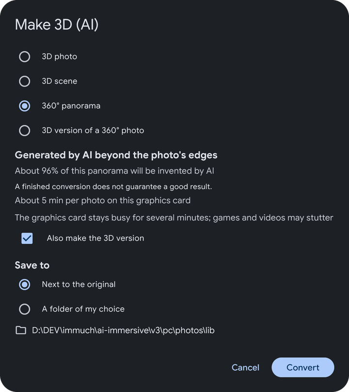
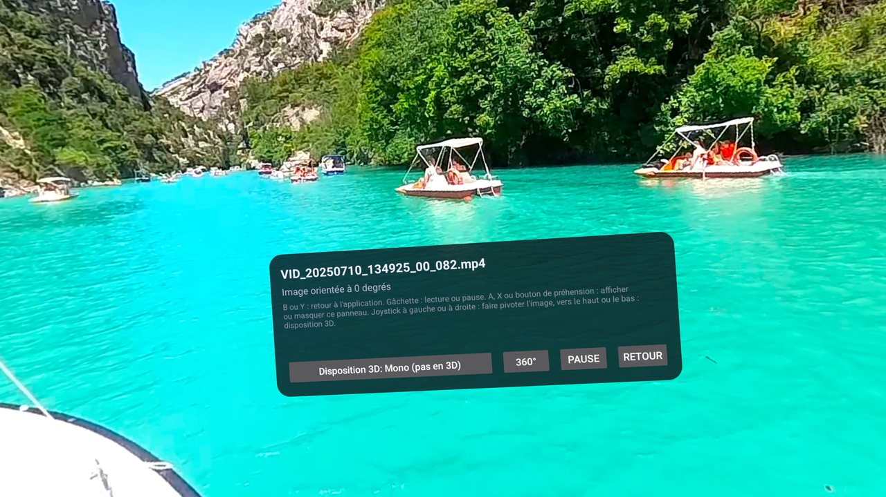

🌐 <b>Bahasa Indonesia</b> · Bahasa lain (88)
<a href="../README.md">English</a> · <a href="README.af.md">Afrikaans</a> · <a href="README.ar.md">العربية</a> · <a href="README.az.md">Azərbaycanca</a> · <a href="README.be.md">Беларуская</a> · <a href="README.bg.md">Български</a> · <a href="README.bi.md">Bislama</a> · <a href="README.bn.md">বাংলা</a> · <a href="README.br.md">Brezhoneg</a> · <a href="README.bs.md">Bosanski</a> · <a href="README.ca.md">Català</a> · <a href="README.cs.md">Čeština</a> · <a href="README.cv.md">Чӑвашла</a> · <a href="README.da.md">Dansk</a> · <a href="README.de.md">Deutsch</a> · <a href="README.de_CH.md">Deutsch (Schweiz)</a> · <a href="README.el.md">Ελληνικά</a> · <a href="README.en_GB.md">English (UK)</a> · <a href="README.eo.md">Esperanto</a> · <a href="README.es.md">Español</a> · <a href="README.et.md">Eesti</a> · <a href="README.eu.md">Euskara</a> · <a href="README.fa.md">فارسی</a> · <a href="README.fi.md">Suomi</a> · <a href="README.fil.md">Filipino</a> · <a href="README.fr.md">Français</a> · <a href="README.ga.md">Gaeilge</a> · <a href="README.gl.md">Galego</a> · <a href="README.gsw.md">Alemannisch</a> · <a href="README.gu.md">ગુજરાતી</a> · <a href="README.he.md">עברית</a> · <a href="README.hi.md">हिन्दी</a> · <a href="README.hr.md">Hrvatski</a> · <a href="README.hu.md">Magyar</a> · <a href="README.hy.md">Հայերեն</a> · <a href="README.is.md">Íslenska</a> · <a href="README.it.md">Italiano</a> · <a href="README.ja.md">日本語</a> · <a href="README.ka.md">ქართული</a> · <a href="README.kab.md">Taqbaylit</a> · <a href="README.kk.md">Қазақша</a> · <a href="README.km.md">ខ្មែរ</a> · <a href="README.kmr.md">Kurmancî</a> · <a href="README.kn.md">ಕನ್ನಡ</a> · <a href="README.ko.md">한국어</a> · <a href="README.kxm.md">ภาษาเขมรถิ่นไทย</a> · <a href="README.lb.md">Lëtzebuergesch</a> · <a href="README.lmo.md">Lombard</a> · <a href="README.lt.md">Lietuvių</a> · <a href="README.lv.md">Latviešu</a> · <a href="README.mfa.md">Bahasa Melayu Kelantan</a> · <a href="README.mi.md">Te reo Māori</a> · <a href="README.mk.md">Македонски</a> · <a href="README.ml.md">മലയാളം</a> · <a href="README.mn.md">Монгол</a> · <a href="README.mr.md">मराठी</a> · <a href="README.ms.md">Bahasa Melayu</a> · <a href="README.nb_NO.md">Norsk bokmål</a> · <a href="README.ne.md">नेपाली</a> · <a href="README.nl.md">Nederlands</a> · <a href="README.nn.md">Norsk nynorsk</a> · <a href="README.pa.md">ਪੰਜਾਬੀ</a> · <a href="README.pl.md">Polski</a> · <a href="README.pt.md">Português</a> · <a href="README.pt_BR.md">Português (Brasil)</a> · <a href="README.ro.md">Română</a> · <a href="README.ru.md">Русский</a> · <a href="README.si.md">සිංහල</a> · <a href="README.sk.md">Slovenčina</a> · <a href="README.sl.md">Slovenščina</a> · <a href="README.sq.md">Shqip</a> · <a href="README.sr_Cyrl.md">Српски</a> · <a href="README.sr_Latn.md">Srpski</a> · <a href="README.sv.md">Svenska</a> · <a href="README.sw.md">Kiswahili</a> · <a href="README.swg.md">Schwäbisch</a> · <a href="README.ta.md">தமிழ்</a> · <a href="README.te.md">తెలుగు</a> · <a href="README.th.md">ไทย</a> · <a href="README.tl.md">Tagalog</a> · <a href="README.tr.md">Türkçe</a> · <a href="README.uk.md">Українська</a> · <a href="README.ur.md">اردو</a> · <a href="README.uz.md">Oʻzbekcha</a> · <a href="README.vi.md">Tiếng Việt</a> · <a href="README.yue_Hant.md">粵語</a> · <a href="README.zh_Hans.md">简体中文</a> · <a href="README.zh_Hant.md">繁體中文</a>

  

# Immuch360

**Media Anda. Semua layar. Segala sudut pandang.**

🌐 <a href="https://immuch360.com/id/"><b>immuch360.com</b></a>

Foto dan video datar, 360°, dan 3D dari perangkat Anda, NAS Anda, server Immich Anda, kamera Anda, dan drone Anda. Tanpa akun. Immuch360 adalah aplikasi gratis dan sumber terbuka yang membaca foto dan video Anda di tempatnya berada dan memutar masing-masing di penampil yang sesuai: datar, sebagai bola yang dapat Anda lihat sekelilingnya, dalam 3D, atau di sekeliling Anda di dalam headset. Aplikasi ini berjalan di ponsel, tablet, TV, headset Meta Quest, dan komputer. Situs webnya, [immuch360.com](https://immuch360.com/id/), menunjukkan apa yang dilakukannya di setiap layar, dalam 89 bahasa.

**Baru di build 53 dan desktop build 34, versi 3.4.8.** Di komputer, [Spatial 2.5D](#see-your-3d-photos-and-videos-in-depth-on-your-computer) memberi foto 3D Anda kedalaman di layar datar, termasuk foto 3D 360° dan VR180, di Windows, Linux, dan macOS, dan video 3D Anda di Windows dan macOS: tampilan bergerak saat Anda menggerakkan kepala, diikuti oleh webcam setelah Anda setuju, atau dengan mouse, dan gambar webcam tetap di memori komputer, tidak pernah disimpan atau dikirim; dicoba di satu laptop Windows dengan webcam USB, video 3D di kartu grafisnya, belum di Mac atau desktop Linux. Roda mouse [memperbesar foto di sekitar penunjuk](#zoom-into-a-photo-with-the-wheel) dan seretan menggesernya. [Tingkatkan (AI)](#make-a-photo-sharper-on-your-computer-ai) mengambil foto dari berbagi Anda, dari DLNA, Plex, Jellyfin, dan Emby, serta dari server Immich Anda, meningkatkan foto 360° dan 3D tanpa merusak sambungannya atau kedua matanya, dan menawarkan Pertajam di Mac dengan chip Apple (belum dicoba di Mac). Dari ponsel, ["Putar di…"](#show-your-photos-and-videos-on-the-tv-from-your-phone) membuka item 360° di tampilan 360° layar, memutar pilihan atau album sebagai salindia, memasukkan layar ke server Anda, dan mengirim foto dan video yang hanya ada di ponsel; dicoba di antara emulator Android, belum di ponsel atau TV sungguhan. Di Meta Quest, salindia layar besar [memudar silang atau bergeser](#browse-your-photos-on-the-big-screen-of-the-quest) di antara foto, di atas latar hitam, buram, atau passthrough yang Anda pilih, belum dicoba proyek di headset.

**Baru di build 33 sampai 52.** [Film berlanjut dari tempat Anda berhenti](#pick-up-a-film-where-you-stopped). Film mulai lebih cepat, dan dari server yang lambat film [terus diputar alih-alih berhenti](#when-a-video-waits-or-will-not-play). Linimasa [memperkecil tampilan hingga bulan dan tahun](#find-a-month-or-a-year-in-a-long-timeline) di ponsel dan komputer. Di ponsel Android atau Meta Quest, ["Jelajahi folder"](#browse-a-folder-of-your-phone-or-headset) membuka folder perangkat seperti sebuah berbagi, dan foto TIFF ditampilkan. Android TV [mencari menurut tanggal dengan remote](#on-android-tv-and-google-tv), Meta Quest 3 atau 3S [membuka splat Gaussian](#explore-gaussian-splats-in-a-meta-quest-3-or-3s), diputar dengan thumbstick kanan dan termasuk SPZ versi 4, dan komputer [membuat versi 3D dari foto di NAS Anda](#turn-one-photo-into-3d-a-scene-a-panorama). Di laptop Windows dengan dua chip grafis, aplikasi [kini berjalan di chip yang cepat](#when-a-video-waits-or-will-not-play), sehingga film 8K diputar dengan lancar. Splat Gaussian kini [terbuka di komputer serta ponsel dan tablet Android](#explore-gaussian-splats-on-your-phone-tablet-or-computer), komputer Windows [membuat adegan splat dari foto atau video Anda](#make-a-splat-scene-from-your-photos-or-a-video-ai) dengan AI, server Immich Anda [menyimpannya di dalam foto](#keep-a-splat-scene-on-your-immich-server) yang terbuka dari linimasa Anda, dan komputer [memutar video AV2](#play-av2-videos-on-your-computer). Sejak build 42, video mentah dari kamera Insta360, GoPro MAX, dan DJI Osmo 360, dari pustaka Immich Anda, berbagi, atau folder, [diputar dan distabilkan dengan giroskop kamera](#stabilise-your-360-videos-with-the-cameras-gyroscope) di ponsel, tablet, dan TV Android, pembuat splat dari desktop build 22 [menawarkan kualitas Detail](#make-a-splat-scene-from-your-photos-or-a-video-ai) untuk adegan yang Anda lihat dari dekat, dan panorama 360° [dimulai dengan 3,5 GiB kartu grafis dalam keadaan bebas](#turn-one-photo-into-3d-a-scene-a-panorama). Aplikasi iPhone dan iPad [ada di App Store](https://apps.apple.com/us/app/immuch360-360-3d-player/id6817655965), versi 3.4.3. Sejak build 43, pemberitahuan pembaruan aplikasi membuka Google Play atau App Store di ponsel dan tablet; situs webnya, [immuch360.com](https://immuch360.com/id/), dibuka pada 7 November. Sejak build 44 dan desktop build 24, Meta Quest 3 atau 3S [menampilkan splat hingga 300.000 gaussian](#explore-gaussian-splats-in-a-meta-quest-3-or-3s), komputer [memilih beberapa foto dan video dengan Ctrl dan Shift](#use-your-computer-as-the-media-player), TV yang dekodernya menolak sebuah video [dengan sendirinya memutar file server yang lain](#when-a-video-waits-or-will-not-play), panorama berjalan di kartu grafis yang dipilih pada laptop yang memiliki dua, dan pemberitahuan pembaruan di Quest dan komputer membuka toko atau halaman unduhannya, dengan banyak perbaikan. Sejak build 45 dan desktop build 25, versi 3.4.0 di semua platform, aplikasi mengikuti aplikasi Immich 3.4.0 dengan 11 perbaikan Immich yang lebih baru, menampilkan [foto JPEG XL dari server Immich 3.4](#keep-your-immich-library-with-more), membuka [film Plex Anda menurut tahun](#watch-your-plex-films) dengan halaman untuk setiap film, pengunduhannya ke perangkat dan pemutarannya di TV dari ponsel, dapat meminta penilaian di build toko, dan, di komputer, mengambil komponen videonya dari [repositori terbuka milik komponen itu sendiri](#licences-and-credits). Sejak build 46 dan desktop build 26, versi 3.4.1, video mentah kamera 360° juga [diputar dan distabilkan](#stabilise-your-360-videos-with-the-cameras-gyroscope) di iPhone dan iPad, di Meta Quest, dan di Windows, Meta Quest [memutar dengan libmpv film Plex yang tidak dapat didekode pemutarnya sendiri](#watch-your-plex-films), ponsel [mengirim film seperti itu ke Chromecast atau Google TV](#watch-your-plex-films), dan kedalaman AI dari foto 3D [mengikuti kekuatan yang Anda pilih](#turn-one-photo-into-3d-a-scene-a-panorama); server baru juga dapat ditambahkan dengan masuk menggunakan akun Plex Anda, dan aplikasi [menyimpan pengaturannya dalam file](#keep-your-settings-in-a-file). Sejak build 47 dan desktop build 27, versi 3.4.2, film Plex [memutar trek audio yang dapat didekode perangkat](#watch-your-plex-films) dan memberi tahu trek mana, membuka versi yang sesuai dengan layar dan, pada koneksi lambat, menawarkan versi yang lebih ringan, Windows dan macOS memutar suara Dolby TrueHD-nya, Android [menampilkan unduhannya dalam notifikasi](#watch-your-plex-films) dan Android TV juga mengunduh film, dan [kamera Tapo bertenaga baterai tampil secara langsung](#watch-your-home-cameras-on-the-big-screen); memulihkan file pengaturan beserta akunnya kini membuat Anda masuk ke server Immich Anda. Sejak build 48 dan desktop build 28, versi 3.4.3, komputer Windows [memutar video Anda di headset PC VR](#watch-your-videos-in-a-pc-vr-headset-from-windows) melalui SteamVR, Meta Horizon Link, atau runtime OpenXR lain (belum dicoba proyek di headset), [kamera merek lain tampil secara langsung](#cameras-of-other-brands-over-onvif-or-rtsp), ditemukan melalui ONVIF atau ditambahkan dengan tautan RTSP-nya (diperiksa dengan kamera simulasi, belum ada kamera asli merek lain yang dicoba), video mentah [DJI Osmo 360 II dan GoPro MAX 2 diputar dan distabilkan](#open-the-raw-files-of-360-cameras), film Plex [tidak lagi kekurangan data di ponsel](#when-a-video-waits-or-will-not-play), TV LG dan Samsung [memutar video yang miring](#on-a-samsung-tv-tizen) dengan satu tombol (belum dicoba di TV LG; TV Samsung dari issue 17 menolak putarannya), dan "Pembaruan server tersedia" tidak lagi muncul untuk server yang sudah mutakhir. Sejak build 49 dan desktop build 29, versi 3.4.4, aplikasi [membaca sendiri server Jellyfin dan Emby Anda](#watch-your-jellyfin-and-emby-libraries) (belum dicoba di perangkat), yang ditemukan di jaringan Anda dan dimasuki dengan Quick Connect di TV atau di headset, dengan berkas aslinya diputar sehingga video 360° tetap 360°; di layar besar Meta Quest, foto [mempertahankan ukuran dan posisi yang Anda atur saat Anda menjelajahinya, dan diputar sebagai salindia](#browse-your-photos-on-the-big-screen-of-the-quest) (belum dicoba proyek di headset); pemutar video 360° di ponsel dan tablet [mendapat kontrol foto 360°](#360-videos-on-your-phone-with-the-controls-of-360-photos), tombol giroskop, cubit untuk memperbesar, dan seret lurus ke atas atau ke bawah (dicoba oleh pengguna di Samsung Galaxy S25 Ultra, belum di iPhone); komputer [mengubah video 2D Anda menjadi video 3D](#turn-your-2d-videos-into-3d-on-your-computer) dengan AI (belum dicoba di layar 3D atau di headset); dan TV Samsung [menyerahkan video yang perlu diputar ke pemutar milik Samsung sendiri](#on-a-samsung-tv-tizen), yang diputar oleh TV dari issue 17 tetapi ditolak untuk dirotasi. Sejak build 50 dan desktop build 30, versi 3.4.5, saat video diputar di jendela 2D Meta Quest, jendela itu [digambar ulang sesuai laju layar](#step-inside-your-photos-and-videos-with-a-meta-quest) alih-alih sekitar 10 kali per detik seperti di build 48 dan 49 (diukur di Meta Quest 3), Android TV [memperbesar foto dengan remote](#on-android-tv-and-google-tv) dan menggesernya dengan tombol arah (baru, belum dicoba di TV), dan tiga perbaikan berasal dari fork Android TV milik mlc70: geser cepat tidak lagi menampilkan detail foto yang ditinggalkan, foto animasi membebaskan memorinya, dan filter Lokasi menawarkan kota-kota dari negara yang baru. Sejak build 51 dan desktop build 31, versi 3.4.6, [Tingkatkan (AI)](#make-a-photo-sharper-on-your-computer-ai) membuat salinan yang lebih tajam dari foto yang lembut di samping aslinya di Windows dan Linux, dalam tiga tingkat, masing-masing dijalankan sekali di satu PC dengan RTX 4060, Alami juga ditawarkan di Mac dengan chip Apple (belum dicoba di Mac), komputer [mengubah video 360° menjadi video 3D 360°](#a-360-video-turned-into-a-360-3d-video) dengan AI, kedalaman video 3D diperkirakan oleh kartu grafis di Windows, fitur AI mengambil video dari server Anda dan dari berbagi secara langsung, file pengaturan memiliki [kartunya sendiri di Pustaka](#keep-your-settings-in-a-file), TV menyimpannya di berbagi jaringan, Esc kembali satu langkah di komputer, build toko meminta penilaian [lebih jarang dan lebih lembut](#privacy), Linux menampilkan foto TIFF, adegan splat, dan video 3D dengan satu mata, dan dua crash diperbaiki. Sejak build 52 dan desktop build 32, versi 3.4.7, ["Putar di…"](#show-your-photos-and-videos-on-the-tv-from-your-phone) mengirim foto dan video dari pustaka Immich Anda, dari berbagi Anda, serta dari Jellyfin dan Emby dari ponsel ke TV, Meta Quest, komputer, atau Chromecast, nama foto dan video Anda [tetap terbaca di atas thumbnailnya](#play-the-files-of-a-nas-a-computer-a-media-server-or-plex), komponen AI di komputer [diperbarui dengan satu klik](#update-the-ai-components-in-one-click), Linux mendapat [AppImage](#linux), dan aplikasi iPhone dan iPad dibuat dengan Xcode 27. Desktop build 33 memperbaiki [Tingkatkan (AI)](#make-a-photo-sharper-on-your-computer-ai), yang gagal pada setiap foto di desktop build 31 dan 32 ([issue 23](https://github.com/freeKC/Immuch360/issues/23)).

  Fork tidak resmi dari aplikasi mobile Immich. Tidak berafiliasi dengan Immich atau FUTO. Namanya terdengar seperti "I am much 360".

<b>Daftar isi</b>

- [Untuk siapa](#who-it-is-for)
- [Layar yang didukung](#which-screens), [apa yang mereka lakukan bersama](#use-cases) dan [apa yang dilakukan setiap layar](#what-each-screen-does)
- [Yang dapat Anda lakukan](#what-you-can-do)
- [Dapatkan di perangkat Anda](#get-it-on-your-device)
- [Cara melakukannya](#how-to)
  - [Menonton foto dan video Anda, dengan atau tanpa server](#watch-your-photos-and-videos-with-or-without-a-server)
  - [Menjelajahi panorama, 360°, VR180, dan 3D](#explore-panoramas-360-vr180-and-3d): [video 360° di ponsel](#360-videos-on-your-phone-with-the-controls-of-360-photos)
  - [Ubah satu foto menjadi 3D, adegan, panorama](#turn-one-photo-into-3d-a-scene-a-panorama): [Komponen AI diperbarui dengan satu klik](#update-the-ai-components-in-one-click)
  - [Ubah video 2D Anda menjadi 3D di komputer](#turn-your-2d-videos-into-3d-on-your-computer): [video 360° menjadi 3D 360°](#a-360-video-turned-into-a-360-3d-video)
  - [Membuat foto lebih tajam di komputer Anda (AI)](#make-a-photo-sharper-on-your-computer-ai)
  - [Menonton di TV dengan remote](#watch-on-the-tv-with-the-remote): [Android TV dan Google TV](#on-android-tv-and-google-tv), [LG](#on-an-lg-tv-webos), [Samsung](#on-a-samsung-tv-tizen)
  - [Masuk di TV, headset, atau komputer dengan ponsel Anda](#sign-in-a-tv-a-headset-or-a-computer-with-your-phone)
  - [Tampilkan foto dan video Anda di TV dari ponsel](#show-your-photos-and-videos-on-the-tv-from-your-phone)
  - [Masuk ke dalam foto dan video Anda dengan Meta Quest](#step-inside-your-photos-and-videos-with-a-meta-quest): [layar besar](#browse-your-photos-on-the-big-screen-of-the-quest), [mode kios](#kiosk-mode-for-an-exhibition-or-a-shop)
  - [Jelajahi splat Gaussian di Meta Quest 3 atau 3S](#explore-gaussian-splats-in-a-meta-quest-3-or-3s)
  - [Jelajahi splat Gaussian di ponsel, tablet, atau komputer Anda](#explore-gaussian-splats-on-your-phone-tablet-or-computer)
  - [Buat adegan splat dari foto atau video Anda (AI)](#make-a-splat-scene-from-your-photos-or-a-video-ai)
  - [Simpan adegan splat di server Immich Anda](#keep-a-splat-scene-on-your-immich-server)
  - [Memutar berkas dari NAS, komputer, server media, atau Plex](#play-the-files-of-a-nas-a-computer-a-media-server-or-plex): [film Anda menurut tahun](#watch-your-plex-films), [Jellyfin dan Emby](#watch-your-jellyfin-and-emby-libraries)
  - [Jelajahi folder di ponsel atau headset Anda](#browse-a-folder-of-your-phone-or-headset)
  - [Lanjutkan film dari tempat Anda berhenti](#pick-up-a-film-where-you-stopped)
  - [Saat video menunggu atau tidak mau diputar](#when-a-video-waits-or-will-not-play)
  - [Tetap memakai pustaka Immich Anda, dengan lebih banyak fitur](#keep-your-immich-library-with-more)
  - [Temukan bulan atau tahun di linimasa yang panjang](#find-a-month-or-a-year-in-a-long-timeline)
  - [Menonton kamera rumah Anda di layar besar](#watch-your-home-cameras-on-the-big-screen): [merek lain](#cameras-of-other-brands-over-onvif-or-rtsp)
  - [Drone DJI Anda](#your-dji-drone): [video langsung](#see-what-your-drone-sees-on-your-phone), [di Meta Quest atau di Android TV](#watch-it-in-a-meta-quest-or-on-an-android-tv), [impor](#bring-a-drones-or-a-camera-cards-photos-and-videos-to-immich)
  - [Membuka berkas mentah kamera 360°](#open-the-raw-files-of-360-cameras)
  - [Stabilkan video 360° Anda dengan giroskop kamera](#stabilise-your-360-videos-with-the-cameras-gyroscope)
  - [Merotasi foto dengan satu tombol](#turn-a-photo-with-one-key)
  - [Menggunakan komputer Anda sebagai pemutar media](#use-your-computer-as-the-media-player): [perbesar dengan roda mouse](#zoom-into-a-photo-with-the-wheel)
  - [Lihat foto dan video 3D Anda dengan kedalaman di komputer](#see-your-3d-photos-and-videos-in-depth-on-your-computer)
  - [Menonton video Anda di headset PC VR, dari Windows](#watch-your-videos-in-a-pc-vr-headset-from-windows)
  - [Putar video AV2 di komputer Anda](#play-av2-videos-on-your-computer)
  - [Simpan pengaturan Anda dalam file](#keep-your-settings-in-a-file)
- [Dibandingkan dengan Immich](#compared-with-immich)
- [Privasi](#privacy)
- [Lisensi dan kredit](#licences-and-credits)
- [Peta jalan](#roadmap)
- [Dokumentasi](#documentation)

## Untuk siapa

- **Anda memotret 360° atau 3D** dan ingin melihat sekeliling di dalam bidikan Anda, bukan melihatnya datar, ganda, atau melar, dan memutar video 360° Anda di ponsel seperti Anda memutar fotonya: [360°, VR180, dan 3D](#explore-panoramas-360-vr180-and-3d), [video 360° di ponsel](#360-videos-on-your-phone-with-the-controls-of-360-photos).
- **Anda merekam dengan kamera 360° di tangan, di sepeda, atau di helm** dan ingin video mentah dari kamera Insta360, GoPro MAX atau MAX 2, atau DJI Osmo 360 atau Osmo 360 II Anda, yang disimpan di Immich, di berbagi, atau di folder, diputar rata dan stabil di ponsel, TV, Meta Quest, atau komputer Windows Anda: [distabilkan dengan giroskop kamera](#stabilise-your-360-videos-with-the-cameras-gyroscope).
- **Foto dan film Anda ada di NAS, komputer, Plex, atau Immich** dan Anda ingin menontonnya di TV tanpa menyalin apa pun: [di TV](#watch-on-the-tv-with-the-remote), [NAS, berbagi jaringan, dan Plex](#play-the-files-of-a-nas-a-computer-a-media-server-or-plex).
- **Anda menyimpan film di server Plex** dan ingin memilih satu menurut tahun, melihat isinya sebelum dimulai, membawanya dalam perjalanan, memulainya di TV atau Chromecast dari ponsel Anda, dan memutar bahkan film yang tidak dapat didekode ponsel Android, TV, atau Meta Quest Anda: [film Anda, menurut tahun](#watch-your-plex-films).
- **Anda menyimpan film di server Jellyfin atau Emby** dan menginginkannya di Meta Quest, di TV, atau di ponsel, dengan 360° dan 3D tetap apa adanya, dan posisi terakhir Anda disimpan di server (belum dicoba di perangkat): [Jellyfin dan Emby](#watch-your-jellyfin-and-emby-libraries).
- **Anda punya Meta Quest** dan ingin masuk ke dalam foto dan video Anda sendiri: [di headset](#step-inside-your-photos-and-videos-with-a-meta-quest), dan menjelajahi foto Anda di layar besar dengan ukuran dan posisi yang Anda atur, juga sebagai salindia (belum dicoba proyek di headset): [layar besar](#browse-your-photos-on-the-big-screen-of-the-quest).
- **Anda punya headset PC VR di komputer Windows** dan ingin video 360° Anda di sekitar Anda dan film Anda di layar besar di dalamnya (belum dicoba proyek di headset): [di headset PC VR](#watch-your-videos-in-a-pc-vr-headset-from-windows).
- **Foto Anda datar** dan Anda ingin melihatnya dalam 3D, sebagai adegan untuk dicondongi di headset, atau di dalam panorama 360°, tanpa kamera 3D: [ubah satu foto menjadi 3D, adegan, panorama](#turn-one-photo-into-3d-a-scene-a-panorama), baru, dibuat oleh AI di komputer Anda sendiri.
- **Video Anda datar**, termasuk klip dari ponsel Anda, dan Anda menginginkannya dalam 3D untuk headset atau layar 3D, dan video 360° Anda dalam 3D 360°, dibuat di komputer Anda sendiri (belum dicoba di layar 3D atau di headset): [video 2D menjadi 3D](#turn-your-2d-videos-into-3d-on-your-computer), [360° menjadi 3D 360°](#a-360-video-turned-into-a-360-3d-video).
- **Foto Anda lembut**, sedikit tidak fokus atau diambil dalam cahaya buruk, dan Anda ingin salinan yang lebih tajam di samping aslinya, dibuat di komputer Anda sendiri, juga dari berbagi dan server Anda, dengan detail karangan yang disebutkan terus terang: [Tingkatkan (AI)](#make-a-photo-sharper-on-your-computer-ai).
- **Anda punya foto 3D, foto 3D 360°, atau video 3D dan sebuah komputer** dan ingin melihatnya dengan kedalaman di layar datarnya, dengan tampilan yang bergerak saat Anda menggerakkan kepala, diikuti oleh webcam, atau dengan mouse (dicoba di satu laptop Windows dengan webcam, belum di Mac atau desktop Linux): [Spatial 2.5D di komputer Anda](#see-your-3d-photos-and-videos-in-depth-on-your-computer).
- **Anda menjalankan Immich** dan menginginkan aplikasinya, ditambah penampil imersif dan layar besar yang Anda masukkan dari ponsel: [pustaka Immich Anda](#keep-your-immich-library-with-more), [dibandingkan dengan Immich](#compared-with-immich).
- **Anda mengawasi rumah dengan kamera Tapo**, termasuk yang bertenaga baterai, atau kamera merek lain melalui ONVIF atau RTSP, dan ingin melihatnya di samping foto Anda, juga di TV (diperiksa dengan kamera simulasi): [kamera rumah](#watch-your-home-cameras-on-the-big-screen).
- **Anda menerbangkan drone DJI** dan ingin gambar langsungnya di ponsel tanpa DJI Fly, serta di Meta Quest atau di Android TV untuk orang-orang yang bersama Anda: [drone Anda](#see-what-your-drone-sees-on-your-phone).
- **Anda menangkap tempat dan benda dalam 3D, sebagai splat Gaussian,** atau ingin membuatnya dari foto Anda sendiri, dan ingin berjalan di dalamnya di ponsel, di komputer, atau di headset: [di ponsel, tablet, atau komputer](#explore-gaussian-splats-on-your-phone-tablet-or-computer), [dibuat dari foto Anda](#make-a-splat-scene-from-your-photos-or-a-video-ai), [disimpan di Immich](#keep-a-splat-scene-on-your-immich-server).
- **Anda memiliki video AV2**, format penerus AV1, dan ingin menontonnya di komputer Anda: [AV2 di komputer Anda](#play-av2-videos-on-your-computer).
- **Anda punya beberapa layar di rumah** dan ingin layar-layar itu bekerja bersama: [apa yang dilakukan layar-layar Anda bersama](#use-cases).

Tidak ada akun Immuch360 yang perlu dibuat, dan tidak ada apa pun yang dikirim kepada kami: aplikasi hanya berkomunikasi dengan perangkat Anda dan server yang Anda pilih, sejak build 45 dengan Wikipedia untuk halaman sebuah film, sejak build 46 dengan plex.tv saat Anda masuk dengannya, dan mengunduh komponen AI atau dekoder AV2 hanya ketika Anda memintanya.

## Layar yang didukung

| Platform | Tempat mendapatkannya | Status pada November 2026 |
|---|---|---|
|  **Android** ponsel dan tablet | [Google Play](https://play.google.com/store/apps/details?id=com.aprogsys.immuch360) · [APK](https://github.com/freeKC/Immuch360/releases) | di Google Play (build 47 dipublikasikan pada 16 November; build 51 dalam peninjauan Google sejak 24 November; build 53 menyusul), build 53 di GitHub, tempat [video 360° mentah diputar dan distabilkan](#stabilise-your-360-videos-with-the-cameras-gyroscope), [film berlanjut dari tempat Anda berhenti](#pick-up-a-film-where-you-stopped), ["Jelajahi folder"](#browse-a-folder-of-your-phone-or-headset) membuka folder ponsel dan [splat Gaussian terbuka](#explore-gaussian-splats-on-your-phone-tablet-or-computer), dari berbagi atau [dari linimasa Immich Anda](#keep-a-splat-scene-on-your-immich-server), [pengaturan yang disimpan dalam file](#keep-your-settings-in-a-file), [unduhan film yang ditampilkan dalam notifikasi](#watch-your-plex-films), sejak build 48 [kamera merek lain, secara langsung](#cameras-of-other-brands-over-onvif-or-rtsp) (diperiksa dengan kamera simulasi) dan, sejak build 49, [server Jellyfin dan Emby](#watch-your-jellyfin-and-emby-libraries) (belum dicoba di perangkat) serta [kontrol foto 360° di pemutar video 360°](#360-videos-on-your-phone-with-the-controls-of-360-photos) (dicoba oleh pengguna di Samsung Galaxy S25 Ultra), dan sejak build 51 [kartu file pengaturan di Pustaka](#keep-your-settings-in-a-file), dengan filenya juga disimpan di berbagi jaringan, dan sejak build 52 [foto dan video Anda dikirim ke TV atau Chromecast](#show-your-photos-and-videos-on-the-tv-from-your-phone) dengan "Putar di…" (belum dicoba di perangkat), dan sejak build 53 [item 360°, pilihan atau album, serta foto dan video yang ada di ponsel itu sendiri](#show-your-photos-and-videos-on-the-tv-from-your-phone) dikirim dengan cara yang sama (dicoba di antara emulator Android) |
|  **iPhone dan iPad** | [App Store](https://apps.apple.com/us/app/immuch360-360-3d-player/id6817655965) | versi 3.4.7 di App Store sejak 26 November, dengan [bulan dan tahun di linimasa](#find-a-month-or-a-year-in-a-long-timeline), [film yang berlanjut dari tempat Anda berhenti](#pick-up-a-film-where-you-stopped), [fitur masuk di TV, headset, atau komputer](#sign-in-a-tv-a-headset-or-a-computer-with-your-phone) dari ponsel, adegan splat yang disimpan di Immich ditampilkan sebagai fotonya, perbaikan Immich 3.4.0 dan foto JPEG XL-nya, [video 360° mentah yang distabilkan](#stabilise-your-360-videos-with-the-cameras-gyroscope), [pengaturan yang disimpan dalam file](#keep-your-settings-in-a-file), [tampilan langsung kamera Tapo bertenaga baterai](#watch-your-home-cameras-on-the-big-screen) dan [tampilan langsung kamera merek lain](#cameras-of-other-brands-over-onvif-or-rtsp) (diperiksa dengan kamera simulasi), dan sejak versi 3.4.4 [server Jellyfin dan Emby](#watch-your-jellyfin-and-emby-libraries) (belum dicoba di perangkat) dan [kontrol foto 360° di pemutar video 360°](#360-videos-on-your-phone-with-the-controls-of-360-photos) (belum dicoba di iPhone), dan sejak versi 3.4.6 [kartu file pengaturan](#keep-your-settings-in-a-file) dan pemulihannya dari berbagi jaringan, dan sejak versi 3.4.7, yang dibuat dengan Xcode 27, ["Putar di…" untuk foto dan video](#show-your-photos-and-videos-on-the-tv-from-your-phone) (belum dicoba di iPhone); versi 3.4.8, versi iPhone dan iPad dari build 53, menyusul; atau [bangun sendiri](../docs/immuch360/build.md) |
|  **Android TV dan Google TV** | [Google Play](https://play.google.com/store/apps/details?id=com.aprogsys.immuch360) · [APK](#android-tv-and-google-tv) | di Google Play, yang menawarkan aplikasi ini di Android TV dan Google TV, dan build 53 di GitHub: [video 360° mentah yang distabilkan](#stabilise-your-360-videos-with-the-cameras-gyroscope), [pencarian menurut tanggal dengan remote](#on-android-tv-and-google-tv), [masuk dengan ponsel Anda](#sign-in-a-tv-a-headset-or-a-computer-with-your-phone) dengan memindai kode QR, bilah waktu, audio, dan subtitle untuk remote di pemutar video, serta [video langsung drone](#watch-it-in-a-meta-quest-or-on-an-android-tv) yang diteruskan oleh ponsel, [film yang diunduh ke TV](#watch-your-plex-films) dan, sejak build 49, [server Jellyfin dan Emby](#watch-your-jellyfin-and-emby-libraries) yang dimasuki dengan Quick Connect (belum dicoba di perangkat) dan, sejak build 50, [foto yang diperbesar dengan remote](#on-android-tv-and-google-tv) (terlihat berfungsi di emulator Android TV, belum dicoba di TV), dan sejak build 51 [file pengaturan yang disimpan dan dipulihkan di berbagi jaringan](#keep-your-settings-in-a-file) (terlihat berfungsi di emulator Android TV), dan sejak build 52 [foto dan video yang dikirim ponsel dengan "Putar di…"](#show-your-photos-and-videos-on-the-tv-from-your-phone) (belum dicoba di TV), dan sejak build 53 foto 360° yang dikirim ponsel dibuka di tampilan 360°-nya, masuk dari lembar ponsel, serta foto dan video yang ada di ponsel itu sendiri (terlihat berfungsi di emulator Android TV) |
| **TV LG** dengan webOS 5.0 dan yang lebih baru | [.ipk, versi 1.0.5](https://github.com/freeKC/Immuch360/releases/tag/webos-v1.0.5) · LG Content Store (sedang ditinjau) | versi 1.0.0, diajukan ke LG Content Store pada 24 Oktober, sedang diuji LG sejak 26 Oktober; versi 1.0.1, di GitHub sejak 27 Oktober, memperbesar foto dengan tombol arah dan memberi tahu ketika foto masih dimuat, dan versi 1.0.2, di GitHub bersama build 46, menulis "masuk" sebagai ログイン dalam bahasa Jepang, versi 1.0.3, bersama build 47, memberi tahu ketika folder server DLNA berisi saluran TV langsung, yang belum dapat diputarnya, versi 1.0.4, bersama build 48, [memutar video yang miring](#on-an-lg-tv-webos) dengan satu tombol (belum dicoba di TV LG), dan versi 1.0.5, bersama build 49, menyebut Jellyfin dengan plugin DLNA-nya di antara server DLNA; sampai LG menerbitkan aplikasinya, aplikasi dipasang dalam [Developer Mode](#lg-tvs-webos). Versi 1.0.0 berjalan di TV webOS 25 di Cloud Test Lab milik LG |
| **TV Samsung** dengan Tizen 5.5 dan yang lebih baru | [.wgt, versi 0.3.6](https://github.com/freeKC/Immuch360/releases/tag/tizen-v0.3.6) | versi 0.3.6 dari aplikasi TV yang sama, untuk ditandatangani dengan sertifikat Samsung Anda sendiri dan dipasang dalam [Developer mode](#samsung-tvs-tizen); 0.1.0 berjalan di TV Samsung milik seorang penguji, 0.2.0 memuat perbaikan dari uji itu, 0.3.0 menambahkan pembesaran foto dan penanda Memuat dari LG versi 1.0.1, dan 0.3.1 kata-kata Jepang dari LG versi 1.0.2, 0.3.2 memutar video yang direkam tegak dengan ponsel dengan arah yang benar ([issue 17](https://github.com/freeKC/Immuch360/issues/17)), 0.3.3 dan 0.3.4 [memutarnya di TV yang melaporkannya tegak](#on-a-samsung-tv-tizen) serta menambahkan tombol untuk memutarnya secara manual, dan 0.3.5 dan 0.3.6 menyerahkan video seperti itu ke pemutar milik Samsung sendiri; di TV pelapor, 0.3.4 dan 0.3.5 membiarkan gambar tetap miring, karena TV menolak putarannya, dan jalan keluarnya di sana adalah video yang ditranskode oleh server Immich Anda, disimpan tegak; tidak ada di toko Samsung |
|  **Meta Quest** 2, Pro, 3, dan 3S | [Horizon Store](https://www.meta.com/experiences/immuch360/1384208401440714/) · [APK](#meta-quest) | di Horizon Store (build 52, dipublikasikan pada 26 November, setelah build 50, yang jendela 2D-nya digambar ulang sesuai laju layar saat video diputar; build 53 menyusul), build 53 di GitHub, dengan [mode kios](#kiosk-mode-for-an-exhibition-or-a-shop), [video 360° mentah yang distabilkan](#stabilise-your-360-videos-with-the-cameras-gyroscope) di tampilan imersif, [film yang tidak dapat didekodenya diputar oleh libmpv](#watch-your-plex-films) dan, di Quest 3 dan 3S, [splat Gaussian](#explore-gaussian-splats-in-a-meta-quest-3-or-3s) serta [kedalaman AI](#turn-one-photo-into-3d-a-scene-a-panorama) untuk foto datar, dan sejak build 49 [foto yang dijelajahi di layar besar](#browse-your-photos-on-the-big-screen-of-the-quest) dengan ukuran yang Anda atur, juga sebagai salindia (belum dicoba proyek di headset), serta [server Jellyfin dan Emby](#watch-your-jellyfin-and-emby-libraries) yang dimasuki dengan Quick Connect (belum dicoba di perangkat), dan sejak build 51 headset yang Horizon OS-nya terlalu lama untuk tampilan imersif meminta pembaruan alih-alih menutup aplikasi (belum dicoba di headset seperti itu), dan sejak build 53 [pudar silang atau geser di antara foto layar besar, di atas latar hitam, buram, atau passthrough](#browse-your-photos-on-the-big-screen-of-the-quest) (belum dicoba proyek di headset) |
|  **Windows** | [Installer atau ZIP](https://github.com/freeKC/Immuch360/releases/tag/desktop-v3.4.8-34) | desktop build 34, bertanda tangan: foto, video datar dan 360°, berbagi, Plex, kamera (diperiksa dengan kamera simulasi), masuk dengan ponsel, foto dirotasi dengan satu tombol, antarmuka dalam 89 bahasa, dan [foto 3D, adegan 3D, dan panorama 360° yang dibuat dari foto Anda](#turn-one-photo-into-3d-a-scene-a-panorama) oleh AI, juga dari foto di NAS Anda; [splat Gaussian](#explore-gaussian-splats-on-your-phone-tablet-or-computer) dibuka, [dibuat dari foto atau video Anda](#make-a-splat-scene-from-your-photos-or-a-video-ai) dan [disimpan di Immich](#keep-a-splat-scene-on-your-immich-server), [video AV2](#play-av2-videos-on-your-computer), sejak desktop build 22 [pilihan Kualitas untuk adegan splat](#make-a-splat-scene-from-your-photos-or-a-video-ai) serta [panorama 360° mulai dari 3,5 GiB memori grafis yang bebas](#turn-one-photo-into-3d-a-scene-a-panorama), dan sejak desktop build 26 [video 360° mentah yang distabilkan](#stabilise-your-360-videos-with-the-cameras-gyroscope) serta [foto 3D dengan kekuatan kedalaman dan tepi yang lebih tajam](#turn-one-photo-into-3d-a-scene-a-panorama), sejak desktop build 27 [suara Dolby TrueHD dan subtitle Blu-ray film](#watch-your-plex-films), sejak desktop build 28 [video Anda di headset PC VR](#watch-your-videos-in-a-pc-vr-headset-from-windows) (belum dicoba proyek di headset), dan sejak desktop build 29 [video 3D yang dibuat dari video 2D Anda](#turn-your-2d-videos-into-3d-on-your-computer) oleh AI (belum dicoba di layar 3D atau di headset), dan sejak desktop build 31 [salinan foto Anda yang lebih tajam](#make-a-photo-sharper-on-your-computer-ai) oleh AI dan [video 360° yang diubah menjadi video 3D 360°](#a-360-video-turned-into-a-360-3d-video) oleh AI, kedalaman yang diperkirakan oleh kartu grafis, video dari server Anda dan dari berbagi yang diambil langsung, dan Esc untuk kembali satu langkah, sejak desktop build 32 [komponen AI yang diperbarui dengan satu klik](#update-the-ai-components-in-one-click), sejak desktop build 33 [Tingkatkan (AI)](#make-a-photo-sharper-on-your-computer-ai) yang kembali berfungsi, dan sejak desktop build 34 [perbesaran foto dengan roda mouse](#zoom-into-a-photo-with-the-wheel), [Spatial 2.5D untuk foto dan video 3D](#see-your-3d-photos-and-videos-in-depth-on-your-computer), dengan webcam atau mouse (belum dicoba proyek dengan webcam), dan Tingkatkan (AI) pada foto dari berbagi dan server, juga foto 360° dan 3D |
|   **macOS dan Linux** | [.deb, .rpm, AppImage, DMG](https://github.com/freeKC/Immuch360/releases/tag/desktop-v3.4.8-34) | desktop build 34: foto, foto 360°, dan video datar (video 360° diputar datar), server Immich, dan berbagi jaringan, dan [foto 3D dan adegan 3D](#turn-one-photo-into-3d-a-scene-a-panorama) yang dibuat oleh AI dari foto Anda, dengan panorama 360° di Linux pada kartu grafis 8 GB, mulai dari 3,5 GiB kartu itu dalam keadaan bebas, serta [splat Gaussian](#explore-gaussian-splats-on-your-phone-tablet-or-computer) dan [video AV2](#play-av2-videos-on-your-computer) (belum dicoba di Mac); desktop build 11 dicoba pada 26 Oktober di kontainer Ubuntu 24.04 dan di Mac; sejak desktop build 27, suara Dolby TrueHD film di macOS; sejak desktop build 29, [video 3D yang dibuat dari video 2D Anda](#turn-your-2d-videos-into-3d-on-your-computer) oleh AI di Linux dan di Mac dengan chip Apple (belum dicoba di layar 3D atau di headset); sejak desktop build 31, di Linux, [salinan foto Anda yang lebih tajam](#make-a-photo-sharper-on-your-computer-ai) oleh AI, foto TIFF, folder yang menampilkan berkas barunya sendiri, adegan splat yang dibuat dari foto Anda pada kartu grafis 4 GB, dan video 3D yang ditampilkan datar dengan satu mata, dan di Mac dengan chip Apple tingkat Alami dari Tingkatkan (AI) (belum dicoba di Mac); sejak desktop build 32, [AppImage](#linux) untuk distribusi Linux lainnya, diperiksa oleh CI di Arch Linux dan openSUSE; sejak desktop build 34, perbesaran dengan roda mouse, [Spatial 2.5D](#see-your-3d-photos-and-videos-in-depth-on-your-computer) untuk foto 3D di Linux dan macOS dan untuk video 3D di macOS (belum dicoba di Mac atau dengan webcam), dan di Mac dengan chip Apple tingkat Pertajam dari Tingkatkan (AI) (belum dicoba di Mac); tanpa tanda tangan di macOS |

*Status ini diperbarui pada setiap rilis; apa yang ada di setiap toko, apa yang sedang ditinjau, dan setiap build ada di [Status rilis](../docs/immuch360/release-status.md). Situs web [immuch360.com](https://immuch360.com/id/) menunjukkan apa yang dilakukan setiap layar, cara melakukannya untuk setiap fungsi, dan tautan toko, dalam 89 bahasa.*

  

### Apa yang dilakukan layar-layar Anda bersama

Pasang Immuch360 di setiap layar tempat Anda menonton: setiap layar membaca sumber Anda sendiri, dan beberapa menyerahkan gambar, berkas, atau proses masuk ke layar lain. Di setiap gambar, ikon Immuch360 menandai perangkat yang menjalankan aplikasi.

#### NAS Anda di setiap layar

  

**Yang Anda perlukan:** NAS dengan berbagi SMB atau WebDAV, dan Immuch360 di setiap layar tempat Anda menonton.

Tambahkan berbagi tersebut di setiap layar, dan setiap layar memutar foto dan video di tempatnya, tanpa menyalin apa pun: ponsel, tablet, Android TV, Meta Quest, komputer Windows, Linux, dan macOS, serta TV LG yang masuk ke server Immich Anda (SMB sejak webOS 22). Foto 360° berputar sebagai bola di ponsel dan TV, dan mengelilingi Anda di headset. Cara melakukannya: [Memutar berkas dari NAS, komputer, server media, atau Plex](#play-the-files-of-a-nas-a-computer-a-media-server-or-plex).

#### Server Immich Anda di setiap layar, masuk dari ponsel Anda

  

**Yang Anda perlukan:** server Immich, Immuch360 di ponsel Android Anda, dan Immuch360 di layar yang Anda masukkan: Android TV, Meta Quest, komputer Windows, Linux, atau macOS.

Di ponsel, Immuch360 mempertahankan seluruh aplikasi seluler Immich, menambahkan penampil 360°, VR180, dan 3D miliknya, dan terpasang di samping aplikasi resmi. Setelah masuk ke server Anda, aplikasi ini memasukkan layar besar: aplikasi memindai kode QR TV atau komputer, atau Anda mengetik di ponsel kode yang ditampilkan headset, dan kata sandi Anda tetap di ponsel. Cara melakukannya: [Masuk di TV, headset, atau komputer dengan ponsel Anda](#sign-in-a-tv-a-headset-or-a-computer-with-your-phone).

#### Foto datar Anda dalam 3D, dari komputer Anda ke headset

  

**Yang Anda perlukan:** Immuch360 di komputer Windows, Linux, atau macOS dan di Meta Quest, dengan NAS Anda di antara keduanya, atau server Immich Anda dengan "Cadangkan juga versi AI" aktif.

Komputer itu sendiri mengubah foto Anda menjadi foto 3D dan adegan 3D, serta menjadi panorama 360° dengan kartu grafis 8 GB di Windows atau Linux, dan menyimpannya di samping berkas aslinya. Headset menampilkan foto 3D dalam 3D sungguhan, menempatkan adegan di ruangan Anda dan panorama di sekeliling Anda; ponsel dan TV membuka panorama di penampil 360° mereka. Cara melakukannya: [Ubah satu foto menjadi 3D, adegan, panorama](#turn-one-photo-into-3d-a-scene-a-panorama).

#### Tampilan langsung drone Anda di headset atau di TV

  

**Yang Anda perlukan:** drone DJI dan remote DJI RC-N3-nya, Immuch360 di ponsel Android yang tersambung ke remote, dan Immuch360 di Meta Quest atau di Android TV.

Ponsel menampilkan video langsung drone dan meneruskannya, lewat Wi-Fi Anda atau hotspot ponsel itu sendiri, sehingga orang-orang yang bersama Anda menonton penerbangan di headset atau di TV. Hanya menerima: tidak ada perintah yang pernah dikirim ke remote atau drone, dan remote tetap memegang kendali penuh. Cara melakukannya: [Tonton di Meta Quest atau di Android TV](#watch-it-in-a-meta-quest-or-on-an-android-tv).

#### Berkas mentah kamera 360° Anda, digabungkan di tempat Anda menontonnya

  

**Yang Anda perlukan:** kamera Insta360, GoPro MAX atau MAX 2, atau DJI Osmo 360 atau Osmo 360 II, NAS Anda, dan Immuch360 di layar: ponsel, tablet, Android TV, Meta Quest, Windows.

Salin berkas .insp, .insv, .360, atau .osv dari kartu kamera ke berbagi SMB atau WebDAV di NAS Anda, apa adanya; server Immich juga menerima berkas Insta360. Setiap layar menggabungkannya saat diputar, dengan kalibrasi yang tertulis di setiap berkas, dan tidak ada yang diekspor lebih dulu di aplikasi kamera. Cara melakukannya: [Membuka berkas mentah kamera 360°](#open-the-raw-files-of-360-cameras).

#### Server Plex dan DLNA Anda di TV dan di headset

  

**Yang Anda perlukan:** Plex Media Server, server Jellyfin atau Emby, atau server DLNA seperti minidlna, dan Immuch360 di setiap layar: Android TV, Meta Quest, ponsel, tablet, Windows.

Plex memberikan berkas asli pustaka Anda, sehingga video 360° tetap 360°, di sekeliling Anda di headset, di rumah maupun, melalui port forwarding Anda, dari luar rumah; server DLNA ditemukan di jaringan rumah Anda. TV LG yang masuk ke server Immich Anda juga memutarnya. Sejak build 45, ponsel, tablet, Android TV, Quest, dan komputer membuka pustaka film Plex pada semua filmnya menurut tahun, setiap film dengan halamannya, dan film yang dipilih di ponsel diputar di Android TV, Quest, atau komputer, dengan remote yang memegang kendali. Sejak build 46, Quest memutar dengan libmpv film yang tidak dapat didekode pemutarnya sendiri, server Plex Anda mengonversi film yang tidak dapat didekode oleh pemutar mana pun di perangkat Android, dan ponsel mengirim film ke Chromecast atau Google TV. Sejak build 47, film memutar trek audio yang dapat didekode perangkat dan memberi tahu trek mana, membuka versi yang sesuai dengan layar dan memutar suara Dolby TrueHD-nya di Windows dan macOS, dan folder saluran TV langsung dari server DLNA memberi tahu bahwa saluran itu belum dapat diputar. Sejak build 49, server Jellyfin atau Emby juga memiliki jenisnya sendiri, ditemukan secara otomatis, dimasuki dengan Quick Connect di TV atau di headset, berkas aslinya diputar sehingga 360° tetap 360°, dan posisi terakhir Anda disimpan di server (belum dicoba di perangkat). Cara melakukannya: [Memutar berkas dari NAS, komputer, server media, atau Plex](#play-the-files-of-a-nas-a-computer-a-media-server-or-plex), [Tonton film Plex Anda](#watch-your-plex-films), dan [Tonton pustaka Jellyfin dan Emby Anda](#watch-your-jellyfin-and-emby-libraries).

#### Ponsel atau komputer Windows Anda, dibuka di headset

  

**Yang Anda perlukan:** Immuch360 di ponsel Android, iPhone, atau komputer Windows, dan di Meta Quest, di Wi-Fi rumah yang sama.

Aktifkan "Bagikan ponsel ini di jaringan" di ponsel, atau "Bagikan komputer ini di jaringan" di komputer, dan headset memutar foto dan videonya, yang 360° di sekeliling Anda: tanpa server, tanpa NAS, tanpa unggahan. Di iPhone, berbagi berjalan selama aplikasi tampil di layar. Cara melakukannya: [Bagikan ponsel ini di jaringan](../docs/immuch360/user-guide.md#share-this-phone-on-the-network).

#### Kamera Tapo Anda di TV dan di headset

  

**Yang Anda perlukan:** kamera Tapo di jaringan rumah Anda, dan Immuch360 di ponsel Android, Android TV, Meta Quest, atau komputer Windows.

Setiap layar menampilkan kamera secara langsung dan memutar rekaman kartu memorinya hari demi hari, di samping foto Anda, dan ponsel mengirim klip ke server Immich Anda. Aplikasi berbicara dengan kamera hanya di jaringan Anda, tidak pernah melalui server TP-Link. Sejak build 47, kamera bertenaga baterai juga tampil secara langsung, melalui port media-nya, di ponsel, tablet, Android TV, dan Quest. Sejak build 48, kamera merek lain juga tampil secara langsung di sampingnya, ditemukan melalui ONVIF atau ditambahkan dengan tautan RTSP-nya. Diperiksa terhadap kamera simulasi. Cara melakukannya: [Menonton kamera rumah Anda di layar besar](#watch-your-home-cameras-on-the-big-screen).

#### Splat Gaussian di ruangan Anda, di Meta Quest 3 atau 3S

  

**Yang Anda perlukan:** splat yang dibuat dengan Polycam, Scaniverse, Luma, atau alat lain, sebagai berkas .spz atau .ply biner di NAS Anda atau di headset, dan Immuch360 di Meta Quest 3 atau 3S.

Headset menempatkan tempat atau objek itu seukuran aslinya, di depan Anda atau di sekeliling Anda: berjalanlah mengelilinginya, meluncurlah menembusnya dengan thumbstick kiri, berputarlah dengan yang kanan. Splat Gaussian memakai bagian dari Meta Spatial SDK yang tidak didukung maupun dijamin oleh Meta: setiap cacat sepenuhnya tanggung jawab Immuch360. Cara melakukannya: [Jelajahi splat Gaussian di Meta Quest 3 atau 3S](#explore-gaussian-splats-in-a-meta-quest-3-or-3s).

#### Meta Quest untuk pengunjung Anda

  

**Yang Anda perlukan:** Meta Quest dengan Immuch360, dan foto atau video 360° di headset, di NAS Anda, atau di server Immich Anda.

Dalam mode kios, headset membuka foto atau video 360° Anda dengan sendirinya, dari awal, setiap kali pengunjung memakainya, dan film berakhir pada kartu penutup dengan teks Anda. Pengunjung tidak menekan apa pun; Anda menahan B atau Y selama satu detik untuk keluar. Cara melakukannya: [Mode kios, untuk pameran atau toko](#kiosk-mode-for-an-exhibition-or-a-shop).

### Apa yang dilakukan setiap layar

Satu basis kode untuk ponsel, tablet, Android TV, Meta Quest, dan komputer, serta aplikasi TV terpisah untuk TV LG, yang juga dikemas untuk TV Samsung, untuk Anda pasang sendiri. Yang dimiliki masing-masing saat ini:

| Kemampuan | Android | iPhone, iPad | Android TV | LG webOS | Samsung Tizen | Quest |
|---|:---:|:---:|:---:|:---:|:---:|:---:|
| Galeri, album, pencarian dengan server Immich | ✅ | ✅ | ✅ penampil | ✅ penampil | ✅ penampil | ✅ |
| Linimasa per bulan dan tahun | ✅ | ✅ | ❌ | ❌ | ❌ | ❌ |
| Masuk dengan ponsel Anda (kode QR) | ✅ memindai kode | ✅ memindai kode | ✅ | ✅ di browser ponsel | ❌ diketik di TV | ✅ kode diketik di ponsel |
| Tanpa server: media milik perangkat sendiri | ✅ | ✅ | hanya berbagi | ❌ | ❌ | ✅ |
| Folder perangkat, dibuka seperti berbagi | ✅ folder yang Anda pilih | ❌ | ❌ | ❌ | ❌ | ✅ |
| Foto dan video datar | ✅ | ✅ | ✅ | ✅ | ✅ | ✅ |
| Foto TIFF | ✅ | ✅ dekoder sistem | ✅ | ✅ dari server | ✅ dari server | ✅ juga imersif |
| Gambar mini dan pratinjau JPEG XL (Immich 3.4) | ✅ | ✅ sejak 3.4.0, dekoder Immich, belum dicoba di iPhone | ✅ | ❌ "Pratinjau tidak tersedia" | ❌ "Pratinjau tidak tersedia" | ✅ juga imersif |
| Rotasi foto dengan satu tombol | ✅ | ✅ | ✅ tombol warna | ✅ tombol warna | ✅ | ✅ jendela |
| Foto 360° sebagai bola | ✅ | ✅ | ✅ | ✅ | ✅ | ✅ imersif |
| Video 360° | ✅ | ✅ tanpa bilah waktu | ✅ pesan jika tidak dapat didekode | hanya datar | hanya datar | ✅ imersif |
| Video 360°: tombol giroskop, cubit, seret lurus ke atas dan ke bawah | ✅ sejak build 49, dicoba oleh pengguna di Samsung Galaxy S25 Ultra | ✅ sejak versi 3.4.4, belum dicoba di iPhone | ❌ | ❌ | ❌ | ❌ |
| Film berlanjut dari tempat Anda berhenti | ✅ | ✅ | ✅ | ❌ | ❌ | ✅ juga imersif |
| Sumber video: file yang didekode perangkat ini | ✅ | ✅ | ✅ | ❌ | ❌ | ✅ |
| Server lambat: berapa lama video menunggu, dan mengapa | ✅ | aturan tunggunya sendiri | ✅ | ❌ | ❌ | ✅ |
| Video AV2 | ❌ | ❌ | ❌ | ❌ | ❌ | ❌ |
| 3D dan VR180 | ✅ satu mata | ✅ satu mata | ✅ satu mata | foto satu mata, video datar | foto satu mata, video datar | ✅ 3D sejati |
| 3D datar menurut nama file, layar lebih tajam yang bisa Anda pindahkan | ❌ | ❌ | ❌ | ❌ | ❌ | ✅ |
| Foto di layar besar: jelajah, salindia, ukuran dan posisi dipertahankan | ❌ | ❌ | ❌ | ❌ | ❌ | ✅ sejak build 49, belum dicoba di headset |
| Salindia layar besar: pudar silang atau geser, latar hitam, buram, atau passthrough | ❌ | ❌ | ❌ | ❌ | ❌ | ✅ sejak build 53, belum dicoba di headset |
| Mode kios untuk pengunjung | ❌ | ❌ | ❌ | ❌ | ❌ | ✅ |
| Spasial 2.5D (pelacakan kepala) | ✅ | ✅ | ❌ | ❌ | ❌ | ❌ |
| Foto spasial Apple | ✅ satu mata | ✅ satu mata | ✅ satu mata | ❌ | ❌ | ✅ 3D |
| Splat Gaussian, .spz dan .ply | ✅ | ❌ | ❌ | ❌ | ❌ | ✅ Quest 3 dan 3S |
| Adegan splat yang disimpan sebagai foto di Immich | ✅ | fotonya | fotonya | fotonya | fotonya | ✅ Quest 3 dan 3S, belum dicoba di headset |
| Foto 3D dari foto 2D (AI) | ✅ membukanya, berdampingan | ✅ membukanya, berdampingan | ✅ membukanya, berdampingan | ✅ membukanya, berdampingan | ✅ membukanya, berdampingan | ✅ kedalaman AI di headset (Quest 3 dan 3S), ditampilkan dalam 3D, Halus, Normal, atau Kuat |
| Adegan 3D dari foto 2D (AI) | ✅ membukanya, sebagai fotonya | ✅ membukanya, sebagai fotonya | ✅ membukanya, sebagai fotonya | ✅ membukanya, sebagai fotonya | ✅ membukanya, sebagai fotonya | ✅ dijelajahi dalam 3D |
| Panorama 360° dari foto 2D (AI) | ✅ membukanya, dengan label AI-nya | ✅ membukanya sebagai foto 360°, label 🔜 | ✅ membukanya, dengan label AI-nya | ✅ membukanya sebagai foto 360°, label 🔜 | ✅ membukanya sebagai foto 360°, label 🔜 | ✅ membukanya di sekeliling Anda, dengan label AI-nya |
| Versi 3D di samping foto sebuah berbagi (AI) | ✅ membacanya | ✅ membacanya | ✅ membacanya | ✅ membacanya | ❌ | ✅ membacanya |
| Adegan splat dari foto atau video (AI) | ✅ membukanya | ❌ | ❌ | ❌ | ❌ | ✅ membukanya, Quest 3 dan 3S, belum dicoba di headset |
| Video 3D dari video 2D (AI) | ✅ membacanya, berdampingan | ✅ membacanya, berdampingan | ✅ membacanya, berdampingan | video datar, berdampingan | video datar, berdampingan | ✅ dalam 3D di layar besar, belum dicoba di headset |
| Berkas mentah Insta360, GoPro, dan DJI | ✅ | ✅ | ✅ | ❌ | ❌ | ✅ |
| Video 360° mentah yang distabilkan dengan giroskop kamera | ✅ Insta360, GoPro MAX dan MAX 2, DJI Osmo 360 dan Osmo 360 II, dari pustaka, berbagi, dan folder Anda | ✅ sejak versi 3.4.1, belum dicoba di iPhone | ✅ Insta360, GoPro MAX dan MAX 2, DJI Osmo 360 dan Osmo 360 II, dari pustaka dan berbagi Anda | ❌ | ❌ | ✅ di tampilan imersif, belum dicoba di headset |
| Berbagi SMB, WebDAV, DLNA | ✅ | ✅ | ✅ | ✅ SMB sejak webOS 22 | ❌ | ✅ |
| Plex Media Server | ✅ | ✅ | ✅ | ✅ | ❌ | ✅ |
| Masuk dengan akun Plex Anda (plex.tv) | ✅ di browser | ✅ di browser | ✅ kode di plex.tv/link | ✅ kode di plex.tv/link | ❌ | ✅ kode di plex.tv/link |
| Film Plex yang tidak dapat didekode perangkat ini | ✅ dikonversi oleh server Plex Anda | ❌ | ✅ dikonversi oleh server Plex Anda | ❌ | ❌ | ✅ libmpv, jika tidak dikonversi oleh server Plex Anda |
| Film Plex yang dikirim ke Chromecast atau Google TV | ✅ | ✅ selama aplikasi tetap terbuka | ❌ | ❌ | ❌ | ❌ |
| Foto dan video Immich Anda, dan yang ada di berbagi, dikirim ke TV atau Chromecast dengan "Putar di…" (sejak build 52, belum dicoba di perangkat) | ✅ mengirimnya, juga ke Chromecast | kode yang sama, belum dicoba di iPhone | ✅ menampilkannya | ❌ | ❌ | ✅ menampilkannya di jendelanya |
| "Putar di…" sejak build 53: item 360° di tampilan 360° layar, pilihan atau album sebagai salindia, layar yang dimasukkan dari ponsel, foto dan video yang ada di ponsel itu sendiri | ✅ mengirimnya, dicoba di emulator | kode yang sama, belum dicoba di iPhone | ✅ menampilkannya, dicoba di emulator | ❌ | ❌ | ✅ menampilkannya, 360° di headset atau di jendela |
| Film Plex dalam beberapa versi: yang sesuai dengan layar, pilihan Anda disimpan | ✅ | ✅ | ✅ | ❌ | ❌ | ✅ |
| Trek audio film Plex yang tidak dapat didekode perangkat ini: trek lain, dengan pemberitahuan | ✅ | ✅ | ✅ | ❌ | ❌ | ✅ |
| Server Jellyfin dan Emby | ✅ | ✅ sejak versi 3.4.4 | ✅ Quick Connect lebih dulu | ❌ melalui DLNA, dengan plugin-nya | ❌ | ✅ Quick Connect lebih dulu |
| Kamera Tapo: rekaman | ✅ | ✅ | ✅ | 🔜 tidak sebelum Desember 2026 | ❌ | ✅ |
| Kamera Tapo: tampilan langsung | ✅ | ✅ belum dicoba di iPhone | ✅ | ✅ hanya video | ❌ | ✅ |
| Kamera Tapo bertenaga baterai: tampilan langsung | ✅ hanya video | ✅ dengan suara, belum dicoba di iPhone | ✅ hanya video | ❌ | ❌ | ✅ hanya video |
| Kamera merek lain, ONVIF atau RTSP: tampilan langsung | ✅ H.264, H.265, MPEG-4 | ✅ H.264, mulai versi 3.4.3, ditambahkan dengan alamat atau tautan | ✅ | ❌ | ❌ | ✅ |
| Membagikan perangkat ini di jaringan | ✅ | ✅ | ❌ | ❌ | ❌ | ❌ |
| Unggah ke Immich dari berbagi dan perangkat | ✅ | ✅ | ❌ | ❌ | ❌ | ✅ |
| Pengaturan disimpan ke file dan dipulihkan | ✅ | ✅ melalui Files dan Bagikan, belum dicoba di iPhone | ✅ dengan pemilih file atau, sejak build 51, berbagi jaringan | ❌ | ❌ | ✅ |
| Impor dari drone DJI atau kartu melalui USB | ✅ | ❌ | ❌ | ❌ | ❌ | ❌ |
| Video langsung drone DJI | ✅ dengan RC-N3 | ❌ | ✅ diteruskan oleh ponsel | ❌ | ❌ | ✅ diteruskan oleh ponsel |
| Tema gelap | mengikuti sistem | mengikuti sistem | ✅ bawaan | ✅ satu-satunya tema | ✅ satu-satunya tema | mengikuti sistem |
| Input | sentuhan, giroskop | sentuhan, giroskop | remote; Kiri dan Kanan juga saat video diputar dan di bilah waktunya, Menu untuk detail | remote, Magic Remote | remote | kontroler, tangan |
| Tempat mendapatkannya | Google Play, APK | App Store | Google Play, APK | .ipk, LG Content Store (sedang ditinjau) | .wgt, ditandatangani oleh Anda | Horizon Store, APK |

| Kemampuan | Windows | Linux | macOS |
|---|:---:|:---:|:---:|
| Galeri, album, pencarian dengan server Immich | ✅ | ✅ | ✅ |
| Linimasa per bulan dan tahun | ✅ Ctrl dan roda | ✅ Ctrl dan roda | ✅ Command dan roda |
| Masuk dengan ponsel Anda (kode QR) | ✅ | ✅ (halaman webnya dicoba; tercantum di Masukkan kode tempat Avahi berjalan) | ✅ (cara yang dipakai tidak dicatat) |
| Tanpa server: media milik perangkat sendiri | ✅ folder | ✅ folder | ✅ folder |
| Folder perangkat, dibuka seperti berbagi | ✅ folder | ✅ folder | ✅ folder |
| Berkas baru dari folder ditampilkan tanpa Segarkan | ✅ | ✅ sejak desktop build 31 (pohon yang sangat besar: folder terdalam pada pemindaian ulang berikutnya) | ✅ belum diperiksa di Mac |
| Foto dan video datar | ✅ | ✅ | ✅ |
| Foto TIFF | ✅ dekoder sistem | ✅ sejak desktop build 31, dekoder aplikasi (kecuali DNG dan berkas mentah lainnya) | ✅ dekoder sistem |
| Gambar mini dan pratinjau JPEG XL (Immich 3.4) | ✅ | ✅ | ✅ |
| Rotasi foto dengan satu tombol | ✅ | ✅ | ✅ |
| Foto yang diperbesar dengan roda mouse di sekitar penunjuk dan digeser dengan seretan (sejak desktop build 34, diperiksa oleh pengujian proyek) | ✅ | ✅ | ✅ |
| Foto 360° sebagai bola | ✅ | ✅ | ✅ |
| Video 360° | ✅ | hanya datar | hanya datar |
| Film berlanjut dari tempat Anda berhenti | ✅ | ✅ | ✅ |
| Sumber video: file yang didekode perangkat ini | ✅ | ✅ | ✅ |
| Server lambat: berapa lama video menunggu, dan mengapa | ✅ | ✅ | ✅ |
| Video AV2 | ✅ | ✅ | ✅ diperiksa oleh CI |
| 3D dan VR180 | ✅ satu mata | foto satu mata, video satu mata, datar, sejak desktop build 31 | foto satu mata, video satu mata, datar, sejak desktop build 31, dibangun oleh CI |
| 3D datar menurut nama file, layar lebih tajam yang bisa Anda pindahkan | ❌ | ❌ | ❌ |
| Mode kios untuk pengunjung | ❌ | ❌ | ❌ |
| Headset PC VR: video 360°, 180°, dan datar | ✅ sejak desktop build 28, belum dicoba di headset | ❌ | ❌ |
| Spatial 2.5D: kedalaman di layar untuk foto dan video 3D, dengan webcam atau mouse | ✅ sejak desktop build 34, termasuk foto 3D 360°, dicoba di satu laptop dengan webcam | ✅ foto 3D sejak desktop build 34, termasuk foto 3D 360°, belum dicoba di desktop Linux; video 3D 🔜 | ✅ foto dan video 3D sejak desktop build 34, dibangun oleh CI, belum dicoba di Mac |
| Foto spasial Apple | ✅ satu mata | ✅ satu mata, dari server | ✅ satu mata |
| Splat Gaussian, .spz dan .ply | ✅ | ✅ | ✅ dibangun oleh CI |
| Adegan splat yang disimpan sebagai foto di Immich | ✅ | ✅ | ✅ dibangun oleh CI |
| Foto 3D dari foto 2D (AI) | ✅ tiga kekuatan, tepi lebih tajam | ✅ tiga kekuatan, tepi lebih tajam | ✅ dibangun oleh CI, tiga kekuatan, tepi lebih tajam |
| Adegan 3D dari foto 2D (AI) | ✅ | ✅ | ✅ dibangun oleh CI |
| Panorama 360° dari foto 2D (AI) | ✅ kartu grafis 8 GB | ✅ kartu grafis 8 GB, dijalankan dalam ukuran kecil di grafis Intel | 🔜 ada di peta jalan |
| Versi 3D di samping foto sebuah berbagi (AI) | ✅ | ✅ | ✅ foto 3D dan adegan |
| Adegan splat dari foto atau video (AI) | ✅ kartu grafis 4 GB | ✅ sejak desktop build 31, kartu grafis 4 GB, dijalankan oleh CI di prosesor, belum dicoba di PC Linux dengan kartu grafis | ✅ membukanya, dibangun oleh CI |
| Video 3D dari video 2D (AI) | ✅ di kartu grafis sejak desktop build 31, jika tidak di prosesor | ✅ di prosesor | ✅ Core ML di chip Apple, prosesor di Mac Intel, dijalankan oleh CI, belum dicoba di Mac |
| Video 3D 360° dari video 360° (AI) | ✅ sejak desktop build 31, di kartu grafis | ✅ sejak desktop build 31, di prosesor, dijalankan oleh CI | ✅ sejak desktop build 31, dibangun oleh CI, belum dijalankan di Mac |
| Tingkatkan foto (AI): Pertajam, Bangun ulang detail, Alami | ✅ sejak desktop build 31: Pertajam dan Bangun ulang detail di kartu grafis (Bangun ulang detail: kartu khusus 6 GB), Alami di prosesor (16 GB) | ✅ sama, dibangun oleh CI, belum dicoba di PC Linux dengan kartu grafis | Alami di chip Apple, dan Pertajam sejak desktop build 34 (belum dicoba di Mac); Bangun ulang detail belum |
| Tingkatkan (AI) pada foto dari berbagi, DLNA, Plex, Jellyfin, Emby, dan server Immich, foto 360° dan 3D dipertahankan seperti adanya (sejak desktop build 34) | ✅ | ✅ dibangun oleh CI | ✅ dibangun oleh CI, belum dicoba di Mac |
| Berkas mentah Insta360, GoPro, dan DJI | ✅ | ✅ foto, video datar | ✅ foto, video datar |
| Video 360° mentah yang distabilkan dengan giroskop kamera | ✅ di pemutar 360°, belum dicoba pada file kamera | ❌ | ❌ |
| Berbagi SMB, WebDAV, DLNA | ✅ | ✅ | ✅ |
| Plex Media Server | ✅ | 🔧 CI | 🔧 CI |
| Masuk dengan akun Plex Anda (plex.tv) | ✅ di browser | 🔧 CI | 🔧 CI |
| Film Plex dalam beberapa versi: yang sesuai dengan layar, pilihan Anda disimpan | ✅ | 🔧 CI | 🔧 CI |
| Server Jellyfin dan Emby | ✅ | 🔧 CI | 🔧 CI |
| Foto dan video yang dikirim ponsel dengan "Putar di…" (sejak desktop build 32, belum dicoba) | ✅ | 🔧 CI | 🔧 CI |
| Komponen AI diperbarui dengan satu klik (sejak desktop build 32) | ✅ | ✅ | ✅ dibuat oleh CI |
| Suara Dolby TrueHD dan subtitle Blu-ray (PGS) film | ✅ sejak desktop build 27 | ✅ libmpv sistem | ✅ TrueHD sejak desktop build 27, dibangun oleh CI |
| Kamera Tapo: rekaman | ✅ | 🔧 CI | 🔧 CI |
| Kamera Tapo: tampilan langsung | ✅ | 🔧 CI | 🔧 CI |
| Kamera Tapo bertenaga baterai: tampilan langsung | 🔜 versi berikutnya | 🔜 | 🔜 |
| Kamera merek lain, ONVIF atau RTSP: tampilan langsung | ✅ | 🔧 CI | 🔧 CI |
| Membagikan perangkat ini di jaringan | ✅ | ❌ | ❌ |
| Unggah ke Immich dari berbagi dan perangkat | ✅ | ✅ | ✅ |
| Pengaturan disimpan ke file dan dipulihkan | ✅ | ✅ | ✅ |
| Pilih beberapa foto dengan Ctrl+klik, Shift+klik, dan Ctrl+A, tindakan lewat klik kanan | ✅ | ✅ | ✅ dengan Command, belum dicoba di Mac |
| Impor dari drone DJI atau kartu melalui USB | ❌ | ❌ | ❌ |
| Video langsung drone DJI | ❌ | ❌ | ❌ |
| Tema gelap | mengikuti sistem | mengikuti sistem | mengikuti sistem |
| Input | mouse, papan ketik, Esc untuk kembali | mouse, papan ketik, Esc untuk kembali | mouse, papan ketik, trackpad, Esc untuk kembali |
| Tempat mendapatkannya | installer atau ZIP (bertanda tangan) | .deb, .rpm, AppImage | DMG atau ZIP (tanpa tanda tangan) |

*Linux dan macOS: desktop build 11, dicoba pada 26 Oktober 2026 di Ubuntu 24.04, di dalam kontainer dengan server Immich uji dan berbagi uji, dan oleh penulis di sebuah Mac. Baris AI, dengan build dari kode desktop build 13 yang dibuat untuk pemeriksaan ini, dari 27 sampai 29 Oktober 2026: foto 3D dibuat oleh aplikasi Linux di dalam kontainer di PC Linux, adegan oleh aplikasi Windows di laptop dengan RTX 4060 dan oleh mesinnya di PC Linux itu, panorama 360° di laptop itu. Baris build 33 sampai 39: tampilan bulan dan tahun di PC Windows dengan desktop build 14, versi 3D yang ditulis ke berbagi Samba dan WebDAV di mesin build proyek, "Jelajahi folder" di emulator Android 16, awal video streaming di emulator Android di balik koneksi yang diperlambat, mode kios dan layar datar lebih tajam di Quest 3 dengan build 35, berkas splat build 39 di modul splat Quest 3 pada 31 Oktober, serta film dan sumber video melalui pengujian CI dan mesin build proyek. Baris build 41 dan desktop build 21: splat di Galaxy S24+, di aplikasi Windows pada laptop dengan RTX 4060 dan di Linux di kontainer CI, adegan splat yang dibuat oleh laptop itu, foto splat dengan server uji Immich 3.3.0 dan 3.2.4, dan AV2 di laptop itu, di kontainer Ubuntu 22.04 dan 24.04 dan, tanpa layar, di Mac milik CI. Baris build 42 dan desktop build 22: stabilisasi oleh pengujian CI dan host build proyek pada trek gerak file contoh dari kamera Insta360 X3, X4, dan X5, GoPro MAX, dan DJI Osmo 360, pilihan Kualitas oleh pengujiannya dan pengukuran pelatihannya di laptop dengan RTX 4060, serta kolom iPhone dan iPad dari versi 3.3.2 di App Store. Baris dan sel build 46 dan desktop build 26: stabilisasi, kekuatan kedalaman dan tepi yang lebih tajam, masuk dengan akun Plex Anda, film Plex yang tidak dapat didekode sebuah perangkat, Chromecast, dan file pengaturan oleh pengujian CI dan host build proyek, belum ada yang di perangkat. Baris dan sel build 47 dan desktop build 27: versi dan trek audio film Plex, Dolby TrueHD dan subtitle Blu-ray, serta kamera Tapo bertenaga baterai oleh pengujian CI dan host build proyek, belum ada yang di perangkat. Baris dan sel build 48 dan desktop build 28: kamera merek lain oleh pengujian CI proyek dan terhadap server RTSP lokal, tampilan headset PC VR oleh pengujian CI proyek di Windows, tanpa headset, serta GoPro MAX 2 dan DJI Osmo 360 II oleh pengujian proyek pada file contoh publik, belum ada yang di perangkat. Baris dan sel build 49 dan desktop build 29: server Jellyfin dan Emby terhadap Jellyfin 12.4, Jellyfin 10.10, dan Emby 4.10 di Docker pada host build proyek, kontrol video 360° oleh pengujian proyek di Android dan iOS, layar besar Quest oleh pengujian proyek dan emulator CI-nya, serta video 3D di host build dan CI proyek dengan program FFmpeg dan model yang sungguhan, belum ada yang di perangkat, dan belum ada video 3D yang dilihat di layar 3D atau di headset.*

✅ ada di aplikasi pada platform tersebut · ❌ tidak ditawarkan di sana · 🔜 direncanakan · 🔧 CI ada di dalam sumber, dibangun dan dijalankan oleh CI proyek pada sistem tersebut · hanya datar: video diputar datar, dengan sebuah pesan, karena perender video 360° untuk komputer hanya ada di Windows; di TV LG, masih perlu diukur apakah webOS menyerahkan frame video ke bola; di TV Samsung milik seorang penguji, browser memberikan frame video hitam ke tampilan 3D. "Satu mata" berarti berkas 3D menampilkan mata kirinya di layar datar. Kolom LG dan Samsung adalah satu aplikasi TV terpisah: LG versi 1.0.0, yang berbagi dan Plex-nya diperiksa dengan server sungguhan dan kameranya dengan kamera simulasi di host build proyek ini, serta versi Samsung 0.3.6. Apa yang diperiksa dan di mana, serta apa yang masih perlu dipastikan, ada di [Fitur](../docs/immuch360/features.md), [Dukungan platform](../docs/immuch360/platform-support.md), dan [Kompatibilitas](../docs/immuch360/compatibility.md).

Di baris AI, "membukanya" berarti perangkat membuka apa yang dibuat oleh komputer, dan tidak membuat apa pun sendiri: foto 3D menampilkan kedua matanya berdampingan, adegan tampil sebagai fotonya dengan tanda kecil 3D SCENE, panorama terbuka di penampil 360°. Label AI-nya adalah lencana "360° AI", kalimat "Dihasilkan oleh AI di luar tepi foto", dan garis tepi foto asli, yang dibawa peta jalan ke aplikasi iPhone, iPad, LG, dan Samsung. Hanya komputer dan Quest yang membuat sesuatu. Apa yang diperiksa untuk baris ini ada di [panduan caranya](#turn-one-photo-into-3d-a-scene-a-panorama).

- **Ponsel dan tablet Android**: aplikasi lengkap, sentuh dan giroskop, semua sumber; sejak build 32, keduanya membuka panorama 360° yang dibuat di komputer dengan label AI-nya; sejak build 38 aplikasi ini menjelajahi folder perangkat, menampilkan foto TIFF, dan melanjutkan film dari tempat Anda berhenti, dan sejak build 39 video streaming mulai begitu koneksi memungkinkan dan menyebutkan mengapa ia menunggu. Sejak build 41 aplikasi ini membuka splat Gaussian, dan adegan splat yang disimpan di Immich. Sejak build 42, pemutar 360° menstabilkan video mentah dari kamera Insta360, GoPro MAX, dan DJI Osmo 360 dengan giroskop kamera, dari pustaka Immich Anda, berbagi, atau folder perangkat. Sejak build 46, film Plex yang tidak dapat didekode perangkat ini dapat dikonversi oleh server Plex Anda, film Plex diputar di Chromecast atau Google TV dari ponsel, pengaturan disimpan dalam file, dan tampilan yang distabilkan dimulai rata lalu berputar ke arah kamera dalam sekitar satu detik. Sejak build 47, film Plex memutar trek audio yang dapat didekode perangkat dan memberi tahu trek mana, membuka versi yang sesuai dengan layar, memberi tahu mengapa server Plex Anda mengonversinya dan, pada koneksi lambat, menawarkan versi yang lebih ringan atau konversi sesuai kapasitas koneksi; unduhan film menampilkan kemajuannya dalam notifikasi, dan kamera Tapo bertenaga baterai tampil secara langsung, hanya video. Sejak build 48, kamera merek lain tampil secara langsung, ditemukan melalui ONVIF atau ditambahkan dengan tautan RTSP-nya, video mentah DJI Osmo 360 II atau GoPro MAX 2 juga diputar dan distabilkan, dan film Plex tidak lagi kekurangan data: Galaxy S24 dengan kandidat build 48 menerima 32 sampai 40 Mbit/s, sedangkan build 47 mendapat 4 sampai 8. Sejak build 49, server Jellyfin dan Emby memiliki jenisnya sendiri, dan pemutar video 360° mengikuti rotasi perangkat alih-alih memaksa lanskap, dengan tombol giroskop yang dipakai bersama foto 360° dan nonaktif secara default, zoom dengan cubit dan ketuk dua kali, serta seret yang mencapai lurus ke atas dan ke bawah; dicoba oleh pengguna di Samsung Galaxy S25 Ultra.
- **iPhone dan iPad**: aplikasi lengkap; pemutar video 360° memiliki kontrol foto 360° sejak versi 3.4.4 (belum dicoba di iPhone), dan pencarian DLNA mengirim permintaan unicast sampai Apple memberikan entitlement multicast. Versi 3.3.2, dipublikasikan pada 6 November 2026, membawa sisi ponsel dari fitur masuk dengan ponsel, bulan dan tahun di linimasa, film yang berlanjut dari tempat Anda berhenti, sumber video, dan tampilan langsung Tapo, belum dicoba di iPhone. Versi 3.3.3, dipublikasikan pada 9 November 2026, membawa pemberitahuan pembaruan yang membuka App Store. Versi 3.3.4, dipublikasikan pada 10 November 2026, berisi isi versi 3.3.3 ditambah perbaikan build 44. Versi 3.4.0, dipublikasikan pada 12 November 2026, membawa perbaikan Immich 3.4.0, foto JPEG XL dari server Immich 3.4, pemberitahuan pembaruan untuk selisih satu versi mayor, film Plex menurut tahun, halamannya, pengunduhannya selama aplikasi tetap terbuka, dan "Putar di…" ke TV atau komputer, serta prompt milik App Store sendiri untuk menilai aplikasi; menu audio dan subtitle Plex belum ada di iPhone dan iPad. Versi 3.4.1, dipublikasikan pada 12 November 2026, menstabilkan video 360° mentah dari kamera Insta360, GoPro MAX, dan DJI Osmo 360 dengan giroskop kamera, mengirim film Plex ke Chromecast atau Google TV selama aplikasi tetap terbuka, menambahkan server Plex dengan masuk menggunakan akun Plex Anda, dan menyimpan pengaturan dalam file melalui Files dan Bagikan; belum ada yang dicoba di iPhone. Versi 3.4.2, versi dari build 47, di App Store sejak 14 November 2026, membawa tampilan langsung kamera Tapo bertenaga baterai dengan suaranya, versi-versi film Plex, notifikasi saat unduhannya selesai, dan file pengaturan yang dipulihkan beserta akunnya yang membuat Anda masuk ke server Anda; juga belum dicoba di iPhone. Versi 3.4.3, versi dari build 48, di App Store sejak 16 November 2026, membawa tampilan langsung kamera merek lain dalam H.264, ditambahkan dengan alamatnya atau tautan RTSP-nya, karena pencarian di jaringan memerlukan hak multicast dari Apple, video mentah DJI Osmo 360 II atau GoPro MAX 2 yang distabilkan, dan berakhirnya pemberitahuan "Pembaruan server tersedia" untuk server yang sudah mutakhir; belum dicoba di iPhone. Versi 3.4.4, versi dari build 49, di App Store sejak 20 November 2026, membawa server Jellyfin dan Emby, dan di pemutar video 360° cubit dari 15° sampai 115°, ketuk dua kali, seret lurus ke atas dan ke bawah, serta tombol giroskop yang nonaktif secara default, dipakai bersama foto 360°; belum dicoba di iPhone. Versi 3.4.5, versi dari build 50, dipublikasikan pada 22 November 2026. Versi 3.4.6, versi dari build 51, dipublikasikan pada 25 November 2026, membawa kartu file pengaturan dan pemulihannya dari berbagi jaringan. Versi 3.4.7, versi dari build 52, ada di App Store sejak 26 November 2026, dibuat dengan Xcode 27 dan membawa "Putar di…" untuk foto dan video, belum dicoba di iPhone; versi 3.4.8, versi dari build 53, menyusul.
- **Android TV dan Google TV**: APK yang sama, dikendalikan oleh remote, gelap secara bawaan; sebuah penampil: backup, unggahan, dan editor disembunyikan dan detail bersifat hanya-baca, tetapi foto tetap dapat dirotasi dengan satu tombol. Setiap filter pencarian berfungsi dengan remote: Lokasi dan Kamera membuka pilihannya dalam daftar, filter tanggal menampilkan semua pilihannya, dan lembar Tag, Lokasi, Tanggal, Jenis Media, Peringkat Bintang, dan Opsi Tampilan menempatkan Hapus dan Terapkan di samping pilihan, satu kali Kanan, pada sebagian besar tinggi layar. Kisi foto menggunakan lebih sedikit memori gambar, dan tombol arah yang ditahan menggesernya paling banyak sekitar 10 baris per detik. Sejak build 28, TV dapat masuk dari ponsel, melalui kode QR atau kode pendeknya (dicoba antara dua emulator dengan kode yang diketik). Sejak build 29, bilah waktu video menerima fokus remote, film mendapat menu audio dan subtitle, dan berkas berikutnya dari sebuah berbagi terbuka dengan kontrolnya sendiri. Diperiksa pada emulator Google TV; build 28 berjalan di Android TV sungguhan pada 23 Oktober, dan masalah video yang ditemukan di sana menjadi perbaikan build 29, yang diperiksa di emulator. Sejak build 30, kartu Drone-nya menampilkan video langsung drone DJI yang diteruskan oleh ponsel, dengan nilai-nilai drone dan cincin rintangan: pemasangan dan gambar dicoba di Android TV TCL pada 25 Oktober, dengan gambar tersendat dan semburat hijau pada relai sebelumnya; pada 26 Oktober, dengan build 30, aliran stabil yang menjawab masalah itu membuat gambar TV tersebut terus tampil selama penerbangan, dengan 7 kali macet. Sejak build 33, pencarian dan rentang tanggalnya bekerja dengan remote, foto menampilkan tanggalnya di kiri bawah, dan tekanan cepat di bilah waktu melompat lebih jauh; sejak build 38, film berlanjut dari tempat Anda berhenti dan foto TIFF ditampilkan. Sejak build 42, pemutar 360° menstabilkan video mentah dari kamera Insta360, GoPro MAX, dan DJI Osmo 360 dengan giroskop kamera, dari pustaka Immich Anda atau berbagi. Sejak build 46, film Plex yang tidak dapat didekode TV dapat dikonversi oleh server Plex Anda, dan server Plex ditambahkan dengan kode di plex.tv/link. Sejak build 47, film Plex dapat diunduh ke TV, yang lebih dulu menampilkan ukuran film dan ruang kosong. Sejak build 48, kamera merek lain tampil secara langsung, dan video mentah DJI Osmo 360 II atau GoPro MAX 2 juga diputar dan distabilkan. Sejak build 49, server Jellyfin atau Emby ditambahkan dengan Quick Connect, kodenya ditampilkan lebih dulu sehingga remote tidak perlu mengetik apa pun; pemutar 360° tetap memakai tombol arahnya. Sejak build 53, foto 360° yang dikirim ponsel terbuka di penampil 360° TV, TV yang belum masuk ke server mana pun dimasukkan dari lembar ponsel, dan foto serta video yang ada di ponsel itu sendiri diputar di sana, terlihat di emulator Android TV.
- **TV LG dengan webOS 5.0 dan yang lebih baru**: aplikasi terpisah untuk remote dan Magic Remote, dibangun di atas [immich-tv-webos](https://github.com/Seeky91/immich-tv-webos): penampil Immich dengan foto 360° pada bola, foto dirotasi dengan satu tombol, tema gelap, dan 89 bahasa aplikasi (beberapa teks aplikasi TV itu sendiri masih dalam bahasa Inggris untuk saat ini); berbagi jaringan, Plex, dan tampilan langsung kamera Tapo, melalui layanannya sendiri di TV (SMB sejak webOS 22); video 360° datar. Versi 1.0.0, yang diajukan ke LG Content Store pada 24 Oktober, berjalan di TV webOS 25 dari tiga model di Cloud Test Lab milik LG: masuk, halaman masuk dengan ponsel, foto, album, sebuah video, tampilan 360°, tayangan slide, pencarian, dan Kembali dari setiap halaman. Versi 0.1.0 berjalan di TV LG milik seorang penguji (webOS 22). Berbagi dan Plex diperiksa dengan server sungguhan dan kamera dengan kamera simulasi di host build proyek ini. Versi 1.0.2, di GitHub bersama build 46, menulis "masuk" sebagai ログイン dalam bahasa Jepang, seperti yang dilakukan aplikasi Immich. Versi 1.0.3, di GitHub bersama build 47, memberi tahu ketika folder server DLNA berisi saluran TV langsung, yang belum dapat diputarnya. Versi 1.0.4, di GitHub bersama build 48, menambahkan "Putar gambar" dan "Sesuaikan gambar" ke bilah atas video, untuk video yang miring; di TV LG, aplikasi menyerahkan putaran video kepada pemutar TV dan memutarnya saat Anda memintanya, belum dicoba di TV LG. Versi 1.0.5, di GitHub bersama build 49, menamai jenis DLNA "Server media DLNA (Jellyfin dengan plugin DLNA-nya, NAS, TV box)", karena server Jellyfin tidak memiliki DLNA tanpa plugin itu sejak Jellyfin 10.9; aplikasi TV tidak memiliki jenis Jellyfin sendiri.
- **TV Samsung dengan Tizen 5.5 dan yang lebih baru**: aplikasi TV LG yang dikemas untuk TV Samsung, versi 0.3.6, untuk Anda tandatangani dan pasang sendiri: penampil Immich untuk remote, masuk dengan mengetik (alamat server, lalu email dan kata sandi atau kunci API), dengan tayangan slide, foto 360° pada bola, foto dirotasi dengan satu tombol, dan halaman Tentang yang menunjukkan apa yang didukung TV; masuk dengan ponsel, berbagi, Plex, dan kamera ada di peta jalannya; video 360° datar, dengan pemberitahuan. Versi 0.1.0 berjalan di TV Samsung milik seorang penguji dengan Tizen 9: foto dan video hingga 4K dapat diputar, tidak ada yang di atas 4K yang terdekode, dan browser TV memberikan frame video hitam ke tampilan 3D. Versi 0.2.0 memuat perbaikan dari uji itu (pesan untuk video yang melebihi dekoder TV atau yang macet, video 360° datar dengan pemberitahuan) dan diperiksa oleh CI proyek di browser yang menggantikan TV. Versi 0.3.0 menambahkan pembesaran foto dan penanda Memuat dari LG versi 1.0.1, dan 0.3.1 kata-kata Jepang dari LG versi 1.0.2. Versi 0.3.2 memutar video yang direkam tegak dengan ponsel dengan arah yang benar, padahal pemutar Samsung membiarkannya miring ([issue 17](https://github.com/freeKC/Immuch360/issues/17)). Versi 0.3.3 juga memutarnya di TV yang melaporkannya tegak sementara menggambarnya miring, kasus dalam issue tersebut, dan menambahkan "Putar gambar" dan "Sesuaikan gambar" ke bilah atas video; 0.3.4 memiliki teksnya dalam 89 bahasa. Di TV pelapor, GQ65S90C dengan Tizen 9.0, 0.3.4 masih membiarkan gambar miring. Versi 0.3.5, dipublikasikan pada 16 November, menyerahkan video yang perlu diputar ke pemutar milik Samsung sendiri, AVPlay, dengan pemutar standar sebagai cadangan ("Pemutar video Samsung tidak dapat memutar video ini: pemutar standar yang memutarnya."); di TV pelapor, AVPlay memutar videonya, tetapi TV menolak putarannya, jadi jalan keluarnya di sana adalah membiarkan server Immich Anda mentranskode video itu, yang menyimpannya tegak. Versi 0.3.6, bersama build 49, adalah 0.3.5 dengan pemberitahuan itu dalam 89 bahasa. Belum ada TV Samsung lain yang menjalankan 0.3.5 atau 0.3.6.
- **Meta Quest 2, Pro, 3, dan 3S**: aplikasi sebagai jendela, ditambah tampilan imersif dan, sejak build 30, kartu Drone yang menampilkan video langsung drone DJI yang diteruskan oleh ponsel, yang pertama kali diuji dengan build 30; HEVC adalah codec yang aman, H.264 berhenti di sekitar 4096x2304 pada Quest 3; aplikasi ini diperiksa di Quest 3. Sejak build 32, di Quest 3 atau 3S, kedalaman AI menampilkan foto datar dalam 3D, dihitung di headset, dan foto 3D, adegan, serta panorama yang dibuat di komputer terbuka dalam 3D. Sejak build 33, layar 3D datar yang bisa Anda pindahkan dan mode kios; sejak build 38, film yang dilanjutkan dan foto TIFF di tampilan imersif; sejak build 39, splat Gaussian di Quest 3 dan 3S. Sejak build 46, video 360° mentah dari kamera Insta360, GoPro MAX, dan DJI Osmo 360 diputar dan distabilkan di tampilan imersif dan film Plex yang tidak dapat didekode headset diputar dengan libmpv atau melalui konversi server Plex Anda, dan kedalaman pertama seharusnya muncul dalam sekitar 4 s alih-alih sekitar 7, dengan kekuatan yang Anda pilih. Sejak build 47, film Plex yang trek audionya tidak dapat didekode headset, misalnya Dolby TrueHD, memutar trek lain dan memberi tahu trek mana, film Dolby Vision profil 5 yang diputar oleh mpv memperingatkan bahwa warnanya mungkin tidak tepat, dan kamera Tapo bertenaga baterai tampil secara langsung, hanya video. Sejak build 48, kamera merek lain tampil secara langsung, dan video mentah DJI Osmo 360 II atau GoPro MAX 2 diputar dan distabilkan di tampilan imersif. Sejak build 49, foto yang dibuka di layar besar mempertahankan ukuran dan posisi yang Anda atur saat Anda menjelajahinya dengan thumbstick kiri atau panel, dan diputar sebagai salindia; foto yang didekatkan tidak lagi mengecil, "Kedalaman: Normal" mengubah kekuatan kedalaman AI pada foto yang ditampilkan, dan salinan buram foto dapat mengisi bingkai di belakangnya, semuanya belum dicoba proyek di headset; server Jellyfin atau Emby ditambahkan dengan Quick Connect. Sejak build 53, salindia layar besar memudar silang atau bergeser di antara foto, di atas latar hitam, buram, atau passthrough yang dipilih di panel, dan item 360° yang dikirim ponsel terbuka di headset atau di jendela, sesuai pilihan Anda; belum dicoba proyek di headset.
- **Windows 10 dan 11**: aplikasi dengan folder sebagai pengganti galeri, pemutar video sendiri (libmpv) untuk video datar dan 360°, berkas mentah yang digabungkan pada chip grafis, berkas dan folder yang dibuka dengan program atau dijatuhkan pada jendelanya, installer atau ZIP, ditandatangani oleh APROGSYS; sejak desktop build 13, "Buat 3D (AI)" mengubah foto Anda menjadi foto 3D dan adegan 3D di prosesor, dan menjadi panorama 360° di kartu grafis 8 GB. Sejak desktop build 16, "Buat 3D (AI)" juga bekerja dengan foto dari berbagi jaringan, sejak desktop build 17 video diputar dari berkas yang didekode komputer ini, sejak desktop build 18 film berlanjut dari tempat Anda berhenti, dan sejak desktop build 19 film dari server yang lambat terus diputar dan menyebutkan alasannya menunggu. Sejak desktop build 20, jendela langsung tertutup, bahkan saat sebuah film menunggu berbagi jaringan: film yang terbuka menyimpan tempat ia berhenti, dan log sesi itu ditulis. Sejak desktop build 21, aplikasi berjalan di chip grafis cepat pada laptop yang punya dua, dan detail video menyebutkan bagaimana film didekode. Build yang sama membuka splat Gaussian, membuat adegan splat dari foto atau video Anda pada kartu grafis 4 GB, dan memutar video AV2. Sejak desktop build 22, panorama 360° dimulai dengan 3,5 GiB kartu grafis dalam keadaan bebas, dan adegan splat tersedia dalam tiga kualitas, Headset, Detail, dan Maksimum. Sejak desktop build 26, pemutar 360° menstabilkan video 360° mentah dari kamera Insta360, GoPro MAX, dan DJI Osmo 360 dengan giroskop kamera dan foto 3D mendapat kekuatan kedalaman dan tepi yang lebih tajam, dan pengaturan disimpan dalam file. Sejak desktop build 27, film memutar suara Dolby TrueHD dan subtitle Blu-ray (PGS)-nya, film Plex menawarkan versi-versinya, dan film Dolby Vision profil 5 memperingatkan bahwa warnanya mungkin tidak tepat. Sejak desktop build 28, "Tonton di headset" menampilkan video 360° dan 180° Anda di sekitar Anda dan film Anda di layar besar dalam headset PC VR, melalui SteamVR, Meta Horizon Link, Virtual Desktop, atau runtime OpenXR lain (belum dicoba proyek di headset), kamera merek lain tampil secara langsung, dan baris App Version di menu profil menyebutkan desktop build. Sejak desktop build 29, "Buat 3D (AI)" mengubah video 2D menjadi video 3D berdampingan di prosesor, sekitar 10 sampai 30 menit kerja per menit video menurut perkiraan pertama, dengan Jeda dan Lanjutkan (belum dicoba di layar 3D atau di headset), dan server Jellyfin dan Emby memiliki jenisnya sendiri. Sejak desktop build 31, "Tingkatkan (AI)" membuat salinan foto Anda yang lebih tajam, video 360° menjadi video 3D 360°, kedalaman video 3D diperkirakan oleh kartu grafis melalui DirectML, video dari server Anda dan dari berbagi diambil langsung, dan Esc kembali satu langkah. Sejak desktop build 34, roda mouse memperbesar foto di sekitar penunjuk dan seretan menggesernya, Spatial 2.5D memberi foto dan video 3D kedalaman di layar, dengan tampilan yang mengikuti kepala Anda melalui webcam, atau mouse (belum dicoba proyek dengan webcam), dan "Tingkatkan (AI)" mengambil foto dari berbagi dan server serta mempertahankan foto 360° dan 3D seperti adanya.
- **Linux**: sebuah .deb dan sebuah .rpm yang dibangun oleh CI proyek ini, dipasang dan diperiksa di Ubuntu 22.04 dan 24.04, Debian 12, serta Fedora 40 dan 44; foto, foto 360°, dan video datar melalui libmpv milik sistem (video 360°, 3D, dan mentah diputar datar dengan sebuah pesan), digambar melalui jalur perangkat keras juga di sesi X11 sejak desktop build 7; berbagi SMB mulai dari Ubuntu 22.04 dan Debian 12; tanpa keyring (GNOME Keyring atau KWallet) aplikasi tidak lagi membeku selama 25 s saat pertama kali dijalankan: aplikasi menyimpan kata sandi hanya untuk sesi itu dan menyebutkannya di pengaturannya; sejak desktop build 13, "Buat 3D (AI)" membuat foto 3D dan adegan di prosesor, dan panorama 360° di kartu grafis 8 GB (hanya dicoba dalam ukuran kecil, di grafis Intel); diperiksa di WSLg dan di dalam kontainer. Sejak desktop build 16, "Buat 3D (AI)" juga bekerja dengan foto dari berbagi jaringan, sejak desktop build 17 video diputar dari berkas yang didekode komputer ini, sejak desktop build 18 film berlanjut dari tempat Anda berhenti, dan sejak desktop build 19 film dari server yang lambat terus diputar dan menyebutkan alasannya menunggu. Sejak desktop build 20, jendela langsung tertutup, bahkan saat sebuah film menunggu berbagi jaringan: film yang terbuka menyimpan tempat ia berhenti, dan log sesi itu ditulis. Sejak desktop build 21, aplikasi ini membuka splat Gaussian dan memutar video AV2. Sejak desktop build 22, panorama 360° dimulai dengan 3,5 GiB kartu grafis dalam keadaan bebas. Sejak desktop build 26, foto 3D mendapat kekuatan kedalaman dan tepi yang lebih tajam, dan pengaturan disimpan dalam file. Sejak desktop build 27, film Plex menawarkan versi-versinya, dan film Dolby Vision profil 5 memperingatkan bahwa warnanya mungkin tidak tepat. Sejak desktop build 28, kamera merek lain diputar secara langsung melalui libmpv sistem, diperiksa oleh CI, dan baris App Version di menu profil menyebutkan desktop build. Sejak desktop build 29, "Buat 3D (AI)" mengubah video 2D menjadi video 3D berdampingan di prosesor (belum dicoba di layar 3D atau di headset), dan server Jellyfin dan Emby memiliki jenisnya sendiri, diperiksa oleh CI. Sejak desktop build 31, foto TIFF ditampilkan (kecuali DNG dan berkas mentah lainnya), berkas baru di folder muncul tanpa Segarkan, adegan splat dibuat pada kartu grafis 4 GB, video 3D diputar datar dengan satu mata, "Tingkatkan (AI)" membuat salinan foto Anda yang lebih tajam, entri desktop meminta chip grafis cepat dari laptop yang memiliki dua, dan di Fedora dengan FFmpeg miliknya sendiri aplikasi memberi tahu cara memasang FFmpeg dari RPM Fusion; foto TIFF dan pengumuman Avahi terlihat berfungsi dengan .deb di kontainer Ubuntu 24.04. Sejak desktop build 32, AppImage juga berjalan di distribusi lain, diperiksa oleh CI di kontainer Arch Linux, openSUSE Tumbleweed, Ubuntu 22.04, Debian 12, dan Fedora 44, dan memberi tahu paket apa yang tidak ada di sistem, dengan perintah yang memasangnya. Sejak desktop build 34, perbesaran yang sama, Spatial 2.5D untuk foto 3D dengan webcam melalui V4L2, atau mouse (video 3D dalam 2.5D hadir di versi berikutnya), dan "Tingkatkan (AI)" dari berbagi dan server.
- **macOS**: sebuah DMG dan sebuah ZIP yang dibangun oleh CI proyek ini, universal, tanpa tanda tangan (Gatekeeper bertanya sekali); aplikasi ini berjalan, membuka berkas dan folder yang diberikan kepadanya, termasuk dari Finder, menyimpan rahasianya di rantai kunci login, dan memutar video datar dengan libmpv miliknya sendiri, pertama kali diperiksa di Mac CI proyek ini; pada 26 Oktober 2026 penulis mencoba desktop build 11 di sebuah Mac, dan aplikasinya berfungsi. Sejak desktop build 13, aplikasi Mac yang dibangun oleh CI proyek ini juga membuat foto 3D dan adegan di prosesor, dan panorama 360° di Mac ada di peta jalan. Sejak desktop build 16, "Buat 3D (AI)" juga bekerja dengan foto dari berbagi jaringan, sejak desktop build 17 video diputar dari berkas yang didekode komputer ini, sejak desktop build 18 film berlanjut dari tempat Anda berhenti, dan sejak desktop build 19 film dari server yang lambat terus diputar dan menyebutkan alasannya menunggu. Sejak desktop build 20, jendela langsung tertutup, bahkan saat sebuah film menunggu berbagi jaringan: film yang terbuka menyimpan tempat ia berhenti, dan log sesi itu ditulis. Sejak desktop build 21, aplikasi Mac yang dibangun oleh CI proyek ini juga membuka splat Gaussian dan memutar video AV2, belum dicoba di Mac. Sejak desktop build 26, foto 3D-nya mendapat kekuatan kedalaman dan tepi yang lebih tajam, dan pengaturan disimpan dalam file. Sejak desktop build 27, film memutar suara Dolby TrueHD-nya, film Plex menawarkan versi-versinya, dan film Dolby Vision profil 5 memperingatkan bahwa warnanya mungkin tidak tepat. Sejak desktop build 28, kamera merek lain diputar secara langsung, diperiksa oleh CI, dan baris App Version di menu profil menyebutkan desktop build. Sejak desktop build 29, di Mac dengan chip Apple, "Buat 3D (AI)" mengubah video 2D menjadi video 3D berdampingan, dibangun oleh CI proyek dan belum dicoba di Mac, dan server Jellyfin dan Emby memiliki jenisnya sendiri. Sejak desktop build 31, video 3D menjalankan model kedalamannya melalui Core ML di chip Apple dan juga ditawarkan di Mac Intel, dengan lambat, tingkat Alami dari "Tingkatkan (AI)" membuat salinan foto Anda yang lebih tajam di chip Apple, dan CI proyek menjalankan pengujian desktop di Mac; semua itu belum dicoba di Mac. Sejak desktop build 34, perbesaran yang sama, Spatial 2.5D untuk foto dan video 3D melalui Metal, dengan webcam setelah macOS mengizinkannya, atau mouse, dan tingkat Pertajam dari "Tingkatkan (AI)" melalui mesin Metal di chip Apple, dijalankan oleh CI proyek di Mac virtual GitHub; semua itu belum dicoba di Mac.

## Yang dapat Anda lakukan

Setiap baris membuka panduan caranya di bawah. Panduan lengkap, dengan setiap pilihan, pesan, dan batasan, ada di [panduan pengguna](../docs/immuch360/user-guide.md).

1. [Menonton foto dan video Anda, dengan atau tanpa server](#watch-your-photos-and-videos-with-or-without-a-server): galeri dan pemutar, di perangkat saja atau dengan server Immich Anda.
2. [Melihat sekeliling foto dan video 360°, panorama, VR180, dan 3D](#explore-panoramas-360-vr180-and-3d): bola yang Anda putar dengan jari, ponsel, atau remote, dan sejak build 49 [video 360° di ponsel](#360-videos-on-your-phone-with-the-controls-of-360-photos) dengan kontrol foto (dicoba oleh pengguna di Samsung Galaxy S25 Ultra, belum di iPhone).
3. [Ubah satu foto menjadi foto 3D, adegan 3D, atau panorama 360°](#turn-one-photo-into-3d-a-scene-a-panorama): dibuat oleh AI di komputer Anda, dilihat dalam 3D di Meta Quest, yang juga memberi kedalaman pada foto datar apa pun, dengan kekuatan yang Anda pilih. *Baru.*
4. [Menonton di TV dengan remote](#watch-on-the-tv-with-the-remote): Android TV dan Google TV, TV LG, dan TV Samsung, tempat Anda memasangnya sendiri.
5. [Masuk di TV, headset, atau komputer dengan ponsel Anda](#sign-in-a-tv-a-headset-or-a-computer-with-your-phone): pindai kode QR-nya, konfirmasi, tonton.
6. [Masuk ke dalam foto dan video Anda dengan Meta Quest](#step-inside-your-photos-and-videos-with-a-meta-quest): 360° di sekeliling Anda, 3D dalam 3D sejati, dan sejak build 49 [foto yang dijelajahi di layar besar](#browse-your-photos-on-the-big-screen-of-the-quest) dengan ukuran yang Anda atur, juga sebagai salindia, sejak build 53 dengan pudar silang atau geser di atas latar yang Anda pilih (belum dicoba proyek di headset).
7. [Jelajahi splat Gaussian di Meta Quest 3 atau 3S](#explore-gaussian-splats-in-a-meta-quest-3-or-3s): tangkapan 3D dari Polycam, Scaniverse, atau Luma, di kamar Anda.
8. [Jelajahi splat Gaussian di ponsel, tablet, atau komputer Anda](#explore-gaussian-splats-on-your-phone-tablet-or-computer): di ponsel atau tablet Android, atau di Windows, Linux, dan macOS, dan Anda berjalan di dalam adegannya.
9. [Buat adegan splat dari foto atau video Anda (AI)](#make-a-splat-scene-from-your-photos-or-a-video-ai): sebuah tempat atau benda yang dibangun ulang di komputer Windows, untuk Anda jelajahi sambil berjalan di dalamnya.
10. [Simpan adegan splat di server Immich Anda](#keep-a-splat-scene-on-your-immich-server): di dalam sebuah fotonya, dibuka dari linimasa Anda.
11. [Memutar berkas dari NAS, komputer, server media, atau Plex](#play-the-files-of-a-nas-a-computer-a-media-server-or-plex): langsung di tempatnya, tanpa disalin; dan [film Plex Anda](#watch-your-plex-films), menurut tahun, masing-masing dengan halamannya, diunduh untuk perjalanan, diputar di TV atau Chromecast dari ponsel Anda, dan diputar bahkan ketika perangkat Android atau headset Anda tidak dapat mendekodenya, dengan trek audio yang dapat diputar perangkat.
12. [Jelajahi folder di ponsel atau headset Anda](#browse-a-folder-of-your-phone-or-headset): folder perangkat dibuka seperti berbagi, termasuk foto TIFF-nya.
13. [Lanjutkan film dari tempat Anda berhenti](#pick-up-a-film-where-you-stopped): sebuah bilah di gambar mininya, dan film berlanjut dari tempat Anda meninggalkannya.
14. [Saat video menunggu atau tidak mau diputar](#when-a-video-waits-or-will-not-play): file yang didekode perangkat ini, berapa lama sampai dimulai, dan mengapa.
15. [Tetap memakai pustaka Immich Anda, dengan lebih banyak fitur](#keep-your-immich-library-with-more): aplikasi mobile Immich, ditambah penampil imersif dan layar besar.
16. [Temukan bulan atau tahun di linimasa yang panjang](#find-a-month-or-a-year-in-a-long-timeline): bulan, lalu tahun, satu ketukan untuk membuka.
17. [Menonton kamera Tapo Anda](#watch-your-home-cameras-on-the-big-screen): secara langsung, termasuk kamera bertenaga baterai, dan rekaman dari kartu memorinya, dan sejak build 48 [kamera merek lain](#cameras-of-other-brands-over-onvif-or-rtsp), secara langsung, melalui ONVIF atau RTSP; diperiksa dengan kamera simulasi, belum ada kamera sungguhan merek lain yang dicoba.
18. [Melihat video langsung drone DJI Anda di ponsel](#see-what-your-drone-sees-on-your-phone), dan [di Meta Quest atau di Android TV](#watch-it-in-a-meta-quest-or-on-an-android-tv): melalui remote DJI RC-N3, hanya menerima.
19. [Membawa foto dan video dari drone atau kartu kamera ke Immich](#bring-a-drones-or-a-camera-cards-photos-and-videos-to-immich): melalui USB, dari ponsel Android.
20. [Membuka berkas mentah kamera 360°](#open-the-raw-files-of-360-cameras): Insta360, GoPro MAX dan MAX 2, dan DJI Osmo 360 dan Osmo 360 II, digabungkan oleh aplikasi.
21. [Stabilkan video 360° Anda dengan giroskop kamera](#stabilise-your-360-videos-with-the-cameras-gyroscope): cakrawala datar dan guncangan hilang, di ponsel, tablet, dan TV Android, iPhone dan iPad, di Meta Quest, dan di Windows.
22. [Merotasi foto dengan satu tombol](#turn-a-photo-with-one-key): tombol di layar, tombol papan ketik, atau tombol warna pada remote.
23. [Menggunakan komputer Anda sebagai pemutar media](#use-your-computer-as-the-media-player): folder Anda, Buka dengan, berkas yang dijatuhkan ke jendela, beberapa foto yang dipilih dengan Ctrl, Shift, dan Ctrl+A, Esc untuk kembali satu langkah, dan sejak desktop build 34 [perbesaran foto dengan roda mouse](#zoom-into-a-photo-with-the-wheel).
24. [Putar video AV2 di komputer Anda](#play-av2-videos-on-your-computer): didekode oleh prosesor, secepat yang dimungkinkan komputer Anda.
25. [Simpan pengaturan Anda dalam file](#keep-your-settings-in-a-file), dari kartu di Pustaka: server, berbagi, pengaturan, dan album cadangan Anda disimpan, lalu dipulihkan setelah pemasangan ulang, di perangkat lain, atau saat Anda berpindah antara build toko dan build GitHub, juga di berbagi jaringan.
26. [Menonton video Anda di headset PC VR, dari Windows](#watch-your-videos-in-a-pc-vr-headset-from-windows): video 360° di sekitar Anda, film datar dan 3D di layar besar, melalui SteamVR, Meta Horizon Link, atau runtime OpenXR lain. *Belum dicoba proyek di headset.*
27. [Ubah video 2D Anda menjadi 3D di komputer](#turn-your-2d-videos-into-3d-on-your-computer): video 3D berdampingan yang dibuat oleh AI dari video di komputer Anda, server Anda, atau berbagi, dan [video 3D 360° dari video 360°](#a-360-video-turned-into-a-360-3d-video), dengan kedalaman yang diperkirakan oleh kartu grafis di Windows, untuk headset atau layar 3D, di Windows, Linux, dan Mac dengan chip Apple. *Belum dicoba di layar 3D atau di headset.*
28. [Tonton pustaka Jellyfin dan Emby Anda](#watch-your-jellyfin-and-emby-libraries): film dan serial dengan halamannya, berkas asli sehingga 360° tetap 360°, Quick Connect di TV atau di headset, dan posisi terakhir Anda disimpan di server. *Belum dicoba di perangkat.*
29. [Membuat foto lebih tajam di komputer Anda](#make-a-photo-sharper-on-your-computer-ai): salinan yang lebih tajam di samping aslinya, dalam tiga tingkat dari setia hingga mencolok, dibuat oleh AI di Windows dan Linux, Alami dan, sejak desktop build 34, Pertajam juga di Mac dengan chip Apple, dari berbagi dan server Anda serta pada foto 360° dan 3D, dengan detail karangan yang disebutkan terus terang.
30. [Tampilkan foto dan video Anda di TV dari ponsel](#show-your-photos-and-videos-on-the-tv-from-your-phone): "Putar di…" mengirimnya dari pustaka Immich Anda, berbagi, Jellyfin, atau Emby ke Immuch360 di TV, Quest, atau komputer, atau ke Chromecast, dengan salindia yang Anda kendalikan dari ponsel, dan sejak build 53 item 360° di tampilan 360° layar, pilihan atau album sebagai salindia, serta foto dan video yang ada di ponsel itu sendiri. *Dicoba di antara emulator Android, belum di perangkat sungguhan.*
31. [Perbarui komponen AI dengan satu klik](#update-the-ai-components-in-one-click): di komputer, komponen yang Anda pasang diperbarui ketika build berikutnya memiliki versi yang lebih baru, tanpa mengunduh apa pun yang baru. *Baru.*
32. [Lihat foto dan video 3D Anda dengan kedalaman di komputer](#see-your-3d-photos-and-videos-in-depth-on-your-computer): Spatial 2.5D di Windows, Linux, dan macOS, termasuk foto 3D 360°, dengan tampilan yang bergerak mengikuti kepala Anda melalui webcam, atau dengan mouse. *Baru, dicoba di satu laptop Windows dengan webcam, belum di Mac atau desktop Linux.*
33. [Perbesar foto dengan roda mouse](#zoom-into-a-photo-with-the-wheel): di komputer, di sekitar penunjuk, dan seretan menggeser foto yang diperbesar. *Baru.*

## Dapatkan di perangkat Anda

Ambil aplikasi dari toko perangkat Anda jika sudah dipublikasikan di sana, atau dari halaman [Releases](https://github.com/freeKC/Immuch360/releases) sementara itu. [Halaman unduhan situs web](https://immuch360.com/id/download/) mengumpulkan tautan yang sama.

### Ponsel dan tablet Android

1. [Google Play](https://play.google.com/store/apps/details?id=com.aprogsys.immuch360), atau APK dari halaman [Releases](https://github.com/freeKC/Immuch360/releases): `Immuch360-v<version>-arm64-v8a-release.apk` untuk ponsel; `Immuch360-v<version>-release.apk` yang universal bekerja di mana saja.
2. Aplikasi ini terpasang berdampingan dengan aplikasi resmi Immich. APK dari GitHub tidak memperbarui dirinya sendiri: pantau halaman Releases; setelah Anda menginstal aplikasi dari sebuah toko, ambil pembaruan dari toko tersebut. Sejak build 43, tombol pemberitahuan pembaruan aplikasi, di menu profil, membuka halaman aplikasi di Google Play, atau di App Store pada iPhone dan iPad. Sejak build 45, "Pembaruan aplikasi tersedia" muncul ketika server Immich Anda lebih maju satu versi mayor penuh (Immich 4), dan tidak lagi untuk server 3.x yang lebih baru atau versi uji dari rilis yang sama. Build Google Play dan APK GitHub ditandatangani dengan kunci yang berbeda: untuk berpindah dari satu ke yang lain, hapus instalasi aplikasi dahulu, dan sejak build 46 [simpan pengaturan Anda dalam file](#keep-your-settings-in-a-file) sebelumnya.

### iPhone dan iPad

1. [App Store](https://apps.apple.com/us/app/immuch360-360-3d-player/id6817655965): versi 3.4.7, dipublikasikan pada 26 November 2026, versi iPhone dan iPad dari build 52; versi 3.4.8, versi iPhone dan iPad dari build 53, menyusul. Atau bangun aplikasi dengan Xcode di Mac, lihat [Bangun sendiri](../docs/immuch360/build.md).
2. Ketuk "Gunakan tanpa server", atau "Hubungkan ke server Immich" untuk masuk dengan server Anda; keduanya ada di halaman selamat datang sejak build 24.

### Android TV dan Google TV

1. Google Play menawarkan aplikasi ini di Android TV dan Google TV: cari Immuch360 di Google Play pada TV. Tanpa Google Play, ambil `Immuch360-v<version>-release.apk` yang universal dari halaman [Releases](https://github.com/freeKC/Immuch360/releases).
2. Di TV, aktifkan opsi pengembang dan debugging USB (di Google TV: Setelan, Sistem, Tentang, pilih "Android TV OS build" tujuh kali, lalu Setelan, Sistem, Opsi pengembang; namanya berbeda-beda antar-TV).
3. Dari komputer di jaringan yang sama, dengan adb (Android SDK Platform Tools): `adb connect <address of the TV>`, terima permintaan di TV, lalu `adb install -r Immuch360-v<version>-release.apk`.
4. Aplikasi muncul di antara aplikasi TV, dengan bannernya. Pasang rilis berikutnya dengan cara yang sama: `-r` mempertahankan login dan pengaturan.

### TV LG (webOS)

1. Versi 1.0.0 sedang dalam peninjauan LG. Sampai tersedia di LG Content Store, aplikasi dipasang dalam Developer Mode: Anda memerlukan TV LG dengan webOS 5.0 atau yang lebih baru, komputer di jaringan yang sama, dan akun developer LG gratis. Di TV, pasang Developer Mode dari LG Content Store, masuk, aktifkan Dev Mode Status, dan biarkan TV memulai ulang; catat alamat IP-nya dan frasa sandi yang ditampilkan aplikasi.
2. Di komputer, pasang webOS CLI (Node.js 18 atau yang lebih baru): `npm install -g @webos-tools/cli`, lalu daftarkan TV dengan `ares-setup-device` (alamat IP-nya, port 9922, pengguna `prisoner`) dan `ares-novacom --device <name> --getkey`, yang meminta frasa sandi.
3. Dari [rilis webOS 1.0.5](https://github.com/freeKC/Immuch360/releases/tag/webos-v1.0.5), unduh `Immuch360-webOS-1.0.5.ipk` untuk TV UHD, atau `Immuch360-webOS-1.0.5-1280x720.ipk` untuk TV Full HD, yang oleh LG diberi aplikasi 1280x720. Periksa dengan `SHA256SUMS.txt`, lalu `ares-install --device <name> Immuch360-webOS-1.0.5.ipk`. [webOS Dev Manager](https://github.com/webosbrew/dev-manager-desktop) dari webosbrew melakukan hal yang sama tanpa baris perintah.
4. Sesi Developer Mode berlangsung 1000 jam dan tombol EXTEND di aplikasi Developer Mode memperpanjangnya; saat sesi berakhir, TV menghapus aplikasi yang dipasang dengan cara ini. Rinciannya ada di [webos/README.md](../webos/README.md#install-on-a-tv-in-developer-mode).
5. Setelah aplikasi tersedia di LG Content Store, hapus salinan Developer Mode dan pasang aplikasi dari toko.

### TV Samsung (Tizen)

1. Versi 0.3.6 tidak ada di toko Samsung: Anda memasangnya sendiri. Anda memerlukan TV Samsung dengan Tizen 5.5 atau yang lebih baru (model 2020 dan setelahnya), komputer di jaringan yang sama, dan akun Samsung. Di TV: Apps, App Settings, ketik 12345, aktifkan Developer mode, masukkan alamat IP komputer, lalu mulai ulang TV.
2. Unduh `Immuch360-Tizen-0.3.6.wgt` dari [rilis Tizen 0.3.6](https://github.com/freeKC/Immuch360/releases/tag/tizen-v0.3.6) dan periksa dengan `SHA256SUMS.txt`. TV Samsung hanya memasang aplikasi yang ditandatangani untuknya, jadi paket harus ditandatangani ulang dengan sertifikat Samsung yang mencantumkan DUID TV Anda: [Apps2Samsung](https://github.com/Apps2Samsung/Apps2Samsung), alat komunitas, membaca DUID, menandatangani paket dengan akun Samsung Anda, dan memasangnya; Tizen Studio dengan Samsung Certificate Extension melakukan hal yang sama secara manual.
3. Buka aplikasi dan masuk dengan mengetik alamat server Anda, lalu email dan kata sandi Anda atau kunci API. Tentang TV ini menunjukkan apa yang didukung TV, sebagai teks dan sebagai kode QR: teks itu, dikirim di [Issues](https://github.com/freeKC/Immuch360/issues) atau [Discussions](https://github.com/freeKC/Immuch360/discussions) bersama apa yang tidak berfungsi, paling membantu.

### Meta Quest

1. Dari [Horizon Store](https://www.meta.com/experiences/immuch360/1384208401440714/): versi toko, diperbarui seiring Meta meninjau setiap pengiriman.
2. Atau sideload berkas `-quest-release.apk` dari sebuah [rilis](https://github.com/freeKC/Immuch360/releases) dalam mode developer dengan adb atau SideQuest: `adb install -r Immuch360-v<version>-quest-release.apk`, lalu buka Library pada headset, "Unknown sources".
3. Versi toko dan APK GitHub ditandatangani dengan kunci yang berbeda: untuk beralih dari satu ke yang lain, hapus instalasi aplikasi dahulu, yang akan menghapus login, pengaturan, dan daftar berbagi jaringan; sejak build 46, [simpan pengaturan Anda dalam file](#keep-your-settings-in-a-file) terlebih dahulu, lalu pulihkan setelahnya. Sejak build 44, pemberitahuan pembaruan aplikasi, di menu profil, membuka halaman Horizon Store di versi toko, dan halaman Releases di APK dari GitHub.

### Windows

1. Unduh `Immuch360-Desktop-3.4.8-desktop.34-windows-x64-setup.exe` dari [rilis desktop](https://github.com/freeKC/Immuch360/releases/tag/desktop-v3.4.8-34) (dengan `SHA256SUMS.txt` untuk memeriksanya) dan buka berkasnya. Installer dan ZIP sudah ditandatangani; Windows menampilkan APROGSYS sebagai penerbit. Selama penerbit masih baru bagi SmartScreen, Windows mungkin tetap bertanya sekali: "Info lainnya", lalu "Jalankan saja".
2. Pilih "Install for me only" (tanpa hak administrator) atau "Install for all users", lalu bahasa installer, yang sudah terpilih sesuai bahasa Windows Anda.
3. Jalankan Immuch360 Desktop dari menu Start. Foto dan video mendapatkannya di "Buka dengan" (klik kanan sebuah berkas, Buka dengan); aplikasi ini tidak pernah menjadikan dirinya program default untuk keduanya. Jalannya pertama kali untuk build baru dapat memakan waktu hingga satu menit saat Windows memindai berkasnya.
4. Windows 10 atau 11, 64-bit. Untuk memperbarui, buka installer dari build berikutnya: login, folder, dan pengaturan Anda tetap tersimpan. Sejak desktop build 24, pemberitahuan pembaruan di menu profil membuka [halaman unduhan](https://immuch360.com/id/download/) di situs web. ZIP dari rilis yang sama adalah program yang sama dalam bentuk folder, untuk diekstrak di mana saja dan menjalankan `immuch360.exe` dari sana. Di komputer tempat desktop build 4 hingga 8 berhenti saat dijalankan dengan "duplicate column name: group_date", build 9 membuka basis data tersebut dan mempertahankan data Anda.

### Linux

Di Ubuntu 22.04 atau yang lebih baru dan Debian 12 atau yang lebih baru: `sudo apt install ./Immuch360-Desktop-3.4.8-desktop.34-linux-amd64.deb`; di Fedora 40 atau yang lebih baru: `sudo dnf install ./Immuch360-Desktop-3.4.8-desktop.34-linux-x86_64.rpm`, keduanya dari [rilis desktop](https://github.com/freeKC/Immuch360/releases/tag/desktop-v3.4.8-34). Lalu jalankan Immuch360 Desktop dari aplikasi Anda. Aplikasi ini menampilkan folder komputer, foto dan foto 360° sebagai bola, serta video datar melalui libmpv milik sistem, yang dipasang oleh paket (video 360°, 3D, dan mentah diputar datar, dengan sebuah pesan); berbagi SMB berfungsi mulai dari Ubuntu 22.04 dan Debian 12. Di Fedora, video kamera memerlukan FFmpeg dari RPM Fusion. Tanpa GNOME Keyring atau KWallet, kata sandi hanya disimpan untuk sesi itu, dan pengaturan aplikasi menyebutkannya.

Di distribusi lain mana pun, termasuk Arch Linux dan openSUSE, AppImage dari rilis yang sama, sejak desktop build 32, berjalan tanpa dipasang: jadikan dapat dieksekusi dengan `chmod +x Immuch360-Desktop-3.4.8-desktop.34-linux-x86_64.AppImage`, lalu jalankan. AppImage ini mengambil GTK 3, WebKitGTK 4.1, libsecret, dan libmpv dari sistem Anda, dan jika salah satunya tidak ada, ia menyebutkan paketnya dan memberikan perintah distribusi Anda, di terminal atau di jendela: di Arch Linux, misalnya, `sudo pacman -S --needed gtk3 libepoxy webkit2gtk-4.1 libsoup3 mpv` pada sistem polos, `sudo dnf install` di Fedora, `sudo apt install` di Debian dan Ubuntu, `sudo zypper install` di openSUSE. Tanpa FUSE, tambahkan `--appimage-extract-and-run`. AppImage ini belum memperbarui dirinya sendiri: ambil yang berikutnya dari rilis. CI memeriksanya di kontainer bersih Arch Linux, openSUSE Tumbleweed, Ubuntu 22.04, Debian 12, dan Fedora 44, tempat ia memutar sebuah video; belum dicoba di desktop Linux.

### macOS

Buka `Immuch360-Desktop-3.4.8-desktop.34-macos.dmg` dari [rilis desktop](https://github.com/freeKC/Immuch360/releases/tag/desktop-v3.4.8-34) dan seret aplikasinya ke Applications (Apple silicon dan Intel, macOS 12 atau yang lebih baru). Aplikasi ini tidak ditandatangani, jadi macOS bertanya sekali: tekan Control sambil mengklik, lalu pilih Buka di macOS 14 dan sebelumnya, atau pilih "Open Anyway" di Pengaturan Sistem, Privasi & Keamanan di macOS 15 dan setelahnya. Penulis mencoba desktop build 11 di sebuah Mac pada 26 Oktober 2026, dan aplikasinya berfungsi; laporan dari Mac dan versi macOS lain sangat diterima.

## Cara melakukannya

Setiap entri menyebutkan apa yang Anda dapatkan, lalu langkah-langkahnya, lalu batasannya. [Panduan pengguna](../docs/immuch360/user-guide.md) memuat setiap pilihan dan pesan.

### Menonton foto dan video Anda, dengan atau tanpa server

Immuch360 pertama-tama adalah galeri dan pemutar untuk foto dan video biasa, dan tidak memerlukan akun maupun server. "Gunakan tanpa server" membuka aplikasi pada foto dan video perangkat, dengan setiap penampil, daftar 360°, dan sumber jaringan, dan tidak ada yang meninggalkan perangkat. Dengan server Immich, linimasa, album, favorit, memori, dan pencarian berasal dari server itu. Video diputar di pemutar native dengan suara, penelusuran waktu, indikator buffering, dan pilihan trek audio, di pemutar 360°, Spasial, dan komputer, serta, sejak build 29, di pemutar datar aplikasi Android, yang juga menampilkan subtitle.

1. Buka aplikasi. Halaman selamat datang menampilkan "Media Anda. Semua layar. Segala sudut pandang." dan tiga pilihan: ketuk yang pertama, "Gunakan tanpa server". Server dapat dihubungkan nanti, dari Pengaturan atau tab Pustaka.
2. Izinkan akses ke foto dan video Anda. Jika Anda menolak, aplikasi menampilkan "Aplikasi tidak dapat melihat foto di perangkat ini", dengan "Izinkan akses" dan "Buka pengaturan".
3. Tab Foto menampilkan linimasa perangkat; Cari dan Album tetap berwarna abu-abu, karena keduanya berasal dari server. Tab Pustaka memiliki 360° di bagian atas, lalu Di perangkat ini (album perangkat) dan Berbagi jaringan. Menu di kanan atas bertuliskan "Hanya perangkat ini": tidak ada yang dikirim ke mana pun.
4. Ketuk foto atau video untuk membukanya; geser ke kiri dan ke kanan untuk berpindah ke berikutnya, cubit atau ketuk dua kali untuk memperbesar. Geser ke atas pada video untuk melihat detailnya: codec, ukuran, frame rate, bit rate, dan apakah perangkat ini dapat mendekodenya.
5. Di ponsel, tablet, dan TV Android, sejak build 29, film dengan beberapa bahasa audio atau dengan subtitle memiliki tombol audio dan tombol subtitle di kontrolnya: bahasa audio yang Anda pilih dipertahankan untuk film berikutnya, dan subtitle tetap mati sampai Anda memilihnya, kecuali subtitle paksa. Pemutar Android di aplikasi Immich tidak memiliki keduanya.

Di komputer, folder yang Anda pilih berperan sebagai galeri; di TV, yang tidak memiliki foto sendiri, sumber jaringan yang mengambil peran itu.

Selengkapnya: [tanpa server atau akun](../docs/immuch360/user-guide.md#without-a-server-or-an-account), [penampil dan pemutar video](../docs/immuch360/user-guide.md#watch-your-photos-and-videos), [rincian video dan dekoder](../docs/immuch360/user-guide.md#video-details-decoders-and-why-a-video-stutters).

### Menjelajahi panorama, 360°, VR180, dan 3D

Immuch360 mengenali foto dan video datar, panorama, foto dan video 360°, VR180, 3D stereoskopis, foto spasial Apple, dan bola 360° drone DJI, lalu membuka masing-masing di penampil yang sesuai. Foto 360° terbuka sebagai bola yang Anda putar dengan jari atau dengan menggerakkan ponsel; video 360° diputar di pemutar bola dengan suara; berkas VR180 digambar pada setengah bola; berkas 3D stereoskopis menampilkan satu mata di layar datar dan kedua mata di headset. Panorama sebagian tetap mempertahankan pemotongannya, dan gambar dimulai pada sudut pandang yang direkam kamera. Berkas yang tidak ditandai oleh server dapat dilihat sebagai 360° dengan satu ketukan.

  
  

1. Buka foto atau video. Berkas 360° memiliki lencana 360° pada thumbnail-nya, dan tab Pustaka memiliki daftar 360° yang mengumpulkannya, dengan filter berdasarkan periode, sumber, jenis, dan kamera.
2. Ketuk 360° di bilah atas. Seret untuk melihat sekeliling, cubit untuk memperbesar, ketuk tombol giroskop untuk melihat sekeliling dengan memutar ponsel.
3. Tombol 3D berpindah bergiliran antara "Mono (bukan 3D)", "3D, atas dan bawah", dan "3D, berdampingan"; tombol 360°/180° beralih antara bola penuh dan setengah bola VR180.
4. Untuk berkas yang tampil datar meskipun sebenarnya 360°: ⋮ di kanan atas, lalu "Lihat sebagai 360°".

Di ponsel dan tablet, video stereoskopis juga bisa mendapatkan kedalaman di layar datar: pemutar Spasial 2.5D menggunakan kamera depan untuk mengikuti gerakan kepala Anda dan menampilkan sudut pandang di antara kedua mata. Foto spasial Apple yang diambil dengan iPhone dikenali dan ditampilkan dalam 3D di Meta Quest.

#### Video 360° di ponsel Anda, dengan kontrol foto 360°

Anda melihat sekeliling video 360° di ponsel dan ingin video itu tetap tegak, hanya mengikuti jari Anda, bisa diperbesar, dan bisa melihat lurus ke atas dan lurus ke bawah. Sejak build 49 di Android, dan sejak versi 3.4.4 di iPhone dan iPad, pemutar video 360° memiliki kontrol foto 360°: TheBatAss mencobanya di Samsung Galaxy S25 Ultra, dan kontrol itu belum dicoba di iPhone. Diminta oleh TheBatAss di [issue 20](https://github.com/freeKC/Immuch360/issues/20).

1. Buka video 360°, termasuk berkas mentah Insta360, GoPro, atau DJI, lalu ketuk 360°. Pemutar mengikuti rotasi ponsel, potret atau lanskap, seperti bagian lain aplikasi; jika rotasi ponsel dikunci, pemutar tetap seperti apa adanya.
2. Kompas di ujung kanan bilah atas adalah tombol giroskop foto 360°, satu pilihan untuk keduanya, nonaktif secara default. Saat nonaktif, menggerakkan ponsel tidak menggerakkan apa pun dan tampilan mengikuti jari Anda; saat aktif, memutar ponsel memutar tampilan, dan seretan ditambahkan padanya. Pilihan itu disimpan untuk foto dan video berikutnya.
3. Cubit untuk memperbesar, dari 15° sampai 115° bidang pandang, atau ketuk dua kali untuk memperbesar ke 45° dan kembali ke 90°, saat diputar atau dijeda.
4. Seret ke bawah untuk melihat lurus ke atas, dan ke atas untuk melihat lurus ke bawah: tampilan mencapai zenit dan nadir dan tetap tegak, dengan cakrawala rata. Video VR180 berhenti di titik tepi layar mencapai bagian atas atau bawah setengah bolanya.

Stabilisasi dengan giroskop kamera dan penyambungan video mentah berjalan seperti sebelumnya. Android TV tetap memakai tombol arahnya, dan Quest tampilan imersifnya. Satu ketukan kini menampilkan kontrol sesaat kemudian, cukup waktu untuk membedakannya dari ketuk dua kali. Diperiksa oleh pengujian proyek di Android dan iOS, terhadap tampilan Media3 dan pada kasus-kasus foto 360°; dicoba oleh TheBatAss di Samsung Galaxy S25 Ultra, belum di iPhone.

Selengkapnya: [pemutar video 360°](../docs/immuch360/user-guide.md#the-controls-of-360-photos-in-the-360-video-player-from-build-49) di panduan pengguna, dan catatan [build 49](https://github.com/freeKC/Immuch360/releases/tag/v3.4.4-49).

Selengkapnya: [foto dan video 360°](../docs/immuch360/user-guide.md#360-photos-and-videos-as-a-sphere), [3D dan VR180](../docs/immuch360/user-guide.md#3d-and-vr180-photos-and-videos), [Spasial 2.5D](../docs/immuch360/user-guide.md#depth-on-a-flat-screen-spatial-25d), [foto dan video spasial Apple](../docs/immuch360/user-guide.md#apple-spatial-photos-and-videos), [daftar 360°](../docs/immuch360/user-guide.md#find-your-360-shots-the-360-list).

### Ubah satu foto menjadi 3D, adegan, panorama

Sebagian besar foto Anda datar, dan Anda tidak bisa kembali untuk memotretnya lagi dalam 3D. Immuch360 memberinya kedalaman. Di komputer Anda, satu foto menjadi **foto 3D**, **adegan 3D** yang bisa Anda condongi di headset, atau **panorama 360°** yang membayangkan sisa tempat itu di sekeliling Anda. Quest 3 atau 3S membuat kedalamannya sendiri, untuk foto datar apa pun. Semuanya berjalan di komputer dan headset Anda sendiri: tanpa cloud, tanpa akun, foto asli Anda tidak pernah diubah. Baru di build 32 dan desktop build 13, aktif secara bawaan. Aplikasi Immich tidak punya yang seperti ini.

  

Keluaran nyata aplikasi dari foto CC0 Poly Haven, diperkecil, tidak diretus: foto 3D, kedua matanya bergantian.

**Di komputer Anda**, dengan desktop build 13 di Windows, Linux, atau macOS:

1. Pilih satu foto atau lebih di pustaka, di sebuah folder, atau di berbagi jaringan, lalu "Buat 3D (AI)".
2. Pilih yang Anda inginkan: "Foto 3D", "Adegan 3D", "Panorama 360°", atau "Versi 3D dari foto 360°" untuk bidikan 360° Anda sendiri. Kotak dialog memberi tahu apa yang akan diperkirakan atau dikarang oleh AI ("Sekitar 96% panorama ini akan dikarang oleh AI"), kira-kira berapa lama prosesnya di komputer ini, dan ke mana berkasnya disimpan: "Di samping foto asli" atau "Folder pilihan saya". Jenis yang tidak bisa dibuat oleh komputer ini tetap berwarna abu-abu, dengan alasannya, seperti "Belum tersedia di Mac" atau "Kartu grafis memiliki memori 6.0 GiB, panorama 360° memerlukan 7.5 GiB". Sejak desktop build 15, "Versi 3D dari foto 360°" juga menerima foto dengan bingkai 2:1 dan tanpa tag 360°, yang tercantum di bawah "Tanpa tag 360°, hanya bingkai 2:1: periksa bahwa masing-masing foto 360°" agar Anda memeriksanya dulu.
3. Pertama kali, kotak dialog menawarkan komponen untuk jenis itu: Unduh, sekali saja. Komponen itu berjalan di komputer ini dan setelahnya bekerja tanpa internet.
4. Konversikan. Pekerjaan diantrekan di dua jalur, prosesor dan kartu grafis, dengan langkah-langkahnya dan sisa waktunya; Batalkan menghentikan salah satunya kapan saja, dan aplikasi bertanya dulu sebelum ditutup.
5. Buka hasilnya. Foto 3D tampil sebagai "Mata kiri", "Berdampingan", "Goyang" (animasi di atas), atau "Merah dan sian" untuk kacamata; adegan memiliki "Pratinjau dalam 3D", diputar dengan tetikus atau touchpad, dan "Ekspor untuk aplikasi 3D lain (.glb)"; panorama terbuka di penampil 360°.

**Kekuatan dan kualitas kedalaman**, sejak desktop build 26: untuk foto 3D, kotak dialog menawarkan "Kekuatan kedalaman", seberapa jauh benda dekat menonjol dari latar belakang: Halus, Normal, kedalaman dari build sebelumnya, atau Kuat, lebih mencolok, yang dapat membuat mata lebih cepat lelah. Setiap kekuatan membuat versinya sendiri, dan detail foto 3D menyebutkan kekuatan mana yang membuatnya ("Kedalaman: Kuat"). Di Pengaturan, "AI dan 3D", "Kualitas kedalaman foto 3D" menawarkan "v2, tepi lebih baik", yang dipilih secara bawaan: kedalamannya mengikuti tepi foto, sehingga sebuah benda tidak lagi menyeret lingkaran cahaya latar belakang bersamanya, dan ketika komponen panorama 360° terpasang, MI-GAN mengisi area yang diperlihatkan oleh mata yang baru. "v1, cepat" adalah kedalaman dari build sebelumnya, dan yang dibuat oleh Quest. Diukur pada satu foto 10 Mpx di laptop dengan 24 thread: v2 memerlukan sekitar 0,25 s lebih lama, dan pengisian MI-GAN sekitar 7 s lebih lama.

  
  

  

Satu foto dengan empat cara: keluaran nyata aplikasi dari foto CC0 Poly Haven, diperkecil, tidak diretus, dengan lencana aplikasi ditambahkan untuk halaman ini, kedua tampilan adegan digambar dari berkas adegannya. Semua yang berada di luar garis tepi panorama dikarang oleh AI.

| | Foto 3D | Adegan 3D | Panorama 360° |
|---|---|---|---|
| Yang Anda dapatkan | `<name>_3D_LRF_Full_SBS.jpg`, foto 3D berdampingan: foto Anda untuk mata kiri, mata kanan yang dihitung | `<name>_scene3D.jpg`, foto yang membawa adegannya, dalam lapisan | `<name>_360.jpg`, 6144 x 3072, dan dengan "Buat juga versi 3D", `<name>_360_3D.jpg` |
| Yang dilakukan AI | memperkirakan kedalaman foto (Depth Anything V2 Small) | memperkirakan bentuk tempat itu (MoGe-2) dan mengisi apa yang tersembunyi dari foto (LaMa), untuk adegan berlapis | mengarang semua yang ada di luar tepi foto (FLUX.2 klein 4B dan LoRA 360°); piksel Anda sendiri tetap di tempatnya |
| Berapa lama | beberapa detik per foto | 15 sampai 45 detik per foto | sekitar 5 menit di laptop dengan RTX 4060, 30 detik lagi untuk versi 3D-nya |
| Berjalan di | prosesor komputer Windows, Linux, atau macOS | prosesor komputer Windows, Linux, atau macOS | kartu grafis dengan Vulkan dan memori sendiri 8 GB, di komputer Windows atau Linux dengan memori 16 GB; diperiksa dengan kartu NVIDIA, dengan kartu AMD dan Intel serta Mac di peta jalan |
| Diunduh sekali, saat Anda meminta | sekitar 110 MB | 349 MB lagi | sekitar 5.4 GB lagi |
| Tempat melihatnya | dalam 3D di Meta Quest; "Goyang" atau "Merah dan sian" di komputer | di Meta Quest, tempat Anda mencondonginya; "Pratinjau dalam 3D" di komputer | di sekeliling Anda di Meta Quest, dan di setiap penampil 360° |

Setiap berkas baru disimpan di samping aslinya, tidak pernah menimpanya, atau ke folder pilihan Anda ketika folder aslinya tidak menerima berkas baru; di folder jaringan, hanya setelah Anda menyetujui untuk folder itu ("Immuch360 menulis file baru di sana, tidak pernah file asli"). Pustaka menautkan setiap versi ke aslinya dengan lencananya, "3D AI", "Adegan 3D", atau "360° AI", di album "Versi AI Immuch360", yang tidak ikut dalam cadangan Immich Anda kecuali Anda menyalakan "Cadangkan juga versi AI"; hati-hati, "Pilih semua" di album cadangan juga memilih album ini dan menyalakan sakelar itu. Untuk melihat berkas di Quest, simpan di NAS Anda, cadangkan ke server Immich Anda, atau, di Windows, nyalakan "Bagikan komputer ini di jaringan".

**Foto dari berbagi jaringan**, sejak desktop build 16: pilih foto itu di berbagi, atau buka satu dan gunakan menu ⋮-nya. Aplikasi lebih dulu menyalin setiap foto ke komputer, dengan kemajuannya, lalu menulis versi 3D di samping aslinya di berbagi SMB atau WebDAV setelah Anda menjawab "Ya, untuk folder jaringan ini", tidak pernah menimpa file. DLNA dan Plex tidak menerima file, jadi di sana versi itu masuk ke folder pilihan Anda. Halaman foto dari berbagi memiliki Versi, yang mencantumkan versi 3D yang ditemukan di sampingnya. Diperiksa di mesin build proyek dengan server Samba dan WebDAV.

**Di Meta Quest**, dengan build 32:

- **Kedalaman AI**: buka foto datar apa pun, dari pustaka Anda atau dari berbagi jaringan, dan tekan "Kedalaman AI" di bilah atas: headset memperkirakan kedalamannya sendiri dan menampilkan foto dalam 3D, "Kedalaman diperkirakan oleh AI". Modelnya, 99.5 MB, diunduh saat pertama kali Anda menekannya, dan hasil kedalaman disimpan di cache. "Buka kedalaman AI dalam 2.5D", di Pengaturan, Lanjutan, "AI dan 3D", membuat benda dekat bergerak di depan latar belakang saat Anda menggerakkan kepala. Di Quest 2 atau Quest Pro, tombolnya tetap abu-abu, "Belum diuji di headset ini", sampai Anda menyalakan "Kedalaman AI di Quest 2 dan Quest Pro (belum diuji)" di sana. Sejak build 46, "Kekuatan kedalaman", di pengaturan yang sama, menawarkan Halus, Normal, atau Kuat, dan foto yang ditampilkan dengan kekuatan lain menghitung ulang kedalamannya, sekitar 2 s di Quest 3. Kedalaman pertama di headset kini seharusnya muncul dalam sekitar 4 s alih-alih sekitar 7, dengan chip grafisnya diperiksa sesudahnya, sekali per pembaruan sistem: diukur di Quest 3 pada 30 Oktober 2026, proses kedalaman memerlukan kurang dari satu detik di chip grafis, satu kedalaman utuh sekitar 2 s, dan foto yang dibuka kembali 0,2 s; belum terlihat di headset dengan build 46. "Hentikan kedalaman" mempertahankan peta yang sedang diselesaikan, dan foto dengan bingkai 2:1 mendapat kedalamannya kecuali metadatanya menyebut bahwa itu foto 360°.
- **Foto 3D dan adegan dari komputer**: "Lihat dalam 3D" menampilkan foto 3D dalam 3D sungguhan. "Lihat adegan 3D" pada foto asli, atau "Jelajahi adegan 3D" pada adegannya, menempatkan adegan di ruangan Anda: condongkan badan ke dalamnya, atau meluncur dengan thumbstick kiri di dalam area yang dibangun ulang ("Ruang gerak: sekitar 0.5 m ke setiap arah" untuk ruangan yang ditampilkan di atas); lapisan-lapisan menjadi datar dan gelap di tepinya, Atur ulang, di panel yang ditampilkan oleh A, X, atau tombol genggam, menempatkan adegan lagi di depan Anda, dan B atau Y kembali.
- **Panorama**: panorama yang dihasilkan terbuka di sekeliling Anda, menghadap foto Anda, dengan "Dihasilkan oleh AI di luar tepi foto" dan garis tepi tipis foto asli, yang memudar setelah beberapa detik; versi 3D-nya dalam 3D sungguhan.

**Di ponsel, tablet, dan TV**, berkas yang dibuat komputer terbuka apa adanya, dan tidak ada yang dihasilkan di sana. Panorama terbuka di penampil 360° dengan lencana "360° AI", kalimatnya, dan garis tepinya di ponsel, tablet Android, dan Android TV; di iPhone, iPad, TV LG dan Samsung, untuk sementara panorama terbuka sebagai foto 360° biasa. Adegan tampil sebagai fotonya, dengan tanda kecil 3D SCENE di sudutnya; di Android, detailnya menambahkan "Buka di Meta Quest untuk menjelajahinya". Foto 3D menampilkan kedua matanya berdampingan.

**Apa yang nyata dan apa yang tidak, selalu disebutkan.** Inilah intinya, bukan cetakan kecil. Kedalaman foto 3D diperkirakan dari satu foto, dan apa yang tersembunyi dari foto diisi dan tidak nyata. Adegan bertuliskan "Direkonstruksi dari satu foto, jelajahi dalam batasnya". Panorama mempertahankan piksel asli Anda di tempatnya dan mengarang sisanya, sekitar 90% bola untuk foto biasa, dan kotak dialog menyebutkan berapa banyak sebelum Anda mulai. Aplikasi menyebutkannya di tempat Anda melihat, dengan "Kedalaman diperkirakan oleh AI", "Dihasilkan oleh AI di luar tepi foto", dan lencananya, dan berkasnya juga menyebutkannya: di XMP kami, dan untuk adegan dan panorama di jenis sumber digital IPTC untuk gambar yang dibuat dengan AI, sehingga aplikasi lain bisa membedakan panorama yang dihasilkan dari foto 360° sungguhan. Foto asli Anda tidak pernah diubah, dan tidak ada yang meninggalkan komputer atau headset Anda. Seperti kata kotak dialognya: "Konversi yang selesai tidak menjamin hasil yang bagus."

**Apa yang sudah diperiksa**, hingga 29 Oktober 2026, dengan build dari kode ini yang dibuat untuk pemeriksaan ini: foto 3D oleh aplikasi Linux di dalam kontainer di PC Linux, juga tanpa internet; adegan oleh aplikasi Windows di laptop dengan RTX 4060 Laptop GPU (sepuluh dalam 2 min 39 s) dan oleh mesinnya di PC Linux; di laptop itu, empat panorama dalam 4 min 16 s sampai 4 min 44 s masing-masing, versi 3D-nya dalam sekitar 30 s, dengan Batalkan, aplikasi yang dimatikan paksa, program lain yang memakai kartu grafis, dan tanpa koneksi jaringan apa pun dari aplikasi selama pengujian.

Batasan: panorama 360° memerlukan komputer Windows atau Linux dengan kartu grafis yang sesuai, dan jika tidak, kotak dialog menjelaskan alasannya ("Belum tersedia di Mac", "Tidak ditemukan kartu grafis dengan Vulkan", "Grafis terintegrasi berbagi memori komputer: terlalu lambat untuk panorama", dengan "Coba di grafis terintegrasi (belum diuji)" untuk tetap mencobanya); sejak desktop build 21, sebelum panorama dimulai, aplikasi membebaskan memori grafis yang dipakainya sendiri, video yang dijeda dan gambar dalam cache, dan sejak desktop build 22 kemudian meminta 3,5 GiB kartu dalam keadaan bebas (di bawah sekitar 5,6 GiB, pembuatan berjalan per bagian, lebih lambat, dengan gambar yang sama, dan memakai hingga 8 GB memori komputer), dan jika tidak, menunggu sambil menyebutkan berapa yang bebas ([apa yang dapat dilakukan setiap kartu](../docs/immuch360/user-guide.md#360-panoramas-and-the-graphics-card-memory)); di dalam panorama, tepi foto Anda bisa terlihat sebagai lompatan warna yang tajam; sebagian besar adegan menyebutkan "Bidang pandang ditebak: bentuk mungkin meleset"; adegan memerlukan sekitar 2 GB memori bebas ("Memori tidak cukup" jika tidak); jika versi AI ikut dicadangkan, pencari duplikat Immich memasangkan setiap foto dengan adegannya dan sering menyarankan untuk menyimpan adegannya, berkas yang lebih berat: simpanlah foto aslinya. Ponsel dan TV tidak membuat apa pun, dan headset hanya membuat kedalaman; adegan berasal dari satu foto, dan dari beberapa foto atau sebuah video, komputer Windows [membuat adegan splat](#make-a-splat-scene-from-your-photos-or-a-video-ai).

**Komponennya**: di komputer, Pengaturan, "AI dan 3D" mencantumkan komponen setiap fitur dengan ukurannya, Unduh dan Hapus, lalu "Hapus semua komponen AI" dan "Pindahkan komponen AI" ke drive lain; "Fitur AI" yang dimatikan menyembunyikan semua tombol AI dan tidak mengunduh apa pun. Setiap berkas diperiksa dengan SHA-256-nya. Di Windows komponen berada di `%LOCALAPPDATA%\com.aprogsys\Immuch360 Desktop\ai-components`, yang dihapus oleh uninstaller (bukan folder tempat Anda memindahkannya); di Linux di `~/.local/share/immuch360/ai-components` pada sebagian besar sistem, dan di Mac di `~/Library/Application Support/com.aprogsys.immuch360.desktop/ai-components`. Di Quest, "AI dan 3D" ada di Pengaturan, Lanjutan, bersama cache kedalaman.

Selengkapnya: catatan [build 32](https://github.com/freeKC/Immuch360/releases/tag/v3.3.0-rc.0-32), [desktop build 13](https://github.com/freeKC/Immuch360/releases/tag/desktop-v3.3.0-rc.0-13), [desktop build 15](https://github.com/freeKC/Immuch360/releases/tag/desktop-v3.3.0-rc.0-15), [desktop build 16](https://github.com/freeKC/Immuch360/releases/tag/desktop-v3.3.0-rc.0-16), [desktop build 21](https://github.com/freeKC/Immuch360/releases/tag/desktop-v3.3.0-rc.0-21), [desktop build 22](https://github.com/freeKC/Immuch360/releases/tag/desktop-v3.3.0-rc.0-22), [build 46](https://github.com/freeKC/Immuch360/releases/tag/v3.4.1-46) dan [desktop build 26](https://github.com/freeKC/Immuch360/releases/tag/desktop-v3.4.1-26), serta [model-modelnya, lisensinya, sumbernya, dan checksum-nya](https://github.com/freeKC/Immuch360/blob/immuch360/licenses/ai-components/MODEL-LICENSES.md).

#### Perbarui komponen AI dengan satu klik

Build aplikasi berikutnya dapat membawa versi yang lebih baru dari model atau mesin yang Anda pasang. Sejak desktop build 32, aplikasi memberi tahu hal itu dan memperbaruinya dengan satu klik, di Windows, Linux, dan macOS: hanya komponen yang Anda pasang, tanpa mengunduh apa pun yang baru, dan setiap versi terpasang disimpan sampai pembaruannya diunduh dan diperiksa.

1. Ikon pembaruan dengan angka muncul di bilah atas, di samping konversi, dan lencana pada "Komputer ini" di Pengaturan. "AI dan 3D" terbuka pada baris "2 komponen AI dapat diperbarui", dengan ukuran yang akan diunduh.
2. "Perbarui semua", atau "Perbarui" pada satu komponen. Jeda menghentikan unduhan dan menyimpan yang sudah datang; Lanjutkan meneruskan dari sana, dan bertanya lagi jika koneksi menjadi terukur sementara itu.
3. "Perbarui komponen AI secara otomatis", aktif secara bawaan, melakukannya sendiri setelah aplikasi dimulai, tidak pernah pada koneksi terukur, dan bertanya dulu di atas 1 GiB. Pembaruan yang gagal membiarkan versi terpasang seperti semula.
4. "File yang tidak lagi dipakai" mencantumkan apa yang ditinggalkan versi lama, dengan ukurannya: Hapus menampilkan daftarnya dan bertanya dulu, karena versi Immuch360 lain di komputer ini mungkin masih memakainya.

Build 52 dan 53 tidak mengubah komponen apa pun yang mungkin sudah ada di komputer (53 menambahkan mesin Metal untuk Pertajam di Mac dengan chip Apple, sebagai unduhan baru), jadi pemberitahuan ini muncul pertama kali ketika build berikutnya membawa versi yang lebih baru dari salah satunya. Diperiksa oleh pengujian proyek dan CI-nya di ketiga sistem; koneksi terukur di macOS dan Linux belum dibaca di komputer sungguhan.

### Ubah video 2D Anda menjadi 3D di komputer

Video Anda datar: klip dari ponsel Anda, dari kamera, atau dari perjalanan. Di komputer Anda, Immuch360 Desktop membuat video 3D berdampingan dari salah satunya, untuk ditonton di headset atau di layar 3D: kedalaman setiap frame diperkirakan oleh AI, stabil dari satu frame ke frame berikutnya, dengan suara, tanggal, dan tempat dari aslinya. Semuanya berjalan di komputer Anda sendiri, di prosesornya atau, sejak desktop build 31 di Windows, di kartu grafisnya, aslinya tidak pernah diubah, dan pekerjaan yang dihentikan dilanjutkan dari titik berhentinya. Sejak desktop build 29, aktif bersama fitur AI, belum dicoba di layar 3D atau di headset. Aplikasi Immich tidak membuat apa pun dalam 3D.

**Yang Anda perlukan:** Immuch360 Desktop build 29 di Windows, Linux, atau Mac dengan chip Apple, video dari komputer atau, sejak desktop build 31, dari server Immich Anda atau dari berbagi, ruang kosong di drive-nya (kotak dialog menyebutkan berapa), dan waktu: komputer bekerja sekitar 10 sampai 30 menit per menit video, perkiraan pertama dari pengukuran proyek.

1. Pilih video datar di folder komputer, di server Anda, atau di berbagi, atau buka video itu, lalu "Buat 3D (AI)" dan "Video 3D".
2. Pertama kali, kotak dialog menawarkan dua komponen video 3D, dengan ukuran dan lisensinya: program FFmpeg milik proyek, LGPL 2.1 atau yang lebih baru, 8 hingga 15 MB tergantung sistemnya, dan model Video Depth Anything Small, Apache 2.0, sekitar 111 MB. Unduh, sekali saja; setelah itu keduanya bekerja tanpa internet.
3. Kotak dialog membaca video dan menyebutkan apa yang akan dilakukannya ("HDR dipetakan nadanya ke SDR", "Semua trek audio dipertahankan"), encoder-nya ("H.264, oleh encoder komputer ini"), kira-kira berapa lama waktu yang dibutuhkan, tebakan pertama, serta memori dan ruang kosong yang dibutuhkannya. Kualitas: Cepat, Standar (default), atau Halus (memori 16 GB atau lebih); Kekuatan kedalaman: Halus (default untuk video), Normal, atau Kuat; Berdampingan penuh (default) atau Berdampingan setengah. Konversikan.
4. Panel menampilkan frame yang selesai, kecepatannya, dan sisa waktu, dengan Jeda dan Hentikan. Jeda menyimpan pekerjaannya ("Pekerjaan yang sudah dilakukan disimpan: Lanjutkan meneruskan dari titik berhenti"), dan video yang belum selesai karena keluar atau mulai ulang ditawarkan untuk dilanjutkan pada saat mulai berikutnya. Komputer tetap terjaga selama bekerja.
5. Berkas `<name>_3D_LRF_Full_SBS.mp4`, atau `_Half_SBS`, disimpan di samping aslinya atau di folder pilihan Anda, dan "Buka video 3D" memutarnya. Di Meta Quest, "Lihat dalam 3D" menampilkannya dalam 3D di layar besar (belum dicoba proyek di headset); ponsel atau TV memutarnya sebagai video datar, dengan kedua matanya berdampingan.

#### Video 360° yang diubah menjadi video 3D 360°

Sejak desktop build 31, video 360° menjadi video 3D 360°: kedalaman seluruh bola diperkirakan oleh AI pada enam tampilan di sekitar Anda, mata kiri di atas, berkas ditandai 360° 3D sehingga headset dan pemutar 360° menampilkannya di sekeliling Anda dalam 3D. Kedalaman memudar hingga hilang di bagian atas dan bawah bola, dan tetap lembut.

1. Pilih video 360° di pustaka, folder, server Immich Anda, atau berbagi, lalu "Buat 3D (AI)" dan "Video 3D". Video 2:1 tanpa tanda 360° akan bertanya: "Ya, video 360°: jadikan video 3D 360°" atau "Tidak, video datar: jadikan video 3D berdampingan".
2. Di bawah "Video 3D 360°", biarkan 3072 x 3072, 3072 x 1536 untuk setiap mata: "Dapat diputar di sebagian besar headset, ponsel, dan komputer hingga 30 frame per detik (H.264 tingkat 5.2)". 2048 x 2048 lebih ringan, dan 4096 x 4096 lebih tajam untuk pemutar yang dekodernya mendukungnya. Konversi.
3. Berkas `<name>_360_3D.mp4` disimpan di samping aslinya atau di folder pilihan Anda, dengan suara spasial aslinya jika ada. Video dari server Anda atau dari berbagi diunduh ke drive video 3D-nya sebelum pekerjaan dimulai, dengan progresnya, Jeda dan Lanjutkan, dan salinannya dihapus setelah video 3D selesai dibuat.

**Kartu grafis**: sejak desktop build 31, di Windows, model kedalaman video 3D, datar dan 360°, berjalan di kartu grafis melalui DirectML, kartu yang dipakai Windows untuk game, diperiksa terhadap prosesor sebelum digunakan; prosesor mengambil alih jika kartu gagal. Pengaturan, Komputer ini, AI, "Kedalaman video 3D" menawarkan "Kartu grafis, dipilih otomatis", kartu berdasarkan namanya, atau "Prosesor saja". Di Mac dengan chip Apple model berjalan melalui Core ML, belum dicoba di Mac; di Linux, di prosesor. Diukur di satu PC Windows 11 dengan RTX 4060 Laptop GPU, pada video 360° berdurasi 12 d (362 frame) dalam 3072 x 3072: sekitar 3.1 d per frame di prosesor, dan 1.1 d per frame di kartu grafis, total 6 mnt 37 d. Kedua mata berkas itu berbeda 1 piksel pada latar belakang dan 3 sampai 10 piksel pada benda dekat: kedalaman yang lembut, belum dilihat di headset.

**Ditolak, seperti yang disebutkan kotak dialog**: video VR180, berkas mentah kamera 360° (ekspor sebagai video 360° dari aplikasi kamera), video yang sudah dalam 3D, video interlaced, Dolby Vision profil 5, putaran yang bukan seperempat putaran, berkas yang tidak dapat dibaca program FFmpeg. Subtitle, trek data, dan gambar sampul tidak dipertahankan. Kilauan ringan dapat muncul sekitar setiap 0.7 d pada area bertekstur, tempat jendela 32 frame dari model bertemu.

**Diukur di host build proyek, belum dilihat di layar 3D atau di headset.** Pada i5-1145G7 dengan 8 thread, pada kualitas Standar: sekitar 0.9 d per frame, jadi sekitar 26 menit kerja per menit film pada 25 atau 30 frame per detik; komputer yang lebih cepat seharusnya butuh lebih sedikit, belum diukur. Kedalaman setiap frame mengikuti program model itu sendiri hingga sekitar seperseribu rentangnya pada tiga klip uji, pekerjaan yang dijeda dan dilanjutkan menghasilkan berkas yang sama hingga ke bita, dan hasilnya dibaca kembali oleh FFmpeg dan oleh pemeriksa 3D milik aplikasi. Belum ada yang dilihat di layar 3D atau di headset: beri tahu kami tampilannya di [Issues](https://github.com/freeKC/Immuch360/issues).

Selengkapnya: [video 3D](../docs/immuch360/user-guide.md#3d-videos-from-your-2d-videos-from-desktop-build-29) di panduan pengguna, catatan [desktop build 29](https://github.com/freeKC/Immuch360/releases/tag/desktop-v3.4.4-29), dan [model, lisensi, dan checksum-nya](https://github.com/freeKC/Immuch360/blob/immuch360/licenses/ai-components/MODEL-LICENSES.md).

### Membuat foto lebih tajam di komputer Anda (AI)

Foto yang sedikit tidak fokus, diambil dalam cahaya buruk, atau terlalu kecil: di komputer Anda, "Tingkatkan (AI)" membuat salinannya yang lebih tajam, `<name>_enhanced.jpg`, di samping aslinya, yang tidak pernah diubah. Tiga tingkat, dari setia hingga mencolok, dan aplikasi menyebutkan terus terang bahwa detail yang ditambahkannya adalah karangan. Sejak desktop build 31, aktif bersama fitur AI: tiga tingkat di Windows dan Linux, dan di Mac dengan chip Apple, Alami serta, sejak desktop build 34, Pertajam. Aplikasi Immich tidak meningkatkan foto.

  

Hasil nyata aplikasi, tidak disunting, dari foto CC0 Poly Haven yang sengaja dibuat buram: detail yang digambar di dalam huruf oleh Bangun ulang detail adalah karangan.

**Yang Anda perlukan:** Immuch360 Desktop build 33 atau yang lebih baru (Tingkatkan gagal di desktop build 31 dan 32, [issue 23](https://github.com/freeKC/Immuch360/issues/23)), build 34 untuk berbagi, foto 360° dan 3D, serta Pertajam di Mac; untuk Pertajam, kartu grafis dengan Vulkan dan 2 GB memori sendiri, chip terintegrasi juga bisa; untuk Bangun ulang detail, kartu grafis khusus 6 GB; untuk Alami, memori 16 GB, di Windows, Linux, atau Mac dengan chip Apple; di Mac dengan chip Apple, Pertajam berjalan di grafisnya.

1. Pilih satu atau beberapa foto di pustaka, di folder komputer, di server Immich Anda, atau, sejak desktop build 34, di berbagi NAS Anda, DLNA, Plex, Jellyfin, atau Emby, atau buka satu foto, lalu "Tingkatkan (AI)", di samping "Buat 3D (AI)".
2. Pilih tingkatnya. Pertajam: "Tepi lebih tajam dan detail halus, di kartu grafis. Paling cocok untuk foto yang agak lembut atau sedikit tidak fokus." Bangun ulang detail: "Memperbaiki keburaman dengan mengarang detail yang masuk akal, di kartu grafis. Paling mencolok, dan paling tidak setia." Alami: "Paling setia: peningkatan sedang, warna dan tata letak dipertahankan. Berjalan di prosesor, dengan lambat." Tingkat yang tidak dapat dijalankan komputer ini tetap berwarna abu-abu, dengan alasannya.
3. Kekuatan menentukan seberapa banyak hasil menggantikan foto, sisanya tetap foto asli: 60 % untuk Pertajam, 70 % untuk Bangun ulang detail, dan 100 % untuk Alami secara default. Kotak dialog menyebutkan kira-kira berapa lama prosesnya di komputer ini, dan pada kali pertama menawarkan berkas tingkat itu, untuk diunduh sekali: sekitar 100 MB untuk Pertajam, 4 GB untuk Bangun ulang detail, dan 2 GB untuk Alami.
4. Tingkatkan. Setiap foto adalah satu pekerjaan di panel konversi, dengan langkahnya, Jeda, Lanjutkan, dan Batal, dan "Jeda peningkatan" untuk satu kumpulan penuh. Setelah selesai, "Bandingkan" membuka "Sebelum dan sesudah": pembatas di atas kedua gambar, yang digeser dengan mouse atau dengan Kiri dan Kanan, dan "100 %" untuk melihat piksel satu banding satu.
5. Salinan disimpan di samping aslinya, atau di folder pilihan Anda untuk foto dari server Anda, dan muncul di Versi sebagai "Foto yang ditingkatkan (AI)". Salinan itu mempertahankan tanggal, tempat, dan profil warna aslinya, dan metadatanya menyebutkan bahwa AI meningkatkannya, agar aplikasi lain dapat mengetahuinya.

**Apa yang dikarang, disebutkan terus terang.** "Detail dikarang oleh AI: wajah, teks, dan objek kecil mungkin tidak sesuai kenyataan." Untuk Bangun ulang detail: "Wajah bisa berubah menjadi orang lain dan angka bisa berubah: bukan untuk dokumen, bukti, atau identifikasi." Dan "Guncangan kamera yang kuat tidak diperbaiki." Foto di atas 50 megapiksel dilewati untuk saat ini, begitu pula foto VR180, Apple spatial, dan foto 360° mentah.

**Dari berbagi dan server, foto 360° dan 3D** (sejak desktop build 34). Foto dari berbagi disalin ke komputer sekali, dengan progresnya dan Batalkan, lalu ditingkatkan. Hasilnya diletakkan di samping aslinya di berbagi SMB atau WebDAV, sebagai `<name>_enhanced.jpg`, tidak pernah menimpa file lain, setelah Anda setuju sekali untuk folder jaringan itu, dan ke folder pilihan Anda untuk DLNA, Plex, Jellyfin, dan Emby, yang tidak menerima file baru. "Bandingkan" berfungsi untuk hasil-hasil ini dan untuk hasil dari server Anda. Foto 360° ditingkatkan sambungan dan kutubnya secara terpisah, agar tetap bertemu, dan mempertahankan tag 360°-nya; foto 3D ditingkatkan kedua matanya dengan cara yang sama, agar tetap tampil dalam 3D. Bangun ulang detail tidak ditawarkan untuk foto 3D: "tingkat ini akan mengarang detail yang berbeda di setiap mata, sehingga kedua mata tidak lagi cocok". Diperiksa oleh pengujian proyek, pada berbagi yang disimpan di memori; belum dijalankan melalui berbagi sungguhan.

**Di Mac** (sejak desktop build 34): di chip Apple, M1 atau yang lebih baru, Pertajam berjalan melalui mesin Metal dan Alami melalui Core ML; Bangun ulang detail ditahan ("Belum tersedia di Mac dalam versi ini: sejauh ini tingkat ini belum pernah berjalan di chip Apple."), dan Mac Intel menyebutkan mengapa tidak bisa. CI proyek menjalankan Pertajam melalui Metal di Mac virtual GitHub; belum dicoba di Mac, dan waktu yang ditampilkan Mac diukur di laptop Windows.

**Diukur sekali, di satu PC.** Dengan mesin aplikasi sendiri, di PC Windows 11 dengan RTX 4060 Laptop GPU dan foto 3 megapiksel: Pertajam 32 d dan Bangun ulang detail 38 d di kartu grafis, dan Alami sekitar 4 mnt 40 d di 24 thread prosesor, dijalankan oleh build Linux di WSL pada PC yang sama karena Windows kekurangan memori bebas malam itu. Belum ada yang dijalankan di PC Linux dengan kartu grafis atau di Mac. Modelnya: Real-ESRGAN x4plus, SeedVR2 3B melalui stable-diffusion.cpp, dan VOSR 2.0 melalui ONNX Runtime, semuanya terbuka ([lisensi dan checksum-nya](https://github.com/freeKC/Immuch360/blob/immuch360/licenses/ai-components/MODEL-LICENSES.md)). Desktop build 31 dan 32 gagal pada setiap foto sebelum model apa pun terbuka, yang dilaporkan homeadmin1 di [issue 23](https://github.com/freeKC/Immuch360/issues/23); desktop build 33 memperbaikinya, dan pengujian kini menjalankan setiap konversi dengan cara yang sama seperti aplikasi.

Selengkapnya: [Tingkatkan (AI)](../docs/immuch360/user-guide.md#enhance-a-photo-from-desktop-build-31) di panduan pengguna, serta catatan [desktop build 31](https://github.com/freeKC/Immuch360/releases/tag/desktop-v3.4.6-31) dan [desktop build 34](https://github.com/freeKC/Immuch360/releases/tag/desktop-v3.4.8-34).

### Menonton di TV dengan remote

Foto Anda di layar besar, dengan remote. Semua aplikasi TV bekerja dengan cara yang sama: tombol arah menggerakkan bingkai, OK membuka, Kembali untuk kembali, dan di foto 360° tombol arah melihat sekeliling. TV tidak memiliki foto sendiri, jadi TV menampilkan server Immich Anda dan, di Android TV dan TV LG, berbagi jaringan, server Plex, dan kamera Anda.

- **Android TV dan Google TV**: aplikasi Android itu sendiri, di Google Play untuk Android TV dan Google TV, dan build 49 di GitHub.
- **TV LG dengan webOS 5.0 dan yang lebih baru**: aplikasi TV tersendiri, versi 1.0.0, dalam peninjauan LG untuk LG Content Store, dan versi 1.0.5 di GitHub.
- **TV Samsung dengan Tizen 5.5 dan yang lebih baru**: aplikasi TV yang sama seperti di TV LG, versi 0.3.6, yang Anda tandatangani dan pasang sendiri.

  

#### Di Android TV dan Google TV

Aplikasi Android yang sama, dengan tema gelap sejak pertama kali dijalankan, dengan remote sebagai satu-satunya input. Di penampil, Kiri dan Kanan berpindah ke foto atau video sebelumnya atau berikutnya, bahkan saat video diputar, dan di foto atau video 360° tombol arah melihat sekeliling.

  

1. Instal aplikasi dari Google Play di TV, atau APK dengan adb, lihat [Instalasi](#android-tv-and-google-tv). Di halaman selamat datang, pilih "Tambahkan berbagi jaringan atau server media" untuk berbagi, server Plex, atau kamera, "Gunakan tanpa server", atau "Hubungkan ke server Immich", yang halamannya memasukkan TV saat Anda memindai kode QR-nya dengan ponsel (lihat [Masuk dengan ponsel Anda](#sign-in-a-tv-a-headset-or-a-computer-with-your-phone)).
2. Di penampil, tombol play dan pause, rewind, fast forward, sebelumnya, dan berikutnya pada remote berfungsi. OK saat video diputar menampilkan kontrol dengan play dan pause terpilih, dan OK kedua menjeda video; setelahnya ada tombol -10 s dan +10 s, lalu tombol audio dan subtitle jika film memilikinya. Sejak build 29, Bawah dari play mencapai bilah waktu: Kiri dan Kanan menggeser 10 s per tekan, lebih cepat saat ditahan, dan OK memutar atau menjeda. Kontrol dan tanggal tersembunyi 5 s setelah tombol terakhir ditekan, lalu Kiri dan Kanan berpindah ke berkas sebelumnya atau berikutnya; di sebuah berbagi, berkas itu terbuka di halamannya sendiri, dengan kontrol yang mengendalikannya. Video di TV tidak lagi diulang, kecuali Anda mengaktifkan Pengaturan, Penampil Aset, Video, Pengulangan.
3. Tombol Menu, tombol Info, atau OK yang ditahan membuka detail foto atau video, hanya-baca: tanggal, tempat, kamera, codec, ukuran, dan bit rate. Sejak build 45, detail itu menampilkan tag sebuah foto, seperti di Immich 3.4.0: Bawah mencapai setiap tag, dan OK membuka foto dengan tag itu. Video yang tidak dapat didekode oleh TV memberi tahu hal itu, beserta codec, ukurannya, dan batas dekoder TV, alih-alih memuat tanpa henti; video 360° yang melebihi kemampuan dekoder bertanya sebelum membuka pemutar 360°, dan alasannya ditulis di halaman Log pada menu profil.
4. Pencarian dengan remote: Kembali dari hasil kembali ke Cari, dengan fokus di kolom pencarian, dan di Tanggal, "Rentang khusus" lebih dulu memilih tahun awal dan tahun akhir, lalu bulan dan hari. Di Album, Hapus berada di samping kolom pencarian. Ini karya Michael Cloutier ([mlc70](https://github.com/mlc70/Immuch-Android-TV)), dengan commit-nya.
5. Foto menampilkan tanggal dan waktunya di kiri bawah selama kontrolnya terlihat ("Tampilkan tanggal dan waktu foto", di Pengaturan, Penampil Aset). Di bilah waktu video, rangkaian tekanan cepat Kiri atau Kanan melompat 10 d, lalu 30 d, lalu 60 d per tekanan, dan setiap tekanan dihitung. Album terbuka di foto pertamanya, dengan namanya di bilah atas.
6. Sejak build 50, foto dapat diperbesar dengan remote: tombol zoom atau saluran pada remote, atau tombol bulat "Perbesar" di kanan Rotasi (Bawah, lalu Kanan), memperbesar selangkah demi selangkah; tombol arah lalu menggeser foto, OK tetap menampilkan kontrol, dan Kembali menampilkan foto utuh lagi. Terlihat berfungsi di emulator Android TV pada 23 November 2026, belum dicoba di TV. Fitur ini berasal dari fork Android TV milik Michael Cloutier ([mlc70](https://github.com/mlc70/Immuch-Android-TV)).

  
  

Build 28 berjalan di Android TV sungguhan pada 23 Oktober; perbaikan video build 29 berasal dari uji itu, dan build 29 sampai 35 diperiksa di emulator Google TV, tempat 13 dari 13 rangkaian tekanan cepat mendarat di waktu yang tepat dengan build 35.

#### Di TV LG (webOS)

Aplikasi resmi Immich tidak dapat dipasang di TV LG. Immuch360 memiliki aplikasi TV tersendiri untuk TV LG dengan webOS 5.0 dan yang lebih baru (TV 2020 ke atas), dikendalikan dengan remote dan Magic Remote: aplikasi ini menampilkan server Immich, berbagi jaringan, server Plex, dan kamera Tapo Anda, serta menempatkan foto 360° Anda pada bola yang Anda putar dengan tombol arah. Aplikasi ini dibangun di atas [immich-tv-webos](https://github.com/Seeky91/immich-tv-webos) buatan Seeky91, yang menghadirkan linimasa, album, orang, tempat, pencarian, tayangan slide, dan masuk dengan ponsel; terima kasih kepada Seeky91. Versi 1.0.0 diajukan ke LG Content Store pada 24 Oktober dan berjalan di TV webOS 25 di Cloud Test Lab milik LG; sampai LG menyetujuinya, aplikasi dipasang dalam Developer Mode, dan setiap laporan di [Issues](https://github.com/freeKC/Immuch360/issues) membantu.

1. Pasang di TV dalam Developer Mode, lihat [Instalasi](#lg-tvs-webos). Aplikasi ini memiliki id aplikasi sendiri, sehingga terpasang berdampingan dengan Immich TV buatan Seeky91.
2. Masuk dengan ponsel Anda (pindai kode QR), dengan email dan kata sandi, atau dengan kunci API.
3. Jelajahi dengan tombol arah dan OK. Di penampil, Kiri dan Kanan berpindah ke foto atau video sebelumnya atau berikutnya, juga saat video diputar; kontrol tersembunyi 5 s setelah tombol terakhir; Info membuka detail; tombol saluran memperbesar; penunjuk dan roda Magic Remote berfungsi. Sejak versi 1.0.1, di GitHub, Atas langsung memperbesar foto, tombol arah lalu menggesernya dan Kembali memperkecilnya, dan penanda Memuat muncul selama foto masih dimuat.
4. Foto 360° terbuka pada bola: setiap tekanan tombol arah memutarnya satu langkah, dan tombol yang ditahan terus memutarnya. "Lihat sebagai 360°" mencakup foto 2:1 yang tidak ditandai server; foto VR180 tampil pada setengah bola dan foto 3D dengan satu mata. Tombol kuning dan biru merotasi foto datar.
5. Setelah masuk, "Berbagi jaringan" di bilah samping aplikasi: tambahkan berbagi SMB, WebDAV, atau DLNA, server Plex (masuk dengan kode di plex.tv/link), atau kamera Tapo. Fotonya terbuka di penampil yang sama, foto 360° pada bola.
6. Video yang miring (mulai versi 1.0.4): tekan Atas di video, lalu OK pada "Putar gambar", seperti di [TV Samsung](#on-a-samsung-tv-tizen); tombol kuning dan biru memutarnya seperempat putaran saat diputar, dan pilihan itu disimpan untuk video tersebut. Di TV LG, aplikasi menyerahkan putaran video kepada pemutar TV dan memutarnya saat Anda memintanya; belum dicoba di TV LG.

Versi 1.0.0 dibuat untuk LG Content Store: Kembali keluar dari aplikasi dari Foto atau halaman selamat datang dengan cara yang diharapkan setiap versi webOS, dan terlebih dahulu menutup popup yang terbuka; server yang tidak menjawab dalam 15 s berakhir dengan pesan yang menjelaskan alasannya dan tombol Coba lagi; kebijakan privasi terbuka di aplikasi, dengan kode QR untuk membaca [bagian TV LG-nya](../PRIVACY.md#lg-tvs-webos) di ponsel; TV menggunakan mode gambar Galeri, sebagaimana diminta LG dari aplikasi foto; dan paket kedua cocok untuk TV Full HD yang oleh LG diberi aplikasi 1280x720.

Batasan: SMB memerlukan webOS 22 (TV 2022) atau yang lebih baru. Berbagi, Plex, dan kamera datang melalui layanan milik aplikasi di TV, yang membacanya untuk aplikasi, dan diperiksa dengan server sungguhan serta kamera simulasi di host build proyek ini. Tampilan langsung kamera hanya video. Akan datang: rekaman kamera (tidak sebelum Desember 2026) dan suaranya, video 360° pada bola (diputar datar, dengan pesan), unggahan. Di webOS sebelum 25, reverse proxy di depan Immich harus mengirim header CORS; aplikasi menjelaskannya saat menemui masalah itu. Aplikasi berjalan di webOS 22 dan 25, dan webOS 26 ada di peta jalan.

#### Di TV Samsung (Tizen)

TV Samsung dengan Tizen 5.5 dan yang lebih baru (TV 2020 ke atas) mendapat aplikasi TV yang sama sebagai versi 0.3.6, yang tidak ada di toko Samsung: masuk dengan mengetik, linimasa, album, penampil dan tayangan slide, foto 360° pada bola, dan foto dirotasi dengan satu tombol. Di peta jalan: masuk dengan ponsel, berbagi, Plex, dan kamera, yang di TV LG berjalan di layanan latar belakang.

1. Tandatangani paket untuk TV Anda dan pasang dalam Developer mode, lihat [Instalasi](#samsung-tvs-tizen).
2. Masuk dengan mengetik alamat server Anda, lalu email dan kata sandi Anda atau kunci API.
3. Jelajahi dengan tombol arah dan OK. Foto 360° terbuka pada bola; video 360° diputar datar, dengan pemberitahuan pada kali pertama, karena di TV seorang penguji, browser TV memberikan frame video hitam ke tampilan 3D.
4. Video yang melebihi kemampuan dekoder TV memberi tahu hal itu, dengan ukuran yang dapat diputar TV dan ukuran berkas, alih-alih memuat tanpa henti. Video yang macet menampilkan pemberitahuan dengan bitrate-nya dan jalan keluarnya: biarkan Immich mentranskode berkas berat, atau gunakan koneksi yang lebih cepat. Tentang TV ini memberikan batas video TV.

Versi 0.1.0 berjalan di TV Samsung milik seorang penguji dengan Tizen 9, dan 0.2.0 memuat perbaikan dari uji itu, diperiksa oleh CI proyek di browser yang menggantikan TV. Sejak versi 0.3.0, Atas langsung memperbesar foto, tombol arah lalu menggesernya dan Kembali memperkecilnya, dan penanda Memuat muncul selama foto masih dimuat, seperti di TV LG sejak versi 1.0.1; uji end-to-end CI memeriksa pembesaran itu, dan belum ada TV Samsung yang menjalankan 0.3.0. Versi 0.3.1 mengubah kata-kata Jepang, tidak ada yang lain. Versi 0.3.2 memutar video yang direkam tegak dengan ponsel dengan arah yang benar: pemutar Samsung mengabaikan putaran yang tersimpan di file, sehingga gambarnya miring ([issue 17](https://github.com/freeKC/Immuch360/issues/17)). Di TV pelapor, gambarnya masih miring: TV melaporkan video tegak sementara menggambar gambar yang tersimpan dalam posisi miring, sehingga versi 0.3.3 juga memutarnya dalam kasus itu dan menambahkan tombol di bawah, dan 0.3.4 memiliki teksnya dalam 89 bahasa. Di TV pelapor, GQ65S90C dengan Tizen 9.0, 0.3.4 membuat gambar lebih lebar atau lebih sempit tetapi tidak pernah memutarnya: TV mengambil ukuran yang diminta aplikasi dan mengabaikan putarannya. Jika video masih miring di TV Anda, silakan kirimkan baris "Video turn" dari Tentang TV ini di issue tersebut. Teks halaman Tentang, yang dikirim di [Discussions](https://github.com/freeKC/Immuch360/discussions) atau [Issues](https://github.com/freeKC/Immuch360/issues) setelah uji, paling membantu.

**Putar gambar** (mulai versi 0.3.3, dan di TV LG mulai versi 1.0.4): di video, tekan Atas: bilah atas video muncul dengan "Putar gambar" terpilih, dan setiap OK memutar gambar seperempat putaran searah jarum jam; tombol kuning dan biru memutarnya seperempat putaran ke salah satu arah saat diputar. Jika ukuran yang dilaporkan TV dan ukuran file berbeda bentuk, Kanan mencapai "Sesuaikan gambar", yang beralih antara dua penyesuaian gambar yang diputar. Bilah atas lalu menampilkan "Diputar manual: 90°, disimpan untuk video ini", dan pilihan itu kembali saat Anda membuka video tersebut berikutnya. Bawah atau Kembali kembali ke video, dan Kembali berikutnya menutupnya. Di TV Samsung pelapor, fitur ini mengubah bentuk gambar tanpa memutarnya, dan belum dicoba di TV LG: TV dapat mengabaikan putaran yang diminta aplikasi, dan baris "Video turn" di Tentang TV ini menyebutkan apa yang diterapkan. Selengkapnya: [video yang miring](../docs/immuch360/user-guide.md#a-video-on-its-side-on-an-lg-or-samsung-tv).

**Pemutar milik Samsung sendiri** (sejak [versi 0.3.5](https://github.com/freeKC/Immuch360/releases/tag/tizen-v0.3.5), dipublikasikan pada 16 November, dan 0.3.6 bersama build 49): di TV Samsung, video yang perlu diputar, karena berkasnya atau karena "Putar gambar", diputar melalui AVPlay, pemutar video TV Samsung, yang memiliki rotasi sendiri, alih-alih pemutar browser TV, dan "Putar gambar" pada video di pemutar standar memindahkannya ke sana pada waktu yang telah dicapainya. Ketika AVPlay tidak dapat memutar video, pemutar standar mengambil alih pada waktu yang sama ("Pemutar video Samsung tidak dapat memutar video ini: pemutar standar yang memutarnya.") untuk sisa sesi, dan baris "Video turn" di Tentang TV ini menyebutkan pemutarnya dan apa jawaban TV. Di TV pelapor, GQ65S90C dengan Tizen 9.0, AVPlay memutar videonya, tetapi TV menolak putarannya (`PLAYER_DISPLAY_ROTATION_90 NotSupportedError`), sehingga gambar tetap miring; belum ada TV Samsung lain yang menjalankannya. TV LG tetap memakai pemutarnya.

**Saat TV Anda menolak putaran**, biarkan server Immich Anda yang memutar video: di aplikasi web-nya, Administration, Settings, Video Transcoding Settings, setel "Transcode policy" ke "Videos higher than target resolution or not in an accepted format" (atau "All videos"), pilih "Target resolution" (1080p adalah awal yang baik: konversi 4K berat bagi server), coba dulu dengan "Hardware Acceleration" nonaktif, karena fitur itu dapat mempertahankan putaran sebagai penanda, lalu di Administration, Jobs, jalankan "Transcode videos" pada "Missing". Video yang dikonversi disimpan tegak, dan aplikasi TV memutarnya apa adanya.

Selengkapnya: [menonton di TV Anda](../docs/immuch360/user-guide.md#watch-on-your-tv-android-tv-and-google-tv), [aplikasi webOS: pemasangan, tombol remote, header CORS](../webos/README.md), [dukungan platform](../docs/immuch360/platform-support.md).

### Masuk di TV, headset, atau komputer dengan ponsel Anda

**Pindai. Masuk. Tonton.** Mengetik alamat server, email, dan kata sandi dengan remote TV, atau di dalam headset, memakan waktu beberapa menit. Dengan Immuch360 di ponsel Anda, yang sudah masuk ke server Immich Anda, TV, Meta Quest, atau komputer dapat masuk dalam hitungan detik: layar besar menampilkan kode QR, ponsel memindainya, Anda mengonfirmasi, dan layar terbuka di pustaka Anda. Dengan aplikasi ponsel, kata sandi Anda tetap di ponsel. Aplikasi Immich tidak memiliki fitur seperti ini.

  

1. Di layar besar (Android TV dan Google TV, jendela Meta Quest, Windows, Linux, atau macOS), pilih "Hubungkan ke server Immich": halaman masuk menampilkan "Masuk dengan ponsel Anda", kode QR, dan kode 10 karakter, di samping formulir server.
2. Di ponsel yang sudah masuk ke server Anda: Pengaturan, "Hubungkan TV atau komputer", lalu "Pindai kode". Di Meta Quest, yang layarnya tidak dapat dipindai ponsel, pilih "Masukkan kode saja" dan ketik kode yang ditampilkan headset.
3. Ponsel bertanya "Masuk di (layar)?" dan menampilkan angka enam digit: periksa bahwa layar menampilkan angka yang sama, lalu ketuk Masuk. Layar terbuka di linimasa Anda.

Bagaimana keamanannya terjaga: ponsel dan layar harus berada di jaringan rumah yang sama, dan kode berlaku paling lama dua menit serta hanya bisa dipakai sekali. Ponsel meminta server Anda membuat sesi baru untuk layar itu, dinamai sesuai layarnya ("Immuch360 di TV ruang keluarga"), lalu mengirimkannya ke layar dalam keadaan terenkripsi, sehingga kata sandi Anda tidak pernah meninggalkan ponsel. "Hubungkan TV atau komputer" mencantumkan layar yang dimasukkan oleh ponsel ini, masing-masing dengan tombol Keluar, dan Immich mencantumkannya di Pengaturan Akun, Perangkat Terotorisasi, tempat Anda juga dapat mencabutnya. Keluar dari ponsel juga mengeluarkan layar-layar itu.

Bagian ponsel berjalan di Android, dan di iPhone dan iPad mulai versi 3.3.2. Tanpa Immuch360 di ponsel, pindai kode dengan kamera ponsel: halaman yang disajikan oleh layar terbuka di browser, untuk email dan kata sandi Anda, terenkripsi dan dipakai sekali. TV LG masuk dengan kode QR miliknya sendiri, di browser ponsel; sejak build 28 pemindai aplikasi ponsel mengenalinya dan membuka halaman itu. TV Samsung untuk saat ini masuk dengan mengetik.

Selengkapnya: [masuk dengan ponsel Anda](../docs/immuch360/user-guide.md#sign-in-a-tv-a-headset-or-a-computer-with-your-phone), [apa yang dikirim dan disimpan layar](../docs/immuch360/technical-details.md#sign-in-with-your-phone).

### Tampilkan foto dan video Anda di TV dari ponsel

Anda ingin keluarga melihat foto-foto perjalanan di TV, tanpa memasukkan TV ke akun baru apa pun atau menyalin file. Sejak build 52, "Putar di…" di penampil ponsel mengirim foto atau video yang sedang Anda lihat ke Immuch360 di TV, Meta Quest, atau komputer, atau ke Chromecast atau Google TV, dan ponsel mengendalikannya: geser ke foto berikutnya, atau mulai salindia. Ini berfungsi untuk foto dan video dari pustaka Immich Anda, dari berbagi SMB, WebDAV, dan DLNA Anda, serta dari Jellyfin dan Emby, seperti yang sudah berlaku untuk film Plex. Sejak build 53, fitur ini juga membuka item 360° di tampilan 360° layar, memutar pilihan atau album sebagai salindia, memasukkan layar ke server Anda, dan mengirim foto dan video yang hanya ada di ponsel.

**Yang Anda perlukan:** Immuch360 build 52 di ponsel dan di layar, build 53 di keduanya untuk fitur yang datang bersamanya, keduanya di jaringan rumah yang sama, dan layar ditautkan ke ponsel sekali: saat Anda [memasukkan layar dengan ponsel Anda](#sign-in-a-tv-a-headset-or-a-computer-with-your-phone), biarkan "Izinkan juga ponsel ini memutar film, foto, dan video di sana" aktif, atau di layar buka Pengaturan, "Putar dari ponsel", "Tautkan ponsel". Chromecast, Google TV, atau TV dengan Cast bawaan tidak memerlukan apa pun yang dipasang.

1. Di ponsel, buka foto atau video, lalu "Putar di…" di menunya, atau ikon Cast. Lembar ini mencantumkan layar Anda dan perangkat Cast di Wi-Fi Anda, masing-masing menyebutkan apakah dapat menampilkannya.
2. Ketuk TV. Layar yang menjalankan Immuch360 membuka item di penampil biasanya dengan akun Immich-nya sendiri, sehingga tidak ada kata sandi atau sesi yang meninggalkan ponsel; bilah di bagian bawah ponsel menyebutkan "Ditampilkan di" TV, dengan Sebelumnya, Salindia, Berikutnya, dan Hentikan.
3. Geser di ponsel: foto berikutnya muncul di TV. Salindia berpindah setiap 6 d, memutar video sampai selesai sebelum berpindah, dan menunggu selama ada yang dijeda. Hentikan menutupnya di TV, dan remote TV tetap berfungsi.
4. Perangkat Cast menerima JPEG dari server untuk sebuah foto, termasuk HEIC dan RAW, dan versi video yang dapat diputarnya: versi yang dikonversi server Immich Anda ketika video asli tidak dapat diputar di sana ("Memutar versi hasil konversi server Immich Anda"). Ponsel meneruskannya, jadi biarkan Immuch360 tetap terbuka di ponsel selama itu; sesi Anda tidak pernah meninggalkan ponsel, dan penerusan hanya menjawab perangkat itu.
5. Video dari berbagi atau dari Jellyfin dan Emby terbuka di layar yang memiliki berbagi atau server yang sama; jika tidak, lembar ini meminta Anda menambahkannya di sana.
6. Sejak build 53, foto 360° terbuka di penampil 360° TV atau komputer, dan video 360° di pemutar 360°-nya; Meta Quest bertanya sekali "Di headset" atau "Di jendela". Berikutnya dan Sebelumnya di ponsel menutup tampilan itu dan menampilkan item berikutnya.
7. "Salindia di…", di antara tindakan pilihan atau di bilah album, mengirimnya satu per satu, dengan jam ponsel yang berpindah setiap 6 detik: jaga ponsel tetap menyala dengan aplikasi terbuka.
8. Layar yang belum masuk ke server mana pun menampilkan "Belum masuk ke (server)", dengan "Masuk ke (server) di (layar)": kedua perangkat menampilkan enam angka yang sama, layar bertanya "Masuk ke (server) dengan (ponsel)?" dan menyebutkan akunnya, dan setelah Anda menerima di keduanya, layar mendapat sesinya sendiri dan menampilkan item tersebut. Layar yang sudah masuk tidak pernah dikeluarkan dengan cara ini.
9. Foto atau video yang hanya ada di ponsel, belum diunggah, dikirim dari ponsel itu sendiri ("Hanya ada di ponsel ini: Immuch360 mengirimnya ke layar dari sini"), dan "Kirim dari ponsel ini" mengirim item yang tidak dapat dibuka layar dengan akun atau berbaginya sendiri. Sementara itu Android menampilkan "Mengirim ke (layar)" dengan Hentikan; di iPhone dan iPad, biarkan Immuch360 tetap terbuka.

Foto dari folder terkunci tidak pernah dikirim ke layar yang ditautkan, dan perangkat Cast menerimanya setelah Anda mengonfirmasi; foto yang diarsipkan bertanya dulu. Layar yang masuk ke akun atau server lain, atau tidak masuk, menyebutkan alasannya. Untuk layar yang masih di build 51, lembar di ponsel meminta Anda memperbarui Immuch360 di layar itu, yang tetap memutar film.

**Belum ada**: salindia yang dikendalikan oleh jam layar; tampilan 360° yang diputar dari ponsel, dan item 360° yang dikirim dari ponsel itu sendiri terbuka datar, tempat tombol 360° layar menampilkannya; foto dari folder terkunci yang dikirim dari ponsel; Cast untuk foto dan video yang hanya ada di ponsel; aplikasi TV LG dan Samsung. Di iPhone dan iPad kode yang sama berjalan, belum dicoba di iPhone; salindia dan Cast memerlukan aplikasi berada di depan.

**Dicoba di antara emulator Android, belum di ponsel, TV, atau perangkat Cast sungguhan.** Dengan build 53, di emulator ponsel Android dan emulator Google TV: foto dari pustaka Immich, foto 360° yang terbuka di penampil 360° TV, video yang diputar sampai selesai, TV yang dimasukkan dari lembar ponsel, serta foto dan video dari ponsel itu sendiri yang dikirim darinya, sementara ponsel tertidur. Build 52 berhenti di foto pertama ketika geseran mencapai video, yang diperbaiki build 53. Ponsel dan layar juga dicoba satu sama lain dalam pengujian, dan jalur Cast terhadap perangkat simulasi. Laporan di [Issues](https://github.com/freeKC/Immuch360/issues), dengan tangkapan layar lembar tersebut, paling membantu.

Selengkapnya: [putar film di TV dari ponsel Anda](../docs/immuch360/user-guide.md#play-a-film-on-your-tv-from-your-phone), dan catatan [build 52](https://github.com/freeKC/Immuch360/releases/tag/v3.4.7-52) dan [build 53](https://github.com/freeKC/Immuch360/releases/tag/v3.4.8-53).

### Masuk ke dalam foto dan video Anda dengan Meta Quest

Di Meta Quest, aplikasi yang sama berjalan sebagai jendela dengan seluruh pustaka Anda, dan tombol 360°-nya membuka tampilan imersif tempat foto atau video mengelilingi Anda: Anda melihat sekeliling dengan memutar kepala, berkas stereoskopis tampil dalam 3D sejati, foto spasial Apple melayang di depan Anda dalam 3D, dan kontroler atau tangan Anda mengendalikan bilah waktu, sebelumnya dan berikutnya, serta tombol Putar yang membawa apa yang ada di belakang Anda ke depan tanpa perlu memutar kursi. Media berasal dari server Anda, headset itu sendiri, NAS, server media, ponsel, atau server Plex, diputar langsung di tempatnya.

  
  
  

1. Instal aplikasi dari [Horizon Store](https://www.meta.com/experiences/immuch360/1384208401440714/), atau sideload APK dari build yang lebih baru, lihat [Instalasi](#meta-quest).
2. Di halaman selamat datang, ketuk "Gunakan tanpa server" untuk foto dan video milik headset itu sendiri, atau "Hubungkan ke server Immich": ketik kode yang ditampilkan headset di Immuch360 pada ponsel Anda ([masuk dengan ponsel Anda](#sign-in-a-tv-a-headset-or-a-computer-with-your-phone)), atau masuk dengan alamat server, email, dan kata sandi Anda.
3. Buka foto atau video 360° dan tekan 360°: tampilan imersif akan terbuka. B atau Y, atau tombol Kembali pada panel info, mengembalikan jendela.
4. Di tampilan imersif, dorong thumbstick kanan ke kiri atau ke kanan untuk memutar tampilan 30° ke arah itu. Sejak build 29, tampilan berputar ke arah Anda mendorong, seperti di sebagian besar aplikasi headset; build 17 hingga 28 memutarnya ke arah sebaliknya, dan Pengaturan, Penampil Aset, Video, "Balik arah putaran thumbstick" mengembalikan arah tersebut.
5. Di jendela, dorong thumbstick ke kanan untuk foto atau video berikutnya, ke kiri untuk yang sebelumnya, dari commit Gaurav Mukherjee ([gmfun](https://github.com/gmfun/Immuch360)).
6. "Lihat di layar besar" menaruh foto atau video di layar datar besar di depan Anda: tahan tombol genggam untuk memindahkannya, dorong thumbstick untuk mendekatkan atau menjauhkannya, dan tahan kedua tombol genggam untuk mengubah ukurannya. Video dengan nama seperti `Movie_SBS.mp4`, `Film.Half-OU.mkv`, atau `clip_LR.mp4` mendapat "Lihat dalam 3D" dan diputar dalam 3D di layar seperti itu ("3D menurut nama file"), dan "Layar datar lebih tajam" menggambar layar itu dengan supersampling dan penajaman milik headset sendiri; keduanya ada di Pengaturan, Tingkat lanjut.
7. Saat dekoder menghentikan video di tengah, penampil memutarnya lagi setelah bagian yang gagal, dan memberitahukannya. Film berlanjut dari tempat Anda berhenti, dan foto TIFF juga ditampilkan di tampilan imersif.

#### Jelajahi foto Anda di layar besar Quest

Anda mengatur foto di layar besar dengan ukuran dan posisi yang Anda suka, dan ingin foto berikutnya ada di sana juga, satu per satu atau sebagai salindia, tanpa menempatkan masing-masing lagi. Sejak build 49, foto yang dibuka dengan "Lihat di layar besar", dalam 3D, atau dengan "Kedalaman AI" mempertahankan ukuran dan posisi yang Anda atur saat Anda menjelajahinya, dan diputar sebagai salindia di bingkai itu, belum dicoba proyek di headset. Diminta oleh LiquidXCode di [issue 19](https://github.com/freeKC/Immuch360/issues/19), yang juga meminta, untuk build 53, pudar silang serta pilihan transisi dan latar.

1. Buka foto dari album atau dari linimasa, lalu "Lihat di layar besar", "Lihat dalam 3D", atau "Kedalaman AI". Tahan tombol genggam pada layar untuk memindahkannya, dorong thumbstick untuk mendekatkan atau menjauhkannya, tahan kedua tombol genggam untuk mengubah ukurannya. Foto yang didekatkan kini mempertahankan ukurannya dan tidak lagi mengecil, dan foto 3D menampilkan "Perkecil dulu: foto 3D sedekat ini melelahkan mata" sebelum terlalu dekat.
2. Dorong thumbstick kiri ke kanan atau ke kiri, atau tekan Berikutnya dan Sebelumnya di panel: foto berikutnya dari album datang dengan ukuran dan posisi yang sama, video dan media 360° dilewati. "Pertahankan ukuran dan posisi", di panel dan aktif secara default, juga mempertahankan bingkai itu untuk saat berikutnya Anda membuka penampil; jika nonaktif, "Setiap foto terbuka di depan Anda".
3. Tekan Putar di panel, atau pemicu saat panel disembunyikan: salindia di bingkai yang sama, setiap foto selama durasi salindia aplikasi, foto yang ditampilkan tetap ada sampai foto berikutnya siap, sehingga tidak ada kilatan hitam di antaranya. Menahan tombol genggam menjedanya, dan setelah foto terakhir muncul "Akhir salindia".
4. Pada kedalaman AI, "Kedalaman: Normal" di panel mengganti Halus, Normal, dan Kuat pada foto yang ditampilkan dan menyimpannya sebagai pengaturan Anda. Menjelajah dari kedalaman membuat setiap foto menjadi kedalaman saat datang, dan tampilan 3D, 2.5D, atau "2D (asli)" yang Anda pilih tetap saat Anda menjelajah: foto yang dijelajahi dalam 2D baru dihitung saat Anda menekan 3D.

Sejak build 53, panel foto di layar besar memiliki "Latar belakang: Foto buram" dan "Transisi: Pudar silang": setiap tekanan berpindah ke pilihan berikutnya, Hitam, Foto buram, atau Ruangan Anda, yang menampilkan apa yang dilihat kamera headset, dan Tidak ada, Pudar silang, atau Geser, dan aplikasi menyimpannya untuk lain kali. Pilihan yang sama ada di Pengaturan, Lanjutan, "Latar belakang foto di headset" dan "Transisi antarfoto di headset", menggantikan sakelar "Latar buram di belakang foto" dari build 49. Transisi diputar selama "Layar datar lebih tajam" aktif, seperti secara default; jika tidak, foto langsung berganti. Tidak ada di build ini: konversi massal seluruh folder, direncanakan untuk build berikutnya, video dalam penjelajahan ini, pengulangan atau pengacakan salindia, dan foto dari berbagi, yang terbuka sendiri-sendiri. Diperiksa oleh pengujian proyek; belum dicoba proyek di headset.

Selengkapnya: [layar besar](../docs/immuch360/user-guide.md#photos-on-the-big-screen-browse-slideshow-size-and-place-from-build-49) di panduan pengguna, dan catatan [build 49](https://github.com/freeKC/Immuch360/releases/tag/v3.4.4-49) dan [build 53](https://github.com/freeKC/Immuch360/releases/tag/v3.4.8-53).

#### Mode kios, untuk pameran atau toko

Berikan headset kepada pengunjung, dan headset itu sendiri membuka foto atau video 360° Anda, dari awal, setiap kali seseorang memakainya. Idenya berasal dari build pameran [ppawelstachh-sys](https://github.com/ppawelstachh-sys/Immuch360), ditulis ulang di atas kode kami.

1. Di Pengaturan, Tingkat lanjut, "Mode kios": pilih "Media kios", foto atau video 360°, dan jika mau "Teks kartu penutup" (jika tidak, "Terima kasih atas perjalanannya").
2. Pada peluncuran berikutnya, headset menampilkan nama media kios selama beberapa detik, dengan Batalkan, lalu membukanya.
3. Film mulai lagi setiap kali seseorang memakai headset dan berakhir di kartu. Kios tidak menerima tekanan: tahan B atau Y selama satu detik untuk keluar.

Diperiksa di Quest 3 pada 30 Oktober dengan build 35: foto berdampingan di layar datar yang lebih tajam, adegan 3D, dan kios dua kali, masing-masing ditutup dengan jendela aplikasi kembali.

Selengkapnya: [di headset Meta Quest](../docs/immuch360/user-guide.md#in-the-meta-quest-3-headset), [headset: codec, toko, dan izin](../docs/immuch360/platform-support.md#meta-quest).

### Jelajahi splat Gaussian di Meta Quest 3 atau 3S

Splat Gaussian adalah tangkapan 3D dari sebuah tempat atau benda, dibuat dengan Polycam, Scaniverse, Postshot, Luma, dan alat lain. Di Meta Quest 3 atau 3S, Immuch360 menaruhnya di depan Anda atau di sekeliling Anda, dalam ukurannya, dan Anda berjalan mengitarinya atau meluncur menembusnya. Aktif secara bawaan.

1. Taruh splat .spz atau .ply Anda di berbagi SMB atau WebDAV, atau di folder headset ("Jelajahi folder", atau "Buka file splat" di menu + Berbagi jaringan). Splat muncul setelah foto dan video, dengan lencana "Splat 3D" dan jumlah gaussian-nya.
2. Buka satu, lalu "Jelajahi adegan splat". Benda berdiri di depan Anda setinggi mata, tempat terbuka di sekeliling Anda. Thumbstick kiri meluncur menembusnya, dan thumbstick kanan memutar tampilan 30° di sekeliling Anda, tetap di titik yang sudah Anda capai ("Balik arah putar thumbstick" memutarnya ke arah sebaliknya). Atur ulang, di panel yang ditampilkan oleh A, X, atau tombol genggam, menempatkannya lagi dari tempat Anda berdiri, dan "Tegakkan" memutar splat yang datang berbaring atau terbalik, dan mengingatnya untuk file itu.
3. Splat menampilkan paling banyak 300.000 gaussian, dan yang lebih besar 300.000 gaussian terkuatnya ("Dikurangi menjadi 300.000 dari 452.451 gaussian"); "Splat besar", di Pengaturan, Tingkat lanjut, mengizinkan hingga 1.000.000.
4. Headset membaca file .ply biner dan SPZ versi 1 sampai 4, versi 4 sejak build 40.

Splat Gaussian memakai bagian dari Meta Spatial SDK yang tidak didukung maupun dijamin oleh Meta: setiap cacat sepenuhnya tanggung jawab Immuch360. Di Quest 2 atau Quest Pro splat tercantum, dan "Jelajahi adegan splat" menyebutkan "Splat Gaussian memerlukan Meta Quest 3 atau 3S". File untuk dicoba: sampel CC0 dari [halaman penampil splat InnerScene](https://www.innerscene.com/tools/gaussian-splat-viewer).

Diperiksa di Quest 3 pada 31 Oktober: file yang disiapkan kode build 39 dari sampel itu terbuka di modul splat Meta Spatial SDK, modul yang dipakai aplikasi, masing-masing terlihat dan tegak. Untuk build 40, pengujian dan CI proyek ini memeriksa putaran dan SPZ versi 4: gerakan thumbstick yang direkam di Quest 3 dengan build 39, saat diputar ulang, memutar tampilan 30° per dorongan dan tidak pernah mengatur ulangnya, sebuah putaran mempertahankan titik tempat Anda meluncur, dan file versi 4 dari pengujian disiapkan untuk headset sama persis byte demi byte dengan sumber versi 3 mereka.

Selengkapnya: catatan [build 36](https://github.com/freeKC/Immuch360/releases/tag/v3.3.0-rc.0-36), [build 39](https://github.com/freeKC/Immuch360/releases/tag/v3.3.0-rc.0-39) dan [build 40](https://github.com/freeKC/Immuch360/releases/tag/v3.3.0-rc.0-40).

### Jelajahi splat Gaussian di ponsel, tablet, atau komputer Anda

Splat yang dibuat dengan Polycam, Scaniverse, Postshot, Luma, atau alat lain, atau yang dibuat komputer Anda dari foto Anda, terbuka di ponsel atau tablet Android dan di Windows, Linux, dan macOS, dan Anda berjalan di dalamnya seperti di headset. Aktif secara bawaan. Aplikasi Immich tidak membuka splat apa pun.

  

1. Taruh splat .spz atau .ply Anda di berbagi SMB atau WebDAV atau di folder ponsel ("Jelajahi folder"), atau pilih satu dengan "Buka file splat" di menu + Berbagi jaringan; di komputer, file splat yang dibuka dengan program ini atau dijatuhkan ke jendelanya langsung terbuka. Splat muncul setelah foto dan video, dengan lencana "Splat 3D" dan jumlah gaussian-nya.
2. Buka satu: tempat terbuka di sekeliling Anda, benda di depan Anda. Di komputer, seret untuk melihat sekeliling, berjalan dengan W, A, S, D (Z, Q, S, D pada AZERTY) atau tombol panah, maju dan mundur dengan roda, naik dan turun dengan E dan Q, dan tekan R untuk mengatur ulang dan Esc untuk kembali; "Berputar mengelilingi" memutar di sekeliling benda alih-alih berjalan. Di ponsel, ibu jari kiri Anda berjalan, seretan melihat sekeliling, cubitan maju dan mundur, dua jari menggeser, dan ketukan ganda mengatur ulang; tombol giroskop melihat sekeliling saat Anda memutar ponsel.
3. Atur ulang menempatkan adegan lagi, "Tegakkan" memutar adegan yang datang berbaring atau terbalik, diingat untuk file itu di perangkat ini, dan lembar info menyebutkan berapa gaussian yang ditampilkan dan seberapa cepat gaussian itu digambar.

Jumlah gaussian yang ditampilkan bergantung pada perangkat. Ponsel atau tablet menampilkan paling banyak 150.000, yang terkuat ("Dikurangi menjadi 150.000 dari 452.451 gaussian"), atau 500.000 dengan "Splat besar" di Pengaturan, Tingkat lanjut. Komputer dengan kartu grafisnya sendiri menampilkan splat secara utuh, sampai batas yang dapat ditampung memorinya (sekitar 10 juta gaussian di laptop dengan memori 16 GB dan kartu 8 GB), dan di atas itu menyebutkan "Terlalu besar untuk komputer ini". Dengan chip grafis yang berbagi memori komputer, komputer menampilkan paling banyak 1.000.000, kecuali jika "Simpan setiap gaussian", di Pengaturan, Tingkat lanjut, meminta semuanya. Saat splat yang ditampilkan utuh digambar terlalu lambat, penampil menawarkan salinan yang lebih ringan atau menyimpan semuanya, dan mengingat jawaban Anda untuk file itu. Di Windows, "Splat di kartu grafis yang lebih kuat", aktif secara bawaan, menggambarnya di kartu khusus pada laptop yang punya dua.

Diperiksa di Galaxy S24+, tempat splat dari pengujian tampil hampir seketika dan bergerak dengan lancar; di aplikasi Windows pada laptop dengan RTX 4060, yang menggambar masing-masing sekitar 120 frame per detik, termasuk sebuah ruangan berisi 637.401 gaussian; dan di Ubuntu, Debian, dan Fedora oleh CI proyek ini. iPhone, iPad, dan TV tidak membuka splat, dan di Mac penampil dibangun oleh CI proyek ini, belum dicoba. Di Linux dengan kartu NVIDIA, saat penampil tidak menggambar apa pun, jalankan Immuch360 dengan `WEBKIT_DISABLE_DMABUF_RENDERER=1`, seperti yang disebutkan aplikasi.

Selengkapnya: catatan [build 41](https://github.com/freeKC/Immuch360/releases/tag/v3.3.0-rc.0-41) dan [desktop build 21](https://github.com/freeKC/Immuch360/releases/tag/desktop-v3.3.0-rc.0-21), serta [kode dan lisensi penampil](../licenses/splat-viewer/README.md).

### Buat adegan splat dari foto atau video Anda (AI)

Anda merekam sebuah ruangan, taman, atau patung dan ingin berdiri di dalamnya lagi. Di komputer Windows, Immuch360 Desktop membangunnya ulang dari foto atau video Anda sebagai splat Gaussian, yang Anda jelajahi sambil berjalan di dalamnya di Meta Quest 3 atau 3S atau di penampil splat di atas. Semuanya berjalan di komputer Anda: tanpa cloud, tanpa akun. Aktif secara bawaan. Aplikasi Immich tidak memiliki fitur seperti ini.

  

Anda memerlukan komputer Windows dengan kartu grafisnya sendiri, dengan Vulkan dan memori 4 GB atau lebih, memori 8 GB di komputer, dan 20 sampai 200 foto tempat atau benda itu, atau satu video tentangnya, dari 10 detik sampai 5 menit.

1. Rekam dengan perlahan, atau ambil foto di setiap langkah, masing-masing melihat sebagian besar dari apa yang dilihat foto sebelumnya. Untuk tempat, berjalanlah di sepanjang dinding sambil memandang ke seberangnya, lalu melalui bagian tengah; untuk benda, berjalanlah mengelilinginya dua kali, setinggi benda itu lalu dari sedikit di atasnya. Cahaya merata, tanpa zoom, tidak ada yang bergerak; hindari cermin, jendela yang melawan cahaya, dan permukaan mengilap.
2. Pilih foto atau videonya, di pustaka atau di sebuah folder, lalu "Buat adegan splat (AI)", dan sebutkan apa yang Anda rekam: "Sebuah tempat: ruangan, jalan, taman" atau "Sebuah benda, yang Anda kelilingi". Kotak dialog menyebutkan foto mana yang tidak diikutkan dan alasannya, apa yang akan didapat headset (hingga 150.000 gaussian), kira-kira berapa lama prosesnya di komputer ini, dan ke mana file disimpan: di samping foto, atau di folder pilihan Anda. "Simpan juga .ply untuk aplikasi 3D lain" menyimpan gaussian yang sama juga sebagai .ply.
3. Kotak dialog menawarkan dua komponennya, untuk diunduh sekali saja: [COLMAP](../licenses/colmap/README.md) 4.2.1 (BSD 3 Clause), sekitar 10 MB, yang menempatkan foto dalam 3D di prosesor, dan [Brush](../licenses/brush/README.md) 0.3.0 (Apache 2.0), sekitar 16 MB, yang melatih splat di kartu grafis. Keduanya dibangun oleh CI proyek ini dari sumbernya, ditandatangani oleh APROGSYS, dan diperiksa dengan SHA-256-nya; setelah itu keduanya bekerja tanpa internet.
4. "Buat adegan". Panel menampilkan setiap langkah, mengambil frame, menempatkan foto dalam 3D, melatih splat, dengan sisa waktunya, dan Batalkan menghentikannya. Di laptop dengan RTX 4060, sekitar 12 menit untuk 150 foto sebuah ruangan, dan 8 menit untuk video satu menit tentang sebuah benda.
5. Adegannya, `<name>_splat.spz`, disimpan di samping foto atau di folder Anda. Buka di headset dari NAS Anda atau dari folder Download-nya, tempat adegan itu tampil utuh, atau di penampil splat komputer, ponsel, atau tablet, tempat "Simpan ke Immich" menyimpannya di server Anda. Benda dipotong di sekelilingnya untuk headset, agar terbuka di depan Anda; .ply menyimpan seluruh adegan.

**Kualitas**, sejak desktop build 22: di bawah "Apa yang Anda rekam?", kotak dialog menawarkan tiga baris, masing-masing menyebutkan perangkat yang dituju, dengan waktu yang akan diperlukan di komputer ini dan ukuran file-nya ("Sekitar 13 menit di komputer ini, file sekitar 3,4 MiB"). "Headset (Meta Quest, ponsel, tablet, PC)" dipilih setiap kali kotak dialog dibuka.

- "Headset (Meta Quest, ponsel, tablet, PC)": adegan dari langkah-langkah di atas, hingga 150.000 gaussian, 5 sampai 6 menit pelatihan di laptop dengan RTX 4060.
- "Detail (PC, ponsel baru; headset mendapat salinan yang diperkecil)": foto dan frame disiapkan dan dilatih pada 1.920 piksel, hingga satu juta gaussian, sehingga teks halus, kisi, atau sekrup tampil tajam di tempat Headset membuatnya kabur. Di laptop itu, 27 sampai 31 menit pelatihan, dan file 3 MB untuk sebuah benda, 19 sampai 20 MB untuk sebuah tempat.
- "Maksimum (PC dengan kartu grafis; headset dan ponsel mendapat salinan yang diperkecil)": Detail pada ukuran penuh foto atau video Anda, sejauh memori komputer ini sanggup menampungnya; baris itu menyebutkan "Sama seperti Detail di komputer ini" jika tidak, seperti untuk video 1080p.

Dengan Detail dan Maksimum, `<name>_splat.spz` memuat seluruh adegan, untuk komputer dan ponsel, dan `<name>_splat.headset.spz` di sampingnya, berisi 300.000 gaussian terkuatnya, adalah salinan untuk dibuka di headset. Angka-angka dan pilihannya dijelaskan secara rinci di [panduan pengguna](../docs/immuch360/user-guide.md#splat-scenes-the-quality-choice).

Hanya yang terlihat di foto yang dibangun ulang: tempat yang tidak terlihat di foto mana pun tetap kosong atau buram. Saat terlalu sedikit foto yang bisa ditempatkan dalam 3D, aplikasi menyebutkan alasannya dan apa yang perlu direkam ulang. Adegan splat dibuat di Windows dengan kartu grafisnya sendiri: grafis terintegrasi, foto 360°, dan video 360° belum didukung.

Diperiksa di laptop penulis dengan RTX 4060 Laptop GPU: sebuah ruangan dari 150 foto dalam 12 menit 18 detik, dan video satu menit miliknya sendiri tentang sebuah benda, direkam dengan ponsel, 129 dari 130 frame ditempatkan dan benda ditegakkan, dalam 7 menit 47 detik. Ketiga kualitas diukur di laptop itu dengan program pelatihan saja, pada benda itu, sebuah tempat yang direkam dalam 8K, dan ruangan berisi 150 foto, serta kotak dialog, file, dan salinan headset oleh pengujian proyek; belum ada adegan Detail atau Maksimum yang dibuat di aplikasi itu sendiri, dan belum ada adegan dari pembuat yang dibuka di headset.

Selengkapnya: catatan [desktop build 21](https://github.com/freeKC/Immuch360/releases/tag/desktop-v3.3.0-rc.0-21) dan [desktop build 22](https://github.com/freeKC/Immuch360/releases/tag/desktop-v3.3.0-rc.0-22), serta [komponen dan checksum-nya](https://github.com/freeKC/Immuch360/releases/tag/ai-components-4).

### Simpan adegan splat di server Immich Anda

Server Immich tidak menerima file .spz atau .ply. Immuch360 menyimpan adegan splat di dalam sebuah fotonya, `<name>_splat.jpg`, yang disimpan server Immich mana pun seperti foto lainnya: foto itu muncul di linimasa semua perangkat Anda, dan Immuch360 membuka adegan darinya. Aktif secara bawaan, tanpa ada yang perlu diubah di server.

  

1. Di penampil splat komputer, ponsel Android, atau tablet, berjalanlah ke sudut pandang yang Anda sukai, lalu "Simpan ke Immich": tampilan yang Anda lihat menjadi fotonya, di linimasa Anda pada tanggal adegan itu dan di album "Adegan splat". Beberapa splat dari sebuah berbagi atau folder: pilih splat-splat itu, lalu "Unggah ke Immich". File .ply disimpan sebagai SPZ, dikompresi dengan sedikit kehilangan kualitas.
2. Buka foto itu di linimasa Anda, lalu "Jelajahi adegan splat": di komputer, ponsel atau tablet Android, atau Meta Quest 3 atau 3S dengan build GitHub. Setiap perangkat mengunduh adegan sekali (dengan data seluler, perangkat bertanya dulu sebelum mengunduh adegan yang besar), lalu langsung membukanya, juga tanpa internet.
3. Foto itu membawa tanda 3D kecil di salah satu sudut, agar Anda dapat membedakannya di Immich dan aplikasi lain; "Tandai foto adegan splat yang disimpan", di Pengaturan, Tingkat lanjut, menghilangkan tanda itu dari foto berikutnya.

Editor dan rotasi satu tombol dinonaktifkan pada foto ini: adegan splat diputar di penampilnya, dengan "Tegakkan". Android TV, iPhone, dan iPad menampilkan foto dan menyebutkan di mana menjelajahinya; TV LG dan Samsung serta aplikasi Immich menampilkan foto itu. Foto yang diedit di Immich tetap menyimpan adegannya, yang terbuka dari foto aslinya; salinan yang disimpan ulang oleh program lain, seperti yang dilakukan aplikasi pesan saat mengompresi foto, kehilangan adegan itu.

Diperiksa dengan server uji Immich 3.3.0 dan 3.2.4: adegan berisi 38.884 sampai 1.000.000 gaussian disimpan dalam 2 sampai 7 detik dan dibaca kembali sama persis byte demi byte, juga melalui proxy yang membuang permintaan range, penyimpanan kedua dari adegan yang sama mendapati adegan itu sudah ada, dan foto ditampilkan dengan tandanya oleh aplikasi web Immich. Belum ada foto splat yang dibuka di headset.

Selengkapnya: catatan [build 41](https://github.com/freeKC/Immuch360/releases/tag/v3.3.0-rc.0-41) dan [desktop build 21](https://github.com/freeKC/Immuch360/releases/tag/desktop-v3.3.0-rc.0-21).

### Memutar berkas dari NAS, komputer, server media, atau Plex

Video Anda berada di NAS, komputer, server media, atau Plex. Immuch360 menemukan server di jaringan Anda secara otomatis, menjelajahinya, dan memutar foto serta videonya langsung di tempatnya, di setiap penampil aplikasi, tanpa menyalin apa pun: SMB (Samba, berbagi Windows), WebDAV (Nextcloud, Synology, dan lainnya), dan server media DLNA (minidlna, Gerbera, NAS, TV box, atau Jellyfin dan Emby dengan plugin DLNA-nya), dan sejak build 49 [server Jellyfin dan Emby](#watch-your-jellyfin-and-emby-libraries) sebagai jenisnya sendiri. Ponsel juga dapat membagikan galerinya sendiri di Wi-Fi untuk headset atau klien WebDAV mana pun, begitu juga komputer Windows.

  
  

1. Buka tab Pustaka, lalu Berbagi jaringan, lalu + dan "Berbagi jaringan (NAS, komputer, server media)". Sejak build 24, "Tambahkan berbagi jaringan atau server media" di halaman selamat datang membuka Berbagi jaringan secara langsung, tanpa server.
2. Ketuk server di bawah "Ditemukan di jaringan", atau isi formulir secara manual: jenis, nama atau alamat server, berbagi atau jalur, folder awal, nama pengguna, dan kata sandi.
3. Ketuk "Uji koneksi", lalu Simpan. Ketuk berbagi tersebut untuk menjelajahinya: folder dahulu, lalu foto dan video, dengan lencana 360° pada berkas yang dikenali sebagai 360°.
4. Untuk server Plex: di Berbagi jaringan, + dan "Plex Media Server", lalu ketuk server Anda di bawah "Ditemukan di jaringan", tempel token sekali ("Cara mendapatkannya" di halaman itu menjelaskan tempat menemukannya), atau sejak build 46 ketuk "Masuk dengan Plex" (di bawah), lalu "Uji koneksi" dan Simpan.
5. Dengan server Immich yang terhubung, pilih berkas dalam folder dan ketuk "Unggah ke Immich" untuk mengirimnya ke server Anda.

Pemutar membaca byte yang dibutuhkan melalui jembatan di dalam aplikasi, dengan rentang byte, sehingga penelusuran waktu berfungsi dan tidak ada yang disimpan di perangkat; video SMB dibaca melalui hingga enam koneksi paralel untuk pemutaran yang lancar. Sejak build 29, film yang direkam sebagai M2TS (Blu-ray, camcorder AVCHD, perekam TV) dapat diputar di aplikasi Android dari berbagi SMB dan WebDAV serta dari server DLNA yang mencantumkannya sebagai transport stream, dan server DLNA yang mencantumkan ukuran 0 tidak lagi menghasilkan video kosong. Sejak build 52 dan desktop build 32, nama setiap foto dan video tetap berada di atas thumbnailnya begitu gambar muncul, pada pita gelap, dengan bagian akhirnya dipertahankan jika panjang ("PXL_2026…0815.jpg"), dan lencana 3D, AV2, dan 360° serta durasi berada di atas pil gelap, terbaca di langit putih maupun di ruangan gelap; begitu pula bulan di linimasa dan judul kenangan. Belum terlihat di perangkat.

Server media DLNA hanya mencantumkan file yang telah diindeksnya: file mentah kamera 360° (.insv, .360, .osv) dan file splat (.ply, .spz) biasanya tidak muncul di sana, jadi bukalah dari berbagi SMB atau WebDAV atau dari folder perangkat. Sejak build 47 dan desktop build 27, dan di TV LG sejak versi 1.0.3, folder saluran TV langsung, seperti saluran TV dari Freebox, menampilkan "Saluran TV langsung belum dapat diputar di sini" alih-alih terbuka kosong.

**Plex Media Server, plex.tv opsional**: aplikasi memasangkan diri langsung dengan server Anda, dengan token yang Anda tempel satu kali, dan membaca berkas asli pustaka Anda secara langsung, sehingga 360° tetap 360°, di rumah maupun, melalui port forwarding Anda, dari luar rumah. Sejak build 46, "Masuk dengan Plex" di halaman yang sama adalah cara lainnya: kode yang dikonfirmasi di plex.tv mengisi server Anda dan tokennya, lalu aplikasi hanya berkomunikasi dengan server Anda. Ponsel, tablet, atau komputer membuka plex.tv di browser; TV atau Quest menampilkan kode 4 karakter dan kode QR untuk plex.tv/link. Belum dicoba dengan akun Plex sungguhan. Di TV LG, Plex masuk dengan kode di plex.tv/link.

Selengkapnya: [berbagi jaringan](../docs/immuch360/user-guide.md#network-shares-a-nas-a-computer-or-a-media-server), [membagikan ponsel ini di jaringan](../docs/immuch360/user-guide.md#share-this-phone-on-the-network), [server media DLNA](../docs/immuch360/user-guide.md#dlna-media-servers), [Plex Media Server](../docs/immuch360/user-guide.md#plex-media-server-without-plextv), [Masuk dengan Plex](../docs/immuch360/user-guide.md#add-a-plex-server), [server Jellyfin dan Emby](../docs/immuch360/user-guide.md#jellyfin-and-emby-servers-from-build-49).

#### Tonton film Plex Anda

Anda menyimpan film di server Plex dan ingin melihat semuanya, yang terbaru di atas, mengetahui isi sebuah film sebelum dimulai, membawa satu dalam perjalanan, atau memulainya di TV dengan ponsel Anda. Sejak build 45 dan desktop build 25, pustaka film Plex terbuka di halaman filmnya, setiap film memiliki halamannya sendiri, dan sebuah film diunduh ke perangkat atau diputar di TV dari ponsel. Sejak build 46, Meta Quest memutar dengan libmpv film yang tidak dapat didekode pemutarnya sendiri, server Plex Anda mengonversi film yang tidak dapat didekode oleh pemutar mana pun di perangkat Android, dan ponsel mengirim film ke Chromecast atau Google TV. Sejak build 47 dan desktop build 27, film memutar trek audio yang dapat didekode perangkat dan memberi tahu trek mana, menampilkan versi-versinya, memberi tahu mengapa server Plex Anda mengonversinya, dan memutar suara Dolby TrueHD-nya di Windows dan macOS. Aktif secara bawaan. Aplikasi Immich tidak memiliki klien Plex, dan aplikasi Plex masuk melalui plex.tv, sedangkan Immuch360 berkomunikasi langsung dengan server Anda.

**Yang Anda perlukan:** Plex Media Server dengan pustaka film, ditambahkan di Berbagi jaringan seperti di atas, dan Immuch360 di layar tempat Anda menonton: ponsel, tablet, Android TV, Meta Quest, atau komputer.

1. **Semua film menurut tahun**: di Berbagi jaringan, buka server Plex Anda, lalu pustaka filmnya, atau ketuk Film di tab Pustaka. Semua film ada dalam satu daftar mulai dari tahun terbaru, di bawah judul per tahun beserta jumlahnya, setiap poster dengan judul dan tahunnya, dimuat sambil Anda menggulir; seret penggeser di tepi kanan ke sebuah tahun. "Tampilkan folder", di menu, membuka tampilan folder, tempat setiap film kini menampilkan judulnya di bawah gambarnya.
2. **Cari**: ketik beberapa huruf di "Cari judul": film yang judulnya memuat huruf itu ditampilkan, sejak build 47 tanpa memedulikan aksen atau apostrof ("ecris" menemukan "J'écris ton nom"), ditambah apa yang ditambahkan pencarian server Anda sendiri untuk judul yang salah eja; × atau Kembali menghapusnya.
3. **Filter**: tombol filter menyisakan film dari satu tahun atau dekade, dari kelompok penonton menurut usia ("12 tahun ke atas", dari rating Plex), atau yang belum ditonton. Sebuah filter, bukan kunci orang tua.
4. **Halaman film**: ketuk sebuah poster. Halaman itu menampilkan apa yang dimiliki server Anda: poster, latar, tahun, durasi, kelompok penonton, genre, sinopsis, sutradara, penulis, pemeran, dan berkasnya, lalu Putar, atau "Lanjutkan dari 1:12:03" dari tempat Anda berhenti di sini atau di aplikasi Plex. Di bawahnya, bagian awal artikel Wikipedia tentang film itu dalam bahasa aplikasi, ditemukan lewat nomor IMDb atau TMDB-nya; "Detail film dari Wikipedia", di menu halaman atau di Pengaturan, Tingkat lanjut, menonaktifkannya. Sejak build 47, film dalam beberapa versi, misalnya 1080p dan 4K, menampilkannya di bawah "Versi": Putar membuka versi yang sesuai dengan layar dan dekoder perangkat ini, dan versi yang Anda ketuk disimpan untuk lain kali.
5. **Audio dan subtitle**: di pemutar, menu Audio dan Subtitel menampilkan nama yang diberikan Plex pada trek dan mencantumkan berkas subtitle yang disimpan Plex di samping film; film dimulai dengan trek yang Anda pilih di Plex, dan pilihan Anda disimpan ke Plex, satu-satunya hal yang ditulis aplikasi ke server Plex Anda. Di komputer, menu Subtitel berada di samping Audio. Sejak build 47, ketika perangkat ini tidak dapat mendekode trek audio film, misalnya Dolby TrueHD di Meta Quest, aplikasi memutar trek lain, dalam bahasa yang sama jika ada, dan memberi tahu trek mana ("Audio: Prancis AC3 5.1 (TrueHD tidak dapat diputar di perangkat ini)"); film tanpa suara yang dapat diputar perangkat ini memberitahukannya, dan di Android menawarkan "Biarkan server mengonversinya".
6. **Unduh**: "Unduh ke perangkat ini", di halaman film atau di menu tekan lama sebuah poster, menyalin seluruh film, apa adanya di server, ke ponsel, tablet, Meta Quest, atau komputer, ke penyimpanan aplikasi dan tidak pernah ke galeri (di komputer, folder unduhan aplikasi, Downloads/Immuch360 secara bawaan). Unduhan menunggu Wi-Fi secara bawaan, dengan "Unduh dengan data seluler kali ini", berlanjut dari tempat berhenti setelah koneksi terputus dan, di Android, dengan layar mati. Berbagi jaringan, "Film yang diunduh", memutarnya tanpa server, dari tempat Anda berhenti. Sejak build 47, di Android, notifikasi mengikuti penyalinan dengan kemajuannya, kecepatannya, dan sisa waktunya, dengan Jeda dan Batalkan, lalu menampilkan "Diunduh" atau alasan berhentinya, dengan Coba Lagi (Android 13 dan yang lebih baru meminta izin pada unduhan pertama); Unduh menanyakan versi film mana yang disalin, dan Android TV juga mengunduh film, dengan lebih dulu menampilkan ukurannya dan ruang kosong. Di iPhone dan iPad, biarkan aplikasi terbuka selama mengunduh; notifikasi memberi tahu saat selesai.
7. **Di TV dari ponsel Anda**: saat Anda [memasukkan TV dengan ponsel Anda](#sign-in-a-tv-a-headset-or-a-computer-with-your-phone), biarkan "Izinkan juga ponsel ini memutar film, foto, dan video di sana" tetap aktif, atau di TV buka Pengaturan, "Putar dari ponsel", "Tautkan ponsel". Dengan Immuch360 terbuka di TV, buka sebuah film di ponsel, lalu "Putar di…": TV, jendela Quest, atau komputer memutarnya di pemutar biasanya pada posisi ponsel, dengan remote yang memegang kendali, dan ponsel menjadi remote dengan posisi, Audio, Subtitel, "Hentikan di layar", dan "Lanjutkan di ponsel ini". Ponsel mengirim film mana, tidak pernah token Plex Anda; TV tanpa server Plex Anda menawarkan "Tambahkan (server) ke (layar)", setelah enam digit yang sama di keduanya.
8. **Film yang tidak dapat didekode perangkat ini**: sejak build 46 aplikasi memilih pemutar sebelum film dimulai. Meta Quest memutar dengan libmpv apa yang tidak dapat diputar pemutarnya sendiri (audio DTS, DivX 3, WMA dan WMV, H.264 10 bit), dengan dekode video perangkat keras tetap dipertahankan. Di setiap perangkat Android, film yang tidak dapat didekode oleh pemutar mana pun di perangkat, misalnya audio TrueHD, dikonversi oleh server Plex Anda dengan prosesor atau kartu grafisnya: "Izinkan server Plex mengonversi yang tidak dapat diputar perangkat ini", di Pengaturan, Lanjutan, aktif secara bawaan. Ketika pemutar perangkat gagal, aplikasi beralih dengan sendirinya dan memberitahukannya ("Perangkat ini tidak dapat memutar film: mpv mengambil alih"). Di Quest, "Pemutar: Otomatis" di menu halaman video, dan "Pemutar film" di Pengaturan, Lanjutan, memilih Otomatis, Perangkat, atau mpv. Sejak build 47, ketika server Plex Anda mengonversi film, aplikasi memberi tahu alasannya selama beberapa detik ("Dikonversi oleh server Plex: perangkat ini tidak dapat memutar DTS"), ikon konversi di pemutar memberitahukannya lagi saat diketuk, dan halaman film menyebutkannya sebelum Putar. Film Dolby Vision profil 5, yang warnanya tidak dapat ditampilkan libmpv dan sebagian perangkat Android, menampilkan "Dolby Vision profil 5: warna mungkin tidak tepat di perangkat ini", dan di Android menawarkan "Biarkan server mengonversinya".
9. **Di Chromecast atau Google TV** (sejak build 46): lembar "Putar di…" yang sama mencantumkan "Perangkat Cast", yaitu Chromecast, Google TV, dan TV dengan Cast bawaan di Wi-Fi Anda, tanpa Immuch360 di dalamnya, masing-masing dengan "Seharusnya dapat memutar film ini", "Mungkin tidak dapat memutarnya", atau "Tidak dapat memutarnya" beserta alasannya ("audio DTS", "file AVI"). Ketuk salah satunya: ponsel meneruskan film dengan judul, tahun, dan posternya, dan lembar itu serta sebuah bilah di setiap halaman memuat kontrolnya. Biarkan Immuch360 tetap terbuka di ponsel selama film diputar; token Plex Anda tidak pernah meninggalkan ponsel.

Di TV, halaman film menampilkan tujuh poster per baris dan keyboard TV untuk pencarian; sejak build 47, Android TV juga mengunduh film. Di komputer, Ctrl F, Command F, atau / menuju pencarian, dan Ctrl atau Command dengan roda mengubah jumlah poster per baris. iPhone dan iPad memiliki halaman film, halaman sebuah film, unduhan, dan "Putar di…", tanpa menu trek. Quest bertanya sebelum ponsel memutar film di dalamnya, dan "Tanya dulu sebelum ponsel memutar film" melakukan hal yang sama di TV atau komputer.

Batasan build 46 dan 47: halaman film, filter tahun, halaman sebuah film, dan berkas subtitle di samping film diperiksa di server Plex sungguhan, dan tiga film yang gagal di Quest 3 dengan build 45 di server itu (AVI DivX 3, MKV Dolby Vision, disk yang offline) adalah kasus yang dijawab build 46. Pada 13 November, Galaxy S24 dengan pemutar build 46 memutar film dari server itu: satu dengan pemutar perangkat, film DTS dan AVI DivX 3 melalui konversi server, dengan suaranya, film HEVC 2160p selama tiga menit, dan unduhan sebesar 227 MB; apa yang ditunjukkannya menghasilkan perbaikan build 47. "Putar di…" ke TV, libmpv, masuk dengan akun Plex sungguhan, perangkat Cast sungguhan, serta pemilihan trek audio, versi, pemberitahuan konversi, dan notifikasi unduhan build 47 belum dicoba di perangkat, dan Dolby TrueHD di Windows dan macOS sudah diperiksa di build libmpv, belum dengan film. Ponsel dan layar harus berada di jaringan rumah yang sama, dengan Immuch360 terbuka di layar, dan di Windows tidak di jaringan yang ditandai sistem sebagai publik. Berkas subtitle di samping film tidak ikut disalin, subtitle yang digambar sebagai gambar (PGS, VobSub) tidak disertakan, dan aplikasi TV LG dan Samsung belum memiliki fungsi ini.

Selengkapnya: [semua film menurut tahun](../docs/immuch360/user-guide.md#every-film-of-a-plex-library-by-year-from-build-45), [halaman film, trek, dan filter](../docs/immuch360/user-guide.md#films-of-a-plex-library-from-build-45), [unduh film](../docs/immuch360/user-guide.md#download-a-film-to-this-device), [putar film di TV Anda dari ponsel Anda](../docs/immuch360/user-guide.md#play-a-film-on-your-tv-from-your-phone), [film yang tidak dapat didekode perangkat ini](../docs/immuch360/user-guide.md#a-film-this-device-cannot-decode-from-build-46), [saat server Plex berhenti menjawab](../docs/immuch360/user-guide.md#when-the-plex-server-stops-answering-from-build-46), serta catatan [build 45](https://github.com/freeKC/Immuch360/releases/tag/v3.4.0-45), [desktop build 25](https://github.com/freeKC/Immuch360/releases/tag/desktop-v3.4.0-25), [build 46](https://github.com/freeKC/Immuch360/releases/tag/v3.4.1-46), [desktop build 26](https://github.com/freeKC/Immuch360/releases/tag/desktop-v3.4.1-26), [build 47](https://github.com/freeKC/Immuch360/releases/tag/v3.4.2-47), dan [desktop build 27](https://github.com/freeKC/Immuch360/releases/tag/desktop-v3.4.2-27).

#### Tonton pustaka Jellyfin dan Emby Anda

Film dan serial Anda ada di server Jellyfin atau Emby, dan Anda menginginkannya di headset, di TV, atau di ponsel, video 360° sebagai bola dan film 3D dalam 3D. Sejak Jellyfin 10.9, server tidak memiliki DLNA kecuali Anda menambahkan plugin-nya, sehingga jenis DLNA tidak menemukannya. Sejak build 49 dan desktop build 29, server Jellyfin atau Emby memiliki jenisnya sendiri, aktif secara default, belum dicoba di perangkat: ditemukan secara otomatis, dimasuki dengan Quick Connect atau sandi, pustaka, film, dan serialnya dijelajahi, berkas aslinya diputar di setiap penampil aplikasi, dan posisi terakhir Anda disimpan di server untuk aplikasi lainnya. Aplikasi Immich tidak memiliki klien Jellyfin.

**Yang Anda perlukan:** server Jellyfin (Quick Connect aktif secara default di 10.10 dan 12.4) atau server Emby di jaringan Anda, pengguna server itu, dan Immuch360 di layar tempat Anda menonton: ponsel atau tablet Android, iPhone atau iPad sejak versi 3.4.4, Android TV, Meta Quest, atau komputer Windows, Linux, atau macOS.

1. Pustaka, Berbagi jaringan, + dan "Server Jellyfin atau Emby". Server di jaringan Anda muncul dengan sendirinya, ditandai Jellyfin atau Emby; ketuk server Anda, atau ketik alamatnya di "Alamat server" (`http://192.168.1.20:8096`, atau `https://media.example.org/jellyfin` di balik reverse proxy), lalu Hubungkan.
2. Masuk. "Quick Connect" menampilkan kode enam digit dan kode QR: di ponsel atau komputer yang sudah masuk ke server, buka profil Anda, lalu Quick Connect, dan masukkan kode itu, atau pindai kode QR. TV dan Meta Quest menampilkan Quick Connect lebih dulu, sehingga tidak ada yang diketik dengan remote atau di headset. Atau "Pengguna dan sandi"; Emby tidak punya Quick Connect ("Emby tidak punya Quick Connect: masuk dengan pengguna dan sandi."). Simpan: sesi disimpan di penyimpanan aman perangkat, dan sandi tidak di mana pun.
3. Buka pustaka. Film membuka halamannya: posternya, tahunnya, durasinya, stream berkasnya dalam satu baris, "Lanjutkan di" pada posisi terakhir Anda, di sini atau di aplikasi server, dan "Putar dari awal". Serial menampilkan musim dan episodenya, dengan "Episode berikutnya". Video rumahan dan foto ditampilkan sesuai daftar dari server.
4. Putar. Aplikasi membaca berkas sebagaimana adanya di disk server, sehingga video 360° terbuka sebagai bola, film 3D diputar dalam 3D di Quest, dan tampilan PC VR di Windows serta Android TV memutarnya sebagai berkas NAS. Film yang tidak dapat didekode perangkat ini diputar dengan libmpv di Quest dan di komputer atau, di Android, melalui konversi server, seperti untuk Plex ("Izinkan server media mengonversi yang tidak dapat diputar perangkat ini", di Pengaturan, Lanjutan). Saat film diputar, aplikasi memberi tahu server posisi Anda, setiap menit dan pada setiap jeda, sehingga film yang dihentikan di headset dilanjutkan di ponsel. Sejak build 52, ["Putar di…"](#show-your-photos-and-videos-on-the-tv-from-your-phone) mengirim item ke layar yang memiliki server yang sama, atau ke perangkat Cast.

**Belum ada**: halaman film menurut tahun dengan filter dan pencariannya, unduhan, pilihan di antara versi film, audio dan subtitle yang ditulis kembali ke server, musik, TV langsung, koleksi, daftar putar dan buku, sertifikat https yang ditandatangani sendiri, dan aplikasi TV LG dan Samsung, yang tetap memakai jenis DLNA, Jellyfin dengan plugin DLNA-nya. Jellyfin dan Emby tidak mengindeks berkas mentah kamera 360°: tambahkan folder yang sama sebagai berbagi SMB atau WebDAV untuk itu.

**Diperiksa dengan server sungguhan, belum dicoba di perangkat.** Proyek menjalankan kode aplikasi terhadap Jellyfin 12.4, Jellyfin 10.10, dan Emby 4.10 di Docker pada host build-nya: penemuan, kedua cara masuk, setiap pustaka, setiap berkas dibaca kembali hingga bita terakhirnya, berkas 360° dan 3D, posisi yang ditulis dan dibaca kembali, serta konversinya. Belum ada ponsel, TV, headset, atau komputer yang memutar film Jellyfin; laporan di [Issues](https://github.com/freeKC/Immuch360/issues), dengan baris "Diagnostik" dari halaman itu, paling membantu. Immuch360 tidak berafiliasi dengan proyek Jellyfin atau dengan Emby LLC.

Selengkapnya: [server Jellyfin dan Emby](../docs/immuch360/user-guide.md#jellyfin-and-emby-servers-from-build-49) di panduan pengguna, [issue 18](https://github.com/freeKC/Immuch360/issues/18), tempat LiquidXCode memintanya, dan catatan [build 49](https://github.com/freeKC/Immuch360/releases/tag/v3.4.4-49).

### Jelajahi folder di ponsel atau headset Anda

Di perangkat ini mencantumkan album perangkat satu per satu, tanpa subfoldernya, sehingga folder film di Download/Quest atau folder splat tidak muncul di sana sebagaimana tersusun. "Jelajahi folder" membuka folder ponsel, tablet, atau Meta Quest seperti berbagi jaringan, dengan semua subfoldernya, dan menyimpannya di daftar Anda.

  
  

1. Pustaka, Di perangkat ini, "Jelajahi folder" (atau Berbagi jaringan, +, "Jelajahi folder di perangkat ini").
2. Pemilih folder Android terbuka di Download: pilih folder di dalamnya, misalnya Download/Quest, lalu "Gunakan folder ini" dan "Izinkan". Android 11 dan yang lebih baru mengizinkan aplikasi membuka folder di dalam Download, tetapi tidak Download itu sendiri, dan foto yang diletakkan langsung di Download tetap berada di album Download.
3. Folder terbuka dengan subfolder, foto, dan videonya beserta lencana 360° dan 3D-nya, dan, di headset, splat Gaussian-nya. Folder itu tetap di bagian atas Di perangkat ini; "Tidak bisa dibaca sekarang" berarti folder dipindahkan atau dicabut, dan tanda silangnya menghapusnya dari daftar, dengan Urungkan, tanpa menghapus file di perangkat.
4. Tekan lama, atau Pilih, lalu "Unggah ke Immich" mengirim file ke server Immich Anda.

**Foto TIFF** juga ditampilkan, di ponsel, tablet, Android TV, dan Quest. Dari server Anda, TIFF ditampilkan dari JPEG yang dibuat server Anda darinya ("Ditampilkan sebagai pratinjau server: perangkat ini tidak mendekode TIFF"); dari perangkat atau berbagi, aplikasi mendekodenya sendiri ("Mendekode TIFF di perangkat ini"), dan unduhan menyimpan TIFF aslinya. Windows dan macOS menampilkan foto TIFF dengan dekoder mereka sendiri, dan Linux memberinya gambar pengganti.

Diperiksa di emulator Android 16: pemilih di Download, sebuah folder dan subfoldernya, sebuah foto, sebuah unggahan, mulai ulang aplikasi, folder yang dipindahkan, dan penghapusannya. Dekoder TIFF mengembalikan 24 file uji tepat hingga piksel.

Selengkapnya: catatan [build 38](https://github.com/freeKC/Immuch360/releases/tag/v3.3.0-rc.0-38).

### Lanjutkan film dari tempat Anda berhenti

Anda kembali ke sebuah film keesokan harinya dan tidak tahu di mana Anda tadi, atau film mana yang sudah selesai. Immuch360 mengingatnya untuk Anda: gambar mini sebuah film menunjukkan seberapa banyak yang sudah Anda tonton, dan film berlanjut dari situ.

1. Video yang lebih panjang dari 10 menit dihitung sebagai film. Gambar mininya menampilkan bilah dari yang sudah Anda tonton, dan tanda saat Anda sudah menontonnya sampai 2 menit terakhirnya.
2. Buka lagi: film berlanjut dari tempat Anda berhenti, dengan "Dilanjutkan di 42:10" selama beberapa detik. Tanpa tombol, tanpa pop-up, dan usapan serta tombol remote bekerja seperti sebelumnya.
3. "Putar dari awal" dan "Tandai belum ditonton" ada di menu penampil dan di detail, yang juga menyebutkan "Ditonton 42 %" atau "Berhenti di 42:10 dari 01:40:00". Di TV, remote menjangkaunya di detail.
4. Di Pengaturan, Penampil Aset, Video, "Ingat tempat saya berhenti" mematikannya, dan penggesernya mengatur panjang sebuah film, dari 0 (setiap video) sampai 60 menit. Film tidak lagi diputar berulang; video yang lebih pendek tetap diputar berulang.

Fitur ini bekerja di penampil pustaka Immich Anda, di pemutar berbagi jaringan dan folder perangkat, di tampilan imersif Meta Quest, dan di komputer; pemutar 360° di ponsel dan komputer memulai film dari awal. Apa yang sudah Anda tonton tetap berada di basis data di perangkat dan tidak pernah dikirim ke server Anda.

Diperiksa oleh CI proyek dan di host build-nya, dengan build 38 dan desktop build 18: seluruh rangkaian uji Dart lulus, termasuk uji yang ditulis untuk film, dari bilah pada gambar mini hingga pelanjutan di tampilan imersif Quest.

Selengkapnya: catatan [build 38](https://github.com/freeKC/Immuch360/releases/tag/v3.3.0-rc.0-38) dan [desktop build 18](https://github.com/freeKC/Immuch360/releases/tag/desktop-v3.3.0-rc.0-18).

### Saat video menunggu atau tidak mau diputar

Film dari server atau NAS Anda diputar dari file yang didekode perangkat ini, dan saat harus menunggu, ia menyebutkan alasannya dan berapa lama.

- **File yang bisa didekode yang diputar.** Immich menyimpan versi asli video dan, saat mentranskode, sebuah salinan. Aplikasi memutar yang didekode perangkat ini: "Memutar video asli: salinan server (H.264 5760 x 2880) melebihi kemampuan dekoder perangkat ini". Saat server tidak dapat men-stream versi asli itu, aplikasi mengunduhnya lebih dulu ("Mengunduh video asli untuk diputar: 45 %"); saat tidak ada file yang bisa didekode, aplikasi menyebutkan apa yang perlu diubah di Immich. Sejak build 44 di Android, ketika dekoder menolak file yang menurut perangkat dapat diterimanya (dekoder HEVC sebuah TV pada 5760 x 2880), aplikasi memutar file yang lain sekali, memberitahukannya, dan mempertahankan pilihan itu sampai aplikasi ditutup. Usap ke atas pada video: kartu "Sumber video" menyebutkan file mana yang diputar dan mengapa, dan tombolnya memutar yang lain.
- **Koneksi lambat.** Di bawah indikator pemuatan, "Memuat: 2 Mbit/s dari 8.1 Mbit/s yang dibutuhkan video ini" dan "Dimulai dalam sekitar 37 d": aplikasi menunggu apa yang dibawa koneksi, lalu memutar bagian yang lebih panjang. "Server mengirim video ini pada 2 Mbit/s, video ini butuh 8.1 Mbit/s: sesekali akan berhenti" datang bersama jalan keluarnya: di Immich, Administration, Video transcoding, resolusi target yang lebih rendah atau bitrate maksimum. Sejak build 47, untuk film Plex, kotak itu juga menawarkan versi film yang lebih ringan jika ada ("Putar versi 1080p HEVC, 3,0 GiB"), sejak saat yang sama, dan di Android "Biarkan server mengonversinya ke 6,3 Mbit/s", sekitar 70 % dari kapasitas koneksi.
- **Server yang berhenti.** "Server berhenti mengirim video ini. Pemutaran berlanjut begitu server menjawab": film menunggu server dan berlanjut begitu server menjawab. Sama halnya untuk berbagi.
- **Server Plex yang berhenti menjawab.** Sejak build 46, misalnya saat server dimulai ulang, halaman menampilkan "Server Plex berhenti menjawab" dengan Coba Lagi, alih-alih saran untuk akses jarak jauh; aplikasi menanyakannya lagi setiap beberapa detik, tidak pernah secara beruntun, dan halaman kembali dengan sendirinya begitu server menjawab. Film menunggu hingga tiga menit untuk server yang lambat mengirim awalnya ("Menunggu server…", dengan Batalkan), film yang berkasnya tidak dapat dibaca server saat ini, karena disknya offline setelah NAS dimulai ulang, memberitahukannya alih-alih "tidak lagi ada di server", dan kesalahan pemutaran menampilkan alasan dari server alih-alih "Response code: 500". Diperiksa oleh pengujian proyek; belum dicoba dengan server yang benar-benar berhenti.
- **Film Plex yang diterima ponsel terlalu lambat.** Sejak build 48, ponsel membaca film Plex terpisah dari bagian aplikasi yang menggambar layar, dan pemutarnya melaporkan posisinya sepuluh kali per detik, bukan 125: pada 14 November, Galaxy S24 dengan kandidat build 48 menerima film 21 Mbit/s pada 32 sampai 40 Mbit/s, sedangkan build 47 mendapat 4 sampai 8 dan berhenti setiap beberapa detik. Tidak ada yang perlu diatur. TV, Quest, dan komputer membaca Plex dengan cara yang sama, di sana belum diukur.
- **Film Plex yang tidak dapat didekode perangkat ini** tetap diputar sejak build 46: Meta Quest menyerahkannya ke libmpv, dan server Plex Anda dapat mengonversinya untuk perangkat Android mana pun, lihat [Tonton film Plex Anda](#watch-your-plex-films).
- **Laptop dengan dua chip grafis.** Sejak desktop build 21, aplikasi Windows berjalan di chip yang cepat: di laptop penulis, film 8K HEVC yang di chip terintegrasi menampilkan 15 sampai 19 gambar per detik, dengan gambar hitam, kini menampilkan sekitar 30, tanpa satu pun gambar hitam. Di detail film yang sedang diputar (tombol I), "Dekode video" menyebutkan kartu grafis dan dekodernya ("Perangkat keras, di NVIDIA GeForce RTX 4060 Laptop GPU • d3d11va"), dan untuk film 4K atau 8K, saat Hemat daya di pengaturan grafis Windows menahan aplikasi di chip terintegrasi, baris ini menyebutkan di mana memilih Performa tinggi: Pengaturan Windows, Sistem, Layar, Grafis, lalu mulai ulang aplikasi. Saat memakai baterai, Hemat daya di sana menahan aplikasi di chip terintegrasi dan menghemat daya, dengan mengorbankan pemutaran 4K dan 8K. Di chip terintegrasi, 8K diputar lebih baik daripada dengan desktop build 20, tetapi tidak lancar: sekitar 23 gambar per detik, dengan beberapa gambar hitam.

iPhone dan iPad mempertahankan dekoder sistemnya dan aturan tunggunya sendiri. Diperiksa di emulator Android dengan server dan berbagi yang diperlambat ke antara 0.6 dan 3 Mbit/s: film yang ditinggalkan build 38 setelah 20 d kini diputar, dan film yang servernya diam selama satu menit terus diputar 1.3 d setelah server menjawab.

Selengkapnya: catatan [build 37](https://github.com/freeKC/Immuch360/releases/tag/v3.3.0-rc.0-37), [desktop build 17](https://github.com/freeKC/Immuch360/releases/tag/desktop-v3.3.0-rc.0-17), [build 39](https://github.com/freeKC/Immuch360/releases/tag/v3.3.0-rc.0-39), [desktop build 19](https://github.com/freeKC/Immuch360/releases/tag/desktop-v3.3.0-rc.0-19), [desktop build 21](https://github.com/freeKC/Immuch360/releases/tag/desktop-v3.3.0-rc.0-21), [build 46](https://github.com/freeKC/Immuch360/releases/tag/v3.4.1-46), [build 47](https://github.com/freeKC/Immuch360/releases/tag/v3.4.2-47), dan [build 48](https://github.com/freeKC/Immuch360/releases/tag/v3.4.3-48), serta [saat server Plex berhenti menjawab](../docs/immuch360/user-guide.md#when-the-plex-server-stops-answering-from-build-46).

### Tetap memakai pustaka Immich Anda, dengan lebih banyak fitur

Dengan server [Immich](https://github.com/immich-app/immich), Immuch360 adalah aplikasi mobile Immich, dengan server dan akun yang sama seperti aplikasi web: backup, linimasa, album, pencarian, orang, memori, berbagi, mitra, semuanya tersinkron dengan server Anda. Aplikasi ini terpasang berdampingan dengan aplikasi resmi. Di atas itu semua: lencana dan daftar 360°, setiap penampil imersif, pilihan antara berkas asli dan stream yang ditranskode oleh server untuk setiap video, rincian teknis video, dan berkas dari berbagi jaringan atau dari perangkat yang dikirim ke server Anda secara manual.

1. Di halaman selamat datang, ketuk "Hubungkan ke server Immich", lalu masuk dengan alamat server, email, dan sandi Anda, seperti di aplikasi Immich; Kembali membawa Anda ke halaman selamat datang. Sampai build 23, halaman masuk terbuka langsung. Pustaka, album, dan pengaturan backup Anda adalah milik akun Anda.
2. Di Pengaturan, Penampil Aset, Video, "Sumber video" memilih berkas asli ketika perangkat ini dapat mendekodenya, selalu berkas asli, atau selalu stream yang ditranskode.
3. Untuk menunjukkan foto 360° kepada orang yang tidak memiliki aplikasi ini, bagikan dengan tautan berbagi Immich: aplikasi web Immich akan menampilkannya sebagai bola di peramban mereka.
4. Jika server Anda menjalankan Immich 3.4 atau yang lebih baru, adminnya dapat memilih JPEG XL di Administrasi, Pengaturan, Pengaturan Gambar, Format pada Pengaturan Gambar Kecil dan pada Pengaturan Pratinjau: berkas lebih kecil untuk gambar yang sama. Sejak build 45 dan desktop build 25, Immuch360 menampilkannya di ponsel, tablet, dan TV Android, di Meta Quest (jendela dan tampilan imersif), di widget layar utama, di Windows, Linux, dan macOS, serta di iPhone dan iPad sejak versi 3.4.0, dengan dekoder milik Immich sendiri. Aplikasi TV LG dan Samsung tidak dapat menampilkan JPEG XL: fotonya menampilkan "Pratinjau tidak tersedia", jadi tetap gunakan WebP atau JPEG jika Anda menonton di TV tersebut. Diperiksa oleh lab CI di emulator Android 14 terhadap server uji yang menjawab dengan JPEG XL, dan oleh pengujian desktop di Windows dan Linux; belum terhadap server Immich 3.4 sungguhan yang disetel ke JPEG XL, juga belum di Quest, di TV box, atau di komputer secara manual, juga belum di iPhone atau iPad.

Build saat ini, build 49, versi 3.4.4, mengikuti aplikasi Immich 3.4.0 dengan 11 perbaikan Immich yang lebih baru, seperti build 45 sampai 48, untuk server Immich 3.3 dan 3.4; lab CI menjalankannya terhadap server Immich 3.3.5 simulasi, build 45 dan 46 berjalan di ponsel penulis dengan server Immich milik penulis sendiri mulai 11 dan 12 November, build 47 mulai 14 November, dan kandidat build 48 memutar film Plex di sana pada 14 November. Masuk dengan passkey dari Immich 3.4.0 tetap nonaktif di Immuch360. Sejak build 48 dan desktop build 28, "Pembaruan server tersedia" tidak lagi muncul ketika server Anda menjalankan rilis Immich terbaru dan berbeda dari aplikasi pada digit terakhirnya, seperti server Immich 3.4.1 dengan aplikasi 3.4.2 di [issue 16](https://github.com/freeKC/Immuch360/issues/16); pemberitahuan itu muncul ketika server melaporkan rilis Immich yang lebih baru, atau ketika server tertinggal satu rilis minor atau mayor dari aplikasi. Build 28 sampai 44 didasarkan pada Immich `main` tanggal 10 Oktober 2026 (versi 3.3.0-rc.0); build 28 diuji terhadap server yang dibangun dari Immich `main` yang sama, dan build 27 juga terhadap server Immich 3.2.4. Laporkan masalah di [Issues](https://github.com/freeKC/Immuch360/issues), bukan ke proyek Immich.

Apa yang sama dan apa yang ditambahkan Immuch360 ada di [Dibandingkan dengan Immich](#compared-with-immich).

Selengkapnya: [selebihnya adalah Immich](../docs/immuch360/user-guide.md#everything-else-is-immich), [dibandingkan dengan aplikasi Immich](../docs/immuch360/compatibility.md#compared-with-the-immich-app).

### Temukan bulan atau tahun di linimasa yang panjang

Sepuluh tahun foto berarti gulir yang panjang. Cubit melewati gambar mini terkecil dan linimasa menampilkan satu blok per bulan, dengan beberapa gambar mini kecil dan jumlahnya, lalu satu blok per tahun dengan dua belas bulannya. Diminta oleh ChazyChaxxx di [Discussion 10](https://github.com/freeKC/Immuch360/discussions/10).

1. Di ponsel atau tablet, cubit; di komputer, tahan Ctrl dan putar roda mouse (Command di Mac), atau cubit di trackpad. "Bulan" muncul, lalu "Tahun".
2. Ketuk atau klik bulan atau tahun untuk membukanya dengan zoom biasa Anda; dari bulan dan tahun, Kembali kembali ke kisi.
3. Bilah gulir di kanan menampilkan tahun dan bulan di bawah jari Anda, dan melambat saat Anda menahannya diam.

Diperiksa di ponsel penulis dan, langkah demi langkah, di PC Windows dengan desktop build 14. Aplikasi selalu terbuka di kisi, dan TV serta jendela Meta Quest tetap di kisi.

Selengkapnya: catatan [build 33](https://github.com/freeKC/Immuch360/releases/tag/v3.3.0-rc.0-33) dan [desktop build 14](https://github.com/freeKC/Immuch360/releases/tag/desktop-v3.3.0-rc.0-14).

### Menonton kamera rumah Anda di layar besar

  

Sebuah ilustrasi. Dukungan Tapo diperiksa dengan kamera simulasi.

Kamera Tapo dari TP-Link milik Anda, di samping foto Anda, tanpa aplikasi Tapo. Aplikasi menampilkan kamera secara langsung (ponsel dan tablet Android, Android TV, Meta Quest, Windows, dan, hanya video, TV LG; iPhone dan iPad mulai versi 3.3.2, belum dicoba di perangkat itu) dan mencantumkan rekaman kartu memorinya hari demi hari (ponsel, tablet, Android TV, Quest, dan komputer). Klip diambil dari kamera, diputar seperti video lainnya, dan dapat dikirim ke Immich. Aplikasi berkomunikasi dengan kamera hanya di jaringan Anda, tidak pernah dengan server TP-Link, dan tidak pernah mengubah apa pun di kamera. Sejak build 48, kamera merek lain juga tampil secara langsung: lihat [Kamera merek lain](#cameras-of-other-brands-over-onvif-or-rtsp).

**Diperiksa terhadap kamera simulasi.** Protokolnya ditulis dari tangkapan data C510W dengan firmware 1.3.4. Laporan dengan model dan firmware yang ditampilkan "Uji kamera" sangat membantu.

1. Di aplikasi Tapo terlebih dahulu: buat akun kamera (pengaturan kamera, Advanced Settings, Camera Account), yang digunakan untuk tampilan langsung kamera bertenaga listrik, dan aktifkan Third-Party Compatibility, di bawah Me, lalu Tapo Lab.
2. Di Immuch360: Pustaka, Berbagi jaringan, + dan "Kamera Tapo". Ketuk kamera Anda di bawah "Ditemukan di jaringan", atau ketik alamatnya.
3. Ketik kata sandi akun TP-Link Anda untuk rekaman, akun kamera untuk tampilan langsung, atau keduanya; lalu "Uji kamera", dan Simpan.
4. Ketuk kamera: tampilan langsungnya ada di bagian atas halamannya, dengan suara, SD atau HD, dan Layar penuh; di bawahnya ada hari-hari yang memiliki rekaman. Ketuk klip untuk mengambil dan memutarnya; menu ⋮-nya memiliki "Unggah ke Immich".

**Kamera bertenaga baterai** (sejak build 47): C400 hingga C460 tidak memiliki akun kamera maupun stream RTSP, jadi tampilan langsungnya datang melalui port media kamera dengan kata sandi akun TP-Link Anda, seperti di aplikasi Tapo, di ponsel, tablet, Android TV, dan Quest, dengan suara di iPhone dan iPad, hanya video di Android untuk saat ini. Kamera yang sedang tidur mendapat beberapa kali percobaan; jika masih tidak menjawab, aplikasi meminta Anda membuka tampilan langsungnya di aplikasi Tapo untuk membangunkannya, dengan Coba Lagi. Di layar tersebut, kamera bertenaga listrik tanpa akun kamera mendapat tampilan langsung yang sama ketika kata sandi TP-Link tersedia, dan C410 dengan firmware 1.3.5 kini masuk ke port media-nya, juga untuk rekamannya. Tampilan langsung yang gagal memberi tahu alasannya, dengan Coba Lagi dan baris "Diagnostik:" untuk dikirim di [Issues](https://github.com/freeKC/Immuch360/issues). Belum dicoba dengan kamera sungguhan; di komputer, tampilan langsung ini hadir di versi berikutnya, dan kamera yang dipasangkan dengan Tapo hub belum dapat melakukan streaming melaluinya.

**Sejak build 48**, proses masuk mengikuti apa yang dipelajari pytapo, Home Assistant Tapo Control, dan python-kasa sampai 13 November 2026: kamera yang memutus sesinya sekitar setiap sepuluh menit, misalnya C100, C200, atau C220 dengan firmware 1.4, langsung masuk kembali, bentuk kata sandi yang lebih baru yang diminta sebagian firmware dipahami, kata sandi yang ditolak mencoba bentuk berikutnya sebelum berhenti, dan kamera yang terkunci setelah terlalu banyak percobaan diberitahukan demikian. Diperiksa terhadap kamera simulasi, belum dengan kamera sungguhan.

Selengkapnya: [kamera Tapo](../docs/immuch360/user-guide.md#tapo-cameras-live-view-and-the-recordings-of-the-memory-card), [kamera bertenaga baterai](../docs/immuch360/user-guide.md#battery-cameras-from-build-47), serta catatan [build 47](https://github.com/freeKC/Immuch360/releases/tag/v3.4.2-47) dan [build 48](https://github.com/freeKC/Immuch360/releases/tag/v3.4.3-48).

#### Kamera merek lain, melalui ONVIF atau RTSP

Kamera merek lain milik Anda, Reolink, Hikvision, Dahua, Axis, dan lainnya, secara langsung di samping foto Anda, tanpa aplikasinya, sejak build 48 dan desktop build 28. Aplikasi menemukan kamera yang menggunakan ONVIF di jaringan Anda, atau menerima alamat yang Anda ketik atau tautan RTSP yang Anda tempel, seperti yang diberikan UniFi Protect, Frigate, atau go2rtc. Tampilan langsung, untuk saat ini tanpa rekaman, dan tidak ada yang ditulis ke kamera. Aplikasi Immich tidak menampilkan kamera.

**Yang Anda perlukan:** kamera dengan ONVIF atau RTSP aktif dan akunnya sendiri, sering kali pengguna ONVIF atau RTSP terpisah, bukan akun aplikasi cloud-nya; dan Immuch360 di layar pada jaringan kamera: ponsel atau tablet Android, Android TV, Meta Quest, komputer Windows, Linux, atau macOS, atau iPhone atau iPad mulai versi 3.4.3.

1. Aktifkan ONVIF atau RTSP di kamera atau di aplikasinya; halaman Immuch360 menyebutkan tempatnya untuk setiap merek: Reolink, Server Settings (port ONVIF 8000); Hikvision, Integration Protocol, dengan pengguna ONVIF; Dahua dan Amcrest, halaman ONVIF di Network; Imou dan Ezviz, kode keamanan atau verifikasinya sebagai kata sandi; Tapo, Camera Account (port ONVIF 2020); Aqara G5 Pro, RTSP di aplikasi Aqara (port 8554); UniFi Protect, sakelar RTSP setiap kamera, lalu tautannya.
2. Di Immuch360: Pustaka, Berbagi jaringan, + dan "Kamera merek lain (ONVIF atau RTSP)". Dalam sekitar 3 s, kamera yang menjawab muncul di bawah "Kamera yang ditemukan di jaringan (ONVIF)": ketuk kamera Anda. Atau ketik alamatnya di "Alamat atau tautan RTSP" (192.168.1.40, atau 192.168.1.40:8000 untuk port ONVIF lain), atau tempel seluruh tautan rtsp:// atau rtsps://. Di iPhone dan iPad daftarnya tetap kosong, karena pencarian memerlukan hak multicast dari Apple: ketik alamatnya atau tempel tautannya.
3. Ketik "Akun kamera" jika kamera memilikinya, lalu "Baca kamera": halaman menyebutkan model dan firmware-nya, stream utama dan sub stream ("Stream utama H.264 2304 x 1296, sub stream H.264 640 x 360") dan apakah layar ini memutarnya, atau mengapa tidak. Simpan.
4. Ketuk kamera: tampilan langsungnya dimulai pada sub stream di ponsel dan TV, dengan HD untuk stream utama, dan pada stream utama di Quest.

| Layar | Video | Suara | Tautan |
|---|---|---|---|
| Ponsel dan tablet Android, Android TV, Meta Quest | H.264, H.265 jika perangkat mendekodenya, MPEG-4 | AAC, G.711 | rtsp://, dan tautan rtsps:// UniFi melalui port biasanya 7447 |
| iPhone dan iPad, mulai versi 3.4.3 | H.264 | G.711; stream AAC diputar tanpa suara | rtsp://, dan tautan rtsps:// UniFi melalui 7447 |
| Windows, Linux, dan macOS | yang didekode FFmpeg: H.264, H.265, MJPEG, MPEG-4 | AAC, G.711, G.726 | rtsp:// dan rtsps:// |
| TV LG dan Samsung | belum | | |

Stream yang tidak dapat diputar layar ini memberi tahu hal itu sebelum dimulai ("Perangkat ini tidak memutar MJPEG dari kamera. Ubah kamera ke H.264, atau tonton di aplikasi komputer."), begitu pula kamera yang tidak dapat dijangkau, menolak akun, atau bukan kamera ONVIF.

**Merek.** Diharapkan berfungsi, berdasarkan dokumentasinya: Tapo bertenaga listrik (ditambahkan di sini, Tapo hanya menampilkan tampilan langsungnya; ditambahkan sebagai "Kamera Tapo", rekamannya juga tetap ada), kamera kabel dan PoE Reolink, NVR dan Home Hub, Hikvision dan Ezviz dengan pengguna ONVIF, Dahua, Amcrest, Imou, dan Lorex, Axis, Vivotek, dan D-Link, dan dengan tautan yang ditempel Aqara G5 Pro, G100, dan G350, UniFi Protect, Frigate, go2rtc, dan restream MediaMTX, serta Eufy dengan RTSP di HomeBase-nya. Belum ada yang dilihat proyek di perangkat sungguhan: aplikasi diperiksa terhadap kamera ONVIF simulasi yang ditulis dari dokumentasi merek, dan stream-nya terhadap server RTSP lokal. Ditolak, seperti yang disebutkan halaman: Ring, Nest, Blink, Arlo, Wyze, dan kamera Reolink bertenaga baterai tanpa hub, yang melakukan stream hanya melalui cloud-nya; jika Home Assistant atau Frigate sudah menampilkannya, tempel tautan RTSP yang diberikannya.

**Akun.** Tidak ada akun yang dikirim sebelum kamera memintanya, dan kamera yang hanya menerima autentikasi Basic, yang mengirim kata sandi tanpa enkripsi, ditolak saat dibaca ("Kamera hanya menerima autentikasi Basic, yang mengirim kata sandi tanpa enkripsi: Immuch360 tidak melakukannya."). Kata sandi dan alamat stream, yang dapat memuat token, tetap di penyimpanan aman perangkat, dan log menyamarkan alamatnya. File pengaturan beserta akunnya membawanya; jika dipulihkan tanpa akun itu, halaman kamera meminta Anda membaca kamera lagi.

Batasan: tanpa rekaman (ONVIF Profile G), tanpa gambar di ubin, tanpa PTZ; RTSP melalui TCP, tidak pernah UDP; MJPEG di komputer, dan baik H.265 maupun suara AAC tidak ada di iPhone dan iPad; belum di TV LG dan Samsung. Kamera di jaringan yang berbeda dari layar mendapat "Tidak ada yang merespons di" alamatnya. Server web di port 80 yang meminta akun dapat menghentikan pencarian sebelum port ONVIF: ketik alamat:port.

Selengkapnya: [kamera merek lain](../docs/immuch360/user-guide.md#cameras-of-other-brands-onvif-or-rtsp-from-build-48), serta catatan [build 48](https://github.com/freeKC/Immuch360/releases/tag/v3.4.3-48).

### Drone DJI Anda

Kartu Drone di Pustaka, aktif secara bawaan, mengumpulkan apa yang dilakukan Immuch360 dengan drone DJI: di ponsel Android, video langsung drone melalui remote controller-nya, serta foto dan videonya yang dibawa ke Immich melalui USB; di Meta Quest atau di Android TV, video langsung itu diteruskan oleh ponsel, untuk ditonton. Immuch360 bukan produk DJI dan tidak disetujui oleh DJI, dan tidak ada yang dikirim ke DJI.

#### Lihat apa yang dilihat drone Anda, di ponsel Anda

  

Lihat apa yang dilihat drone DJI Anda di ponsel Android, tanpa DJI Fly dan tanpa akun apa pun: colokkan remote controller DJI RC-N3 ke ponsel dengan kabelnya, dan Immuch360 menampilkan video langsung drone dalam layar penuh lanskap, H.265 dalam 1080p, dengan nilai penerbangan yang dibaca dari kabel. Remote tetap memegang kendali penuh atas drone. Fitur ini dicoba dengan RC-N3, DJI Neo 2, dan Samsung Galaxy S24+: di darat dengan build 29, dan dalam penerbangan dengan build awal dari build 30 pada 24 dan 25 Oktober, lalu dengan build 30 pada 26 Oktober.

**Remote dan drone mana saja**, per 26 Oktober 2026: video langsung datang melalui remote DJI yang tersambung ke ponsel dengan kabelnya. Sudah mencoba pasangan lain? Di layar langsung, buka Tingkat lanjut, lalu Diagnostik, dan beri tahu kami di [Issues](https://github.com/freeKC/Immuch360/issues) drone dan remote mana yang Anda gunakan serta apa yang ditampilkan Diagnostik.

- **Sudah diuji**: DJI Neo 2 yang dipasangi Digital Transceiver-nya, yang diperlukan untuk terbang dengan remote apa pun, dan DJI RC-N3, dengan Samsung Galaxy S24+; di darat pada 23 Oktober dan dalam penerbangan, di dalam ruangan, dari 24 sampai 26 Oktober.
- **Diharapkan berfungsi**: RC-N3 dengan drone lain yang dicantumkan DJI untuknya (Neo, Flip, Mini 4 Pro, Mini 5 Pro, Air 3, Air 3S, Lito 1, Lito X1, dan Avata 360 menurut panduannya sendiri), dan RC-N2, yang tersambung ke ponsel dengan kabel yang sama, dengan drone yang sama dan Neo 2. Aplikasi hanya menampilkan video H.265, dan nilai penerbangan baru terbukti di Neo 2 saja: dengan drone lain, gambar atau nilainya mungkin tidak muncul.
- **Tidak didukung**: remote dengan layarnya sendiri (DJI RC, RC 2, RC Pro 2), dan karena itu Mavic 4 Pro, yang dijual DJI bersama salah satunya; kacamata DJI; RC-N1, RC-N1C, dan remote yang lebih lama; drone yang diterbangkan dari ponsel lewat Wi-Fi, tanpa remote.

Halaman ini hanya mendengarkan. Tidak ada perintah yang pernah dikirim ke remote atau drone: satu byte yang ditulis halaman setiap detik, mulai 20 detik setelah remote terbuka, hanya memberi tahu apakah remote menerima data, dan tidak membawa perintah apa pun.

Di layar langsung: baterai drone dan waktu motor dan, dalam penerbangan, ketinggian di atas titik lepas landas, kecepatan vertikal, kecepatan, dan jarak di bawah drone. Sebuah nilai hanya muncul di sana setelah tangkapan penerbangan kami sendiri membuktikannya: ketinggian, kecepatan, dan jarak di bawah drone dibuktikan pada tangkapan dua penerbangan dalam ruangan pada 25 Oktober, hingga ketinggian 1.8 m dan 1.5 m/s, belum lebih dari itu; menampilkannya di sana adalah hal baru di build 30 dan pertama kali diuji dengannya. Ketinggian muncul sekitar 1.5 s setelah lepas landas, setelah drone meninggalkan tanah atau tangan, dan tetap tersembunyi sampai motor berhenti jika nilainya pernah melonjak dengan cara yang mustahil bagi pesawat mana pun. Advanced menambahkan tegangan dan suhu baterai, arah hadap (titik nolnya belum diperiksa terhadap utara), dan motor, dan Diagnostics menampilkan setiap angka yang diberikan tautan, termasuk arus baterai. Tidak ada satelit, posisi, atau jarak dari titik asal yang ditampilkan. Angka-angka ini belum dibandingkan dengan DJI Fly: jangan terbang berdasarkan angka tersebut.

**Cincin rintangan**, aktif secara bawaan: ketika sensor drone melihat sesuatu yang dekat, lingkaran tembus pandang muncul di sekitar bagian tengah gambar, dengan busur ke arah rintangan, berwarna kuning amber yang berubah merah saat makin dekat, jaraknya di sampingnya, dan bunyi tik pendek yang makin cepat; jika tidak ada yang dekat, tidak ada yang muncul. Lingkaran dan arah busur diperiksa dalam penerbangan, di dalam ruangan, pada 25 Oktober, pada build yang arahnya masih berupa opsi; ditampilkan secara bawaan, fitur ini pertama kali diuji dengan build 30. Di Advanced Anda mengatur jaraknya ("Glow from", 3.0 m, dan "Strong glow from", 1.0 m), memilih bingkai di tepi gambar sebagai ganti lingkaran, atau mematikan cincin, suaranya, atau getarannya. Cincin hanya menunjukkan apa yang dilaporkan sensor drone: tidak ada apa pun dalam mode Sport atau saat penghindaran rintangan mati, dan tidak adanya cahaya tidak berarti jalannya aman. Hanya informasi: Immuch360 tidak pernah mengemudikan atau menghentikan drone.

1. Kartu Drone ada di Pustaka, dan "DJI live video" ada di halamannya: "DJI live video", di Pengaturan, Lanjutan, aktif secara bawaan.
2. Nyalakan drone dan remote, tutup DJI Fly, lalu buka "DJI live video" dan baca pemberitahuan keselamatan.
3. Colokkan remote ke ponsel dengan kabelnya. Jika Android menanyakan aplikasi mana yang harus membukanya, pilih Immuch360 tanpa "Selalu", yang akan mengambil alih remote dari DJI Fly; jika Android menanyakan mode USB, pilih hanya mengisi daya. Setelah itu, mencolokkan remote membuka layar ini dengan sendirinya ("Open this screen when the remote is plugged in", aktif secara bawaan di Advanced).
4. Remote, Drone, dan Picture menyala bergiliran, dan gambar tampil layar penuh dalam beberapa detik. Tiga tombol (keluar, "Send to a headset or a TV", dan Advanced) serta nilai-nilainya berada di pita hitam di samping gambar. Catatan, seperti "Live", memudar setelah sekitar lima detik; ketukan di mana saja memunculkannya kembali, dan tidak ada apa pun di gambar yang memengaruhi drone. Kesalahan yang meminta Anda bertindak tetap ditampilkan.
5. Advanced memiliki "Save a capture for a bug report", yang menulis tangkapan tautan ke `Download/Immuch360/dji-link`, "Play a saved capture", untuk memutarnya lagi tanpa remote, dan Diagnostics, dengan setiap angka yang diberikan tautan.

Foto dan video drone tidak dapat dijangkau melalui remote, yang tidak membuka penyimpanan drone: salin dari drone itu sendiri melalui USB atau dari kartunya, seperti [di bawah](#bring-a-drones-or-a-camera-cards-photos-and-videos-to-immich). Simpan tangkapan yang tersimpan untuk diri Anda sendiri, seperti kata halaman itu: tangkapan tersebut memuat video drone dan nomor seri remote serta pesawat, dan mungkin memuat posisinya; laporan di [Issues](https://github.com/freeKC/Immuch360/issues) dengan apa yang ditampilkan Diagnostics sangat membantu, terutama dengan remote DJI lainnya.

#### Tonton di Meta Quest atau di Android TV

Ponsel yang tercolok ke remote dapat mengirim gambar dan nilai-nilai drone ke Immuch360 di Meta Quest atau di Android TV atau Google TV di jaringan lokal yang sama, untuk orang-orang yang bersama Anda. Headset menampilkannya di jendela atau, lebih besar, dalam tampilan terbang di depan Anda, dan TV dalam layar penuh, dengan nilai dan cincin rintangan yang sama seperti di ponsel. Mereka hanya menonton: tidak ada tindakan headset atau TV yang sampai ke remote atau drone. Catatannya, seperti "Hanya menonton", memudar setelah beberapa detik dan muncul kembali dengan tombol remote, ketukan, atau tombol kontroler. Gambar drone sampai ke Quest 3 sekali, pada 24 Oktober, melalui Wi-Fi rumah; jendela headset dan tampilan terbang dengan nilai dan cincin rintangan pertama kali diuji dengan build 30. Jika lingkaran menutupi bagian tengah gambar di headset, "Bingkai di tepi" di menunya menjaga bagian tengah tetap bersih. Di Android TV TCL, pemasangan dan gambar dicoba pada 25 Oktober, dengan gambar tersendat dan semburat hijau pada relai sebelumnya; pada 26 Oktober, dengan build 30, setelah beralih ke aliran stabil, TV terus menampilkan gambar sepanjang penerbangan saat drone mengirim 18 Mbit/s, dengan 7 kali macet, yang terlama 1.7 s; tampilan gambarnya tidak dicatat. Sejak build 31, pemberitahuan keselamatan di TV mempertahankan fokus remote (diperiksa dengan uji widget); di build 30 tampilan di bawahnya bisa mengambil fokus, sehingga pemberitahuan itu tidak bisa dibaca maupun diterima, dan satu-satunya jalan keluar adalah Kembali, yang meninggalkan halaman. Terbang sambil menonton headset atau TV memerlukan pengamat di samping Anda yang menjaga drone tetap terlihat (kategori terbuka UE); tanpa pengamat, awasi drone.

1. Di ponsel, di layar langsung, ketuk "Send to a headset or a TV" dan aktifkan.
2. **Meta Quest**: buka Immuch360, Pustaka, Drone, lalu pilih ponsel; ketik kode yang ditampilkan ponsel, sekali untuk ponsel itu. Gambar terbuka di jendela; "Open the flight view" memperbesarnya, dan B atau Y mengembalikan jendela.
3. **Android TV dan Google TV**: buka Immuch360, Pustaka, Drone. Di bawah "Let this TV watch", TV menampilkan kode beserta kode QR-nya: di ponsel, di panel yang sama, ketuk "Add a TV" dan pindai, atau ketik kodenya. Lalu pilih ponsel di TV dan tekan OK: gambar tampil layar penuh; OK menampilkan atau menyembunyikan angka, dan Menu membuka opsi.
4. Ponsel dan layar harus berada di jaringan lokal yang sama. Di luar rumah, aktifkan hotspot ponsel, di pita 5 GHz jika tersedia, dan sambungkan headset atau TV ke hotspot itu.
5. Untuk laporan bug, menu headset dan Options di TV memiliki Diagnostics dan "Save a reception record", yang menyimpan apa yang diterima layar itu.

**Kualitas relai**, baru di build 30, di Tingkat lanjut pada ponsel: dalam penerbangan drone mengirim sekitar 18 Mbit/s, dan pada 25 Oktober jalur Wi-Fi rumah dari ponsel melalui router ke TV hanya membawa aliran penuh itu selama sepertiga waktu penerbangan; selebihnya gambar TV tersendat, pecah, dan bersemburat hijau. Dengan Otomatis, pilihan bawaan, layar yang Wi-Fi-nya tidak mampu mengikuti mendapat gambar stabil yang dienkode ulang oleh ponsel untuknya, hingga 1080p pada 30 gambar per detik dan pada laju yang mampu dibawa Wi-Fi-nya, dibuat agar tetap bersih, dengan detail lebih sedikit, alih-alih pecah; gambar kembali ke gambar asli drone pada pendaratan atau lepas landas berikutnya, setelah Wi-Fi-nya membawa gambar stabil selama 30 s tanpa tersendat; pada 26 Oktober Wi-Fi TV tersebut tidak pernah mampu, dan TV tetap pada gambar stabil, pada 15 gambar per detik selama 44 dari 59 detiknya. Aliran penuh selalu mengirim gambar drone apa adanya, Aliran stabil selalu gambar dari ponsel. Gambar stabil pertama kali berjalan di ponsel pada 26 Oktober, dengan build 30: Galaxy S24+, yang mengenkodenya dengan HEVC perangkat keras pada laju bit konstan. TV dengan kabel Ethernet, atau layar yang tersambung ke hotspot ponsel itu sendiri, menyisakan satu lompatan Wi-Fi alih-alih dua.

Tidak ada di build ini: drone di iPhone dan iPad (belum dimulai), relai ke TV LG dan Samsung, dan pembuktian nilai di atas 1.8 m dan 1.5 m/s, lalu satelit dan jarak dari titik asal, yang menunggu penerbangan di luar ruangan.

#### Membawa foto dan video dari drone atau kartu kamera ke Immich

Impor foto dan video drone DJI melalui USB, langsung ke server Immich Anda: colokkan drone atau pembaca kartu ke ponsel Android, pilih berkas baru, lalu kirim, dengan video ditempatkan di peta dari data penerbangan drone dan bola 360° drone ditampilkan sebagai 360°. Aplikasi Immich hanya mencadangkan apa yang sudah ada di galeri ponsel, dan server Immich belum dapat membaca lokasi video DJI Neo 2. Halaman ini hanya di ponsel dan tablet Android, dan diperiksa di emulator Android dengan berkas uji; uji dengan DJI Neo 2 sungguhan ada di peta jalan.

  

1. Buka kartu Drone di Pustaka, lalu "Photos and videos from the drone". Pengaturannya, "DJI drones" di Pengaturan, Lanjutan, aktif secara bawaan; matikan di sana untuk menyembunyikan halaman itu.
2. Colokkan drone (Neo 2 boleh tetap mati) atau pembaca kartu ke ponsel dengan kabel data USB-C; remote DJI tanpa layar (RC-N1, RC-N2, RC-N3) tidak menyimpan foto. Di halaman Drone DJI, ketuk "Pilih drone atau kartu", pilih perangkat itu di menu samping pemilih, buka folder DCIM-nya atau gunakan seluruh drive, lalu "Gunakan folder ini" dan Izinkan.
3. Halaman ini menampilkan foto dan video per hari, tanpa berkas pendamping .LRF, .SRT, .THM, dan .m4a. Ketuk "Pilih semua yang baru", lalu "Unggah ke Immich"; berkas yang sudah dikirim sebelumnya diberi tanda awan dan dilewati. "Simpan di perangkat" justru menyalin berkas ke galeri ponsel, di album "Immuch360 import".
4. Agar video muncul di peta, aktifkan Video Subtitles (subtitle video) di DJI Fly (mode video, Pengaturan, Kamera) sebelum terbang: drone kemudian menulis berkas .SRT di samping setiap video, aplikasi membaca lokasi darinya dan menetapkannya di server Anda setelah unggahan, jika Immich tidak menemukannya.

Bola 360° dari drone DJI (Mini, Air, Mavic, dan lainnya, dikenali dari kameranya) tampil sebagai 360° di Immuch360 bahkan tanpa tag 360°. Immich membutuhkan tag tersebut: opsi unggah "Tandai bola drone sebagai 360° untuk Immich", nonaktif secara bawaan, mengirim foto tanpa diubah bersama berkas .xmp kecil di sampingnya, agar Immich juga menampilkannya sebagai bola. Neo 2 tidak memiliki mode bola atau panorama: foto dan videonya datar. Jika ponsel merekam suara klip Neo 2, suara itu berada di berkas .m4a terpisah: halaman ini menandai klip tersebut, dan Immich menerimanya tanpa suara (unduh dengan DJI Fly untuk mempertahankan suaranya). Kartu kamera apa pun dengan folder DCIM bekerja dengan cara yang sama di pembaca kartu. Tidak ada yang dikirim ke DJI.

Selengkapnya: [drone DJI melalui USB](../docs/immuch360/user-guide.md#dji-drones-photos-and-videos-over-usb), [diagnostik tautan DJI](../docs/immuch360/user-guide.md#dji-link-diagnostics).

### Membuka berkas mentah kamera 360°

Foto .insp dan video .insv mentah dari kamera Insta360 (satu atau dua lensa, dalam satu trek, dua trek, atau dua berkas), berkas .360 dari GoPro MAX dan MAX 2, dan berkas .osv dari DJI Osmo 360 dan Osmo 360 II digabungkan oleh aplikasi saat diputar, dengan kalibrasi yang tertulis di berkas, tanpa perlu memasang apa pun di mana pun.

1. Letakkan berkas mentah di tempat aplikasi membacanya: berbagi SMB atau WebDAV, server Immich Anda (hanya menerima .insp dan .insv), atau folder komputer. Galeri ponsel Android tidak mencantumkan berkas mentah, jadi berkas mentah yang disalin ke ponsel tidak muncul di galerinya maupun di aplikasi.
2. Simpan kedua berkas dari rekaman yang terdiri dari dua berkas bersama-sama: aplikasi mencari berkas yang lain di samping berkas pertama.
3. Buka berkas dan ketuk 360°. Foto menampilkan "Berkas 360° mentah, digabungkan oleh aplikasi" beserta sumber kalibrasinya; video digabungkan saat diputar. Di ponsel, tablet, dan TV Android, dan sejak build 46 di iPhone dan iPad, di Meta Quest, dan di Windows, video Insta360, GoPro MAX atau MAX 2, atau DJI Osmo 360 atau Osmo 360 II juga diputar dalam keadaan [distabilkan dengan giroskop kamera](#stabilise-your-360-videos-with-the-cameras-gyroscope).

| Kamera | File mentah | Digabungkan | Distabilkan | Diperiksa pada |
|---|---|---|---|---|
| Insta360 X3, X4, dan X5 | .insp, .insv | ✅ | ✅ sejak build 42 | file contoh dari setiap kamera |
| Insta360 X6 dan X4 Air | .insp, .insv | diharapkan | diharapkan | belum ada file yang ditemukan: belum diperiksa pada file sungguhan |
| Insta360 ONE X2 | .insp, .insv dalam dua file | ✅ | ✅ sejak build 48, waktu frame-nya dibaca dengan benar | sepasang video publik dan satu foto dari satu kamera |
| Insta360 ONE RS 1-Inch 360 | .insp, .insv dalam dua file | ✅ tegak sejak build 48, miring sebelumnya | ✅ sejak build 48 | file publik dari satu kamera; modul lensa ONE RS 360 mendapat sumbu yang sama, belum diperiksa |
| GoPro MAX | .360 | ✅ | ✅ sejak build 42 | satu file |
| GoPro MAX 2 | .360 | ✅ | ✅ sejak build 48 | tiga file publik dengan firmware H24.02.01.09.71; mode 8 bit-nya belum terlihat |
| DJI Osmo 360 | .osv | ✅ | ✅ sejak build 42 | file contoh |
| DJI Osmo 360 II | .osv | ✅ dengan kalibrasinya sendiri sejak build 48 | ✅ sejak build 48 | satu file publik pada 25 frame per detik, firmware 01.01.02.10; mode 50 dan 60 frame-nya belum terlihat |

*Diperiksa oleh pengujian proyek pada file contoh publik: kalibrasi, trek gerak, dan, terhadap gambar, sumbu dan waktunya; belum ada catatan pemutaran file ini di perangkat. Baris baru distabilkan di layar yang sudah menstabilkan: ponsel, tablet, dan TV Android, iPhone dan iPad, Quest, dan Windows.*

Linux dan macOS memutar video mentah secara datar, dan berkas .dng dual fisheye tampil datar untuk saat ini.

Selengkapnya: [berkas kamera 360° mentah](../docs/immuch360/user-guide.md#raw-360-camera-files-without-the-cameras-app).

### Stabilkan video 360° Anda dengan giroskop kamera

Video 360° yang direkam di tangan, di sepeda, atau di helm berguncang, dan cakrawalanya miring. Kamera merekam gerakannya sendiri di berkas mentah tanpa menstabilkan pikselnya. Sejak build 42, pemutar 360° di ponsel, tablet, dan TV Android membaca gerakan itu, yang direkam oleh giroskop kamera, dan merotasi kembali setiap frame: cakrawala tetap datar, guncangan hilang, dan tampilan mengikuti jalan saat Anda berbelok. Sejak build 46 dan desktop build 26, pemutar 360° di iPhone dan iPad, tampilan imersif Meta Quest, dan pemutar 360° di Windows juga melakukannya. Aktif secara bawaan. Aplikasi Immich tidak memiliki fitur seperti ini.

1. Letakkan video mentah di tempat aplikasi membacanya: server Immich Anda menerima video .insv dari Insta360 X3, X4, atau X5 apa adanya, dan berbagi jaringan atau folder perangkat juga menampung video GoPro MAX dan MAX 2 (.360) dan DJI Osmo 360 dan Osmo 360 II (.osv), yang tidak diterima server Immich. Simpan bersama kedua berkas dari rekaman yang terdiri dari dua berkas, seperti di [Membuka berkas mentah kamera 360°](#open-the-raw-files-of-360-cameras).
2. Buka video dari linimasa Anda, berbagi, atau ["Jelajahi folder"](#browse-a-folder-of-your-phone-or-headset) dan ketuk 360°: video langsung dimulai, dan "Distabilkan dengan giroskop kamera" tampil selama beberapa detik.
3. Tombol stabilisasi, di bilah atas pemutar di samping tombol audio, 360°, dan 3D, mematikannya untuk melihat video seperti saat direkam, dan menyalakannya lagi. "Stabilkan dengan giroskop kamera", di Pengaturan, Penampil Aset, Video, mengikuti tombol itu dan menyimpan pilihan Anda untuk video berikutnya. Di iPhone dan iPad tombolnya juga ada di bilah atas pemutar 360°, di Windows di bagian atas pemutar 360°, dan di Meta Quest "Stabilkan dengan giroskop kamera" ada di panel tampilan imersif.

Video GoPro MAX diperiksa pada satu berkas: cakrawala dan guncangan dikoreksi, kecuali saat kamera mengarah hampir lurus ke atas atau ke bawah, di mana sebagian guncangan tetap ada. Video DJI Osmo 360 beralih dari gambar mentah ke gambar yang distabilkan selama 5 detik pertamanya, karena rekaman kamera untuk detik-detik itu bisa miring hingga 20°. Sejak build 48, video GoPro MAX 2 juga distabilkan, dengan treknya dibaca menggunakan sumbu tampilan, dan video DJI Osmo 360 II digabungkan dengan kalibrasinya sendiri dan distabilkan, dengan attitude-nya dibaca dari treknya sendiri; [tabel kamera](#open-the-raw-files-of-360-cameras) menyebutkan pada berkas mana. Berkas yang tidak dapat dibaca aplikasi dari posisi mana pun diputar seperti sebelumnya, tanpa tombol itu: berkas dari server DLNA atau Plex yang tidak memberi tahu ukurannya, server yang mengirim seluruh berkas saat diminta sebagian, perangkat yang mengirim setiap berkas dari awal. Video tanpa trek gerak diputar seperti sebelumnya, tanpa tombol itu, dan tampilannya bisa dimulai dalam keadaan berputar ke satu sisi, dengan cakrawala datar. Linux dan macOS memutar video ini datar, tanpa stabilisasi. Di Meta Quest tampilan mengikuti arah kamera selama sekitar 2 detik, tidak pernah lebih cepat dari 30 derajat per detik, karena di headset perputaran dunia yang tiba-tiba lebih buruk daripada guncangan. Sejak build 46 di Android, tampilan dimulai rata dengan bagian depan kamera dan berputar ke arahnya dalam sekitar satu detik, padahal sebelumnya bisa tetap melenceng hingga 49 derajat pada perjalanan dengan Insta360 X5, video yang dijeda langsung menampilkan frame yang distabilkan, dan pemutar yang ditutup Android di latar belakang kembali dalam keadaan distabilkan.

Diukur pada enam berkas Insta360: giroskop cocok dengan gerakan yang terlihat di gambar dalam 0,1 sampai 0,3° per frame, dibandingkan guncangan 0,65 sampai 1,0° per frame pada perjalanan sepeda motor. Diperiksa oleh pengujian dan CI proyek pada trek gerak file contoh dari kamera Insta360 X3, X4, dan X5, GoPro MAX (satu berkas), dan DJI Osmo 360, yang dibaca dari pustaka Immich dan dari berbagi. Pemutar iPhone dan iPad, Quest, dan Windows diperiksa oleh pengujian dan CI proyek: pengujian Swift untuk penggabungan Metal, rotasi penggabungan headset dibandingkan dengan milik ponsel pada file contoh dari setiap kamera, dan waktu frame pemutar Windows pada 18.052 gambaran, masing-masing dalam satu frame. Sejak build 48, terhadap gambar file contoh publik: Insta360 ONE X2 dalam 0,25° per frame, Insta360 ONE RS 1-Inch 360 dalam 0,03° pada gerakan kecil, dan DJI Osmo 360 II dalam 0,18 sampai 0,20°, dibandingkan 0,55° per frame gerakan dalam gambarnya. Belum ada catatan pemutaran gambar yang distabilkan di ponsel, TV, iPhone, headset, atau komputer.

Selengkapnya: catatan [build 42](https://github.com/freeKC/Immuch360/releases/tag/v3.3.0-rc.0-42), [build 46](https://github.com/freeKC/Immuch360/releases/tag/v3.4.1-46), [desktop build 26](https://github.com/freeKC/Immuch360/releases/tag/desktop-v3.4.1-26) dan [build 48](https://github.com/freeKC/Immuch360/releases/tag/v3.4.3-48), dan [issue 14](https://github.com/freeKC/Immuch360/issues/14), tempat Aoaodacat memintanya.

### Merotasi foto dengan satu tombol

Rotasi foto 90° dengan sekali tekan, tanpa membuka editor: sebuah tombol di layar, sebuah tombol papan ketik, atau tombol warna pada remote TV, di semua platform. Aplikasi Immich merotasi foto di editornya; Immuch360 melakukannya dengan satu tombol, dan untuk foto milik Anda sendiri di server Immich 2.6 atau yang lebih baru, rotasi melewati editor server yang sama, sehingga aplikasi web dan perangkat Anda yang lain menampilkannya dalam keadaan terotasi. Foto lainnya hanya dirotasi di perangkat ini. Foto 360°, 180°, dan 3D tidak pernah dirotasi, agar tampilan imersif tetap lurus.

  

1. **Ponsel, tablet, dan jendela Meta Quest**: buka foto dan ketuk Rotasi di baris bawah, sebelum Edit, untuk merotasinya searah jarum jam; tekan lama untuk merotasinya ke arah sebaliknya. Dengan papan ketik, R dan Shift+R.
2. **Android TV dan Google TV**: tombol kuning pada remote merotasi foto searah jarum jam dan tombol biru berlawanan arah jarum jam, di mana pun fokus berada di penampil. Pada remote tanpa tombol warna, tekan Bawah: bilah di bawah foto muncul dengan Rotasi terpilih (satu kali Kanan lagi jika foto memiliki tombol teks), dan setiap OK merotasi foto.
3. **TV LG (webOS)**: kuning dan biru seperti di Android TV, R dan Shift+R di papan ketik, atau tombol rotasi pada kontrol foto. TV Samsung juga merotasi foto dengan satu tombol.
4. **Windows, Linux, dan macOS**: R merotasi searah jarum jam, Shift+R berlawanan arah jarum jam, atau tombol rotasi di bilah atas, sebelum layar penuh.
5. **Foto dari berbagi jaringan, Plex, atau kamera**: tombol rotasi paling depan di bilah atas, R dan Shift+R, atau tombol kuning dan biru.

Tempat rotasi disimpan: foto dari akun Anda sendiri di Immich 2.6 atau yang lebih baru dirotasi melalui editor foto server, yang menyimpan berkas asli dan membuat gambar yang terotasi (bilah tipis muncul selama proses berjalan; empat kali rotasi, atau satu rotasi balik, mengembalikan ke aslinya). Foto dari perangkat, dari berbagi, dari partner atau album bersama, dan setiap foto di server yang lebih lama hanya dirotasi di perangkat ini, untuk foto tersebut, dan berkasnya tidak pernah diubah; aplikasi memberitahukan hal ini sekali untuk foto Immich. Di aplikasi Android, iOS, dan komputer, rotasi yang disimpan di perangkat terlihat di penampil, tetapi belum di thumbnail, tayangan slide, dan kenangan. Video, folder terkunci, dan setiap foto 360°, 180°, atau 3D tidak memiliki Rotasi.

### Menggunakan komputer Anda sebagai pemutar media

Di komputer Windows, Immuch360 Desktop membaca folder yang Anda pilih tanpa server sama sekali, memutar video datar dan 360° di pemutarnya sendiri, menjelajahi berbagi dan server yang sama, dan dapat membagikan komputer dengan headset di rumah. Linux dan macOS juga memilikinya, dengan video 360° diputar datar.

  

1. Pasang aplikasinya, atau ekstrak dan jalankan `immuch360.exe`, lihat [Instalasi](#windows). Di halaman selamat datang, "Gunakan tanpa server" membuka pilihan folder Anda, dan "Hubungkan ke server Immich" membuka halaman masuk, dengan kode QR-nya untuk ponsel Anda.
2. Foto, video, atau folder yang dibuka dengan program ini, atau dijatuhkan ke jendelanya, langsung terbuka, yang 360° dalam tampilan 360°-nya; beberapa berkas terbuka bersama di satu halaman. Foto dan video mendapatkannya di "Buka dengan"; aplikasi ini tidak pernah menjadikan dirinya program default untuk keduanya.
3. Di penampil, papan ketik mengendalikannya: Space memutar dan menjeda, J dan L mundur dan maju, F untuk layar penuh, dan R serta Shift+R merotasi foto.
4. Untuk mengunggah, membagikan, atau mengonversi banyak foto dan video sekaligus, pilih seperti di pengelola berkas, sejak desktop build 24: di linimasa, album, folder komputer atau folder sebuah berbagi, Ctrl+klik menambahkan foto atau video atau mengeluarkannya, Shift+klik menambahkan semuanya sejak item terakhir yang diklik, Ctrl+A memilih seluruh kisi, dan Esc menghapus pilihan. Klik kanan membuka tindakan untuk seluruh pilihan, dimulai dengan "Unggah ke Immich". Diperiksa oleh pengujian proyek di Windows dan Linux; di Mac, Command menggantikan Ctrl, belum dicoba di sana.
5. Sejak desktop build 31, Esc kembali satu langkah: menutup menu atau dialog, melepas kolom teks, menghapus pilihan, keluar dari layar penuh, menutup penampil, lalu kembali satu halaman, dan tidak melakukan apa pun di halaman utama. Alt+Left, Command+[ di Mac, dan tombol kembali pada mouse juga kembali. Konversi 3D yang sedang berjalan tetap berlanjut.

Selengkapnya: [di komputer Windows](../docs/immuch360/user-guide.md#on-a-windows-computer-immuch360-desktop), [dukungan platform](../docs/immuch360/platform-support.md).

#### Perbesar foto dengan roda mouse

Foto besar di layar komputer, dan Anda ingin melihat sebuah detail. Sejak desktop build 34, roda mouse memperbesar foto di sekitar penunjuk dan seretan menggeser foto yang diperbesar, di penampil pustaka dan folder Anda, di foto dari berbagi, dan di "Bandingkan" dari Tingkatkan (AI), di Windows, Linux, dan macOS.

1. Putar roda mouse di atas detailnya: detail itu tetap di bawah penunjuk, dan tingkatnya tampil di bagian bawah sejenak. Jika diputar kembali, roda berhenti di foto utuh.
2. Saat diperbesar, seret dengan tombol kiri untuk menggeser foto, yang berhenti di tepinya; di touchpad, cubit untuk memperbesar dan geser dengan dua jari.
3. Klik ganda menampilkan 100 %, piksel aslinya, di tempat Anda mengklik, dan klik ganda berikutnya menampilkan foto utuh. Tombol plus dan minus memperbesar, 1 menampilkan 100 %, 0 foto utuh, tombol panah menggeser foto yang diperbesar, dan Esc menampilkannya utuh sebelum menutup penampil.
4. Saat diperbesar, penampil memuat foto aslinya, sehingga detail tetap tajam meskipun "Muat gambar kualitas asli" nonaktif.

Pada ukuran utuh, tombol panah dan chevron tetap berpindah ke foto berikutnya, dan foto 360° mempertahankan roda dan seretannya sendiri. Diperiksa oleh pengujian proyek dan CI-nya di ketiga sistem; belum dicoba secara manual di komputer.

### Lihat foto dan video 3D Anda dengan kedalaman di komputer

Anda punya foto 3D, berdampingan atau atas dan bawah, dari kamera 3D atau dibuat dengan "Buat 3D (AI)", dan komputer dengan layar datar. Sejak desktop build 34, Spatial 2.5D menampilkannya dengan kedalaman di layar itu: aplikasi mengukur kedalaman dari kedua mata dan menggambar adegan dari tempat Anda berada, sehingga adegan bergerak seolah dilihat melalui jendela saat Anda menggerakkan kepala, diikuti oleh webcam, atau mouse. Foto di Windows, Linux, dan macOS, dari pustaka, folder, atau berbagi Anda, termasuk foto 3D 360° dan VR180, dan video 3D di Windows dan macOS, termasuk VR180 dan 3D 360°.

**Yang Anda perlukan:** Immuch360 Desktop build 34; webcam untuk kepala Anda, bawaan atau USB, atau mouse.

1. Buka foto 3D atau, di Windows dan macOS, video 3D, lalu "Spatial 2.5D" di bilah atas (ikon 3D yang berputar). Tombol ini ada selama "Spatial 2.5D", di Pengaturan, Penampil Aset, Video, aktif, seperti secara default; foto setengah lebar di pustaka menampilkannya setelah Anda memilih mode tampilannya.
2. Pertama kali, kartu "Ikuti kepala Anda dengan webcam?" menjelaskan fungsinya: "Gunakan webcam" menyalakannya, "Gunakan mouse" membiarkannya mati, dan penunjuk yang digerakkan di atas gambar menggerakkan tampilan. Di Mac, macOS lalu bertanya apakah Immuch360 boleh menggunakan kamera. Jika webcam gagal menyala karena alasan yang hanya sementara, misalnya panggilan yang rusak ke layanan kamera Windows, aplikasi mencobanya sekali lagi dengan sendirinya setelah 2 s; jika itu juga gagal, "Coba webcam lagi" menyalakannya.
3. Selama webcam menyala, ikon kamera tampil di halaman ("Webcam menyala: gambarnya tetap di memori, hanya posisi wajah Anda yang digunakan"). R memusatkan kembali tampilan ke tempat Anda duduk, D menampilkan kedalaman, dan "Gerakkan tampilan dengan" memilih "Kepala (webcam)", "Mouse", "Goyangan otomatis", atau "Hanya tombol". Esc menutup halaman, dan webcam bersamanya.
4. Video diputar dan dijeda dengan Spasi atau K, M membisukannya, dan tombol panah melompat; video 3D 360° atau VR180 diputar dengan seretan dan diperbesar dengan roda mouse.
5. Di Pengaturan, Penampil Aset, Video: "Gunakan webcam untuk pelacakan kepala" (jika nonaktif, mouse menggerakkan tampilan), webcam yang digunakan, "Kekuatan gerakan", dan "Balik arah".
6. Foto biasa dari pustaka Anda atau dari item yang dibagikan juga mendapatkan "Spatial 2.5D" saat "Buat 3D (AI)" mengambilnya: satu tekan membuat foto 3D-nya dengan "Buat 3D (AI)" di dialog yang sama, mengikuti prosesnya dengan Batalkan, lalu membuka hasilnya dalam 2.5D, dan tekanan berikutnya langsung membukanya. Diperiksa oleh pengujian proyek; konversi sebenarnya yang berakhir di tampilan 2.5D belum dijalankan di komputer dengan kartu grafis.
7. Foto 3D 360°, dengan kedua matanya atas dan bawah atau berdampingan, atau foto 3D VR180, mendapatkan "Spatial 2.5D" di samping tombol 360°: tampilannya adalah tampilan penampil 360°, seretan memutarnya dan roda mouse memperbesar ("Seret untuk melihat ke sekeliling, roda mouse memperbesar dan memperkecil"), dan sudut pandang bergerak di antara kedua mata saat Anda bergerak. Foto 360° biasa mendapatkannya saat "Buat 3D (AI)" mengambilnya: satu tekan membuat versi 3D 360°-nya ("Versi 3D dari foto 360°"), mengikuti prosesnya dengan Batalkan, lalu membukanya. Kedalaman diukur sekali untuk seluruh bola, sehingga tepinya lembut, dan mungkin kurang akurat persis di belakang Anda, tempat tepi-tepi foto bertemu; foto dibaca paling banyak 4.096 piksel di sisi panjangnya. Diperiksa oleh pengujian proyek dengan bola sintetis; belum dicoba pada foto 3D 360° sungguhan atau di kartu grafis, dan konversi sebenarnya yang berakhir di tampilan itu belum dijalankan.

**Webcam, disebutkan terus terang.** Webcam menyala setelah Anda setuju, selama halaman Spatial 2.5D ada di layar, dan mati saat halaman ditutup atau tertutup, saat jendela diminimalkan, dan saat komputer terkunci atau layarnya tidur. Gambarnya diproses di memori komputer oleh pendeteksi wajah yang terpasang di aplikasi ([libfacedetection](../licenses/libfacedetection/README.md)), yang hanya menyimpan posisi wajah Anda dan tidak ada yang lain: tidak ada gambar yang ditulis ke file, direkam, atau dikirim ke mana pun. Aplikasi lain yang sedang memakai webcam, akses kamera yang dimatikan di sistem, atau Center Stage di Mac disebutkan dengan kata-kata, dan mouse mengambil alih. Di Linux dengan Wayland, jendela yang diminimalkan mungkin membuat webcam tetap menyala sampai halaman ditutup.

**Belum ada**: video 3D dalam 2.5D di Linux ("Di Linux, Spatial 2.5D menampilkan foto 3D: video 3D akan hadir di versi berikutnya"), foto Apple spatial dalam 2.5D, dan di Linux webcam yang hanya mengirim gambar terkompresi.

**Diperiksa oleh pengujian proyek dan CI-nya, dan dicoba di satu laptop Windows.** Pelacakan kepala mengikuti kepala yang direkam di CI ketiga sistem, dan tahap video 3D dijalankan di aplikasi yang sudah dibangun di Windows, pada perender perangkat lunaknya, dan di Mac virtual GitHub. Di satu laptop Windows 11 dengan NVIDIA GeForce RTX 4060 Laptop GPU dan webcam USB, video HEVC atas dan bawah 3840 x 3840 berjalan dalam 2.5D di kartu grafis tanpa bingkai yang hilang saat pendekodean, dan webcam mengikuti kepala pada penyalaan keduanya, setelah penyalaan yang gagal sebelum ada gambar apa pun (percobaan ulang otomatis datang setelah itu dan tidak dijalankan di sana). Belum dicoba: Mac, desktop Linux, webcam dan kartu grafis lain, foto dalam 2.5D di kartu grafis, termasuk foto 360°, dan konversi oleh AI yang berakhir di tampilan 2.5D. Laporan di [Issues](https://github.com/freeKC/Immuch360/issues) paling membantu.

Selengkapnya: [Spatial 2.5D di komputer](../docs/immuch360/user-guide.md#on-a-computer-from-desktop-build-34) di panduan pengguna, serta catatan [desktop build 34](https://github.com/freeKC/Immuch360/releases/tag/desktop-v3.4.8-34).

### Menonton video Anda di headset PC VR, dari Windows

Video 360° dan 180° Anda di sekeliling Anda, dan film Anda di layar besar, di headset PC VR komputer Windows Anda: Immuch360 Desktop mengirim video yang diputarnya ke headset melalui OpenXR, standar yang digunakan SteamVR, Meta Horizon Link, dan Virtual Desktop, dari pustaka Immich Anda, folder Anda, NAS Anda, atau server Plex Anda. Sejak desktop build 28, aktif secara default, dan **belum dicoba proyek di headset**. Jendela tetap memiliki semua kontrol. Aplikasi Immich tidak memiliki fitur seperti ini.

**Yang Anda perlukan:** Windows 10 atau 11 dengan kartu grafis yang mampu menjalankan headset PC VR; runtime PC VR yang ditetapkan sebagai runtime OpenXR komputer, seperti SteamVR, Meta Horizon Link untuk Meta Quest, atau Virtual Desktop; headset yang terhubung dengannya, melalui kabelnya, Air Link, Steam Link, atau Virtual Desktop; dan Immuch360 Desktop build 28 untuk Windows.

1. Jadikan runtime tersebut runtime OpenXR komputer: di Meta Horizon Link, Settings, General, "OpenXR Runtime", "Set Meta Horizon Link as active"; di SteamVR, Settings, OpenXR, "Set SteamVR as OpenXR runtime". Lalu hubungkan headset.
2. Di Immuch360, Pengaturan, Penampil Aset, Video: "Headset PC VR" aktif, dan baris di bawahnya menyebutkan runtime-nya ("Runtime: SteamVR"); "Tidak ada runtime PC VR yang ditemukan di komputer ini." berarti tidak ada yang ditetapkan, dan tombolnya lalu tetap tersembunyi. "Sesuaikan headset dengan video" meminta 72 atau 120 Hz untuk film 24 fps jika headset mengizinkannya, dan "Jeda saat headset dilepas" melakukan apa yang dikatakannya. "Pola uji pada 24 bingkai per detik", dan yang pada 30, menampilkan bercak merah untuk mata kiri, biru untuk mata kanan, dan gradasi abu-abu, untuk memeriksa setiap mata dan tingkatan gambar.
3. Buka video dari pustaka, folder, berbagi, atau Plex, lalu "Tonton di headset", di samping tombol audio dan subtitle, atau tekan H. Untuk video 360°, "Di sekitar Anda" atau "Di layar datar"; untuk film datar, "Di layar datar", "Di layar datar, 3D berdampingan", atau "Di layar datar, 3D atas bawah", dengan yang disebutkan nama filenya sudah ditandai (`Avatar.2009.3D.HOU.mkv` mendapat 3D atas bawah). Kenakan headset: jendela tetap menampilkan film dan mempertahankan kontrolnya.
4. Dengan kontroler: pemicu memutar dan menjeda; stik melompat 10 s, lalu 30 s sekaligus jika ditahan 2 s; menekannya memusatkan ulang gambar di depan Anda, dan menahannya 1 s meletakkan gambar di depan pandangan Anda, untuk menonton sambil berbaring; menahan Menu 1 s keluar. Kontroler dengan trackpad melompat dengan pad dan memusatkan ulang dengan grip. Strip di bawah video menampilkan judul, waktu, petunjuk ini saat dijeda, dan subtitle. Di keyboard, Shift+H memusatkan ulang, dan menu tombol memiliki "Pusatkan ulang", "Berbaring", dan "Hentikan tampilan headset".
5. Buka video berikutnya di jendela: headset menampilkannya tanpa memulai ulang, dan saat kembali ke pustaka headset menampilkan "Pilih video di jendela". H lagi, atau "Hentikan tampilan headset", mengakhiri tampilan. Melepas headset menjeda video, dan tidak ada yang lanjut diputar sampai Anda menekan pemicu atau menggunakan jendela.

**Belum ada di headset**: foto, video AV2, stabilisasi, dan file 360° mentah yang digambar aplikasi dengan dua pemutar, satu per lensa (menu lalu menampilkan "Belum tersedia untuk file ini"). Untuk saat ini Windows: di Linux dan macOS pengaturan menampilkan "Untuk saat ini hanya Windows.". Saat runtime berhenti, video dijeda di jendela ("Runtime VR berhenti. Video dijeda di jendela."), dan jika tampilan headset menutup aplikasi dua kali berturut-turut, Tonton di headset menonaktifkan dirinya sampai Anda mengaktifkannya lagi di pengaturan yang sama. Aplikasi berasal dari GitHub dan situs web, bukan dari Steam.

**Belum dicoba proyek di headset.** Tampilan headset diperiksa oleh pengujian proyek dan CI-nya di Windows, tanpa headset dan tanpa runtime: apa yang diterima setiap mata, refresh rate yang diminta, kontroler, dan strip mengikuti kode dan standar OpenXR, bukan apa yang ditampilkan headset. Setiap tampilan menulis log di folder yang dibuka oleh "Buka folder log headset", di pengaturan yang sama: runtime, headset, refresh rate, dan alasan tampilan berhenti, tidak pernah alamat, path, token, atau judul. Log itu dan beberapa baris tentang apa yang Anda lihat, dikirim di [Issues](https://github.com/freeKC/Immuch360/issues), paling membantu.

Selengkapnya: [headset PC VR](../docs/immuch360/user-guide.md#a-pc-vr-headset-from-desktop-build-28) di panduan pengguna, serta catatan [desktop build 28](https://github.com/freeKC/Immuch360/releases/tag/desktop-v3.4.3-28).

### Putar video AV2 di komputer Anda

AV2 adalah format video penerus AV1, yang difinalkan oleh Alliance for Open Media pada 2026, dan belum ada ponsel, TV, atau kartu grafis yang kami ketahui yang mendekodenya. Immuch360 Desktop membaca file AV2 dengan dekode perangkat lunak: prosesor komputer Anda mendekodenya dengan dav2d dari VideoLAN, secepat yang dimungkinkan komputer Anda. Immich tidak memutarnya. Aktif secara bawaan, di Windows dan Linux; di macOS, hanya diperiksa oleh CI proyek ini, belum ada Mac yang dicoba.

  

1. Taruh file AV2 `.ivf` atau `.obu` Anda di folder pustaka Anda, atau buka berbagi yang menyimpannya, atau buka salah satunya dengan Immuch360 Desktop dari pengelola file Anda. Gambar mininya diberi lencana AV2.
2. Buka salah satunya. Sekali saja, "Unduh dan putar" mengambil dekoder AV2 (sekitar 1 MB, 1,7 MB di Mac; yang untuk Windows ditandatangani oleh APROGSYS) dan memeriksanya dengan SHA-256-nya; setelah itu dekoder bekerja tanpa internet, dan video AV2 Anda mendapatkan gambar mininya. Sejak desktop build 25, dekoder itu berasal dari [av2-companion](https://github.com/immuch360/av2-companion), dan dekoder yang dipasang oleh build sebelumnya dihapus saat aplikasi dimulai, sehingga video AV2 berikutnya kembali menawarkan "Unduh dan putar".
3. "Dekode video", di detail video (tombol I), menunjukkan seberapa cepat komputer ini mendekodenya. Di laptop penulis, dengan Intel Core i9-13980HX, video 8 bit hingga 1080p diputar dengan lancar, 1080p 10 bit pas-pasan mengimbangi, dan 4K tidak dapat mengimbangi, baik 8 bit maupun 10 bit: video seperti itu berhenti sejenak untuk mengejar. Video yang didekode terlalu lambat oleh komputer ini menyebutkannya sebelum diputar, dengan "Tetap putar".

Untuk menonaktifkannya: Pengaturan, Penampil Aset, "Video AV2"; "Hapus dekoder AV2" juga ada di sana. Dekode memakai setiap inti prosesor dan menghangatkan komputer. Ponsel, TV, dan Quest belum memutar AV2, dan server Immich tidak menerima file `.ivf` dan `.obu`.

Selengkapnya: catatan [desktop build 21](https://github.com/freeKC/Immuch360/releases/tag/desktop-v3.3.0-rc.0-21) dan [desktop build 25](https://github.com/freeKC/Immuch360/releases/tag/desktop-v3.4.0-25), serta [dekoder AV2, sumbernya, dan lisensinya](https://github.com/immuch360/av2-companion), rilis [v1.0.1](https://github.com/immuch360/av2-companion/releases/tag/v1.0.1) (MIT, program Windows ditandatangani oleh APROGSYS).

### Simpan pengaturan Anda dalam file

Build Google Play dan APK GitHub ditandatangani dengan kunci yang berbeda, sehingga Android hanya memasang satu di atas yang lain setelah penghapusan instalasi, yang menghapus data aplikasi; pemasangan ulang, "Restore the app" di toko Quest, atau ponsel baru melakukan hal yang sama. Sejak build 46 dan desktop build 26, aplikasi menyimpan server, berbagi, server Plex, kamera, pengaturan, dan album cadangannya dalam file, dan memulihkannya dari file itu. Diminta oleh gthrepwood di [issue 16](https://github.com/freeKC/Immuch360/issues/16). Aplikasi Immich tidak memiliki ekspor pengaturan.

1. Kartu "File pengaturan" di Pustaka, sejak build 51, atau Pengaturan, "File pengaturan", lalu "Ekspor pengaturan". Pilih "Pengaturan saja": alamat server, sumber tanpa kata sandinya, pengaturan, dan album cadangan, dalam file yang dapat dibaca siapa pun yang memilikinya. Atau pilih "Pengaturan, akun, dan sandi": juga sesi akun Immich Anda, kata sandi berbagi, token Plex, dan kata sandi kamera, seluruh file dienkripsi dengan frasa sandi yang Anda ketik dua kali (AES-256-GCM, kuncinya diturunkan dengan Argon2id). Tanpa frasa sandi tidak ada yang dapat membuka file itu, dan frasa sandi tidak dapat dipulihkan.
2. "Bagikan" file itu, ke penyimpanan cloud Anda atau email ke diri sendiri (di iPhone dan iPad, "Save to Files"), atau "Simpan ke file" di Android, Quest, TV, dan komputer. Sejak build 51, "Simpan ke folder bersama jaringan" menulisnya ke berbagi SMB atau WebDAV aplikasi: pilih berbagi, sebuah folder, lalu "Simpan di sini"; di TV tanpa pemilih file, inilah cara yang ditawarkan. File tetap di perangkat sampai Anda melakukannya.
3. Pada pemasangan baru, "Pulihkan pengaturan dari file" di halaman selamat datang, atau kartu "File pengaturan" di Pustaka, atau Pengaturan, "File pengaturan": pilih file, atau sejak build 51 "Buka dari folder bersama jaringan", yang menampilkan folder dan file pengaturan dari sebuah berbagi, (di iPhone dan iPad, buka di aplikasi Files, ketuk Bagikan, lalu Immuch360), ketik frasa sandi jika ada, dan baca isinya sebelum apa pun ditulis. "Gabungkan" menambahkan isi file dan mempertahankan sumber yang sudah ada; "Ganti" terlebih dahulu menghapus sumber, pengaturan, dan pilihan album cadangan aplikasi. Sebuah laporan menyebutkan apa yang dipulihkan, dan mengapa sesuatu tidak dipulihkan.

Akun kembali ke aplikasi yang belum masuk ke server mana pun, sebagai sesi aplikasi yang membuat file itu: jika aplikasi tersebut masih digunakan, keluar di salah satunya juga mengeluarkan yang lain. Sejak build 47, pemulihan membuat Anda masuk ke server Immich Anda, padahal build 46 membiarkan aplikasi dalam keadaan keluar, dan laporan menampilkan "Masuk sebagai" dengan nama dan email Anda; ketika server tidak lagi menerima sesi itu, laporan memberitahukannya dan membuka formulir masuk dengan alamat yang sudah terisi, dan ketika server tidak menjawab, akun tetap disimpan dan aplikasi masuk begitu server menjawab. Tidak pernah ada di file: tautan "Putar di…" antara ponsel dan layar Anda, kode relai DJI, identitas perangkat ini untuk Plex, PIN folder terkunci, dan film yang diunduh; tautkan lagi TV dengan satu pindaian. TV tanpa pemilih file memberitahukannya: pulihkan pengaturan di ponsel, lalu masukkan TV dengannya.

Diperiksa oleh pengujian proyek, enkripsinya dibandingkan dengan implementasi Argon2id lain; sejak build 51 kartu, penyimpanan ke berbagi WebDAV, dan pemulihan darinya terlihat berfungsi di emulator Android TV, belum dijalankan di perangkat nyata, dan pemulihan di iPhone melalui aplikasi Files belum diperiksa.

Selengkapnya: [simpan pengaturan Anda dalam file](../docs/immuch360/user-guide.md#keep-your-settings-in-a-file-from-build-46), serta catatan [build 46](https://github.com/freeKC/Immuch360/releases/tag/v3.4.1-46), [desktop build 26](https://github.com/freeKC/Immuch360/releases/tag/desktop-v3.4.1-26), dan [build 47](https://github.com/freeKC/Immuch360/releases/tag/v3.4.2-47).

## Dibandingkan dengan Immich

Immuch360 mempertahankan seluruh aplikasi mobile Immich dan menambahkan apa yang ada di sekitarnya. Singkatnya:

| | Immuch360, dibandingkan dengan aplikasi Immich |
|---|---|
| **Yang sama** | server dan akun Immich Anda: backup, linimasa, album, pencarian, orang, memori, berbagi, dan partner, semuanya tersinkron dengan server Anda. Aplikasi ini terpasang berdampingan dengan aplikasi resmi. |
| **Tanpa server** | aplikasi ini juga berjalan tanpa server atau akun, pada foto dan video perangkat, folder komputer, dan berbagi jaringan; Plex dan kamera menggunakan proses masuknya sendiri, tidak pernah akun Immuch360. |
| **360° dan imersif** | foto dan video 360° sebagai bola, panorama, VR180, dan 3D, tampilan imersif di Meta Quest, lencana 360° dan daftar 360°, serta di ponsel, tablet, TV, Meta Quest, dan Windows, video mentah dari kamera Insta360, GoPro MAX dan MAX 2, serta DJI Osmo 360 dan Osmo 360 II yang distabilkan dengan giroskop kamera, dan sejak desktop build 28 video Anda di headset PC VR di Windows (belum dicoba proyek di headset), dan sejak build 49 video 360° di ponsel dengan kontrol foto 360°, serta di Quest foto di layar besar yang dijelajahi dengan ukuran yang Anda atur dan diputar sebagai salindia (video 360° dicoba oleh pengguna di Samsung Galaxy S25 Ultra, layar besar belum dicoba proyek di headset). Tampilan 360° di aplikasi mobile Immich telah diminta sejak Januari 2024 dan belum tersedia. |
| **3D dari foto Anda** | di komputer, satu foto menjadi foto 3D, adegan 3D, atau panorama 360°, dan di Meta Quest 3 atau 3S foto datar apa pun mendapat kedalamannya, dengan kekuatan yang Anda pilih: dibuat oleh AI di komputer dan headset Anda sendiri, diberi label sebagai demikian di aplikasi dan di berkasnya, foto aslinya tidak pernah diubah; sejak desktop build 29, video 2D menjadi video 3D berdampingan di komputer (belum dicoba di layar 3D atau di headset), dan sejak desktop build 31 video 360° menjadi video 3D 360°. Aplikasi Immich tidak membuat apa pun dalam 3D. |
| **Foto lebih tajam** | sejak desktop build 31, "Tingkatkan (AI)" membuat salinan foto yang lebih tajam di samping aslinya, di komputer Anda sendiri, dalam tiga tingkat, dengan detail karangan yang disebutkan terus terang, dan sejak desktop build 34 pada foto dari berbagi dan server serta pada foto 360° dan 3D. Aplikasi Immich tidak meningkatkan foto. |
| **Kedalaman di layar komputer** | sejak desktop build 34, Spatial 2.5D menampilkan foto 3D, termasuk foto 3D 360°, dan video 3D di Windows dan macOS, dengan kedalaman di layar datar komputer, dengan tampilan yang bergerak mengikuti kepala Anda melalui webcam, atau dengan mouse (dicoba di satu laptop Windows dengan webcam, belum di Mac atau desktop Linux). Aplikasi Immich tidak memiliki fitur seperti ini. |
| **Splat Gaussian** | dibuka di ponsel dan tablet Android, komputer, serta Meta Quest 3 dan 3S, dibuat dari foto atau video Anda di komputer Windows, dan disimpan di server Immich Anda di dalam sebuah foto, karena server tidak menerima file .spz atau .ply. Aplikasi Immich tidak membuka splat apa pun. |
| **Di TV** | aplikasi yang sama di Android TV dan Google TV, dan aplikasi TV untuk TV LG, yang juga dikemas untuk TV Samsung, untuk Anda pasang sendiri. Aplikasi resmi Immich tidak dapat dipasang di TV LG. |
| **Masuk dengan ponsel Anda** | TV, headset, atau komputer masuk saat ponsel Anda memindai kode QR-nya, dan kata sandi Anda tetap di ponsel. Aplikasi Immich tidak memiliki fitur seperti ini. Sejak build 52, "Putar di…" mengirim foto atau video ke layar itu, yang membukanya dengan akunnya sendiri, atau ke Chromecast melalui ponsel, dengan sesi Anda tetap di ponsel, sedangkan Cast di aplikasi Immich memberi perangkat sebuah alamat dengan kunci sesi. Sejak build 53, ponsel juga memasukkan layar dari lembar itu, dan mengirim foto dan video yang hanya ada di ponsel. |
| **Berbagi dan Plex** | berbagi SMB, WebDAV, dan DLNA serta server Plex, diputar langsung di tempatnya, dan berkasnya dikirim ke server Anda secara manual; sejak build 45, film dari pustaka Plex menurut tahun, halaman untuk setiap film, pengunduhannya ke perangkat dan pemutarannya di TV dari ponsel; sejak build 46, masuk dengan akun Plex Anda, film yang tidak dapat didekode sebuah perangkat, diputar oleh libmpv di Quest atau dikonversi oleh server Plex Anda, dan film yang dikirim ke Chromecast; sejak build 47, trek audio yang dapat diputar perangkat, versi-versi film dan, di Android, unduhannya yang ditampilkan dalam notifikasi; sejak build 49, server Jellyfin dan Emby sebagai jenisnya sendiri, ditemukan secara otomatis, dimasuki dengan Quick Connect, berkas aslinya diputar dan posisi terakhir Anda disimpan di server (belum dicoba di perangkat). Aplikasi Immich tidak memiliki klien Plex atau Jellyfin. |
| **Kamera Tapo** | tampilan langsung, juga dari kamera bertenaga baterai sejak build 47, dan rekaman kartu memori, di samping foto Anda; diperiksa dengan kamera simulasi. |
| **Kamera merek lain** | sejak build 48, tampilan langsung kamera ONVIF dan RTSP, ditemukan di jaringan Anda atau ditambahkan dengan tautannya, di samping foto Anda; diperiksa dengan kamera simulasi. Aplikasi Immich tidak menampilkan kamera. |
| **Rotasi satu tombol** | aplikasi Immich merotasi foto di editornya; Immuch360 merotasinya dengan satu tombol, dan untuk foto Anda sendiri di Immich 2.6 atau yang lebih baru, rotasi melewati editor server yang sama, sehingga aplikasi web dan perangkat Anda yang lain menampilkannya dalam keadaan terotasi. |
| **Video** | menu audio dan subtitle di pemutar Android, yang tidak dimiliki pemutar Android aplikasi Immich; berkas asli atau stream yang ditranskode, dipilih per video; rincian teknis video; film yang berlanjut dari tempat Anda berhenti; file yang didekode perangkat ini, dipilihkan untuk Anda, dan server lambat yang dibedakan dari server yang berhenti; di komputer, video AV2 yang didekode oleh prosesor, dan sejak desktop build 27 suara Dolby TrueHD film di Windows dan macOS. |
| **Pengaturan Anda** | sejak build 46, disimpan ke file dan dipulihkan setelah pemasangan ulang atau di perangkat baru, dengan akun dan kata sandi dienkripsi dengan frasa sandi yang Anda pilih; aplikasi Immich tidak memiliki ekspor pengaturan. |
| **Drone Anda** | foto dan video drone DJI dikirim melalui USB, dengan video ditempatkan di peta dari data penerbangannya, sementara aplikasi Immich hanya mencadangkan apa yang sudah ada di galeri ponsel; dan video langsung drone melalui remote RC-N3, dengan nilai penerbangan dan cincin rintangan, di ponsel dan diteruskan ke Meta Quest atau Android TV. |
| **Tempat melapor** | [Issues Immuch360](https://github.com/freeKC/Immuch360/issues), bukan proyek Immich. |

Perbandingan fungsi demi fungsi ada di [Dibandingkan dengan aplikasi Immich](../docs/immuch360/compatibility.md#compared-with-the-immich-app).

## Privasi

Tidak ada apa pun yang dikirim ke pengembang: tidak ada akun, tidak ada analitik, tidak ada layanan pelaporan crash, tidak ada iklan. Sejak build 51, build toko meminta penilaian lebih jarang dan lebih lembut, setelah aplikasi dibuka empat kali selama tiga hari dan dua tontonan berakhir dengan baik, salah satunya dalam 360°, 3D, atau imersif: kartu milik Google Play sendiri di ponsel dan tablet Android, prompt milik App Store sendiri di iPhone dan iPad, dan di versi Horizon Store untuk Quest sebuah baris yang memudar sendiri setelah 8 detik, dengan "Beri rating"; tidak pernah di TV yang dikendalikan dengan remote, di build GitHub, maupun di komputer, tidak pernah dalam 24 jam setelah pembaruan atau 3 hari setelah crash, paling banyak tiga kali, berjarak 60 hari, dan tidak pernah lagi setelah "Beri rating" atau "Tidak, terima kasih". Pengaturan memiliki "Beri rating Immuch360" di build toko, dan "Ada yang tidak berfungsi?", yang membuka Issues proyek, di setiap build; hitungan di baliknya tetap di perangkat. Aplikasi hanya berkomunikasi dengan server yang Anda pilih (server Immich Anda, berbagi jaringan Anda, server Plex Anda, kamera Anda), sejak build 45 dengan Wikipedia ketika Anda membuka halaman film Plex, sejak build 46 dengan plex.tv selama "Masuk dengan Plex" jika Anda memilihnya, dan, tanpa server, tidak berkomunikasi dengan apa pun sama sekali. Kata sandi dan token tetap berada di penyimpanan aman perangkat; TV LG dan Samsung tidak menyediakannya untuk aplikasi, sehingga di sana keduanya disimpan di penyimpanan milik aplikasi sendiri, tanpa enkripsi. Sejak build 45, keluar juga menghapus cookie aplikasi, di ponsel, TV, dan komputer. Kamera hanya digunakan di perangkat, oleh pemutar Spasial 2.5D di ponsel dan, sejak desktop build 34, oleh Spatial 2.5D di komputer setelah Anda setuju, dan untuk memindai kode layar yang Anda masukkan; gambarnya tidak pernah disimpan dan tidak pernah dikirim ke mana pun. Layar yang dimasukkan dari ponsel Anda mendapat sesinya sendiri, dikirim terenkripsi di jaringan rumah Anda, tidak pernah kata sandi Anda; TV LG dimasukkan melalui sebuah halaman di peramban ponsel, yang mengirim email dan kata sandi Anda ke TV tanpa enkripsi di jaringan rumah Anda, dan TV hanya menyimpan sesinya. Tangkapan dan catatan penerimaan dari halaman drone tetap di perangkat kecuali Anda membagikannya: semuanya memuat video drone dan mungkin memuat posisinya, dan sebuah tangkapan juga memuat nomor seri remote dan pesawat. Gambar dan nilai drone hanya dikirim dari ponsel ke headset dan TV yang Anda pasangkan, di jaringan lokal Anda, tanpa enkripsi, seperti ponsel yang dibagikan di Wi-Fi. Tidak ada yang dikirim ke DJI, maupun ke TP-Link: sejak build 47, tampilan langsung kamera Tapo bertenaga baterai mengirim kata sandi akun TP-Link Anda ke kamera itu sendiri, di jaringan Anda, seperti yang sudah dilakukan rekaman. Kebijakan lengkapnya ada di [PRIVACY.md](../PRIVACY.md), dan rinciannya per sumber ada di [panduan pengguna](../docs/immuch360/user-guide.md#privacy). Apa yang sudah Anda tonton dari film Anda disimpan di basis data di perangkat dan tidak pernah dikirim ke server Anda.

**Film Plex dan Wikipedia** (sejak build 45): halaman film Plex meminta artikel tentang film itu kepada Wikidata dan Wikipedia, yang dikelola oleh Wikimedia Foundation, dengan mengirim nomor IMDb atau TMDB film itu dan judul artikelnya, tidak pernah token Plex Anda, alamat server Anda, atau apa pun lainnya dari pustaka Anda; artikel yang ditemukan disimpan di perangkat selama 30 hari, dan "Detail film dari Wikipedia", di Pengaturan, Tingkat lanjut, menonaktifkannya dan menghapusnya. Aplikasi menulis satu hal ke server Plex Anda: trek audio dan subtitle yang Anda pilih untuk sebuah film. Film yang dikirim dari ponsel Anda ke TV melewati tautan yang dibuat sekali dengan pemeriksaan enam digit, terenkripsi di jaringan rumah Anda, dan tidak membawa token apa pun.

**Masuk dengan Plex, Chromecast, dan file pengaturan** (sejak build 46): "Masuk dengan Plex" berkomunikasi dengan plex.tv satu kali, saat Anda memilihnya di halaman server baru, untuk mendapatkan token Anda dan daftar server Anda; setelah itu aplikasi hanya berkomunikasi dengan server Anda. Film yang dikirim ke Chromecast atau Google TV berjalan dari ponsel Anda melalui jaringan rumah Anda, dengan judul, tahun, dan posternya: perangkat memuat penerima media bawaan Google, seperti untuk aplikasi Cast mana pun, dan token Plex Anda tetap di ponsel. File pengaturan tetap di perangkat sampai Anda membagikan atau menyimpannya; "Pengaturan saja" tidak berisi kata sandi apa pun, dan "Pengaturan, akun, dan sandi" dienkripsi dengan frasa sandi Anda.

**Kamera merek lain dan headset PC VR** (sejak build 48): aplikasi berkomunikasi dengan kamera di jaringan Anda, tidak pernah dengan server pembuatnya; aplikasi tidak mengirim akun sebelum kamera memintanya, menolak kamera yang hanya menerima autentikasi Basic, yang akan mengirim kata sandi tanpa enkripsi, dan tidak menulis apa pun ke kamera. Kata sandi kamera dan alamat stream-nya, yang dapat memuat token, tetap di penyimpanan aman perangkat, dan log menyamarkan alamatnya. Tampilan headset berjalan antara komputer, runtime-nya, dan headset, dan log-nya tidak memuat alamat, path, token, atau judul.

**Jellyfin, Emby, dan video 3D** (sejak build 49): aplikasi berkomunikasi hanya dengan server Jellyfin atau Emby Anda, menyimpan sesinya di penyimpanan aman perangkat dan tidak pernah sandinya, dan memberi tahu server di mana film berhenti, seperti yang dilakukan aplikasinya sendiri; alamat http di luar jaringan rumah Anda mendapat peringatan. Video 3D dibuat di komputer Anda dan tidak dikirim ke mana pun, dan dua komponennya diunduh saat Anda memintanya, dari rilis proyek, masing-masing diperiksa dengan SHA-256-nya. Sejak build 52, "Putar di…" mengirim ke layar yang ditautkan ID foto atau video dan hash alamat server Anda, tidak pernah kata sandi, sesi, atau alamat itu sendiri; ke perangkat Cast, ponsel meneruskan gambar atau video di bawah alamat yang dibuat untuk item itu, yang hanya menjawab perangkat itu. Pembaruan komponen AI mengunduh versi yang lebih baru dari komponen yang Anda pasang dan tidak ada yang lain, dari rilis yang sama, masing-masing diperiksa dengan SHA-256-nya. Sejak build 53, foto atau video yang hanya ada di ponsel dikirim dari ponsel ke layar di bawah alamat yang dibuat untuk layar itu, terikat pada alamat jaringannya dan diperiksa dengan kunci tautan, yang tidak dapat dibaca perangkat lain; layar yang dimasukkan dari lembar "Putar di…" mendapat sesinya sendiri, seperti saat masuk dengan ponsel Anda.

**Fitur AI** hanya bekerja di perangkat Anda. Foto, kedalamannya, adegannya, dan panoramanya dihitung di komputer atau headset Anda dan tidak dikirim ke mana pun. Aplikasi hanya terhubung untuk mengunduh komponen yang Anda minta, dari rilis proyek ini di GitHub atau, jika gagal, dari halaman resmi model jika ada, memeriksa setiap berkas dengan SHA-256-nya, lalu bekerja tanpa internet. ONNX Runtime, yang menjalankan model di komputer, mengirim telemetri ke Microsoft dalam build resminya; Immuch360 mematikannya. Berkas baru disimpan di samping foto asli Anda, tidak pernah menimpanya, dan hanya sampai ke server Immich Anda jika Anda menyalakan "Cadangkan juga versi AI" ("Pilih semua" di album cadangan juga menyalakannya).

**Spatial 2.5D di komputer** (sejak desktop build 34): webcam menyala setelah Anda setuju di kartunya, selama halaman Spatial 2.5D ada di layar dan jendelanya terlihat, dan mati bersama halaman, saat jendela diminimalkan, dan saat komputer terkunci; ikon kamera tampil selama webcam menyala. Gambarnya diproses di memori komputer oleh pendeteksi wajah yang terpasang di aplikasi, yang menyimpan posisi wajah Anda: tidak ada gambar yang disimpan, direkam, atau dikirim. "Gunakan webcam untuk pelacakan kepala", di Pengaturan, Penampil Aset, Video, mematikannya.

## Lisensi dan kredit

Immuch360 adalah fork tidak resmi dari aplikasi mobile [Immich](https://github.com/immich-app/immich), di bawah lisensi [GNU AGPL v3](../LICENSE), tidak berafiliasi dengan, dan tidak didukung oleh, tim Immich atau FUTO. Fork ini ada karena tampilan 360° di perangkat mobile telah diminta di Immich sejak Januari 2024 dan belum ada di aplikasi resminya; fork ini menghadirkannya sekarang, mengumpulkan masukan dari perangkat nyata, dan akan menawarkan balik ke Immich, dalam pull request kecil-kecil, apa pun yang diinginkan oleh para maintainer. Semua yang dilakukan aplikasi resmi tetap dipertahankan; branch, rantai build, dan CI dijelaskan di [Bangun sendiri](../docs/immuch360/build.md).

Penampil foto 360° didasarkan pada pull request upstream [immich-app/immich#31169](https://github.com/immich-app/immich/pull/31169) oleh dmitry-brazhenko, yang sendiri dibangun di atas prototipe oleh bencefr di [#30192](https://github.com/immich-app/immich/pull/30192); terima kasih untuk keduanya. Perbaikan remote untuk filter pencarian dan pengurutan album di TV berawal dari karya mlc70 di [mlc70/Immuch-Android-TV#1](https://github.com/mlc70/Immuch-Android-TV/pull/1), dan rel aksi serta lembar filter setinggi 80 persen layar berasal dari [mlc70/Immuch-Android-TV#3](https://github.com/mlc70/Immuch-Android-TV/pull/3) milik mlc70, dengan kepengarangan tetap dipertahankan; terima kasih kepada mlc70. Aplikasi LG webOS, yang juga dikemas untuk TV Samsung, dibangun di atas [immich-tv-webos](https://github.com/Seeky91/immich-tv-webos) oleh Seeky91, di bawah lisensi MIT, disimpan di foldernya sendiri; terima kasih kepada Seeky91. Kamera Tapo ditulis berdasarkan dokumentasi dari [pytapo](https://github.com/JurajNyiri/pytapo), [Home Assistant Tapo Control](https://github.com/JurajNyiri/HomeAssistant-Tapo-Control), dan [python-kasa](https://github.com/python-kasa/python-kasa), dan diikuti lagi sampai 13 November 2026 untuk build 48; klien kamera merek lain adalah milik proyek sendiri, ditulis dari spesifikasi ONVIF, begitu juga klien server Jellyfin dan Emby di build 49, yang ditulis dari HTTP API-nya; Immuch360 tidak berafiliasi dengan proyek Jellyfin atau dengan Emby LLC. Tampilan Meta Quest mengandalkan Meta Spatial SDK, yang bukan sumber terbuka, sehingga tetap berada hanya di fork ini. Berbagi SMB menggunakan libsmb2, di bawah LGPL 2.1 atau yang lebih baru: sejak build 27 dan desktop build 7, setiap build menyertakan pemberitahuannya, teks lisensinya, dan arsip sumbernya, `Immuch360-libsmb2-sources.tar.gz`, yang juga dilampirkan pada setiap rilis. Build Windows dan macOS menyertakan libmpv (pustaka [mpv](https://mpv.io), dengan [FFmpeg](https://ffmpeg.org)) yang dibangun oleh proyek ini di [libmpv-builds](https://github.com/immuch360/libmpv-builds), di bawah lisensi LGPL, dengan lisensi dan sumbernya, yang tercantum di halaman lisensi aplikasi (Lisensi, di bagian bawah menu profil); sejak desktop build 27 build tersebut memuat dekoder TrueHD, MLP, dan PGS dari FFmpeg, yang juga merupakan bagian LGPL. Sejak desktop build 28, build Windows menyertakan loader OpenXR dari Khronos Group, `openxr_loader.dll`, di bawah lisensi Apache 2.0 atau MIT, dengan pemberitahuannya, untuk tampilan headset. Sejak desktop build 29, video 3D mengunduh, saat Anda meminta, program FFmpeg yang dibangun proyek di [libmpv-builds](https://github.com/immuch360/libmpv-builds) tanpa bagian GPL-nya, di bawah LGPL 2.1 atau yang lebih baru, beserta sumbernya. Sejak build 46, APK Quest juga menyertakan libmpv, untuk film Plex yang tidak dapat didekode headset: build dari [libmpv-android-video-build](https://github.com/media-kit/libmpv-android-video-build) v1.1.7 milik media-kit, di bawah LGPL versi 3 atau yang lebih baru, sebuah pustaka dinamis, dengan FFmpeg yang dibangun tanpa bagian GPL-nya, sumbernya dipublikasikan di [libmpv-builds](https://github.com/immuch360/libmpv-builds) dan lisensinya di [catatannya](../licenses/libmpv-android/README.md). Sejak build 40, APK Quest menyertakan zstd-jni 1.5.7-3 (BSD 2-Clause), dengan zstd 1.5.7 di bawah lisensi BSD miliknya, untuk membaca splat SPZ versi 4, dan halaman lisensi aplikasi mencantumkannya di bawah "zstd-jni". Sejak build 41 dan desktop build 21, penampil splat di komputer, ponsel, dan tablet menyertakan Spark 2.4.0 (MIT, World Labs), yang dibangun oleh CI proyek ini dari sumbernya, dan three.js 0.180.0 (MIT), yang tercantum di [catatannya](../licenses/splat-viewer/README.md); dekoder AV2, yang diunduh hanya ketika Anda meminta dari [av2-companion](https://github.com/immuch360/av2-companion) (MIT, sejak desktop build 25), dibangun di atas dav2d dari VideoLAN (BSD 2-Clause), di bawah Alliance for Open Media Patent License 1.0 ([lisensinya](https://github.com/immuch360/av2-companion/tree/v1.0.1/licenses)). Rincian dan merek dagang platform yang disebutkan di halaman ini ada di [Lisensi dan merek dagang](../docs/immuch360/platform-support.md#license-and-trademarks).

**Komponen video adalah proyek terbuka tersendiri**, sejak desktop build 25: aplikasi mengunduh dekoder AV2-nya dari [av2-companion](https://github.com/immuch360/av2-companion) v1.0.1, mengambil libmpv untuk build Windows dan macOS-nya dari [libmpv-builds](https://github.com/immuch360/libmpv-builds), dan paket pemutar videonya beserta perender 360°, VR180, dan 3D dari [media_kit_360](https://github.com/immuch360/media_kit_360), v1.1.0 sejak desktop build 26 untuk stabilisasi video 360° mentah, v1.1.1 sejak desktop build 27 untuk Dolby TrueHD dan subtitle Blu-ray (PGS) dan, sejak desktop build 28, untuk tampilan headset OpenXR-nya, dan v1.3.0 sejak desktop build 34 untuk Spatial 2.5D di Windows dan macOS, repositori milik organisasi [immuch360](https://github.com/immuch360), di bawah lisensi MIT untuk kode mereka sendiri. Isinya mpv, FFmpeg, dan perender yang sama seperti sebelumnya ketika dipindahkan ke sana, dan aplikasi lain dapat memakainya; [halaman komponen](https://immuch360.com/id/components/) di situs web mencantumkannya.

Build 33 membawa navigasi Cari dari Michael Cloutier ([mlc70](https://github.com/mlc70/Immuch-Android-TV)) dengan commit-nya, commit dan ide dari Gaurav Mukherjee ([gmfun](https://github.com/gmfun/Immuch360)), serta ide dari build pameran [ppawelstachh-sys](https://github.com/ppawelstachh-sys/Immuch360), ditulis ulang di atas kode kami; tampilan bulan dan tahun menjawab ChazyChaxxx di [Discussion 10](https://github.com/freeKC/Immuch360/discussions/10). Terima kasih kepada mereka. Build 42 menjawab Aoaodacat, yang meminta stabilisasi video 360° di [issue 14](https://github.com/freeKC/Immuch360/issues/14), dan gthrepwood, yang laporannya di [issue 13](https://github.com/freeKC/Immuch360/issues/13) mengarah pada memori panorama di desktop build 22; terima kasih kepada keduanya. Build 46 kembali menjawab gthrepwood, yang meminta di [issue 16](https://github.com/freeKC/Immuch360/issues/16) cara untuk mempertahankan pengaturan melewati pemasangan ulang, dan membawa stabilisasi dari issue 14 ke iPhone dan iPad, Quest, dan Windows. Build 47 menjawab DeltaTango69, yang laporannya di [issue 17](https://github.com/freeKC/Immuch360/issues/17) menunjukkan video tegak yang tampil miring di TV Samsung; terima kasih kepada DeltaTango69. Build 48 kembali menjawab gthrepwood, yang laporannya di issue 16 menunjukkan pemberitahuan "Pembaruan server tersedia" untuk server yang sudah mutakhir, dan kembali menjawab DeltaTango69, yang baris "Video turn"-nya di issue 17 menghasilkan putaran di versi Samsung 0.3.3; terima kasih kepada keduanya. Build 49 menjawab LiquidXCode, yang meminta Jellyfin di [issue 18](https://github.com/freeKC/Immuch360/issues/18) dan layar besar Quest di [issue 19](https://github.com/freeKC/Immuch360/issues/19), TheBatAss, yang meminta kontrol foto 360° di pemutar video 360° di [issue 20](https://github.com/freeKC/Immuch360/issues/20), dan kembali menjawab DeltaTango69, yang uji versi Samsung 0.3.4 dan 0.3.5-nya menunjukkan bahwa TV-nya menolak putaran; terima kasih kepada mereka.

Build 50 membawa empat porting dari fork Android TV milik Michael Cloutier ([mlc70](https://github.com/mlc70/Immuch-Android-TV)), ditulis ulang di atas kode kami dengan mlc70 disebut sebagai rekan penulis setiap commit: zoom foto dengan remote, detail foto yang ditinggalkan yang tidak lagi ditampilkan setelah balasan yang terlambat, memori foto animasi yang dibebaskan, dan kota-kota dari negara baru di filter Lokasi. TheBatAss mencoba kontrol video 360° dari build 49 di Samsung Galaxy S25 Ultra dan memberi tahu kami di issue 20. Terima kasih kepada keduanya. Build 52 kembali menjawab gthrepwood, yang meminta pembaruan komponen AI dengan satu klik di [issue 21](https://github.com/freeKC/Immuch360/issues/21), dan PTALTS-LK, yang meminta AppImage di [issue 22](https://github.com/freeKC/Immuch360/issues/22); terima kasih kepada keduanya. Build 53 kembali menjawab LiquidXCode, yang meminta pilihan transisi dan latar untuk salindia Quest di [issue 19](https://github.com/freeKC/Immuch360/issues/19), dan homeadmin1, yang laporannya di [issue 23](https://github.com/freeKC/Immuch360/issues/23) menghasilkan perbaikan Tingkatkan (AI) di desktop build 33; terima kasih kepada keduanya.

Fitur AI menjalankan model dan mesin yang dibuat oleh pihak lain, yang diunduh hanya ketika Anda meminta, dari rilis [ai-components-1](https://github.com/freeKC/Immuch360/releases/tag/ai-components-1), [ai-components-2](https://github.com/freeKC/Immuch360/releases/tag/ai-components-2), [ai-components-3](https://github.com/freeKC/Immuch360/releases/tag/ai-components-3), [ai-components-4](https://github.com/freeKC/Immuch360/releases/tag/ai-components-4), sejak desktop build 29, [ai-components-5](https://github.com/freeKC/Immuch360/releases/tag/ai-components-5), dan, sejak desktop build 31, [ai-components-6](https://github.com/freeKC/Immuch360/releases/tag/ai-components-6) dan [ai-components-7](https://github.com/freeKC/Immuch360/releases/tag/ai-components-7) di repositori ini; setiap berkas, sumbernya, lisensinya, dan SHA-256-nya tercantum di [MODEL-LICENSES.md](https://github.com/freeKC/Immuch360/blob/immuch360/licenses/ai-components/MODEL-LICENSES.md). Terima kasih kepada para pembuatnya:

- **Foto 3D**: Depth Anything V2 Small (Apache 2.0), dijalankan oleh ONNX Runtime (MIT) di komputer dan oleh LiteRT 2.3.0 (Apache 2.0), di dalam APK Quest, di headset.
- **Adegan 3D**: MoGe-2 ViT-S (MIT), diekspor ke ONNX oleh proyek ini dari bobot MIT-nya, dan LaMa (Apache 2.0).
- **Panorama 360°**: FLUX.2 klein base 4B dengan VAE-nya (Apache 2.0), Qwen3 4B (Apache 2.0), LoRA 360° dari nomadoor (Apache 2.0), MI-GAN (MIT), dan Real-ESRGAN x4plus (BSD 3 Clause), dijalankan oleh stable-diffusion.cpp dan ggml (MIT), dibangun oleh CI proyek ini dan ditandatangani di Windows.
- **Adegan splat**: COLMAP 4.2.1 (BSD 3 Clause), dibangun tanpa bagian GPL-nya, dan Brush 0.3.0 (Apache 2.0), keduanya dibangun oleh CI proyek ini dan ditandatangani di Windows.
- **Video 3D**: Video Depth Anything Small (Apache 2.0), dijalankan oleh ONNX Runtime (MIT), dan program FFmpeg dari [libmpv-builds](https://github.com/immuch360/libmpv-builds) (LGPL 2.1 atau yang lebih baru), dibangun oleh CI proyek.
- **Tingkatkan (AI)**, sejak desktop build 31: Real-ESRGAN x4plus (BSD 3 Clause) dijalankan oleh stable-diffusion.cpp (MIT), SeedVR2 3B dari ByteDance Seed (Apache 2.0) dijalankan oleh stable-diffusion.cpp, dan VOSR 2.0 1.4B (Apache 2.0) dijalankan oleh ONNX Runtime, sejak desktop build 34 dengan build Metal dari stable-diffusion.cpp untuk Pertajam di Mac dengan chip Apple, dibuat oleh CI proyek; di Windows, kedalaman video 3D berjalan melalui build DirectML dari ONNX Runtime 1.24.4 (MIT) dan DirectML milik Windows.

LoRA 360° dari nomadoor berlisensi Apache 2.0 menurut kartunya dan dilatih dengan gambar CC0 dan domain publik, dengan sebagian di bawah CC BY: atribusi bagian itu akan hadir di versi MODEL-LICENSES.md yang lebih baru. Tidak ada di sini yang berada di bawah lisensi nonkomersial, dan tidak ada yang memerlukan CUDA. ONNX Runtime dan LiteRT menyertakan pustaka lain, yang tercantum dalam pemberitahuannya, di antaranya Eigen di bawah MPL 2.0, lisensi copyleft lemah.

**Pelacakan kepala** di komputer, sejak desktop build 34, menemukan wajah Anda dengan [libfacedetection](https://github.com/ShiqiYu/libfacedetection) karya Shiqi Yu (BSD 3 Clause), kode dan bobotnya terpasang di aplikasi, tanpa ada yang diunduh. Bobotnya dilatih pada gambar WIDER FACE dengan landmark dari InsightFace, data yang oleh penulisnya dikhususkan untuk riset nonkomersial; Immuch360 adalah aplikasi gratis tanpa penjualan dan tanpa iklan, dan [catatannya](../licenses/libfacedetection/README.md) mencatat fakta ini dan keputusan proyek untuk menyertakannya.

Tangkapan layar di halaman ini adalah tangkapan nyata dari aplikasi: yang dari ponsel pada build Android di emulator, yang dari Android TV pada emulator Google TV, yang dari LG dan Samsung di browser yang berperan sebagai TV, yang dari Windows di PC Windows 11, dan jendela Meta Quest di Quest 3, semuanya dengan panorama CC0 dari [Poly Haven](https://polyhaven.com); tangkapan imersif headset diambil di Quest 3 dengan media milik penulis sendiri, dan yang dari iPad di simulator iPad, dengan panorama CC0 Poly Haven. Gambar-gambar pembuat AI adalah keluaran nyata aplikasi, dibuat dari foto CC0 Poly Haven, dengan dua tangkapan nyata dari aplikasi Windows. Gambar pembuka dan gambar TV, masuk dengan ponsel, rotasi, kamera, dan drone adalah ilustrasi yang dibuat untuk proyek ini: tidak menampilkan layar aplikasi, logo perusahaan lain, maupun wajah. Kartu kasus penggunaan menempatkan ilustrasi seperti itu di atas sebuah baris yang digambar untuk proyek ini, dengan logo platform, ikon aplikasi, tangkapan nyata dari aplikasi di dua kartu, dan foto CC0 Poly Haven di dua kartu lainnya; selain logo platform, kartu-kartu itu tidak menampilkan logo perusahaan lain maupun wajah. Empat kartu panduan untuk splat dan AV2 dibuat dengan cara yang sama, tanpa tangkapan dari aplikasi; kartu AV2 menampilkan satu frame dari film CC0 dari Wikimedia Commons. Setiap gambar, dengan sumber, tanggal, dan lisensinya, tercantum di [CAPTURES.md](../.github/readme/CAPTURES.md).

## Peta jalan

Hal-hal yang belum selesai, dimulai dari yang paling mungkin. Tidak ada yang di sini merupakan janji, dan masukan di [pelacak issue](https://github.com/freeKC/Immuch360/issues) membantu menentukan apa yang didahulukan.

- **Toko aplikasi**: Google Play dengan build 51 (dalam peninjauan Google sejak 24 November, build 47 dipublikasikan pada 16 November), lalu build 53, Meta Horizon Store dengan build 52 (dipublikasikan pada 26 November), lalu build 53, App Store dengan versi 3.4.8 dari build 53 (3.4.7 dipublikasikan pada 26 November), LG Content Store (versi 1.0.0 dalam peninjauan LG sejak 24 Oktober, lalu versi 1.0.5), dan kemudian toko Samsung.
- **Pembuat AI**: video 3D dan video 3D 360° dilihat di layar 3D dan di headset, lalu VR180 dan berkas mentah kamera 360°, dengan pertanyaan saat memakai baterai; Bangun ulang detail dari Tingkatkan (AI) di Mac setelah berjalan di chip Apple, Tingkatkan yang dijalankan melalui berbagi sungguhan, lalu VR180, foto Apple spatial, dan video; panorama 360° di Mac; adegan splat yang dibuat di Linux, dengan grafis terintegrasi, dan dari foto dan video 360°; salinan headset dari adegan splat Detail dan Maksimum yang diukur di headset; label AI di aplikasi iOS, LG, dan Samsung; panorama dicoba di PC Linux dengan kartu grafis, dan di kartu AMD dan Intel.
- **Drone**: penerbangan di luar ruangan untuk membuktikan ketinggian dan kecepatan di atas 1.8 m dan 1.5 m/s serta jarak rintangan dengan meteran, lalu untuk menampilkan satelit dan jarak dari titik asal; gambar stabil relai diperiksa di headset; relai ke TV LG dan Samsung; drone di iPhone dan iPad, belum dimulai; uji halaman impor dengan DJI Neo 2 sungguhan, lalu suara yang direkam ponsel digabungkan ke klipnya. Tidak ada fitur yang mengirim perintah ke drone yang direncanakan sebelum uji-uji tersebut.
- **TV**: build 29 pada Android TV sungguhan, termasuk kontrol videonya dan masuk dengan ponsel; berbagi, Plex, dan tampilan langsung aplikasi LG pada TV LG sungguhan, serta webOS 26; versi Samsung 0.3.6 pada lebih banyak TV Samsung, termasuk putaran dari issue 17, dan untuk TV yang menolak putaran, kajian memutar gambar di dalam aplikasi, lalu masuk dengan ponsel, berbagi, Plex, dan kamera di TV Samsung; lalu video 360° pada bola di TV LG, suara kamera, dan rekamannya (tidak sebelum Desember 2026).
- **Kamera**: kamera Tapo diperiksa dengan kamera sungguhan, termasuk yang bertenaga baterai; tampilan langsung kamera bertenaga baterai di komputer, dengan suara di Android, dan melalui Tapo hub; kamera merek lain diperiksa dengan kamera sungguhan, rekamannya (ONVIF Profile G), MJPEG di ponsel dan TV, H.265 dan suara AAC di iPhone dan iPad, serta di TV LG dan Samsung.
- **Komputer**: pengujian setiap fungsi secara manual di PC Windows, termasuk masuk dengan ponsel; tampilan headset PC VR dicoba di headset, melalui Meta Horizon Link dan Steam Link, lalu foto, berkas mentah dua lensa, dan stabilisasi di headset; Spatial 2.5D dicoba di Linux dan macOS, dengan lebih banyak webcam dan kartu grafis, lalu video 3D-nya di Linux, foto Apple spatial, dan laju bingkai yang lebih rendah untuk kartu grafis yang lambat; lalu perender video 360° di Linux dan macOS, pengujian di PC Linux sungguhan; lalu pembaruan otomatis aplikasi, termasuk AppImage, libmpv sendiri di dalam AppImage dan paket AUR untuk Arch Linux, serta aplikasi macOS yang ditandatangani; AV2 dalam file MKV, WebM, dan MP4, yang diterima server Immich; Dolby Vision profil 5 dengan warna aslinya, dan konversi server Plex di komputer.
- **Ponsel dan tablet**: kontrol foto 360° di pemutar video 360° dicoba di iPhone; bilah waktu pada pemutar video 360° di iOS, sebelumnya dan berikutnya pada pemutar 360° di ponsel, menu trek audio dan subtitle pada pemutar datar iOS; penampil splat di iPhone dan iPad; libmpv untuk film di ponsel, tablet, dan TV, seperti di Quest, dan Dolby TrueHD di libmpv Quest.
- **Media imersif**: .dng dual fisheye, stabilisasi video mentah di Linux dan macOS, Insta360 X6 dan Osmo 360 II pada 50 dan 60 frame per detik diperiksa pada berkas sungguhan, dan pemeriksaannya di iPhone, di Quest, dan di Windows, video spasial dalam 3D pada Quest jika dekodernya memungkinkan, sebelumnya dan berikutnya di antara foto spasial di headset; layar besar Quest dan transisinya dicoba di headset, lalu konversi massal satu folder menjadi kedalaman AI dan foto dari berbagi di layar besar.
- **Sumber**: Jellyfin dan Emby dicoba dengan server sungguhan di setiap layar, lalu halaman film menurut tahun, unduhannya, dan aplikasi TV LG dan Samsung; menggeser di antara berkas dalam folder berbagi, autentikasi Digest untuk WebDAV, Masuk dengan Plex di server yang sudah ditambahkan, "Putar di…" yang dicoba di ponsel, TV, dan perangkat Cast sungguhan, lalu tampilan 360° yang diputar dari ponsel, folder terkunci, dan Cast untuk foto yang belum diunggah, serta di TV LG dan Samsung; IPv6 untuk Plex, rekaman Tapo H.265, saluran TV langsung dari server DLNA, kanal pada layar utama TV.
- **Upstream**: pull request kecil ke Immich untuk bagian yang diinginkan para pengelola, dimulai dengan penampil foto 360°.

Daftar lengkapnya, dengan pemeriksaan perangkat yang masih tertunda untuk setiap fitur, ada di [Status rilis](../docs/immuch360/release-status.md#roadmap).

## Dokumentasi

- [Fitur: daftar lengkap dan matriks fitur per platform](../docs/immuch360/features.md)
- [Panduan pengguna: setiap fungsi, langkah demi langkah, dengan pilihan dan pesannya](../docs/immuch360/user-guide.md)
- [Kompatibilitas: format, codec, dekoder, server, dan perangkat yang diperiksa, serta batasannya](../docs/immuch360/compatibility.md)
- [Dukungan platform: apa yang dimiliki setiap sistem, cara instalasinya, apa yang berbeda](../docs/immuch360/platform-support.md)
- [Masalah yang diketahui](../docs/immuch360/known-issues.md) dan [Pemecahan masalah](../docs/immuch360/troubleshooting.md), dengan log yang perlu dilampirkan pada laporan
- [Rincian teknis: arsitektur, modul Flutter dan native, jembatan media, pipeline penggabungan, dekoder](../docs/immuch360/technical-details.md)
- [Komponen AI: setiap model, sumbernya, lisensinya, ukurannya, dan checksum-nya](https://github.com/freeKC/Immuch360/blob/immuch360/licenses/ai-components/MODEL-LICENSES.md)
- [Perenderan video 360° desktop: libmpv, tahap proyeksi, dan pengukuran di baliknya](../docs/immuch360/desktop-360-video-renderer.md)
- [Status rilis: build, toko, dan apa yang dimiliki setiap toko](../docs/immuch360/release-status.md)
- [Bangun sendiri: ponsel, headset, TV, dan komputer](../docs/immuch360/build.md)
- [Immuch360 untuk TV LG webOS: pemasangan dalam Developer Mode, tombol remote, header CORS](../webos/README.md)

### Fitur lanjutan

Apa yang dapat dibaca dan diputar oleh aplikasi, untuk pembaca yang ingin mengetahui secara menyeluruh. Setiap baris dijelaskan secara rinci di [panduan pengguna](../docs/immuch360/user-guide.md) dan di [halaman kompatibilitas](../docs/immuch360/compatibility.md).

<b>Format, sumber, pemutaran, dan perangkat keras, secara rinci</b>

- **Format**: foto dan video datar (yang didekode oleh perangkat: MP4, MOV, MKV, dan lainnya); foto dan video 360° ekuirektangular; panorama sebagian (pemotongan GPano); VR180; 3D stereoskopis, atas dan bawah atau berdampingan, dibaca dari berkas (kotak st3d) atau ditebak dari frame; foto spasial Apple (pasangan stereo HEIC) dan video spasial (MV-HEVC, satu mata); .insp dan .insv mentah Insta360, .360 GoPro, .osv DJI; sumber HLG dan PQ 10 bit dengan tone mapping pada bola; TIFF yang didekode oleh aplikasi di Android (8 dan 16 bit, abu-abu, RGB, palet, dan CMYK, tanpa kompresi atau dengan kompresi LZW, Deflate, PackBits, atau JPEG); gambar mini dan pratinjau JPEG XL dari server Immich 3.4, sejak build 45 dan desktop build 25, didekode oleh inti Rust milik Immich sendiri (jxl-rs) di Android, Quest, dan, melalui dart:ffi, komputer; splat Gaussian dalam .spz versi 1 sampai 4 dan .ply biner, di Meta Quest 3 dan 3S dan, sejak build 41 dan desktop build 21, di ponsel dan tablet Android serta di komputer, dan di dalam foto `_splat.jpg` yang disimpan aplikasi ke Immich; AV2 dalam file .ivf dan .obu di komputer; sejak build 49 dan desktop build 29, video berdampingan yang namanya menyebut Full SBS mempertahankan dua mata penuh apa pun bingkainya, seperti video 3D yang dibuat dari klip ponsel potret.
- **Proyeksi dan metadata**: metadata GPano dan spherical dibaca dari berkas, dengan range request pada server atau berbagi jaringan; sudut pandang awal kamera; bola drone DJI dikenali dari kameranya, dengan sidecar .xmp opsional agar Immich juga menandainya; "Lihat sebagai 360°" diingat pada perangkat; VR180 dikenali dari berkas atau namanya; lokasi video drone dibaca dari log penerbangan .SRT-nya; metadata tetap utuh karena berkas asli yang diputar, bukan salinan yang dikonversi; rotasi seperempat putaran disimpan melalui editor Immich atau di perangkat, tidak pernah pada berkas imersif.
- **Pemutaran native**: Media3 di Android dan TV, SceneKit dan AVFoundation di iOS, Meta Spatial SDK di headset, libmpv di Windows, dari [libmpv-builds](https://github.com/immuch360/libmpv-builds) dan paket [media_kit_360](https://github.com/immuch360/media_kit_360) sejak desktop build 25; libmpv di Quest sejak build 46 untuk film Plex yang ditolak dekodernya sendiri, dengan dekode perangkat keras tetap dipertahankan (mediacodec-copy) dan FFmpeg per stream, dan konversi HLS dari server Plex yang diputar oleh Media3 ketika tidak ada pemutar perangkat yang dapat mendekode film; sejak build 47 dan desktop build 27, trek audio yang dapat didekode pemutar dipilih sebelum suara dimulai, atau ketika mpv melaporkan dekoder yang gagal atau tetap diam selama 8 s, versi film Plex dipilih berdasarkan layar dan dekoder, koneksi lambat dijawab dengan versi yang lebih ringan atau konversi pada 70 % dari laju yang diukur, dan dekoder TrueHD, MLP, dan PGS dari FFmpeg di libmpv Windows dan macOS; sejak desktop build 28 di Windows, frame dari perender 360° media_kit_360 digambar untuk setiap mata ke dalam sesi OpenXR, video 360° dan 180° di sekitar Anda dan film datar atau 3D di layar, dengan refresh rate headset diminta sebagai kelipatan frame rate video (belum dicoba proyek di headset); berkas asli atau stream yang ditranskode dipilih berdasarkan kemampuan dekode perangkat, dan sejak build 44 di Android yang lain ketika dekoder menolak yang sedang diputar; daftar dekoder video perangkat di Pengaturan, Lanjutan; sejak build 49, pemutar video 360° di ponsel Android mengendalikan tampilan Media3 sendiri, garis bujur, garis lintang hingga 90° ke kedua arah, dan zoom di ruang mata, dan pemutar iOS memutar kameranya dari laju rotasi ponsel, dengan giroskop nonaktif secara default; pilihan trek audio, subtitle di pemutar Android, dan indikator buffering, serta sejak build 45 untuk film Plex nama yang diberikan Plex pada treknya, berkas subtitle yang disimpan Plex di sampingnya, disajikan oleh jembatan media, pilihan yang ditulis kembali ke server, dan menu Subtitel di komputer; awal video streaming menurut apa yang dibawa koneksi dibandingkan dengan yang dibutuhkan video, dan video yang ditunggu selama servernya diam; AV2 yang didekode di prosesor oleh dav2d dari VideoLAN, dalam program kecil proyek ini, [av2-companion](https://github.com/immuch360/av2-companion) sejak desktop build 25, yang menyajikan frame ke libmpv hanya di dalam komputer; splat Gaussian di komputer, ponsel, dan tablet yang digambar oleh Spark 2.4.0 di atas three.js dalam tampilan web sistem (WebView2, WebKitGTK, WKWebView, Android System WebView), yang disajikan oleh aplikasi hanya di dalam perangkat.
- **Berkas mentah yang digabungkan pada perangkat**: shader fragmen Flutter untuk foto; efek GPU pada pemutar untuk video trek tunggal; dua dekoder perangkat keras sekaligus dan kompositor GPU untuk video dengan satu lensa per trek atau per berkas (OpenGL ES 3 di Android dan Quest, Metal di iOS, dan di Windows, mulai dari build desktop 5, dua pemutar libmpv yang framenya dipasangkan aplikasi pada chip grafis); kalibrasi kamera itu sendiri (model Mei, V6, dan ekuidistan) dan rekaman akselerometer; cadangan berupa satu lensa, stream yang ditranskode, salinan LRV kamera, atau video yang tidak digabungkan, saat perangkat tidak dapat menjalankan dua dekoder. Sejak build 42, trek gerak kamera (giroskop Insta360, orientasi dan gravitasi GoPro MAX, attitude DJI Osmo 360, dan sejak build 48 trek camd Osmo 360 II, sumbu GoPro MAX 2, waktu frame ONE X2 dalam milidetik, dan sumbu IMU ONE RS) dibaca di berkas dan diubah menjadi satu rotasi per frame, yang diserahkan pemutar 360° Android ke Media3 bersama setiap frame; sejak build 46 penggabungan Metal di iPhone dan iPad merotasi setiap frame pada waktu komposisinya, Quest merotasinya di dalam penggabungannya dengan arah yang lebih lambat, dan sejak desktop build 26 tahap 360° di Windows merotasinya pada waktu frame itu sendiri.
- **Sumber**: galeri perangkat; folder di komputer; drone atau kartu kamera melalui USB, lewat pemilih folder sistem (Android); remote controller DJI RC-N3 melalui kabelnya untuk video langsung drone (Android), diteruskan di jaringan lokal ke Meta Quest atau Android TV; server Immich; SMB 2 dan 3, WebDAV, DLNA/UPnP, dengan saluran TV langsungnya dibedakan sejak build 47; Plex melalui HTTPS yang diperiksa terhadap sertifikat milik server sendiri, dan sejak build 45 pustaka filmnya menurut tahun, dalam halaman berisi 100 dengan tahun yang dibaca lebih dulu, halaman untuk setiap film, salinan film ke perangkat dengan rentang byte yang dilanjutkan, dan film yang dikirim dari ponsel ke TV melalui tautan yang dibuat sekali dengan pemeriksaan enam digit, perintahnya di bawah AES-256-GCM; sejak build 46, masuk dengan PIN dari plex.tv, dan film Plex yang diteruskan ponsel ke perangkat Cast di bawah alamat yang dibuat untuk film itu, dengan token tetap di ponsel; kamera Tapo melalui jaringan lokal (HTTPS dan RTSP), dan sejak build 47 port media-nya, dengan stream langsung kamera bertenaga baterai diubah menjadi playlist HLS di perangkat; sejak build 48, kamera merek lain ditemukan dengan WS-Discovery dan dibaca dengan panggilan ONVIF Media 1 yang tidak pernah menulis (perangkat, profilnya, alamat stream dan snapshot-nya), akun dijawab dengan digest ONVIF UsernameToken dan HTTP Digest (MD5, SHA-256), tidak pernah Basic, dan stream RTSP-nya melalui TCP diputar oleh Media3, oleh libmpv atau, di iPhone dan iPad, melalui playlist HLS yang dibuat di perangkat; sejak build 49, server Jellyfin 10.9 dan yang lebih baru serta Emby yang ditemukan melalui pertanyaan UDP-nya di port 7359 dan pemindaian port 8096, dimasuki dengan Quick Connect atau sandi, dibaca melalui HTTP API-nya, berkas aslinya di-stream dengan rentang bita, posisi dilaporkan kembali dalam satu sesi putar per tontonan, dan konversi HLS-nya dibaca dengan sesi di header, tidak pernah di alamatnya; ponsel atau komputer yang dibagikan di Wi-Fi sebagai server WebDAV; server yang ditemukan melalui Bonjour/mDNS, pemindaian jaringan lokal, SSDP, GDM, dan discovery TP-Link, serta diikuti ketika alamatnya berubah; folder ponsel, tablet, atau Meta Quest Android melalui pemilih folder sistem.
- **Pembacaan sesuai permintaan**: jembatan lokal melayani pemutar dengan rentang byte dan token per sesi; blok besar, read ahead, dan hingga enam koneksi SMB paralel; thumbnail dari salah satu frame setiap video; tidak ada yang disalin ke perangkat.
- **Perangkat keras**: dekoder perangkat keras digunakan di mana pun tersedia, dengan batas yang telah diukur (batas H.264 pada Quest 3, maksimum dua lensa 2048x2048 untuk dekoder perangkat lunak); di Windows, tampilan 360° digambar oleh chip grafis dari setiap frame yang didekode, ukuran frame diukur pada setiap komputer, chip terintegrasi atau khusus terdeteksi, dan sejak desktop build 21 chip khusus diminta dari driver pada laptop yang punya dua; di komputer, gaussian sebuah splat dihitung terhadap memori komputer dan kartu grafisnya.
- **Kekhususan platform**: giroskop, satu pilihan untuk foto 360° dan, sejak build 49, video 360°, dan pemutar Spasial 2.5D di ponsel; tampilan imersif, kontroler, dan tangan di Quest; tata letak remote, dialog papan ketik, dan banner TV di Android TV; di komputer, mouse dan papan ketik, pemilihan dengan Ctrl+klik, Shift+klik, dan Ctrl+A sejak desktop build 24, layar penuh, jendela tunggal, berkas dan folder yang dibuka dengan program atau dijatuhkan pada jendelanya, dibaca seperti berkas folder Anda, HEIC, AVIF, TIFF, dan foto mentah kamera dari folder ketika Windows memiliki dekoder untuknya, serta perlindungan data Windows untuk sandi dan token.
- **Pembuat AI**: foto 3D sebagai JPEG berdampingan selebar penuh, mata kiri lebih dulu, kedalaman dari Depth Anything V2 Small melalui ONNX Runtime 1.31.0 di prosesor (1.23.2 di Mac Intel), sejak desktop build 26 dengan paralaks 1,5, 2, atau 3 % yang ditulis di XMP, dan dengan relief-v2 kedalaman diperbesar dengan panduan warna foto (joint bilateral) serta area yang terbuka diisi oleh MI-GAN ketika terpasang; adegan sebagai JPEG yang membawa adegan glTF berlapis yang dipotong di tempat kedalaman terputus, dari MoGe-2 ViT-S dan LaMa, dengan ekspor .glb; panorama 360° berukuran 6144 x 3072, dihasilkan oleh FLUX.2 klein base 4B dan LoRA 360° melalui stable-diffusion.cpp di Vulkan, sambungannya disatukan oleh MI-GAN, detailnya ditingkatkan oleh Real-ESRGAN, dan piksel aslinya dikembalikan; versi 3D dari foto 360°, atas dan bawah; di setiap berkas XMP kami (jenis, asal, SHA-1 dari foto asli, penanda kualitas), dan di adegan dan panorama jenis sumber digital IPTC; kedalaman di Quest oleh LiteRT, di chip grafis atau prosesornya, disimpan di cache, dengan tiga kekuatan yang sama sejak build 46, peta dari prosesor langsung ditampilkan dan chip grafis diperiksa terhadapnya sesudahnya; di komputer, antrean dua jalur dan gerbang yang membaca kartu grafis melalui Vulkan, membebaskan bagian memori milik aplikasi sendiri sebelum panorama, meminta 3,5 GiB darinya dalam keadaan bebas sejak desktop build 22, dengan pembuatan dipotong menjadi beberapa bagian di bawah sekitar 5,6 GiB, menunggu selama program lain memakai memorinya dan, sejak desktop build 24, menjalankan generator di kartu tersebut, yang ditemukan lewat namanya dalam daftar kartu milik generator sendiri; setiap komponen diperiksa dengan SHA-256-nya, generator Windows ditandatangani; versi 3D dari foto sebuah berbagi yang ditulis di sampingnya di SMB dan WebDAV; adegan splat dari 20 sampai 200 foto atau sebuah video, kamera ditempatkan oleh COLMAP 4.2.1 di prosesor dan splat dilatih oleh Brush 0.3.0 di Vulkan, benda ditegakkan di atas permukaan tempatnya berdiri, ditulis sebagai SPZ versi 2 berisi hingga 150.000 gaussian, atau sejak desktop build 22, dengan Detail dan Maksimum, seluruh adegan dan salinan berisi 300.000 gaussian terkuatnya untuk headset, dan, bila diminta, sebuah .ply; sejak desktop build 29, video 3D yang dibuat di prosesor oleh Video Depth Anything Small, 32 frame sekaligus, setiap jendela diselaraskan pada frame yang dibagikannya dengan jendela sebelumnya dan dimulai lagi pada pergantian adegan, mata kanan digambar seperti pada foto 3D, frame didekode dan dienkode oleh program FFmpeg milik proyek, H.264 oleh encoder komputer atau jika tidak AV1, dalam segmen sekitar 30 d yang menjadi titik lanjut pekerjaan yang dihentikan, lalu digabungkan dengan setiap trek audio dan kotak st3d video kiri kanan; sejak desktop build 31, video 3D 360°, dengan kedalaman yang diperkirakan pada enam sisi kubus dan ditulis atas bawah dengan tanda video 3D 360°, model kedalaman video 3D di kartu grafis melalui DirectML di Windows dan Core ML di Mac, serta foto yang ditingkatkan oleh Real-ESRGAN x4plus, SeedVR2 3B, atau VOSR 2.0, per ubin, dipadukan dengan aslinya, dengan XMP kami dan jenis sumber digital IPTC.
- **Privasi sejak dirancang**: tidak ada akun, tidak ada cloud, tidak ada analitik; kata sandi dan token disimpan di penyimpanan aman perangkat (di TV LG dan Samsung, yang tidak menyediakannya untuk aplikasi, di penyimpanan milik aplikasi sendiri, tanpa enkripsi); layar yang dimasukkan dari ponsel mendapat sesinya sendiri, dikirim terenkripsi di jaringan rumah, tidak pernah kata sandinya (TV LG mendapat kata sandi dari sebuah halaman di peramban ponsel, tanpa enkripsi di jaringan rumah, dan hanya menyimpan sesinya); kamera pemutar Spasial dan pemindai kode hanya digunakan di perangkat; berbagi jaringan, Plex, dan kamera hanya diakses di jaringan Anda; AI dihitung di perangkat, komponennya hanya diunduh saat Anda meminta dan diperiksa dengan SHA-256-nya, telemetri ONNX Runtime dimatikan; apa yang sudah Anda tonton dari film Anda, disimpan di perangkat; sejak build 45, nomor IMDb atau TMDB sebuah film Plex dan judul artikelnya dikirim ke Wikipedia untuk halamannya, tidak ada apa pun dari server Anda, dan hitungan di balik permintaan penilaian juga disimpan di perangkat; sejak build 46, plex.tv dimintai token satu kali saat Anda memilih "Masuk dengan Plex", dan file pengaturan yang berisi akun dan kata sandi dienkripsi dengan AES-256-GCM di bawah kunci yang diturunkan dari frasa sandi Anda dengan Argon2id; sejak build 48, kata sandi dan alamat stream kamera merek lain di penyimpanan aman, tidak ada akun yang dikirim sebelum kamera memintanya, dan log tampilan headset tanpa alamat, path, token, atau judul; sejak build 49, sesi server Jellyfin atau Emby di penyimpanan aman, tidak pernah sandinya, dan video 3D yang dibuat di komputer, tidak dikirim ke mana pun.

