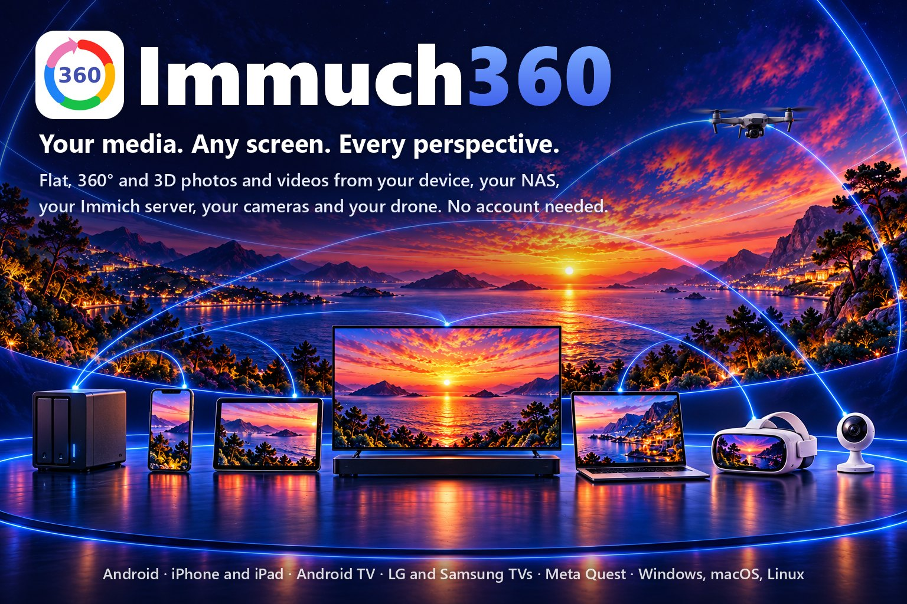

🌐 <b>Kurmancî</b> · Zimanên din (88)
<a href="../README.md">English</a> · <a href="README.af.md">Afrikaans</a> · <a href="README.ar.md">العربية</a> · <a href="README.az.md">Azərbaycanca</a> · <a href="README.be.md">Беларуская</a> · <a href="README.bg.md">Български</a> · <a href="README.bi.md">Bislama</a> · <a href="README.bn.md">বাংলা</a> · <a href="README.br.md">Brezhoneg</a> · <a href="README.bs.md">Bosanski</a> · <a href="README.ca.md">Català</a> · <a href="README.cs.md">Čeština</a> · <a href="README.cv.md">Чӑвашла</a> · <a href="README.da.md">Dansk</a> · <a href="README.de.md">Deutsch</a> · <a href="README.de_CH.md">Deutsch (Schweiz)</a> · <a href="README.el.md">Ελληνικά</a> · <a href="README.en_GB.md">English (UK)</a> · <a href="README.eo.md">Esperanto</a> · <a href="README.es.md">Español</a> · <a href="README.et.md">Eesti</a> · <a href="README.eu.md">Euskara</a> · <a href="README.fa.md">فارسی</a> · <a href="README.fi.md">Suomi</a> · <a href="README.fil.md">Filipino</a> · <a href="README.fr.md">Français</a> · <a href="README.ga.md">Gaeilge</a> · <a href="README.gl.md">Galego</a> · <a href="README.gsw.md">Alemannisch</a> · <a href="README.gu.md">ગુજરાતી</a> · <a href="README.he.md">עברית</a> · <a href="README.hi.md">हिन्दी</a> · <a href="README.hr.md">Hrvatski</a> · <a href="README.hu.md">Magyar</a> · <a href="README.hy.md">Հայերեն</a> · <a href="README.id.md">Bahasa Indonesia</a> · <a href="README.is.md">Íslenska</a> · <a href="README.it.md">Italiano</a> · <a href="README.ja.md">日本語</a> · <a href="README.ka.md">ქართული</a> · <a href="README.kab.md">Taqbaylit</a> · <a href="README.kk.md">Қазақша</a> · <a href="README.km.md">ខ្មែរ</a> · <a href="README.kn.md">ಕನ್ನಡ</a> · <a href="README.ko.md">한국어</a> · <a href="README.kxm.md">ภาษาเขมรถิ่นไทย</a> · <a href="README.lb.md">Lëtzebuergesch</a> · <a href="README.lmo.md">Lombard</a> · <a href="README.lt.md">Lietuvių</a> · <a href="README.lv.md">Latviešu</a> · <a href="README.mfa.md">Bahasa Melayu Kelantan</a> · <a href="README.mi.md">Te reo Māori</a> · <a href="README.mk.md">Македонски</a> · <a href="README.ml.md">മലയാളം</a> · <a href="README.mn.md">Монгол</a> · <a href="README.mr.md">मराठी</a> · <a href="README.ms.md">Bahasa Melayu</a> · <a href="README.nb_NO.md">Norsk bokmål</a> · <a href="README.ne.md">नेपाली</a> · <a href="README.nl.md">Nederlands</a> · <a href="README.nn.md">Norsk nynorsk</a> · <a href="README.pa.md">ਪੰਜਾਬੀ</a> · <a href="README.pl.md">Polski</a> · <a href="README.pt.md">Português</a> · <a href="README.pt_BR.md">Português (Brasil)</a> · <a href="README.ro.md">Română</a> · <a href="README.ru.md">Русский</a> · <a href="README.si.md">සිංහල</a> · <a href="README.sk.md">Slovenčina</a> · <a href="README.sl.md">Slovenščina</a> · <a href="README.sq.md">Shqip</a> · <a href="README.sr_Cyrl.md">Српски</a> · <a href="README.sr_Latn.md">Srpski</a> · <a href="README.sv.md">Svenska</a> · <a href="README.sw.md">Kiswahili</a> · <a href="README.swg.md">Schwäbisch</a> · <a href="README.ta.md">தமிழ்</a> · <a href="README.te.md">తెలుగు</a> · <a href="README.th.md">ไทย</a> · <a href="README.tl.md">Tagalog</a> · <a href="README.tr.md">Türkçe</a> · <a href="README.uk.md">Українська</a> · <a href="README.ur.md">اردو</a> · <a href="README.uz.md">Oʻzbekcha</a> · <a href="README.vi.md">Tiếng Việt</a> · <a href="README.yue_Hant.md">粵語</a> · <a href="README.zh_Hans.md">简体中文</a> · <a href="README.zh_Hant.md">繁體中文</a>

  

# Immuch360

**Medyaya te. Her ekran. Her dîmen.**

Wêne û vîdyoyên sade, 360° û 3D ji cîhaza te, NAS-a te, servera te ya Immich, kameraên te û drona te. Hesab ne pêwîst e. Immuch360 sepaneke belaş û çavkaniya vekirî ye ku wêne û vîdyoyên te li cihê ku lê ne dixwîne û her yekê di dîtinvanê guncaw de dilîze: sade, wekî gogeke ku tu tê de li dora xwe dinêrî, bi 3D, an jî di kaskekê de li dora te. Ew li ser têlefon, tablet, televizyon, kaskên Meta Quest û komputeran dixebite.

  Şaxeke ne-fermî ya sepana mobîl a Immich. Bi Immich an FUTO re têkildar nîne. Nav wekî «I am much 360» tê xwendin.

<b>Naverok</b>

- [Ji bo kê ye](#who-it-is-for)
- [Kîjan ekran](#which-screens), û [her ekran çi dike](#what-each-screen-does)
- [Tu çi dikarî bikî](#what-you-can-do)
- [Li ser cîhaza xwe saz bike](#get-it-on-your-device)
- [Çawa](#how-to)
  - [Li wêne û vîdyoyên xwe binêre, bi server an bêyî server](#watch-your-photos-and-videos-with-or-without-a-server)
  - [Panorama, 360°, VR180 û 3D keşf bike](#explore-panoramas-360-vr180-and-3d)
  - [Li ser televizyonê bi telekomandayê temaşe bike](#watch-on-the-tv-with-the-remote): [Android TV û Google TV](#on-android-tv-and-google-tv), [LG](#on-an-lg-tv-webos), [Samsung](#on-a-samsung-tv-tizen)
  - [Bi têlefona xwe li ser televizyonek, kaskek an komputerekê têkeve](#sign-in-a-tv-a-headset-or-a-computer-with-your-phone)
  - [Bi Meta Questê têkeve nav wêne û vîdyoyên xwe](#step-inside-your-photos-and-videos-with-a-meta-quest)
  - [Pelên NAS, komputer, serverê medyayê an Plex bilîze](#play-the-files-of-a-nas-a-computer-a-media-server-or-plex)
  - [Kitêbxaneya xwe ya Immich biparêze, bi zêdetir](#keep-your-immich-library-with-more)
  - [Li ser ekrana mezin li kameraên malê binêre](#watch-your-home-cameras-on-the-big-screen)
  - [Drona te ya DJI (ceribandinî)](#your-dji-drone-experimental): [vîdyoya zindî](#see-what-your-drone-sees-on-your-phone), [di Meta Questê de an li ser Android TV](#watch-it-in-a-meta-quest-or-on-an-android-tv), [anîn](#bring-a-drones-or-a-camera-cards-photos-and-videos-to-immich)
  - [Pelên xav ên kameraên 360° veke](#open-the-raw-files-of-360-cameras)
  - [Wêneyekê bi yek bişkokê bizivirîne](#turn-a-photo-with-one-key)
  - [Komputera xwe wekî lîstikvanê medyayê bi kar bîne](#use-your-computer-as-the-media-player)
- [Li gorî Immich](#compared-with-immich)
- [Nepenî](#privacy)
- [Lîsans û spas](#licences-and-credits)
- [Nexşeya rê](#roadmap)
- [Belgekirin](#documentation)

## Ji bo kê ye

- **Tu bi 360° an 3D dikişînî** û dixwazî di wêneyên xwe de li dora xwe binêrî, ne ku wan sade, ducarî an kişandî bibînî: [360°, VR180 û 3D](#explore-panoramas-360-vr180-and-3d).
- **Wêne û fîlmên te li ser NAS, komputer, Plex an Immich in** û tu dixwazî wan li ser televizyonê bibînî bêyî ku tiştekî kopî bikî: [li ser televizyonê](#watch-on-the-tv-with-the-remote), [NAS, parvekirin û Plex](#play-the-files-of-a-nas-a-computer-a-media-server-or-plex).
- **Meta Questeke te heye** û tu dixwazî têkevî nav wêne û vîdyoyên xwe: [di kaskê de](#step-inside-your-photos-and-videos-with-a-meta-quest).
- **Tu Immich bi rê ve dibî** û sepana wê dixwazî, ligel dîtinvanên dorhêlî û ekranên mezin ên ku tu ji têlefonê dixî hundir: [kitêbxaneya te ya Immich](#keep-your-immich-library-with-more), [li gorî Immich](#compared-with-immich).
- **Tu bi kameraên Tapo çavdêriya mala xwe dikî** û dixwazî wan li kêleka wêneyên xwe, li ser televizyonê jî bibînî (hê bi kamerayeke rastîn nehatiye kontrolkirin): [kameraên malê](#watch-your-home-cameras-on-the-big-screen).
- **Tu droneke DJI difirînî** û dixwazî wêneya wê ya zindî bêyî DJI Fly li ser têlefona xwe bibînî, û di Meta Questê de an li ser Android TV ji bo kesên ku bi te re ne (ceribandinî): [drona te](#see-what-your-drone-sees-on-your-phone).

Hesabekî Immuch360 tune ku were çêkirin, û tiştek nagihîje me: sepan tenê bi cîhazên te û serverên ku tu hilbijêrî re diaxive.

## Kîjan ekran

| Platform | Where to get it | Status on 26 October 2026 |
|---|---|---|
|  **Android** phones and tablets | [Google Play](https://play.google.com/store/apps/details?id=com.aprogsys.immuch360) · [APK](https://github.com/freeKC/Immuch360/releases) | on Google Play (build 25; build 31 sent for Google's review on 26 October, in place of build 29), build 31 on GitHub |
|  **iPhone û iPad** | App Store | guhertoya 3.3.1 (çêkirina 27) ji 22ê Cotmehê ve li benda nirxandina Apple ye, paşê guhertoya 3.3.2 (çêkirina 28), di TestFlight de ji bo ceribandina navxweyî; heta wê demê [bi xwe çêke](../docs/immuch360/build.md) |
|  **Android TV and Google TV** | [APK](#android-tv-and-google-tv) · Google Play | build 31 on GitHub: [sign in with your phone](#sign-in-a-tv-a-headset-or-a-computer-with-your-phone) by scanning a QR code, a [time bar, audio and subtitles](#on-android-tv-and-google-tv) for the remote in the video player, and a [drone's live video](#watch-it-in-a-meta-quest-or-on-an-android-tv) relayed by a phone (experimental); the TV listing is under Google's review |
| **LG TVs** with webOS 5.0 and later | [.ipk, version 1.0.0](https://github.com/freeKC/Immuch360/releases/tag/webos-v1.0.0) · LG Content Store (in review) | version 1.0.0, submitted to the LG Content Store on 24 October, under LG's tests on 26 October; until it is published, it installs in [Developer Mode](#lg-tvs-webos). It ran on webOS 25 TVs of LG's Cloud Test Lab |
| **Televizyonên Samsung** bi Tizen 5.5 û paşîtir | [Çêkirina ceribandinê ya .wgt](https://github.com/freeKC/Immuch360/releases/tag/tizen-v0.2.0) | çêkirina ceribandinê 0.2.0 ya heman sepana TV, ji bo îmzekirinê bi sertîfîkaya xwe ya Samsung û sazkirinê di [Developer mode](#samsung-tvs-tizen) de; 0.1.0 li ser televizyoneke Samsung a ceribandinkerekî xebitî, û 0.2.0 sererastkirinên wê ceribandinê dihewîne; ne li ser firoşgeha Samsung e |
|  **Meta Quest** 2, Pro, 3 and 3S | [Horizon Store](https://www.meta.com/experiences/immuch360/1384208401440714/) · [APK](#meta-quest) | on the Horizon Store (build 28, live since 25 October; build 31 sent as the next submission on 26 October), build 31 on GitHub |
|  **Windows** | [Installer or ZIP](https://github.com/freeKC/Immuch360/releases/tag/desktop-v3.3.0-rc.0-12) | desktop build 12, a signed preview: photos, flat and 360° videos, shares, Plex, cameras (not yet checked with a real camera), sign in with your phone, photos turned with one key, the interface in 89 languages |
|   **macOS and Linux** | [.deb, .rpm, DMG](https://github.com/freeKC/Immuch360/releases/tag/desktop-v3.3.0-rc.0-12) | desktop build 12, previews: photos, 360° photos and flat videos (360° videos play flat), an Immich server and network shares; desktop build 11 tried on 26 October in an Ubuntu 24.04 container and on a Mac; unsigned on macOS |

*Rewş di her weşanê de tê rojane kirin; hûragahiyên, çêkirin bi çêkirin, di [Rewşa weşanê](../docs/immuch360/release-status.md) de ne.*

  

### Her ekran çi dike

Yek bingeha kodê ji bo têlefon, tablet, Android TV, Meta Quest û komputeran, û sepaneke TV ya cuda ji bo televizyonên LG, ku ji bo televizyonên Samsung jî wekî çêkirina ceribandinê hatiye pakêtkirin. Her yek îro çi heye:

| Jêhatîbûn | Android | iPhone, iPad | Android TV | LG webOS | Samsung Tizen | Quest |
|---|:---:|:---:|:---:|:---:|:---:|:---:|
| Galerî, albûm, lêgerîn bi servereke Immich | ✅ | ✅ | ✅ dîtinvan | ✅ dîtinvan | ✅ dîtinvan | ✅ |
| Têketin bi têlefonê (koda QR) | ✅ kodê skan dike | 🔜 weşana iOS ya din | ✅ | ✅ di geroka têlefonê de | ❌ li ser televizyonê tê nivîsandin | ✅ kod li ser têlefonê tê nivîsandin |
| Bêyî server: medyaya cîhazê bi xwe | ✅ | ✅ | tenê parvekirin | ❌ | ❌ | ✅ |
| Wêne û vîdyoyên sade | ✅ | ✅ | ✅ | ✅ | ✅ | ✅ |
| Wêneyekê bi yek bişkokê bizivirîne | ✅ | ✅ | ✅ bişkokên rengîn | ✅ bişkokên rengîn | ✅ | ✅ pencere |
| Wêneyên 360° wekî gog | ✅ | ✅ | ✅ | ✅ | ✅ | ✅ dorhêlî |
| Vîdyoyên 360° | ✅ | ✅ bêyî xeta demê | ✅ peyam heke nikare kod veke | tenê sade | tenê sade | ✅ dorhêlî |
| 3D û VR180 | ✅ yek çav | ✅ yek çav | ✅ yek çav | wêne yek çav, vîdyo sade | wêne yek çav, vîdyo sade | ✅ 3D rastîn |
| Spatial 2.5D (şopandina serî) | ✅ ceribandinî | ✅ ceribandinî | ❌ | ❌ | ❌ | ❌ |
| Wêneyên Apple Spatial | ✅ yek çav | ✅ yek çav | ✅ yek çav | ❌ | ❌ | ✅ 3D |
| Pelên xav ên Insta360, GoPro û DJI | ✅ | ✅ | ✅ | ❌ | ❌ | ✅ |
| Parvekirinên SMB, WebDAV, DLNA | ✅ | ✅ | ✅ | ✅ SMB ji webOS 22 | ❌ | ✅ |
| Plex Media Server | ✅ | ✅ | ✅ | ✅ | ❌ | ✅ |
| Kameraên Tapo: tomar | ✅ | ✅ | ✅ | 🔜 ne berî Kanûna 2026an | ❌ | ✅ |
| Kameraên Tapo: dîtina zindî | ✅ | 🔜 weşana iOS ya din | ✅ | ✅ tenê vîdyo | ❌ | ✅ |
| Vê cîhazê li ser torê parve bike | ✅ | ✅ | ❌ | ❌ | ❌ | ❌ |
| Ji parvekirin û cîhazê ber bi Immich ve bar bike | ✅ | ✅ | ❌ | ❌ | ❌ | ✅ |
| Anîn ji droneke DJI an kartekê bi USB (ceribandinî) | ✅ | ❌ | ❌ | ❌ | ❌ | ❌ |
| Vîdyoya zindî ya drona DJI (ceribandinî) | ✅ bi RC-N3 | ❌ | ✅ têlefonek dişîne | ❌ | ❌ | ✅ têlefonek dişîne |
| Tema tarî | wekî pergalê | wekî pergalê | ✅ bi awayê pêşbijartî | ✅ tema yekane | ✅ tema yekane | wekî pergalê |
| Têketin | pêlêdan, jîroskop | pêlêdan, jîroskop | telekomanda; Çep û Rast di dema vîdyoyekê de jî û li ser xeta wê ya demê, Menu ji bo hûragahiyan | telekomanda, Magic Remote | telekomanda | kontrolker, dest |
| Ji ku tê wergirtin | Google Play, APK | App Store (di nirxandinê de) | APK, Google Play (di nirxandinê de) | .ipk, LG Content Store (di nirxandinê de) | çêkirina ceribandinê ya .wgt, ji hêla te ve îmzekirî | Horizon Store, APK |

| Jêhatîbûn | Windows | Linux | macOS |
|---|:---:|:---:|:---:|
| Gallery, albums, search with an Immich server | ✅ | ✅ | ✅ |
| Sign in with your phone (QR code) | ✅ | ✅ (its web page tried) | ✅ (which way not recorded) |
| Bêyî server: medyaya cîhazê bi xwe | ✅ peldank | ✅ peldank | ✅ peldank |
| Wêne û vîdyoyên sade | ✅ | ✅ | ✅ |
| Wêneyekê bi yek bişkokê bizivirîne | ✅ | ✅ | ✅ |
| 360° photos as a sphere | ✅ | ✅ | ✅ |
| Vîdyoyên 360° | ✅ | tenê sade | tenê sade |
| 3D û VR180 | ✅ yek çav | wêne yek çav, vîdyo sade | wêne yek çav, vîdyo sade |
| Spatial 2.5D (şopandina serî) | 🔜 di pêşxistinê de | ❌ | ❌ |
| Apple spatial photos | ✅ one eye | ✅ one eye, from a server | ✅ one eye |
| Raw Insta360, GoPro and DJI files | ✅ | ✅ photos, videos flat | ✅ photos, videos flat |
| SMB, WebDAV, DLNA shares | ✅ | ✅ | ✅ |
| Plex Media Server | ✅ | 🔧 CI | 🔧 CI |
| Kameraên Tapo: tomar | ✅ | 🔧 CI | 🔧 CI |
| Kameraên Tapo: dîtina zindî | ✅ | 🔧 CI | 🔧 CI |
| Vê cîhazê li ser torê parve bike | ✅ | ❌ | ❌ |
| Upload to Immich from shares and the device | ✅ | ✅ | ✅ |
| Anîn ji droneke DJI an kartekê bi USB (ceribandinî) | ❌ | ❌ | ❌ |
| Vîdyoya zindî ya drona DJI (ceribandinî) | ❌ | ❌ | ❌ |
| Tema tarî | wekî pergalê | wekî pergalê | wekî pergalê |
| Têketin | mişk, klavye | mişk, klavye | mişk, klavye, trackpad |
| Ji ku tê wergirtin | sazker an ZIP (pêşdîtina îmzekirî) | .deb, .rpm (pêşdîtin) | DMG an ZIP (pêşdîtina bê îmze) |

*Linux and macOS: desktop build 11, tried on 26 October 2026 on Ubuntu 24.04, in a container with a test Immich server and test shares, and by the author on a Mac.*

✅ li ser wê platformê di sepanê de · ❌ li wir nayê pêşkêşkirin · 🔜 plankirî · 🔧 CI di çavkaniyê de ye, ji hêla CI ya projeyê ve li ser wê pergalê hatiye çêkirin û destpêkirin, hê li wir bi serverek, parvekirinek an kamerayeke rastîn nehatiye kontrolkirin · tenê sade: vîdyo bi peyamekê sade tê lîstin, ji ber ku nîşandêra vîdyoyên 360° ya komputeran tenê li ser Windows heye; li ser televizyonên LG hê divê were pîvandin ka webOS kareyên vîdyoyê dide gogê an na; li ser televizyoneke Samsung a ceribandinkerekî, gerokê kareyên vîdyoyê yên reş dan dîmena 3D. "Yek çav" tê wateya ku pelek 3D çavê xwe yê çepê li ser ekraneke sade nîşan dide. Stûnên LG û Samsung yek sepaneke TV ya cuda ne: LG guhertoya 1.0.0, ku parvekirin û Plex-a wê li hember serverên rastîn û kameraên wê li hember kamerayeke simulekirî li ser makîneya çêkirinê ya projeyê hatine kontrolkirin, hê ne li ser televizyonekê, û çêkirina ceribandinê ya Samsung 0.2.0. Ne her ✅ hê li ser cîhazeke rastîn hatiye kontrolkirin: çi li ku hatiye kontrolkirin û çi hê maye ku were piştrastkirin, di [Taybetmendî](../docs/immuch360/features.md), [Piştgiriya platformê](../docs/immuch360/platform-support.md) û [Lihevhatî](../docs/immuch360/compatibility.md) de ye.

- **Telefon û tabletên Android**: sepana tam, pêlêdan û jîroskop, her çavkanî.
- **iPhone û iPad**: sepana tam; lîstikvanê vîdyoyê yê 360° tenê lîstin û rawestandin heye, dîtina zindî ya Tapo û aliyê têlefonê yê têketina bi têlefonê bi weşana iOS ya din tên, û lêgerîna DLNA heta ku Apple destûra multicast bide daxwazên unicast dişîne.
- **Android TV and Google TV**: the same APK, driven by the remote, dark by default; a viewer: backup, uploads and the editor are hidden and the details are read only, but a photo still turns with one key. Every search filter works with the remote: Location and Camera open their choices in a list, the date filter shows all its choices, and the Tags, Location, Date, Media Type, Star Rating and Display options sheets put Clear and Apply beside the choices, one Right away, on most of the screen height. The photo grid uses less image memory, and a held arrow moves it at most about 10 rows a second. From build 28 it signs in from a phone, by its QR code or its short code (tried between two emulators with the code typed, not yet with a camera). From build 29 the time bar of a video takes the focus of the remote, films get audio and subtitle menus, and the next file of a share opens with controls of its own. Checked on the Google TV emulator; build 28 ran on a real Android TV on 23 October, and the video problems found there are the fixes of build 29, checked on the emulator, not yet on that TV. From build 30, its Drone card shows the live video of a DJI drone that a phone relays, with the drone's values and obstacle ring (experimental): the pairing and the picture were tried on a TCL Android TV on 25 October, with stutter and a green cast on the earlier relay; on 26 October, with build 30, the steady stream that answers them kept that TV's picture coming in flight, with 7 freezes.
- **Televizyonên LG bi webOS 5.0 û paşîtir**: sepaneke cuda ji bo telekomanda û Magic Remote, li ser [immich-tv-webos](https://github.com/Seeky91/immich-tv-webos) hatiye avakirin: dîtinvanekî Immich bi wêneyên 360° li ser gogekê, wêneyek ku bi yek bişkokê dizivire, temayeke tarî û 89 zimanên sepanê (çend nivîsên sepana TV bi xwe heta niha bi îngilîzî ne); parvekirinên torê, Plex û dîtina zindî ya kameraên Tapo, bi riya karûbarê wê yê taybet li ser televizyonê (SMB ji webOS 22); vîdyoyên 360° sade. Guhertoya 1.0.0, ku di 24ê Cotmehê de ji LG Content Store re hat şandin, li ser televizyonên webOS 25 ên sê modelan di Cloud Test Lab a LG de xebitî: têketin, rûpela têketina bi têlefonê, wêne, albûm, vîdyoyek, dîmena 360°, pêşandana slaytan, lêgerînek û Vegere ji her rûpelê. Guhertoya 0.1.0 li ser televizyoneke LG ya ceribandinkerekî (webOS 22) xebitî. Parvekirin û Plex li hember serverên rastîn û kamera li hember kamerayeke simulekirî li ser makîneya çêkirinê ya projeyê hatine kontrolkirin, hê ne li ser televizyonekê.
- **Televizyonên Samsung bi Tizen 5.5 û paşîtir**: sepana TV ya LG ku ji bo televizyonên Samsung hatiye pakêtkirin, çêkirina ceribandinê 0.2.0, ku tu bi xwe îmze dikî û saz dikî: dîtinvanekî Immich ji bo telekomandayê, têketin bi nivîsandinê (navnîşana serverê, paşê îmêl û şîfre an mifteyeke API), bi pêşandana slaytan, wêneyên 360° li ser gogekê, wêneyek ku bi yek bişkokê dizivire û rûpeleke Derbarê ku dibêje televizyon çi piştgirî dike; hê ne têketina bi têlefonê, ne parvekirin, Plex an kamera; vîdyoyên 360° sade, bi agahdariyekê. Guhertoya 0.1.0 li ser televizyoneke Samsung a ceribandinkerekî bi Tizen 9 xebitî: wêne û vîdyo heta 4K hatin lîstin, tiştek ji 4K mezintir nehat dekodkirin, û geroka televizyonê kareyên vîdyoyê yên reş dan dîmena 3D. Guhertoya 0.2.0 sererastkirinên wê ceribandinê dihewîne (peyamek ji bo vîdyoyeke ku ji kodxwînerên televizyonê derbas dibe an disekine, vîdyoyên 360° sade bi agahdariyekê) û hê li ser televizyonekê nexebitiye.
- **Meta Quest 2, Pro, 3 û 3S**: sepan wekî pencereyekê, ligel dîmena dorhêlî û, ji çêkirina 30 pê ve, karteke Drone ku vîdyoya zindî ya droneke DJI nîşan dide ku têlefonek dişîne (ceribandinî), cara yekem bi çêkirina 30 tê ceribandin; HEVC kodeka ewle ye, H.264 li ser Quest 3 li dora 4096x2304 disekine; tenê Quest 3 hatiye ceribandin, Quest 2, Quest Pro û Quest 3S hê nehatine ceribandin.
- **Windows 10 û 11**: pêşdîtinek, bi peldankan li şûna galerîyekê, lîstikvanekî vîdyoyê yê xwe (libmpv) ji bo vîdyoyên sade û 360°, pelên xav ên ku li ser çîpa grafîkê hatine dirûtin, pel û peldankên ku bi bernameyê hatine vekirin an li ser pencereyê hatine avêtin, sazkerek an ZIP-ek, ji hêla APROGSYS ve îmzekirî.
- **Linux**: .deb û .rpm ku ji hêla CI ya projeyê ve hatine çêkirin, li ser Ubuntu 22.04 û 24.04, Debian 12 û Fedora 40 û 44 hatine sazkirin û kontrolkirin; wêne, wêneyên 360° û vîdyoyên sade bi libmpv ya pergalê (vîdyoyên 360°, 3D û xav bi peyamekê sade tên lîstin), ji çêkirina 7 a sermaseyê pê ve li ser danişînên X11 jî bi riya hardware tên xêzkirin; parvekirinên SMB ji Ubuntu 22.04 û Debian 12 û pê ve; bêyî keyring (GNOME Keyring an KWallet) sepan êdî di destpêka xwe ya yekem de 25 s naqefile: ew şîfreyan tenê ji bo danişînê diparêze û di mîhengên xwe de vê yekê dibêje; hê li ser komputereke Linux a rastîn nehatiye xebitandin, tenê di bin WSLg de û di konteyneran de.
- **macOS**: a DMG and a ZIP built by the project's CI, universal, unsigned (Gatekeeper asks once); it starts, opens the files and folders given to it, Finder included, keeps its secrets in the login keychain and plays flat videos with its own libmpv, first checked on the project's CI Mac; on 26 October 2026 the author tried desktop build 11 on a Mac, and it worked.

## Tu çi dikarî bikî

Her rêz rêbera xwe ya li jêr vedike. Rêbera tam, bi her vebijark, peyam û sînor, di [rêbera bikarhêner](../docs/immuch360/user-guide.md) de ye.

1. [Li wêne û vîdyoyên xwe binêre, bi server an bêyî server](#watch-your-photos-and-videos-with-or-without-a-server): galerîyek û lîstikvanek, tenê li ser cîhazê an bi servera te ya Immich.
2. [Di wêne û vîdyoyên 360°, panorama, VR180 û 3D de li dora xwe binêre](#explore-panoramas-360-vr180-and-3d): gogeke ku tu bi tiliyekê, bi têlefonê an bi telekomandayê dizivirînî.
3. [Li ser televizyonê bi telekomandayê temaşe bike](#watch-on-the-tv-with-the-remote): Android TV û Google TV, televizyonên LG, û televizyonên Samsung wekî çêkirina ceribandinê.
4. [Bi têlefona xwe li ser televizyonek, kaskek an komputerekê têkeve](#sign-in-a-tv-a-headset-or-a-computer-with-your-phone): koda wê ya QR skan bike, piştrast bike, temaşe bike.
5. [Bi Meta Questê têkeve nav wêne û vîdyoyên xwe](#step-inside-your-photos-and-videos-with-a-meta-quest): 360° li dora te, 3D bi 3D-ya rastîn.
6. [Pelên NAS, komputer, serverê medyayê an Plex bilîze](#play-the-files-of-a-nas-a-computer-a-media-server-or-plex): li cihê xwe, tiştek nayê kopîkirin.
7. [Kitêbxaneya xwe ya Immich biparêze, bi zêdetir](#keep-your-immich-library-with-more): sepana mobîl a Immich, ligel dîtinvanên dorhêlî û ekranên mezin.
8. [Li kameraên xwe yên Tapo binêre](#watch-your-home-cameras-on-the-big-screen): zindî, û tomarên karta bîrê ya wan; hê bi kamerayeke rastîn nehatiye kontrolkirin.
9. [Vîdyoya zindî ya drona xwe ya DJI li ser têlefona xwe bibîne](#see-what-your-drone-sees-on-your-phone), û [di Meta Questê de an li ser Android TV](#watch-it-in-a-meta-quest-or-on-an-android-tv): bi riya kontrolkereke DJI RC-N3, tenê wergirtin. *Ceribandinî.*
10. [Wêne û vîdyoyên dronekê an karta kamerayekê bîne Immich](#bring-a-drones-or-a-camera-cards-photos-and-videos-to-immich): bi USB, ji têlefoneke Android. *Ceribandinî.*
11. [Pelên xav ên kameraên 360° veke](#open-the-raw-files-of-360-cameras): Insta360, GoPro MAX û DJI Osmo 360, ji hêla sepanê ve tên dirûtin.
12. [Wêneyekê bi yek bişkokê bizivirîne](#turn-a-photo-with-one-key): bişkokek, bişkokeke klavyeyê an bişkokeke rengîn a telekomandayê.
13. [Komputera xwe wekî lîstikvanê medyayê bi kar bîne](#use-your-computer-as-the-media-player): peldankên te, Open with, pelek ku li ser pencereyê tê berdan. *Pêşdîtin.*

## Li ser cîhaza xwe saz bike

Sepanê ji firoşgeha cîhaza xwe bistîne ku li wir hatiye weşandin, an heta wê demê ji rûpela [Weşan](https://github.com/freeKC/Immuch360/releases).

### Telefon û tabletên Android

1. [Google Play](https://play.google.com/store/apps/details?id=com.aprogsys.immuch360), an APK-ya rûpela [Weşan](https://github.com/freeKC/Immuch360/releases): `Immuch360-v<version>-arm64-v8a-release.apk` ji bo telefonekê; `Immuch360-v<version>-release.apk` ya giştî li her derê dixebite.
2. Sepan li kêleka sepana fermî ya Immich saz dibe. APK-ya ji GitHub bi xwe nûve nabe: li rûpela Weşanan binêre; gava tu sepanê ji store-ekê saz kiribe, nûvekirinan ji wî store-ê bistîne.

### iPhone û iPad

1. Guhertoya App Store li bendê ye ku Apple wê nirxand bike. Heta ku were weşandin, sepanê bi Xcode li ser Mac-ekê çêke, li [Bi xwe çêke](../docs/immuch360/build.md) binêre.
2. Li "Bêyî server bi kar bîne" bixe, an ji bo têketina bi serverê xwe li "Bi servera Immich ve girê bide" bixe; herdu jî ji çêkirina 24ê pê ve li ser rûpela bixêrhatinê ne.

### Android TV û Google TV

1. Heta ku Google Play sepanê li ser televizyonan pêşkêş bike, `Immuch360-v<version>-release.apk` ya giştî ya rûpela [Weşan](https://github.com/freeKC/Immuch360/releases) bistîne.
2. Li ser televizyonê, vebijarkên pêşdebiran û çewtiyên USB vêxe (li ser Google TV: Mîheng, Pergal, Derbarê, "Android TV OS build" heft caran hilbijêre, paşê Mîheng, Pergal, Vebijarkên pêşdebiran; nav li gorî televizyonê diguherin).
3. Ji komputerekê li ser heman torê, bi adb (Android SDK Platform Tools): `adb connect <address of the TV>`, pirsa li ser televizyonê qebûl bike, paşê `adb install -r Immuch360-v<version>-release.apk`.
4. Sepan di nav sepanên televizyonê de bi banera xwe xuya dibe. Weşana din bi heman awayî saz bike: `-r` têketin û eyaran diparêze.

### Televizyonên LG (webOS)

1. Version 1.0.0 is in LG's review. Until it is on the LG Content Store, it installs in Developer Mode: you need an LG TV with webOS 5.0 or later, a computer on the same network and a free LG developer account. On the TV, install Developer Mode from the LG Content Store, sign in, turn Dev Mode Status on and let the TV restart; note its IP address and the passphrase the app shows.
2. Li ser komputerê, webOS CLI saz bike (Node.js 18 an paşîtir): `npm install -g @webos-tools/cli`, paşê televizyonê bi `ares-setup-device` tomar bike (navnîşana wê ya IP, port 9922, bikarhêner `prisoner`) û `ares-novacom --device <name> --getkey`, ku hevoka şîfreyê dipirse.
3. Ji [pêş-weşana webOS 1.0.0](https://github.com/freeKC/Immuch360/releases/tag/webos-v1.0.0), ji bo televizyoneke UHD `Immuch360-webOS-1.0.0.ipk` daxe, an ji bo televizyoneke Full HD, ku LG sepanên 1280x720 didiyê, `Immuch360-webOS-1.0.0-1280x720.ipk`. Wê li hember `SHA256SUMS.txt` kontrol bike, paşê `ares-install --device <name> Immuch360-webOS-1.0.0.ipk`. [webOS Dev Manager](https://github.com/webosbrew/dev-manager-desktop) ya webosbrew heman tiştî bêyî rêza fermanan dike.
4. Danişîneke Developer Mode 1000 saetan didome û bişkoka EXTEND ya sepana Developer Mode wê nû dike; dema ku diqede, televizyon sepanên bi vî awayî sazkirî radike. Hûragahî di [webos/README.md](../webos/README.md#install-on-a-tv-in-developer-mode) de ne.
5. Dema ku sepan li ser LG Content Store be, kopiya Developer Mode rake û wê ji firoşgehê saz bike.

### Televizyonên Samsung (Tizen)

1. Çêkirina ceribandinê 0.2.0 ne li ser firoşgeha Samsung e: tu wê bi xwe saz dikî. Pêdiviya te bi televizyoneke Samsung bi Tizen 5.5 an paşîtir (modelên 2020an û paşîtir), komputerek li ser heman torê û hesabekî Samsung heye. Li ser televizyonê: Apps, App Settings, 12345 binivîse, Developer mode vêxe, navnîşana IP ya komputerê binivîse, paşê televizyonê ji nû ve dest pê bike.
2. `Immuch360-Tizen-0.2.0.wgt` ji [pêş-weşana Tizen](https://github.com/freeKC/Immuch360/releases/tag/tizen-v0.2.0) daxe û wê li hember `SHA256SUMS.txt` kontrol bike. Televizyoneke Samsung tenê sepaneke ku ji bo wê hatiye îmzekirin saz dike, ji ber vê yekê divê pakêt dîsa bi sertîfîkayeke Samsung ku DUID-a televizyona te tê de ye were îmzekirin: [Apps2Samsung](https://github.com/Apps2Samsung/Apps2Samsung), amûreke civakê, DUID-ê dixwîne, pakêtê bi hesabê te yê Samsung îmze dike û saz dike; Tizen Studio bi Samsung Certificate Extension heman tiştî bi destan dike.
3. Sepanê veke û bi nivîsandina navnîşana servera xwe têkeve, paşê îmêl û şîfreya xwe an mifteyeke API. "Derbarê vê televizyonê" nîşan dide ka televizyon çi piştgirî dike, wekî nivîs û wekî koda QR: ew nivîs, ku di [Pirsgirêk](https://github.com/freeKC/Immuch360/issues) an [Gotûbêj](https://github.com/freeKC/Immuch360/discussions) de bi tiştên ku naxebitin re were şandin, herî zêde alîkariyê dike.

### Meta Quest

1. Ji [Horizon Store](https://www.meta.com/experiences/immuch360/1384208401440714/): guhertoya store, dema ku Meta her şandinê nirxand bike tê nûvekirin.
2. An pelê `-quest-release.apk` yê [weşanek](https://github.com/freeKC/Immuch360/releases) di moda pêşdebir de bi adb an SideQuest bi sideload saz bike: `adb install -r Immuch360-v<version>-quest-release.apk`, paşê Kitêbxaneya kaskê veke, «Unknown sources».
3. Guhertoya store û APK-ya GitHub bi mifteyên cuda hatine îmzekirin: ji bo derbasbûna ji yekê bo ya din, pêşî sepanê rake, ev yek dê têketin, mîheng û lîsteya parvekirinên torê winda bike.

### Windows

1. Download `Immuch360-Desktop-3.3.0-rc.0-desktop.12-windows-x64-setup.exe` from the [desktop pre-release](https://github.com/freeKC/Immuch360/releases/tag/desktop-v3.3.0-rc.0-12) (with `SHA256SUMS.txt` to check it) and open it. The installer and the ZIP are signed; Windows shows APROGSYS as the publisher. While the publisher is new to SmartScreen, it may still ask once: "More info", then "Run anyway".
2. "Install for me only" (bêyî mafên rêvebir) an "Install for all users" hilbijêre, paşê zimanê sazkerê, ku berê wekî yê Windows hatiye hilbijartin.
3. Immuch360 Desktop ji menûya Start dest pê bike. Wêne û vîdyo wê di "Open with" de digirin (pelekî bi rastê bitikîne, Open with); ew çu carî nabe bernameya pêşbijartî ya wan. Destpêka yekem a çêkirineke nû dikare heta deqeyekê bidomîne, dema ku Windows pelan skan dike.
4. Windows 10 an 11, 64 bit. Ji bo nûvekirinê, sazkerê çêkirina paşîn veke: têketina te, peldank û mîhengên te dimînin. ZIP-a heman weşanê heman sepan e, wekî peldankek, ji bo li her derê jê were derxistin û `immuch360.exe` jê dest pê bike. Li ser komputereke ku çêkirinên sermaseyê 4 heta 8 di destpêkê de li ser "duplicate column name: group_date" rawestiyan, çêkirina 9 wê databasê vedike û daneyên te diparêze.

### Linux

On Ubuntu 22.04 or later and Debian 12 or later: `sudo apt install ./Immuch360-Desktop-3.3.0-rc.0-desktop.12-linux-amd64.deb`; on Fedora 40 or later: `sudo dnf install ./Immuch360-Desktop-3.3.0-rc.0-desktop.12-linux-x86_64.rpm`, both from the [desktop pre-release](https://github.com/freeKC/Immuch360/releases/tag/desktop-v3.3.0-rc.0-12). Then start Immuch360 Desktop from your applications. A preview: the folders of the computer, photos and 360° photos as a sphere, and flat videos through the system's libmpv, which the package installs (360°, 3D and raw videos play flat, with a message); SMB shares work from Ubuntu 22.04 and Debian 12 on. On Fedora, camera videos need the FFmpeg of RPM Fusion. Without GNOME Keyring or KWallet, the passwords are kept for the session only, and the settings of the app say so.

### macOS

Open `Immuch360-Desktop-3.3.0-rc.0-desktop.12-macos.dmg` from the [desktop pre-release](https://github.com/freeKC/Immuch360/releases/tag/desktop-v3.3.0-rc.0-12) and drag the app to Applications (Apple silicon and Intel, macOS 12 or later). It is not signed nor notarized yet: Control click it and choose Open on macOS 14 and earlier, or choose "Open Anyway" in System Settings, Privacy & Security on macOS 15 and later. The author tried desktop build 11 on a Mac on 26 October 2026, and it worked; other Macs and macOS versions have not been tried, and reports are welcome.

## Çawa

Her xal dibêje tu çi distînî, paşê gavan, paşê sînoran. [Rêbera bikarhêner](../docs/immuch360/user-guide.md) her vebijark û peyamê dihewîne.

### Li wêne û vîdyoyên xwe binêre, bi server an bêyî server

Immuch360 berî her tiştî galerîyek û lîstikvanek e ji bo wêne û vîdyoyên asayî, û ne hesab ne jî server jê re pêwîst e. "Bêyî server bi kar bîne" sepanê li ser wêne û vîdyoyên cîhazê vedike, bi her dîtinvanî, lîsteya 360° û çavkaniyên torê, û tiştek ji cîhazê dernakeve. Bi servereke Immich, xeta demê, albûm, bijare, bîranîn û lêgerîn ji wê tên. Vîdyo di lîstikvanekî xwecihî de bi deng, gerîna demê, nîşandêreke barkirinê û hilbijartina rêça dengî tên lîstin, di lîstikvanên 360°, Spatial û komputerê de û, ji çêkirina 29 pê ve, di lîstikvanê sade yê sepana Android de, ku binnivîsan jî nîşan dide.

1. Sepanê veke. Rûpela bixêrhatinê "Medyaya te. Her ekran. Her dîmen." û sê bijartinan nîşan dide: li ya yekem, "Bêyî server bi kar bîne", bixe. Server dikare paşê, ji Mîhengan an ji tabloya Kitêbxane, were girêdan.
2. Destûra gihîştina wêne û vîdyoyên xwe bide. Heke tu red bikî, sepan dibêje "Sepan nikare wêneyên vê cîhazê bibîne", bi "Destûra gihîştinê bide" û "Eyaran veke".
3. Tabloya Sûret demjimêra cîhazê nîşan dide; Lê bigere û Albûm gewr dimînin, ji ber ku ew ji serverê tên. Tabloya Kitêbxane li jor 360° heye, paşê On this device (Li ser vê cîhazê, albûmên cîhazê) û Parvekirinên torê. Menûya li jor rastê dibêje "Tenê ev cîhaz": tiştek li tu derê nayê şandin.
4. Ji bo vekirina wêneyekê an vîdyoyekê li ser wê bixe; ji bo çûna ya din ber bi çep û rast ve bikişîne, ji bo mezinkirinê bi du tiliyan bigire an du caran bixe. Li ser vîdyoyekê ber bi jor ve bikişîne ji bo hûragahiyên wê: kod, mezinahî, rêjeya kareyan, rêjeya bit, û ka ev cîhaz wê dekod dike an na.
5. Li ser têlefon, tablet û televizyonên Android, ji çêkirina 29 pê ve, fîlmeke bi çend zimanên dengî an bi binnivîsan di kontrolên xwe de bişkokeke deng û bişkokeke binnivîsan heye: zimanê dengî yê ku tu hildibijêrî ji bo fîlmên din tê parastin, û binnivîs girtî dimînin heta ku tu wan hilbijêrî, ji bilî yên ferzkirî. Lîstikvanê Android ê sepana Immich ne ev heye ne ew.

Li ser komputerekê, peldankên ku tu hilbijêrî rola galerîyê dileyizin; li ser televizyonekê, ku wêneyên xwe tune, çavkaniyên torê wiha dikin.

Zêdetir: [bêyî server an hesab](../docs/immuch360/user-guide.md#without-a-server-or-an-account), [dîtinvan û lîstikvanê vîdyoyê](../docs/immuch360/user-guide.md#watch-your-photos-and-videos), [hûragahiyên vîdyoyê û kodxwîner](../docs/immuch360/user-guide.md#video-details-decoders-and-why-a-video-stutters).

### Panorama, 360°, VR180 û 3D keşf bike

Immuch360 wêne û vîdyoyên sade, panorama, wêne û vîdyoyên 360°, VR180, 3D-ya stereoskopîk, wêneyên Apple Spatial û gogên 360° yên dronên DJI nas dike, û her yekê di dîtinvanê guncaw de vedike. Wêneyeke 360° wekî gogeke ku tu bi tiliyek an bi livandina telefonê dizivirînî vedibe; vîdyoyeke 360° di lîstikvanek goyî de bi deng dilîze; pelên VR180 li ser nîv gogekê têne xêzkirin; pelên 3D yên stereoskopîk li ser ekraneke sade çavek û di kaskê de herdu çav nîşan didin. Panoramayên qismî birînê xwe diparêzin, û wêne ji dîmena ku kamerayê tomar kiriye dest pê dike. Pelek ku server wê nîşan nekiriye dikare bi tikandinek wekî 360° were dîtin.

  
  

1. Wêne an vîdyoyê veke. Pelên 360° li ser wêneya biçûk nîşaneyeke 360° hildigirin, û tabloya Kitêbxane lîsteyeke 360° heye ku wan kom dike, bi fîlteran li gorî dem, çavkanî, cûre û kamerayê.
2. Li 360°-yê di rêza jorîn de bixe. Bikişîne da ku dora xwe bibînî, bi du tiliyan mezin bike, li bişkoka jîroskopê bixe da ku bi zivirandina telefonê dora xwe bibînî.
3. Bişkoka 3D di navbera «Mono (ne 3D)», «3D, jor û jêr» û «3D, li kêleka hev» de digerîne; bişkoka 360°/180° di navbera goga tam û nîv goga VR180 de diguherîne.
4. Ji bo pelek ku her çend 360° be jî sade xuya dike: ⋮ li jor rastê, paşê «Wek 360° bibîne».

Li ser telefon û tabletan, vîdyoyeke stereoskopîk dikare li ser ekrana sade jî kûrahiyê bistîne: lîstikvanê Spatial 2.5D kamerayê pêş bi kar tîne da ku serê te bişopîne û dîmena di navbera herdu çavan de nîşan dide (ceribandinî). Wêneyên Apple Spatial ên ku bi iPhoneyekê hatine kişandin têne nasîn û li Meta Questê bi 3D têne nîşandan.

Zêdetir: [wêne û vîdyoyên 360°](../docs/immuch360/user-guide.md#360-photos-and-videos-as-a-sphere), [3D û VR180](../docs/immuch360/user-guide.md#3d-and-vr180-photos-and-videos), [Spatial 2.5D](../docs/immuch360/user-guide.md#depth-on-a-flat-screen-spatial-25d-experimental), [wêne û vîdyoyên Apple Spatial](../docs/immuch360/user-guide.md#apple-spatial-photos-and-videos), [lîsteya 360°](../docs/immuch360/user-guide.md#find-your-360-shots-the-360-list).

### Li ser televizyonê bi telekomandayê temaşe bike

Wêneyên te li ser ekrana mezin, bi telekomandayê. Sepanên TV hemû bi heman awayî dixebitin: tîr çarçoveyê dilivînin, OK vedike, Vegere vedigere, û di wêneyeke 360° de tîr li dora xwe dinêrin. Wêneyên televizyonekê yên xwe tune ne, ji ber vê yekê ew servera te ya Immich nîşan dide û, li ser Android TV û televizyonên LG, parvekirinên te yên torê, servera te ya Plex û kameraên te.

- **Android TV and Google TV**: the Android app itself, build 31, from GitHub until Google Play offers it on TVs.
- **LG TVs with webOS 5.0 and later**: a TV app of its own, version 1.0.0, in LG's review for the LG Content Store.
- **Televizyonên Samsung bi Tizen 5.5 û paşîtir**: heman sepana TV ya li ser televizyonên LG, çêkirina ceribandinê 0.2.0, ku tu bi xwe îmze dikî û saz dikî.

  

#### Li ser Android TV û Google TV

Heman sepana Android, ji destpêka yekem ve bi temayeke tarî, bi telekomandayê wekî têketina yekane. Di dîtinvanê de, Çep û Rast diçin wêne an vîdyoya berê an ya din, heta dema ku vîdyoyek dilîze jî, û di wêne an vîdyoyeke 360° de tîr li dora xwe dinêrin.

  

1. APK-yê bi adb saz bike, li [Saz bike](#android-tv-and-google-tv) binêre. Li ser rûpela bixêrhatinê, ji bo parvekirinekê, serverekî Plex an kamerayekê "Parvekirineke torê an serverekî medyayê lê zêde bike" hilbijêre, "Bêyî server bi kar bîne", an "Bi servera Immich ve girê bide", ku rûpela wê televizyonê dixe hundir dema ku tu koda wê ya QR bi têlefona xwe skan dikî (li [Bi têlefona xwe têkeve](#sign-in-a-tv-a-headset-or-a-computer-with-your-phone) binêre).
2. Di dîtinvanekê de, bişkokên lîstin û rawestandin, paşverû, pêşverû, ya berê û ya din ên telekomandayê dixebitin. OK di dema vîdyoyekê de kontrolan bi lîstin û rawestandinê hilbijartî nîşan dide, û OK-ya duyem radiwestîne; li pey wan bişkokên -10 s û +10 s tên, paşê bişkokên deng û binnivîsan dema ku fîlm wan hebe. Ji çêkirina 29 pê ve, Jêr ji lîstinê digihîje xeta demê: Çep û Rast bi her pêlêkirinê 10 s dilivînin, dema ku tê girtin bileztir, û OK dilîze an radiwestîne. Kontrol û dîrok 5 s piştî bişkoka dawîn winda dibin, û paşê Çep û Rast diçin pela berê an ya din; li ser parvekirinekê, ew pel di rûpeleke xwe ya taybet de vedibe, bi kontrolên ku wê rê dikin. Vîdyo êdî li ser televizyonekê dubare nabin, heya ku tu Mîheng, Asset Viewer, Vîdyo, Looping venekî.
3. Bişkoka Menu, bişkoka Info an OK-ya ku pêlêkirî tê girtin hûragahiyên wêne an vîdyoyê vedike, tenê ji bo xwendinê: dîrok, cih, kamera, kod, mezinahî û rêjeya bit. Vîdyoyek ku televizyon nikare kod veke vê yekê dibêje, bi koda xwe, mezinahiya xwe û sînorê kodxwînerên televizyonê, li şûna ku her û her bar bibe; vîdyoyeke 360° ya ji kodxwîneran wêdetir berî vekirina lîstikvanê 360° dipirse, û sedem li ser rûpela Logs a menûya profîlê tê nivîsandin.

Çêkirina 28 di 23ê Cotmehê de li ser Android TV-yeke rastîn xebitî; sererastkirinên vîdyoyê yên çêkirina 29 ji wê ceribandinê hatin û li ser emulatorê Google TV hatin kontrolkirin, hê ne li ser wê televizyonê.

#### Li ser televizyoneke LG (webOS)

Sepanên Immich bi xwe li ser televizyoneke LG saz nabin. Immuch360 sepaneke TV ya taybet ji bo televizyonên LG bi webOS 5.0 û paşîtir (ji televizyonên 2020an pê ve) heye, bi telekomanda û Magic Remote tê rêvebirin: ew servera te ya Immich, parvekirinên te yên torê, servera te ya Plex û kameraên te yên Tapo nîşan dide, û wêneyên te yên 360° datîne ser gogeke ku tu bi tîran dizivirînî. Ew li ser [immich-tv-webos](https://github.com/Seeky91/immich-tv-webos) ya Seeky91 hatiye avakirin, ku xeta demê, albûm, kes, cih, lêgerîn, pêşandana slaytan û têketina bi têlefonê anî; spas ji Seeky91 re. Guhertoya 1.0.0 di 24ê Cotmehê de ji LG Content Store re hat şandin û li ser televizyonên webOS 25 ên Cloud Test Lab a LG xebitî; heta ku LG wê pejirîne, di Developer Mode de tê sazkirin, û her rapor di [Pirsgirêk](https://github.com/freeKC/Immuch360/issues) de alîkariyê dike.

1. Wê li ser televizyonekê di Developer Mode de saz bike, li [Saz bike](#lg-tvs-webos) binêre. Nasnameya wê ya sepanê ya taybet heye, ji ber vê yekê ew li kêleka Immich TV ya Seeky91 saz dibe.
2. Bi têlefona xwe têkeve (koda QR skan bike), bi îmêl û şîfreya xwe, an bi mifteyeke API.
3. Bi tîran û OK bigere. Di dîtinvanê de, Çep û Rast diçin wêne an vîdyoya berê an ya din, her wiha dema ku vîdyoyek dilîze; kontrol 5 s piştî bişkoka dawîn winda dibin; Info hûragahiyan vedike; bişkokên kanalê mezin dikin; nîşanker û çerxa Magic Remote dixebitin.
4. Wêneyeke 360° li ser gogekê vedibe: her pêlêkirina tîrekê wê gavekê dizivirîne, û bişkokeke girtî zivirandinê didomîne. «Wek 360° bibîne» ji bo wêneyeke 2:1 ku server nîşan nekiriye jî heye; wêneyeke VR180 li ser nîv gogekê û wêneyeke 3D bi yek çav xuya dibe. Bişkokên zer û şîn wêneyeke sade dizivirînin.
5. Piştî têketinê, "Parvekirinên torê" di darika sepanê de: parvekirineke SMB, WebDAV an DLNA, serverekî Plex (bi kodekê li ser plex.tv/link têketî) an kamerayeke Tapo lê zêde bike. Wêneyên wan di heman dîtinvanê de vedibin, wêneyên 360° li ser gogê.

Guhertoya 1.0.0 ji bo LG Content Store hatiye çêkirin: Vegere ji Wêneyan an ji rûpela bixêrhatinê ji sepanê derdikeve bi wî awayê ku her guhertoya webOS hêvî dike, û pêşî pencereyeke vekirî digire; serverek ku di nav 15 s de bersiv nade bi peyameke ku sedemê dibêje û bişkokeke Dîsa biceribîne diqede; polîtîkaya nepeniyê di sepanê de vedibe, bi koda QR ji bo xwendina [beşa wê ya televizyonên LG](../PRIVACY.md#lg-tvs-webos) li ser têlefonekê; televizyon moda wêneyê ya Gallery bi kar tîne, wekî ku LG ji sepanên wêneyan dixwaze; û pakêteke duyem li televizyonên Full HD tê ku LG sepanên 1280x720 didiyê.

Sînor: SMB pêdivî bi webOS 22 (televizyonên 2022an) an paşîtir heye. Parvekirin, Plex û kamera bi riya karûbarê sepanê yê taybet li ser televizyonê tên, ku wan ji bo sepanê dixwîne, û li hember serverên rastîn û kamerayeke simulekirî li ser makîneya çêkirinê ya projeyê hatine kontrolkirin, hê ne li ser televizyonekê. Dîtina zindî ya kamerayekê tenê vîdyo ye. Hê na: tomarên kameraan (ne berî Kanûna 2026an) û dengê wan, vîdyoyên 360° li ser gogê (ew sade tên lîstin, bi peyamekê), barkirin. Li ser webOS berî 25, reverse proxy-ya li ber Immich divê sernivîsên CORS bişîne; sepan wan rave dike dema ku rastî pirsgirêkê tê. webOS 26 hê nehatiye ceribandin.

#### Li ser televizyoneke Samsung (Tizen)

Televizyonên Samsung bi Tizen 5.5 û paşîtir (ji televizyonên 2020an pê ve) heman sepana TV wekî çêkirina ceribandinê 0.2.0 distînin, ku ne li ser firoşgeha Samsung e: têketin bi nivîsandinê, xeta demê, albûm, dîtinvan û pêşandana slaytan, wêneyên 360° li ser gogê û wêneyek ku bi yek bişkokê dizivire. Hê na: têketina bi têlefonê, parvekirin, Plex û kamera, ku li ser televizyonên LG di karûbarekî paşperdeyê de dixebitin ku guhertoya Samsung hê tune ye.

1. Pakêtê ji bo televizyona xwe îmze bike û wê di Developer mode de saz bike, li [Saz bike](#samsung-tvs-tizen) binêre.
2. Bi nivîsandina navnîşana servera xwe têkeve, paşê îmêl û şîfreya xwe an mifteyeke API.
3. Bi tîran û OK bigere. Wêneyeke 360° li ser gogê vedibe; vîdyoyeke 360° sade tê lîstin, cara yekem bi agahdariyekê, ji ber ku li ser televizyona ceribandinkerekî geroka televizyonê kareyên vîdyoyê yên reş dan dîmena 3D.
4. Vîdyoyeke ku ji tiştê ku kodxwînerên televizyonê qebûl dikin derbas dibe vê yekê dibêje, bi mezinahiya ku televizyon dikare bilîze û mezinahiya pelê, li şûna ku her û her bar bibe. Vîdyoyeke ku disekine agahdariyekê bi rêjeya bit û riya derketinê nîşan dide: bihêle Immich pelên giran transkod bike, an girêdaneke bileztir bi kar bîne. Derbarê vê televizyonê sînorê vîdyoyê yê televizyonê dide.

Guhertoya 0.1.0 li ser televizyoneke Samsung a ceribandinkerekî bi Tizen 9 xebitî, û 0.2.0 sererastkirinên wê ceribandinê dihewîne; 0.2.0 hê li ser televizyonekê nexebitiye. Nivîsa rûpela Derbarê, ku piştî ceribandinekê di [Gotûbêj](https://github.com/freeKC/Immuch360/discussions) an [Pirsgirêk](https://github.com/freeKC/Immuch360/issues) de were şandin, herî zêde alîkariyê dike.

Zêdetir: [li ser televizyona xwe temaşe bike](../docs/immuch360/user-guide.md#watch-on-your-tv-android-tv-and-google-tv), [sepana webOS: sazkirin, bişkokên telekomandayê, sernivîsên CORS](../webos/README.md), [piştgiriya platformê](../docs/immuch360/platform-support.md).

### Bi têlefona xwe li ser televizyonek, kaskek an komputerekê têkeve

**Skan bike. Têkeve. Temaşe bike.** Nivîsandina navnîşana serverekê, îmêlek û şîfreyekê bi telekomandaya televizyonê, an di kaskekê de, çend deqeyan digire. Bi Immuch360 li ser têlefona te, ku li servera te ya Immich ketiye, televizyonek, Meta Questek an komputerek di nav çend saniyeyan de têdikeve: ekrana mezin koda QR nîşan dide, têlefon wê skan dike, tu piştrast dikî, û ekran li ser kitêbxaneya te vedibe. Bi sepana têlefonê, şîfreya te li ser têlefonê dimîne. Di sepana Immich de tiştekî wisa tune.

  

1. Li ser ekrana mezin (Android TV û Google TV, pencereya Meta Quest, Windows, Linux an macOS), "Bi servera Immich ve girê bide" hilbijêre: rûpela têketinê "Bi têlefona xwe têkeve", koda QR û kodeke 10 tîpî, li kêleka forma serverê, nîşan dide.
2. Li ser têlefonê, ku li servera te ketiye: Mîheng, "Televizyonek an komputerek girê bide", paşê "Kodê skan bike". Di Meta Questekê de, ku têlefon nikare ekrana wê skan bike, "Li şûna wê kodekê binivîse" hilbijêre û koda ku kask nîşan dide binivîse.
3. Têlefon dipirse "Bila (ekran) têkeve?" û hejmareke şeş reqemî nîşan dide: kontrol bike ku ekran heman hejmarê nîşan dide, paşê li Têkeve bixe. Ekran li ser xeta demê ya te vedibe.

Çawa ewle dimîne: têlefon û ekran divê li ser heman tora malê bin, û kod herî zêde du deqeyan didome û tenê carekê dixebite. Têlefon ji servera te danişîneke nû ji bo wê ekranê dixwaze, bi navê wê ("Immuch360 li ser TV ya odeya rûniştinê"), û wê bi şîfrekirî ji ekranê re dişîne, ji ber vê yekê şîfreya te çu carî ji têlefonê dernakeve. "Televizyonek an komputerek girê bide" ekranên ku vê têlefonê xistine hundir rêz dike, her yek bi Derkeve, û Immich wan di Mîhengên hesabê, Cîhazên destûrdayî de rêz dike, ku tu dikarî wan li wir jî betal bikî. Derketina têlefonê wan jî derdixe.

Aliyê têlefonê niha li ser Android dixebite, û li ser iPhone û iPad ji weşana iOS ya din pê ve. Bêyî Immuch360 li ser têlefonê, kodê bi kameraya têlefonê skan bike: rûpeleke ku ji hêla ekranê ve tê pêşkêşkirin di gerokê de vedibe, ji bo îmêl û şîfreya te, şîfrekirî û tenê carekê tê bikaranîn. Televizyonên LG bi koda QR ya xwe têdikevin, di geroka têlefonê de; ji çêkirina 28 pê ve skankera sepana têlefonê wê nas dike û wê rûpelê vedike. Televizyonên Samsung heta niha bi nivîsandinê têdikevin.

Zêdetir: [bi têlefona xwe têkeve](../docs/immuch360/user-guide.md#sign-in-a-tv-a-headset-or-a-computer-with-your-phone), [ekran çi dişînin û diparêzin](../docs/immuch360/technical-details.md#sign-in-with-your-phone).

### Bi Meta Questê têkeve nav wêne û vîdyoyên xwe

Li ser Meta Questê heman sepan wekî pencereyeke bi tevahiya kitêbxaneya te dixebite, û bişkoka wê ya 360° dîmenekî dorhêlî vedike ku wêne an vîdyo li dora te ye: tu bi zivirandina serê xwe dora xwe dibînî, pelên stereoskopîk bi 3D ya rastîn in, wêneyeke Apple Spatial bi 3D li pêş te difire, û kontrolker an destên te xeta demê, ya berê û ya din, û bişkoka Vegerê ku tiştê li pişt te ye bêyî ku tu kursiya xwe bizivirînî ber bi pêş ve tîne, rê dikin. Medya ji servera te, kaskê bi xwe, NAS-ek, servereke medyayê, telefonek an servereke Plex tên, li cihê xwe têne lîstin.

  
  
  

1. Sepanê ji [Horizon Store](https://www.meta.com/experiences/immuch360/1384208401440714/) saz bike, an APK-ya çêkirineke nûtir bi sideload saz bike, li [Saz bike](#meta-quest) binêre.
2. Li ser rûpela bixêrhatinê, ji bo wêne û vîdyoyên taybet ên kaskê li "Bêyî server bi kar bîne" bixe, an li "Bi servera Immich ve girê bide": koda ku kask nîşan dide di Immuch360 de li ser têlefona xwe binivîse ([bi têlefona xwe têkeve](#sign-in-a-tv-a-headset-or-a-computer-with-your-phone)), an bi navnîşana serverê, îmêl û şîfreya xwe têkeve.
3. Wêneyek an vîdyoyeke 360° veke û li 360° bitikîne: dîmena dorhêlî vedibe. B an Y, an bişkoka Vegerê ya panela agahiyê, pencereyê vedigerîne.
4. Di dîmena dorhêlî de, çîpika rastê ber bi çep an rast ve pal bide da ku dîmenê 30° ber bi wî alî ve bizivirînî. Ji çêkirina 29 pê ve ew ber bi wî alî ve dizivire ku tu lê pal didî, wekî di piraniya sepanên kaskê de; çêkirinên 17 heta 28 ew ber bi aliyê din ve dizivirandin, û Mîheng, Asset Viewer, Vîdyo, "Reverse thumbstick turn" wî alî vedigerîne.

Zêdetir: [di kaska Meta Quest de](../docs/immuch360/user-guide.md#in-the-meta-quest-3-headset), [kask: kod, store û destûr](../docs/immuch360/platform-support.md#meta-quest).

### Pelên NAS, komputer, serverê medyayê an Plex bilîze

Vîdyoyên te li ser NAS-ek, komputerek, servereke medyayê an Plex in. Immuch360 bi xwe serverên torê te dibîne, nav wan digere û wêne û vîdyoyên wan li cihê xwe, di her dîtinvanê sepanê de, bêyî tiştek jê kopî bike, dilîze: SMB (Samba, parvekirinên Windows), WebDAV (Nextcloud, Synology û yên din) û serverên medyayê yên DLNA (Jellyfin, Emby, minidlna, NAS-ek, qutiyeke TV). Telefonek dikare galerîya xwe jî li ser Wi-Fi ji bo kaskek an her daxwazkarek WebDAV parve bike, û komputereke Windows jî dikare wiha bike.

  
  

1. Tabloya Kitêbxane veke, paşê Parvekirinên torê, paşê + û "Parvekirina torê (NAS, komputer, serverê medyayê)". Ji çêkirina 24ê pê ve, "Parvekirineke torê an serverekî medyayê lê zêde bike" li ser rûpela bixêrhatinê rasterast Parvekirinên torê vedike, bêyî server.
2. Li ser serverek di bin «Li ser torê hat dîtin» de bixe, an form bi destan tijî bike: cûre, nav an navnîşana serverê, parvekirin an rê, peldanka destpêkê, navê bikarhêner û şîfre.
3. Li «Girêdanê biceribîne» bixe, paşê Tomar bike. Li parvekirinê bixe da ku lê bigerî: pêşî peldank, paşê wêne û vîdyo, bi nîşaneya 360° li ser pelên ku wekî 360° hatine nasîn.
4. Ji bo serverekî Plex: di Parvekirinên torê de, + û "Plex Media Server", paşê li servera xwe di bin «Li ser torê hat dîtin» de bixe, carekê tokenek bipêçe («Çawa wê bistînî» li ser rûpelê dibêje ka li ku derê tê dîtin), paşê «Girêdanê biceribîne» û Tomar bike.
5. Bi servereke Immich a girêdayî, pelan di peldankekê de hilbijêre û li «Li Immich bar bike» bixe da ku wan bişînî serverê xwe.

Lîstikvan bytên ku hewce dikin bi pûlek di hundirê sepanê re, bi rêzên bytê, dixwînin, ji ber vê yekê gerîna demê dixebite û tiştek li ser cîhazê nayê tomar kirin; vîdyoyeke SMB ji bo lîstina rewan di navbera heta şeş girêdanan de bi hev re tê xwendin. Ji çêkirina 29 pê ve, fîlmên ku wekî M2TS hatine tomarkirin (Blu-ray, kamerayên AVCHD, tomarkerên TV) di sepana Android de ji parvekirinên SMB û WebDAV û ji serverên DLNA yên ku wan wekî transport stream rêz dikin dilîzin, û serverek DLNA ya ku mezinahiya 0 nîşan dide êdî vîdyoyeke vala nade.

**Plex Media Server, bêyî plex.tv**: sepan rasterast bi servera te re cot dibe, bi tokenek ku tu carek dipêçî, û pelên orîjînal ên kitêbxaneyên te bi zindî dixwîne, ji ber vê yekê 360° dimîne 360°, li malê û, bi riya rêberkirina porta te, dûrî malê jî. Li ser televizyoneke LG, têketina Plex bi kodekê li ser plex.tv/link tê kirin.

Zêdetir: [parvekirinên torê](../docs/immuch360/user-guide.md#network-shares-a-nas-a-computer-or-a-media-server), [vê telefonê li ser torê parve bike](../docs/immuch360/user-guide.md#share-this-phone-on-the-network), [serverên medyayê yên DLNA](../docs/immuch360/user-guide.md#dlna-media-servers), [Plex Media Server](../docs/immuch360/user-guide.md#plex-media-server-without-plextv).

### Kitêbxaneya xwe ya Immich biparêze, bi zêdetir

Bi servereke [Immich](https://github.com/immich-app/immich), Immuch360 sepana mobîl a Immich e, bi heman server û heman hesabê wekî sepana web: tomarkirin, xeta demê, albûm, lêgerîn, kes, bîranîn, parvekirin, hevkar, her tişt bi servera te re li hev hatiye. Ew li kêleka sepana fermî saz dibe. Li ser vê de: nîşan û lîsteya 360°, her dîtinvanê dorhêlî, hilbijartin di navbera pela orîjînal û rewa transkod kirî ya serverê ji bo her vîdyoyê, hûragahiyên teknîkî yên vîdyoyekê, û pelên parvekirinek an cîhazê ku bi destan ber bi serverê te ve hatine şandin.

1. Li ser rûpela bixêrhatinê, li "Bi servera Immich ve girê bide" bixe, paşê bi navnîşana serverê, îmêla û şîfreya xwe têkeve, mîna di sepana Immich de; Vegere dizivire rûpela bixêrhatinê. Heta çêkirina 23 rûpela têketinê rasterast vedibe. Kitêbxane, albûm û mîhengên backup ên te, yên hesabê te ne.
2. Di Mîhengan de, Asset Viewer, Vîdyo, «Çavkaniya vîdyoyê» orîjînal hilbijêre dema ku ev cîhaz wê dixwîne, her dem orîjînal, an her dem rewa transkod kirî.
3. Ji bo nîşandana wêneyeke 360° ji kesê ku sepanê nîne re, wê bi lînkeke parvekirî ya Immich parve bike: sepana web a Immich wê wekî gogê di gerokê wî/wê de nîşan dide.

The current build, build 31, is based on Immich `main` of 10 October 2026 (version 3.3.0-rc.0), like builds 28 to 30; build 28 was tested against a server built from that same Immich `main`, and build 27 also against an Immich 3.2.4 server. Please report problems in [Issues](https://github.com/freeKC/Immuch360/issues), not to the Immich project.

Çi wekî hev e û Immuch360 çi lê zêde dike, di [Li gorî Immich](#compared-with-immich) de ye.

Zêdetir: [her tiştê din Immich e](../docs/immuch360/user-guide.md#everything-else-is-immich), [li gorî sepana Immich](../docs/immuch360/compatibility.md#compared-with-the-immich-app).

### Li ser ekrana mezin li kameraên malê binêre

  

Wêneyek. Piştgiriya Tapo hê bi kamerayeke rastîn nehatiye kontrolkirin.

Kameraên te yên Tapo yên TP-Link, li kêleka wêneyên te, bêyî sepana Tapo. Sepan kamerayekê zindî nîşan dide (têlefon û tabletên Android, Android TV, Meta Quest, Windows û, tenê vîdyo, televizyonên LG; iPhone û iPad ji weşana iOS ya din pê ve) û tomarên karta bîrê ya wê roj bi roj rêz dike (têlefon, tablet, Android TV, Quest û komputer). Klîpek ji kamerayê tê anîn, wekî her vîdyoyekê dilîze û dikare ji Immich re were şandin. Sepan tenê li ser tora te bi kamerayê re diaxive, çu carî bi serverên TP-Link re, û çu carî tiştekî li ser kamerayê naguherîne.

**Hê bi kamerayeke rastîn nehatiye kontrolkirin.** Protokol ji tomarên daneyan ên C510W bi firmware 1.3.4 hatiye nivîsandin, û sepan tenê li hember kamerayeke simulekirî hatiye kontrolkirin. Raporek bi model û firmware ku «Kamerayê biceribîne» nîşan dide gelek alîkariyê dike.

1. Pêşî di sepana Tapo de: hesabê kamerayê çêke (mîhengên kamerayê, Advanced Settings, Camera Account), ku ji bo dîtina zindî tê bikaranîn, û Third-Party Compatibility vêxe, di bin Me de, paşê Tapo Lab.
2. Di Immuch360 de: Kitêbxane, Parvekirinên torê, + û "Kamerayeke Tapo". Li kameraya xwe di bin «Li ser torê hat dîtin» de bixe, an navnîşana wê binivîse.
3. Şîfreya hesabê xwe yê TP-Link ji bo tomaran, hesabê kamerayê ji bo dîtina zindî, an herduyan binivîse; paşê «Kamerayê biceribîne», û Tomar bike.
4. Li kamerayê bixe: dîtina wê ya zindî li jora rûpela wê ye, bi deng, SD an HD û Ekrana tam; li jêr wê rojên bi tomaran tên. Li klîpekê bixe da ku wê bîne û bilîze; menûya wê ya ⋮ «Li Immich bar bike» heye.

Zêdetir: [kameraên Tapo](../docs/immuch360/user-guide.md#tapo-cameras-live-view-and-the-recordings-of-the-memory-card).

### Drona te ya DJI (ceribandinî)

A Drone card in the Library, experimental and on by default, gathers what Immuch360 does with a DJI drone: on an Android phone, the drone's live video through its remote controller, and its photos and videos brought to Immich over USB; in a Meta Quest or on an Android TV, that live video relayed by the phone, to watch. Immuch360 is not a DJI product and is not approved by DJI, and nothing is sent to DJI.

#### Bibîne ka drona te çi dibîne, li ser têlefona xwe

  

See what your DJI drone sees on your Android phone, without DJI Fly and without any account: plug a DJI RC-N3 remote controller into the phone with its cable, and Immuch360 shows the drone's live video full screen in landscape, H.265 in 1080p, with the flight values read from the cable. The remote keeps full control of the drone. It was tried with an RC-N3, a DJI Neo 2 and a Samsung Galaxy S24+: on the ground with build 29, and in flight with test builds of build 30 on 24 and 25 October, then with build 30 on 26 October.

**Which remotes and drones**, on 26 October 2026: the live video comes through a DJI remote that holds the phone on its cable. Tried another pair? On the live screen, open Advanced, then Diagnostics, and tell us in [Issues](https://github.com/freeKC/Immuch360/issues) which drone and remote you used and what Diagnostics shows.

- **Tested**: a DJI Neo 2 fitted with its Digital Transceiver, which it needs to fly with any remote, and a DJI RC-N3, with a Samsung Galaxy S24+; on the ground on 23 October and in flight, indoors, from 24 to 26 October.
- **Expected, not tried**: the RC-N3 with the other drones DJI lists for it (Neo, Flip, Mini 4 Pro, Mini 5 Pro, Air 3, Air 3S, Lito 1, Lito X1, and the Avata 360 by its own guide), and the RC-N2, which holds the phone on the same cable, with the same drones and the Neo 2. The app shows H.265 video only, and the flight values are proven on the Neo 2 only: with another drone the picture or the values may be missing.
- **Not supported**: remotes with their own screen (DJI RC, RC 2, RC Pro 2), and so the Mavic 4 Pro, which DJI ships with one of them; DJI goggles; the RC-N1, the RC-N1C and older remotes; a drone flown from the phone over Wi-Fi, without a remote.

Ew tenê guhdarî dike. Tu ferman çu carî ji kontrolker an dronê re nayê şandin: yek byta ku rûpel her saniyeyê dinivîse, ji 20 saniyeyan piştî vebûna kontrolkerê, tenê nîşan dide ka kontrolker daneyan digire an na, û tu fermanê hilnagire.

Li ser ekrana zindî: bataryaya dronê û dema motoran û, di firînê de, bilindahiya li ser cihê rabûnê, leza tîk, lez û dûrahiya li jêr dronê. Nirxek tenê dema ku tomarên me yên firînê wê îsbat dikin li wir xuya dibe: bilindahî, lez û dûrahiya li jêr dronê li ser tomarên du firînên di hundir de di 25ê Cotmehê de hatin îsbatkirin, heta bilindahiya 1.8 m û 1.5 m/s, hê ne zêdetir; nîşandana wan li wir di çêkirina 30 de nû ye û cara yekem bi wê tê ceribandin. Bilindahî nêzîkî 1.5 s piştî rabûnê xuya dibe, dema ku dron ji erdê an ji destan veqetiyaye, û heke çu carî bi awayekî ku tu balafir nikare bike baz bide, heta ku motor rawestin veşartî dimîne. Advanced voltaj û germahiya bataryayê, rêgeh (sifra wê li hember bakur nehatiye kontrolkirin) û motoran lê zêde dike, û Diagnostics her hejmara ku girêdan dide, herika bataryayê jî tê de. Ne satelaît, ne cih û ne jî dûrahiya ji malê tên nîşandan. Hejmar hê bi DJI Fly re nehatine berhevkirin: li gorî wan nefire.

**Xeleka astengiyan**, bi awayê pêşbijartî vêxistî: dema ku sensorên dronê tiştekî nêzîk dibînin, xelekeke nîvzelal li dora navenda wêneyê xuya dibe, bi kevanekê ber bi astengiyê ve, zer ku her ku nêzîk dibe sor dibe, dûrahiya wê li kêlekê û tiktikeke kurt ku bileztir dibe; dema ku tiştek nêzîk nîne, tiştek xuya nabe. Xelek û aliyê kevanê di firînê de, di hundir de, di 25ê Cotmehê de hatin kontrolkirin, li ser çêkirineke ceribandinê ku tê de alî vebijarkek bû; wekî ku bi awayê pêşbijartî tê nîşandan, cara yekem bi çêkirina 30 tê ceribandin. Di Advanced de tu dûrahiyan saz dikî («Glow from», 3.0 m, û «Strong glow from», 1.0 m), li şûna xelekê çarçoveyekê li keviyên wêneyê hildibijêrî, an xelekê, dengê wê an lerizîna wê vedimirînî. Ew tenê tiştê ku sensorên dronê ragihînin nîşan dide: di moda Sport de an dema ku dûrketina ji astengiyan girtî ye tiştek nîne, û nebûna ronahiyê nayê wê wateyê ku rê vala ye. Tenê agahî: Immuch360 çu carî dronê bi rê ve nabe û ranawestîne.

1. Karta Drone di Kitêbxaneyê de ye, û «DJI live video» li ser rûpela wê: «DJI live video (experimental)», di Mîhengan, Pêşketî de, bi awayê pêşbijartî vêxistî ye.
2. Dron û kontrolkerê vêxe, DJI Fly bigire, paşê «DJI live video» veke û agahdariya ewlehiyê bixwîne.
3. Kontrolkerê bi kabloya wê bi têlefonê ve girê bide. Heke Android bipirse ka kîjan sepan divê wê veke, Immuch360 bêyî "Her tim" hilbijêre, ku dê kontrolkerê ji DJI Fly bigire; heke modeke USB bipirse, tenê şarjkirinê hilbijêre. Piştî wê, girêdana kontrolkerê vê ekranê bi xwe vedike («Open this screen when the remote is plugged in», di Advanced de bi awayê pêşbijartî vêxistî).
4. Remote, Drone û Picture yek li dû yekê ronî dibin, û wêne di nav çend saniyeyan de li ser tevahiya ekranê tê. Sê bişkok (derketin, «Send to a headset or a TV» û Advanced) û nirx di bendên reş ên li kêleka wêneyê de ne. Nîşe, wekî «Live», piştî nêzîkî pênc saniyeyan winda dibin; tikandinek li her derê wan vedigerîne, û tiştek li ser wêneyê bandorê li dronê nake. Çewtiyeke ku ji te dixwaze tiştekî bikî dimîne.
5. Advanced «Save a capture for a bug report» heye, ku tomara girêdanê di `Download/Immuch360/dji-link` de dinivîse, «Play a saved capture», ji bo dîsa lîstina wê bêyî kontrolkerê, û Diagnostics, bi her hejmara ku girêdan dide.

Wêne û vîdyoyên dronê bi riya kontrolkerê nayên gihîştin, ji ber ku ew embara dronê venake: wan ji dronê bi xwe bi USB an ji karta wê kopî bike, wekî [li jêr](#bring-a-drones-or-a-camera-cards-photos-and-videos-to-immich). Tomarên tomarkirî ji xwe re bihêle, wekî ku rûpel dibêje: vîdyoya dronê û jimarên rêzê yên kontrolker û balafirê di wan de ne, û dibe ku cihê wê jî tê de be; raporek di [Pirsgirêk](https://github.com/freeKC/Immuch360/issues) de bi tiştê ku Diagnostics nîşan dide alîkariyê dike, bi taybetî bi kontrolkerên din ên DJI.

#### Di Meta Questê de an li ser Android TV temaşe bike

The phone plugged into the remote can send the drone's picture and values to Immuch360 in a Meta Quest or on an Android TV or Google TV on the same local network, for the people with you. A headset shows them in a window or, larger, in a flight view in front of you, and a TV full screen, with the same values and obstacle ring as the phone. They only watch: nothing a headset or a TV does reaches the remote or the drone. Their notes, such as "Watching only", fade after a few seconds and come back with a key, a tap or a button. The drone's picture reached a Quest 3 once, on 24 October, over a home Wi-Fi; the headset window and the flight view with the values and the obstacle ring are first tested with build 30, and the Quest 2, Pro and 3S have not been tried. Should the circle hide the middle of the picture in the headset, "Frame at the edges" in its menu keeps the middle clear. On a TCL Android TV, the pairing and the picture were tried on 25 October, with stutter and a green cast on the earlier relay; on 26 October, with build 30, after the switch to the steady stream, the TV kept showing the picture through a flight where the drone sent 18 Mbit/s, with 7 freezes, the longest 1.7 s; how the picture looked was not recorded. From build 31 the safety notice on the TV keeps the focus of the remote (checked by widget tests, not yet on that TV); in build 30 the view under it could take the focus, so the notice could be neither read nor accepted, and the only way out was Back, which leaves the page. Flying while you watch the headset or the TV needs an observer next to you who keeps the drone in sight (EU open category); without one, watch the drone.

1. Li ser têlefonê, li ser ekrana zindî, li «Send to a headset or a TV» bixe û wê vêxe.
2. **Meta Quest**: Immuch360 veke, Kitêbxane, Drone, û têlefonê hilbijêre; koda ku têlefon nîşan dide binivîse, carekê ji bo wê têlefonê. Wêne di pencereyê de vedibe; «Open the flight view» wê mezintir dike, û B an Y pencereyê vedigerîne.
3. **Android TV û Google TV**: Immuch360 veke, Kitêbxane, Drone. Di bin «Let this TV watch» de, televizyon kodek û koda wê ya QR nîşan dide: li ser têlefonê, di heman panelê de, li «Add a TV» bixe û wê skan bike, an binivîse. Paşê li ser televizyonê têlefonê hilbijêre û OK bitikîne: wêne li ser tevahiya ekranê tê; OK hejmaran nîşan dide an vedişêre, û Menu vebijarkan vedike.
4. Têlefon û ekran divê li ser heman tora herêmî bin. Dûrî malê, hotspota têlefonê vêxe, di banda 5 GHz de heke pêşkêş bike, û kaskê an televizyonê pê ve girê bide.
5. Ji bo raporeke çewtiyê, menûya kaskê û Options a televizyonê Diagnostics û «Save a reception record» hene, ku tiştê ku wê ekranê wergirtiye diparêze.

**Relay quality**, new in build 30, in Advanced on the phone: in flight the drone sends about 18 Mbit/s, and on 25 October a home Wi-Fi path from the phone through the router to the TV carried that full stream only a third of the flight time; the rest of the time the TV's picture stuttered, broke up and took a green cast. With Automatic, the default, a screen whose Wi-Fi cannot keep up gets a steady picture that the phone encodes again for it, up to 1080p at 30 pictures a second and at the rate its Wi-Fi carries, made to stay clean, with less detail, instead of breaking up; it goes back to the drone's own picture at the next landing or take off, once its Wi-Fi has carried the steady picture for 30 s without a stall; on 26 October that TV's Wi-Fi never did, and the TV stayed on the steady picture, at 15 pictures a second for 44 of its 59 seconds. Full stream always sends the drone's picture as it comes, Steady stream always the phone's. The steady picture first ran on a phone on 26 October, with build 30: a Galaxy S24+, encoding it in hardware HEVC at a constant bit rate. A TV on an Ethernet cable, or a screen joined to the phone's own hotspot, leaves one Wi-Fi hop instead of two.

Ne di vê çêkirinê de: dron li ser iPhone û iPad (dest pê nekiriye), şandin ji televizyonên LG û Samsung re, û îsbatkirina nirxên ji 1.8 m û 1.5 m/s zêdetir, paşê satelaît û dûrahiya ji malê, ku li benda firîneke li derve ne.

#### Wêne û vîdyoyên dronekê an karta kamerayekê bîne Immich

Wêne û vîdyoyên droneke DJI bi USB rasterast bo servera xwe ya Immich bîne: dronê an xwînerek kartê bi têlefoneke Android ve girê bide, pelên nû hilbijêre û wan bişîne; vîdyo ji daneyên firînê yên dronê li ser nexşeyê têne danîn û gogên 360° yên dronê wekî 360° xuya dibin. Sepana Immich tenê tiştê ku berê di galerîya têlefonê de ye backup dike, û servera Immich hê nikare cihê vîdyoyeke DJI Neo 2 bixwîne. Ev rûpel ceribandinî ye, tenê li ser têlefon û tabletên Android, û hê bi droneke rastîn nehatiye ceribandin.

  

1. Karta Drone di Kitêbxaneyê de veke, paşê «Photos and videos from the drone». Mîhenga wê, «DJI drones (experimental)» di Mîhengan, Pêşketî de, bi awayê pêşbijartî vêxistî ye; ji bo veşartina wê rûpelê li wir wê bigire.
2. Dronê (Neo 2 dikare girtî bimîne) an xwînerek kartê bi kabloyeke daneyê ya USB-C bi têlefonê ve girê bide; kontrolkereke DJI ya bê ekran (RC-N1, RC-N2, RC-N3) wêneyan nahewîne. Li ser rûpela Drona DJI, li «Dronê an kartê hilbijêre» bixe, wê di menûya alî ya hilbijêrê de hilbijêre, peldanka wê ya DCIM veke an tevahiya ajokerê bihêle, paşê «Vê peldankê bi kar bîne» û Destûr bide.
3. Rûpel wêne û vîdyoyan rojê bi roj rêz dike, bêyî pelên alîkar ên .LRF, .SRT, .THM û .m4a. Li «Hemû yên nû hilbijêre» bixe, paşê «Li Immich bar bike»; pelên ku berê hatine şandin nîşaneyeke ewr hildigirin û têne derbaskirin. «Li ser cîhazê bihêle» li şûna wê pelan di galerîya têlefonê de kopî dike, di albûma «Immuch360 import» de.
4. Ji bo ku vîdyoyek li ser nexşeyê cih bigire, berî firînê di DJI Fly de Video Subtitles vêxe (moda vîdyoyê, Settings, Camera): wê demê dron li kêleka her vîdyoyê pelek .SRT dinivîse, sepan cih jê dixwîne û piştî barkirinê li ser servera te datîne, dema ku Immich tu cih nedîtibe.

Gogên 360° yên dronên DJI (Mini, Air, Mavic û yên din, ku ji kameraya wan têne nasîn) di Immuch360 de bêyî etîketên 360° jî wekî 360° xuya dibin. Immich hewceyê wan etîketan e: vebijarka barkirinê «Gogên dronê ji bo Immich wekî 360° nîşan bike», ku bi awayê pêşbijartî girtî ye, wêneyê bêyî guhertin bi pelekî .xmp yê biçûk li kêleka wê dişîne, da ku Immich jî wê wekî gog nîşan bide. Moda gog an panoramayê ya Neo 2 tune ye: wêne û vîdyoyên wê sade ne. Dema ku têlefonê dengê klîpeke Neo 2 tomar kiribe, ew deng di pelekî .m4a yê cuda de ye: rûpel klîpê nîşan dike, û Immich wê bêyî deng distîne (wê bi DJI Fly daxe da ku deng bimîne). Her karta kamerayê ya bi peldankeke DCIM di xwînerek kartê de bi heman awayî dixebite. Tiştek ji DJI re nayê şandin.

Zêdetir: [dronên DJI bi USB](../docs/immuch360/user-guide.md#dji-drones-photos-and-videos-over-usb-experimental), [teşhîsa girêdana DJI](../docs/immuch360/user-guide.md#dji-link-diagnostics-experimental).

### Pelên xav ên kameraên 360° veke

Wêneyên .insp û vîdyoyên .insv yên xav ên kameraên Insta360 (yek an du lens, di yek rêçê de, du rêçan an du pelan de), pelên .360 yên GoPro MAX û pelên .osv yên DJI Osmo 360 ji hêla sepanê ve dema ku dilîzin tên dirûtin, bi kalibrasyona ku di pelê de hatiye nivîsandin, bêyî ku tiştek li tu derê were sazkirin.

1. Pelên xav li cihê ku sepan wan dixwîne deyne: parvekirineke SMB an WebDAV, servera te ya Immich (ew tenê .insp û .insv qebûl dike), an peldankên komputerekê. Galerîya têlefoneke Android pelên xav rêz nake, ji ber vê yekê pelek xav ku li têlefonê hatiye kopîkirin ne di galerîya wê de û ne jî di sepanê de xuya dibe.
2. Herdu pelên tomarkirineke ku ji du pelan pêk tê bi hev re bihêle: sepan li kêleka ya yekem li ya din digere.
3. Pelê veke û li 360° bixe. Wêneyek «Pela 360° ya xav, ji hêla sepanê ve hatiye dirûtin» bi çavkaniya kalibrasyona xwe nîşan dide; vîdyoyek dema ku dilîze tê dirûtin.

Linux û macOS vîdyoyên xav sade dilîzin, û pelên .dng yên cot fisheye heta niha sade xuya dibin.

Zêdetir: [pelên xav ên kameraên 360°](../docs/immuch360/user-guide.md#raw-360-camera-files-without-the-cameras-app).

### Wêneyekê bi yek bişkokê bizivirîne

Wêneyekê bi yek pêlêkirinê 90° bizivirîne, bêyî ku sererastkerekê vekî: bişkokek, bişkokeke klavyeyê an bişkokeke rengîn a telekomandaya TV, li ser her platformê. Sepana Immich wêneyekê di sererastkera xwe de dizivirîne; Immuch360 vê bi yek bişkokê dike, û ji bo wêneyên te yên li ser servereke Immich 2.6 an paşîtir ew di heman sererastkera serverê re derbas dibe, ji ber vê yekê sepana web û cîhazên te yên din wan zivirandî nîşan didin. Her wêneyeke din tenê li ser vê cîhazê tê zivirandin. Wêneyên 360°, 180° û 3D qet nazivirin, da ku dîmenên dorhêlî rast bimînin.

  

1. **Têlefon, tablet û pencereya Meta Quest**: wêneyê veke û di rêza jêrîn de, berî Sererast bike, li Bizivirîne bixe da ku wê bi aliyê saetê bizivirînî; pêlêkirineke dirêj wê bi aliyê din dizivirîne. Bi klavyeyekê, R û Shift+R.
2. **Android TV û Google TV**: bişkoka zer a telekomandayê wêneyê bi aliyê saetê dizivirîne û bişkoka şîn berevajî aliyê saetê, li her derê ku fokûs di dîtinvanê de be. Li ser telekomandayeke bêyî bişkokên rengîn, Jêr bixe: darika di bin wêneyê de bi Bizivirîne hilbijartî xuya dibe (dema ku wêne bişkokeke nivîsê hebe, yek Rast dûrtir), û her OK wêneyê dizivirîne.
3. **Televizyonên LG (webOS)**: zer û şîn wekî li ser Android TV, R û Shift+R li ser klavyeyê, an bişkoka zivirandinê ya kontrolên wêneyê. Televizyonên Samsung jî wêneyekê bi yek bişkokê dizivirînin.
4. **Windows, Linux û macOS**: R bi aliyê saetê dizivirîne, Shift+R berevajî aliyê saetê, an bişkoka zivirandinê di darika jorîn de, berî ekrana tam.
5. **Wêneyên parvekirineke torê, Plex an kamerayekê**: bişkoka zivirandinê ya yekem di darika jorîn de, R û Shift+R, an bişkokên zer û şîn.

Zivirandin li ku tê tomarkirin: wêneyeke hesabê te bi xwe li ser Immich 2.6 an paşîtir bi sererastkera wêneyan a serverê tê zivirandin, ku pela orîjînal diparêze û wêneyeke zivirandî çêdike (dema ku dixebite darikeke zirav xuya dibe; çar zivirandin, an zivirandinek paşve, vedigerin orîjînalê). Wêneyên cîhazê, yên parvekirinekê, yên hevkarekî an albûmeke parvekirî, û her wêneyeke li ser serverekê kevntir tenê li ser vê cîhazê têne zivirandin, ji bo wê wêneyê, û pel qet nayê guhertin; sepan vê yekê ji bo wêneyeke Immich carekê dibêje. Di sepanên Android, iOS û komputerê de, zivirandineke ku li ser cîhazê hatiye parastin di dîtinvanê de xuya dibe, hê ne di wêneyên biçûk, pêşandana slaytan û bîranînan de. Ji bo vîdyoyan, peldanka kilîtkirî û her wêneyeke 360°, 180° an 3D, Bizivirîne tune ye.

### Komputera xwe wekî lîstikvanê medyayê bi kar bîne

Li ser komputereke Windows, Immuch360 Desktop peldankên ku tu hilbijêrî bêyî tu serverî dixwîne, vîdyoyên sade û 360° di lîstikvanekî xwe de dilîze, li heman parvekirin û serveran digere, û dikare komputerê li malê bi kaskekê re parve bike. Linux û macOS wê wekî pêşdîtinan hene, bi vîdyoyên 360° ku sade tên lîstin.

  

1. Pêşdîtinê saz bike, an wê veke û `immuch360.exe` dest pê bike, li [Saz bike](#windows) binêre. Li ser rûpela bixêrhatinê, "Bêyî server bi kar bîne" hilbijartina peldankên te vedike, û "Bi servera Immich ve girê bide" rûpela têketinê, bi koda wê ya QR ji bo têlefona te.
2. Wêneyek, vîdyoyek an peldankek ku bi bernameyê tê vekirin, an li ser pencereya wê tê berdan, yekser vedibe, ya 360° di dîmena xwe ya 360° de; çend pel bi hev re di yek rûpelê de vedibin. Wêne û vîdyo wê di "Open with" de digirin; ew çu carî xwe nake bernameya wan a pêşbijartî.
3. Di dîtinvanekê de, klavye wê bi rê ve dibe: Valahî dilîze û radiwestîne, J û L paş û pêş ve diçin, F ekrana tam e, û R û Shift+R wêneyekê dizivirînin.

Zêdetir: [li ser komputereke Windows](../docs/immuch360/user-guide.md#on-a-windows-computer-immuch360-desktop-preview), [piştgiriya platformê](../docs/immuch360/platform-support.md).

## Li gorî Immich

Immuch360 tevahiya sepana mobîl a Immich diparêze û tiştê ku li dora wê ye lê zêde dike. Bi kurtî:

| | Immuch360, li gorî sepana Immich |
|---|---|
| **Heman** | servera te û hesabê te yê Immich: tomarkirin, xeta demê, albûm, lêgerîn, kes, bîranîn, parvekirin û hevkar, hemû bi servera te re hevdemkirî. Ew li kêleka sepana fermî saz dibe. |
| **Server ne pêwîst e** | ew bêyî server an hesab jî dixebite, li ser wêne û vîdyoyên cîhazê, peldankên komputerekê û parvekirinên torê; Plex û kamera têketina xwe bi kar tînin, çu carî hesabekî Immuch360. |
| **360° û dorhêlî** | wêne û vîdyoyên 360° wekî gog, panorama, VR180 û 3D, dîmeneke dorhêlî di Meta Questê de, nîşaneyeke 360° û lîsteyeke 360°. Dîtina 360° di sepana mobîl a Immich de ji Çileya 2024an ve tê xwestin û hê tune ye. |
| **Li ser televizyonê** | heman sepan li ser Android TV û Google TV, û sepaneke TV ji bo televizyonên LG, ku ji bo televizyonên Samsung jî wekî çêkirina ceribandinê hatiye pakêtkirin. Sepanên Immich bi xwe li ser televizyoneke LG saz nabin. |
| **Bi têlefona xwe têkeve** | televizyonek, kaskek an komputerek têdikeve dema ku têlefona te koda wê ya QR skan dike, û şîfreya te li ser têlefonê dimîne. Di sepana Immich de tiştekî wisa tune. |
| **Parvekirin û Plex** | parvekirinên SMB, WebDAV û DLNA û serverên Plex, li cihê xwe tên lîstin, û pelên wan bi destan ji servera te re tên şandin. |
| **Kameraên Tapo** | dîtina zindî û tomarên karta bîrê, li kêleka wêneyên te; hê bi kamerayeke rastîn nehatiye kontrolkirin. |
| **Zivirandin bi yek bişkokê** | sepana Immich wêneyekê di sererastkera xwe de dizivirîne; Immuch360 wê bi yek bişkokê dizivirîne, û ji bo wêneyên te bi xwe li ser Immich 2.6 an paşîtir ew di heman sererastkera serverê re derbas dibe, ji ber vê yekê sepana web û cîhazên te yên din wan zivirandî nîşan didin. |
| **Vîdyo** | menûyên deng û binnivîsan di lîstikvanê Android de, ku lîstikvanê Android ê sepana Immich tune ne; pela orîjînal an herikîna transkodkirî, ji bo her vîdyoyê tê hilbijartin; hûragahiyên teknîkî yên vîdyoyekê. |
| **Drona te** | wêne û vîdyoyên droneke DJI bi USB tên şandin, bi vîdyoyên ku ji daneyên firîna wê li ser nexşeyê tên danîn, dema ku sepana Immich tenê tiştê ku jixwe di galerîya têlefonê de ye tomar dike; û vîdyoya zindî ya dronê bi riya kontrolkereke RC-N3, bi nirxên wê yên firînê û xeleka astengiyan, li ser têlefonê û ji Meta Quest an Android TV re tê şandin. Herdu jî ceribandinî ne. |
| **Li ku ragihînî** | [Pirsgirêkên Immuch360](https://github.com/freeKC/Immuch360/issues), ne projeya Immich. |

Berhevdana fonksiyon bi fonksiyon di [Li gorî sepana Immich](../docs/immuch360/compatibility.md#compared-with-the-immich-app) de ye.

## Nepenî

Tiştek ji pêşdebir re naçe: ne hesab, ne analîtîk, ne karûbarekî ragihandina çewtiyan, ne reklam. Sepan tenê bi serverên ku tu hilbijêrî (servera te ya Immich, parvekirinên te, servera te ya Plex, kameraên te) diaxive û, bêyî server, bi tu tiştî re naaxive. Şîfre û token di embareke ewle ya cîhazê de dimînin; televizyonên LG û Samsung ji bo sepanê embareke wiha tune ne, ji ber vê yekê li wir ew di embara sepanê bi xwe de dimînin, ne şîfrekirî. Kamera tenê li ser cîhazê tê bikaranîn, ji hêla lîstikvanê Spatial 2.5D ve û ji bo skankirina koda ekraneke ku tu dixî hundir; wêneyên wê çu carî nayên tomarkirin û çu carî li tu derê nayên şandin. Ekraneke ku ji têlefona te ketiye danişîneke xwe ya taybet distîne, bi şîfrekirî li ser tora te ya malê tê şandin, çu carî ne şîfreya te; televizyoneke LG bi rûpelekê di geroka têlefonê de têdikeve, ku îmêl û şîfreya te bê şîfrekirin li ser tora te ya malê ji televizyonê re dişîne, û televizyon tenê danişînê diparêze. Tomar û tomarên wergirtinê yên rûpelên dronê li ser cîhazê dimînin heta ku tu wan parve bikî: vîdyoya dronê di wan de ye û dibe ku cihê wê jî tê de be, û di tomarekê de jimarên rêzê yên kontrolker û balafirê. Wêne û nirxên dronê ji têlefonê tenê diçin kask û televizyonên ku tu cot dikî, li ser tora te ya herêmî, ne şîfrekirî, wekî têlefoneke ku li ser Wi-Fi tê parvekirin. Tiştek ji DJI re nayê şandin, ne jî ji TP-Link re. Polîtîkaya tam di [PRIVACY.md](../PRIVACY.md) de ye, û hûragahî li gorî çavkaniyê di [rêbera bikarhêner](../docs/immuch360/user-guide.md#privacy) de ne.

## Lîsans û spas

Immuch360 şaxeke ne-fermî ya sepana mobîl a [Immich](https://github.com/immich-app/immich) e, di bin [GNU AGPL v3](../LICENSE) de, ne bi tîma Immich an FUTO re têkildar e û ne jî ji hêla wan ve tê piştgirîkirin. Şax heye ji ber ku dîtina 360° li ser mobîlê ji Çileya 2024an ve li Immich hatiye xwestin û hê di sepana fermî de nîne; ew niha wê pêşkêş dike, raya cîhazên rastîn kom dike, û dê di pull requestên biçûk de, tiştê ku parêzvan bixwazin, ber bi Immich ve pêşkêş bike. Her tiştê ku sepana fermî dike tê parastin; şax, zincîra çêkirinê û CI di [Bi xwe çêke](../docs/immuch360/build.md) de hatine rave kirin.

Dîtinvanê wêneyê 360° li ser pull requesta serekanî [immich-app/immich#31169](https://github.com/immich-app/immich/pull/31169) ya dmitry-brazhenko hatiye avakirin, ya bi xwe li ser prototîpa bencefr di [#30192](https://github.com/immich-app/immich/pull/30192) de hatiye çêkirin; spas ji her duyan re. Sererastkirinên telekomandayê di parzûnên lêgerînê de û rêzkirina albûman li ser TV-yan ji xebata mlc70 di [mlc70/Immuch-Android-TV#1](https://github.com/mlc70/Immuch-Android-TV/pull/1) de dest pê kirin, û rêza çalakiyan û panelên parzûnan li ser 80 ji sedî yê bilindahiya ekranê ji [mlc70/Immuch-Android-TV#3](https://github.com/mlc70/Immuch-Android-TV/pull/3) ya mlc70 tên, bi nivîskariya wan a parastî; spas ji mlc70 re. Sepana LG webOS, ku ji bo televizyonên Samsung jî hatiye pakêtkirin, li ser [immich-tv-webos](https://github.com/Seeky91/immich-tv-webos) ya Seeky91 hatiye avakirin, di bin lîsansa MIT de, di peldanka xwe de hatiye parastin; spas ji Seeky91 re. Kameraên Tapo ji tiştê ku [pytapo](https://github.com/JurajNyiri/pytapo), [Home Assistant Tapo Control](https://github.com/JurajNyiri/HomeAssistant-Tapo-Control) û [python-kasa](https://github.com/python-kasa/python-kasa) belge dikin hatine nivîsandin. Dîmena Meta Quest xwe dispêre Meta Spatial SDK, ku ne çavkanî-vekirî ye, ji ber vê yekê ew di vê şaxê de dimîne. Parvekirinên SMB libsmb2 bi kar tînin, di bin LGPL 2.1 an paşîtir de: ji çêkirina 27 û çêkirina 7 a sermaseyê pê ve, her çêkirin agahdariya wê, nivîsên lîsansa wê û arşîva çavkaniya wê, `Immuch360-libsmb2-sources.tar.gz`, ku bi her weşanê ve jî hatiye girêdan, digire. Çêkirinên Windows û macOS libmpv (pirtûkxaneya [mpv](https://mpv.io), bi [FFmpeg](https://ffmpeg.org)) ya ji hêla projeyê ve hatiye çêkirin, di bin LGPL de, bi lîsans û çavkaniyên wê digirin, ku li ser rûpela lîsansê ya sepanê hatine rêzkirin (Lîsans, li binê menûya profîlê); hûragahî û nîşaneyên bazirganiyê yên platformên ku li ser vê rûpelê hatine binavkirin di [Lîsans û nîşaneyên bazirganiyê](../docs/immuch360/platform-support.md#license-and-trademarks) de ne.

Dîmenên vê rûpelê dîmenên rastîn ên sepanê ne: yên têlefonê li ser çêkirina Android di emulatorekê de, yên Android TV li ser emulatorê Google TV, yên LG û Samsung di gerokeke ku şûna televizyonê digire de, yên Windows li ser komputereke Windows 11 û pencereya Meta Quest di Quest 3 de, hemû bi panoramayên CC0 ji [Poly Haven](https://polyhaven.com); dîmenên dorhêlî yên kaskê li ser Quest 3 bi medyaya nivîskar bi xwe hatine kişandin, û ya iPad di simulatora iPad de, bi panoramayeke CC0 ya Poly Haven. Wêneya destpêkê û wêneyên televizyonê, têketinê, zivirandinê, kameraan û dronê wêneyên ku ji bo projeyê hatine çêkirin in: ew tu ekrana sepanê, tu logoya şirketeke din û tu rû nîşan nadin. Her wêne, bi çavkanî, dîrok û lîsansa xwe, di [CAPTURES.md](../.github/readme/CAPTURES.md) de hatiye rêzkirin.

## Nexşeya rê

Tiştên ku hîn nehatine kirin, yên herî muhtemel pêşî. Tiştek li vir ne soz e, û nerînên li ser [issue tracker](https://github.com/freeKC/Immuch360/issues) alîkariyê dikin ku were biryardan ka çi pêşî tê.

- **The stores**: Google Play (build 31 in review since 26 October; the TV listing in review), the App Store (version 3.3.1 in review, then version 3.3.2 with build 28), the Meta Horizon Store with build 31 (build 28 there since 25 October), the LG Content Store (version 1.0.0 in LG's review since 24 October), and later the Samsung store.
- **Drones**: an outdoor flight to prove the height and the speeds above 1.8 m and 1.5 m/s and the obstacle distances against a tape, then to show the satellites and the distance from home; the steady picture of the relay checked in a headset; the relay to LG and Samsung TVs; the drone on iPhone and iPad, not started; a test of the import page with a real DJI Neo 2, then the sound recorded by the phone merged into its clip. Nothing that sends a command to a drone is planned before those tests.
- **Televizyon**: çêkirina 29 li ser Android TV-yeke rastîn, kontrolên wê yên vîdyoyê û têketina bi têlefonê jî tê de; parvekirin, Plex û dîtina zindî ya sepana LG li ser televizyoneke LG ya rastîn, û webOS 26; çêkirina ceribandinê ya Samsung 0.2.0 li ser televizyoneke Samsung a rastîn, paşê têketina bi têlefonê, parvekirin, Plex û kamera li ser televizyonên Samsung; paşê vîdyoyên 360° li ser goga televizyonên LG, dengê kameraan û tomarên wan (ne berî Kanûna 2026an).
- **Kamera**: kameraên Tapo bi kamerayeke rastîn tên kontrolkirin.
- **Computers**: the test of each function by hand on a Windows PC, sign in with your phone included; Spatial 2.5D with the webcam on Windows, in development for November 2026; then the 360° video renderer on Linux and macOS, a test on a real Linux PC; then automatic updates and a signed macOS app.
- **Telefon û tablet**: dîtina zindî ya Tapo û têketina ekranên mezin li ser iPhone û iPad bi weşana iOS ya din; xeteke demê di lîstikvanê vîdyoyê yê 360° yê iOS de, ya berê û ya din di lîstikvanên 360° yên telefonan de, menûyên rêça dengî û binnivîsan di lîstikvanê sade yê iOS de.
- **Medyaya dorhêlî**: .dng ya cot fisheye, ravekirina vîdyoyên GoPro û DJI ji daneyên tevgera wan bi xwe, vîdyoyên Spatial bi 3D li ser Quest heke kodxwînerên wê destûrê bidin, ya berê û ya din di navbera wêneyên Spatial de di kaskê de.
- **Çavkanî**: şemitandin di navbera pelên peldankeke parvekirî de, rastandina Digest ji bo WebDAV, kodeke QR ji bo anîna tokena Plex ji komputerê, IPv6 ji bo Plex, tomarên Tapo yên H.265, kanalên li ser ekrana destpêkê ya TV.
- **Upstream**: pull requestên biçûk ji Immich re ji bo beşên ku parastvan dixwazin, bi dîtinvanê wêneyên 360° dest pê dike.

Lîsteya tam, bi kontrolên cîhazê yên ku hê ji bo her taybetmendiyê li bendê ne, di [Rewşa weşanê](../docs/immuch360/release-status.md#roadmap) de ye.

## Belgekirin

- [Taybetmendî: lîsteya tam û nexşeya taybetmendiyê li gorî platformê](../docs/immuch360/features.md)
- [Rêbera bikarhêner: her fonksiyon, gav bi gav, bi vebijark û peyamên wê](../docs/immuch360/user-guide.md)
- [Lihevhatî: format, kod, kodxwîner, server û cîhazên hatine kontrolkirin, sînor](../docs/immuch360/compatibility.md)
- [Piştgiriya platformê: her pergal çi heye, çawa tê sazkirin, çi cuda ye](../docs/immuch360/platform-support.md)
- [Pirsgirêkên naskirî](../docs/immuch360/known-issues.md) û [Çareserkirina pirsgirêkan](../docs/immuch360/troubleshooting.md), bi logên ku divê bi ragihandinekê re werin zêdekirin
- [Hûragahiyên teknîkî: mîmarî, modulên Flutter û xwemalî, pûla medyayê, xeta tikandinê, kodxwîner](../docs/immuch360/technical-details.md)
- [Lîstikvanê vîdyoyê yê 360° yê sermasê: libmpv, gava projeksiyonê û pîvanên li pişt wê](../docs/immuch360/desktop-360-video-renderer.md)
- [Rewşa weşanê: çêkirin, store û tiştê her store heye](../docs/immuch360/release-status.md)
- [Bi xwe çêke: telefon, kask, televizyon û komputer](../docs/immuch360/build.md)
- [Immuch360 ji bo televizyonên LG webOS: sazkirin di Developer Mode de, bişkokên telekomandayê, sernivîsên CORS](../webos/README.md)

### Taybetmendiyên pêşketî

Tiştê ku sepan dikare bixwîne û lê bide, ji bo xwendevanê ku dixwaze tevahiya berfirehiyê bibîne. Her rêz di [rêbera bikarhêner](../docs/immuch360/user-guide.md) û [rûpela lihevhatinê](../docs/immuch360/compatibility.md) de bi hûrgilî hatiye vegotin.

<b>Format, çavkanî, lîstin û hardware, bi hûragahî</b>

- **Format**: wêne û vîdyoyên sade (tiştê ku cîhaz dixwîne: MP4, MOV, MKV û hin din); wêne û vîdyoyên 360° yên equirectangular; panoramayên qismî (birîna GPano); VR180; 3D ya stereoskopîk, jor û jêr an li kêleka hev, ji pelê hatiye xwendin (qutiya st3d) an ji kareyê hatiye texmînkirin; wêneyên Apple Spatial (cot stereo yên HEIC) û vîdyoyên Spatial (MV-HEVC, yek çav); .insp û .insv yên xerîm ên Insta360, .360 ya GoPro, .osv ya DJI; çavkaniyên 10 bit HLG û PQ li ser gogê bi tone hatine nexşandin.
- **Projeksiyon û metadata**: metadataya GPano û goyî ji pelê, bi daxwazên rêzê li ser serverek an parvekirinek hatiye xwendin; dîmena destpêkê ya kamerayê; gogên dronên DJI ku ji kameraya wan têne nasîn, bi pelekî alîkar ê .xmp yê vebijarkî da ku Immich jî wan nîşan bike; «Wek 360° bibîne» li ser cîhazê tê bîranîn; VR180 ji pelê an navê wê tê nasîn; cihê vîdyoyeke dronê ji tomara firînê ya wê ya .SRT tê xwendin; metadata tam dimîne ji ber ku pela orîjînal tê lîstin, çu carî ne kopiyeke hatiye guhertin; zivirandineke çaryekî bi sererastkera Immich tê tomarkirin an li ser cîhazê tê parastin, çu carî li ser pelekî dorhêlî.
- **Lîstina xwemalî**: Media3 li ser Android û televizyonê, SceneKit û AVFoundation li ser iOS, Meta Spatial SDK di kaskê de, libmpv li ser Windows; orîjînal an rewa transkod kirî li gorî tiştê ku cîhaz dixwîne tê hilbijartin; lîsteyeke kodxwînerên vîdyoyê yên cîhazê di Mîhengan, Pêşketî de; hilbijartina rêça dengî, binnivîs di lîstikvanê Android de û nîşaneke barkirinê.
- **Pelên xerîm ên li ser cîhazê hatine tikandin**: shadereke fragment a Flutter ji bo wêneyan; bandoreke GPU di lîstikvanê de ji bo vîdyoyên yek-rêçî; du kodxwînerên hardware bi hev re û compositoreke GPU ji bo vîdyoyên ku di her rêçê an pelê de yek lens heye (li ser Android û Quest OpenGL ES 3, li ser iOS Metal, û li ser Windows, ji build 5 a sermasê pê ve, du lîstikvanên libmpv yên ku sepan kareyên wan li ser çîpa grafîkê cot dike); kalîbrasyona kameraya bixwe (modelên Mei, V6 û modela dûrahiya wekhev) û tomara akselerometreyê; gava cîhaz nikare du kodxwîneran bi hev re bixebitîne, vegera bo yek lens, rewaya transkod kirî, kopiya LRV ya kamerayê an vîdyoya ku nehatiye tikandin.
- **Çavkanî**: galerîya cîhazê; peldankên komputerekê; dronek an karteke kamerayê bi USB, bi riya hilbijêra peldankê ya pergalê (Android, ceribandinî); kontrolkereke DJI RC-N3 bi kabloya wê ji bo vîdyoya zindî ya dronê (Android, ceribandinî), li ser tora herêmî ji Meta Quest an Android TV re tê şandin; servereke Immich; SMB 2 û 3, WebDAV, DLNA/UPnP; Plex bi riya HTTPS li hember sertîfîkaya servera bi xwe hatiye kontrolkirin; kameraên Tapo li ser torê herêmî (HTTPS û RTSP); telefonek an komputerek li ser Wi-Fi wekî servereke WebDAV hatiye parvekirin; serverên ku bi Bonjour/mDNS, lêgerîna torê ya herêmî, SSDP, GDM û vedîtina TP-Link hatine dîtin, û dema navnîşana xwe biguherin têne şopandin.
- **Xwendina li ser daxwazê**: pûleke herêmî lîstikvanan bi rêzên bytê û tokenek ji bo her danişînê peyda dike; blokên mezin, pêşxwendin û heta şeş girêdanên SMB bi hev re; wêneyên biçûk ji kareyeke her vîdyoyê; tiştek li ser cîhazê nayê kopîkirin.
- **Hardware**: kodxwînerên hardware li her derê ku hene têne bikaranîn, bi sînorên wan ên pîvankirî (sînorê H.264 ya Quest 3, herî zêde du lensên 2048x2048 ji bo kodxwînerên software); li ser Windows dîmena 360° ji hêla çîpa grafîkê ve ji her kareya xwendî hatiye xêzkirin, mezinahiya kareyê li ser her komputerê hatiye pîvankirin, çîpa yekgirtî an taybet hatiye nasîn.
- **Taybetmendiyên li gorî platformê**: jîroskop û lîstikvanê Spatial 2.5D li ser têlefonan; dîmena dorhêlî, kontrolker û dest li ser Quest; rêzkirina kontrolkerê, diyaloga klavyeyê û darika TV li ser Android TV; li ser komputerê, mişk û klavye, ekrana tam, tenê pencereyek, pel û peldankên ku bi sepanê hatine vekirin an li ser pencereya wê hatine avêtin, wekî pelên peldankên te tên xwendin, HEIC, AVIF, TIFF û wêneyên xav ên kamerayê yên peldankan gava Windows kodxwînerekî ji bo wan hebe, û parastina daneyê ya Windows ji bo şîfre û tokenan.
- **Nepenî ji hêla sêwirandinê ve**: ne hesab, ne ewr, ne analîtîk; şîfre û token di embareke ewle ya cîhazê de (li ser televizyonên LG û Samsung, ku ji bo sepanê embareke wiha tune ye, di embara sepanê bi xwe de, ne şîfrekirî); ekraneke ku ji têlefonekê ketiye danişîneke xwe ya taybet distîne, bi şîfrekirî li ser tora malê tê şandin, çu carî ne şîfre (televizyoneke LG şîfreyê ji rûpelekê di geroka têlefonê de distîne, bê şîfrekirin li ser tora malê, û tenê danişînê diparêze); kameraya lîstikvanê Spatial û ya skankera kodê tenê li ser cîhazê tê bikaranîn; parvekirin, Plex û kamera tenê li ser torê te têne gihîştin.

