

🌐 <b>ಕನ್ನಡ</b> · ಇತರ ಭಾಷೆಗಳು (88)
<a href="../README.md">English</a> · <a href="README.af.md">Afrikaans</a> · <a href="README.ar.md">العربية</a> · <a href="README.az.md">Azərbaycanca</a> · <a href="README.be.md">Беларуская</a> · <a href="README.bg.md">Български</a> · <a href="README.bi.md">Bislama</a> · <a href="README.bn.md">বাংলা</a> · <a href="README.br.md">Brezhoneg</a> · <a href="README.bs.md">Bosanski</a> · <a href="README.ca.md">Català</a> · <a href="README.cs.md">Čeština</a> · <a href="README.cv.md">Чӑвашла</a> · <a href="README.da.md">Dansk</a> · <a href="README.de.md">Deutsch</a> · <a href="README.de_CH.md">Deutsch (Schweiz)</a> · <a href="README.el.md">Ελληνικά</a> · <a href="README.en_GB.md">English (UK)</a> · <a href="README.eo.md">Esperanto</a> · <a href="README.es.md">Español</a> · <a href="README.et.md">Eesti</a> · <a href="README.eu.md">Euskara</a> · <a href="README.fa.md">فارسی</a> · <a href="README.fi.md">Suomi</a> · <a href="README.fil.md">Filipino</a> · <a href="README.fr.md">Français</a> · <a href="README.ga.md">Gaeilge</a> · <a href="README.gl.md">Galego</a> · <a href="README.gsw.md">Alemannisch</a> · <a href="README.gu.md">ગુજરાતી</a> · <a href="README.he.md">עברית</a> · <a href="README.hi.md">हिन्दी</a> · <a href="README.hr.md">Hrvatski</a> · <a href="README.hu.md">Magyar</a> · <a href="README.hy.md">Հայերեն</a> · <a href="README.id.md">Bahasa Indonesia</a> · <a href="README.is.md">Íslenska</a> · <a href="README.it.md">Italiano</a> · <a href="README.ja.md">日本語</a> · <a href="README.ka.md">ქართული</a> · <a href="README.kab.md">Taqbaylit</a> · <a href="README.kk.md">Қазақша</a> · <a href="README.km.md">ខ្មែរ</a> · <a href="README.kmr.md">Kurmancî</a> · <a href="README.ko.md">한국어</a> · <a href="README.kxm.md">ภาษาเขมรถิ่นไทย</a> · <a href="README.lb.md">Lëtzebuergesch</a> · <a href="README.lmo.md">Lombard</a> · <a href="README.lt.md">Lietuvių</a> · <a href="README.lv.md">Latviešu</a> · <a href="README.mfa.md">Bahasa Melayu Kelantan</a> · <a href="README.mi.md">Te reo Māori</a> · <a href="README.mk.md">Македонски</a> · <a href="README.ml.md">മലയാളം</a> · <a href="README.mn.md">Монгол</a> · <a href="README.mr.md">मराठी</a> · <a href="README.ms.md">Bahasa Melayu</a> · <a href="README.nb_NO.md">Norsk bokmål</a> · <a href="README.ne.md">नेपाली</a> · <a href="README.nl.md">Nederlands</a> · <a href="README.nn.md">Norsk nynorsk</a> · <a href="README.pa.md">ਪੰਜਾਬੀ</a> · <a href="README.pl.md">Polski</a> · <a href="README.pt.md">Português</a> · <a href="README.pt_BR.md">Português (Brasil)</a> · <a href="README.ro.md">Română</a> · <a href="README.ru.md">Русский</a> · <a href="README.si.md">සිංහල</a> · <a href="README.sk.md">Slovenčina</a> · <a href="README.sl.md">Slovenščina</a> · <a href="README.sq.md">Shqip</a> · <a href="README.sr_Cyrl.md">Српски</a> · <a href="README.sr_Latn.md">Srpski</a> · <a href="README.sv.md">Svenska</a> · <a href="README.sw.md">Kiswahili</a> · <a href="README.swg.md">Schwäbisch</a> · <a href="README.ta.md">தமிழ்</a> · <a href="README.te.md">తెలుగు</a> · <a href="README.th.md">ไทย</a> · <a href="README.tl.md">Tagalog</a> · <a href="README.tr.md">Türkçe</a> · <a href="README.uk.md">Українська</a> · <a href="README.ur.md">اردو</a> · <a href="README.uz.md">Oʻzbekcha</a> · <a href="README.vi.md">Tiếng Việt</a> · <a href="README.yue_Hant.md">粵語</a> · <a href="README.zh_Hans.md">简体中文</a> · <a href="README.zh_Hant.md">繁體中文</a>

  

# Immuch360

**ನಿಮ್ಮ ಮಾಧ್ಯಮ. ಯಾವುದೇ ಪರದೆ. ಪ್ರತಿ ದೃಷ್ಟಿಕೋನ.**

ನಿಮ್ಮ ಡಿವೈಸ್, ನಿಮ್ಮ NAS, ನಿಮ್ಮ Immich ಸರ್ವರ್, ನಿಮ್ಮ ಕ್ಯಾಮೆರಾಗಳು ಮತ್ತು ನಿಮ್ಮ ಡ್ರೋನ್‌ನಿಂದ ಫ್ಲಾಟ್, 360° ಮತ್ತು 3D ಫೋಟೋಗಳು ಮತ್ತು ವೀಡಿಯೊಗಳು. ಯಾವುದೇ ಖಾತೆ ಬೇಕಿಲ್ಲ. Immuch360 ಉಚಿತ ಮತ್ತು ಓಪನ್ ಸೋರ್ಸ್ ಅಪ್ಲಿಕೇಶನ್ ಆಗಿದ್ದು, ನಿಮ್ಮ ಫೋಟೋಗಳು ಮತ್ತು ವೀಡಿಯೊಗಳು ಇರುವಲ್ಲಿಂದಲೇ ಓದುತ್ತದೆ ಮತ್ತು ಪ್ರತಿಯೊಂದನ್ನು ಅದಕ್ಕೆ ಹೊಂದುವ ವೀಕ್ಷಕದಲ್ಲಿ ಪ್ಲೇ ಮಾಡುತ್ತದೆ: ಫ್ಲಾಟ್ ಆಗಿ, ನೀವು ಸುತ್ತಲೂ ನೋಡುವ ಗೋಳವಾಗಿ, 3D ಯಲ್ಲಿ, ಅಥವಾ ಹೆಡ್‌ಸೆಟ್‌ನಲ್ಲಿ ನಿಮ್ಮ ಸುತ್ತಲೂ. ಇದು ಫೋನ್‌ಗಳು, ಟ್ಯಾಬ್ಲೆಟ್‌ಗಳು, TVಗಳು, Meta Quest ಹೆಡ್‌ಸೆಟ್‌ಗಳು ಮತ್ತು ಕಂಪ್ಯೂಟರ್‌ಗಳಲ್ಲಿ ಚಲಿಸುತ್ತದೆ.

**New: your flat photos, in 3D.** On a computer, "Make 3D (AI)" turns one photo into a 3D photo, a 3D scene or a 360° panorama; in a Meta Quest 3 or 3S, "AI relief" shows any flat photo in 3D. Experimental, and everything runs on your own machines: [see how](#turn-one-photo-into-3d-a-scene-a-panorama).

  Immich ಮೊಬೈಲ್ ಅಪ್ಲಿಕೇಶನ್‌ನ ಅನಧಿಕೃತ ಫೋರ್ಕ್. Immich ಅಥವಾ FUTO ಜೊತೆ ಸಂಬಂಧವಿಲ್ಲ. ಹೆಸರು "I am much 360" ಎಂದು ಓದುತ್ತದೆ.

<b>ಪರಿವಿಡಿ</b>

- [ಇದು ಯಾರಿಗಾಗಿ](#who-it-is-for)
- [ಯಾವ ಪರದೆಗಳು](#which-screens), ಮತ್ತು [ಪ್ರತಿ ಪರದೆ ಏನು ಮಾಡುತ್ತದೆ](#what-each-screen-does)
- [ನೀವು ಏನು ಮಾಡಬಹುದು](#what-you-can-do)
- [ನಿಮ್ಮ ಡಿವೈಸ್‌ನಲ್ಲಿ ಪಡೆಯಿರಿ](#get-it-on-your-device)
- [ಹೇಗೆ ಮಾಡುವುದು](#how-to)
  - [ನಿಮ್ಮ ಫೋಟೋಗಳು ಮತ್ತು ವೀಡಿಯೊಗಳನ್ನು ವೀಕ್ಷಿಸಿ, ಸರ್ವರ್‌ನೊಂದಿಗೆ ಅಥವಾ ಇಲ್ಲದೆ](#watch-your-photos-and-videos-with-or-without-a-server)
  - [ಪನೋರಮಗಳು, 360°, VR180 ಮತ್ತು 3D ಅನ್ವೇಷಿಸಿ](#explore-panoramas-360-vr180-and-3d)
  - [ಒಂದು ಫೋಟೋವನ್ನು 3D, ದೃಶ್ಯ, ಪನೋರಮಾ ಆಗಿ ಪರಿವರ್ತಿಸಿ](#turn-one-photo-into-3d-a-scene-a-panorama)
  - [ರಿಮೋಟ್‌ನೊಂದಿಗೆ TV ಯಲ್ಲಿ ವೀಕ್ಷಿಸಿ](#watch-on-the-tv-with-the-remote): [Android TV ಮತ್ತು Google TV](#on-android-tv-and-google-tv), [LG](#on-an-lg-tv-webos), [Samsung](#on-a-samsung-tv-tizen)
  - [ನಿಮ್ಮ ಫೋನ್‌ನೊಂದಿಗೆ TV, ಹೆಡ್‌ಸೆಟ್ ಅಥವಾ ಕಂಪ್ಯೂಟರ್‌ಗೆ ಸೈನ್ ಇನ್ ಮಾಡಿ](#sign-in-a-tv-a-headset-or-a-computer-with-your-phone)
  - [Meta Quest ನೊಂದಿಗೆ ನಿಮ್ಮ ಫೋಟೋಗಳು ಮತ್ತು ವೀಡಿಯೊಗಳ ಒಳಗೆ ಹೆಜ್ಜೆ ಇಡಿ](#step-inside-your-photos-and-videos-with-a-meta-quest)
  - [NAS, ಕಂಪ್ಯೂಟರ್, ಮೀಡಿಯಾ ಸರ್ವರ್ ಅಥವಾ Plex ನ ಫೈಲ್‌ಗಳನ್ನು ಪ್ಲೇ ಮಾಡಿ](#play-the-files-of-a-nas-a-computer-a-media-server-or-plex)
  - [ನಿಮ್ಮ Immich ಲೈಬ್ರರಿಯನ್ನು ಉಳಿಸಿಕೊಳ್ಳಿ, ಇನ್ನಷ್ಟು ಜೊತೆಗೆ](#keep-your-immich-library-with-more)
  - [ದೊಡ್ಡ ಪರದೆಯಲ್ಲಿ ನಿಮ್ಮ ಮನೆಯ ಕ್ಯಾಮೆರಾಗಳನ್ನು ವೀಕ್ಷಿಸಿ](#watch-your-home-cameras-on-the-big-screen)
  - [ನಿಮ್ಮ DJI ಡ್ರೋನ್ (ಪ್ರಯೋಗಾತ್ಮಕ)](#your-dji-drone-experimental): [ಲೈವ್ ವೀಡಿಯೊ](#see-what-your-drone-sees-on-your-phone), [Quest ನಲ್ಲಿ ಅಥವಾ Android TV ಯಲ್ಲಿ](#watch-it-in-a-meta-quest-or-on-an-android-tv), [ಆಮದು](#bring-a-drones-or-a-camera-cards-photos-and-videos-to-immich)
  - [360° ಕ್ಯಾಮೆರಾಗಳ ರಾ ಫೈಲ್‌ಗಳನ್ನು ತೆರೆಯಿರಿ](#open-the-raw-files-of-360-cameras)
  - [ಒಂದೇ ಕೀಯಿಂದ ಫೋಟೋ ತಿರುಗಿಸಿ](#turn-a-photo-with-one-key)
  - [ನಿಮ್ಮ ಕಂಪ್ಯೂಟರ್ ಅನ್ನು ಮೀಡಿಯಾ ಪ್ಲೇಯರ್ ಆಗಿ ಬಳಸಿ](#use-your-computer-as-the-media-player)
- [Immich ನೊಂದಿಗೆ ಹೋಲಿಕೆ](#compared-with-immich)
- [ಗೌಪ್ಯತೆ](#privacy)
- [ಪರವಾನಗಿಗಳು ಮತ್ತು ಕೃತಜ್ಞತೆಗಳು](#licences-and-credits)
- [ಮಾರ್ಗಸೂಚಿ](#roadmap)
- [ದಸ್ತಾವೇಜು](#documentation)

## ಇದು ಯಾರಿಗಾಗಿ

- **ನೀವು 360° ಅಥವಾ 3D ಯಲ್ಲಿ ಚಿತ್ರೀಕರಿಸುತ್ತೀರಿ** ಮತ್ತು ನಿಮ್ಮ ಚಿತ್ರಗಳಲ್ಲಿ ಸುತ್ತಲೂ ನೋಡಲು ಬಯಸುತ್ತೀರಿ, ಅವುಗಳನ್ನು ಫ್ಲಾಟ್, ಎರಡೆರಡಾಗಿ ಅಥವಾ ಹಿಗ್ಗಿಸಿದಂತೆ ಅಲ್ಲ: [360°, VR180 ಮತ್ತು 3D](#explore-panoramas-360-vr180-and-3d).
- **ನಿಮ್ಮ ಫೋಟೋಗಳು ಮತ್ತು ಚಲನಚಿತ್ರಗಳು NAS, ಕಂಪ್ಯೂಟರ್, Plex ಅಥವಾ Immich ನಲ್ಲಿವೆ** ಮತ್ತು ಏನನ್ನೂ ನಕಲಿಸದೆ ಅವುಗಳನ್ನು TV ಯಲ್ಲಿ ಬಯಸುತ್ತೀರಿ: [TV ಯಲ್ಲಿ](#watch-on-the-tv-with-the-remote), [NAS, ಹಂಚಿಕೆಗಳು ಮತ್ತು Plex](#play-the-files-of-a-nas-a-computer-a-media-server-or-plex).
- **ನಿಮ್ಮ ಬಳಿ Meta Quest ಇದೆ** ಮತ್ತು ನಿಮ್ಮ ಸ್ವಂತ ಫೋಟೋಗಳು ಮತ್ತು ವೀಡಿಯೊಗಳ ಒಳಗೆ ಹೆಜ್ಜೆ ಇಡಲು ಬಯಸುತ್ತೀರಿ: [ಹೆಡ್‌ಸೆಟ್‌ನಲ್ಲಿ](#step-inside-your-photos-and-videos-with-a-meta-quest).
- **ನಿಮ್ಮ ಫೋಟೋಗಳು ಫ್ಲಾಟ್ ಆಗಿವೆ** ಮತ್ತು ನೀವು ಅವುಗಳನ್ನು 3D ಕ್ಯಾಮೆರಾ ಇಲ್ಲದೆ 3D ಯಲ್ಲಿ, ಹೆಡ್‌ಸೆಟ್‌ನಲ್ಲಿ ಒಳಗೆ ಬಾಗಿ ನೋಡುವ ದೃಶ್ಯವಾಗಿ, ಅಥವಾ 360° ಪನೋರಮಾದ ಒಳಗೆ ಬಯಸುತ್ತೀರಿ: [ಒಂದು ಫೋಟೋವನ್ನು 3D, ದೃಶ್ಯ, ಪನೋರಮಾ ಆಗಿ ಪರಿವರ್ತಿಸಿ](#turn-one-photo-into-3d-a-scene-a-panorama), ಹೊಸದು, ನಿಮ್ಮ ಸ್ವಂತ ಕಂಪ್ಯೂಟರ್‌ನಲ್ಲಿ AI ಮಾಡುತ್ತದೆ.
- **ನೀವು Immich ನಡೆಸುತ್ತೀರಿ** ಮತ್ತು ಅದರ ಅಪ್ಲಿಕೇಶನ್ ಬಯಸುತ್ತೀರಿ, ಜೊತೆಗೆ ಇಮ್ಮರ್ಸಿವ್ ವೀಕ್ಷಕಗಳು ಮತ್ತು ನಿಮ್ಮ ಫೋನ್‌ನಿಂದ ಸೈನ್ ಇನ್ ಮಾಡುವ ದೊಡ್ಡ ಪರದೆಗಳು: [ನಿಮ್ಮ Immich ಲೈಬ್ರರಿ](#keep-your-immich-library-with-more), [Immich ನೊಂದಿಗೆ ಹೋಲಿಕೆ](#compared-with-immich).
- **ನೀವು Tapo ಕ್ಯಾಮೆರಾಗಳಿಂದ ನಿಮ್ಮ ಮನೆಯನ್ನು ಗಮನಿಸುತ್ತೀರಿ** ಮತ್ತು ಅವುಗಳನ್ನು ನಿಮ್ಮ ಫೋಟೋಗಳ ಪಕ್ಕದಲ್ಲಿ, TV ಯಲ್ಲೂ ಬಯಸುತ್ತೀರಿ (ಇನ್ನೂ ನಿಜವಾದ ಕ್ಯಾಮೆರಾದೊಂದಿಗೆ ಪರಿಶೀಲಿಸಿಲ್ಲ): [ಮನೆಯ ಕ್ಯಾಮೆರಾಗಳು](#watch-your-home-cameras-on-the-big-screen).
- **ನೀವು DJI ಡ್ರೋನ್ ಹಾರಿಸುತ್ತೀರಿ** ಮತ್ತು DJI Fly ಇಲ್ಲದೆ ಅದರ ಲೈವ್ ಚಿತ್ರವನ್ನು ನಿಮ್ಮ ಫೋನ್‌ನಲ್ಲಿ, ಮತ್ತು ನಿಮ್ಮೊಂದಿಗಿರುವವರಿಗಾಗಿ Meta Quest ನಲ್ಲಿ ಅಥವಾ Android TV ಯಲ್ಲಿ ಬಯಸುತ್ತೀರಿ (ಪ್ರಯೋಗಾತ್ಮಕ): [ನಿಮ್ಮ ಡ್ರೋನ್](#see-what-your-drone-sees-on-your-phone).

ರಚಿಸಬೇಕಾದ ಯಾವುದೇ Immuch360 ಖಾತೆ ಇಲ್ಲ, ಮತ್ತು ನಮಗೆ ಏನೂ ಬರುವುದಿಲ್ಲ: ಅಪ್ಲಿಕೇಶನ್ ನಿಮ್ಮ ಡಿವೈಸ್‌ಗಳು ಮತ್ತು ನೀವು ಆಯ್ಕೆ ಮಾಡುವ ಸರ್ವರ್‌ಗಳೊಂದಿಗೆ ಮಾತ್ರ ಮಾತನಾಡುತ್ತದೆ, ಮತ್ತು ನೀವು ಕೇಳಿದಾಗ ಮಾತ್ರ AI ಘಟಕವನ್ನು ಡೌನ್‌ಲೋಡ್ ಮಾಡುತ್ತದೆ.

## ಯಾವ ಪರದೆಗಳು

| ಪ್ಲಾಟ್‌ಫಾರ್ಮ್ | ಎಲ್ಲಿ ಪಡೆಯಬೇಕು | 29 ಅಕ್ಟೋಬರ್ 2026 ರಂದು ಸ್ಥಿತಿ |
|---|---|---|
|  **Android** ಫೋನ್‌ಗಳು ಮತ್ತು ಟ್ಯಾಬ್ಲೆಟ್‌ಗಳು | [Google Play](https://play.google.com/store/apps/details?id=com.aprogsys.immuch360) · [APK](https://github.com/freeKC/Immuch360/releases) | Google Play ನಲ್ಲಿ (build 25; build 32 ಅನ್ನು 29 ಅಕ್ಟೋಬರ್‌ರಂದು Google ನ ಪರಿಶೀಲನೆಗೆ ಕಳುಹಿಸಲಾಗಿದೆ, build 31 ರ ಬದಲಿಗೆ), build 32 GitHub ನಲ್ಲಿ, ಇದು [ಕಂಪ್ಯೂಟರ್‌ನಲ್ಲಿ ಮಾಡಿದ 360° ಪನೋರಮಾಗಳನ್ನು](#turn-one-photo-into-3d-a-scene-a-panorama) ಅವುಗಳ AI ಲೇಬಲ್‌ನೊಂದಿಗೆ ತೆರೆಯುತ್ತದೆ |
|  **iPhone ಮತ್ತು iPad** | App Store | ಆವೃತ್ತಿ 3.3.1 (build 27) 22 ಅಕ್ಟೋಬರ್‌ನಿಂದ Apple ನ ಪರಿಶೀಲನೆಗಾಗಿ ಕಾಯುತ್ತಿದೆ, ನಂತರ ಆವೃತ್ತಿ 3.3.2 (build 28), ಆಂತರಿಕ ಪರೀಕ್ಷೆಗಾಗಿ TestFlight ನಲ್ಲಿ; ಅಲ್ಲಿಯವರೆಗೆ [ನೀವೇ build ಮಾಡಿ](../docs/immuch360/build.md) |
|  **Android TV ಮತ್ತು Google TV** | [APK](#android-tv-and-google-tv) · Google Play | build 32 GitHub ನಲ್ಲಿ: QR ಕೋಡ್ ಸ್ಕ್ಯಾನ್ ಮಾಡಿ [ನಿಮ್ಮ ಫೋನ್‌ನೊಂದಿಗೆ ಸೈನ್ ಇನ್](#sign-in-a-tv-a-headset-or-a-computer-with-your-phone), ವೀಡಿಯೊ ಪ್ಲೇಯರ್‌ನಲ್ಲಿ ರಿಮೋಟ್‌ಗಾಗಿ [ಟೈಮ್ ಬಾರ್, ಆಡಿಯೋ ಮತ್ತು ಉಪಶೀರ್ಷಿಕೆಗಳು](#on-android-tv-and-google-tv), ಮತ್ತು ಫೋನ್ ರಿಲೇ ಮಾಡುವ [ಡ್ರೋನ್‌ನ ಲೈವ್ ವೀಡಿಯೊ](#watch-it-in-a-meta-quest-or-on-an-android-tv) (ಪ್ರಯೋಗಾತ್ಮಕ); TV ಪಟ್ಟಿ Google ನ ಪರಿಶೀಲನೆಯಲ್ಲಿದೆ |
| webOS 5.0 ಮತ್ತು ನಂತರದ ಆವೃತ್ತಿಯ **LG TVಗಳು** | [.ipk, ಆವೃತ್ತಿ 1.0.1](https://github.com/freeKC/Immuch360/releases/tag/webos-v1.0.1) · LG Content Store (ಪರಿಶೀಲನೆಯಲ್ಲಿ) | ಆವೃತ್ತಿ 1.0.0, 24 ಅಕ್ಟೋಬರ್‌ರಂದು LG Content Store ಗೆ ಸಲ್ಲಿಸಲಾಗಿದೆ, 26 ಅಕ್ಟೋಬರ್‌ನಿಂದ LG ನ ಪರೀಕ್ಷೆಗಳಲ್ಲಿದೆ; ಆವೃತ್ತಿ 1.0.1, 27 ಅಕ್ಟೋಬರ್‌ನಿಂದ GitHub ನಲ್ಲಿ, ಬಾಣಗಳಿಂದ ಫೋಟೋವನ್ನು ಜೂಮ್ ಮಾಡುತ್ತದೆ ಮತ್ತು ಫೋಟೋ ಇನ್ನೂ ಲೋಡ್ ಆಗುತ್ತಿರುವಾಗ ಹೇಳುತ್ತದೆ; LG ಅಪ್ಲಿಕೇಶನ್ ಅನ್ನು ಪ್ರಕಟಿಸುವವರೆಗೆ, ಇದು [Developer Mode](#lg-tvs-webos) ನಲ್ಲಿ ಇನ್‌ಸ್ಟಾಲ್ ಆಗುತ್ತದೆ. ಆವೃತ್ತಿ 1.0.0 LG ನ Cloud Test Lab ನ webOS 25 TVಗಳಲ್ಲಿ ಚಲಿಸಿತು |
| Tizen 5.5 ಮತ್ತು ನಂತರದ ಆವೃತ್ತಿಯ **Samsung TVಗಳು** | [.wgt ಪರೀಕ್ಷಾ build](https://github.com/freeKC/Immuch360/releases/tag/tizen-v0.2.0) | ಅದೇ TV ಅಪ್ಲಿಕೇಶನ್‌ನ ಪರೀಕ್ಷಾ build 0.2.0, ನಿಮ್ಮ ಸ್ವಂತ Samsung ಪ್ರಮಾಣಪತ್ರದಿಂದ ಸೈನ್ ಮಾಡಿ [Developer mode](#samsung-tvs-tizen) ನಲ್ಲಿ ಇನ್‌ಸ್ಟಾಲ್ ಮಾಡಲು; 0.1.0 ಒಬ್ಬ ಪರೀಕ್ಷಕರ Samsung TV ಯಲ್ಲಿ ಚಲಿಸಿತು, ಮತ್ತು 0.2.0 ಆ ಚಾಲನೆಯ ಸರಿಪಡಿಸುವಿಕೆಗಳನ್ನು ಹೊಂದಿದೆ; Samsung ನ ಸ್ಟೋರ್‌ನಲ್ಲಿ ಇಲ್ಲ |
|  **Meta Quest** 2, Pro, 3 ಮತ್ತು 3S | [Horizon Store](https://www.meta.com/experiences/immuch360/1384208401440714/) · [APK](#meta-quest) | Horizon Store ನಲ್ಲಿ (build 31, 28 ಅಕ್ಟೋಬರ್‌ನಿಂದ ಲೈವ್; build 32 ಅನ್ನು 29 ಅಕ್ಟೋಬರ್‌ರಂದು ಸಲ್ಲಿಸಲಾಗಿದೆ), build 32 GitHub ನಲ್ಲಿ, Quest 3 ಮತ್ತು 3S ನಲ್ಲಿ ಫ್ಲಾಟ್ ಫೋಟೋದ [AI ಆಳ](#turn-one-photo-into-3d-a-scene-a-panorama) ದೊಂದಿಗೆ (ಪ್ರಯೋಗಾತ್ಮಕ) |
|  **Windows** | [ಇನ್‌ಸ್ಟಾಲರ್ ಅಥವಾ ZIP](https://github.com/freeKC/Immuch360/releases/tag/desktop-v3.3.0-rc.0-13) | desktop build 13, ಸೈನ್ ಮಾಡಿದ ಪೂರ್ವವೀಕ್ಷಣೆ: ಫೋಟೋಗಳು, ಫ್ಲಾಟ್ ಮತ್ತು 360° ವೀಡಿಯೊಗಳು, ಹಂಚಿಕೆಗಳು, Plex, ಕ್ಯಾಮೆರಾಗಳು (ಇನ್ನೂ ನಿಜವಾದ ಕ್ಯಾಮೆರಾದೊಂದಿಗೆ ಪರಿಶೀಲಿಸಿಲ್ಲ), ನಿಮ್ಮ ಫೋನ್‌ನೊಂದಿಗೆ ಸೈನ್ ಇನ್, ಒಂದೇ ಕೀಯಿಂದ ತಿರುಗಿಸಿದ ಫೋಟೋಗಳು, 89 ಭಾಷೆಗಳಲ್ಲಿ ಇಂಟರ್‌ಫೇಸ್, ಮತ್ತು ಹೊಸದು, AI [ನಿಮ್ಮ ಫೋಟೋಗಳಿಂದ ಮಾಡುವ 3D ಫೋಟೋಗಳು, 3D ದೃಶ್ಯಗಳು ಮತ್ತು 360° ಪನೋರಮಾಗಳು](#turn-one-photo-into-3d-a-scene-a-panorama) (ಪ್ರಯೋಗಾತ್ಮಕ) |
|   **macOS ಮತ್ತು Linux** | [.deb, .rpm, DMG](https://github.com/freeKC/Immuch360/releases/tag/desktop-v3.3.0-rc.0-13) | desktop build 13, ಪೂರ್ವವೀಕ್ಷಣೆಗಳು: ಫೋಟೋಗಳು, 360° ಫೋಟೋಗಳು ಮತ್ತು ಫ್ಲಾಟ್ ವೀಡಿಯೊಗಳು (360° ವೀಡಿಯೊಗಳು ಫ್ಲಾಟ್ ಆಗಿ ಪ್ಲೇ ಆಗುತ್ತವೆ), ಒಂದು Immich ಸರ್ವರ್ ಮತ್ತು ನೆಟ್‌ವರ್ಕ್ ಹಂಚಿಕೆಗಳು, ಮತ್ತು ಹೊಸದು, AI ನಿಮ್ಮ ಫೋಟೋಗಳಿಂದ ಮಾಡುವ [3D ಫೋಟೋಗಳು ಮತ್ತು 3D ದೃಶ್ಯಗಳು](#turn-one-photo-into-3d-a-scene-a-panorama), ಜೊತೆಗೆ Linux ನಲ್ಲಿ 8 GB ಗ್ರಾಫಿಕ್ಸ್ ಕಾರ್ಡ್‌ನಲ್ಲಿ 360° ಪನೋರಮಾಗಳು; desktop build 11 ಅನ್ನು 26 ಅಕ್ಟೋಬರ್‌ರಂದು Ubuntu 24.04 ಕಂಟೇನರ್‌ನಲ್ಲಿ ಮತ್ತು ಒಂದು Mac ನಲ್ಲಿ ಪ್ರಯತ್ನಿಸಲಾಗಿದೆ; macOS ನಲ್ಲಿ ಸೈನ್ ಮಾಡಿಲ್ಲ |

*ಸ್ಥಿತಿಗಳನ್ನು ಪ್ರತಿ ರಿಲೀಸ್‌ನಲ್ಲಿ ಅಪ್‌ಡೇಟ್ ಮಾಡಲಾಗುತ್ತದೆ; ವಿವರಗಳು, build ಪ್ರತಿ build, [ರಿಲೀಸ್ ಸ್ಥಿತಿ](../docs/immuch360/release-status.md) ನಲ್ಲಿವೆ.*

  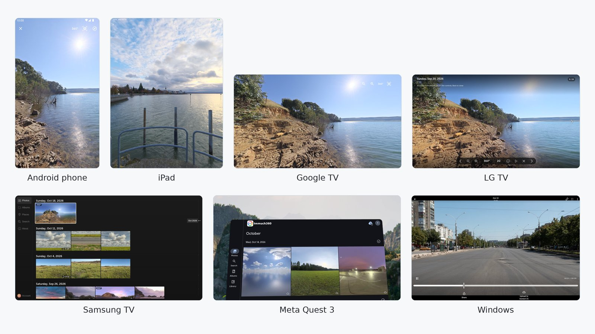

### ಪ್ರತಿ ಪರದೆ ಏನು ಮಾಡುತ್ತದೆ

ಫೋನ್‌ಗಳು, ಟ್ಯಾಬ್ಲೆಟ್‌ಗಳು, Android TV, Meta Quest ಮತ್ತು ಕಂಪ್ಯೂಟರ್‌ಗಳಿಗೆ ಒಂದು ಕೋಡ್ ಬೇಸ್, ಮತ್ತು LG TVಗಳಿಗಾಗಿ ಪ್ರತ್ಯೇಕ TV ಅಪ್ಲಿಕೇಶನ್, Samsung TVಗಳಿಗಾಗಿ ಪರೀಕ್ಷಾ build ಆಗಿಯೂ ಪ್ಯಾಕೇಜ್ ಮಾಡಲಾಗಿದೆ. ಪ್ರತಿಯೊಂದೂ ಇಂದು ಏನು ಹೊಂದಿದೆ:

| ಸಾಮರ್ಥ್ಯ | Android | iPhone, iPad | Android TV | LG webOS | Samsung Tizen | Quest |
|---|:---:|:---:|:---:|:---:|:---:|:---:|
| Immich ಸರ್ವರ್‌ನೊಂದಿಗೆ ಗ್ಯಾಲರಿ, ಆಲ್ಬಮ್‌ಗಳು, ಹುಡುಕಾಟ | ✅ | ✅ | ✅ ವೀಕ್ಷಕ | ✅ ವೀಕ್ಷಕ | ✅ ವೀಕ್ಷಕ | ✅ |
| ನಿಮ್ಮ ಫೋನ್‌ನೊಂದಿಗೆ ಸೈನ್ ಇನ್ (QR ಕೋಡ್) | ✅ ಕೋಡ್ ಸ್ಕ್ಯಾನ್ ಮಾಡುತ್ತದೆ | 🔜 ಮುಂದಿನ iOS ರಿಲೀಸ್ | ✅ | ✅ ಫೋನ್‌ನ ಬ್ರೌಸರ್‌ನಲ್ಲಿ | ❌ TV ಯಲ್ಲಿ ಟೈಪ್ ಮಾಡಿ | ✅ ಫೋನ್‌ನಲ್ಲಿ ಕೋಡ್ ಟೈಪ್ ಮಾಡಲಾಗುತ್ತದೆ |
| ಸರ್ವರ್ ಇಲ್ಲದೆ: ಡಿವೈಸ್‌ನ ಸ್ವಂತ ಮಾಧ್ಯಮ | ✅ | ✅ | ಹಂಚಿಕೆಗಳು ಮಾತ್ರ | ❌ | ❌ | ✅ |
| ಫ್ಲಾಟ್ ಫೋಟೋಗಳು ಮತ್ತು ವೀಡಿಯೊಗಳು | ✅ | ✅ | ✅ | ✅ | ✅ | ✅ |
| ಒಂದೇ ಕೀಯಿಂದ ಫೋಟೋ ತಿರುಗಿಸಿ | ✅ | ✅ | ✅ ಬಣ್ಣದ ಕೀಗಳು | ✅ ಬಣ್ಣದ ಕೀಗಳು | ✅ | ✅ ವಿಂಡೋ |
| ಗೋಳವಾಗಿ 360° ಫೋಟೋಗಳು | ✅ | ✅ | ✅ | ✅ | ✅ | ✅ ಇಮ್ಮರ್ಸಿವ್ |
| 360° ವೀಡಿಯೊಗಳು | ✅ | ✅ ಟೈಮ್ ಬಾರ್ ಇಲ್ಲ | ✅ ಡಿಕೋಡ್ ಆಗದಿದ್ದರೆ ಸಂದೇಶ | ಫ್ಲಾಟ್ ಮಾತ್ರ | ಫ್ಲಾಟ್ ಮಾತ್ರ | ✅ ಇಮ್ಮರ್ಸಿವ್ |
| 3D ಮತ್ತು VR180 | ✅ ಒಂದು ಕಣ್ಣು | ✅ ಒಂದು ಕಣ್ಣು | ✅ ಒಂದು ಕಣ್ಣು | ಫೋಟೋಗಳು ಒಂದು ಕಣ್ಣು, ವೀಡಿಯೊಗಳು ಫ್ಲಾಟ್ | ಫೋಟೋಗಳು ಒಂದು ಕಣ್ಣು, ವೀಡಿಯೊಗಳು ಫ್ಲಾಟ್ | ✅ ನಿಜವಾದ 3D |
| Spatial 2.5D (ತಲೆ ಟ್ರ್ಯಾಕಿಂಗ್) | ✅ ಪ್ರಯೋಗಾತ್ಮಕ | ✅ ಪ್ರಯೋಗಾತ್ಮಕ | ❌ | ❌ | ❌ | ❌ |
| Apple spatial ಫೋಟೋಗಳು | ✅ ಒಂದು ಕಣ್ಣು | ✅ ಒಂದು ಕಣ್ಣು | ✅ ಒಂದು ಕಣ್ಣು | ❌ | ❌ | ✅ 3D |
| 2D ಫೋಟೋದಿಂದ 3D ಫೋಟೋ (AI) | ✅ ಓದುತ್ತದೆ, ಅಕ್ಕಪಕ್ಕ | ✅ ಓದುತ್ತದೆ, ಅಕ್ಕಪಕ್ಕ | ✅ ಓದುತ್ತದೆ, ಅಕ್ಕಪಕ್ಕ | ✅ ಓದುತ್ತದೆ, ಅಕ್ಕಪಕ್ಕ | ✅ ಓದುತ್ತದೆ, ಅಕ್ಕಪಕ್ಕ | ✅ ಹೆಡ್‌ಸೆಟ್‌ನಲ್ಲಿ AI ಆಳ (Quest 3 ಮತ್ತು 3S), 3D ಯಲ್ಲಿ ತೋರಿಸಲಾಗುತ್ತದೆ |
| 2D ಫೋಟೋದಿಂದ 3D ದೃಶ್ಯ (AI) | ✅ ಓದುತ್ತದೆ, ಅದರ ಫೋಟೋವಾಗಿ | ✅ ಓದುತ್ತದೆ, ಅದರ ಫೋಟೋವಾಗಿ | ✅ ಓದುತ್ತದೆ, ಅದರ ಫೋಟೋವಾಗಿ | ✅ ಓದುತ್ತದೆ, ಅದರ ಫೋಟೋವಾಗಿ | ✅ ಓದುತ್ತದೆ, ಅದರ ಫೋಟೋವಾಗಿ | ✅ 3D ಯಲ್ಲಿ ಅನ್ವೇಷಿಸಲಾಗುತ್ತದೆ |
| 2D ಫೋಟೋದಿಂದ 360° ಪನೋರಮಾ (AI) | ✅ ಓದುತ್ತದೆ, ಅದರ AI ಲೇಬಲ್‌ನೊಂದಿಗೆ | ✅ 360° ಫೋಟೋವಾಗಿ ಓದುತ್ತದೆ, ಲೇಬಲ್ 🔜 | ✅ ಓದುತ್ತದೆ, ಅದರ AI ಲೇಬಲ್‌ನೊಂದಿಗೆ | ✅ 360° ಫೋಟೋವಾಗಿ ಓದುತ್ತದೆ, ಲೇಬಲ್ 🔜 | ✅ 360° ಫೋಟೋವಾಗಿ ಓದುತ್ತದೆ, ಲೇಬಲ್ 🔜 | ✅ ನಿಮ್ಮ ಸುತ್ತಲೂ ಓದುತ್ತದೆ, ಅದರ AI ಲೇಬಲ್‌ನೊಂದಿಗೆ |
| ರಾ Insta360, GoPro ಮತ್ತು DJI ಫೈಲ್‌ಗಳು | ✅ | ✅ | ✅ | ❌ | ❌ | ✅ |
| SMB, WebDAV, DLNA ಹಂಚಿಕೆಗಳು | ✅ | ✅ | ✅ | ✅ SMB webOS 22 ರಿಂದ | ❌ | ✅ |
| Plex Media Server | ✅ | ✅ | ✅ | ✅ | ❌ | ✅ |
| Tapo ಕ್ಯಾಮೆರಾಗಳು: ರೆಕಾರ್ಡಿಂಗ್‌ಗಳು | ✅ | ✅ | ✅ | 🔜 ಡಿಸೆಂಬರ್ 2026 ಕ್ಕಿಂತ ಮೊದಲು ಅಲ್ಲ | ❌ | ✅ |
| Tapo ಕ್ಯಾಮೆರಾಗಳು: ಲೈವ್ ವೀಕ್ಷಣೆ | ✅ | 🔜 ಮುಂದಿನ iOS ರಿಲೀಸ್ | ✅ | ✅ ವೀಡಿಯೊ ಮಾತ್ರ | ❌ | ✅ |
| ಈ ಡಿವೈಸ್ ಅನ್ನು ನೆಟ್‌ವರ್ಕ್‌ನಲ್ಲಿ ಹಂಚಿಕೊಳ್ಳಿ | ✅ | ✅ | ❌ | ❌ | ❌ | ❌ |
| ಹಂಚಿಕೆಗಳು ಮತ್ತು ಡಿವೈಸ್‌ನಿಂದ Immich ಗೆ ಅಪ್‌ಲೋಡ್ | ✅ | ✅ | ❌ | ❌ | ❌ | ✅ |
| USB ಮೂಲಕ DJI ಡ್ರೋನ್ ಅಥವಾ ಕಾರ್ಡ್‌ನಿಂದ ಆಮದು (ಪ್ರಯೋಗಾತ್ಮಕ) | ✅ | ❌ | ❌ | ❌ | ❌ | ❌ |
| DJI ಡ್ರೋನ್‌ನ ಲೈವ್ ವೀಡಿಯೊ (ಪ್ರಯೋಗಾತ್ಮಕ) | ✅ RC-N3 ಜೊತೆಗೆ | ❌ | ✅ ಫೋನ್‌ನಿಂದ ರಿಲೇ | ❌ | ❌ | ✅ ಫೋನ್‌ನಿಂದ ರಿಲೇ |
| ಡಾರ್ಕ್ ಥೀಮ್ | ಸಿಸ್ಟಮ್‌ನಂತೆ | ಸಿಸ್ಟಮ್‌ನಂತೆ | ✅ ಡೀಫಾಲ್ಟ್ ಆಗಿ | ✅ ಏಕೈಕ ಥೀಮ್ | ✅ ಏಕೈಕ ಥೀಮ್ | ಸಿಸ್ಟಮ್‌ನಂತೆ |
| ಇನ್‌ಪುಟ್ | ಸ್ಪರ್ಶ, ಗೈರೋಸ್ಕೋಪ್ | ಸ್ಪರ್ಶ, ಗೈರೋಸ್ಕೋಪ್ | ರಿಮೋಟ್; ವೀಡಿಯೊ ಸಮಯದಲ್ಲಿ ಮತ್ತು ಅದರ ಟೈಮ್ ಬಾರ್‌ನಲ್ಲೂ ಎಡ ಮತ್ತು ಬಲ, ವಿವರಗಳಿಗಾಗಿ Menu | ರಿಮೋಟ್, Magic Remote | ರಿಮೋಟ್ | ಕಂಟ್ರೋಲರ್‌ಗಳು, ಕೈಗಳು |
| ಎಲ್ಲಿ ಪಡೆಯಬೇಕು | Google Play, APK | App Store (ಪರಿಶೀಲನೆಯಲ್ಲಿ) | APK, Google Play (ಪರಿಶೀಲನೆಯಲ್ಲಿ) | .ipk, LG Content Store (ಪರಿಶೀಲನೆಯಲ್ಲಿ) | .wgt ಪರೀಕ್ಷಾ build, ನೀವೇ ಸೈನ್ ಮಾಡಿದ್ದು | Horizon Store, APK |

| ಸಾಮರ್ಥ್ಯ | Windows | Linux | macOS |
|---|:---:|:---:|:---:|
| Immich ಸರ್ವರ್‌ನೊಂದಿಗೆ ಗ್ಯಾಲರಿ, ಆಲ್ಬಮ್‌ಗಳು, ಹುಡುಕಾಟ | ✅ | ✅ | ✅ |
| ನಿಮ್ಮ ಫೋನ್‌ನೊಂದಿಗೆ ಸೈನ್ ಇನ್ (QR ಕೋಡ್) | ✅ | ✅ (ಅದರ ವೆಬ್ ಪುಟವನ್ನು ಪ್ರಯತ್ನಿಸಲಾಗಿದೆ) | ✅ (ಯಾವ ರೀತಿಯಲ್ಲಿ ಎಂದು ದಾಖಲಿಸಿಲ್ಲ) |
| ಸರ್ವರ್ ಇಲ್ಲದೆ: ಡಿವೈಸ್‌ನ ಸ್ವಂತ ಮಾಧ್ಯಮ | ✅ ಫೋಲ್ಡರ್‌ಗಳು | ✅ ಫೋಲ್ಡರ್‌ಗಳು | ✅ ಫೋಲ್ಡರ್‌ಗಳು |
| ಫ್ಲಾಟ್ ಫೋಟೋಗಳು ಮತ್ತು ವೀಡಿಯೊಗಳು | ✅ | ✅ | ✅ |
| ಒಂದೇ ಕೀಯಿಂದ ಫೋಟೋ ತಿರುಗಿಸಿ | ✅ | ✅ | ✅ |
| ಗೋಳವಾಗಿ 360° ಫೋಟೋಗಳು | ✅ | ✅ | ✅ |
| 360° ವೀಡಿಯೊಗಳು | ✅ | ಫ್ಲಾಟ್ ಮಾತ್ರ | ಫ್ಲಾಟ್ ಮಾತ್ರ |
| 3D ಮತ್ತು VR180 | ✅ ಒಂದು ಕಣ್ಣು | ಫೋಟೋಗಳು ಒಂದು ಕಣ್ಣು, ವೀಡಿಯೊಗಳು ಫ್ಲಾಟ್ | ಫೋಟೋಗಳು ಒಂದು ಕಣ್ಣು, ವೀಡಿಯೊಗಳು ಫ್ಲಾಟ್ |
| Spatial 2.5D (ತಲೆ ಟ್ರ್ಯಾಕಿಂಗ್) | 🔜 ಅಭಿವೃದ್ಧಿಯಲ್ಲಿದೆ | ❌ | ❌ |
| Apple spatial ಫೋಟೋಗಳು | ✅ ಒಂದು ಕಣ್ಣು | ✅ ಒಂದು ಕಣ್ಣು, ಸರ್ವರ್‌ನಿಂದ | ✅ ಒಂದು ಕಣ್ಣು |
| 2D ಫೋಟೋದಿಂದ 3D ಫೋಟೋ (AI) | ✅ | ✅ | ✅ ಇನ್ನೂ Mac ನಲ್ಲಿ ಪ್ರಯತ್ನಿಸಿಲ್ಲ |
| 2D ಫೋಟೋದಿಂದ 3D ದೃಶ್ಯ (AI) | ✅ | ✅ | ✅ ಇನ್ನೂ Mac ನಲ್ಲಿ ಪ್ರಯತ್ನಿಸಿಲ್ಲ |
| 2D ಫೋಟೋದಿಂದ 360° ಪನೋರಮಾ (AI) | ✅ 8 GB ಗ್ರಾಫಿಕ್ಸ್ ಕಾರ್ಡ್ | ✅ 8 GB ಗ್ರಾಫಿಕ್ಸ್ ಕಾರ್ಡ್, ಇನ್ನೂ ಅಂತಹ ಕಾರ್ಡ್‌ನೊಂದಿಗೆ ಪ್ರಯತ್ನಿಸಿಲ್ಲ | 🔜 ಇನ್ನೂ Mac ನಲ್ಲಿ ಇಲ್ಲ |
| ರಾ Insta360, GoPro ಮತ್ತು DJI ಫೈಲ್‌ಗಳು | ✅ | ✅ ಫೋಟೋಗಳು, ವೀಡಿಯೊಗಳು ಫ್ಲಾಟ್ | ✅ ಫೋಟೋಗಳು, ವೀಡಿಯೊಗಳು ಫ್ಲಾಟ್ |
| SMB, WebDAV, DLNA ಹಂಚಿಕೆಗಳು | ✅ | ✅ | ✅ |
| Plex Media Server | ✅ | 🔧 CI | 🔧 CI |
| Tapo ಕ್ಯಾಮೆರಾಗಳು: ರೆಕಾರ್ಡಿಂಗ್‌ಗಳು | ✅ | 🔧 CI | 🔧 CI |
| Tapo ಕ್ಯಾಮೆರಾಗಳು: ಲೈವ್ ವೀಕ್ಷಣೆ | ✅ | 🔧 CI | 🔧 CI |
| ಈ ಡಿವೈಸ್ ಅನ್ನು ನೆಟ್‌ವರ್ಕ್‌ನಲ್ಲಿ ಹಂಚಿಕೊಳ್ಳಿ | ✅ | ❌ | ❌ |
| ಹಂಚಿಕೆಗಳು ಮತ್ತು ಡಿವೈಸ್‌ನಿಂದ Immich ಗೆ ಅಪ್‌ಲೋಡ್ | ✅ | ✅ | ✅ |
| USB ಮೂಲಕ DJI ಡ್ರೋನ್ ಅಥವಾ ಕಾರ್ಡ್‌ನಿಂದ ಆಮದು (ಪ್ರಯೋಗಾತ್ಮಕ) | ❌ | ❌ | ❌ |
| DJI ಡ್ರೋನ್‌ನ ಲೈವ್ ವೀಡಿಯೊ (ಪ್ರಯೋಗಾತ್ಮಕ) | ❌ | ❌ | ❌ |
| ಡಾರ್ಕ್ ಥೀಮ್ | ಸಿಸ್ಟಮ್‌ನಂತೆ | ಸಿಸ್ಟಮ್‌ನಂತೆ | ಸಿಸ್ಟಮ್‌ನಂತೆ |
| ಇನ್‌ಪುಟ್ | ಮೌಸ್, ಕೀಬೋರ್ಡ್ | ಮೌಸ್, ಕೀಬೋರ್ಡ್ | ಮೌಸ್, ಕೀಬೋರ್ಡ್, ಟ್ರ್ಯಾಕ್‌ಪ್ಯಾಡ್ |
| ಅದನ್ನು ಎಲ್ಲಿ ಪಡೆಯುವುದು | ಇನ್‌ಸ್ಟಾಲರ್ ಅಥವಾ ZIP (ಸೈನ್ ಮಾಡಿದ ಪೂರ್ವವೀಕ್ಷಣೆ) | .deb, .rpm (ಪೂರ್ವವೀಕ್ಷಣೆ) | DMG ಅಥವಾ ZIP (ಸೈನ್ ಮಾಡದ ಪೂರ್ವವೀಕ್ಷಣೆ) |

*Linux ಮತ್ತು macOS: desktop build 11, 26 ಅಕ್ಟೋಬರ್ 2026 ರಂದು Ubuntu 24.04 ನಲ್ಲಿ, ಪರೀಕ್ಷಾ Immich ಸರ್ವರ್ ಮತ್ತು ಪರೀಕ್ಷಾ ಹಂಚಿಕೆಗಳಿರುವ ಕಂಟೇನರ್‌ನಲ್ಲಿ ಪ್ರಯತ್ನಿಸಲಾಗಿದೆ, ಮತ್ತು ಲೇಖಕರು ಒಂದು Mac ನಲ್ಲಿ ಪ್ರಯತ್ನಿಸಿದ್ದಾರೆ. AI ಸಾಲುಗಳು, desktop build 13 ರ ಕೋಡ್‌ನ ಪರೀಕ್ಷಾ build ಗಳೊಂದಿಗೆ, 27 ರಿಂದ 29 ಅಕ್ಟೋಬರ್ 2026 ರವರೆಗೆ: 3D ಫೋಟೋಗಳನ್ನು Linux PC ಯಲ್ಲಿನ ಕಂಟೇನರ್‌ನಲ್ಲಿ Linux ಅಪ್ಲಿಕೇಶನ್ ಮಾಡಿತು, ದೃಶ್ಯಗಳನ್ನು RTX 4060 ಇರುವ ಲ್ಯಾಪ್‌ಟಾಪ್‌ನಲ್ಲಿ Windows ಅಪ್ಲಿಕೇಶನ್ ಮತ್ತು ಅದೇ Linux PC ಯಲ್ಲಿ ಎಂಜಿನ್ ಮಾಡಿತು, 360° ಪನೋರಮಾಗಳನ್ನು ಆ ಲ್ಯಾಪ್‌ಟಾಪ್‌ನಲ್ಲಿ; ಇನ್ನೂ Mac ನಲ್ಲಿ ಪ್ರಯತ್ನಿಸಿಲ್ಲ.*

✅ ಆ ಪ್ಲಾಟ್‌ಫಾರ್ಮ್‌ನ ಅಪ್ಲಿಕೇಶನ್‌ನಲ್ಲಿ · ❌ ಅಲ್ಲಿ ಲಭ್ಯವಿಲ್ಲ · 🔜 ಯೋಜಿಸಲಾಗಿದೆ · 🔧 CI ಸೋರ್ಸ್‌ಗಳಲ್ಲಿ, ಆ ಸಿಸ್ಟಮ್‌ನಲ್ಲಿ ಯೋಜನೆಯ CI ಯಿಂದ build ಮಾಡಿ ಪ್ರಾರಂಭಿಸಲಾಗಿದೆ, ಅಲ್ಲಿ ಇನ್ನೂ ನಿಜವಾದ ಸರ್ವರ್, ಹಂಚಿಕೆ ಅಥವಾ ಕ್ಯಾಮೆರಾದೊಂದಿಗೆ ಪರಿಶೀಲಿಸಿಲ್ಲ · ಫ್ಲಾಟ್ ಮಾತ್ರ: ವೀಡಿಯೊ ಸಂದೇಶದೊಂದಿಗೆ ಫ್ಲಾಟ್ ಆಗಿ ಪ್ಲೇ ಆಗುತ್ತದೆ, ಏಕೆಂದರೆ ಕಂಪ್ಯೂಟರ್‌ಗಳ 360° ವೀಡಿಯೊ ರೆಂಡರರ್ Windows ನಲ್ಲಿ ಮಾತ್ರ ಇದೆ; LG TVಗಳಲ್ಲಿ, webOS ವೀಡಿಯೊ ಫ್ರೇಮ್‌ಗಳನ್ನು ಗೋಳಕ್ಕೆ ನೀಡುತ್ತದೆಯೇ ಎಂದು ಇನ್ನೂ ಅಳೆಯಬೇಕಿದೆ; ಒಬ್ಬ ಪರೀಕ್ಷಕರ Samsung TV ಯಲ್ಲಿ, ಬ್ರೌಸರ್ 3D ವೀಕ್ಷಣೆಗೆ ಕಪ್ಪು ವೀಡಿಯೊ ಫ್ರೇಮ್‌ಗಳನ್ನು ನೀಡಿತು. "ಒಂದು ಕಣ್ಣು" ಎಂದರೆ 3D ಫೈಲ್ ಫ್ಲಾಟ್ ಪರದೆಯಲ್ಲಿ ತನ್ನ ಎಡ ಕಣ್ಣನ್ನು ತೋರಿಸುತ್ತದೆ. LG ಮತ್ತು Samsung ಕಾಲಂಗಳು ಒಂದೇ ಪ್ರತ್ಯೇಕ TV ಅಪ್ಲಿಕೇಶನ್: LG ಆವೃತ್ತಿ 1.0.0, ಅದರ ಹಂಚಿಕೆಗಳು ಮತ್ತು Plex ನಿಜವಾದ ಸರ್ವರ್‌ಗಳ ವಿರುದ್ಧ ಮತ್ತು ಕ್ಯಾಮೆರಾಗಳು ಯೋಜನೆಯ build ಹೋಸ್ಟ್‌ನಲ್ಲಿ ಸಿಮ್ಯುಲೇಟೆಡ್ ಕ್ಯಾಮೆರಾದ ವಿರುದ್ಧ ಪರಿಶೀಲಿಸಲಾಗಿದೆ, ಇನ್ನೂ TV ಯಲ್ಲಿ ಅಲ್ಲ, ಮತ್ತು Samsung ಪರೀಕ್ಷಾ build 0.2.0. ಪ್ರತಿ ✅ ಇನ್ನೂ ನಿಜವಾದ ಡಿವೈಸ್‌ನಲ್ಲಿ ಪರಿಶೀಲಿಸಲ್ಪಟ್ಟಿಲ್ಲ: ಏನನ್ನು ಎಲ್ಲಿ ಪರಿಶೀಲಿಸಲಾಗಿದೆ, ಮತ್ತು ಏನು ಖಚಿತಪಡಿಸಬೇಕಿದೆ, ಎಂಬುದು [ವೈಶಿಷ್ಟ್ಯಗಳು](../docs/immuch360/features.md), [ಪ್ಲಾಟ್‌ಫಾರ್ಮ್ ಬೆಂಬಲ](../docs/immuch360/platform-support.md) ಮತ್ತು [ಹೊಂದಾಣಿಕೆ](../docs/immuch360/compatibility.md) ನಲ್ಲಿದೆ.

AI ಸಾಲುಗಳಲ್ಲಿ, "ಓದುತ್ತದೆ" ಎಂದರೆ ಡಿವೈಸ್ ಕಂಪ್ಯೂಟರ್ ಮಾಡಿದ್ದನ್ನು ತೆರೆಯುತ್ತದೆ, ಮತ್ತು ತಾನೇ ಏನನ್ನೂ ಮಾಡುವುದಿಲ್ಲ: 3D ಫೋಟೋ ತನ್ನ ಎರಡು ಕಣ್ಣುಗಳನ್ನು ಅಕ್ಕಪಕ್ಕ ತೋರಿಸುತ್ತದೆ, ದೃಶ್ಯವು ಸಣ್ಣ 3D ದೃಶ್ಯ ಗುರುತಿನೊಂದಿಗೆ ತನ್ನ ಫೋಟೋವಾಗಿ ಕಾಣುತ್ತದೆ, ಪನೋರಮಾ 360° ವೀಕ್ಷಕದಲ್ಲಿ ತೆರೆಯುತ್ತದೆ. ಅದರ AI ಲೇಬಲ್ ಎಂದರೆ "AI 360°" ಬ್ಯಾಡ್ಜ್, "ಫೋಟೋದ ಅಂಚುಗಳ ಆಚೆಗೆ AI ರಚಿಸಿದೆ" ಎಂಬ ವಾಕ್ಯ ಮತ್ತು ಮೂಲ ಫೋಟೋದ ಗೆರೆ, ಇವುಗಳನ್ನು iPhone, iPad, LG ಮತ್ತು Samsung ಅಪ್ಲಿಕೇಶನ್‌ಗಳು ಇನ್ನೂ ತೋರಿಸುವುದಿಲ್ಲ. ಕಂಪ್ಯೂಟರ್‌ಗಳು ಮತ್ತು Quest ಮಾತ್ರ ಏನನ್ನಾದರೂ ಮಾಡುತ್ತವೆ. ಈ ಸಾಲುಗಳಿಗೆ ಏನು ಪರಿಶೀಲಿಸಲಾಗಿದೆ ಎಂಬುದು [ಮಾರ್ಗದರ್ಶಿಯಲ್ಲಿ](#turn-one-photo-into-3d-a-scene-a-panorama) ಇದೆ, ಇನ್ನೂ Features ಮತ್ತು Platform support ನಲ್ಲಿ ಇಲ್ಲ.

- **Android ಫೋನ್‌ಗಳು ಮತ್ತು ಟ್ಯಾಬ್ಲೆಟ್‌ಗಳು**: ಸಂಪೂರ್ಣ ಅಪ್ಲಿಕೇಶನ್, ಟಚ್ ಮತ್ತು ಜೈರೋಸ್ಕೋಪ್, ಪ್ರತಿ ಮೂಲ; build 32 ರಿಂದ ಅವು ಕಂಪ್ಯೂಟರ್‌ನಲ್ಲಿ ಮಾಡಿದ 360° ಪನೋರಮಾಗಳನ್ನು ಅವುಗಳ AI ಲೇಬಲ್‌ನೊಂದಿಗೆ ತೆರೆಯುತ್ತವೆ.
- **iPhone ಮತ್ತು iPad**: ಸಂಪೂರ್ಣ ಅಪ್ಲಿಕೇಶನ್; 360° ವೀಡಿಯೊ ಪ್ಲೇಯರ್‌ಗೆ play ಮತ್ತು pause ಮಾತ್ರ ಇದೆ, Tapo ಲೈವ್ ವೀಕ್ಷಣೆ ಮತ್ತು ನಿಮ್ಮ ಫೋನ್‌ನೊಂದಿಗೆ ಸೈನ್ ಇನ್‌ನ ಫೋನ್ ಕಡೆಯ ಭಾಗ ಮುಂದಿನ iOS ರಿಲೀಸ್‌ನೊಂದಿಗೆ ಬರುತ್ತವೆ, ಮತ್ತು Apple multicast entitlement ನೀಡುವವರೆಗೆ DLNA ಹುಡುಕಾಟ unicast ಕೋರಿಕೆಗಳನ್ನು ಕಳುಹಿಸುತ್ತದೆ.
- **Android TV ಮತ್ತು Google TV**: ಅದೇ APK, ರಿಮೋಟ್‌ನಿಂದ ಚಾಲಿತ, ಡೀಫಾಲ್ಟ್ ಆಗಿ ಡಾರ್ಕ್; ಒಂದು ವೀಕ್ಷಕ: ಬ್ಯಾಕಪ್, ಅಪ್‌ಲೋಡ್‌ಗಳು ಮತ್ತು ಎಡಿಟರ್ ಮುಚ್ಚಿಡಲಾಗಿದೆ ಮತ್ತು ವಿವರಗಳು ಓದಲು ಮಾತ್ರ, ಆದರೆ ಫೋಟೋ ಇನ್ನೂ ಒಂದೇ ಕೀಯಿಂದ ತಿರುಗುತ್ತದೆ. ಪ್ರತಿ ಹುಡುಕಾಟ ಫಿಲ್ಟರ್ ರಿಮೋಟ್‌ನೊಂದಿಗೆ ಕೆಲಸ ಮಾಡುತ್ತದೆ: Location ಮತ್ತು Camera ತಮ್ಮ ಆಯ್ಕೆಗಳನ್ನು ಪಟ್ಟಿಯಲ್ಲಿ ತೆರೆಯುತ್ತವೆ, ದಿನಾಂಕ ಫಿಲ್ಟರ್ ತನ್ನ ಎಲ್ಲಾ ಆಯ್ಕೆಗಳನ್ನು ತೋರಿಸುತ್ತದೆ, ಮತ್ತು Tags, Location, Date, Media Type, Star Rating ಮತ್ತು Display options ಶೀಟ್‌ಗಳು Clear ಮತ್ತು Apply ಅನ್ನು ಆಯ್ಕೆಗಳ ಪಕ್ಕದಲ್ಲಿ ಇಡುತ್ತವೆ, ಒಂದು Right ದೂರದಲ್ಲಿ, ಪರದೆಯ ಹೆಚ್ಚಿನ ಎತ್ತರದಲ್ಲಿ. ಫೋಟೋ ಗ್ರಿಡ್ ಕಡಿಮೆ ಚಿತ್ರ ಮೆಮೊರಿ ಬಳಸುತ್ತದೆ, ಮತ್ತು ಒತ್ತಿ ಹಿಡಿದ ಬಾಣ ಅದನ್ನು ಸೆಕೆಂಡಿಗೆ ಗರಿಷ್ಠ ಸುಮಾರು 10 ಸಾಲುಗಳು ಸರಿಸುತ್ತದೆ. build 28 ರಿಂದ ಇದು ಫೋನ್‌ನಿಂದ ಸೈನ್ ಇನ್ ಆಗುತ್ತದೆ, ಅದರ QR ಕೋಡ್ ಅಥವಾ ಅದರ ಚಿಕ್ಕ ಕೋಡ್‌ನಿಂದ (ಎರಡು ಎಮ್ಯುಲೇಟರ್‌ಗಳ ನಡುವೆ ಕೋಡ್ ಟೈಪ್ ಮಾಡಿ ಪ್ರಯತ್ನಿಸಲಾಗಿದೆ, ಇನ್ನೂ ಕ್ಯಾಮೆರಾದೊಂದಿಗೆ ಅಲ್ಲ). build 29 ರಿಂದ ವೀಡಿಯೊದ ಟೈಮ್ ಬಾರ್ ರಿಮೋಟ್‌ನ ಫೋಕಸ್ ಪಡೆಯುತ್ತದೆ, ಚಲನಚಿತ್ರಗಳಿಗೆ ಆಡಿಯೋ ಮತ್ತು ಉಪಶೀರ್ಷಿಕೆ ಮೆನುಗಳು ಸಿಗುತ್ತವೆ, ಮತ್ತು ಹಂಚಿಕೆಯ ಮುಂದಿನ ಫೈಲ್ ತನ್ನದೇ ನಿಯಂತ್ರಣಗಳೊಂದಿಗೆ ತೆರೆಯುತ್ತದೆ. Google TV ಎಮ್ಯುಲೇಟರ್‌ನಲ್ಲಿ ಪರಿಶೀಲಿಸಲಾಗಿದೆ; build 28 23 ಅಕ್ಟೋಬರ್‌ರಂದು ನಿಜವಾದ Android TV ಯಲ್ಲಿ ಚಲಿಸಿತು, ಮತ್ತು ಅಲ್ಲಿ ಕಂಡುಬಂದ ವೀಡಿಯೊ ಸಮಸ್ಯೆಗಳು build 29 ರ ಸರಿಪಡಿಸುವಿಕೆಗಳು, ಎಮ್ಯುಲೇಟರ್‌ನಲ್ಲಿ ಪರಿಶೀಲಿಸಲಾಗಿದೆ, ಇನ್ನೂ ಆ TV ಯಲ್ಲಿ ಅಲ್ಲ. build 30 ರಿಂದ, ಅದರ Drone ಕಾರ್ಡ್ ಫೋನ್ ರಿಲೇ ಮಾಡುವ DJI ಡ್ರೋನ್‌ನ ಲೈವ್ ವೀಡಿಯೊವನ್ನು ತೋರಿಸುತ್ತದೆ, ಡ್ರೋನ್‌ನ ಮೌಲ್ಯಗಳು ಮತ್ತು ಅಡಚಣೆ ಉಂಗುರದೊಂದಿಗೆ (ಪ್ರಯೋಗಾತ್ಮಕ): ಜೋಡಣೆ ಮತ್ತು ಚಿತ್ರವನ್ನು 25 ಅಕ್ಟೋಬರ್‌ರಂದು TCL Android TV ಯಲ್ಲಿ ಪ್ರಯತ್ನಿಸಲಾಯಿತು, ಹಿಂದಿನ ರಿಲೇಯಲ್ಲಿ ತಡೆತಡೆ ಮತ್ತು ಹಸಿರು ಛಾಯೆಯೊಂದಿಗೆ; 26 ಅಕ್ಟೋಬರ್‌ರಂದು, build 30 ನೊಂದಿಗೆ, ಅದಕ್ಕೆ ಉತ್ತರವಾದ ಸ್ಥಿರ ಸ್ಟ್ರೀಮ್ ಹಾರಾಟದಲ್ಲಿ ಆ TV ಯ ಚಿತ್ರವನ್ನು ಬರುತ್ತಲೇ ಇರಿಸಿತು, 7 ಸ್ಥಗಿತಗಳೊಂದಿಗೆ.
- **webOS 5.0 ಮತ್ತು ನಂತರದ ಆವೃತ್ತಿಯ LG TVಗಳು**: ರಿಮೋಟ್ ಮತ್ತು Magic Remote ಗಾಗಿ ಪ್ರತ್ಯೇಕ ಅಪ್ಲಿಕೇಶನ್, [immich-tv-webos](https://github.com/Seeky91/immich-tv-webos) ಮೇಲೆ ನಿರ್ಮಿತ: ಗೋಳದ ಮೇಲೆ 360° ಫೋಟೋಗಳೊಂದಿಗೆ ಒಂದು Immich ವೀಕ್ಷಕ, ಒಂದೇ ಕೀಯಿಂದ ತಿರುಗಿಸಿದ ಫೋಟೋ, ಡಾರ್ಕ್ ಥೀಮ್ ಮತ್ತು ಅಪ್ಲಿಕೇಶನ್‌ನ 89 ಭಾಷೆಗಳು (TV ಅಪ್ಲಿಕೇಶನ್‌ನ ಸ್ವಂತ ಕೆಲವು ಪಠ್ಯಗಳು ಸದ್ಯಕ್ಕೆ ಇಂಗ್ಲಿಷ್‌ನಲ್ಲಿ); ನೆಟ್‌ವರ್ಕ್ ಹಂಚಿಕೆಗಳು, Plex ಮತ್ತು Tapo ಕ್ಯಾಮೆರಾಗಳ ಲೈವ್ ವೀಕ್ಷಣೆ, TV ಯಲ್ಲಿನ ಅದರ ಸ್ವಂತ ಸೇವೆಯ ಮೂಲಕ (SMB webOS 22 ರಿಂದ); 360° ವೀಡಿಯೊಗಳು ಫ್ಲಾಟ್. ಆವೃತ್ತಿ 1.0.0, 24 ಅಕ್ಟೋಬರ್‌ರಂದು LG Content Store ಗೆ ಸಲ್ಲಿಸಲಾಗಿದೆ, LG ನ Cloud Test Lab ನಲ್ಲಿ ಮೂರು ಮಾದರಿಗಳ webOS 25 TVಗಳಲ್ಲಿ ಚಲಿಸಿತು: ಸೈನ್ ಇನ್, ಫೋನ್ ಸೈನ್ ಇನ್ ಪುಟ, ಫೋಟೋಗಳು, ಆಲ್ಬಮ್‌ಗಳು, ಒಂದು ವೀಡಿಯೊ, 360° ವೀಕ್ಷಣೆ, ಸ್ಲೈಡ್‌ಶೋ, ಒಂದು ಹುಡುಕಾಟ ಮತ್ತು ಪ್ರತಿ ಪುಟದಿಂದ Back. ಆವೃತ್ತಿ 0.1.0 ಒಬ್ಬ ಪರೀಕ್ಷಕರ LG TV ಯಲ್ಲಿ (webOS 22) ಚಲಿಸಿತು. ಹಂಚಿಕೆಗಳು ಮತ್ತು Plex ಅನ್ನು ನಿಜವಾದ ಸರ್ವರ್‌ಗಳ ವಿರುದ್ಧ ಮತ್ತು ಕ್ಯಾಮೆರಾಗಳನ್ನು ಯೋಜನೆಯ build ಹೋಸ್ಟ್‌ನಲ್ಲಿ ಸಿಮ್ಯುಲೇಟೆಡ್ ಕ್ಯಾಮೆರಾದ ವಿರುದ್ಧ ಪರಿಶೀಲಿಸಲಾಗಿದೆ, ಇನ್ನೂ TV ಯಲ್ಲಿ ಅಲ್ಲ.
- **Tizen 5.5 ಮತ್ತು ನಂತರದ ಆವೃತ್ತಿಯ Samsung TVಗಳು**: Samsung TVಗಳಿಗಾಗಿ ಪ್ಯಾಕೇಜ್ ಮಾಡಿದ LG TV ಅಪ್ಲಿಕೇಶನ್, ಪರೀಕ್ಷಾ build 0.2.0, ನೀವೇ ಸೈನ್ ಮಾಡಿ ಇನ್‌ಸ್ಟಾಲ್ ಮಾಡಬೇಕು: ರಿಮೋಟ್‌ಗಾಗಿ ಒಂದು Immich ವೀಕ್ಷಕ, ಟೈಪ್ ಮಾಡಿ ಸೈನ್ ಇನ್ (ಸರ್ವರ್ ವಿಳಾಸ, ನಂತರ ಇಮೇಲ್ ಮತ್ತು ಪಾಸ್‌ವರ್ಡ್ ಅಥವಾ API ಕೀ), ಸ್ಲೈಡ್‌ಶೋ, ಗೋಳದ ಮೇಲೆ 360° ಫೋಟೋಗಳು, ಒಂದೇ ಕೀಯಿಂದ ತಿರುಗಿಸಿದ ಫೋಟೋ ಮತ್ತು TV ಏನನ್ನು ಬೆಂಬಲಿಸುತ್ತದೆ ಎಂದು ಹೇಳುವ About ಪುಟದೊಂದಿಗೆ; ಇನ್ನೂ ಫೋನ್‌ನೊಂದಿಗೆ ಸೈನ್ ಇನ್, ಹಂಚಿಕೆಗಳು, Plex ಅಥವಾ ಕ್ಯಾಮೆರಾಗಳಿಲ್ಲ; 360° ವೀಡಿಯೊಗಳು ಫ್ಲಾಟ್, ಸೂಚನೆಯೊಂದಿಗೆ. ಆವೃತ್ತಿ 0.1.0 Tizen 9 ಇರುವ ಒಬ್ಬ ಪರೀಕ್ಷಕರ Samsung TV ಯಲ್ಲಿ ಚಲಿಸಿತು: 4K ವರೆಗಿನ ಫೋಟೋಗಳು ಮತ್ತು ವೀಡಿಯೊಗಳು ಪ್ಲೇ ಆದವು, 4K ಗಿಂತ ಮೇಲೆ ಏನೂ ಡಿಕೋಡ್ ಆಗಲಿಲ್ಲ, ಮತ್ತು TV ಯ ಬ್ರೌಸರ್ 3D ವೀಕ್ಷಣೆಗೆ ಕಪ್ಪು ವೀಡಿಯೊ ಫ್ರೇಮ್‌ಗಳನ್ನು ನೀಡಿತು. ಆವೃತ್ತಿ 0.2.0 ಆ ಚಾಲನೆಯ ಸರಿಪಡಿಸುವಿಕೆಗಳನ್ನು ಹೊಂದಿದೆ (TV ಯ ಡಿಕೋಡರ್‌ಗಳಿಗಿಂತ ಮೇಲಿನ ಅಥವಾ ಸ್ಥಗಿತಗೊಳ್ಳುವ ವೀಡಿಯೊಗೆ ಸಂದೇಶ, ಸೂಚನೆಯೊಂದಿಗೆ 360° ವೀಡಿಯೊಗಳು ಫ್ಲಾಟ್) ಮತ್ತು ಇನ್ನೂ TV ಯಲ್ಲಿ ಚಲಿಸಿಲ್ಲ.
- **Meta Quest 2, Pro, 3 ಮತ್ತು 3S**: ವಿಂಡೋ ಆಗಿ ಅಪ್ಲಿಕೇಶನ್, ಜೊತೆಗೆ ಇಮ್ಮರ್ಸಿವ್ ವೀಕ್ಷಣೆ ಮತ್ತು, build 30 ರಿಂದ, ಫೋನ್ ರಿಲೇ ಮಾಡುವ DJI ಡ್ರೋನ್‌ನ ಲೈವ್ ವೀಡಿಯೊವನ್ನು ತೋರಿಸುವ Drone ಕಾರ್ಡ್ (ಪ್ರಯೋಗಾತ್ಮಕ), build 30 ನೊಂದಿಗೆ ಮೊದಲ ಬಾರಿ ಪರೀಕ್ಷಿಸಲಾಗುತ್ತದೆ; HEVC ಸುರಕ್ಷಿತ ಕೋಡೆಕ್, H.264 Quest 3 ನಲ್ಲಿ ಸುಮಾರು 4096x2304 ನಲ್ಲಿ ನಿಲ್ಲುತ್ತದೆ; Quest 3 ಮಾತ್ರ ಪರೀಕ್ಷಿಸಲಾಗಿದೆ, Quest 2, Quest Pro ಮತ್ತು Quest 3S ಇನ್ನೂ ಪರೀಕ್ಷಿಸಿಲ್ಲ. build 32 ರಿಂದ, Quest 3 ಅಥವಾ 3S ನಲ್ಲಿ, AI ಆಳ ಫ್ಲಾಟ್ ಫೋಟೋವನ್ನು ಹೆಡ್‌ಸೆಟ್‌ನಲ್ಲೇ ಲೆಕ್ಕಹಾಕಿ 3D ಯಲ್ಲಿ ತೋರಿಸುತ್ತದೆ, ಮತ್ತು ಕಂಪ್ಯೂಟರ್‌ನಲ್ಲಿ ಮಾಡಿದ 3D ಫೋಟೋಗಳು, ದೃಶ್ಯಗಳು ಮತ್ತು ಪನೋರಮಾಗಳು 3D ಯಲ್ಲಿ ತೆರೆಯುತ್ತವೆ (ಪ್ರಯೋಗಾತ್ಮಕ).
- **Windows 10 ಮತ್ತು 11**: ಒಂದು ಪೂರ್ವವೀಕ್ಷಣೆ, ಗ್ಯಾಲರಿಯ ಬದಲು ಫೋಲ್ಡರ್‌ಗಳೊಂದಿಗೆ, ಫ್ಲಾಟ್ ಮತ್ತು 360° ವೀಡಿಯೊಗಳಿಗಾಗಿ ತನ್ನದೇ ಆದ ವೀಡಿಯೊ ಪ್ಲೇಯರ್ (libmpv), ಗ್ರಾಫಿಕ್ಸ್ ಚಿಪ್‌ನಲ್ಲಿ ಹೊಲಿಗೆ ಹಾಕಿದ ರಾ ಫೈಲ್‌ಗಳು, ಪ್ರೋಗ್ರಾಂನೊಂದಿಗೆ ತೆರೆಯಲಾದ ಅಥವಾ ವಿಂಡೋ ಮೇಲೆ ಡ್ರಾಪ್ ಮಾಡಲಾದ ಫೈಲ್‌ಗಳು ಮತ್ತು ಫೋಲ್ಡರ್‌ಗಳು, ಒಂದು ಇನ್‌ಸ್ಟಾಲರ್ ಅಥವಾ ಒಂದು ZIP, APROGSYS ನಿಂದ ಸೈನ್ ಮಾಡಲಾಗಿದೆ; desktop build 13 ರಿಂದ, "3D ಮಾಡಿ (AI)" ನಿಮ್ಮ ಫೋಟೋಗಳನ್ನು ಪ್ರೊಸೆಸರ್‌ನಲ್ಲಿ 3D ಫೋಟೋಗಳು ಮತ್ತು 3D ದೃಶ್ಯಗಳಾಗಿ, ಮತ್ತು 8 GB ಗ್ರಾಫಿಕ್ಸ್ ಕಾರ್ಡ್‌ನಲ್ಲಿ 360° ಪನೋರಮಾಗಳಾಗಿ ಪರಿವರ್ತಿಸುತ್ತದೆ.
- **Linux**: ಪ್ರಾಜೆಕ್ಟ್‌ನ CI ಯಿಂದ ನಿರ್ಮಿಸಲ್ಪಟ್ಟ ಒಂದು .deb ಮತ್ತು ಒಂದು .rpm, Ubuntu 22.04 ಮತ್ತು 24.04, Debian 12 ಹಾಗೂ Fedora 40 ಮತ್ತು 44 ನಲ್ಲಿ ಇನ್‌ಸ್ಟಾಲ್ ಮಾಡಿ ಪರಿಶೀಲಿಸಲಾಗಿದೆ; ಸಿಸ್ಟಮ್‌ನ libmpv ಮೂಲಕ ಫೋಟೋಗಳು, 360° ಫೋಟೋಗಳು ಮತ್ತು ಫ್ಲಾಟ್ ವೀಡಿಯೊಗಳು (360°, 3D ಮತ್ತು ರಾ ವೀಡಿಯೊಗಳು ಒಂದು ಸಂದೇಶದೊಂದಿಗೆ ಫ್ಲಾಟ್ ಆಗಿ ಪ್ಲೇ ಆಗುತ್ತವೆ), desktop build 7 ರಿಂದ X11 ಸೆಷನ್‌ಗಳಲ್ಲೂ ಹಾರ್ಡ್‌ವೇರ್ ಮಾರ್ಗದಲ್ಲಿ ಚಿತ್ರಿಸಲಾಗುತ್ತದೆ; Ubuntu 22.04 ಮತ್ತು Debian 12 ರಿಂದ ಮುಂದೆ SMB ಹಂಚಿಕೆಗಳು; keyring (GNOME Keyring ಅಥವಾ KWallet) ಇಲ್ಲದೆ ಅಪ್ಲಿಕೇಶನ್ ತನ್ನ ಮೊದಲ ಪ್ರಾರಂಭದಲ್ಲಿ ಇನ್ನು ಮುಂದೆ 25 s ಸ್ಥಗಿತಗೊಳ್ಳುವುದಿಲ್ಲ: ಅದು ಪಾಸ್‌ವರ್ಡ್‌ಗಳನ್ನು ಸೆಷನ್‌ಗೆ ಮಾತ್ರ ಇಡುತ್ತದೆ ಮತ್ತು ತನ್ನ ಸೆಟ್ಟಿಂಗ್‌ಗಳಲ್ಲಿ ಹಾಗೆ ಹೇಳುತ್ತದೆ; desktop build 13 ರಿಂದ, "3D ಮಾಡಿ (AI)" ಪ್ರೊಸೆಸರ್‌ನಲ್ಲಿ 3D ಫೋಟೋಗಳು ಮತ್ತು ದೃಶ್ಯಗಳನ್ನು, ಮತ್ತು 8 GB ಗ್ರಾಫಿಕ್ಸ್ ಕಾರ್ಡ್‌ನಲ್ಲಿ 360° ಪನೋರಮಾಗಳನ್ನು ಮಾಡುತ್ತದೆ (ಸಣ್ಣ ಗಾತ್ರದಲ್ಲಿ ಮಾತ್ರ, Intel ಗ್ರಾಫಿಕ್ಸ್‌ನಲ್ಲಿ ಪ್ರಯತ್ನಿಸಲಾಗಿದೆ); ಇನ್ನೂ ನಿಜವಾದ Linux PC ಯಲ್ಲಿ ಚಲಾಯಿಸಲಾಗಿಲ್ಲ, WSLg ಅಡಿಯಲ್ಲಿ ಮತ್ತು ಕಂಟೇನರ್‌ಗಳಲ್ಲಿ ಮಾತ್ರ.
- **macOS**: ಪ್ರಾಜೆಕ್ಟ್‌ನ CI ಯಿಂದ ನಿರ್ಮಿಸಲ್ಪಟ್ಟ ಒಂದು DMG ಮತ್ತು ಒಂದು ZIP, ಯೂನಿವರ್ಸಲ್, ಸೈನ್ ಮಾಡಲಾಗಿಲ್ಲ (Gatekeeper ಒಮ್ಮೆ ಕೇಳುತ್ತದೆ); ಅದು ಪ್ರಾರಂಭವಾಗುತ್ತದೆ, Finder ಸೇರಿದಂತೆ ಅದಕ್ಕೆ ನೀಡಲಾದ ಫೈಲ್‌ಗಳು ಮತ್ತು ಫೋಲ್ಡರ್‌ಗಳನ್ನು ತೆರೆಯುತ್ತದೆ, ತನ್ನ ರಹಸ್ಯಗಳನ್ನು login keychain ನಲ್ಲಿ ಇಡುತ್ತದೆ ಮತ್ತು ತನ್ನದೇ libmpv ಯೊಂದಿಗೆ ಫ್ಲಾಟ್ ವೀಡಿಯೊಗಳನ್ನು ಪ್ಲೇ ಮಾಡುತ್ತದೆ, ಇವನ್ನು ಮೊದಲು ಪ್ರಾಜೆಕ್ಟ್‌ನ CI Mac ನಲ್ಲಿ ಪರಿಶೀಲಿಸಲಾಯಿತು; 26 ಅಕ್ಟೋಬರ್ 2026 ರಂದು ಲೇಖಕರು desktop build 11 ಅನ್ನು ಒಂದು Mac ನಲ್ಲಿ ಪ್ರಯತ್ನಿಸಿದರು, ಮತ್ತು ಅದು ಕೆಲಸ ಮಾಡಿತು. desktop build 13 ರಿಂದ, 3D ಫೋಟೋಗಳು ಮತ್ತು ದೃಶ್ಯಗಳನ್ನು ಪ್ರೊಸೆಸರ್‌ನಲ್ಲೂ ಮಾಡಲಾಗುತ್ತದೆ (ಇನ್ನೂ Mac ನಲ್ಲಿ ಪ್ರಯತ್ನಿಸಿಲ್ಲ); Mac ನಲ್ಲಿ ಇನ್ನೂ 360° ಪನೋರಮಾಗಳಿಲ್ಲ.

## ನೀವು ಏನು ಮಾಡಬಹುದು

ಪ್ರತಿ ಸಾಲು ಕೆಳಗೆ ಅದರ ಹೇಗೆ ಮಾಡುವುದು ಅನ್ನು ತೆರೆಯುತ್ತದೆ. ಪ್ರತಿ ಆಯ್ಕೆ, ಸಂದೇಶ ಮತ್ತು ಮಿತಿಯೊಂದಿಗೆ ಸಂಪೂರ್ಣ ಮಾರ್ಗದರ್ಶಿ [ಬಳಕೆದಾರ ಮಾರ್ಗದರ್ಶಿ](../docs/immuch360/user-guide.md) ಯಲ್ಲಿದೆ.

1. [ನಿಮ್ಮ ಫೋಟೋಗಳು ಮತ್ತು ವೀಡಿಯೊಗಳನ್ನು ವೀಕ್ಷಿಸಿ, ಸರ್ವರ್‌ನೊಂದಿಗೆ ಅಥವಾ ಇಲ್ಲದೆ](#watch-your-photos-and-videos-with-or-without-a-server): ಒಂದು ಗ್ಯಾಲರಿ ಮತ್ತು ಒಂದು ಪ್ಲೇಯರ್, ಡಿವೈಸ್‌ನಲ್ಲಿ ಮಾತ್ರ ಅಥವಾ ನಿಮ್ಮ Immich ಸರ್ವರ್‌ನೊಂದಿಗೆ.
2. [360° ಫೋಟೋಗಳು ಮತ್ತು ವೀಡಿಯೊಗಳು, ಪನೋರಮಾಗಳು, VR180 ಮತ್ತು 3D ಯಲ್ಲಿ ಸುತ್ತಲೂ ನೋಡಿ](#explore-panoramas-360-vr180-and-3d): ಬೆರಳು, ಫೋನ್ ಅಥವಾ ರಿಮೋಟ್‌ನಿಂದ ನೀವು ತಿರುಗಿಸುವ ಗೋಳ.
3. [ಒಂದು ಫೋಟೋವನ್ನು 3D ಫೋಟೋ, 3D ದೃಶ್ಯ ಅಥವಾ 360° ಪನೋರಮಾ ಆಗಿ ಪರಿವರ್ತಿಸಿ](#turn-one-photo-into-3d-a-scene-a-panorama): ನಿಮ್ಮ ಕಂಪ್ಯೂಟರ್‌ನಲ್ಲಿ AI ಮಾಡುತ್ತದೆ, Meta Quest ನಲ್ಲಿ 3D ಯಲ್ಲಿ ಕಾಣುತ್ತದೆ, ಅದು ಯಾವುದೇ ಫ್ಲಾಟ್ ಫೋಟೋಗೂ ಆಳ ನೀಡುತ್ತದೆ. *ಹೊಸದು, ಪ್ರಯೋಗಾತ್ಮಕ.*
4. [ರಿಮೋಟ್‌ನೊಂದಿಗೆ TV ಯಲ್ಲಿ ವೀಕ್ಷಿಸಿ](#watch-on-the-tv-with-the-remote): Android TV ಮತ್ತು Google TV, LG TVಗಳು, ಮತ್ತು ಪರೀಕ್ಷಾ build ಆಗಿ Samsung TVಗಳು.
5. [ನಿಮ್ಮ ಫೋನ್‌ನೊಂದಿಗೆ TV, ಹೆಡ್‌ಸೆಟ್ ಅಥವಾ ಕಂಪ್ಯೂಟರ್‌ಗೆ ಸೈನ್ ಇನ್ ಮಾಡಿ](#sign-in-a-tv-a-headset-or-a-computer-with-your-phone): ಅದರ QR ಕೋಡ್ ಸ್ಕ್ಯಾನ್ ಮಾಡಿ, ದೃಢೀಕರಿಸಿ, ವೀಕ್ಷಿಸಿ.
6. [Meta Quest ನೊಂದಿಗೆ ನಿಮ್ಮ ಫೋಟೋಗಳು ಮತ್ತು ವೀಡಿಯೊಗಳ ಒಳಗೆ ಹೆಜ್ಜೆ ಇಡಿ](#step-inside-your-photos-and-videos-with-a-meta-quest): ನಿಮ್ಮ ಸುತ್ತಲೂ 360°, ನಿಜವಾದ 3D ಯಲ್ಲಿ 3D.
7. [NAS, ಕಂಪ್ಯೂಟರ್, ಮೀಡಿಯಾ ಸರ್ವರ್ ಅಥವಾ Plex ನ ಫೈಲ್‌ಗಳನ್ನು ಪ್ಲೇ ಮಾಡಿ](#play-the-files-of-a-nas-a-computer-a-media-server-or-plex): ಇರುವಲ್ಲೇ, ಏನನ್ನೂ ನಕಲಿಸದೆ.
8. [ನಿಮ್ಮ Immich ಲೈಬ್ರರಿಯನ್ನು ಉಳಿಸಿಕೊಳ್ಳಿ, ಇನ್ನಷ್ಟು ಜೊತೆಗೆ](#keep-your-immich-library-with-more): Immich ಮೊಬೈಲ್ ಅಪ್ಲಿಕೇಶನ್, ಜೊತೆಗೆ ಇಮ್ಮರ್ಸಿವ್ ವೀಕ್ಷಕಗಳು ಮತ್ತು ದೊಡ್ಡ ಪರದೆಗಳು.
9. [ನಿಮ್ಮ Tapo ಕ್ಯಾಮೆರಾಗಳನ್ನು ವೀಕ್ಷಿಸಿ](#watch-your-home-cameras-on-the-big-screen): ಲೈವ್, ಮತ್ತು ಅವುಗಳ ಮೆಮೊರಿ ಕಾರ್ಡ್‌ನ ರೆಕಾರ್ಡಿಂಗ್‌ಗಳು; ಇನ್ನೂ ನಿಜವಾದ ಕ್ಯಾಮೆರಾದೊಂದಿಗೆ ಪರಿಶೀಲಿಸಿಲ್ಲ.
10. [ನಿಮ್ಮ ಫೋನ್‌ನಲ್ಲಿ ನಿಮ್ಮ DJI ಡ್ರೋನ್‌ನ ಲೈವ್ ವೀಡಿಯೊ ನೋಡಿ](#see-what-your-drone-sees-on-your-phone), ಮತ್ತು [Meta Quest ನಲ್ಲಿ ಅಥವಾ Android TV ಯಲ್ಲಿ](#watch-it-in-a-meta-quest-or-on-an-android-tv): DJI RC-N3 ರಿಮೋಟ್ ಮೂಲಕ, ಸ್ವೀಕರಿಸುವುದು ಮಾತ್ರ. *ಪ್ರಯೋಗಾತ್ಮಕ.*
11. [ಡ್ರೋನ್ ಅಥವಾ ಕ್ಯಾಮೆರಾ ಕಾರ್ಡ್‌ನ ಫೋಟೋಗಳು ಮತ್ತು ವೀಡಿಯೊಗಳನ್ನು Immich ಗೆ ತನ್ನಿ](#bring-a-drones-or-a-camera-cards-photos-and-videos-to-immich): USB ಮೂಲಕ, Android ಫೋನ್‌ನಿಂದ. *ಪ್ರಯೋಗಾತ್ಮಕ.*
12. [360° ಕ್ಯಾಮೆರಾಗಳ ರಾ ಫೈಲ್‌ಗಳನ್ನು ತೆರೆಯಿರಿ](#open-the-raw-files-of-360-cameras): Insta360, GoPro MAX ಮತ್ತು DJI Osmo 360, ಅಪ್ಲಿಕೇಶನ್‌ನಿಂದ ಜೋಡಿಸಲ್ಪಟ್ಟವು.
13. [ಒಂದೇ ಕೀಯಿಂದ ಫೋಟೋ ತಿರುಗಿಸಿ](#turn-a-photo-with-one-key): ಒಂದು ಬಟನ್, ಕೀಬೋರ್ಡ್‌ನ ಒಂದು ಕೀ ಅಥವಾ ರಿಮೋಟ್‌ನ ಒಂದು ಬಣ್ಣದ ಕೀ.
14. [ನಿಮ್ಮ ಕಂಪ್ಯೂಟರ್ ಅನ್ನು ಮೀಡಿಯಾ ಪ್ಲೇಯರ್ ಆಗಿ ಬಳಸಿ](#use-your-computer-as-the-media-player): ನಿಮ್ಮ ಫೋಲ್ಡರ್‌ಗಳು, Open with, ವಿಂಡೋ ಮೇಲೆ ಬಿಟ್ಟ ಫೈಲ್. *ಪೂರ್ವವೀಕ್ಷಣೆ.*

## ನಿಮ್ಮ ಡಿವೈಸ್‌ನಲ್ಲಿ ಪಡೆಯಿರಿ

ಅಪ್ಲಿಕೇಶನ್ ಪ್ರಕಟವಾಗಿರುವ ನಿಮ್ಮ ಡಿವೈಸ್‌ನ ಸ್ಟೋರ್‌ನಿಂದ ಪಡೆಯಿರಿ, ಅಥವಾ ಅಲ್ಲಿಯವರೆಗೆ [Releases](https://github.com/freeKC/Immuch360/releases) ಪುಟದಿಂದ.

### Android ಫೋನ್‌ಗಳು ಮತ್ತು ಟ್ಯಾಬ್ಲೆಟ್‌ಗಳು

1. [Google Play](https://play.google.com/store/apps/details?id=com.aprogsys.immuch360), ಅಥವಾ [Releases](https://github.com/freeKC/Immuch360/releases) ಪೇಜ್‌ನ APK: ಫೋನ್‌ಗಾಗಿ `Immuch360-v<version>-arm64-v8a-release.apk`; ಸಾರ್ವತ್ರಿಕ `Immuch360-v<version>-release.apk` ಎಲ್ಲೆಡೆ ಕೆಲಸ ಮಾಡುತ್ತದೆ.
2. ಅಪ್ಲಿಕೇಶನ್ ಅಧಿಕೃತ Immich ಅಪ್ಲಿಕೇಶನ್‌ನ ಪಕ್ಕದಲ್ಲಿ ಇನ್‌ಸ್ಟಾಲ್ ಆಗುತ್ತದೆ. GitHub ನ APK ತಾನಾಗಿಯೇ ಅಪ್‌ಡೇಟ್ ಆಗುವುದಿಲ್ಲ: Releases ಪೇಜ್ ಅನ್ನು ನೋಡುತ್ತಿರಿ; ಒಂದು ಸ್ಟೋರ್‌ನಿಂದ ಅಪ್ಲಿಕೇಶನ್ ಅನ್ನು ಇನ್‌ಸ್ಟಾಲ್ ಮಾಡಿದ ನಂತರ, ಆ ಸ್ಟೋರ್‌ನಿಂದ ಅಪ್‌ಡೇಟ್‌ಗಳನ್ನು ತೆಗೆದುಕೊಳ್ಳಿ.

### iPhone ಮತ್ತು iPad

1. App Store ಆವೃತ್ತಿ Apple ನ ಪರಿಶೀಲನೆಗಾಗಿ ಕಾಯುತ್ತಿದೆ. ಅದು ಪ್ರಕಟವಾಗುವವರೆಗೆ, Mac ನಲ್ಲಿ Xcode ಯೊಂದಿಗೆ ಅಪ್ಲಿಕೇಶನ್ ಅನ್ನು ನಿರ್ಮಿಸಿ, [ಅದನ್ನು ನೀವೇ ನಿರ್ಮಿಸಿ](../docs/immuch360/build.md) ನೋಡಿ.
2. "ಸರ್ವರ್ ಇಲ್ಲದೆ ಬಳಸಿ" ಟ್ಯಾಪ್ ಮಾಡಿ, ಅಥವಾ ನಿಮ್ಮ ಸರ್ವರ್‌ನೊಂದಿಗೆ ಲಾಗಿನ್ ಮಾಡಲು "Immich ಸರ್ವರ್‌ಗೆ ಸಂಪರ್ಕಿಸಿ" ಟ್ಯಾಪ್ ಮಾಡಿ; build 24 ನಿಂದ ಎರಡೂ ಸ್ವಾಗತ ಪುಟದಲ್ಲಿ ಇವೆ.

### Android TV ಮತ್ತು Google TV

1. Google Play TVಗಳಲ್ಲಿ ಅಪ್ಲಿಕೇಶನ್ ಅನ್ನು ನೀಡುವವರೆಗೆ, [Releases](https://github.com/freeKC/Immuch360/releases) ಪೇಜ್‌ನ ಸಾರ್ವತ್ರಿಕ `Immuch360-v<version>-release.apk` ಅನ್ನು ಪಡೆಯಿರಿ.
2. ಟಿವಿಯಲ್ಲಿ, ಡೆವಲಪರ್ ಆಯ್ಕೆಗಳು ಮತ್ತು USB ಡೀಬಗಿಂಗ್ ಆನ್ ಮಾಡಿ (Google TV ನಲ್ಲಿ: ಸೆಟ್ಟಿಂಗ್‌ಗಳು, ಸಿಸ್ಟಮ್, ಕುರಿತು, "Android TV OS build" ಅನ್ನು ಏಳು ಬಾರಿ ಆಯ್ಕೆಮಾಡಿ, ನಂತರ ಸೆಟ್ಟಿಂಗ್‌ಗಳು, ಸಿಸ್ಟಮ್, ಡೆವಲಪರ್ ಆಯ್ಕೆಗಳು; ಹೆಸರುಗಳು ಟಿವಿಯಿಂದ ಟಿವಿಗೆ ಬದಲಾಗುತ್ತವೆ).
3. ಅದೇ ನೆಟ್‌ವರ್ಕ್‌ನ ಕಂಪ್ಯೂಟರ್‌ನಿಂದ, adb (Android SDK Platform Tools) ಬಳಸಿ: `adb connect <address of the TV>`, ಟಿವಿಯಲ್ಲಿನ ಪ್ರಾಂಪ್ಟ್ ಸ್ವೀಕರಿಸಿ, ನಂತರ `adb install -r Immuch360-v<version>-release.apk`.
4. ಆ್ಯಪ್ ಟಿವಿಯ ಆ್ಯಪ್‌ಗಳ ನಡುವೆ ಅದರ ಬ್ಯಾನರ್‌ನೊಂದಿಗೆ ಕಾಣುತ್ತದೆ. ಮುಂದಿನ ಬಿಡುಗಡೆಯನ್ನು ಅದೇ ರೀತಿ ಸ್ಥಾಪಿಸಿ: `-r` ಲಾಗಿನ್ ಮತ್ತು ಸೆಟ್ಟಿಂಗ್‌ಗಳನ್ನು ಉಳಿಸುತ್ತದೆ.

### LG TVಗಳು (webOS)

1. ಆವೃತ್ತಿ 1.0.0 LG ನ ಪರಿಶೀಲನೆಯಲ್ಲಿದೆ. ಅದು LG Content Store ಗೆ ಬರುವವರೆಗೆ, ಅದು Developer Mode ನಲ್ಲಿ ಇನ್‌ಸ್ಟಾಲ್ ಆಗುತ್ತದೆ: ನಿಮಗೆ webOS 5.0 ಅಥವಾ ನಂತರದ ಆವೃತ್ತಿಯ LG TV, ಅದೇ ನೆಟ್‌ವರ್ಕ್‌ನಲ್ಲಿ ಒಂದು ಕಂಪ್ಯೂಟರ್ ಮತ್ತು ಉಚಿತ LG ಡೆವಲಪರ್ ಖಾತೆ ಬೇಕು. TV ಯಲ್ಲಿ, LG Content Store ನಿಂದ Developer Mode ಅನ್ನು ಇನ್‌ಸ್ಟಾಲ್ ಮಾಡಿ, ಸೈನ್ ಇನ್ ಮಾಡಿ, Dev Mode Status ಆನ್ ಮಾಡಿ ಮತ್ತು TV ಮರುಪ್ರಾರಂಭವಾಗಲು ಬಿಡಿ; ಅದರ IP ವಿಳಾಸ ಮತ್ತು ಅಪ್ಲಿಕೇಶನ್ ತೋರಿಸುವ passphrase ಅನ್ನು ಬರೆದಿಟ್ಟುಕೊಳ್ಳಿ.
2. ಕಂಪ್ಯೂಟರ್‌ನಲ್ಲಿ, webOS CLI ಅನ್ನು ಇನ್‌ಸ್ಟಾಲ್ ಮಾಡಿ (Node.js 18 ಅಥವಾ ನಂತರದ ಆವೃತ್ತಿ): `npm install -g @webos-tools/cli`, ನಂತರ `ares-setup-device` ನೊಂದಿಗೆ TV ಅನ್ನು ನೋಂದಾಯಿಸಿ (ಅದರ IP ವಿಳಾಸ, port 9922, ಬಳಕೆದಾರ `prisoner`) ಮತ್ತು `ares-novacom --device <name> --getkey`, ಅದು passphrase ಕೇಳುತ್ತದೆ.
3. [webOS 1.0.1 ಪೂರ್ವ ಬಿಡುಗಡೆ](https://github.com/freeKC/Immuch360/releases/tag/webos-v1.0.1) ಇಂದ, UHD TV ಗಾಗಿ `Immuch360-webOS-1.0.1.ipk` ಅನ್ನು ಡೌನ್‌ಲೋಡ್ ಮಾಡಿ, ಅಥವಾ Full HD TV ಗಾಗಿ `Immuch360-webOS-1.0.1-1280x720.ipk`, ಅವುಗಳಿಗೆ LG 1280x720 ಅಪ್ಲಿಕೇಶನ್‌ಗಳನ್ನು ನೀಡುತ್ತದೆ. ಅದನ್ನು `SHA256SUMS.txt` ವಿರುದ್ಧ ಪರಿಶೀಲಿಸಿ, ನಂತರ `ares-install --device <name> Immuch360-webOS-1.0.1.ipk`. webosbrew ನ [webOS Dev Manager](https://github.com/webosbrew/dev-manager-desktop) ಕಮಾಂಡ್ ಲೈನ್ ಇಲ್ಲದೆ ಅದನ್ನೇ ಮಾಡುತ್ತದೆ.
4. Developer Mode ಸೆಷನ್ 1000 ಗಂಟೆಗಳವರೆಗೆ ಇರುತ್ತದೆ ಮತ್ತು Developer Mode ಅಪ್ಲಿಕೇಶನ್‌ನ EXTEND ಬಟನ್ ಅದನ್ನು ನವೀಕರಿಸುತ್ತದೆ; ಅವಧಿ ಮುಗಿದಾಗ, TV ಈ ರೀತಿ ಇನ್‌ಸ್ಟಾಲ್ ಮಾಡಿದ ಅಪ್ಲಿಕೇಶನ್‌ಗಳನ್ನು ತೆಗೆದುಹಾಕುತ್ತದೆ. ವಿವರಗಳು [webos/README.md](../webos/README.md#install-on-a-tv-in-developer-mode) ನಲ್ಲಿವೆ.
5. ಅಪ್ಲಿಕೇಶನ್ LG Content Store ಗೆ ಬಂದ ನಂತರ, Developer Mode ನ ಪ್ರತಿಯನ್ನು ತೆಗೆದುಹಾಕಿ ಮತ್ತು ಸ್ಟೋರ್‌ನಿಂದ ಇನ್‌ಸ್ಟಾಲ್ ಮಾಡಿ.

### Samsung TVಗಳು (Tizen)

1. ಪರೀಕ್ಷಾ build 0.2.0 Samsung ನ ಸ್ಟೋರ್‌ನಲ್ಲಿ ಇಲ್ಲ: ನೀವೇ ಇನ್‌ಸ್ಟಾಲ್ ಮಾಡುತ್ತೀರಿ. ನಿಮಗೆ Tizen 5.5 ಅಥವಾ ನಂತರದ ಆವೃತ್ತಿಯ Samsung TV (2020 ಮತ್ತು ನಂತರದ ಮಾದರಿಗಳು), ಅದೇ ನೆಟ್‌ವರ್ಕ್‌ನಲ್ಲಿ ಒಂದು ಕಂಪ್ಯೂಟರ್ ಮತ್ತು Samsung ಖಾತೆ ಬೇಕು. TV ಯಲ್ಲಿ: Apps, App Settings, 12345 ಟೈಪ್ ಮಾಡಿ, Developer mode ಆನ್ ಮಾಡಿ, ಕಂಪ್ಯೂಟರ್‌ನ IP ವಿಳಾಸ ನಮೂದಿಸಿ, ನಂತರ TV ಮರುಪ್ರಾರಂಭಿಸಿ.
2. [Tizen ಪೂರ್ವ ಬಿಡುಗಡೆ](https://github.com/freeKC/Immuch360/releases/tag/tizen-v0.2.0) ಇಂದ `Immuch360-Tizen-0.2.0.wgt` ಅನ್ನು ಡೌನ್‌ಲೋಡ್ ಮಾಡಿ ಮತ್ತು ಅದನ್ನು `SHA256SUMS.txt` ವಿರುದ್ಧ ಪರಿಶೀಲಿಸಿ. Samsung TV ತನಗಾಗಿ ಸೈನ್ ಮಾಡಿದ ಅಪ್ಲಿಕೇಶನ್ ಅನ್ನು ಮಾತ್ರ ಇನ್‌ಸ್ಟಾಲ್ ಮಾಡುತ್ತದೆ, ಆದ್ದರಿಂದ ಪ್ಯಾಕೇಜ್ ಅನ್ನು ನಿಮ್ಮ TV ಯ DUID ಪಟ್ಟಿ ಮಾಡುವ Samsung ಪ್ರಮಾಣಪತ್ರದಿಂದ ಮತ್ತೆ ಸೈನ್ ಮಾಡಬೇಕು: [Apps2Samsung](https://github.com/Apps2Samsung/Apps2Samsung), ಒಂದು ಸಮುದಾಯ ಉಪಕರಣ, DUID ಓದುತ್ತದೆ, ನಿಮ್ಮ Samsung ಖಾತೆಯೊಂದಿಗೆ ಪ್ಯಾಕೇಜ್ ಸೈನ್ ಮಾಡಿ ಅದನ್ನು ಇನ್‌ಸ್ಟಾಲ್ ಮಾಡುತ್ತದೆ; Samsung Certificate Extension ಇರುವ Tizen Studio ಅದನ್ನೇ ಕೈಯಿಂದ ಮಾಡುತ್ತದೆ.
3. ಅಪ್ಲಿಕೇಶನ್ ತೆರೆಯಿರಿ ಮತ್ತು ನಿಮ್ಮ ಸರ್ವರ್ ವಿಳಾಸ, ನಂತರ ನಿಮ್ಮ ಇಮೇಲ್ ಮತ್ತು ಪಾಸ್‌ವರ್ಡ್ ಅಥವಾ API ಕೀ ಟೈಪ್ ಮಾಡಿ ಸೈನ್ ಇನ್ ಮಾಡಿ. "ಈ TV ಬಗ್ಗೆ" TV ಏನನ್ನು ಬೆಂಬಲಿಸುತ್ತದೆ ಎಂದು ಪಠ್ಯವಾಗಿ ಮತ್ತು QR ಕೋಡ್ ಆಗಿ ತೋರಿಸುತ್ತದೆ: ಆ ಪಠ್ಯವನ್ನು, ಏನು ಕೆಲಸ ಮಾಡುತ್ತಿಲ್ಲ ಎಂಬುದರೊಂದಿಗೆ [Issues](https://github.com/freeKC/Immuch360/issues) ಅಥವಾ [Discussions](https://github.com/freeKC/Immuch360/discussions) ನಲ್ಲಿ ಪೋಸ್ಟ್ ಮಾಡುವುದು ಹೆಚ್ಚು ಸಹಾಯಕ.

### Meta Quest

1. [Horizon Store](https://www.meta.com/experiences/immuch360/1384208401440714/) ನಿಂದ: Meta ಪ್ರತಿ ಸಬ್ಮಿಷನ್ ಅನ್ನು ಪರಿಶೀಲಿಸುತ್ತಿದ್ದಂತೆ ಅಪ್‌ಡೇಟ್ ಆಗುವ ಸ್ಟೋರ್ ಆವೃತ್ತಿ.
2. ಅಥವಾ adb ಅಥವಾ SideQuest ನೊಂದಿಗೆ ಡೆವಲಪರ್ ಮೋಡ್‌ನಲ್ಲಿ ಒಂದು [release](https://github.com/freeKC/Immuch360/releases) ನ `-quest-release.apk` ಫೈಲ್ ಅನ್ನು sideload ಮಾಡಿ: `adb install -r Immuch360-v<version>-quest-release.apk`, ನಂತರ ಹೆಡ್‌ಸೆಟ್‌ನ ಲೈಬ್ರರಿಯನ್ನು ತೆರೆಯಿರಿ, "ಗೊತ್ತಿಲ್ಲದ ಮೂಲಗಳು".
3. ಸ್ಟೋರ್ ಆವೃತ್ತಿ ಮತ್ತು GitHub APK ಬೇರೆ ಬೇರೆ ಕೀಗಳೊಂದಿಗೆ ಸೈನ್ ಮಾಡಲ್ಪಟ್ಟಿವೆ: ಒಂದರಿಂದ ಇನ್ನೊಂದಕ್ಕೆ ಬದಲಾಯಿಸಲು, ಮೊದಲು ಅಪ್ಲಿಕೇಶನ್ ಅನ್ನು ಅನ್‌ಇನ್‌ಸ್ಟಾಲ್ ಮಾಡಿ, ಇದರಿಂದ ಲಾಗಿನ್, ಸೆಟ್ಟಿಂಗ್‌ಗಳು ಮತ್ತು ನೆಟ್‌ವರ್ಕ್ ಹಂಚಿಕೆಗಳ ಪಟ್ಟಿ ಕಳೆದುಹೋಗುತ್ತದೆ.

### Windows

1. [desktop ಪೂರ್ವ ಬಿಡುಗಡೆ](https://github.com/freeKC/Immuch360/releases/tag/desktop-v3.3.0-rc.0-13) ಇಂದ `Immuch360-Desktop-3.3.0-rc.0-desktop.13-windows-x64-setup.exe` ಅನ್ನು ಡೌನ್‌ಲೋಡ್ ಮಾಡಿ (ಅದನ್ನು ಪರಿಶೀಲಿಸಲು `SHA256SUMS.txt` ಜೊತೆಗೆ) ಮತ್ತು ಅದನ್ನು ತೆರೆಯಿರಿ. ಇನ್‌ಸ್ಟಾಲರ್ ಮತ್ತು ZIP ಸೈನ್ ಮಾಡಲಾಗಿದೆ; Windows APROGSYS ಅನ್ನು ಪ್ರಕಾಶಕರಾಗಿ ತೋರಿಸುತ್ತದೆ. ಪ್ರಕಾಶಕರು SmartScreen ಗೆ ಹೊಸಬರಾಗಿರುವವರೆಗೆ, ಅದು ಇನ್ನೂ ಒಮ್ಮೆ ಕೇಳಬಹುದು: "More info", ನಂತರ "Run anyway".
2. "Install for me only" (ಅಡ್ಮಿನಿಸ್ಟ್ರೇಟರ್ ಅನುಮತಿಗಳಿಲ್ಲದೆ) ಅಥವಾ "Install for all users" ಆಯ್ಕೆ ಮಾಡಿ, ನಂತರ ಇನ್‌ಸ್ಟಾಲರ್‌ನ ಭಾಷೆ, ಅದು ಈಗಾಗಲೇ Windows ನ ಭಾಷೆಯಾಗಿ ಆಯ್ಕೆಯಾಗಿದೆ.
3. Start ಮೆನುವಿನಿಂದ Immuch360 Desktop ಅನ್ನು ಪ್ರಾರಂಭಿಸಿ. ಫೋಟೋಗಳು ಮತ್ತು ವೀಡಿಯೊಗಳು ಅದನ್ನು "Open with" ನಲ್ಲಿ ಪಡೆಯುತ್ತವೆ (ಒಂದು ಫೈಲ್ ಅನ್ನು ರೈಟ್ ಕ್ಲಿಕ್ ಮಾಡಿ, Open with); ಇದು ಎಂದಿಗೂ ಅವುಗಳ ಡಿಫಾಲ್ಟ್ ಪ್ರೋಗ್ರಾಂ ಆಗುವುದಿಲ್ಲ. ಹೊಸ build ನ ಮೊದಲ ಪ್ರಾರಂಭವು, Windows ಫೈಲ್‌ಗಳನ್ನು ಸ್ಕ್ಯಾನ್ ಮಾಡುವಾಗ, ಒಂದು ನಿಮಿಷದವರೆಗೆ ತೆಗೆದುಕೊಳ್ಳಬಹುದು.
4. Windows 10 ಅಥವಾ 11, 64 ಬಿಟ್. ಅಪ್‌ಡೇಟ್ ಮಾಡಲು, ಮುಂದಿನ build ನ ಇನ್‌ಸ್ಟಾಲರ್ ಅನ್ನು ತೆರೆಯಿರಿ: ನಿಮ್ಮ ಲಾಗಿನ್, ಫೋಲ್ಡರ್‌ಗಳು ಮತ್ತು ಸೆಟ್ಟಿಂಗ್‌ಗಳು ಹಾಗೆಯೇ ಉಳಿಯುತ್ತವೆ. ಅದೇ ಬಿಡುಗಡೆಯ ZIP ಒಂದು ಫೋಲ್ಡರ್‌ನಂತೆ ಅದೇ ಪ್ರೋಗ್ರಾಂ ಆಗಿದೆ, ಅದನ್ನು ಎಲ್ಲಿ ಬೇಕಾದರೂ ಅನ್‌ಜಿಪ್ ಮಾಡಿ ಮತ್ತು ಅದರಿಂದ `immuch360.exe` ಅನ್ನು ಪ್ರಾರಂಭಿಸಬಹುದು. desktop build 4 ರಿಂದ 8 ಪ್ರಾರಂಭದಲ್ಲೇ "duplicate column name: group_date" ನಲ್ಲಿ ನಿಂತುಹೋದ ಕಂಪ್ಯೂಟರ್‌ನಲ್ಲಿ, build 9 ಆ ಡೇಟಾಬೇಸ್ ಅನ್ನು ತೆರೆಯುತ್ತದೆ ಮತ್ತು ನಿಮ್ಮ ಡೇಟಾವನ್ನು ಉಳಿಸಿಕೊಳ್ಳುತ್ತದೆ.

### Linux

Ubuntu 22.04 ಅಥವಾ ನಂತರದ ಆವೃತ್ತಿ ಮತ್ತು Debian 12 ಅಥವಾ ನಂತರದ ಆವೃತ್ತಿಯಲ್ಲಿ: `sudo apt install ./Immuch360-Desktop-3.3.0-rc.0-desktop.13-linux-amd64.deb`; Fedora 40 ಅಥವಾ ನಂತರದ ಆವೃತ್ತಿಯಲ್ಲಿ: `sudo dnf install ./Immuch360-Desktop-3.3.0-rc.0-desktop.13-linux-x86_64.rpm`, ಎರಡೂ [desktop ಪೂರ್ವ ಬಿಡುಗಡೆ](https://github.com/freeKC/Immuch360/releases/tag/desktop-v3.3.0-rc.0-13) ಇಂದ. ನಂತರ ನಿಮ್ಮ ಅಪ್ಲಿಕೇಶನ್‌ಗಳಿಂದ Immuch360 Desktop ಪ್ರಾರಂಭಿಸಿ. ಒಂದು ಪೂರ್ವವೀಕ್ಷಣೆ: ಕಂಪ್ಯೂಟರ್‌ನ ಫೋಲ್ಡರ್‌ಗಳು, ಫೋಟೋಗಳು ಮತ್ತು ಗೋಳವಾಗಿ 360° ಫೋಟೋಗಳು, ಮತ್ತು ಸಿಸ್ಟಮ್‌ನ libmpv ಮೂಲಕ ಫ್ಲಾಟ್ ವೀಡಿಯೊಗಳು, ಅದನ್ನು ಪ್ಯಾಕೇಜ್ ಇನ್‌ಸ್ಟಾಲ್ ಮಾಡುತ್ತದೆ (360°, 3D ಮತ್ತು ರಾ ವೀಡಿಯೊಗಳು ಸಂದೇಶದೊಂದಿಗೆ ಫ್ಲಾಟ್ ಆಗಿ ಪ್ಲೇ ಆಗುತ್ತವೆ); SMB ಹಂಚಿಕೆಗಳು Ubuntu 22.04 ಮತ್ತು Debian 12 ರಿಂದ ಕೆಲಸ ಮಾಡುತ್ತವೆ. Fedora ನಲ್ಲಿ, ಕ್ಯಾಮೆರಾ ವೀಡಿಯೊಗಳಿಗೆ RPM Fusion ನ FFmpeg ಬೇಕು. GNOME Keyring ಅಥವಾ KWallet ಇಲ್ಲದೆ, ಪಾಸ್‌ವರ್ಡ್‌ಗಳನ್ನು ಸೆಷನ್‌ಗೆ ಮಾತ್ರ ಇಡಲಾಗುತ್ತದೆ, ಮತ್ತು ಅಪ್ಲಿಕೇಶನ್‌ನ ಸೆಟ್ಟಿಂಗ್‌ಗಳು ಅದನ್ನು ಹೇಳುತ್ತವೆ.

### macOS

`Immuch360-Desktop-3.3.0-rc.0-desktop.13-macos.dmg` ಅನ್ನು [desktop ಪೂರ್ವ ಬಿಡುಗಡೆ](https://github.com/freeKC/Immuch360/releases/tag/desktop-v3.3.0-rc.0-13) ಇಂದ ತೆರೆಯಿರಿ ಮತ್ತು ಅಪ್ಲಿಕೇಶನ್ ಅನ್ನು Applications ಗೆ ಡ್ರ್ಯಾಗ್ ಮಾಡಿ (Apple silicon ಮತ್ತು Intel, macOS 12 ಅಥವಾ ನಂತರದ ಆವೃತ್ತಿ). ಅದು ಇನ್ನೂ ಸೈನ್ ಅಥವಾ notarize ಆಗಿಲ್ಲ: macOS 14 ಮತ್ತು ಹಿಂದಿನ ಆವೃತ್ತಿಗಳಲ್ಲಿ Control ಒತ್ತಿ ಅದರ ಮೇಲೆ ಕ್ಲಿಕ್ ಮಾಡಿ ಮತ್ತು Open ಆಯ್ಕೆಮಾಡಿ, ಅಥವಾ macOS 15 ಮತ್ತು ನಂತರದ ಆವೃತ್ತಿಗಳಲ್ಲಿ System Settings, Privacy & Security ನಲ್ಲಿ "Open Anyway" ಆಯ್ಕೆಮಾಡಿ. ಲೇಖಕರು 26 ಅಕ್ಟೋಬರ್ 2026 ರಂದು desktop build 11 ಅನ್ನು ಒಂದು Mac ನಲ್ಲಿ ಪ್ರಯತ್ನಿಸಿದರು, ಮತ್ತು ಅದು ಕೆಲಸ ಮಾಡಿತು; ಇತರ Mac ಗಳು ಮತ್ತು macOS ಆವೃತ್ತಿಗಳನ್ನು ಪ್ರಯತ್ನಿಸಿಲ್ಲ, ಮತ್ತು ವರದಿಗಳಿಗೆ ಸ್ವಾಗತ.

## ಹೇಗೆ ಮಾಡುವುದು

ಪ್ರತಿ ನಮೂದು ನಿಮಗೆ ಏನು ಸಿಗುತ್ತದೆ ಎಂದು ಹೇಳುತ್ತದೆ, ನಂತರ ಹಂತಗಳು, ನಂತರ ಮಿತಿಗಳು. [ಬಳಕೆದಾರ ಮಾರ್ಗದರ್ಶಿ](../docs/immuch360/user-guide.md) ಯಲ್ಲಿ ಪ್ರತಿ ಆಯ್ಕೆ ಮತ್ತು ಸಂದೇಶವಿದೆ.

### ನಿಮ್ಮ ಫೋಟೋಗಳು ಮತ್ತು ವೀಡಿಯೊಗಳನ್ನು ವೀಕ್ಷಿಸಿ, ಸರ್ವರ್‌ನೊಂದಿಗೆ ಅಥವಾ ಇಲ್ಲದೆ

Immuch360 ಮೊದಲು ಸಾಮಾನ್ಯ ಫೋಟೋಗಳು ಮತ್ತು ವೀಡಿಯೊಗಳಿಗಾಗಿ ಒಂದು ಗ್ಯಾಲರಿ ಮತ್ತು ಒಂದು ಪ್ಲೇಯರ್, ಮತ್ತು ಅದಕ್ಕೆ ಖಾತೆಯೂ ಬೇಡ ಸರ್ವರ್ ಕೂಡ ಬೇಡ. "ಸರ್ವರ್ ಇಲ್ಲದೆ ಬಳಸಿ" ಅಪ್ಲಿಕೇಶನ್ ಅನ್ನು ಡಿವೈಸ್‌ನ ಫೋಟೋಗಳು ಮತ್ತು ವೀಡಿಯೊಗಳ ಮೇಲೆ ತೆರೆಯುತ್ತದೆ, ಪ್ರತಿ ವೀಕ್ಷಕ, 360° ಪಟ್ಟಿ ಮತ್ತು ನೆಟ್‌ವರ್ಕ್ ಮೂಲಗಳೊಂದಿಗೆ, ಮತ್ತು ಏನೂ ಡಿವೈಸ್‌ನಿಂದ ಹೊರಹೋಗುವುದಿಲ್ಲ. Immich ಸರ್ವರ್‌ನೊಂದಿಗೆ, ಟೈಮ್‌ಲೈನ್, ಆಲ್ಬಮ್‌ಗಳು, ಮೆಚ್ಚಿನವುಗಳು, ನೆನಪುಗಳು ಮತ್ತು ಹುಡುಕಾಟ ಅದರಿಂದ ಬರುತ್ತವೆ. ವೀಡಿಯೊಗಳು ಧ್ವನಿ, ಸೀಕಿಂಗ್, ಬಫರಿಂಗ್ ಸೂಚಕ ಮತ್ತು ಆಡಿಯೋ ಟ್ರ್ಯಾಕ್‌ಗಳ ಆಯ್ಕೆಯೊಂದಿಗೆ ನೇಟಿವ್ ಪ್ಲೇಯರ್‌ನಲ್ಲಿ ಪ್ಲೇ ಆಗುತ್ತವೆ, 360°, Spatial ಮತ್ತು ಕಂಪ್ಯೂಟರ್ ಪ್ಲೇಯರ್‌ಗಳಲ್ಲಿ ಮತ್ತು, build 29 ರಿಂದ, Android ಅಪ್ಲಿಕೇಶನ್‌ನ ಫ್ಲಾಟ್ ಪ್ಲೇಯರ್‌ನಲ್ಲಿ, ಅದು ಉಪಶೀರ್ಷಿಕೆಗಳನ್ನೂ ತೋರಿಸುತ್ತದೆ.

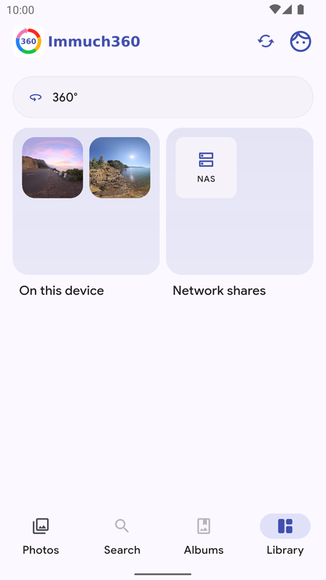

1. ಅಪ್ಲಿಕೇಶನ್ ತೆರೆಯಿರಿ. ಸ್ವಾಗತ ಪುಟ "ನಿಮ್ಮ ಮಾಧ್ಯಮ. ಯಾವುದೇ ಪರದೆ. ಪ್ರತಿ ದೃಷ್ಟಿಕೋನ." ಅನ್ನು ತೋರಿಸುತ್ತದೆ ಮತ್ತು ಮೂರು ಆಯ್ಕೆಗಳನ್ನು ನೀಡುತ್ತದೆ: ಮೊದಲನೆಯದನ್ನು ಟ್ಯಾಪ್ ಮಾಡಿ, "ಸರ್ವರ್ ಇಲ್ಲದೆ ಬಳಸಿ". ಸರ್ವರ್ ಅನ್ನು ನಂತರ ಸೆಟ್ಟಿಂಗ್‌ಗಳಿಂದ ಅಥವಾ ಲೈಬ್ರರಿ ಟ್ಯಾಬ್‌ನಿಂದ ಸಂಪರ್ಕಿಸಬಹುದು.
2. ನಿಮ್ಮ ಫೋಟೋಗಳು ಮತ್ತು ವೀಡಿಯೊಗಳಿಗೆ ಪ್ರವೇಶ ಅನುಮತಿಸಿ. ನೀವು ನಿರಾಕರಿಸಿದರೆ, ಆ್ಯಪ್ "ಪ್ರವೇಶವನ್ನು ಅನುಮತಿಸಿ" ಮತ್ತು "ಸೆಟ್ಟಿಂಗ್‌ಗಳನ್ನು ತೆರೆಯಿರಿ" ಜೊತೆಗೆ "ಆ್ಯಪ್ ಈ ಸಾಧನದ ಫೋಟೋಗಳನ್ನು ನೋಡಲು ಸಾಧ್ಯವಿಲ್ಲ" ಎಂದು ಹೇಳುತ್ತದೆ.
3. Photos ಟ್ಯಾಬ್ ಡಿವೈಸ್‌ನ ಟೈಮ್‌ಲೈನ್ ತೋರಿಸುತ್ತದೆ; Search ಮತ್ತು Albums ಬೂದು ಬಣ್ಣದಲ್ಲಿರುತ್ತವೆ, ಏಕೆಂದರೆ ಅವು ಸರ್ವರ್‌ನಿಂದ ಬರುತ್ತವೆ. ಲೈಬ್ರರಿ ಟ್ಯಾಬ್‌ನಲ್ಲಿ ಮೇಲ್ಭಾಗದಲ್ಲಿ 360°, ನಂತರ On this device (ಡಿವೈಸ್‌ನ ಆಲ್ಬಮ್‌ಗಳು) ಮತ್ತು ನೆಟ್‌ವರ್ಕ್ ಹಂಚಿಕೆಗಳು ಇವೆ. ಮೇಲಿನ ಬಲಭಾಗದ ಮೆನು "This device only" ಎಂದು ಹೇಳುತ್ತದೆ: ಏನನ್ನೂ ಎಲ್ಲಿಗೂ ಕಳುಹಿಸಲಾಗುವುದಿಲ್ಲ.
4. ತೆರೆಯಲು ಫೋಟೋ ಅಥವಾ ವೀಡಿಯೊವನ್ನು ಟ್ಯಾಪ್ ಮಾಡಿ; ಮುಂದಿನದಕ್ಕೆ ಹೋಗಲು ಎಡ ಮತ್ತು ಬಲಕ್ಕೆ ಸ್ವೈಪ್ ಮಾಡಿ, ಜೂಮ್ ಮಾಡಲು ಪಿಂಚ್ ಮಾಡಿ ಅಥವಾ ಎರಡು ಬಾರಿ ಟ್ಯಾಪ್ ಮಾಡಿ. ವೀಡಿಯೊದ ವಿವರಗಳಿಗಾಗಿ ಅದರ ಮೇಲೆ ಮೇಲಕ್ಕೆ ಸ್ವೈಪ್ ಮಾಡಿ: ಕೋಡೆಕ್, ಗಾತ್ರ, ಫ್ರೇಮ್ ದರ, ಬಿಟ್ ದರ, ಮತ್ತು ಈ ಡಿವೈಸ್ ಅದನ್ನು ಡಿಕೋಡ್ ಮಾಡುತ್ತದೆಯೇ.
5. Android ಫೋನ್‌ಗಳು, ಟ್ಯಾಬ್ಲೆಟ್‌ಗಳು ಮತ್ತು TVಗಳಲ್ಲಿ, build 29 ರಿಂದ, ಹಲವು ಆಡಿಯೋ ಭಾಷೆಗಳು ಅಥವಾ ಉಪಶೀರ್ಷಿಕೆಗಳಿರುವ ಚಲನಚಿತ್ರದ ನಿಯಂತ್ರಣಗಳಲ್ಲಿ ಒಂದು ಆಡಿಯೋ ಬಟನ್ ಮತ್ತು ಒಂದು ಉಪಶೀರ್ಷಿಕೆ ಬಟನ್ ಇರುತ್ತದೆ: ನೀವು ಆಯ್ಕೆ ಮಾಡಿದ ಆಡಿಯೋ ಭಾಷೆ ಮುಂದಿನ ಚಲನಚಿತ್ರಗಳಿಗೆ ಉಳಿಯುತ್ತದೆ, ಮತ್ತು ನೀವು ಆಯ್ಕೆ ಮಾಡುವವರೆಗೆ ಉಪಶೀರ್ಷಿಕೆಗಳು ಆಫ್ ಆಗಿರುತ್ತವೆ, ಬಲವಂತದ ಉಪಶೀರ್ಷಿಕೆಗಳನ್ನು ಹೊರತುಪಡಿಸಿ. Immich ಅಪ್ಲಿಕೇಶನ್‌ನ Android ಪ್ಲೇಯರ್‌ನಲ್ಲಿ ಎರಡೂ ಇಲ್ಲ.

ಕಂಪ್ಯೂಟರ್‌ನಲ್ಲಿ, ನೀವು ಆಯ್ಕೆ ಮಾಡುವ ಫೋಲ್ಡರ್‌ಗಳು ಗ್ಯಾಲರಿಯ ಪಾತ್ರವನ್ನು ವಹಿಸುತ್ತವೆ; TV ಯಲ್ಲಿ, ಅದಕ್ಕೆ ಸ್ವಂತ ಫೋಟೋಗಳು ಇಲ್ಲದಿದ್ದರಿಂದ, ನೆಟ್‌ವರ್ಕ್ ಮೂಲಗಳು ಅದನ್ನು ಮಾಡುತ್ತವೆ.

ಇನ್ನಷ್ಟು: [ಸರ್ವರ್ ಅಥವಾ ಖಾತೆ ಇಲ್ಲದೆ](../docs/immuch360/user-guide.md#without-a-server-or-an-account), [ವೀಕ್ಷಕಗಳು ಮತ್ತು ವೀಡಿಯೊ ಪ್ಲೇಯರ್](../docs/immuch360/user-guide.md#watch-your-photos-and-videos), [ವೀಡಿಯೊ ವಿವರಗಳು ಮತ್ತು ಡಿಕೋಡರ್‌ಗಳು](../docs/immuch360/user-guide.md#video-details-decoders-and-why-a-video-stutters).

### ಪನೋರಮಗಳು, 360°, VR180 ಮತ್ತು 3D ಅನ್ವೇಷಿಸಿ

Immuch360 ಫ್ಲಾಟ್ ಫೋಟೋಗಳು ಮತ್ತು ವೀಡಿಯೊಗಳು, ಪನೋರಮಾಗಳು, 360° ಫೋಟೋಗಳು ಮತ್ತು ವೀಡಿಯೊಗಳು, VR180, ಸ್ಟೀರಿಯೋಸ್ಕೋಪಿಕ್ 3D, Apple spatial ಫೋಟೋಗಳು ಮತ್ತು DJI ಡ್ರೋನ್‌ಗಳ 360° ಗೋಳಗಳನ್ನು ಗುರುತಿಸುತ್ತದೆ, ಮತ್ತು ಪ್ರತಿಯೊಂದನ್ನು ಅದಕ್ಕೆ ಹೊಂದುವ ವೀಕ್ಷಕದಲ್ಲಿ ತೆರೆಯುತ್ತದೆ. 360° ಫೋಟೋ ನೀವು ಬೆರಳಿನಿಂದ ಅಥವಾ ಫೋನ್ ಚಲಿಸಿ ತಿರುಗಿಸುವ ಗೋಳವಾಗಿ ತೆರೆಯುತ್ತದೆ; 360° ವೀಡಿಯೊ ಧ್ವನಿಯೊಂದಿಗೆ ಗೋಳಾಕಾರದ ಪ್ಲೇಯರ್‌ನಲ್ಲಿ ಪ್ಲೇ ಆಗುತ್ತದೆ; VR180 ಫೈಲ್‌ಗಳನ್ನು ಅರ್ಧ ಗೋಳದ ಮೇಲೆ ಚಿತ್ರಿಸಲಾಗುತ್ತದೆ; ಸ್ಟೀರಿಯೋಸ್ಕೋಪಿಕ್ 3D ಫೈಲ್‌ಗಳು ಫ್ಲಾಟ್ ಪರದೆಯಲ್ಲಿ ಒಂದು ಕಣ್ಣನ್ನು ಮತ್ತು ಹೆಡ್‌ಸೆಟ್‌ನಲ್ಲಿ ಎರಡೂ ಕಣ್ಣುಗಳನ್ನು ತೋರಿಸುತ್ತವೆ. ಭಾಗಶಃ ಪನೋರಮಾಗಳು ತಮ್ಮ ಕ್ರಾಪ್ ಉಳಿಸಿಕೊಳ್ಳುತ್ತವೆ, ಮತ್ತು ಚಿತ್ರ ಕ್ಯಾಮೆರಾ ದಾಖಲಿಸಿದ ವೀಕ್ಷಣೆಯಿಂದ ಪ್ರಾರಂಭವಾಗುತ್ತದೆ. ಸರ್ವರ್ ಗುರುತಿಸದ ಫೈಲ್ ಅನ್ನು ಒಂದು ಟ್ಯಾಪ್‌ನಲ್ಲಿ 360° ಆಗಿ ನೋಡಬಹುದು.

  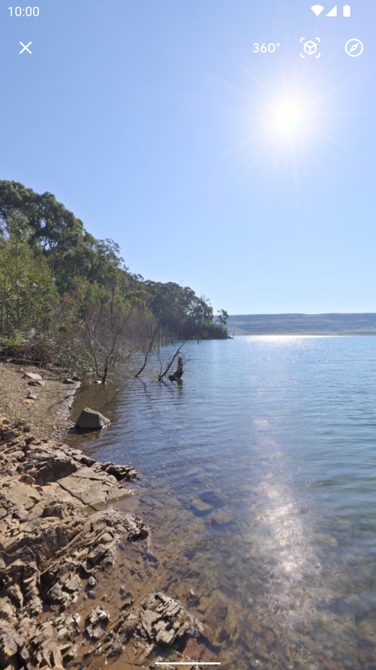
  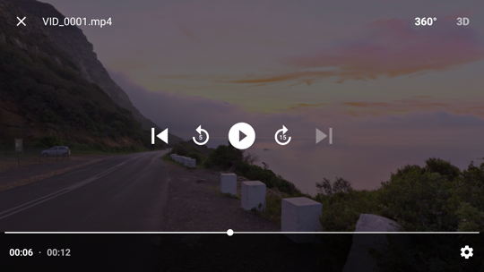

1. ಫೋಟೋ ಅಥವಾ ವೀಡಿಯೊವನ್ನು ತೆರೆಯಿರಿ. 360° ಫೈಲ್‌ಗಳು ತಮ್ಮ ಥಂಬ್‌ನೇಲ್‌ನಲ್ಲಿ 360° ಬ್ಯಾಡ್ಜ್ ಅನ್ನು ಹೊಂದಿವೆ, ಮತ್ತು ಲೈಬ್ರರಿ ಟ್ಯಾಬ್ ಅವುಗಳನ್ನು ಅವಧಿ, ಮೂಲ, ಪ್ರಕಾರ ಮತ್ತು ಕ್ಯಾಮೆರಾ ಫಿಲ್ಟರ್‌ಗಳೊಂದಿಗೆ ಒಟ್ಟುಗೂಡಿಸುವ 360° ಪಟ್ಟಿಯನ್ನು ಹೊಂದಿದೆ.
2. ಮೇಲಿನ ಬಾರ್‌ನಲ್ಲಿ 360° ಟ್ಯಾಪ್ ಮಾಡಿ. ಸುತ್ತಲೂ ನೋಡಲು ಡ್ರ್ಯಾಗ್ ಮಾಡಿ, ಜೂಮ್ ಮಾಡಲು ಪಿಂಚ್ ಮಾಡಿ, ಫೋನ್ ತಿರುಗಿಸುವ ಮೂಲಕ ಸುತ್ತಲೂ ನೋಡಲು ಜೈರೋಸ್ಕೋಪ್ ಬಟನ್ ಟ್ಯಾಪ್ ಮಾಡಿ.
3. 3D ಬಟನ್ "ಮೋನೋ (3D ಅಲ್ಲ)", "3D, ಮೇಲೆ ಮತ್ತು ಕೆಳಗೆ" ಮತ್ತು "3D, ಅಕ್ಕಪಕ್ಕ" ನಡುವೆ ಸುತ್ತುತ್ತದೆ; 360°/180° ಬಟನ್ ಪೂರ್ಣ ಗೋಳ ಮತ್ತು VR180 ನ ಅರ್ಧ ಗೋಳದ ನಡುವೆ ಬದಲಾಯಿಸುತ್ತದೆ.
4. ಫ್ಲಾಟ್ ಆಗಿ ತೋರುವ ಆದರೆ 360° ಆಗಿರುವ ಫೈಲ್‌ಗಾಗಿ: ಮೇಲ್ಭಾಗದ ಬಲಕ್ಕೆ ⋮, ನಂತರ "360° ಆಗಿ ವೀಕ್ಷಿಸಿ".

ಫೋನ್‌ಗಳು ಮತ್ತು ಟ್ಯಾಬ್ಲೆಟ್‌ಗಳಲ್ಲಿ, ಒಂದು ಸ್ಟೀರಿಯೋಸ್ಕೋಪಿಕ್ ವೀಡಿಯೊ ಫ್ಲಾಟ್ ಪರದೆಯಲ್ಲಿ ಡೆಪ್ತ್ ಅನ್ನೂ ಪಡೆಯಬಹುದು: Spatial 2.5D ಪ್ಲೇಯರ್ ನಿಮ್ಮ ತಲೆಯನ್ನು ಅನುಸರಿಸಲು ಫ್ರಂಟ್ ಕ್ಯಾಮೆರಾ ಬಳಸುತ್ತದೆ ಮತ್ತು ಎರಡು ಕಣ್ಣುಗಳ ನಡುವಿನ ವೀಕ್ಷಣೆಯನ್ನು ತೋರಿಸುತ್ತದೆ (ಪ್ರಯೋಗಾತ್ಮಕ). iPhone ನೊಂದಿಗೆ ತೆಗೆದ Apple spatial ಫೋಟೋಗಳನ್ನು ಗುರುತಿಸಲಾಗುತ್ತದೆ ಮತ್ತು Meta Quest ನಲ್ಲಿ 3D ಯಲ್ಲಿ ತೋರಿಸಲಾಗುತ್ತದೆ.

ಇನ್ನೂ ಹೆಚ್ಚು: [360° ಫೋಟೋಗಳು ಮತ್ತು ವೀಡಿಯೊಗಳು](../docs/immuch360/user-guide.md#360-photos-and-videos-as-a-sphere), [3D ಮತ್ತು VR180](../docs/immuch360/user-guide.md#3d-and-vr180-photos-and-videos), [Spatial 2.5D](../docs/immuch360/user-guide.md#depth-on-a-flat-screen-spatial-25d-experimental), [Apple spatial ಫೋಟೋಗಳು ಮತ್ತು ವೀಡಿಯೊಗಳು](../docs/immuch360/user-guide.md#apple-spatial-photos-and-videos), [360° ಪಟ್ಟಿ](../docs/immuch360/user-guide.md#find-your-360-shots-the-360-list).

### ಒಂದು ಫೋಟೋವನ್ನು 3D, ದೃಶ್ಯ, ಪನೋರಮಾ ಆಗಿ ಪರಿವರ್ತಿಸಿ

ನಿಮ್ಮ ಹೆಚ್ಚಿನ ಫೋಟೋಗಳು ಫ್ಲಾಟ್ ಆಗಿವೆ, ಮತ್ತು ನೀವು ಹಿಂದಿರುಗಿ ಅವುಗಳನ್ನು ಮತ್ತೆ 3D ಯಲ್ಲಿ ತೆಗೆಯಲು ಸಾಧ್ಯವಿಲ್ಲ. Immuch360 ಅವುಗಳಿಗೆ ಆಳ ನೀಡುತ್ತದೆ. ನಿಮ್ಮ ಕಂಪ್ಯೂಟರ್‌ನಲ್ಲಿ, ಒಂದು ಫೋಟೋ **3D ಫೋಟೋ**, ಹೆಡ್‌ಸೆಟ್‌ನಲ್ಲಿ ನೀವು ಒಳಗೆ ಬಾಗಿ ನೋಡುವ **3D ದೃಶ್ಯ**, ಅಥವಾ ನಿಮ್ಮ ಸುತ್ತಲಿನ ಸ್ಥಳದ ಉಳಿದ ಭಾಗವನ್ನು ಕಲ್ಪಿಸುವ **360° ಪನೋರಮಾ** ಆಗುತ್ತದೆ. Quest 3 ಅಥವಾ 3S ಯಾವುದೇ ಫ್ಲಾಟ್ ಫೋಟೋಗೆ ಆಳವನ್ನು ತಾನೇ ಮಾಡುತ್ತದೆ. ಎಲ್ಲವೂ ನಿಮ್ಮ ಸ್ವಂತ ಕಂಪ್ಯೂಟರ್ ಮತ್ತು ಹೆಡ್‌ಸೆಟ್‌ನಲ್ಲಿ ಚಲಿಸುತ್ತದೆ: ಕ್ಲೌಡ್ ಇಲ್ಲ, ಖಾತೆ ಇಲ್ಲ, ನಿಮ್ಮ ಮೂಲಗಳು ಎಂದಿಗೂ ಬದಲಾಗುವುದಿಲ್ಲ. build 32 ಮತ್ತು desktop build 13 ನಲ್ಲಿ ಹೊಸದು, ಪ್ರಯೋಗಾತ್ಮಕ ಮತ್ತು ಡೀಫಾಲ್ಟ್ ಆಗಿ ಆನ್. Immich ಅಪ್ಲಿಕೇಶನ್‌ನಲ್ಲಿ ಇಂತಹದ್ದು ಏನೂ ಇಲ್ಲ.

  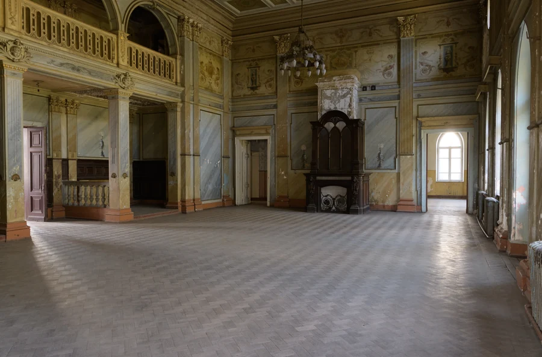

A real output of the app from a CC0 photo of Poly Haven, reduced, not retouched: a 3D photo, its two eyes in turn.

**ನಿಮ್ಮ ಕಂಪ್ಯೂಟರ್‌ನಲ್ಲಿ**, Windows, Linux ಅಥವಾ macOS ನಲ್ಲಿ desktop build 13 ನೊಂದಿಗೆ:

1. ಲೈಬ್ರರಿಯಲ್ಲಿ ಅಥವಾ ಫೋಲ್ಡರ್‌ನಲ್ಲಿ ಒಂದು ಅಥವಾ ಹೆಚ್ಚು ಫೋಟೋಗಳನ್ನು ಆಯ್ಕೆಮಾಡಿ, ನಂತರ "3D ಮಾಡಿ (AI)".
2. ನಿಮಗೆ ಬೇಕಾದುದನ್ನು ಆರಿಸಿ: "3D ಫೋಟೋ", "3D ದೃಶ್ಯ", "360° ಪನೋರಮಾ", ಅಥವಾ ನಿಮ್ಮ ಸ್ವಂತ 360° ಚಿತ್ರಗಳಿಗೆ "360° ಫೋಟೋದ 3D ಆವೃತ್ತಿ". ಬಾಕ್ಸ್ AI ಏನನ್ನು ಅಂದಾಜಿಸುತ್ತದೆ ಅಥವಾ ಕಲ್ಪಿಸುತ್ತದೆ ("ಈ ಪನೋರಮಾದ ಸುಮಾರು 96% ಅನ್ನು AI ಕಲ್ಪಿಸಿ ರಚಿಸುತ್ತದೆ"), ಈ ಕಂಪ್ಯೂಟರ್‌ನಲ್ಲಿ ಸುಮಾರು ಎಷ್ಟು ಸಮಯ ತೆಗೆದುಕೊಳ್ಳುತ್ತದೆ, ಮತ್ತು ಫೈಲ್ ಎಲ್ಲಿಗೆ ಹೋಗುತ್ತದೆ ಎಂದು ಹೇಳುತ್ತದೆ: "ಮೂಲದ ಪಕ್ಕದಲ್ಲಿ" ಅಥವಾ "ನಾನು ಆರಿಸುವ ಫೋಲ್ಡರ್". ಈ ಕಂಪ್ಯೂಟರ್ ಮಾಡಲಾಗದ ಪ್ರಕಾರ ಬೂದು ಬಣ್ಣದಲ್ಲಿ ಉಳಿಯುತ್ತದೆ, ಅದರ ಕಾರಣದೊಂದಿಗೆ, ಉದಾಹರಣೆಗೆ "Mac ನಲ್ಲಿ ಇನ್ನೂ ಇಲ್ಲ" ಅಥವಾ "ಗ್ರಾಫಿಕ್ಸ್ ಕಾರ್ಡ್‌ನಲ್ಲಿ 6.0 GiB ಮೆಮೊರಿ ಇದೆ, 360° ಪನೋರಮಾಗಳಿಗೆ 7.5 GiB ಬೇಕು".
3. ಮೊದಲ ಬಾರಿ, ಬಾಕ್ಸ್ ಆ ಪ್ರಕಾರದ ಘಟಕಗಳನ್ನು ನೀಡುತ್ತದೆ: ಡೌನ್‌ಲೋಡ್, ಒಮ್ಮೆ. ಅವು ಈ ಕಂಪ್ಯೂಟರ್‌ನಲ್ಲಿ ಚಲಿಸುತ್ತವೆ ಮತ್ತು ನಂತರ ಆಫ್‌ಲೈನ್‌ನಲ್ಲಿ ಕೆಲಸ ಮಾಡುತ್ತವೆ.
4. ಪರಿವರ್ತಿಸಿ. ಕೆಲಸಗಳು ಎರಡು ಸಾಲುಗಳಲ್ಲಿ, ಪ್ರೊಸೆಸರ್ ಮತ್ತು ಗ್ರಾಫಿಕ್ಸ್ ಕಾರ್ಡ್, ಅವುಗಳ ಹಂತಗಳು ಮತ್ತು ಉಳಿದ ಸಮಯದೊಂದಿಗೆ ಸರತಿಯಲ್ಲಿ ನಿಲ್ಲುತ್ತವೆ; ರದ್ದುಮಾಡಿ ಯಾವುದೇ ಕ್ಷಣದಲ್ಲಿ ಒಂದನ್ನು ನಿಲ್ಲಿಸುತ್ತದೆ, ಮತ್ತು ಅಪ್ಲಿಕೇಶನ್‌ನಿಂದ ನಿರ್ಗಮಿಸುವಾಗ ಮೊದಲು ಕೇಳುತ್ತದೆ.
5. Open the result. A 3D photo shows as "Left eye", "Side by side", "Wiggle" (the animation above) or "Red and cyan" for glasses; a scene has "Preview in 3D", turned with the mouse or the touchpad, and "Export for other 3D apps (.glb)"; a panorama opens in the 360° viewer.

  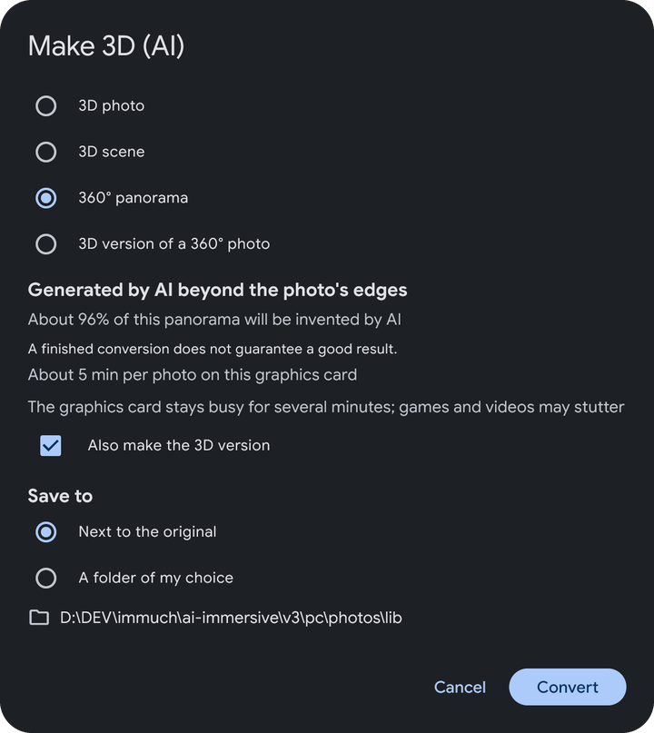
  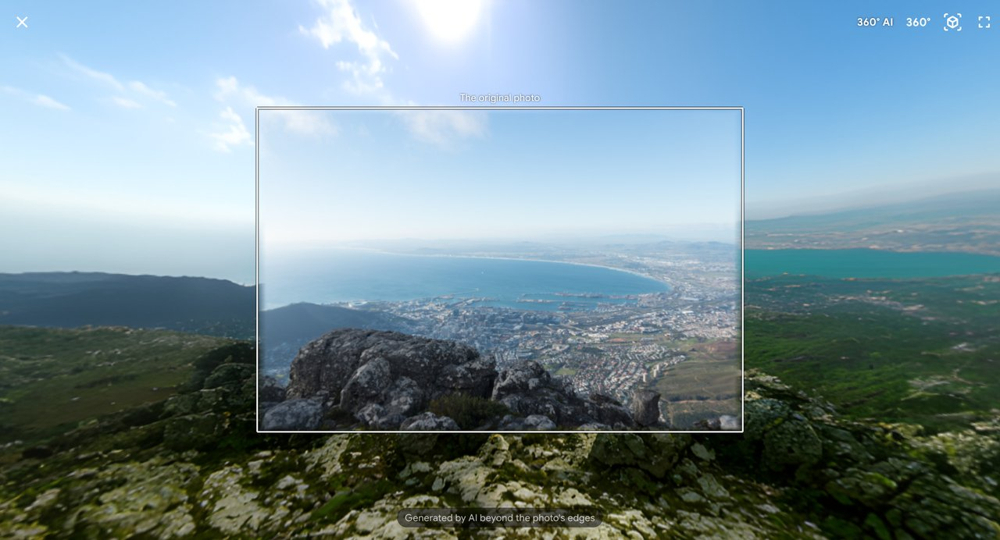

  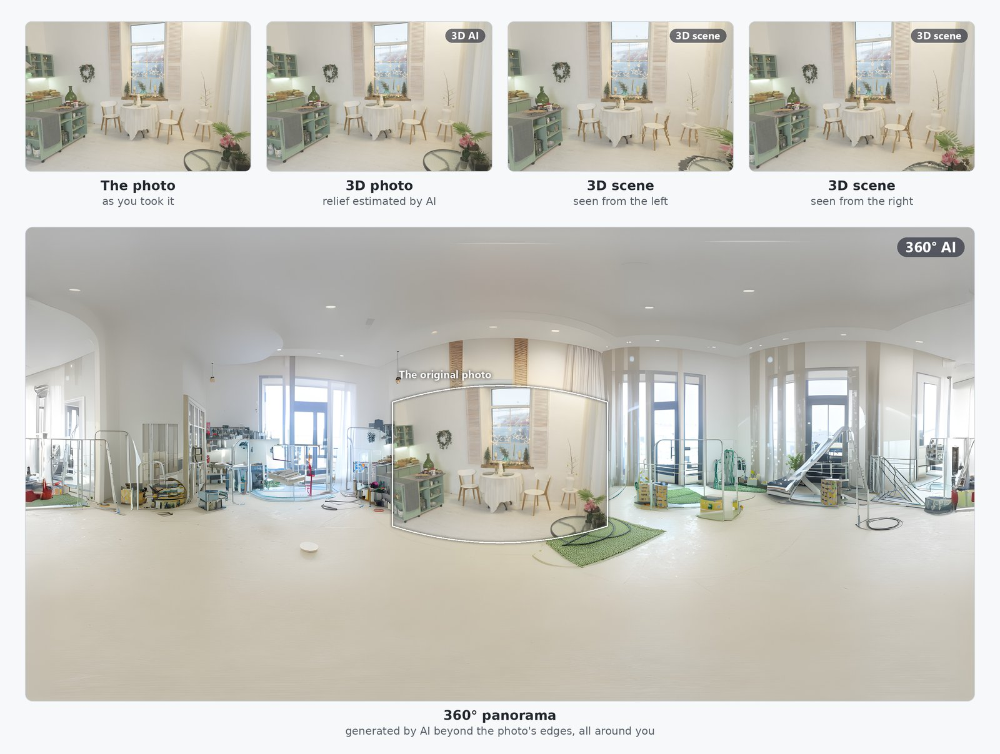

One photo, four ways: real outputs of the app from a CC0 photo of Poly Haven, reduced, not retouched, with the app's badges added for this page, the two scene views drawn from the scene file. Everything outside the outline of the panorama is made up by AI.

| | 3D ಫೋಟೋ | 3D ದೃಶ್ಯ | 360° ಪನೋರಮಾ |
|---|---|---|---|
| ನಿಮಗೆ ಏನು ಸಿಗುತ್ತದೆ | `<name>_3D_LRF_Full_SBS.jpg`, ಅಕ್ಕಪಕ್ಕದ 3D ಫೋಟೋ: ಎಡ ಕಣ್ಣಿಗೆ ನಿಮ್ಮ ಫೋಟೋ, ಲೆಕ್ಕಹಾಕಿದ ಬಲ ಕಣ್ಣು | `<name>_scene3D.jpg`, ದೃಶ್ಯವನ್ನು ಪದರಗಳಲ್ಲಿ ಹೊತ್ತಿರುವ ಫೋಟೋ | `<name>_360.jpg`, 6144 x 3072, ಮತ್ತು "3D ಆವೃತ್ತಿಯನ್ನೂ ಮಾಡಿ" ಯೊಂದಿಗೆ, `<name>_360_3D.jpg` |
| AI ಏನು ಮಾಡುತ್ತದೆ | ಫೋಟೋದ ಆಳವನ್ನು ಅಂದಾಜಿಸುತ್ತದೆ (Depth Anything V2 Small) | ಸ್ಥಳದ ಆಕಾರವನ್ನು ಅಂದಾಜಿಸುತ್ತದೆ (MoGe-2) ಮತ್ತು ಫೋಟೋ ಮರೆಮಾಡುವುದನ್ನು ತುಂಬುತ್ತದೆ (LaMa), ಪದರಗಳ ದೃಶ್ಯಕ್ಕಾಗಿ | ಫೋಟೋದ ಅಂಚುಗಳ ಆಚೆಗಿನ ಎಲ್ಲವನ್ನೂ ಕಲ್ಪಿಸುತ್ತದೆ (FLUX.2 klein 4B ಮತ್ತು ಒಂದು 360° LoRA); ನಿಮ್ಮ ಸ್ವಂತ ಪಿಕ್ಸೆಲ್‌ಗಳು ಇದ್ದಲ್ಲೇ ಉಳಿಯುತ್ತವೆ |
| ಎಷ್ಟು ಸಮಯ | ಪ್ರತಿ ಫೋಟೋಗೆ ಕೆಲವು ಸೆಕೆಂಡುಗಳು | ಪ್ರತಿ ಫೋಟೋಗೆ 15 ರಿಂದ 45 ಸೆಕೆಂಡುಗಳು | RTX 4060 ಇರುವ ಲ್ಯಾಪ್‌ಟಾಪ್‌ನಲ್ಲಿ ಸುಮಾರು 5 ನಿಮಿಷಗಳು, ಅದರ 3D ಆವೃತ್ತಿಗೆ ಇನ್ನೂ 30 ಸೆಕೆಂಡುಗಳು |
| ಇದು ಎಲ್ಲಿ ಚಲಿಸುತ್ತದೆ | Windows, Linux ಅಥವಾ macOS ಕಂಪ್ಯೂಟರ್‌ನ ಪ್ರೊಸೆಸರ್ | Windows, Linux ಅಥವಾ macOS ಕಂಪ್ಯೂಟರ್‌ನ ಪ್ರೊಸೆಸರ್ | Vulkan ಮತ್ತು ತನ್ನದೇ 8 GB ಮೆಮೊರಿ ಇರುವ ಗ್ರಾಫಿಕ್ಸ್ ಕಾರ್ಡ್, 16 GB ಮೆಮೊರಿ ಇರುವ Windows ಅಥವಾ Linux ಕಂಪ್ಯೂಟರ್‌ನಲ್ಲಿ; NVIDIA ಪ್ರಯತ್ನಿಸಲಾಗಿದೆ, AMD ಮತ್ತು Intel ಕಾರ್ಡ್‌ಗಳು ಇನ್ನೂ ಇಲ್ಲ; ಇನ್ನೂ Mac ನಲ್ಲಿ ಇಲ್ಲ |
| ನೀವು ಕೇಳಿದಾಗ ಒಮ್ಮೆ ಡೌನ್‌ಲೋಡ್ ಆಗುತ್ತದೆ | ಸುಮಾರು 110 MB | ಇನ್ನೂ 349 MB | ಇನ್ನೂ ಸುಮಾರು 5.4 GB |
| ಎಲ್ಲಿ ನೋಡಬೇಕು | Meta Quest ನಲ್ಲಿ 3D ಯಲ್ಲಿ; ಕಂಪ್ಯೂಟರ್‌ನಲ್ಲಿ "ಅಲುಗಾಟ" ಅಥವಾ "ಕೆಂಪು ಮತ್ತು ಸಯಾನ್" | Meta Quest ನಲ್ಲಿ, ಅಲ್ಲಿ ನೀವು ಒಳಗೆ ಬಾಗಿ ನೋಡುತ್ತೀರಿ; ಕಂಪ್ಯೂಟರ್‌ನಲ್ಲಿ "3D ಯಲ್ಲಿ ಪೂರ್ವವೀಕ್ಷಣೆ" | Meta Quest ನಲ್ಲಿ ನಿಮ್ಮ ಸುತ್ತಲೂ, ಮತ್ತು ಪ್ರತಿ 360° ವೀಕ್ಷಕದಲ್ಲಿ |

ಪ್ರತಿ ಹೊಸ ಫೈಲ್ ತನ್ನ ಮೂಲದ ಪಕ್ಕದಲ್ಲಿ ಹೋಗುತ್ತದೆ, ಅದರ ಮೇಲೆ ಎಂದಿಗೂ ಅಲ್ಲ, ಅಥವಾ ಮೂಲದ ಫೋಲ್ಡರ್ ಹೊಸ ಫೈಲ್ ಸ್ವೀಕರಿಸದಿದ್ದಾಗ ನೀವು ಆರಿಸುವ ಫೋಲ್ಡರ್‌ಗೆ ಹೋಗುತ್ತದೆ; ನೆಟ್‌ವರ್ಕ್ ಫೋಲ್ಡರ್‌ನಲ್ಲಿ, ಆ ಫೋಲ್ಡರ್‌ಗೆ ನೀವು ಹೌದು ಎಂದ ನಂತರ ಮಾತ್ರ ("Immuch360 ಅಲ್ಲಿ ಹೊಸ ಫೈಲ್‌ಗಳನ್ನು ಬರೆಯುತ್ತದೆ, ಮೂಲಗಳನ್ನು ಎಂದಿಗೂ ಅಲ್ಲ"). ಲೈಬ್ರರಿ ಪ್ರತಿ ಆವೃತ್ತಿಯನ್ನು ಅದರ ಬ್ಯಾಡ್ಜ್, "AI 3D", "3D ದೃಶ್ಯ" ಅಥವಾ "AI 360°" ನೊಂದಿಗೆ ಅದರ ಮೂಲಕ್ಕೆ ಜೋಡಿಸುತ್ತದೆ, "Immuch360 AI ಆವೃತ್ತಿಗಳು" ಆಲ್ಬಮ್‌ನಲ್ಲಿ, ನೀವು "AI ಆವೃತ್ತಿಗಳನ್ನೂ ಬ್ಯಾಕಪ್ ಮಾಡಿ" ಆನ್ ಮಾಡದಿದ್ದರೆ ಅದು ನಿಮ್ಮ Immich ಬ್ಯಾಕಪ್‌ನಿಂದ ಹೊರಗೆ ಉಳಿಯುತ್ತದೆ; ಎಚ್ಚರಿಕೆ, ಬ್ಯಾಕಪ್ ಆಲ್ಬಮ್‌ಗಳಲ್ಲಿ "ಎಲ್ಲವನ್ನೂ ಆಯ್ಕೆಮಾಡಿ" ಈ ಆಲ್ಬಮ್ ಅನ್ನೂ ಆರಿಸುತ್ತದೆ ಮತ್ತು ಆ ಸ್ವಿಚ್ ಅನ್ನು ಆನ್ ಮಾಡುತ್ತದೆ. Quest ನಲ್ಲಿ ಫೈಲ್ ನೋಡಲು, ಅದನ್ನು ನಿಮ್ಮ NAS ನಲ್ಲಿ ಉಳಿಸಿ, ನಿಮ್ಮ Immich ಸರ್ವರ್‌ಗೆ ಬ್ಯಾಕಪ್ ಮಾಡಿ ಅಥವಾ, Windows ನಲ್ಲಿ, "ಈ ಕಂಪ್ಯೂಟರ್ ಅನ್ನು ನೆಟ್‌ವರ್ಕ್‌ನಲ್ಲಿ ಹಂಚಿಕೊಳ್ಳಿ" ಆನ್ ಮಾಡಿ.

**Meta Quest ನಲ್ಲಿ**, build 32 ನೊಂದಿಗೆ:

- **AI ಆಳ**: ನಿಮ್ಮ ಲೈಬ್ರರಿಯಿಂದ ಅಥವಾ ಹಂಚಿಕೆಯಿಂದ ಯಾವುದೇ ಫ್ಲಾಟ್ ಫೋಟೋ ತೆರೆಯಿರಿ, ಮತ್ತು ಮೇಲಿನ ಬಾರ್‌ನಲ್ಲಿ "AI ಆಳ" ಒತ್ತಿರಿ: ಹೆಡ್‌ಸೆಟ್ ಆಳವನ್ನು ತಾನೇ ಅಂದಾಜಿಸುತ್ತದೆ ಮತ್ತು ಫೋಟೋವನ್ನು 3D ಯಲ್ಲಿ ತೋರಿಸುತ್ತದೆ, "AI ಅಂದಾಜಿಸಿದ ಆಳ". 99.5 MB ಮಾಡೆಲ್ ನೀವು ಅದನ್ನು ಮೊದಲ ಬಾರಿ ಒತ್ತಿದಾಗ ಡೌನ್‌ಲೋಡ್ ಆಗುತ್ತದೆ, ಮತ್ತು ಆಳಗಳನ್ನು ಕ್ಯಾಶ್‌ನಲ್ಲಿ ಇಡಲಾಗುತ್ತದೆ. ಸೆಟ್ಟಿಂಗ್‌ಗಳು, ಸುಧಾರಿತ, "AI ಮತ್ತು 3D" ನಲ್ಲಿರುವ "AI ಆಳದ ಫೋಟೋಗಳನ್ನು 2.5D ಯಲ್ಲಿ ತೆರೆಯಿರಿ (ಪ್ರಾಯೋಗಿಕ)" ನೀವು ತಲೆ ಚಲಿಸಿದಂತೆ ಹತ್ತಿರದ ವಸ್ತುಗಳನ್ನು ಹಿನ್ನೆಲೆಯ ಮುಂದೆ ಚಲಿಸುವಂತೆ ಮಾಡುತ್ತದೆ. Quest 2 ಅಥವಾ Quest Pro ನಲ್ಲಿ ಬಟನ್ ಬೂದು ಬಣ್ಣದಲ್ಲಿ ಉಳಿಯುತ್ತದೆ, "ಈ ಹೆಡ್‌ಸೆಟ್‌ನಲ್ಲಿ ಇನ್ನೂ ಪರೀಕ್ಷಿಸಲಾಗಿಲ್ಲ", ನೀವು ಅಲ್ಲಿ "Quest 2 ಮತ್ತು Quest Pro ನಲ್ಲಿ AI ಆಳ (ಪರೀಕ್ಷಿಸಲಾಗಿಲ್ಲ)" ಆನ್ ಮಾಡುವವರೆಗೆ.
- **3D photos and scenes from the computer**: "View in 3D" shows a 3D photo in true 3D. "View the 3D scene" on the original, or "Explore the 3D scene" on the scene, puts the scene in your room: lean in, or glide with the left thumbstick inside the rebuilt area ("Room to move: about 0.5 m each way" for the room shown above); the layers flatten and darken at its edge, a click on a thumbstick resets the view, and B or Y goes back.
- **ಪನೋರಮಾಗಳು**: ರಚಿಸಿದ ಪನೋರಮಾ ನಿಮ್ಮ ಸುತ್ತಲೂ ತೆರೆಯುತ್ತದೆ, ನಿಮ್ಮ ಫೋಟೋದ ಕಡೆಗೆ ಮುಖ ಮಾಡಿ, "ಫೋಟೋದ ಅಂಚುಗಳ ಆಚೆಗೆ AI ರಚಿಸಿದೆ" ಮತ್ತು ಮೂಲ ಫೋಟೋದ ತೆಳುವಾದ ಗೆರೆಯೊಂದಿಗೆ, ಅವು ಕೆಲವು ಸೆಕೆಂಡುಗಳ ನಂತರ ಮಸುಕಾಗುತ್ತವೆ; ಅದರ 3D ಆವೃತ್ತಿ ನಿಜವಾದ 3D ಯಲ್ಲಿದೆ.

**ಫೋನ್‌ಗಳು, ಟ್ಯಾಬ್ಲೆಟ್‌ಗಳು ಮತ್ತು TVಗಳಲ್ಲಿ**, ಕಂಪ್ಯೂಟರ್ ಮಾಡಿದ ಫೈಲ್‌ಗಳು ಇದ್ದಂತೆಯೇ ತೆರೆಯುತ್ತವೆ, ಮತ್ತು ಅಲ್ಲಿ ಏನನ್ನೂ ರಚಿಸಲಾಗುವುದಿಲ್ಲ. Android ಫೋನ್‌ಗಳು, ಟ್ಯಾಬ್ಲೆಟ್‌ಗಳು ಮತ್ತು Android TV ಯಲ್ಲಿ ಪನೋರಮಾ 360° ವೀಕ್ಷಕದಲ್ಲಿ "AI 360°" ಬ್ಯಾಡ್ಜ್, ವಾಕ್ಯ ಮತ್ತು ಗೆರೆಯೊಂದಿಗೆ ತೆರೆಯುತ್ತದೆ; iPhone, iPad, LG ಮತ್ತು Samsung TVಗಳಲ್ಲಿ ಸದ್ಯಕ್ಕೆ ಸಾಮಾನ್ಯ 360° ಫೋಟೋವಾಗಿ ತೆರೆಯುತ್ತದೆ. ದೃಶ್ಯವು ತನ್ನ ಮೂಲೆಯಲ್ಲಿ ಸಣ್ಣ 3D ದೃಶ್ಯ ಗುರುತಿನೊಂದಿಗೆ ತನ್ನ ಫೋಟೋವಾಗಿ ಕಾಣುತ್ತದೆ; Android ನಲ್ಲಿ, ಅದರ ವಿವರಗಳು "ಅನ್ವೇಷಿಸಲು ಇದನ್ನು Meta Quest ನಲ್ಲಿ ತೆರೆಯಿರಿ" ಸೇರಿಸುತ್ತವೆ. 3D ಫೋಟೋ ತನ್ನ ಎರಡು ಕಣ್ಣುಗಳನ್ನು ಅಕ್ಕಪಕ್ಕ ತೋರಿಸುತ್ತದೆ.

**ಯಾವುದು ನಿಜ ಮತ್ತು ಯಾವುದು ಅಲ್ಲ, ಯಾವಾಗಲೂ ಹೇಳಲಾಗುತ್ತದೆ.** ಇದೇ ಮುಖ್ಯ ಅಂಶ, ಸಣ್ಣ ಅಕ್ಷರಗಳಲ್ಲ. 3D ಫೋಟೋದ ಆಳವನ್ನು ಒಂದು ಫೋಟೋದಿಂದ ಅಂದಾಜಿಸಲಾಗುತ್ತದೆ, ಮತ್ತು ಫೋಟೋ ಮರೆಮಾಡುವುದನ್ನು ತುಂಬಲಾಗುತ್ತದೆ ಮತ್ತು ಅದು ನಿಜವಲ್ಲ. ದೃಶ್ಯವು "ಒಂದು ಫೋಟೋದಿಂದ ಮರುನಿರ್ಮಿಸಲಾಗಿದೆ, ಅದರ ಮಿತಿಗಳೊಳಗೆ ಅನ್ವೇಷಿಸಿ". ಪನೋರಮಾ ನಿಮ್ಮ ನಿಜವಾದ ಪಿಕ್ಸೆಲ್‌ಗಳನ್ನು ಇದ್ದಲ್ಲೇ ಇಟ್ಟು ಉಳಿದುದನ್ನು ಕಲ್ಪಿಸುತ್ತದೆ, ಸಾಮಾನ್ಯ ಫೋಟೋಗೆ ಗೋಳದ ಸುಮಾರು 90%, ಮತ್ತು ನೀವು ಪ್ರಾರಂಭಿಸುವ ಮೊದಲು ಬಾಕ್ಸ್ ಎಷ್ಟು ಎಂದು ಹೇಳುತ್ತದೆ. ಅಪ್ಲಿಕೇಶನ್ ನೀವು ನೋಡುವಲ್ಲೇ "AI ಅಂದಾಜಿಸಿದ ಆಳ", "ಫೋಟೋದ ಅಂಚುಗಳ ಆಚೆಗೆ AI ರಚಿಸಿದೆ" ಮತ್ತು ಬ್ಯಾಡ್ಜ್‌ಗಳೊಂದಿಗೆ ಹೇಳುತ್ತದೆ, ಮತ್ತು ಫೈಲ್‌ಗಳೂ ಹೇಳುತ್ತವೆ: ನಮ್ಮ XMP ಯಲ್ಲಿ, ಮತ್ತು ದೃಶ್ಯಗಳು ಮತ್ತು ಪನೋರಮಾಗಳಿಗೆ AI ಯಿಂದ ಮಾಡಿದ ಚಿತ್ರದ IPTC ಡಿಜಿಟಲ್ ಮೂಲ ಪ್ರಕಾರದಲ್ಲಿ, ಇತರ ಅಪ್ಲಿಕೇಶನ್‌ಗಳು ರಚಿಸಿದ ಪನೋರಮಾವನ್ನು ನಿಜವಾದ 360° ಫೋಟೋದಿಂದ ಬೇರ್ಪಡಿಸಲು. ನಿಮ್ಮ ಮೂಲಗಳು ಎಂದಿಗೂ ಬದಲಾಗುವುದಿಲ್ಲ, ಮತ್ತು ಏನೂ ನಿಮ್ಮ ಕಂಪ್ಯೂಟರ್ ಅಥವಾ ಹೆಡ್‌ಸೆಟ್‌ನಿಂದ ಹೊರಹೋಗುವುದಿಲ್ಲ. ಬಾಕ್ಸ್ ಹೇಳುವಂತೆ: "ಮುಗಿದ ಪರಿವರ್ತನೆಯು ಉತ್ತಮ ಫಲಿತಾಂಶವನ್ನು ಖಾತರಿಪಡಿಸುವುದಿಲ್ಲ."

**ಏನು ಪರಿಶೀಲಿಸಲಾಗಿದೆ**, 29 ಅಕ್ಟೋಬರ್ 2026 ರೊಳಗೆ, ಈ ಕೋಡ್‌ನ ಪರೀಕ್ಷಾ build ಗಳೊಂದಿಗೆ: Linux PC ಯಲ್ಲಿನ ಕಂಟೇನರ್‌ನಲ್ಲಿ Linux ಅಪ್ಲಿಕೇಶನ್‌ನಿಂದ 3D ಫೋಟೋಗಳು, ಆಫ್‌ಲೈನ್‌ನಲ್ಲೂ; RTX 4060 Laptop GPU ಇರುವ ಲ್ಯಾಪ್‌ಟಾಪ್‌ನಲ್ಲಿ Windows ಅಪ್ಲಿಕೇಶನ್‌ನಿಂದ ದೃಶ್ಯಗಳು (2 min 39 s ನಲ್ಲಿ ಹತ್ತು) ಮತ್ತು Linux PC ಯಲ್ಲಿ ಎಂಜಿನ್‌ನಿಂದ; ಆ ಲ್ಯಾಪ್‌ಟಾಪ್‌ನಲ್ಲಿ, ನಾಲ್ಕು ಪನೋರಮಾಗಳು ತಲಾ 4 min 16 s ರಿಂದ 4 min 44 s ನಲ್ಲಿ, ಅವುಗಳ 3D ಆವೃತ್ತಿಗಳು ಸುಮಾರು 30 s ನಲ್ಲಿ, ರದ್ದುಮಾಡಿ, ಬಲವಂತವಾಗಿ ಮುಚ್ಚಿದ ಅಪ್ಲಿಕೇಶನ್, ಗ್ರಾಫಿಕ್ಸ್ ಕಾರ್ಡ್ ಹಿಡಿದಿರುವ ಇನ್ನೊಂದು ಪ್ರೋಗ್ರಾಂ, ಮತ್ತು ಪರೀಕ್ಷೆಗಳ ಸಮಯದಲ್ಲಿ ಅಪ್ಲಿಕೇಶನ್‌ನ ಯಾವುದೇ ನೆಟ್‌ವರ್ಕ್ ಸಂಪರ್ಕವಿಲ್ಲದೆ.

ಮಿತಿಗಳು: ಇನ್ನೂ Mac ನಲ್ಲಿ 360° ಪನೋರಮಾ ಇಲ್ಲ ("Mac ನಲ್ಲಿ ಇನ್ನೂ ಇಲ್ಲ"), ಸೂಕ್ತ ಗ್ರಾಫಿಕ್ಸ್ ಕಾರ್ಡ್ ಇಲ್ಲದೆಯೂ ಇಲ್ಲ, ಮತ್ತು ಬಾಕ್ಸ್ ಕಾರಣ ಹೇಳುತ್ತದೆ ("Vulkan ಇರುವ ಯಾವುದೇ ಗ್ರಾಫಿಕ್ಸ್ ಕಾರ್ಡ್ ಕಂಡುಬಂದಿಲ್ಲ", "ಸಂಯೋಜಿತ ಗ್ರಾಫಿಕ್ಸ್ ಕಂಪ್ಯೂಟರ್‌ನ ಮೆಮೊರಿಯನ್ನು ಹಂಚಿಕೊಳ್ಳುತ್ತದೆ: ಪನೋರಮಾಗಳಿಗೆ ತುಂಬಾ ನಿಧಾನ", ಹೇಗಿದ್ದರೂ ಪ್ರಯತ್ನಿಸಲು "ಸಂಯೋಜಿತ ಗ್ರಾಫಿಕ್ಸ್‌ನಲ್ಲಿ ಪ್ರಯತ್ನಿಸಿ (ಪರೀಕ್ಷಿಸಲಾಗಿಲ್ಲ)" ಜೊತೆಗೆ); ಪನೋರಮಾದ ಒಳಗೆ, ನಿಮ್ಮ ಫೋಟೋದ ಅಂಚು ಬಣ್ಣದ ತೀಕ್ಷ್ಣ ಹೆಜ್ಜೆಯಾಗಿ ಕಾಣಬಹುದು; ಹೆಚ್ಚಿನ ದೃಶ್ಯಗಳು "ದೃಷ್ಟಿ ಕ್ಷೇತ್ರವನ್ನು ಊಹಿಸಲಾಗಿದೆ: ಆಕಾರಗಳು ತಪ್ಪಾಗಿರಬಹುದು" ಎಂದು ಹೇಳುತ್ತವೆ; ದೃಶ್ಯಕ್ಕೆ ಸುಮಾರು 2 GB ಉಚಿತ ಮೆಮೊರಿ ಬೇಕು (ಇಲ್ಲದಿದ್ದರೆ "ಸಾಕಷ್ಟು ಮೆಮೊರಿ ಇಲ್ಲ"); AI ಆವೃತ್ತಿಗಳನ್ನು ಬ್ಯಾಕಪ್ ಮಾಡಿದಾಗ, Immich ನ ನಕಲು ಹುಡುಕುವಿಕೆ ಪ್ರತಿ ಫೋಟೋವನ್ನು ಅದರ ದೃಶ್ಯದೊಂದಿಗೆ ಜೋಡಿಸುತ್ತದೆ ಮತ್ತು ಆಗಾಗ ಭಾರವಾದ ಫೈಲ್ ಆದ ದೃಶ್ಯವನ್ನು ಉಳಿಸಲು ಸೂಚಿಸುತ್ತದೆ: ಮೂಲವನ್ನು ಉಳಿಸಿ. ಫೋನ್‌ಗಳು ಮತ್ತು TVಗಳು ಏನನ್ನೂ ಮಾಡುವುದಿಲ್ಲ, ಮತ್ತು ಹೆಡ್‌ಸೆಟ್ ಆಳವನ್ನು ಮಾತ್ರ ಮಾಡುತ್ತದೆ; ದೃಶ್ಯವು ಒಂದು ಫೋಟೋದಿಂದ ಬರುತ್ತದೆ, ಇನ್ನೂ ಒಂದೇ ಸ್ಥಳದ ಹಲವು ಫೋಟೋಗಳಿಂದ ಅಲ್ಲ.

**ಘಟಕಗಳು**: ಕಂಪ್ಯೂಟರ್‌ನಲ್ಲಿ, ಸೆಟ್ಟಿಂಗ್‌ಗಳು, "AI ಮತ್ತು 3D" ಪ್ರತಿ ವೈಶಿಷ್ಟ್ಯದ ಘಟಕಗಳನ್ನು ಅವುಗಳ ಗಾತ್ರ, ಡೌನ್‌ಲೋಡ್ ಮತ್ತು ತೆಗೆದುಹಾಕಿ ಜೊತೆಗೆ ಪಟ್ಟಿ ಮಾಡುತ್ತದೆ, ನಂತರ "ಎಲ್ಲಾ AI ಘಟಕಗಳನ್ನು ತೆಗೆದುಹಾಕಿ" ಮತ್ತು ಇನ್ನೊಂದು ಡ್ರೈವ್‌ಗೆ "AI ಘಟಕಗಳನ್ನು ಸರಿಸಿ"; "AI ವೈಶಿಷ್ಟ್ಯಗಳು" ಆಫ್ ಆಗಿದ್ದರೆ ಪ್ರತಿ AI ಬಟನ್ ಮರೆಯಾಗುತ್ತದೆ ಮತ್ತು ಏನೂ ಡೌನ್‌ಲೋಡ್ ಆಗುವುದಿಲ್ಲ. ಪ್ರತಿ ಫೈಲ್ ಅನ್ನು ಅದರ SHA-256 ಮೂಲಕ ಪರಿಶೀಲಿಸಲಾಗುತ್ತದೆ. Windows ನಲ್ಲಿ ಅವು `%LOCALAPPDATA%\com.aprogsys\Immuch360 Desktop\ai-components` ನಲ್ಲಿ ಇರುತ್ತವೆ, ಇದನ್ನು ಅನ್‌ಇನ್‌ಸ್ಟಾಲರ್ ಅಳಿಸುತ್ತದೆ (ನೀವು ಅವುಗಳನ್ನು ಸರಿಸಿದ ಫೋಲ್ಡರ್ ಅಲ್ಲ); Linux ನಲ್ಲಿ ಹೆಚ್ಚಿನ ಸಿಸ್ಟಮ್‌ಗಳಲ್ಲಿ `~/.local/share/immuch360/ai-components` ನಲ್ಲಿ, ಮತ್ತು Mac ನಲ್ಲಿ `~/Library/Application Support/com.aprogsys.immuch360.desktop/ai-components` ನಲ್ಲಿ. Quest ನಲ್ಲಿ, "AI ಮತ್ತು 3D" ಸೆಟ್ಟಿಂಗ್‌ಗಳು, ಸುಧಾರಿತ ನಲ್ಲಿದೆ, ಆಳದ ಕ್ಯಾಶ್ ಜೊತೆಗೆ.

ಇನ್ನಷ್ಟು: [build 32](https://github.com/freeKC/Immuch360/releases/tag/v3.3.0-rc.0-32) ಮತ್ತು [desktop build 13](https://github.com/freeKC/Immuch360/releases/tag/desktop-v3.3.0-rc.0-13) ರ ಟಿಪ್ಪಣಿಗಳು, ಮತ್ತು [ಮಾಡೆಲ್‌ಗಳು, ಅವುಗಳ ಪರವಾನಗಿಗಳು, ಅವುಗಳ ಮೂಲಗಳು ಮತ್ತು ಅವುಗಳ ಮೊತ್ತಗಳು](https://github.com/freeKC/Immuch360/blob/immuch360/licenses/ai-components/MODEL-LICENSES.md). ಬಳಕೆದಾರ ಮಾರ್ಗದರ್ಶಿ ತನ್ನ AI ಅಧ್ಯಾಯವನ್ನು ಮುಂದಿನ ಪರಿಷ್ಕರಣೆಯಲ್ಲಿ ಪಡೆಯುತ್ತದೆ; ಅಲ್ಲಿಯವರೆಗೆ, ಈ ವಿಭಾಗವೇ ಮಾರ್ಗದರ್ಶಿ.

### ರಿಮೋಟ್‌ನೊಂದಿಗೆ TV ಯಲ್ಲಿ ವೀಕ್ಷಿಸಿ

ದೊಡ್ಡ ಪರದೆಯಲ್ಲಿ ನಿಮ್ಮ ಫೋಟೋಗಳು, ರಿಮೋಟ್‌ನೊಂದಿಗೆ. ಎಲ್ಲಾ TV ಅಪ್ಲಿಕೇಶನ್‌ಗಳು ಒಂದೇ ರೀತಿ ಕೆಲಸ ಮಾಡುತ್ತವೆ: ಬಾಣಗಳು ಚೌಕಟ್ಟನ್ನು ಸರಿಸುತ್ತವೆ, OK ತೆರೆಯುತ್ತದೆ, Back ಹಿಂದಕ್ಕೆ ಹೋಗುತ್ತದೆ, ಮತ್ತು 360° ಫೋಟೋದಲ್ಲಿ ಬಾಣಗಳು ಸುತ್ತಲೂ ನೋಡುತ್ತವೆ. TV ಗೆ ತನ್ನದೇ ಫೋಟೋಗಳಿಲ್ಲ, ಆದ್ದರಿಂದ ಅದು ನಿಮ್ಮ Immich ಸರ್ವರ್ ಅನ್ನು ತೋರಿಸುತ್ತದೆ ಮತ್ತು, Android TV ಮತ್ತು LG TVಗಳಲ್ಲಿ, ನಿಮ್ಮ ನೆಟ್‌ವರ್ಕ್ ಹಂಚಿಕೆಗಳು, ನಿಮ್ಮ Plex ಸರ್ವರ್ ಮತ್ತು ನಿಮ್ಮ ಕ್ಯಾಮೆರಾಗಳನ್ನು.

- **Android TV ಮತ್ತು Google TV**: Android ಅಪ್ಲಿಕೇಶನ್ ಸ್ವತಃ, build 32, Google Play ಅದನ್ನು TVಗಳಲ್ಲಿ ನೀಡುವವರೆಗೆ GitHub ನಿಂದ.
- **webOS 5.0 ಮತ್ತು ನಂತರದ ಆವೃತ್ತಿಯ LG TVಗಳು**: ತನ್ನದೇ TV ಅಪ್ಲಿಕೇಶನ್, ಆವೃತ್ತಿ 1.0.0, LG Content Store ಗಾಗಿ LG ನ ಪರಿಶೀಲನೆಯಲ್ಲಿದೆ, ಮತ್ತು ಆವೃತ್ತಿ 1.0.1 GitHub ನಲ್ಲಿ.
- **Tizen 5.5 ಮತ್ತು ನಂತರದ ಆವೃತ್ತಿಯ Samsung TVಗಳು**: LG TVಗಳಲ್ಲಿರುವ ಅದೇ TV ಅಪ್ಲಿಕೇಶನ್, ಪರೀಕ್ಷಾ build 0.2.0, ಅದನ್ನು ನೀವೇ ಸೈನ್ ಮಾಡಿ ಇನ್‌ಸ್ಟಾಲ್ ಮಾಡುತ್ತೀರಿ.

  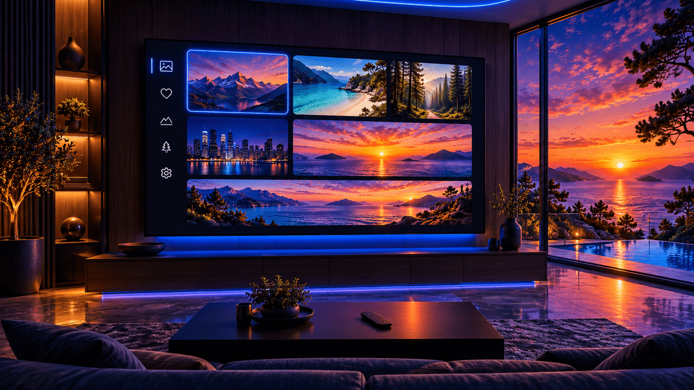

#### Android TV ಮತ್ತು Google TV ಯಲ್ಲಿ

ಅದೇ Android ಅಪ್ಲಿಕೇಶನ್, ಮೊದಲ ಪ್ರಾರಂಭದಿಂದ ಡಾರ್ಕ್ ಥೀಮ್‌ನಲ್ಲಿ, ರಿಮೋಟ್ ಏಕೈಕ ಇನ್‌ಪುಟ್ ಆಗಿ. ವೀಕ್ಷಕದಲ್ಲಿ, ಎಡ ಮತ್ತು ಬಲ ಹಿಂದಿನ ಅಥವಾ ಮುಂದಿನ ಫೋಟೋ ಅಥವಾ ವೀಡಿಯೊಗೆ ಹೋಗುತ್ತವೆ, ವೀಡಿಯೊ ಪ್ಲೇ ಆಗುತ್ತಿರುವಾಗಲೂ, ಮತ್ತು 360° ಫೋಟೋ ಅಥವಾ ವೀಡಿಯೊದಲ್ಲಿ ಬಾಣಗಳು ಸುತ್ತಲೂ ನೋಡುತ್ತವೆ.

  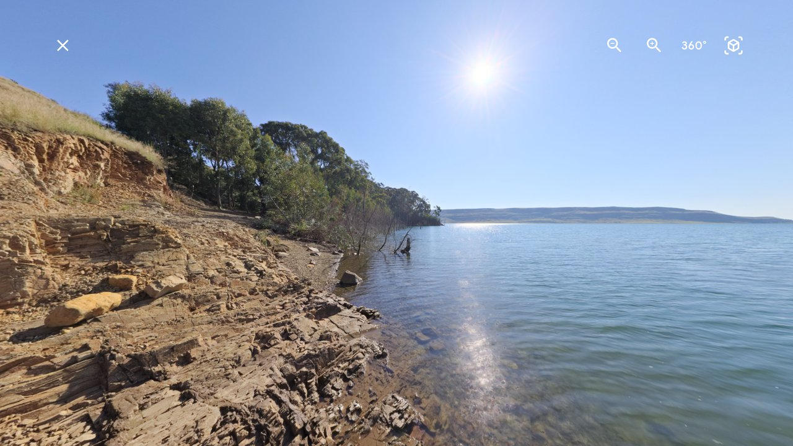

1. adb ನೊಂದಿಗೆ APK ಅನ್ನು ಇನ್‌ಸ್ಟಾಲ್ ಮಾಡಿ, [ಇನ್‌ಸ್ಟಾಲ್](#android-tv-and-google-tv) ನೋಡಿ. ಸ್ವಾಗತ ಪುಟದಲ್ಲಿ, ಒಂದು ಹಂಚಿಕೆ, ಒಂದು Plex ಸರ್ವರ್ ಅಥವಾ ಒಂದು ಕ್ಯಾಮೆರಾಗಾಗಿ "ನೆಟ್‌ವರ್ಕ್ ಹಂಚಿಕೆ ಅಥವಾ ಮೀಡಿಯಾ ಸರ್ವರ್ ಸೇರಿಸಿ", "ಸರ್ವರ್ ಇಲ್ಲದೆ ಬಳಸಿ", ಅಥವಾ "Immich ಸರ್ವರ್‌ಗೆ ಸಂಪರ್ಕಿಸಿ" ಆಯ್ಕೆ ಮಾಡಿ; ಕೊನೆಯದರ ಪುಟದ QR ಕೋಡ್ ಅನ್ನು ನಿಮ್ಮ ಫೋನ್‌ನಿಂದ ಸ್ಕ್ಯಾನ್ ಮಾಡಿದಾಗ ಅದು TV ಯನ್ನು ಸೈನ್ ಇನ್ ಮಾಡುತ್ತದೆ ([ನಿಮ್ಮ ಫೋನ್‌ನೊಂದಿಗೆ ಸೈನ್ ಇನ್](#sign-in-a-tv-a-headset-or-a-computer-with-your-phone) ನೋಡಿ).
2. ವೀಕ್ಷಕದಲ್ಲಿ, ರಿಮೋಟ್‌ನ ಪ್ಲೇ ಮತ್ತು ಪಾಸ್, ರಿವೈಂಡ್, ಫಾಸ್ಟ್ ಫಾರ್ವರ್ಡ್, ಹಿಂದಿನ ಮತ್ತು ಮುಂದಿನ ಕೀಗಳು ಕೆಲಸ ಮಾಡುತ್ತವೆ. ವೀಡಿಯೊ ಸಮಯದಲ್ಲಿ OK ಪ್ಲೇ ಮತ್ತು ಪಾಸ್ ಆಯ್ಕೆಯಾಗಿರುವ ನಿಯಂತ್ರಣಗಳನ್ನು ತೋರಿಸುತ್ತದೆ, ಮತ್ತು ಎರಡನೇ OK ವಿರಾಮಗೊಳಿಸುತ್ತದೆ; ನಂತರ -10 s ಮತ್ತು +10 s ಬಟನ್‌ಗಳು ಬರುತ್ತವೆ, ನಂತರ ಚಲನಚಿತ್ರದಲ್ಲಿ ಇದ್ದರೆ ಆಡಿಯೋ ಮತ್ತು ಉಪಶೀರ್ಷಿಕೆ ಬಟನ್‌ಗಳು. build 29 ರಿಂದ, ಪ್ಲೇ ಇಂದ Down ಟೈಮ್ ಬಾರ್ ತಲುಪುತ್ತದೆ: ಎಡ ಮತ್ತು ಬಲ ಪ್ರತಿ ಒತ್ತುವಿಕೆಗೆ 10 s ಸರಿಸುತ್ತವೆ, ಒತ್ತಿ ಹಿಡಿದಾಗ ವೇಗವಾಗಿ, ಮತ್ತು OK ಪ್ಲೇ ಅಥವಾ ವಿರಾಮ ಮಾಡುತ್ತದೆ. ಕೊನೆಯ ಕೀ ನಂತರ 5 s ನಲ್ಲಿ ನಿಯಂತ್ರಣಗಳು ಮತ್ತು ದಿನಾಂಕ ಮರೆಯಾಗುತ್ತವೆ, ಮತ್ತು ನಂತರ ಎಡ ಮತ್ತು ಬಲ ಹಿಂದಿನ ಅಥವಾ ಮುಂದಿನ ಫೈಲ್‌ಗೆ ಹೋಗುತ್ತವೆ; ಹಂಚಿಕೆಯಲ್ಲಿ, ಆ ಫೈಲ್ ತನ್ನದೇ ಪುಟದಲ್ಲಿ ತೆರೆಯುತ್ತದೆ, ಅದನ್ನು ನಡೆಸುವ ನಿಯಂತ್ರಣಗಳೊಂದಿಗೆ. TV ಯಲ್ಲಿ ವೀಡಿಯೊಗಳು ಇನ್ನು ಲೂಪ್ ಆಗುವುದಿಲ್ಲ, ನೀವು Settings, Asset Viewer, Videos, Looping ಆನ್ ಮಾಡದ ಹೊರತು.
3. Menu ಕೀ, Info ಕೀ ಅಥವಾ ಒತ್ತಿ ಹಿಡಿದ OK ಫೋಟೋ ಅಥವಾ ವೀಡಿಯೊದ ವಿವರಗಳನ್ನು ತೆರೆಯುತ್ತದೆ, ಓದಲು ಮಾತ್ರ: ದಿನಾಂಕ, ಸ್ಥಳ, ಕ್ಯಾಮೆರಾ, ಕೋಡೆಕ್, ಗಾತ್ರ ಮತ್ತು ಬಿಟ್ ದರ. TV ಡಿಕೋಡ್ ಮಾಡಲಾಗದ ವೀಡಿಯೊ ಅನಂತವಾಗಿ ಲೋಡ್ ಆಗುವ ಬದಲು ಅದನ್ನು ಹೇಳುತ್ತದೆ, ಅದರ ಕೋಡೆಕ್, ಅದರ ಗಾತ್ರ ಮತ್ತು TV ಯ ಡಿಕೋಡರ್‌ಗಳ ಮಿತಿಯೊಂದಿಗೆ; ಡಿಕೋಡರ್‌ಗಳ ಸಾಮರ್ಥ್ಯ ಮೀರಿದ 360° ವೀಡಿಯೊ 360° ಪ್ಲೇಯರ್ ತೆರೆಯುವ ಮೊದಲು ಕೇಳುತ್ತದೆ, ಮತ್ತು ಕಾರಣವನ್ನು ಪ್ರೊಫೈಲ್ ಮೆನುವಿನ Logs ಪುಟದಲ್ಲಿ ಬರೆಯಲಾಗುತ್ತದೆ.

build 28 23 ಅಕ್ಟೋಬರ್‌ರಂದು ನಿಜವಾದ Android TV ಯಲ್ಲಿ ಚಲಿಸಿತು; build 29 ರ ವೀಡಿಯೊ ಸರಿಪಡಿಸುವಿಕೆಗಳು ಆ ಚಾಲನೆಯಿಂದ ಬಂದವು ಮತ್ತು Google TV ಎಮ್ಯುಲೇಟರ್‌ನಲ್ಲಿ ಪರಿಶೀಲಿಸಲಾಗಿದೆ, ಇನ್ನೂ ಆ TV ಯಲ್ಲಿ ಅಲ್ಲ.

#### LG TV ಯಲ್ಲಿ (webOS)

Immich ನ ಸ್ವಂತ ಅಪ್ಲಿಕೇಶನ್‌ಗಳು LG TV ಯಲ್ಲಿ ಇನ್‌ಸ್ಟಾಲ್ ಆಗುವುದಿಲ್ಲ. Immuch360 webOS 5.0 ಮತ್ತು ನಂತರದ ಆವೃತ್ತಿಯ LG TVಗಳಿಗೆ (2020 ರಿಂದ TVಗಳು) ತನ್ನದೇ TV ಅಪ್ಲಿಕೇಶನ್ ಹೊಂದಿದೆ, ರಿಮೋಟ್ ಮತ್ತು Magic Remote ನಿಂದ ಚಾಲಿತ: ಅದು ನಿಮ್ಮ Immich ಸರ್ವರ್, ನಿಮ್ಮ ನೆಟ್‌ವರ್ಕ್ ಹಂಚಿಕೆಗಳು, ನಿಮ್ಮ Plex ಸರ್ವರ್ ಮತ್ತು ನಿಮ್ಮ Tapo ಕ್ಯಾಮೆರಾಗಳನ್ನು ತೋರಿಸುತ್ತದೆ, ಮತ್ತು ನಿಮ್ಮ 360° ಫೋಟೋಗಳನ್ನು ಬಾಣಗಳಿಂದ ನೀವು ತಿರುಗಿಸುವ ಗೋಳದ ಮೇಲೆ ಇಡುತ್ತದೆ. ಅದು Seeky91 ಅವರ [immich-tv-webos](https://github.com/Seeky91/immich-tv-webos) ಮೇಲೆ ನಿರ್ಮಿತ, ಅದು ಟೈಮ್‌ಲೈನ್, ಆಲ್ಬಮ್‌ಗಳು, ಜನರು, ಸ್ಥಳಗಳು, ಹುಡುಕಾಟ, ಸ್ಲೈಡ್‌ಶೋ ಮತ್ತು ಫೋನ್‌ನೊಂದಿಗೆ ಸೈನ್ ಇನ್ ತಂದಿತು; Seeky91 ಅವರಿಗೆ ಧನ್ಯವಾದಗಳು. ಆವೃತ್ತಿ 1.0.0 ಅನ್ನು 24 ಅಕ್ಟೋಬರ್‌ರಂದು LG Content Store ಗೆ ಸಲ್ಲಿಸಲಾಯಿತು ಮತ್ತು LG ನ Cloud Test Lab ನ webOS 25 TVಗಳಲ್ಲಿ ಚಲಿಸಿತು; LG ಅದನ್ನು ಅನುಮೋದಿಸುವವರೆಗೆ, ಅದು Developer Mode ನಲ್ಲಿ ಇನ್‌ಸ್ಟಾಲ್ ಆಗುತ್ತದೆ, ಮತ್ತು [Issues](https://github.com/freeKC/Immuch360/issues) ನಲ್ಲಿನ ಪ್ರತಿ ವರದಿ ಸಹಾಯ ಮಾಡುತ್ತದೆ.

1. ಅದನ್ನು Developer Mode ನಲ್ಲಿರುವ TV ಯಲ್ಲಿ ಇನ್‌ಸ್ಟಾಲ್ ಮಾಡಿ, [ಇನ್‌ಸ್ಟಾಲ್](#lg-tvs-webos) ನೋಡಿ. ಅದಕ್ಕೆ ತನ್ನದೇ ಆದ app id ಇದೆ, ಆದ್ದರಿಂದ ಅದು Seeky91 ಅವರ Immich TV ಯ ಪಕ್ಕದಲ್ಲಿ ಇನ್‌ಸ್ಟಾಲ್ ಆಗುತ್ತದೆ.
2. ನಿಮ್ಮ ಫೋನ್‌ನೊಂದಿಗೆ (QR ಕೋಡ್ ಸ್ಕ್ಯಾನ್ ಮಾಡಿ), ನಿಮ್ಮ ಇಮೇಲ್ ಮತ್ತು ಪಾಸ್‌ವರ್ಡ್‌ನೊಂದಿಗೆ, ಅಥವಾ API ಕೀಯೊಂದಿಗೆ ಸೈನ್ ಇನ್ ಮಾಡಿ.
3. ಬಾಣಗಳು ಮತ್ತು OK ಯೊಂದಿಗೆ ಬ್ರೌಸ್ ಮಾಡಿ. ವೀಕ್ಷಕದಲ್ಲಿ, ಎಡ ಮತ್ತು ಬಲ ಹಿಂದಿನ ಅಥವಾ ಮುಂದಿನ ಫೋಟೋ ಅಥವಾ ವೀಡಿಯೊಗೆ ಹೋಗುತ್ತವೆ, ವೀಡಿಯೊ ಪ್ಲೇ ಆಗುತ್ತಿರುವಾಗಲೂ; ಕೊನೆಯ ಕೀಯ 5 s ನಂತರ ನಿಯಂತ್ರಣಗಳು ಮರೆಯಾಗುತ್ತವೆ; Info ವಿವರಗಳನ್ನು ತೆರೆಯುತ್ತದೆ; ಚಾನಲ್ ಕೀಗಳು ಜೂಮ್ ಮಾಡುತ್ತವೆ; Magic Remote ಪಾಯಿಂಟರ್ ಮತ್ತು ವೀಲ್ ಕೆಲಸ ಮಾಡುತ್ತವೆ. ಆವೃತ್ತಿ 1.0.1 ರಿಂದ, GitHub ನಲ್ಲಿ, ಮೇಲೆ ಕೀ ಫೋಟೋವನ್ನು ತಕ್ಷಣ ಜೂಮ್ ಇನ್ ಮಾಡುತ್ತದೆ, ನಂತರ ಬಾಣಗಳು ಅದನ್ನು ಸರಿಸುತ್ತವೆ ಮತ್ತು ಹಿಂದೆ ಕೀ ಜೂಮ್ ಔಟ್ ಮಾಡುತ್ತದೆ, ಮತ್ತು ಫೋಟೋ ಇನ್ನೂ ಬರುತ್ತಿರುವಾಗ ಲೋಡ್ ಆಗುತ್ತಿದೆ ಎಂಬ ಗುರುತು ಕಾಣಿಸುತ್ತದೆ.
4. 360° ಫೋಟೋ ಗೋಳದ ಮೇಲೆ ತೆರೆಯುತ್ತದೆ: ಬಾಣದ ಪ್ರತಿ ಒತ್ತುವಿಕೆ ಅದನ್ನು ಒಂದು ಹಂತ ತಿರುಗಿಸುತ್ತದೆ, ಮತ್ತು ಒತ್ತಿ ಹಿಡಿದ ಕೀ ಅದನ್ನು ತಿರುಗಿಸುತ್ತಲೇ ಇರುತ್ತದೆ. "360° ಆಗಿ ವೀಕ್ಷಿಸಿ" ಸರ್ವರ್ ಗುರುತಿಸದ 2:1 ಫೋಟೋವನ್ನು ಒಳಗೊಳ್ಳುತ್ತದೆ; VR180 ಫೋಟೋ ಅರ್ಧ ಗೋಳದ ಮೇಲೆ ಮತ್ತು 3D ಫೋಟೋ ಒಂದು ಕಣ್ಣಿನೊಂದಿಗೆ ಕಾಣುತ್ತದೆ. ಹಳದಿ ಮತ್ತು ನೀಲಿ ಕೀಗಳು ಫ್ಲಾಟ್ ಫೋಟೋವನ್ನು ತಿರುಗಿಸುತ್ತವೆ.
5. ಸೈನ್ ಇನ್ ಆದ ನಂತರ, ಅಪ್ಲಿಕೇಶನ್‌ನ ರೈಲ್‌ನಲ್ಲಿ "ನೆಟ್‌ವರ್ಕ್ ಹಂಚಿಕೆಗಳು": SMB, WebDAV ಅಥವಾ DLNA ಹಂಚಿಕೆ, Plex ಸರ್ವರ್ (plex.tv/link ನಲ್ಲಿ ಕೋಡ್‌ನೊಂದಿಗೆ ಸೈನ್ ಇನ್) ಅಥವಾ Tapo ಕ್ಯಾಮೆರಾ ಸೇರಿಸಿ. ಅವುಗಳ ಫೋಟೋಗಳು ಅದೇ ವೀಕ್ಷಕದಲ್ಲಿ ತೆರೆಯುತ್ತವೆ, 360° ಫೋಟೋಗಳು ಗೋಳದ ಮೇಲೆ.

ಆವೃತ್ತಿ 1.0.0 ಅನ್ನು LG Content Store ಗಾಗಿ ಮಾಡಲಾಗಿದೆ: Back ಪ್ರತಿ webOS ಆವೃತ್ತಿ ನಿರೀಕ್ಷಿಸುವ ರೀತಿಯಲ್ಲಿ Photos ಅಥವಾ ಸ್ವಾಗತ ಪುಟದಿಂದ ಅಪ್ಲಿಕೇಶನ್‌ನಿಂದ ನಿರ್ಗಮಿಸುತ್ತದೆ, ಮತ್ತು ಮೊದಲು ತೆರೆದಿರುವ ಪಾಪ್‌ಅಪ್ ಮುಚ್ಚುತ್ತದೆ; 15 s ಒಳಗೆ ಉತ್ತರಿಸದ ಸರ್ವರ್ ಕಾರಣ ಹೇಳುವ ಸಂದೇಶ ಮತ್ತು Retry ಬಟನ್‌ನೊಂದಿಗೆ ಕೊನೆಗೊಳ್ಳುತ್ತದೆ; ಗೌಪ್ಯತಾ ನೀತಿ ಅಪ್ಲಿಕೇಶನ್‌ನಲ್ಲಿ ತೆರೆಯುತ್ತದೆ, ಫೋನ್‌ನಲ್ಲಿ [ಅದರ LG TV ವಿಭಾಗ](../PRIVACY.md#lg-tvs-webos) ಓದಲು QR ಕೋಡ್‌ನೊಂದಿಗೆ; TV ತನ್ನ Gallery ಚಿತ್ರ ಮೋಡ್ ಬಳಸುತ್ತದೆ, LG ಫೋಟೋ ಅಪ್ಲಿಕೇಶನ್‌ಗಳಿಂದ ಕೇಳುವಂತೆ; ಮತ್ತು ಎರಡನೇ ಪ್ಯಾಕೇಜ್ LG 1280x720 ಅಪ್ಲಿಕೇಶನ್‌ಗಳನ್ನು ನೀಡುವ Full HD TVಗಳಿಗೆ ಸೂಕ್ತ.

ಮಿತಿಗಳು: SMB ಗೆ webOS 22 (2022 ರ TVಗಳು) ಅಥವಾ ನಂತರದ ಆವೃತ್ತಿ ಬೇಕು. ಹಂಚಿಕೆಗಳು, Plex ಮತ್ತು ಕ್ಯಾಮೆರಾಗಳು TV ಯಲ್ಲಿನ ಅಪ್ಲಿಕೇಶನ್‌ನ ಸ್ವಂತ ಸೇವೆಯ ಮೂಲಕ ಬರುತ್ತವೆ, ಅದು ಅಪ್ಲಿಕೇಶನ್‌ಗಾಗಿ ಅವುಗಳನ್ನು ಓದುತ್ತದೆ, ಮತ್ತು ಯೋಜನೆಯ build ಹೋಸ್ಟ್‌ನಲ್ಲಿ ನಿಜವಾದ ಸರ್ವರ್‌ಗಳು ಮತ್ತು ಸಿಮ್ಯುಲೇಟೆಡ್ ಕ್ಯಾಮೆರಾದ ವಿರುದ್ಧ ಪರಿಶೀಲಿಸಲಾಗಿದೆ, ಇನ್ನೂ TV ಯಲ್ಲಿ ಅಲ್ಲ. ಕ್ಯಾಮೆರಾದ ಲೈವ್ ವೀಕ್ಷಣೆ ವೀಡಿಯೊ ಮಾತ್ರ. ಇನ್ನೂ ಇಲ್ಲ: ಕ್ಯಾಮೆರಾಗಳ ರೆಕಾರ್ಡಿಂಗ್‌ಗಳು (ಡಿಸೆಂಬರ್ 2026 ಕ್ಕಿಂತ ಮೊದಲು ಅಲ್ಲ) ಮತ್ತು ಅವುಗಳ ಧ್ವನಿ, ಗೋಳದ ಮೇಲೆ 360° ವೀಡಿಯೊಗಳು (ಅವು ಸಂದೇಶದೊಂದಿಗೆ ಫ್ಲಾಟ್ ಆಗಿ ಪ್ಲೇ ಆಗುತ್ತವೆ), ಅಪ್‌ಲೋಡ್‌ಗಳು. webOS 25 ಕ್ಕಿಂತ ಮೊದಲು, Immich ನ ಮುಂದಿರುವ ರಿವರ್ಸ್ ಪ್ರಾಕ್ಸಿ CORS ಹೆಡರ್‌ಗಳನ್ನು ಕಳುಹಿಸಬೇಕು; ಸಮಸ್ಯೆ ಎದುರಾದಾಗ ಅಪ್ಲಿಕೇಶನ್ ಅವುಗಳನ್ನು ವಿವರಿಸುತ್ತದೆ. webOS 26 ಅನ್ನು ಇನ್ನೂ ಪ್ರಯತ್ನಿಸಿಲ್ಲ.

#### Samsung TV ಯಲ್ಲಿ (Tizen)

Tizen 5.5 ಮತ್ತು ನಂತರದ ಆವೃತ್ತಿಯ Samsung TVಗಳು (2020 ರಿಂದ TVಗಳು) ಅದೇ TV ಅಪ್ಲಿಕೇಶನ್ ಅನ್ನು ಪರೀಕ್ಷಾ build 0.2.0 ಆಗಿ ಪಡೆಯುತ್ತವೆ, ಅದು Samsung ನ ಸ್ಟೋರ್‌ನಲ್ಲಿ ಇಲ್ಲ: ಟೈಪ್ ಮಾಡಿ ಸೈನ್ ಇನ್, ಟೈಮ್‌ಲೈನ್, ಆಲ್ಬಮ್‌ಗಳು, ವೀಕ್ಷಕ ಮತ್ತು ಸ್ಲೈಡ್‌ಶೋ, ಗೋಳದ ಮೇಲೆ 360° ಫೋಟೋಗಳು ಮತ್ತು ಒಂದೇ ಕೀಯಿಂದ ತಿರುಗಿಸಿದ ಫೋಟೋ. ಇನ್ನೂ ಇಲ್ಲ: ಫೋನ್‌ನೊಂದಿಗೆ ಸೈನ್ ಇನ್, ಹಂಚಿಕೆಗಳು, Plex ಮತ್ತು ಕ್ಯಾಮೆರಾಗಳು, ಅವು LG TVಗಳಲ್ಲಿ Samsung ಆವೃತ್ತಿಯಲ್ಲಿ ಇನ್ನೂ ಇಲ್ಲದ ಹಿನ್ನೆಲೆ ಸೇವೆಯಲ್ಲಿ ಚಲಿಸುತ್ತವೆ.

1. ನಿಮ್ಮ TV ಗಾಗಿ ಪ್ಯಾಕೇಜ್ ಸೈನ್ ಮಾಡಿ ಮತ್ತು ಅದನ್ನು Developer mode ನಲ್ಲಿ ಇನ್‌ಸ್ಟಾಲ್ ಮಾಡಿ, [ಇನ್‌ಸ್ಟಾಲ್](#samsung-tvs-tizen) ನೋಡಿ.
2. ನಿಮ್ಮ ಸರ್ವರ್ ವಿಳಾಸ, ನಂತರ ನಿಮ್ಮ ಇಮೇಲ್ ಮತ್ತು ಪಾಸ್‌ವರ್ಡ್ ಅಥವಾ API ಕೀ ಟೈಪ್ ಮಾಡಿ ಸೈನ್ ಇನ್ ಮಾಡಿ.
3. ಬಾಣಗಳು ಮತ್ತು OK ಯಿಂದ ಬ್ರೌಸ್ ಮಾಡಿ. 360° ಫೋಟೋ ಗೋಳದ ಮೇಲೆ ತೆರೆಯುತ್ತದೆ; 360° ವೀಡಿಯೊ ಫ್ಲಾಟ್ ಆಗಿ ಪ್ಲೇ ಆಗುತ್ತದೆ, ಮೊದಲ ಬಾರಿ ಸೂಚನೆಯೊಂದಿಗೆ, ಏಕೆಂದರೆ ಒಬ್ಬ ಪರೀಕ್ಷಕರ TV ಯಲ್ಲಿ TV ಯ ಬ್ರೌಸರ್ 3D ವೀಕ್ಷಣೆಗೆ ಕಪ್ಪು ವೀಡಿಯೊ ಫ್ರೇಮ್‌ಗಳನ್ನು ನೀಡಿತು.
4. TV ಯ ಡಿಕೋಡರ್‌ಗಳು ಸ್ವೀಕರಿಸುವುದಕ್ಕಿಂತ ಮೇಲಿನ ವೀಡಿಯೊ ಅನಂತವಾಗಿ ಲೋಡ್ ಆಗುವ ಬದಲು ಅದನ್ನು ಹೇಳುತ್ತದೆ, TV ಪ್ಲೇ ಮಾಡಬಲ್ಲ ಗಾತ್ರ ಮತ್ತು ಫೈಲ್‌ನ ಗಾತ್ರದೊಂದಿಗೆ. ಸ್ಥಗಿತಗೊಳ್ಳುವ ವೀಡಿಯೊ ತನ್ನ ಬಿಟ್‌ರೇಟ್ ಮತ್ತು ಪರಿಹಾರದೊಂದಿಗೆ ಸೂಚನೆ ತೋರಿಸುತ್ತದೆ: ಭಾರೀ ಫೈಲ್‌ಗಳನ್ನು Immich ಟ್ರಾನ್ಸ್‌ಕೋಡ್ ಮಾಡಲು ಬಿಡಿ, ಅಥವಾ ವೇಗವಾದ ಸಂಪರ್ಕ ಬಳಸಿ. "ಈ TV ಬಗ್ಗೆ" TV ಯ ವೀಡಿಯೊ ಮಿತಿಯನ್ನು ನೀಡುತ್ತದೆ.

ಆವೃತ್ತಿ 0.1.0 Tizen 9 ಇರುವ ಒಬ್ಬ ಪರೀಕ್ಷಕರ Samsung TV ಯಲ್ಲಿ ಚಲಿಸಿತು, ಮತ್ತು 0.2.0 ಆ ಚಾಲನೆಯ ಸರಿಪಡಿಸುವಿಕೆಗಳನ್ನು ಹೊಂದಿದೆ; 0.2.0 ಇನ್ನೂ TV ಯಲ್ಲಿ ಚಲಿಸಿಲ್ಲ. ಚಾಲನೆಯ ನಂತರ About ಪುಟದ ಪಠ್ಯವನ್ನು [Discussions](https://github.com/freeKC/Immuch360/discussions) ಅಥವಾ [Issues](https://github.com/freeKC/Immuch360/issues) ನಲ್ಲಿ ಪೋಸ್ಟ್ ಮಾಡುವುದು ಹೆಚ್ಚು ಸಹಾಯಕ.

ಇನ್ನಷ್ಟು: [ನಿಮ್ಮ TV ಯಲ್ಲಿ ವೀಕ್ಷಿಸಿ](../docs/immuch360/user-guide.md#watch-on-your-tv-android-tv-and-google-tv), [webOS ಅಪ್ಲಿಕೇಶನ್: ಇನ್‌ಸ್ಟಾಲ್, ರಿಮೋಟ್ ಕಂಟ್ರೋಲ್ ಕೀಗಳು, CORS ಹೆಡರ್‌ಗಳು](../webos/README.md), [ಪ್ಲಾಟ್‌ಫಾರ್ಮ್ ಬೆಂಬಲ](../docs/immuch360/platform-support.md).

### ನಿಮ್ಮ ಫೋನ್‌ನೊಂದಿಗೆ TV, ಹೆಡ್‌ಸೆಟ್ ಅಥವಾ ಕಂಪ್ಯೂಟರ್‌ಗೆ ಸೈನ್ ಇನ್ ಮಾಡಿ

**ಸ್ಕ್ಯಾನ್ ಮಾಡಿ. ಸೈನ್ ಇನ್ ಮಾಡಿ. ವೀಕ್ಷಿಸಿ.** TV ರಿಮೋಟ್‌ನಿಂದ, ಅಥವಾ ಹೆಡ್‌ಸೆಟ್‌ನಲ್ಲಿ, ಸರ್ವರ್ ವಿಳಾಸ, ಇಮೇಲ್ ಮತ್ತು ಪಾಸ್‌ವರ್ಡ್ ಟೈಪ್ ಮಾಡಲು ನಿಮಿಷಗಳು ಬೇಕಾಗುತ್ತವೆ. ನಿಮ್ಮ Immich ಸರ್ವರ್‌ಗೆ ಸೈನ್ ಇನ್ ಆದ ನಿಮ್ಮ ಫೋನ್‌ನಲ್ಲಿ Immuch360 ಇದ್ದರೆ, TV, Meta Quest ಅಥವಾ ಕಂಪ್ಯೂಟರ್ ಕೆಲವೇ ಸೆಕೆಂಡುಗಳಲ್ಲಿ ಸೈನ್ ಇನ್ ಆಗುತ್ತದೆ: ದೊಡ್ಡ ಪರದೆ QR ಕೋಡ್ ತೋರಿಸುತ್ತದೆ, ಫೋನ್ ಅದನ್ನು ಸ್ಕ್ಯಾನ್ ಮಾಡುತ್ತದೆ, ನೀವು ದೃಢೀಕರಿಸುತ್ತೀರಿ, ಮತ್ತು ಪರದೆ ನಿಮ್ಮ ಲೈಬ್ರರಿಯ ಮೇಲೆ ತೆರೆಯುತ್ತದೆ. ಫೋನ್ ಅಪ್ಲಿಕೇಶನ್‌ನೊಂದಿಗೆ, ನಿಮ್ಮ ಪಾಸ್‌ವರ್ಡ್ ಫೋನ್‌ನಲ್ಲೇ ಉಳಿಯುತ್ತದೆ. Immich ಅಪ್ಲಿಕೇಶನ್‌ನಲ್ಲಿ ಇಂತಹದ್ದೇನೂ ಇಲ್ಲ.

  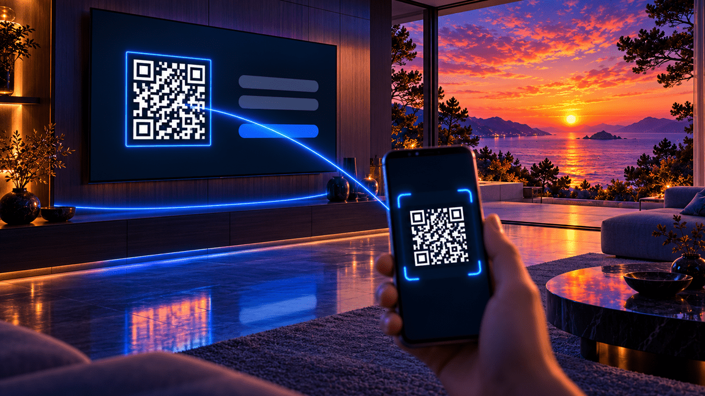

1. ದೊಡ್ಡ ಪರದೆಯಲ್ಲಿ (Android TV ಮತ್ತು Google TV, Meta Quest ವಿಂಡೋ, Windows, Linux ಅಥವಾ macOS), "Immich ಸರ್ವರ್‌ಗೆ ಸಂಪರ್ಕಿಸಿ" ಆಯ್ಕೆ ಮಾಡಿ: ಸೈನ್ ಇನ್ ಪುಟ ಸರ್ವರ್ ಫಾರ್ಮ್‌ನ ಪಕ್ಕದಲ್ಲಿ "ನಿಮ್ಮ ಫೋನ್‌ನೊಂದಿಗೆ ಸೈನ್ ಇನ್ ಮಾಡಿ", ಒಂದು QR ಕೋಡ್ ಮತ್ತು 10 ಅಕ್ಷರಗಳ ಕೋಡ್ ಅನ್ನು ತೋರಿಸುತ್ತದೆ.
2. ನಿಮ್ಮ ಸರ್ವರ್‌ಗೆ ಸೈನ್ ಇನ್ ಆಗಿರುವ ಫೋನ್‌ನಲ್ಲಿ: ಸೆಟ್ಟಿಂಗ್‌ಗಳು, "TV ಅಥವಾ ಕಂಪ್ಯೂಟರ್ ಸಂಪರ್ಕಿಸಿ", ನಂತರ "ಕೋಡ್ ಸ್ಕ್ಯಾನ್ ಮಾಡಿ". Meta Quest ನಲ್ಲಿ, ಅದರ ಪರದೆಯನ್ನು ಫೋನ್ ಸ್ಕ್ಯಾನ್ ಮಾಡಲು ಸಾಧ್ಯವಿಲ್ಲದ ಕಾರಣ, "ಬದಲಿಗೆ ಕೋಡ್ ನಮೂದಿಸಿ" ಆಯ್ಕೆ ಮಾಡಿ ಮತ್ತು ಹೆಡ್‌ಸೆಟ್ ತೋರಿಸುವ ಕೋಡ್ ಅನ್ನು ಟೈಪ್ ಮಾಡಿ.
3. ಫೋನ್ "(ಪರದೆ) ಗೆ ಸೈನ್ ಇನ್ ಮಾಡಬೇಕೇ?" ಎಂದು ಕೇಳುತ್ತದೆ ಮತ್ತು ಆರು ಅಂಕಿಯ ಸಂಖ್ಯೆಯನ್ನು ತೋರಿಸುತ್ತದೆ: ಪರದೆ ಅದೇ ಸಂಖ್ಯೆಯನ್ನು ತೋರಿಸುತ್ತಿದೆಯೇ ಎಂದು ಪರಿಶೀಲಿಸಿ, ನಂತರ ಸೈನ್ ಇನ್ ಟ್ಯಾಪ್ ಮಾಡಿ. ಪರದೆ ನಿಮ್ಮ ಟೈಮ್‌ಲೈನ್‌ನಲ್ಲಿ ತೆರೆಯುತ್ತದೆ.

ಇದು ಹೇಗೆ ಸುರಕ್ಷಿತವಾಗಿರುತ್ತದೆ: ಫೋನ್ ಮತ್ತು ಪರದೆ ಒಂದೇ ಮನೆಯ ನೆಟ್‌ವರ್ಕ್‌ನಲ್ಲಿರಬೇಕು, ಮತ್ತು ಕೋಡ್ ಗರಿಷ್ಠ ಎರಡು ನಿಮಿಷ ಇರುತ್ತದೆ ಮತ್ತು ಒಮ್ಮೆ ಮಾತ್ರ ಕೆಲಸ ಮಾಡುತ್ತದೆ. ಫೋನ್ ನಿಮ್ಮ ಸರ್ವರ್‌ನಿಂದ ಆ ಪರದೆಗಾಗಿ ಒಂದು ಹೊಸ ಸೆಷನ್ ಅನ್ನು ಕೇಳುತ್ತದೆ, ಅದರ ಹೆಸರಿನೊಂದಿಗೆ ("ಹಾಲ್ TV ಯಲ್ಲಿ Immuch360"), ಮತ್ತು ಅದನ್ನು ಎನ್‌ಕ್ರಿಪ್ಟ್ ಮಾಡಿ ಪರದೆಗೆ ಕಳುಹಿಸುತ್ತದೆ, ಆದ್ದರಿಂದ ನಿಮ್ಮ ಪಾಸ್‌ವರ್ಡ್ ಎಂದಿಗೂ ಫೋನ್ ಬಿಟ್ಟು ಹೋಗುವುದಿಲ್ಲ. "TV ಅಥವಾ ಕಂಪ್ಯೂಟರ್ ಸಂಪರ್ಕಿಸಿ" ಈ ಫೋನ್ ಸೈನ್ ಇನ್ ಮಾಡಿದ ಪರದೆಗಳನ್ನು ಪಟ್ಟಿ ಮಾಡುತ್ತದೆ, ಪ್ರತಿಯೊಂದೂ ಸೈನ್ ಔಟ್ ಜೊತೆಗೆ, ಮತ್ತು Immich ಅವುಗಳನ್ನು ಖಾತೆ ಸೆಟ್ಟಿಂಗ್‌ಗಳು, ಅಧಿಕೃತ ಸಾಧನಗಳು ನಲ್ಲಿ ಪಟ್ಟಿ ಮಾಡುತ್ತದೆ, ಅಲ್ಲಿ ನೀವು ಅವುಗಳನ್ನು ರದ್ದುಗೊಳಿಸಲೂ ಬಹುದು. ಫೋನ್ ಅನ್ನು ಸೈನ್ ಔಟ್ ಮಾಡಿದರೆ ಅವುಗಳೂ ಸೈನ್ ಔಟ್ ಆಗುತ್ತವೆ.

ಫೋನ್ ಭಾಗ ಈಗ Android ನಲ್ಲಿ ಚಲಿಸುತ್ತದೆ, ಮತ್ತು iPhone ಮತ್ತು iPad ನಲ್ಲಿ ಮುಂದಿನ iOS ರಿಲೀಸ್‌ನಿಂದ. ಫೋನ್‌ನಲ್ಲಿ Immuch360 ಇಲ್ಲದಿದ್ದರೆ, ಫೋನ್‌ನ ಕ್ಯಾಮೆರಾದಿಂದ ಕೋಡ್ ಸ್ಕ್ಯಾನ್ ಮಾಡಿ: ಪರದೆ ಒದಗಿಸುವ ಪುಟ ಬ್ರೌಸರ್‌ನಲ್ಲಿ ತೆರೆಯುತ್ತದೆ, ನಿಮ್ಮ ಇಮೇಲ್ ಮತ್ತು ಪಾಸ್‌ವರ್ಡ್‌ಗಾಗಿ, ಎನ್‌ಕ್ರಿಪ್ಟ್ ಮಾಡಿ ಒಮ್ಮೆ ಮಾತ್ರ ಬಳಸಲಾಗುತ್ತದೆ. LG TVಗಳು ತಮ್ಮದೇ QR ಕೋಡ್‌ನಿಂದ, ಫೋನ್‌ನ ಬ್ರೌಸರ್‌ನಲ್ಲಿ ಸೈನ್ ಇನ್ ಆಗುತ್ತವೆ; build 28 ರಿಂದ ಫೋನ್ ಅಪ್ಲಿಕೇಶನ್‌ನ ಸ್ಕ್ಯಾನರ್ ಅದನ್ನು ಗುರುತಿಸಿ ಆ ಪುಟವನ್ನು ತೆರೆಯುತ್ತದೆ. Samsung TVಗಳು ಸದ್ಯಕ್ಕೆ ಟೈಪ್ ಮಾಡಿ ಸೈನ್ ಇನ್ ಆಗುತ್ತವೆ.

ಇನ್ನೂ ಹೆಚ್ಚು: [ನಿಮ್ಮ ಫೋನ್‌ನೊಂದಿಗೆ ಸೈನ್ ಇನ್](../docs/immuch360/user-guide.md#sign-in-a-tv-a-headset-or-a-computer-with-your-phone), [ಪರದೆಗಳು ಏನು ಕಳುಹಿಸುತ್ತವೆ ಮತ್ತು ಇಟ್ಟುಕೊಳ್ಳುತ್ತವೆ](../docs/immuch360/technical-details.md#sign-in-with-your-phone).

### Meta Quest ನೊಂದಿಗೆ ನಿಮ್ಮ ಫೋಟೋಗಳು ಮತ್ತು ವೀಡಿಯೊಗಳ ಒಳಗೆ ಹೆಜ್ಜೆ ಇಡಿ

ಒಂದು Meta Quest ನಲ್ಲಿ ಅದೇ ಅಪ್ಲಿಕೇಶನ್ ನಿಮ್ಮ ಸಂಪೂರ್ಣ ಲೈಬ್ರರಿಯೊಂದಿಗೆ ಒಂದು ವಿಂಡೋ ಆಗಿ ಚಲಿಸುತ್ತದೆ, ಮತ್ತು ಅದರ 360° ಬಟನ್ ಒಂದು ಇಮ್ಮರ್ಸಿವ್ ವೀಕ್ಷಣೆಯನ್ನು ತೆರೆಯುತ್ತದೆ, ಅಲ್ಲಿ ಫೋಟೋ ಅಥವಾ ವೀಡಿಯೊ ನಿಮ್ಮ ಸುತ್ತಲೂ ಇರುತ್ತದೆ: ನಿಮ್ಮ ತಲೆಯನ್ನು ತಿರುಗಿಸುವ ಮೂಲಕ ನೀವು ಸುತ್ತಲೂ ನೋಡುತ್ತೀರಿ, ಸ್ಟೀರಿಯೋಸ್ಕೋಪಿಕ್ ಫೈಲ್‌ಗಳು ನಿಜವಾದ 3D ಯಲ್ಲಿ ಇರುತ್ತವೆ, ಒಂದು Apple spatial ಫೋಟೋ ನಿಮ್ಮ ಮುಂದೆ 3D ಯಲ್ಲಿ ತೇಲುತ್ತದೆ, ಮತ್ತು ಕಂಟ್ರೋಲರ್‌ಗಳು ಅಥವಾ ನಿಮ್ಮ ಕೈಗಳು ಟೈಮ್ ಬಾರ್, ಹಿಂದಿನದು ಮತ್ತು ಮುಂದಿನದು, ಮತ್ತು ನಿಮ್ಮ ಕುರ್ಚಿಯನ್ನು ತಿರುಗಿಸದೆ ನಿಮ್ಮ ಹಿಂದೆ ಇರುವುದನ್ನು ಮುಂದೆ ತರುವ Turn ಬಟನ್ ಅನ್ನು ಚಾಲನೆ ಮಾಡುತ್ತವೆ. ಮಾಧ್ಯಮ ನಿಮ್ಮ ಸರ್ವರ್, ಹೆಡ್‌ಸೆಟ್, ಒಂದು NAS, ಒಂದು ಮೀಡಿಯಾ ಸರ್ವರ್, ಒಂದು ಫೋನ್ ಅಥವಾ ಒಂದು Plex ಸರ್ವರ್‌ನಿಂದ ಬರುತ್ತದೆ, ಅಲ್ಲೇ ಪ್ಲೇ ಆಗುತ್ತದೆ.

  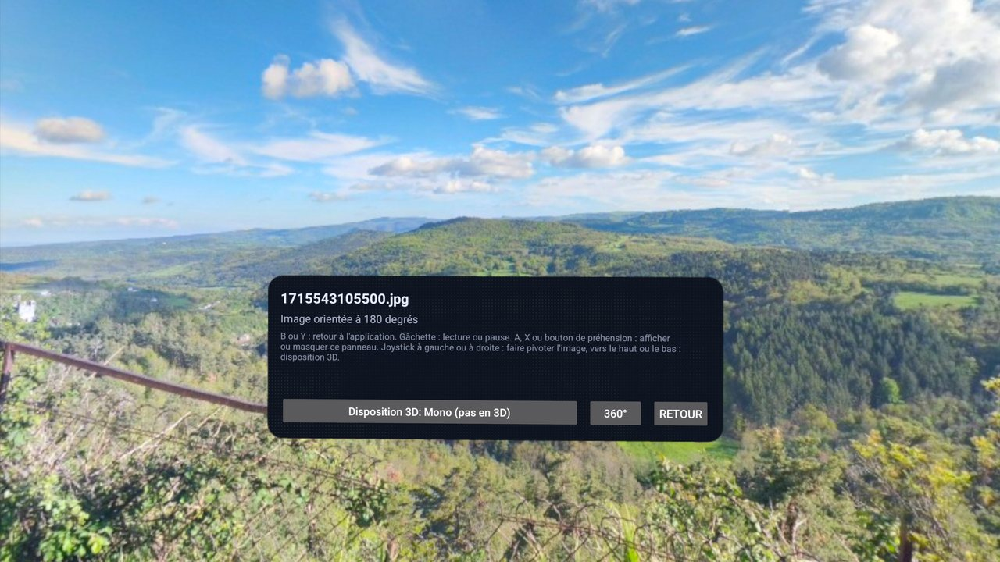
  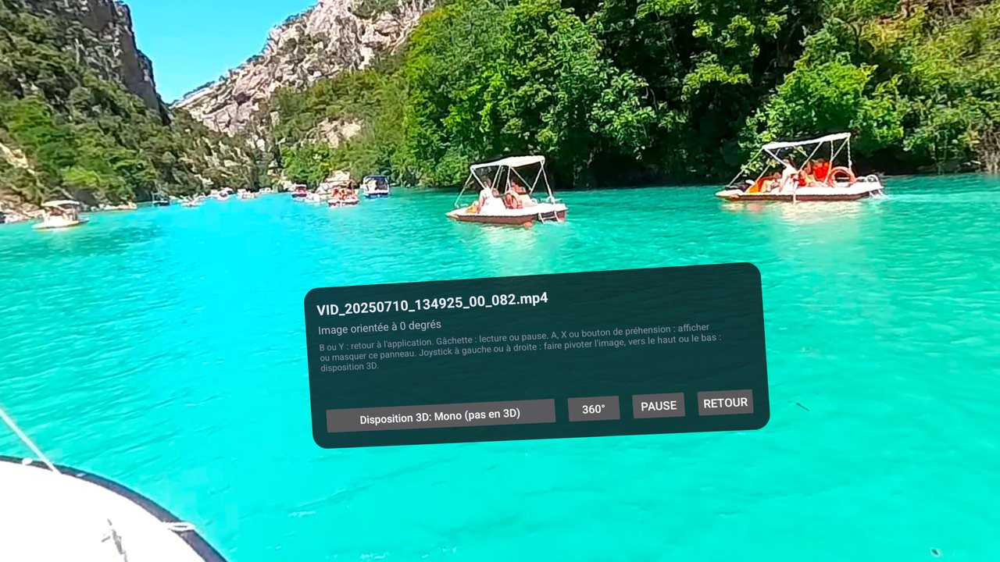
  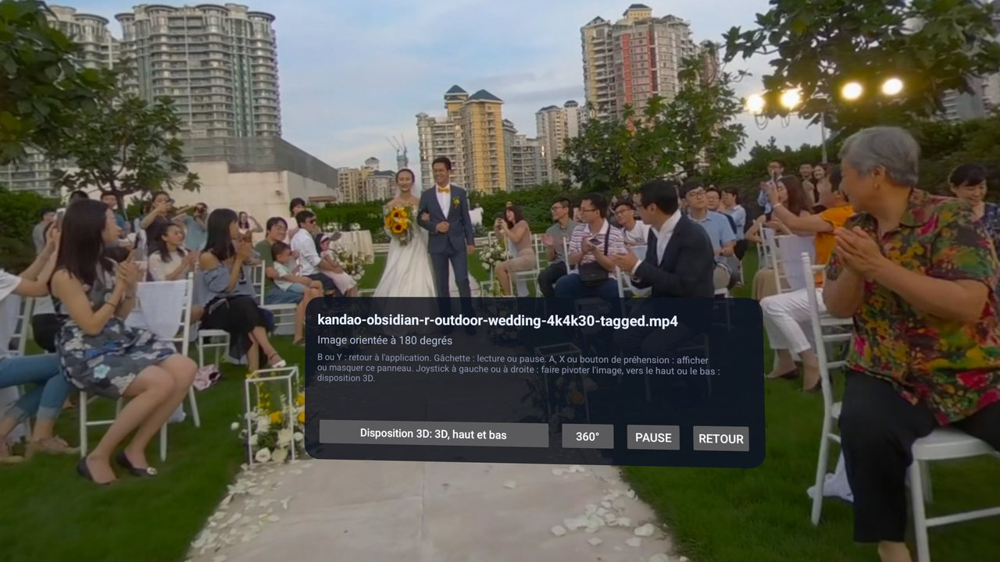

1. [Horizon Store](https://www.meta.com/experiences/immuch360/1384208401440714/) ನಿಂದ ಅಪ್ಲಿಕೇಶನ್ ಅನ್ನು ಇನ್‌ಸ್ಟಾಲ್ ಮಾಡಿ, ಅಥವಾ ಹೊಸ build ನ APK ಅನ್ನು sideload ಮಾಡಿ, [ಇನ್‌ಸ್ಟಾಲ್](#meta-quest) ನೋಡಿ.
2. ಸ್ವಾಗತ ಪುಟದಲ್ಲಿ, ಹೆಡ್‌ಸೆಟ್‌ನ ಸ್ವಂತ ಫೋಟೋಗಳು ಮತ್ತು ವೀಡಿಯೊಗಳಿಗಾಗಿ "ಸರ್ವರ್ ಇಲ್ಲದೆ ಬಳಸಿ" ಟ್ಯಾಪ್ ಮಾಡಿ, ಅಥವಾ "Immich ಸರ್ವರ್‌ಗೆ ಸಂಪರ್ಕಿಸಿ": ಹೆಡ್‌ಸೆಟ್ ತೋರಿಸುವ ಕೋಡ್ ಅನ್ನು ನಿಮ್ಮ ಫೋನ್‌ನಲ್ಲಿನ Immuch360 ನಲ್ಲಿ ಟೈಪ್ ಮಾಡಿ ([ನಿಮ್ಮ ಫೋನ್‌ನೊಂದಿಗೆ ಸೈನ್ ಇನ್](#sign-in-a-tv-a-headset-or-a-computer-with-your-phone)), ಅಥವಾ ನಿಮ್ಮ ಸರ್ವರ್ ವಿಳಾಸ, ಇಮೇಲ್ ಮತ್ತು ಪಾಸ್‌ವರ್ಡ್‌ನೊಂದಿಗೆ ಲಾಗಿನ್ ಮಾಡಿ.
3. ಒಂದು 360° ಫೋಟೋ ಅಥವಾ ವೀಡಿಯೊವನ್ನು ತೆರೆಯಿರಿ ಮತ್ತು 360° ಅನ್ನು ಒತ್ತಿ: ಇಮ್ಮರ್ಸಿವ್ ವೀಕ್ಷಣೆ ತೆರೆಯುತ್ತದೆ. B ಅಥವಾ Y, ಅಥವಾ ಮಾಹಿತಿ ಪ್ಯಾನೆಲ್‌ನ Back ಬಟನ್, ವಿಂಡೋವನ್ನು ಹಿಂತಿರುಗಿಸುತ್ತದೆ.
4. ಇಮ್ಮರ್ಸಿವ್ ವೀಕ್ಷಣೆಯಲ್ಲಿ, ವೀಕ್ಷಣೆಯನ್ನು ಆ ದಿಕ್ಕಿಗೆ 30° ತಿರುಗಿಸಲು ಬಲ ಥಂಬ್‌ಸ್ಟಿಕ್ ಅನ್ನು ಎಡಕ್ಕೆ ಅಥವಾ ಬಲಕ್ಕೆ ತಳ್ಳಿ. build 29 ರಿಂದ ಅದು ನೀವು ತಳ್ಳುವ ದಿಕ್ಕಿಗೇ ತಿರುಗುತ್ತದೆ, ಹೆಚ್ಚಿನ ಹೆಡ್‌ಸೆಟ್ ಅಪ್ಲಿಕೇಶನ್‌ಗಳಂತೆ; build 17 ರಿಂದ 28 ರವರೆಗಿನವು ಅದನ್ನು ವಿರುದ್ಧ ದಿಕ್ಕಿಗೆ ತಿರುಗಿಸುತ್ತಿದ್ದವು, ಮತ್ತು ಸೆಟ್ಟಿಂಗ್‌ಗಳು, ಆಸ್ತಿ ವೀಕ್ಷಕ, ವೀಡಿಯೊಗಳು, "Reverse thumbstick turn" ಆ ದಿಕ್ಕನ್ನು ಮರಳಿ ತರುತ್ತದೆ.

ಇನ್ನೂ ಹೆಚ್ಚು: [Meta Quest ಹೆಡ್‌ಸೆಟ್‌ನಲ್ಲಿ](../docs/immuch360/user-guide.md#in-the-meta-quest-3-headset), [ಹೆಡ್‌ಸೆಟ್: codecs, ಸ್ಟೋರ್ ಮತ್ತು ಅನುಮತಿಗಳು](../docs/immuch360/platform-support.md#meta-quest).

### NAS, ಕಂಪ್ಯೂಟರ್, ಮೀಡಿಯಾ ಸರ್ವರ್ ಅಥವಾ Plex ನ ಫೈಲ್‌ಗಳನ್ನು ಪ್ಲೇ ಮಾಡಿ

ನಿಮ್ಮ ವೀಡಿಯೊಗಳು NAS, ಕಂಪ್ಯೂಟರ್, ಮೀಡಿಯಾ ಸರ್ವರ್ ಅಥವಾ Plex ನಲ್ಲಿವೆ. Immuch360 ನಿಮ್ಮ ನೆಟ್‌ವರ್ಕ್‌ನ ಸರ್ವರ್‌ಗಳನ್ನು ತಾನೇ ಕಂಡುಹಿಡಿಯುತ್ತದೆ, ಅವುಗಳನ್ನು ಬ್ರೌಸ್ ಮಾಡುತ್ತದೆ ಮತ್ತು ಅವುಗಳ ಫೋಟೋಗಳು ಮತ್ತು ವೀಡಿಯೊಗಳನ್ನು ಇರುವಲ್ಲೇ ಪ್ಲೇ ಮಾಡುತ್ತದೆ, ಅಪ್ಲಿಕೇಶನ್‌ನ ಪ್ರತಿ ವೀಕ್ಷಕದಲ್ಲಿ, ಏನನ್ನೂ ನಕಲಿಸದೆ: SMB (Samba, Windows ಹಂಚಿಕೆಗಳು), WebDAV (Nextcloud, Synology ಮತ್ತು ಇತರೆ) ಮತ್ತು DLNA ಮೀಡಿಯಾ ಸರ್ವರ್‌ಗಳು (Jellyfin, Emby, minidlna, NAS, TV ಬಾಕ್ಸ್). ಫೋನ್ ಕೂಡ ಹೆಡ್‌ಸೆಟ್ ಅಥವಾ ಯಾವುದೇ WebDAV ಕ್ಲೈಂಟ್‌ಗಾಗಿ Wi-Fi ಯಲ್ಲಿ ತನ್ನ ಸ್ವಂತ ಗ್ಯಾಲರಿಯನ್ನು ಹಂಚಿಕೊಳ್ಳಬಹುದು, ಮತ್ತು Windows ಕಂಪ್ಯೂಟರ್ ಕೂಡ.

  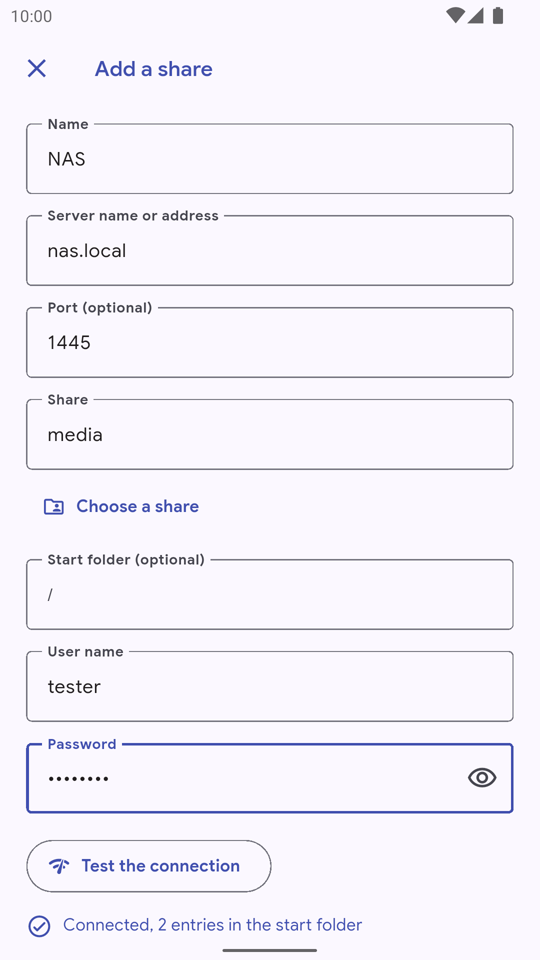
  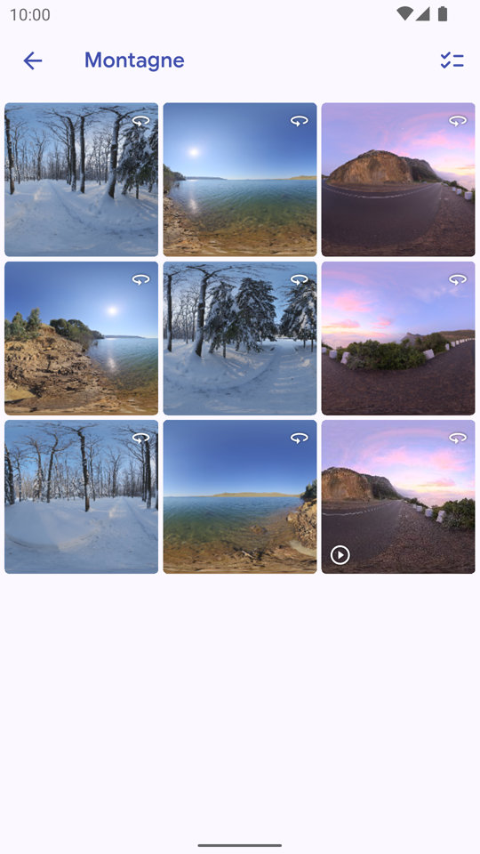

1. ಗ್ರಂಥಾಲಯ ಟ್ಯಾಬ್ ತೆರೆಯಿರಿ, ನಂತರ ನೆಟ್‌ವರ್ಕ್ ಹಂಚಿಕೆಗಳು, ನಂತರ + ಮತ್ತು "ಒಂದು ನೆಟ್‌ವರ್ಕ್ ಹಂಚಿಕೆ (NAS, ಕಂಪ್ಯೂಟರ್, ಮೀಡಿಯಾ ಸರ್ವರ್)". build 24 ನಿಂದ, ಸ್ವಾಗತ ಪುಟದಲ್ಲಿ "ನೆಟ್‌ವರ್ಕ್ ಹಂಚಿಕೆ ಅಥವಾ ಮೀಡಿಯಾ ಸರ್ವರ್ ಸೇರಿಸಿ" ಸರ್ವರ್ ಇಲ್ಲದೆ, ನೇರವಾಗಿ ನೆಟ್‌ವರ್ಕ್ ಹಂಚಿಕೆಗಳನ್ನು ತೆರೆಯುತ್ತದೆ.
2. "ನೆಟ್‌ವರ್ಕ್‌ನಲ್ಲಿ ಕಂಡುಬಂದಿದೆ" ಅಡಿಯಲ್ಲಿ ಒಂದು ಸರ್ವರ್ ಅನ್ನು ಟ್ಯಾಪ್ ಮಾಡಿ, ಅಥವಾ ಫಾರ್ಮ್ ಅನ್ನು ಕೈಯಾರೆ ಭರ್ತಿ ಮಾಡಿ: ಪ್ರಕಾರ, ಸರ್ವರ್ ಹೆಸರು ಅಥವಾ ವಿಳಾಸ, ಹಂಚಿಕೆ ಅಥವಾ ಪಾತ್, ಆರಂಭಿಕ ಫೋಲ್ಡರ್, ಬಳಕೆದಾರ ಹೆಸರು ಮತ್ತು ಪಾಸ್‌ವರ್ಡ್.
3. "ಸಂಪರ್ಕವನ್ನು ಪರೀಕ್ಷಿಸಿ" ಟ್ಯಾಪ್ ಮಾಡಿ, ನಂತರ Save. ಹಂಚಿಕೆಯನ್ನು ಬ್ರೌಸ್ ಮಾಡಲು ಟ್ಯಾಪ್ ಮಾಡಿ: ಮೊದಲು ಫೋಲ್ಡರ್‌ಗಳು, ನಂತರ ಫೋಟೋಗಳು ಮತ್ತು ವೀಡಿಯೊಗಳು, 360° ಎಂದು ಗುರುತಿಸಲಾದ ಫೈಲ್‌ಗಳಲ್ಲಿ 360° ಬ್ಯಾಡ್ಜ್‌ನೊಂದಿಗೆ.
4. Plex ಸರ್ವರ್‌ಗಾಗಿ: ನೆಟ್‌ವರ್ಕ್ ಹಂಚಿಕೆಗಳಲ್ಲಿ, + ಮತ್ತು "A Plex Media Server", ನಂತರ "Found on the network" ಅಡಿಯಲ್ಲಿ ನಿಮ್ಮ ಸರ್ವರ್ ಅನ್ನು ಟ್ಯಾಪ್ ಮಾಡಿ, ಒಮ್ಮೆ ಟೋಕನ್ ಅಂಟಿಸಿ (ಪುಟದಲ್ಲಿನ "How to get it" ಅದನ್ನು ಎಲ್ಲಿ ಕಂಡುಹಿಡಿಯಬೇಕು ಎಂದು ಹೇಳುತ್ತದೆ), ನಂತರ "Test the connection" ಮತ್ತು Save.
5. Immich ಸರ್ವರ್ ಸಂಪರ್ಕಗೊಂಡಿರುವಾಗ, ಫೋಲ್ಡರ್‌ನಲ್ಲಿ ಫೈಲ್‌ಗಳನ್ನು ಆಯ್ಕೆ ಮಾಡಿ ಮತ್ತು ಅವುಗಳನ್ನು ನಿಮ್ಮ ಸರ್ವರ್‌ಗೆ ಕಳುಹಿಸಲು "Upload to Immich" ಟ್ಯಾಪ್ ಮಾಡಿ.

ಪ್ಲೇಯರ್‌ಗಳು ಅಪ್ಲಿಕೇಶನ್‌ನ ಒಳಗಿನ ಒಂದು ಬ್ರಿಡ್ಜ್ ಮೂಲಕ ತಮಗೆ ಬೇಕಾದ ಬೈಟ್‌ಗಳನ್ನು ಬೈಟ್ ರೇಂಜ್‌ಗಳೊಂದಿಗೆ ಓದುತ್ತವೆ, ಇದರಿಂದ ಸೀಕಿಂಗ್ ಕೆಲಸ ಮಾಡುತ್ತದೆ ಮತ್ತು ಡಿವೈಸ್‌ನಲ್ಲಿ ಏನೂ ಸಂಗ್ರಹವಾಗುವುದಿಲ್ಲ; ಒಂದು SMB ವೀಡಿಯೊ ಸುಗಮ ಪ್ಲೇಬ್ಯಾಕ್‌ಗಾಗಿ ಒಂದೇ ಸಮಯದಲ್ಲಿ ಆರರವರೆಗೆ ಸಂಪರ್ಕಗಳ ಮೇಲೆ ಓದಲಾಗುತ್ತದೆ. build 29 ರಿಂದ, M2TS ಆಗಿ ರೆಕಾರ್ಡ್ ಮಾಡಿದ ಚಲನಚಿತ್ರಗಳು (Blu-ray, AVCHD ಕ್ಯಾಮ್‌ಕಾರ್ಡರ್‌ಗಳು, TV ರೆಕಾರ್ಡರ್‌ಗಳು) Android ಅಪ್ಲಿಕೇಶನ್‌ನಲ್ಲಿ SMB ಮತ್ತು WebDAV ಹಂಚಿಕೆಗಳಿಂದ ಹಾಗೂ ಅವುಗಳನ್ನು transport stream ಆಗಿ ಪಟ್ಟಿ ಮಾಡುವ DLNA ಸರ್ವರ್‌ಗಳಿಂದ ಪ್ಲೇ ಆಗುತ್ತವೆ, ಮತ್ತು ಗಾತ್ರವನ್ನು 0 ಎಂದು ಪಟ್ಟಿ ಮಾಡುವ DLNA ಸರ್ವರ್ ಇನ್ನು ಮುಂದೆ ಖಾಲಿ ವೀಡಿಯೊ ನೀಡುವುದಿಲ್ಲ.

**plex.tv ಇಲ್ಲದೆ Plex Media Server**: ಅಪ್ಲಿಕೇಶನ್ ನಿಮ್ಮ ಸರ್ವರ್‌ನೊಂದಿಗೆ ನೇರವಾಗಿ ಜೋಡಣೆಯಾಗುತ್ತದೆ, ನೀವು ಒಮ್ಮೆ ಅಂಟಿಸುವ ಟೋಕನ್‌ನೊಂದಿಗೆ, ಮತ್ತು ನಿಮ್ಮ ಲೈಬ್ರರಿಗಳ ಮೂಲ ಫೈಲ್‌ಗಳನ್ನು ಲೈವ್ ಆಗಿ ಓದುತ್ತದೆ, ಆದ್ದರಿಂದ 360° 360° ಆಗಿಯೇ ಉಳಿಯುತ್ತದೆ, ಮನೆಯಲ್ಲಿ ಮತ್ತು, ನಿಮ್ಮ ಪೋರ್ಟ್ ಫಾರ್ವರ್ಡಿಂಗ್ ಮೂಲಕ, ಮನೆಯಿಂದ ದೂರದಲ್ಲೂ. LG TV ಯಲ್ಲಿ, Plex plex.tv/link ನಲ್ಲಿ ಕೋಡ್‌ನೊಂದಿಗೆ ಸೈನ್ ಇನ್ ಆಗುತ್ತದೆ.

ಇನ್ನಷ್ಟು: [ನೆಟ್‌ವರ್ಕ್ ಹಂಚಿಕೆಗಳು](../docs/immuch360/user-guide.md#network-shares-a-nas-a-computer-or-a-media-server), [ಈ ಫೋನ್ ಅನ್ನು ನೆಟ್‌ವರ್ಕ್‌ನಲ್ಲಿ ಹಂಚಿಕೊಳ್ಳಿ](../docs/immuch360/user-guide.md#share-this-phone-on-the-network), [DLNA ಮೀಡಿಯಾ ಸರ್ವರ್‌ಗಳು](../docs/immuch360/user-guide.md#dlna-media-servers), [Plex Media Server](../docs/immuch360/user-guide.md#plex-media-server-without-plextv).

### ನಿಮ್ಮ Immich ಲೈಬ್ರರಿಯನ್ನು ಉಳಿಸಿಕೊಳ್ಳಿ, ಇನ್ನಷ್ಟು ಜೊತೆಗೆ

ಒಂದು [Immich](https://github.com/immich-app/immich) ಸರ್ವರ್‌ನೊಂದಿಗೆ, Immuch360 ಎಂಬುದು Immich ಮೊಬೈಲ್ ಅಪ್ಲಿಕೇಶನ್ ಆಗಿದೆ, ವೆಬ್ ಅಪ್ಲಿಕೇಶನ್‌ನ ಅದೇ ಸರ್ವರ್ ಮತ್ತು ಅದೇ ಖಾತೆಯೊಂದಿಗೆ: ಬ್ಯಾಕಪ್, ಟೈಮ್‌ಲೈನ್, ಆಲ್ಬಮ್‌ಗಳು, ಹುಡುಕಾಟ, ಜನರು, ಮೆಮೊರಿಗಳು, ಹಂಚಿಕೆ, ಪಾಲುದಾರರು, ಎಲ್ಲವೂ ನಿಮ್ಮ ಸರ್ವರ್‌ನೊಂದಿಗೆ ಸಿಂಕ್ ಆಗುತ್ತವೆ. ಇದು ಅಧಿಕೃತ ಅಪ್ಲಿಕೇಶನ್‌ನ ಪಕ್ಕದಲ್ಲಿ ಇನ್‌ಸ್ಟಾಲ್ ಆಗುತ್ತದೆ. ಇದರ ಮೇಲೆ: 360° ಬ್ಯಾಡ್ಜ್ ಮತ್ತು ಪಟ್ಟಿ, ಪ್ರತಿ ಇಮ್ಮರ್ಸಿವ್ ವೀಕ್ಷಕ, ಪ್ರತಿ ವೀಡಿಯೊಗೆ ಮೂಲ ಫೈಲ್ ಮತ್ತು ಸರ್ವರ್‌ನ ಟ್ರಾನ್ಸ್‌ಕೋಡ್ ಮಾಡಿದ ಸ್ಟ್ರೀಮ್ ನಡುವಿನ ಆಯ್ಕೆ, ಒಂದು ವೀಡಿಯೊದ ತಾಂತ್ರಿಕ ವಿವರಗಳು, ಮತ್ತು ಕೈಯಾರೆ ನಿಮ್ಮ ಸರ್ವರ್‌ಗೆ ಕಳುಹಿಸಲಾದ ಹಂಚಿಕೆ ಅಥವಾ ಡಿವೈಸ್‌ನ ಫೈಲ್‌ಗಳು.

1. ಸ್ವಾಗತ ಪುಟದಲ್ಲಿ, "Immich ಸರ್ವರ್‌ಗೆ ಸಂಪರ್ಕಿಸಿ" ಟ್ಯಾಪ್ ಮಾಡಿ, ನಂತರ Immich ಅಪ್ಲಿಕೇಶನ್‌ನಲ್ಲಿರುವಂತೆ ನಿಮ್ಮ ಸರ್ವರ್ ವಿಳಾಸ, ನಿಮ್ಮ ಇಮೇಲ್ ಮತ್ತು ನಿಮ್ಮ ಪಾಸ್‌ವರ್ಡ್‌ನೊಂದಿಗೆ ಲಾಗಿನ್ ಮಾಡಿ; Back ಸ್ವಾಗತ ಪುಟಕ್ಕೆ ಹಿಂತಿರುಗಿಸುತ್ತದೆ. build 23 ರವರೆಗೆ ಲಾಗಿನ್ ಪುಟ ನೇರವಾಗಿ ತೆರೆಯುತ್ತದೆ. ನಿಮ್ಮ ಗ್ರಂಥಾಲಯ, ಆಲ್ಬಮ್‌ಗಳು ಮತ್ತು ಬ್ಯಾಕಪ್ ಸೆಟ್ಟಿಂಗ್‌ಗಳು ನಿಮ್ಮ ಖಾತೆಯವು.
2. ಸೆಟ್ಟಿಂಗ್‌ಗಳಲ್ಲಿ, Asset Viewer, Videos, "ವೀಡಿಯೊ ಮೂಲ" ಈ ಡಿವೈಸ್ ಅದನ್ನು ಡಿಕೋಡ್ ಮಾಡುವಾಗ ಮೂಲ ಫೈಲ್ ಅನ್ನು, ಯಾವಾಗಲೂ ಮೂಲ ಫೈಲ್ ಅನ್ನು, ಅಥವಾ ಯಾವಾಗಲೂ ಟ್ರಾನ್ಸ್‌ಕೋಡ್ ಮಾಡಿದ ಸ್ಟ್ರೀಮ್ ಅನ್ನು ಆಯ್ಕೆ ಮಾಡುತ್ತದೆ.
3. ಅಪ್ಲಿಕೇಶನ್ ಇಲ್ಲದ ಯಾರಿಗಾದರೂ ಒಂದು 360° ಫೋಟೋವನ್ನು ತೋರಿಸಲು, ಅದನ್ನು Immich ಹಂಚಿಕೆ ಲಿಂಕ್‌ನೊಂದಿಗೆ ಹಂಚಿಕೊಳ್ಳಿ: Immich ವೆಬ್ ಅಪ್ಲಿಕೇಶನ್ ಅದನ್ನು ಅವರ ಬ್ರೌಸರ್‌ನಲ್ಲಿ ಗೋಳವಾಗಿ ತೋರಿಸುತ್ತದೆ.

ಪ್ರಸ್ತುತ build, build 32, 10 ಅಕ್ಟೋಬರ್ 2026 ರ Immich `main` (ಆವೃತ್ತಿ 3.3.0-rc.0) ಆಧಾರಿತವಾಗಿದೆ, build 28 ರಿಂದ 31 ರಂತೆ; build 28 ಅನ್ನು ಅದೇ Immich `main` ನಿಂದ build ಮಾಡಿದ ಸರ್ವರ್ ವಿರುದ್ಧ ಪರೀಕ್ಷಿಸಲಾಗಿದೆ, ಮತ್ತು build 27 ಅನ್ನು Immich 3.2.4 ಸರ್ವರ್ ವಿರುದ್ಧವೂ. ದಯವಿಟ್ಟು ಸಮಸ್ಯೆಗಳನ್ನು [Issues](https://github.com/freeKC/Immuch360/issues) ನಲ್ಲಿ ವರದಿ ಮಾಡಿ, Immich ಯೋಜನೆಗೆ ಅಲ್ಲ.

ಏನು ಒಂದೇ ಇದೆ ಮತ್ತು Immuch360 ಏನನ್ನು ಸೇರಿಸುತ್ತದೆ ಎಂಬುದು [Immich ನೊಂದಿಗೆ ಹೋಲಿಕೆ](#compared-with-immich) ಯಲ್ಲಿದೆ.

ಇನ್ನೂ ಹೆಚ್ಚು: [ಇನ್ನೆಲ್ಲವೂ Immich ಆಗಿದೆ](../docs/immuch360/user-guide.md#everything-else-is-immich), [Immich ಅಪ್ಲಿಕೇಶನ್‌ನೊಂದಿಗೆ ಹೋಲಿಕೆ](../docs/immuch360/compatibility.md#compared-with-the-immich-app).

### ದೊಡ್ಡ ಪರದೆಯಲ್ಲಿ ನಿಮ್ಮ ಮನೆಯ ಕ್ಯಾಮೆರಾಗಳನ್ನು ವೀಕ್ಷಿಸಿ

  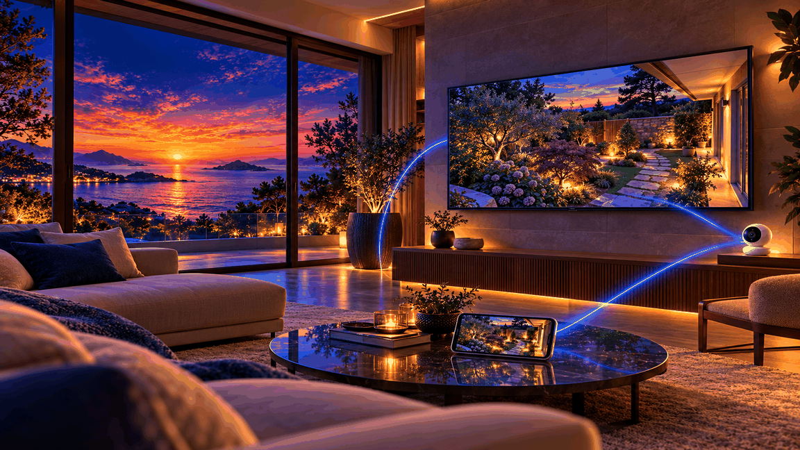

ಒಂದು ಚಿತ್ರಣ. Tapo ಬೆಂಬಲವನ್ನು ಇನ್ನೂ ನಿಜವಾದ ಕ್ಯಾಮೆರಾದೊಂದಿಗೆ ಪರಿಶೀಲಿಸಿಲ್ಲ.

TP-Link ನ ನಿಮ್ಮ Tapo ಕ್ಯಾಮೆರಾಗಳು, ನಿಮ್ಮ ಫೋಟೋಗಳ ಪಕ್ಕದಲ್ಲಿ, Tapo ಅಪ್ಲಿಕೇಶನ್ ಇಲ್ಲದೆ. ಅಪ್ಲಿಕೇಶನ್ ಕ್ಯಾಮೆರಾವನ್ನು ಲೈವ್ ಆಗಿ ತೋರಿಸುತ್ತದೆ (Android ಫೋನ್‌ಗಳು ಮತ್ತು ಟ್ಯಾಬ್ಲೆಟ್‌ಗಳು, Android TV, Meta Quest, Windows ಮತ್ತು, ವೀಡಿಯೊ ಮಾತ್ರ, LG TVಗಳು; iPhone ಮತ್ತು iPad ಮುಂದಿನ iOS ರಿಲೀಸ್‌ನಿಂದ) ಮತ್ತು ಅದರ ಮೆಮೊರಿ ಕಾರ್ಡ್‌ನ ರೆಕಾರ್ಡಿಂಗ್‌ಗಳನ್ನು ದಿನದಿಂದ ದಿನಕ್ಕೆ ಪಟ್ಟಿ ಮಾಡುತ್ತದೆ (ಫೋನ್‌ಗಳು, ಟ್ಯಾಬ್ಲೆಟ್‌ಗಳು, Android TV, Quest ಮತ್ತು ಕಂಪ್ಯೂಟರ್‌ಗಳು). ಕ್ಲಿಪ್ ಅನ್ನು ಕ್ಯಾಮೆರಾದಿಂದ ತರಲಾಗುತ್ತದೆ, ಯಾವುದೇ ವೀಡಿಯೊದಂತೆ ಪ್ಲೇ ಆಗುತ್ತದೆ ಮತ್ತು Immich ಗೆ ಕಳುಹಿಸಬಹುದು. ಅಪ್ಲಿಕೇಶನ್ ನಿಮ್ಮ ನೆಟ್‌ವರ್ಕ್‌ನಲ್ಲಿ ಮಾತ್ರ ಕ್ಯಾಮೆರಾದೊಂದಿಗೆ ಮಾತನಾಡುತ್ತದೆ, ಎಂದಿಗೂ TP-Link ನ ಸರ್ವರ್‌ಗಳೊಂದಿಗೆ ಅಲ್ಲ, ಮತ್ತು ಕ್ಯಾಮೆರಾದಲ್ಲಿ ಎಂದಿಗೂ ಏನನ್ನೂ ಬದಲಾಯಿಸುವುದಿಲ್ಲ.

**ಇನ್ನೂ ನಿಜವಾದ ಕ್ಯಾಮೆರಾದೊಂದಿಗೆ ಪರಿಶೀಲಿಸಿಲ್ಲ.** ಪ್ರೋಟೋಕಾಲ್ ಅನ್ನು ಫರ್ಮ್‌ವೇರ್ 1.3.4 ಇರುವ C510W ನ ಕ್ಯಾಪ್ಚರ್‌ಗಳಿಂದ ಬರೆಯಲಾಗಿದೆ, ಮತ್ತು ಅಪ್ಲಿಕೇಶನ್ ಅನ್ನು ಸಿಮ್ಯುಲೇಟೆಡ್ ಕ್ಯಾಮೆರಾದ ವಿರುದ್ಧ ಮಾತ್ರ ಪರಿಶೀಲಿಸಲಾಗಿದೆ. "Test the camera" ತೋರಿಸುವ ಮಾದರಿ ಮತ್ತು ಫರ್ಮ್‌ವೇರ್‌ನೊಂದಿಗೆ ವರದಿ ತುಂಬಾ ಸಹಾಯ ಮಾಡುತ್ತದೆ.

1. ಮೊದಲು Tapo ಅಪ್ಲಿಕೇಶನ್‌ನಲ್ಲಿ: ಕ್ಯಾಮೆರಾ ಖಾತೆ ರಚಿಸಿ (ಕ್ಯಾಮೆರಾದ ಸೆಟ್ಟಿಂಗ್‌ಗಳು, Advanced Settings, Camera Account), ಲೈವ್ ವೀಕ್ಷಣೆಗೆ ಬಳಸಲಾಗುತ್ತದೆ, ಮತ್ತು Me, ನಂತರ Tapo Lab ಅಡಿಯಲ್ಲಿ Third-Party Compatibility ಆನ್ ಮಾಡಿ.
2. Immuch360 ನಲ್ಲಿ: ಲೈಬ್ರರಿ, ನೆಟ್‌ವರ್ಕ್ ಹಂಚಿಕೆಗಳು, + ಮತ್ತು "A Tapo camera". "Found on the network" ಅಡಿಯಲ್ಲಿ ನಿಮ್ಮ ಕ್ಯಾಮೆರಾವನ್ನು ಟ್ಯಾಪ್ ಮಾಡಿ, ಅಥವಾ ಅದರ ವಿಳಾಸ ಟೈಪ್ ಮಾಡಿ.
3. ರೆಕಾರ್ಡಿಂಗ್‌ಗಳಿಗಾಗಿ ನಿಮ್ಮ TP-Link ಖಾತೆಯ ಪಾಸ್‌ವರ್ಡ್, ಲೈವ್ ವೀಕ್ಷಣೆಗಾಗಿ ಕ್ಯಾಮೆರಾ ಖಾತೆ, ಅಥವಾ ಎರಡನ್ನೂ ಟೈಪ್ ಮಾಡಿ; ನಂತರ "Test the camera", ಮತ್ತು Save.
4. ಕ್ಯಾಮೆರಾವನ್ನು ಟ್ಯಾಪ್ ಮಾಡಿ: ಅದರ ಲೈವ್ ವೀಕ್ಷಣೆ ಅದರ ಪುಟದ ಮೇಲ್ಭಾಗದಲ್ಲಿದೆ, ಧ್ವನಿ, SD ಅಥವಾ HD ಮತ್ತು ಪೂರ್ಣ ಪರದೆಯೊಂದಿಗೆ; ಅದರ ಕೆಳಗೆ ರೆಕಾರ್ಡಿಂಗ್‌ಗಳಿರುವ ದಿನಗಳು ಬರುತ್ತವೆ. ಕ್ಲಿಪ್ ತಂದು ಪ್ಲೇ ಮಾಡಲು ಅದನ್ನು ಟ್ಯಾಪ್ ಮಾಡಿ; ಅದರ ⋮ ಮೆನುವಿನಲ್ಲಿ "Upload to Immich" ಇದೆ.

ಇನ್ನಷ್ಟು: [Tapo ಕ್ಯಾಮೆರಾಗಳು](../docs/immuch360/user-guide.md#tapo-cameras-live-view-and-the-recordings-of-the-memory-card).

### ನಿಮ್ಮ DJI ಡ್ರೋನ್ (ಪ್ರಯೋಗಾತ್ಮಕ)

ಲೈಬ್ರರಿಯಲ್ಲಿನ ಒಂದು Drone ಕಾರ್ಡ್, ಪ್ರಯೋಗಾತ್ಮಕ ಮತ್ತು ಡೀಫಾಲ್ಟ್ ಆಗಿ ಆನ್, Immuch360 DJI ಡ್ರೋನ್‌ನೊಂದಿಗೆ ಮಾಡುವುದನ್ನು ಒಟ್ಟುಗೂಡಿಸುತ್ತದೆ: Android ಫೋನ್‌ನಲ್ಲಿ, ಅದರ ರಿಮೋಟ್ ಕಂಟ್ರೋಲರ್ ಮೂಲಕ ಡ್ರೋನ್‌ನ ಲೈವ್ ವೀಡಿಯೊ, ಮತ್ತು USB ಮೂಲಕ Immich ಗೆ ತಂದ ಅದರ ಫೋಟೋಗಳು ಮತ್ತು ವೀಡಿಯೊಗಳು; Meta Quest ನಲ್ಲಿ ಅಥವಾ Android TV ಯಲ್ಲಿ, ಫೋನ್ ರಿಲೇ ಮಾಡುವ ಆ ಲೈವ್ ವೀಡಿಯೊ, ವೀಕ್ಷಿಸಲು. Immuch360 DJI ಉತ್ಪನ್ನವಲ್ಲ ಮತ್ತು DJI ಯಿಂದ ಅನುಮೋದಿತವಲ್ಲ, ಮತ್ತು DJI ಗೆ ಏನನ್ನೂ ಕಳುಹಿಸಲಾಗುವುದಿಲ್ಲ.

#### ನಿಮ್ಮ ಡ್ರೋನ್ ಏನು ನೋಡುತ್ತದೆ ಎಂದು ನಿಮ್ಮ ಫೋನ್‌ನಲ್ಲಿ ನೋಡಿ

  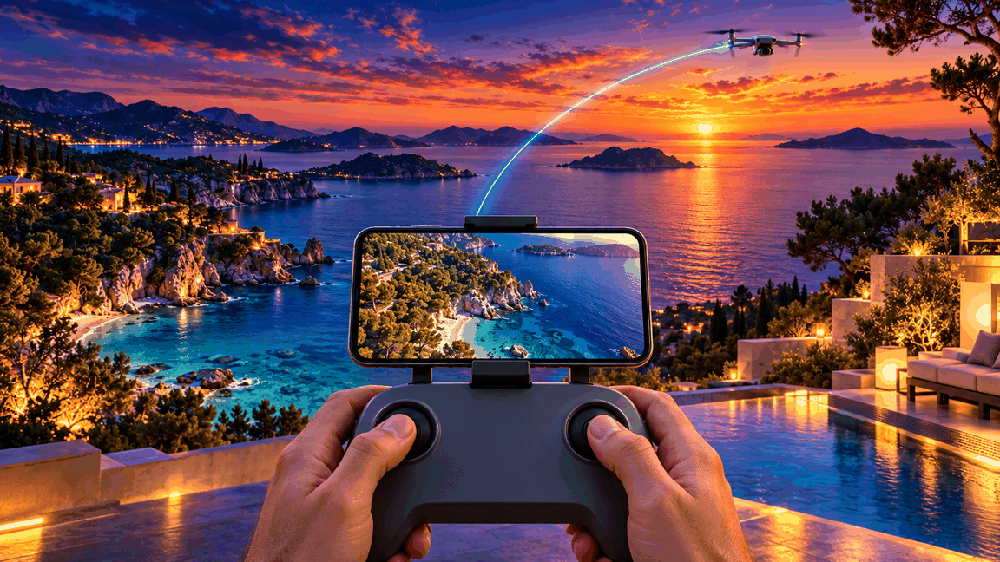

ನಿಮ್ಮ DJI ಡ್ರೋನ್ ಏನು ನೋಡುತ್ತದೆ ಎಂದು ನಿಮ್ಮ Android ಫೋನ್‌ನಲ್ಲಿ ನೋಡಿ, DJI Fly ಇಲ್ಲದೆ ಮತ್ತು ಯಾವುದೇ ಖಾತೆ ಇಲ್ಲದೆ: DJI RC-N3 ರಿಮೋಟ್ ಕಂಟ್ರೋಲರ್ ಅನ್ನು ಅದರ ಕೇಬಲ್‌ನಿಂದ ಫೋನ್‌ಗೆ ಜೋಡಿಸಿ, ಮತ್ತು Immuch360 ಡ್ರೋನ್‌ನ ಲೈವ್ ವೀಡಿಯೊವನ್ನು ಲ್ಯಾಂಡ್‌ಸ್ಕೇಪ್‌ನಲ್ಲಿ ಪೂರ್ಣ ಪರದೆಯಲ್ಲಿ ತೋರಿಸುತ್ತದೆ, 1080p ನಲ್ಲಿ H.265, ಕೇಬಲ್‌ನಿಂದ ಓದಿದ ಹಾರಾಟ ಮೌಲ್ಯಗಳೊಂದಿಗೆ. ರಿಮೋಟ್ ಡ್ರೋನ್‌ನ ಸಂಪೂರ್ಣ ನಿಯಂತ್ರಣವನ್ನು ಉಳಿಸಿಕೊಳ್ಳುತ್ತದೆ. ಇದನ್ನು RC-N3, DJI Neo 2 ಮತ್ತು Samsung Galaxy S24+ ನೊಂದಿಗೆ ಪ್ರಯತ್ನಿಸಲಾಗಿದೆ: ನೆಲದ ಮೇಲೆ build 29 ನೊಂದಿಗೆ, ಮತ್ತು ಹಾರಾಟದಲ್ಲಿ 24 ಮತ್ತು 25 ಅಕ್ಟೋಬರ್‌ರಂದು build 30 ರ ಪರೀಕ್ಷಾ build ಗಳೊಂದಿಗೆ, ನಂತರ 26 ಅಕ್ಟೋಬರ್‌ರಂದು build 30 ನೊಂದಿಗೆ.

**ಯಾವ ರಿಮೋಟ್‌ಗಳು ಮತ್ತು ಡ್ರೋನ್‌ಗಳು**, 26 ಅಕ್ಟೋಬರ್ 2026 ರಂತೆ: ಲೈವ್ ವೀಡಿಯೊ ಫೋನ್ ಅನ್ನು ಹಿಡಿದು ತನ್ನ ಕೇಬಲ್‌ನಿಂದ ಅದಕ್ಕೆ ಜೋಡಿಸಿದ DJI ರಿಮೋಟ್ ಮೂಲಕ ಬರುತ್ತದೆ. ಬೇರೆ ಜೋಡಿಯನ್ನು ಪ್ರಯತ್ನಿಸಿದ್ದೀರಾ? ಲೈವ್ ಪರದೆಯಲ್ಲಿ "ಸುಧಾರಿತ" ತೆರೆಯಿರಿ, ನಂತರ "ರೋಗನಿರ್ಣಯ", ಮತ್ತು ನೀವು ಯಾವ ಡ್ರೋನ್ ಮತ್ತು ರಿಮೋಟ್ ಬಳಸಿದಿರಿ ಮತ್ತು "ರೋಗನಿರ್ಣಯ" ಏನು ತೋರಿಸುತ್ತದೆ ಎಂದು [Issues](https://github.com/freeKC/Immuch360/issues) ನಲ್ಲಿ ನಮಗೆ ತಿಳಿಸಿ.

- **ಪರೀಕ್ಷಿಸಲಾಗಿದೆ**: ತನ್ನ Digital Transceiver ಅಳವಡಿಸಿದ DJI Neo 2 (ಯಾವುದೇ ರಿಮೋಟ್‌ನೊಂದಿಗೆ ಹಾರಲು ಅದಕ್ಕೆ ಇದು ಬೇಕು) ಮತ್ತು DJI RC-N3, Samsung Galaxy S24+ ನೊಂದಿಗೆ; 23 ಅಕ್ಟೋಬರ್‌ರಂದು ನೆಲದ ಮೇಲೆ, ಮತ್ತು 24 ರಿಂದ 26 ಅಕ್ಟೋಬರ್‌ವರೆಗೆ ಒಳಾಂಗಣದಲ್ಲಿ ಹಾರಾಟದಲ್ಲಿ.
- **ನಿರೀಕ್ಷಿತ, ಪ್ರಯತ್ನಿಸಿಲ್ಲ**: DJI ಅದಕ್ಕಾಗಿ ಪಟ್ಟಿ ಮಾಡುವ ಇತರ ಡ್ರೋನ್‌ಗಳೊಂದಿಗೆ RC-N3 (Neo, Flip, Mini 4 Pro, Mini 5 Pro, Air 3, Air 3S, Lito 1, Lito X1, ಮತ್ತು ತನ್ನದೇ ಮಾರ್ಗದರ್ಶಿಯ ಪ್ರಕಾರ Avata 360), ಮತ್ತು ಅದೇ ಕೇಬಲ್‌ನಲ್ಲಿ ಫೋನ್ ಹಿಡಿಯುವ RC-N2, ಅದೇ ಡ್ರೋನ್‌ಗಳು ಮತ್ತು Neo 2 ನೊಂದಿಗೆ. ಅಪ್ಲಿಕೇಶನ್ H.265 ವೀಡಿಯೊವನ್ನು ಮಾತ್ರ ತೋರಿಸುತ್ತದೆ, ಮತ್ತು ಹಾರಾಟ ಮೌಲ್ಯಗಳು Neo 2 ನಲ್ಲಿ ಮಾತ್ರ ಸಾಬೀತಾಗಿವೆ: ಬೇರೆ ಡ್ರೋನ್‌ನೊಂದಿಗೆ ಚಿತ್ರ ಅಥವಾ ಮೌಲ್ಯಗಳು ಕಾಣೆಯಾಗಿರಬಹುದು.
- **ಬೆಂಬಲವಿಲ್ಲ**: ತಮ್ಮದೇ ಪರದೆ ಇರುವ ರಿಮೋಟ್‌ಗಳು (DJI RC, RC 2, RC Pro 2), ಮತ್ತು ಆದ್ದರಿಂದ DJI ಅವುಗಳಲ್ಲಿ ಒಂದರೊಂದಿಗೆ ನೀಡುವ Mavic 4 Pro; DJI ಗಾಗಲ್‌ಗಳು; RC-N1, RC-N1C ಮತ್ತು ಹಳೆಯ ರಿಮೋಟ್‌ಗಳು; ರಿಮೋಟ್ ಇಲ್ಲದೆ, Wi-Fi ಮೂಲಕ ಫೋನ್‌ನಿಂದ ಹಾರಿಸುವ ಡ್ರೋನ್.

ಅದು ಕೇವಲ ಆಲಿಸುತ್ತದೆ. ರಿಮೋಟ್‌ಗೆ ಅಥವಾ ಡ್ರೋನ್‌ಗೆ ಯಾವುದೇ ಆದೇಶವನ್ನು ಎಂದಿಗೂ ಕಳುಹಿಸಲಾಗುವುದಿಲ್ಲ: ರಿಮೋಟ್ ತೆರೆದ 20 ಸೆಕೆಂಡುಗಳ ನಂತರದಿಂದ ಪುಟವು ಪ್ರತಿ ಸೆಕೆಂಡಿಗೆ ಬರೆಯುವ ಒಂದು ಬೈಟ್, ರಿಮೋಟ್ ಡೇಟಾವನ್ನು ಸ್ವೀಕರಿಸುತ್ತದೆಯೇ ಎಂಬುದನ್ನು ಮಾತ್ರ ಹೇಳುತ್ತದೆ, ಮತ್ತು ಯಾವುದೇ ಆದೇಶವನ್ನು ಹೊಂದಿರುವುದಿಲ್ಲ.

ಲೈವ್ ಪರದೆಯಲ್ಲಿ: ಡ್ರೋನ್‌ನ ಬ್ಯಾಟರಿ ಮತ್ತು ಮೋಟಾರ್ ಸಮಯ ಮತ್ತು, ಹಾರಾಟದಲ್ಲಿ, ಟೇಕ್ ಆಫ್ ಬಿಂದುವಿನಿಂದ ಎತ್ತರ, ಲಂಬ ವೇಗ, ವೇಗ ಮತ್ತು ಡ್ರೋನ್‌ನ ಕೆಳಗಿನ ಅಂತರ. ನಮ್ಮ ಸ್ವಂತ ಹಾರಾಟ ಕ್ಯಾಪ್ಚರ್‌ಗಳು ಸಾಬೀತುಪಡಿಸಿದಾಗ ಮಾತ್ರ ಒಂದು ಮೌಲ್ಯ ಅಲ್ಲಿಗೆ ಬರುತ್ತದೆ: ಎತ್ತರ, ವೇಗಗಳು ಮತ್ತು ಕೆಳಗಿನ ಅಂತರವನ್ನು 25 ಅಕ್ಟೋಬರ್‌ರಂದು ಎರಡು ಒಳಾಂಗಣ ಹಾರಾಟಗಳ ಕ್ಯಾಪ್ಚರ್‌ಗಳಲ್ಲಿ ಸಾಬೀತುಪಡಿಸಲಾಗಿದೆ, 1.8 m ಎತ್ತರ ಮತ್ತು 1.5 m/s ವರೆಗೆ, ಇನ್ನೂ ಅದರಾಚೆ ಅಲ್ಲ; ಅವುಗಳನ್ನು ಅಲ್ಲಿ ತೋರಿಸುವುದು build 30 ನಲ್ಲಿ ಹೊಸದು ಮತ್ತು ಅದರೊಂದಿಗೆ ಮೊದಲ ಬಾರಿ ಪರೀಕ್ಷಿಸಲಾಗುತ್ತದೆ. ಎತ್ತರ ಲಿಫ್ಟ್ ಆಫ್ ನಂತರ ಸುಮಾರು 1.5 s ನಲ್ಲಿ ಕಾಣುತ್ತದೆ, ಡ್ರೋನ್ ನೆಲ ಅಥವಾ ಕೈಯನ್ನು ಬಿಟ್ಟ ನಂತರ, ಮತ್ತು ಯಾವುದೇ ವಿಮಾನ ಮಾಡಲಾಗದ ರೀತಿಯಲ್ಲಿ ಅದು ಎಂದಾದರೂ ಜಿಗಿದರೆ ಮೋಟಾರ್‌ಗಳು ನಿಲ್ಲುವವರೆಗೆ ಮರೆಯಾಗಿರುತ್ತದೆ. Advanced ಬ್ಯಾಟರಿಯ ವೋಲ್ಟೇಜ್ ಮತ್ತು ತಾಪಮಾನ, ದಿಕ್ಕು (ಅದರ ಸೊನ್ನೆಯನ್ನು ಉತ್ತರದ ವಿರುದ್ಧ ಪರಿಶೀಲಿಸಿಲ್ಲ) ಮತ್ತು ಮೋಟಾರ್‌ಗಳನ್ನು ಸೇರಿಸುತ್ತದೆ, ಮತ್ತು Diagnostics ಲಿಂಕ್ ನೀಡುವ ಪ್ರತಿ ಸಂಖ್ಯೆಯನ್ನು, ಬ್ಯಾಟರಿ ಕರೆಂಟ್ ಸೇರಿದಂತೆ. ಯಾವುದೇ ಉಪಗ್ರಹಗಳು, ಸ್ಥಾನ ಅಥವಾ ಮನೆಯಿಂದ ಅಂತರವನ್ನು ತೋರಿಸಲಾಗುವುದಿಲ್ಲ. ಸಂಖ್ಯೆಗಳನ್ನು ಇನ್ನೂ DJI Fly ನೊಂದಿಗೆ ಹೋಲಿಸಿಲ್ಲ: ಅವುಗಳನ್ನು ಆಧರಿಸಿ ಹಾರಿಸಬೇಡಿ.

**ಅಡಚಣೆ ಉಂಗುರ**, ಡೀಫಾಲ್ಟ್ ಆಗಿ ಆನ್: ಡ್ರೋನ್‌ನ ಸೆನ್ಸರ್‌ಗಳು ಹತ್ತಿರದಲ್ಲಿ ಏನನ್ನಾದರೂ ಕಂಡಾಗ, ಚಿತ್ರದ ಮಧ್ಯದ ಸುತ್ತ ಅರೆಪಾರದರ್ಶಕ ವೃತ್ತ ಕಾಣುತ್ತದೆ, ಅಡಚಣೆಯ ಕಡೆಗೆ ಒಂದು ಚಾಪದೊಂದಿಗೆ, ಹತ್ತಿರ ಬಂದಂತೆ ಅಂಬರ್‌ನಿಂದ ಕೆಂಪಾಗುತ್ತದೆ, ಅದರ ಪಕ್ಕದಲ್ಲಿ ಅಂತರ ಮತ್ತು ವೇಗವಾಗುವ ಒಂದು ಚಿಕ್ಕ ಟಿಕ್; ಹತ್ತಿರ ಏನೂ ಇಲ್ಲದಿದ್ದರೆ, ಏನೂ ಕಾಣುವುದಿಲ್ಲ. ವೃತ್ತ ಮತ್ತು ಚಾಪದ ದಿಕ್ಕನ್ನು 25 ಅಕ್ಟೋಬರ್‌ರಂದು ಹಾರಾಟದಲ್ಲಿ, ಒಳಾಂಗಣದಲ್ಲಿ, ದಿಕ್ಕು ಒಂದು ಆಯ್ಕೆಯಾಗಿದ್ದ ಪರೀಕ್ಷಾ build ನಲ್ಲಿ ಪರಿಶೀಲಿಸಲಾಗಿದೆ; ಡೀಫಾಲ್ಟ್ ಆಗಿ ತೋರಿಸಿದಂತೆ, ಇದನ್ನು build 30 ನೊಂದಿಗೆ ಮೊದಲ ಬಾರಿ ಪರೀಕ್ಷಿಸಲಾಗುತ್ತದೆ. Advanced ನಲ್ಲಿ ನೀವು ಅಂತರಗಳನ್ನು ಹೊಂದಿಸುತ್ತೀರಿ ("Glow from", 3.0 m, ಮತ್ತು "Strong glow from", 1.0 m), ವೃತ್ತದ ಬದಲಿಗೆ ಚಿತ್ರದ ಅಂಚುಗಳಲ್ಲಿ ಚೌಕಟ್ಟನ್ನು ಆಯ್ಕೆ ಮಾಡುತ್ತೀರಿ, ಅಥವಾ ಉಂಗುರ, ಅದರ ಧ್ವನಿ ಅಥವಾ ಅದರ ಕಂಪನವನ್ನು ಆಫ್ ಮಾಡುತ್ತೀರಿ. ಅದು ಡ್ರೋನ್‌ನ ಸೆನ್ಸರ್‌ಗಳು ವರದಿ ಮಾಡುವುದನ್ನು ಮಾತ್ರ ತೋರಿಸುತ್ತದೆ: Sport ಮೋಡ್‌ನಲ್ಲಿ ಅಥವಾ ಅಡಚಣೆ ತಪ್ಪಿಸುವಿಕೆ ಆಫ್ ಆಗಿರುವಾಗ ಏನೂ ಇಲ್ಲ, ಮತ್ತು ಹೊಳಪು ಇಲ್ಲ ಎಂದರೆ ದಾರಿ ಸ್ಪಷ್ಟವಾಗಿದೆ ಎಂದಲ್ಲ. ಮಾಹಿತಿ ಮಾತ್ರ: Immuch360 ಎಂದಿಗೂ ಡ್ರೋನ್ ಅನ್ನು ನಡೆಸುವುದಿಲ್ಲ ಅಥವಾ ನಿಲ್ಲಿಸುವುದಿಲ್ಲ.

1. Drone ಕಾರ್ಡ್ ಲೈಬ್ರರಿಯಲ್ಲಿದೆ, ಮತ್ತು ಅದರ ಪುಟದಲ್ಲಿ "DJI live video": Settings, Advanced ನಲ್ಲಿ "DJI live video (experimental)" ಡೀಫಾಲ್ಟ್ ಆಗಿ ಆನ್ ಆಗಿದೆ.
2. ಡ್ರೋನ್ ಮತ್ತು ರಿಮೋಟ್ ಆನ್ ಮಾಡಿ, DJI Fly ಮುಚ್ಚಿ, ನಂತರ "DJI live video" ತೆರೆಯಿರಿ ಮತ್ತು ಸುರಕ್ಷತಾ ಸೂಚನೆಯನ್ನು ಓದಿ.
3. ರಿಮೋಟ್ ಅನ್ನು ಅದರ ಕೇಬಲ್‌ನಿಂದ ಫೋನ್‌ಗೆ ಜೋಡಿಸಿ. ಯಾವ ಅಪ್ಲಿಕೇಶನ್ ಅದನ್ನು ತೆರೆಯಬೇಕು ಎಂದು Android ಕೇಳಿದರೆ, "Always" ಇಲ್ಲದೆ Immuch360 ಆಯ್ಕೆ ಮಾಡಿ, ಅದು DJI Fly ನಿಂದ ರಿಮೋಟ್ ಅನ್ನು ತೆಗೆದುಕೊಳ್ಳುತ್ತದೆ; ಅದು USB ಮೋಡ್ ಕೇಳಿದರೆ, ಚಾರ್ಜಿಂಗ್ ಮಾತ್ರ ಆಯ್ಕೆ ಮಾಡಿ. ನಂತರ ರಿಮೋಟ್ ಜೋಡಿಸಿದಾಗ ಈ ಪರದೆ ತಾನಾಗಿಯೇ ತೆರೆಯುತ್ತದೆ ("Open this screen when the remote is plugged in", Advanced ನಲ್ಲಿ ಡೀಫಾಲ್ಟ್ ಆಗಿ ಆನ್).
4. Remote, Drone ಮತ್ತು Picture ಒಂದರ ನಂತರ ಒಂದರಂತೆ ಬೆಳಗುತ್ತವೆ, ಮತ್ತು ಕೆಲವೇ ಸೆಕೆಂಡುಗಳಲ್ಲಿ ಚಿತ್ರ ಪೂರ್ಣ ಪರದೆಗೆ ಬರುತ್ತದೆ. ಮೂರು ಬಟನ್‌ಗಳು (ನಿರ್ಗಮಿಸಿ, "Send to a headset or a TV" ಮತ್ತು Advanced) ಮತ್ತು ಮೌಲ್ಯಗಳು ಚಿತ್ರದ ಪಕ್ಕದ ಕಪ್ಪು ಪಟ್ಟಿಗಳಲ್ಲಿವೆ. "Live" ನಂತಹ ಟಿಪ್ಪಣಿಗಳು ಸುಮಾರು ಐದು ಸೆಕೆಂಡುಗಳ ನಂತರ ಮಸುಕಾಗುತ್ತವೆ; ಎಲ್ಲಿಯಾದರೂ ಟ್ಯಾಪ್ ಮಾಡಿದರೆ ಅವು ಮರಳುತ್ತವೆ, ಮತ್ತು ಚಿತ್ರದ ಮೇಲಿನ ಯಾವುದೂ ಡ್ರೋನ್ ಮೇಲೆ ಪರಿಣಾಮ ಬೀರುವುದಿಲ್ಲ. ನಿಮ್ಮನ್ನು ಕ್ರಮ ಕೈಗೊಳ್ಳಲು ಕೇಳುವ ದೋಷ ಉಳಿಯುತ್ತದೆ.
5. Advanced ನಲ್ಲಿ "Save a capture for a bug report" ಇದೆ, ಅದು ಲಿಂಕ್‌ನ ಕ್ಯಾಪ್ಚರ್ ಅನ್ನು `Download/Immuch360/dji-link` ಗೆ ಬರೆಯುತ್ತದೆ, "Play a saved capture", ರಿಮೋಟ್ ಇಲ್ಲದೆ ಮತ್ತೆ ಪ್ಲೇ ಮಾಡಲು, ಮತ್ತು Diagnostics, ಲಿಂಕ್ ನೀಡುವ ಪ್ರತಿ ಸಂಖ್ಯೆಯೊಂದಿಗೆ.

ಡ್ರೋನ್‌ನ ಫೋಟೋಗಳು ಮತ್ತು ವೀಡಿಯೊಗಳನ್ನು ರಿಮೋಟ್ ಮೂಲಕ ತಲುಪಲಾಗುವುದಿಲ್ಲ, ಅದು ಡ್ರೋನ್‌ನ ಸಂಗ್ರಹಣೆಯನ್ನು ತೆರೆಯುವುದಿಲ್ಲ: ಅವುಗಳನ್ನು ಡ್ರೋನ್‌ನಿಂದಲೇ USB ಮೂಲಕ ಅಥವಾ ಅದರ ಕಾರ್ಡ್‌ನಿಂದ ನಕಲಿಸಿ, [ಕೆಳಗೆ](#bring-a-drones-or-a-camera-cards-photos-and-videos-to-immich) ಇರುವಂತೆ. ಉಳಿಸಿದ ಕ್ಯಾಪ್ಚರ್‌ಗಳನ್ನು ನಿಮ್ಮಲ್ಲೇ ಇಟ್ಟುಕೊಳ್ಳಿ, ಪುಟ ಹೇಳುವಂತೆ: ಅವು ಡ್ರೋನ್‌ನ ವೀಡಿಯೊ ಮತ್ತು ರಿಮೋಟ್ ಮತ್ತು ವಿಮಾನದ ಸೀರಿಯಲ್ ಸಂಖ್ಯೆಗಳನ್ನು ಹೊಂದಿರುತ್ತವೆ, ಮತ್ತು ಅದರ ಸ್ಥಾನವನ್ನು ಹೊಂದಿರಬಹುದು; Diagnostics ತೋರಿಸುವುದರೊಂದಿಗೆ [Issues](https://github.com/freeKC/Immuch360/issues) ನಲ್ಲಿ ವರದಿ ಸಹಾಯ ಮಾಡುತ್ತದೆ, ವಿಶೇಷವಾಗಿ ಇತರ DJI ರಿಮೋಟ್‌ಗಳೊಂದಿಗೆ.

#### ಅದನ್ನು Meta Quest ನಲ್ಲಿ ಅಥವಾ Android TV ಯಲ್ಲಿ ವೀಕ್ಷಿಸಿ

ರಿಮೋಟ್‌ಗೆ ಜೋಡಿಸಿದ ಫೋನ್ ಡ್ರೋನ್‌ನ ಚಿತ್ರ ಮತ್ತು ಮೌಲ್ಯಗಳನ್ನು ಅದೇ ಸ್ಥಳೀಯ ನೆಟ್‌ವರ್ಕ್‌ನಲ್ಲಿ Meta Quest ನಲ್ಲಿ ಅಥವಾ Android TV ಅಥವಾ Google TV ಯಲ್ಲಿರುವ Immuch360 ಗೆ ಕಳುಹಿಸಬಹುದು, ನಿಮ್ಮೊಂದಿಗಿರುವವರಿಗಾಗಿ. ಹೆಡ್‌ಸೆಟ್ ಅವುಗಳನ್ನು ವಿಂಡೋದಲ್ಲಿ ಅಥವಾ, ದೊಡ್ಡದಾಗಿ, ನಿಮ್ಮ ಮುಂದೆ ಹಾರಾಟ ವೀಕ್ಷಣೆಯಲ್ಲಿ ತೋರಿಸುತ್ತದೆ, ಮತ್ತು TV ಪೂರ್ಣ ಪರದೆಯಲ್ಲಿ, ಫೋನ್‌ನಂತೆಯೇ ಮೌಲ್ಯಗಳು ಮತ್ತು ಅಡಚಣೆ ಉಂಗುರದೊಂದಿಗೆ. ಅವು ವೀಕ್ಷಿಸುತ್ತವೆ ಮಾತ್ರ: ಹೆಡ್‌ಸೆಟ್ ಅಥವಾ TV ಮಾಡುವ ಯಾವುದೂ ರಿಮೋಟ್ ಅಥವಾ ಡ್ರೋನ್ ತಲುಪುವುದಿಲ್ಲ. "ನೋಡುವುದು ಮಾತ್ರ" ನಂತಹ ಅವುಗಳ ಟಿಪ್ಪಣಿಗಳು ಕೆಲವು ಸೆಕೆಂಡುಗಳ ನಂತರ ಮಸುಕಾಗುತ್ತವೆ ಮತ್ತು ಕೀ, ಟ್ಯಾಪ್ ಅಥವಾ ಬಟನ್‌ನಿಂದ ಮರಳುತ್ತವೆ. ಡ್ರೋನ್‌ನ ಚಿತ್ರ 24 ಅಕ್ಟೋಬರ್‌ರಂದು ಒಮ್ಮೆ, ಮನೆಯ Wi-Fi ಮೂಲಕ, Quest 3 ತಲುಪಿತು; ಮೌಲ್ಯಗಳು ಮತ್ತು ಅಡಚಣೆ ಉಂಗುರದೊಂದಿಗಿನ ಹೆಡ್‌ಸೆಟ್ ವಿಂಡೋ ಮತ್ತು ಹಾರಾಟ ವೀಕ್ಷಣೆಯನ್ನು build 30 ನೊಂದಿಗೆ ಮೊದಲ ಬಾರಿ ಪರೀಕ್ಷಿಸಲಾಗುತ್ತದೆ, ಮತ್ತು Quest 2, Pro ಮತ್ತು 3S ಅನ್ನು ಪ್ರಯತ್ನಿಸಿಲ್ಲ. ಹೆಡ್‌ಸೆಟ್‌ನಲ್ಲಿ ವೃತ್ತ ಚಿತ್ರದ ಮಧ್ಯವನ್ನು ಮರೆಮಾಡಿದರೆ, ಅದರ ಮೆನುವಿನಲ್ಲಿರುವ "ಅಂಚುಗಳಲ್ಲಿ ಚೌಕಟ್ಟು" ಮಧ್ಯವನ್ನು ಸ್ಪಷ್ಟವಾಗಿರಿಸುತ್ತದೆ. TCL Android TV ಯಲ್ಲಿ, ಜೋಡಣೆ ಮತ್ತು ಚಿತ್ರವನ್ನು 25 ಅಕ್ಟೋಬರ್‌ರಂದು ಪ್ರಯತ್ನಿಸಲಾಯಿತು, ಹಿಂದಿನ ರಿಲೇಯಲ್ಲಿ ತಡೆತಡೆ ಮತ್ತು ಹಸಿರು ಛಾಯೆಯೊಂದಿಗೆ; 26 ಅಕ್ಟೋಬರ್‌ರಂದು, build 30 ನೊಂದಿಗೆ, ಸ್ಥಿರ ಸ್ಟ್ರೀಮ್‌ಗೆ ಬದಲಾದ ನಂತರ, ಡ್ರೋನ್ 18 Mbit/s ಕಳುಹಿಸಿದ ಒಂದು ಹಾರಾಟದುದ್ದಕ್ಕೂ TV ಚಿತ್ರವನ್ನು ತೋರಿಸುತ್ತಲೇ ಇತ್ತು, 7 ಸ್ಥಗಿತಗಳೊಂದಿಗೆ, ಅತಿ ದೀರ್ಘವಾದದ್ದು 1.7 s; ಚಿತ್ರ ಹೇಗೆ ಕಾಣುತ್ತಿತ್ತು ಎಂಬುದನ್ನು ದಾಖಲಿಸಿಲ್ಲ. build 31 ರಿಂದ TV ಯಲ್ಲಿನ ಸುರಕ್ಷತಾ ಸೂಚನೆ ರಿಮೋಟ್‌ನ ಫೋಕಸ್ ಅನ್ನು ಉಳಿಸಿಕೊಳ್ಳುತ್ತದೆ (widget ಪರೀಕ್ಷೆಗಳಿಂದ ಪರಿಶೀಲಿಸಲಾಗಿದೆ, ಇನ್ನೂ ಆ TV ಯಲ್ಲಿ ಅಲ್ಲ); build 30 ನಲ್ಲಿ ಅದರ ಕೆಳಗಿನ ವೀಕ್ಷಣೆ ಫೋಕಸ್ ತೆಗೆದುಕೊಳ್ಳಬಹುದಿತ್ತು, ಆದ್ದರಿಂದ ಸೂಚನೆಯನ್ನು ಓದಲೂ ಸ್ವೀಕರಿಸಲೂ ಆಗುತ್ತಿರಲಿಲ್ಲ, ಮತ್ತು ಹೊರಬರುವ ಏಕೈಕ ಮಾರ್ಗ Back ಆಗಿತ್ತು, ಅದು ಪುಟದಿಂದ ಹೊರಹೋಗುತ್ತದೆ. ಹೆಡ್‌ಸೆಟ್ ಅಥವಾ TV ನೋಡುತ್ತಾ ಹಾರಿಸಲು ನಿಮ್ಮ ಪಕ್ಕದಲ್ಲಿ ಡ್ರೋನ್ ಅನ್ನು ಕಣ್ಣಿನಲ್ಲಿಟ್ಟುಕೊಳ್ಳುವ ವೀಕ್ಷಕ ಬೇಕು (EU ಮುಕ್ತ ವರ್ಗ); ಅವರಿಲ್ಲದೆ, ಡ್ರೋನ್ ಅನ್ನು ನೋಡಿ.

1. ಫೋನ್‌ನಲ್ಲಿ, ಲೈವ್ ಪರದೆಯಲ್ಲಿ, "Send to a headset or a TV" ಟ್ಯಾಪ್ ಮಾಡಿ ಮತ್ತು ಅದನ್ನು ಆನ್ ಮಾಡಿ.
2. **Meta Quest**: Immuch360, ಲೈಬ್ರರಿ, Drone ತೆರೆಯಿರಿ, ಮತ್ತು ಫೋನ್ ಆಯ್ಕೆ ಮಾಡಿ; ಫೋನ್ ತೋರಿಸುವ ಕೋಡ್ ಟೈಪ್ ಮಾಡಿ, ಆ ಫೋನ್‌ಗೆ ಒಮ್ಮೆ. ಚಿತ್ರ ವಿಂಡೋದಲ್ಲಿ ತೆರೆಯುತ್ತದೆ; "Open the flight view" ಅದನ್ನು ದೊಡ್ಡದು ಮಾಡುತ್ತದೆ, ಮತ್ತು B ಅಥವಾ Y ವಿಂಡೋವನ್ನು ಮರಳಿ ತರುತ್ತದೆ.
3. **Android TV ಮತ್ತು Google TV**: Immuch360, ಲೈಬ್ರರಿ, Drone ತೆರೆಯಿರಿ. "Let this TV watch" ಅಡಿಯಲ್ಲಿ, TV ಒಂದು ಕೋಡ್ ಮತ್ತು ಅದರ QR ಕೋಡ್ ತೋರಿಸುತ್ತದೆ: ಫೋನ್‌ನಲ್ಲಿ, ಅದೇ ಪ್ಯಾನೆಲ್‌ನಲ್ಲಿ, "Add a TV" ಟ್ಯಾಪ್ ಮಾಡಿ ಮತ್ತು ಅದನ್ನು ಸ್ಕ್ಯಾನ್ ಮಾಡಿ, ಅಥವಾ ಟೈಪ್ ಮಾಡಿ. ನಂತರ TV ಯಲ್ಲಿ ಫೋನ್ ಆಯ್ಕೆ ಮಾಡಿ ಮತ್ತು OK ಒತ್ತಿ: ಚಿತ್ರ ಪೂರ್ಣ ಪರದೆಗೆ ಬರುತ್ತದೆ; OK ಸಂಖ್ಯೆಗಳನ್ನು ತೋರಿಸುತ್ತದೆ ಅಥವಾ ಮರೆಮಾಡುತ್ತದೆ, ಮತ್ತು Menu ಆಯ್ಕೆಗಳನ್ನು ತೆರೆಯುತ್ತದೆ.
4. ಫೋನ್ ಮತ್ತು ಪರದೆ ಅದೇ ಸ್ಥಳೀಯ ನೆಟ್‌ವರ್ಕ್‌ನಲ್ಲಿರಬೇಕು. ಮನೆಯಿಂದ ದೂರದಲ್ಲಿ, ಫೋನ್‌ನ ಹಾಟ್‌ಸ್ಪಾಟ್ ಆನ್ ಮಾಡಿ, ಅದು ನೀಡಿದರೆ 5 GHz ಬ್ಯಾಂಡ್‌ನಲ್ಲಿ, ಮತ್ತು ಹೆಡ್‌ಸೆಟ್ ಅಥವಾ TV ಯಿಂದ ಅದಕ್ಕೆ ಸೇರಿ.
5. ಬಗ್ ವರದಿಗಾಗಿ, ಹೆಡ್‌ಸೆಟ್‌ನ ಮೆನು ಮತ್ತು TV ಯ Options ನಲ್ಲಿ Diagnostics ಮತ್ತು "Save a reception record" ಇವೆ, ಅದು ಆ ಪರದೆ ಸ್ವೀಕರಿಸಿದ್ದನ್ನು ಇಡುತ್ತದೆ.

**ರಿಲೇ ಗುಣಮಟ್ಟ**, build 30 ನಲ್ಲಿ ಹೊಸದು, ಫೋನ್‌ನಲ್ಲಿ "ಸುಧಾರಿತ" ದಲ್ಲಿ: ಹಾರಾಟದಲ್ಲಿ ಡ್ರೋನ್ ಸುಮಾರು 18 Mbit/s ಕಳುಹಿಸುತ್ತದೆ, ಮತ್ತು 25 ಅಕ್ಟೋಬರ್‌ರಂದು ಫೋನ್‌ನಿಂದ ರೂಟರ್ ಮೂಲಕ TV ಗೆ ಮನೆಯ Wi-Fi ಮಾರ್ಗ ಆ ಸಂಪೂರ್ಣ ಸ್ಟ್ರೀಮ್ ಅನ್ನು ಹಾರಾಟ ಸಮಯದ ಮೂರನೇ ಒಂದು ಭಾಗ ಮಾತ್ರ ಸಾಗಿಸಿತು; ಉಳಿದ ಸಮಯ TV ಯ ಚಿತ್ರ ತಡೆತಡೆಯಾಯಿತು, ಒಡೆಯಿತು ಮತ್ತು ಹಸಿರು ಛಾಯೆ ಪಡೆಯಿತು. ಡೀಫಾಲ್ಟ್ ಆದ "ಸ್ವಯಂಚಾಲಿತ" ದೊಂದಿಗೆ, Wi-Fi ಹಿಂದುಳಿಯುವ ಪರದೆ ಫೋನ್ ಅದಕ್ಕಾಗಿ ಮತ್ತೆ ಎನ್‌ಕೋಡ್ ಮಾಡುವ ಸ್ಥಿರ ಚಿತ್ರವನ್ನು ಪಡೆಯುತ್ತದೆ, ಸೆಕೆಂಡಿಗೆ 30 ಚಿತ್ರಗಳಲ್ಲಿ 1080p ವರೆಗೆ ಮತ್ತು ಅದರ Wi-Fi ಸಾಗಿಸುವ ದರದಲ್ಲಿ, ಒಡೆಯುವ ಬದಲು ಕಡಿಮೆ ವಿವರದೊಂದಿಗೆ ಸ್ವಚ್ಛವಾಗಿರಲು ಮಾಡಲಾಗಿದೆ; ಅದರ Wi-Fi ಸ್ಥಿರ ಚಿತ್ರವನ್ನು 30 s ತಡೆಯಿಲ್ಲದೆ ಸಾಗಿಸಿದ ನಂತರ, ಮುಂದಿನ ಲ್ಯಾಂಡಿಂಗ್ ಅಥವಾ ಟೇಕ್ ಆಫ್‌ನಲ್ಲಿ ಅದು ಡ್ರೋನ್‌ನ ಸ್ವಂತ ಚಿತ್ರಕ್ಕೆ ಮರಳುತ್ತದೆ; 26 ಅಕ್ಟೋಬರ್‌ರಂದು ಆ TV ಯ Wi-Fi ಎಂದಿಗೂ ಹಾಗೆ ಮಾಡಲಿಲ್ಲ, ಮತ್ತು TV ಸ್ಥಿರ ಚಿತ್ರದಲ್ಲೇ ಉಳಿಯಿತು, ತನ್ನ 59 ಸೆಕೆಂಡುಗಳಲ್ಲಿ 44 ಸೆಕೆಂಡುಗಳ ಕಾಲ ಸೆಕೆಂಡಿಗೆ 15 ಚಿತ್ರಗಳಲ್ಲಿ. "ಪೂರ್ಣ ಸ್ಟ್ರೀಮ್" ಯಾವಾಗಲೂ ಡ್ರೋನ್‌ನ ಚಿತ್ರವನ್ನು ಬಂದಂತೆಯೇ ಕಳುಹಿಸುತ್ತದೆ, "ಸ್ಥಿರ ಸ್ಟ್ರೀಮ್" ಯಾವಾಗಲೂ ಫೋನ್‌ನದನ್ನು. ಸ್ಥಿರ ಚಿತ್ರ ಮೊದಲ ಬಾರಿ 26 ಅಕ್ಟೋಬರ್‌ರಂದು build 30 ನೊಂದಿಗೆ ಫೋನ್‌ನಲ್ಲಿ ಚಲಿಸಿತು: ಒಂದು Galaxy S24+, ಅದನ್ನು ಹಾರ್ಡ್‌ವೇರ್ HEVC ಯಲ್ಲಿ ಸ್ಥಿರ ಬಿಟ್ ದರದಲ್ಲಿ ಎನ್‌ಕೋಡ್ ಮಾಡುತ್ತಾ. Ethernet ಕೇಬಲ್‌ನಲ್ಲಿರುವ TV, ಅಥವಾ ಫೋನ್‌ನ ಸ್ವಂತ ಹಾಟ್‌ಸ್ಪಾಟ್‌ಗೆ ಸೇರಿದ ಪರದೆ, ಎರಡರ ಬದಲು ಒಂದು Wi-Fi ಹಾಪ್ ಉಳಿಸುತ್ತದೆ.

ಈ build ನಲ್ಲಿ ಇಲ್ಲ: iPhone ಮತ್ತು iPad ನಲ್ಲಿ ಡ್ರೋನ್ (ಪ್ರಾರಂಭವಾಗಿಲ್ಲ), LG ಮತ್ತು Samsung TVಗಳಿಗೆ ರಿಲೇ, ಮತ್ತು 1.8 m ಮತ್ತು 1.5 m/s ಮೀರಿದ ಮೌಲ್ಯಗಳ ಪುರಾವೆ, ನಂತರ ಉಪಗ್ರಹಗಳು ಮತ್ತು ಮನೆಯಿಂದ ಅಂತರ, ಅವು ಹೊರಾಂಗಣ ಹಾರಾಟಕ್ಕಾಗಿ ಕಾಯುತ್ತಿವೆ.

#### ಡ್ರೋನ್ ಅಥವಾ ಕ್ಯಾಮೆರಾ ಕಾರ್ಡ್‌ನ ಫೋಟೋಗಳು ಮತ್ತು ವೀಡಿಯೊಗಳನ್ನು Immich ಗೆ ತನ್ನಿ

DJI ಡ್ರೋನ್‌ನ ಫೋಟೋಗಳು ಮತ್ತು ವೀಡಿಯೊಗಳನ್ನು USB ಮೂಲಕ ನೇರವಾಗಿ ನಿಮ್ಮ Immich ಸರ್ವರ್‌ಗೆ ಆಮದು ಮಾಡಿ: ಡ್ರೋನ್ ಅಥವಾ ಕಾರ್ಡ್ ರೀಡರ್ ಅನ್ನು Android ಫೋನ್‌ಗೆ ಪ್ಲಗ್ ಮಾಡಿ, ಹೊಸ ಫೈಲ್‌ಗಳನ್ನು ಆರಿಸಿ ಮತ್ತು ಅವುಗಳನ್ನು ಕಳುಹಿಸಿ; ವೀಡಿಯೊಗಳನ್ನು ಡ್ರೋನ್‌ನ ಹಾರಾಟದ ಡೇಟಾದಿಂದ ನಕ್ಷೆಯಲ್ಲಿ ಇರಿಸಲಾಗುತ್ತದೆ ಮತ್ತು ಡ್ರೋನ್‌ನ 360° ಗೋಳಗಳನ್ನು 360° ಆಗಿ ತೋರಿಸಲಾಗುತ್ತದೆ. Immich ಅಪ್ಲಿಕೇಶನ್ ಫೋನ್‌ನ ಗ್ಯಾಲರಿಯಲ್ಲಿ ಈಗಾಗಲೇ ಇರುವುದನ್ನು ಮಾತ್ರ ಬ್ಯಾಕಪ್ ಮಾಡುತ್ತದೆ, ಮತ್ತು Immich ಸರ್ವರ್‌ಗೆ ಇನ್ನೂ DJI Neo 2 ವೀಡಿಯೊದ ಸ್ಥಳವನ್ನು ಓದಲು ಸಾಧ್ಯವಿಲ್ಲ. ಈ ಪುಟ ಪ್ರಯೋಗಾತ್ಮಕವಾಗಿದೆ, Android ಫೋನ್‌ಗಳು ಮತ್ತು ಟ್ಯಾಬ್ಲೆಟ್‌ಗಳಲ್ಲಿ ಮಾತ್ರ, ಮತ್ತು ಇನ್ನೂ ನಿಜವಾದ ಡ್ರೋನ್‌ನೊಂದಿಗೆ ಪ್ರಯತ್ನಿಸಲಾಗಿಲ್ಲ.

  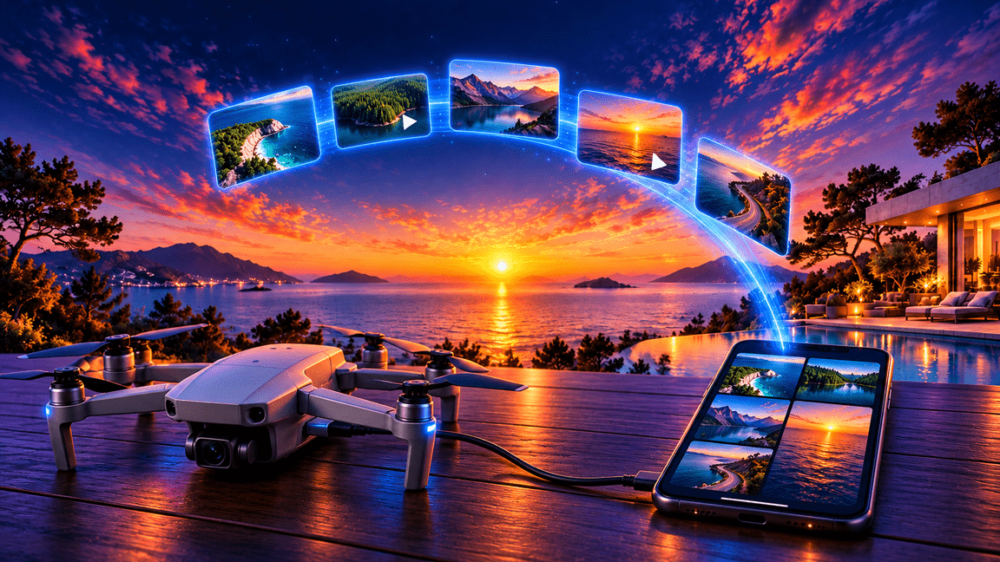

1. ಲೈಬ್ರರಿಯಲ್ಲಿ Drone ಕಾರ್ಡ್ ತೆರೆಯಿರಿ, ನಂತರ "Photos and videos from the drone". ಅದರ ಸೆಟ್ಟಿಂಗ್, Settings, Advanced ನಲ್ಲಿ "DJI drones (experimental)", ಡೀಫಾಲ್ಟ್ ಆಗಿ ಆನ್ ಆಗಿದೆ; ಆ ಪುಟವನ್ನು ಮರೆಮಾಡಲು ಅಲ್ಲಿ ಅದನ್ನು ಆಫ್ ಮಾಡಿ.
2. ಡ್ರೋನ್ (Neo 2 ಆಫ್ ಆಗಿಯೇ ಇರಬಹುದು) ಅಥವಾ ಕಾರ್ಡ್ ರೀಡರ್ ಅನ್ನು USB-C ಡೇಟಾ ಕೇಬಲ್‌ನೊಂದಿಗೆ ಫೋನ್‌ಗೆ ಪ್ಲಗ್ ಮಾಡಿ; ಪರದೆ ಇಲ್ಲದ DJI ರಿಮೋಟ್ (RC-N1, RC-N2, RC-N3) ಯಾವುದೇ ಫೋಟೋಗಳನ್ನು ಹೊಂದಿರುವುದಿಲ್ಲ. DJI ಡ್ರೋನ್ ಪುಟದಲ್ಲಿ, "ಡ್ರೋನ್ ಅಥವಾ ಕಾರ್ಡ್ ಆಯ್ಕೆಮಾಡಿ" ಟ್ಯಾಪ್ ಮಾಡಿ, ಪಿಕರ್‌ನ ಸೈಡ್ ಮೆನುವಿನಲ್ಲಿ ಅದನ್ನು ಆಯ್ಕೆಮಾಡಿ, ಅದರ DCIM ಫೋಲ್ಡರ್ ತೆರೆಯಿರಿ ಅಥವಾ ಸಂಪೂರ್ಣ ಡ್ರೈವ್ ಅನ್ನೇ ಇಟ್ಟುಕೊಳ್ಳಿ, ನಂತರ "ಈ ಫೋಲ್ಡರ್ ಬಳಸಿ" ಮತ್ತು ಅನುಮತಿಸಿ.
3. ಪುಟವು ಫೋಟೋಗಳು ಮತ್ತು ವೀಡಿಯೊಗಳನ್ನು ದಿನದ ಪ್ರಕಾರ ಪಟ್ಟಿ ಮಾಡುತ್ತದೆ, .LRF, .SRT, .THM ಮತ್ತು .m4a ಸೈಡ್ ಫೈಲ್‌ಗಳಿಲ್ಲದೆ. "ಎಲ್ಲಾ ಹೊಸದನ್ನು ಆಯ್ಕೆಮಾಡಿ" ಟ್ಯಾಪ್ ಮಾಡಿ, ನಂತರ "Immich ಗೆ ಅಪ್ ಲೋಡ್ ಮಾಡಿ"; ಮೊದಲು ಕಳುಹಿಸಿದ ಫೈಲ್‌ಗಳು ಮೋಡದ ಗುರುತನ್ನು ಹೊಂದಿರುತ್ತವೆ ಮತ್ತು ಅವುಗಳನ್ನು ಬಿಟ್ಟುಬಿಡಲಾಗುತ್ತದೆ. "ಡಿವೈಸ್‌ನಲ್ಲಿ ಇಟ್ಟುಕೊಳ್ಳಿ" ಬದಲಿಗೆ ಫೈಲ್‌ಗಳನ್ನು ಫೋನ್‌ನ ಗ್ಯಾಲರಿಗೆ, "Immuch360 import" ಆಲ್ಬಮ್‌ಗೆ ನಕಲಿಸುತ್ತದೆ.
4. ವೀಡಿಯೊ ನಕ್ಷೆಯಲ್ಲಿ ಬರಲು, ಹಾರಿಸುವ ಮೊದಲು DJI Fly ನಲ್ಲಿ Video Subtitles ಆನ್ ಮಾಡಿ (ವೀಡಿಯೊ ಮೋಡ್, Settings, Camera): ಆಗ ಡ್ರೋನ್ ಪ್ರತಿ ವೀಡಿಯೊದ ಪಕ್ಕದಲ್ಲಿ ಒಂದು .SRT ಫೈಲ್ ಬರೆಯುತ್ತದೆ, ಅಪ್ಲಿಕೇಶನ್ ಅದರಿಂದ ಸ್ಥಳವನ್ನು ಓದುತ್ತದೆ ಮತ್ತು Immich ಯಾವುದೇ ಸ್ಥಳವನ್ನು ಕಂಡುಹಿಡಿಯದಿದ್ದಾಗ, ಅಪ್‌ಲೋಡ್ ನಂತರ ಅದನ್ನು ನಿಮ್ಮ ಸರ್ವರ್‌ನಲ್ಲಿ ಹೊಂದಿಸುತ್ತದೆ.

DJI ಡ್ರೋನ್‌ಗಳ 360° ಗೋಳಗಳು (Mini, Air, Mavic ಮತ್ತು ಇತರವು, ಅವುಗಳ ಕ್ಯಾಮೆರಾದಿಂದ ಗುರುತಿಸಲಾಗುತ್ತದೆ) 360° ಟ್ಯಾಗ್‌ಗಳಿಲ್ಲದೆಯೂ Immuch360 ನಲ್ಲಿ 360° ಆಗಿ ಕಾಣಿಸುತ್ತವೆ. Immich ಗೆ ಆ ಟ್ಯಾಗ್‌ಗಳು ಬೇಕು: ಡೀಫಾಲ್ಟ್ ಆಗಿ ಆಫ್ ಇರುವ "Immich ಗಾಗಿ ಡ್ರೋನ್ ಗೋಳಗಳನ್ನು 360° ಎಂದು ಟ್ಯಾಗ್ ಮಾಡಿ" ಅಪ್‌ಲೋಡ್ ಆಯ್ಕೆ, ಫೋಟೋವನ್ನು ಬದಲಾಯಿಸದೆ ಅದರ ಪಕ್ಕದಲ್ಲಿ ಒಂದು ಸಣ್ಣ .xmp ಫೈಲ್‌ನೊಂದಿಗೆ ಕಳುಹಿಸುತ್ತದೆ, ಇದರಿಂದ Immich ಕೂಡ ಅದನ್ನು ಗೋಳವಾಗಿ ತೋರಿಸುತ್ತದೆ. Neo 2 ಗೆ ಗೋಳ ಅಥವಾ ಪನೋರಮ ಮೋಡ್ ಇಲ್ಲ: ಅದರ ಫೋಟೋಗಳು ಮತ್ತು ವೀಡಿಯೊಗಳು ಫ್ಲಾಟ್ ಆಗಿವೆ. ಫೋನ್ Neo 2 ಕ್ಲಿಪ್‌ನ ಧ್ವನಿಯನ್ನು ರೆಕಾರ್ಡ್ ಮಾಡಿದಾಗ, ಆ ಧ್ವನಿ ಪ್ರತ್ಯೇಕ .m4a ಫೈಲ್‌ನಲ್ಲಿ ಇರುತ್ತದೆ: ಪುಟ ಆ ಕ್ಲಿಪ್ ಅನ್ನು ಗುರುತಿಸುತ್ತದೆ, ಮತ್ತು Immich ಅದನ್ನು ಧ್ವನಿಯಿಲ್ಲದೆ ಪಡೆಯುತ್ತದೆ (ಧ್ವನಿ ಉಳಿಸಿಕೊಳ್ಳಲು DJI Fly ನೊಂದಿಗೆ ಅದನ್ನು ಡೌನ್‌ಲೋಡ್ ಮಾಡಿ). DCIM ಫೋಲ್ಡರ್ ಇರುವ ಯಾವುದೇ ಕ್ಯಾಮೆರಾ ಕಾರ್ಡ್ ಕಾರ್ಡ್ ರೀಡರ್‌ನಲ್ಲಿ ಅದೇ ರೀತಿ ಕೆಲಸ ಮಾಡುತ್ತದೆ. DJI ಗೆ ಏನನ್ನೂ ಕಳುಹಿಸಲಾಗುವುದಿಲ್ಲ.

ಇನ್ನಷ್ಟು: [USB ಮೂಲಕ DJI ಡ್ರೋನ್‌ಗಳು](../docs/immuch360/user-guide.md#dji-drones-photos-and-videos-over-usb-experimental), [DJI ಲಿಂಕ್ ಡಯಾಗ್ನೋಸ್ಟಿಕ್ಸ್](../docs/immuch360/user-guide.md#dji-link-diagnostics-experimental).

### 360° ಕ್ಯಾಮೆರಾಗಳ ರಾ ಫೈಲ್‌ಗಳನ್ನು ತೆರೆಯಿರಿ

Insta360 ಕ್ಯಾಮೆರಾಗಳ ರಾ .insp ಫೋಟೋಗಳು ಮತ್ತು .insv ವೀಡಿಯೊಗಳು (ಒಂದು ಅಥವಾ ಎರಡು ಲೆನ್ಸ್‌ಗಳು, ಒಂದು ಟ್ರ್ಯಾಕ್, ಎರಡು ಟ್ರ್ಯಾಕ್‌ಗಳು ಅಥವಾ ಎರಡು ಫೈಲ್‌ಗಳಲ್ಲಿ), GoPro MAX ನ .360 ಫೈಲ್‌ಗಳು ಮತ್ತು DJI Osmo 360 ನ .osv ಫೈಲ್‌ಗಳನ್ನು ಪ್ಲೇ ಆಗುವಾಗ ಅಪ್ಲಿಕೇಶನ್ ಜೋಡಿಸುತ್ತದೆ, ಫೈಲ್‌ನಲ್ಲಿ ಬರೆದ ಕ್ಯಾಲಿಬ್ರೇಶನ್‌ನೊಂದಿಗೆ, ಎಲ್ಲಿಯೂ ಏನನ್ನೂ ಇನ್‌ಸ್ಟಾಲ್ ಮಾಡದೆ.

1. ಅಪ್ಲಿಕೇಶನ್ ಓದುವಲ್ಲಿ ರಾ ಫೈಲ್‌ಗಳನ್ನು ಇಡಿ: SMB ಅಥವಾ WebDAV ಹಂಚಿಕೆ, ನಿಮ್ಮ Immich ಸರ್ವರ್ (ಅದು .insp ಮತ್ತು .insv ಮಾತ್ರ ತೆಗೆದುಕೊಳ್ಳುತ್ತದೆ), ಅಥವಾ ಕಂಪ್ಯೂಟರ್‌ನ ಫೋಲ್ಡರ್‌ಗಳು. Android ಫೋನ್‌ನ ಗ್ಯಾಲರಿ ರಾ ಫೈಲ್‌ಗಳನ್ನು ಪಟ್ಟಿ ಮಾಡುವುದಿಲ್ಲ, ಆದ್ದರಿಂದ ಫೋನ್‌ಗೆ ನಕಲಿಸಿದ ರಾ ಫೈಲ್ ಅದರ ಗ್ಯಾಲರಿಯಲ್ಲೂ ಅಪ್ಲಿಕೇಶನ್‌ನಲ್ಲೂ ಕಾಣುವುದಿಲ್ಲ.
2. ಎರಡು ಫೈಲ್‌ಗಳಿಂದ ಮಾಡಿದ ರೆಕಾರ್ಡಿಂಗ್‌ನ ಎರಡೂ ಫೈಲ್‌ಗಳನ್ನು ಒಟ್ಟಿಗೆ ಇಡಿ: ಅಪ್ಲಿಕೇಶನ್ ಮೊದಲನೆಯದರ ಪಕ್ಕದಲ್ಲಿ ಇನ್ನೊಂದನ್ನು ಹುಡುಕುತ್ತದೆ.
3. ಫೈಲ್ ತೆರೆಯಿರಿ ಮತ್ತು 360° ಟ್ಯಾಪ್ ಮಾಡಿ. ಫೋಟೋ ತನ್ನ ಕ್ಯಾಲಿಬ್ರೇಶನ್‌ನ ಮೂಲದೊಂದಿಗೆ "Raw 360° file, stitched by the app" ತೋರಿಸುತ್ತದೆ; ವೀಡಿಯೊವನ್ನು ಪ್ಲೇ ಆಗುವಾಗ ಜೋಡಿಸಲಾಗುತ್ತದೆ.

Linux ಮತ್ತು macOS ರಾ ವೀಡಿಯೊಗಳನ್ನು ಫ್ಲಾಟ್ ಆಗಿ ಪ್ಲೇ ಮಾಡುತ್ತವೆ, ಮತ್ತು ಡ್ಯುಯಲ್ ಫಿಶ್‌ಐ .dng ಫೈಲ್‌ಗಳು ಸದ್ಯಕ್ಕೆ ಫ್ಲಾಟ್ ಆಗಿ ಕಾಣುತ್ತವೆ.

ಇನ್ನಷ್ಟು: [ರಾ 360° ಕ್ಯಾಮೆರಾ ಫೈಲ್‌ಗಳು](../docs/immuch360/user-guide.md#raw-360-camera-files-without-the-cameras-app).

### ಒಂದೇ ಕೀಯಿಂದ ಫೋಟೋ ತಿರುಗಿಸಿ

ಎಡಿಟರ್ ತೆರೆಯದೆ, ಒಂದೇ ಒತ್ತುವಿಕೆಯಿಂದ ಫೋಟೋವನ್ನು 90° ತಿರುಗಿಸಿ: ಪ್ರತಿ ಪ್ಲಾಟ್‌ಫಾರ್ಮ್‌ನಲ್ಲಿ ಒಂದು ಬಟನ್, ಕೀಬೋರ್ಡ್‌ನ ಒಂದು ಕೀ ಅಥವಾ TV ರಿಮೋಟ್‌ನ ಒಂದು ಬಣ್ಣದ ಕೀ. Immich ಅಪ್ಲಿಕೇಶನ್ ಫೋಟೋವನ್ನು ತನ್ನ ಎಡಿಟರ್‌ನಲ್ಲಿ ತಿರುಗಿಸುತ್ತದೆ; Immuch360 ಅದನ್ನು ಒಂದೇ ಕೀಯಿಂದ ಮಾಡುತ್ತದೆ, ಮತ್ತು Immich 2.6 ಅಥವಾ ನಂತರದ ಆವೃತ್ತಿಯ ಸರ್ವರ್‌ನಲ್ಲಿರುವ ನಿಮ್ಮ ಸ್ವಂತ ಫೋಟೋಗಳಿಗೆ ಅದು ಅದೇ ಸರ್ವರ್ ಎಡಿಟರ್ ಮೂಲಕ ಹೋಗುತ್ತದೆ, ಆದ್ದರಿಂದ ವೆಬ್ ಅಪ್ಲಿಕೇಶನ್ ಮತ್ತು ನಿಮ್ಮ ಇತರ ಡಿವೈಸ್‌ಗಳು ಅವುಗಳನ್ನು ತಿರುಗಿಸಿದಂತೆ ತೋರಿಸುತ್ತವೆ. ಬೇರೆ ಯಾವುದೇ ಫೋಟೋವನ್ನು ಈ ಡಿವೈಸ್‌ನಲ್ಲಿ ಮಾತ್ರ ತಿರುಗಿಸಲಾಗುತ್ತದೆ. 360°, 180° ಮತ್ತು 3D ಫೋಟೋಗಳು ಎಂದಿಗೂ ತಿರುಗುವುದಿಲ್ಲ, ಇದರಿಂದ ಇಮ್ಮರ್ಸಿವ್ ವೀಕ್ಷಣೆಗಳು ಸಮತಲವಾಗಿಯೇ ಉಳಿಯುತ್ತವೆ.

  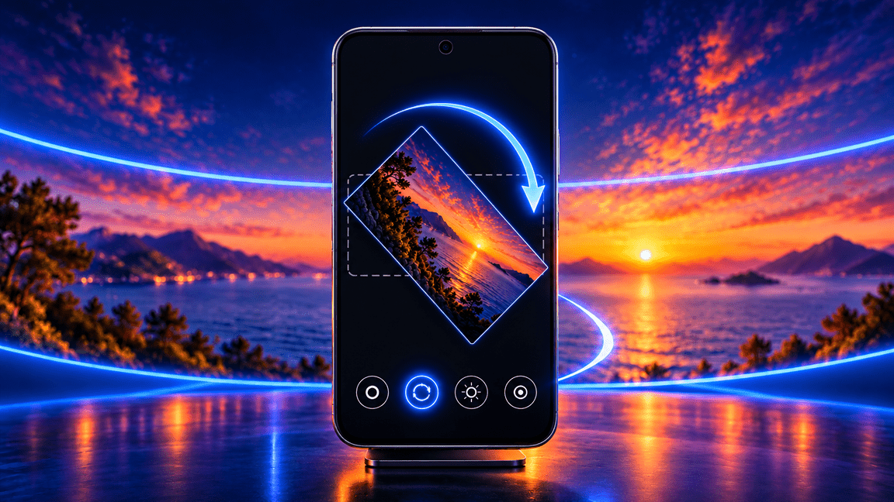

1. **ಫೋನ್‌ಗಳು, ಟ್ಯಾಬ್ಲೆಟ್‌ಗಳು ಮತ್ತು Meta Quest ವಿಂಡೋ**: ಫೋಟೋವನ್ನು ತೆರೆಯಿರಿ ಮತ್ತು ಅದನ್ನು ಗಡಿಯಾರದ ದಿಕ್ಕಿನಲ್ಲಿ ತಿರುಗಿಸಲು ಕೆಳಗಿನ ಸಾಲಿನಲ್ಲಿ, ತಿದ್ದು ಗಿಂತ ಮೊದಲು ಇರುವ Rotate ಅನ್ನು ಟ್ಯಾಪ್ ಮಾಡಿ; ದೀರ್ಘವಾಗಿ ಒತ್ತಿದರೆ ಅದು ಇನ್ನೊಂದು ದಿಕ್ಕಿಗೆ ತಿರುಗುತ್ತದೆ. ಕೀಬೋರ್ಡ್‌ನೊಂದಿಗೆ, R ಮತ್ತು Shift+R.
2. **Android TV ಮತ್ತು Google TV**: ವೀಕ್ಷಕದಲ್ಲಿ ಫೋಕಸ್ ಎಲ್ಲಿದ್ದರೂ, ರಿಮೋಟ್‌ನ ಹಳದಿ ಕೀ ಫೋಟೋವನ್ನು ಗಡಿಯಾರದ ದಿಕ್ಕಿನಲ್ಲಿ ಮತ್ತು ನೀಲಿ ಕೀ ಗಡಿಯಾರದ ವಿರುದ್ಧ ದಿಕ್ಕಿನಲ್ಲಿ ತಿರುಗಿಸುತ್ತದೆ. ಬಣ್ಣದ ಕೀಗಳಿಲ್ಲದ ರಿಮೋಟ್‌ನಲ್ಲಿ, ಕೆಳಗೆ ಒತ್ತಿ: ಫೋಟೋದ ಕೆಳಗಿನ ಬಾರ್ Rotate ಆಯ್ಕೆಯಾಗಿರುವಂತೆ ಕಾಣಿಸುತ್ತದೆ (ಫೋಟೋಗೆ ಪಠ್ಯ ಬಟನ್ ಇದ್ದಾಗ ಒಂದು ಬಲ ಒತ್ತುವಿಕೆ ದೂರದಲ್ಲಿ), ಮತ್ತು ಪ್ರತಿ OK ಫೋಟೋವನ್ನು ತಿರುಗಿಸುತ್ತದೆ.
3. **LG TVಗಳು (webOS)**: Android TV ಯಂತೆ ಹಳದಿ ಮತ್ತು ನೀಲಿ, ಕೀಬೋರ್ಡ್‌ನಲ್ಲಿ R ಮತ್ತು Shift+R, ಅಥವಾ ಫೋಟೋದ ನಿಯಂತ್ರಣಗಳ ತಿರುಗಿಸುವ ಬಟನ್. Samsung TVಗಳೂ ಒಂದೇ ಕೀಯಿಂದ ಫೋಟೋ ತಿರುಗಿಸುತ್ತವೆ.
4. **Windows, Linux ಮತ್ತು macOS**: R ಗಡಿಯಾರದ ದಿಕ್ಕಿನಲ್ಲಿ ತಿರುಗಿಸುತ್ತದೆ, Shift+R ಗಡಿಯಾರದ ವಿರುದ್ಧ ದಿಕ್ಕಿನಲ್ಲಿ, ಅಥವಾ ಮೇಲಿನ ಬಾರ್‌ನಲ್ಲಿ ಪೂರ್ಣ ಪರದೆಗಿಂತ ಮೊದಲು ಇರುವ ತಿರುಗಿಸುವ ಬಟನ್.
5. **ನೆಟ್‌ವರ್ಕ್ ಹಂಚಿಕೆ, Plex ಅಥವಾ ಕ್ಯಾಮೆರಾದ ಫೋಟೋಗಳು**: ಮೇಲಿನ ಬಾರ್‌ನಲ್ಲಿ ಮೊದಲನೆಯದಾಗಿರುವ ತಿರುಗಿಸುವ ಬಟನ್, R ಮತ್ತು Shift+R, ಅಥವಾ ಹಳದಿ ಮತ್ತು ನೀಲಿ ಕೀಗಳು.

ತಿರುಗಿಸುವಿಕೆ ಎಲ್ಲಿ ಉಳಿಯುತ್ತದೆ: Immich 2.6 ಅಥವಾ ನಂತರದ ಆವೃತ್ತಿಯಲ್ಲಿ ನಿಮ್ಮ ಸ್ವಂತ ಖಾತೆಯ ಫೋಟೋವನ್ನು ಸರ್ವರ್‌ನ ಫೋಟೋ ಎಡಿಟರ್ ಮೂಲಕ ತಿರುಗಿಸಲಾಗುತ್ತದೆ, ಅದು ಮೂಲ ಫೈಲ್ ಅನ್ನು ಉಳಿಸಿಕೊಂಡು ತಿರುಗಿಸಿದ ಚಿತ್ರವನ್ನು ಮಾಡುತ್ತದೆ (ಅದು ಕೆಲಸ ಮಾಡುವಾಗ ತೆಳುವಾದ ಬಾರ್ ಕಾಣಿಸುತ್ತದೆ; ನಾಲ್ಕು ತಿರುಗಿಸುವಿಕೆಗಳು, ಅಥವಾ ಒಂದು ಹಿಮ್ಮುಖ ತಿರುಗಿಸುವಿಕೆ, ಮೂಲಕ್ಕೆ ಮರಳಿಸುತ್ತವೆ). ಡಿವೈಸ್‌ನ, ಹಂಚಿಕೆಯ, ಪಾಲುದಾರರ ಅಥವಾ ಹಂಚಿದ ಆಲ್ಬಮ್‌ನ ಫೋಟೋಗಳು, ಮತ್ತು ಹಳೆಯ ಸರ್ವರ್‌ನಲ್ಲಿರುವ ಪ್ರತಿ ಫೋಟೋವನ್ನು ಈ ಡಿವೈಸ್‌ನಲ್ಲಿ ಮಾತ್ರ, ಆ ಫೋಟೋಗಾಗಿ, ತಿರುಗಿಸಲಾಗುತ್ತದೆ, ಮತ್ತು ಫೈಲ್ ಎಂದಿಗೂ ಬದಲಾಗುವುದಿಲ್ಲ; Immich ಫೋಟೋಗಾಗಿ ಅಪ್ಲಿಕೇಶನ್ ಇದನ್ನು ಒಮ್ಮೆ ಹೇಳುತ್ತದೆ. Android, iOS ಮತ್ತು ಕಂಪ್ಯೂಟರ್ ಅಪ್ಲಿಕೇಶನ್‌ಗಳಲ್ಲಿ, ಡಿವೈಸ್‌ನಲ್ಲಿ ಇಟ್ಟ ತಿರುಗಿಸುವಿಕೆ ವೀಕ್ಷಕದಲ್ಲಿ ಕಾಣಿಸುತ್ತದೆ, ಆದರೆ ಇನ್ನೂ ಥಂಬ್‌ನೇಲ್‌ಗಳು, ಸ್ಲೈಡ್‌ಶೋ ಮತ್ತು ನೆನಪುಗಳಲ್ಲಿ ಅಲ್ಲ. ವೀಡಿಯೊಗಳು, ಲಾಕ್ ಮಾಡಿದ ಫೋಲ್ಡರ್ ಮತ್ತು ಪ್ರತಿ 360°, 180° ಅಥವಾ 3D ಫೋಟೋಗೆ Rotate ಇಲ್ಲ.

### ನಿಮ್ಮ ಕಂಪ್ಯೂಟರ್ ಅನ್ನು ಮೀಡಿಯಾ ಪ್ಲೇಯರ್ ಆಗಿ ಬಳಸಿ

Windows ಕಂಪ್ಯೂಟರ್‌ನಲ್ಲಿ, Immuch360 Desktop ನೀವು ಆಯ್ಕೆ ಮಾಡುವ ಫೋಲ್ಡರ್‌ಗಳನ್ನು ಯಾವುದೇ ಸರ್ವರ್ ಇಲ್ಲದೆ ಓದುತ್ತದೆ, ಫ್ಲಾಟ್ ಮತ್ತು 360° ವೀಡಿಯೊಗಳನ್ನು ತನ್ನದೇ ಪ್ಲೇಯರ್‌ನಲ್ಲಿ ಪ್ಲೇ ಮಾಡುತ್ತದೆ, ಅದೇ ಹಂಚಿಕೆಗಳು ಮತ್ತು ಸರ್ವರ್‌ಗಳನ್ನು ಬ್ರೌಸ್ ಮಾಡುತ್ತದೆ, ಮತ್ತು ಮನೆಯಲ್ಲಿ ಹೆಡ್‌ಸೆಟ್‌ನೊಂದಿಗೆ ಕಂಪ್ಯೂಟರ್ ಅನ್ನು ಹಂಚಿಕೊಳ್ಳಬಹುದು. Linux ಮತ್ತು macOS ಅದನ್ನು ಪೂರ್ವವೀಕ್ಷಣೆಗಳಾಗಿ ಹೊಂದಿವೆ, 360° ವೀಡಿಯೊಗಳನ್ನು ಫ್ಲಾಟ್ ಆಗಿ ಪ್ಲೇ ಮಾಡಲಾಗುತ್ತದೆ.

  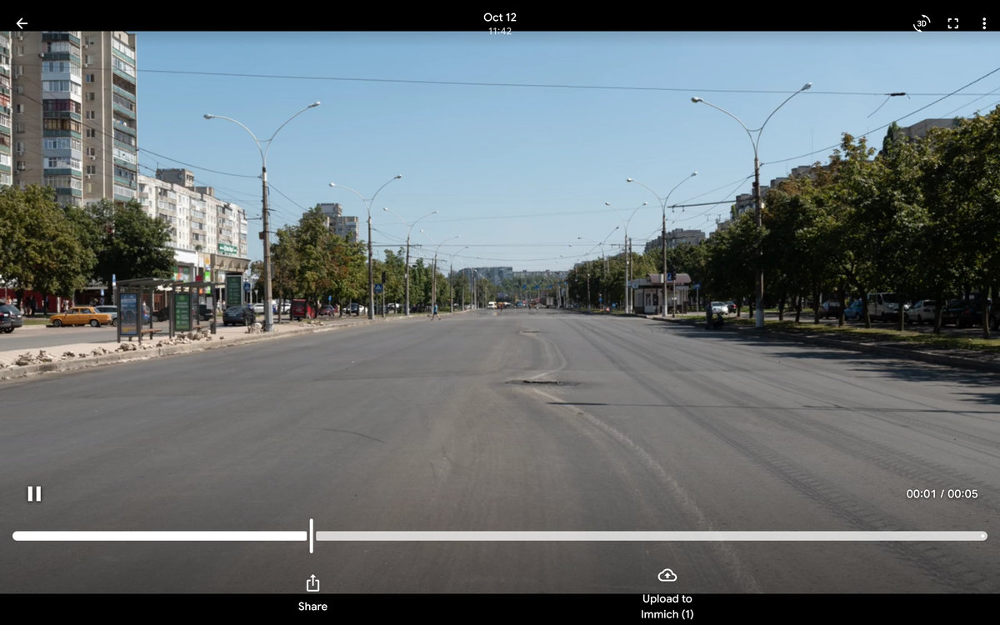

1. ಪೂರ್ವವೀಕ್ಷಣೆಯನ್ನು ಇನ್‌ಸ್ಟಾಲ್ ಮಾಡಿ, ಅಥವಾ ಅದನ್ನು ಅನ್‌ಜಿಪ್ ಮಾಡಿ ಮತ್ತು `immuch360.exe` ಅನ್ನು ಪ್ರಾರಂಭಿಸಿ, [ಇನ್‌ಸ್ಟಾಲ್](#windows) ನೋಡಿ. ಸ್ವಾಗತ ಪುಟದಲ್ಲಿ, "ಸರ್ವರ್ ಇಲ್ಲದೆ ಬಳಸಿ" ನಿಮ್ಮ ಫೋಲ್ಡರ್‌ಗಳ ಆಯ್ಕೆಯನ್ನು ತೆರೆಯುತ್ತದೆ, ಮತ್ತು "Immich ಸರ್ವರ್‌ಗೆ ಸಂಪರ್ಕಿಸಿ" ಲಾಗಿನ್ ಪುಟವನ್ನು, ನಿಮ್ಮ ಫೋನ್‌ಗಾಗಿ ಅದರ QR ಕೋಡ್‌ನೊಂದಿಗೆ.
2. ಪ್ರೋಗ್ರಾಂನೊಂದಿಗೆ ತೆರೆದ, ಅಥವಾ ಅದರ ವಿಂಡೋ ಮೇಲೆ ಬಿಟ್ಟ ಫೋಟೋ, ವೀಡಿಯೊ ಅಥವಾ ಫೋಲ್ಡರ್ ತಕ್ಷಣ ತೆರೆಯುತ್ತದೆ, 360° ಆದದ್ದು ಅದರ 360° ವೀಕ್ಷಣೆಯಲ್ಲಿ; ಹಲವು ಫೈಲ್‌ಗಳು ಒಂದೇ ಪುಟದಲ್ಲಿ ಒಟ್ಟಿಗೆ ತೆರೆಯುತ್ತವೆ. ಫೋಟೋಗಳು ಮತ್ತು ವೀಡಿಯೊಗಳು ಅದನ್ನು "Open with" ನಲ್ಲಿ ಪಡೆಯುತ್ತವೆ; ಅದು ಎಂದಿಗೂ ತನ್ನನ್ನು ಅವುಗಳ ಡೀಫಾಲ್ಟ್ ಪ್ರೋಗ್ರಾಂ ಮಾಡಿಕೊಳ್ಳುವುದಿಲ್ಲ.
3. ವೀಕ್ಷಕದಲ್ಲಿ, ಕೀಬೋರ್ಡ್ ನಡೆಸುತ್ತದೆ: Space ಪ್ಲೇ ಮತ್ತು ವಿರಾಮ ಮಾಡುತ್ತದೆ, J ಮತ್ತು L ಹಿಂದಕ್ಕೆ ಮತ್ತು ಮುಂದಕ್ಕೆ ಹೋಗುತ್ತವೆ, F ಪೂರ್ಣ ಪರದೆ, ಮತ್ತು R ಮತ್ತು Shift+R ಫೋಟೋ ತಿರುಗಿಸುತ್ತವೆ.

ಇನ್ನಷ್ಟು: [Windows ಕಂಪ್ಯೂಟರ್‌ನಲ್ಲಿ](../docs/immuch360/user-guide.md#on-a-windows-computer-immuch360-desktop-preview), [ಪ್ಲಾಟ್‌ಫಾರ್ಮ್ ಬೆಂಬಲ](../docs/immuch360/platform-support.md).

## Immich ನೊಂದಿಗೆ ಹೋಲಿಕೆ

Immuch360 ಸಂಪೂರ್ಣ Immich ಮೊಬೈಲ್ ಅಪ್ಲಿಕೇಶನ್ ಉಳಿಸಿಕೊಳ್ಳುತ್ತದೆ ಮತ್ತು ಅದರ ಸುತ್ತಲಿನದನ್ನು ಸೇರಿಸುತ್ತದೆ. ಸಂಕ್ಷಿಪ್ತವಾಗಿ:

| | Immuch360, Immich ಅಪ್ಲಿಕೇಶನ್‌ಗೆ ಹೋಲಿಸಿದರೆ |
|---|---|
| **ಅದೇ** | ನಿಮ್ಮ Immich ಸರ್ವರ್ ಮತ್ತು ಖಾತೆ: ಬ್ಯಾಕಪ್, ಟೈಮ್‌ಲೈನ್, ಆಲ್ಬಮ್‌ಗಳು, ಹುಡುಕಾಟ, ಜನರು, ನೆನಪುಗಳು, ಹಂಚಿಕೆ ಮತ್ತು ಪಾಲುದಾರರು, ಎಲ್ಲವೂ ನಿಮ್ಮ ಸರ್ವರ್‌ನೊಂದಿಗೆ ಸಿಂಕ್ ಆಗಿವೆ. ಅದು ಅಧಿಕೃತ ಅಪ್ಲಿಕೇಶನ್‌ನ ಪಕ್ಕದಲ್ಲಿ ಇನ್‌ಸ್ಟಾಲ್ ಆಗುತ್ತದೆ. |
| **ಸರ್ವರ್ ಬೇಕಿಲ್ಲ** | ಅದು ಸರ್ವರ್ ಅಥವಾ ಖಾತೆ ಇಲ್ಲದೆಯೂ ಚಲಿಸುತ್ತದೆ, ಡಿವೈಸ್‌ನ ಫೋಟೋಗಳು ಮತ್ತು ವೀಡಿಯೊಗಳು, ಕಂಪ್ಯೂಟರ್‌ನ ಫೋಲ್ಡರ್‌ಗಳು ಮತ್ತು ನೆಟ್‌ವರ್ಕ್ ಹಂಚಿಕೆಗಳ ಮೇಲೆ; Plex ಮತ್ತು ಕ್ಯಾಮೆರಾಗಳು ತಮ್ಮದೇ ಸೈನ್ ಇನ್ ಬಳಸುತ್ತವೆ, ಎಂದಿಗೂ Immuch360 ಖಾತೆ ಅಲ್ಲ. |
| **360° ಮತ್ತು ಇಮ್ಮರ್ಸಿವ್** | ಗೋಳವಾಗಿ 360° ಫೋಟೋಗಳು ಮತ್ತು ವೀಡಿಯೊಗಳು, ಪನೋರಮಾಗಳು, VR180 ಮತ್ತು 3D, Meta Quest ನಲ್ಲಿ ಇಮ್ಮರ್ಸಿವ್ ವೀಕ್ಷಣೆ, 360° ಬ್ಯಾಡ್ಜ್ ಮತ್ತು 360° ಪಟ್ಟಿ. Immich ಮೊಬೈಲ್ ಅಪ್ಲಿಕೇಶನ್‌ನಲ್ಲಿ 360° ವೀಕ್ಷಣೆಯನ್ನು ಜನವರಿ 2024 ರಿಂದ ಕೇಳಲಾಗುತ್ತಿದೆ ಮತ್ತು ಇನ್ನೂ ಅಲ್ಲಿಲ್ಲ. |
| **ನಿಮ್ಮ ಫೋಟೋಗಳಿಂದ 3D** | ಕಂಪ್ಯೂಟರ್‌ನಲ್ಲಿ, ಒಂದು ಫೋಟೋ 3D ಫೋಟೋ, 3D ದೃಶ್ಯ ಅಥವಾ 360° ಪನೋರಮಾ ಆಗುತ್ತದೆ, ಮತ್ತು Meta Quest 3 ಅಥವಾ 3S ನಲ್ಲಿ ಯಾವುದೇ ಫ್ಲಾಟ್ ಫೋಟೋ ತನ್ನ ಆಳ ಪಡೆಯುತ್ತದೆ: ನಿಮ್ಮ ಸ್ವಂತ ಕಂಪ್ಯೂಟರ್ ಮತ್ತು ಹೆಡ್‌ಸೆಟ್‌ನಲ್ಲಿ AI ಮಾಡುತ್ತದೆ, ಅಪ್ಲಿಕೇಶನ್‌ನಲ್ಲಿ ಮತ್ತು ಫೈಲ್‌ಗಳಲ್ಲಿ ಹಾಗೆಂದು ಲೇಬಲ್ ಮಾಡಲಾಗುತ್ತದೆ, ಮೂಲ ಎಂದಿಗೂ ಬದಲಾಗುವುದಿಲ್ಲ. Immich ಅಪ್ಲಿಕೇಶನ್ 3D ಯಲ್ಲಿ ಏನನ್ನೂ ಮಾಡುವುದಿಲ್ಲ. |
| **TV ಯಲ್ಲಿ** | Android TV ಮತ್ತು Google TV ಯಲ್ಲಿ ಅದೇ ಅಪ್ಲಿಕೇಶನ್, ಮತ್ತು LG TVಗಳಿಗಾಗಿ TV ಅಪ್ಲಿಕೇಶನ್, Samsung TVಗಳಿಗಾಗಿ ಪರೀಕ್ಷಾ build ಆಗಿಯೂ ಪ್ಯಾಕೇಜ್ ಮಾಡಲಾಗಿದೆ. Immich ನ ಸ್ವಂತ ಅಪ್ಲಿಕೇಶನ್‌ಗಳು LG TV ಯಲ್ಲಿ ಇನ್‌ಸ್ಟಾಲ್ ಆಗುವುದಿಲ್ಲ. |
| **ನಿಮ್ಮ ಫೋನ್‌ನೊಂದಿಗೆ ಸೈನ್ ಇನ್** | ನಿಮ್ಮ ಫೋನ್ TV, ಹೆಡ್‌ಸೆಟ್ ಅಥವಾ ಕಂಪ್ಯೂಟರ್‌ನ QR ಕೋಡ್ ಸ್ಕ್ಯಾನ್ ಮಾಡಿದಾಗ ಅದು ಸೈನ್ ಇನ್ ಆಗುತ್ತದೆ, ಮತ್ತು ನಿಮ್ಮ ಪಾಸ್‌ವರ್ಡ್ ಫೋನ್‌ನಲ್ಲೇ ಉಳಿಯುತ್ತದೆ. Immich ಅಪ್ಲಿಕೇಶನ್‌ನಲ್ಲಿ ಇಂತಹದ್ದೇನೂ ಇಲ್ಲ. |
| **ಹಂಚಿಕೆಗಳು ಮತ್ತು Plex** | SMB, WebDAV ಮತ್ತು DLNA ಹಂಚಿಕೆಗಳು ಮತ್ತು Plex ಸರ್ವರ್‌ಗಳು, ಇರುವಲ್ಲೇ ಪ್ಲೇ ಮಾಡಲಾಗುತ್ತದೆ, ಮತ್ತು ಅವುಗಳ ಫೈಲ್‌ಗಳನ್ನು ಕೈಯಿಂದ ನಿಮ್ಮ ಸರ್ವರ್‌ಗೆ ಕಳುಹಿಸಲಾಗುತ್ತದೆ. |
| **Tapo ಕ್ಯಾಮೆರಾಗಳು** | ಲೈವ್ ವೀಕ್ಷಣೆ ಮತ್ತು ಮೆಮೊರಿ ಕಾರ್ಡ್‌ನ ರೆಕಾರ್ಡಿಂಗ್‌ಗಳು, ನಿಮ್ಮ ಫೋಟೋಗಳ ಪಕ್ಕದಲ್ಲಿ; ಇನ್ನೂ ನಿಜವಾದ ಕ್ಯಾಮೆರಾದೊಂದಿಗೆ ಪರಿಶೀಲಿಸಿಲ್ಲ. |
| **ಒಂದೇ ಕೀಯಿಂದ ತಿರುಗಿಸುವಿಕೆ** | Immich ಅಪ್ಲಿಕೇಶನ್ ಫೋಟೋವನ್ನು ತನ್ನ ಎಡಿಟರ್‌ನಲ್ಲಿ ತಿರುಗಿಸುತ್ತದೆ; Immuch360 ಅದನ್ನು ಒಂದೇ ಕೀಯಿಂದ ತಿರುಗಿಸುತ್ತದೆ, ಮತ್ತು Immich 2.6 ಅಥವಾ ನಂತರದ ಆವೃತ್ತಿಯಲ್ಲಿ ನಿಮ್ಮ ಸ್ವಂತ ಫೋಟೋಗಳಿಗೆ ಅದು ಅದೇ ಸರ್ವರ್ ಎಡಿಟರ್ ಮೂಲಕ ಹೋಗುತ್ತದೆ, ಆದ್ದರಿಂದ ವೆಬ್ ಅಪ್ಲಿಕೇಶನ್ ಮತ್ತು ನಿಮ್ಮ ಇತರ ಡಿವೈಸ್‌ಗಳು ಅವುಗಳನ್ನು ತಿರುಗಿಸಿದಂತೆ ತೋರಿಸುತ್ತವೆ. |
| **ವೀಡಿಯೊಗಳು** | Android ಪ್ಲೇಯರ್‌ನಲ್ಲಿ ಆಡಿಯೋ ಮತ್ತು ಉಪಶೀರ್ಷಿಕೆ ಮೆನುಗಳು, ಅವು Immich ಅಪ್ಲಿಕೇಶನ್‌ನ Android ಪ್ಲೇಯರ್‌ನಲ್ಲಿ ಇಲ್ಲ; ಮೂಲ ಫೈಲ್ ಅಥವಾ ಟ್ರಾನ್ಸ್‌ಕೋಡ್ ಮಾಡಿದ ಸ್ಟ್ರೀಮ್, ಪ್ರತಿ ವೀಡಿಯೊಗೆ ಆಯ್ಕೆ ಮಾಡಲಾಗುತ್ತದೆ; ವೀಡಿಯೊದ ತಾಂತ್ರಿಕ ವಿವರಗಳು. |
| **ನಿಮ್ಮ ಡ್ರೋನ್** | USB ಮೂಲಕ ಕಳುಹಿಸಿದ DJI ಡ್ರೋನ್‌ನ ಫೋಟೋಗಳು ಮತ್ತು ವೀಡಿಯೊಗಳು, ಅದರ ಹಾರಾಟ ದತ್ತಾಂಶದಿಂದ ನಕ್ಷೆಯ ಮೇಲೆ ಇರಿಸಿದ ವೀಡಿಯೊಗಳೊಂದಿಗೆ, Immich ಅಪ್ಲಿಕೇಶನ್ ಫೋನ್‌ನ ಗ್ಯಾಲರಿಯಲ್ಲಿ ಈಗಾಗಲೇ ಇರುವುದನ್ನು ಮಾತ್ರ ಬ್ಯಾಕಪ್ ಮಾಡುವಲ್ಲಿ; ಮತ್ತು RC-N3 ರಿಮೋಟ್ ಮೂಲಕ ಡ್ರೋನ್‌ನ ಲೈವ್ ವೀಡಿಯೊ, ಅದರ ಹಾರಾಟ ಮೌಲ್ಯಗಳು ಮತ್ತು ಅಡಚಣೆ ಉಂಗುರದೊಂದಿಗೆ, ಫೋನ್‌ನಲ್ಲಿ ಮತ್ತು Meta Quest ಅಥವಾ Android TV ಗೆ ರಿಲೇ ಮಾಡಲಾಗುತ್ತದೆ. ಎರಡೂ ಪ್ರಯೋಗಾತ್ಮಕ. |
| **ಎಲ್ಲಿ ವರದಿ ಮಾಡಬೇಕು** | [Immuch360 Issues](https://github.com/freeKC/Immuch360/issues), Immich ಯೋಜನೆಗೆ ಅಲ್ಲ. |

ಕಾರ್ಯದಿಂದ ಕಾರ್ಯಕ್ಕೆ ಹೋಲಿಕೆ [Immich ಅಪ್ಲಿಕೇಶನ್‌ನೊಂದಿಗೆ ಹೋಲಿಕೆ](../docs/immuch360/compatibility.md#compared-with-the-immich-app) ಯಲ್ಲಿದೆ.

## ಗೌಪ್ಯತೆ

ಡೆವಲಪರ್‌ಗೆ ಏನೂ ಹೋಗುವುದಿಲ್ಲ: ಖಾತೆ ಇಲ್ಲ, ವಿಶ್ಲೇಷಣೆ ಇಲ್ಲ, ಕ್ರ್ಯಾಶ್ ವರದಿ ಸೇವೆ ಇಲ್ಲ, ಜಾಹೀರಾತು ಇಲ್ಲ. ಅಪ್ಲಿಕೇಶನ್ ನೀವು ಆಯ್ಕೆ ಮಾಡುವ ಸರ್ವರ್‌ಗಳೊಂದಿಗೆ (ನಿಮ್ಮ Immich ಸರ್ವರ್, ನಿಮ್ಮ ಹಂಚಿಕೆಗಳು, ನಿಮ್ಮ Plex ಸರ್ವರ್, ನಿಮ್ಮ ಕ್ಯಾಮೆರಾಗಳು) ಮಾತ್ರ ಮಾತನಾಡುತ್ತದೆ ಮತ್ತು, ಸರ್ವರ್ ಇಲ್ಲದೆ, ಯಾವುದರೊಂದಿಗೂ ಇಲ್ಲ. ಪಾಸ್‌ವರ್ಡ್‌ಗಳು ಮತ್ತು ಟೋಕನ್‌ಗಳು ಡಿವೈಸ್‌ನ ಸುರಕ್ಷಿತ ಸಂಗ್ರಹಣೆಯಲ್ಲಿ ಉಳಿಯುತ್ತವೆ; LG ಮತ್ತು Samsung TVಗಳಲ್ಲಿ ಅಪ್ಲಿಕೇಶನ್‌ಗೆ ಅಂತಹದ್ದು ಇಲ್ಲ, ಆದ್ದರಿಂದ ಅಲ್ಲಿ ಅವು ಅಪ್ಲಿಕೇಶನ್‌ನ ಸ್ವಂತ ಸಂಗ್ರಹಣೆಯಲ್ಲಿ ಉಳಿಯುತ್ತವೆ, ಎನ್‌ಕ್ರಿಪ್ಟ್ ಮಾಡದೆ. ಕ್ಯಾಮೆರಾವನ್ನು ಡಿವೈಸ್‌ನಲ್ಲಿ ಮಾತ್ರ ಬಳಸಲಾಗುತ್ತದೆ, Spatial 2.5D ಪ್ಲೇಯರ್‌ನಿಂದ ಮತ್ತು ನೀವು ಸೈನ್ ಇನ್ ಮಾಡುವ ಪರದೆಯ ಕೋಡ್ ಸ್ಕ್ಯಾನ್ ಮಾಡಲು; ಅದರ ಚಿತ್ರಗಳನ್ನು ಎಂದಿಗೂ ಸಂಗ್ರಹಿಸಲಾಗುವುದಿಲ್ಲ ಮತ್ತು ಎಂದಿಗೂ ಎಲ್ಲಿಗೂ ಕಳುಹಿಸಲಾಗುವುದಿಲ್ಲ. ನಿಮ್ಮ ಫೋನ್‌ನಿಂದ ಸೈನ್ ಇನ್ ಆದ ಪರದೆ ತನ್ನದೇ ಸೆಷನ್ ಪಡೆಯುತ್ತದೆ, ನಿಮ್ಮ ಮನೆಯ ನೆಟ್‌ವರ್ಕ್‌ನಲ್ಲಿ ಎನ್‌ಕ್ರಿಪ್ಟ್ ಮಾಡಿ ಕಳುಹಿಸಲಾಗುತ್ತದೆ, ಎಂದಿಗೂ ನಿಮ್ಮ ಪಾಸ್‌ವರ್ಡ್ ಅಲ್ಲ; LG TV ಫೋನ್‌ನ ಬ್ರೌಸರ್‌ನಲ್ಲಿನ ಪುಟದಿಂದ ಸೈನ್ ಇನ್ ಆಗುತ್ತದೆ, ಅದು ನಿಮ್ಮ ಇಮೇಲ್ ಮತ್ತು ಪಾಸ್‌ವರ್ಡ್ ಅನ್ನು ನಿಮ್ಮ ಮನೆಯ ನೆಟ್‌ವರ್ಕ್‌ನಲ್ಲಿ ಎನ್‌ಕ್ರಿಪ್ಟ್ ಮಾಡದೆ TV ಗೆ ಕಳುಹಿಸುತ್ತದೆ, ಮತ್ತು TV ಸೆಷನ್ ಅನ್ನು ಮಾತ್ರ ಇಡುತ್ತದೆ. ಡ್ರೋನ್ ಪುಟಗಳ ಕ್ಯಾಪ್ಚರ್‌ಗಳು ಮತ್ತು ಸ್ವೀಕೃತಿ ದಾಖಲೆಗಳು ನೀವು ಹಂಚಿಕೊಳ್ಳದ ಹೊರತು ಡಿವೈಸ್‌ನಲ್ಲಿ ಉಳಿಯುತ್ತವೆ: ಅವು ಡ್ರೋನ್‌ನ ವೀಡಿಯೊವನ್ನು ಹೊಂದಿರುತ್ತವೆ ಮತ್ತು ಅದರ ಸ್ಥಾನವನ್ನು ಹೊಂದಿರಬಹುದು, ಮತ್ತು ಕ್ಯಾಪ್ಚರ್ ರಿಮೋಟ್ ಮತ್ತು ವಿಮಾನದ ಸೀರಿಯಲ್ ಸಂಖ್ಯೆಗಳನ್ನು. ಡ್ರೋನ್‌ನ ಚಿತ್ರ ಮತ್ತು ಮೌಲ್ಯಗಳು ಫೋನ್‌ನಿಂದ ನೀವು ಜೋಡಿಸುವ ಹೆಡ್‌ಸೆಟ್‌ಗಳು ಮತ್ತು TVಗಳಿಗೆ ಮಾತ್ರ ಹೋಗುತ್ತವೆ, ನಿಮ್ಮ ಸ್ಥಳೀಯ ನೆಟ್‌ವರ್ಕ್‌ನಲ್ಲಿ, ಎನ್‌ಕ್ರಿಪ್ಟ್ ಮಾಡದೆ, Wi-Fi ಯಲ್ಲಿ ಹಂಚಿಕೊಂಡ ಫೋನ್‌ನಂತೆ. DJI ಗೆ ಏನನ್ನೂ ಕಳುಹಿಸಲಾಗುವುದಿಲ್ಲ, TP-Link ಗೂ ಅಲ್ಲ. ಸಂಪೂರ್ಣ ನೀತಿ [PRIVACY.md](../PRIVACY.md) ಯಲ್ಲಿದೆ, ಮತ್ತು ಪ್ರತಿ ಮೂಲದ ವಿವರಗಳು [ಬಳಕೆದಾರ ಮಾರ್ಗದರ್ಶಿ](../docs/immuch360/user-guide.md#privacy) ಯಲ್ಲಿ.

**AI ವೈಶಿಷ್ಟ್ಯಗಳು** ನಿಮ್ಮ ಡಿವೈಸ್‌ಗಳಲ್ಲಿ ಮಾತ್ರ ಕೆಲಸ ಮಾಡುತ್ತವೆ. ಫೋಟೋ, ಅದರ ಆಳ, ಅದರ ದೃಶ್ಯ ಮತ್ತು ಅದರ ಪನೋರಮಾವನ್ನು ನಿಮ್ಮ ಕಂಪ್ಯೂಟರ್‌ನಲ್ಲಿ ಅಥವಾ ಹೆಡ್‌ಸೆಟ್‌ನಲ್ಲಿ ಲೆಕ್ಕಹಾಕಲಾಗುತ್ತದೆ ಮತ್ತು ಎಲ್ಲಿಗೂ ಕಳುಹಿಸಲಾಗುವುದಿಲ್ಲ. ನೀವು ಕೇಳಿದ ಘಟಕವನ್ನು ಡೌನ್‌ಲೋಡ್ ಮಾಡಲು ಮಾತ್ರ ಅಪ್ಲಿಕೇಶನ್ ಸಂಪರ್ಕಿಸುತ್ತದೆ, GitHub ನಲ್ಲಿನ ಈ ಯೋಜನೆಯ ಬಿಡುಗಡೆಗಳಿಂದ ಅಥವಾ, ಅದು ಸಾಧ್ಯವಾಗದಿದ್ದರೆ, ಮಾಡೆಲ್‌ನ ಅಧಿಕೃತ ಪುಟ ಇದ್ದರೆ ಅಲ್ಲಿಂದ, ಪ್ರತಿ ಫೈಲ್ ಅನ್ನು ಅದರ SHA-256 ಮೂಲಕ ಪರಿಶೀಲಿಸುತ್ತದೆ, ಮತ್ತು ನಂತರ ಆಫ್‌ಲೈನ್‌ನಲ್ಲಿ ಕೆಲಸ ಮಾಡುತ್ತದೆ. ಕಂಪ್ಯೂಟರ್‌ನಲ್ಲಿ ಮಾಡೆಲ್‌ಗಳನ್ನು ಚಲಾಯಿಸುವ ONNX Runtime ತನ್ನ ಅಧಿಕೃತ build ಗಳಲ್ಲಿ Microsoft ಗೆ ಟೆಲಿಮೆಟ್ರಿ ಕಳುಹಿಸುತ್ತದೆ; Immuch360 ಅದನ್ನು ಆಫ್ ಮಾಡುತ್ತದೆ. ಹೊಸ ಫೈಲ್‌ಗಳು ನಿಮ್ಮ ಮೂಲಗಳ ಪಕ್ಕದಲ್ಲಿ ಹೋಗುತ್ತವೆ, ಅವುಗಳ ಮೇಲೆ ಎಂದಿಗೂ ಅಲ್ಲ, ಮತ್ತು ನೀವು "AI ಆವೃತ್ತಿಗಳನ್ನೂ ಬ್ಯಾಕಪ್ ಮಾಡಿ" ಆನ್ ಮಾಡಿದರೆ ಮಾತ್ರ ನಿಮ್ಮ Immich ಸರ್ವರ್ ತಲುಪುತ್ತವೆ (ಬ್ಯಾಕಪ್ ಆಲ್ಬಮ್‌ಗಳಲ್ಲಿ "ಎಲ್ಲವನ್ನೂ ಆಯ್ಕೆಮಾಡಿ" ಕೂಡ ಅದನ್ನು ಆನ್ ಮಾಡುತ್ತದೆ).

## ಪರವಾನಗಿಗಳು ಮತ್ತು ಕೃತಜ್ಞತೆಗಳು

Immuch360 ಎಂಬುದು [GNU AGPL v3](../LICENSE) ಅಡಿಯಲ್ಲಿ, Immich ತಂಡ ಅಥವಾ FUTO ಜೊತೆ ಸಂಬಂಧ ಹೊಂದಿರದ ಅಥವಾ ಅನುಮೋದಿಸಲ್ಪಡದ, [Immich](https://github.com/immich-app/immich) ಮೊಬೈಲ್ ಅಪ್ಲಿಕೇಶನ್‌ನ ಒಂದು ಅನಧಿಕೃತ ಫೋರ್ಕ್ ಆಗಿದೆ. ಮೊಬೈಲ್‌ನಲ್ಲಿ 360° ವೀಕ್ಷಣೆಯನ್ನು ಜನವರಿ 2024 ರಿಂದ Immich ನಲ್ಲಿ ಕೇಳಲಾಗಿದೆ ಮತ್ತು ಇನ್ನೂ ಅಧಿಕೃತ ಅಪ್ಲಿಕೇಶನ್‌ನಲ್ಲಿ ಇಲ್ಲದ ಕಾರಣ ಈ ಫೋರ್ಕ್ ಇದೆ; ಇದು ಈಗ ಅದನ್ನು ಶಿಪ್ ಮಾಡುತ್ತದೆ, ನಿಜವಾದ ಡಿವೈಸ್ ಪ್ರತಿಕ್ರಿಯೆಯನ್ನು ಸಂಗ್ರಹಿಸುತ್ತದೆ, ಮತ್ತು ಮೇಂಟೇನರ್‌ಗಳು ಬಯಸುವುದನ್ನು ಸಣ್ಣ pull request ಗಳಲ್ಲಿ Immich ಗೆ ಮರಳಿ ನೀಡುತ್ತದೆ. ಅಧಿಕೃತ ಅಪ್ಲಿಕೇಶನ್ ಮಾಡುವ ಎಲ್ಲವನ್ನೂ ಉಳಿಸಿಕೊಳ್ಳಲಾಗಿದೆ; ಬ್ರ್ಯಾಂಚ್‌ಗಳು, ಬಿಲ್ಡ್ ಚೈನ್ ಮತ್ತು CI ಅನ್ನು [ಅದನ್ನು ನೀವೇ ನಿರ್ಮಿಸಿ](../docs/immuch360/build.md) ನಲ್ಲಿ ವಿವರಿಸಲಾಗಿದೆ.

360° ಫೋಟೋ ವೀಕ್ಷಕವು dmitry-brazhenko ನ upstream pull request [immich-app/immich#31169](https://github.com/immich-app/immich/pull/31169) ಅನ್ನು ಆಧರಿಸಿದೆ, ಅದು ಸ್ವತಃ [#30192](https://github.com/immich-app/immich/pull/30192) ನಲ್ಲಿ bencefr ನ prototype ಅನ್ನು ಆಧರಿಸಿದೆ; ಇಬ್ಬರಿಗೂ ಧನ್ಯವಾದಗಳು. TV ಗಳಲ್ಲಿ ಹುಡುಕಾಟ ಫಿಲ್ಟರ್‌ಗಳ ರಿಮೋಟ್ ಕಂಟ್ರೋಲ್ ಸರಿಪಡಿಸುವಿಕೆಗಳು ಮತ್ತು ಆಲ್ಬಮ್ ವಿಂಗಡಣೆ [mlc70/Immuch-Android-TV#1](https://github.com/mlc70/Immuch-Android-TV/pull/1) ನಲ್ಲಿ mlc70 ಅವರ ಕೆಲಸದಿಂದ ಪ್ರಾರಂಭವಾದವು, ಮತ್ತು ಆಕ್ಷನ್ ರೈಲ್ ಹಾಗೂ ಪರದೆಯ ಎತ್ತರದ 80 ಪ್ರತಿಶತದಲ್ಲಿರುವ ಫಿಲ್ಟರ್ ಶೀಟ್‌ಗಳು mlc70 ಅವರ [mlc70/Immuch-Android-TV#3](https://github.com/mlc70/Immuch-Android-TV/pull/3) ನಿಂದ ಬಂದಿವೆ, ಅವುಗಳ ಕರ್ತೃತ್ವವನ್ನು ಉಳಿಸಿಕೊಂಡು; mlc70 ಅವರಿಗೆ ಧನ್ಯವಾದಗಳು. Samsung TVಗಳಿಗೂ ಪ್ಯಾಕೇಜ್ ಮಾಡಲಾದ LG webOS ಅಪ್ಲಿಕೇಶನ್ Seeky91 ಅವರ [immich-tv-webos](https://github.com/Seeky91/immich-tv-webos) ಮೇಲೆ ನಿರ್ಮಿತವಾಗಿದೆ, MIT ಲೈಸೆನ್ಸ್ ಅಡಿಯಲ್ಲಿ, ಅದರ ಫೋಲ್ಡರ್‌ನಲ್ಲಿ ಉಳಿಸಲಾಗಿದೆ; Seeky91 ಅವರಿಗೆ ಧನ್ಯವಾದಗಳು. Tapo ಕ್ಯಾಮೆರಾಗಳನ್ನು [pytapo](https://github.com/JurajNyiri/pytapo), [Home Assistant Tapo Control](https://github.com/JurajNyiri/HomeAssistant-Tapo-Control) ಮತ್ತು [python-kasa](https://github.com/python-kasa/python-kasa) ದಾಖಲಿಸುವುದರಿಂದ ಬರೆಯಲಾಗಿದೆ. Meta Quest ವೀಕ್ಷಣೆ Meta Spatial SDK ಅನ್ನು ಅವಲಂಬಿಸಿದೆ, ಇದು open source ಅಲ್ಲ, ಆದ್ದರಿಂದ ಇದು ಈ ಫೋರ್ಕ್‌ನಲ್ಲಿಯೇ ಇರುತ್ತದೆ. SMB ಹಂಚಿಕೆಗಳು LGPL 2.1 ಅಥವಾ ನಂತರದ ಆವೃತ್ತಿಯ ಅಡಿಯಲ್ಲಿ libsmb2 ಅನ್ನು ಬಳಸುತ್ತವೆ: build 27 ಮತ್ತು desktop build 7 ರಿಂದ, ಪ್ರತಿ build ಅದರ ಸೂಚನೆ, ಅದರ ಲೈಸೆನ್ಸ್ ಪಠ್ಯಗಳು ಮತ್ತು ಅದರ ಮೂಲ ಆರ್ಕೈವ್ `Immuch360-libsmb2-sources.tar.gz` ಅನ್ನು ಹೊಂದಿರುತ್ತದೆ, ಅದನ್ನು ಪ್ರತಿ ರಿಲೀಸ್‌ಗೂ ಲಗತ್ತಿಸಲಾಗಿದೆ. Windows ಮತ್ತು macOS build ಗಳು ಪ್ರಾಜೆಕ್ಟ್‌ನಿಂದ ನಿರ್ಮಿಸಿದ libmpv ([mpv](https://mpv.io) ನ ಲೈಬ್ರರಿ, [FFmpeg](https://ffmpeg.org) ಜೊತೆ) ಅನ್ನು LGPL ಅಡಿಯಲ್ಲಿ, ಅದರ ಲೈಸೆನ್ಸ್‌ಗಳು ಮತ್ತು ಮೂಲಗಳೊಂದಿಗೆ ಹೊಂದಿವೆ, ಅವುಗಳನ್ನು ಅಪ್ಲಿಕೇಶನ್‌ನ ಲೈಸೆನ್ಸ್ ಪುಟದಲ್ಲಿ ಪಟ್ಟಿ ಮಾಡಲಾಗಿದೆ (Licenses, ಪ್ರೊಫೈಲ್ ಮೆನುವಿನ ಕೆಳಭಾಗದಲ್ಲಿ); ಈ ಪೇಜ್‌ನಲ್ಲಿ ಹೆಸರಿಸಲಾದ ಪ್ಲಾಟ್‌ಫಾರ್ಮ್‌ಗಳ ವಿವರಗಳು ಮತ್ತು ಟ್ರೇಡ್‌ಮಾರ್ಕ್‌ಗಳು [ಲೈಸೆನ್ಸ್ ಮತ್ತು ಟ್ರೇಡ್‌ಮಾರ್ಕ್‌ಗಳು](../docs/immuch360/platform-support.md#license-and-trademarks) ನಲ್ಲಿವೆ.

AI ವೈಶಿಷ್ಟ್ಯಗಳು ಇತರರು ಮಾಡಿದ ಮಾಡೆಲ್‌ಗಳು ಮತ್ತು ಎಂಜಿನ್‌ಗಳನ್ನು ಚಲಾಯಿಸುತ್ತವೆ, ನೀವು ಕೇಳಿದಾಗ ಮಾತ್ರ ಈ ರೆಪೊಸಿಟರಿಯ [ai-components-1](https://github.com/freeKC/Immuch360/releases/tag/ai-components-1), [ai-components-2](https://github.com/freeKC/Immuch360/releases/tag/ai-components-2) ಮತ್ತು [ai-components-3](https://github.com/freeKC/Immuch360/releases/tag/ai-components-3) ಪೂರ್ವ ಬಿಡುಗಡೆಗಳಿಂದ ಡೌನ್‌ಲೋಡ್ ಮಾಡಲಾಗುತ್ತದೆ; ಪ್ರತಿ ಫೈಲ್, ಅದರ ಮೂಲ, ಅದರ ಪರವಾನಗಿ ಮತ್ತು ಅದರ SHA-256 [MODEL-LICENSES.md](https://github.com/freeKC/Immuch360/blob/immuch360/licenses/ai-components/MODEL-LICENSES.md) ನಲ್ಲಿವೆ. ಅವುಗಳ ಲೇಖಕರಿಗೆ ಧನ್ಯವಾದಗಳು:

- **3D ಫೋಟೋಗಳು**: Depth Anything V2 Small (Apache 2.0), ಕಂಪ್ಯೂಟರ್‌ನಲ್ಲಿ ONNX Runtime (MIT) ಮತ್ತು ಹೆಡ್‌ಸೆಟ್‌ನಲ್ಲಿ Quest APK ಒಳಗಿನ LiteRT 2.3.0 (Apache 2.0) ಚಲಾಯಿಸುತ್ತವೆ.
- **3D ದೃಶ್ಯಗಳು**: MoGe-2 ViT-S (MIT), ಯೋಜನೆಯು ಅದರ MIT ತೂಕಗಳಿಂದ ONNX ಗೆ ರಫ್ತು ಮಾಡಿದೆ, ಮತ್ತು LaMa (Apache 2.0).
- **360° ಪನೋರಮಾಗಳು**: ತನ್ನ VAE ಜೊತೆಗೆ FLUX.2 klein base 4B (Apache 2.0), Qwen3 4B (Apache 2.0), nomadoor ನ 360° LoRA (Apache 2.0), MI-GAN (MIT) ಮತ್ತು Real-ESRGAN x4plus (BSD 3 Clause), stable-diffusion.cpp ಮತ್ತು ggml (MIT) ಚಲಾಯಿಸುತ್ತವೆ, ಯೋಜನೆಯ CI ನಿರ್ಮಿಸಿದೆ ಮತ್ತು Windows ನಲ್ಲಿ ಸೈನ್ ಮಾಡಲಾಗಿದೆ.

nomadoor ನ 360° LoRA ತನ್ನ ಕಾರ್ಡ್‌ನಲ್ಲಿ Apache 2.0 ಆಗಿದೆ ಮತ್ತು CC0 ಹಾಗೂ ಸಾರ್ವಜನಿಕ ಡೊಮೇನ್ ಚಿತ್ರಗಳ ಮೇಲೆ ತರಬೇತಿ ಪಡೆದಿದೆ, ಒಂದು ಭಾಗ CC BY ಅಡಿಯಲ್ಲಿ: ಆ ಭಾಗದ ಶ್ರೇಯ ಉಲ್ಲೇಖ MODEL-LICENSES.md ನ ಮುಂದಿನ ಆವೃತ್ತಿಯಲ್ಲಿ ಬರುತ್ತದೆ. ಇಲ್ಲಿ ಯಾವುದೂ ವಾಣಿಜ್ಯೇತರ ಪರವಾನಗಿಯ ಅಡಿಯಲ್ಲಿಲ್ಲ, ಮತ್ತು ಯಾವುದಕ್ಕೂ CUDA ಬೇಕಿಲ್ಲ. ONNX Runtime ಮತ್ತು LiteRT ಒಳಗೆ ಇತರ ಲೈಬ್ರರಿಗಳಿವೆ, ಅವುಗಳ ಸೂಚನೆಗಳಲ್ಲಿ ಪಟ್ಟಿ ಮಾಡಲಾಗಿದೆ, ಅವುಗಳಲ್ಲಿ ದುರ್ಬಲ copyleft ಪರವಾನಗಿಯಾದ MPL 2.0 ಅಡಿಯಲ್ಲಿ Eigen.

ಈ ಪುಟದ ಸ್ಕ್ರೀನ್‌ಶಾಟ್‌ಗಳು ಅಪ್ಲಿಕೇಶನ್‌ನ ನಿಜವಾದ ಸ್ಕ್ರೀನ್‌ಶಾಟ್‌ಗಳು: ಫೋನ್‌ನವು ಎಮ್ಯುಲೇಟರ್‌ನಲ್ಲಿ Android build ನಲ್ಲಿ, Android TV ಯವು Google TV ಎಮ್ಯುಲೇಟರ್‌ನಲ್ಲಿ, LG ಮತ್ತು Samsung ನವು TV ಯ ಬದಲಿಗೆ ಬಳಸಿದ ಬ್ರೌಸರ್‌ನಲ್ಲಿ, Windows ನವು Windows 11 PC ಯಲ್ಲಿ ಮತ್ತು Meta Quest ವಿಂಡೋ Quest 3 ನಲ್ಲಿ, ಎಲ್ಲವೂ [Poly Haven](https://polyhaven.com) ನ CC0 ಪನೋರಮಾಗಳೊಂದಿಗೆ; ಹೆಡ್‌ಸೆಟ್‌ನ ಇಮ್ಮರ್ಸಿವ್ ಸ್ಕ್ರೀನ್‌ಶಾಟ್‌ಗಳನ್ನು ಲೇಖಕರ ಸ್ವಂತ ಮಾಧ್ಯಮದೊಂದಿಗೆ Quest 3 ನಲ್ಲಿ ತೆಗೆಯಲಾಗಿದೆ, ಮತ್ತು iPad ನದನ್ನು iPad ಸಿಮ್ಯುಲೇಟರ್‌ನಲ್ಲಿ, Poly Haven ನ CC0 ಪನೋರಮಾದೊಂದಿಗೆ. AI ರಚನಾಕಾರನ ಚಿತ್ರಗಳು Poly Haven ನ CC0 ಫೋಟೋಗಳಿಂದ ಮಾಡಿದ ಅಪ್ಲಿಕೇಶನ್‌ನ ನಿಜವಾದ ಫಲಿತಾಂಶಗಳು, Windows ಅಪ್ಲಿಕೇಶನ್‌ನ ಎರಡು ನಿಜವಾದ ಸ್ಕ್ರೀನ್‌ಶಾಟ್‌ಗಳೊಂದಿಗೆ. ಆರಂಭಿಕ ಚಿತ್ರ ಮತ್ತು TV, ಸೈನ್ ಇನ್, ತಿರುಗಿಸುವಿಕೆ, ಕ್ಯಾಮೆರಾಗಳು ಮತ್ತು ಡ್ರೋನ್‌ನ ಚಿತ್ರಗಳು ಯೋಜನೆಗಾಗಿ ಮಾಡಿದ ಚಿತ್ರಣಗಳು: ಅವು ಅಪ್ಲಿಕೇಶನ್‌ನ ಯಾವುದೇ ಪರದೆ, ಬೇರೆ ಕಂಪನಿಯ ಯಾವುದೇ ಲೋಗೋ ಮತ್ತು ಯಾವುದೇ ಮುಖವನ್ನು ತೋರಿಸುವುದಿಲ್ಲ. ಪ್ರತಿ ಚಿತ್ರ, ಅದರ ಮೂಲ, ದಿನಾಂಕ ಮತ್ತು ಪರವಾನಗಿಯೊಂದಿಗೆ, [CAPTURES.md](../.github/readme/CAPTURES.md) ನಲ್ಲಿ ಪಟ್ಟಿ ಮಾಡಲಾಗಿದೆ.

## ಮಾರ್ಗಸೂಚಿ

ಇನ್ನೂ ಮಾಡದಿರುವುದು, ಹೆಚ್ಚು ಸಾಧ್ಯತೆಯಿರುವುದು ಮೊದಲು. ಇಲ್ಲಿರುವ ಯಾವುದೂ ಭರವಸೆಯಲ್ಲ, ಮತ್ತು [issue tracker](https://github.com/freeKC/Immuch360/issues) ನಲ್ಲಿನ ಪ್ರತಿಕ್ರಿಯೆ ಯಾವುದು ಮೊದಲು ಬರಬೇಕು ಎಂದು ನಿರ್ಧರಿಸಲು ಸಹಾಯ ಮಾಡುತ್ತದೆ.

- **ಸ್ಟೋರ್‌ಗಳು**: Google Play (29 ಅಕ್ಟೋಬರ್‌ನಿಂದ build 32 ಪರಿಶೀಲನೆಯಲ್ಲಿ, build 31 ರ ಬದಲಿಗೆ; TV ಪಟ್ಟಿ ಪರಿಶೀಲನೆಯಲ್ಲಿ), App Store (ಆವೃತ್ತಿ 3.3.1 ಪರಿಶೀಲನೆಯಲ್ಲಿ, ನಂತರ build 28 ನೊಂದಿಗೆ ಆವೃತ್ತಿ 3.3.2), build 32 ನೊಂದಿಗೆ Meta Horizon Store (ಅಲ್ಲಿ 28 ಅಕ್ಟೋಬರ್‌ನಿಂದ build 31), LG Content Store (ಆವೃತ್ತಿ 1.0.0 24 ಅಕ್ಟೋಬರ್‌ನಿಂದ LG ನ ಪರಿಶೀಲನೆಯಲ್ಲಿ, ನಂತರ ಆವೃತ್ತಿ 1.0.1), ಮತ್ತು ನಂತರ Samsung ನ ಸ್ಟೋರ್.
- **AI ರಚನಾಕಾರ**: Mac ನಲ್ಲಿ 360° ಪನೋರಮಾಗಳು; ಒಂದೇ ಸ್ಥಳದ ಹಲವು ಫೋಟೋಗಳಿಂದ ಮರುನಿರ್ಮಿಸಿದ ದೃಶ್ಯ; ಇತರ ಉಪಕರಣಗಳು ಮಾಡಿದ Gaussian splat ಗಳು (.spz, .ply), ಹೆಡ್‌ಸೆಟ್‌ನಲ್ಲಿ ಓದಲಾಗುತ್ತವೆ; iOS, LG ಮತ್ತು Samsung ಅಪ್ಲಿಕೇಶನ್‌ಗಳಲ್ಲಿ AI ಲೇಬಲ್‌ಗಳು; ಗ್ರಾಫಿಕ್ಸ್ ಕಾರ್ಡ್ ಇರುವ Linux PC ಯಲ್ಲಿ, ಮತ್ತು AMD ಹಾಗೂ Intel ಕಾರ್ಡ್‌ಗಳಲ್ಲಿ ಪ್ರಯತ್ನಿಸಿದ ಪನೋರಮಾಗಳು.
- **ಡ್ರೋನ್‌ಗಳು**: 1.8 m ಮತ್ತು 1.5 m/s ಮೀರಿದ ಎತ್ತರ ಮತ್ತು ವೇಗಗಳನ್ನು ಮತ್ತು ಟೇಪ್ ವಿರುದ್ಧ ಅಡಚಣೆ ಅಂತರಗಳನ್ನು ಸಾಬೀತುಪಡಿಸಲು, ನಂತರ ಉಪಗ್ರಹಗಳು ಮತ್ತು ಮನೆಯಿಂದ ಅಂತರವನ್ನು ತೋರಿಸಲು ಹೊರಾಂಗಣ ಹಾರಾಟ; ಹೆಡ್‌ಸೆಟ್‌ನಲ್ಲಿ ಪರಿಶೀಲಿಸಿದ ರಿಲೇಯ ಸ್ಥಿರ ಚಿತ್ರ; LG ಮತ್ತು Samsung TVಗಳಿಗೆ ರಿಲೇ; iPhone ಮತ್ತು iPad ನಲ್ಲಿ ಡ್ರೋನ್, ಪ್ರಾರಂಭವಾಗಿಲ್ಲ; ನಿಜವಾದ DJI Neo 2 ನೊಂದಿಗೆ ಆಮದು ಪುಟದ ಪರೀಕ್ಷೆ, ನಂತರ ಫೋನ್ ರೆಕಾರ್ಡ್ ಮಾಡಿದ ಧ್ವನಿಯನ್ನು ಅದರ ಕ್ಲಿಪ್‌ಗೆ ಸೇರಿಸುವುದು. ಆ ಪರೀಕ್ಷೆಗಳಿಗೆ ಮೊದಲು ಡ್ರೋನ್‌ಗೆ ಆಜ್ಞೆ ಕಳುಹಿಸುವ ಯಾವುದನ್ನೂ ಯೋಜಿಸಲಾಗಿಲ್ಲ.
- **TVಗಳು**: ನಿಜವಾದ Android TV ಯಲ್ಲಿ build 29, ಅದರ ವೀಡಿಯೊ ನಿಯಂತ್ರಣಗಳು ಮತ್ತು ನಿಮ್ಮ ಫೋನ್‌ನೊಂದಿಗೆ ಸೈನ್ ಇನ್ ಸೇರಿದಂತೆ; ನಿಜವಾದ LG TV ಯಲ್ಲಿ LG ಅಪ್ಲಿಕೇಶನ್‌ನ ಹಂಚಿಕೆಗಳು, Plex ಮತ್ತು ಲೈವ್ ವೀಕ್ಷಣೆ, ಮತ್ತು webOS 26; ನಿಜವಾದ Samsung TV ಯಲ್ಲಿ Samsung ಪರೀಕ್ಷಾ build 0.2.0, ನಂತರ Samsung TVಗಳಲ್ಲಿ ಫೋನ್‌ನೊಂದಿಗೆ ಸೈನ್ ಇನ್, ಹಂಚಿಕೆಗಳು, Plex ಮತ್ತು ಕ್ಯಾಮೆರಾಗಳು; ನಂತರ LG TVಗಳ ಗೋಳದ ಮೇಲೆ 360° ವೀಡಿಯೊಗಳು, ಕ್ಯಾಮೆರಾಗಳ ಧ್ವನಿ ಮತ್ತು ಅವುಗಳ ರೆಕಾರ್ಡಿಂಗ್‌ಗಳು (ಡಿಸೆಂಬರ್ 2026 ಕ್ಕಿಂತ ಮೊದಲು ಅಲ್ಲ).
- **ಕ್ಯಾಮೆರಾಗಳು**: ನಿಜವಾದ ಕ್ಯಾಮೆರಾದೊಂದಿಗೆ ಪರಿಶೀಲಿಸಿದ Tapo ಕ್ಯಾಮೆರಾಗಳು.
- **ಕಂಪ್ಯೂಟರ್‌ಗಳು**: ಒಂದು Windows PC ಯಲ್ಲಿ ಪ್ರತಿ ಫಂಕ್ಷನ್ ಅನ್ನು ಕೈಯಾರೆ ಪರೀಕ್ಷಿಸುವುದು, ನಿಮ್ಮ ಫೋನ್‌ನೊಂದಿಗೆ ಸೈನ್ ಇನ್ ಸೇರಿದಂತೆ; Windows ನಲ್ಲಿ ವೆಬ್‌ಕ್ಯಾಮ್‌ನೊಂದಿಗೆ Spatial 2.5D, ನವೆಂಬರ್ 2026 ಕ್ಕಾಗಿ ಅಭಿವೃದ್ಧಿಯಲ್ಲಿದೆ; ನಂತರ Linux ಮತ್ತು macOS ನಲ್ಲಿ 360° ವೀಡಿಯೊ ರೆಂಡರರ್, ಒಂದು ನಿಜವಾದ Linux PC ಯಲ್ಲಿ ಪರೀಕ್ಷೆ; ನಂತರ ಸ್ವಯಂಚಾಲಿತ ಅಪ್‌ಡೇಟ್‌ಗಳು ಮತ್ತು ಸೈನ್ ಮಾಡಿದ macOS ಅಪ್ಲಿಕೇಶನ್.
- **ಫೋನ್‌ಗಳು ಮತ್ತು ಟ್ಯಾಬ್ಲೆಟ್‌ಗಳು**: ಮುಂದಿನ iOS ರಿಲೀಸ್‌ನೊಂದಿಗೆ iPhone ಮತ್ತು iPad ನಲ್ಲಿ Tapo ಲೈವ್ ವೀಕ್ಷಣೆ ಮತ್ತು ದೊಡ್ಡ ಪರದೆಗಳ ಸೈನ್ ಇನ್; iOS 360° ವೀಡಿಯೊ ಪ್ಲೇಯರ್‌ನಲ್ಲಿ ಒಂದು ಟೈಮ್ ಬಾರ್, ಫೋನ್‌ಗಳ 360° ಪ್ಲೇಯರ್‌ಗಳಲ್ಲಿ ಹಿಂದಿನದು ಮತ್ತು ಮುಂದಿನದು, iOS ಫ್ಲಾಟ್ ಪ್ಲೇಯರ್‌ನಲ್ಲಿ ಆಡಿಯೋ ಟ್ರ್ಯಾಕ್ ಮತ್ತು ಉಪಶೀರ್ಷಿಕೆ ಮೆನುಗಳು.
- **ಇಮ್ಮರ್ಸಿವ್ ಮಾಧ್ಯಮ**: ಡ್ಯುಯಲ್ fisheye .dng, GoPro ಮತ್ತು DJI ವೀಡಿಯೊಗಳ ಸ್ವಂತ ಚಲನೆ ಡೇಟಾದಿಂದ ಲೆವೆಲಿಂಗ್, Quest ನ ಡಿಕೋಡರ್‌ಗಳು ಅನುಮತಿಸಿದರೆ 3D ಯಲ್ಲಿ spatial ವೀಡಿಯೊಗಳು, ಹೆಡ್‌ಸೆಟ್‌ನಲ್ಲಿ spatial ಫೋಟೋಗಳ ನಡುವೆ ಹಿಂದಿನದು ಮತ್ತು ಮುಂದಿನದು.
- **ಮೂಲಗಳು**: ಒಂದು ಹಂಚಿಕೆ ಫೋಲ್ಡರ್‌ನ ಫೈಲ್‌ಗಳ ನಡುವೆ ಸ್ವೈಪಿಂಗ್, WebDAV ಗಾಗಿ Digest authentication, ಕಂಪ್ಯೂಟರ್‌ನಿಂದ Plex token ಅನ್ನು ತರಲು ಒಂದು QR ಕೋಡ್, Plex ಗಾಗಿ IPv6, H.265 Tapo ರೆಕಾರ್ಡಿಂಗ್‌ಗಳು, TV home screen ನಲ್ಲಿ ಚಾನಲ್‌ಗಳು.
- **Upstream**: ನಿರ್ವಾಹಕರು ಬಯಸುವ ಭಾಗಗಳಿಗೆ Immich ಗೆ ಸಣ್ಣ pull request ಗಳು, 360° ಫೋಟೋ ವೀಕ್ಷಕದಿಂದ ಪ್ರಾರಂಭಿಸಿ.

ಪ್ರತಿ ವೈಶಿಷ್ಟ್ಯಕ್ಕೆ ಇನ್ನೂ ಬಾಕಿ ಇರುವ ಡಿವೈಸ್ ಪರಿಶೀಲನೆಗಳೊಂದಿಗೆ ಸಂಪೂರ್ಣ ಪಟ್ಟಿ [ರಿಲೀಸ್ ಸ್ಥಿತಿ](../docs/immuch360/release-status.md#roadmap) ನಲ್ಲಿದೆ.

## ದಸ್ತಾವೇಜು

- [ವೈಶಿಷ್ಟ್ಯಗಳು: ಸಂಪೂರ್ಣ ಪಟ್ಟಿ ಮತ್ತು ಪ್ಲಾಟ್‌ಫಾರ್ಮ್ ಪ್ರತಿ ವೈಶಿಷ್ಟ್ಯ ಮ್ಯಾಟ್ರಿಕ್ಸ್](../docs/immuch360/features.md)
- [ಬಳಕೆದಾರ ಮಾರ್ಗದರ್ಶಿ: ಪ್ರತಿ ಫಂಕ್ಷನ್, ಹಂತ ಹಂತವಾಗಿ, ಅದರ ಆಯ್ಕೆಗಳು ಮತ್ತು ಸಂದೇಶಗಳೊಂದಿಗೆ](../docs/immuch360/user-guide.md)
- [ಹೊಂದಾಣಿಕೆ: ಫಾರ್ಮ್ಯಾಟ್‌ಗಳು, codecs, ಡಿಕೋಡರ್‌ಗಳು, ಸರ್ವರ್‌ಗಳು ಮತ್ತು ಡಿವೈಸ್‌ಗಳು ಪರಿಶೀಲಿಸಲಾಗಿದೆ, ಮಿತಿಗಳು](../docs/immuch360/compatibility.md)
- [ಪ್ಲಾಟ್‌ಫಾರ್ಮ್ ಬೆಂಬಲ: ಪ್ರತಿ ಸಿಸ್ಟಮ್ ಏನು ಹೊಂದಿದೆ, ಅದನ್ನು ಹೇಗೆ ಇನ್‌ಸ್ಟಾಲ್ ಮಾಡಲಾಗಿದೆ, ಏನು ಬೇರೆಯಾಗಿದೆ](../docs/immuch360/platform-support.md)
- [ಗೊತ್ತಿರುವ ಸಮಸ್ಯೆಗಳು](../docs/immuch360/known-issues.md) ಮತ್ತು [ಸಮಸ್ಯೆ ನಿವಾರಣೆ](../docs/immuch360/troubleshooting.md), ವರದಿಗೆ ಲಗತ್ತಿಸಬೇಕಾದ ಲಾಗ್‌ಗಳೊಂದಿಗೆ
- [ತಾಂತ್ರಿಕ ವಿವರಗಳು: ಆರ್ಕಿಟೆಕ್ಚರ್, Flutter ಮತ್ತು ನೇಟಿವ್ ಮಾಡ್ಯೂಲ್‌ಗಳು, ಮೀಡಿಯಾ ಬ್ರಿಡ್ಜ್, ಹೊಲಿಗೆ ಪೈಪ್‌ಲೈನ್, ಡಿಕೋಡರ್‌ಗಳು](../docs/immuch360/technical-details.md)
- [AI ಘಟಕಗಳು: ಪ್ರತಿ ಮಾಡೆಲ್, ಅದರ ಮೂಲ, ಅದರ ಪರವಾನಗಿ, ಅದರ ಗಾತ್ರ ಮತ್ತು ಅದರ ಮೊತ್ತ](https://github.com/freeKC/Immuch360/blob/immuch360/licenses/ai-components/MODEL-LICENSES.md)
- [desktop 360° ವೀಡಿಯೊ ರೆಂಡರರ್: libmpv, ಪ್ರೊಜೆಕ್ಷನ್ ಪಾಸ್ ಮತ್ತು ಅದರ ಹಿಂದಿನ ಅಳತೆಗಳು](../docs/immuch360/desktop-360-video-renderer.md)
- [ರಿಲೀಸ್ ಸ್ಥಿತಿ: builds, ಸ್ಟೋರ್‌ಗಳು ಮತ್ತು ಪ್ರತಿ ಸ್ಟೋರ್ ಏನು ಹೊಂದಿದೆ](../docs/immuch360/release-status.md)
- [ಅದನ್ನು ನೀವೇ ನಿರ್ಮಿಸಿ: ಫೋನ್‌ಗಳು, ಹೆಡ್‌ಸೆಟ್‌ಗಳು, TVಗಳು ಮತ್ತು ಕಂಪ್ಯೂಟರ್‌ಗಳು](../docs/immuch360/build.md)
- [LG webOS TVಗಳಿಗಾಗಿ Immuch360: Developer Mode ನಲ್ಲಿ ಇನ್‌ಸ್ಟಾಲ್, ರಿಮೋಟ್ ಕಂಟ್ರೋಲ್ ಕೀಗಳು, CORS headers](../webos/README.md)

### ಸುಧಾರಿತ ವೈಶಿಷ್ಟ್ಯಗಳು

ಅಪ್ಲಿಕೇಶನ್ ಏನನ್ನು ಓದಬಹುದು ಮತ್ತು ಪ್ಲೇ ಮಾಡಬಹುದು, ಸಂಪೂರ್ಣ ವಿವರ ಬಯಸುವ ಓದುಗರಿಗಾಗಿ. ಪ್ರತಿ ಸಾಲನ್ನು [ಬಳಕೆದಾರ ಮಾರ್ಗದರ್ಶಿ](../docs/immuch360/user-guide.md) ಮತ್ತು [ಹೊಂದಾಣಿಕೆ ಪೇಜ್](../docs/immuch360/compatibility.md) ನಲ್ಲಿ ವಿವರಿಸಲಾಗಿದೆ.

<b>ಫಾರ್ಮ್ಯಾಟ್‌ಗಳು, ಮೂಲಗಳು, ಪ್ಲೇಬ್ಯಾಕ್ ಮತ್ತು ಹಾರ್ಡ್‌ವೇರ್, ವಿವರವಾಗಿ</b>

- **ಫಾರ್ಮ್ಯಾಟ್‌ಗಳು**: ಫ್ಲಾಟ್ ಫೋಟೋಗಳು ಮತ್ತು ವೀಡಿಯೊಗಳು (ಡಿವೈಸ್ ಡಿಕೋಡ್ ಮಾಡುವಂತಹವು: MP4, MOV, MKV ಮತ್ತು ಇತರವು); equirectangular 360° ಫೋಟೋಗಳು ಮತ್ತು ವೀಡಿಯೊಗಳು; ಭಾಗಶಃ ಪನೋರಮಗಳು (GPano ಕ್ರಾಪ್); VR180; ಸ್ಟೀರಿಯೋಸ್ಕೋಪಿಕ್ 3D, ಮೇಲೆ ಮತ್ತು ಕೆಳಗೆ ಅಥವಾ ಅಕ್ಕಪಕ್ಕ, ಫೈಲ್‌ನಿಂದ ಓದಲಾಗಿದೆ (st3d box) ಅಥವಾ ಫ್ರೇಮ್‌ನಿಂದ ಅಂದಾಜಿಸಲಾಗಿದೆ; Apple spatial ಫೋಟೋಗಳು (HEIC ಸ್ಟೀರಿಯೋ ಜೋಡಿಗಳು) ಮತ್ತು spatial ವೀಡಿಯೊಗಳು (MV-HEVC, ಒಂದು ಕಣ್ಣು); ರಾ Insta360 .insp ಮತ್ತು .insv, GoPro .360, DJI .osv; 10 bit HLG ಮತ್ತು PQ ಮೂಲಗಳು ಗೋಳದಲ್ಲಿ tone mapped.
- **ಪ್ರೊಜೆಕ್ಷನ್ ಮತ್ತು ಮೆಟಾಡೇಟಾ**: GPano ಮತ್ತು ಗೋಳಾಕಾರದ ಮೆಟಾಡೇಟಾ ಫೈಲ್‌ನಿಂದ ಓದಲಾಗುತ್ತದೆ, ಸರ್ವರ್ ಅಥವಾ ಹಂಚಿಕೆಯಲ್ಲಿ ರೇಂಜ್ ಕೋರಿಕೆಗಳೊಂದಿಗೆ; ಕ್ಯಾಮೆರಾದ ಆರಂಭಿಕ ವೀಕ್ಷಣೆ; DJI ಡ್ರೋನ್‌ಗಳ ಗೋಳಗಳನ್ನು ಅವುಗಳ ಕ್ಯಾಮೆರಾದಿಂದ ಗುರುತಿಸಲಾಗುತ್ತದೆ, Immich ಕೂಡ ಅವುಗಳನ್ನು ಗುರುತಿಸುವಂತೆ ಐಚ್ಛಿಕ .xmp sidecar ನೊಂದಿಗೆ; "360° ಆಗಿ ವೀಕ್ಷಿಸಿ" ಡಿವೈಸ್‌ನಲ್ಲಿ ನೆನಪಿಡಲಾಗುತ್ತದೆ; VR180 ಅನ್ನು ಫೈಲ್ ಅಥವಾ ಅದರ ಹೆಸರಿನಿಂದ ಗುರುತಿಸಲಾಗುತ್ತದೆ; ಡ್ರೋನ್ ವೀಡಿಯೊದ ಸ್ಥಳವನ್ನು ಅದರ .SRT ಹಾರಾಟ ಲಾಗ್‌ನಿಂದ ಓದಲಾಗುತ್ತದೆ; ಮೂಲ ಫೈಲ್ ಅನ್ನೇ ಪ್ಲೇ ಮಾಡುವುದರಿಂದ ಮೆಟಾಡೇಟಾ ಅಖಂಡವಾಗಿ ಉಳಿಯುತ್ತದೆ, ಪರಿವರ್ತಿತ ನಕಲನ್ನು ಎಂದಿಗೂ ಅಲ್ಲ; ಕಾಲು ತಿರುಗಿಸುವಿಕೆಯನ್ನು Immich ಎಡಿಟರ್ ಮೂಲಕ ಉಳಿಸಲಾಗುತ್ತದೆ ಅಥವಾ ಡಿವೈಸ್‌ನಲ್ಲಿ ಇಡಲಾಗುತ್ತದೆ, ಇಮ್ಮರ್ಸಿವ್ ಫೈಲ್‌ನಲ್ಲಿ ಎಂದಿಗೂ ಅಲ್ಲ.
- **ನೇಟಿವ್ ಪ್ಲೇಬ್ಯಾಕ್**: Android ಮತ್ತು TV ಯಲ್ಲಿ Media3, iOS ನಲ್ಲಿ SceneKit ಮತ್ತು AVFoundation, ಹೆಡ್‌ಸೆಟ್‌ನಲ್ಲಿ Meta Spatial SDK, Windows ನಲ್ಲಿ libmpv; ಡಿವೈಸ್ ಡಿಕೋಡ್ ಮಾಡುವುದರ ಆಧಾರದ ಮೇಲೆ ಮೂಲ ಫೈಲ್ ಅಥವಾ ಟ್ರಾನ್ಸ್‌ಕೋಡ್ ಮಾಡಿದ ಸ್ಟ್ರೀಮ್ ಆಯ್ಕೆ ಮಾಡಲಾಗುತ್ತದೆ; ಸೆಟ್ಟಿಂಗ್‌ಗಳಲ್ಲಿ, Advanced ನಲ್ಲಿ ಡಿವೈಸ್‌ನ ವೀಡಿಯೊ ಡಿಕೋಡರ್‌ಗಳ ಪಟ್ಟಿ; ಆಡಿಯೋ ಟ್ರ್ಯಾಕ್ ಆಯ್ಕೆ, Android ಪ್ಲೇಯರ್‌ನಲ್ಲಿ ಉಪಶೀರ್ಷಿಕೆಗಳು ಮತ್ತು ಬಫರಿಂಗ್ ಇಂಡಿಕೇಟರ್.
- **ಡಿವೈಸ್‌ನಲ್ಲಿ ಹೊಲಿಗೆ ಹಾಕಿದ ರಾ ಫೈಲ್‌ಗಳು**: ಫೋಟೋಗಳಿಗಾಗಿ ಒಂದು Flutter fragment shader; ಒಂದೇ ಟ್ರ್ಯಾಕ್ ಇರುವ ವೀಡಿಯೊಗಳಿಗಾಗಿ ಪ್ಲೇಯರ್‌ನಲ್ಲಿ ಒಂದು GPU effect; ಪ್ರತಿ ಟ್ರ್ಯಾಕ್ ಅಥವಾ ಫೈಲ್‌ಗೆ ಒಂದು ಲೆನ್ಸ್ ಇರುವ ವೀಡಿಯೊಗಳಿಗಾಗಿ ಒಂದೇ ಬಾರಿಗೆ ಎರಡು ಹಾರ್ಡ್‌ವೇರ್ ಡಿಕೋಡರ್‌ಗಳು ಮತ್ತು ಒಂದು GPU compositor (Android ಮತ್ತು Quest ನಲ್ಲಿ OpenGL ES 3, iOS ನಲ್ಲಿ Metal, ಮತ್ತು Windows ನಲ್ಲಿ, desktop build 5 ರಿಂದ, ಎರಡು libmpv ಪ್ಲೇಯರ್‌ಗಳು, ಅವುಗಳ ಫ್ರೇಮ್‌ಗಳನ್ನು ಅಪ್ಲಿಕೇಶನ್ ಗ್ರಾಫಿಕ್ಸ್ ಚಿಪ್‌ನಲ್ಲಿ ಜೋಡಿಸುತ್ತದೆ); ಕ್ಯಾಮೆರಾದ ಸ್ವಂತ ಕ್ಯಾಲಿಬ್ರೇಶನ್ (Mei, V6 ಮತ್ತು equidistant ಮಾಡೆಲ್‌ಗಳು) ಮತ್ತು accelerometer ರೆಕಾರ್ಡ್; ಡಿವೈಸ್ ಎರಡು ಡಿಕೋಡರ್‌ಗಳನ್ನು ಓಡಿಸಲು ಸಾಧ್ಯವಾಗದಿದ್ದಾಗ ಒಂದು ಲೆನ್ಸ್, ಟ್ರಾನ್ಸ್‌ಕೋಡ್ ಮಾಡಿದ ಸ್ಟ್ರೀಮ್, ಕ್ಯಾಮೆರಾದ LRV ಕಾಪಿ ಅಥವಾ ಹೊಲಿಗೆ ಹಾಕದ ವೀಡಿಯೊಗೆ ಫಾಲ್‌ಬ್ಯಾಕ್ ಆಗುತ್ತದೆ.
- **ಮೂಲಗಳು**: ಡಿವೈಸ್‌ನ ಗ್ಯಾಲರಿ; ಕಂಪ್ಯೂಟರ್‌ನ ಫೋಲ್ಡರ್‌ಗಳು; ಸಿಸ್ಟಮ್‌ನ ಫೋಲ್ಡರ್ ಪಿಕರ್ ಮೂಲಕ USB ಯಲ್ಲಿ ಡ್ರೋನ್ ಅಥವಾ ಕ್ಯಾಮೆರಾ ಕಾರ್ಡ್ (Android, ಪ್ರಯೋಗಾತ್ಮಕ); ಡ್ರೋನ್‌ನ ಲೈವ್ ವೀಡಿಯೊಗಾಗಿ ಅದರ ಕೇಬಲ್‌ನಲ್ಲಿ DJI RC-N3 ರಿಮೋಟ್ ಕಂಟ್ರೋಲರ್ (Android, ಪ್ರಯೋಗಾತ್ಮಕ), ಸ್ಥಳೀಯ ನೆಟ್‌ವರ್ಕ್‌ನಲ್ಲಿ Meta Quest ಅಥವಾ Android TV ಗೆ ರಿಲೇ ಮಾಡಲಾಗುತ್ತದೆ; Immich ಸರ್ವರ್; SMB 2 ಮತ್ತು 3, WebDAV, DLNA/UPnP; ಸರ್ವರ್‌ನ ಸ್ವಂತ ಪ್ರಮಾಣಪತ್ರದ ವಿರುದ್ಧ ಪರಿಶೀಲಿಸಿದ HTTPS ಮೂಲಕ Plex; ಸ್ಥಳೀಯ ನೆಟ್‌ವರ್ಕ್ ಮೂಲಕ Tapo ಕ್ಯಾಮೆರಾಗಳು (HTTPS ಮತ್ತು RTSP); Wi-Fi ಯಲ್ಲಿ WebDAV ಸರ್ವರ್ ಆಗಿ ಹಂಚಿಕೊಂಡ ಫೋನ್ ಅಥವಾ ಕಂಪ್ಯೂಟರ್; Bonjour/mDNS, ಸ್ಥಳೀಯ ನೆಟ್‌ವರ್ಕ್ ಸ್ಕ್ಯಾನ್, SSDP, GDM ಮತ್ತು TP-Link ಶೋಧನೆಯಿಂದ ಕಂಡುಬಂದ ಸರ್ವರ್‌ಗಳು, ಮತ್ತು ಅವು ವಿಳಾಸ ಬದಲಾಯಿಸಿದಾಗ ಅನುಸರಿಸಲಾಗುತ್ತದೆ.
- **ಬೇಕಾದಾಗ ಓದುವಿಕೆ**: ಒಂದು ಸ್ಥಳೀಯ ಬ್ರಿಡ್ಜ್ ಬೈಟ್ ರೇಂಜ್‌ಗಳು ಮತ್ತು ಪ್ರತಿ ಸೆಷನ್‌ಗೆ ಒಂದು ಟೋಕನ್‌ನೊಂದಿಗೆ ಪ್ಲೇಯರ್‌ಗಳಿಗೆ ಸೇವೆ ಮಾಡುತ್ತದೆ; ದೊಡ್ಡ ಬ್ಲಾಕ್‌ಗಳು, ಮುಂದಾಗಿ ಓದುವಿಕೆ ಮತ್ತು ಆರರವರೆಗೆ ಸಮಾನಾಂತರ SMB ಸಂಪರ್ಕಗಳು; ಪ್ರತಿ ವೀಡಿಯೊದ ಒಂದು ಫ್ರೇಮ್‌ನಿಂದ ಥಂಬ್‌ನೇಲ್‌ಗಳು; ಡಿವೈಸ್‌ಗೆ ಏನೂ ನಕಲಾಗುವುದಿಲ್ಲ.
- **ಹಾರ್ಡ್‌ವೇರ್**: ಹಾರ್ಡ್‌ವೇರ್ ಡಿಕೋಡರ್‌ಗಳು ಇರುವಲ್ಲೆಲ್ಲಾ ಬಳಸಲಾಗುತ್ತದೆ, ಅವುಗಳ ಅಳೆಯಲಾದ ಮಿತಿಗಳೊಂದಿಗೆ (Quest 3 H.264 ಮಿತಿ, ಸಾಫ್ಟ್‌ವೇರ್ ಡಿಕೋಡರ್‌ಗಳಿಗೆ ಗರಿಷ್ಠ ಎರಡು 2048x2048 ಲೆನ್ಸ್‌ಗಳು); Windows ನಲ್ಲಿ 360° ವೀಕ್ಷಣೆಯನ್ನು ಪ್ರತಿ ಡಿಕೋಡ್ ಮಾಡಿದ ಫ್ರೇಮ್‌ನಿಂದ ಗ್ರಾಫಿಕ್ಸ್ ಚಿಪ್ ಚಿತ್ರಿಸುತ್ತದೆ, ಪ್ರತಿ ಕಂಪ್ಯೂಟರ್‌ನಲ್ಲಿ ಫ್ರೇಮ್ ಗಾತ್ರವನ್ನು ಅಳೆಯಲಾಗುತ್ತದೆ, ಇಂಟಿಗ್ರೇಟೆಡ್ ಅಥವಾ ಡೆಡಿಕೇಟೆಡ್ ಚಿಪ್ ಅನ್ನು ಗುರುತಿಸಲಾಗುತ್ತದೆ.
- **ಪ್ಲಾಟ್‌ಫಾರ್ಮ್ ನಿರ್ದಿಷ್ಟ ಅಂಶಗಳು**: ಫೋನ್‌ಗಳಲ್ಲಿ ಜೈರೋಸ್ಕೋಪ್ ಮತ್ತು Spatial 2.5D ಪ್ಲೇಯರ್; Quest ನಲ್ಲಿ ಇಮ್ಮರ್ಸಿವ್ ವೀಕ್ಷಣೆ, ಕಂಟ್ರೋಲರ್‌ಗಳು ಮತ್ತು ಕೈಗಳು; Android TV ನಲ್ಲಿ ರಿಮೋಟ್ ಲೇಔಟ್, ಕೀಬೋರ್ಡ್ ಡೈಲಾಗ್ ಮತ್ತು TV ಬ್ಯಾನರ್; ಕಂಪ್ಯೂಟರ್‌ನಲ್ಲಿ, ಮೌಸ್ ಮತ್ತು ಕೀಬೋರ್ಡ್, ಫುಲ್ ಸ್ಕ್ರೀನ್, ಒಂದೇ ವಿಂಡೋ, ಪ್ರೋಗ್ರಾಂನೊಂದಿಗೆ ತೆರೆಯಲಾದ ಅಥವಾ ಅದರ ವಿಂಡೋ ಮೇಲೆ ಡ್ರಾಪ್ ಮಾಡಲಾದ ಫೈಲ್‌ಗಳು ಮತ್ತು ಫೋಲ್ಡರ್‌ಗಳು, Windows ಗೆ ಅವುಗಳಿಗಾಗಿ ಒಂದು ಡಿಕೋಡರ್ ಇದ್ದಾಗ ನಿಮ್ಮ ಫೋಲ್ಡರ್‌ಗಳ ಫೈಲ್‌ಗಳಂತೆಯೇ ಓದಲಾಗುವ HEIC, AVIF, TIFF ಮತ್ತು ಕ್ಯಾಮೆರಾ ರಾ ಫೋಟೋಗಳು, ಮತ್ತು ಪಾಸ್‌ವರ್ಡ್‌ಗಳು ಮತ್ತು ಟೋಕನ್‌ಗಳಿಗಾಗಿ Windows ನ ಡೇಟಾ ಪ್ರೊಟೆಕ್ಷನ್.
- **AI ರಚನಾಕಾರ**: 3D ಫೋಟೋಗಳು ಪೂರ್ಣ ಅಗಲದ ಅಕ್ಕಪಕ್ಕದ JPEG ಗಳಾಗಿ, ಮೊದಲು ಎಡ ಕಣ್ಣು, ಪ್ರೊಸೆಸರ್‌ನಲ್ಲಿ ONNX Runtime 1.31.0 ಮೂಲಕ Depth Anything V2 Small ನಿಂದ ಆಳ (Intel Mac ನಲ್ಲಿ 1.23.2); ದೃಶ್ಯಗಳು ಆಳ ಮುರಿಯುವಲ್ಲಿ ಕತ್ತರಿಸಿದ ಪದರಗಳ glTF ದೃಶ್ಯವನ್ನು ಹೊತ್ತ JPEG ಆಗಿ, MoGe-2 ViT-S ಮತ್ತು LaMa ನಿಂದ, .glb ರಫ್ತಿನೊಂದಿಗೆ; 6144 x 3072 ರ 360° ಪನೋರಮಾಗಳು, Vulkan ಮೇಲೆ stable-diffusion.cpp ಮೂಲಕ FLUX.2 klein base 4B ಮತ್ತು 360° LoRA ರಚಿಸಿದವು, ಸೀಮ್ ಅನ್ನು MI-GAN ಜೋಡಿಸಿದೆ, ವಿವರವನ್ನು Real-ESRGAN ಹೆಚ್ಚಿಸಿದೆ ಮತ್ತು ನಿಜವಾದ ಪಿಕ್ಸೆಲ್‌ಗಳನ್ನು ಮರಳಿ ಇರಿಸಲಾಗಿದೆ; 360° ಫೋಟೋಗಳ ಮೇಲೆ ಕೆಳಗಿನ 3D ಆವೃತ್ತಿಗಳು; ಪ್ರತಿ ಫೈಲ್‌ನಲ್ಲಿ ನಮ್ಮ XMP (ಪ್ರಕಾರ, ಮೂಲ, ಮೂಲದ SHA-1, ಗುಣಮಟ್ಟದ ಫ್ಲ್ಯಾಗ್‌ಗಳು), ಮತ್ತು ದೃಶ್ಯಗಳು ಹಾಗೂ ಪನೋರಮಾಗಳಲ್ಲಿ IPTC ಡಿಜಿಟಲ್ ಮೂಲ ಪ್ರಕಾರ; Quest ನ ಆಳ LiteRT ಮೂಲಕ, ಅದರ ಗ್ರಾಫಿಕ್ಸ್ ಚಿಪ್ ಅಥವಾ ಪ್ರೊಸೆಸರ್‌ನಲ್ಲಿ, ಕ್ಯಾಶ್‌ನಲ್ಲಿ ಇಡಲಾಗುತ್ತದೆ; ಕಂಪ್ಯೂಟರ್‌ನಲ್ಲಿ, ಎರಡು ಸಾಲುಗಳ ಸರತಿ ಮತ್ತು Vulkan ಮೂಲಕ ಗ್ರಾಫಿಕ್ಸ್ ಕಾರ್ಡ್ ಅನ್ನು ಓದಿ ಇತರ ಪ್ರೋಗ್ರಾಂಗಳು ಅದರ ಮೆಮೊರಿ ಹಿಡಿದಿರುವಾಗ ಕಾಯುವ ಗೇಟ್; ಪ್ರತಿ ಘಟಕವನ್ನು ಅದರ SHA-256 ಮೂಲಕ ಪರಿಶೀಲಿಸಲಾಗುತ್ತದೆ, Windows ಜನರೇಟರ್ ಸೈನ್ ಮಾಡಲಾಗಿದೆ.
- **ವಿನ್ಯಾಸದಿಂದಲೇ ಗೌಪ್ಯತೆ**: ಖಾತೆ ಇಲ್ಲ, ಕ್ಲೌಡ್ ಇಲ್ಲ, ಅನಾಲಿಟಿಕ್ಸ್ ಇಲ್ಲ; ಪಾಸ್‌ವರ್ಡ್‌ಗಳು ಮತ್ತು ಟೋಕನ್‌ಗಳು ಡಿವೈಸ್‌ನ ಸುರಕ್ಷಿತ ಸ್ಟೋರೇಜ್‌ನಲ್ಲಿ (ಅಪ್ಲಿಕೇಶನ್‌ಗೆ ಅಂತಹ ಸ್ಟೋರೇಜ್ ಇಲ್ಲದ LG ಮತ್ತು Samsung TVಗಳಲ್ಲಿ, ಅಪ್ಲಿಕೇಶನ್‌ನ ಸ್ವಂತ ಸ್ಟೋರೇಜ್‌ನಲ್ಲಿ, ಎನ್‌ಕ್ರಿಪ್ಟ್ ಮಾಡದೆ); ಫೋನ್‌ನಿಂದ ಸೈನ್ ಇನ್ ಮಾಡಲಾದ ಪರದೆಗೆ ತನ್ನದೇ ಆದ ಸೆಷನ್ ಸಿಗುತ್ತದೆ, ಮನೆಯ ನೆಟ್‌ವರ್ಕ್‌ನಲ್ಲಿ ಎನ್‌ಕ್ರಿಪ್ಟ್ ಮಾಡಿ ಕಳುಹಿಸಲಾಗುತ್ತದೆ, ಪಾಸ್‌ವರ್ಡ್ ಎಂದಿಗೂ ಅಲ್ಲ (LG TV ಫೋನ್‌ನ ಬ್ರೌಸರ್‌ನಲ್ಲಿನ ಪುಟದಿಂದ ಪಾಸ್‌ವರ್ಡ್ ಪಡೆಯುತ್ತದೆ, ಮನೆಯ ನೆಟ್‌ವರ್ಕ್‌ನಲ್ಲಿ ಎನ್‌ಕ್ರಿಪ್ಟ್ ಮಾಡದೆ, ಮತ್ತು ಸೆಷನ್ ಅನ್ನು ಮಾತ್ರ ಇಟ್ಟುಕೊಳ್ಳುತ್ತದೆ); Spatial ಪ್ಲೇಯರ್‌ನ ಮತ್ತು ಕೋಡ್ ಸ್ಕ್ಯಾನರ್‌ನ ಕ್ಯಾಮೆರಾ ಡಿವೈಸ್‌ನಲ್ಲಿ ಮಾತ್ರ ಬಳಸಲಾಗುತ್ತದೆ; ಹಂಚಿಕೆಗಳು, Plex ಮತ್ತು ಕ್ಯಾಮೆರಾಗಳನ್ನು ನಿಮ್ಮ ನೆಟ್‌ವರ್ಕ್‌ನಲ್ಲಿ ಮಾತ್ರ ತಲುಪಲಾಗುತ್ತದೆ; AI ಡಿವೈಸ್‌ನಲ್ಲೇ ಲೆಕ್ಕಹಾಕಲಾಗುತ್ತದೆ, ಅದರ ಘಟಕಗಳನ್ನು ನೀವು ಕೇಳಿದಾಗ ಮಾತ್ರ ಡೌನ್‌ಲೋಡ್ ಮಾಡಿ ಅವುಗಳ SHA-256 ಮೂಲಕ ಪರಿಶೀಲಿಸಲಾಗುತ್ತದೆ, ONNX Runtime ನ ಟೆಲಿಮೆಟ್ರಿ ಆಫ್ ಆಗಿದೆ.

