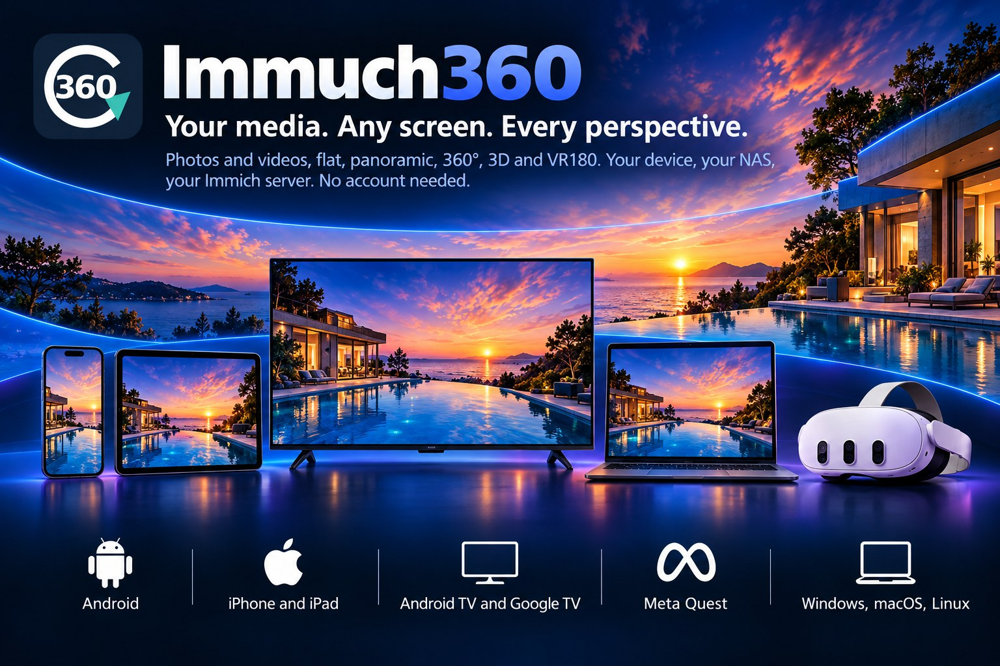
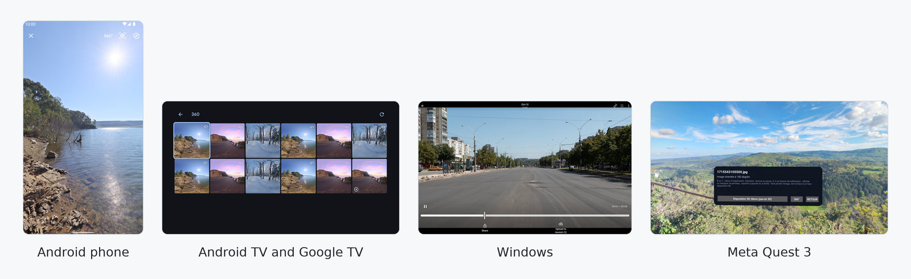

🌐 <b>Lombard</b> · Alter lengue (88)
<a href="../README.md">English</a> · <a href="README.af.md">Afrikaans</a> · <a href="README.ar.md">العربية</a> · <a href="README.az.md">Azərbaycanca</a> · <a href="README.be.md">Беларуская</a> · <a href="README.bg.md">Български</a> · <a href="README.bi.md">Bislama</a> · <a href="README.bn.md">বাংলা</a> · <a href="README.br.md">Brezhoneg</a> · <a href="README.bs.md">Bosanski</a> · <a href="README.ca.md">Català</a> · <a href="README.cs.md">Čeština</a> · <a href="README.cv.md">Чӑвашла</a> · <a href="README.da.md">Dansk</a> · <a href="README.de.md">Deutsch</a> · <a href="README.de_CH.md">Deutsch (Schweiz)</a> · <a href="README.el.md">Ελληνικά</a> · <a href="README.en_GB.md">English (UK)</a> · <a href="README.eo.md">Esperanto</a> · <a href="README.es.md">Español</a> · <a href="README.et.md">Eesti</a> · <a href="README.eu.md">Euskara</a> · <a href="README.fa.md">فارسی</a> · <a href="README.fi.md">Suomi</a> · <a href="README.fil.md">Filipino</a> · <a href="README.fr.md">Français</a> · <a href="README.ga.md">Gaeilge</a> · <a href="README.gl.md">Galego</a> · <a href="README.gsw.md">Alemannisch</a> · <a href="README.gu.md">ગુજરાતી</a> · <a href="README.he.md">עברית</a> · <a href="README.hi.md">हिन्दी</a> · <a href="README.hr.md">Hrvatski</a> · <a href="README.hu.md">Magyar</a> · <a href="README.hy.md">Հայերեն</a> · <a href="README.id.md">Bahasa Indonesia</a> · <a href="README.is.md">Íslenska</a> · <a href="README.it.md">Italiano</a> · <a href="README.ja.md">日本語</a> · <a href="README.ka.md">ქართული</a> · <a href="README.kab.md">Taqbaylit</a> · <a href="README.kk.md">Қазақша</a> · <a href="README.km.md">ខ្មែរ</a> · <a href="README.kmr.md">Kurmancî</a> · <a href="README.kn.md">ಕನ್ನಡ</a> · <a href="README.ko.md">한국어</a> · <a href="README.kxm.md">ภาษาเขมรถิ่นไทย</a> · <a href="README.lb.md">Lëtzebuergesch</a> · <a href="README.lt.md">Lietuvių</a> · <a href="README.lv.md">Latviešu</a> · <a href="README.mfa.md">Bahasa Melayu Kelantan</a> · <a href="README.mi.md">Te reo Māori</a> · <a href="README.mk.md">Македонски</a> · <a href="README.ml.md">മലയാളം</a> · <a href="README.mn.md">Монгол</a> · <a href="README.mr.md">मराठी</a> · <a href="README.ms.md">Bahasa Melayu</a> · <a href="README.nb_NO.md">Norsk bokmål</a> · <a href="README.ne.md">नेपाली</a> · <a href="README.nl.md">Nederlands</a> · <a href="README.nn.md">Norsk nynorsk</a> · <a href="README.pa.md">ਪੰਜਾਬੀ</a> · <a href="README.pl.md">Polski</a> · <a href="README.pt.md">Português</a> · <a href="README.pt_BR.md">Português (Brasil)</a> · <a href="README.ro.md">Română</a> · <a href="README.ru.md">Русский</a> · <a href="README.si.md">සිංහල</a> · <a href="README.sk.md">Slovenčina</a> · <a href="README.sl.md">Slovenščina</a> · <a href="README.sq.md">Shqip</a> · <a href="README.sr_Cyrl.md">Српски</a> · <a href="README.sr_Latn.md">Srpski</a> · <a href="README.sv.md">Svenska</a> · <a href="README.sw.md">Kiswahili</a> · <a href="README.swg.md">Schwäbisch</a> · <a href="README.ta.md">தமிழ்</a> · <a href="README.te.md">తెలుగు</a> · <a href="README.th.md">ไทย</a> · <a href="README.tl.md">Tagalog</a> · <a href="README.tr.md">Türkçe</a> · <a href="README.uk.md">Українська</a> · <a href="README.ur.md">اردو</a> · <a href="README.uz.md">Oʻzbekcha</a> · <a href="README.vi.md">Tiếng Việt</a> · <a href="README.yue_Hant.md">粵語</a> · <a href="README.zh_Hans.md">简体中文</a> · <a href="README.zh_Hant.md">繁體中文</a>

  

# Immuch360

**I tò media. Minga importa el schermo. Ogni prospettiva.**

Immuch360 l'è ona app liberа e open source per trovà, sfoglià, fà vedè e esplorà i tò foto e video: quij normaj, e quij panoramich, 360°, 3D e immersiv che i alter app fann vedè plan, dobi o sgiunfaa. La legg indove che hinn, sul dispositiv istess, su on NAS o on computer, su on server Plex o su on server Immich, e la fa vedè sui telefon, tablet, television, visor Meta Quest e computer. Nissun account, nissun cloud, nissun server obligatori.

- **Cosa la fa?** La fa vedè i tò foto e video come ona galeria e la fa vedè in del visualizador che va ben per ogni file: plan, come ona sfera che te giri dent, in 3D, in del visor.
- **Quaj media?** Foto e video plan, panoramà, foto e video a 360°, VR180, 3D stereoscopich, foto spaziaj Apple, i sfer a 360° di dron DJI, e i file original di camere a 360° (Insta360, GoPro MAX, DJI Osmo 360), cusii insema de l'app.
- **Su quaj dispositiv?** Telefon e tablet Android, iPhone e iPad, Android TV e Google TV, i TV LG cont webOS (ona app a part, prima compilazion de prova), Meta Quest 2, Pro, 3 e 3S, Windows (anteprima), e Linux e macOS in anteprima prematura.
- **Serv on server o on account?** Nò. Immuch360 la funziona de per lee cont i media del tò dispositiv. On server Immich, on NAS, on server multimedial o on server Plex hinn opzion che te gionte quand te voeuret.

  Fork no oficial de l'app mobil Immich. Minga ligaa a Immich o a FUTO. El nom se lesg come «I am much 360».

| Piattaforma | Indove trovall | Stat al 22 de otober 2026 |
|---|---|---|
|  **Android** telefon e tablet | [Google Play](https://play.google.com/store/apps/details?id=com.aprogsys.immuch360) · [APK](https://github.com/freeKC/Immuch360/releases) | su Google Play (compilazion 25; compilazion 26 in revision), compilazion 27 su GitHub |
|  **iPhone e iPad** | App Store | version 3.3.1 (compilazion 24) ch'la speta la revision de Apple dal 14 de otober; intant [fala de ti](../docs/immuch360/build.md) |
|  **Android TV e Google TV** | [APK](#android-tv-and-google-tv) · Google Play | compilazion 27 su GitHub: tema scur de default, Sinistra e Destra intant che va on video, on messagg ciar quand on video el pò minga andà; la lista per el TV l'è in revision de Google |
| **TV LG** cont webOS 4.0 e pussee recent | [compilazion de prova .ipk](https://github.com/freeKC/Immuch360/releases/tag/webos-v0.1.0) | compilazion de prova 0.1.0 del 21 de otober, de installà in [Developer Mode](#lg-tvs-webos); minga faa andà ancamò su on TV LG vero |
|  **Meta Quest** 2, Pro, 3 e 3S | [Horizon Store](https://www.meta.com/experiences/immuch360/1384208401440714/) · [APK](#meta-quest) | sul Horizon Store (compilazion 23; compilazion 25 in revision), compilazion 27 su GitHub |
|  **Windows** | [Installador o ZIP](https://github.com/freeKC/Immuch360/releases/tag/desktop-v3.3.0-rc.0-7) | compilazion desktop 7, in anteprima: foto, video plan e a 360°, condivision, Plex, camere, file dervii col program, foto girade con on tast, l'interfacia in 89 lengue |
|   **macOS e Linux** | [.deb, .rpm, DMG](https://github.com/freeKC/Immuch360/releases/tag/desktop-v3.3.0-rc.0-7) | in anteprima: su Linux foto, foto a 360° e video plan (i video a 360° van plan); su macOS l'istess, controllaa domà sul Mac del CI del progett, minga firmaa |

*I stat hinn aggiornaa a ogni release; i detaj, compilazion per compilazion, hinn in [Stat de la release](../docs/immuch360/release-status.md).*

  

<b>Contegnuu</b>

- [Cosa te poeu fà](#what-you-can-do)
  - [Varda i tò foto e video](#watch-your-photos-and-videos)
  - [Gira ona foto con on tast](#turn-a-photo-with-one-key)
  - [Esplora panoramà, 360°, VR180 e 3D](#explore-panoramas-360-vr180-and-3d)
  - [Dovra i tò file, senza account](#use-your-own-files-without-an-account)
  - [Rivà ai media de on NAS, on computer o on server multimedial](#reach-the-media-of-a-nas-a-computer-or-a-media-server)
  - [Trova la tò biblioteca Immich](#find-your-immich-library)
  - [Va immersiv sul Meta Quest](#go-immersive-on-meta-quest)
  - [Varda sul TV e sul computer](#watch-on-the-tv-and-on-the-computer)
  - [Immuch360 su on TV LG (webOS)](#immuch360-on-an-lg-tv-webos)
  - [Camere, Plex e file original de camera](#cameras-plex-and-raw-camera-files)
  - [I foto e i video del tò dron DJI sul tò server Immich](#your-dji-drones-photos-and-videos-on-your-immich-server)
- [Dispositiv e sistemi](#devices-and-systems)
- [Funzion avanzaa](#advanced-features)
- [Documentazion tecnica](#technical-documentation)
- [Installazion](#install)
- [Privacy](#privacy)
- [El progett](#the-project)
- [Roadmap](#roadmap)

## Cosa te poeu fà

Ogni usagg chì sota la dis cosa te ghe guadagna, poeu come fal in pocch pass. La guida completa, con tucc i opzion, messagg e limit, l'è in la [guida de l'utent](../docs/immuch360/user-guide.md).

### Varda i tò foto e video

Immuch360 l'è prima de tutt ona galeria e on lettor per i foto e video normaj. La timeline, i album, i preferii, i ricord e la ricerca funzionen cont on server Immich; i foto e video del dispositiv istess, e i cartell d'on computer, se vedden senza nissun server. I video se fann vedè in on lettor nativ con audio, scorriment, on indicador de buffering e, in di lettor 360°, Spatial e del computer, ona sernida di trasi audio. Sul TV l'è el telecomand che cumanda tutt; sul computer hinn el mouse e la tastera.

1. Derv la scheda Foto: la timeline del tò server, o del dispositiv senza server.
2. Tocca on foto o on video per dervil; fa swipe a sinistra e a drita per andà al prossim, pizzega o tocca dò vòlt per sumà.
3. Fa swipe in su su on video per i soeu detaj: codec, dimension, frame rate, bit rate, e se sto dispositiv chì lo decodifica.

Pussee: [i visualizador e el lettor video](../docs/immuch360/user-guide.md#watch-your-photos-and-videos), [detaj del video e decodificador](../docs/immuch360/user-guide.md#video-details-decoders-and-why-a-video-stutters).

### Gira ona foto con on tast

Gira ona foto de 90° con ona sola pressada, senza dervì on editor: on boton, on tast de la tastera o on tast coloraa del telecomand del TV, su ogni piattaforma. L'app Immich la gira ona foto in del soeu editor; Immuch360 la le fa con on tast, e per i tò foto su on server Immich 2.6 o pussee recent la passa per el medemm editor del server, insci l'app web e i alter tò dispositiv i fann vedè girade. Ogni altra foto la vegn girada domà su sto dispositiv chì. I foto a 360°, 180° e 3D se giren mai, perché i viste immersive resten drizze.

1. **Telefon, tablet e la fenestra del Meta Quest**: derv la foto e tocca Rotate in la riga de sota, prima de Edit, per girala in del vers di lancett; ona pressada longa la gira de l'altra part. Cont ona tastera, R e Shift+R.
2. **Android TV e Google TV**: el tast giald del telecomand el gira la foto in del vers di lancett e el tast bloeu in del vers contrari, indove che sia el focus in del visualizador. Su on telecomand senza tast coloraa, schiscia Sota: la barra sota la foto la se fa vedè con Rotate selezionaa (on Destra pussee in là quand la foto la gh'ha on boton de test), e ogni OK el gira la foto.
3. **TV LG (webOS)**: giald e bloeu come sul Android TV, R e Shift+R su ona tastera, o el boton de girà in di comand de la foto.
4. **Windows, Linux e macOS**: R el gira in del vers di lancett, Shift+R in del vers contrari, o el boton de girà in la barra de sora, prima del schermo intero.
5. **Foto d'ona condivision de ret, de Plex o d'ona camera**: el boton de girà, el primm in la barra de sora, R e Shift+R, o i tast giald e bloeu.

Indove se salva la girada: ona foto del tò account su Immich 2.6 o pussee recent la vegn girada traverso l'editor de foto del server, che el tegn el file original e el fa on'imagin girada (ona barra sottila la se fa vedè intant che la lavora; quatter girade, o ona girada indree, torna a l'original). I foto del dispositiv, d'ona condivision, d'on partner o d'on album condivis, e ogni foto su on server pussee vegg vegnen girade domà su sto dispositiv chì, per quella foto, e el file el vegn mai cambiaa; l'app la le dis ona voeulta per ona foto Immich. In di app Android, iOS e computer, ona girada tegnuda sul dispositiv la se ved in del visualizador, ma minga ancamò in di miniadur, in la presentazion e in di ricord. I video, la cartella blocada e ogni foto a 360°, 180° o 3D gh'hann minga Rotate.

### Esplora panoramà, 360°, VR180 e 3D

Ona foto a 360° se dervla come ona sfera che te giret con on dida o movend el telefon; on video a 360° se fa vedè in on lettor sferich con audio; i file VR180 vegnen tiraa su ona mesa sfera; i file 3D stereoscopich fann vedè on oeugg sul schermo plan e tucc i dò oeugg in del visor. I panoramà parziaj tegnen el soeu taj, e l'imagin la parti del pont de vista regordaa de la camera. On file che el server el segnala minga se poeu vardà come 360° con on tocch.

  
  

1. Derv la foto o el video. I file a 360° gh'hann on distintiv 360° su la soeu miniadura, e la scheda Biblioteca la gh'ha ona lista 360° che la li cataa insema, con filter per periodo, sorgent, tipo e camera.
2. Tocca 360° in la barra de sora. Tira per vardà intorna, pizzega per sumà, tocca el boton del giroscopi per vardà intorna girand el telefon.
3. El boton 3D el varia tra «Mono (minga 3D)», «3D, de sora e de sota» e «3D, vun visin a l'alter»; el boton 360°/180° el cambia tra la sfera intera e la mesa sfera del VR180.
4. Per on file che se fa vedè plan ma l'è on file a 360°: ⋮ in alt a drita, poeu «Varda 'me 360°».

Su telefon e tablet, on video stereoscopich el pò anca guadagnà profondità sul schermo plan: el lettor Spatial 2.5D el dovra la camera frontal per segui la tò testa e el fa vedè la vista in del mezz di dò oeugg (esperimental). I foto spaziaj Apple faa con on iPhone vegnen reconossuu e faa vedè in 3D in on Meta Quest.

Pussee: [foto e video a 360°](../docs/immuch360/user-guide.md#360-photos-and-videos-as-a-sphere), [3D e VR180](../docs/immuch360/user-guide.md#3d-and-vr180-photos-and-videos), [Spatial 2.5D](../docs/immuch360/user-guide.md#depth-on-a-flat-screen-spatial-25d-experimental), [foto e video spaziaj Apple](../docs/immuch360/user-guide.md#apple-spatial-photos-and-videos), [la lista 360°](../docs/immuch360/user-guide.md#find-your-360-shots-the-360-list).

### Dovra i tò file, senza account

Immuch360 la serv minga né account né server. De la compilazion 24, l'app la se dervi su ona pagina de benvegnuda, indove «Dovra senza server» la vegn prima: la fa vedè i foto e video del dispositiv, con ogni visualizador, la lista 360° e i sorgent de ret. Nagott va foeura del dispositiv. On server se pò giontà pussee tard, de Settings o de la scheda Biblioteca, e i funzion del server vegnen foeura dopo.

1. Derv l'app. La pagina de benvegnuda la fa vedè «I tò media. Minga importa el schermo. Ogni prospettiva.» e trii opzion: tocca la prima, «Dovra senza server». Fin a la compilazion 23 gh'era la pagina de login prima, con «Dovra senza server» sota el formulari.
2. Permett l'access ai tò foto e video. Se te disett de nò, l'app la dis "L'app la pò minga vedè i foto de sto dispositiv", con "Permett l'access" e "Dervì i impostazion".
3. La scheda Photos (Foto) la mostra la timeline del dispositiv. Search (Cerca) e Albums (Album) resten grise, perché vegnen del server. La scheda Biblioteca la gh'ha 360° de sora, poeu On this device (Su sto dispositiv, i album del dispositiv) e Condivision de ret.
4. El menù in alt a drita el dis "Domà sto dispositiv": l'app la mostra i foto e video de sto dispositiv, nient el vegn mandaa de nissuna part.

Su on computer, i cartell che te sceglet fann la part de la galeria; sul TV, che la gh'ha minga foto propri, hinn i sorgent de ret che la fann.

Pussee: [senza on server o on account](../docs/immuch360/user-guide.md#without-a-server-or-an-account).

### Rivà ai media de on NAS, on computer o on server multimedial

I tò video hinn su on NAS, on computer o on server multimedial. Immuch360 la troeuva de per lee i server de la tò ret, la li sfoglia e la fa vedè i soeu foto e video sul moment, in tucc i visualizador de l'app, senza copià nagott: SMB (Samba, condivision Windows), WebDAV (Nextcloud, Synology e alter) e server multimediaj DLNA (Jellyfin, Emby, minidlna, on NAS, ona scatola TV). On telefon el pò anca condividè la soeu galeria sul Wi-Fi per on visor o on qualsessia client WebDAV, e anca on computer Windows el pò fal.

  
  

1. Derv la scheda Biblioteca, poeu Condivision de ret, poeu + e «Ona condivision de ret (NAS, computer, server multimedial)». De la compilazion 24, «Giontà ona condivision de ret o on server multimedial» su la pagina de benvegnuda la dervi Condivision de ret dret, senza server.
2. Tocca on server sota «Trovaa in la ret», o completa el formulari a man: tipo, nom o indirizz del server, condivision o percors, cartella de partenza, nom utent e password.
3. Tocca «Provà la conession», poeu Salva. Tocca la condivision per sfoglial: prima i cartell, poeu i foto e video, col distintiv 360° sui file reconossuu come 360°.
4. Con on server Immich conetaa, sceglie i file in ona cartella e tocca «Carega su Immich» per mandai al tò server.

I lettor leggen i byte che ghe serven traverso on bridge dent de l'app, con di raze de byte, insci el scorriment el funziona e nagott se salva sul dispositiv; on video SMB se legg con fin a ses conession in parallel per vedè tutt liscio.

Pussee: [condivision de ret](../docs/immuch360/user-guide.md#network-shares-a-nas-a-computer-or-a-media-server), [condividè sto telefon in la ret](../docs/immuch360/user-guide.md#share-this-phone-on-the-network), [server multimediaj DLNA](../docs/immuch360/user-guide.md#dlna-media-servers).

### Trova la tò biblioteca Immich

Con on server [Immich](https://github.com/immich-app/immich), Immuch360 l'è l'app mobil Immich, con el medemm server e el medemm account de l'app web: backup, timeline, album, ricerca, persón, ricord, condivision, partner, tucc sincronizaa cont el tò server. La se installa a fianch de l'app oficial. In pù: el distintiv e la lista 360°, tucc i visualizador immersiv, la sernida tra el file original e el flux transcodificaa del server per ogni video, i detaj tecnich d'on video, e i file d'ona condivision o del dispositiv mandaa al tò server a man.

1. Su la pagina de benvegnuda, tocca «Conètes a on server Immich», poeu fa el login cont l'indirizz del tò server, la tò email e la tò password, 'me in l'app Immich; Indree el torna a la pagina de benvegnuda. Fin a la compilazion 23 la pagina de login se dervi dret. La tò biblioteca, album e setting de backup hinn quij del tò account.
2. In Settings, Asset Viewer, Videos, «Sorgent del video» la sceglia l'original quand sto dispositiv chì el decodifica, semper l'original, o semper el flux transcodificaa.
3. Per fa vedè ona foto a 360° a on quaivun che gh'ha minga l'app, condividela con on link condivis Immich: l'app web Immich la fa vedè come ona sfera in del soeu navigador.

La compilazion attual, la compilazion 27, l'è basaa sul `main` de Immich del 10 de otober 2026 (version 3.3.0-rc.0) e l'è staa testaa contra on server Immich 3.2.4 e on server compilaa del medemm `main` de Immich. Per piasè segnala i problema in [Issues](https://github.com/freeKC/Immuch360/issues), minga al progett Immich.

Pussee: [tutt el rest l'è Immich](../docs/immuch360/user-guide.md#everything-else-is-immich), [in paragon cont l'app Immich](../docs/immuch360/compatibility.md#compared-with-the-immich-app).

### Va immersiv sul Meta Quest

Sul Meta Quest la medemma app la gira come ona fenestra con tutta la tò biblioteca, e el soeu boton 360° el dervi ona vista immersiva indove la foto o el video hinn tutt'intorna a ti: te varded intorna girand la testa, i file stereoscopich hinn in vera 3D, ona foto spazial Apple la galeggia denanz a ti in 3D, e i controller o i tò man cumanden la barra del temp, el pass denanz e indree, e el boton Gira che el porta denanz quell che l'è dedree de ti senza girà la cadrega. I media vegnen del tò server, del visor istess, d'on NAS, d'on server multimedial, d'on telefon o d'on server Plex, faa vedè sul moment.

  
  
  

1. Installa l'app del [Horizon Store](https://www.meta.com/experiences/immuch360/1384208401440714/), o carega l'APK d'ona compilazion pussee nova a man, varda [Installazion](#meta-quest).
2. Su la pagina de benvegnuda, tocca «Dovra senza server» per i foto e video propri del visor, o «Conètes a on server Immich» per fa el login cont el tò server.
3. Derv ona foto o on video a 360° e tocca 360°: la vista immersiva se dervi. B o Y, o el boton Indree del panell informazion, la fa tornà la fenestra.

Pussee: [in del visor Meta Quest](../docs/immuch360/user-guide.md#in-the-meta-quest-3-headset), [el visor: codec, negozi e permess](../docs/immuch360/platform-support.md#meta-quest).

### Varda sul TV e sul computer

La medemma app Android la gira sul Android TV e sul Google TV, cont el tema scur de la prima partenza, con el telecomand come unich input: i frecc moeuven el fram, OK el dervi, Indree el torna indree; in del visualizador Sinistra e Destra van a la foto o al video de prima o de dopo, anca intant che va on video, e in d'ona foto o on video a 360° i frecc varden intorna. El TV la gh'ha minga foto propri, insci la fa vedè el tò server Immich, i tò condivision de ret, el tò server Plex e i tò camere; i TV LG gh'hann [ona app tutta per lor](#immuch360-on-an-lg-tv-webos). Su on computer Windows, Immuch360 Desktop la legg i cartell che te sceglet senza nissun server, la fa vedè video plan e a 360° in on lettor tutt per lee, la sfoglia i medemm condivision e server, e la pò condividè el computer con on visor a cà.

  
  

1. Su on TV: installa l'APK cont adb (varda [Installazion](#android-tv-and-google-tv)); su la pagina de benvegnuda, selezionna «Giontà ona condivision de ret o on server multimedial» per ona condivision, on server Plex o ona camera, «Dovra senza server», o «Conètes a on server Immich».
2. Su on computer Windows: installa l'anteprima o decomprimela e fa partì `immuch360.exe` (varda [Installazion](#windows)); de la compilazion desktop 5, «Dovra senza server» su la pagina de benvegnuda la dervi la sernida di tò cartell, e «Conètes a on server Immich» la pagina de login. Ona foto, on video o ona cartella dervii con l'app, o lassaa andà su la soeu fenestra, se dervi subit, quella a 360° in la soeu vista 360°; pussee file se derven insema in d'ona pagina.
3. In del visualizador, funzionen i tasc del telecomand per fa partì e fermà, scorr indree, scorr denanz, denanz e indree, e funzionen anca i tasc de la tastera sul computer (Spazi, J e L, F per el schermo intero). Sul TV, OK intant che va on video el fa vedè i comand con fa partì e fermà selezionaa, seguii di boton -10 s e +10 s, e on segond OK el ferma; i comand e la data se scondenn 5 s dopo l'ultim tast. I video van pu a ripetizion sul TV, a manch che te impizzet Setting, Asset Viewer, Videos, Looping.
4. Sul TV, el tast Menu, el tast Info o OK tegnuu schisciaa el dervi i detaj de la foto o del video, domà de legg: data, post, camera, codec, dimension e bit rate. On video che el TV el pò minga decodificà el le dis, cont el soeu codec, la soa dimension e el limit di decodificador del TV, invece de caregà per semper; on video a 360° oltra el limit di decodificador el domanda prima de dervì el lettor 360°, e la reson la vegn scrivuda in la pagina Logs del menù del profil.

Pussee: [varda sul tò TV](../docs/immuch360/user-guide.md#watch-on-your-tv-android-tv-and-google-tv), [su on computer Windows](../docs/immuch360/user-guide.md#on-a-windows-computer-immuch360-desktop-preview), [supporto piattaforma](../docs/immuch360/platform-support.md).

### Immuch360 su on TV LG (webOS)

Immuch360 la ven anca come app Immich per i TV LG webOS: ona app a part per i TV LG cont webOS 4.0 e pussee recent (del 2018), cumandada del telecomand, che la fa vedè el tò server Immich e la mett i tò foto a 360° su ona sfera che te giret cont i frecc. I app de Immich istess se installen minga su on TV LG. L'è costruida su [immich-tv-webos](https://github.com/Seeky91/immich-tv-webos) de Seeky91, che l'ha portaa la timeline, i album, i personn, i post, la ricerca, la presentazion e el login col telefon; grazie a Seeky91. La version 0.1.0 l'è ona compilazion de prova: l'è minga andada ancamò su on TV LG vero, la se installa domà in Developer Mode, e ogni segnalazion in [Issues](https://github.com/freeKC/Immuch360/issues) la giutta.

1. Installela su on TV in Developer Mode, varda [Installazion](#lg-tvs-webos). La gh'ha el soeu app id, insci la se installa a fianch de Immich TV de Seeky91.
2. Fa el login col tò telefon (scansiona el codes QR), con la tò email e password, o con ona ciav API.
3. Sfoglia cont i frecc e OK. In del visualizador, Sinistra e Destra van a la foto o al video de prima o de dopo, anca intant che va on video; i comand se scondenn 5 s dopo l'ultim tast; Info el dervi i detaj; i tast di canaj fann el zoom; el pontador e la rodella del Magic Remote funzionen.
4. Ona foto a 360° la se dervi su ona sfera che te giret cont i frecc; «Varda 'me 360°» el va ben anca per ona foto 2:1 che el server el segna minga; ona foto VR180 la se ved su mezza sfera e ona foto 3D cont on oeugg. I tast giald e bloeu giren ona foto plana.

Minga in sta compilazion chì: i video a 360° su la sfera (van plan, con on messagg), i condivision de ret, Plex e i camere Tapo (pianificaa), i caregament. Quand on video el va minga, on messagg el dis el so format e la soa dimension invece d'ona roeuda che la gira per semper. Su webOS prima del 25, el reverse proxy denanz a Immich el gh'ha de mandà i header CORS; l'app la i spiega quand la troeuva el problema.

Pussee: [l'app webOS: installazion, tasc del telecomand, header CORS](../webos/README.md).

### Camere, Plex e file original de camera

- **Camere Tapo**: ona camera se gionta a fianch de i condivision de ret. L'app la fa vedè in diretta (Android, Android TV, el Quest e Windows) e la lista i registrazion de la soeu card de memoria dì per dì su tucc i piattaforme; on clip se recupera de la camera, el se fa vedè come on qualsessia video e el pò vegnì mandaa a Immich. L'app la parla con la camera domà sula tò ret, mai cont i server de TP-Link.
- **Plex Media Server, senza plex.tv**: l'app la se cuppia diretament cont el tò server, con on token che te ataccat ona vòlta, e la legg in diretta i file original de i tò biblioteche, insci el 360° el resta 360°, a cà e, traverso el port forwarding, foeura de cà.
- **File original di camere a 360°**: i foto .insp e i video .insv original di camere Insta360 (ona o dò lent, in on trasi, duu trasi o duu file), i file .360 del GoPro MAX e i file .osv del DJI Osmo 360 hinn cusii insema de l'app intant che se fann vedè, con la calibrazion scrivuda sul file, senza nagott de installà in nissun pòst. Su Android, fa vedè i file de ona condivision, on computer o el tò server, perché la galeria del telefon la fa minga vedè i file original; el server Immich el ciapa domà .insp e .insv.

Pussee: [camere Tapo](../docs/immuch360/user-guide.md#tapo-cameras-live-view-and-the-recordings-of-the-memory-card), [Plex Media Server](../docs/immuch360/user-guide.md#plex-media-server-without-plextv), [file original de camere a 360°](../docs/immuch360/user-guide.md#raw-360-camera-files-without-the-cameras-app).

### I foto e i video del tò dron DJI sul tò server Immich

Importa i foto e i video d'on dron DJI per USB, dritt sul tò server Immich: taca el dron, el soeu radiocomand o on lettor de scheed a on telefon Android, sceglie i file noeuv e mandei; i video vegnen miss su la mappa grazie ai dà de vol del dron e i sfer a 360° del dron se veden come 360°. L'app Immich la salva domà quell che l'è giamò in la galeria del telefon, e el server Immich el pò minga ancamò legg el post d'on video DJI Neo 2. Sta pagina chì l'è esperimental, domà su telefon e tablet Android, e l'è minga staa provada ancamò con on dron vero.

1. In Setting, Avanzaa, impizza «Dron DJI (esperimental)». On riquader «Dron DJI» el compar in Biblioteca, Condivision de ret.
2. Taca el dron (on Neo 2 el pò restà smorzaa), el soeu radiocomand o on lettor de scheed al telefon con on cavo de dà USB-C. In la pagina Dron DJI, tocca «Sceglie el dron o la scheda», sceglel in del menù de fianch del selettor, derv la soa cartella DCIM o tegn tutt el disch, poeu «Dovra sta cartella» e Permett.
3. La pagina la lista i foto e i video per dì, senza i file de contorna .LRF, .SRT, .THM e .m4a. Tocca «Selezionna tucc i noeuv», poeu «Carega su Immich»; i file mandaa prima gh'hann on segn de nivola e vegnen saltaa. «Tegn sul dispositiv» invece el copia i file in la galeria del telefon, in l'album «Immuch360 import».
4. Perché on video el vaga su la mappa, impizza Video Subtitles in DJI Fly (modalità video, Settings, Camera) prima de volà: allora el dron el scriv on file .SRT a fianch de ogni video, l'app la legg el post de lì e la le mett sul tò server dopo el caregament, quand Immich l'ha trovaa nient.

I sfer a 360° di dron DJI (Mini, Air, Mavic e alter, reconossuu de la soa camera) se veden come 360° in Immuch360 anca senza tag 360°. Immich el gh'ha besogn de quij tag lì: l'opzion de caregament «Segna i sfer di dron come 360° per Immich», smorzada de default, la manda la foto senza cambiala con on piccol file .xmp a fianch, insci Immich el la fa vedè anca lu come ona sfera. El Neo 2 el gh'ha minga ona modalità sfera o panoramà: i soeu foto e video hinn plan. Quand el telefon l'ha registraa el son d'on clip del Neo 2, quel son lì l'è in d'on file .m4a a part: la pagina la segna el clip, e Immich el le riceve senza son (scarighel con DJI Fly per tegnì el son). Ogni scheda de camera con ona cartella DCIM la funziona istess in d'on lettor de scheed. Nient el vegn mandaa a DJI.

## Dispositiv e sistemi

Ona sola base de codes per ses ambient, e ona app a part per i TV LG. Quell che gh'ha ogni vun incoeu:

| Capacità | Android | iPhone, iPad | Android TV | LG webOS | Quest | Windows | Linux | macOS |
|---|:---:|:---:|:---:|:---:|:---:|:---:|:---:|:---:|
| Galeria, album, ricerca con on server Immich | ✅ | ✅ | ✅ visualizador | ✅ visualizador | ✅ | ✅ | 🔧 CI | 🔧 CI |
| Senza server: i media propri del dispositiv | ✅ | ✅ | domà condivision | ❌ | ✅ | ✅ cartell | ✅ cartell | ✅ cartell |
| Foto e video plan | ✅ | ✅ | ✅ | ✅ | ✅ | ✅ | ✅ | ✅ |
| Girà ona foto con on tast | ✅ | ✅ | ✅ tast coloraa | ✅ tast coloraa | ✅ fenestra | ✅ | ✅ | ✅ |
| Foto a 360° come sfera | ✅ | ✅ | ✅ | ✅ | ✅ immersiv | ✅ | ✅ | 🔧 CI |
| Video a 360° | ✅ | ✅ senza barra del temp | ✅ messagg se minga decodificabil | domà plan | ✅ immersiv | ✅ | domà plan | domà plan |
| 3D e VR180 | ✅ on oeugg | ✅ on oeugg | ✅ on oeugg | foto on oeugg, video plan | ✅ 3D vera | ✅ on oeugg | foto on oeugg, video plan | foto on oeugg, video plan |
| Spatial 2.5D (tracciament de la testa) | ✅ esperimental | ✅ esperimental | ❌ | ❌ | ❌ | 🔜 | ❌ | ❌ |
| Foto spaziaj Apple | ✅ on oeugg | ✅ on oeugg | ✅ on oeugg | ❌ | ✅ 3D | ✅ on oeugg | 🔧 CI | 🔧 CI |
| File original Insta360, GoPro e DJI | ✅ | ✅ | ✅ | ❌ | ✅ | ✅ | 🔧 CI foto, video plan | 🔧 CI foto, video plan |
| Condivision SMB, WebDAV, DLNA | ✅ | ✅ | ✅ | 🔜 | ✅ | ✅ | 🔧 CI | 🔧 CI |
| Plex Media Server | ✅ | ✅ | ✅ | 🔜 | ✅ | ✅ | 🔧 CI | 🔧 CI |
| Camere Tapo: registrazion | ✅ | ✅ | ✅ | 🔜 | ✅ | ✅ | 🔧 CI | 🔧 CI |
| Camere Tapo: vista in diretta | ✅ | 🔜 | ✅ | 🔜 | ✅ | ✅ | 🔧 CI | 🔧 CI |
| Condividi sto dispositiv in la ret | ✅ | ✅ | ❌ | ❌ | ❌ | ✅ | ❌ | ❌ |
| Carega su Immich de condivision e del dispositiv | ✅ | ✅ | ❌ | ❌ | ✅ | ✅ | 🔧 CI | 🔧 CI |
| Import d'on dron DJI o d'ona scheda per USB (esperimental) | ✅ | ❌ | ❌ | ❌ | ❌ | ❌ | ❌ | ❌ |
| Tema scur | come el sistema | come el sistema | ✅ de default | ✅ unich tema | come el sistema | come el sistema | come el sistema | come el sistema |
| Input | tocch, giroscopi | tocch, giroscopi | telecomand; Sinistra e Destra anca intant che va on video, Menu per i detaj | telecomand, Magic Remote | controller, man | mouse, tastera | mouse, tastera | mouse, tastera, trackpad |
| Indove se troeuva | Google Play, APK | App Store (in revision) | APK, Google Play (in revision) | compilazion de prova .ipk, Developer Mode | Horizon Store, APK | installador o ZIP (anteprima) | .deb, .rpm (anteprima) | DMG o ZIP (anteprima minga firmada) |

✅ in l'app su quella piattaforma · ❌ minga offrii lì · 🔜 pianificaa · 🔧 CI in di sorgent, compilaa e faa partì del CI del progett su quel sistema, ma minga controllaa ancamò lì con on server, ona condivision o ona camera vera · domà plan: el video el va plan, con on messagg, perché el renderer video a 360° di computer el gh'è domà su Windows, e sui TV LG gh'è ancamò de misurà se webOS el passa i fotogramma del video a la sfera. «On oeugg» el voeur dì che on file 3D el fa vedè el soeu oeugg sinistro sul schermo plan. La colonna LG webOS l'è ona app a part, che la soa compilazion de prova 0.1.0 la passa i soeu test sul CI del progett e l'è minga andada ancamò su on TV. Minga tucc i ✅ hinn giamò testaa su on dispositiv real: quell che l'è staa testaa e indove, e quell che resta de confermà, l'è in [Funzion](../docs/immuch360/features.md), [Supporto piattaforma](../docs/immuch360/platform-support.md) e [Compatibilità](../docs/immuch360/compatibility.md).

- **Telefon e tablet Android**: l'app completa, tocch e giroscopi, tucc i sorgent.
- **iPhone e iPad**: l'app completa; el lettor video a 360° gh'ha domà fa partì e fermà, la vista in diretta de Tapo la rivarà pussee tard, e la ricerca DLNA la manda richieste unicast fin a quand Apple la darà el permess multicast.
- **Android TV e Google TV**: el medemm APK, cumandaa del telecomand, scur de default; domà visualizador: backup, caregament e l'editor hinn scondii e i detaj hinn domà de legg, ma ona foto la se gira ancamò con on tast. Ogni filter de ricerca el funziona col telecomand: Post e Camera derven i soeu scelte in d'ona lista, el filter de la data el fa vedè tucc i soeu scelte, e i foeuj de opzion Tag, Post, Data, Tipo de media, Stell e Visualizazion metten Scancella e Aplica a fianch di scelte, on Destra pussee in là, su la pussee part de l'altezza del schermo. La grija di foto la dovra manch memoria de imagin, e ona frecia tegnuda schisciada la la moeuv al massim circa 10 righ al second. Testaa sul emulador Google TV; on primm test su on Android TV vero, el 21 de otober, l'ha portaa ai cambiament TV de la compilazion 27, che hinn minga staa provaa ancamò su on TV vero.
- **TV LG cont webOS 4.0 e pussee recent**: ona app a part per el telecomand e el Magic Remote, costruida su [immich-tv-webos](https://github.com/Seeky91/immich-tv-webos): on visualizador Immich cont i foto a 360° su ona sfera, ona foto girada con on tast, on tema scur e i 89 lengue de l'app (i pocch test de l'app TV istessa per adess in inglés); ancamò nissuna condivision, Plex o camera, video a 360° plan. Compilazion de prova 0.1.0, controllada di soeu test sul CI del progett, minga ancamò su on TV.
- **Meta Quest 2, Pro, 3 e 3S**: l'app come fenestra, pù la vista immersiva; HEVC l'è el codec sicur, H.264 el se ferma vers 4096x2304 sul Quest 3; domà el Quest 3 l'è staa testaa, el Quest 2, el Quest Pro e el Quest 3S hinn minga testaa ancamò.
- **Windows 10 e 11**: in anteprima, con cartell invece d'ona galeria, on lettor video tutt per lee (libmpv) per video plan e a 360°, file original cusii sul chip grafich, file e cartell dervii con l'app o lassaa andà su la fenestra, on installador o on ZIP.
- **Linux**: on .deb e on .rpm compilaa del CI del progett, installaa e controllaa su Ubuntu 22.04 e 24.04, Debian 12 e Fedora 40 e 44; foto, foto a 360° e video plan cont la libmpv del sistema (i video a 360°, 3D e original van plan con on messagg), disegnaa per la strada hardware anca in di session X11 de la compilazion desktop 7; condivision SMB de Ubuntu 22.04 e Debian 12 in sù; senza on keyring (GNOME Keyring o KWallet) l'app la se bloca pu per 25 s a la prima partenza: la tegn i password domà per la session e la le dis in di soeu setting; minga faa andà ancamò su on PC Linux vero, domà sota WSLg e in di container.
- **macOS**: on DMG e on ZIP compilaa del CI del progett, universaj, minga firmaa (Gatekeeper el domanda ona voeulta); l'app la parti, la derva i file e i cartell che ghe vegnen daa, anca de Finder, la tegn i soeu segrett in del login keychain e la fa andà i video plan con la soa libmpv, tusscoss controllaa domà sul Mac del CI del progett; nagott l'è andaa ancamò su on Mac vero.

## Funzion avanzaa

Quell che l'app la pò legg e fa vedè, per chi voeur savè tutt. Ogni linea l'è spiegada ben in la [guida de l'utent](../docs/immuch360/user-guide.md) e in la [pagina de compatibilità](../docs/immuch360/compatibility.md).

- **Formaa**: foto e video plan (quell che el dispositiv el decodifica: MP4, MOV, MKV e alter); foto e video a 360° equirettangolar; panoramà parziaj (taj GPano); VR180; 3D stereoscopich, de sora e de sota o vun visin a l'alter, lezuu del file (el box st3d) o indovinaa del fotogramma; foto spaziaj Apple (copp stereo HEIC) e video spaziaj (MV-HEVC, on oeugg); original Insta360 .insp e .insv, GoPro .360, DJI .osv; sorgent a 10 bit HLG e PQ mappaa sul tono sula sfera.
- **Projezion e metadata**: metadata GPano e sferich lezuu del file, con richieste de raze su on server o condivision; la vista inizial de la camera; i sfer di dron DJI reconossuu de la soa camera, con on file sidecar .xmp a scelta perché Immich el i segna anca lu; «Varda 'me 360°» regordaa sul dispositiv; VR180 reconossuu del file o del soeu nom; el post d'on video de dron lezuu del soeu registr de vol .SRT; metadata tegnuu intacc perché se fa vedè el file original, mai ona copia convertida; on quart de girada salvaa traverso l'editor de Immich o tegnuu sul dispositiv, mai su on file immersiv.
- **Riproduzion nativa**: Media3 su Android e sul TV, SceneKit e AVFoundation su iOS, el Meta Spatial SDK in del visor, libmpv su Windows; l'original o el flux transcodificaa sernuu segond quell che decodifica el dispositiv; ona lista di decodificador video del dispositiv in Settings, Advanced; la sernida del trasi audio e on indicador de buffering.
- **File original cusii sul dispositiv**: on fragment shader Flutter per i foto; on effett GPU in del lettor per i video con on trasi sol; duu decodificador hardware a l'istess temp e on compositor GPU per i video con ona lent per trasi o per file (OpenGL ES 3 su Android e sul Quest, Metal su iOS, e su Windows, de la compilazion desktop 5, duu lettor libmpv che l'app la gionta i so fotogramma sul chip grafich); la calibrazion propria de la camera (i model Mei, V6 e equidistant) e la registrazion de l'accelerometro; se torna a ona lent, al flux transcodificaa, a la copia LRV de la camera o al video minga cusii insema, quand el dispositiv el pò minga dovrà duu decodificador.
- **Sorgent**: la galeria del dispositiv; i cartell d'on computer; on dron, el soeu radiocomand o ona scheda de camera per USB, traverso el selettor de cartell del sistema (Android, esperimental); on server Immich; SMB 2 e 3, WebDAV, DLNA/UPnP; Plex traverso HTTPS verificaa contra el certificaa propri del server; camere Tapo sula ret locale (HTTPS e RTSP); on telefon o on computer condivis sul Wi-Fi come on server WebDAV; server trovaa con Bonjour/mDNS, ona scansion de la ret locale, SSDP, GDM e la scoperta TP-Link, e seguii quand i cambien indirizz.
- **Lettura a richiesta**: on bridge locale el serv i lettor con di raze de byte e on token per ogni session; blocch grand, lettura anticipada e fin a ses conession SMB in parallel; miniadure d'on fotogramma de ogni video; nagott copiaa sul dispositiv.
- **Hardware**: decodificador hardware dovraa indove gh'hinn, con i soeu limit misuraa (el limit H.264 sul Quest 3, dò lent 2048x2048 al massim per i decodificador software); su Windows la vista 360° l'è tiraa del chip grafich de ogni fotogramma decodificaa, la dimension del fotogramma l'è misurada su ogni computer, el chip integraa o dedicaa l'è rilevaa.
- **Specificità de piattaforma**: el giroscopio e el lettor Spatial 2.5D sui telefon; la vista immersiva, controller e man sul Quest; la disposizion del telecomand, el dialogh de la tastera e el banner sul Android TV; sul computer, mouse e tastera, a tutt schermo, ona fenestra sola, file e cartell dervii con l'app o lassaa andà su la soeu fenestra, lezuu come i file di tò cartell, foto HEIC, AVIF, TIFF e foto original de camera di cartell, quand Windows el gh'ha on decodificador per lor, e la protezion di dato de Windows per password e token.
- **Privacy de costruzion**: nissun account, nissun cloud, nissuna analytics; password e token in del archivi sicur del dispositiv; la camera del lettor Spatial l'è dovraa domà sul dispositiv; condivision, Plex e camere rivaa domà sula tò ret.

## Documentazion tecnica

- [Funzion: l'inventari complet e la matrice di funzion per piattaforma](../docs/immuch360/features.md)
- [Guida de l'utent: ogni funzion, pass per pass, con i soeu opzion e messagg](../docs/immuch360/user-guide.md)
- [Compatibilità: formaa, codec, decodificador, server e dispositiv testaa, limit](../docs/immuch360/compatibility.md)
- [Supporto piattaforma: quell che gh'ha ogni sistema, come se installa, quell che cambia](../docs/immuch360/platform-support.md)
- [Problema cognossuu](../docs/immuch360/known-issues.md) e [Risoluzion di problema](../docs/immuch360/troubleshooting.md), con i log de ataccà a ona segnalazion
- [Detaj tecnich: architettura, modul Flutter e nativ, el bridge di media, la pipeline de cusitura, i decodificador](../docs/immuch360/technical-details.md)
- [El renderer video 360° del desktop: libmpv, el pass de projezion e i misurazion che gh'è dedree](../docs/immuch360/desktop-360-video-renderer.md)
- [Stat de la release: compilazion, negozi e quell che gh'ha ogni negozi](../docs/immuch360/release-status.md)
- [Fala de ti: telefon, visor, television e computer](../docs/immuch360/build.md)
- [Immuch360 per i TV LG webOS: installazion in Developer Mode, i tasc del telecomand, i header CORS](../webos/README.md)

## Installazion

### Telefon e tablet Android

1. [Google Play](https://play.google.com/store/apps/details?id=com.aprogsys.immuch360), o l'APK de la pagina [Releases](https://github.com/freeKC/Immuch360/releases): `Immuch360-v<version>-arm64-v8a-release.apk` per on telefon; l'universal `Immuch360-v<version>-release.apk` el funziona dapertutt.
2. L'app la se installa a fianch de l'app oficial Immich. L'APK de GitHub la s'aggiorna minga de per lee: tegn d'oeugg la pagina Releases; ona vòlta installada l'app d'on negozi, ciappa i aggiornament del medemm negozi.

### iPhone e iPad

1. La version del App Store l'è ancamò in revision de Apple. Fin a quand l'è minga pubblicada, fala sò con Xcode su on Mac, varda [Fala de ti](../docs/immuch360/build.md).
2. Tocca «Dovra senza server», o «Conètes a on server Immich» per fa el login cont el tò server; tucc i dò hinn su la pagina de benvegnuda de la compilazion 24.

### Android TV e Google TV

1. Fin a quand Google Play la offrirà minga l'app sui TV, ciappa l'universal `Immuch360-v<version>-release.apk` de la pagina [Releases](https://github.com/freeKC/Immuch360/releases).
2. Su la TV, pizza i opzion svilupador e el debug USB (su on Google TV: Impostazion, Sistema, Informazion, selezionna "Android TV OS build" sett volt, poeu Impostazion, Sistema, Opzion svilupador; i nom cambien de ona TV a l'altra).
3. De on computer in la medesima ret, con adb (Android SDK Platform Tools): `adb connect <address of the TV>`, accetta la domanda su la TV, poeu `adb install -r Immuch360-v<version>-release.apk`.
4. L'app la compar tra i app de la TV, col sò banner. Installa la release dopo in la medesima manera: `-r` el tegn l'access e i impostazion.

### TV LG (webOS)

1. Te gh'hee besogn d'on TV LG cont webOS 4.0 o pussee recent, on computer in la medemma ret e on account svilupador LG gratis. Sul TV, installa Developer Mode del LG Content Store, fa el login, impizza Dev Mode Status e lassa che el TV el se rinvia; segna el soeu indirizz IP e la passphrase che l'app la fa vedè.
2. Sul computer, installa el webOS CLI (Node.js 18 o pussee recent): `npm install -g @webos-tools/cli`, poeu registra el TV con `ares-setup-device` (el soeu indirizz IP, porta 9922, utent `prisoner`) e `ares-novacom --device <name> --getkey`, che el domanda la passphrase.
3. Scarega `Immuch360-webOS-0.1.0.ipk` de la [pre-release webOS](https://github.com/freeKC/Immuch360/releases/tag/webos-v0.1.0), controllel contra `SHA256SUMS.txt`, poeu `ares-install --device <name> Immuch360-webOS-0.1.0.ipk`. El [webOS Dev Manager](https://github.com/webosbrew/dev-manager-desktop) de webosbrew el fa l'istess senza riga de comand.
4. Ona session Developer Mode la dura 1000 or, e el boton EXTEND de l'app Developer Mode la rinnova; quand la scad, el TV el tira via i app installaa insci. I detaj hinn in [webos/README.md](../webos/README.md#install-on-a-tv-in-developer-mode).

### Meta Quest

1. Del [Horizon Store](https://www.meta.com/experiences/immuch360/1384208401440714/): la version del negozi, aggiornada segond che Meta la revisiona ogni consegna.
2. O carega a man el file `-quest-release.apk` d'ona [release](https://github.com/freeKC/Immuch360/releases) in modalità sviluppador con adb o SideQuest: `adb install -r Immuch360-v<version>-quest-release.apk`, poeu derv la Biblioteca del visor, «Sorgent minga cognossuu».
3. La version del negozi e l'APK de GitHub hinn firmaa con ciav diferent: per passà de vuna a l'altra, disinstalla prima l'app, quell che perd el login, i setting e la lista di condivision de ret.

### Windows

1. Scarega `Immuch360-Desktop-3.3.0-rc.0-desktop.7-windows-x64-setup.exe` de la [pre-release del desktop](https://github.com/freeKC/Immuch360/releases/tag/desktop-v3.3.0-rc.0-7) (cont `SHA256SUMS.txt` per verificall) e dervel. I file hinn minga firmaa ancamò: Windows SmartScreen el pò fa vedè «Windows protected your PC», selezionna «More info» poeu «Run anyway».
2. Selezionna «Install for me only» (nissun diritt de aministrador) o «Install for all users», poeu la lengua del installador, quella de Windows già selezionada.
3. Fa partì Immuch360 Desktop del menù Start. Foto e video troeuven l'app in «Open with» (clicca destro su on file, Open with); la se fa mai vegnì automatica per lor. La prima partenza d'ona compilazion nova la pò tœu fin a on minut, intant che Windows el scansiona i file.
4. Windows 10 o 11, 64 bit. Per fa l'aggiornament, derv l'installador de la compilazion seguenta: el tò login, cartell e setting resten. El ZIP de la medemma release l'è la medemma app come cartella, per decomprimela indove te voeuret e fa partì `immuch360.exe` de lì.

### Linux

Su Ubuntu 22.04 o pussee recent e Debian 12 o pussee recent: `sudo apt install ./Immuch360-Desktop-3.3.0-rc.0-desktop.7-linux-amd64.deb`; su Fedora 40 o pussee recent: `sudo dnf install ./Immuch360-Desktop-3.3.0-rc.0-desktop.7-linux-x86_64.rpm`, tutt dò de la [pre-release del desktop](https://github.com/freeKC/Immuch360/releases/tag/desktop-v3.3.0-rc.0-7). Poeu fa partì Immuch360 Desktop di tò applicazion. In anteprima: i cartell del computer, foto e foto a 360° come sfera, e video plan cont la libmpv del sistema, che el pachett el installa (i video a 360°, 3D e original van plan, con on messagg); i condivision SMB funzionen de Ubuntu 22.04 e Debian 12 in sù. Su Fedora, i video di camere gh'hann besogn del FFmpeg de RPM Fusion. Senza GNOME Keyring o KWallet, i password vegnen tegnuu domà per la session, e i setting de l'app la disen.

### macOS

Derv `Immuch360-Desktop-3.3.0-rc.0-desktop.7-macos.dmg` de la [pre-release del desktop](https://github.com/freeKC/Immuch360/releases/tag/desktop-v3.3.0-rc.0-7) e tira l'app in Applications (Apple silicon e Intel, macOS 12 o pussee recent). L'è ancamò minga firmada né notarizada: fa Control-clic su l'app e selezionna Open su macOS 14 e prima, o selezionna «Open Anyway» in System Settings, Privacy & Security su macOS 15 e pussee recent. Nissun in del progett gh'ha on Mac: l'app l'è andada domà sul Mac del CI del progett, indove la derva file e cartell e la fa andà i video plan con la soa libmpv; l'accesso a la ret l'è minga staa provaa. I segnalazion hinn benvegnuu.

## Privacy

Nagott va al sviluppador: nissun account, nissuna analytics, nissun servizi de segnalazion di crash, nissuna pubblicità. L'app la parla domà cont i server che te sceglet (el tò server Immich, i tò condivision, el tò server Plex, i tò camere) e, senza server, cont nagott de nagott. Password e token resten in del archivi sicur del dispositiv. La camera del lettor Spatial 2.5D l'è dovraa domà sul dispositiv; i soeu imagin hinn mai salvaa e mai mandaa in nissun pòst. La politica completa l'è in [PRIVACY.md](../PRIVACY.md), e i detaj per sorgent in la [guida de l'utent](../docs/immuch360/user-guide.md#privacy).

## El progett

Immuch360 l'è on fork no oficial de l'app mobil [Immich](https://github.com/immich-app/immich), sota la [GNU AGPL v3](../LICENSE), minga ligaa, né aprovaa, de la squadra Immich o de FUTO. El fork el gh'è perché la vision a 360° sul mobil l'è stada domandada in Immich de genar 2024 e l'è minga ancamò in l'app oficial; el la mett a disposizion incoeu, el cataa feedback de dispositiv real, e el proponerà indree a Immich, con pull request piscinin, quell che i mantegnidor voeuren. Tutt quell che fa l'app oficial l'è tegnuu; i branch, la caden de compilazion e el CI hinn descritt in [Fala de ti](../docs/immuch360/build.md).

El visualizador foto 360° l'è basaa sul pull request original [immich-app/immich#31169](https://github.com/immich-app/immich/pull/31169) de dmitry-brazhenko, lu istess costruii sul prototipo de bencefr in [#30192](https://github.com/immich-app/immich/pull/30192); grazie a tucc dò. I correzion del telecomand in di filter de ricerca e l'ordinament di album sui TV hinn partii del lavorà de mlc70 in [mlc70/Immuch-Android-TV#1](https://github.com/mlc70/Immuch-Android-TV/pull/1), e la barra di azion e i foeuj di filter sul 80 per cent de l'altezza del schermo vegnen de [mlc70/Immuch-Android-TV#3](https://github.com/mlc70/Immuch-Android-TV/pull/3) de mlc70, cont l'autor tegnuu; grazie a mlc70. L'app LG webOS l'è costruida su [immich-tv-webos](https://github.com/Seeky91/immich-tv-webos) de Seeky91, sota la licenza MIT, tegnuda in la soa cartella; grazie a Seeky91. I camere Tapo hinn stai scrivuu de quell che documenten [pytapo](https://github.com/JurajNyiri/pytapo), [Home Assistant Tapo Control](https://github.com/JurajNyiri/HomeAssistant-Tapo-Control) e [python-kasa](https://github.com/python-kasa/python-kasa). La vista Meta Quest la se basa sul Meta Spatial SDK, che l'è minga open source, insci la resta domà in sto fork chì. I condivision SMB dovren libsmb2, sota la LGPL 2.1 o pussee recent: de la compilazion 27 e de la compilazion desktop 7, ogni compilazion la porta el soeu avis, i soeu test de licenza e el soeu archivi di sorgent, `Immuch360-libsmb2-sources.tar.gz`, che l'è tacaa anca a ogni release. I compilazion Windows e macOS porten libmpv (la libreria de [mpv](https://mpv.io), con [FFmpeg](https://ffmpeg.org)) compilada del progett, sota LGPL, con i soeu licenze e sorgent, listaa in la pagina di licenze de l'app (Licenses, in fond al menù del profil); i detaj e i marchi di piattaforme nominaa in sta pagina chì hinn in [Licenza e marchi](../docs/immuch360/platform-support.md#license-and-trademarks).

I cattur del telefon de sta pagina chì hinn stai ciapaa sula compilazion Android in on emulador, quij del TV sul emulador Google TV e quij Windows su on PC Windows 11, tucc con panoramà CC0 de [Poly Haven](https://polyhaven.com); i cattur del visor hinn stai ciapaa su on Quest 3.

## Roadmap

Quell che l'è anmò minga fà, el pussee probabil prima. Nient de chì l'è ona promessa, e i comment sul [tracker di segnalazion](https://github.com/freeKC/Immuch360/issues) giutten a decid cosa el ven prima.

- **I negozi**: Google Play (compilazion 26 in revision, poeu compilazion 27; la lista del TV in revision), l'App Store (version 3.3.1 in revision dal 14 de otober), el Meta Horizon Store (compilazion 25 in revision).
- **Computer**: el test de ogni funzion a man su on PC Windows; poeu el renderer video a 360° su Linux e macOS, on test su on Mac vero e su on PC Linux vero; poeu ona compilazion firmada e aggiornament automatich; poeu Spatial 2.5D con la webcam.
- **TV**: on test de la compilazion 27 su on Android TV vero; l'app LG webOS su on TV LG vero, poeu i soeu video a 360° su la sfera e i condivision de ret, Plex e camere Tapo; on codes QR per accoppià on TV o on computer con on telefon, el schermo grand el le fa vedè e el telefon el le scansiona.
- **Telefon e tablet**: ona barra del temp in del lettor video 360° iOS, denanz e indree in di lettor 360° di telefon, la sernida del trasi audio in del lettor plan, la vista in diretta Tapo su iPhone e iPad.
- **Media immersiv**: .dng fisheye dubi, livellament di video GoPro e DJI di soeu dà de moviment, video spaziaj in 3D sul Quest se i soeu decodificador el permetten, denanz e indree tra foto spaziaj in del visor.
- **Sorgent**: swipe tra i file d'ona cartella condivisa, autenticazion Digest per WebDAV, on codes QR per portà el token Plex del computer, IPv6 per Plex, registrazion Tapo in H.265, canaj sula schermada principal del TV.
- **Dron**: on test con on DJI Neo 2 vero, poeu el son registraa del telefon miss dent in del soeu clip; la vista in diretta e el comand de la camera del dron hinn lassaa per dopo.
- **Upstream**: piccole pull request a Immich per i part che i manutentor voeuren, a partì del visualizador de foto a 360°.

La lista completa, con i verifiche sul dispositiv ancamò de fa per ogni funzion, l'è in [Stat de la release](../docs/immuch360/release-status.md#roadmap).
