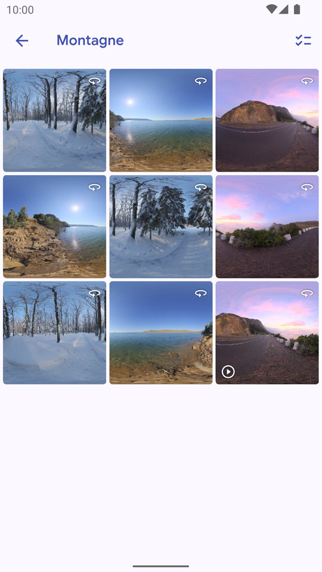
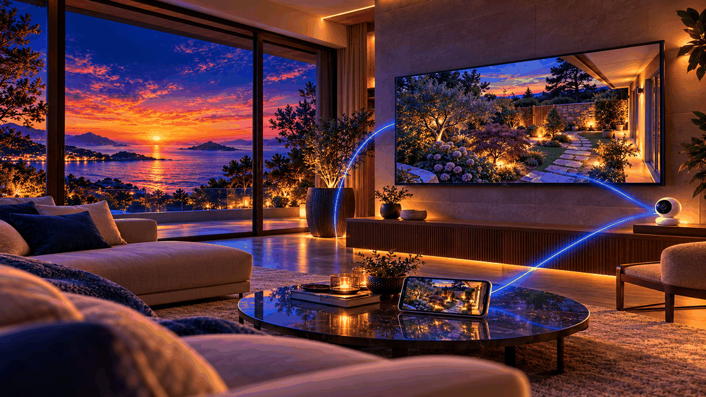

🌐 <b>Македонски</b> · Други јазици (88)
<a href="../README.md">English</a> · <a href="README.af.md">Afrikaans</a> · <a href="README.ar.md">العربية</a> · <a href="README.az.md">Azərbaycanca</a> · <a href="README.be.md">Беларуская</a> · <a href="README.bg.md">Български</a> · <a href="README.bi.md">Bislama</a> · <a href="README.bn.md">বাংলা</a> · <a href="README.br.md">Brezhoneg</a> · <a href="README.bs.md">Bosanski</a> · <a href="README.ca.md">Català</a> · <a href="README.cs.md">Čeština</a> · <a href="README.cv.md">Чӑвашла</a> · <a href="README.da.md">Dansk</a> · <a href="README.de.md">Deutsch</a> · <a href="README.de_CH.md">Deutsch (Schweiz)</a> · <a href="README.el.md">Ελληνικά</a> · <a href="README.en_GB.md">English (UK)</a> · <a href="README.eo.md">Esperanto</a> · <a href="README.es.md">Español</a> · <a href="README.et.md">Eesti</a> · <a href="README.eu.md">Euskara</a> · <a href="README.fa.md">فارسی</a> · <a href="README.fi.md">Suomi</a> · <a href="README.fil.md">Filipino</a> · <a href="README.fr.md">Français</a> · <a href="README.ga.md">Gaeilge</a> · <a href="README.gl.md">Galego</a> · <a href="README.gsw.md">Alemannisch</a> · <a href="README.gu.md">ગુજરાતી</a> · <a href="README.he.md">עברית</a> · <a href="README.hi.md">हिन्दी</a> · <a href="README.hr.md">Hrvatski</a> · <a href="README.hu.md">Magyar</a> · <a href="README.hy.md">Հայերեն</a> · <a href="README.id.md">Bahasa Indonesia</a> · <a href="README.is.md">Íslenska</a> · <a href="README.it.md">Italiano</a> · <a href="README.ja.md">日本語</a> · <a href="README.ka.md">ქართული</a> · <a href="README.kab.md">Taqbaylit</a> · <a href="README.kk.md">Қазақша</a> · <a href="README.km.md">ខ្មែរ</a> · <a href="README.kmr.md">Kurmancî</a> · <a href="README.kn.md">ಕನ್ನಡ</a> · <a href="README.ko.md">한국어</a> · <a href="README.kxm.md">ภาษาเขมรถิ่นไทย</a> · <a href="README.lb.md">Lëtzebuergesch</a> · <a href="README.lmo.md">Lombard</a> · <a href="README.lt.md">Lietuvių</a> · <a href="README.lv.md">Latviešu</a> · <a href="README.mfa.md">Bahasa Melayu Kelantan</a> · <a href="README.mi.md">Te reo Māori</a> · <a href="README.ml.md">മലയാളം</a> · <a href="README.mn.md">Монгол</a> · <a href="README.mr.md">मराठी</a> · <a href="README.ms.md">Bahasa Melayu</a> · <a href="README.nb_NO.md">Norsk bokmål</a> · <a href="README.ne.md">नेपाली</a> · <a href="README.nl.md">Nederlands</a> · <a href="README.nn.md">Norsk nynorsk</a> · <a href="README.pa.md">ਪੰਜਾਬੀ</a> · <a href="README.pl.md">Polski</a> · <a href="README.pt.md">Português</a> · <a href="README.pt_BR.md">Português (Brasil)</a> · <a href="README.ro.md">Română</a> · <a href="README.ru.md">Русский</a> · <a href="README.si.md">සිංහල</a> · <a href="README.sk.md">Slovenčina</a> · <a href="README.sl.md">Slovenščina</a> · <a href="README.sq.md">Shqip</a> · <a href="README.sr_Cyrl.md">Српски</a> · <a href="README.sr_Latn.md">Srpski</a> · <a href="README.sv.md">Svenska</a> · <a href="README.sw.md">Kiswahili</a> · <a href="README.swg.md">Schwäbisch</a> · <a href="README.ta.md">தமிழ்</a> · <a href="README.te.md">తెలుగు</a> · <a href="README.th.md">ไทย</a> · <a href="README.tl.md">Tagalog</a> · <a href="README.tr.md">Türkçe</a> · <a href="README.uk.md">Українська</a> · <a href="README.ur.md">اردو</a> · <a href="README.uz.md">Oʻzbekcha</a> · <a href="README.vi.md">Tiếng Việt</a> · <a href="README.yue_Hant.md">粵語</a> · <a href="README.zh_Hans.md">简体中文</a> · <a href="README.zh_Hant.md">繁體中文</a>

  

# Immuch360

**Вашите медиуми. Секој екран. Секоја гледна точка.**

🌐 <a href="https://immuch360.com/mk/"><b>immuch360.com</b></a>

Рамни, 360° и 3D фотографии и видеа од вашиот уред, вашиот NAS, вашиот Immich сервер, вашите камери и вашиот дрон. Не е потребна сметка. Immuch360 е бесплатна апликација со отворен код што ги чита вашите фотографии и видеа таму каде што се и секое го пушта во прегледувачот што му одговара: рамно, како сфера во која гледате околу себе, во 3D, или сè околу вас во уред за виртуелна реалност. Работи на телефони, таблети, телевизори, уреди Meta Quest и компјутери. Нејзиниот веб-сајт, [immuch360.com](https://immuch360.com/mk/), покажува што прави на секој екран, на 89 јазици.

**Ново во билд 53 и desktop билд 34, верзија 3.4.8.** На компјутерите, [Spatial 2.5D](#see-your-3d-photos-and-videos-in-depth-on-your-computer) им дава на вашите 3D фотографии длабочина на рамниот екран, на Windows, Linux и macOS, а на вашите 3D видеа на Windows и macOS: приказот се поместува додека ја движите главата, следена од веб-камерата откако ќе се согласите, или со глувчето, а сликите од веб-камерата остануваат во меморијата на компјутерот и никогаш не се зачувуваат ниту испраќаат; проектот сè уште не го пробал со веб-камера. Тркалцето [зумира во фотографија околу покажувачот](#zoom-into-a-photo-with-the-wheel), а повлекувањето ја поместува. [Подобри (ВИ)](#make-a-photo-sharper-on-your-computer-ai) ги зема фотографиите од вашите споделувања, од DLNA, Plex, Jellyfin и Emby и од вашиот Immich сервер, ги подобрува 360° и 3D фотографиите без да ги наруши нивниот шев или нивните две очи, и нуди Изостри на Mac со Apple чип (сè уште не пробано на Mac). Од телефонот, [„Пушти на…“](#show-your-photos-and-videos-on-the-tv-from-your-phone) отвора 360° ставка во 360° приказот на екранот, пушта избор или албум како слајдшоу, најавува екран на вашиот сервер и ги испраќа фотографиите и видеата што се само на телефонот; пробано меѓу Android емулатори, сè уште не на вистински телефон или телевизор. Во Meta Quest, слајдшоуто на големиот екран [се претопува или лизга](#browse-your-photos-on-the-big-screen-of-the-quest) меѓу фотографиите, врз црна, заматена или passthrough позадина што ја избирате, проектот сè уште не го пробал во очила.

**Ново во билдовите 33 до 52.** [Филмовите продолжуваат таму каде што застанавте](#pick-up-a-film-where-you-stopped). Тие почнуваат порано, а од бавен сервер [продолжуваат да се пуштаат наместо да застанат](#when-a-video-waits-or-will-not-play). Временската лента [се оддалечува до месеци и години](#find-a-month-or-a-year-in-a-long-timeline) на телефоните и компјутерите. На Android телефон или Meta Quest, [„Прегледај папка“](#browse-a-folder-of-your-phone-or-headset) отвора папка од уредот како споделување, а TIFF фотографиите се прикажуваат. Android TV [пребарува по датум со далечинскиот управувач](#on-android-tv-and-google-tv), Meta Quest 3 или 3S [отвора Гаусови сплатови](#explore-gaussian-splats-in-a-meta-quest-3-or-3s), кои се вртат со десната палка, вклучително и во SPZ верзија 4, а компјутерот [прави 3D верзии од фотографиите на вашиот NAS](#turn-one-photo-into-3d-a-scene-a-panorama). На лаптоп со Windows и два графички чипа апликацијата [сега работи на брзиот](#when-a-video-waits-or-will-not-play), па филмовите 8K се пуштаат мазно. Гаусовите сплатови сега [се отвораат на компјутери и на Android телефони и таблети](#explore-gaussian-splats-on-your-phone-tablet-or-computer), компјутер со Windows [прави сплат сцени од вашите фотографии или од видео](#make-a-splat-scene-from-your-photos-or-a-video-ai) со ВИ, вашиот Immich сервер [ги чува во фотографии](#keep-a-splat-scene-on-your-immich-server) што се отвораат од вашата временска лента, а компјутерите [пуштаат AV2 видеа](#play-av2-videos-on-your-computer). Од билд 42, raw видеата од камерите Insta360, GoPro MAX и DJI Osmo 360, од вашата Immich библиотека, споделување или папка, [се пуштаат стабилизирани со жироскопот на камерата](#stabilise-your-360-videos-with-the-cameras-gyroscope) на Android телефони, таблети и телевизори, креаторот на сплатови во desktop билд 22 [нуди детален квалитет](#make-a-splat-scene-from-your-photos-or-a-video-ai) за сцени што ги гледате одблиску, а 360° панорама [почнува со 3.5 GiB слободни на графичката картичка](#turn-one-photo-into-3d-a-scene-a-panorama). Апликацијата за iPhone и iPad е [на App Store](https://apps.apple.com/us/app/immuch360-360-3d-player/id6817655965), верзија 3.4.3. Од билд 43, известувањето за ажурирање во апликацијата го отвора Google Play или App Store на телефоните и таблетите; нејзиниот веб-сајт, [immuch360.com](https://immuch360.com/mk/), се отвори на 7 ноември. Од билд 44 и desktop билд 24, Meta Quest 3 или 3S [прикажува сплатови до 300,000 гаусијани](#explore-gaussian-splats-in-a-meta-quest-3-or-3s), компјутерите [избираат повеќе фотографии и видеа со Ctrl и Shift](#use-your-computer-as-the-media-player), телевизор чиј декодер одбива видео сам [ја пушта другата датотека од серверот](#when-a-video-waits-or-will-not-play), панорамите работат на избраната графичка картичка на лаптоп што има две, а известувањето за ажурирање на Quest и на компјутерите ја отвора нивната страница во продавницата или страницата за преземање, со многу поправки. Од билд 45 и desktop билд 25, верзија 3.4.0 на секоја платформа, апликацијата ја следи апликацијата Immich 3.4.0 со 11 подоцнежни поправки на Immich, ги прикажува [JPEG XL фотографиите од Immich 3.4 сервери](#keep-your-immich-library-with-more), ги отвора [вашите Plex филмови по години](#watch-your-plex-films) со страница за секој филм, нивното преземање на уредот и нивното пуштање на телевизорот од телефонот, може да побара оценка во билдовите од продавниците и на компјутерите ги зема своите видео компоненти од [нивните сопствени отворени репозиториуми](#licences-and-credits). Од билд 46 и desktop билд 26, верзија 3.4.1, raw видеата од 360° камери исто така [се пуштаат стабилизирани](#stabilise-your-360-videos-with-the-cameras-gyroscope) на iPhone и iPad, во Meta Quest и на Windows, Meta Quest [со libmpv ги пушта Plex филмовите што неговиот сопствен плеер не може да ги декодира](#watch-your-plex-films), телефонот [испраќа таков филм на Chromecast или Google TV](#watch-your-plex-films), а ВИ релјефот на 3D фотографија [ја добива јачината што ја избирате](#turn-one-photo-into-3d-a-scene-a-panorama); нов сервер може да се додаде и со најава со вашата Plex сметка, а апликацијата [ги чува своите поставки во датотека](#keep-your-settings-in-a-file). Од билд 47 и desktop билд 27, верзија 3.4.2, Plex филм [пушта аудио запис што уредот го декодира](#watch-your-plex-films) и кажува кој, ја отвора верзијата што одговара на екранот и, на бавна врска, нуди полесна, Windows и macOS го пуштаат неговиот Dolby TrueHD звук, Android [го прикажува неговото преземање во известување](#watch-your-plex-films), а и Android TV презема филмови, и [Tapo камерите на батерија се прикажуваат во живо](#watch-your-home-cameras-on-the-big-screen); враќањето на датотека со поставки со нејзините сметки сега ве најавува на вашиот Immich сервер. Од билд 48 и desktop билд 28, верзија 3.4.3, Windows компјутер [ги пушта вашите видеа во PC VR очила](#watch-your-videos-in-a-pc-vr-headset-from-windows) преку SteamVR, Meta Horizon Link или друга OpenXR извршна околина (проектот сè уште не го пробал во очила), [камери од други марки се прикажуваат во живо](#cameras-of-other-brands-over-onvif-or-rtsp), пронајдени преку ONVIF или додадени со нивната RTSP врска (проверено со симулирана камера, сè уште не е испробана вистинска камера од друга марка), raw видеата од [DJI Osmo 360 II и GoPro MAX 2 се пуштаат стабилизирани](#open-the-raw-files-of-360-cameras), Plex филмовите [повеќе не застануваат поради недостиг на податоци на телефоните](#when-a-video-waits-or-will-not-play), LG и Samsung телевизорите [вртат видео што лежи на страна](#on-a-samsung-tv-tizen) со едно копче (сè уште не пробано на LG телевизор; телевизорот Samsung од issue 17 го одби вртењето), а „Server update is available“ повеќе не се прикажува за сервер што е ажуриран. Од билд 49 и desktop билд 29, верзија 3.4.4, апликацијата [сама ги чита вашите Jellyfin и Emby сервери](#watch-your-jellyfin-and-emby-libraries) (сè уште не пробано на уред), пронајдени на вашата мрежа и најавени со Quick Connect на телевизор или во очила, со нивните оригинални датотеки пуштени така што 360° видео останува 360°; на големиот екран на Meta Quest, фотографиите [ги задржуваат големината и местото што ги поставивте додека ги прелистувате, и се пуштаат како слајдшоу](#browse-your-photos-on-the-big-screen-of-the-quest) (проектот сè уште не го пробал во очила); 360° видео плеерот на телефоните и таблетите [ги добива контролите на 360° фотографиите](#360-videos-on-your-phone-with-the-controls-of-360-photos), копче за жироскоп, зумирање со прсти и повлекување право нагоре или надолу (пробано од корисник на Samsung Galaxy S25 Ultra, сè уште не на iPhone); компјутер [ги претвора вашите 2D видеа во 3D видеа](#turn-your-2d-videos-into-3d-on-your-computer) со ВИ (сè уште не пробано на 3D екран или во очила); а Samsung телевизорите [му предаваат видео на кое му треба вртење на сопствениот плеер на Samsung](#on-a-samsung-tv-tizen), кое телевизорот од issue 17 го пушта, но одбива да го сврти. Од билд 50 и desktop билд 30, верзија 3.4.5, додека видео се пушта во 2D прозорецот на Meta Quest, прозорецот [се исцртува со фреквенцијата на екранот](#step-inside-your-photos-and-videos-with-a-meta-quest) наместо околу 10 пати во секунда како во билдовите 48 и 49 (измерено на Meta Quest 3), Android TV [зумира фотографија со далечинскиот управувач](#on-android-tv-and-google-tv) и ја поместува со стрелките (ново, сè уште не пробано на телевизор), а три поправки доаѓаат од Android TV fork на mlc70: брзото повлекување повеќе не ги прикажува деталите на фотографијата оставена зад себе, анимирана фотографија ја ослободува својата меморија, а филтерот Локација ги нуди градовите на новата земја. Од билд 51 и desktop билд 31, верзија 3.4.6, [Подобри (ВИ)](#make-a-photo-sharper-on-your-computer-ai) прави поостра копија од заматена фотографија покрај оригиналот на Windows и Linux, на три нивоа, секое извршено еднаш на еден компјутер со RTX 4060, Природно се нуди и на Mac со Apple чип (сè уште не е пробано на Mac), компјутер [претвора 360° видео во 360° 3D видео](#a-360-video-turned-into-a-360-3d-video) со ВИ, длабочината на 3D видеата ја проценува графичката картичка на Windows, ВИ функциите ги земаат видеата од вашиот сервер и од споделување директно, датотеката со поставки има [своја картичка во Библиотека](#keep-your-settings-in-a-file), телевизор ја зачувува на мрежно споделување, Esc враќа еден чекор назад на компјутерите, билдовите од продавниците бараат оценка [поретко и понежно](#privacy), Linux прикажува TIFF фотографии, сплат сцени и 3D видеа со едно око, а два пада се поправени. Од билд 52 и desktop билд 32, верзија 3.4.7, [„Пушти на…“](#show-your-photos-and-videos-on-the-tv-from-your-phone) ги испраќа фотографиите и видеата од вашата Immich библиотека, од вашите споделувања и од Jellyfin и Emby од телефонот на телевизор, Meta Quest, компјутер или Chromecast, имињата на вашите фотографии и видеа [остануваат читливи над нивните сликички](#play-the-files-of-a-nas-a-computer-a-media-server-or-plex), ВИ компонентите на компјутерот [се ажурираат со еден клик](#update-the-ai-components-in-one-click), Linux добива [AppImage](#linux), а апликацијата за iPhone и iPad е изградена со Xcode 27. Desktop билд 33 го поправи [Подобри (ВИ)](#make-a-photo-sharper-on-your-computer-ai), кое не успеваше на секоја фотографија во desktop билдовите 31 и 32 ([issue 23](https://github.com/freeKC/Immuch360/issues/23)).

  Незваничен fork на мобилната апликација Immich. Не е поврзан со Immich или FUTO. Името се чита како „I am much 360“.

<b>Содржина</b>

- [За кого е](#who-it-is-for)
- [Кои екрани](#which-screens), [што прават заедно](#use-cases) и [што прави секој екран](#what-each-screen-does)
- [Што можете да правите](#what-you-can-do)
- [Инсталирајте ја на вашиот уред](#get-it-on-your-device)
- [Како да](#how-to)
  - [Гледајте ги вашите фотографии и видеа, со или без сервер](#watch-your-photos-and-videos-with-or-without-a-server)
  - [Истражувајте панорами, 360°, VR180 и 3D](#explore-panoramas-360-vr180-and-3d): [360° видеа на телефони](#360-videos-on-your-phone-with-the-controls-of-360-photos)
  - [Претворете една фотографија во 3D, сцена, панорама](#turn-one-photo-into-3d-a-scene-a-panorama): [ВИ компонентите ажурирани со еден клик](#update-the-ai-components-in-one-click)
  - [Претворете ги вашите 2D видеа во 3D на компјутерот](#turn-your-2d-videos-into-3d-on-your-computer): [360° видеа во 360° 3D](#a-360-video-turned-into-a-360-3d-video)
  - [Направете фотографија поостра на компјутерот (ВИ)](#make-a-photo-sharper-on-your-computer-ai)
  - [Гледајте на телевизор со далечинскиот управувач](#watch-on-the-tv-with-the-remote): [Android TV и Google TV](#on-android-tv-and-google-tv), [LG](#on-an-lg-tv-webos), [Samsung](#on-a-samsung-tv-tizen)
  - [Најавете телевизор, уред за виртуелна реалност или компјутер со телефонот](#sign-in-a-tv-a-headset-or-a-computer-with-your-phone)
  - [Прикажете ги вашите фотографии и видеа на телевизорот од телефонот](#show-your-photos-and-videos-on-the-tv-from-your-phone)
  - [Влезете во вашите фотографии и видеа со Meta Quest](#step-inside-your-photos-and-videos-with-a-meta-quest): [големиот екран](#browse-your-photos-on-the-big-screen-of-the-quest), [режим на киоск](#kiosk-mode-for-an-exhibition-or-a-shop)
  - [Истражете Гаусови сплатови во Meta Quest 3 или 3S](#explore-gaussian-splats-in-a-meta-quest-3-or-3s)
  - [Истражете Гаусови сплатови на вашиот телефон, таблет или компјутер](#explore-gaussian-splats-on-your-phone-tablet-or-computer)
  - [Направете сплат сцена од вашите фотографии или од видео (ВИ)](#make-a-splat-scene-from-your-photos-or-a-video-ai)
  - [Чувајте сплат сцена на вашиот Immich сервер](#keep-a-splat-scene-on-your-immich-server)
  - [Пуштајте ги датотеките од NAS, компјутер, медиумски сервер или Plex](#play-the-files-of-a-nas-a-computer-a-media-server-or-plex): [вашите филмови по години](#watch-your-plex-films), [Jellyfin и Emby](#watch-your-jellyfin-and-emby-libraries)
  - [Прегледајте папка од телефонот или очилата](#browse-a-folder-of-your-phone-or-headset)
  - [Продолжете филм таму каде што застанавте](#pick-up-a-film-where-you-stopped)
  - [Кога видеото чека или не се пушта](#when-a-video-waits-or-will-not-play)
  - [Задржете ја вашата Immich библиотека, со повеќе](#keep-your-immich-library-with-more)
  - [Најдете месец или година во долга временска лента](#find-a-month-or-a-year-in-a-long-timeline)
  - [Гледајте ги домашните камери на големиот екран](#watch-your-home-cameras-on-the-big-screen): [други марки](#cameras-of-other-brands-over-onvif-or-rtsp)
  - [Вашиот DJI дрон](#your-dji-drone): [видео во живо](#see-what-your-drone-sees-on-your-phone), [во Quest или на Android TV](#watch-it-in-a-meta-quest-or-on-an-android-tv), [увоз](#bring-a-drones-or-a-camera-cards-photos-and-videos-to-immich)
  - [Отворете ги raw датотеките од 360° камери](#open-the-raw-files-of-360-cameras)
  - [Стабилизирајте ги вашите 360° видеа со жироскопот на камерата](#stabilise-your-360-videos-with-the-cameras-gyroscope)
  - [Ротирајте фотографија со едно копче](#turn-a-photo-with-one-key)
  - [Користете го компјутерот како медиумски плеер](#use-your-computer-as-the-media-player): [зумирање со тркалцето](#zoom-into-a-photo-with-the-wheel)
  - [Гледајте ги вашите 3D фотографии и видеа со длабочина на компјутерот](#see-your-3d-photos-and-videos-in-depth-on-your-computer)
  - [Гледајте ги вашите видеа во PC VR очила, од Windows](#watch-your-videos-in-a-pc-vr-headset-from-windows)
  - [Пуштајте AV2 видеа на вашиот компјутер](#play-av2-videos-on-your-computer)
  - [Чувајте ги вашите поставки во датотека](#keep-your-settings-in-a-file)
- [Споредба со Immich](#compared-with-immich)
- [Приватност](#privacy)
- [Лиценци и заслуги](#licences-and-credits)
- [Патоказ](#roadmap)
- [Документација](#documentation)

## За кого е

- **Снимате во 360° или 3D** и сакате да гледате околу себе во вашите снимки, наместо да ги гледате рамни, удвоени или развлечени, и да ги вртите вашите 360° видеа на телефонот како што ги вртите неговите фотографии: [360°, VR180 и 3D](#explore-panoramas-360-vr180-and-3d), [360° видеа на телефони](#360-videos-on-your-phone-with-the-controls-of-360-photos).
- **Снимате со 360° камера в рака, на велосипед или на кацига** и сакате raw видеата од вашата Insta360, GoPro MAX или MAX 2, DJI Osmo 360 или Osmo 360 II камера, чувани во Immich, на споделување или во папка, да се пуштаат израмнети и мирни на вашиот телефон, вашиот телевизор, вашиот Meta Quest или вашиот Windows компјутер: [стабилизирани со жироскопот на камерата](#stabilise-your-360-videos-with-the-cameras-gyroscope).
- **Вашите фотографии и филмови се на NAS, компјутер, Plex или Immich** и ги сакате на телевизорот без да копирате ништо: [на телевизор](#watch-on-the-tv-with-the-remote), [NAS, споделувања и Plex](#play-the-files-of-a-nas-a-computer-a-media-server-or-plex).
- **Ги чувате вашите филмови на Plex сервер** и сакате да изберете еден по година, да видите што е пред да започне, да го понесете на пат, да го пуштите на телевизорот или на Chromecast од телефонот и да ги пуштите дури и филмовите што вашиот Android телефон, телевизор или Meta Quest не може да ги декодира: [вашите филмови, по години](#watch-your-plex-films).
- **Ги чувате вашите филмови на Jellyfin или Emby сервер** и ги сакате во вашиот Meta Quest, на телевизорот или на телефонот, со 360° и 3D зачувани какви што се, и со местото каде што застанавте зачувано на серверот (сè уште не пробано на уред): [Jellyfin и Emby](#watch-your-jellyfin-and-emby-libraries).
- **Имате Meta Quest** и сакате да влезете во сопствените фотографии и видеа: [во уредот за виртуелна реалност](#step-inside-your-photos-and-videos-with-a-meta-quest), и да ги прелистувате вашите фотографии на голем екран со големината и на местото што ги поставивте, и како слајдшоу (проектот сè уште не го пробал во очила): [големиот екран](#browse-your-photos-on-the-big-screen-of-the-quest).
- **Имате PC VR очила на Windows компјутер** и сакате во нив вашите 360° видеа околу вас и вашите филмови на голем екран (проектот сè уште не го пробал во очила): [во PC VR очила](#watch-your-videos-in-a-pc-vr-headset-from-windows).
- **Вашите фотографии се рамни**, а ги сакате во 3D, како сцена во која се навалувате во уред за виртуелна реалност, или во 360° панорама, без 3D камера: [претворете една фотографија во 3D, сцена, панорама](#turn-one-photo-into-3d-a-scene-a-panorama), ново, го прави ВИ на вашиот сопствен компјутер.
- **Вашите видеа се рамни**, вклучувајќи ги клиповите од вашиот телефон, и ги сакате во 3D за очила или 3D екран, и вашите 360° видеа во 360° 3D, направени на вашиот сопствен компјутер (сè уште не пробано на 3D екран или во очила): [2D видеа во 3D](#turn-your-2d-videos-into-3d-on-your-computer), [360° во 360° 3D](#a-360-video-turned-into-a-360-3d-video).
- **Вашите фотографии се заматени**, малку неизострени или снимени при слаба светлина, и сакате поостра копија покрај оригиналот, направена на вашиот сопствен компјутер, и од вашите споделувања и сервери, со измислените детали јасно кажани: [Подобри (ВИ)](#make-a-photo-sharper-on-your-computer-ai).
- **Имате 3D фотографии или видеа и компјутер** и сакате да ги гледате со длабочина на неговиот рамен екран, со приказ што се поместува додека ја движите главата, следена од веб-камерата, или со глувчето (проектот сè уште не го пробал со веб-камера): [Spatial 2.5D на вашиот компјутер](#see-your-3d-photos-and-videos-in-depth-on-your-computer).
- **Користите Immich** и ја сакате неговата апликација, плус имерзивните прегледувачи и големите екрани што ги најавувате од телефонот: [вашата Immich библиотека](#keep-your-immich-library-with-more), [споредба со Immich](#compared-with-immich).
- **Го надгледувате домот со Tapo камери**, и со оние на батерија, или со камери од други марки преку ONVIF или RTSP, и ги сакате покрај вашите фотографии, и на телевизорот (проверено со симулирана камера): [домашни камери](#watch-your-home-cameras-on-the-big-screen).
- **Летате со DJI дрон** и ја сакате неговата слика во живо на телефонот без DJI Fly, и во Meta Quest или на Android TV за луѓето што се со вас: [вашиот дрон](#see-what-your-drone-sees-on-your-phone).
- **Снимате места и предмети во 3D, како Гаусови сплатови,** или би сакале да ги правите од сопствените фотографии, и сакате да одите низ нив на телефонот, на компјутерот или во уред за виртуелна реалност: [на телефон, таблет или компјутер](#explore-gaussian-splats-on-your-phone-tablet-or-computer), [направени од вашите фотографии](#make-a-splat-scene-from-your-photos-or-a-video-ai), [чувани во Immich](#keep-a-splat-scene-on-your-immich-server).
- **Имате AV2 видеа**, форматот што доаѓа по AV1, и сакате да ги гледате на компјутерот: [AV2 на вашиот компјутер](#play-av2-videos-on-your-computer).
- **Имате неколку екрани дома** и сакате да работат заедно: [што прават заедно вашите екрани](#use-cases).

Нема Immuch360 сметка за создавање, и ништо не доаѓа до нас: апликацијата комуницира само со вашите уреди и со серверите што ги избирате, од билд 45 и со Wikipedia за страницата на филм, од билд 46 со plex.tv кога се најавувате со него, и презема ВИ компонента или AV2 декодерот само кога ќе побарате.

## Кои екрани

| Платформа | Каде да ја најдете | Статус во ноември 2026 |
|---|---|---|
|  **Android** телефони и таблети | [Google Play](https://play.google.com/store/apps/details?id=com.aprogsys.immuch360) · [APK](https://github.com/freeKC/Immuch360/releases) | на Google Play (билд 47 објавен на 16 ноември; билд 51 на преглед кај Google од 24 ноември; следува билд 53), билд 53 на GitHub, каде [raw 360° видеата се пуштаат стабилизирани](#stabilise-your-360-videos-with-the-cameras-gyroscope), [филмовите продолжуваат таму каде што застанавте](#pick-up-a-film-where-you-stopped), [„Прегледај папка“](#browse-a-folder-of-your-phone-or-headset) отвора папка од телефонот, а [Гаусовите сплатови се отвораат](#explore-gaussian-splats-on-your-phone-tablet-or-computer), од споделување или [од вашата Immich временска лента](#keep-a-splat-scene-on-your-immich-server), [поставките чувани во датотека](#keep-your-settings-in-a-file), [преземањето филм прикажано во известување](#watch-your-plex-films), од билд 48 [камери од други марки, во живо](#cameras-of-other-brands-over-onvif-or-rtsp) (проверено со симулирана камера) и, од билд 49, [Jellyfin и Emby сервери](#watch-your-jellyfin-and-emby-libraries) (сè уште не пробано на уред) и [контролите на 360° фотографиите во 360° видео плеерот](#360-videos-on-your-phone-with-the-controls-of-360-photos) (пробано од корисник на Samsung Galaxy S25 Ultra), а од билд 51 [картичката на датотеката со поставки во Библиотека](#keep-your-settings-in-a-file), со датотеката зачувана и на мрежно споделување, а од билд 52 [вашите фотографии и видеа испратени на телевизор или Chromecast](#show-your-photos-and-videos-on-the-tv-from-your-phone) со „Пушти на…“ (сè уште не е пробано на уред), а од билд 53 [360° ставки, избор или албум и фотографиите и видеата од самиот телефон](#show-your-photos-and-videos-on-the-tv-from-your-phone) испратени на истиот начин (пробано меѓу Android емулатори) |
|  **iPhone и iPad** | [App Store](https://apps.apple.com/us/app/immuch360-360-3d-player/id6817655965) | верзија 3.4.7 на App Store од 26 ноември, со [месеци и години во временската лента](#find-a-month-or-a-year-in-a-long-timeline), [филмови што продолжуваат таму каде што застанавте](#pick-up-a-film-where-you-stopped), [најавата на телевизор, уред за виртуелна реалност или компјутер](#sign-in-a-tv-a-headset-or-a-computer-with-your-phone) од телефонот, сплат сцените чувани во Immich прикажани како нивната фотографија, поправките на Immich 3.4.0 и неговите JPEG XL фотографии, [raw 360° видеа стабилизирани](#stabilise-your-360-videos-with-the-cameras-gyroscope), [поставките чувани во датотека](#keep-your-settings-in-a-file), [прегледот во живо на Tapo камерите на батерија](#watch-your-home-cameras-on-the-big-screen) и [прегледот во живо на камери од други марки](#cameras-of-other-brands-over-onvif-or-rtsp) (проверено со симулирана камера), а од верзија 3.4.4 со [Jellyfin и Emby сервери](#watch-your-jellyfin-and-emby-libraries) (сè уште не пробано на уред) и [контролите на 360° фотографиите во 360° видео плеерот](#360-videos-on-your-phone-with-the-controls-of-360-photos) (сè уште не пробано на iPhone), а од верзија 3.4.6 со [картичката на датотеката со поставки](#keep-your-settings-in-a-file) и нејзиното враќање од мрежно споделување, а од верзија 3.4.7, изградена со Xcode 27, со [„Пушти на…“ за фотографии и видеа](#show-your-photos-and-videos-on-the-tv-from-your-phone) (сè уште не пробано на iPhone); следува верзија 3.4.8, iPhone и iPad верзијата на билд 53; или [изградете ја сами](../docs/immuch360/build.md) |
|  **Android TV и Google TV** | [Google Play](https://play.google.com/store/apps/details?id=com.aprogsys.immuch360) · [APK](#android-tv-and-google-tv) | на Google Play, кој ја нуди апликацијата на Android TV и Google TV, и билд 53 на GitHub: [raw 360° видеа стабилизирани](#stabilise-your-360-videos-with-the-cameras-gyroscope), [пребарување по датум со далечинскиот управувач](#on-android-tv-and-google-tv), [најава со телефон](#sign-in-a-tv-a-headset-or-a-computer-with-your-phone) со скенирање QR код, временска лента, аудио и титлови за далечинскиот управувач во видео плеерот, и [видео во живо од дрон](#watch-it-in-a-meta-quest-or-on-an-android-tv) препратено од телефон, [филмови преземени на телевизорот](#watch-your-plex-films) и, од билд 49, [Jellyfin и Emby сервери](#watch-your-jellyfin-and-emby-libraries) најавени со Quick Connect (сè уште не пробано на уред) и, од билд 50, [фотографии зумирани со далечинскиот управувач](#on-android-tv-and-google-tv) (видено како работи на Android TV емулатор, сè уште не пробано на телевизор), а од билд 51 [датотеката со поставки зачувана и вратена на мрежно споделување](#keep-your-settings-in-a-file) (видено како работи на Android TV емулатор), а од билд 52 [фотографиите и видеата што телефон ги испраќа со „Пушти на…“](#show-your-photos-and-videos-on-the-tv-from-your-phone) (сè уште не е пробано на телевизор), а од билд 53 фотографиите во 360° што ги испраќа телефон отворени во нивниот 360° приказ, најава од листата на телефонот и фотографиите и видеата од самиот телефон (видено како работи на Android TV емулатор) |
| **LG телевизори** со webOS 5.0 и понови | [.ipk, верзија 1.0.5](https://github.com/freeKC/Immuch360/releases/tag/webos-v1.0.5) · LG Content Store (на преглед) | верзија 1.0.0, поднесена до LG Content Store на 24 октомври, на тестирање кај LG од 26 октомври; верзија 1.0.1, на GitHub од 27 октомври, зумира фотографија со стрелките и кажува кога фотографијата сè уште се вчитува, а верзија 1.0.2, на GitHub со билд 46, пишува „најава“ како ログイン на јапонски, верзија 1.0.3, со билд 47, кажува кога папка на DLNA сервер содржи телевизиски канали во живо, кои сè уште не може да ги пушти, верзија 1.0.4, со билд 48, [врти видео што лежи на страна](#on-an-lg-tv-webos) со едно копче (сè уште не пробано на LG телевизор), а верзија 1.0.5, со билд 49, го наведува Jellyfin со неговиот DLNA додаток меѓу DLNA серверите; додека LG не ја објави апликацијата, се инсталира во [Developer Mode](#lg-tvs-webos). Верзијата 1.0.0 работеше на webOS 25 телевизори во Cloud Test Lab на LG |
| **Samsung телевизори** со Tizen 5.5 и понови | [.wgt, верзија 0.3.6](https://github.com/freeKC/Immuch360/releases/tag/tizen-v0.3.6) | верзија 0.3.6 на истата ТВ апликација, за потпишување со ваш сопствен Samsung сертификат и инсталирање во [Developer mode](#samsung-tvs-tizen); 0.1.0 работеше на Samsung телевизор на тестер, 0.2.0 ги содржи поправките од тоа тестирање, 0.3.0 го додава зумирањето на фотографиите и ознаката Вчитување од LG верзијата 1.0.1, 0.3.1 јапонскиот текст од LG верзијата 1.0.2, 0.3.2 го пушта исправено видео снимено вертикално со телефон ([issue 17](https://github.com/freeKC/Immuch360/issues/17)), 0.3.3 и 0.3.4 [го вртат на телевизор што го пријавува како исправено](#on-a-samsung-tv-tizen) и додаваат копче што го врти рачно, а 0.3.5 и 0.3.6 му предаваат такво видео на сопствениот плеер на Samsung; на телевизорот на пријавувачот, 0.3.4 и 0.3.5 ја оставија сликата на страна, бидејќи телевизорот го одби вртењето, а излезот таму е видео што вашиот Immich сервер го транскодира, зачувано исправено; не е во продавницата на Samsung |
|  **Meta Quest** 2, Pro, 3 и 3S | [Horizon Store](https://www.meta.com/experiences/immuch360/1384208401440714/) · [APK](#meta-quest) | на Horizon Store (билд 50, чиј 2D прозорец се исцртува со фреквенцијата на екранот додека се пушта видео, објавен на 25 ноември; билд 52 на преглед кај Meta од 25 ноември; следува билд 53), билд 53 на GitHub, со [режим на киоск](#kiosk-mode-for-an-exhibition-or-a-shop), [raw 360° видеа стабилизирани](#stabilise-your-360-videos-with-the-cameras-gyroscope) во имерзивниот приказ, [филмовите што не може да ги декодира пуштени со libmpv](#watch-your-plex-films) и, на Quest 3 и 3S, [Гаусови сплатови](#explore-gaussian-splats-in-a-meta-quest-3-or-3s) и [ВИ релјеф](#turn-one-photo-into-3d-a-scene-a-panorama) на рамна фотографија, а од билд 49 [фотографии прелистувани на големиот екран](#browse-your-photos-on-the-big-screen-of-the-quest) со големината што ја поставивте, и како слајдшоу (проектот сè уште не го пробал во очила), и [Jellyfin и Emby сервери](#watch-your-jellyfin-and-emby-libraries) најавени со Quick Connect (сè уште не пробано на уред), а од билд 51 очила чиј Horizon OS е премногу стар за имерзивниот приказ бараат ажурирање наместо да ја затворат апликацијата (не е пробано на такви очила), а од билд 53 [претопување или лизгање меѓу фотографиите на големиот екран, врз црна, заматена или passthrough позадина](#browse-your-photos-on-the-big-screen-of-the-quest) (проектот сè уште не го пробал во очила) |
|  **Windows** | [Инсталатор или ZIP](https://github.com/freeKC/Immuch360/releases/tag/desktop-v3.4.8-34) | desktop билд 34, потпишан: фотографии, рамни и 360° видеа, споделувања, Plex, камери (проверено со симулирана камера), најава со телефон, фотографии ротирани со едно копче, интерфејсот на 89 јазици, и [3D фотографии, 3D сцени и 360° панорами направени од вашите фотографии](#turn-one-photo-into-3d-a-scene-a-panorama) од ВИ, и од фотографиите на вашиот NAS; [Гаусови сплатови](#explore-gaussian-splats-on-your-phone-tablet-or-computer) отворени, [направени од вашите фотографии или од видео](#make-a-splat-scene-from-your-photos-or-a-video-ai) и [чувани во Immich](#keep-a-splat-scene-on-your-immich-server), [AV2 видеа](#play-av2-videos-on-your-computer), од desktop билд 22 [избор на квалитет за сплат сцените](#make-a-splat-scene-from-your-photos-or-a-video-ai) и [360° панорами од 3.5 GiB слободна графичка меморија](#turn-one-photo-into-3d-a-scene-a-panorama), и од desktop билд 26 [raw 360° видеа стабилизирани](#stabilise-your-360-videos-with-the-cameras-gyroscope) и [3D фотографии со јачина на релјефот и поостри рабови](#turn-one-photo-into-3d-a-scene-a-panorama), од desktop билд 27 [Dolby TrueHD звукот и Blu-ray титловите на филмовите](#watch-your-plex-films), од desktop билд 28 [вашите видеа во PC VR очила](#watch-your-videos-in-a-pc-vr-headset-from-windows) (проектот сè уште не го пробал во очила), и од desktop билд 29 [3D видеа направени од вашите 2D видеа](#turn-your-2d-videos-into-3d-on-your-computer) со ВИ (сè уште не пробано на 3D екран или во очила), и од desktop билд 31 [поостри копии од вашите фотографии](#make-a-photo-sharper-on-your-computer-ai) со ВИ и [360° видеа претворени во 360° 3D видеа](#a-360-video-turned-into-a-360-3d-video) со ВИ, длабочината проценета од графичката картичка, видеата од вашиот сервер и од споделување земени директно, и Esc за враќање еден чекор назад, од desktop билд 32 [ВИ компонентите ажурирани со еден клик](#update-the-ai-components-in-one-click), од desktop билд 33 [Подобри (ВИ)](#make-a-photo-sharper-on-your-computer-ai) што повторно работи, а од desktop билд 34 [зумирањето фотографии со тркалцето](#zoom-into-a-photo-with-the-wheel), [Spatial 2.5D за 3D фотографии и видеа](#see-your-3d-photos-and-videos-in-depth-on-your-computer), со веб-камерата или глувчето (проектот сè уште не го пробал со веб-камера), и Подобри (ВИ) на фотографиите од споделувања и сервери, и на 360° и 3D фотографии |
|   **macOS и Linux** | [.deb, .rpm, AppImage, DMG](https://github.com/freeKC/Immuch360/releases/tag/desktop-v3.4.8-34) | desktop билд 34: фотографии, 360° фотографии и рамни видеа (360° видеата се пуштаат рамно), Immich сервер и мрежни споделувања, и [3D фотографии и 3D сцени](#turn-one-photo-into-3d-a-scene-a-panorama) што ВИ ги прави од вашите фотографии, со 360° панорами на Linux на графичка картичка од 8 GB, од 3.5 GiB слободни на неа, и [Гаусови сплатови](#explore-gaussian-splats-on-your-phone-tablet-or-computer) и [AV2 видеа](#play-av2-videos-on-your-computer) (сè уште не пробано на Mac); desktop билд 11 пробан на 26 октомври во Ubuntu 24.04 контејнер и на Mac; од desktop билд 27, Dolby TrueHD звукот на филмовите на macOS; од desktop билд 29, [3D видеа направени од вашите 2D видеа](#turn-your-2d-videos-into-3d-on-your-computer) со ВИ на Linux и на Mac со Apple чип (сè уште не пробано на 3D екран или во очила); од desktop билд 31, на Linux, [поостри копии од вашите фотографии](#make-a-photo-sharper-on-your-computer-ai) со ВИ, TIFF фотографии, папки што самите ги прикажуваат своите нови датотеки, сплат сцени направени од вашите фотографии на графичка картичка од 4 GB и 3D видеа прикажани рамно со едно око, а на Mac со Apple чип нивото Природно на Подобри (ВИ) (сè уште не пробано на Mac); од desktop билд 32, [AppImage](#linux) за другите Linux дистрибуции, проверено од CI на Arch Linux и openSUSE; од desktop билд 34, зумирањето со тркалцето, [Spatial 2.5D](#see-your-3d-photos-and-videos-in-depth-on-your-computer) за 3D фотографии на Linux и macOS и за 3D видеа на macOS (сè уште не пробано на Mac ниту со веб-камера), а на Mac со Apple чип нивото Изостри на Подобри (ВИ) (сè уште не пробано на Mac); непотпишано на macOS |

*Статусите се ажурираат при секое издание; што има секоја продавница, што е на преглед кај неа и секој билд се во [Статус на изданијата](../docs/immuch360/release-status.md). Веб-сајтот [immuch360.com](https://immuch360.com/mk/) покажува што прави секој екран, упатство за секоја функција и врските до продавниците, на 89 јазици.*

  

### Што прават заедно вашите екрани

Инсталирајте Immuch360 на секој екран на кој гледате: секој сам ги чита вашите извори, а некои предаваат слика, датотека или најава на друг. На секоја слика, иконата на Immuch360 ги означува уредите на кои работи апликацијата.

#### Вашиот NAS на секој екран

  

**Ви треба:** NAS со споделена папка SMB или WebDAV, и Immuch360 на секој екран на кој гледате.

Додајте ја споделената папка на секој екран, и секој ги пушта фотографиите и видеата таму каде што се, без да се копира ништо: телефони, таблети, Android TV, Meta Quest, компјутери со Windows, Linux и macOS, и LG телевизори најавени на вашиот Immich сервер (SMB од webOS 22). 360° фотографија се врти како сфера на телефонот и телевизорот, а во уредот за виртуелна реалност ве опкружува. Како да: [Пуштајте ги датотеките од NAS, компјутер, медиумски сервер или Plex](#play-the-files-of-a-nas-a-computer-a-media-server-or-plex).

#### Вашиот Immich сервер на секој екран, најавен од вашиот телефон

  

**Ви треба:** Immich сервер, Immuch360 на вашиот Android телефон, и Immuch360 на екраните што ги најавувате: Android TV, Meta Quest, компјутер со Windows, Linux или macOS.

На телефонот, Immuch360 ја задржува целата мобилна апликација на Immich, ги додава своите 360°, VR180 и 3D прегледувачи, и се инсталира покрај официјалната апликација. Најавен на вашиот сервер, ги најавува големите екрани: го скенира QR кодот на телевизорот или компјутерот, или вие во него го внесувате кодот што го прикажува уредот за виртуелна реалност, а вашата лозинка останува на телефонот. Како да: [Најавете телевизор, уред за виртуелна реалност или компјутер со телефонот](#sign-in-a-tv-a-headset-or-a-computer-with-your-phone).

#### Вашите рамни фотографии во 3D, од компјутерот до уредот за виртуелна реалност

  

**Ви треба:** Immuch360 на компјутер со Windows, Linux или macOS и во Meta Quest, со вашиот NAS меѓу нив, или вашиот Immich сервер со вклучено „Прави резервна копија и од ВИ верзиите“.

Самиот компјутер ги претвора вашите фотографии во 3D фотографии и 3D сцени, и во 360° панорами со графичка картичка од 8 GB на Windows или Linux, и ги зачувува покрај оригиналите. Уредот за виртуелна реалност прикажува 3D фотографија во вистинско 3D, става сцена во вашата соба и панорама насекаде околу вас; телефоните и телевизорите ги отвораат панорамите во својот 360° прегледувач. Како да: [Претворете една фотографија во 3D, сцена, панорама](#turn-one-photo-into-3d-a-scene-a-panorama).

#### Сликата во живо од вашиот дрон во уред за виртуелна реалност или на телевизорот

  

**Ви треба:** DJI дрон и неговиот контролер DJI RC-N3, Immuch360 на Android телефонот приклучен во контролерот, и Immuch360 во Meta Quest или на Android TV.

Телефонот го прикажува видеото во живо од дронот и го препраќа, преку вашиот Wi-Fi или преку сопствена пристапна точка, за луѓето што се со вас да го гледаат летот во уредот за виртуелна реалност или на телевизорот. Само примање: никогаш не се испраќа команда до контролерот или дронот, а контролерот ја задржува целосната контрола. Како да: [Гледајте го во Meta Quest или на Android TV](#watch-it-in-a-meta-quest-or-on-an-android-tv).

#### Raw датотеките од вашата 360° камера, споени таму каде што ги гледате

  

**Ви треба:** камера Insta360, GoPro MAX или MAX 2, DJI Osmo 360 или Osmo 360 II, вашиот NAS, и Immuch360 на екраните: телефони, таблети, Android TV, Meta Quest, Windows.

Копирајте ги .insp, .insv, .360 или .osv датотеките од картичката на камерата на споделена папка SMB или WebDAV на вашиот NAS, такви какви што се; Immich сервер ги прима и оние од Insta360. Секој екран ги спојува додека ги пушта, со калибрацијата запишана во секоја датотека, и ништо не се извезува претходно во апликацијата на камерата. Како да: [Отворете ги raw датотеките од 360° камери](#open-the-raw-files-of-360-cameras).

#### Вашите Plex и DLNA сервери на телевизорот и во уредот за виртуелна реалност

  

**Ви треба:** Plex Media Server, Jellyfin или Emby сервер, или DLNA сервер како minidlna, и Immuch360 на секој екран: Android TV, Meta Quest, телефони, таблети, Windows.

Plex ги дава оригиналните датотеки од вашите библиотеки, па 360° видео останува 360°, насекаде околу вас во уредот за виртуелна реалност, дома и надвор од дома преку вашето пренасочување на порти; DLNA серверите се пронаоѓаат на вашата домашна мрежа. Ги пуштаат и LG телевизорите најавени на вашиот Immich сервер. Од билд 45, телефоните, таблетите, Android TV, Quest и компјутерите ја отвораат Plex филмската библиотека на сите филмови по години, секој филм со својата страница, а филм избран на телефонот се пушта на Android TV, Quest или компјутер, со далечинскиот управувач во контрола. Од билд 46, Quest со libmpv ги пушта филмовите што неговиот сопствен плеер не може да ги декодира, вашиот Plex сервер ги конвертира оние што ниеден плеер на Android уред не ги декодира, а телефонот испраќа филм на Chromecast или Google TV. Од билд 47, филмот пушта аудио запис што уредот го декодира и кажува кој, ја отвора верзијата што одговара на екранот и го пушта својот Dolby TrueHD звук на Windows и macOS, а папка со телевизиски канали во живо на DLNA сервер кажува дека тие сè уште не можат да се пуштат. Од билд 49, и Jellyfin или Emby сервер има свој тип, се пронаоѓа самостојно, се најавува со Quick Connect на телевизор или во очилата, неговите оригинални датотеки се пуштаат така што 360° останува 360°, а местото каде што застанавте се чува на серверот (сè уште не пробано на уред). Како да: [Пуштајте ги датотеките од NAS, компјутер, медиумски сервер или Plex](#play-the-files-of-a-nas-a-computer-a-media-server-or-plex), [Гледајте ги вашите Plex филмови](#watch-your-plex-films) и [Гледајте ги вашите Jellyfin и Emby библиотеки](#watch-your-jellyfin-and-emby-libraries).

#### Вашиот телефон или вашиот Windows компјутер, отворен во уредот за виртуелна реалност

  

**Ви треба:** Immuch360 на Android телефон, iPhone или Windows компјутер, и во Meta Quest, на истиот домашен Wi-Fi.

Вклучете „Сподели го овој телефон на мрежата“ на телефонот, или „Сподели го овој компјутер на мрежата“ на компјутерот, и уредот за виртуелна реалност ги пушта неговите фотографии и видеа, оние од 360° насекаде околу вас: без сервер, без NAS, без прикачување. На iPhone, споделувањето работи додека апликацијата е на екранот. Како да: [Сподели го овој телефон на мрежата](../docs/immuch360/user-guide.md#share-this-phone-on-the-network).

#### Вашите Tapo камери на телевизорот и во уредот за виртуелна реалност

  

**Ви треба:** Tapo камери на вашата домашна мрежа, и Immuch360 на Android телефон, Android TV, Meta Quest или Windows компјутер.

Секој екран прикажува камера во живо и ги пушта снимките од нејзината мемориска картичка ден по ден, покрај вашите фотографии, а телефонот испраќа клип на вашиот Immich сервер. Апликацијата комуницира со камерите само на вашата мрежа, никогаш преку серверите на TP-Link. Од билд 47, и камерите на батерија се прикажуваат во живо, преку својата медиумска порта, на телефони, таблети, Android TV и Quest. Од билд 48, покрај нив во живо се прикажуваат и камери од други марки, пронајдени преку ONVIF или додадени со нивната RTSP врска. Проверено со симулирана камера. Како да: [Гледајте ги домашните камери на големиот екран](#watch-your-home-cameras-on-the-big-screen).

#### Гаусови сплатови во вашата соба, во Meta Quest 3 или 3S

  

**Ви треба:** сплат направен со Polycam, Scaniverse, Luma или друга алатка, како .spz или бинарна .ply датотека на вашиот NAS или во уредот за виртуелна реалност, и Immuch360 во Meta Quest 3 или 3S.

Уредот за виртуелна реалност го поставува местото или предметот во неговата големина, пред вас или насекаде околу вас: прошетајте околу него, лизгајте низ него со левиот џојстик, вртете се со десниот. Гаусовите сплатови користат дел од Meta Spatial SDK што Meta ниту го поддржува ниту го гарантира: секој недостаток е одговорност само на Immuch360. Како да: [Истражете Гаусови сплатови во Meta Quest 3 или 3S](#explore-gaussian-splats-in-a-meta-quest-3-or-3s).

#### Meta Quest за вашите посетители

  

**Ви треба:** Meta Quest со Immuch360, и 360° фотографија или видео во уредот за виртуелна реалност, на вашиот NAS или на вашиот Immich сервер.

Во режим на киоск, уредот за виртуелна реалност сам ја отвора вашата 360° фотографија или видео, од почеток, секој пат кога посетител ќе го стави, а филмот завршува на картичка со вашиот текст. Посетителите не притискаат ништо; вие држите B или Y една секунда за да излезете. Како да: [Режим на киоск, за изложба или продавница](#kiosk-mode-for-an-exhibition-or-a-shop).

### Што прави секој екран

Една кодна база за телефоните, таблетите, Android TV, Meta Quest и компјутерите, и посебна ТВ апликација за LG телевизори, спакувана и за Samsung телевизори, што ја инсталирате сами. Што има секој денес:

| Можност | Android | iPhone, iPad | Android TV | LG webOS | Samsung Tizen | Quest |
|---|:---:|:---:|:---:|:---:|:---:|:---:|
| Галерија, албуми, пребарување со Immich сервер | ✅ | ✅ | ✅ прегледувач | ✅ прегледувач | ✅ прегледувач | ✅ |
| Временска лента по месеци и години | ✅ | ✅ | ❌ | ❌ | ❌ | ❌ |
| Најава со телефон (QR код) | ✅ го скенира кодот | ✅ го скенира кодот | ✅ | ✅ во прелистувачот на телефонот | ❌ внесено на телевизорот | ✅ код внесен на телефонот |
| Без сервер: сопствените медиуми на уредот | ✅ | ✅ | само споделувања | ❌ | ❌ | ✅ |
| Папка од уредот, отворена како споделување | ✅ папка што ја избирате | ❌ | ❌ | ❌ | ❌ | ✅ |
| Рамни фотографии и видеа | ✅ | ✅ | ✅ | ✅ | ✅ | ✅ |
| TIFF фотографии | ✅ | ✅ системски декодер | ✅ | ✅ од серверот | ✅ од серверот | ✅ и во имерзивниот приказ |
| JPEG XL сличици и прегледи (Immich 3.4) | ✅ | ✅ од 3.4.0, декодерот на Immich, сè уште не пробано на iPhone | ✅ | ❌ „Прегледот не е достапен“ | ❌ „Прегледот не е достапен“ | ✅ и во имерзивниот приказ |
| Ротирање фотографија со едно копче | ✅ | ✅ | ✅ копчиња во боја | ✅ копчиња во боја | ✅ | ✅ прозорец |
| 360° фотографии како сфера | ✅ | ✅ | ✅ | ✅ | ✅ | ✅ имерзивно |
| 360° видеа | ✅ | ✅ без временска лента | ✅ порака ако не може да се декодира | само рамно | само рамно | ✅ имерзивно |
| 360° видеа: копчето за жироскоп, зумирање со прсти, повлекување право нагоре и надолу | ✅ од билд 49, пробано од корисник на Samsung Galaxy S25 Ultra | ✅ од верзија 3.4.4, сè уште не пробано на iPhone | ❌ | ❌ | ❌ | ❌ |
| Филмовите продолжуваат таму каде што застанавте | ✅ | ✅ | ✅ | ❌ | ❌ | ✅ и во имерзивниот приказ |
| Извор на видео: датотеката што овој уред ја декодира | ✅ | ✅ | ✅ | ❌ | ❌ | ✅ |
| Бавен сервер: колку видеото чека, и зошто | ✅ | сопствено правило за чекање | ✅ | ❌ | ❌ | ✅ |
| AV2 видеа | ❌ | ❌ | ❌ | ❌ | ❌ | ❌ |
| 3D и VR180 | ✅ едно око | ✅ едно око | ✅ едно око | фотографии едно око, видеа рамно | фотографии едно око, видеа рамно | ✅ вистинско 3D |
| Рамно 3D според името на датотеката, поостри екрани што ги поместувате | ❌ | ❌ | ❌ | ❌ | ❌ | ✅ |
| Фотографии на големиот екран: прелистување, слајдшоу, задржани големина и место | ❌ | ❌ | ❌ | ❌ | ❌ | ✅ од билд 49, сè уште не пробано во очила |
| Слајдшоуто на големиот екран: претопување или лизгање, црна, заматена или passthrough позадина | ❌ | ❌ | ❌ | ❌ | ❌ | ✅ од билд 53, сè уште не пробано во очила |
| Режим на киоск за посетители | ❌ | ❌ | ❌ | ❌ | ❌ | ✅ |
| Просторен 2.5D (следење на главата) | ✅ | ✅ | ❌ | ❌ | ❌ | ❌ |
| Просторни фотографии на Apple | ✅ едно око | ✅ едно око | ✅ едно око | ❌ | ❌ | ✅ 3D |
| Гаусови сплатови, .spz и .ply | ✅ | ❌ | ❌ | ❌ | ❌ | ✅ Quest 3 и 3S |
| Сплат сцени чувани како фотографии во Immich | ✅ | фотографијата | фотографијата | фотографијата | фотографијата | ✅ Quest 3 и 3S, сè уште не пробано во уред за виртуелна реалност |
| 3D фотографија од 2D фотографија (ВИ) | ✅ ја чита, една до друга | ✅ ја чита, една до друга | ✅ ја чита, една до друга | ✅ ја чита, една до друга | ✅ ја чита, една до друга | ✅ ВИ релјеф во уредот (Quest 3 и 3S), прикажан во 3D, Благо, Нормално или Силно |
| 3D сцена од 2D фотографија (ВИ) | ✅ ја чита, како нејзина фотографија | ✅ ја чита, како нејзина фотографија | ✅ ја чита, како нејзина фотографија | ✅ ја чита, како нејзина фотографија | ✅ ја чита, како нејзина фотографија | ✅ се истражува во 3D |
| 360° панорама од 2D фотографија (ВИ) | ✅ ја чита, со нејзината ВИ ознака | ✅ ја чита како 360° фотографија, ознака 🔜 | ✅ ја чита, со нејзината ВИ ознака | ✅ ја чита како 360° фотографија, ознака 🔜 | ✅ ја чита како 360° фотографија, ознака 🔜 | ✅ ја чита сè околу вас, со нејзината ВИ ознака |
| 3D верзии покрај фотографиите од споделување (ВИ) | ✅ читани | ✅ читани | ✅ читани | ✅ читани | ❌ | ✅ читани |
| Сплат сцена од фотографии или од видео (ВИ) | ✅ ја чита | ❌ | ❌ | ❌ | ❌ | ✅ ја чита, Quest 3 и 3S, сè уште не пробано во уред за виртуелна реалност |
| 3D видео од 2D видео (ВИ) | ✅ го чита, една до друга | ✅ го чита, една до друга | ✅ го чита, една до друга | рамно видео, една до друга | рамно видео, една до друга | ✅ во 3D на голем екран, сè уште не пробано во очила |
| Raw датотеки од Insta360, GoPro и DJI | ✅ | ✅ | ✅ | ❌ | ❌ | ✅ |
| Raw 360° видеа стабилизирани со жироскопот на камерата | ✅ Insta360, GoPro MAX и MAX 2, DJI Osmo 360 и Osmo 360 II, од вашата библиотека, споделувања и папки | ✅ од верзија 3.4.1, сè уште не пробано на iPhone | ✅ Insta360, GoPro MAX и MAX 2, DJI Osmo 360 и Osmo 360 II, од вашата библиотека и споделувања | ❌ | ❌ | ✅ во имерзивниот приказ, сè уште не пробано во уредот |
| SMB, WebDAV, DLNA споделувања | ✅ | ✅ | ✅ | ✅ SMB од webOS 22 | ❌ | ✅ |
| Plex Media Server | ✅ | ✅ | ✅ | ✅ | ❌ | ✅ |
| Најава со вашата Plex сметка (plex.tv) | ✅ во прелистувачот | ✅ во прелистувачот | ✅ код на plex.tv/link | ✅ код на plex.tv/link | ❌ | ✅ код на plex.tv/link |
| Plex филмови што овој уред не може да ги декодира | ✅ конвертирани од вашиот Plex сервер | ❌ | ✅ конвертирани од вашиот Plex сервер | ❌ | ❌ | ✅ libmpv, инаку конвертирани од вашиот Plex сервер |
| Plex филм испратен на Chromecast или Google TV | ✅ | ✅ додека апликацијата е отворена | ❌ | ❌ | ❌ | ❌ |
| Вашите Immich фотографии и видеа, и оние од споделување, испратени на телевизор или Chromecast со „Пушти на…“ (од билд 52, сè уште не е пробано на уред) | ✅ ги испраќа, и на Chromecast | истиот код, сè уште не е пробано на iPhone | ✅ ги прикажува | ❌ | ❌ | ✅ ги прикажува во својот прозорец |
| „Пушти на…“ од билд 53: 360° ставка во 360° приказот на екранот, избор или албум како слајдшоу, екран најавен од телефонот, фотографиите и видеата од самиот телефон | ✅ ги испраќа, пробано на емулатор | истиот код, сè уште не е пробано на iPhone | ✅ ги прикажува, пробано на емулатор | ❌ | ❌ | ✅ ги прикажува, 360° во очилата или во прозорецот |
| Plex филм во повеќе верзии: онаа што одговара на екранот, вашиот избор се памети | ✅ | ✅ | ✅ | ❌ | ❌ | ✅ |
| Аудио запис на Plex филм што овој уред не може да го декодира: друг запис, со известување | ✅ | ✅ | ✅ | ❌ | ❌ | ✅ |
| Jellyfin и Emby сервери | ✅ | ✅ од верзија 3.4.4 | ✅ прво Quick Connect | ❌ преку DLNA, со неговиот додаток | ❌ | ✅ прво Quick Connect |
| Tapo камери: снимки | ✅ | ✅ | ✅ | 🔜 не пред декември 2026 | ❌ | ✅ |
| Tapo камери: преглед во живо | ✅ | ✅ сè уште не пробано на iPhone | ✅ | ✅ само видео | ❌ | ✅ |
| Tapo камери на батерија: преглед во живо | ✅ само видео | ✅ со звук, сè уште не пробано на iPhone | ✅ само видео | ❌ | ❌ | ✅ само видео |
| Камери од други марки, ONVIF или RTSP: преглед во живо | ✅ H.264, H.265, MPEG-4 | ✅ H.264, од верзијата 3.4.3, додадени со адреса или врска | ✅ | ❌ | ❌ | ✅ |
| Споделување на овој уред на мрежата | ✅ | ✅ | ❌ | ❌ | ❌ | ❌ |
| Прикачување на Immich од споделувања и уредот | ✅ | ✅ | ❌ | ❌ | ❌ | ✅ |
| Поставки зачувани во датотека и повратени | ✅ | ✅ преку Files и „Сподели“, сè уште не пробано на iPhone | ✅ со избирач на датотеки или, од билд 51, мрежно споделување | ❌ | ❌ | ✅ |
| Увоз од DJI дрон или картичка преку USB | ✅ | ❌ | ❌ | ❌ | ❌ | ❌ |
| Видеото во живо од DJI дронот | ✅ со RC-N3 | ❌ | ✅ препратено од телефон | ❌ | ❌ | ✅ препратено од телефон |
| Темна тема | како системот | како системот | ✅ стандардно | ✅ единствена тема | ✅ единствена тема | како системот |
| Внес | допир, гироскоп | допир, гироскоп | далечински управувач; Лево и Десно и за време на видео и на неговата временска лента, Menu за деталите | далечински управувач, Magic Remote | далечински управувач | контролери, раце |
| Каде да ја најдете | Google Play, APK | App Store | Google Play, APK | .ipk, LG Content Store (на преглед) | .wgt, го потпишувате вие | Horizon Store, APK |

| Можност | Windows | Linux | macOS |
|---|:---:|:---:|:---:|
| Галерија, албуми, пребарување со Immich сервер | ✅ | ✅ | ✅ |
| Временска лента по месеци и години | ✅ Ctrl и тркалце | ✅ Ctrl и тркалце | ✅ Command и тркалце |
| Најава со телефон (QR код) | ✅ | ✅ (пробана нејзината веб-страница; наведен под „Внеси код“ каде што работи Avahi) | ✅ (на кој начин, не е запишано) |
| Без сервер: сопствените медиуми на уредот | ✅ папки | ✅ папки | ✅ папки |
| Папка од уредот, отворена како споделување | ✅ папки | ✅ папки | ✅ папки |
| Нови датотеки во папка прикажани без Освежи | ✅ | ✅ од desktop билд 31 (многу големи дрва: најдлабоките папки при следното скенирање) | ✅ сè уште не проверено на Mac |
| Рамни фотографии и видеа | ✅ | ✅ | ✅ |
| TIFF фотографии | ✅ системски декодер | ✅ од desktop билд 31, декодерот на апликацијата (без DNG и други raw датотеки) | ✅ системски декодер |
| JPEG XL сличици и прегледи (Immich 3.4) | ✅ | ✅ | ✅ |
| Ротирање фотографија со едно копче | ✅ | ✅ | ✅ |
| Фотографија зумирана со тркалцето околу покажувачот и поместена со повлекување (од desktop билд 34, проверено од тестовите на проектот) | ✅ | ✅ | ✅ |
| 360° фотографии како сфера | ✅ | ✅ | ✅ |
| 360° видеа | ✅ | само рамно | само рамно |
| Филмовите продолжуваат таму каде што застанавте | ✅ | ✅ | ✅ |
| Извор на видео: датотеката што овој уред ја декодира | ✅ | ✅ | ✅ |
| Бавен сервер: колку видеото чека, и зошто | ✅ | ✅ | ✅ |
| AV2 видеа | ✅ | ✅ | ✅ проверено од CI |
| 3D и VR180 | ✅ едно око | фотографии едно око, видеа едно око, рамно, од desktop билд 31 | фотографии едно око, видеа едно око, рамно, од desktop билд 31, изградено од CI |
| Рамно 3D според името на датотеката, поостри екрани што ги поместувате | ❌ | ❌ | ❌ |
| Режим на киоск за посетители | ❌ | ❌ | ❌ |
| PC VR очила: 360°, 180° и рамни видеа | ✅ од desktop билд 28, сè уште не пробано во очила | ❌ | ❌ |
| Spatial 2.5D: длабочина на екранот за 3D фотографии и видеа, со веб-камерата или глувчето | ✅ од desktop билд 34, сè уште не пробано со веб-камера | ✅ 3D фотографии од desktop билд 34, сè уште не пробано со веб-камера; 3D видеа 🔜 | ✅ 3D фотографии и видеа од desktop билд 34, изградено од CI, сè уште не пробано на Mac |
| Просторни фотографии на Apple | ✅ едно око | ✅ едно око, од сервер | ✅ едно око |
| Гаусови сплатови, .spz и .ply | ✅ | ✅ | ✅ изградено од CI |
| Сплат сцени чувани како фотографии во Immich | ✅ | ✅ | ✅ изградено од CI |
| 3D фотографија од 2D фотографија (ВИ) | ✅ три јачини, поостри рабови | ✅ три јачини, поостри рабови | ✅ изградено од CI, три јачини, поостри рабови |
| 3D сцена од 2D фотографија (ВИ) | ✅ | ✅ | ✅ изградено од CI |
| 360° панорама од 2D фотографија (ВИ) | ✅ графичка картичка од 8 GB | ✅ графичка картичка од 8 GB, пуштено во мала големина на Intel графика | 🔜 во патоказот |
| 3D верзии покрај фотографиите од споделување (ВИ) | ✅ | ✅ | ✅ 3D фотографии и сцени |
| Сплат сцена од фотографии или од видео (ВИ) | ✅ графичка картичка од 4 GB | ✅ од desktop билд 31, графичка картичка од 4 GB, извршено од CI на процесорот, сè уште не пробано на Linux компјутер со графичка картичка | ✅ ја чита, изградено од CI |
| 3D видео од 2D видео (ВИ) | ✅ на графичката картичка од desktop билд 31, инаку на процесорот | ✅ на процесорот | ✅ Core ML на Apple чип, процесорот на Intel Mac, извршено од CI, сè уште не пробано на Mac |
| 360° 3D видео од 360° видео (ВИ) | ✅ од desktop билд 31, на графичката картичка | ✅ од desktop билд 31, на процесорот, извршено од CI | ✅ од desktop билд 31, изградено од CI, не е извршено на Mac |
| Подобрување фотографија (ВИ): Изостри, Обнови ги деталите, Природно | ✅ од desktop билд 31: Изостри и Обнови ги деталите на графичка картичка (Обнови ги деталите: посебна картичка од 6 GB), Природно на процесорот (16 GB) | ✅ истото, изградено од CI, не е пробано на Linux компјутер со графичка картичка | Природно на Apple чип, и Изостри од desktop билд 34 (сè уште не пробано на Mac); Обнови ги деталите сè уште не |
| Подобри (ВИ) на фотографиите од споделувања, DLNA, Plex, Jellyfin, Emby и Immich серверот, со 360° и 3D фотографиите задржани како такви (од desktop билд 34) | ✅ | ✅ изградено од CI | ✅ изградено од CI, сè уште не пробано на Mac |
| Raw датотеки од Insta360, GoPro и DJI | ✅ | ✅ фотографии, видеа рамно | ✅ фотографии, видеа рамно |
| Raw 360° видеа стабилизирани со жироскопот на камерата | ✅ во 360° плеерот, сè уште не пробано на датотека од камера | ❌ | ❌ |
| SMB, WebDAV, DLNA споделувања | ✅ | ✅ | ✅ |
| Plex Media Server | ✅ | 🔧 CI | 🔧 CI |
| Најава со вашата Plex сметка (plex.tv) | ✅ во прелистувачот | 🔧 CI | 🔧 CI |
| Plex филм во повеќе верзии: онаа што одговара на екранот, вашиот избор се памети | ✅ | 🔧 CI | 🔧 CI |
| Jellyfin и Emby сервери | ✅ | 🔧 CI | 🔧 CI |
| Фотографии и видеа што телефон ги испраќа со „Пушти на…“ (од desktop билд 32, сè уште не е пробано) | ✅ | 🔧 CI | 🔧 CI |
| ВИ компонентите ажурирани со еден клик (од desktop билд 32) | ✅ | ✅ | ✅ изградено од CI |
| Dolby TrueHD звук и Blu-ray (PGS) титлови на филмовите | ✅ од desktop билд 27 | ✅ системскиот libmpv | ✅ TrueHD од desktop билд 27, изградено од CI |
| Tapo камери: снимки | ✅ | 🔧 CI | 🔧 CI |
| Tapo камери: преглед во живо | ✅ | 🔧 CI | 🔧 CI |
| Tapo камери на батерија: преглед во живо | 🔜 подоцнежна верзија | 🔜 | 🔜 |
| Камери од други марки, ONVIF или RTSP: преглед во живо | ✅ | 🔧 CI | 🔧 CI |
| Споделување на овој уред на мрежата | ✅ | ❌ | ❌ |
| Прикачување на Immich од споделувања и уредот | ✅ | ✅ | ✅ |
| Поставки зачувани во датотека и повратени | ✅ | ✅ | ✅ |
| Избор на повеќе фотографии со Ctrl+клик, Shift+клик и Ctrl+A, дејства со десен клик | ✅ | ✅ | ✅ со Command, сè уште не пробано на Mac |
| Увоз од DJI дрон или картичка преку USB | ❌ | ❌ | ❌ |
| Видеото во живо од DJI дронот | ❌ | ❌ | ❌ |
| Темна тема | како системот | како системот | како системот |
| Внес | глувче, тастатура, Esc за назад | глувче, тастатура, Esc за назад | глувче, тастатура, тачпед, Esc за назад |
| Каде да ја најдете | инсталатор или ZIP (потпишан) | .deb, .rpm, AppImage | DMG или ZIP (непотпишан) |

*Linux и macOS: desktop билд 11, пробан на 26 октомври 2026 на Ubuntu 24.04, во контејнер со Immich сервер и тест споделувања, и од авторот на Mac. ВИ редовите, со билдови на кодот на desktop билд 13 направени за овие проверки, од 27 до 29 октомври 2026: 3D фотографиите ги направи Linux апликацијата во контејнер на Linux компјутер, сцените Windows апликацијата на лаптоп со RTX 4060 и моторот на тој Linux компјутер, 360° панорамите на тој лаптоп. Редовите на билдовите 33 до 39: прегледите по месеци и години на Windows компјутер со desktop билд 14, 3D верзиите запишани на Samba и на WebDAV споделување на машината за градење на проектот, „Прегледај папка“ на Android 16 емулатор, почетокот на стримуваните видеа на Android емулатор преку забавени врски, режимот на киоск и поострите рамни екрани во Quest 3 со билд 35, датотеките со сплатови од билд 39 во модулот за сплатови на Quest 3 на 31 октомври, а филмовите и изворот на видео со тестовите на CI и на машината за градење на проектот. Редовите на билд 41 и desktop билд 21: сплатовите на Galaxy S24+, во Windows апликацијата на лаптоп со RTX 4060 и на Linux во контејнерите на CI, сплат сцените направени од тој лаптоп, сплат фотографиите со тест Immich сервери 3.3.0 и 3.2.4, и AV2 на тој лаптоп, во Ubuntu 22.04 и 24.04 контејнери и, без екран, на Mac-от на CI. Редовите на билд 42 и desktop билд 22: стабилизацијата со тестовите на CI и на серверот за билдови на проектот врз записите за движење од примерни датотеки на камерите Insta360 X3, X4 и X5, GoPro MAX и DJI Osmo 360, изборот на квалитет со неговите тестови и мерење на неговото тренирање на лаптопот со RTX 4060, а колоната за iPhone и iPad од верзијата 3.3.2 на App Store. Редовите и ќелиите на билд 46 и desktop билд 26: стабилизацијата, јачината на релјефот и поострите рабови, најавата со вашата Plex сметка, Plex филмовите што уредот не може да ги декодира, Chromecast и датотеката со поставки со тестовите на CI и на серверот за билдови на проектот, ниту едно сè уште на уред. Редовите и ќелиите на билд 47 и desktop билд 27: верзиите и аудио записот на Plex филм, Dolby TrueHD и Blu-ray титловите, и Tapo камерите на батерија со тестовите на CI и на серверот за билдови на проектот, ниту едно сè уште на уред. Редовите и ќелиите на билд 48 и desktop билд 28: камерите од други марки со тестовите на CI на проектот и со локален RTSP сервер, приказот во PC VR очила со тестовите на CI на проектот на Windows, без очила, и GoPro MAX 2 и DJI Osmo 360 II со тестовите на проектот врз јавни примерни датотеки, ниту едно сè уште на уред. Редовите и ќелиите на билд 49 и desktop билд 29: Jellyfin и Emby серверите со Jellyfin 12.4, Jellyfin 10.10 и Emby 4.10 во Docker на машината за билдови на проектот, контролите на 360° видеата со тестовите на проектот на Android и iOS, големиот екран на Quest со тестовите на проектот и емулатор на неговиот CI, и 3D видеата на машината за билдови и CI на проектот со вистинската FFmpeg програма и модел, ниту едно сè уште на уред, и ниту едно 3D видео гледано на 3D екран или во очила.*

✅ во апликацијата на таа платформа · ❌ не се нуди таму · 🔜 планирано · 🔧 CI во изворниот код, изградено и стартувано од CI на проектот на тој систем · само рамно: видеото се пушта рамно, со порака, бидејќи 360° видео рендерерот на компјутерите е само за Windows; на LG телевизорите допрва треба да се измери дали webOS ги предава видео кадрите на сферата; на Samsung телевизор на тестер, прелистувачот ѝ даде црни видео кадри на 3D приказот. „Едно око“ значи дека 3D датотека го прикажува своето лево око на рамен екран. Колоните LG и Samsung се една посебна ТВ апликација: LG верзија 1.0.0, чии споделувања и Plex беа проверени со вистински сервери, а камерите со симулирана камера на машината за билдови на проектот, и Samsung верзијата 0.3.6. Што е проверено каде, и што останува да се потврди, е во [Карактеристики](../docs/immuch360/features.md), [Поддршка на платформи](../docs/immuch360/platform-support.md) и [Компатибилност](../docs/immuch360/compatibility.md).

Во ВИ редовите, „ја чита“ значи дека уредот го отвора она што го направил компјутер, а самиот не прави ништо: 3D фотографијата ги прикажува своите две очи една до друга, сцената се прикажува како нејзина фотографија со мала ознака 3D СЦЕНА, панорамата се отвора во 360° прегледувачот. Нејзината ВИ ознака е знакот „360° ВИ“, реченицата „Генерирано од ВИ надвор од рабовите на фотографијата“ и контурата на оригиналната фотографија, кои патоказот ги носи во апликациите за iPhone, iPad, LG и Samsung. Само компјутерите и Quest прават нешто. Што е проверено за овие редови стои во [упатството](#turn-one-photo-into-3d-a-scene-a-panorama).

- **Android телефони и таблети**: целата апликација, допир и жироскоп, секој извор; од билд 32 ги отвораат 360° панорамите направени на компјутер со нивната ВИ ознака; од билд 38 прегледуваат папки од уредот, прикажуваат TIFF фотографии, продолжуваат филм таму каде што застанавте, а од билд 39 стримуваното видео почнува штом врската дозволи и кажува зошто чека. Од билд 41 отвораат Гаусови сплатови и сплат сцените чувани во Immich. Од билд 42, 360° плеерот со жироскопот на камерата ги стабилизира raw видеата од камерите Insta360, GoPro MAX и DJI Osmo 360, од вашата Immich библиотека, споделување или папка на уредот. Од билд 46, Plex филм што овој уред не може да го декодира може да го конвертира вашиот Plex сервер, Plex филм се пушта на Chromecast или Google TV од телефонот, поставките се чуваат во датотека, а стабилизираниот приказ почнува рамно и се свртува кон насоката на камерата за околу една секунда. Од билд 47, Plex филм пушта аудио запис што уредот го декодира и кажува кој, ја отвора верзијата што одговара на екранот, кажува зошто вашиот Plex сервер го конвертира и, на бавна врска, нуди полесна верзија или конверзија според тоа што врската го носи; преземањето филм го прикажува својот напредок во известување, а Tapo камерите на батерија се прикажуваат во живо, само видео. Од билд 48, камери од други марки се прикажуваат во живо, пронајдени преку ONVIF или додадени со нивната RTSP врска, raw видеата од DJI Osmo 360 II или GoPro MAX 2 исто така се пуштаат стабилизирани, а Plex филм повеќе не застанува поради недостиг на податоци: Galaxy S24 со кандидат за билд 48 примаше од 32 до 40 Mbit/s, каде што билд 47 добиваше од 4 до 8. Од билд 49, Jellyfin и Emby серверите имаат свој тип, а 360° видео плеерот ја следи ротацијата на уредот наместо да наметнува хоризонтална ориентација, со копче за жироскоп заедничко со 360° фотографиите и исклучено стандардно, зумирање со прсти и со двоен допир, и повлекување што стигнува право нагоре и надолу; пробано од корисник на Samsung Galaxy S25 Ultra.
- **iPhone и iPad**: целосната апликација; 360° видео плеерот ги има контролите на фотографиите 360° од верзијата 3.4.4 (сè уште не пробано на iPhone), а DLNA пребарувањето испраќа unicast барања додека Apple не дозволи multicast овластување. Верзијата 3.3.2, објавена на 6 ноември 2026, ги донесе делот на телефонот за најавата со телефон, месеците и годините на временската лента, филмовите што продолжуваат таму каде што застанавте, изворот на видео и Tapo прегледот во живо, сè уште не пробан на iPhone. Верзијата 3.3.3, објавена на 9 ноември 2026, донесе известување за ажурирање што го отвора App Store. Верзијата 3.3.4, објавена на 10 ноември 2026, ја имаше содржината на 3.3.3 плус поправките од билд 44. Верзијата 3.4.0, објавена на 12 ноември 2026, ги донесе поправките на Immich 3.4.0, JPEG XL фотографиите од Immich 3.4 сервери, известувањето за ажурирање при разлика од цела главна верзија, Plex филмовите по години, нивната страница, нивното преземање додека апликацијата е отворена и „Пушти на…“ кон телевизор или компјутер, како и сопственото барање на App Store да ја оцените апликацијата; Plex менијата за аудио и титлови сè уште ги нема на iPhone и iPad. Верзијата 3.4.1, објавена на 12 ноември 2026, ги стабилизира raw 360° видеата од камерите Insta360, GoPro MAX и DJI Osmo 360 со жироскопот на камерата, испраќа Plex филм на Chromecast или Google TV додека апликацијата е отворена, додава Plex сервер со најава со вашата Plex сметка и ги чува поставките во датотека преку Files и „Сподели“; ништо од тоа сè уште не е пробано на iPhone. Верзијата 3.4.2, верзијата на билд 47, на App Store од 14 ноември 2026, го донесе прегледот во живо на Tapo камерите на батерија со нивниот звук, верзиите на Plex филм, известување на крајот на неговото преземање и датотека со поставки вратена со нејзините сметки што ве најавува на вашиот сервер; и тоа сè уште не е пробано на iPhone. Верзијата 3.4.3, верзијата на билд 48, на App Store од 16 ноември 2026, го донесе прегледот во живо на камери од други марки во H.264, додадени со нивната адреса или нивната RTSP врска, бидејќи пребарувањето на мрежата бара multicast дозвола од Apple, raw видеата од DJI Osmo 360 II или GoPro MAX 2 стабилизирани и крајот на известувањето „Server update is available“ за сервер што е ажуриран; сè уште не пробано на iPhone. Верзијата 3.4.4, верзијата на билд 49, на App Store од 20 ноември 2026, донесе: Jellyfin и Emby сервери, а во 360° видео плеерот зумирање со прсти од 15° до 115°, двоен допир, повлекување право нагоре и надолу и копче за жироскоп исклучено стандардно, заедничко со 360° фотографиите; сè уште не пробано на iPhone. Верзијата 3.4.5, верзијата на билд 50, беше објавена на 22 ноември 2026. Верзијата 3.4.6, верзијата на билд 51, објавена на 25 ноември 2026, ја донесе картичката на датотеката со поставки и нејзиното враќање од мрежно споделување. Верзијата 3.4.7, верзијата на билд 52, на App Store од 26 ноември 2026, е изградена со Xcode 27 и го донесува „Пушти на…“ за фотографии и видеа, сè уште не пробано на iPhone; следува верзијата 3.4.8, верзијата на билд 53.
- **Android TV и Google TV**: истото APK, управувано со далечинскиот управувач, стандардно темно; прегледувач: резервната копија, прикачувањата и уредувачот се скриени, а деталите се само за читање, но фотографијата сепак се ротира со едно копче. Секој филтер за пребарување работи со далечинскиот управувач: Локација и Камера ги отвораат своите избори во листа, филтерот за датум ги прикажува сите свои избори, а листовите со опции Ознаки, Локација, Датум, Тип на медиум, Оцена со ѕвезди и Приказ ги ставаат Исчисти и Примени покрај изборите, едно Десно подалеку, на најголемиот дел од висината на екранот. Мрежата со фотографии користи помалку меморија за слики, а задржана стрелка ја поместува најмногу околу 10 редови во секунда. Од билд 28 се најавува од телефон, со својот QR код или со краткиот код (пробано меѓу два емулатори со внесен код). Од билд 29 временската лента на видеото го добива фокусот на далечинскиот управувач, филмовите добиваат менија за аудио и титлови, а следната датотека од споделување се отвора со сопствени контроли. Проверено на Google TV емулатор; билд 28 работеше на вистински Android TV на 23 октомври, а видео проблемите пронајдени таму се поправките на билд 29, проверени на емулаторот. Од билд 30, неговата картичка Drone го прикажува видеото во живо од DJI дрон што го препраќа телефон, со вредностите на дронот и прстенот за пречки: спарувањето и сликата беа пробани на TCL Android TV на 25 октомври, со сецкање и зеленкаста нијанса при претходното препраќање; на 26 октомври, со билд 30, стабилниот тек што одговара на тоа ја одржа сликата на тој телевизор во лет, со 7 замрзнувања. Од билд 33, пребарувањето и неговиот опсег на датуми работат со далечинскиот управувач, фотографијата го покажува својот датум долу лево, а брзите притискања на временската лента скокаат подалеку; од билд 38, филмовите продолжуваат таму каде што застанавте, а TIFF фотографиите се прикажуваат. Од билд 42, 360° плеерот со жироскопот на камерата ги стабилизира raw видеата од камерите Insta360, GoPro MAX и DJI Osmo 360, од вашата Immich библиотека или споделување. Од билд 46, Plex филм што телевизорот не може да го декодира може да го конвертира вашиот Plex сервер, а Plex сервер се додава со код на plex.tv/link. Од билд 47, Plex филм се презема на телевизорот, кој прво ги прикажува големината на филмот и слободниот простор. Од билд 48, камери од други марки се прикажуваат во живо, а raw видеата од DJI Osmo 360 II или GoPro MAX 2 исто така се пуштаат стабилизирани. Од билд 49, Jellyfin или Emby сервер се додава со Quick Connect, со неговиот код прикажан прво така што далечинскиот управувач не внесува ништо; 360° плеерот ги задржува своите стрелки. Од билд 53, 360° фотографија испратена од телефон се отвора во 360° прегледувачот на телевизорот, телевизор што не е најавен на ниеден сервер се најавува од листата на телефонот, а фотографиите и видеата од самиот телефон се пуштаат таму, видено на Android TV емулатор.
- **LG телевизори со webOS 5.0 и понови**: посебна апликација за далечинскиот управувач и Magic Remote, изградена врз [immich-tv-webos](https://github.com/Seeky91/immich-tv-webos): Immich прегледувач со 360° фотографиите на сфера, фотографија ротирана со едно копче, темна тема и 89-те јазици на апликацијата (малкуте текстови на самата ТВ апликација засега на англиски); мрежните споделувања, Plex и прегледот во живо на Tapo камерите, преку сопствена услуга на телевизорот (SMB од webOS 22); 360° видеа рамно. Верзијата 1.0.0, поднесена до LG Content Store на 24 октомври, работеше на webOS 25 телевизори од три модели во Cloud Test Lab на LG: најава, страницата за најава со телефон, фотографии, албуми, видео, 360° приказот, слајдшоуто, пребарување и Назад од секоја страница. Верзијата 0.1.0 работеше на LG телевизор на тестер (webOS 22). Споделувањата и Plex беа проверени со вистински сервери, а камерите со симулирана камера на машината за билдови на проектот. Верзијата 1.0.2, на GitHub со билд 46, пишува „најава“ како ログイン на јапонски, како што прават апликациите на Immich. Верзијата 1.0.3, на GitHub со билд 47, кажува кога папка на DLNA сервер содржи телевизиски канали во живо, кои сè уште не може да ги пушти. Верзијата 1.0.4, на GitHub со билд 48, додава „Сврти ја сликата“ и „Прилагоди ја сликата“ во горната лента на видеото, за видео што лежи на страна; на LG телевизор апликацијата го остава вртењето на видеото на плеерот на телевизорот и го врти кога ќе побарате, сè уште не пробано на LG телевизор. Верзијата 1.0.5, на GitHub со билд 49, го именува DLNA типот „DLNA медиумски сервер (Jellyfin со неговиот DLNA додаток, NAS, ТВ кутија)“, бидејќи Jellyfin сервер нема DLNA без тој додаток од Jellyfin 10.9; ТВ апликацијата нема свој Jellyfin тип.
- **Samsung телевизори со Tizen 5.5 и понови**: LG ТВ апликацијата спакувана за Samsung телевизори, верзија 0.3.6, што сами го потпишувате и инсталирате: Immich прегледувач за далечинскиот управувач, со најава со внесување (адресата на серверот, потоа е-пошта и лозинка или API клуч), со слајдшоу, 360° фотографии на сфера, фотографија ротирана со едно копче и страница За која кажува што поддржува телевизорот; најавата со телефон, споделувањата, Plex и камерите се во нејзиниот патоказ; 360° видеата рамно, со известување. Верзијата 0.1.0 работеше на Samsung телевизор на тестер со Tizen 9: фотографии и видеа до 4K се пуштија, ништо над 4K не се декодираше, а прелистувачот на телевизорот ѝ даде црни видео кадри на 3D приказот. Верзијата 0.2.0 ги содржи поправките од тоа тестирање (порака за видео над декодерите на телевизорот или видео што заглавува, 360° видеа рамно со известување) и е проверена од CI на проектот во прелистувачи што го заменуваат телевизорот. Верзијата 0.3.0 го додава зумирањето на фотографиите и ознаката Вчитување од LG верзијата 1.0.1, а 0.3.1 јапонскиот текст од LG верзијата 1.0.2. Верзијата 0.3.2 го пушта исправено видео снимено вертикално со телефон, каде плеерот на Samsung го оставаше легнато на страна ([issue 17](https://github.com/freeKC/Immuch360/issues/17)). Верзијата 0.3.3 го врти и на телевизор што го пријавува како исправено додека го исцртува на страна, случајот од issue-то, и додава „Сврти ја сликата“ и „Прилагоди ја сликата“ во горната лента на видеото; 0.3.4 ги има нивните текстови на 89-те јазици. На телевизорот на пријавувачот, GQ65S90C со Tizen 9.0, 0.3.4 сè уште ја оставаше сликата на страна. Верзијата 0.3.5, објавена на 16 ноември, му предава видео на кое му треба вртење на сопствениот плеер на Samsung, AVPlay, со стандардниот плеер како резерва („Видео плеерот на Samsung не можеше да го пушти ова видео: го пушта стандардниот плеер.“); на телевизорот на пријавувачот го пушти видеото, но телевизорот го одби вртењето, па излезот таму е да го оставите вашиот Immich сервер да го транскодира видеото, кое тој го зачувува исправено. Верзијата 0.3.6, со билд 49, е 0.3.5 со тоа известување на 89-те јазици. Ниту еден друг Samsung телевизор сè уште не ги пуштил 0.3.5 или 0.3.6.
- **Meta Quest 2, Pro, 3 и 3S**: апликацијата како прозорец, плус имерзивниот приказ и, од билд 30, картичка Drone што го прикажува видеото во живо од DJI дрон препратено од телефон, за прв пат тестирана со билд 30; HEVC е сигурниот кодек, H.264 запира околу 4096x2304 на Quest 3; апликацијата е проверена на Quest 3. Од билд 32, на Quest 3 или 3S, ВИ релјефот прикажува рамна фотографија во 3D, пресметан во самиот уред, а 3D фотографиите, сцените и панорамите направени на компјутер се отвораат во 3D. Од билд 33, рамни 3D екрани што ги поместувате и режим на киоск; од билд 38, филмовите што продолжуваат и TIFF фотографиите во имерзивниот приказ; од билд 39, Гаусови сплатови на Quest 3 и 3S. Од билд 46, raw 360° видеата од камерите Insta360, GoPro MAX и DJI Osmo 360 се пуштаат стабилизирани во имерзивниот приказ и Plex филмовите што уредот не може да ги декодира се пуштаат со libmpv или преку конверзијата на вашиот Plex сервер, а првиот релјеф би требало да се прикаже за околу 4 s наместо околу 7, со јачината што ја избирате. Од билд 47, Plex филм чиј аудио запис уредот не може да го декодира, на пример Dolby TrueHD, пушта друг запис и кажува кој, Dolby Vision профил 5 филм пуштен со mpv предупредува дека неговите бои може да бидат погрешни, а Tapo камерите на батерија се прикажуваат во живо, само видео. Од билд 48, камери од други марки се прикажуваат во живо, а raw видеата од DJI Osmo 360 II или GoPro MAX 2 се пуштаат стабилизирани во имерзивниот приказ. Од билд 49, фотографиите отворени на голем екран ги задржуваат големината и местото што ги поставивте додека ги прелистувате со левиот џојстик или со панелот, и се пуштаат како слајдшоу; фотографија приближена повеќе не се намалува, „Релјеф: Нормално“ ја менува јачината на ВИ релјефот на прикажаната фотографија, а заматена копија од фотографијата може да ја пополни рамката зад неа, сè проектот сè уште не го пробал во очила; Jellyfin или Emby сервер се додава со Quick Connect. Од билд 53, слајдшоуто на големиот екран се претопува или лизга меѓу фотографиите, врз црна, заматена или passthrough позадина избрана на панелот, а 360° ставка испратена од телефон се отвора во очилата или во прозорецот, како што ќе изберете; проектот сè уште не го пробал во очила.
- **Windows 10 и 11**: апликацијата, со папки наместо галерија, сопствен видео плеер (libmpv) за рамни и 360° видеа, raw датотеки спојени на графичкиот чип, датотеки и папки отворени со програмата или испуштени на прозорецот, инсталатор или ZIP, потпишани од APROGSYS; од desktop билд 13, „Направи 3D (ВИ)“ ги претвора вашите фотографии во 3D фотографии и 3D сцени на процесорот, и во 360° панорами на графичка картичка од 8 GB. Од desktop билд 16, „Направи 3D (ВИ)“ работи и на фотографиите од мрежно споделување, од desktop билд 17 видеото се пушта од датотеката што овој компјутер ја декодира, од desktop билд 18 филмовите продолжуваат таму каде што застанавте, а од desktop билд 19 филм од бавен сервер продолжува да се пушта и кажува зошто чека. Од desktop билд 20, прозорецот се затвора веднаш, дури и додека филм чека мрежно споделување: отворените филмови го чуваат местото каде што застанале, а дневниците на сесијата се запишуваат. Од desktop билд 21, апликацијата работи на брзиот графички чип на лаптоп што има два, а деталите на видеото кажуваат како се декодира филмот. Истиот билд отвора Гаусови сплатови, прави сплат сцени од вашите фотографии или од видео на графичка картичка од 4 GB и пушта AV2 видеа. Од desktop билд 22, 360° панорама почнува со 3.5 GiB слободни на графичката картичка, а сплат сцените доаѓаат во три квалитети, Очила, Детално и Максимално. Од desktop билд 26, 360° плеерот ги стабилизира raw 360° видеата од камерите Insta360, GoPro MAX и DJI Osmo 360 со жироскопот на камерата и 3D фотографиите добиваат јачина на релјефот и поостри рабови, а поставките се чуваат во датотека. Од desktop билд 27, филмовите го пуштаат својот Dolby TrueHD звук и своите Blu-ray (PGS) титлови, Plex филм ги нуди своите верзии, а Dolby Vision профил 5 филм предупредува дека неговите бои може да бидат погрешни. Од desktop билд 28, „Гледај во очила“ ги прикажува вашите 360° и 180° видеа околу вас и вашите филмови на голем екран во PC VR очила, преку SteamVR, Meta Horizon Link, Virtual Desktop или друга OpenXR извршна околина (проектот сè уште не го пробал во очила), камери од други марки се прикажуваат во живо, а редот App Version во менито на профилот го наведува desktop билдот. Од desktop билд 29, „Направи 3D (ВИ)“ претвора 2D видео во 3D видео една до друга на процесорот, околу 10 до 30 минути работа по минута видео според прва проценка, со Пауза и Продолжи (сè уште не пробано на 3D екран или во очила), а Jellyfin и Emby серверите имаат свој тип. Од desktop билд 31, „Подобри (ВИ)“ прави поостри копии од вашите фотографии, 360° видео станува 360° 3D видео, длабочината на 3D видеата ја проценува графичката картичка преку DirectML, видеата од вашиот сервер и од споделување се земаат директно, а Esc враќа еден чекор назад. Од desktop билд 34, тркалцето зумира фотографија околу покажувачот, а повлекувањето ја поместува, Spatial 2.5D им дава на 3D фотографиите и видеата длабочина на екранот, со приказ што ја следи вашата глава преку веб-камерата, или глувчето (проектот сè уште не го пробал со веб-камера), а „Подобри (ВИ)“ ги зема фотографиите од споделувања и сервери и ги задржува 360° и 3D фотографиите како такви.
- **Linux**: .deb и .rpm изградени од CI на проектот, инсталирани и проверени на Ubuntu 22.04 и 24.04, Debian 12 и Fedora 40 и 44; фотографии, 360° фотографии и рамни видеа преку системскиот libmpv (360°, 3D и raw видеата се пуштаат рамно со порака), исцртувани по хардверската патека и на X11 сесии од desktop билд 7; SMB споделувања од Ubuntu 22.04 и Debian 12 нагоре; без keyring (GNOME Keyring или KWallet) апликацијата повеќе не замрзнува 25 s при првото стартување: ги чува лозинките само за сесијата и го кажува тоа во своите подесувања; од desktop билд 13, „Направи 3D (ВИ)“ прави 3D фотографии и сцени на процесорот, и 360° панорами на графичка картичка од 8 GB (пробано само во мала големина, на Intel графика); проверено под WSLg и во контејнери. Од desktop билд 16, „Направи 3D (ВИ)“ работи и на фотографиите од мрежно споделување, од desktop билд 17 видеото се пушта од датотеката што овој компјутер ја декодира, од desktop билд 18 филмовите продолжуваат таму каде што застанавте, а од desktop билд 19 филм од бавен сервер продолжува да се пушта и кажува зошто чека. Од desktop билд 20, прозорецот се затвора веднаш, дури и додека филм чека мрежно споделување: отворените филмови го чуваат местото каде што застанале, а дневниците на сесијата се запишуваат. Од desktop билд 21, отвора Гаусови сплатови и пушта AV2 видеа. Од desktop билд 22, 360° панорама почнува со 3.5 GiB слободни на графичката картичка. Од desktop билд 26, 3D фотографиите добиваат јачина на релјефот и поостри рабови, а поставките се чуваат во датотека. Од desktop билд 27, Plex филм ги нуди своите верзии, а Dolby Vision профил 5 филм предупредува дека неговите бои може да бидат погрешни. Од desktop билд 28, камери од други марки се пуштаат во живо преку системскиот libmpv, проверено од CI, а редот App Version во менито на профилот го наведува desktop билдот. Од desktop билд 29, „Направи 3D (ВИ)“ претвора 2D видео во 3D видео една до друга на процесорот (сè уште не пробано на 3D екран или во очила), а Jellyfin и Emby серверите имаат свој тип, проверено од CI. Од desktop билд 31, TIFF фотографиите се прикажуваат (без DNG и други raw датотеки), новите датотеки во папките се појавуваат без Освежи, сплат сцените се прават на графичка картичка од 4 GB, 3D видеата се пуштаат рамно со едно око, „Подобри (ВИ)“ прави поостри копии од вашите фотографии, записот во менито на апликации го бара брзиот графички чип на лаптоп што има два, а на Fedora со неговиот сопствен FFmpeg апликацијата кажува како да се инсталира оној од RPM Fusion; TIFF фотографиите и Avahi објавата се видени како работат со .deb во Ubuntu 24.04 контејнери. Од desktop билд 32, AppImage работи и на другите дистрибуции, проверено од CI во Arch Linux, openSUSE Tumbleweed, Ubuntu 22.04, Debian 12 и Fedora 44 контејнери, и кажува кои пакети му недостасуваат на системот, со командата што ги инсталира. Од desktop билд 34, истото зумирање, Spatial 2.5D за 3D фотографии со веб-камерата преку V4L2, или глувчето (3D видеата во 2.5D доаѓаат во подоцнежна верзија), и „Подобри (ВИ)“ од споделувања и сервери.
- **macOS**: DMG и ZIP изградени од CI на проектот, универзални, непотпишани (Gatekeeper прашува еднаш); апликацијата се стартува, ги отвора датотеките и папките што ѝ се предаваат, вклучително од Finder, ги чува своите тајни во login keychain и пушта рамни видеа со сопствениот libmpv, најпрво проверено на Mac-от на CI на проектот; на 26 октомври 2026 авторот го проба desktop билд 11 на Mac, и работеше. Од desktop билд 13, Mac апликацијата изградена од CI на проектот прави и 3D фотографии и сцени на процесорот, а 360° панорамите на Mac се во патоказот. Од desktop билд 16, „Направи 3D (ВИ)“ работи и на фотографиите од мрежно споделување, од desktop билд 17 видеото се пушта од датотеката што овој компјутер ја декодира, од desktop билд 18 филмовите продолжуваат таму каде што застанавте, а од desktop билд 19 филм од бавен сервер продолжува да се пушта и кажува зошто чека. Од desktop билд 20, прозорецот се затвора веднаш, дури и додека филм чека мрежно споделување: отворените филмови го чуваат местото каде што застанале, а дневниците на сесијата се запишуваат. Од desktop билд 21, апликацијата за Mac изградена од CI на проектот исто така отвора Гаусови сплатови и пушта AV2 видеа, сè уште не пробана на Mac. Од desktop билд 26, нејзините 3D фотографии добиваат јачина на релјефот и поостри рабови, а поставките се чуваат во датотека. Од desktop билд 27, филмовите го пуштаат својот Dolby TrueHD звук, Plex филм ги нуди своите верзии, а Dolby Vision профил 5 филм предупредува дека неговите бои може да бидат погрешни. Од desktop билд 28, камери од други марки се пуштаат во живо, проверено од CI, а редот App Version во менито на профилот го наведува desktop билдот. Од desktop билд 29, на Mac со Apple чип, „Направи 3D (ВИ)“ претвора 2D видео во 3D видео една до друга, изградено од CI на проектот и сè уште не пробано на Mac, а Jellyfin и Emby серверите имаат свој тип. Од desktop билд 31, 3D видеата го извршуваат својот модел за длабочина преку Core ML на Apple чип и се нудат и на Intel Mac, бавно, нивото Природно на „Подобри (ВИ)“ прави поостри копии од вашите фотографии на Apple чип, а CI на проектот ги извршува desktop тестовите на Mac; ништо од ова сè уште не е пробано на Mac. Од desktop билд 34, истото зумирање, Spatial 2.5D за 3D фотографии и видеа преку Metal, со веб-камерата откако macOS ќе дозволи, или глувчето, и нивото Изостри на „Подобри (ВИ)“ преку Metal мотор на Apple чип, извршено од CI на проектот на виртуелен Mac на GitHub; ништо од ова сè уште не е пробано на Mac.

## Што можете да правите

Секој ред го отвора своето упатство подолу. Целосното упатство, со секоја опција, порака и ограничување, е во [упатството за корисници](../docs/immuch360/user-guide.md).

1. [Гледајте ги вашите фотографии и видеа, со или без сервер](#watch-your-photos-and-videos-with-or-without-a-server): галерија и плеер, само на уредот или со вашиот Immich сервер.
2. [Гледајте околу себе во 360° фотографии и видеа, панорами, VR180 и 3D](#explore-panoramas-360-vr180-and-3d): сфера што ја вртите со прст, со телефонот или со далечинскиот управувач, а од билд 49 [360° видеа на телефони](#360-videos-on-your-phone-with-the-controls-of-360-photos) со контролите на фотографиите (пробано од корисник на Samsung Galaxy S25 Ultra, сè уште не на iPhone).
3. [Претворете една фотографија во 3D фотографија, 3D сцена или 360° панорама](#turn-one-photo-into-3d-a-scene-a-panorama): ги прави ВИ на вашиот компјутер, се гледаат во 3D во Meta Quest, кој исто така дава релјеф на секоја рамна фотографија, со јачината што ја избирате. *Ново.*
4. [Гледајте на телевизор со далечинскиот управувач](#watch-on-the-tv-with-the-remote): Android TV и Google TV, LG телевизори, и Samsung телевизори, каде што ја инсталирате сами.
5. [Најавете телевизор, уред за виртуелна реалност или компјутер со телефонот](#sign-in-a-tv-a-headset-or-a-computer-with-your-phone): скенирајте го неговиот QR код, потврдете, гледајте.
6. [Влезете во вашите фотографии и видеа со Meta Quest](#step-inside-your-photos-and-videos-with-a-meta-quest): 360° сè околу вас, 3D во вистинско 3D, а од билд 49 [фотографии прелистувани на голем екран](#browse-your-photos-on-the-big-screen-of-the-quest) со големината што ја поставивте, и како слајдшоу, од билд 53 со претопување или лизгање врз позадината што ја избирате (проектот сè уште не го пробал во очила).
7. [Истражете Гаусови сплатови во Meta Quest 3 или 3S](#explore-gaussian-splats-in-a-meta-quest-3-or-3s): 3D снимки од Polycam, Scaniverse или Luma, во вашата соба.
8. [Истражете Гаусови сплатови на вашиот телефон, таблет или компјутер](#explore-gaussian-splats-on-your-phone-tablet-or-computer): на Android телефон или таблет, или на Windows, Linux и macOS, и одите низ сцената.
9. [Направете сплат сцена од вашите фотографии или од видео (ВИ)](#make-a-splat-scene-from-your-photos-or-a-video-ai): место или предмет обновен на Windows компјутер, за да одите низ него.
10. [Чувајте сплат сцена на вашиот Immich сервер](#keep-a-splat-scene-on-your-immich-server): во нејзина фотографија, отворена од вашата временска лента.
11. [Пуштајте ги датотеките од NAS, компјутер, медиумски сервер или Plex](#play-the-files-of-a-nas-a-computer-a-media-server-or-plex): на место, ништо не се копира; и [вашите Plex филмови](#watch-your-plex-films), по години, секој со својата страница, преземени за пат, пуштени на телевизорот или на Chromecast од вашиот телефон и пуштени дури и кога вашиот Android уред или уред за виртуелна реалност не може да ги декодира, со аудио запис што уредот го пушта.
12. [Прегледајте папка од телефонот или очилата](#browse-a-folder-of-your-phone-or-headset): папка од уредот отворена како споделување, заедно со нејзините TIFF фотографии.
13. [Продолжете филм таму каде што застанавте](#pick-up-a-film-where-you-stopped): лента на неговата сличица, и продолжува таму каде што го оставивте.
14. [Кога видеото чека или не се пушта](#when-a-video-waits-or-will-not-play): датотеката што овој уред ја декодира, колку трае до почетокот, и зошто.
15. [Задржете ја вашата Immich библиотека, со повеќе](#keep-your-immich-library-with-more): мобилната апликација Immich, плус имерзивните прегледувачи и големите екрани.
16. [Најдете месец или година во долга временска лента](#find-a-month-or-a-year-in-a-long-timeline): месеци, па години, еден допир за отворање.
17. [Гледајте ги вашите Tapo камери](#watch-your-home-cameras-on-the-big-screen): во живо, и камерите на батерија, и снимките од нивната мемориска картичка, а од билд 48 [камери од други марки](#cameras-of-other-brands-over-onvif-or-rtsp), во живо, преку ONVIF или RTSP; проверено со симулирана камера, сè уште не е пробана вистинска камера од друга марка.
18. [Гледајте го видеото во живо од вашиот DJI дрон на телефонот](#see-what-your-drone-sees-on-your-phone), и [во Meta Quest или на Android TV](#watch-it-in-a-meta-quest-or-on-an-android-tv): преку DJI RC-N3 контролер, само прием.
19. [Пренесете ги фотографиите и видеата од дрон или картичка од камера на Immich](#bring-a-drones-or-a-camera-cards-photos-and-videos-to-immich): преку USB, од Android телефон.
20. [Отворете ги raw датотеките од 360° камери](#open-the-raw-files-of-360-cameras): Insta360, GoPro MAX и MAX 2, DJI Osmo 360 и Osmo 360 II, споени од апликацијата.
21. [Стабилизирајте ги вашите 360° видеа со жироскопот на камерата](#stabilise-your-360-videos-with-the-cameras-gyroscope): хоризонтот рамен и тресењето отстрането, на Android телефони, таблети и телевизори, на iPhone и iPad, во Meta Quest и на Windows.
22. [Ротирајте фотографија со едно копче](#turn-a-photo-with-one-key): копче, тастер на тастатурата или копче во боја на далечинскиот управувач.
23. [Користете го компјутерот како медиумски плеер](#use-your-computer-as-the-media-player): вашите папки, Open with, датотека испуштена на прозорецот, повеќе фотографии избрани со Ctrl, Shift и Ctrl+A, Esc за враќање еден чекор назад, а од desktop билд 34 [зумирањето фотографии со тркалцето](#zoom-into-a-photo-with-the-wheel).
24. [Пуштајте AV2 видеа на вашиот компјутер](#play-av2-videos-on-your-computer): декодирани од процесорот, онолку брзо колку што дозволува вашиот компјутер.
25. [Чувајте ги вашите поставки во датотека](#keep-your-settings-in-a-file), од картичката во Библиотека: вашите сервери, споделувања, поставки и албуми за резервна копија зачувани, а потоа повратени по повторна инсталација, на друг уред или кога преминувате меѓу билдовите од продавницата и од GitHub, и на мрежно споделување.
26. [Гледајте ги вашите видеа во PC VR очила, од Windows](#watch-your-videos-in-a-pc-vr-headset-from-windows): 360° видеа околу вас, рамни и 3D филмови на голем екран, преку SteamVR, Meta Horizon Link или друга OpenXR извршна околина. *Проектот сè уште не го пробал во очила.*
27. [Претворете ги вашите 2D видеа во 3D на компјутерот](#turn-your-2d-videos-into-3d-on-your-computer): 3D видео една до друга направено со ВИ од видео на вашиот компјутер, вашиот сервер или споделување, и [360° 3D видео од 360° видео](#a-360-video-turned-into-a-360-3d-video), со длабочината проценета од графичката картичка на Windows, за очила или 3D екран, на Windows, Linux и Mac со Apple чип. *Сè уште не пробано на 3D екран или во очила.*
28. [Гледајте ги вашите Jellyfin и Emby библиотеки](#watch-your-jellyfin-and-emby-libraries): филмови и серии со нивните страници, оригиналните датотеки така што 360° останува 360°, Quick Connect на телевизор или во очила, и местото каде што застанавте зачувано на серверот. *Сè уште не пробано на уред.*
29. [Направете фотографија поостра на компјутерот](#make-a-photo-sharper-on-your-computer-ai): поостра копија покрај оригиналот, на три нивоа од верно до упечатливо, направена со ВИ на Windows и Linux, Природно и, од desktop билд 34, Изостри и на Mac со Apple чип, од вашите споделувања и сервери и на 360° и 3D фотографии, со измислените детали јасно кажани.
30. [Прикажете ги вашите фотографии и видеа на телевизорот од телефонот](#show-your-photos-and-videos-on-the-tv-from-your-phone): „Пушти на…“ ги испраќа од вашата Immich библиотека, од споделување, од Jellyfin или Emby на Immuch360 на телевизор, Quest или компјутер, или на Chromecast, со слајдшоу што го водите од телефонот, а од билд 53 ставка во 360° отворена во 360° приказот на екранот, избор или албум како слајдшоу, и фотографиите и видеата од самиот телефон. *Пробано меѓу Android емулатори, сè уште не на вистински уред.*
31. [Ажурирајте ги ВИ компонентите со еден клик](#update-the-ai-components-in-one-click): на компјутер, компонентите што сте ги инсталирале се ажурираат кога подоцнежен билд има понови, без да се презема ништо ново. *Ново.*
32. [Гледајте ги вашите 3D фотографии и видеа со длабочина на компјутерот](#see-your-3d-photos-and-videos-in-depth-on-your-computer): Spatial 2.5D на Windows, Linux и macOS, со приказ што се поместува со вашата глава преку веб-камерата, или со глувчето. *Ново, проектот сè уште не го пробал со веб-камера.*
33. [Зумирајте во фотографија со тркалцето](#zoom-into-a-photo-with-the-wheel): на компјутер, околу покажувачот, а повлекувањето ја поместува зумираната фотографија. *Ново.*

## Инсталирајте ја на вашиот уред

Земете ја апликацијата од продавницата на вашиот уред каде што е објавена, или во меѓувреме од страницата [Releases](https://github.com/freeKC/Immuch360/releases). [Страницата за преземање на веб-сајтот](https://immuch360.com/mk/download/) ги собира истите врски.

### Android телефони и таблети

1. [Google Play](https://play.google.com/store/apps/details?id=com.aprogsys.immuch360), или APK од страницата [Releases](https://github.com/freeKC/Immuch360/releases): `Immuch360-v<version>-arm64-v8a-release.apk` за телефон; универзалната `Immuch360-v<version>-release.apk` работи секаде.
2. Апликацијата се инсталира покрај официјалната Immich апликација. APK-то од GitHub не се ажурира само: следете ја страницата Releases; штом инсталирате апликацијата од продавница, земајте ги ажурирањата од таа продавница. Од билд 43, копчето на известувањето за ажурирање во апликацијата, во менито на профилот, ја отвора страницата на апликацијата на Google Play, или на App Store на iPhone и iPad. Од билд 45, „Достапно е ажурирање на апликацијата“ се прикажува кога вашиот Immich сервер е цела главна верзија понапред (Immich 4), а веќе не за понов 3.x сервер или тест верзија од истото издание. Билдот од Google Play и APK-то од GitHub се потпишани со различни клучеви: за да преминете од едниот на другиот, прво деинсталирајте ја апликацијата, а од билд 46 пред тоа [чувајте ги вашите поставки во датотека](#keep-your-settings-in-a-file).

### iPhone и iPad

1. [App Store](https://apps.apple.com/us/app/immuch360-360-3d-player/id6817655965): верзија 3.4.7, објавена на 26 ноември 2026, iPhone и iPad верзијата на билд 52; следува верзија 3.4.8, iPhone и iPad верзијата на билд 53. Или изградете ја апликацијата со Xcode на Mac, видете [Изградете ја сами](../docs/immuch360/build.md).
2. Допрете „Користи без сервер“, или „Поврзи се со Immich сервер“ за да се најавите со вашиот сервер; и двете се на страницата за добредојде од билд 24.

### Android TV и Google TV

1. Google Play ја нуди апликацијата на Android TV и Google TV: побарајте Immuch360 во Google Play на телевизорот. Без Google Play, земете ја универзалната `Immuch360-v<version>-release.apk` од страницата [Releases](https://github.com/freeKC/Immuch360/releases).
2. На телевизорот, вклучете ги опциите за развивачи и USB дебагирањето (на Google TV: Поставки, Систем, За уредот, изберете „Android TV OS build“ седум пати, потоа Поставки, Систем, Опции за развивачи; имињата се разликуваат меѓу телевизорите).
3. Од компјутер на истата мрежа, со adb (Android SDK Platform Tools): `adb connect <address of the TV>`, прифатете го барањето на телевизорот, потоа `adb install -r Immuch360-v<version>-release.apk`.
4. Апликацијата се прикажува меѓу апликациите на телевизорот, со својот банер. Следното издание инсталирајте го на ист начин: `-r` ги задржува најавата и поставките.

### LG телевизори (webOS)

1. Верзијата 1.0.0 е на преглед кај LG. Додека не се појави во LG Content Store, се инсталира во Developer Mode: ви треба LG телевизор со webOS 5.0 или понов, компјутер на истата мрежа и бесплатна LG сметка за развивачи. На телевизорот, инсталирајте Developer Mode од LG Content Store, најавете се, вклучете Dev Mode Status и оставете го телевизорот да се рестартира; запишете ја неговата IP адреса и лозинката-фраза што ја прикажува апликацијата.
2. На компјутерот, инсталирајте го webOS CLI (Node.js 18 или понов): `npm install -g @webos-tools/cli`, потоа регистрирајте го телевизорот со `ares-setup-device` (неговата IP адреса, порта 9922, корисник `prisoner`) и `ares-novacom --device <name> --getkey`, кој ја бара лозинката-фраза.
3. Од [webOS 1.0.5 изданието](https://github.com/freeKC/Immuch360/releases/tag/webos-v1.0.5), преземете `Immuch360-webOS-1.0.5.ipk` за UHD телевизор, или `Immuch360-webOS-1.0.5-1280x720.ipk` за Full HD телевизор, на кој LG му дава 1280x720 апликации. Проверете го со `SHA256SUMS.txt`, потоа `ares-install --device <name> Immuch360-webOS-1.0.5.ipk`. [webOS Dev Manager](https://github.com/webosbrew/dev-manager-desktop) од webosbrew го прави истото без командна линија.
4. Сесијата во Developer Mode трае 1000 часа, а копчето EXTEND во апликацијата Developer Mode ја обновува; кога ќе истече, телевизорот ги отстранува апликациите инсталирани на овој начин. Деталите се во [webos/README.md](../webos/README.md#install-on-a-tv-in-developer-mode).
5. Штом апликацијата се појави во LG Content Store, отстранете ја копијата од Developer Mode и инсталирајте ја од продавницата.

### Samsung телевизори (Tizen)

1. Верзијата 0.3.6 не е во продавницата на Samsung: го инсталирате сами. Ви треба Samsung телевизор со Tizen 5.5 или понов (модели од 2020 и понови), компјутер на истата мрежа и Samsung сметка. На телевизорот: Apps, App Settings, внесете 12345, вклучете Developer mode, внесете ја IP адресата на компјутерот, потоа рестартирајте го телевизорот.
2. Преземете `Immuch360-Tizen-0.3.6.wgt` од [Tizen 0.3.6 изданието](https://github.com/freeKC/Immuch360/releases/tag/tizen-v0.3.6) и проверете ја со `SHA256SUMS.txt`. Samsung телевизор инсталира само апликација потпишана за него, па пакетот мора повторно да се потпише со Samsung сертификат кој го наведува DUID на вашиот телевизор: [Apps2Samsung](https://github.com/Apps2Samsung/Apps2Samsung), алатка од заедницата, го чита DUID, го потпишува пакетот со вашата Samsung сметка и го инсталира; Tizen Studio со Samsung Certificate Extension го прави истото рачно.
3. Отворете ја апликацијата и најавете се со внесување на адресата на вашиот сервер, потоа вашата е-пошта и лозинка или API клуч. „За овој телевизор“ прикажува што поддржува телевизорот, како текст и како QR код: тој текст, објавен во [Issues](https://github.com/freeKC/Immuch360/issues) или [Discussions](https://github.com/freeKC/Immuch360/discussions) заедно со она што не работи, помага најмногу.

### Meta Quest

1. Од [Horizon Store](https://www.meta.com/experiences/immuch360/1384208401440714/): верзијата од продавницата, ажурирана штом Meta прегледа секое поднесување.
2. Или инсталирајте рачно (sideload) датотеката `-quest-release.apk` од [издание](https://github.com/freeKC/Immuch360/releases) во режим за програмери со adb или SideQuest: `adb install -r Immuch360-v<version>-quest-release.apk`, потоа отворете ја Библиотеката на уредот, „Непознати извори“.
3. Верзијата од продавницата и APK-то од GitHub се потпишани со различни клучеви: за да преминете од едната на другата, прво деинсталирајте ја апликацијата, со што ја губите најавата, подесувањата и листата на мрежни споделувања; од билд 46, прво [чувајте ги вашите поставки во датотека](#keep-your-settings-in-a-file), а потоа повратете ги. Од билд 44, известувањето за ажурирање на апликацијата, во менито на профилот, ја отвора страницата на Horizon Store во верзијата од продавницата, а страницата Releases во APK-то од GitHub.

### Windows

1. Преземете `Immuch360-Desktop-3.4.8-desktop.34-windows-x64-setup.exe` од [desktop изданието](https://github.com/freeKC/Immuch360/releases/tag/desktop-v3.4.8-34) (со `SHA256SUMS.txt` за да ја проверите) и отворете ја. Инсталаторот и ZIP-от се потпишани; Windows го прикажува APROGSYS како издавач. Додека издавачот е нов за SmartScreen, може уште еднаш да праша: „Дополнителни информации“, потоа „Изврши секако“.
2. Изберете „Инсталирај само за мене“ (без администраторски права) или „Инсталирај за сите корисници“, потоа јазикот на инсталаторот, веќе избраниот јазик на Windows.
3. Стартувајте го Immuch360 Desktop од менито Старт. Фотографиите и видеата го имаат во „Отвори со“ (кликнете со десното копче на датотека, Отвори со); никогаш не се поставува како нивна стандардна програма. Првото стартување на нов билд може да потрае до една минута додека Windows ги скенира датотеките.
4. Windows 10 или 11, 64 бити. За да ажурирате, отворете го инсталаторот на следниот билд: вашата најава, папки и подесувања остануваат. Од desktop билд 24, известувањето за ажурирање во менито на профилот ја отвора [страницата за преземање](https://immuch360.com/mk/download/) на веб-сајтот. ZIP-от од истото издание е истата програма како папка, која може да се разархивира каде и да е и да се стартува `immuch360.exe` од неа. На компјутер каде desktop билдовите од 4 до 8 запираа при стартување со „duplicate column name: group_date“, билд 9 ја отвора таа база на податоци и ги чува вашите податоци.

### Linux

На Ubuntu 22.04 или понова верзија и Debian 12 или понова верзија: `sudo apt install ./Immuch360-Desktop-3.4.8-desktop.34-linux-amd64.deb`; на Fedora 40 или понова верзија: `sudo dnf install ./Immuch360-Desktop-3.4.8-desktop.34-linux-x86_64.rpm`, двете од [desktop изданието](https://github.com/freeKC/Immuch360/releases/tag/desktop-v3.4.8-34). Потоа стартувајте го Immuch360 Desktop од вашите апликации. Ги прикажува папките на компјутерот, фотографии и 360° фотографии како сфера, и рамни видеа преку системскиот libmpv, кој пакетот го инсталира (360°, 3D и raw видеата се пуштаат рамно, со порака); SMB споделувањата работат од Ubuntu 22.04 и Debian 12 нагоре. На Fedora, видеата од камерите бараат FFmpeg од RPM Fusion. Без GNOME Keyring или KWallet, лозинките се чуваат само за сесијата, а подесувањата на апликацијата го кажуваат тоа.

На која било друга дистрибуција, меѓу нив Arch Linux и openSUSE, AppImage од истото издание, од desktop билд 32, работи без инсталирање: направете го извршен со `chmod +x Immuch360-Desktop-3.4.8-desktop.34-linux-x86_64.AppImage`, потоа стартувајте го. Ги зема GTK 3, WebKitGTK 4.1, libsecret и libmpv од вашиот систем, а кога некој недостасува, ги именува пакетите и ја дава командата на вашата дистрибуција, во терминалот или во прозорец: на Arch Linux, на пример, `sudo pacman -S --needed gtk3 libepoxy webkit2gtk-4.1 libsoup3 mpv` на гол систем, `sudo dnf install` на Fedora, `sudo apt install` на Debian и Ubuntu, `sudo zypper install` на openSUSE. Без FUSE, додајте `--appimage-extract-and-run`. Сè уште не се ажурира сам: земете го следниот од изданијата. CI го провери во чисти контејнери на Arch Linux, openSUSE Tumbleweed, Ubuntu 22.04, Debian 12 и Fedora 44, каде што пушти видео; сè уште не е пробано на Linux десктоп.

### macOS

Отворете `Immuch360-Desktop-3.4.8-desktop.34-macos.dmg` од [desktop изданието](https://github.com/freeKC/Immuch360/releases/tag/desktop-v3.4.8-34) и повлечете ја апликацијата во Applications (Apple silicon и Intel, macOS 12 или понова верзија). Не е потпишана, па macOS ве прашува еднаш: кликнете Control на неа и изберете Open на macOS 14 и постарите верзии, или изберете „Open Anyway“ во System Settings, Privacy & Security на macOS 15 и понови верзии. Авторот го проба desktop билд 11 на Mac на 26 октомври 2026, и работеше; пријавите од други Mac компјутери и верзии на macOS се добредојдени.

## Како да

Секоја ставка кажува што добивате, потоа чекорите, потоа ограничувањата. [Упатството за корисници](../docs/immuch360/user-guide.md) ги има сите опции и пораки.

### Гледајте ги вашите фотографии и видеа, со или без сервер

Immuch360 е пред сè галерија и плеер за обични фотографии и видеа, и не му треба ниту сметка ниту сервер. „Користи без сервер“ ја отвора апликацијата на фотографиите и видеата на уредот, со секој прегледувач, 360° листата и мрежните извори, и ништо не го напушта уредот. Со Immich сервер, временската линија, албумите, омилените, спомените и пребарувањето доаѓаат од него. Видеата се пуштаат во природен плеер со звук, премотување, индикатор за баферирање и избор на аудио записи, во 360° плеерот, просторниот плеер и компјутерските плеери и, од билд 29, во рамниот плеер на Android апликацијата, кој прикажува и титлови.

1. Отворете ја апликацијата. Страницата за добредојде прикажува „Вашите медиуми. Секој екран. Секоја гледна точка.“ и три опции: допрете на првата, „Користи без сервер“. Сервер може да се поврзе подоцна, од Подесувања или од картичката Библиотека.
2. Дозволете пристап до вашите фотографии и видеа. Ако одбиете, апликацијата пишува „Апликацијата не може да ги види фотографиите од овој уред“, со „Дозволи пристап“ и „Отвори ги поставките“.
3. Картичката „Слики“ ја прикажува временската линија на уредот; „Пребарај“ и „Албуми“ остануваат сиви, бидејќи доаѓаат од серверот. Картичката „Библиотека“ има 360° горе, потоа „On this device“ (На овој уред) (албумите на уредот) и „Мрежни споделувања“. Менито горе десно кажува „Само овој уред“: ништо не се испраќа никаде.
4. Допрете фотографија или видео за да го отворите; повлечете лево и десно за следната, приближете прстите или допрете двапати за зумирање. Повлечете нагоре на видео за неговите детали: кодек, големина, број на кадри во секунда, бит-брзина и дали овој уред го декодира.
5. На Android телефони, таблети и телевизори, од билд 29, филм со повеќе аудио јазици или со титлови има копче за аудио и копче за титлови во контролите: аудио јазикот што ќе го изберете се задржува за следните филмови, а титловите остануваат исклучени додека не ги изберете, освен задолжителните. Android плеерот на апликацијата Immich нема ниту едното ниту другото.

На компјутер, папките кои ги избирате ја играат улогата на галерија; на телевизор, кој нема сопствени фотографии, тоа го прават мрежните извори.

Повеќе: [без сервер или сметка](../docs/immuch360/user-guide.md#without-a-server-or-an-account), [прегледувачите и видео плеерот](../docs/immuch360/user-guide.md#watch-your-photos-and-videos), [детали за видео и декодери](../docs/immuch360/user-guide.md#video-details-decoders-and-why-a-video-stutters).

### Истражувајте панорами, 360°, VR180 и 3D

Immuch360 ги препознава рамните фотографии и видеа, панорамите, 360° фотографиите и видеата, VR180, стереоскопското 3D, просторните фотографии на Apple и 360° сферите од DJI дронови, и секое го отвора во прегледувачот што му одговара. 360° фотографија се отвора како сфера која ја вртите со прст или со движење на телефонот; 360° видео се пушта во сферичен плеер со звук; VR180 датотеките се прикажуваат на половина сфера; стереоскопските 3D датотеки прикажуваат едно око на рамен екран и двете очи во уред за виртуелна реалност. Делумните панорами го чуваат својот исечок, и сликата започнува од погледот кој камерата го снимила. Датотека која серверот не ја означил како 360° може да се прегледа како 360° со едно допирање.

  
  

1. Отворете ја фотографијата или видеото. 360° датотеките носат 360° ознака на сликичката, а табот Библиотека има 360° листа која ги собира, со филтри по период, извор, вид и камера.
2. Допрете 360° на горната лента. Повлечете за да гледате наоколу, приближете прстите за зумирање, допрете на копчето гироскоп за да гледате наоколу со вртење на телефонот.
3. Копчето 3D редува „Моно (не е 3D)“, „3D, горе и долу“ и „3D, една до друга“; копчето 360°/180° менува меѓу целата сфера и половина сфера на VR180.
4. За датотека која се прикажува рамно, а е 360°: ⋮ горе десно, потоа „Прикажи како 360°“.

На телефони и таблети, стереоскопско видео може да добие и длабочина на рамен екран: просорниот 2.5D плеер користи предната камера за да следи ваша глава и прикажува поглед помеѓу двете очи. Просорните фотографии на Apple, снимени со iPhone, се препознаваат и се прикажуваат во 3D во Meta Quest.

#### 360° видеа на вашиот телефон, со контролите на 360° фотографиите

Гледате околу себе во 360° видео на вашиот телефон и сакате да остане вертикално, да го следи само вашиот прст, да се зумира и да гледа право нагоре и право надолу. Од билд 49 на Android, и од верзија 3.4.4 на iPhone и iPad, 360° видео плеерот ги има контролите на 360° фотографиите: TheBatAss ги проба на Samsung Galaxy S25 Ultra, а сè уште не се пробани на iPhone. Побарано од TheBatAss во [issue 20](https://github.com/freeKC/Immuch360/issues/20).

1. Отворете 360° видео, вклучувајќи и raw датотека од Insta360, GoPro или DJI, и допрете 360°. Плеерот ја следи ротацијата на телефонот, вертикално или хоризонтално, како и остатокот од апликацијата; со заклучена ротација на телефонот, останува каков што е.
2. Компасот на десниот крај од горната лента е копчето за жироскоп на 360° фотографиите, еден избор за двете, исклучено стандардно. Исклучено, движењето на телефонот не движи ништо и приказот го следи вашиот прст; вклучено, вртењето на телефонот го врти приказот, а повлекувањето се додава на тоа. Изборот се зачувува за следните фотографии и видеа.
3. Зумирајте со прсти, од 15° до 115° видно поле, или допрете двапати за да зумирате на 45° и назад на 90°, додека се пушта или е на пауза.
4. Повлечете надолу за да гледате право нагоре, и нагоре за да гледате право надолу: приказот стигнува до зенитот и надирот и останува исправен, со хоризонтот рамен. VR180 видео застанува таму каде што работ на екранот стигнува до горниот или долниот дел од неговата полусфера.

Стабилизацијата со жироскопот на камерата и спојувањето на raw видеата работат како порано. Android TV ги задржува своите стрелки, а Quest својот имерзивен приказ. Еден допир сега ги прикажува контролите малку подоцна, доволно за да се разликува од двоен допир. Проверено со тестовите на проектот на Android и iOS, наспроти приказот на Media3 и на случаите на 360° фотографиите; пробано од TheBatAss на Samsung Galaxy S25 Ultra, сè уште не на iPhone.

Повеќе: [360° видео плеерот](../docs/immuch360/user-guide.md#the-controls-of-360-photos-in-the-360-video-player-from-build-49) во упатството за корисници, и белешките за [билд 49](https://github.com/freeKC/Immuch360/releases/tag/v3.4.4-49).

Повеќе: [360° фотографии и видеа](../docs/immuch360/user-guide.md#360-photos-and-videos-as-a-sphere), [3D и VR180](../docs/immuch360/user-guide.md#3d-and-vr180-photos-and-videos), [Просорен 2.5D](../docs/immuch360/user-guide.md#depth-on-a-flat-screen-spatial-25d), [Просорни фотографии и видеа на Apple](../docs/immuch360/user-guide.md#apple-spatial-photos-and-videos), [360° листата](../docs/immuch360/user-guide.md#find-your-360-shots-the-360-list).

### Претворете една фотографија во 3D, сцена, панорама

Повеќето ваши фотографии се рамни, и не можете да се вратите и да ги снимите повторно во 3D. Immuch360 им дава длабочина. На вашиот компјутер, една фотографија станува **3D фотографија**, **3D сцена** во која се навалувате во уред за виртуелна реалност, или **360° панорама** што го замислува остатокот од местото околу вас. Quest 3 или 3S сам го прави релјефот, за секоја рамна фотографија. Сè работи на вашиот сопствен компјутер и уред: без облак, без сметка, вашите оригинали никогаш не се менуваат. Ново во билд 32 и desktop билд 13, стандардно вклучено. Апликацијата Immich нема ништо слично.

  

Вистински резултат од апликацијата од CC0 фотографија од Poly Haven, намален, неретуширан: 3D фотографија, нејзините две очи наизменично.

**На вашиот компјутер**, со desktop билд 13 на Windows, Linux или macOS:

1. Изберете една или повеќе фотографии во библиотеката, во папка или во мрежно споделување, потоа „Направи 3D (ВИ)“.
2. Изберете што сакате: „3D фотографија“, „3D сцена“, „360° панорама“ или „3D верзија на 360° фотографија“ за вашите сопствени 360° снимки. Прозорецот кажува што ВИ ќе процени или измисли („Околу 96% од оваа панорама ќе биде измислено од ВИ“), отприлика колку време ќе трае на овој компјутер, и каде оди датотеката: „До оригиналот“ или „Папка по мој избор“. Тип што овој компјутер не може да го направи останува сив, со причината, како „Сè уште не на Mac“ или „Графичката картичка има 6.0 GiB меморија, на 360° панорамите им требаат 7.5 GiB“. Од desktop билд 15, „3D верзија на 360° фотографија“ прифаќа и фотографија со кадар 2:1 без ознака 360°, наведена посебно за прво да ја проверите.
3. Првиот пат, прозорецот ги нуди компонентите за тој тип: „Преземи“, еднаш. Тие работат на овој компјутер и потоа работат без интернет.
4. „Конвертирај“. Задачите чекаат во ред на две ленти, процесорот и графичката картичка, со своите чекори и преостанатото време; „Откажи“ запира една во секој момент, а излегувањето од апликацијата прво прашува.
5. Отворете го резултатот. 3D фотографијата се прикажува како „Лево око“, „Една до друга“, „Нишање“ (анимацијата погоре) или „Црвено и цијан“ за очила; сцената има „Преглед во 3D“, што се врти со глувчето или тачпедот, и „Извези за други 3D апликации (.glb)“; панорамата се отвора во 360° прегледувачот.

**Јачина и квалитет на релјефот**, од desktop билд 26: за 3D фотографија, полето нуди „Јачина на релјефот“, колку блиските предмети се издвојуваат од позадината: Благо, Нормално, релјефот од претходните билдови, или Силно, поупадливо, што може побрзо да ги замори очите. Секоја јачина прави своја верзија, а деталите на 3D фотографијата кажуваат која ја направила („Релјеф: Силно“). Во Поставки, „ВИ и 3D“, „Квалитет на релјефот на 3D фотографиите“ нуди „v2, подобри рабови“, избрано стандардно: неговата длабочина ги следи рабовите на фотографијата, па предметот повеќе не влече ореол од позадината со себе, а кога компонентите за 360° панорами се инсталирани, MI-GAN ги пополнува површините што новото око ги открива. „v1, брзо“ е релјефот од претходните билдови и оној што го прави Quest. Измерено на една фотографија од 10 Mpx на лаптоп со 24 нишки: v2 траеше околу 0.25 s подолго, а пополнувањето со MI-GAN околу 7 s подолго.

  
  

  

Една фотографија на четири начини: вистински резултати од апликацијата од CC0 фотографија од Poly Haven, намалени, неретуширани, со ознаките на апликацијата додадени за оваа страница, двата погледа на сцената исцртани од датотеката на сцената. Сè надвор од контурата на панорамата е измислено од ВИ.

| | 3D фотографија | 3D сцена | 360° панорама |
|---|---|---|---|
| Што добивате | `<name>_3D_LRF_Full_SBS.jpg`, 3D фотографија една до друга: вашата фотографија за левото око, пресметано десно око | `<name>_scene3D.jpg`, фотографија што ја носи сцената, во слоеви | `<name>_360.jpg`, 6144 x 3072, а со „Направи и 3D верзија“, `<name>_360_3D.jpg` |
| Што прави ВИ | го проценува релјефот на фотографијата (Depth Anything V2 Small) | го проценува обликот на местото (MoGe-2) и го пополнува она што фотографијата го крие (LaMa), за сцена во слоеви | измислува сè надвор од рабовите на фотографијата (FLUX.2 klein 4B и 360° LoRA); вашите сопствени пиксели остануваат каде што беа |
| Колку трае | неколку секунди по фотографија | од 15 до 45 секунди по фотографија | околу 5 минути на лаптоп со RTX 4060, уште 30 секунди за нејзината 3D верзија |
| Работи на | процесорот на Windows, Linux или macOS компјутер | процесорот на Windows, Linux или macOS компјутер | графичка картичка со Vulkan и 8 GB сопствена меморија, во Windows или Linux компјутер со 16 GB меморија; проверено со NVIDIA картичка, а AMD и Intel картичките и Mac се во патоказот |
| Се презема еднаш, кога ќе побарате | околу 110 MB | уште 349 MB | уште околу 5.4 GB |
| Каде да ја гледате | во 3D во Meta Quest; „Нишање“ или „Црвено и цијан“ на компјутер | во Meta Quest, каде што се навалувате во неа; „Преглед во 3D“ на компјутерот | сè околу вас во Meta Quest, и во секој 360° прегледувач |

Секоја нова датотека оди до својот оригинал, никогаш врз него, или во папка по ваш избор кога папката на оригиналот не прима нова датотека; во мрежна папка, само откако ќе се согласите за таа папка („Immuch360 таму запишува нови датотеки, никогаш врз оригиналите“). Библиотеката ја поврзува секоја верзија со нејзиниот оригинал со нејзината ознака, „3D ВИ“, „3D сцена“ или „360° ВИ“, во албумот „Immuch360 ВИ верзии“, кој останува надвор од вашата Immich резервна копија освен ако не вклучите „Прави резервна копија и од ВИ верзиите“; внимавајте, „Select all“ во албумите за резервна копија го избира и овој албум и го вклучува тој прекинувач. За да видите датотека во Quest, зачувајте ја на вашиот NAS, направете резервна копија на вашиот Immich сервер или, на Windows, вклучете „Сподели го овој компјутер“.

**Фотографии од мрежно споделување**, од desktop билд 16: изберете ги во споделувањето или отворете една и користете го нејзиното мени ⋮. Апликацијата прво ја копира секоја фотографија на компјутерот, со напредокот, потоа ја запишува 3D верзијата покрај оригиналот на SMB или WebDAV споделување откако ќе одговорите „Да, за оваа мрежна папка“, никогаш врз датотека. DLNA и Plex не прифаќаат датотеки, па верзијата оди во папка што ја избирате. Страницата на фотографија од споделување добива Верзии, со листа на 3D верзиите пронајдени покрај неа. Проверено на машината за градење на проектот со Samba и со WebDAV сервер.

**Во Meta Quest**, со билд 32:

- **ВИ релјеф**: отворете која било рамна фотографија, од вашата библиотека или од споделување, и притиснете „ВИ релјеф“ во горната лента: уредот сам го проценува релјефот и ја прикажува фотографијата во 3D, „Релјеф проценет од ВИ“. Моделот, 99.5 MB, се презема првиот пат кога ќе притиснете, а релјефите се чуваат во кеш. „Отворај ги ВИ релјефите во 2.5D“, во Поставки, Напредно, „ВИ и 3D“, прави блиските предмети да се движат пред позадината додека ја движите главата. На Quest 2 или Quest Pro копчето останува сиво, „Сè уште не е тестирано на овие очила“, додека таму не вклучите „ВИ релјеф на Quest 2 и Quest Pro (нетестирано)“. Од билд 46, „Јачина на релјефот“, во истите поставки, нуди Благо, Нормално или Силно, а фотографија прикажана со друга јачина го пресметува својот релјеф повторно, околу 2 s на Quest 3. Првиот релјеф на уредот сега би требало да се прикаже за околу 4 s наместо околу 7, а неговиот графички чип се проверува потоа, еднаш по ажурирање на системот: измерено на Quest 3 на 30 октомври 2026, чекорот за длабочина трае под една секунда на графичкиот чип, цел релјеф околу 2 s, а фотографија што се враќа 0.2 s; сè уште не е видено во очила со билд 46. „Запри го релјефот“ ја чува мапата што се довршувала, а фотографија со рамка 2:1 го добива својот релјеф освен ако нејзините метаподатоци не кажуваат дека е 360° фотографија.
- **3D фотографии и сцени од компјутерот**: „Прикажи во 3D“ прикажува 3D фотографија во вистинско 3D. „Прикажи ја 3D сцената“ на оригиналот, или „Истражи ја 3D сцената“ на сцената, ја става сцената во вашата соба: навалете се, или лизгајте се со левата палка во обновената област („Простор за движење: околу 0.5 m во секоја насока“ за собата прикажана погоре); слоевите се израмнуваат и затемнуваат на нејзиниот раб, Ресетирај во панелот што го прикажуваат A, X или копчето за фаќање ја поставува сцената повторно пред вас, а B или Y враќа назад.
- **Панорами**: генерираната панорама се отвора сè околу вас, свртена кон вашата фотографија, со „Генерирано од ВИ надвор од рабовите на фотографијата“ и тенка контура на оригиналната фотографија, кои исчезнуваат по неколку секунди; нејзината 3D верзија е во вистинско 3D.

**На телефони, таблети и телевизори**, датотеките што ги направил компјутер се отвораат такви какви што се, и таму ништо не се генерира. Панорамата се отвора во 360° прегледувачот со ознаката „360° ВИ“, реченицата и контурата на Android телефони, таблети и Android TV; на iPhone, iPad, LG и Samsung телевизори засега се отвора како обична 360° фотографија. Сцената се прикажува како нејзина фотографија, со мала ознака 3D СЦЕНА во аголот; на Android, нејзините детали додаваат „Отворете ја на Meta Quest за да ја истражите“. 3D фотографијата ги прикажува своите две очи една до друга.

**Што е вистинско а што не, секогаш кажано.** Тоа е поентата, не ситните букви. Релјефот на 3D фотографија е проценет од една фотографија, а она што фотографијата го крие е пополнето и не е вистинско. Сцената е „Реконструирано од една фотографија, истражувајте во нејзините граници“. Панорамата ги задржува вашите вистински пиксели каде што беа и го измислува остатокот, околу 90% од сферата за типична фотографија, а прозорецот кажува колку пред да започнете. Апликацијата го кажува тоа таму каде што гледате, со „Релјеф проценет од ВИ“, „Генерирано од ВИ надвор од рабовите на фотографијата“ и ознаките, а и датотеките го кажуваат: во нашиот XMP, а за сцените и панорамите во IPTC типот на дигитален извор за слика направена со ВИ, за другите апликации да можат да разликуваат генерирана панорама од вистинска 360° фотографија. Вашите оригинали никогаш не се менуваат, и ништо не го напушта вашиот компјутер или уред. Како што вели прозорецот: „Завршената конверзија не гарантира добар резултат.“

**Што е проверено**, до 29 октомври 2026, со билдови на овој код направени за овие проверки: 3D фотографии од Linux апликацијата во контејнер на Linux компјутер, и без интернет; сцени од Windows апликацијата на лаптоп со RTX 4060 Laptop GPU (десет за 2 min 39 s) и од моторот на Linux компјутерот; на тој лаптоп, четири панорами за 4 min 16 s до 4 min 44 s секоја, нивните 3D верзии за околу 30 s, со „Откажи“, убиена апликација, друга програма што ја држи графичката картичка, и без ниту една мрежна врска на апликацијата за време на тестовите.

Ограничувања: 360° панорамите бараат Windows или Linux компјутер со соодветна графичка картичка, а инаку прозорецот кажува зошто („Сè уште не на Mac“, „Не е пронајдена графичка картичка со Vulkan“, „Интегрираната графика ја дели меморијата на компјутерот: премногу бавна за панорами“, со „Обиди се со интегрирана графика (нетестирано)“ за сепак да пробате); од desktop билд 21, пред да почне панорама, апликацијата ја ослободува графичката меморија што самата ја држи, паузираните видеа и кешираните слики, а од desktop билд 22 потоа бара 3.5 GiB слободни на картичката (под околу 5.6 GiB генерирањето се изведува во делови, побавно, со истата слика, и зазема до 8 GB од меморијата на компјутерот), а инаку чека и кажува колку е слободно ([што може секоја картичка](../docs/immuch360/user-guide.md#360-panoramas-and-the-graphics-card-memory)); во панорамата, работ на вашата фотографија може да се гледа како остар скок во тонот; повеќето сцени велат „Видното поле е погодено: облиците може да се изобличени“; на сцената ѝ требаат околу 2 GB слободна меморија (инаку „Нема доволно меморија“); кога ВИ верзиите се во резервната копија, пребарувачот на дупликати на Immich ја спарува секоја фотографија со нејзината сцена и често предлага да се задржи сцената, потешката датотека: задржете го оригиналот. Телефоните и телевизорите не прават ништо, а уредот за виртуелна реалност прави само релјефи; сцената доаѓа од една фотографија, а од неколку фотографии или од видео компјутер со Windows [прави сплат сцена](#make-a-splat-scene-from-your-photos-or-a-video-ai).

**Компонентите**: на компјутерот, Поставки, „ВИ и 3D“ ги наведува компонентите на секоја функција со нивната големина, „Преземи“ и „Отстрани“, потоа „Отстрани ги сите ВИ компоненти“ и „Премести ги ВИ компонентите“ на друг диск; исклучени „ВИ функции“ ги кријат сите ВИ копчиња и не преземаат ништо. Секоја датотека се проверува со нејзиниот SHA-256. На Windows се наоѓаат во `%LOCALAPPDATA%\com.aprogsys\Immuch360 Desktop\ai-components`, која деинсталаторот ја брише (не папка во која сте ги преместиле); на Linux во `~/.local/share/immuch360/ai-components` на повеќето системи, а на Mac во `~/Library/Application Support/com.aprogsys.immuch360.desktop/ai-components`. Во Quest, „ВИ и 3D“ е во Поставки, Напредно, со кешот на релјефите.

Повеќе: белешките за [билд 32](https://github.com/freeKC/Immuch360/releases/tag/v3.3.0-rc.0-32), [desktop билд 13](https://github.com/freeKC/Immuch360/releases/tag/desktop-v3.3.0-rc.0-13), [desktop билд 15](https://github.com/freeKC/Immuch360/releases/tag/desktop-v3.3.0-rc.0-15), [desktop билд 16](https://github.com/freeKC/Immuch360/releases/tag/desktop-v3.3.0-rc.0-16), [desktop билд 21](https://github.com/freeKC/Immuch360/releases/tag/desktop-v3.3.0-rc.0-21), [desktop билд 22](https://github.com/freeKC/Immuch360/releases/tag/desktop-v3.3.0-rc.0-22), [билд 46](https://github.com/freeKC/Immuch360/releases/tag/v3.4.1-46) и [desktop билд 26](https://github.com/freeKC/Immuch360/releases/tag/desktop-v3.4.1-26), и [моделите, нивните лиценци, извори и контролни суми](https://github.com/freeKC/Immuch360/blob/immuch360/licenses/ai-components/MODEL-LICENSES.md).

#### Ажурирајте ги ВИ компонентите со еден клик

Подоцнежен билд на апликацијата може да донесе понова верзија на модел или мотор што сте го инсталирале. Од desktop билд 32, апликацијата го кажува тоа и ги ажурира со еден клик, на Windows, Linux и macOS: само компонентите што сте ги инсталирале, без да се презема ништо ново, при што секоја инсталирана верзија се чува додека нејзиното ажурирање не се преземе и провери.

1. Икона за ажурирање со број се појавува во горната лента, покрај конверзиите, и ознака на „Овој компјутер“ во Поставки. „ВИ и 3D“ се отвора на редот „2 ВИ компоненти можат да се ажурираат“, со големината за преземање.
2. „Ажурирај сè“, или „Ажурирај“ на една компонента. Пауза го запира преземањето и го чува она што пристигнало; Продолжи продолжува оттаму и пак прашува ако врската во меѓувреме станала мерена.
3. „Автоматско ажурирање на ВИ компонентите“, стандардно вклучено, го прави тоа само по стартувањето, никогаш на мерена врска, и прво прашува над 1 GiB. Неуспешно ажурирање ја остава инсталираната верзија каква што беше.
4. „Датотеки што повеќе не се користат“ го наведува она што го оставила постара верзија, со неговата големина: Отстрани ја прикажува листата и прво прашува, бидејќи друга верзија на Immuch360 на овој компјутер можеби сè уште ги користи.

Билдовите 52 и 53 не менуваат ниту една од компонентите што компјутерот веќе може да ги има (53 го додава Metal моторот на Изостри за Mac со Apple чип, како ново преземање), па известувањето се појавува за прв пат кога подоцнежен билд ќе донесе понова верзија на некоја од нив. Проверено од тестовите на проектот и неговиот CI на трите системи; мерената врска на macOS и Linux сè уште не е прочитана на вистински компјутер.

### Претворете ги вашите 2D видеа во 3D на компјутерот

Вашите видеа се рамни: клиповите од вашиот телефон, од камера или од патување. На вашиот компјутер, Immuch360 Desktop прави од едно од нив 3D видео една до друга, за гледање во очила или на 3D екран: релјефот на секој кадар е проценет со ВИ, стабилен од еден кадар до следниот, со звукот, датумот и местото на оригиналот. Сè работи на вашиот сопствен компјутер, на неговиот процесор или, од desktop билд 31 на Windows, на неговата графичка картичка, оригиналот никогаш не се менува, а запрена задача продолжува од каде што застанала. Од desktop билд 29, вклучено заедно со ВИ функциите, сè уште не пробано на 3D екран или во очила. Апликацијата Immich не прави ништо во 3D.

**Ви треба:** Immuch360 Desktop билд 29 на Windows, Linux или Mac со Apple чип, видео на компјутерот или, од desktop билд 31, од вашиот Immich сервер или од споделување, слободен простор на неговиот диск (полето кажува колку) и време: компјутерот работи околу 10 до 30 минути по минута видео, прва проценка од мерењата на проектот.

1. Изберете рамно видео во папка на компјутерот, на вашиот сервер или на споделување, или отворете го, потоа „Направи 3D (ВИ)“ и „3D видео“.
2. Првиот пат, полето ги нуди двете компоненти на 3D видеата, со нивната големина и лиценца: FFmpeg програмата на проектот, LGPL 2.1 или понова, од 8 до 15 MB, зависно од системот, и моделот Video Depth Anything Small, Apache 2.0, околу 111 MB. „Преземи“, еднаш; потоа тие работат офлајн.
3. Полето го чита видеото и кажува што ќе направи со него („HDR се тонски мапира во SDR“, „Сите аудио траки се зачувуваат“), енкодерот („H.264, со енкодерот на овој компјутер“), колку приближно може да трае, прва претпоставка, и меморијата и слободниот простор што му требаат. Квалитет: Брзо, Стандардно (стандардно) или Фино (16 GB меморија или повеќе); Јачина на релјефот: Благо (стандардно за видеа), Нормално или Силно; Цело една до друга (стандардно) или Половина една до друга. Конвертирај.
4. Панелот ги прикажува завршените кадри, темпото и преостанатото време, со Пауза и Запри. Пауза ја зачувува работата („Завршената работа се зачувува: Продолжи продолжува од каде што застанало“), а видео оставено недовршено поради излегување или рестартирање се нуди за продолжување при следното стартување. Компјутерот останува буден додека работи.
5. Датотеката `<name>_3D_LRF_Full_SBS.mp4`, или `_Half_SBS`, оди покрај оригиналот или во папка по ваш избор, а „Отвори го 3D видеото“ ја пушта. Во Meta Quest, „Прикажи во 3D“ ја прикажува во 3D на голем екран (проектот сè уште не го пробал во очила); телефон или телевизор ја пушта како рамно видео, со двете очи една до друга.

#### 360° видео претворено во 360° 3D видео

Од desktop билд 31, 360° видео станува 360° 3D видео: релјефот на целата сфера го проценува ВИ на шест погледи околу вас, левото око горе, а датотеката е означена како 360° 3D за очилата и 360° плеерите да ја прикажат насекаде околу вас во 3D. Релјефот исчезнува до ништо на врвот и на дното од сферата и останува благ.

1. Изберете го 360° видеото во библиотеката, во папка, на вашиот Immich сервер или на споделување, потоа „Направи 3D (ВИ)“ и „3D видео“. Видео 2:1 без 360° ознака ве прашува: „Да, 360° видео: направи го 360° 3D видео“ или „Не, рамно видео: направи го 3D видео една до друга“.
2. Под „360° 3D видео“, задржете 3072 x 3072, 3072 x 1536 за секое око: „Се пушта на повеќето очила, телефони и компјутери до 30 кадри во секунда (H.264 ниво 5.2)“. 2048 x 2048 е полесно, а 4096 x 4096 поостро за плеер чиј декодер го прифаќа. Конвертирај.
3. Датотеката `<name>_360_3D.mp4` оди покрај оригиналот или во папка по ваш избор, со просторниот звук на оригиналот кога го има. Видео од вашиот сервер или од споделување се презема на дискот на неговото 3D видео пред да започне работата, со својот напредок, Пауза и Продолжи, а копијата се брише штом 3D видеото е направено.

**Графичката картичка**: од desktop билд 31, на Windows, моделот за длабочина на 3D видеата, рамни и 360°, работи на графичката картичка преку DirectML, картичката што Windows ја користи за игри, проверена наспроти процесорот пред да се користи; процесорот презема ако картичката откаже. Поставки, Овој компјутер, ВИ, „Длабочина на 3D видеата“ нуди „Графичка картичка, избрана автоматски“, картичка по нејзиното име или „Само процесор“. На Mac со Apple чип работи преку Core ML, сè уште не пробано на Mac; на Linux, на процесорот. Измерено на еден Windows 11 компјутер со RTX 4060 Laptop GPU, на 360° видео од 12 s (362 кадри) во 3072 x 3072: околу 3.1 s по кадар на процесорот и 1.1 s по кадар на графичката картичка, вкупно 6 min 37 s. Двете очи на таа датотека се разликуваат за 1 пиксел на позадината и за 3 до 10 пиксели на блиските предмети: благ релјеф, сè уште не погледнат во очила.

**Одбиено, како што кажува полето**: VR180 видеа, raw датотеките од 360° камери (извезете ги како 360° видео од апликацијата на камерата), видеа што се веќе во 3D, преплетени видеа, Dolby Vision профил 5, вртење што не е четвртина круг, датотека што FFmpeg програмата не може да ја прочита. Титловите, податочните записи и сликите на корицата не се зачувуваат. Благо треперење може да се појави околу на секои 0.7 s на текстурирани површини, каде што се среќаваат прозорците од 32 кадри на моделот.

**Измерено на машината за билдови на проектот, сè уште не гледано на 3D екран или во очила.** На i5-1145G7 со 8 нишки, на квалитет Стандардно: околу 0.9 s по кадар, значи околу 26 минути работа по минута филм на 25 или 30 кадри во секунда; побрз компјутер би требало да трае помалку, сè уште не измерено. Длабочината на секој кадар ја следи сопствената програма на моделот до околу илјадити дел од нејзиниот опсег на три тест клипа, паузирана и продолжена задача дава иста датотека до бајт, а резултатите беа прочитани назад од FFmpeg и од сопствената 3D проба на апликацијата. Ништо не е гледано на 3D екран или во очила: кажете ни како изгледа во [Issues](https://github.com/freeKC/Immuch360/issues).

Повеќе: [3D видеа](../docs/immuch360/user-guide.md#3d-videos-from-your-2d-videos-from-desktop-build-29) во упатството за корисници, белешките за [desktop билд 29](https://github.com/freeKC/Immuch360/releases/tag/desktop-v3.4.4-29), и [моделите, нивните лиценци и нивните контролни суми](https://github.com/freeKC/Immuch360/blob/immuch360/licenses/ai-components/MODEL-LICENSES.md).

### Направете фотографија поостра на компјутерот (ВИ)

Фотографија малку неизострена, снимена при слаба светлина или премногу мала: на вашиот компјутер, „Подобри (ВИ)“ прави нејзина поостра копија, `<name>_enhanced.jpg`, покрај оригиналот, кој никогаш не се менува. Три нивоа, од верно до упечатливо, а апликацијата јасно кажува дека деталите што ги додава се измислени. Од desktop билд 31, вклучено заедно со ВИ функциите: трите нивоа на Windows и Linux, а на Mac со Apple чип Природно и, од desktop билд 34, Изостри. Апликацијата Immich не подобрува фотографии.

  

Вистински резултати од апликацијата, без ретуширање, од CC0 фотографија од Poly Haven намерно заматена: деталите исцртани во буквите од Обнови ги деталите се измислени.

**Ви треба:** Immuch360 Desktop билд 33 или понов (подобрувањето не успева во desktop билдовите 31 и 32, [issue 23](https://github.com/freeKC/Immuch360/issues/23)), билд 34 за споделувањата, 360° и 3D фотографиите и Изостри на Mac; за Изостри, графичка картичка со Vulkan и 2 GB сопствена меморија, и вграден чип; за Обнови ги деталите, посебна графичка картичка од 6 GB; за Природно, 16 GB меморија, на Windows, Linux или Mac со Apple чип; на Mac со Apple чип, Изостри работи на неговата графика.

1. Изберете една или повеќе фотографии во библиотеката, во папка на компјутерот, на вашиот Immich сервер или, од desktop билд 34, во споделување на вашиот NAS, на DLNA, Plex, Jellyfin или Emby, или отворете една, потоа „Подобри (ВИ)“, покрај „Направи 3D (ВИ)“.
2. Изберете го нивото. Изостри: „Поостри рабови и фини детали, на графичката картичка. Најдобро за благо заматени или малку неизострени фотографии.“ Обнови ги деталите: „Го поправа заматувањето со измислување уверливи детали, на графичката картичка. Најупечатливо, и најмалку верно.“ Природно: „Најверно: умерено подобрување, боите и распоредот се задржуваат. Работи на процесорот, бавно.“ Ниво што овој компјутер не може да го изврши останува сиво, со својата причина.
3. Јачината одредува колку од резултатот ја заменува фотографијата, а остатокот останува оригиналот: 60 % за Изостри, 70 % за Обнови ги деталите и 100 % за Природно стандардно. Полето кажува околу колку време трае на овој компјутер, а првиот пат ги нуди датотеките на нивото, за еднократно преземање: околу 100 MB за Изостри, 4 GB за Обнови ги деталите и 2 GB за Природно.
4. Подобри. Секоја фотографија е задача во панелот на конверзиите, со своите чекори, Пауза, Продолжи и Откажи, и „Паузирај го подобрувањето“ за цела серија. Кога ќе заврши, „Спореди“ отвора „Пред и потоа“: разделник над двете слики, поместуван со глувчето или со Left и Right, и „100 %“ за да ги видите пикселите еден на еден.
5. Копијата оди покрај оригиналот, или во папка по ваш избор за фотографиите од вашиот сервер, и се прикажува под Верзии како „Подобрена фотографија (ВИ)“. Ги задржува датумот, местото и профилот на боја на оригиналот, а нејзините метаподатоци кажуваат дека ВИ ја подобрила, за да можат и другите апликации да знаат.

**Што е измислено, јасно кажано.** „Деталите ги измислува ВИ: лицата, текстот и малите предмети може да не одговараат на стварноста.“ За Обнови ги деталите: „Лицата може да станат на некој друг и бројките може да се променат: не е за документи, докази или идентификација.“ И „Силното тресење на камерата не се поправа.“ Фотографиите над 50 мегапиксели засега се прескокнуваат, а исто така и VR180, Apple spatial и raw 360° фотографиите.

**Од споделувања и сервери, 360° и 3D фотографии** (од desktop билд 34). Фотографија од споделување се копира на компјутерот еднаш, со напредокот и Откажи, а потоа се подобрува. Резултатот оди покрај оригиналот на SMB или WebDAV споделување, како `<name>_enhanced.jpg`, никогаш врз друга датотека, откако ќе се согласите еднаш за таа мрежна папка, а во папка по ваш избор за DLNA, Plex, Jellyfin и Emby, кои не примаат нова датотека. „Спореди“ работи за овие резултати и за оние од вашиот сервер. Кај 360° фотографија шевот и половите се подобруваат одделно, за и понатаму да се спојуваат, и таа ги задржува своите 360° ознаки; кај 3D фотографија двете очи се подобруваат исто, за и понатаму да се прикажува во 3D. Обнови ги деталите не се нуди на 3D фотографии: „ова ниво би измислило различни детали во секое око, и двете очи повеќе не би се совпаѓале“. Проверено од тестовите на проектот, на споделување чувано во меморијата; сè уште не е извршено преку вистинско споделување.

**На Mac** (од desktop билд 34): на Apple чип, M1 или понов, Изостри работи преку Metal мотор, а Природно преку Core ML; Обнови ги деталите е задржано („Сè уште не на Mac во оваа верзија: ова ниво досега не работело на чип на Apple.“), а Intel Mac кажува зошто не може. CI на проектот го изврши Изостри преку Metal на виртуелен Mac на GitHub; сè уште не пробано на Mac, а времињата што ги прикажува Mac се измерени на Windows лаптоп.

**Измерено еднаш, на еден компјутер.** Со сопствениот мотор на апликацијата, на Windows 11 компјутер со RTX 4060 Laptop GPU и фотографија од 3 мегапиксели: Изостри 32 s и Обнови ги деталите 38 s на графичката картичка, а Природно околу 4 min 40 s на 24-те нишки на процесорот, извршено од Linux билдот под WSL на истиот компјутер бидејќи таа вечер Windows имаше премалку слободна меморија. Ништо сè уште не е извршено на Linux компјутер со графичка картичка ниту на Mac. Моделите: Real-ESRGAN x4plus, SeedVR2 3B преку stable-diffusion.cpp и VOSR 2.0 преку ONNX Runtime, сите отворени ([нивните лиценци и контролни суми](https://github.com/freeKC/Immuch360/blob/immuch360/licenses/ai-components/MODEL-LICENSES.md)). Desktop билдовите 31 и 32 не успеваа на секоја фотографија пред да се отвори кој било модел, што homeadmin1 го пријави во [issue 23](https://github.com/freeKC/Immuch360/issues/23); desktop билд 33 го поправи тоа, а тестовите сега ја извршуваат секоја конверзија онака како што ја извршува апликацијата.

Повеќе: [Подобри (ВИ)](../docs/immuch360/user-guide.md#enhance-a-photo-from-desktop-build-31) во упатството за корисници, и белешките за [desktop билд 31](https://github.com/freeKC/Immuch360/releases/tag/desktop-v3.4.6-31) и [desktop билд 34](https://github.com/freeKC/Immuch360/releases/tag/desktop-v3.4.8-34).

### Гледајте на телевизор со далечинскиот управувач

Вашите фотографии на големиот екран, со далечинскиот управувач. Сите ТВ апликации работат на ист начин: стрелките ја поместуваат рамката, OK отвора, Назад враќа, а во 360° фотографија стрелките гледаат наоколу. Телевизорот нема свои фотографии, па го прикажува вашиот Immich сервер и, на Android TV и LG телевизори, вашите мрежни споделувања, вашиот Plex сервер и вашите камери.

- **Android TV и Google TV**: самата Android апликација, на Google Play за Android TV и Google TV, и билд 49 на GitHub.
- **LG телевизори со webOS 5.0 и понови**: сопствена ТВ апликација, верзија 1.0.0, на преглед кај LG за LG Content Store, и верзија 1.0.5 на GitHub.
- **Samsung телевизори со Tizen 5.5 и понови**: истата ТВ апликација како на LG телевизорите, верзија 0.3.6, што сами го потпишувате и инсталирате.

  

#### На Android TV и Google TV

Истата Android апликација, во темна тема од првото стартување, со далечинскиот управувач како единствен внес. Во прегледувачот, Лево и Десно одат на претходната или следната фотографија или видео, дури и додека се пушта видео, а во 360° фотографија или видео стрелките гледаат наоколу.

  

1. Инсталирајте ја апликацијата од Google Play на телевизорот, или APK-то со adb, видете [Инсталирање](#android-tv-and-google-tv). На страницата за добредојде, изберете „Додај мрежно споделување или медиумски сервер“ за споделување, Plex сервер или камера, „Користи без сервер“, или „Поврзи се со Immich сервер“, чија страница го најавува телевизорот кога ќе го скенирате неговиот QR код со телефонот (видете [Најава со телефон](#sign-in-a-tv-a-headset-or-a-computer-with-your-phone)).
2. Во прегледувач, копчињата на далечинскиот управувач за пуштање и пауза, премотување наназад, премотување напред, претходно и следно работат. OK за време на видео ги прикажува контролите со избрано пуштање и пауза, а второ OK паузира; следуваат копчињата -10 s и +10 s, потоа копчињата за аудио и титлови кога филмот ги има. Од билд 29, Долу од пуштање стигнува до временската лента: Лево и Десно поместуваат 10 s по притисок, побрзо кога се држат, а OK пушта или паузира. Контролите и датумот се кријат 5 s по последното копче, а потоа Лево и Десно одат на претходната или следната датотека; во споделување, таа датотека се отвора на сопствена страница, со контроли што управуваат со неа. Видеата повеќе не се повторуваат на телевизор, освен ако не вклучите Подесувања, Прегледувач на средства, Видеа, Повторување.
3. Копчето Menu, копчето Info или задржано OK ги отвора деталите на фотографијата или видеото, само за читање: датум, место, камера, кодек, големина и бит-брзина. Од билд 45 ги прикажуваат ознаките на фотографијата, како во Immich 3.4.0: Долу стигнува до секоја ознака, а OK ги отвора фотографиите со таа ознака. Видео што телевизорот не може да го декодира го кажува тоа, со својот кодек, својата големина и границата на декодерите на телевизорот, наместо да се вчитува бесконечно; 360° видео над можностите на декодерите прашува пред да го отвори 360° плеерот, а причината се запишува на страницата Дневници во менито на профилот.
4. Пребарување со далечинскиот управувач: Back од резултатите се враќа на Пребарај со фокус на полето за пребарување, а во Date, сопствен опсег прво ги избира почетната и крајната година, потоа месецот и денот. Во Албуми, Исчисти стои покрај полето за пребарување. Ова е работата на Michael Cloutier ([mlc70](https://github.com/mlc70/Immuch-Android-TV)), со неговите commits.
5. Фотографијата го покажува својот датум и време долу лево додека се видливи нејзините контроли („Прикажи датум и време на фотографијата“, во Поставки, Asset Viewer). На временската лента на видеото, брза серија притискања Left или Right скока 10 s, потоа 30 s, потоа 60 s по притискање, и секое притискање се брои. Албумот се отвора на својата прва фотографија, со своето име во горната лента.
6. Од билд 50, фотографијата се зумира со далечинскиот управувач: копчињата за зум или за канали на управувачот, или тркалезното копче „Зумирај“ десно од Ротирај (Down, потоа Right), зумираат по еден чекор; потоа стрелките ја поместуваат фотографијата, OK и понатаму ги прикажува контролите, а Back повторно ја прикажува целата фотографија. Видено како работи на Android TV емулатор на 23 ноември 2026, сè уште не пробано на телевизор. Ова доаѓа од Android TV fork на Michael Cloutier ([mlc70](https://github.com/mlc70/Immuch-Android-TV)).

  
  

Билд 28 работеше на вистински Android TV на 23 октомври; видео поправките на билд 29 произлегоа од тоа извршување, а билдовите 29 до 35 се проверени на Google TV емулаторот, каде со билд 35 сериите брзи притискања паднаа на точното време 13 пати од 13.

#### На LG телевизор (webOS)

Сопствените апликации на Immich не се инсталираат на LG телевизор. Immuch360 има сопствена ТВ апликација за LG телевизори со webOS 5.0 и понови (телевизори од 2020 наваму), управувана со далечинскиот управувач и Magic Remote: го прикажува вашиот Immich сервер, вашите мрежни споделувања, вашиот Plex сервер и вашите Tapo камери, и ги става вашите 360° фотографии на сфера што ја вртите со стрелките. Изградена е врз [immich-tv-webos](https://github.com/Seeky91/immich-tv-webos) од Seeky91, кој ги донесе временската линија, албумите, луѓето, местата, пребарувањето, слајдшоуто и најавата со телефон; благодарност до Seeky91. Верзијата 1.0.0 беше поднесена до LG Content Store на 24 октомври и работеше на webOS 25 телевизори во Cloud Test Lab на LG; додека LG не ја одобри, се инсталира во Developer Mode, и секоја пријава во [Issues](https://github.com/freeKC/Immuch360/issues) помага.

1. Инсталирајте ја на телевизор во Developer Mode, видете [Инсталирање](#lg-tvs-webos). Има свој ID на апликација, па се инсталира покрај Immich TV од Seeky91.
2. Најавете се со вашиот телефон (скенирајте го QR кодот), со вашата е-пошта и лозинка, или со API клуч.
3. Прегледувајте со стрелките и OK. Во прегледувачот, Лево и Десно одат на претходната или следната фотографија или видео, исто и додека се пушта видео; контролите се кријат 5 s по последното копче; Info ги отвора деталите; копчињата за канали зумираат; покажувачот и тркалцето на Magic Remote работат. Од верзија 1.0.1, на GitHub, Горе веднаш ја зумира фотографијата, потоа стрелките ја поместуваат, а Back одзумира, и се прикажува ознака Вчитување додека фотографијата сè уште пристигнува.
4. 360° фотографија се отвора на сфера: секој притисок на стрелка ја врти за еден чекор, а задржано копче продолжува да ја врти. „Прикажи како 360°“ покрива 2:1 фотографија што серверот не ја означува; VR180 фотографија се прикажува на половина сфера, а 3D фотографија со едно око. Жолтото и синото копче ротираат рамна фотографија.
5. Откако ќе се најавите, „Мрежни споделувања“ во страничната лента на апликацијата: додајте SMB, WebDAV или DLNA споделување, Plex сервер (најавен со код на plex.tv/link) или Tapo камера. Нивните фотографии се отвораат во истиот прегледувач, 360° фотографиите на сферата.
6. Видео што лежи на страна (од верзијата 1.0.4): притиснете Горе во видеото, потоа OK на „Сврти ја сликата“, како на [Samsung телевизорите](#on-a-samsung-tv-tizen); жолтото и синото копче го вртат за четвртина круг додека се пушта, а изборот се зачувува за тоа видео. На LG телевизор апликацијата го остава вртењето на видеото на плеерот на телевизорот и го врти кога ќе побарате; сè уште не пробано на LG телевизор.

Верзијата 1.0.0 е направена за LG Content Store: Назад ја напушта апликацијата од Фотографии или од страницата за добредојде на начинот што го очекува секоја webOS верзија, и прво затвора отворен скокачки прозорец; сервер што не одговара во рок од 15 s завршува со порака што ја кажува причината и копче Обиди се повторно; политиката за приватност се отвора во апликацијата, со QR код за да се прочита [нејзиниот дел за LG телевизори](../PRIVACY.md#lg-tvs-webos) на телефон; телевизорот го користи својот режим на слика Gallery, како што LG бара од апликациите за фотографии; а втор пакет одговара на Full HD телевизорите на кои LG им дава 1280x720 апликации.

Ограничувања: SMB бара webOS 22 (телевизори од 2022) или понов. Споделувањата, Plex и камерите доаѓаат преку сопствената услуга на апликацијата на телевизорот, која ги чита за апликацијата, и беа проверени со вистински сервери и симулирана камера на машината за билдови на проектот. Прегледот во живо на камера е само видео. Следуваат: снимките на камерите (не пред декември 2026) и нивниот звук, 360° видеа на сферата (се пуштаат рамно, со порака), прикачувања. На webOS пред 25, обратниот прокси пред Immich мора да испраќа CORS заглавија; апликацијата ги објаснува кога ќе наиде на проблемот. Апликацијата работеше на webOS 22 и 25, а webOS 26 е во патоказот.

#### На Samsung телевизор (Tizen)

Samsung телевизорите со Tizen 5.5 и понови (телевизори од 2020 наваму) ја добиваат истата ТВ апликација како верзија 0.3.6, која не е во продавницата на Samsung: најава со внесување, временската линија, албумите, прегледувачот и слајдшоуто, 360° фотографии на сферата и фотографија ротирана со едно копче. Во патоказот: најавата со телефон, споделувањата, Plex и камерите, кои на LG телевизорите работат во позадинска услуга.

1. Потпишете го пакетот за вашиот телевизор и инсталирајте го во Developer mode, видете [Инсталирање](#samsung-tvs-tizen).
2. Најавете се со внесување на адресата на вашиот сервер, потоа вашата е-пошта и лозинка или API клуч.
3. Прелистувајте со стрелките и OK. 360° фотографија се отвора на сферата; 360° видео се пушта рамно, со известување првиот пат, бидејќи на телевизор на тестер прелистувачот на телевизорот ѝ даде црни видео кадри на 3D приказот.
4. Видео над она што го прифаќаат декодерите на телевизорот го кажува тоа, со големината што телевизорот може да ја пушти и големината на датотеката, наместо да се вчитува бесконечно. Видео што заглавува прикажува известување со својата бит-брзина и излезот: оставете Immich да ги транскодира тешките датотеки, или користете побрза врска. „За овој телевизор“ ја дава видео границата на телевизорот.

Верзијата 0.1.0 работеше на Samsung телевизор на тестер со Tizen 9, а 0.2.0 ги содржи поправките од тоа тестирање и е проверена од CI на проектот во прелистувачи што го заменуваат телевизорот. Од верзијата 0.3.0, Горе веднаш ја зумира фотографијата, потоа стрелките ја поместуваат, а Back одзумира, и се прикажува ознака Вчитување додека фотографијата сè уште пристигнува, како на LG телевизорите од верзија 1.0.1; тестот од крај до крај на CI го проверува зумирањето, а ниту еден Samsung телевизор сè уште не го пуштил 0.3.0. Верзијата 0.3.1 го менува јапонскиот текст, ништо друго. Верзијата 0.3.2 го пушта исправено видео снимено вертикално со телефон: плеерот на Samsung го игнорираше вртењето зачувано во датотеката, па сликата лежеше на страна ([issue 17](https://github.com/freeKC/Immuch360/issues/17)). На телевизорот на пријавувачот сликата сè уште лежеше на страна: телевизорот го пријавуваше видеото како исправено додека зачуваната слика ја исцртуваше на страна, па верзијата 0.3.3 го врти и во тој случај и ги додава копчињата подолу, а 0.3.4 ги има нивните текстови на 89-те јазици. На телевизорот на пријавувачот, GQ65S90C со Tizen 9.0, 0.3.4 ја правеше сликата поширока или потесна, но никогаш не ја сврте: телевизорот ја зеде големината што апликацијата ја побара и го игнорираше вртењето. Ако видео сè уште лежи на страна на вашиот телевизор, ве молиме објавете го редот „Video turn“ од страницата За во тој issue. Текстот од страницата За, објавен во [Discussions](https://github.com/freeKC/Immuch360/discussions) или [Issues](https://github.com/freeKC/Immuch360/issues) по пробата, помага најмногу.

**Сврти ја сликата** (од верзијата 0.3.3, а на LG телевизори од верзијата 1.0.4): во видео притиснете Горе: горната лента на видеото се прикажува со избрано „Сврти ја сликата“, и секое OK ја врти сликата за четвртина круг во насока на стрелките на часовникот; жолтото и синото копче ја вртат за четвртина круг во која било насока додека се пушта. Каде што големината што ја пријавува телевизорот и големината на датотеката се разликуваат по форма, Десно стигнува до „Прилагоди ја сликата“, што префрла меѓу две прилагодувања на свртената слика. Горната лента потоа кажува „Свртено рачно: 90°, зачувано за ова видео“, а изборот се враќа следниот пат кога ќе го отворите тоа видео. Долу или Назад враќаат во видеото, а следното Назад го затвора. На Samsung телевизорот на пријавувачот ја промени формата на сликата без да ја сврти, и сè уште не е пробано на LG телевизор: телевизорот може да го игнорира вртењето што апликацијата го бара, а редот „Video turn“ од страницата За кажува што е применето. Повеќе: [видео на страна](../docs/immuch360/user-guide.md#a-video-on-its-side-on-an-lg-or-samsung-tv).

**Сопствениот плеер на Samsung** (од [верзија 0.3.5](https://github.com/freeKC/Immuch360/releases/tag/tizen-v0.3.5), објавен на 16 ноември, и 0.3.6 со билд 49): на Samsung телевизор, видео на кое му треба вртење, поради неговата датотека или поради „Сврти ја сликата“, се пушта преку AVPlay, видео плеерот на Samsung телевизорите, кој има своја ротација, наместо преку плеерот на прелистувачот на телевизорот, а „Сврти ја сликата“ на видео од стандардниот плеер го преместува таму во моментот до кој стигнало. Кога AVPlay не може да пушти видео, стандардниот плеер го презема во истиот момент („Видео плеерот на Samsung не можеше да го пушти ова видео: го пушта стандардниот плеер.“) до крајот на сесијата, а редот „Video turn“ од страницата За ги наведува плеерот и што одговорил телевизорот. На телевизорот на пријавувачот, GQ65S90C со Tizen 9.0, AVPlay го пушти видеото, но телевизорот го одби вртењето (`PLAYER_DISPLAY_ROTATION_90 NotSupportedError`), па сликата остана на страна; ниту еден друг Samsung телевизор сè уште не го пуштил. LG телевизорите го задржуваат својот плеер.

**Кога вашиот телевизор го одбива вртењето**, оставете го вашиот Immich сервер да го сврти видеото: во неговата веб апликација, Administration, Settings, Video Transcoding Settings, поставете „Transcode policy“ на „Videos higher than target resolution or not in an accepted format“ (или „All videos“), изберете „Target resolution“ (1080p е добар почеток: 4K конверзија е тешка за серверот), пробајте прво со исклучено „Hardware Acceleration“, бидејќи тоа може да го задржи вртењето како ознака, потоа во Administration, Jobs, пуштете „Transcode videos“ на „Missing“. Конвертирано видео се зачувува исправено, а ТВ апликацијата го пушта какво што е.

Повеќе: [гледајте на вашиот телевизор](../docs/immuch360/user-guide.md#watch-on-your-tv-android-tv-and-google-tv), [webOS апликацијата: инсталирање, копчиња на далечинскиот управувач, CORS заглавија](../webos/README.md), [поддршка на платформи](../docs/immuch360/platform-support.md).

### Најавете телевизор, уред за виртуелна реалност или компјутер со телефонот

**Скенирајте. Најавете се. Гледајте.** Внесувањето адреса на сервер, е-пошта и лозинка со далечинскиот управувач на телевизорот, или во уред за виртуелна реалност, трае минути. Со Immuch360 на вашиот телефон, најавен на вашиот Immich сервер, телевизор, Meta Quest или компјутер се најавува за неколку секунди: големиот екран прикажува QR код, телефонот го скенира, вие потврдувате, и екранот се отвора на вашата библиотека. Со апликацијата на телефонот, вашата лозинка останува на телефонот. Апликацијата Immich нема ништо слично.

  

1. На големиот екран (Android TV и Google TV, прозорецот на Meta Quest, Windows, Linux или macOS), изберете „Поврзи се со Immich сервер“: страницата за најава прикажува „Најава со телефон“, QR код и код од 10 знаци, покрај формуларот за серверот.
2. На телефонот, најавен на вашиот сервер: Подесувања, „Поврзи телевизор или компјутер“, потоа „Скенирај го кодот“. Во Meta Quest, чиј екран телефонот не може да го скенира, изберете „Внеси код наместо тоа“ и внесете го кодот што го прикажува уредот.
3. Телефонот прашува „Да се најави (екранот)?“ и прикажува шестцифрен број: проверете дали екранот го прикажува истиот, потоа допрете Најави. Екранот се отвора на вашата временска линија.

Како останува безбедно: телефонот и екранот мора да бидат на истата домашна мрежа, а кодот трае најмногу две минути и работи еднаш. Телефонот бара од вашиот сервер нова сесија за тој екран, именувана по него („Immuch360 on Living room TV“), и му ја испраќа на екранот шифрирана, така што вашата лозинка никогаш не го напушта телефонот. „Поврзи телевизор или компјутер“ ги наведува екраните што ги најавил овој телефон, секој со Одјави, а Immich ги наведува во Поставки на сметката, Овластени уреди, каде можете и да ги отповикате. Одјавувањето на телефонот ги одјавува и нив.

Делот на телефонот работи на Android, а на iPhone и iPad од верзијата 3.3.2. Без Immuch360 на телефонот, скенирајте го кодот со камерата на телефонот: во прелистувачот се отвора страница што ја служи екранот, за вашата е-пошта и лозинка, шифрирани и користени еднаш. LG телевизорите се најавуваат со сопствен QR код, во прелистувачот на телефонот; од билд 28 скенерот на апликацијата на телефонот го препознава и ја отвора таа страница. Samsung телевизорите засега се најавуваат со внесување.

Повеќе: [најава со телефон](../docs/immuch360/user-guide.md#sign-in-a-tv-a-headset-or-a-computer-with-your-phone), [што испраќаат и чуваат екраните](../docs/immuch360/technical-details.md#sign-in-with-your-phone).

### Прикажете ги вашите фотографии и видеа на телевизорот од телефонот

Сакате семејството да ги види фотографиите од патување на телевизорот, без да го најавувате телевизорот на ништо ново и без да копирате датотека. Од билд 52, „Пушти на…“, во прегледувачот на телефонот, ја испраќа фотографијата или видеото што го гледате на Immuch360 на телевизор, Meta Quest или компјутер, или на Chromecast или Google TV, а телефонот го управува: повлечете до следната фотографија или започнете слајдшоу. Работи за фотографиите и видеата од вашата Immich библиотека, од вашите SMB, WebDAV и DLNA споделувања, и од Jellyfin и Emby, како што веќе работеше за Plex филмовите. Од билд 53, исто така отвора 360° ставка во 360° приказот на екранот, пушта избор или албум како слајдшоу, најавува екран на вашиот сервер и ги испраќа фотографиите и видеата што се само на телефонот.

**Ви треба:** Immuch360 билд 52 на телефонот и на екранот, билд 53 на двата за она што дојде со него, двата на истата домашна мрежа, и екранот еднаш поврзан со телефонот: кога ќе го [најавите екранот со телефонот](#sign-in-a-tv-a-headset-or-a-computer-with-your-phone), оставете го вклучено „Дозволи му и на овој телефон да пушта филмови, фотографии и видеа на него“, или на екранот отворете Поставки, „Пуштање од телефон“, „Поврзи телефон“. На Chromecast, Google TV или телевизор со вграден Cast не им треба ништо инсталирано.

1. На телефонот, отворете фотографија или видео, потоа „Пушти на…“ во неговото мени, или иконата Cast. Листата ги прикажува вашите екрани и Cast уредите на вашата Wi-Fi мрежа, и секој кажува дали може да го прикаже.
2. Допрете го телевизорот. Екран на кој работи Immuch360 ја отвора ставката во својот вообичаен прегледувач со својата Immich сметка, па ниту лозинка ниту сесија не го напушта телефонот; лентата на дното на телефонот кажува „Се прикажува на“ телевизорот, со Претходно, Слајдшоу, Следно и Стоп.
3. Повлечете на телефонот: следната фотографија се прикажува на телевизорот. Слајдшоу продолжува на секои 6 s, пушта видео до крај пред да продолжи и чека додека некое е паузирано. Стоп го затвора на телевизорот, а далечинскиот управувач на телевизорот и понатаму работи.
4. Cast уред го добива JPEG-от на серверот од фотографија, вклучувајќи HEIC и RAW, и верзијата на видео што може да ја пушти: онаа што ја конвертирал вашиот Immich сервер кога оригиналот не би се пуштил таму („Ја пушта верзијата што ја конвертираше вашиот Immich сервер“). Телефонот ја препраќа, па во меѓувреме оставете го Immuch360 отворен на телефонот; вашата сесија никогаш не го напушта телефонот, а препраќањето му одговара само на тој уред.
5. Видео од споделување или од Jellyfin и Emby се отвора на екран што го има истото споделување или сервер; инаку листата кажува да се додаде таму.
6. Од билд 53, 360° фотографија се отвора во 360° прегледувачот на телевизорот или компјутерот, а 360° видео во неговиот 360° плеер; Meta Quest прашува еднаш „Во очилата“ или „Во прозорецот“. Следно и Претходно на телефонот го затвораат тој приказ и ја прикажуваат следната ставка.
7. „Слајдшоу на…“, меѓу дејствата на избор или во лентата на албум, ги испраќа една по друга, со часовникот на телефонот што продолжува на секои 6 s: држете го телефонот буден со отворена апликација.
8. Екран што не е најавен на ниеден сервер покажува „Не е најавен на (сервер)“, со „Најави го (екран) на (сервер)“: двата уреда ги прикажуваат истите шест цифри, екранот прашува „Да се најави на (сервер) со (телефон)?“ и ја наведува сметката, а откако ќе прифатите на двата, добива сопствена сесија и ја прикажува ставката. Екран што е веќе најавен никогаш не се одјавува на овој начин.
9. Фотографија или видео што е само на телефонот, неподигнато, оди од самиот телефон („Само на овој телефон: Immuch360 ја испраќа до екранот од тука“), а „Испрати ја од овој телефон“ испраќа ставка што екранот не може да ја отвори со својата сметка или споделување. Во меѓувреме Android покажува „Се испраќа до (екран)“ со Stop; на iPhone и iPad, држете го Immuch360 отворен.

Фотографија од заклучената папка никогаш не оди на поврзан екран, а Cast уред ја добива откако ќе потврдите; архивирана фотографија прво прашува. Екран најавен на друга сметка или сервер, или ненајавен, кажува зошто. За екран што сè уште е на билд 51, листата на телефонот ве замолува да го ажурирате Immuch360 на тој екран, кој сè уште пушта филмови.

**Сè уште не**: слајдшоу водено од часовникот на екранот; 360° приказ вртен од телефонот, а 360° ставка испратена од самиот телефон се отвора рамно, каде што копчето 360° на екранот ја прикажува; фотографија од заклучената папка испратена од телефонот; Cast на фотографиите и видеата што се само на телефонот; LG и Samsung ТВ апликациите. На iPhone и iPad работи истиот код, сè уште не е пробано на iPhone; слајдшоуто и Cast бараат апликацијата да биде во преден план.

**Пробано меѓу Android емулатори, сè уште не на вистински телефон, телевизор или Cast уред.** Со билд 53, на емулатор на Android телефон и емулатор на Google TV: фотографија од Immich библиотеката, 360° фотографија што се отвори во 360° прегледувачот на телевизорот, видео пуштено до крај, телевизор најавен од листата на телефонот, и фотографија и видео од самиот телефон испратени од него, додека телефонот спиеше. Билд 52 остануваше на првата фотографија кога повлекувањето ќе стигнеше до видео, што билд 53 го поправа. Телефонот и екранот се пробани и еден со друг во тестовите, а патот на Cast со симулиран уред. Најмногу помага извештај во [Issues](https://github.com/freeKC/Immuch360/issues), со снимка од листата.

Повеќе: [пуштете филм на телевизорот од телефонот](../docs/immuch360/user-guide.md#play-a-film-on-your-tv-from-your-phone), и белешките на [билд 52](https://github.com/freeKC/Immuch360/releases/tag/v3.4.7-52) и [билд 53](https://github.com/freeKC/Immuch360/releases/tag/v3.4.8-53).

### Влезете во вашите фотографии и видеа со Meta Quest

На Meta Quest истата апликација работи како прозорец со целата ваша библиотека, и неговото 360° копче отвора имерзивен приказ каде фотографијата или видеото се наоѓа сè околу вас: гледате наоколу со вртење на главата, стереоскопските датотеки се во вистинско 3D, просорна фотографија на Apple лебди пред вас во 3D, а контролерите или вашите раце управуваат со временската лента, претходно и следно, и копчето Сврти кое го носи пред вас тоа што е зад вас, без да ја вртите столицата.

  
  
  

1. Инсталирајте ја апликацијата од [Horizon Store](https://www.meta.com/experiences/immuch360/1384208401440714/), или инсталирајте рачно (sideload) APK од понов билд, видете [Инсталирање](#meta-quest).
2. На страницата за добредојде, допрете „Користи без сервер“ за сопствените фотографии и видеа на уредот за виртуелна реалност, или „Поврзи се со Immich сервер“: внесете го кодот што го прикажува уредот во Immuch360 на вашиот телефон ([најава со телефон](#sign-in-a-tv-a-headset-or-a-computer-with-your-phone)), или најавете се со адресата на вашиот сервер, е-пошта и лозинка.
3. Отворете 360° фотографија или видео и притиснете 360°: имерзивниот приказ се отвора. B или Y, или копчето Назад од информативниот панел, го враќа прозорецот.
4. Во имерзивниот приказ, туркнете го десниот џојстик лево или десно за да го свртите приказот за 30° во таа насока. Од билд 29 се врти во насоката во која туркате, како во повеќето апликации за уреди за виртуелна реалност; билдовите од 17 до 28 го вртеа во спротивната насока, а Подесувања, Прегледувач на средства, Видеа, „Обратно вртење со џојстикот“ ја враќа таа насока.
5. Во прозорецот, туркајте ја палката надесно за следната фотографија или видео, налево за претходната, од commits на Gaurav Mukherjee ([gmfun](https://github.com/gmfun/Immuch360)).
6. „Прикажи на голем екран“ поставува фотографија или видео на голем рамен екран пред вас: држете го копчето за фаќање за да го поместите, туркајте ја палката за да го приближите или оддалечите, а држете ги двете копчиња за фаќање за да ја промените големината. Видео со име како `Movie_SBS.mp4`, `Film.Half-OU.mkv` или `clip_LR.mp4` добива „Прикажи во 3D“ и се пушта во 3D на тој тип екран („3D според името на датотеката“), а опцијата за поостри рамни екрани ги црта тие екрани со супер-семплирање и изострување на самите очила; двете се во Поставки, Напредно.
7. Кога декодерот ќе запре видео на средина, прегледувачот го пушта повторно по пропуштениот дел и го кажува тоа. Филмот продолжува таму каде што застанавте, а TIFF фотографиите се прикажуваат и во имерзивниот приказ.

#### Прелистувајте ги вашите фотографии на големиот екран на Quest

Поставувате фотографија со големината и на местото што ви се допаѓаат на големиот екран, и сакате и следните да бидат таму, една по една или како слајдшоу, без да ја поставувате секоја повторно. Од билд 49, фотографиите отворени со „Прикажи на голем екран“, во 3D или со „ВИ релјеф“ ги задржуваат големината и местото што ги поставивте додека ги прелистувате, и се пуштаат како слајдшоу во таа рамка, проектот сè уште не го пробал во очила. Побарано од LiquidXCode во [issue 19](https://github.com/freeKC/Immuch360/issues/19), кој за билд 53 побара и претопување и избор на преминот и позадината.

1. Отворете фотографија од албум или од временската лента, потоа „Прикажи на голем екран“, „Прикажи во 3D“ или „ВИ релјеф“. Држете го копчето за фаќање на екранот за да го поместувате, туркајте го џојстикот за да го приближите или оддалечите, држете ги двете копчиња за фаќање за да му ја промените големината. Приближена фотографија сега ја задржува својата големина и повеќе не се намалува, а 3D фотографија кажува „Прво намалете ја: 3D фотографија толку блиску ги замора очите“ пред да дојде премногу блиску.
2. Туркајте го левиот џојстик десно или лево, или притиснете Следно и Претходно на панелот: следните фотографии од албумот доаѓаат со иста големина и на исто место, а видеата и 360° медиумите се прескокнуваат. „Задржи големина и место“, на панелот и вклучено стандардно, ја задржува таа рамка и за следниот пат кога ќе го отворите прегледувачот; исклучено, „Секоја фотографија се отвора пред вас“.
3. Притиснете Пушти на панелот, или чкрапалото со скриен панел: слајдшоу во истата рамка, секоја фотографија за времетраењето на слајдшоуто на апликацијата, прикажаната фотографија останува додека следната не е подготвена, така што меѓу нив нема црн блесок. Држењето копче за фаќање го паузира, а по последната фотографија доаѓа „Крај на слајдшоуто“.
4. На ВИ релјеф, „Релјеф: Нормално“ на панелот менува меѓу Благо, Нормално и Силно на прикажаната фотографија и го зачувува како ваша поставка. Прелистувањето од релјеф ја прави секоја фотографија релјеф кога ќе дојде, а приказот 3D, 2.5D или „2D (оригинал)“ што го избравте останува додека прелистувате: фотографија прелистана во 2D се пресметува само кога ќе притиснете 3D.

Од билд 53, панелот на фотографија на големиот екран има „Позадина: Заматена фотографија“ и „Премин: Претопување“: секој притисок оди на следниот избор, Црна, Заматена фотографија или Вашата соба, која покажува што гледаат камерите на очилата, и Нема, Претопување или Лизгање, а апликацијата ги памети за следниот пат. Истите избори се во Подесувања, Напредно, „Позадина на фотографиите во очилата“ и „Премин меѓу фотографиите во очилата“, наместо прекинувачот „Матирана позадина зад фотографиите“ од билд 49. Преминот се пушта додека „Поостри рамни екрани“ е вклучено, како што е стандардно; инаку фотографијата се менува веднаш. Не во овој билд: групна конверзија на цела папка, планирана за подоцнежен билд, видеа во ова прелистување, повторување или мешање на слајдшоуто, и фотографиите од споделување, кои се отвораат поединечно. Проверено со тестовите на проектот; проектот сè уште не го пробал во очила.

Повеќе: [големиот екран](../docs/immuch360/user-guide.md#photos-on-the-big-screen-browse-slideshow-size-and-place-from-build-49) во упатството за корисници, и белешките за [билд 49](https://github.com/freeKC/Immuch360/releases/tag/v3.4.4-49) и [билд 53](https://github.com/freeKC/Immuch360/releases/tag/v3.4.8-53).

#### Режим на киоск, за изложба или продавница

Подајте им ги очилата на посетителите и тие ја отвораат вашата 360° фотографија или видео, од почеток, секој пат кога некој ги става. Идејата доаѓа од демо билдовите на [ppawelstachh-sys](https://github.com/ppawelstachh-sys/Immuch360), преработени врз нашиот код.

1. Во Поставки, Напредно, Режим на киоск: изберете го медиумот на киоскот, 360° фотографија или видео, и по желба текст за завршната картичка.
2. При следното стартување, очилата го покажуваат името на медиумот на киоскот неколку секунди, со Откажи, потоа го отвораат.
3. Филмот почнува одново секој пат кога некој ги става очилата и завршува на картичката. Киоскот ги игнорира притискањата: држете B или Y една секунда за излез.

Проверено на Quest 3 на 30 октомври со билд 35: стерео фотографија една до друга на поостар рамен екран, 3D сцена и киоскот двапати, секое затворено, со враќање на прозорецот на апликацијата.

Повеќе: [во уредот Meta Quest](../docs/immuch360/user-guide.md#in-the-meta-quest-3-headset), [уредот: кодеци, продавница и дозволи](../docs/immuch360/platform-support.md#meta-quest).

### Истражете Гаусови сплатови во Meta Quest 3 или 3S

Гаусовиот сплат е 3D снимка од место или предмет, направена со Polycam, Scaniverse, Postshot, Luma и други алатки. На Meta Quest 3 или 3S, Immuch360 го поставува пред вас или околу вас, во природна големина, и вие одите околу него или лизгате низ него. Стандардно е вклучено.

1. Ставете ги вашите .spz или .ply сплатови на SMB или WebDAV споделување, или во папка на очилата („Прегледај папка“, или отворање сплат датотека од менито + на Мрежни споделувања). Се појавуваат по фотографиите и видеата, со ознака 3D сплат и бројот на нивните гаусијани.
2. Отворете еден, потоа истражете ја сплат сцената. Предметот застанува пред вас на висина на очите, место се отвора околу вас. Левата палка лизга низ него, а десната палка го врти погледот за 30° околу вас и го чува местото до кое стигнавте („Обратно вртење со палката“ го врти во другата насока). Ресетирај во панелот што го прикажуваат A, X или копчето за фаќање го поставува сплатот повторно од местото каде што стоите, а копчето Исправи го врти предметот што пристигнува легнат или превртен, и тоа се памети за таа датотека.
3. Сплатот прикажува најмногу 300,000 гаусијани, а поголемиот ги прикажува своите 300,000 најсилни („Намалено на 300,000 од 452,451 гаусијани“); опцијата за големи сплатови, во Поставки, Напредно, дозволува 1,000,000.
4. Очилата читаат бинарни .ply и SPZ датотеки во верзии од 1 до 4, верзија 4 од билд 40.

Гаусовите сплатови користат дел од Meta Spatial SDK што Meta ниту го поддржува ниту го гарантира: секој недостаток е одговорност само на Immuch360. На Quest 2 или Quest Pro сплатовите се наведени, а истражувањето на сплат сцената кажува дека бара Meta Quest 3 или 3S. Датотеки за пробање: CC0 примероците на [страницата на прегледувачот на сплатови на InnerScene](https://www.innerscene.com/tools/gaussian-splat-viewer).

Проверено на Quest 3 на 31 октомври: датотеките што кодот на билд 39 ги подготвува од тие примероци се отвораат во сплат модулот на Meta Spatial SDK, оној што апликацијата го користи, и секоја се прикажува и стои исправено. За билд 40, тестовите и CI на проектот го проверија вртењето и SPZ верзија 4: движењата на палката снимени во Quest 3 со билд 39, повторно пуштени од тестовите, го вртат погледот за 30° при секое туркање и никогаш не го ресетираат, вртењето го чува местото до кое стигнавте со лизгање, а датотеките во верзија 4 од тестовите се подготвуваат за очилата бајт по бајт како нивните извори во верзија 3.

Повеќе: белешките за [билд 36](https://github.com/freeKC/Immuch360/releases/tag/v3.3.0-rc.0-36), [билд 39](https://github.com/freeKC/Immuch360/releases/tag/v3.3.0-rc.0-39) и [билд 40](https://github.com/freeKC/Immuch360/releases/tag/v3.3.0-rc.0-40).

### Истражете Гаусови сплатови на вашиот телефон, таблет или компјутер

Сплат направен со Polycam, Scaniverse, Postshot, Luma или друга алатка, или оној што вашиот компјутер го направил од вашите фотографии, се отвора на Android телефон или таблет и на Windows, Linux и macOS, и вие одите низ него како во уред за виртуелна реалност. Стандардно е вклучено. Апликацијата Immich не отвора ниту еден сплат.

  

1. Ставете ги вашите .spz или .ply сплатови на SMB или WebDAV споделување или во папка на телефонот („Прегледај папка“), или изберете еден со „Отвори сплат датотека“ од менито + на Мрежни споделувања; на компјутер, сплат датотека отворена со програмата или испуштена на нејзиниот прозорец се отвора веднаш. Сплатовите се појавуваат по фотографиите и видеата, со ознака „3D сплат“ и бројот на нивните гаусијани.
2. Отворете еден: место се отвора околу вас, предмет пред вас. На компјутер, влечете за да гледате околу себе, одете со W, A, S, D (Z, Q, S, D на AZERTY) или со стрелките, напред и назад со тркалцето, горе и долу со E и Q, и притиснете R за ресетирање и Esc за да се вратите; „Обиколување“ кружи околу предмет наместо одење. На телефон, со левиот палец одите, со влечење гледате околу себе, со штипнување одите напред и назад, со два прста лизгате, а со двоен допир ресетирате; копчето за жироскоп гледа околу додека го вртите телефонот.
3. Ресетирај повторно ја поставува сцената, „Исправи“ ја врти онаа што пристигнува легната или превртена, и тоа се памети за таа датотека на овој уред, а листот со информации кажува колку гаусијани се прикажани и колку брзо се цртаат.

Колку гаусијани се прикажуваат зависи од уредот. Телефон или таблет прикажува најмногу 150,000, најсилните („Намалено на 150,000 од 452,451 гаусијани“), или 500,000 со „Големи сплатови“ во Поставки, Напредно. Компјутер со сопствена графичка картичка прикажува цел сплат, до она што го собира неговата меморија (околу 10 милиони гаусијани на лаптоп со 16 GB меморија и картичка од 8 GB), а над тоа кажува „Премногу голем за овој компјутер“. Со графички чип што ја дели меморијата на компјутерот, прикажува најмногу 1,000,000, освен ако „Задржи ги сите гаусијани“, во Поставки, Напредно, не ги побара сите. Кога сплат прикажан цел се црта пребавно, прегледувачот нуди полесна копија или да се задржат сите, и го памети вашиот одговор за таа датотека. На Windows, „Сплатови на посилната графичка картичка“, стандардно вклучено, ги црта на посебната картичка на лаптоп што има две.

Проверено на Galaxy S24+, каде што сплатовите од тестовите се прикажаа речиси веднаш и се движеа мазно; во Windows апликацијата на лаптоп со RTX 4060, кој секој од нив го црташе со околу 120 слики во секунда, вклучително и соба од 637,401 гаусијани; и на Ubuntu, Debian и Fedora од CI на проектот. iPhone, iPad и телевизорите не отвораат сплатови, а на Mac прегледувачот е изграден од CI на проектот, сè уште не пробан. На Linux со NVIDIA картичка, кога прегледувачот не црта ништо, стартувајте го Immuch360 со `WEBKIT_DISABLE_DMABUF_RENDERER=1`, како што кажува апликацијата.

Повеќе: белешките за [билд 41](https://github.com/freeKC/Immuch360/releases/tag/v3.3.0-rc.0-41) и [desktop билд 21](https://github.com/freeKC/Immuch360/releases/tag/desktop-v3.3.0-rc.0-21), и [кодот и лиценците на прегледувачот](../licenses/splat-viewer/README.md).

### Направете сплат сцена од вашите фотографии или од видео (ВИ)

Снимивте соба, градина или статуа и би сакале повторно да застанете во неа. На Windows компјутер, Immuch360 Desktop ја обновува од вашите фотографии или од видео како Гаусов сплат, низ кој одите во Meta Quest 3 или 3S или во прегледувачот на сплатови погоре. Сè работи на вашиот компјутер: без облак, без сметка. Стандардно е вклучено. Апликацијата Immich нема ништо слично.

  

Потребен ви е Windows компјутер со сопствена графичка картичка, со Vulkan и 4 GB меморија или повеќе, 8 GB меморија во компјутерот и од 20 до 200 фотографии од местото или предметот, или едно видео од него, од 10 секунди до 5 минути.

1. Снимајте полека, или направете фотографија на секој чекор, секоја да гледа поголем дел од она што го видела претходната. За место, одете покрај ѕидовите гледајќи преку него, потоа низ средината; за предмет, обиколете го двапати, на неговата висина, потоа од малку погоре. Рамномерна светлина, без зумирање, ништо што се движи; избегнувајте огледала, прозорци спроти светлината и сјајни површини.
2. Изберете ги фотографиите или видеото, во библиотеката или во папка, потоа „Направи сплат сцена (ВИ)“, и кажете што снимивте: „Место: соба, улица, градина“ или „Предмет што го обиколивте“. Прозорецот кажува кои фотографии ги изостава и зошто, што ќе добие уредот за виртуелна реалност (до 150,000 гаусијани), отприлика колку време трае на овој компјутер, и каде оди датотеката: до фотографиите или во папка по ваш избор. „Зачувај и .ply за други 3D апликации“ ги чува истите гаусијани и како .ply.
3. Прозорецот ги нуди своите две компоненти, за преземање еднаш: [COLMAP](../licenses/colmap/README.md) 4.2.1 (BSD 3 Clause), околу 10 MB, која ги поставува фотографиите во 3D на процесорот, и [Brush](../licenses/brush/README.md) 0.3.0 (Apache 2.0), околу 16 MB, која го тренира сплатот на графичката картичка. И двете се изградени од CI на проектот од нивните извори, потпишани од APROGSYS и проверени со нивниот SHA-256; потоа работат без интернет.
4. „Направи ја сцената“. Панелот го прикажува секој чекор, земањето на кадрите, поставувањето на фотографиите во 3D, тренирањето на сплатот, со преостанатото време, а „Откажи“ го запира. На лаптоп со RTX 4060, околу 12 минути за 150 фотографии од соба, и 8 за видео од една минута за предмет.
5. Сцената, `<name>_splat.spz`, оди до фотографиите или во вашата папка. Отворете ја во уредот за виртуелна реалност од вашиот NAS или од неговата папка Download, каде што се прикажува цела, или во прегледувачот на сплатови на компјутер, телефон или таблет, каде што „Зачувај во Immich“ ја чува на вашиот сервер. Предметот се исекува околу него за уредот за виртуелна реалност, за да се отвори пред вас; .ply ја чува целата сцена.

**Квалитет**, од desktop билд 22: под „Што снимавте?“, прозорецот нуди три реда, секој ги именува уредите за кои е направен, со времето што би го траело на овој компјутер и големината на неговата датотека („Околу 13 мин на овој компјутер, датотека од околу 3.4 MiB“). „Очила (Meta Quest, телефон, таблет, компјутер)“ е избрано секој пат кога прозорецот ќе се отвори.

- „Очила (Meta Quest, телефон, таблет, компјутер)“: сцената од чекорите погоре, до 150,000 гаусијани, 5 до 6 минути тренирање на лаптопот со RTX 4060.
- „Детално (компјутер, понов телефон; очилата добиваат намалена копија)“: фотографиите и кадрите подготвени и тренирани на 1,920 пиксели, до еден милион гаусијани, за ситен текст, мрежа или шраф да излезат остри таму каде што Очила ги замаглува. На тој лаптоп, 27 до 31 минути тренирање, и датотека од 3 MB за предмет, 19 до 20 MB за место.
- „Максимално (компјутер со графичка картичка; очилата и телефонот добиваат намалена копија)“: Детално во полната големина на вашите фотографии или видео, колку што меморијата на овој компјутер може да собере; редот вели „Исто како Детално на овој компјутер“ кога не може, како за 1080p видео.

Со Детално и Максимално, `<name>_splat.spz` ја содржи целата сцена, за компјутери и телефони, а `<name>_splat.headset.spz` до неа, нејзините 300,000 најсилни гаусијани, е копијата што се отвора во уредот за виртуелна реалност. Бројките и изборот се детално опишани во [упатството за корисници](../docs/immuch360/user-guide.md#splat-scenes-the-quality-choice).

Се обновува само она што го виделе фотографиите: местата што ниту една фотографија не ги видела остануваат празни или заматени. Кога премалку фотографии можат да се постават во 3D, апликацијата кажува зошто и што да снимите повторно. Сплат сцените се прават на Windows со сопствена графичка картичка: вградената графика, 360° фотографиите и 360° видеата сè уште не се користат.

Проверено на лаптопот на авторот со RTX 4060 Laptop GPU: соба од 150 фотографии за 12 минути и 18 секунди, и неговото сопствено видео од една минута за предмет, снимено со телефон, 129 од 130 кадри поставени и предметот исправен, за 7 минути и 47 секунди. Трите квалитети беа измерени на тој лаптоп само со програмата за тренирање, на тој предмет, на место снимено во 8K и на соба од 150 фотографии, а прозорецот, датотеките и копијата за уредот за виртуелна реалност со тестовите на проектот; сè уште не е направена сцена Детално или Максимално во самата апликација, и сè уште ниту една сцена од креаторот не е отворена во уред за виртуелна реалност.

Повеќе: белешките за [desktop билд 21](https://github.com/freeKC/Immuch360/releases/tag/desktop-v3.3.0-rc.0-21) и [desktop билд 22](https://github.com/freeKC/Immuch360/releases/tag/desktop-v3.3.0-rc.0-22), и [компонентите и нивните контролни суми](https://github.com/freeKC/Immuch360/releases/tag/ai-components-4).

### Чувајте сплат сцена на вашиот Immich сервер

Immich серверот не прима .spz или .ply датотеки. Immuch360 ја зачувува сплат сцената во нејзина фотографија, `<name>_splat.jpg`, која секој Immich сервер ја чува како секоја друга фотографија: се прикажува во временската лента на сите ваши уреди, а Immuch360 ја отвора сцената од неа. Стандардно е вклучено, без ништо да се менува на серверот.

  

1. Во прегледувачот на сплатови на компјутер, Android телефон или таблет, одете до поглед што ви се допаѓа, потоа „Зачувај во Immich“: погледот што го гледате станува нејзина фотографија, во вашата временска лента на датумот на сцената и во албумот „Сплат сцени“. Неколку сплатови од споделување или папка: изберете ги, потоа „Прикачи на Immich“. .ply се зачувува како SPZ, компресиран со мала загуба.
2. Отворете ја фотографијата во вашата временска лента, потоа „Истражи ја сплат сцената“: на компјутер, Android телефон или таблет, или Meta Quest 3 или 3S со билдот од GitHub. Секој уред ја презема сцената еднаш (на мобилни податоци, прашува пред голема), потоа ја отвора веднаш, и без интернет.
3. Фотографијата носи мала 3D ознака во аголот, за да ја разликувате во Immich и во други апликации; „Означувај ги фотографиите на зачуваните сплат сцени“, во Поставки, Напредно, ја изоставува од следните.

Уредувачот и ротирањето со едно копче се исклучени на овие фотографии: сплат сцената се врти во својот прегледувач, со „Исправи“. Android TV, iPhone и iPad ја прикажуваат фотографијата и кажуваат каде да ја истражите; LG и Samsung телевизорите и апликациите Immich ја прикажуваат фотографијата. Фотографија уредена во Immich ја задржува својата сцена, која се отвора од оригиналот; копија зачувана повторно од друга програма, како што прави апликација за пораки кога компресира фотографии, ја губи.

Проверено со тест сервери на Immich 3.3.0 и 3.2.4: сцени од 38,884 до 1,000,000 гаусијани зачувани за 2 до 7 секунди и прочитани назад точни до бајт, исто така преку прокси што ги отфрла барањата за опсег, второ зачувување на истата сцена ја најде веќе таму, а фотографијата е прикажана со својата ознака од веб апликацијата на Immich. Сè уште ниту една сплат фотографија не е отворена во уред за виртуелна реалност.

Повеќе: белешките за [билд 41](https://github.com/freeKC/Immuch360/releases/tag/v3.3.0-rc.0-41) и [desktop билд 21](https://github.com/freeKC/Immuch360/releases/tag/desktop-v3.3.0-rc.0-21).

### Пуштајте ги датотеките од NAS, компјутер, медиумски сервер или Plex

Вашите видеа се наоѓаат на NAS, компјутер, медиумски сервер или Plex. Immuch360 ги наоѓа серверите на вашата мрежа самостојно, ги прегледува и ги пушта нивните фотографии и видеа директно, во секој прегледувач на апликацијата, без да копира ништо: SMB (Samba, Windows споделувања), WebDAV (Nextcloud, Synology и други) и DLNA медиумски сервери (minidlna, Gerbera, NAS, ТВ бокс, или Jellyfin и Emby со нивниот DLNA додаток), а од билд 49 [Jellyfin и Emby сервери](#watch-your-jellyfin-and-emby-libraries) како свој тип. Телефон може да ја сподели и сопствената галерија преку Wi-Fi за уред за виртуелна реалност или кој било WebDAV клиент, а истото може да го направи и Windows компјутер.

  
  

1. Отворете ја картичката Библиотека, потоа Мрежни споделувања, потоа + и „Мрежно споделување (NAS, компјутер, медиумски сервер)“. Од билд 24, „Додај мрежно споделување или медиумски сервер“ на страницата за добредојде ги отвора Мрежните споделувања директно, без сервер.
2. Допрете сервер под „Пронајдено на мрежата“, или пополнете ја формата рачно: тип, име или адреса на сервер, споделување или патека, почетна папка, корисничко име и лозинка.
3. Допрете „Тестирај ја врската“, потоа Зачувај. Допрете на споделувањето за да го прегледате: прво папките, потоа фотографиите и видеата, со 360° ознака на датотеките препознаени како 360°.
4. За Plex сервер: во „Мрежни споделувања“, + и „Plex Media Server“, потоа допрете го вашиот сервер под „Пронајдено на мрежата“, залепете токен еднаш („Како да го добиете“ на страницата кажува каде да го најдете), или од билд 46 допрете „Најави се со Plex“ (подолу), потоа „Тестирај ја врската“ и „Зачувај“.
5. Со поврзан Immich сервер, изберете датотеки во папка и допрете „Прикачи на Immich“ за да ги испратите на вашиот сервер.

Плеерите ги читаат бајтите кои им требаат преку мост внатре во апликацијата, со опсези на бајти, па премотувањето работи и ништо не се зачувува на уредот; SMB видео се чита преку до шест паралелни врски за мазно пуштање. Од билд 29, филмовите снимени како M2TS (Blu-ray, AVCHD камкордери, ТВ снимачи) се пуштаат во Android апликацијата од SMB и WebDAV споделувања и од DLNA сервери кои ги наведуваат како транспортни потоци, а DLNA сервер кој наведува големина 0 повеќе не дава празно видео. Од билд 52 и desktop билд 32, името на секоја фотографија и видео останува над нејзината сликичка штом сликата ќе се појави, на темна лента, со зачуван крај кога е долго („PXL_2026…0815.jpg“), а ознаките 3D, AV2 и 360° и траењата стојат на темна плочка, читливи на бело небо како и во темна соба; исто и месеците на временската линија и насловите на спомените. Сè уште не е видено на уред.

DLNA медиумски сервер ги наведува само датотеките што ги индексирал: raw датотеките од 360° камерите (.insv, .360, .osv) и сплат датотеките (.ply, .spz) обично не се појавуваат таму, па отворете ги од SMB или WebDAV споделување или од папка на уредот. Од билд 47 и desktop билд 27, а на LG телевизорите од верзија 1.0.3, папка со телевизиски канали во живо, како телевизиските канали на Freebox, кажува „Телевизиските канали во живо сè уште не можат да се пуштат тука“ наместо да се отвори празна.

**Plex Media Server, plex.tv по избор**: апликацијата се поврзува директно со вашиот сервер, со токен кој го внесувате еднаш, и чита во живо оригиналните датотеки од вашите библиотеки, па 360° останува 360°, дома и, преку вашето пренасочување на порти, надвор од дома. Од билд 46, „Најави се со Plex“ на истата страница е другиот начин: код потврден на plex.tv ги пополнува вашиот сервер и неговиот токен, а апликацијата потоа комуницира само со вашиот сервер. Телефон, таблет или компјутер го отвора plex.tv во прелистувачот; телевизор или Quest прикажува код од 4 знаци и QR код за plex.tv/link. Сè уште не е пробано со вистинска Plex сметка. На LG телевизор, Plex се најавува со код на plex.tv/link.

Повеќе: [мрежни споделувања](../docs/immuch360/user-guide.md#network-shares-a-nas-a-computer-or-a-media-server), [споделете го овој телефон на мрежата](../docs/immuch360/user-guide.md#share-this-phone-on-the-network), [DLNA медиумски сервери](../docs/immuch360/user-guide.md#dlna-media-servers), [Plex Media Server](../docs/immuch360/user-guide.md#plex-media-server-without-plextv), [Најави се со Plex](../docs/immuch360/user-guide.md#add-a-plex-server), [Jellyfin и Emby сервери](../docs/immuch360/user-guide.md#jellyfin-and-emby-servers-from-build-49).

#### Гледајте ги вашите Plex филмови

Ги чувате вашите филмови на Plex сервер и сакате да ги видите сите, најновите најгоре, да знаете каков е филмот пред да започне, да понесете еден на пат или да го пуштите на телевизорот со телефонот. Од билд 45 и desktop билд 25, Plex филмската библиотека се отвора на својата страница со филмови, секој филм има своја страница, а филмот се презема на уредот или се пушта на телевизорот од телефонот. Од билд 46, Meta Quest со libmpv ги пушта филмовите што неговиот сопствен плеер не може да ги декодира, вашиот Plex сервер ги конвертира оние што ниеден плеер на Android уред не ги декодира, а телефонот испраќа филм на Chromecast или Google TV. Од билд 47 и desktop билд 27, филмот пушта аудио запис што уредот го декодира и кажува кој, ги прикажува своите верзии, кажува зошто вашиот Plex сервер го конвертира и го пушта својот Dolby TrueHD звук на Windows и macOS. Стандардно е вклучено. Апликацијата Immich нема Plex клиент, а Plex апликациите се најавуваат преку plex.tv, додека Immuch360 комуницира директно со вашиот сервер.

**Ви треба:** Plex Media Server со филмска библиотека, додаден во Мрежни споделувања како погоре, и Immuch360 на екраните на кои гледате: телефони, таблети, Android TV, Meta Quest или компјутер.

1. **Секој филм по години**: во Мрежни споделувања, отворете го вашиот Plex сервер, потоа неговата филмска библиотека, или допрете Филмови во картичката Библиотека. Сите филмови се во една листа од најновата година, под заглавие за секоја година со нивниот број, секој постер со својот наслов и година, вчитани додека лизгате; повлечете го лизгачот на десниот раб до некоја година. „Прикажи ги папките“, во менито, го отвора приказот на папки, каде секој филм сега го покажува својот наслов под својата слика.
2. **Пребарување**: внесете неколку букви во „Пребарај наслов“: се прикажуваат филмовите чиј наслов ги содржи, од билд 47 без оглед на акцентите и апострофите („ecris“ го наоѓа „J'écris ton nom“), со она што сопственото пребарување на вашиот сервер го додава за погрешно напишан наслов; × или Назад го брише.
3. **Филтри**: копчето за филтри ги задржува филмовите од една година или една деценија, од публика по возраст („12 години и повеќе“, според оценките на Plex) или сè уште негледаните. Филтер, не родителска брава.
4. **Страницата на филмот**: допрете постер. Страницата покажува што има вашиот сервер: постер, позадина, година, траење, публика, жанрови, синопсис, режисер, сценаристи, улоги и датотеката, потоа Пушти, или „Продолжи од 1:12:03“ таму каде што застанавте тука или во Plex апликација. Под неа, почетокот на статијата за филмот на Wikipedia на јазикот на апликацијата, пронајдена според неговиот IMDb или TMDB број; „Детали за филмовите од Википедија“, во менито на страницата или во Поставки, Напредно, го исклучува тоа. Од билд 47, филм во повеќе верзии, на пример 1080p и 4K, ги прикажува под „Верзии“: Пушти ја отвора онаа што одговара на екранот и на декодерите на овој уред, а онаа што ќе ја допрете се памети за следниот пат.
5. **Аудио и титлови**: во плеерот, менијата Аудио и Титлови ги прикажуваат имињата што Plex им ги дава на записите и ги наведуваат датотеките со титлови што Plex ги чува покрај филмот; филмот започнува со записите што ги избравте во Plex, а вашиот избор се зачувува во Plex, единственото нешто што апликацијата го запишува на вашиот Plex сервер. На компјутер менито Титлови стои до Аудио. Од билд 47, кога овој уред не може да го декодира аудио записот на филмот, на пример Dolby TrueHD во Meta Quest, апликацијата пушта друг, на истиот јазик кога го има, и кажува кој („Аудио: француски AC3 5.1 (TrueHD не може да се пушти на овој уред)“); филм без звук што овој уред го пушта го кажува тоа, а на Android нуди „Дозволи му на серверот да го конвертира“.
6. **Преземање**: „Превземи на овој уред“, на страницата на филмот или во менито со долг притисок на постерот, го копира целиот филм, таков каков што е на серверот, на телефонот, таблетот, Meta Quest или компјутерот, во складиштето на апликацијата и никогаш во галеријата (на компјутер, папката за преземања на апликацијата, стандардно Downloads/Immuch360). Стандардно чека Wi-Fi, со „Превземи преку мобилни податоци овој пат“, продолжува таму каде што застанало по прекината врска и, на Android, со исклучен екран. Мрежни споделувања, „Превземени филмови“, го пушта без серверот, таму каде што застанавте. Од билд 47, на Android, известување го следи копирањето со неговиот напредок, брзината и преостанатото време, со Пауза и Откажи, потоа кажува „Превземено“ или зошто застанало, со Обиди се повторно (Android 13 и понови бараат дозвола при првото преземање); Преземање прашува која верзија на филмот да се копира, а и Android TV презема филмови, прикажувајќи прво нивната големина и слободниот простор. На iPhone и iPad, држете ја апликацијата отворена додека презема; известување го јавува крајот.
7. **На телевизорот од вашиот телефон**: кога ќе го [најавите телевизорот со телефонот](#sign-in-a-tv-a-headset-or-a-computer-with-your-phone), оставете вклучено „Дозволи му и на овој телефон да пушта филмови на него“, или на телевизорот отворете Поставки, „Пуштање од телефон“, „Поврзи телефон“. Со Immuch360 отворен на телевизорот, отворете филм на телефонот, потоа „Пушти на…“: телевизорот, прозорецот на Quest или компјутерот го пушта во својот вообичаен плеер од позицијата на телефонот, со далечинскиот управувач во контрола, а телефонот станува далечински управувач со позицијата, Аудио, Титлови, „Запри на екранот“ и „Продолжи на овој телефон“. Телефонот испраќа кој филм, никогаш вашиот Plex токен; телевизор без вашиот Plex сервер нуди „Додади (сервер) на (екран)“, по истите шест цифри на двата.
8. **Филм што овој уред не може да го декодира**: од билд 46 апликацијата го избира плеерот пред филмот да почне. Meta Quest со libmpv го пушта она што неговиот сопствен плеер не може (DTS звук, DivX 3, WMA и WMV, 10 битен H.264), со задржано хардверско декодирање на видеото. На секој Android уред, филм што ниеден плеер на уредот не го декодира, на пример TrueHD звук, го конвертира вашиот Plex сервер со својот процесор или графичка картичка: „Дозволи му на Plex серверот да го конвертира она што овој уред не може да го пушти“, во Поставки, Напредно, е стандардно вклучено. Кога плеерот на уредот ќе откаже, апликацијата сама се префрла и го кажува тоа („Овој уред не можеше да го пушти филмот: mpv го презема“). На Quest, „Плеер: Автоматски“ во менито на страницата на видеото и „Плеер за филмови“ во Поставки, Напредно, избираат Автоматски, Уред или mpv. Од билд 47, кога вашиот Plex сервер конвертира филм, апликацијата неколку секунди кажува зошто („Конвертирано од Plex серверот: овој уред не може да пушти DTS“), иконата за конверзија во плеерот го кажува тоа повторно при допир, а страницата на филмот го кажува пред Пушти. Dolby Vision профил 5 филм, чии бои libmpv и некои Android уреди не можат да ги прикажат, кажува „Dolby Vision профил 5: боите може да бидат погрешни на овој уред“, а на Android нуди „Дозволи му на серверот да го конвертира“.
9. **На Chromecast или Google TV** (од билд 46): истиот лист „Пушти на…“ ги наведува „Cast уреди“, Chromecast уредите, Google TV уредите и телевизорите со вграден Cast на вашата Wi-Fi мрежа, без Immuch360 на нив, секој со „Би требало да го пушти овој филм“, „Можеби нема да го пушти“ или „Не може да го пушти“ и причината („звук DTS“, „датотека AVI“). Допрете еден: телефонот го пренесува филмот со неговиот наслов, година и постер, а листот и лента на секоја страница ги држат контролите. Оставете го Immuch360 отворен на телефонот додека филмот се пушта; вашиот Plex токен никогаш не го напушта телефонот.

На телевизор, страницата со филмови има седум постери во ред и тастатурата на телевизорот за пребарување; од билд 47, и Android TV презема филмови. На компјутер, Ctrl F, Command F или / водат до пребарувањето, а Ctrl или Command со тркалцето го менуваат бројот на постери во ред. iPhone и iPad ги имаат страницата со филмови, страницата на филмот, преземањето и „Пушти на…“, без менијата за записи. Quest прашува пред телефон да пушти филм на него, а „Прашај пред телефон да пушти филм“ го прави истото на телевизор или компјутер.

Ограничувања на билдовите 46 и 47: страницата со филмови, филтер по година, страницата на филмот и датотеките со титлови покрај филмот беа проверени на вистински Plex сервер, а три филма што не успеаја во Quest 3 со билд 45 на тој сервер (DivX 3 AVI, Dolby Vision MKV, диск што исчезнал од мрежата) се случаите на кои одговара билд 46. На 13 ноември, Galaxy S24 со плеерот на билд 46 пушташе филмови од тој сервер: еден со плеерот на уредот, DTS филм и DivX 3 AVI преку конверзијата на серверот, со нивниот звук, 2160p HEVC филм три минути и преземање од 227 MB; она што го покажа доведе до поправките на билд 47. „Пушти на…“ на телевизор, libmpv, најавата со вистинска Plex сметка, вистински Cast уред, и изборот на аудио запис, верзиите, известувањето за конверзија и известувањето за преземање на билд 47 сè уште не се пробани на уред, а Dolby TrueHD на Windows и macOS беше проверен во libmpv билдовите, сè уште не со филм. Телефонот и екранот мора да бидат на истата домашна мрежа, со Immuch360 отворен на екранот, а на Windows не на мрежа што системот ја означува како јавна. Датотеките со титлови покрај филмот не се копираат со него, титловите нацртани како слики (PGS, VobSub) се изоставени, а LG и Samsung TV апликациите сè уште ги немаат овие функции.

Повеќе: [секој филм по години](../docs/immuch360/user-guide.md#every-film-of-a-plex-library-by-year-from-build-45), [страницата на филмот, записите и филтрите](../docs/immuch360/user-guide.md#films-of-a-plex-library-from-build-45), [преземете филм](../docs/immuch360/user-guide.md#download-a-film-to-this-device), [пуштете филм на телевизорот од телефонот](../docs/immuch360/user-guide.md#play-a-film-on-your-tv-from-your-phone), [филм што овој уред не може да го декодира](../docs/immuch360/user-guide.md#a-film-this-device-cannot-decode-from-build-46), [кога Plex серверот престанува да одговара](../docs/immuch360/user-guide.md#when-the-plex-server-stops-answering-from-build-46), и белешките за [билд 45](https://github.com/freeKC/Immuch360/releases/tag/v3.4.0-45), [desktop билд 25](https://github.com/freeKC/Immuch360/releases/tag/desktop-v3.4.0-25), [билд 46](https://github.com/freeKC/Immuch360/releases/tag/v3.4.1-46), [desktop билд 26](https://github.com/freeKC/Immuch360/releases/tag/desktop-v3.4.1-26), [билд 47](https://github.com/freeKC/Immuch360/releases/tag/v3.4.2-47) и [desktop билд 27](https://github.com/freeKC/Immuch360/releases/tag/desktop-v3.4.2-27).

#### Гледајте ги вашите Jellyfin и Emby библиотеки

Вашите филмови и серии се наоѓаат на Jellyfin или Emby сервер, и ги сакате во очилата, на телевизорот или на телефонот, 360° видео како сфера и 3D филм во 3D. Од Jellyfin 10.9 серверот нема DLNA освен ако не му го додадете додатокот, па DLNA типот не го пронаоѓа. Од билд 49 и desktop билд 29, Jellyfin или Emby сервер има свој тип, вклучено стандардно, сè уште не пробано на уред: се пронаоѓа самостојно, се најавува со Quick Connect или лозинка, неговите библиотеки, филмови и серии се прелистуваат, оригиналните датотеки се пуштаат во секој прегледувач на апликацијата, а местото каде што застанавте се чува на серверот за неговите други апликации. Апликацијата Immich нема Jellyfin клиент.

**Ви треба:** Jellyfin сервер (Quick Connect е вклучен стандардно во 10.10 и 12.4) или Emby сервер на вашата мрежа, корисник на тој сервер, и Immuch360 на екраните на кои гледате: Android телефон или таблет, iPhone или iPad од верзија 3.4.4, Android TV, Meta Quest, или Windows, Linux или macOS компјутер.

1. Библиотека, Мрежни споделувања, + и „Jellyfin или Emby сервер“. Серверите на вашата мрежа се прикажуваат самостојно, означени со Jellyfin или Emby; допрете го вашиот, или внесете ја неговата адреса во „Адреса на серверот“ (`http://192.168.1.20:8096`, или `https://media.example.org/jellyfin` зад обратен прокси), потоа Поврзи.
2. Најавете се. „Quick Connect“ прикажува шестцифрен код и QR код: на телефон или компјутер веќе најавен на серверот, отворете го вашиот профил, потоа Quick Connect, и внесете го кодот, или скенирајте го QR кодот. Телевизор и Meta Quest прикажуваат прво Quick Connect, така што ништо не се внесува со далечински управувач или во очила. Или „Корисник и лозинка“; Emby нема Quick Connect („Emby нема Quick Connect: најавете се со корисник и лозинка.“). Зачувајте: сесијата се чува во безбедното складиште на уредот, а лозинката никаде.
3. Отворете библиотека. Филм ја отвора својата страница: неговиот постер, неговата година, неговото траење, потоците на неговата датотека во еден ред, „Продолжи од“ таму каде што застанавте, тука или во апликациите на серверот, и „Пушти од почеток“. Серија ги прикажува своите сезони и епизоди, со „Следна епизода“. Домашните видеа и фотографии се прикажуваат како што ги наведува серверот.
4. Пуштете. Апликацијата ја чита датотеката каква што е на дискот на серверот, па 360° видео се отвора како сфера, 3D филм се пушта во 3D во Quest, а PC VR приказот на Windows и Android TV го пуштаат како датотека од NAS. Филм што овој уред не може да го декодира се пушта со libmpv во Quest и на компјутерите или, на Android, преку конверзијата на серверот, како за Plex („Дозволи му на медиумскиот сервер да го конвертира она што овој уред не може да го пушти“, во Подесувања, Напредно). Додека се пушта филм, апликацијата му кажува на серверот каде сте, секоја минута и при секоја пауза, па филм запрен во очилата продолжува на телефонот. Од билд 52, [„Пушти на…“](#show-your-photos-and-videos-on-the-tv-from-your-phone) испраќа ставка на екран што го има истиот сервер, или на Cast уред.

**Сè уште не**: страницата со филмови по години со нејзините филтри и пребарување, преземања, избор меѓу верзиите на филм, аудио и титлови запишани назад на серверот, музика, ТВ во живо, колекции, плејлисти и книги, самопотпишан https сертификат, и LG и Samsung ТВ апликациите, кои го задржуваат DLNA типот, Jellyfin со неговиот DLNA додаток. Jellyfin и Emby не ги индексираат raw датотеките на 360° камерите: додајте ја истата папка како SMB или WebDAV споделување за нив.

**Проверено со вистински сервери, сè уште не пробано на уред.** Проектот го изврши кодот на апликацијата со Jellyfin 12.4, Jellyfin 10.10 и Emby 4.10 во Docker на својата машина за билдови: откривањето, двата начина на најава, секоја библиотека, секоја датотека прочитана назад до последниот бајт, 360° и 3D датотеките, местото запишано и прочитано назад, и конверзијата. Ниту еден телефон, телевизор, очила или компјутер сè уште не пуштил Jellyfin филм; пријава во [Issues](https://github.com/freeKC/Immuch360/issues), со редот „Дијагностика“ од страницата, помага најмногу. Immuch360 не е поврзан со проектот Jellyfin ниту со Emby LLC.

Повеќе: [Jellyfin и Emby сервери](../docs/immuch360/user-guide.md#jellyfin-and-emby-servers-from-build-49) во упатството за корисници, [issue 18](https://github.com/freeKC/Immuch360/issues/18), каде што LiquidXCode го побара тоа, и белешките за [билд 49](https://github.com/freeKC/Immuch360/releases/tag/v3.4.4-49).

### Прегледајте папка од телефонот или очилата

On this device ги наведува албумите на уредот еден по еден, без потпапки, па папка со филмови во Download/Quest или папка со сплатови не се гледа онака како што е уредена. „Прегледај папка“ отвора папка од телефонот, таблетот или Meta Quest како мрежно споделување, со сите нејзини потпапки, и ја чува во вашата листа.

  
  

1. Библиотека, On this device, „Прегледај папка“ (или Мрежни споделувања, +, „Прегледај папка од овој уред“).
2. Android изборникот на папки се отвора во Download: изберете папка внатре, како Download/Quest, потоа „Use this folder“ и „Allow“. Android 11 и понов им дозволуваат на апликациите да отворат папка во Download, не самиот Download, а фотографиите оставени директно во Download остануваат во албумот Download.
3. Папката се отвора со своите потпапки, фотографии и видеа со нивните ознаки 360° и 3D, а на очилата, со своите Гаусови сплатови. Останува на врвот на On this device; „Сега не може да се прочита“ значи дека е преместена или исклучена, а нејзиниот крст ја отстранува од листата, со Undo, оставајќи ги датотеките на уредот.
4. Долго притискање или Select, потоа „Прикачи на Immich“ ги испраќа датотеките на вашиот Immich сервер.

**TIFF фотографиите** сега се прикажуваат, на телефони, таблети, Android TV и Quest. Од вашиот сервер, TIFF се прикажува од JPEG-от што го прави вашиот сервер („Прикажано како преглед од серверот: овој уред не декодира TIFF“); од уредот или од споделување, самата апликација го декодира („Декодирање на TIFF на овој уред“), а преземањата го чуваат оригиналниот TIFF. Windows и macOS ги прикажуваат TIFF фотографиите со своите декодери, а Linux дава заменска сличица.

Проверено на Android 16 емулатор: изборникот во Download, папка со нејзините потпапки, фотографија, прикачување, рестарт на апликацијата, преместена папка и нејзиното отстранување. TIFF декодерот ги враќа 24-те тест датотеки точни до пиксел.

Повеќе: белешките за [билд 38](https://github.com/freeKC/Immuch360/releases/tag/v3.3.0-rc.0-38).

### Продолжете филм таму каде што застанавте

Се враќате на филм следниот ден и не знаете каде бевте, ниту кои филмови сте ги догледале. Immuch360 го памети тоа за вас: сличицата на филмот покажува колку сте гледале, а филмот продолжува оттаму.

1. Видео подолго од 10 минути се смета за филм. Неговата сличица покажува лента од тоа што сте го гледале, и ознака кога сте гледале до неговите последни 2 минути.
2. Отворете го повторно: продолжува таму каде што застанавте, со „Продолжено од 42:10“ неколку секунди. Нема копче, нема скокачки прозорец, а повлекувањата и копчињата на далечинскиот управувач работат како порано.
3. Менито на прегледувачот и деталите имаат „Пушти од почеток“ и „Означи како негледано“, а деталите кажуваат и „Гледано 42 %“ или „Запрено на 42:10 од 01:40:00“. На телевизор, далечинскиот управувач стигнува до нив во деталите.
4. Во Поставки, Asset Viewer, Videos, „Запомни каде застанав“ го исклучува тоа, а неговиот лизгач одлучува колку трае филмот, од 0 (секое видео) до 60 минути. Филмовите повеќе не се повторуваат во јамка; пократките видеа и понатаму се повторуваат.

Работи во прегледувачот на вашата Immich библиотека, во плеерот на мрежните споделувања и папките од уредот, во имерзивниот приказ на Meta Quest, и на компјутерите; 360° плеерите на телефоните и компјутерите почнуваат филм од почеток. Тоа што сте го гледале останува во база на податоци на уредот и никогаш не се испраќа на вашиот сервер.

Проверено од CI на проектот и на неговата машина за градење, со билд 38 и desktop билд 18: целиот пакет Dart тестови помина, со тестовите напишани за филмовите, од лентата на плочка до продолжувањето во имерзивниот приказ на Quest.

Повеќе: белешките за [билд 38](https://github.com/freeKC/Immuch360/releases/tag/v3.3.0-rc.0-38) и [desktop билд 18](https://github.com/freeKC/Immuch360/releases/tag/desktop-v3.3.0-rc.0-18).

### Кога видеото чека или не се пушта

Филм од вашиот сервер или NAS се пушта од датотеката што овој уред ја декодира, а кога мора да чека, кажува зошто и колку долго.

- **Се пушта датотеката што може да се декодира.** Immich го чува оригиналот на видеото и, кога прекодира, копија. Апликацијата го пушта она што овој уред го декодира: „Се пушта оригиналот: копијата од серверот (H.264 5760 x 2880) го надминува декодерот на овој уред“. Кога серверот не може да го стримува тој оригинал, апликацијата прво го презема („Оригиналот се презема за да се пушти: 45 %“); кога ниту една датотека не може да се декодира, кажува што да се смени во Immich. Од билд 44 на Android, кога декодер одбива датотека за која уредот рекол дека ја прифаќа (HEVC декодерот на телевизор при 5760 x 2880), апликацијата еднаш ја пушта другата датотека, го кажува тоа и го задржува тој избор додека не се затвори. Повлечете нагоре на видео: картичката „Извор на видео“ кажува која датотека се пушта и зошто, а нејзиното копче ја пушта другата.
- **Бавна врска.** Под индикаторот за вчитување, „Вчитување: 2 Mbit/s од 8.1 Mbit/s колку што му треба на ова видео“ и „Почнува за околу 37 с“: апликацијата чека според тоа што врската го носи, потоа пушта подолги делови. „Серверот го испраќа ова видео со 2 Mbit/s, а му треба 8.1 Mbit/s: ќе застанува понекогаш“ доаѓа со решението: во Immich, Administration, Video transcoding, помала целна резолуција или максимален битрејт. Од билд 47, за Plex филм, полето нуди и полесна верзија на филмот кога ја има („Пушти ја верзијата 1080p HEVC, 3.0 GiB“), од истиот момент, а на Android „Дозволи му на серверот да го конвертира на 6.3 Mbit/s“, околу 70 % од она што врската го носи.
- **Сервер што престанал.** „Серверот престана да го испраќа ова видео. Ќе продолжи штом серверот одговори“: филмот го чека серверот и продолжува штом тој одговори. Исто е и за споделување.
- **Plex сервер што престанува да одговара.** Од билд 46, на пример додека се рестартира, страницата кажува „Plex серверот престана да одговара“ со „Обиди се повторно“, наместо советот за пристап од далечина; апликацијата повторно го прашува на секои неколку секунди, никогаш во налети, а страницата сама се враќа штом тој одговори. Филмот чека до три минути сервер што бавно го испраќа својот почеток („Се чека серверот…“, со „Откажи“), филм чија датотека серверот не може да ја прочита во моментот, бидејќи неговиот диск е надвор од мрежа по рестартирање на NAS, го кажува тоа наместо „повеќе не е на серверот“, а грешка при пуштање ја прикажува причината на серверот наместо „Response code: 500“. Проверено со тестовите на проектот; сè уште не е пробано со сервер што навистина престанува да работи.
- **Plex филм што телефонот го прима премногу бавно.** Од билд 48, телефонот го чита Plex филмот одвоено од делот на апликацијата што го исцртува екранот, а неговиот плеер ја пријавува својата позиција десет пати во секунда наместо 125: на 14 ноември, Galaxy S24 со кандидат за билд 48 примаше филм од 21 Mbit/s со 32 до 40 Mbit/s, каде што билд 47 добиваше од 4 до 8 и застануваше на секои неколку секунди. Ништо за поставување. Телевизорите, Quest и компјутерите го читаат Plex на ист начин, таму сè уште не е измерено.
- **Plex филм што овој уред не може да го декодира** сепак се пушта од билд 46: Meta Quest му го предава на libmpv, а вашиот Plex сервер може да го конвертира за кој било Android уред, видете [Гледајте ги вашите Plex филмови](#watch-your-plex-films).
- **Лаптоп со два графички чипа.** Од desktop билд 21, апликацијата за Windows работи на брзиот чип: на лаптопот на авторот, филм 8K HEVC што на вградениот чип прикажуваше од 15 до 19 слики во секунда, со црни слики, сега прикажува околу 30, без ниедна црна. Во деталите на филм што се пушта (копче I), „Декодирање видео“ ги наведува графичката картичка и декодерот („Хардверски, на NVIDIA GeForce RTX 4060 Laptop GPU • d3d11va“), а за филм 4K или 8K, кога Штедење енергија во поставките за графика на Windows ја држи апликацијата на вградениот чип, редот кажува каде да изберете Високи перформанси: Поставки на Windows, Систем, Екран, Графика, па повторно стартувајте ја апликацијата. На батерија, Штедење енергија таму ја држи апликацијата на вградениот чип и штеди енергија, по цена на репродукцијата во 4K и 8K. На вграден чип, 8K се пушта подобро отколку со desktop билд 20, но не мазно: околу 23 слики во секунда, со неколку црни слики.

iPhone и iPad ги задржуваат своите системски декодери и сопственото правило за чекање. Проверено на Android емулатор со сервер и со споделување забавени помеѓу 0.6 и 3 Mbit/s: филмовите од кои билд 38 се откажуваше по 20 s сега се пуштаат, а филм чиј сервер молчеше една минута продолжи да се пушта 1.3 s откако серверот одговори.

Повеќе: белешките за [билд 37](https://github.com/freeKC/Immuch360/releases/tag/v3.3.0-rc.0-37), [desktop билд 17](https://github.com/freeKC/Immuch360/releases/tag/desktop-v3.3.0-rc.0-17), [билд 39](https://github.com/freeKC/Immuch360/releases/tag/v3.3.0-rc.0-39), [desktop билд 19](https://github.com/freeKC/Immuch360/releases/tag/desktop-v3.3.0-rc.0-19), [desktop билд 21](https://github.com/freeKC/Immuch360/releases/tag/desktop-v3.3.0-rc.0-21), [билд 46](https://github.com/freeKC/Immuch360/releases/tag/v3.4.1-46), [билд 47](https://github.com/freeKC/Immuch360/releases/tag/v3.4.2-47) и [билд 48](https://github.com/freeKC/Immuch360/releases/tag/v3.4.3-48), и [кога Plex серверот престанува да одговара](../docs/immuch360/user-guide.md#when-the-plex-server-stops-answering-from-build-46).

### Задржете ја вашата Immich библиотека, со повеќе

Со [Immich](https://github.com/immich-app/immich) сервер, Immuch360 е мобилната апликација Immich, со истиот сервер и истата сметка како веб апликацијата: резервна копија, временска линија, албуми, пребарување, луѓе, спомени, споделување, партнери, сè синхронизирано со вашиот сервер. Се инсталира покрај официјалната апликација. Над тоа: 360° ознаката и листата, секој имерзивен прегледувач, изборот меѓу оригиналната датотека и транскодираниот поток од серверот за секое видео, техничките детали на видео, и датотеките од споделување или од уредот испратени на вашиот сервер рачно.

1. На страницата за добредојде, допрете „Поврзи се со Immich сервер“, потоа најавете се со адресата на вашиот сервер, вашиот и-мејл и вашата лозинка, како во Immich апликацијата; Назад ве враќа на страницата за добредојде. До билд 23 страницата за најава се отвора директно. Вашата библиотека, албумите и подесувањата за резервна копија се на вашата сметка.
2. Во Подесувања, Преглед на датотеки, Видеа, „Извор на видео“ го избира оригиналот кога овој уред го декодира, секогаш оригиналот, или секогаш транскодираниот поток.
3. За да покажете 360° фотографија на некого кој нема апликација, споделете ја со Immich споделена врска: Immich веб апликацијата ја прикажува како сфера во нивниот прелистувач.
4. Ако вашиот сервер работи на Immich 3.4 или понов, неговиот администратор може да избере JPEG XL во Администрација, Поставки, Поставки за слики, Формат на Поставки за сличици и на Поставки за Преглед: помали датотеки за истата слика. Од билд 45 и desktop билд 25, Immuch360 ги прикажува на Android телефони, таблети и телевизори, во Meta Quest (прозорецот и имерзивниот приказ), во виџетот на почетниот екран, на Windows, Linux и macOS, и на iPhone и iPad од верзија 3.4.0, со сопствениот декодер на Immich. LG и Samsung TV апликациите не можат да прикажат JPEG XL: нивните фотографии велат „Прегледот не е достапен“, па задржете WebP или JPEG ако гледате на тие телевизори. Проверено во лабораторијата на CI на Android 14 емулатор со тест сервер што одговара со JPEG XL, и со desktop тестовите на Windows и Linux; сè уште не со вистински Immich 3.4 сервер поставен на JPEG XL, ниту во Quest, на TV кутија или рачно на компјутер, ниту на iPhone или iPad.

Тековниот билд, билд 49, верзија 3.4.4, ја следи апликацијата Immich 3.4.0 со 11 подоцнежни поправки на Immich, како и билдовите 45 до 48, за Immich 3.3 и 3.4 сервери; лабораторијата на CI го извршува со симулиран Immich 3.3.5 сервер, билдовите 45 и 46 работеа на телефонот на авторот со сопствениот Immich сервер на авторот од 11 и 12 ноември, билд 47 од 14 ноември, а кандидат за билд 48 пушташе таму Plex филмови на 14 ноември. Најавата со passkey на Immich 3.4.0 останува исклучена во Immuch360. Од билд 48 и desktop билд 28, „Server update is available“ повеќе не се прикажува кога вашиот сервер го извршува најновото издание на Immich и се разликува од апликацијата во последната цифра, како Immich 3.4.1 сервер со апликација 3.4.2 во [issue 16](https://github.com/freeKC/Immuch360/issues/16); се прикажува кога серверот пријавува поново издание на Immich или кога заостанува зад апликацијата за едно помало или поголемо издание. Билдовите од 28 до 44 се базираа на Immich `main` од 10 октомври 2026 (верзија 3.3.0-rc.0); билд 28 беше тестиран со сервер изграден од истиот Immich `main`, а билд 27 и со Immich 3.2.4 сервер. Пријавувајте ги проблемите во [Issues](https://github.com/freeKC/Immuch360/issues), не до проектот Immich.

Што е исто и што додава Immuch360 е во [Споредба со Immich](#compared-with-immich).

Повеќе: [сè останато е Immich](../docs/immuch360/user-guide.md#everything-else-is-immich), [споредба со Immich апликацијата](../docs/immuch360/compatibility.md#compared-with-the-immich-app).

### Најдете месец или година во долга временска лента

Десет години фотографии се долго лизгање. Стиснете подалеку од најмалите сличици и временската лента покажува блок по месец, со неколку ситни сличици и бројка, потоа блок по година со нејзините дванаесет месеци. Побарано од ChazyChaxxx во [Discussion 10](https://github.com/freeKC/Immuch360/discussions/10).

1. На телефон или таблет, стиснете; на компјутер, држете Ctrl и вртете го тркалцето на глувчето (Command на Mac), или стиснете на тачпедот. Се појавува „Месеци“, потоа „Години“.
2. Допрете или кликнете месец или година за да се отвори на вашето вообичаено зумирање; од месеците и годините, Back се враќа на мрежата.
3. Лентата за лизгање десно ги покажува годината и месецот под вашиот прст, и забавува кога ја држите мирно.

Проверено на телефонот на авторот и, на секој чекор, на Windows компјутер со desktop билд 14. Апликацијата секогаш се отвора на мрежата, а телевизорите и прозорецот на Meta Quest ја задржуваат мрежата.

Повеќе: белешките за [билд 33](https://github.com/freeKC/Immuch360/releases/tag/v3.3.0-rc.0-33) и [desktop билд 14](https://github.com/freeKC/Immuch360/releases/tag/desktop-v3.3.0-rc.0-14).

### Гледајте ги домашните камери на големиот екран

  

Илустрација. Поддршката за Tapo е проверена со симулирана камера.

Вашите Tapo камери од TP-Link, покрај вашите фотографии, без апликацијата Tapo. Апликацијата прикажува камера во живо (Android телефони и таблети, Android TV, Meta Quest, Windows и, само видео, LG телевизори; iPhone и iPad од верзијата 3.3.2, сè уште не пробано на нив) и ги листа снимките од нејзината мемориска картичка ден по ден (телефони, таблети, Android TV, Quest и компјутери). Клип се презема од камерата, се пушта како секое видео и може да се испрати до Immich. Апликацијата комуницира со камерата само на вашата мрежа, никогаш со серверите на TP-Link, и никогаш не менува ништо на камерата. Од билд 48, во живо се прикажуваат и камери од други марки: видете [Камери од други марки](#cameras-of-other-brands-over-onvif-or-rtsp).

**Проверено со симулирана камера.** Протоколот е напишан од снимки на C510W со фирмвер 1.3.4. Пријава со моделот и фирмверот што ги прикажува „Тестирај ја камерата“ многу помага.

1. Прво во апликацијата Tapo: создадете ја сметката на камерата (подесувања на камерата, Advanced Settings, Camera Account), што се користи за прегледот во живо на камера на струја, и вклучете Third-Party Compatibility, под Me, потоа Tapo Lab.
2. Во Immuch360: Библиотека, Мрежни споделувања, + и „Камера Tapo“. Допрете ја вашата камера под „Пронајдено на мрежата“, или внесете ја нејзината адреса.
3. Внесете ја лозинката на вашата TP-Link сметка за снимките, сметката на камерата за прегледот во живо, или двете; потоа „Тестирај ја камерата“ и „Зачувај“.
4. Допрете ја камерата: нејзиниот преглед во живо е на врвот на нејзината страница, со звук, SD или HD и цел екран; под него доаѓаат деновите со снимки. Допрете клип за да го преземете и пуштите; неговото ⋮ мени има „Прикачи на Immich“.

**Камери на батерија** (од билд 47): C400 до C460 нема сметка на камерата ниту RTSP поток, па нејзиниот преглед во живо доаѓа преку медиумската порта на камерата со лозинката на вашата TP-Link сметка, како во апликацијата Tapo, на телефони, таблети, Android TV и Quest, со нејзиниот звук на iPhone и iPad, засега само видео на Android. Камера што спие добива неколку обиди; ако сè уште не одговара, апликацијата кажува да го отворите нејзиниот преглед во живо во апликацијата Tapo за да ја разбудите, со Обиди се повторно. На тие екрани, камера на струја без сметка на камерата го добива истиот преглед во живо кога TP-Link лозинката е тука, а C410 со фирмвер 1.3.5 сега се најавува на својата медиумска порта, и за своите снимки. Преглед во живо што не успева кажува зошто, со Обиди се повторно и ред „Дијагностика:“ што може да го објавите во [Issues](https://github.com/freeKC/Immuch360/issues). Сè уште не е пробано со вистинска камера; на компјутерите овој преглед во живо доаѓа во подоцнежна верзија, а камера поврзана со Tapo хаб сè уште не може да стримува преку него.

**Од билд 48**, најавата го следи она што pytapo, Home Assistant Tapo Control и python-kasa го научија до 13 ноември 2026: камера што ја прекинува својата сесија приближно на секои десет минути, на пример C100, C200 или C220 со фирмвер 1.4, веднаш повторно се најавува, поновите форми на лозинката што некои фирмвери ги бараат се разбираат, одбиена лозинка ја пробува следната форма пред да запре, а за камера заклучена по премногу обиди се кажува токму тоа. Проверено со симулирана камера, сè уште не со вистинска.

Повеќе: [Tapo камери](../docs/immuch360/user-guide.md#tapo-cameras-live-view-and-the-recordings-of-the-memory-card), [камери на батерија](../docs/immuch360/user-guide.md#battery-cameras-from-build-47), и белешките за [билд 47](https://github.com/freeKC/Immuch360/releases/tag/v3.4.2-47) и [билд 48](https://github.com/freeKC/Immuch360/releases/tag/v3.4.3-48).

#### Камери од други марки, преку ONVIF или RTSP

Вашите камери од други марки, Reolink, Hikvision, Dahua, Axis и други, во живо покрај вашите фотографии, без нивните апликации, од билд 48 и desktop билд 28. Апликацијата ги наоѓа камерите што зборуваат ONVIF на вашата мрежа, или ја зема адресата што ќе ја внесете или RTSP врската што ќе ја залепите, како оние што ги даваат UniFi Protect, Frigate или go2rtc. Преглед во живо, засега без снимките, и ништо не се запишува на камерата. Апликацијата Immich не прикажува камери.

**Ви треба:** камера со вклучен ONVIF или RTSP и нејзина сопствена сметка, често посебен ONVIF или RTSP корисник, не оној од нејзината cloud апликација; и Immuch360 на екран на мрежата на камерата: Android телефон или таблет, Android TV, Meta Quest, Windows, Linux или macOS компјутер, или iPhone или iPad од верзијата 3.4.3.

1. Вклучете ONVIF или RTSP на камерата или во нејзината апликација; страницата на Immuch360 кажува каде за секоја марка: Reolink, Server Settings (ONVIF порта 8000); Hikvision, Integration Protocol, со ONVIF корисник; Dahua и Amcrest, ONVIF страницата во Network; Imou и Ezviz, нивниот безбедносен или верификациски код како лозинка; Tapo, Camera Account (ONVIF порта 2020); Aqara G5 Pro, RTSP во апликацијата Aqara (порта 8554); UniFi Protect, RTSP прекинувачот на секоја камера, потоа нејзината врска.
2. Во Immuch360: Библиотека, Мрежни споделувања, + и „Камера од друга марка (ONVIF или RTSP)“. За околу 3 s, камерите што одговараат се прикажуваат под „Камери најдени на мрежата (ONVIF)“: допрете ја вашата. Или внесете ја нејзината адреса во „Адреса или RTSP врска“ (192.168.1.40, или 192.168.1.40:8000 за друга ONVIF порта), или залепете цела rtsp:// или rtsps:// врска. На iPhone и iPad листата останува празна, бидејќи пребарувањето бара multicast дозвола од Apple: внесете ја адресата или залепете ја врската.
3. Внесете ја „Сметка на камерата“ ако камерата има, потоа „Прочитај ја камерата“: страницата ги наведува моделот и неговиот фирмвер, главниот и споредниот пренос („Главен пренос H.264 2304 x 1296, споредан пренос H.264 640 x 360“) и дали овој екран ги пушта, или зошто не. Зачувај.
4. Допрете ја камерата: нејзиниот преглед во живо почнува на споредниот пренос на телефони и телевизори, со HD за главниот, а на главниот пренос во Quest.

| Екран | Видео | Звук | Врски |
|---|---|---|---|
| Android телефони и таблети, Android TV, Meta Quest | H.264, H.265 кога уредот го декодира, MPEG-4 | AAC, G.711 | rtsp://, и UniFi rtsps:// врски преку неговата обична порта 7447 |
| iPhone и iPad, од верзијата 3.4.3 | H.264 | G.711; AAC пренос се пушта без звук | rtsp://, и UniFi rtsps:// врски преку 7447 |
| Windows, Linux и macOS | она што FFmpeg го декодира: H.264, H.265, MJPEG, MPEG-4 | AAC, G.711, G.726 | rtsp:// и rtsps:// |
| LG и Samsung телевизори | сè уште не | | |

Пренос што овој екран не може да го пушти го кажува тоа пред да почне („Овој уред не репродуцира MJPEG од камера. Префрлете ја камерата на H.264 или гледајте ја во апликацијата за компјутер.“), а исто така и камера до која не може да се стигне, што ја одбива сметката или што не е ONVIF камера.

**Марките.** Се очекува да работат, според нивната документација: Tapo на струја (додадена тука, Tapo го прикажува само својот преглед во живо; додадена како „Камера Tapo“, ги задржува и своите снимки), жичените и PoE камери на Reolink, NVR-и и Home Hub, Hikvision и Ezviz со ONVIF корисник, Dahua, Amcrest, Imou и Lorex, Axis, Vivotek и D-Link, а преку залепена врска Aqara G5 Pro, G100 и G350, UniFi Protect, Frigate, go2rtc и MediaMTX повторни преноси, и Eufy со RTSP на неговиот HomeBase. Проектот сè уште не видел ниту една од нив на вистински уред: апликацијата е проверена со симулирана ONVIF камера напишана според документацијата на марките, а нејзините преноси со локален RTSP сервер. Одбиени, како што кажува страницата: Ring, Nest, Blink, Arlo, Wyze и Reolink камерите на батерија без хаб, кои пренесуваат само преку својот cloud; ако Home Assistant или Frigate веќе ги прикажува, залепете ја RTSP врската што ја дава.

**Сметката.** Ниедна сметка не се испраќа пред камерата да побара, а камера што прифаќа само Basic автентикација, која ја испраќа лозинката нешифрирано, се одбива кога ќе се прочита („Камерата прифаќа само Basic автентикација, која ја испраќа лозинката нешифрирано: Immuch360 не го прави тоа.“). Лозинката и адресата на преносот, која може да содржи токен, остануваат во безбедното складиште на уредот, а дневниците ги маскираат адресите. Датотека со поставки со нејзините сметки ги носи; ако е вратена без нив, страницата на камерата бара повторно да ја прочитате камерата.

Ограничувања: без снимки (ONVIF Profile G), без слика на плочката, без PTZ; RTSP преку TCP, никогаш UDP; MJPEG на компјутери, и ниту H.265 ниту AAC звук на iPhone и iPad; сè уште не на LG и Samsung телевизори. Камера на друга мрежа од екранот добива „Ништо не одговара на“ нејзината адреса. Веб-сервер на порта 80 што бара сметка може да го запре пребарувањето пред ONVIF портата: внесете адреса:порта.

Повеќе: [камери од други марки](../docs/immuch360/user-guide.md#cameras-of-other-brands-onvif-or-rtsp-from-build-48), и белешките за [билд 48](https://github.com/freeKC/Immuch360/releases/tag/v3.4.3-48).

### Вашиот DJI дрон

Картичка Drone во Библиотека, стандардно вклучена, собира сè што Immuch360 прави со DJI дрон: на Android телефон, видеото во живо од дронот преку неговиот контролер, и неговите фотографии и видеа пренесени на Immich преку USB; во Meta Quest или на Android TV, тоа видео во живо препратено од телефонот, за гледање. Immuch360 не е производ на DJI и не е одобрен од DJI, и ништо не се испраќа до DJI.

#### Гледајте што гледа вашиот дрон, на вашиот телефон

  

Гледајте го она што го гледа вашиот DJI дрон на вашиот Android телефон, без DJI Fly и без никаква сметка: приклучете DJI RC-N3 контролер на телефонот со неговиот кабел, и Immuch360 го прикажува видеото во живо од дронот на цел екран во хоризонтална положба, H.265 во 1080p, со вредностите за летот прочитани од кабелот. Контролерот ја задржува целосната контрола врз дронот. Пробано е со RC-N3, DJI Neo 2 и Samsung Galaxy S24+: на земја со билд 29, и во лет со рани билдови на билд 30 на 24 и 25 октомври, потоа со билд 30 на 26 октомври.

**Кои контролери и дронови**, на 26 октомври 2026: видеото во живо доаѓа преку DJI контролер што го држи телефонот на својот кабел. Сте пробале друг пар? На екранот во живо, отворете „Напредно“, потоа „Дијагностика“, и кажете ни во [Issues](https://github.com/freeKC/Immuch360/issues) кој дрон и контролер сте ги користеле и што прикажува „Дијагностика“.

- **Тестирано**: DJI Neo 2 опремен со својот Digital Transceiver, кој му треба за да лета со кој било контролер, и DJI RC-N3, со Samsung Galaxy S24+; на земја на 23 октомври и во лет, во затворено, од 24 до 26 октомври.
- **Се очекува да работат**: RC-N3 со другите дронови што DJI ги наведува за него (Neo, Flip, Mini 4 Pro, Mini 5 Pro, Air 3, Air 3S, Lito 1, Lito X1, и Avata 360 според неговиот сопствен водич), и RC-N2, кој го држи телефонот на истиот кабел, со истите дронови и Neo 2. Апликацијата прикажува само H.265 видео, а вредностите за летот се докажани само на Neo 2: со друг дрон може да недостасуваат сликата или вредностите.
- **Не е поддржано**: контролери со сопствен екран (DJI RC, RC 2, RC Pro 2), а со тоа и Mavic 4 Pro, кој DJI го испорачува со еден од нив; DJI очилата (goggles); RC-N1, RC-N1C и постарите контролери; дрон управуван од телефонот преку Wi-Fi, без контролер.

Само слуша. Никогаш не се испраќа команда до контролерот или дронот: единствениот бајт што страницата го запишува секоја секунда, од 20 секунди откако ќе се отвори контролерот, само покажува дали контролерот прима податоци, и не носи никаква команда.

На екранот во живо: батеријата на дронот и времето на моторите и, во лет, висината над точката на полетување, вертикалната брзина, брзината и растојанието под дронот. Вредност се појавува таму само откако нашите сопствени снимки од летови ќе ја докажат: висината, брзините и растојанието надолу беа докажани на снимките од два лета во затворено на 25 октомври, до 1.8 m висина и 1.5 m/s, сè уште не повеќе; нивното прикажување таму е ново во билд 30 и за прв пат се тестира со него. Висината се појавува околу 1.5 s по полетувањето, откако дронот ќе ја напушти земјата или раката, и останува скриена додека моторите не застанат ако некогаш скокне на начин што ниту едно летало не може. Advanced ги додава напонот и температурата на батеријата, насоката (нејзината нула не е проверена во однос на север) и моторите, а Diagnostics секоја бројка што ја дава врската, вклучувајќи ја струјата на батеријата. Не се прикажуваат сателити, позиција ниту растојание од дома. Бројките сè уште не се споредени со DJI Fly: не летајте според нив.

**Прстен за пречки**, стандардно вклучен: кога сензорите на дронот ќе видат нешто блиску, околу средината на сликата се појавува проѕирен круг, со лак кон пречката, килибарен што станува црвен колку што се приближува, растојанието покрај него и краток звучен сигнал што се забрзува; кога нема ништо блиску, ништо не се прикажува. Кругот и насоката на лакот беа проверени во лет, во затворено, на 25 октомври, на билд каде насоката беше опција; прикажан стандардно, за прв пат се тестира со билд 30. Во Advanced ги поставувате растојанијата („Glow from“, 3.0 m, и „Strong glow from“, 1.0 m), избирате рамка на рабовите на сликата наместо кругот, или ги исклучувате прстенот, неговиот звук или неговата вибрација. Прикажува само она што сензорите на дронот го пријавуваат: ништо во режимот Sport или со исклучено избегнување пречки, а отсуството на сјај не значи дека патот е слободен. Само информација: Immuch360 никогаш не го управува ниту го запира дронот.

1. Картичката Drone е во Библиотека, а „DJI live video“ на нејзината страница: „DJI live video“, во Подесувања, Напредно, е стандардно вклучено.
2. Вклучете ги дронот и контролерот, затворете го DJI Fly, потоа отворете „DJI live video“ и прочитајте го безбедносното известување.
3. Приклучете го контролерот на телефонот со неговиот кабел. Ако Android праша која апликација да го отвори, изберете Immuch360 без „Секогаш“, што би му го одзело контролерот на DJI Fly; ако праша за USB режим, изберете само полнење. Потоа приклучувањето на контролерот сам го отвора овој екран („Open this screen when the remote is plugged in“, стандардно вклучено во Advanced).
4. Remote, Drone и Picture светнуваат едно по друго, и сликата доаѓа на цел екран за неколку секунди. Три копчиња (излез, „Send to a headset or a TV“ и Advanced) и вредностите се наоѓаат во црните ленти покрај сликата. Белешките, како „Live“, исчезнуваат по околу пет секунди; допир каде било ги враќа, и ништо на сликата не делува на дронот. Грешка што бара од вас да дејствувате останува.
5. Advanced има „Save a capture for a bug report“, што го запишува записот од врската во `Download/Immuch360/dji-link`, „Play a saved capture“, за повторно да пуштите запис без контролерот, и Diagnostics, со секоја бројка што ја дава врската.

Фотографиите и видеата од дронот не може да се дофатат преку контролерот, кој не го отвора складиштето на дронот: копирајте ги од самиот дрон преку USB или од неговата картичка, како [подолу](#bring-a-drones-or-a-camera-cards-photos-and-videos-to-immich). Зачуваните записи чувајте ги за себе, како што вели страницата: го содржат видеото од дронот и сериските броеви на контролерот и леталото, и може да ја содржат неговата позиција; пријава во [Issues](https://github.com/freeKC/Immuch360/issues) со она што го прикажува Diagnostics помага, особено со други DJI контролери.

#### Гледајте го во Meta Quest или на Android TV

Телефонот приклучен на контролерот може да ги испраќа сликата и вредностите од дронот до Immuch360 во Meta Quest или на Android TV или Google TV на истата локална мрежа, за луѓето што се со вас. Уредот за виртуелна реалност ги прикажува во прозорец или, поголеми, во приказ за лет пред вас, а телевизорот на цел екран, со истите вредности и прстен за пречки како телефонот. Тие само гледаат: ништо што прави уредот или телевизорот не стигнува до контролерот или дронот. Нивните белешки, како „Само гледање“, исчезнуваат по неколку секунди и се враќаат со копче, допир или тастер. Сликата од дронот еднаш стигна до Quest 3, на 24 октомври, преку домашен Wi-Fi; прозорецот во уредот и приказот за лет со вредностите и прстенот за пречки за прв пат се тестираат со билд 30. Ако кругот ја покрие средината на сликата во уредот, „Рамка на рабовите“ во неговото мени ја остава средината слободна. На TCL Android TV, спарувањето и сликата беа пробани на 25 октомври, со сецкање и зеленкаста нијанса при претходното препраќање; на 26 октомври, со билд 30, по преминот на стабилниот тек, телевизорот ја прикажуваше сликата низ цел лет во кој дронот испраќаше 18 Mbit/s, со 7 замрзнувања, најдолгото 1.7 s; како изгледаше сликата не е запишано. Од билд 31 безбедносното известување на телевизорот го задржува фокусот на далечинскиот управувач (проверено со widget тестови); во билд 30 приказот под него можеше да го земе фокусот, па известувањето не можеше ниту да се прочита ниту да се прифати, а единствениот излез беше Назад, кој ја напушта страницата. Летањето додека го гледате уредот или телевизорот бара набљудувач покрај вас кој го држи дронот на повид (отворена категорија на ЕУ); без таков, гледајте го дронот.

1. На телефонот, на екранот во живо, допрете „Send to a headset or a TV“ и вклучете го.
2. **Meta Quest**: отворете Immuch360, Библиотека, Drone, и изберете го телефонот; внесете го кодот што го прикажува телефонот, еднаш за тој телефон. Сликата се отвора во прозорецот; „Open the flight view“ ја зголемува, а B или Y го враќаат прозорецот.
3. **Android TV и Google TV**: отворете Immuch360, Библиотека, Drone. Под „Let this TV watch“, телевизорот прикажува код и неговиот QR код: на телефонот, во истиот панел, допрете „Add a TV“ и скенирајте го, или внесете го. Потоа изберете го телефонот на телевизорот и притиснете OK: сликата доаѓа на цел екран; OK ги прикажува или крие бројките, а Menu ги отвора опциите.
4. Телефонот и екранот мора да бидат на истата локална мрежа. Надвор од дома, вклучете го жариштето на телефонот, во опсегот 5 GHz ако го нуди, и поврзете го уредот или телевизорот со него.
5. За пријава на грешка, менито на уредот и Options на телевизорот имаат Diagnostics и „Save a reception record“, што го чува она што тој екран го примил.

**Квалитет на пренос**, ново во билд 30, во „Напредно“ на телефонот: во лет дронот испраќа околу 18 Mbit/s, а на 25 октомври домашна Wi-Fi патека од телефонот преку рутерот до телевизорот го пренесе тој целосен тек само една третина од времето на летот; остатокот од времето сликата на телевизорот сецкаше, се распаѓаше и доби зеленкаста нијанса. Со „Автоматски“, стандардно, екран чиј Wi-Fi не може да одржи чекор добива стабилна слика што телефонот повторно ја кодира за него, до 1080p со 30 слики во секунда и со брзината што ја пренесува неговиот Wi-Fi, направена да остане чиста, со помалку детали, наместо да се распаѓа; се враќа на сопствената слика на дронот при следното слетување или полетување, штом неговиот Wi-Fi ја пренесе стабилната слика 30 s без застој; на 26 октомври Wi-Fi-то на тој телевизор тоа никогаш не го постигна, и телевизорот остана на стабилната слика, со 15 слики во секунда во 44 од неговите 59 секунди. „Целосен стрим“ секогаш ја испраќа сликата од дронот како што доаѓа, „Стабилен стрим“ секогаш онаа од телефонот. Стабилната слика за прв пат работеше на телефон на 26 октомври, со билд 30: Galaxy S24+, кој ја кодира во хардверски HEVC со константна брзина на битови. Телевизор на Ethernet кабел, или екран поврзан на сопственото жариште на телефонот, остава еден Wi-Fi скок наместо два.

Не во овој билд: дронот на iPhone и iPad (не е започнато), препраќањето до LG и Samsung телевизори, и доказот за вредностите над 1.8 m и 1.5 m/s, потоа сателитите и растојанието од дома, кои чекаат лет на отворено.

#### Пренесете ги фотографиите и видеата од дрон или картичка од камера на Immich

Увезете ги фотографиите и видеата од DJI дрон преку USB, директно на вашиот Immich сервер: приклучете го дронот или читач на картички на Android телефон, изберете ги новите датотеки и испратете ги, со видеата поставени на мапата од податоците за летот на дронот и 360° сферите на дронот прикажани како 360°. Апликацијата Immich прави резервна копија само на она што веќе е во галеријата на телефонот, а Immich серверот сè уште не може да го прочита местото на DJI Neo 2 видео. Оваа страница е само на Android телефони и таблети, и е проверена на Android емулатор со тест датотеки; проба со вистински DJI Neo 2 е во патоказот.

  

1. Отворете ја картичката Drone во Библиотека, потоа „Photos and videos from the drone“. Нејзиното подесување, „DJI drones“ во Подесувања, Напредно, е стандардно вклучено; исклучете го таму за да ја скриете таа страница.
2. Приклучете го дронот (Neo 2 може да остане исклучен) или читач на картички на телефонот со USB-C кабел за податоци; DJI контролер без екран (RC-N1, RC-N2, RC-N3) не содржи фотографии. На страницата DJI дрон, допрете „Изберете го дронот или картичката“, изберете го во страничното мени на избирачот, отворете ја неговата DCIM папка или задржете го целиот диск, потоа „Користи ја оваа папка“ и Дозволи.
3. Страницата ги наведува фотографиите и видеата по ден, без помошните датотеки .LRF, .SRT, .THM и .m4a. Допрете „Избери ги сите нови“, потоа „Прикачи на Immich“; датотеките испратени претходно носат ознака облак и се прескокнуваат. „Чувај на уредот“ наместо тоа ги копира датотеките во галеријата на телефонот, во албумот „Immuch360 import“.
4. За видео да се појави на мапата, вклучете Video Subtitles во DJI Fly (видео режим, Settings, Camera) пред да летате: дронот тогаш запишува .SRT датотека покрај секое видео, апликацијата го чита местото од неа и го поставува на вашиот сервер по прикачувањето, кога Immich не нашол место.

360° сферите на DJI дроновите (Mini, Air, Mavic и други, препознаени по нивната камера) се прикажуваат како 360° во Immuch360 дури и без 360° ознаки. На Immich му се потребни тие ознаки: опцијата за прикачување „Означи ги сферите од дрон како 360° за Immich“, стандардно исклучена, ја испраќа фотографијата непроменета со мала .xmp датотека покрај неа, за и Immich да ја прикаже како сфера. Neo 2 нема режим на сфера или панорама: неговите фотографии и видеа се рамни. Кога телефонот го снимил звукот на Neo 2 клип, тој звук е во посебна .m4a датотека: страницата го означува клипот, а Immich го добива без звук (преземете го со DJI Fly за да го задржите звукот). Секоја картичка од камера со DCIM папка работи на ист начин во читач на картички. Ништо не се испраќа до DJI.

Повеќе: [DJI дронови преку USB](../docs/immuch360/user-guide.md#dji-drones-photos-and-videos-over-usb), [дијагностика на DJI врската](../docs/immuch360/user-guide.md#dji-link-diagnostics).

### Отворете ги raw датотеките од 360° камери

Raw .insp фотографиите и .insv видеата од Insta360 камери (една или две леќи, во еден запис, два записи или две датотеки), датотеките .360 од GoPro MAX и MAX 2 и датотеките .osv од DJI Osmo 360 и Osmo 360 II се спојуваат од апликацијата додека се пуштаат, со калибрацијата запишана во датотеката, без ништо за инсталирање никаде.

1. Ставете ги raw датотеките таму каде што апликацијата ги чита: SMB или WebDAV споделување, вашиот Immich сервер (прима само .insp и .insv), или папките на компјутер. Галеријата на Android телефон не ги листа raw датотеките, па raw датотека копирана на телефонот не се појавува ниту во неговата галерија ниту во апликацијата.
2. Чувајте ги заедно двете датотеки на снимка составена од две датотеки: апликацијата ја бара другата покрај првата.
3. Отворете ја датотеката и допрете 360°. Фотографијата прикажува „Необработена 360° датотека, споена од апликацијата“ со изворот на нејзината калибрација; видеото се спојува додека се пушта. На Android телефони, таблети и телевизори, а од билд 46 на iPhone и iPad, во Meta Quest и на Windows, Insta360, GoPro MAX или MAX 2, DJI Osmo 360 или Osmo 360 II видео се пушта и [стабилизирано со жироскопот на камерата](#stabilise-your-360-videos-with-the-cameras-gyroscope).

| Камера | Raw датотеки | Споени | Стабилизирани | Проверено на |
|---|---|---|---|---|
| Insta360 X3, X4 и X5 | .insp, .insv | ✅ | ✅ од билд 42 | примерни датотеки од секоја камера |
| Insta360 X6 и X4 Air | .insp, .insv | очекувано | очекувано | сè уште не е најдена датотека: не е проверено на вистинска датотека |
| Insta360 ONE X2 | .insp, .insv во две датотеки | ✅ | ✅ од билд 48, со правилно прочитани времиња на кадрите | јавен пар видеа и фотографија од една камера |
| Insta360 ONE RS 1-Inch 360 | .insp, .insv во две датотеки | ✅ исправено од билд 48, на страна претходно | ✅ од билд 48 | јавни датотеки од една камера; модулот со објектив ONE RS 360 ги добива истите оски, непроверено |
| GoPro MAX | .360 | ✅ | ✅ од билд 42 | една датотека |
| GoPro MAX 2 | .360 | ✅ | ✅ од билд 48 | три јавни датотеки со фирмвер H24.02.01.09.71; неговиот 8 битен режим не е виден |
| DJI Osmo 360 | .osv | ✅ | ✅ од билд 42 | примерни датотеки |
| DJI Osmo 360 II | .osv | ✅ со сопствената калибрација од билд 48 | ✅ од билд 48 | една јавна датотека на 25 кадри во секунда, фирмвер 01.01.02.10; неговите режими со 50 и 60 кадри не се видени |

*Проверено со тестовите на проектот врз јавни примерни датотеки: калибрацијата, записот за движење и, наспроти сликата, неговите оски и неговото време; сè уште не е забележано пуштање на овие датотеки на уред. Новите редови се стабилизираат на екраните што веќе стабилизираат: Android телефони, таблети и телевизори, iPhone и iPad, Quest и Windows.*

Linux и macOS ги пуштаат raw видеата рамно, а dual fisheye .dng датотеките засега се прикажуваат рамно.

Повеќе: [raw датотеки од 360° камера](../docs/immuch360/user-guide.md#raw-360-camera-files-without-the-cameras-app).

### Стабилизирајте ги вашите 360° видеа со жироскопот на камерата

360° видео снимено в рака, на велосипед или на кацига се тресе, а неговиот хоризонт се навалува. Камерите го запишуваат сопственото движење во raw датотеката без да ги стабилизираат нејзините пиксели. Од билд 42, 360° плеерот на Android телефони, таблети и телевизори го чита тоа движење, запишано од жироскопот на камерата, и го завртува назад секој кадар: хоризонтот останува рамен, тресењето исчезнува, а погледот го следи патот кога свртувате. Од билд 46 и desktop билд 26, тоа го прават и 360° плеерот на iPhone и iPad, имерзивниот приказ на Meta Quest и 360° плеерот на Windows. Стандардно е вклучено. Апликацијата Immich нема ништо слично.

1. Ставете ги raw видеата таму од каде апликацијата ги чита: вашиот Immich сервер ги прима .insv видеата од Insta360 X3, X4 или X5 такви какви што се, а мрежно споделување или папка на уредот ги чува и видеата од GoPro MAX и MAX 2 (.360) и DJI Osmo 360 и Osmo 360 II (.osv), кои Immich сервер не ги прима. Чувајте ги заедно двете датотеки на снимка составена од две датотеки, како во [Отворете ги raw датотеките од 360° камери](#open-the-raw-files-of-360-cameras).
2. Отворете го видеото од вашата временска лента, од споделување или од [„Прегледај папка“](#browse-a-folder-of-your-phone-or-headset) и допрете 360°: почнува веднаш, а „Стабилизирано со жироскопот на камерата“ се прикажува неколку секунди.
3. Копчето за стабилизација, во горната лента на плеерот до копчињата за аудио, 360° и 3D, ја исклучува за да го видите видеото како што беше снимено, и повторно ја вклучува. „Стабилизирај со жироскопот на камерата“, во Поставки, Asset Viewer, Videos, го следи копчето и го чува вашиот избор за следните видеа. На iPhone и iPad копчето е и во горната лента на 360° плеерот, на Windows на врвот на 360° плеерот, а во Meta Quest „Стабилизирај со жироскопот на камерата“ е во панелот на имерзивниот приказ.

Видео од GoPro MAX е проверено на една датотека: хоризонтот и тресењето се поправаат, освен додека камерата е насочена речиси вертикално нагоре или надолу, каде што дел од тресењето останува. Видео од DJI Osmo 360 во своите први 5 секунди преминува од raw сликата кон стабилизираната, бидејќи записот на камерата за тие секунди може да биде навален до 20°. Од билд 48, и видео од GoPro MAX 2 се стабилизира, со неговите записи прочитани со оските на приказот, а видео од DJI Osmo 360 II се спојува со неговата сопствена калибрација и се стабилизира, со неговата положба прочитана од неговиот сопствен запис; [табелата на камерите](#open-the-raw-files-of-360-cameras) кажува на кои датотеки. Датотека што апликацијата не може да ја чита на која било позиција се пушта како порано, без копчето: датотека од DLNA или Plex сервер што не ја кажува нејзината големина, сервер што на барање за дел ја испраќа целата датотека, уред што секоја датотека ја испраќа од почетокот. Видео без запис за движење се пушта како порано, без копчето, а погледот може да почне свртен на една страна, со рамен хоризонт. Linux и macOS ги пуштаат овие видеа рамно, без стабилизација. Во Meta Quest погледот ја следи насоката на камерата во текот на околу 2 секунди, никогаш побрзо од 30 степени во секунда, бидејќи во уредот наглото свртување на светот е полошо од тресењето. Од билд 46 на Android, погледот почнува рамно со предната страна на камерата и се свртува кон нејзината насока за околу една секунда, каде порано можеше да остане до 49 степени настрана при возење со Insta360 X5, паузирано видео веднаш го прикажува стабилизираниот кадар, а плеер што Android го затворил во позадина се враќа стабилизиран.

Измерено на шест Insta360 датотеки: жироскопот се совпаѓа со движењето видено на сликата во рамки од 0.1 до 0.3° по кадар, наспроти тресење од 0.65 до 1.0° по кадар при возења со мотор. Проверено со тестовите и CI на проектот врз записите за движење од примерни датотеки на камерите Insta360 X3, X4 и X5, GoPro MAX (една датотека) и DJI Osmo 360, прочитани од Immich библиотеката и од споделување. Плеерите на iPhone и iPad, на Quest и на Windows беа проверени со тестовите и CI на проектот: Swift тестовите на спојувањето со Metal, ротацијата на спојувањето на уредот наспроти она на телефонот врз примерни датотеки од секоја камера и времињата на кадрите на Windows плеерот на 18.052 исцртувања, секое во рамки на еден кадар. Од билд 48, наспроти сликата на јавни примерни датотеки: Insta360 ONE X2 во рамки на 0.25° по кадар, Insta360 ONE RS 1-Inch 360 во рамки на 0.03° при мало движење и DJI Osmo 360 II во рамки на 0.18 до 0.20°, наспроти 0.55° движење по кадар во неговата слика. Сè уште не е забележано пуштање на стабилизираната слика на телефон, телевизор, iPhone, уред за виртуелна реалност или компјутер.

Повеќе: белешките за [билд 42](https://github.com/freeKC/Immuch360/releases/tag/v3.3.0-rc.0-42), [билд 46](https://github.com/freeKC/Immuch360/releases/tag/v3.4.1-46), [desktop билд 26](https://github.com/freeKC/Immuch360/releases/tag/desktop-v3.4.1-26) и [билд 48](https://github.com/freeKC/Immuch360/releases/tag/v3.4.3-48), и [issue 14](https://github.com/freeKC/Immuch360/issues/14), каде што Aoaodacat го побара тоа.

### Ротирајте фотографија со едно копче

Ротирајте фотографија за 90° со еден притисок, без да отворате уредувач: копче, тастер на тастатурата или копче во боја на далечинскиот управувач на телевизорот, на секоја платформа. Апликацијата Immich ротира фотографија во својот уредувач; Immuch360 го прави тоа со едно копче, а за вашите сопствени фотографии на Immich сервер 2.6 или понов поминува низ истиот уредувач на серверот, па веб-апликацијата и вашите други уреди ги прикажуваат ротирани. Секоја друга фотографија се ротира само на овој уред. 360°, 180° и 3D фотографиите никогаш не се ротираат, за имерзивните прикази да останат хоризонтални.

  

1. **Телефони, таблети и прозорецот на Meta Quest**: отворете ја фотографијата и допрете Ротирај во долниот ред, пред Уреди, за да ја ротирате во насока на стрелките на часовникот; долг притисок ја ротира на другата страна. Со тастатура, R и Shift+R.
2. **Android TV и Google TV**: жолтото копче на далечинскиот управувач ја ротира фотографијата во насока на стрелките на часовникот, а синото во спротивна насока, каде и да е фокусот во прегледувачот. На далечински управувач без копчиња во боја, притиснете Долу: лентата под фотографијата се појавува со избрано Ротирај (едно Десно подалеку кога фотографијата има текстуално копче), и секое OK ја ротира фотографијата.
3. **LG телевизори (webOS)**: жолто и сино како на Android TV, R и Shift+R на тастатура, или копчето за ротирање во контролите на фотографијата. Samsung телевизорите исто така ротираат фотографија со едно копче.
4. **Windows, Linux и macOS**: R ротира во насока на стрелките на часовникот, Shift+R во спротивна насока, или копчето за ротирање во горната лента, пред цел екран.
5. **Фотографии од мрежно споделување, Plex или камера**: копчето за ротирање прво во горната лента, R и Shift+R, или жолтото и синото копче.

Каде се зачувува ротацијата: фотографија од вашата сопствена сметка на Immich 2.6 или понов се ротира преку уредувачот на фотографии на серверот, кој ја чува оригиналната датотека и прави ротирана слика (тенка лента се прикажува додека работи; четири ротации, или една ротација назад, враќаат на оригиналот). Фотографиите од уредот, од споделување, од партнер или од споделен албум, и секоја фотографија на постар сервер се ротираат само на овој уред, само за таа фотографија, а датотеката никогаш не се менува; апликацијата го кажува тоа еднаш за Immich фотографија. Во апликациите за Android, iOS и компјутер, ротација зачувана на уредот се гледа во прегледувачот, сè уште не во сличиците, слајдшоуто и спомените. Видеата, заклучената папка и секоја 360°, 180° или 3D фотографија немаат Ротирај.

### Користете го компјутерот како медиумски плеер

На Windows компјутер, Immuch360 Desktop ги чита папките што ги избирате без никаков сервер, пушта рамни и 360° видеа во сопствен плеер, ги прегледува истите споделувања и сервери, и може да го сподели компјутерот со уред за виртуелна реалност дома. Linux и macOS го имаат исто така, со 360° видеа што се пуштаат рамно.

  

1. Инсталирајте го, или разархивирајте го и стартувајте `immuch360.exe`, видете [Инсталирање](#windows). На страницата за добредојде, „Користи без сервер“ отвора избор на ваши папки, а „Поврзи се со Immich сервер“ ја отвора страницата за најава, со нејзиниот QR код за вашиот телефон.
2. Фотографија, видео или папка отворени со програмата, или испуштени на нејзиниот прозорец, се отвораат веднаш, а 360° во својот 360° приказ; неколку датотеки се отвораат заедно на една страница. Фотографиите и видеата ја добиваат во „Open with“; таа никогаш не се поставува самата како нивна стандардна програма.
3. Во прегледувач, тастатурата управува: Space пушта и паузира, J и L одат назад и напред, F е цел екран, а R и Shift+R ротираат фотографија.
4. За да прикачите, споделите или конвертирате многу фотографии и видеа одеднаш, изберете ги како во менаџер на датотеки, од desktop билд 24: во временската лента, албум, папка на компјутерот или на споделување, Ctrl+клик додава фотографија или видео или го вади, Shift+клик додава сè од последниот кликнат, Ctrl+A ја избира целата мрежа, а Esc го брише изборот. Десен клик ги отвора дејствата за целиот избор, почнувајќи со „Прикачи на Immich“. Проверено со тестовите на проектот на Windows и Linux; на Mac, Command го зазема местото на Ctrl, сè уште не пробано таму.
5. Од desktop билд 31, Esc враќа еден чекор назад: затвора мени или дијалог, пушта текстуално поле, ја брише селекцијата, излегува од цел екран, го затвора прегледувачот, потоа враќа една страница назад и не прави ништо на главната страница. Alt+Left, Command+[ на Mac и копчето за назад на глувче исто така враќаат назад. 3D конверзија во тек продолжува.

Повеќе: [на Windows компјутер](../docs/immuch360/user-guide.md#on-a-windows-computer-immuch360-desktop), [поддршка на платформи](../docs/immuch360/platform-support.md).

#### Зумирајте во фотографија со тркалцето

Голема фотографија на екранот на компјутер, а сакате да погледнете детал. Од desktop билд 34, тркалцето зумира во фотографија околу покажувачот, а повлекувањето ја поместува зумираната фотографија, во прегледувачот на вашата библиотека и папки, во фотографиите од споделување и во „Спореди“ на Подобри (ВИ), на Windows, Linux и macOS.

1. Завртете го тркалцето над деталот: тој останува под покажувачот, а нивото се прикажува долу за момент. Вратено назад, тркалцето застанува на целата фотографија.
2. Кога е зумирано, повлечете со левото копче за да ја поместите фотографијата, која застанува на своите рабови; на тачпед, зумирајте со прсти и поместувајте ја со два прста.
3. Двоен клик прикажува 100 %, пикселите на оригиналот, таму каде што кликнавте, а уште еден целата фотографија. Копчињата плус и минус зумираат, 1 прикажува 100 %, 0 целата фотографија, стрелките ја поместуваат зумираната фотографија, а Esc ја прикажува цела пред да го затвори прегледувачот.
4. Кога е зумирано, прегледувачот ја вчитува оригиналната фотографија, па деталите остануваат остри и кога „Load original image“ е исклучено.

Во целосна големина, стрелките и шевроните и понатаму одат на следната фотографија, а 360° фотографиите го задржуваат своето тркалце и повлекување. Проверено од тестовите на проектот и неговиот CI на трите системи; сè уште не е пробано рачно на компјутер.

### Гледајте ги вашите 3D фотографии и видеа со длабочина на компјутерот

Имате 3D фотографии, една до друга или горе и долу, од 3D камера или направени со „Направи 3D (ВИ)“, и компјутер со рамен екран. Од desktop билд 34, Spatial 2.5D ги прикажува со длабочина на тој екран: апликацијата ја мери длабочината од двете очи и ја исцртува сцената од местото каде што сте, па таа се движи како гледана низ прозорец кога ја движите главата, следена од веб-камерата, или глувчето. Фотографии на Windows, Linux и macOS, од вашата библиотека, папка или споделување, и 3D видеа на Windows и macOS, вклучувајќи VR180 и 360° 3D.

**Ви треба:** Immuch360 Desktop билд 34; веб-камера за вашата глава, вградена или на USB, или глувчето.

1. Отворете 3D фотографија или, на Windows и macOS, 3D видео, потоа „Spatial 2.5D“ во горната лента (ротирачка 3D икона). Таа е таму додека „Spatial 2.5D“, во Подесувања, Asset Viewer, Videos, е вклучено, како што е стандардно; фотографија со половина ширина од библиотеката ја прикажува откако ќе го изберете нејзиниот режим на приказ.
2. Првиот пат, картичката „Да се следи вашата глава со веб-камерата?“ кажува што прави: „Користи ја веб-камерата“ ја вклучува, „Користи го глувчето“ ја остава исклучена, а покажувачот поместен преку сликата го поместува приказот. На Mac, macOS потоа прашува дали Immuch360 смее да ја користи камерата.
3. Додека веб-камерата е вклучена, на страницата се прикажува икона на камера („Веб-камерата е вклучена: нејзините слики остануваат во меморијата, се користи само положбата на вашето лице“). R повторно го центрира приказот таму каде што седите, D ја прикажува длабочината, а „Поместувај го приказот со“ избира „Глава (веб-камера)“, „Глувче“, „Автоматско лулеење“ или „Само тастери“. Esc ја затвора страницата, а со неа и веб-камерата.
4. Видео се пушта и паузира со Space или K, M го исклучува звукот, а стрелките премотуваат; 360° 3D или VR180 видео се врти со повлекување и се зумира со тркалцето.
5. Во Подесувања, Asset Viewer, Videos: „Користи ја веб-камерата за следење на главата“ (исклучено, глувчето го поместува приказот), веб-камерата што се користи, „Јачина на движењето“ и „Обратна насока“.

**Веб-камерата, јасно кажано.** Се вклучува по вашата согласност, додека страница на Spatial 2.5D е на екранот, и се исклучува кога страницата се затвора или се покрива, кога прозорецот се минимизира и кога компјутерот се заклучува или неговиот екран заспива. Нејзините слики се обработуваат во меморијата на компјутерот од детектор на лица вграден во апликацијата ([libfacedetection](../licenses/libfacedetection/README.md)), кој ја задржува положбата на вашето лице и ништо друго: ниедна слика не се запишува во датотека, не се снима и не се испраќа никаде. Друга апликација што ја држи веб-камерата, пристап до камерата исклучен во системот или Center Stage на Mac се кажуваат со зборови, а глувчето го презема управувањето. На Linux под Wayland, минимизиран прозорец може да ја држи веб-камерата вклучена додека страницата не се затвори.

**Сè уште не**: 3D видеа во 2.5D на Linux („На Linux, Spatial 2.5D прикажува 3D фотографии: 3D видеата доаѓаат во подоцнежна верзија“), 360° 3D фотографии и Apple spatial фотографии во 2.5D, и на Linux веб-камера што испраќа само компресирани слики.

**Проверено од тестовите на проектот и неговиот CI, проектот сè уште не го пробал со веб-камера.** Следењето на главата следеше снимена глава во CI на трите системи, а чекорите на 3D видеата се извршија во изградена апликација на Windows, на нејзиниот софтверски рендерер, и на виртуелен Mac на GitHub; ништо сè уште не е извршено на вистинска графичка картичка, вистински Mac или пред човек. Најмногу помага извештај во [Issues](https://github.com/freeKC/Immuch360/issues).

Повеќе: [Spatial 2.5D на компјутер](../docs/immuch360/user-guide.md#on-a-computer-from-desktop-build-34) во упатството за корисници, и белешките за [desktop билд 34](https://github.com/freeKC/Immuch360/releases/tag/desktop-v3.4.8-34).

### Гледајте ги вашите видеа во PC VR очила, од Windows

Вашите 360° и 180° видеа насекаде околу вас, и вашите филмови на голем екран, во PC VR очилата на вашиот Windows компјутер: Immuch360 Desktop го испраќа видеото што го пушта до очилата преку OpenXR, стандардот што го зборуваат SteamVR, Meta Horizon Link и Virtual Desktop, од вашата Immich библиотека, вашите папки, вашиот NAS или вашиот Plex сервер. Од desktop билд 28, стандардно вклучено, и **проектот сè уште не го пробал во очила**. Прозорецот ги задржува сите контроли. Апликацијата Immich нема ништо слично.

**Ви треба:** Windows 10 или 11 со графичка картичка способна да работи со PC VR очила; PC VR извршна околина поставена како OpenXR извршна околина на компјутерот, како SteamVR, Meta Horizon Link за Meta Quest или Virtual Desktop; очилата поврзани со неа, со нивниот кабел, Air Link, Steam Link или Virtual Desktop; и Immuch360 Desktop билд 28 за Windows.

1. Направете ја извршната околина OpenXR извршна околина на компјутерот: во Meta Horizon Link, Settings, General, „OpenXR Runtime“, „Set Meta Horizon Link as active“; во SteamVR, Settings, OpenXR, „Set SteamVR as OpenXR runtime“. Потоа поврзете ги очилата.
2. Во Immuch360, Поставки, Asset Viewer, Videos: „PC VR очила“ е вклучено, а редот под него ја наведува извршната околина („Извршна околина: SteamVR“); „На овој компјутер не е најдена PC VR извршна околина.“ значи дека ниедна не е поставена, и копчето тогаш останува скриено. „Усогласи ги очилата со видеото“ бара 72 или 120 Hz за филм со 24 fps кога очилата го дозволуваат тоа, а „Паузирај кога очилата ќе се симнат“ го прави она што го кажува. „Тест слика со 24 кадри во секунда“, и онаа со 30, прикажуваат црвена дамка на левото око, сина на десното и сив премин, за да се провери секое око и степените на сликата.
3. Отворете видео од вашата библиотека, папка, споделување или Plex, потоа „Гледај во очила“, покрај копчињата за аудио и титлови, или притиснете H. За 360° видео, „Околу вас“ или „На рамен екран“; за рамен филм, „На рамен екран“, „На рамен екран, 3D една до друга“ или „На рамен екран, 3D горе и долу“, а оној што го кажува името на датотеката е веќе означен (`Avatar.2009.3D.HOU.mkv` добива 3D горе и долу). Ставете ги очилата: прозорецот и понатаму го прикажува филмот и ги задржува своите контроли.
4. Со контролерите: чкрапалото пушта и паузира; стикот премотува 10 s, потоа 30 s одеднаш кога е задржан 2 s; притискањето на него ја центрира сликата пред вас, а задржувањето 1 s ја поставува сликата пред вашиот поглед, за гледање легнато; задржувањето на Menu 1 s излегува. Контролерите со трекпед премотуваат со подлогата и центрираат со стисокот. Лента под видеото ги прикажува насловот, времето, овие совети додека е паузирано и титловите. На тастатурата, Shift+H центрира, а менито на копчето има „Центрирај“, „Легнато“ и „Запри го приказот во очилата“.
5. Отворете го следното видео во прозорецот: очилата го прикажуваат без ново стартување, а назад во библиотеката кажуваат „Изберете видео во прозорецот“. Повторно H, или „Запри го приказот во очилата“, го завршува приказот. Симнувањето на очилата го паузира видеото, и ништо не продолжува додека не го притиснете чкрапалото или не го користите прозорецот.

**Сè уште не во очилата**: фотографии, AV2 видеа, стабилизацијата и raw 360° датотеките што апликацијата ги исцртува со два плеера, по еден за објектив (менито тогаш кажува „Сè уште не е достапно за оваа датотека“). Засега Windows: на Linux и macOS поставката кажува „Засега само на Windows.“. Кога извршната околина ќе запре, видеото се паузира во прозорецот („VR извршната околина запре. Видеото е паузирано во прозорецот.“), а ако приказот во очила ја затвори апликацијата двапати по ред, „Гледај во очила“ се исклучува сам додека повторно не го вклучите во истата поставка. Апликацијата доаѓа од GitHub и веб-сајтот, не од Steam.

**Проектот сè уште не го пробал во очила.** Приказот во очила е проверен со тестовите на проектот и неговиот CI на Windows, без очила и без извршна околина: она што го добива секое око, побараната фреквенција на освежување, контролерите и лентата го следат кодот и стандардот OpenXR, не она што очила покажале. Секој приказ запишува дневник во папката што ја отвора „Отвори ја папката со дневници на очилата“, во истата поставка: извршната околина, очилата, фреквенциите на освежување и зошто приказот запрел, никогаш адреса, патека, токен или наслов. Тој дневник и неколку реда за она што сте го виделе, објавени во [Issues](https://github.com/freeKC/Immuch360/issues), помагаат најмногу.

Повеќе: [PC VR очила](../docs/immuch360/user-guide.md#a-pc-vr-headset-from-desktop-build-28) во упатството за корисници, и белешките за [desktop билд 28](https://github.com/freeKC/Immuch360/releases/tag/desktop-v3.4.3-28).

### Пуштајте AV2 видеа на вашиот компјутер

AV2 е видео форматот што доаѓа по AV1, финализиран од Alliance for Open Media во 2026, и ниту еден телефон, телевизор или графичка картичка што ја знаеме сè уште не го декодира. Immuch360 Desktop ги чита AV2 датотеките со софтверско декодирање: процесорот на вашиот компјутер ги декодира со dav2d од VideoLAN, онолку брзо колку што дозволува вашиот компјутер. Immich не ги пушта. Стандардно е вклучено, на Windows и Linux; на macOS, проверено само од CI на проектот, сè уште не е пробано на ниту еден Mac.

  

1. Ставете ги вашите `.ivf` или `.obu` AV2 датотеки во папка од вашата библиотека, или отворете го споделувањето што ги содржи, или отворете една со Immuch360 Desktop од вашиот менаџер на датотеки. Нивните плочки носат AV2 ознака.
2. Отворете една. Еднаш, „Преземи и пушти“ го презема AV2 декодерот (околу 1 MB, 1.7 MB на Mac; оној за Windows потпишан од APROGSYS) и го проверува со неговиот SHA-256; потоа работи без интернет, а вашите AV2 видеа ги добиваат своите сликички. Од desktop билд 25 доаѓа од [av2-companion](https://github.com/immuch360/av2-companion), а декодерот инсталиран од претходен билд се отстранува кога апликацијата ќе се стартува, па следното AV2 видео повторно нуди „Преземи и пушти“.
3. „Декодирање видео“, во деталите на видеото (копче I), покажува колку брзо овој компјутер го декодира. На лаптопот на авторот, со Intel Core i9-13980HX, 8-битните видеа до 1080p се пуштаат мазно, 10-битното 1080p едвај стига, а 4K не стига, ни во 8 бита ни во 10 бита: таквото видео паузира за да стигне. Видео што овој компјутер го декодира пребавно го кажува тоа пред да се пушти, со „Сепак пушти“.

За да го исклучите: Поставки, Asset Viewer, „AV2 видеа“; „Отстрани го AV2 декодерот“ е исто така таму. Декодирањето ги користи сите јадра на процесорот и го загрева компјутерот. Телефоните, телевизорот и Quest сè уште не пуштаат AV2, а Immich серверот не прима `.ivf` и `.obu` датотеки.

Повеќе: белешките за [desktop билд 21](https://github.com/freeKC/Immuch360/releases/tag/desktop-v3.3.0-rc.0-21) и [desktop билд 25](https://github.com/freeKC/Immuch360/releases/tag/desktop-v3.4.0-25), и [AV2 декодерот, неговиот изворен код и неговите лиценци](https://github.com/immuch360/av2-companion), издание [v1.0.1](https://github.com/immuch360/av2-companion/releases/tag/v1.0.1) (MIT, програмата за Windows потпишана од APROGSYS).

### Чувајте ги вашите поставки во датотека

Билдот од Google Play и APK-то од GitHub се потпишани со различни клучеви, па Android го инсталира едното врз другото само по деинсталирање, што ги брише податоците на апликацијата; повторна инсталација, „Restore the app“ во продавницата на Quest или нов телефон го прават истото. Од билд 46 и desktop билд 26, апликацијата ги зачувува своите сервери, споделувања, Plex сервери, камери, поставки и албуми за резервна копија во датотека и ги враќа од неа. Го побара gthrepwood во [issue 16](https://github.com/freeKC/Immuch360/issues/16). Апликацијата Immich нема извоз на поставките.

1. Картичката „Датотека со поставки“ во Библиотека, од билд 51, или Поставки, „Датотека со поставки“, потоа „Извези ги поставките“. Изберете „Само поставки“: адресата на серверот, изворите без нивните лозинки, поставките и албумите за резервна копија, во датотека што може да ја прочита секој што ја има. Или изберете „Поставки, профили и лозинки“: и сесијата на вашата Immich сметка, лозинките на споделувањата, Plex токените и лозинките на камерите, целата датотека шифрирана со тајна фраза што ја внесувате двапати (AES-256-GCM, со клуч изведен со Argon2id). Без тајната фраза никој не ја отвора датотеката, а тајната фраза не може да се поврати.
2. „Сподели“ ја на вашиот диск во облак или во е-пошта до себе (на iPhone и iPad, „Save to Files“), или „Зачувај во датотека“ на Android, Quest, телевизорите и компјутерите. Од билд 51, „Зачувај во мрежна споделена папка“ ја запишува на SMB или WebDAV споделување на апликацијата: изберете го споделувањето, папка, потоа „Зачувај тука“; на телевизор без избирач на датотеки тоа е понудениот начин. Датотеката останува на уредот додека не го направите тоа.
3. На новата инсталација, „Поврати ги поставките од датотека“ на екранот за добредојде, или картичката „Датотека со поставки“ во Библиотека, или Поставки, „Датотека со поставки“: изберете ја датотеката, или од билд 51 „Отвори од мрежна споделена папка“, кое ги наведува папките и датотеките со поставки на споделување, (на iPhone и iPad, отворете ја во апликацијата Files, допрете „Сподели“, потоа Immuch360), внесете ја тајната фраза ако ја има и прочитајте што содржи пред да се запише што било. „Спој“ го додава она што го содржи датотеката и ги задржува изворите што веќе ги има; „Замени“ прво ги отстранува изворите, поставките и изборите на албуми за резервна копија на апликацијата. Извештај кажува што е повратено и зошто нешто не е.

Сметката се враќа во апликација што не е најавена на ниту еден сервер, како сесијата на апликацијата што ја направила датотеката: ако таа апликација сè уште се користи, одјавувањето на едната ја одјавува и другата. Од билд 47 враќањето ве најавува на вашиот Immich сервер, каде што билд 46 ја оставаше апликацијата одјавена, а извештајот кажува „Најавено како“ со вашето име и е-пошта; кога серверот повеќе не ја прифаќа сесијата, извештајот го кажува тоа и ја отвора формата за најава со пополнета адреса, а кога серверот не одговара, сметката се задржува и апликацијата се најавува штом тој одговори. Никогаш во датотеката: врските „Пушти на“ меѓу вашиот телефон и вашите екрани, DJI кодовите за пренос, идентитетот на овој уред за Plex, PIN-от на заклучената папка и преземените филмови; повторно поврзете ги телевизорите со едно скенирање. Телевизор без избирач на датотеки го кажува тоа: повратете ги поставките на телефонот, а потоа најавете го телевизорот со него.

Проверено со тестовите на проектот, шифрирањето наспроти друга имплементација на Argon2id; од билд 51 картичката, зачувувањето на WebDAV споделување и враќањето од него се видени како работат на Android TV емулатор, сè уште ниедно извршување на вистински уред, а повраќањето на iPhone преку апликацијата Files не е проверено.

Повеќе: [чувајте ги вашите поставки во датотека](../docs/immuch360/user-guide.md#keep-your-settings-in-a-file-from-build-46), и белешките за [билд 46](https://github.com/freeKC/Immuch360/releases/tag/v3.4.1-46), [desktop билд 26](https://github.com/freeKC/Immuch360/releases/tag/desktop-v3.4.1-26) и [билд 47](https://github.com/freeKC/Immuch360/releases/tag/v3.4.2-47).

## Споредба со Immich

Immuch360 ја задржува целата мобилна апликација Immich и додава сè што е околу неа. Накратко:

| | Immuch360, во споредба со апликацијата Immich |
|---|---|
| **Исто** | вашиот Immich сервер и сметка: резервна копија, временска линија, албуми, пребарување, луѓе, спомени, споделување и партнери, сè синхронизирано со вашиот сервер. Се инсталира покрај официјалната апликација. |
| **Не треба сервер** | работи и без сервер или сметка, на фотографиите и видеата на уредот, папките на компјутер и мрежните споделувања; Plex и камерите користат сопствена најава, никогаш Immuch360 сметка. |
| **360° и имерзивно** | 360° фотографии и видеа како сфера, панорами, VR180 и 3D, имерзивен приказ во Meta Quest, 360° ознака и 360° листа, а на телефони, таблети, телевизори, Meta Quest и Windows raw видеата од камерите Insta360, GoPro MAX и MAX 2 и DJI Osmo 360 и Osmo 360 II стабилизирани со жироскопот на камерата, а од desktop билд 28 вашите видеа во PC VR очила на Windows (проектот сè уште не го пробал во очила), а од билд 49 видеата 360° на телефоните со контролите на 360° фотографиите, а во Quest фотографиите на големиот екран прелистувани со големината што ја поставивте и пуштени како слајдшоу (видеата 360° пробани од корисник на Samsung Galaxy S25 Ultra, големиот екран проектот сè уште не го пробал во очила). 360° прегледот во мобилната апликација Immich се бара од јануари 2024 и сè уште го нема. |
| **3D од вашите фотографии** | на компјутер, една фотографија станува 3D фотографија, 3D сцена или 360° панорама, а во Meta Quest 3 или 3S секоја рамна фотографија добива свој релјеф, со јачината што ја избирате: го прави ВИ на вашиот сопствен компјутер и уред, означено како такво во апликацијата и во датотеките, оригиналот никогаш не се менува; од desktop билд 29, 2D видео станува 3D видео една до друга на компјутерот (сè уште не пробано на 3D екран или во очила), а од desktop билд 31, 360° видео станува 360° 3D видео. Апликацијата Immich не прави ништо во 3D. |
| **Поостри фотографии** | од desktop билд 31, „Подобри (ВИ)“ прави поостра копија од фотографија покрај оригиналот, на вашиот сопствен компјутер, на три нивоа, со измислените детали јасно кажани, а од desktop билд 34 на фотографиите од споделувања и сервери и на 360° и 3D фотографии. Апликацијата Immich не подобрува фотографии. |
| **Длабочина на екран на компјутер** | од desktop билд 34, Spatial 2.5D прикажува 3D фотографии, и 3D видеа на Windows и macOS, со длабочина на рамниот екран на компјутерот, со приказ што се поместува со вашата глава преку веб-камерата, или со глувчето (проектот сè уште не го пробал со веб-камера). Апликацијата Immich нема ништо слично. |
| **Гаусови сплатови** | се отвораат на Android телефони и таблети, компјутери и Meta Quest 3 и 3S, се прават од вашите фотографии или од видео на Windows компјутер, и се чуваат на вашиот Immich сервер во фотографија, бидејќи серверот не прима .spz или .ply датотеки. Апликацијата Immich не отвора ниту еден сплат. |
| **На телевизор** | истата апликација на Android TV и Google TV, и ТВ апликација за LG телевизори, спакувана и за Samsung телевизори, што ја инсталирате сами. Сопствените апликации на Immich не се инсталираат на LG телевизор. |
| **Најава со телефон** | телевизор, уред за виртуелна реалност или компјутер се најавува кога вашиот телефон ќе го скенира неговиот QR код, а вашата лозинка останува на телефонот. Апликацијата Immich нема ништо слично. Од билд 52, „Пушти на…“ испраќа фотографија или видео на тој екран, кој ја отвора со својата сметка, или на Chromecast преку телефонот, при што вашата сесија останува на телефонот, додека Cast на апликацијата Immich му дава на уредот адреса со клуч на сесија. Од билд 53, телефонот исто така најавува екран од таа листа и ги испраќа фотографиите и видеата што ги има само тој. |
| **Споделувања и Plex** | SMB, WebDAV и DLNA споделувања и Plex сервери, пуштени на место, а нивните датотеки рачно испратени на вашиот сервер; од билд 45, филмовите од Plex библиотека по години, страница за секој филм, нивното преземање на уредот и нивното пуштање на телевизорот од телефонот; од билд 46, најавата со вашата Plex сметка, филмовите што уредот не може да ги декодира, пуштени со libmpv во Quest или конвертирани од вашиот Plex сервер, и филм испратен на Chromecast; од билд 47, аудио запис што уредот го пушта, верзиите на филмот и, на Android, неговото преземање прикажано во известување; од билд 49, Jellyfin и Emby сервери како свој тип, пронајдени самостојно, најавени со Quick Connect, со пуштени оригинални датотеки и местото каде што застанавте зачувано на серверот (сè уште не пробано на уред). Апликацијата Immich нема Plex ниту Jellyfin клиент. |
| **Tapo камери** | прегледот во живо, од билд 47 и на камерите на батерија, и снимките од мемориската картичка, покрај вашите фотографии; проверено со симулирана камера. |
| **Камери од други марки** | од билд 48, преглед во живо на ONVIF и RTSP камери, пронајдени на вашата мрежа или додадени со нивната врска, покрај вашите фотографии; проверено со симулирана камера. Апликацијата Immich не прикажува камери. |
| **Ротирање со едно копче** | апликацијата Immich ротира фотографија во својот уредувач; Immuch360 ја ротира со едно копче, а за вашите сопствени фотографии на Immich 2.6 или понов поминува низ истиот уредувач на серверот, па веб-апликацијата и вашите други уреди ги прикажуваат ротирани. |
| **Видеа** | менија за аудио и титлови во Android плеерот, кои Android плеерот на апликацијата Immich ги нема; оригиналната датотека или транскодираниот тек, избрани за секое видео; техничките детали на видеото; филмови што продолжуваат таму каде што застанавте; датотеката што овој уред ја декодира, избрана за вас, и бавен сервер разликуван од сервер што престанал; на компјутери, AV2 видеа декодирани од процесорот, и од desktop билд 27 Dolby TrueHD звукот на филмовите на Windows и macOS. |
| **Вашите поставки** | од билд 46, зачувани во датотека и повратени по повторна инсталација или на нов уред, со сметките и лозинките шифрирани со тајна фраза што ја избирате; апликацијата Immich нема извоз на поставките. |
| **Вашиот дрон** | фотографиите и видеата од DJI дрон испратени преку USB, со видеата поставени на картата од податоците за летот, додека апликацијата Immich прави резервна копија само на она што веќе е во галеријата на телефонот; и видеото во живо од дронот преку RC-N3 контролер, со вредностите за летот и прстен за пречки, на телефонот и препратено до Meta Quest или Android TV. |
| **Каде да пријавите** | [Immuch360 Issues](https://github.com/freeKC/Immuch360/issues), не до проектот Immich. |

Споредбата функција по функција е во [Споредба со Immich апликацијата](../docs/immuch360/compatibility.md#compared-with-the-immich-app).

## Приватност

Ништо не оди до развивачот: без сметка, без аналитика, без услуга за пријавување пад, без реклами. Од билд 51 билдовите од продавниците бараат оценка поретко и понежно, откако апликацијата е отворена четири пати во три дена и две гледања завршиле добро, едно од нив во 360°, во 3D или имерзивно: сопствената картичка на Google Play на Android телефони и таблети, сопственото барање на App Store на iPhone и iPad, а во верзијата за Horizon Store на Quest ред што исчезнува сам по 8 секунди, со „Оцени“; никогаш на телевизор управуван со далечински управувач, во GitHub билдовите или на компјутери, никогаш во рок од 24 часа од ажурирање или 3 дена од пад, најмногу трипати, на 60 дена растојание, и никогаш повеќе по „Оцени“ или „Не, благодарам“. Поставки има „Оцени го Immuch360“ во билдовите од продавниците и „Нешто не работи?“, кое ги отвора Issues на проектот, во секој билд; бројачите зад тоа остануваат на уредот. Апликацијата комуницира само со серверите кои ги избирате (вашиот Immich сервер, вашите споделувања, вашиот Plex сервер, вашите камери), од билд 45 со Wikipedia кога ќе ја отворите страницата на Plex филм, од билд 46 со plex.tv за време на „Најави се со Plex“ ако го изберете, и, без сервер, со ништо. Лозинките и токените остануваат во безбедното складиште на уредот; LG и Samsung телевизорите немаат такво за апликацијата, па таму остануваат во сопственото складиште на апликацијата, нешифрирани. Од билд 45, одјавувањето ги брише и колачињата на апликацијата, на телефони, телевизори и компјутери. Камерата се користи само на уредот, од просторниот 2.5D плеер на телефоните и, од desktop билд 34, од Spatial 2.5D на компјутерите по ваша согласност, и за скенирање на кодот на екран што го најавувате; нејзините слики никогаш не се зачувуваат и никогаш не се испраќаат никаде. Екран најавен од вашиот телефон добива сопствена сесија, испратена шифрирана на вашата домашна мрежа, никогаш вашата лозинка; LG телевизор се најавува преку страница во прелистувачот на телефонот, која ги испраќа вашата е-пошта и лозинка до телевизорот нешифрирани на вашата домашна мрежа, а телевизорот ја чува само сесијата. Записите и записниците за прием од страниците за дронот остануваат на уредот освен ако не ги споделите: го содржат видеото од дронот и може да ја содржат неговата позиција, а записот и сериските броеви на контролерот и леталото. Сликата и вредностите од дронот одат од телефонот само до уредите за виртуелна реалност и телевизорите што ги спарувате, на вашата локална мрежа, нешифрирани, како кај телефон споделен на Wi-Fi. Ништо не се испраќа до DJI, ниту до TP-Link: од билд 47, прегледот во живо на Tapo камера на батерија ја испраќа лозинката на вашата TP-Link сметка до самата камера, на вашата мрежа, како што веќе прават снимките. Целосната политика е во [PRIVACY.md](../PRIVACY.md), а деталите по извор во [упатството за корисници](../docs/immuch360/user-guide.md#privacy). Тоа што сте го гледале од вашите филмови останува во база на податоци на уредот и никогаш не се испраќа на вашиот сервер.

**Plex филмови и Wikipedia** (од билд 45): страницата на Plex филм ги прашува Wikidata и Wikipedia, што ги води Wikimedia Foundation, за статијата за тој филм, испраќајќи го IMDb или TMDB бројот на филмот и насловот на статијата, никогаш вашиот Plex токен, адресата на вашиот сервер или што било друго од вашата библиотека; пронајдените статии се чуваат на уредот 30 дена, а „Детали за филмовите од Википедија“, во Поставки, Напредно, го исклучува тоа и ги брише. Апликацијата запишува едно нешто на вашиот Plex сервер: аудио записот и титловите што ги избирате за филм. Филм испратен од вашиот телефон на телевизор оди преку врска воспоставена еднаш со проверка од шест цифри, шифрирано на вашата домашна мрежа, и не носи никаков токен.

**Најави се со Plex, Chromecast и датотеката со поставки** (од билд 46): „Најави се со Plex“ комуницира со plex.tv еднаш, кога ќе го изберете на страницата на нов сервер, за да го добие вашиот токен и листата на вашите сервери; апликацијата потоа комуницира само со вашиот сервер. Филм испратен на Chromecast или Google TV оди од вашиот телефон преку вашата домашна мрежа, со неговиот наслов, година и постер: уредот го вчитува стандардниот медиумски приемник на Google, како за секоја Cast апликација, а вашиот Plex токен останува на телефонот. Датотеката со поставки останува на уредот додека не ја споделите или зачувате; „Само поставки“ не содржи ниту една лозинка, а „Поставки, профили и лозинки“ е шифрирана со вашата тајна фраза.

**Камери од други марки и PC VR очилата** (од билд 48): апликацијата комуницира со камера на вашата мрежа, никогаш со серверите на нејзиниот производител; не испраќа сметка пред камерата да побара, одбива камера што прифаќа само Basic автентикација, која би ја испратила лозинката нешифрирано, и не запишува ништо на камерата. Лозинката на камера и адресата на нејзиниот пренос, која може да содржи токен, остануваат во безбедното складиште на уредот, а дневниците ги маскираат адресите. Приказот во очила работи меѓу компјутерот, неговата извршна околина и очилата, а неговите дневници не содржат адреса, патека, токен или наслов.

**Jellyfin, Emby и 3D видеата** (од билд 49): апликацијата комуницира само со вашиот Jellyfin или Emby сервер, ја чува својата сесија во безбедното складиште на уредот и никогаш лозинката, и му кажува на серверот каде застанал филмот, како што прават неговите сопствени апликации; http адреса надвор од вашата домашна мрежа добива предупредување. 3D видео се прави на вашиот компјутер и не се испраќа никаде, а неговите две компоненти се преземаат кога ќе ги побарате, од изданијата на проектот, секоја проверена со својот SHA-256. Од билд 52, „Пушти на…“ му испраќа на поврзан екран id на фотографија или видео и хеш од адресата на вашиот сервер, никогаш лозинка, сесија или самата адреса; на Cast уред телефонот ја препраќа сликата или видеото на адреса направена за таа ставка, која му одговара само на тој уред. Ажурирањето на ВИ компонентите ги презема поновите верзии на компонентите што сте ги инсталирале и ништо друго, од истите изданија, секоја проверена со својот SHA-256. Од билд 53, фотографија или видео што е само на телефонот оди од телефонот до екранот на адреса направена за тој екран, врзана за неговата мрежна адреса и проверена со клуч на поврзувањето, кој ниеден друг уред не може да го прочита; екран најавен од листата „Пушти на…“ добива сопствена сесија, како при најавата со телефон.

**ВИ функциите** работат само на вашите уреди. Фотографијата, нејзиниот релјеф, нејзината сцена и нејзината панорама се пресметуваат на вашиот компјутер или во вашиот уред за виртуелна реалност и не се испраќаат никаде. Апликацијата се поврзува само за да преземе компонента што сте ја побарале, од изданијата на овој проект на GitHub или, ако тоа не успее, од официјалната страница на моделот кога ја има, ја проверува секоја датотека со нејзиниот SHA-256, и потоа работи без интернет. ONNX Runtime, кој ги извршува моделите на компјутер, во своите официјални билдови испраќа телеметрија до Microsoft; Immuch360 ја исклучува. Новите датотеки одат до вашите оригинали, никогаш врз нив, и стигнуваат до вашиот Immich сервер само ако вклучите „Прави резервна копија и од ВИ верзиите“ („Select all“ во албумите за резервна копија исто така го вклучува).

**Spatial 2.5D на компјутери** (од desktop билд 34): веб-камерата се вклучува откако ќе се согласите на нејзината картичка, додека страница на Spatial 2.5D е на екранот и прозорецот се гледа, и се исклучува со страницата, кога прозорецот се минимизира и кога компјутерот се заклучува; икона на камера се прикажува додека е вклучена. Нејзините слики се обработуваат во меморијата на компјутерот од детекторот на лица вграден во апликацијата, кој ја задржува положбата на вашето лице: ниедна слика не се зачувува, снима или испраќа. „Користи ја веб-камерата за следење на главата“, во Подесувања, Asset Viewer, Videos, ја исклучува.

## Лиценци и заслуги

Immuch360 е незваничен fork на мобилната апликација [Immich](https://github.com/immich-app/immich), под [GNU AGPL v3](../LICENSE), не е поврзан, ниту поддржан, од Immich тимот или FUTO. Fork-от постои затоа што 360° прегледувањето на мобилни уреди се бара во Immich од јануари 2024 и сè уште не е во официјалната апликација; оваа апликација го нуди тоа сега, собира повратни информации од реални уреди, и ќе понуди назад на Immich, во мали pull request-ови, сè што одржувачите ја сакаат. Сè што прави официјалната апликација е зачувано; гранките, синџирот за изградба и CI-то се опишани во [Изградете ја сами](../docs/immuch360/build.md).

Прегледувачот на 360° фотографии се базира на upstream pull request-от [immich-app/immich#31169](https://github.com/immich-app/immich/pull/31169) од dmitry-brazhenko, кој и самиот е изграден врз прототипот на bencefr во [#30192](https://github.com/immich-app/immich/pull/30192); благодарност до двајцата. Поправките за далечинскиот управувач во филтрите за пребарување и подредувањето на албумите на телевизорите започнаа од работата на mlc70 во [mlc70/Immuch-Android-TV#1](https://github.com/mlc70/Immuch-Android-TV/pull/1), а лентата со акции и листовите со филтри на 80 проценти од висината на екранот доаѓаат од [mlc70/Immuch-Android-TV#3](https://github.com/mlc70/Immuch-Android-TV/pull/3) на mlc70, со зачувано авторство; благодарност до mlc70. LG webOS апликацијата, спакувана и за Samsung телевизори, е изградена врз [immich-tv-webos](https://github.com/Seeky91/immich-tv-webos) од Seeky91, под MIT лиценцата, чуван во својата папка; благодарност до Seeky91. Tapo камерите се напишани според она што го документираат [pytapo](https://github.com/JurajNyiri/pytapo), [Home Assistant Tapo Control](https://github.com/JurajNyiri/HomeAssistant-Tapo-Control) и [python-kasa](https://github.com/python-kasa/python-kasa), и повторно следено до 13 ноември 2026 за билд 48; клиентот за камерите од други марки е сопствен на проектот, напишан според спецификациите на ONVIF, а таков е и клиентот за Jellyfin и Emby сервери на билд 49, напишан според нивниот HTTP API; Immuch360 не е поврзан со проектот Jellyfin ниту со Emby LLC. Meta Quest приказот се потпира на Meta Spatial SDK, кој не е со отворен код, па останува во овој fork. SMB споделувањата користат libsmb2, под LGPL 2.1 или понова: од билд 27 и desktop билд 7, секој билд ги носи нејзиното известување, текстовите на лиценците и архивата со изворниот код, `Immuch360-libsmb2-sources.tar.gz`, која е приложена и кон секое издание. Windows и macOS билдовите го содржат libmpv (библиотеката на [mpv](https://mpv.io), со [FFmpeg](https://ffmpeg.org)) изграден од проектот во [libmpv-builds](https://github.com/immuch360/libmpv-builds), под LGPL, со неговите лиценци и извори, наведени на страницата за лиценци во апликацијата (Лиценци, на дното на менито на профилот); од desktop билд 27 ги содржат TrueHD, MLP и PGS декодерите на FFmpeg, кои се исто така LGPL делови. Од desktop билд 28, Windows верзијата го носи OpenXR loader-от на Khronos Group, `openxr_loader.dll`, под лиценцата Apache 2.0 или MIT, со неговото известување, за приказот во очилата. Од desktop билд 29, 3D видеата ја преземаат, кога ќе побарате, FFmpeg програмата изградена од проектот во [libmpv-builds](https://github.com/immuch360/libmpv-builds) без нејзините GPL делови, под LGPL 2.1 или понова, со нејзините извори. Од билд 46, Quest APK-то го носи и libmpv, за Plex филмовите што уредот не може да ги декодира: верзијата на [libmpv за Android од media-kit](https://github.com/media-kit/libmpv-android-video-build) v1.1.7, под LGPL верзија 3 или понова, динамичка библиотека, со FFmpeg изграден без неговите GPL делови, со изворите објавени во [libmpv-builds](https://github.com/immuch360/libmpv-builds) и лиценците во [неговите белешки](../licenses/libmpv-android/README.md). Од билд 40, Quest APK-то ги носи zstd-jni 1.5.7-3 (BSD 2-Clause) и zstd 1.5.7 под неговата BSD лиценца, за да чита сплатови во SPZ верзија 4, а страницата за лиценци во апликацијата ги прикажува под „zstd-jni“. Од билд 41 и desktop билд 21, прегледувачот на сплатови на компјутерите, телефоните и таблетите го носи Spark 2.4.0 (MIT, World Labs), изграден од CI на проектот од неговите извори, и three.js 0.180.0 (MIT), наведени во [неговите белешки](../licenses/splat-viewer/README.md); AV2 декодерот, преземен само кога ќе побарате од [av2-companion](https://github.com/immuch360/av2-companion) (MIT, од desktop билд 25), е изграден врз dav2d од VideoLAN (BSD 2-Clause), под Alliance for Open Media Patent License 1.0 ([неговите лиценци](https://github.com/immuch360/av2-companion/tree/v1.0.1/licenses)). Деталите и заштитните знаци на платформите споменати на оваа страница се во [Лиценца и заштитни знаци](../docs/immuch360/platform-support.md#license-and-trademarks).

**Видео компонентите се засебни отворени проекти**, од desktop билд 25: апликацијата го презема својот AV2 декодер од [av2-companion](https://github.com/immuch360/av2-companion) v1.0.1, го зема libmpv на своите Windows и macOS билдови од [libmpv-builds](https://github.com/immuch360/libmpv-builds), а пакетите на својот видео плеер со 360°, VR180 и 3D рендерерот од [media_kit_360](https://github.com/immuch360/media_kit_360), v1.1.0 од desktop билд 26 за стабилизацијата на raw 360° видеа, v1.1.1 од desktop билд 27 за Dolby TrueHD и Blu-ray (PGS) титловите и, од desktop билд 28, за неговиот OpenXR приказ во очила, и v1.3.0 од desktop билд 34 за Spatial 2.5D на Windows и macOS, репозиториуми на организацијата [immuch360](https://github.com/immuch360), под MIT лиценцата за нивниот сопствен код. Тие ги содржеа истите mpv, FFmpeg и рендерер како порано кога се преселија таму, а други апликации можат да ги користат; [страницата за компоненти](https://immuch360.com/mk/components/) на веб-страницата ги наведува.

Билд 33 ја носи навигацијата за пребарување на Michael Cloutier ([mlc70](https://github.com/mlc70/Immuch-Android-TV)) со неговите commits, commits и идеи од Gaurav Mukherjee ([gmfun](https://github.com/gmfun/Immuch360)), и идеи од демо билдовите на [ppawelstachh-sys](https://github.com/ppawelstachh-sys/Immuch360), преработени врз нашиот код; прегледите по месеци и години одговараат на ChazyChaxxx во [Discussion 10](https://github.com/freeKC/Immuch360/discussions/10). Им благодариме. Билд 42 одговара на барањето на Aoaodacat за стабилизација на 360° видеа во [issue 14](https://github.com/freeKC/Immuch360/issues/14) и на пријавите на gthrepwood во [issue 13](https://github.com/freeKC/Immuch360/issues/13), што доведоа до меморијата за панорами на desktop билд 22; им благодариме на двајцата. Билд 46 повторно одговара на gthrepwood, кој во [issue 16](https://github.com/freeKC/Immuch360/issues/16) побара начин поставките да се зачуваат по повторна инсталација, и ја носи стабилизацијата од issue 14 на iPhone и iPad, Quest и Windows. Билд 47 одговара на DeltaTango69, чија пријава во [issue 17](https://github.com/freeKC/Immuch360/issues/17) покажа исправени видеа што лежат на страна на Samsung телевизор; благодарност до DeltaTango69. Билд 48 повторно одговара на gthrepwood, чија пријава во issue 16 покажа известување „Server update is available“ за сервер што беше ажуриран, и повторно на DeltaTango69, чиј ред „Video turn“ во issue 17 доведе до вртењето во Samsung верзијата 0.3.3; благодарност до двајцата. Билд 49 одговара на LiquidXCode, кој побара Jellyfin во [issue 18](https://github.com/freeKC/Immuch360/issues/18) и големиот екран на Quest во [issue 19](https://github.com/freeKC/Immuch360/issues/19), на TheBatAss, кој ги побара контролите на 360° фотографиите во 360° видео плеерот во [issue 20](https://github.com/freeKC/Immuch360/issues/20), и повторно на DeltaTango69, чии пробања на Samsung верзиите 0.3.4 и 0.3.5 покажаа дека неговиот телевизор го одбива вртењето; благодарност до нив.

Билд 50 носи четири пренесувања од Android TV fork на Michael Cloutier ([mlc70](https://github.com/mlc70/Immuch-Android-TV)), повторно напишани врз нашиот код, со mlc70 наведен како коавтор на секој commit: зумирањето на фотографија со далечинскиот управувач, деталите на фотографија оставена зад себе што повеќе не се прикажуваат по задоцнет одговор, меморијата на анимирана фотографија што се ослободува, и градовите на нова земја во филтерот Локација. TheBatAss ги проба контролите за 360° видео од билд 49 на Samsung Galaxy S25 Ultra и ни кажа во issue 20. Благодарност до двајцата. Билд 52 повторно му одговара на gthrepwood, кој побара ажурирање на ВИ компонентите со еден клик во [issue 21](https://github.com/freeKC/Immuch360/issues/21), и на PTALTS-LK, кој побара AppImage во [issue 22](https://github.com/freeKC/Immuch360/issues/22); благодарност до двајцата. Билд 53 повторно му одговара на LiquidXCode, кој побара избор на преминот и позадината на слајдшоуто на Quest во [issue 19](https://github.com/freeKC/Immuch360/issues/19), и на homeadmin1, чиј извештај во [issue 23](https://github.com/freeKC/Immuch360/issues/23) доведе до поправката на Подобри (ВИ) во desktop билд 33; благодарност до двајцата.

ВИ функциите извршуваат модели и мотори направени од други, преземени само кога ќе побарате, од изданијата [ai-components-1](https://github.com/freeKC/Immuch360/releases/tag/ai-components-1), [ai-components-2](https://github.com/freeKC/Immuch360/releases/tag/ai-components-2), [ai-components-3](https://github.com/freeKC/Immuch360/releases/tag/ai-components-3), [ai-components-4](https://github.com/freeKC/Immuch360/releases/tag/ai-components-4), од desktop билд 29, [ai-components-5](https://github.com/freeKC/Immuch360/releases/tag/ai-components-5) и, од desktop билд 31, [ai-components-6](https://github.com/freeKC/Immuch360/releases/tag/ai-components-6) и [ai-components-7](https://github.com/freeKC/Immuch360/releases/tag/ai-components-7) на ова складиште; секоја датотека, нејзиниот извор, лиценца и SHA-256 се во [MODEL-LICENSES.md](https://github.com/freeKC/Immuch360/blob/immuch360/licenses/ai-components/MODEL-LICENSES.md). Благодарност до нивните автори:

- **3D фотографии**: Depth Anything V2 Small (Apache 2.0), извршуван од ONNX Runtime (MIT) на компјутер и од LiteRT 2.3.0 (Apache 2.0), во Quest APK-то, во уредот.
- **3D сцени**: MoGe-2 ViT-S (MIT), извезен во ONNX од проектот од неговите MIT тежини, и LaMa (Apache 2.0).
- **360° панорами**: FLUX.2 klein base 4B со неговиот VAE (Apache 2.0), Qwen3 4B (Apache 2.0), 360° LoRA од nomadoor (Apache 2.0), MI-GAN (MIT) и Real-ESRGAN x4plus (BSD 3 Clause), извршувани од stable-diffusion.cpp и ggml (MIT), изградени од CI на проектот и потпишани на Windows.
- **Сплат сцени**: COLMAP 4.2.1 (BSD 3 Clause), изграден без неговите GPL делови, и Brush 0.3.0 (Apache 2.0), двата изградени од CI на проектот и потпишани на Windows.
- **3D видеа**: Video Depth Anything Small (Apache 2.0), извршуван од ONNX Runtime (MIT), и FFmpeg програмата од [libmpv-builds](https://github.com/immuch360/libmpv-builds) (LGPL 2.1 или понова), изградена од CI на проектот.
- **Подобри (ВИ)**, од desktop билд 31: Real-ESRGAN x4plus (BSD 3 Clause) извршуван од stable-diffusion.cpp (MIT), SeedVR2 3B од ByteDance Seed (Apache 2.0) извршуван од stable-diffusion.cpp, и VOSR 2.0 1.4B (Apache 2.0) извршуван од ONNX Runtime, од desktop билд 34 со Metal билд на stable-diffusion.cpp за Изостри на Mac со Apple чип, направен од CI на проектот; на Windows, длабочината на 3D видеата работи преку DirectML билдот на ONNX Runtime 1.24.4 (MIT) и DirectML на Windows.

360° LoRA од nomadoor е Apache 2.0 според својата картичка и е тренирана на CC0 слики и слики во јавна сопственост, со дел под CC BY: атрибуцијата на тој дел доаѓа во подоцнежна верзија на MODEL-LICENSES.md. Ништо тука не е под некомерцијална лиценца, и ништо не бара CUDA. ONNX Runtime и LiteRT имаат вградени други библиотеки, наведени во нивните известувања, меѓу нив Eigen под MPL 2.0, слаба copyleft лиценца.

**Следењето на главата** на компјутери, од desktop билд 34, го наоѓа вашето лице со [libfacedetection](https://github.com/ShiqiYu/libfacedetection) од Shiqi Yu (BSD 3 Clause), со неговиот код и тежини вградени во апликацијата, ништо не се презема. Неговите тежини се тренирани на сликите на WIDER FACE со обележја на InsightFace, податоци што нивните автори ги резервираат за некомерцијално истражување; Immuch360 е бесплатна апликација без продажба и без реклами, а [неговата белешка](../licenses/libfacedetection/README.md) ги запишува овие факти и одлуката на проектот да го испорача.

Снимките на оваа страница се вистински снимки од апликацијата: оние од телефонот на Android билдот во емулатор, оние од Android TV на Google TV емулаторот, оние од LG и Samsung во прелистувач што го заменува телевизорот, оние од Windows на Windows 11 компјутер и прозорецот на Meta Quest во Quest 3, сите со CC0 панорами од [Poly Haven](https://polyhaven.com); имерзивните снимки од уредот се направени на Quest 3 со сопствените медиуми на авторот, а онаа од iPad во iPad симулаторот, со CC0 панорама од Poly Haven. Сликите на ВИ креаторот се вистински резултати од апликацијата, направени од CC0 фотографии од Poly Haven, со две вистински снимки од Windows апликацијата. Почетната слика и сликите од телевизорот, најавата, ротирањето, камерите и дронот се илустрации направени за проектот: не прикажуваат екран од апликацијата, лого од друга компанија ниту лице. Картичките со примери за употреба поставуваат таква илустрација над лента нацртана за проектот, со логоата на платформите, иконата на апликацијата, вистински снимки од апликацијата на две картички и CC0 фотографии од Poly Haven на две; освен логоата на платформите, не прикажуваат лого од друга компанија ниту лице. Четирите картички со упатства за сплатовите и AV2 се направени на ист начин, без снимка од апликацијата; картичката за AV2 прикажува кадар од CC0 филм од Wikimedia Commons. Секоја слика, со нејзиниот извор, датум и лиценца, е наведена во [CAPTURES.md](../.github/readme/CAPTURES.md).

## Патоказ

Што сè уште не е направено, најверојатното прво. Ништо тука не е ветување, а повратните информации во [следачот на проблеми](https://github.com/freeKC/Immuch360/issues) помагаат да се одлучи што доаѓа прво.

- **Продавниците**: Google Play со билд 51 (на преглед кај Google од 24 ноември, билд 47 објавен на 16 ноември), потоа билд 53, Meta Horizon Store со билд 52 (на преглед кај Meta од 25 ноември, билд 50 објавен на 25 ноември), потоа билд 53, App Store со верзија 3.4.8 од билд 53 (3.4.7 објавена на 26 ноември), LG Content Store (верзија 1.0.0 на преглед кај LG од 24 октомври, потоа верзија 1.0.5), а подоцна и продавницата на Samsung.
- **ВИ креатор**: 3D видеата и 360° 3D видеата гледани на 3D екран и во очила, потоа VR180 и raw датотеките од 360° камери, со прашање при работа на батерија; Обнови ги деталите на Подобри (ВИ) на Mac откако ќе работи на Apple чип, подобрувањето извршено преку вистинско споделување, потоа VR180, Apple spatial фотографии и видеа; 360° панорами на Mac; сплат сцени направени на Linux, со вградена графика и од 360° фотографии и видеа; копијата за уредот за виртуелна реалност на сплат сцените Детално и Максимално измерена во уред за виртуелна реалност; ВИ ознаките во апликациите за iOS, LG и Samsung; панорами пробани на Linux компјутер со графичка картичка, и на AMD и Intel картички.
- **Дронови**: лет на отворено за да се докажат висината и брзините над 1.8 m и 1.5 m/s и растојанијата до пречките со метар, потоа за да се прикажат сателитите и растојанието од дома; стабилната слика на препраќањето проверена во уред за виртуелна реалност; препраќањето до LG и Samsung телевизори; дронот на iPhone и iPad, не е започнато; тест на страницата за увоз со вистински DJI Neo 2, потоа звукот снимен од телефонот споен во неговиот клип. Ништо што испраќа наредба до дрон не е планирано пред тие тестови.
- **Телевизори**: билд 29 на вистински Android TV, вклучувајќи ги неговите видео контроли и најавата со телефон; споделувањата, Plex и прегледот во живо на LG апликацијата на вистински LG телевизор, и webOS 26; Samsung верзијата 0.3.6 на повеќе Samsung телевизори, вклучувајќи го вртењето од issue 17, а за телевизорите што го одбиваат вртењето проучување на вртењето на сликата во самата апликација, потоа најавата со телефон, споделувањата, Plex и камерите на Samsung телевизори; потоа 360° видеата на сферата на LG телевизорите, звукот на камерите и нивните снимки (не пред декември 2026).
- **Камери**: Tapo камерите проверени со вистинска камера, вклучително и оние на батерија; прегледот во живо на камерите на батерија на компјутери, со неговиот звук на Android, и преку Tapo хаб; камерите од други марки проверени со вистински камери, нивните снимки (ONVIF Profile G), MJPEG на телефони и телевизори, H.265 и AAC звук на iPhone и iPad, и на LG и Samsung телевизори.
- **Компјутери**: рачно тестирање на секоја функција на Windows компјутер, вклучувајќи ја најавата со телефон; приказот во PC VR очила пробан во очила, преку Meta Horizon Link и Steam Link, потоа фотографии, raw датотеките со два објектива и стабилизацијата во очилата; Spatial 2.5D пробан со веб-камера на Windows, Linux и macOS, потоа неговите 3D видеа на Linux, неговите 360° 3D фотографии и помала фреквенција на кадри за бавни графички картички; потоа 360° видео рендерерот на Linux и macOS, тест на вистински Linux компјутер; потоа автоматски ажурирања на апликацијата, вклучувајќи го AppImage, сопствен libmpv во AppImage и AUR пакетот за Arch Linux, и потпишана macOS апликација; AV2 во MKV, WebM и MP4 датотеки, кои Immich серверот ги прима; Dolby Vision профил 5 во неговите вистински бои, и конверзијата на Plex серверот на компјутери.
- **Телефони и таблети**: контролите на 360° фотографиите во 360° видео плеерот пробани на iPhone; временска лента во iOS 360° видео плеерот, претходно и следно во 360° плеерите на телефони, менија за аудио запис и титлови во рамниот плеер на iOS; прегледувачот на сплатови на iPhone и iPad; libmpv за филмовите на телефони, таблети и телевизори, како во Quest, и Dolby TrueHD во libmpv на Quest.
- **Имерзивни медиуми**: двојно fisheye .dng, стабилизацијата на raw видеата на Linux и macOS, Insta360 X6 и Osmo 360 II на 50 и 60 кадри во секунда проверени на вистински датотеки, и проверка на неа на iPhone, во Quest и на Windows, просорни видеа во 3D на Quest ако неговите декодери дозволуваат, претходно и следно меѓу просорни фотографии во уредот; големиот екран на Quest и неговите премини пробани во очила, потоа групна конверзија на папка во ВИ релјефи и фотографиите од споделување на големиот екран.
- **Извори**: Jellyfin и Emby пробани со вистински сервер на секој екран, потоа нивната страница со филмови по години, нивните преземања и LG и Samsung ТВ апликациите; превлекување меѓу датотеките во папка на споделување, Digest автентикација за WebDAV, „Најави се со Plex“ на веќе додаден сервер, „Пушти на…“ пробано на вистински телефон, телевизор и Cast уред, потоа 360° приказот вртен од телефонот, заклучената папка и Cast за неподигнатите фотографии, и на LG и Samsung телевизори; IPv6 за Plex, H.265 Tapo снимки, телевизиските канали во живо на DLNA сервер, канали на почетниот екран на телевизор.
- **Upstream**: мали pull request-и до Immich за деловите што ги сакаат одржувачите, почнувајќи со прегледувачот на 360° фотографии.

Целосната листа, со проверките на уреди кои сè уште чекаат за секоја можност, е во [Статус на изданијата](../docs/immuch360/release-status.md#roadmap).

## Документација

- [Карактеристики: целосниот инвентар и матрицата на можности по платформа](../docs/immuch360/features.md)
- [Упатство за корисници: секоја функција, чекор по чекор, со нејзините опции и пораки](../docs/immuch360/user-guide.md)
- [Компатибилност: формати, кодеци, декодери, сервери и уреди проверени, ограничувања](../docs/immuch360/compatibility.md)
- [Поддршка на платформи: што има секој систем, како се инсталира, што се разликува](../docs/immuch360/platform-support.md)
- [Познати проблеми](../docs/immuch360/known-issues.md) и [Решавање проблеми](../docs/immuch360/troubleshooting.md), со логовите кои треба да се приложат кон пријава
- [Технички детали: архитектура, Flutter и native модули, медиумскиот мост, pipeline-от за спојување, декодерите](../docs/immuch360/technical-details.md)
- [ВИ компонентите: секој модел, неговиот извор, лиценца, големина и контролна сума](https://github.com/freeKC/Immuch360/blob/immuch360/licenses/ai-components/MODEL-LICENSES.md)
- [Рендерерот за 360° видео на desktop: libmpv, проекциониот премин и мерењата зад него](../docs/immuch360/desktop-360-video-renderer.md)
- [Статус на изданијата: билдови, продавници и што има секоја продавница](../docs/immuch360/release-status.md)
- [Изградете ја сами: телефони, уреди за виртуелна реалност, телевизори и компјутери](../docs/immuch360/build.md)
- [Immuch360 за LG webOS телевизори: инсталирање во Developer Mode, копчињата на далечинскиот управувач, CORS заглавијата](../webos/README.md)

### Напредни можности

Што апликацијата може да чита и пушта, за читателот кој сака целосниот опфат. Секоја линија е детално објаснета во [упатството за корисници](../docs/immuch360/user-guide.md) и [страницата за компатибилност](../docs/immuch360/compatibility.md).

<b>Формати, извори, репродукција и хардвер, во детали</b>

- **Формати**: рамни фотографии и видеа (што уредот декодира: MP4, MOV, MKV и повеќе); еквиректангуларни 360° фотографии и видеа; делумни панорами (GPano исечок); VR180; стереоскопско 3D, горе и долу или една до друга, прочитано од датотеката (st3d блокот) или претпоставено од кадарот; просорни фотографии на Apple (HEIC стерео парови) и просорни видеа (MV-HEVC, едно око); raw Insta360 .insp и .insv, GoPro .360, DJI .osv; 10-битни HLG и PQ извори тонски мапирани на сферата; TIFF декодиран од апликацијата на Android (8 и 16 бита, сиво, RGB, палета и CMYK, некомпресиран или компресиран со LZW, Deflate, PackBits или JPEG); JPEG XL сличици и прегледи од Immich 3.4 сервери, од билд 45 и desktop билд 25, декодирани од сопственото Rust јадро на Immich (jxl-rs) на Android, Quest и, преку dart:ffi, на компјутерите; Гаусови сплатови во .spz верзии од 1 до 4 и бинарен .ply, на Meta Quest 3 и 3S и, од билд 41 и desktop билд 21, на Android телефони и таблети и на компјутери, и во фотографиите `_splat.jpg` што апликацијата ги зачувува во Immich; AV2 во .ivf и .obu датотеки на компјутери; од билд 49 и desktop билд 29, видео една до друга чие име кажува Full SBS задржува две цели очи без оглед на неговата рамка, како 3D видеата направени од вертикални клипови од телефон.
- **Проекција и метаподатоци**: GPano и сферични метаподатоци прочитани од датотеката, со опсези на барања на сервер или споделување; почетниот поглед на камерата; сферите на DJI дроновите препознаени по нивната камера, со опционална .xmp придружна датотека за и Immich да ги означи; „Прикажи како 360°“ запомнето на уредот; VR180 препознаено од датотеката или нејзиното име; местото на видео од дрон прочитано од неговиот .SRT дневник на летот; метаподатоците остануваат непроменети бидејќи се пушта оригиналната датотека, никогаш конвертирана копија; ротација за четвртина круг зачувана преку уредувачот на Immich или чувана на уредот, никогаш на имерзивна датотека.
- **Природно пуштање**: Media3 на Android и телевизор, SceneKit и AVFoundation на iOS, Meta Spatial SDK во уредот, libmpv на Windows, од [libmpv-builds](https://github.com/immuch360/libmpv-builds) и пакетите на [media_kit_360](https://github.com/immuch360/media_kit_360) од desktop билд 25; libmpv во Quest од билд 46 за Plex филмовите што неговите сопствени декодери ги одбиваат, со задржано хардверско декодирање (mediacodec-copy) и FFmpeg по поток, и HLS конверзијата на Plex серверот пуштена од Media3 кога ниеден плеер на уредот не го декодира филмот; од билд 47 и desktop билд 27, аудио запис што плеерот го декодира, избран пред звукот да почне, или кога mpv пријави декодер што не успеал или молчи 8 s, верзијата на Plex филм избрана според екранот и декодерите, бавна врска на која се одговара со полесна верзија или конверзија на 70 % од измерената брзина, и TrueHD, MLP и PGS декодерите на FFmpeg во libmpv на Windows и macOS; од desktop билд 28 на Windows, кадрите на 360° рендерерот на media_kit_360 исцртани за секое око во OpenXR сесија, 360° и 180° видеа околу вас и рамни или 3D филмови на екран, со фреквенцијата на освежување на очилата побарана како множител на брзината на кадрите на видеото (проектот сè уште не го пробал во очила); оригиналот или транскодираниот поток избран според тоа што уредот декодира, а од билд 44 на Android другиот кога декодер го одбива оној што се пушта; листа на видео декодерите на уредот во Подесувања, Напредно; од билд 49, 360° видео плеерот на Android телефоните сам го управува приказот на Media3, географска должина, ширина до 90° во двете насоки и зум во просторот на окото, а оној на iOS ја врти својата камера според брзината на ротација на телефонот, со жироскопот исклучен стандардно; избор на аудио запис, титлови во Android плеерот и индикатор за баферирање, а од билд 45 за Plex филм имињата што Plex им ги дава на неговите записи, датотеките со титлови што Plex ги чува покрај него, испорачани од медиумскиот мост, изборот запишан назад на серверот и мени Титлови на компјутерите; почетокот на стримувано видео според тоа што врската го носи наспроти тоа што му треба на видеото, и видео што се чека додека неговиот сервер молчи; AV2 декодирано на процесорот од dav2d од VideoLAN, во мала програма на проектот, [av2-companion](https://github.com/immuch360/av2-companion) од desktop билд 25, што ги испорачува кадрите на libmpv, само на компјутер; Гаусови сплатови на компјутери, телефони и таблети, цртани од Spark 2.4.0 врз three.js во веб приказот на системот (WebView2, WebKitGTK, WKWebView, Android System WebView), испорачувани од апликацијата само на уредот.
- **Raw датотеки спојени на уредот**: Flutter фрагмент шејдер за фотографии; GPU ефект во плеерот за видеа со еден запис; два хардверски декодери истовремено и GPU compositor за видеа со една леќа по запис или по датотека (OpenGL ES 3 на Android и Quest, Metal на iOS, и на Windows, од desktop билд 5, два libmpv плеери чии кадри апликацијата ги спојува на графичкиот чип); сопствената калибрација на камерата (моделите Mei, V6 и equidistant) и снимката од акцелерометарот; се враќа на една леќа, транскодираниот поток, LRV копијата на камерата или неспоеното видео, кога уредот не може да извршува два декодери. Од билд 42, записот за движење на камерата (жироскопот на Insta360, ориентацијата и гравитацијата на GoPro MAX, положбата на DJI Osmo 360, а од билд 48 camd записот на Osmo 360 II, оските на GoPro MAX 2, времињата на кадрите на ONE X2 во милисекунди и IMU оските на ONE RS) прочитан во датотеката и претворен во една ротација по кадар, која 360° плеерот на Android ја предава на Media3 со секој кадар; од билд 46 спојувањето со Metal на iPhone и iPad го ротира секој кадар во неговото време на композиција, Quest го ротира во своето спојување со побавна насока, а 360° чекорот на Windows, од desktop билд 26, го ротира во сопственото време на кадарот.
- **Извори**: галеријата на уредот; папките на компјутер; дрон или картичка од камера преку USB, преку системскиот избирач на папки (Android); DJI RC-N3 контролер преку неговиот кабел за видеото во живо од дронот (Android), препратено на локалната мрежа до Meta Quest или Android TV; Immich сервер; SMB 2 и 3, WebDAV, DLNA/UPnP, со неговите телевизиски канали во живо препознаени од билд 47; Plex преку HTTPS проверено со сопствениот сертификат на серверот, а од билд 45 неговите филмски библиотеки по години, во страници од 100 со претходно прочитани години, страница за секој филм, копијата на филм на уредот со продолжени опсези на бајти и филм испратен од телефон на телевизор преку врска воспоставена еднаш со проверка од шест цифри, со командите под AES-256-GCM; од билд 46, најавата со PIN на plex.tv и Plex филм што телефонот го пренесува на Cast уред на адреса направена за тој филм, со токенот задржан на телефонот; Tapo камери преку локалната мрежа (HTTPS и RTSP), а од билд 47 нивната медиумска порта, со потокот во живо на камера на батерија претворен во HLS плејлиста на уредот; од билд 48, камери од други марки пронајдени со WS-Discovery и прочитани со ONVIF Media 1 повици што никогаш не запишуваат (уредот, неговите профили, адресите на потокот и на снимката), со сметката одговорена со ONVIF UsernameToken digest и HTTP Digest (MD5, SHA-256), никогаш Basic, и нивниот RTSP поток преку TCP пуштен од Media3, од libmpv или, на iPhone и iPad, преку HLS плејлиста направена на уредот; од билд 49, Jellyfin 10.9 и понови и Emby сервери пронајдени со нивното UDP прашање на портата 7359 и скенирање на портата 8096, најавени со Quick Connect или лозинка, читани преку нивниот HTTP API, нивните оригинални датотеки пренесувани со опсези на бајти, местото пријавено назад во една сесија на пуштање по гледање, и нивната HLS конверзија читана со сесијата во заглавје, никогаш во нејзината адреса; телефон или компјутер споделени на Wi-Fi како WebDAV сервер; сервери пронајдени со Bonjour/mDNS, скенирање на локалната мрежа, SSDP, GDM и откривањето на TP-Link, и следени кога ја менуваат адресата; папките на телефон, таблет или Android Meta Quest преку системскиот изборник на папки.
- **Читање на барање**: локален мост ги услужува плеерите со опсези на бајти и токен по сесија; големи блокови, читање однапред и до шест паралелни SMB врски; сликички од кадар на секое видео; ништо не се копира на уредот.
- **Хардвер**: хардверски декодери користени каде што постојат, со нивните измерени ограничувања (таванот на H.264 на Quest 3, најмногу две леќи од 2048x2048 за софтверски декодери); на Windows 360° приказот го црта графичкиот чип од секој декодиран кадар, големината на кадарот измерена на секој компјутер, вграден или одделен чип откриен, а од desktop билд 21 одделниот побаран од драјверите на лаптоп што има два; на компјутер, гаусијаните на сплатот пресметани наспроти меморијата на компјутерот и на неговата графичка картичка.
- **Специфики на платформите**: гироскопот, еден избор за 360° фотографиите и, од билд 49, 360° видеата, и просорниот 2.5D плеер на телефони; имерзивниот приказ, контролерите и рацете на Quest; распоредот на далечинскиот управувач, дијалогот на тастатурата и банерот на телевизорот на Android TV; на компјутер, глувчето и тастатурата, избор со Ctrl+клик, Shift+клик и Ctrl+A од desktop билд 24, цел екран, еден прозорец, датотеки и папки отворени со програмата или испуштени на нејзиниот прозорец, прочитани како датотеките на вашите папки, HEIC, AVIF, TIFF и raw фотографии од камера во папките, кога Windows има декодер за нив, и заштитата на податоци на Windows за лозинки и токени.
- **ВИ креатор**: 3D фотографии како JPEG една до друга во полна ширина, левото око прво, релјефот од Depth Anything V2 Small преку ONNX Runtime 1.31.0 на процесорот (1.23.2 на Intel Mac), од desktop билд 26 со паралакса од 1.5, 2 или 3 % запишана во XMP, а со relief-v2 длабочината зголемена под водство на боите на фотографијата (joint bilateral) и откриените површини пополнети со MI-GAN кога е инсталиран; сцени како JPEG што носи glTF сцена во слоеви, исечена каде што длабочината се прекинува, од MoGe-2 ViT-S и LaMa, со извоз во .glb; 360° панорами од 6144 x 3072, генерирани од FLUX.2 klein base 4B и 360° LoRA преку stable-diffusion.cpp на Vulkan, шевот споен од MI-GAN, деталите подигнати од Real-ESRGAN и вистинските пиксели вратени назад; 3D верзии на 360° фотографии, горе и долу; во секоја датотека нашиот XMP (вид, потекло, SHA-1 на оригиналот, ознаки за квалитет), а во сцените и панорамите IPTC типот на дигитален извор; релјефот на Quest преку LiteRT, на неговиот графички чип или процесор, чуван во кеш, со истите три јачини од билд 46, со мапата од процесорот прикажана веднаш и графичкиот чип проверен наспроти неа потоа; на компјутерот, ред на две ленти и порта што ја чита графичката картичка преку Vulkan, го ослободува делот од неа што го држи самата апликација пред панорама, бара 3.5 GiB слободни на неа од desktop билд 22, со генерирањето поделено на делови под околу 5.6 GiB, чека додека други програми ја држат нејзината меморија и, од desktop билд 24, го пушта генераторот на таа картичка, пронајдена по нејзиното име во сопствената листа на картички на генераторот; секоја компонента проверена со нејзиниот SHA-256, генераторот за Windows потпишан; 3D верзиите од фотографиите на споделување запишани покрај нив на SMB и WebDAV; сплат сцени од 20 до 200 фотографии или од видео, камерите поставени од COLMAP 4.2.1 на процесорот и сплатот трениран од Brush 0.3.0 на Vulkan, предмет исправен на површината на која стои, запишани како SPZ во верзија 2 со до 150,000 гаусијани, или од desktop билд 22, со Детално и Максимално, целата сцена и копија од нејзините 300,000 најсилни гаусијани за уредот за виртуелна реалност, и, кога ќе се побара, .ply; од desktop билд 29, 3D видеа направени на процесорот од Video Depth Anything Small, по 32 кадри одеднаш, секој прозорец порамнет на кадрите што ги дели со претходниот и започнат повторно при промена на сцената, десното око исцртано како она на 3D фотографиите, кадрите декодирани и енкодирани од FFmpeg програмата на проектот, H.264 од енкодерот на компјутерот или инаку AV1, во сегменти од околу 30 s од кои продолжува запрена задача, потоа спакувани со секој аудио запис и st3d кутијата на лево десно видео; од desktop билд 31: 360° 3D видеа, длабочината проценета на шесте страни на коцка и запишана горе и долу со ознаките на 360° 3D видео, моделот за длабочина на 3D видеата на графичката картичка преку DirectML на Windows и Core ML на Mac, и фотографии подобрени од Real-ESRGAN x4plus, SeedVR2 3B или VOSR 2.0, во плочки, измешани со оригиналот, со нашиот XMP и IPTC типот на дигитален извор.
- **Приватност по конструкција**: без сметка, без облак, без аналитика; лозинките и токените во безбедното складиште на уредот (на LG и Samsung телевизорите, кои немаат такво за апликацијата, во сопственото складиште на апликацијата, нешифрирани); екран најавен од телефон добива сопствена сесија, испратена шифрирана на домашната мрежа, никогаш лозинката (LG телевизор ја добива лозинката од страница во прелистувачот на телефонот, нешифрирана на домашната мрежа, и ја чува само сесијата); камерата на просторниот плеер и на скенерот за кодови се користи само на уредот; споделувањата, Plex и камерите се достапни само на вашата мрежа; ВИ се пресметува на уредот, нејзините компоненти се преземаат само кога ќе побарате и се проверуваат со нивниот SHA-256, телеметријата на ONNX Runtime е исклучена; тоа што сте го гледале од вашите филмови, зачувано на уредот; од билд 45, IMDb или TMDB бројот на Plex филм и насловот на неговата статија испратени до Wikipedia за неговата страница, ништо од вашиот сервер, а бројачите зад поканата за оценка исто така зачувани на уредот; од билд 46, plex.tv прашан за токен еднаш кога ќе изберете „Најави се со Plex“, и датотека со поставки што содржи сметки и лозинки шифрирана со AES-256-GCM под клуч изведен од вашата тајна фраза со Argon2id; од билд 48, лозинката и адресата на потокот на камера од друга марка во безбедното складиште, ниедна сметка испратена пред камерата да побара, и дневниците на приказот во очила без адреса, патека, токен или наслов; од билд 49, сесијата на Jellyfin или Emby сервер во безбедното складиште, никогаш неговата лозинка, и 3D видеата направени на компјутерот, неиспратени никаде.

