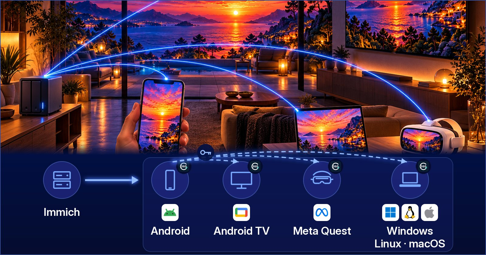
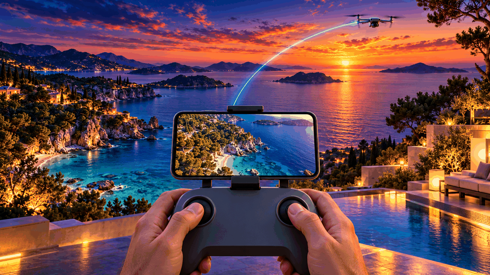

🌐 <b>Монгол</b> · Бусад хэл (88)
<a href="../README.md">English</a> · <a href="README.af.md">Afrikaans</a> · <a href="README.ar.md">العربية</a> · <a href="README.az.md">Azərbaycanca</a> · <a href="README.be.md">Беларуская</a> · <a href="README.bg.md">Български</a> · <a href="README.bi.md">Bislama</a> · <a href="README.bn.md">বাংলা</a> · <a href="README.br.md">Brezhoneg</a> · <a href="README.bs.md">Bosanski</a> · <a href="README.ca.md">Català</a> · <a href="README.cs.md">Čeština</a> · <a href="README.cv.md">Чӑвашла</a> · <a href="README.da.md">Dansk</a> · <a href="README.de.md">Deutsch</a> · <a href="README.de_CH.md">Deutsch (Schweiz)</a> · <a href="README.el.md">Ελληνικά</a> · <a href="README.en_GB.md">English (UK)</a> · <a href="README.eo.md">Esperanto</a> · <a href="README.es.md">Español</a> · <a href="README.et.md">Eesti</a> · <a href="README.eu.md">Euskara</a> · <a href="README.fa.md">فارسی</a> · <a href="README.fi.md">Suomi</a> · <a href="README.fil.md">Filipino</a> · <a href="README.fr.md">Français</a> · <a href="README.ga.md">Gaeilge</a> · <a href="README.gl.md">Galego</a> · <a href="README.gsw.md">Alemannisch</a> · <a href="README.gu.md">ગુજરાતી</a> · <a href="README.he.md">עברית</a> · <a href="README.hi.md">हिन्दी</a> · <a href="README.hr.md">Hrvatski</a> · <a href="README.hu.md">Magyar</a> · <a href="README.hy.md">Հայերեն</a> · <a href="README.id.md">Bahasa Indonesia</a> · <a href="README.is.md">Íslenska</a> · <a href="README.it.md">Italiano</a> · <a href="README.ja.md">日本語</a> · <a href="README.ka.md">ქართული</a> · <a href="README.kab.md">Taqbaylit</a> · <a href="README.kk.md">Қазақша</a> · <a href="README.km.md">ខ្មែរ</a> · <a href="README.kmr.md">Kurmancî</a> · <a href="README.kn.md">ಕನ್ನಡ</a> · <a href="README.ko.md">한국어</a> · <a href="README.kxm.md">ภาษาเขมรถิ่นไทย</a> · <a href="README.lb.md">Lëtzebuergesch</a> · <a href="README.lmo.md">Lombard</a> · <a href="README.lt.md">Lietuvių</a> · <a href="README.lv.md">Latviešu</a> · <a href="README.mfa.md">Bahasa Melayu Kelantan</a> · <a href="README.mi.md">Te reo Māori</a> · <a href="README.mk.md">Македонски</a> · <a href="README.ml.md">മലയാളം</a> · <a href="README.mr.md">मराठी</a> · <a href="README.ms.md">Bahasa Melayu</a> · <a href="README.nb_NO.md">Norsk bokmål</a> · <a href="README.ne.md">नेपाली</a> · <a href="README.nl.md">Nederlands</a> · <a href="README.nn.md">Norsk nynorsk</a> · <a href="README.pa.md">ਪੰਜਾਬੀ</a> · <a href="README.pl.md">Polski</a> · <a href="README.pt.md">Português</a> · <a href="README.pt_BR.md">Português (Brasil)</a> · <a href="README.ro.md">Română</a> · <a href="README.ru.md">Русский</a> · <a href="README.si.md">සිංහල</a> · <a href="README.sk.md">Slovenčina</a> · <a href="README.sl.md">Slovenščina</a> · <a href="README.sq.md">Shqip</a> · <a href="README.sr_Cyrl.md">Српски</a> · <a href="README.sr_Latn.md">Srpski</a> · <a href="README.sv.md">Svenska</a> · <a href="README.sw.md">Kiswahili</a> · <a href="README.swg.md">Schwäbisch</a> · <a href="README.ta.md">தமிழ்</a> · <a href="README.te.md">తెలుగు</a> · <a href="README.th.md">ไทย</a> · <a href="README.tl.md">Tagalog</a> · <a href="README.tr.md">Türkçe</a> · <a href="README.uk.md">Українська</a> · <a href="README.ur.md">اردو</a> · <a href="README.uz.md">Oʻzbekcha</a> · <a href="README.vi.md">Tiếng Việt</a> · <a href="README.yue_Hant.md">粵語</a> · <a href="README.zh_Hans.md">简体中文</a> · <a href="README.zh_Hant.md">繁體中文</a>

  

# Immuch360

**Таны медиа. Дэлгэц болгонд. Өнцөг бүрээс.**

🌐 <a href="https://immuch360.com/mn/"><b>immuch360.com</b></a>

Таны төхөөрөмж, NAS, Immich сервер, камер, дроноос ирэх хавтгай, 360°, 3D гэрэл зураг, видео. Бүртгэл шаардлагагүй. Immuch360 бол үнэгүй, нээлттэй эхийн апп бөгөөд таны гэрэл зураг, видеог байгаа газар нь уншиж, тус бүрийг тохирох харагчаар тоглуулдаг: хавтгай, эргэн тойрноо харж болох бөмбөрцөг хэлбэрээр, 3D-ээр, эсвэл нүүр хэрэглүүр дотор таныг бүрэн хүрээлэн. Энэ нь утас, таблет, зурагт, Meta Quest нүүр хэрэглүүр, компьютер дээр ажилладаг. Түүний вэб сайт, [immuch360.com](https://immuch360.com/mn/), дэлгэц бүр дээр юу хийдгийг 89 хэлээр харуулдаг.

**53-р бүтээц болон десктоп 34-р бүтээцэд шинэ, 3.4.8 хувилбар.** Компьютер дээр [Spatial 2.5D](#see-your-3d-photos-and-videos-in-depth-on-your-computer) таны 3D гэрэл зурагт хавтгай дэлгэц дээр гүн өгдөг, 360° болон VR180 3D гэрэл зургийг оролцуулан, Windows, Linux, macOS дээр, мөн 3D видеонд Windows, macOS дээр: та толгойгоо хөдөлгөхөд харагдац хөдөлдөг, зөвшөөрсний дараа вэбкамер дагадаг, эсвэл хулганаар, мөн вэбкамерын зураг компьютерийн санах ойд үлдэж, хэзээ ч хадгалагдахгүй, илгээгдэхгүй; USB вэбкамертай нэг Windows зөөврийн компьютер дээр туршсан, 3D видеог түүний видео карт дээр, Mac эсвэл Linux десктоп дээр хараахан биш. Хулганы дугуй [заагчийн эргэн тойронд гэрэл зургийг томруулж](#zoom-into-a-photo-with-the-wheel), чирэх нь түүнийг хөдөлгөдөг. [Сайжруулах (AI)](#make-a-photo-sharper-on-your-computer-ai) таны хуваалцсан хавтас, DLNA, Plex, Jellyfin, Emby болон Immich серверийн гэрэл зургийг авч, 360°, 3D гэрэл зургийг оёдол болон хоёр нүдийг нь эвдэлгүйгээр сайжруулж, Apple чиптэй Mac дээр Тодруулах-ыг санал болгодог (Mac дээр хараахан туршаагүй). Утаснаас ["Хаана тоглуулах…"](#show-your-photos-and-videos-on-the-tv-from-your-phone) 360° зүйлийг дэлгэцийн 360° харагдацад нээж, сонголт эсвэл цомгийг слайд шоу болгон тоглуулж, дэлгэцийг таны серверт нэвтрүүлж, зөвхөн утсан дээр байгаа гэрэл зураг, видеог илгээдэг; Android эмуляторуудын хооронд туршсан, бодит утас эсвэл зурагт дээр хараахан биш. Meta Quest дээр том дэлгэцийн слайд шоу гэрэл зургуудын хооронд [уусан эсвэл гулсаж шилждэг](#browse-your-photos-on-the-big-screen-of-the-quest), таны сонгосон хар, бүдгэрүүлсэн эсвэл passthrough дэвсгэр дээр, төсөл нүүр хэрэглүүрт хараахан туршаагүй.

**33-аас 52-р бүтээцийн шинэ зүйлс.** [Кинонууд таны зогссон газраас үргэлжилдэг](#pick-up-a-film-where-you-stopped). Тэд эрт эхэлдэг бөгөөд удаан серверээс [зогсохын оронд тоглосоор байдаг](#when-a-video-waits-or-will-not-play). Утас, компьютер дээр цаг хугацааны шугам [сар, он хүртэл жижигрэн харагддаг](#find-a-month-or-a-year-in-a-long-timeline). Android утас эсвэл Meta Quest дээр ["Хавтас үзэх"](#browse-a-folder-of-your-phone-or-headset) нь төхөөрөмжийн хавтсыг хуваалцсан хавтас шиг нээж, TIFF гэрэл зургийг харуулдаг. Android TV [алсын удирдлагаар огноогоор хайдаг](#on-android-tv-and-google-tv), Meta Quest 3 эсвэл 3S [Гауссын сплатыг нээдэг](#explore-gaussian-splats-in-a-meta-quest-3-or-3s), баруун жойстикоор эргүүлдэг, SPZ-ийн 4-р хувилбарыг ч оролцуулан, компьютер [таны NAS-ийн гэрэл зургийн 3D хувилбарыг хийдэг](#turn-one-photo-into-3d-a-scene-a-panorama). Хоёр график чиптэй Windows зөөврийн компьютер дээр апп [одоо хурдан чип дээр ажилладаг](#when-a-video-waits-or-will-not-play) тул 8K кино жигд тоглоно. Гауссын сплат одоо [компьютер, Android утас, таблет дээр нээгддэг](#explore-gaussian-splats-on-your-phone-tablet-or-computer), Windows компьютер AI ашиглан [таны гэрэл зураг эсвэл видеоноос сплат үзэгдэл хийдэг](#make-a-splat-scene-from-your-photos-or-a-video-ai), таны Immich сервер [тэдгээрийг гэрэл зураг дотор хадгалдаг](#keep-a-splat-scene-on-your-immich-server), тэдгээр нь таны цагийн хэлхээснээс нээгддэг, мөн компьютер [AV2 видео тоглуулдаг](#play-av2-videos-on-your-computer). 42-р бүтээцээс эхлэн Insta360, GoPro MAX, DJI Osmo 360 камерын түүхий видео таны Immich сан, хуваалцсан хавтас эсвэл хавтаснаас Android утас, таблет, зурагт дээр [камерын гироскопоор тогтворжуулсан байдлаар тоглогддог](#stabilise-your-360-videos-with-the-cameras-gyroscope), десктоп 22-р бүтээцийн сплат бүтээгч ойроос хардаг үзэгдлүүдэд [Нарийвчилсан чанарыг санал болгодог](#make-a-splat-scene-from-your-photos-or-a-video-ai), мөн 360° панорам [видео картын 3.5 GiB чөлөөтэй үед эхэлдэг](#turn-one-photo-into-3d-a-scene-a-panorama). iPhone, iPad апп [App Store дээр байна](https://apps.apple.com/us/app/immuch360-360-3d-player/id6817655965), 3.4.3 хувилбар. 43-р бүтээцээс эхлэн аппын шинэчлэлтийн мэдэгдэл утас, таблет дээр Google Play эсвэл App Store-ыг нээдэг; түүний вэб сайт, [immuch360.com](https://immuch360.com/mn/), 11-р сарын 7-нд нээгдсэн. 44-р бүтээц болон десктоп 24-р бүтээцээс эхлэн Meta Quest 3 эсвэл 3S [300,000 хүртэл гауссиантай сплат харуулдаг](#explore-gaussian-splats-in-a-meta-quest-3-or-3s), компьютер [Ctrl, Shift-ээр олон гэрэл зураг, видео сонгодог](#use-your-computer-as-the-media-player), декодер нь видеог татгалзсан зурагт [серверийн нөгөө файлыг өөрөө тоглуулдаг](#when-a-video-waits-or-will-not-play), хоёр видео карттай зөөврийн компьютерын сонгосон видео карт дээр панорам ажилладаг, мөн Quest болон компьютерын шинэчлэлтийн мэдэгдэл тэдгээрийн дэлгүүр эсвэл татах хуудсыг нээдэг, олон засвартай. 45-р бүтээц болон десктоп 25-р бүтээцээс эхлэн, бүх платформ дээр 3.4.0 хувилбартайгаар, апп нь Immich 3.4.0 аппыг Immich-ийн дараагийн 11 засвартайгаар дагадаг, [Immich 3.4 серверийн JPEG XL гэрэл зургийг](#keep-your-immich-library-with-more) харуулдаг, [таны Plex кинонуудыг оноор нь](#watch-your-plex-films) кино бүрийн хуудас, төхөөрөмж рүү татах, утаснаас зурагтаар тоглуулах боломжтойгоор нээдэг, дэлгүүрийн бүтээцүүдэд үнэлгээ хүсэж магадгүй, мөн компьютер дээр видео бүрэлдэхүүн хэсгүүдээ [өөрсдийн нээлттэй репозиторуудаас](#licences-and-credits) авдаг. 46-р бүтээц болон десктоп 26-р бүтээцээс эхлэн, 3.4.1 хувилбартайгаар, 360° камерын түүхий видео iPhone, iPad дээр, Meta Quest дотор болон Windows дээр мөн [тогтворжуулсан байдлаар тоглогддог](#stabilise-your-360-videos-with-the-cameras-gyroscope), Meta Quest [өөрийн тоглуулагчийн декодлож чадахгүй Plex кинонуудыг libmpv-ээр тоглуулдаг](#watch-your-plex-films), утас [ийм киног Chromecast эсвэл Google TV рүү илгээдэг](#watch-your-plex-films), мөн 3D гэрэл зургийн AI гүн [таны сонгосон хүчийг авдаг](#turn-one-photo-into-3d-a-scene-a-panorama); шинэ серверийг Plex бүртгэлээрээ нэвтэрч бас нэмж болно, мөн апп [тохиргоогоо файлд хадгалдаг](#keep-your-settings-in-a-file). 47-р бүтээц болон десктоп 27-р бүтээцээс эхлэн, 3.4.2 хувилбарт, Plex кино [төхөөрөмжийн декодлодог дууны сувгийг тоглуулж](#watch-your-plex-films), алийг нь болохыг хэлдэг, дэлгэцэд тохирох хувилбарыг нээдэг бөгөөд удаан холболт дээр илүү хөнгөнийг санал болгодог, Windows, macOS түүний Dolby TrueHD дууг тоглуулдаг, Android [татаж буйг нь мэдэгдлээр харуулдаг](#watch-your-plex-films), Android TV ч мөн кино татдаг, мөн [батарейтай Tapo камерууд шууд харагддаг](#watch-your-home-cameras-on-the-big-screen); бүртгэлүүдтэй нь тохиргооны файлыг сэргээх нь одоо таныг Immich сервертээ нэвтрүүлдэг. 48-р бүтээц болон десктоп 28-р бүтээцээс эхлэн, 3.4.3 хувилбарт, Windows компьютер SteamVR, Meta Horizon Link эсвэл өөр OpenXR ажиллах орчноор дамжуулан [таны видеог PC VR нүүр хэрэглүүрт тоглуулдаг](#watch-your-videos-in-a-pc-vr-headset-from-windows) (төсөл нүүр хэрэглүүрт хараахан туршаагүй), [өөр брэндийн камерууд шууд харагддаг](#cameras-of-other-brands-over-onvif-or-rtsp), ONVIF-ээр олдсон эсвэл RTSP холбоосоороо нэмэгдсэн (загварчилсан камертай шалгасан, өөр брэндийн жинхэнэ камерыг хараахан туршаагүй), [DJI Osmo 360 II болон GoPro MAX 2-ын түүхий видео тогтворжуулсан байдлаар тоглогддог](#open-the-raw-files-of-360-cameras), Plex кино [утсан дээр удаан ирэхээ больсон](#when-a-video-waits-or-will-not-play), LG болон Samsung зурагт нэг товчоор [хажуугаараа хэвтсэн видеог эргүүлдэг](#on-a-samsung-tv-tizen) (LG зурагт дээр хараахан туршаагүй; issue 17-ийн Samsung зурагт эргүүлэхээс татгалзсан), мөн "Серверийн шинэчлэлт бэлэн байна" шинэчлэгдсэн серверт дахин харагдахгүй. 49-р бүтээц болон десктоп 29-р бүтээцээс эхлэн, 3.4.4 хувилбар, апп өөрөө [таны Jellyfin, Emby серверийг уншдаг](#watch-your-jellyfin-and-emby-libraries) (төхөөрөмж дээр хараахан туршаагүй), таны сүлжээнд олдож, зурагт эсвэл нүүр хэрэглүүрт Quick Connect-ээр нэвтэрдэг, эх файлуудыг нь 360° видео 360° хэвээр байхаар тоглуулдаг; Meta Quest-ийн том дэлгэц дээр гэрэл зургууд [та тэднийг гүйлгэж үзэх үед таны тохируулсан хэмжээ, байрлалыг хадгалж, слайдшоу хэлбэрээр тоглогддог](#browse-your-photos-on-the-big-screen-of-the-quest) (төсөл нүүр хэрэглүүрт хараахан туршаагүй); утас, таблетын 360° видео тоглуулагч [360° гэрэл зургийн удирдлагыг авдаг](#360-videos-on-your-phone-with-the-controls-of-360-photos), гироскопын товч, чимхэж томруулах, шууд дээш эсвэл доош чирэх (нэг хэрэглэгч Samsung Galaxy S25 Ultra дээр туршсан, iPhone дээр хараахан туршаагүй); компьютер AI-аар [таны 2D видеог 3D видео болгодог](#turn-your-2d-videos-into-3d-on-your-computer) (3D дэлгэц эсвэл нүүр хэрэглүүрт хараахан туршаагүй); мөн Samsung зурагт [эргүүлэх шаардлагатай видеог Samsung-ийн өөрийн тоглуулагчид шилжүүлдэг](#on-a-samsung-tv-tizen), issue 17-ийн зурагт үүнийг тоглуулдаг ч эргүүлэхээс татгалздаг. 50-р бүтээц, десктоп 30-р бүтээц, 3.4.5 хувилбараас эхлэн Meta Quest-ийн 2D цонхонд видео тоглож байх үед цонх 48, 49-р бүтээцийнх шиг секундэд ойролцоогоор 10 удаа биш, [дэлгэцийн давтамжаар дахин зурагддаг](#step-inside-your-photos-and-videos-with-a-meta-quest) (Meta Quest 3 дээр хэмжсэн), Android TV [алсын удирдлагаар гэрэл зургийг томруулж](#on-android-tv-and-google-tv), сумаар хөдөлгөдөг (шинэ, зурагт дээр хараахан туршаагүй), мөн mlc70-ийн Android TV fork-оос гурван засвар ирсэн: хурдан шудрахад ард үлдсэн гэрэл зургийн дэлгэрэнгүй мэдээлэл харагдахаа больсон, хөдөлгөөнт гэрэл зураг санах ойгоо чөлөөлдөг, мөн Байршил шүүлтүүр шинэ улсын хотуудыг санал болгодог. 51-р бүтээц болон десктоп 31-р бүтээцээс эхлэн, 3.4.6 хувилбараар, [Сайжруулах (AI)](#make-a-photo-sharper-on-your-computer-ai) Windows, Linux дээр бүдэг гэрэл зургийн илүү тод хуулбарыг эх зургийн хажууд гурван түвшинд хийдэг, түвшин бүрийг RTX 4060 бүхий нэг PC дээр нэг удаа ажиллуулсан, Байгалийн түвшинг Apple чиптэй Mac дээр ч санал болгодог (Mac дээр хараахан туршаагүй), компьютер AI-аар [360° видеог 360° 3D видео болгодог](#a-360-video-turned-into-a-360-3d-video), Windows дээр 3D видеоны гүнийг видео карт тооцоолдог, AI функцууд таны сервер болон хуваалцсан хавтасны видеог шууд авдаг, тохиргооны файл [Сан дотор өөрийн карттай болсон](#keep-your-settings-in-a-file), зурагт үүнийг сүлжээний хуваалцсан хавтсанд хадгалдаг, компьютер дээр Escape нэг алхам буцаадаг, дэлгүүрийн бүтээцүүд [илүү ховор, илүү зөөлөн](#privacy) үнэлгээ хүсдэг, Linux TIFF гэрэл зураг, сплат үзэгдэл, нэг нүдээр 3D видеог харуулдаг, мөн хоёр гэмтэл засагдсан. 52-р бүтээц болон десктоп 32-р бүтээц, 3.4.7 хувилбараас эхлэн ["Хаана тоглуулах…"](#show-your-photos-and-videos-on-the-tv-from-your-phone) таны Immich сан, хуваалцсан хавтас, Jellyfin, Emby-ийн гэрэл зураг, видеог утаснаас зурагт, Meta Quest, компьютер эсвэл Chromecast руу илгээдэг, таны гэрэл зураг, видеоны нэр [жижиг зургийнхаа дээр уншигдахуйц хэвээр үлддэг](#play-the-files-of-a-nas-a-computer-a-media-server-or-plex), компьютерийн AI бүрэлдэхүүн хэсгүүд [нэг товшилтоор шинэчлэгддэг](#update-the-ai-components-in-one-click), Linux [AppImage](#linux) авдаг, мөн iPhone, iPad аппыг Xcode 27-оор угсардаг. Десктоп 33-р бүтээц десктоп 31, 32-р бүтээцэд гэрэл зураг бүр дээр бүтэлгүйтдэг байсан [Сайжруулах (AI)](#make-a-photo-sharper-on-your-computer-ai)-г зассан ([issue 23](https://github.com/freeKC/Immuch360/issues/23)).

  Immich мобайл аппын албан бус салбар хувилбар. Immich эсвэл FUTO-тай хамаарал байхгүй. Нэр нь англиар "I am much 360" мэт сонсогддог.

<b>Агуулга</b>

- [Хэнд зориулсан бэ](#who-it-is-for)
- [Ямар дэлгэцүүд](#which-screens), [тэд хамтдаа юу хийдэг вэ](#use-cases), мөн [дэлгэц бүр юу хийдэг вэ](#what-each-screen-does)
- [Юу хийж чадах вэ](#what-you-can-do)
- [Төхөөрөмждөө суулгах](#get-it-on-your-device)
- [Хэрхэн хийх вэ](#how-to)
  - [Сервертэй эсвэл сервергүйгээр гэрэл зураг, видеогоо үзэх](#watch-your-photos-and-videos-with-or-without-a-server)
  - [Панорама, 360°, VR180, 3D судлах](#explore-panoramas-360-vr180-and-3d): [утсан дээрх 360° видео](#360-videos-on-your-phone-with-the-controls-of-360-photos)
  - [Нэг гэрэл зургийг 3D, үзэгдэл, панорам болгох](#turn-one-photo-into-3d-a-scene-a-panorama): [нэг товшилтоор шинэчлэгддэг AI бүрэлдэхүүн хэсгүүд](#update-the-ai-components-in-one-click)
  - [Компьютер дээрээ 2D видеогоо 3D болгох](#turn-your-2d-videos-into-3d-on-your-computer): [360° видеог 360° 3D болгох](#a-360-video-turned-into-a-360-3d-video)
  - [Компьютер дээрээ гэрэл зургаа илүү тод болгох (AI)](#make-a-photo-sharper-on-your-computer-ai)
  - [Зурагтаар алсын удирдлагатай үзэх](#watch-on-the-tv-with-the-remote): [Android TV, Google TV](#on-android-tv-and-google-tv), [LG](#on-an-lg-tv-webos), [Samsung](#on-a-samsung-tv-tizen)
  - [Зурагт, нүүр хэрэглүүр эсвэл компьютерт утсаараа нэвтрэх](#sign-in-a-tv-a-headset-or-a-computer-with-your-phone)
  - [Гэрэл зураг, видеогоо утаснаасаа зурагтаар үзүүлэх](#show-your-photos-and-videos-on-the-tv-from-your-phone)
  - [Meta Quest-ээр гэрэл зураг, видеоныхоо дотор орох](#step-inside-your-photos-and-videos-with-a-meta-quest): [том дэлгэц](#browse-your-photos-on-the-big-screen-of-the-quest), [киоскийн горим](#kiosk-mode-for-an-exhibition-or-a-shop)
  - [Meta Quest 3 эсвэл 3S дээр Гауссын сплатыг судлах](#explore-gaussian-splats-in-a-meta-quest-3-or-3s)
  - [Утас, таблет эсвэл компьютер дээрээ Гауссын сплатыг судлах](#explore-gaussian-splats-on-your-phone-tablet-or-computer)
  - [Гэрэл зураг эсвэл видеоноосоо сплат үзэгдэл үүсгэх (AI)](#make-a-splat-scene-from-your-photos-or-a-video-ai)
  - [Сплат үзэгдлийг Immich сервер дээрээ хадгалах](#keep-a-splat-scene-on-your-immich-server)
  - [NAS, компьютер, медиа сервер эсвэл Plex-ийн файлуудыг тоглуулах](#play-the-files-of-a-nas-a-computer-a-media-server-or-plex): [таны кинонууд оноор](#watch-your-plex-films), [Jellyfin, Emby](#watch-your-jellyfin-and-emby-libraries)
  - [Утас эсвэл нүүр хэрэглүүрийнхээ хавтсыг үзэх](#browse-a-folder-of-your-phone-or-headset)
  - [Киногоо зогссон газраасаа үргэлжлүүлэх](#pick-up-a-film-where-you-stopped)
  - [Видео хүлээх эсвэл тоглохгүй байх үед](#when-a-video-waits-or-will-not-play)
  - [Immich сангаа хадгалж, илүү ихийг авах](#keep-your-immich-library-with-more)
  - [Урт цаг хугацааны шугамаас сар эсвэл он олох](#find-a-month-or-a-year-in-a-long-timeline)
  - [Гэрийн камераа том дэлгэцээр үзэх](#watch-your-home-cameras-on-the-big-screen): [өөр брэндүүд](#cameras-of-other-brands-over-onvif-or-rtsp)
  - [Таны DJI дрон](#your-dji-drone): [шууд видео](#see-what-your-drone-sees-on-your-phone), [Quest эсвэл Android TV дээр](#watch-it-in-a-meta-quest-or-on-an-android-tv), [импорт](#bring-a-drones-or-a-camera-cards-photos-and-videos-to-immich)
  - [360° камерын түүхий файлуудыг нээх](#open-the-raw-files-of-360-cameras)
  - [Камерын гироскопоор 360° видеогоо тогтворжуулах](#stabilise-your-360-videos-with-the-cameras-gyroscope)
  - [Гэрэл зургийг нэг товчоор эргүүлэх](#turn-a-photo-with-one-key)
  - [Компьютерээ медиа тоглуулагч болгох](#use-your-computer-as-the-media-player): [дугуйгаар томруулах](#zoom-into-a-photo-with-the-wheel)
  - [3D гэрэл зураг, видеогоо компьютер дээрээ гүнтэйгээр үзэх](#see-your-3d-photos-and-videos-in-depth-on-your-computer)
  - [Windows-оос PC VR нүүр хэрэглүүрээр видеогоо үзэх](#watch-your-videos-in-a-pc-vr-headset-from-windows)
  - [Компьютер дээрээ AV2 видео тоглуулах](#play-av2-videos-on-your-computer)
  - [Тохиргоогоо файлд хадгалах](#keep-your-settings-in-a-file)
- [Immich-тэй харьцуулбал](#compared-with-immich)
- [Нууцлал](#privacy)
- [Лиценз, талархал](#licences-and-credits)
- [Замын зураг](#roadmap)
- [Баримт бичиг](#documentation)

## Хэнд зориулсан бэ

- **Та 360° эсвэл 3D зураг авдаг** бөгөөд зургаа хавтгай, давхардсан эсвэл сунасан байдлаар биш, дотор нь эргэн тойрноо харахыг хүсдэг, мөн утсан дээрх 360° видеогоо гэрэл зургийн адил эргүүлэхийг хүсдэг: [360°, VR180, 3D](#explore-panoramas-360-vr180-and-3d), [утсан дээрх 360° видео](#360-videos-on-your-phone-with-the-controls-of-360-photos).
- **Та 360° камераар гартаа барьж, дугуй дээр эсвэл дуулга дээр бичлэг хийдэг** бөгөөд Immich-д, хуваалцсан хавтсанд эсвэл хавтсанд хадгалсан Insta360, GoPro MAX эсвэл MAX 2, DJI Osmo 360 эсвэл Osmo 360 II камерынхаа түүхий видеог утас, зурагт, Meta Quest эсвэл Windows компьютер дээрээ тэгш, тогтвортой тоглуулахыг хүсдэг: [камерын гироскопоор тогтворжуулсан](#stabilise-your-360-videos-with-the-cameras-gyroscope).
- **Таны гэрэл зураг, кино NAS, компьютер, Plex эсвэл Immich дээр байдаг** бөгөөд та юу ч хуулахгүйгээр зурагтаар үзэхийг хүсдэг: [зурагтаар](#watch-on-the-tv-with-the-remote), [NAS, хуваалцсан хавтас, Plex](#play-the-files-of-a-nas-a-computer-a-media-server-or-plex).
- **Та кинонуудаа Plex сервер дээр хадгалдаг** бөгөөд оноор нь нэгийг сонгох, эхлэхээс өмнө юу болохыг харах, аялалд авч явах, утаснаасаа зурагт эсвэл Chromecast дээр эхлүүлэх, мөн Android утас, зурагт эсвэл Meta Quest-ийн тань декодлож чадахгүй кинонуудыг ч тоглуулахыг хүсдэг: [таны кинонууд, оноор](#watch-your-plex-films).
- **Та кинонуудаа Jellyfin эсвэл Emby сервер дээр хадгалдаг** бөгөөд тэдгээрийг Meta Quest, зурагт эсвэл утсан дээрээ 360°, 3D-г нь хэвээр нь, серверт зогссон газраа хадгалуулан үзэхийг хүсдэг (төхөөрөмж дээр хараахан туршаагүй): [Jellyfin, Emby](#watch-your-jellyfin-and-emby-libraries).
- **Танд Meta Quest бий** бөгөөд та өөрийн гэрэл зураг, видеоны дотор орохыг хүсдэг: [нүүр хэрэглүүрт](#step-inside-your-photos-and-videos-with-a-meta-quest), мөн гэрэл зургаа том дэлгэц дээр өөрийн тохируулсан хэмжээ, байрлалаар, слайдшоу хэлбэрээр ч гүйлгэж үзэхийг хүсдэг (төсөл нүүр хэрэглүүрт хараахан туршаагүй): [том дэлгэц](#browse-your-photos-on-the-big-screen-of-the-quest).
- **Танд Windows компьютертэй PC VR нүүр хэрэглүүр бий** бөгөөд түүн дотор 360° видеогоо эргэн тойрондоо, киногоо том дэлгэцэн дээр үзэхийг хүсдэг (төсөл нүүр хэрэглүүрт хараахан туршаагүй): [PC VR нүүр хэрэглүүрээр](#watch-your-videos-in-a-pc-vr-headset-from-windows).
- **Таны гэрэл зургууд хавтгай**, та тэдгээрийг 3D-ээр, нүүр хэрэглүүр дотор тонгойж харах үзэгдэл болгон, эсвэл 360° панорам дотор, 3D камергүйгээр харахыг хүсэж байна: [нэг гэрэл зургийг 3D, үзэгдэл, панорам болгох](#turn-one-photo-into-3d-a-scene-a-panorama), шинэ, таны өөрийн компьютер дээр AI хийдэг.
- **Таны видео хавтгай**, утасны клип ч мөн адил, та тэдгээрийг нүүр хэрэглүүр эсвэл 3D дэлгэцэнд зориулж 3D хэлбэрээр, мөн 360° видеогоо 360° 3D хэлбэрээр, өөрийн компьютер дээрээ хийлгэхийг хүсдэг (3D дэлгэц эсвэл нүүр хэрэглүүрт хараахан туршаагүй): [2D видеог 3D болгох](#turn-your-2d-videos-into-3d-on-your-computer), [360°-ийг 360° 3D болгох](#a-360-video-turned-into-a-360-3d-video).
- **Таны гэрэл зураг бүдэг**, фокус нь бага зэрэг алдагдсан эсвэл муу гэрэлд авсан, та эх зургийн хажууд илүү тод хуулбар, өөрийн компьютер дээрээ, хуваалцсан хавтас, серверээсээ ч хийсэн, зохиосон нарийн хэсгийг нь ил тод хэлсэн байхыг хүсдэг: [Сайжруулах (AI)](#make-a-photo-sharper-on-your-computer-ai).
- **Танд 3D гэрэл зураг, 360° 3D гэрэл зураг эсвэл видео, компьютер байгаа** бөгөөд тэдгээрийг хавтгай дэлгэц дээр нь гүнтэйгээр, толгойгоо хөдөлгөхөд харагдац хөдөлж, вэбкамер дагаж, эсвэл хулганаар үзэхийг хүсдэг (вэбкамертай нэг Windows зөөврийн компьютер дээр туршсан, Mac эсвэл Linux десктоп дээр хараахан биш): [компьютер дээрх Spatial 2.5D](#see-your-3d-photos-and-videos-in-depth-on-your-computer).
- **Та Immich ашигладаг** бөгөөд түүний аппыг, мөн иммерсив харагч, утсаараа нэвтрүүлдэг том дэлгэцүүдийг хүсдэг: [таны Immich сан](#keep-your-immich-library-with-more), [Immich-тэй харьцуулбал](#compared-with-immich).
- **Та гэрээ Tapo камераар хянадаг**, батарейтайгаар нь ч, эсвэл ONVIF, RTSP-ээр өөр брэндийн камераар, бөгөөд тэдгээрийг гэрэл зургийнхаа хажууд, зурагт дээр ч харахыг хүсдэг (загварчилсан камертай шалгасан): [гэрийн камер](#watch-your-home-cameras-on-the-big-screen).
- **Та DJI дрон нисгэдэг** бөгөөд түүний шууд дүрсийг DJI Fly-гүйгээр утсан дээрээ, мөн хамт байгаа хүмүүст зориулж Meta Quest эсвэл Android TV дээр харахыг хүсдэг: [таны дрон](#see-what-your-drone-sees-on-your-phone).
- **Та газар, эд зүйлийг Гауссын сплат хэлбэрээр 3D-ээр бичдэг,** эсвэл тэдгээрийг өөрийн гэрэл зургаасаа хийхийг хүсдэг бөгөөд утас, компьютер дээрээ эсвэл нүүр хэрэглүүр дотор тэдгээрийн дундуур алхмаар байна: [утас, таблет эсвэл компьютер дээр](#explore-gaussian-splats-on-your-phone-tablet-or-computer), [таны гэрэл зургаас хийсэн](#make-a-splat-scene-from-your-photos-or-a-video-ai), [Immich-д хадгалсан](#keep-a-splat-scene-on-your-immich-server).
- **Танд AV2 видео бий**, AV1-ийн дараах формат, та тэдгээрийг компьютер дээрээ үзэхийг хүсдэг: [компьютер дээрх AV2](#play-av2-videos-on-your-computer).
- **Танай гэрт хэд хэдэн дэлгэц байдаг** бөгөөд тэдгээрийг хамтдаа ажиллуулахыг хүсдэг: [таны дэлгэцүүд хамтдаа юу хийдэг вэ](#use-cases).

Үүсгэх Immuch360 бүртгэл байхгүй, бидэн рүү юу ч ирэхгүй: апп зөвхөн таны төхөөрөмжүүд болон таны сонгосон серверүүдтэй харилцдаг, 45-р бүтээцээс эхлэн киноны хуудсанд зориулж Wikipedia-тай ч, 46-р бүтээцээс эхлэн түүгээр нэвтрэхэд plex.tv-тэй ч, AI бүрэлдэхүүн хэсэг эсвэл AV2 декодерыг зөвхөн таныг хүсэхэд татаж авдаг.

## Ямар дэлгэцүүд

| Платформ | Хаанаас авах вэ | 2026 оны 11-р сарын төлөв |
|---|---|---|
|  **Android** утас, таблет | [Google Play](https://play.google.com/store/apps/details?id=com.aprogsys.immuch360) · [APK](https://github.com/freeKC/Immuch360/releases) | Google Play дээр (47-р бүтээц 11-р сарын 16-нд нийтлэгдсэн; 51-р бүтээц 11-р сарын 24-өөс хойш Google-ийн шалгалтад байгаа; дараа нь 53-р бүтээц), 53-р бүтээц GitHub дээр, тэнд [түүхий 360° видео тогтворжуулсан байдлаар тоглогддог](#stabilise-your-360-videos-with-the-cameras-gyroscope), [кинонууд таны зогссон газраас үргэлжилдэг](#pick-up-a-film-where-you-stopped), ["Хавтас үзэх"](#browse-a-folder-of-your-phone-or-headset) нь утасны хавтсыг нээдэг, мөн [Гауссын сплат нээгддэг](#explore-gaussian-splats-on-your-phone-tablet-or-computer), хуваалцсан хавтаснаас эсвэл [таны Immich-ийн цагийн хэлхээснээс](#keep-a-splat-scene-on-your-immich-server), [файлд хадгалсан тохиргоо](#keep-your-settings-in-a-file), [мэдэгдлээр харагдах киноны татаж авалт](#watch-your-plex-films), 48-р бүтээцээс эхлэн [өөр брэндийн камерууд, шууд](#cameras-of-other-brands-over-onvif-or-rtsp) (загварчилсан камертай шалгасан), мөн 49-р бүтээцээс эхлэн [Jellyfin, Emby сервер](#watch-your-jellyfin-and-emby-libraries) (төхөөрөмж дээр хараахан туршаагүй) болон [360° видео тоглуулагч дахь 360° гэрэл зургийн удирдлага](#360-videos-on-your-phone-with-the-controls-of-360-photos) (нэг хэрэглэгч Samsung Galaxy S25 Ultra дээр туршсан), мөн 51-р бүтээцээс эхлэн [Сан доторх тохиргооны файлын карт](#keep-your-settings-in-a-file), файлыг нь сүлжээний хуваалцсан хавтсанд ч хадгална, мөн 52-р бүтээцээс эхлэн "Хаана тоглуулах…"-аар [зурагт эсвэл Chromecast руу илгээсэн таны гэрэл зураг, видео](#show-your-photos-and-videos-on-the-tv-from-your-phone) (төхөөрөмж дээр хараахан туршаагүй), мөн 53-р бүтээцээс эхлэн [360° зүйл, сонголт эсвэл цомог, утасны өөрийнх нь гэрэл зураг, видео](#show-your-photos-and-videos-on-the-tv-from-your-phone) ижил аргаар илгээгддэг (Android эмуляторуудын хооронд туршсан) |
|  **iPhone, iPad** | [App Store](https://apps.apple.com/us/app/immuch360-360-3d-player/id6817655965) | 3.4.7 хувилбар 11-р сарын 26-аас хойш App Store дээр, үүнд [цаг хугацааны шугам дахь сар, он](#find-a-month-or-a-year-in-a-long-timeline), [таны зогссон газраас үргэлжлэх кинонууд](#pick-up-a-film-where-you-stopped), утаснаас [зурагт, нүүр хэрэглүүр эсвэл компьютерт нэвтрэх](#sign-in-a-tv-a-headset-or-a-computer-with-your-phone), гэрэл зураг хэлбэрээрээ харагдах Immich-д хадгалсан сплат үзэгдлүүд, Immich 3.4.0-ийн засварууд болон түүний JPEG XL гэрэл зураг, [тогтворжуулсан түүхий 360° видео](#stabilise-your-360-videos-with-the-cameras-gyroscope), [файлд хадгалсан тохиргоо](#keep-your-settings-in-a-file), [батарейтай Tapo камерын шууд дамжуулалт](#watch-your-home-cameras-on-the-big-screen) болон [өөр брэндийн камерын шууд дамжуулалт](#cameras-of-other-brands-over-onvif-or-rtsp) (загварчилсан камертай шалгасан) багтана, мөн 3.4.4 хувилбараас эхлэн [Jellyfin, Emby сервер](#watch-your-jellyfin-and-emby-libraries) (төхөөрөмж дээр хараахан туршаагүй) болон [360° видео тоглуулагч дахь 360° гэрэл зургийн удирдлагатай](#360-videos-on-your-phone-with-the-controls-of-360-photos) (iPhone дээр хараахан туршаагүй), мөн 3.4.6 хувилбараас [тохиргооны файлын карт](#keep-your-settings-in-a-file) болон сүлжээний хуваалцсан хавтаснаас сэргээх боломжтой, мөн Xcode 27-оор угсарсан 3.4.7 хувилбараас [гэрэл зураг, видеонд зориулсан "Хаана тоглуулах…"](#show-your-photos-and-videos-on-the-tv-from-your-phone) (iPhone дээр хараахан туршаагүй); дараа нь 53-р бүтээцийн iPhone, iPad хувилбар болох 3.4.8 хувилбар гарна; эсвэл [өөрөө угсарч болно](../docs/immuch360/build.md) |
|  **Android TV, Google TV** | [Google Play](https://play.google.com/store/apps/details?id=com.aprogsys.immuch360) · [APK](#android-tv-and-google-tv) | Android TV, Google TV дээр аппыг санал болгодог Google Play дээр, мөн 53-р бүтээц GitHub дээр: [тогтворжуулсан түүхий 360° видео](#stabilise-your-360-videos-with-the-cameras-gyroscope), [алсын удирдлагаар огноогоор хайх](#on-android-tv-and-google-tv), QR код уншуулж [утсаараа нэвтрэх](#sign-in-a-tv-a-headset-or-a-computer-with-your-phone), видео тоглуулагчид алсын удирдлагад зориулсан цаг хугацааны мөр, дуу, хадмал, мөн утсаар дамжуулсан [дроны шууд видео](#watch-it-in-a-meta-quest-or-on-an-android-tv), [зурагт руу татсан кинонууд](#watch-your-plex-films), мөн 49-р бүтээцээс эхлэн Quick Connect-ээр нэвтэрдэг [Jellyfin, Emby сервер](#watch-your-jellyfin-and-emby-libraries) (төхөөрөмж дээр хараахан туршаагүй), мөн 50-р бүтээцээс эхлэн [алсын удирдлагаар томруулсан гэрэл зураг](#on-android-tv-and-google-tv) (Android TV эмулятор дээр ажиллаж байгааг харсан, зурагт дээр хараахан туршаагүй), мөн 51-р бүтээцээс эхлэн [сүлжээний хуваалцсан хавтсанд хадгалж, сэргээдэг тохиргооны файл](#keep-your-settings-in-a-file) (Android TV эмулятор дээр ажиллаж байгааг харсан), мөн 52-р бүтээцээс эхлэн [утасны "Хаана тоглуулах…"-аар илгээсэн гэрэл зураг, видео](#show-your-photos-and-videos-on-the-tv-from-your-phone) (зурагт дээр хараахан туршаагүй), мөн 53-р бүтээцээс эхлэн утасны илгээсэн 360° гэрэл зургийг өөрийнх нь 360° харагдацад нээх, утасны хуудаснаас нэвтрэх, утасны өөрийнх нь гэрэл зураг, видео (Android TV эмулятор дээр ажиллаж байгааг харсан) |
| **LG зурагт**, webOS 5.0 болон түүнээс хойшхи | [.ipk, 1.0.5 хувилбар](https://github.com/freeKC/Immuch360/releases/tag/webos-v1.0.5) · LG Content Store (шалгагдаж байна) | 1.0.0 хувилбар, 10-р сарын 24-нд LG Content Store-д илгээсэн, 10-р сарын 26-наас хойш LG-ийн туршилтад байна; 1.0.1 хувилбар, 10-р сарын 27-ноос хойш GitHub дээр, сум товчоор гэрэл зургийг томруулж, гэрэл зураг ачааллаж байгаа үед мэдэгддэг, мөн 1.0.2 хувилбар, 46-р бүтээцтэй хамт GitHub дээр, япон хэлээр "нэвтрэх"-ийг ログイン гэж бичдэг, 1.0.3 хувилбар, 47-р бүтээцтэй хамт, DLNA серверийн хавтсанд шууд ТВ суваг байгаа үед мэдэгддэг бөгөөд тэдгээрийг хараахан тоглуулж чадахгүй, 1.0.4 хувилбар, 48-р бүтээцтэй хамт, нэг товчоор [хажуугаараа хэвтсэн видеог эргүүлдэг](#on-an-lg-tv-webos) (LG зурагт дээр хараахан туршаагүй), мөн 1.0.5 хувилбар, 49-р бүтээцтэй хамт, DLNA серверүүдийн дунд DLNA нэмэлттэй Jellyfin-ийг нэрлэдэг; LG аппыг нийтлэх хүртэл [Developer Mode](#lg-tvs-webos)-д суулгана. 1.0.0 хувилбар LG-ийн Cloud Test Lab-ийн webOS 25 зурагт дээр ажилласан |
| **Samsung зурагт**, Tizen 5.5 болон түүнээс хойшхи | [.wgt, 0.3.6 хувилбар](https://github.com/freeKC/Immuch360/releases/tag/tizen-v0.3.6) | ижил зурагтын аппын 0.3.6 хувилбар, өөрийн Samsung гэрчилгээгээр гарын үсэг зурж, [Developer mode](#samsung-tvs-tizen)-д суулгана; 0.1.0 нэг туршигчийн Samsung зурагт дээр ажилласан, 0.2.0 тэр туршилтын засваруудыг агуулна, 0.3.0 нь LG-ийн 1.0.1 хувилбарын гэрэл зураг томруулах боломж, Loading тэмдгийг нэмдэг, 0.3.1 нь LG-ийн 1.0.2 хувилбарын япон үг хэллэгийг нэмдэг, 0.3.2 нь утсаар босоо байдлаар бичсэн видеог зөв чиглэлээр тоглуулдаг ([issue 17](https://github.com/freeKC/Immuch360/issues/17)), 0.3.3, 0.3.4 нь [видеог босоо гэж мэдээлдэг зурагт дээр түүнийг эргүүлж](#on-a-samsung-tv-tizen), гараар эргүүлэх товч нэмдэг, мөн 0.3.5, 0.3.6 нь ийм видеог Samsung-ийн өөрийн тоглуулагчид шилжүүлдэг; мэдээлсэн хүний зурагт дээр 0.3.4, 0.3.5 зургийг хажуугаар нь үлдээсэн, зурагт эргүүлэхээс татгалзсан, тэнд гарц нь таны Immich серверийн хөрвүүлсэн, босоо хадгалсан видео юм; Samsung-ийн дэлгүүрт байхгүй |
|  **Meta Quest** 2, Pro, 3, 3S | [Horizon Store](https://www.meta.com/experiences/immuch360/1384208401440714/) · [APK](#meta-quest) | Horizon Store дээр (52-р бүтээц 11-р сарын 26-нд нийтлэгдсэн, видео тоглож байх үед 2D цонх нь дэлгэцийн давтамжаар дахин зурагддаг 50-р бүтээцийн дараа; дараа нь 53-р бүтээц), 53-р бүтээц GitHub дээр, [киоскийн горимтой](#kiosk-mode-for-an-exhibition-or-a-shop), иммерсив харагдацад [тогтворжуулсан түүхий 360° видеотой](#stabilise-your-360-videos-with-the-cameras-gyroscope), [декодлож чадахгүй кинонуудаа libmpv-ээр тоглуулдаг](#watch-your-plex-films), мөн Quest 3, 3S дээр [Гауссын сплат](#explore-gaussian-splats-in-a-meta-quest-3-or-3s), хавтгай гэрэл зургийн [AI гүн](#turn-one-photo-into-3d-a-scene-a-panorama), мөн 49-р бүтээцээс эхлэн таны тохируулсан хэмжээгээр [том дэлгэц дээр гүйлгэж үздэг гэрэл зураг](#browse-your-photos-on-the-big-screen-of-the-quest), слайдшоу хэлбэрээр ч (төсөл нүүр хэрэглүүрт хараахан туршаагүй), мөн Quick Connect-ээр нэвтэрдэг [Jellyfin, Emby сервер](#watch-your-jellyfin-and-emby-libraries) (төхөөрөмж дээр хараахан туршаагүй), мөн 51-р бүтээцээс эхлэн Horizon OS нь иммерсив харагчид хэт хуучин нүүр хэрэглүүр аппыг хаахын оронд шинэчлэлт хүсдэг (ийм нүүр хэрэглүүр дээр туршаагүй), мөн 53-р бүтээцээс эхлэн [хар, бүдгэрүүлсэн эсвэл passthrough дэвсгэр дээр том дэлгэцийн гэрэл зургуудын хоорондох уусан эсвэл гулсах шилжилт](#browse-your-photos-on-the-big-screen-of-the-quest) (төсөл нүүр хэрэглүүрт хараахан туршаагүй) |
|  **Windows** | [Суулгагч эсвэл ZIP](https://github.com/freeKC/Immuch360/releases/tag/desktop-v3.4.8-34) | десктоп 34-р бүтээц, гарын үсэгтэй: гэрэл зураг, хавтгай, 360° видео, хуваалцсан хавтас, Plex, камер (загварчилсан камертай шалгасан), утсаараа нэвтрэх, нэг товчоор эргүүлдэг гэрэл зураг, 89 хэл дээрх интерфейс, мөн AI-ийн хийдэг [таны гэрэл зургаас гаргасан 3D гэрэл зураг, 3D үзэгдэл, 360° панорам](#turn-one-photo-into-3d-a-scene-a-panorama), таны NAS-ийн гэрэл зургийг оролцуулан; [Гауссын сплат](#explore-gaussian-splats-on-your-phone-tablet-or-computer) нээх, [таны гэрэл зураг эсвэл видеоноос хийх](#make-a-splat-scene-from-your-photos-or-a-video-ai), [Immich-д хадгалах](#keep-a-splat-scene-on-your-immich-server), [AV2 видео](#play-av2-videos-on-your-computer), десктоп 22-р бүтээцээс эхлэн [сплат үзэгдлийн чанарын сонголт](#make-a-splat-scene-from-your-photos-or-a-video-ai) болон [график санах ойн 3.5 GiB чөлөөтэй үеэс 360° панорам](#turn-one-photo-into-3d-a-scene-a-panorama), мөн десктоп 26-р бүтээцээс эхлэн [тогтворжуулсан түүхий 360° видео](#stabilise-your-360-videos-with-the-cameras-gyroscope) болон [гүний хүч, илүү тод ирмэгтэй 3D гэрэл зураг](#turn-one-photo-into-3d-a-scene-a-panorama), десктоп 27-р бүтээцээс эхлэн [киноны Dolby TrueHD дуу, Blu-ray хадмал](#watch-your-plex-films), десктоп 28-р бүтээцээс эхлэн [PC VR нүүр хэрэглүүр дэх таны видео](#watch-your-videos-in-a-pc-vr-headset-from-windows) (төсөл нүүр хэрэглүүрт хараахан туршаагүй), десктоп 29-р бүтээцээс эхлэн AI-аар [таны 2D видеоноос хийсэн 3D видео](#turn-your-2d-videos-into-3d-on-your-computer) (3D дэлгэц эсвэл нүүр хэрэглүүрт хараахан туршаагүй), мөн десктоп 31-р бүтээцээс эхлэн AI-аар [таны гэрэл зургийн илүү тод хуулбар](#make-a-photo-sharper-on-your-computer-ai), AI-аар [360° 3D видео болгосон 360° видео](#a-360-video-turned-into-a-360-3d-video), видео картын тооцоолсон гүн, таны сервер болон хуваалцсан хавтасны видеог шууд авах, мөн нэг алхам буцах Escape, десктоп 32-р бүтээцээс эхлэн [нэг товшилтоор шинэчлэгддэг AI бүрэлдэхүүн хэсгүүд](#update-the-ai-components-in-one-click), десктоп 33-р бүтээцээс эхлэн дахин ажилладаг [Сайжруулах (AI)](#make-a-photo-sharper-on-your-computer-ai), мөн десктоп 34-р бүтээцээс эхлэн [гэрэл зургийг дугуйгаар томруулах](#zoom-into-a-photo-with-the-wheel), вэбкамер эсвэл хулганаар [3D гэрэл зураг, видеонд зориулсан Spatial 2.5D](#see-your-3d-photos-and-videos-in-depth-on-your-computer) (вэбкамертай нэг Windows зөөврийн компьютер дээр туршсан, Mac эсвэл Linux десктоп дээр хараахан биш), мөн хуваалцсан хавтас, серверийн гэрэл зураг, 360°, 3D гэрэл зураг дээр ч Сайжруулах (AI) |
|   **macOS, Linux** | [.deb, .rpm, AppImage, DMG](https://github.com/freeKC/Immuch360/releases/tag/desktop-v3.4.8-34) | десктоп 34-р бүтээц: гэрэл зураг, 360° зураг, хавтгай видео (360° видео хавтгай тоглогдоно), Immich сервер, сүлжээний хуваалцсан хавтас, мөн таны гэрэл зургаас AI-ийн хийдэг [3D гэрэл зураг, 3D үзэгдэл](#turn-one-photo-into-3d-a-scene-a-panorama), Linux дээр 8 GB видео карттай бол 360° панорам, түүний 3.5 GiB чөлөөтэй үеэс, мөн [Гауссын сплат](#explore-gaussian-splats-on-your-phone-tablet-or-computer) болон [AV2 видео](#play-av2-videos-on-your-computer) (Mac дээр хараахан туршаагүй); десктоп 11-р бүтээцийг 10-р сарын 26-нд Ubuntu 24.04 контейнерт болон Mac дээр туршсан; десктоп 27-р бүтээцээс эхлэн macOS дээр киноны Dolby TrueHD дуу; десктоп 29-р бүтээцээс эхлэн Linux болон Apple чиптэй Mac дээр AI-аар [таны 2D видеоноос хийсэн 3D видео](#turn-your-2d-videos-into-3d-on-your-computer) (3D дэлгэц эсвэл нүүр хэрэглүүрт хараахан туршаагүй); десктоп 31-р бүтээцээс эхлэн Linux дээр AI-аар [таны гэрэл зургийн илүү тод хуулбар](#make-a-photo-sharper-on-your-computer-ai), TIFF гэрэл зураг, шинэ файлаа өөрөө харуулдаг хавтас, 4 GB видео карт дээр таны гэрэл зургаас хийсэн сплат үзэгдэл, нэг нүдээр хавтгай харуулдаг 3D видео, мөн Apple чиптэй Mac дээр Сайжруулах (AI)-ын Байгалийн түвшин (Mac дээр хараахан туршаагүй); десктоп 32-р бүтээцээс эхлэн бусад Linux дистрибьюцэд зориулсан, CI Arch Linux болон openSUSE дээр шалгасан [AppImage](#linux); десктоп 34-р бүтээцээс эхлэн дугуйгаар томруулах, Linux, macOS дээр 3D гэрэл зураг, macOS дээр 3D видеонд зориулсан [Spatial 2.5D](#see-your-3d-photos-and-videos-in-depth-on-your-computer) (Mac дээр эсвэл вэбкамертай хараахан туршаагүй), мөн Apple чиптэй Mac дээр Сайжруулах (AI)-ын Тодруулах түвшин (Mac дээр хараахан туршаагүй); macOS дээр гарын үсэггүй |

*Төлөв байдал хувилбар бүрт шинэчлэгддэг; дэлгүүр бүрт юу байгаа, шалгалтад нь юу байгаа болон бүтээц тус бүрийг [Хувилбарын төлөв](../docs/immuch360/release-status.md)-с үзнэ үү. [immuch360.com](https://immuch360.com/mn/) вэб сайт дэлгэц бүр юу хийдэг, функц бүрийн Хэрхэн хийх вэ заавар, дэлгүүрүүдийн холбоосыг 89 хэлээр харуулдаг.*

  

### Таны дэлгэцүүд хамтдаа юу хийдэг вэ

Immuch360-ийг үздэг дэлгэц бүр дээрээ суулгаарай: дэлгэц бүр таны эх сурвалжийг өөрөө уншдаг бөгөөд зарим нь өөр дэлгэцэд дүрс, файл эсвэл нэвтрэлт дамжуулдаг. Зураг бүр дээр Immuch360-ийн дүрс тэмдэг аппыг ажиллуулдаг төхөөрөмжүүдийг тэмдэглэнэ.

#### Таны NAS дэлгэц бүр дээр

  

**Танд хэрэгтэй:** SMB эсвэл WebDAV хуваалцсан хавтастай NAS, мөн үздэг дэлгэц бүр дээрээ Immuch360.

Хуваалцсан хавтсыг дэлгэц бүр дээр нэмбэл дэлгэц бүр гэрэл зураг, видеог байгаа газраас нь юу ч хуулахгүйгээр тоглуулна: утас, таблет, Android TV, Meta Quest, Windows, Linux, macOS компьютер, мөн таны Immich серверт нэвтэрсэн LG зурагт (webOS 22-оос SMB). 360° гэрэл зураг утас, зурагт дээр бөмбөрцөг шиг эргэж, нүүр хэрэглүүрт таныг бүрэн хүрээлнэ. Хэрхэн хийх вэ: [NAS, компьютер, медиа сервер эсвэл Plex-ийн файлуудыг тоглуулах](#play-the-files-of-a-nas-a-computer-a-media-server-or-plex).

#### Таны Immich сервер дэлгэц бүр дээр, утсаараа нэвтэрсэн

  

**Танд хэрэгтэй:** Immich сервер, Android утсан дээрээ Immuch360, мөн нэвтрүүлэх дэлгэцүүд дээрээ Immuch360: Android TV, Meta Quest, Windows, Linux эсвэл macOS компьютер.

Утсан дээр Immuch360 Immich-ийн гар утасны аппыг бүтнээр нь хадгалж, өөрийн 360°, VR180, 3D үзүүлэгчийг нэмж, албан ёсны аппын хажууд суудаг. Таны серверт нэвтэрсэн үедээ том дэлгэцүүдийг нэвтрүүлнэ: зурагт эсвэл компьютерийн QR кодыг уншуулна, эсвэл нүүр хэрэглүүрийн харуулсан кодыг та утсан дээр бичнэ, таны нууц үг утсан дээр л үлдэнэ. Хэрхэн хийх вэ: [Зурагт, нүүр хэрэглүүр эсвэл компьютерт утсаараа нэвтрэх](#sign-in-a-tv-a-headset-or-a-computer-with-your-phone).

#### Таны хавтгай гэрэл зургууд 3D болж, компьютерээс нүүр хэрэглүүр хүртэл

  

**Танд хэрэгтэй:** Windows, Linux эсвэл macOS компьютер дээр болон Meta Quest дээр Immuch360, тэдгээрийн хооронд таны NAS, эсвэл "AI хувилбаруудыг мөн нөөцлөх" асаалттай таны Immich сервер.

Компьютер өөрөө таны гэрэл зургийг 3D гэрэл зураг, 3D үзэгдэл болгож, Windows эсвэл Linux дээр 8 GB видео карттай бол 360° панорам болгож, эх зургийн хажууд хадгална. Нүүр хэрэглүүр 3D гэрэл зургийг жинхэнэ 3D-ээр харуулж, үзэгдлийг таны өрөөнд байрлуулж, панорамыг таны эргэн тойронд дэлгэнэ; утас, зурагт панорамыг өөрийн 360° үзүүлэгчээр нээнэ. Хэрхэн хийх вэ: [Нэг гэрэл зургийг 3D, үзэгдэл, панорам болгох](#turn-one-photo-into-3d-a-scene-a-panorama).

#### Таны дроны шууд дүрс нүүр хэрэглүүрт эсвэл зурагт дээр

  

**Танд хэрэгтэй:** DJI дрон болон түүний DJI RC-N3 пульт, пультад залгасан Android утсан дээр Immuch360, мөн Meta Quest эсвэл Android TV дээр Immuch360.

Утас дроны шууд видеог харуулж, таны Wi-Fi эсвэл өөрийн hotspot-оор дамжуулдаг тул хамт байгаа хүмүүс нислэгийг нүүр хэрэглүүрт эсвэл зурагт дээр үзнэ. Зөвхөн хүлээн авна: пульт эсвэл дрон руу ямар ч команд хэзээ ч илгээгддэггүй бөгөөд пульт бүрэн удирдлагаа хадгална. Хэрхэн хийх вэ: [Meta Quest эсвэл Android TV дээр үзэх](#watch-it-in-a-meta-quest-or-on-an-android-tv).

#### Таны 360° камерын түүхий файлууд, үзэж буй газарт тань нийлүүлэгдэнэ

  

**Танд хэрэгтэй:** Insta360, GoPro MAX эсвэл MAX 2, DJI Osmo 360 эсвэл Osmo 360 II камер, таны NAS, мөн дэлгэцүүд дээр Immuch360: утас, таблет, Android TV, Meta Quest, Windows.

.insp, .insv, .360 эсвэл .osv файлуудыг камерын картаас NAS-ийнхаа SMB эсвэл WebDAV хуваалцсан хавтас руу байгаагаар нь хуулна уу; Immich сервер Insta360-ийн файлыг ч хүлээн авдаг. Дэлгэц бүр тэдгээрийг тоглуулах явцад файл бүрт бичигдсэн калибровкоор нийлүүлдэг бөгөөд камерын аппад урьдчилан юу ч экспортлохгүй. Хэрхэн хийх вэ: [360° камерын түүхий файлуудыг нээх](#open-the-raw-files-of-360-cameras).

#### Таны Plex, DLNA серверүүд зурагт дээр болон нүүр хэрэглүүрт

  

**Танд хэрэгтэй:** Plex Media Server, Jellyfin эсвэл Emby сервер, эсвэл minidlna зэрэг DLNA сервер, мөн дэлгэц бүр дээр Immuch360: Android TV, Meta Quest, утас, таблет, Windows.

Plex таны сангуудын эх файлуудыг өгдөг тул 360° видео 360° хэвээрээ, нүүр хэрэглүүрт таны эргэн тойронд, гэртээ ч, таны портын дамжуулалтаар гэрээс гадна ч үлдэнэ; DLNA серверүүд таны гэрийн сүлжээнд олдоно. Таны Immich серверт нэвтэрсэн LG зурагтууд ч тэдгээрийг тоглуулна. 45-р бүтээцээс эхлэн утас, таблет, Android TV, Quest, компьютер нь Plex киноны санг бүх киногоор нь оноор нээдэг, кино бүр өөрийн хуудастай, мөн утсан дээр сонгосон кино Android TV, Quest эсвэл компьютер дээр тоглогдож, алсын удирдлагаар удирдагдана. 46-р бүтээцээс эхлэн Quest өөрийн тоглуулагчийн декодлож чадахгүй кинонуудыг libmpv-ээр тоглуулдаг, Android төхөөрөмжийн ямар ч тоглуулагч декодлодоггүй кинонуудыг таны Plex сервер хөрвүүлдэг, мөн утас киног Chromecast эсвэл Google TV рүү илгээдэг. 47-р бүтээцээс эхлэн кино төхөөрөмжийн декодлодог дууны сувгийг тоглуулж, алийг нь болохыг хэлдэг, дэлгэцэд тохирох хувилбарыг нээж, Windows, macOS дээр Dolby TrueHD дуугаа тоглуулдаг, мөн DLNA серверийн шууд ТВ сувгийн хавтас тэдгээрийг хараахан тоглуулах боломжгүйг хэлдэг. 49-р бүтээцээс эхлэн Jellyfin эсвэл Emby сервер ч мөн өөрийн төрөлтэй болсон, өөрөө олдож, зурагт эсвэл нүүр хэрэглүүрт Quick Connect-ээр нэвтэрдэг, эх файлуудыг нь 360° 360° хэвээр байхаар тоглуулж, серверт таны зогссон газрыг хадгалдаг (төхөөрөмж дээр хараахан туршаагүй). Хэрхэн хийх вэ: [NAS, компьютер, медиа сервер эсвэл Plex-ийн файлуудыг тоглуулах](#play-the-files-of-a-nas-a-computer-a-media-server-or-plex), [Plex кинонуудаа үзэх](#watch-your-plex-films) болон [Jellyfin, Emby сангаа үзэх](#watch-your-jellyfin-and-emby-libraries).

#### Таны утас эсвэл Windows компьютер, нүүр хэрэглүүрт нээгдсэн

  

**Танд хэрэгтэй:** Android утас, iPhone эсвэл Windows компьютер дээр болон Meta Quest дээр Immuch360, гэрийн нэг Wi-Fi дээр.

Утсан дээр "Энэ утсыг сүлжээнд хуваалцах", эсвэл компьютер дээр "Энэ компьютерыг сүлжээнд хуваалцах"-ыг асаавал нүүр хэрэглүүр түүний гэрэл зураг, видеог тоглуулж, 360°-ийнхийг таны эргэн тойронд харуулна: сервергүй, NAS-гүй, байршуулалтгүй. iPhone дээр хуваалцах нь апп дэлгэц дээр байх үед ажиллана. Хэрхэн хийх вэ: [Энэ утсыг сүлжээнд хуваалцах](../docs/immuch360/user-guide.md#share-this-phone-on-the-network).

#### Таны Tapo камерууд зурагт дээр болон нүүр хэрэглүүрт

  

**Танд хэрэгтэй:** гэрийн сүлжээнд тань байгаа Tapo камерууд, мөн Android утас, Android TV, Meta Quest эсвэл Windows компьютер дээр Immuch360.

Дэлгэц бүр камерыг шууд харуулж, түүний санах ойн картын бичлэгийг өдрөөр нь, таны гэрэл зургийн хажууд тоглуулна, утас клипийг таны Immich сервер рүү илгээнэ. Апп камеруудтай зөвхөн таны сүлжээнд харилцдаг, хэзээ ч TP-Link-ийн серверээр дамждаггүй. 47-р бүтээцээс эхлэн батарейтай камерууд ч медиа портоороо утас, таблет, Android TV болон Quest дээр шууд харагддаг. 48-р бүтээцээс эхлэн өөр брэндийн камерууд тэдний хажууд шууд харагддаг, ONVIF-ээр олдсон эсвэл RTSP холбоосоороо нэмэгдсэн. Загварчилсан камертай шалгасан. Хэрхэн хийх вэ: [Гэрийн камераа том дэлгэцээр үзэх](#watch-your-home-cameras-on-the-big-screen).

#### Таны өрөөнд Гауссын сплатууд, Meta Quest 3 эсвэл 3S дээр

  

**Танд хэрэгтэй:** Polycam, Scaniverse, Luma эсвэл өөр хэрэгслээр хийсэн сплат, таны NAS дээр эсвэл нүүр хэрэглүүрт .spz эсвэл бинар .ply файл хэлбэрээр, мөн Meta Quest 3 эсвэл 3S дээр Immuch360.

Нүүр хэрэглүүр газар эсвэл объектыг бодит хэмжээгээр нь таны өмнө эсвэл таны эргэн тойронд байрлуулна: түүнийг тойрон алхаж, зүүн жойстикоор дундуур нь гулсаж, баруун жойстикоор эргэнэ үү. Гауссын сплатууд Meta Spatial SDK-ийн Meta-гийн дэмждэггүй, баталгаа өгдөггүй хэсгийг ашигладаг: аливаа алдааг зөвхөн Immuch360 хариуцна. Хэрхэн хийх вэ: [Meta Quest 3 эсвэл 3S дээр Гауссын сплатыг судлах](#explore-gaussian-splats-in-a-meta-quest-3-or-3s).

#### Зочдод тань зориулсан Meta Quest

  

**Танд хэрэгтэй:** Immuch360-тай Meta Quest, мөн нүүр хэрэглүүрт, таны NAS дээр эсвэл таны Immich сервер дээр 360° гэрэл зураг эсвэл видео.

Киоскийн горимд нүүр хэрэглүүр зочин зүүх бүрт таны 360° гэрэл зураг эсвэл видеог өөрөө эхнээс нь нээж, кино таны бичвэртэй карт дээр дуусна. Зочид юу ч дардаггүй; гарахын тулд та B эсвэл Y-г нэг секунд барина. Хэрхэн хийх вэ: [Киоскийн горим, үзэсгэлэн эсвэл дэлгүүрт](#kiosk-mode-for-an-exhibition-or-a-shop).

### Дэлгэц бүр юу хийдэг вэ

Утас, таблет, Android TV, Meta Quest, компьютерт нэг код суурь, LG зурагтад тусдаа зурагтын апп, түүнийг Samsung зурагтад та өөрөө суулгахаар багцалсан. Тус бүрд өнөөдөр юу байгаа нь:

| Боломж | Android | iPhone, iPad | Android TV | LG webOS | Samsung Tizen | Quest |
|---|:---:|:---:|:---:|:---:|:---:|:---:|
| Галерей, цомог, хайлт Immich серверээр | ✅ | ✅ | ✅ харагч | ✅ харагч | ✅ харагч | ✅ |
| Сар, оноор харах цаг хугацааны шугам | ✅ | ✅ | ❌ | ❌ | ❌ | ❌ |
| Утсаараа нэвтрэх (QR код) | ✅ кодыг уншдаг | ✅ кодыг уншдаг | ✅ | ✅ утасны хөтөч дотор | ❌ зурагт дээр бичнэ | ✅ кодыг утсан дээр бичнэ |
| Сервергүйгээр: төхөөрөмжийн өөрийн медиа | ✅ | ✅ | зөвхөн хуваалцсан хавтас | ❌ | ❌ | ✅ |
| Хуваалцсан хавтас шиг нээгддэг төхөөрөмжийн хавтас | ✅ таны сонгосон хавтас | ❌ | ❌ | ❌ | ❌ | ✅ |
| Хавтгай гэрэл зураг, видео | ✅ | ✅ | ✅ | ✅ | ✅ | ✅ |
| TIFF гэрэл зураг | ✅ | ✅ системийн декодер | ✅ | ✅ серверээс | ✅ серверээс | ✅ иммерсив харагдацад ч |
| JPEG XL жижиг зураг, урьдчилан харах зураг (Immich 3.4) | ✅ | ✅ 3.4.0-аас эхлэн, Immich-ийн декодер, iPhone дээр хараахан туршаагүй | ✅ | ❌ "Урьдчилан харах боломжгүй" | ❌ "Урьдчилан харах боломжгүй" | ✅ иммерсив харагдацад ч |
| Гэрэл зургийг нэг товчоор эргүүлэх | ✅ | ✅ | ✅ өнгөт товч | ✅ өнгөт товч | ✅ | ✅ цонх |
| 360° гэрэл зураг бөмбөрцөг хэлбэрээр | ✅ | ✅ | ✅ | ✅ | ✅ | ✅ иммерсив |
| 360° видео | ✅ | ✅ цаг хугацааны мөргүй | ✅ декодлох боломжгүй бол мэдэгдэл | зөвхөн хавтгай | зөвхөн хавтгай | ✅ иммерсив |
| 360° видео: гироскопын товч, чимхэх, шууд дээш доош чирэх | ✅ 49-р бүтээцээс, нэг хэрэглэгч Samsung Galaxy S25 Ultra дээр туршсан | ✅ 3.4.4 хувилбараас, iPhone дээр хараахан туршаагүй | ❌ | ❌ | ❌ | ❌ |
| Таны зогссон газраас үргэлжлэх кинонууд | ✅ | ✅ | ✅ | ❌ | ❌ | ✅ иммерсив харагдацад ч |
| Видеоны эх сурвалж: энэ төхөөрөмжийн тайлдаг файл | ✅ | ✅ | ✅ | ❌ | ❌ | ✅ |
| Удаан сервер: видео хэр удаан хүлээх, яагаад | ✅ | өөрийн хүлээх дүрэм | ✅ | ❌ | ❌ | ✅ |
| AV2 видео | ❌ | ❌ | ❌ | ❌ | ❌ | ❌ |
| 3D, VR180 | ✅ нэг нүд | ✅ нэг нүд | ✅ нэг нүд | зураг нэг нүд, видео хавтгай | зураг нэг нүд, видео хавтгай | ✅ үнэн 3D |
| Файлын нэрээр хавтгай 3D, таны зөөдөг илүү тод дэлгэцүүд | ❌ | ❌ | ❌ | ❌ | ❌ | ✅ |
| Том дэлгэц дээрх гэрэл зураг: гүйлгэх, слайдшоу, хэмжээ, байрлалыг хадгалах | ❌ | ❌ | ❌ | ❌ | ❌ | ✅ 49-р бүтээцээс, нүүр хэрэглүүрт хараахан туршаагүй |
| Том дэлгэцийн слайд шоу: уусан эсвэл гулсах шилжилт, хар, бүдгэрүүлсэн эсвэл passthrough дэвсгэр | ❌ | ❌ | ❌ | ❌ | ❌ | ✅ 53-р бүтээцээс, нүүр хэрэглүүрт хараахан туршаагүй |
| Зочдод зориулсан киоскийн горим | ❌ | ❌ | ❌ | ❌ | ❌ | ✅ |
| Орон зайн 2.5D (толгой хянах) | ✅ | ✅ | ❌ | ❌ | ❌ | ❌ |
| Apple-ийн орон зайн зураг | ✅ нэг нүд | ✅ нэг нүд | ✅ нэг нүд | ❌ | ❌ | ✅ 3D |
| Гауссын сплат, .spz, .ply | ✅ | ❌ | ❌ | ❌ | ❌ | ✅ Quest 3, 3S |
| Immich-д гэрэл зураг хэлбэрээр хадгалсан сплат үзэгдэл | ✅ | гэрэл зураг | гэрэл зураг | гэрэл зураг | гэрэл зураг | ✅ Quest 3 болон 3S, нүүр хэрэглүүр дээр хараахан туршаагүй |
| 2D гэрэл зургаас 3D гэрэл зураг (AI) | ✅ уншина, зэрэгцээ | ✅ уншина, зэрэгцээ | ✅ уншина, зэрэгцээ | ✅ уншина, зэрэгцээ | ✅ уншина, зэрэгцээ | ✅ нүүр хэрэглүүр дээрх AI гүн (Quest 3, 3S), 3D-ээр харуулна, Сул, Хэвийн эсвэл Хүчтэй |
| 2D гэрэл зургаас 3D үзэгдэл (AI) | ✅ уншина, өөрийн гэрэл зураг хэлбэрээр | ✅ уншина, өөрийн гэрэл зураг хэлбэрээр | ✅ уншина, өөрийн гэрэл зураг хэлбэрээр | ✅ уншина, өөрийн гэрэл зураг хэлбэрээр | ✅ уншина, өөрийн гэрэл зураг хэлбэрээр | ✅ 3D-ээр судална |
| 2D гэрэл зургаас 360° панорам (AI) | ✅ уншина, AI шошготой нь | ✅ 360° зураг болгон уншина, шошго 🔜 | ✅ уншина, AI шошготой нь | ✅ 360° зураг болгон уншина, шошго 🔜 | ✅ 360° зураг болгон уншина, шошго 🔜 | ✅ таныг бүрэн хүрээлэн уншина, AI шошготой нь |
| Хуваалцсан хавтасны гэрэл зургийн хажуудах 3D хувилбарууд (AI) | ✅ уншдаг | ✅ уншдаг | ✅ уншдаг | ✅ уншдаг | ❌ | ✅ уншдаг |
| Гэрэл зураг эсвэл видеоноос сплат үзэгдэл (AI) | ✅ уншина | ❌ | ❌ | ❌ | ❌ | ✅ уншина, Quest 3 болон 3S, нүүр хэрэглүүр дээр хараахан туршаагүй |
| 2D видеоноос 3D видео (AI) | ✅ уншдаг, зэрэгцээ | ✅ уншдаг, зэрэгцээ | ✅ уншдаг, зэрэгцээ | хавтгай видео, зэрэгцээ | хавтгай видео, зэрэгцээ | ✅ том дэлгэц дээр 3D-ээр, нүүр хэрэглүүрт хараахан туршаагүй |
| Insta360, GoPro, DJI түүхий файл | ✅ | ✅ | ✅ | ❌ | ❌ | ✅ |
| Камерын гироскопоор тогтворжуулсан түүхий 360° видео | ✅ Insta360, GoPro MAX болон MAX 2, DJI Osmo 360 болон Osmo 360 II, таны сан, хуваалцсан хавтас, хавтаснаас | ✅ 3.4.1 хувилбараас, iPhone дээр хараахан туршаагүй | ✅ Insta360, GoPro MAX болон MAX 2, DJI Osmo 360 болон Osmo 360 II, таны сан, хуваалцсан хавтаснаас | ❌ | ❌ | ✅ иммерсив харагдацад, нүүр хэрэглүүр дээр хараахан туршаагүй |
| SMB, WebDAV, DLNA хуваалцсан хавтас | ✅ | ✅ | ✅ | ✅ SMB webOS 22-оос | ❌ | ✅ |
| Plex Media Server | ✅ | ✅ | ✅ | ✅ | ❌ | ✅ |
| Plex бүртгэлээрээ нэвтрэх (plex.tv) | ✅ хөтөч дээр | ✅ хөтөч дээр | ✅ plex.tv/link дээр код | ✅ plex.tv/link дээр код | ❌ | ✅ plex.tv/link дээр код |
| Энэ төхөөрөмжийн декодлож чадахгүй Plex кино | ✅ таны Plex сервер хөрвүүлнэ | ❌ | ✅ таны Plex сервер хөрвүүлнэ | ❌ | ❌ | ✅ libmpv, үгүй бол таны Plex сервер хөрвүүлнэ |
| Chromecast эсвэл Google TV рүү илгээсэн Plex кино | ✅ | ✅ апп нээлттэй байх хооронд | ❌ | ❌ | ❌ | ❌ |
| Таны Immich гэрэл зураг, видео, мөн хуваалцсан хавтасных, "Хаана тоглуулах…"-аар зурагт эсвэл Chromecast руу илгээгдэнэ (52-р бүтээцээс эхлэн, төхөөрөмж дээр хараахан туршаагүй) | ✅ илгээдэг, Chromecast руу ч | ижил код, iPhone дээр хараахан туршаагүй | ✅ харуулдаг | ❌ | ❌ | ✅ цонхондоо харуулдаг |
| 53-р бүтээцээс "Хаана тоглуулах…": дэлгэцийн 360° харагдац дахь 360° зүйл, слайд шоу болсон сонголт эсвэл цомог, утаснаас нэвтрүүлсэн дэлгэц, утасны өөрийнх нь гэрэл зураг, видео | ✅ илгээдэг, эмулятор дээр туршсан | ижил код, iPhone дээр хараахан туршаагүй | ✅ харуулдаг, эмулятор дээр туршсан | ❌ | ❌ | ✅ харуулдаг, 360° нүүр хэрэглүүрт эсвэл цонхонд |
| Хэд хэдэн хувилбартай Plex кино: дэлгэцэд тохирох нь, таны сонголт хадгалагдана | ✅ | ✅ | ✅ | ❌ | ❌ | ✅ |
| Энэ төхөөрөмжийн декодлож чадахгүй Plex киноны дууны суваг: өөр суваг, мэдэгдэлтэй | ✅ | ✅ | ✅ | ❌ | ❌ | ✅ |
| Jellyfin, Emby сервер | ✅ | ✅ 3.4.4 хувилбараас | ✅ эхлээд Quick Connect | ❌ DLNA-аар, түүний нэмэлттэй | ❌ | ✅ эхлээд Quick Connect |
| Tapo камер: бичлэгүүд | ✅ | ✅ | ✅ | 🔜 2026 оны 12-р сараас өмнө биш | ❌ | ✅ |
| Tapo камер: шууд дамжуулалт | ✅ | ✅ iPhone дээр хараахан туршаагүй | ✅ | ✅ зөвхөн видео | ❌ | ✅ |
| Батарейтай Tapo камер: шууд дамжуулалт | ✅ зөвхөн видео | ✅ дуутай, iPhone дээр хараахан туршаагүй | ✅ зөвхөн видео | ❌ | ❌ | ✅ зөвхөн видео |
| Өөр брэндийн камер, ONVIF эсвэл RTSP: шууд дамжуулалт | ✅ H.264, H.265, MPEG-4 | ✅ H.264, 3.4.3 хувилбараас, хаяг эсвэл холбоосоор нэмнэ | ✅ | ❌ | ❌ | ✅ |
| Энэ төхөөрөмжийг сүлжээнд хуваалцах | ✅ | ✅ | ❌ | ❌ | ❌ | ❌ |
| Хуваалцсан хавтас, төхөөрөмжөөс Immich руу байршуулах | ✅ | ✅ | ❌ | ❌ | ❌ | ✅ |
| Файлд хадгалж сэргээсэн тохиргоо | ✅ | ✅ Files болон Хуваалцах-аар, iPhone дээр хараахан туршаагүй | ✅ файл сонгогчоор эсвэл 51-р бүтээцээс эхлэн сүлжээний хуваалцсан хавтсаар | ❌ | ❌ | ✅ |
| DJI дрон эсвэл картаас USB-ээр импортлох | ✅ | ❌ | ❌ | ❌ | ❌ | ❌ |
| DJI дроны шууд видео | ✅ RC-N3-тай | ❌ | ✅ утсаар дамжуулна | ❌ | ❌ | ✅ утсаар дамжуулна |
| Бараан загвар | системийн дагуу | системийн дагуу | ✅ анхдагчаар | ✅ цорын ганц загвар | ✅ цорын ганц загвар | системийн дагуу |
| Удирдлага | хүрэлт, гироскоп | хүрэлт, гироскоп | алсын удирдлага; Зүүн, Баруун видео тоглож байхад болон түүний цаг хугацааны мөрөн дээр ч, дэлгэрэнгүйд Menu | алсын удирдлага, Magic Remote | алсын удирдлага | удирдлагын төхөөрөмж, гар |
| Хаанаас авах вэ | Google Play, APK | App Store | Google Play, APK | .ipk, LG Content Store (шалгагдаж байна) | .wgt, та өөрөө гарын үсэг зурна | Horizon Store, APK |

| Боломж | Windows | Linux | macOS |
|---|:---:|:---:|:---:|
| Галерей, цомог, хайлт Immich серверээр | ✅ | ✅ | ✅ |
| Сар, оноор харах цаг хугацааны шугам | ✅ Ctrl, дугуй | ✅ Ctrl, дугуй | ✅ Command, дугуй |
| Утсаараа нэвтрэх (QR код) | ✅ | ✅ (түүний вэб хуудсыг туршсан; Avahi ажилладаг газарт "Оронд нь код оруулах" дотор жагсаагдана) | ✅ (аль чиглэлд болохыг тэмдэглээгүй) |
| Сервергүйгээр: төхөөрөмжийн өөрийн медиа | ✅ хавтас | ✅ хавтас | ✅ хавтас |
| Хуваалцсан хавтас шиг нээгддэг төхөөрөмжийн хавтас | ✅ хавтас | ✅ хавтас | ✅ хавтас |
| Хавтасны шинэ файлыг Шинэчлэхгүйгээр харуулах | ✅ | ✅ десктоп 31-р бүтээцээс (маш том мод: хамгийн гүн хавтаснууд дараагийн дахин уншилтад) | ✅ Mac дээр хараахан шалгаагүй |
| Хавтгай гэрэл зураг, видео | ✅ | ✅ | ✅ |
| TIFF гэрэл зураг | ✅ системийн декодер | ✅ десктоп 31-р бүтээцээс, аппын декодер (DNG болон бусад түүхий файлаас бусад) | ✅ системийн декодер |
| JPEG XL жижиг зураг, урьдчилан харах зураг (Immich 3.4) | ✅ | ✅ | ✅ |
| Гэрэл зургийг нэг товчоор эргүүлэх | ✅ | ✅ | ✅ |
| Дугуйгаар заагчийн эргэн тойронд томруулж, чирч хөдөлгөсөн гэрэл зураг (десктоп 34-р бүтээцээс, төслийн тестээр шалгасан) | ✅ | ✅ | ✅ |
| 360° гэрэл зураг бөмбөрцөг хэлбэрээр | ✅ | ✅ | ✅ |
| 360° видео | ✅ | зөвхөн хавтгай | зөвхөн хавтгай |
| Таны зогссон газраас үргэлжлэх кинонууд | ✅ | ✅ | ✅ |
| Видеоны эх сурвалж: энэ төхөөрөмжийн тайлдаг файл | ✅ | ✅ | ✅ |
| Удаан сервер: видео хэр удаан хүлээх, яагаад | ✅ | ✅ | ✅ |
| AV2 видео | ✅ | ✅ | ✅ CI-гаар шалгасан |
| 3D, VR180 | ✅ нэг нүд | зураг нэг нүд, видео нэг нүд, хавтгай, десктоп 31-р бүтээцээс | зураг нэг нүд, видео нэг нүд, хавтгай, десктоп 31-р бүтээцээс, CI угсарсан |
| Файлын нэрээр хавтгай 3D, таны зөөдөг илүү тод дэлгэцүүд | ❌ | ❌ | ❌ |
| Зочдод зориулсан киоскийн горим | ❌ | ❌ | ❌ |
| PC VR нүүр хэрэглүүр: 360°, 180° болон хавтгай видео | ✅ десктоп 28-р бүтээцээс, нүүр хэрэглүүрт хараахан туршаагүй | ❌ | ❌ |
| Spatial 2.5D: 3D гэрэл зураг, видеонд дэлгэц дээрх гүн, вэбкамер эсвэл хулганаар | ✅ десктоп 34-р бүтээцээс, 360° 3D гэрэл зургийг оролцуулан, вэбкамертай нэг зөөврийн компьютер дээр туршсан | ✅ десктоп 34-р бүтээцээс 3D гэрэл зураг, 360° 3D гэрэл зургийг оролцуулан, Linux десктоп дээр хараахан туршаагүй; 3D видео 🔜 | ✅ десктоп 34-р бүтээцээс 3D гэрэл зураг, видео, CI угсарсан, Mac дээр хараахан туршаагүй |
| Apple-ийн орон зайн зураг | ✅ нэг нүд | ✅ нэг нүд, серверээс | ✅ нэг нүд |
| Гауссын сплат, .spz, .ply | ✅ | ✅ | ✅ CI-гаар угсарсан |
| Immich-д гэрэл зураг хэлбэрээр хадгалсан сплат үзэгдэл | ✅ | ✅ | ✅ CI-гаар угсарсан |
| 2D гэрэл зургаас 3D гэрэл зураг (AI) | ✅ гурван хүч, илүү тод ирмэг | ✅ гурван хүч, илүү тод ирмэг | ✅ CI-гаар угсарсан, гурван хүч, илүү тод ирмэг |
| 2D гэрэл зургаас 3D үзэгдэл (AI) | ✅ | ✅ | ✅ CI-гаар угсарсан |
| 2D гэрэл зургаас 360° панорам (AI) | ✅ 8 GB видео карт | ✅ 8 GB видео карт, Intel график дээр жижиг хэмжээгээр ажиллуулсан | 🔜 замын зурагт байгаа |
| Хуваалцсан хавтасны гэрэл зургийн хажуудах 3D хувилбарууд (AI) | ✅ | ✅ | ✅ 3D гэрэл зураг, үзэгдэл |
| Гэрэл зураг эсвэл видеоноос сплат үзэгдэл (AI) | ✅ 4 GB видео карт | ✅ десктоп 31-р бүтээцээс, 4 GB видео карт, CI процессор дээр ажиллуулсан, видео карттай Linux PC дээр хараахан туршаагүй | ✅ уншина, CI-гаар угсарсан |
| 2D видеоноос 3D видео (AI) | ✅ десктоп 31-р бүтээцээс видео карт дээр, үгүй бол процессор дээр | ✅ процессор дээр | ✅ Apple чип дээр Core ML, Intel Mac дээр процессор, CI ажиллуулсан, Mac дээр хараахан туршаагүй |
| 360° видеоноос 360° 3D видео (AI) | ✅ десктоп 31-р бүтээцээс, видео карт дээр | ✅ десктоп 31-р бүтээцээс, процессор дээр, CI ажиллуулсан | ✅ десктоп 31-р бүтээцээс, CI угсарсан, Mac дээр ажиллуулаагүй |
| Гэрэл зураг сайжруулах (AI): Тодруулах, Нарийн хэсгийг сэргээх, Байгалийн | ✅ десктоп 31-р бүтээцээс: Тодруулах, Нарийн хэсгийг сэргээх видео карт дээр (Нарийн хэсгийг сэргээх: 6 GB тусдаа карт), Байгалийн процессор дээр (16 GB) | ✅ адилхан, CI угсарсан, видео карттай Linux PC дээр туршаагүй | Apple чип дээр Байгалийн, мөн десктоп 34-р бүтээцээс Тодруулах (Mac дээр хараахан туршаагүй); Нарийн хэсгийг сэргээх хараахан үгүй |
| Хуваалцсан хавтас, DLNA, Plex, Jellyfin, Emby болон Immich серверийн гэрэл зураг дээр Сайжруулах (AI), 360°, 3D гэрэл зургийг тэр хэвээр нь хадгална (десктоп 34-р бүтээцээс) | ✅ | ✅ CI угсарсан | ✅ CI угсарсан, Mac дээр хараахан туршаагүй |
| Insta360, GoPro, DJI түүхий файл | ✅ | ✅ зураг, видео хавтгай | ✅ зураг, видео хавтгай |
| Камерын гироскопоор тогтворжуулсан түүхий 360° видео | ✅ 360° тоглуулагчид, камерын файл дээр хараахан туршаагүй | ❌ | ❌ |
| SMB, WebDAV, DLNA хуваалцсан хавтас | ✅ | ✅ | ✅ |
| Plex Media Server | ✅ | 🔧 CI | 🔧 CI |
| Plex бүртгэлээрээ нэвтрэх (plex.tv) | ✅ хөтөч дээр | 🔧 CI | 🔧 CI |
| Хэд хэдэн хувилбартай Plex кино: дэлгэцэд тохирох нь, таны сонголт хадгалагдана | ✅ | 🔧 CI | 🔧 CI |
| Jellyfin, Emby сервер | ✅ | 🔧 CI | 🔧 CI |
| Утасны "Хаана тоглуулах…"-аар илгээсэн гэрэл зураг, видео (десктоп 32-р бүтээцээс эхлэн, хараахан туршаагүй) | ✅ | 🔧 CI | 🔧 CI |
| Нэг товшилтоор шинэчлэгддэг AI бүрэлдэхүүн хэсгүүд (десктоп 32-р бүтээцээс эхлэн) | ✅ | ✅ | ✅ CI угсарсан |
| Киноны Dolby TrueHD дуу, Blu-ray (PGS) хадмал | ✅ десктоп 27-р бүтээцээс | ✅ системийн libmpv | ✅ десктоп 27-р бүтээцээс TrueHD, CI-ийн угсарсан |
| Tapo камер: бичлэгүүд | ✅ | 🔧 CI | 🔧 CI |
| Tapo камер: шууд дамжуулалт | ✅ | 🔧 CI | 🔧 CI |
| Батарейтай Tapo камер: шууд дамжуулалт | 🔜 дараагийн хувилбарт | 🔜 | 🔜 |
| Өөр брэндийн камер, ONVIF эсвэл RTSP: шууд дамжуулалт | ✅ | 🔧 CI | 🔧 CI |
| Энэ төхөөрөмжийг сүлжээнд хуваалцах | ✅ | ❌ | ❌ |
| Хуваалцсан хавтас, төхөөрөмжөөс Immich руу байршуулах | ✅ | ✅ | ✅ |
| Файлд хадгалж сэргээсэн тохиргоо | ✅ | ✅ | ✅ |
| Ctrl+товшилт, Shift+товшилт, Ctrl+A-аар олон гэрэл зураг сонгох, баруун товшилтоор үйлдлүүд | ✅ | ✅ | ✅ Command-аар, Mac дээр хараахан туршаагүй |
| DJI дрон эсвэл картаас USB-ээр импортлох | ❌ | ❌ | ❌ |
| DJI дроны шууд видео | ❌ | ❌ | ❌ |
| Бараан загвар | системийн дагуу | системийн дагуу | системийн дагуу |
| Удирдлага | хулгана, гар, буцах Escape | хулгана, гар, буцах Escape | хулгана, гар, мэдрэгч самбар, буцах Escape |
| Хаанаас авах вэ | суулгагч эсвэл ZIP (гарын үсэгтэй) | .deb, .rpm, AppImage | DMG эсвэл ZIP (гарын үсэггүй) |

*Linux, macOS: десктоп 11-р бүтээц, 2026 оны 10-р сарын 26-нд Ubuntu 24.04 дээр, туршилтын Immich сервер болон туршилтын хуваалцсан хавтас бүхий контейнерт, мөн зохиогч Mac дээр туршсан. AI мөрүүд, эдгээр шалгалтад зориулж хийсэн десктоп 13-р бүтээцийн кодын бүтээцүүдээр, 2026 оны 10-р сарын 27-29: 3D гэрэл зургийг Linux PC дээрх контейнер дотор Linux апп, үзэгдлийг RTX 4060-тай зөөврийн компьютер дээр Windows апп болон тэр Linux PC дээр хөдөлгүүр, 360° панорамыг тэр зөөврийн компьютер дээр хийсэн. 33-аас 39-р бүтээцийн мөрүүд: сар, оны харагдацыг десктоп 14-р бүтээцтэй Windows PC дээр, 3D хувилбаруудыг төслийн бүтээх машин дээрх Samba болон WebDAV хуваалцсан хавтсанд бичиж, "Хавтас үзэх"-ийг Android 16 эмулятор дээр, дамжуулсан видеоны эхлэлийг удаашруулсан холболтын ард байгаа Android эмулятор дээр, киоск болон илүү тод хавтгай дэлгэцүүдийг 35-р бүтээцтэй Quest 3 дээр, 39-р бүтээцийн сплат файлуудыг 10-р сарын 31-нд Quest 3-ын сплат модуль дотор, кино болон видеоны эх сурвалжийг төслийн CI болон бүтээх машины тестээр шалгасан. 41-р бүтээц болон десктоп 21-р бүтээцийн мөрүүд: сплатыг Galaxy S24+ дээр, RTX 4060-тай зөөврийн компьютер дээрх Windows аппад болон CI-ийн контейнер дотор Linux дээр, тэр зөөврийн компьютерын хийсэн сплат үзэгдлүүдийг, сплат гэрэл зургуудыг Immich 3.3.0 болон 3.2.4-ийн тестийн серверүүдтэй, AV2-ийг тэр зөөврийн компьютер дээр, Ubuntu 22.04 болон 24.04 контейнерт болон дэлгэцгүйгээр CI-ийн Mac дээр шалгасан. 42-р бүтээц болон десктоп 22-р бүтээцийн мөрүүд: тогтворжуулалтыг Insta360 X3, X4, X5, GoPro MAX, DJI Osmo 360 камерын жишээ файлуудын хөдөлгөөний зам дээр төслийн CI болон угсралтын хостын тестээр, чанарын сонголтыг түүний тестээр болон RTX 4060-тай зөөврийн компьютер дээрх сургалтын хэмжилтээр, iPhone, iPad баганыг App Store-ийн 3.3.2 хувилбараас шалгасан. 46-р бүтээц болон десктоп 26-р бүтээцийн мөр, нүднүүд: тогтворжуулалт, гүний хүч болон илүү тод ирмэг, Plex бүртгэлээрээ нэвтрэх, төхөөрөмжийн декодлож чадахгүй Plex кино, Chromecast болон тохиргооны файлыг төслийн CI болон угсралтын хостын тестээр шалгасан, төхөөрөмж дээр хараахан нэг нь ч биш. 47-р бүтээц болон десктоп 27-р бүтээцийн мөр, нүднүүд: Plex киноны хувилбар, дууны суваг, Dolby TrueHD, Blu-ray хадмал, мөн батарейтай Tapo камерыг төслийн CI болон угсралтын хостын тестээр шалгасан, төхөөрөмж дээр хараахан нэг нь ч биш. 48-р бүтээц болон десктоп 28-р бүтээцийн мөр, нүднүүд: өөр брэндийн камерыг төслийн CI-ийн тестээр болон дотоод RTSP сервертэй, PC VR нүүр хэрэглүүрийн харагдацыг Windows дээр төслийн CI-ийн тестээр, нүүр хэрэглүүргүйгээр, мөн GoPro MAX 2 болон DJI Osmo 360 II-г нийтийн жишээ файл дээр төслийн тестээр шалгасан, төхөөрөмж дээр хараахан нэг нь ч биш. 49-р бүтээц болон десктоп 29-р бүтээцийн мөр, нүднүүд: Jellyfin, Emby серверийг төслийн угсралтын хост дээрх Docker-т Jellyfin 12.4, Jellyfin 10.10, Emby 4.10-тай, 360° видеоны удирдлагыг Android, iOS дээр төслийн тестээр, Quest-ийн том дэлгэцийг төслийн тест болон CI-ийн эмулятороор, мөн 3D видеог төслийн угсралтын хост болон CI дээр бодит FFmpeg программ, загвартай шалгасан, төхөөрөмж дээр хараахан нэг нь ч биш, мөн ямар ч 3D видеог 3D дэлгэц эсвэл нүүр хэрэглүүрт үзээгүй.*

✅ тухайн платформ дээрх апп дотор · ❌ санал болгодоггүй · 🔜 төлөвлөгдсөн · 🔧 CI эх кодод бий, төслийн CI тухайн систем дээр угсарч ажиллуулсан · зөвхөн хавтгай: компьютерийн 360° видео дүрслэгч зөвхөн Windows дээр байгаа тул видео мэдэгдэлтэйгээр хавтгай тоглогдоно; LG зурагт дээр webOS видео фреймүүдийг бөмбөрцөгт дамжуулж чадах эсэхийг хэмжих шаардлагатай хэвээр байна; нэг туршигчийн Samsung зурагт дээр хөтөч 3D харагдацад хар видео фрейм өгсөн. "Нэг нүд" гэдэг нь 3D файл хавтгай дэлгэц дээр зүүн нүдээ харуулна гэсэн үг. LG, Samsung багана нь нэг тусдаа зурагтын апп: LG 1.0.0 хувилбар, түүний хуваалцсан хавтас, Plex-ийг бодит сервертэй, камерыг төслийн угсралтын хост дээрх загварчилсан камертай шалгасан, мөн Samsung 0.3.6 хувилбар. Хаана юуг шалгасан, юуг батлах шаардлагатай хэвээр байгааг [Features](../docs/immuch360/features.md), [Platform support](../docs/immuch360/platform-support.md), [Compatibility](../docs/immuch360/compatibility.md)-аас үзнэ үү.

AI мөрүүдэд "уншина" гэдэг нь төхөөрөмж компьютерын хийснийг нээдэг, өөрөө юу ч хийдэггүй гэсэн үг: 3D гэрэл зураг хоёр нүдээ зэрэгцүүлэн харуулна, үзэгдэл жижиг 3D ҮЗЭГДЭЛ тэмдэгтэйгээр өөрийн гэрэл зураг хэлбэрээр харагдана, панорам 360° харагчид нээгдэнэ. Түүний AI шошго нь "360° AI" тэмдэг, "Зургийн хүрээнээс цааших хэсгийг AI үүсгэсэн" өгүүлбэр, эх гэрэл зургийн хүрээ бөгөөд замын зураг эдгээрийг iPhone, iPad, LG, Samsung аппуудад авчирна. Зөвхөн компьютер болон Quest л ямар нэг юм хийдэг. Эдгээр мөрөнд юуг шалгасан нь [заавар](#turn-one-photo-into-3d-a-scene-a-panorama)-т байгаа.

- **Android утас, таблет**: бүрэн апп, мэдрэгч дэлгэц, гироскоп, бүх эх сурвалж; 32-р бүтээцээс эхлэн компьютер дээр хийсэн 360° панорамыг AI шошготой нь нээдэг; 38-р бүтээцээс эхлэн төхөөрөмжийн хавтсыг үзэж, TIFF гэрэл зургийг харуулж, киног таны зогссон газраас үргэлжлүүлдэг, 39-р бүтээцээс эхлэн дамжуулсан видео холболт зөвшөөрмөгц эхэлж, яагаад хүлээж байгаагаа хэлдэг. 41-р бүтээцээс эхлэн тэдгээр нь Гауссын сплат болон Immich-д хадгалсан сплат үзэгдлүүдийг нээдэг. 42-р бүтээцээс эхлэн 360° тоглуулагч таны Immich сан, хуваалцсан хавтас эсвэл төхөөрөмжийн хавтаснаас Insta360, GoPro MAX, DJI Osmo 360 камерын түүхий видеог камерын гироскопоор тогтворжуулдаг. 46-р бүтээцээс эхлэн энэ төхөөрөмжийн декодлож чадахгүй Plex киног таны Plex сервер хөрвүүлж болно, Plex кино утаснаас Chromecast эсвэл Google TV дээр тоглогддог, тохиргоо файлд хадгалагддаг, мөн тогтворжуулсан харагдац тэгш эхэлж, ойролцоогоор нэг секундын дотор камерын чиглэл рүү эргэдэг. 47-р бүтээцээс эхлэн Plex кино төхөөрөмжийн декодлодог дууны сувгийг тоглуулж, алийг нь болохыг хэлдэг, дэлгэцэд тохирох хувилбарыг нээдэг, таны Plex сервер яагаад хөрвүүлж буйг хэлдэг, мөн удаан холболт дээр илүү хөнгөн хувилбар эсвэл холболтын дамжуулж чадах хэмжээнд хөрвүүлэхийг санал болгодог; киноны татаж авалт явцаа мэдэгдлээр харуулдаг, мөн батарейтай Tapo камерууд шууд харагддаг, зөвхөн видео. 48-р бүтээцээс эхлэн өөр брэндийн камерууд шууд харагддаг, ONVIF-ээр олдсон эсвэл RTSP холбоосоороо нэмэгдсэн, DJI Osmo 360 II эсвэл GoPro MAX 2-ын түүхий видео ч мөн тогтворжуулсан байдлаар тоглогддог, мөн Plex кино удаан ирэхээ больсон: 48-р бүтээцийн нэр дэвшигчтэй Galaxy S24 32-оос 40 Mbit/s хүлээн авсан бол 47-р бүтээц 4-өөс 8 авч байсан. 49-р бүтээцээс эхлэн Jellyfin, Emby сервер өөрийн төрөлтэй, мөн 360° видео тоглуулагч хэвтээ байдлыг албадахын оронд төхөөрөмжийн эргэлтийг дагадаг, 360° гэрэл зурагтай нэг, анхдагчаар унтраалттай гироскопын товч, чимхэж болон хоёр товшиж томруулах, шууд дээш доош хүрэх чирэлттэй; нэг хэрэглэгч Samsung Galaxy S25 Ultra дээр туршсан.
- **iPhone, iPad**: бүрэн апп; 360° видео тоглуулагч нь 3.4.4 хувилбараас эхлэн 360° зургийн удирдлагатай (iPhone дээр хараахан туршаагүй), мөн Apple мультикаст зөвшөөрөл олгох хүртэл DLNA хайлт юникаст хүсэлт илгээдэг. 2026 оны 11-р сарын 6-нд нийтлэгдсэн 3.3.2 хувилбар утсаараа нэвтрэх боломжийн утасны тал, цаг хугацааны шугамын сар, он, таны зогссон газраас үргэлжлэх кинонууд, видеоны эх сурвалж, мөн iPhone дээр хараахан туршаагүй Tapo-ийн шууд дамжуулалтыг авчирсан. 2026 оны 11-р сарын 9-нд нийтлэгдсэн 3.3.3 хувилбар App Store-ыг нээдэг шинэчлэлтийн мэдэгдлийг авчирсан. 2026 оны 11-р сарын 10-нд нийтлэгдсэн 3.3.4 хувилбар нь 3.3.3-ын агуулга дээр 44-р бүтээцийн засваруудыг нэмсэн байсан. 2026 оны 11-р сарын 12-нд нийтлэгдсэн 3.4.0 хувилбар нь Immich 3.4.0-ийн засварууд, Immich 3.4 серверийн JPEG XL гэрэл зураг, үндсэн хувилбарын зөрүүний шинэчлэлтийн мэдэгдэл, оноор нь Plex кинонууд, тэдгээрийн хуудас, апп нээлттэй байх хооронд татах, мөн зурагт эсвэл компьютер руу "Хаана тоглуулах…", аппыг үнэлэх App Store-ийн өөрийн хүсэлтийг авчирсан; Plex-ийн дуу, хадмалын цэс iPhone, iPad дээр хараахан байхгүй. 2026 оны 11-р сарын 12-нд нийтлэгдсэн 3.4.1 хувилбар нь Insta360, GoPro MAX, DJI Osmo 360 камерын түүхий 360° видеог камерын гироскопоор тогтворжуулж, апп нээлттэй байх хооронд Plex киног Chromecast эсвэл Google TV рүү илгээж, Plex бүртгэлээрээ нэвтэрч Plex сервер нэмж, Files болон Хуваалцах-аар тохиргоог файлд хадгалдаг; эдгээрийн алийг нь ч iPhone дээр хараахан туршаагүй. 2026 оны 11-р сарын 14-нөөс хойш App Store дээр байгаа 47-р бүтээцийн хувилбар болох 3.4.2 хувилбар авчирсан: батарейтай Tapo камерын дуутай шууд дамжуулалт, Plex киноны хувилбарууд, татаж дууссаны мэдэгдэл, мөн бүртгэлүүдтэйгээ сэргээгдэж таныг сервертээ нэвтрүүлдэг тохиргооны файл; үүнийг ч мөн iPhone дээр хараахан туршаагүй. 48-р бүтээцийн хувилбар болох 3.4.3 хувилбар 2026 оны 11-р сарын 16-наас хойш App Store дээр байгаа бөгөөд дараахыг авчирсан: хаяг эсвэл RTSP холбоосоороо нэмэгдсэн өөр брэндийн камерын H.264 шууд дамжуулалт, учир нь сүлжээний хайлтад Apple-ийн мультикаст зөвшөөрөл хэрэгтэй, DJI Osmo 360 II эсвэл GoPro MAX 2-ын тогтворжуулсан түүхий видео, мөн шинэчлэгдсэн серверт "Серверийн шинэчлэлт бэлэн байна" мэдэгдэл гарахаа больсон; iPhone дээр хараахан туршаагүй. 2026 оны 11-р сарын 20-оос хойш App Store дээр байгаа 49-р бүтээцийн хувилбар болох 3.4.4 хувилбар авчирсан: Jellyfin, Emby сервер, мөн 360° видео тоглуулагчид 15°-аас 115° хүртэл чимхэх, хоёр товших, шууд дээш доош чирэх, 360° гэрэл зурагтай нэг, анхдагчаар унтраалттай гироскопын товч; iPhone дээр хараахан туршаагүй. 50-р бүтээцийн хувилбар болох 3.4.5 хувилбар 2026 оны 11-р сарын 22-нд нийтлэгдсэн. 51-р бүтээцийн хувилбар болох 3.4.6 хувилбар 2026 оны 11-р сарын 25-нд нийтлэгдсэн бөгөөд тохиргооны файлын карт болон сүлжээний хуваалцсан хавтаснаас сэргээх боломжийг авчирсан. 52-р бүтээцийн хувилбар болох 3.4.7 хувилбар 2026 оны 11-р сарын 26-наас хойш App Store дээр байгаа, Xcode 27-оор угсарсан бөгөөд гэрэл зураг, видеонд зориулсан "Хаана тоглуулах…"-г авчирдаг, iPhone дээр хараахан туршаагүй; 53-р бүтээцийн хувилбар болох 3.4.8 хувилбар дараа нь гарна.
- **Android TV, Google TV**: ижил APK, алсын удирдлагаар ажилладаг, анхдагчаар бараан; харагч горим: нөөцлөлт, байршуулах, засварлагч нуугдсан, дэлгэрэнгүй зөвхөн унших боломжтой, гэхдээ гэрэл зургийг нэг товчоор эргүүлж болно. Хайлтын шүүлтүүр бүр алсын удирдлагаар ажилладаг: Байршил, Камер сонголтуудаа жагсаалтаар нээдэг, огнооны шүүлтүүр бүх сонголтоо харуулдаг, мөн Шошго, Байршил, Огноо, Медиа төрөл, Одны үнэлгээ, Харагдацын сонголтын хавтангууд Цэвэрлэх, Хэрэглэх товчийг сонголтуудын хажууд, нэг Баруун алхамд, дэлгэцийн өндрийн ихэнх хэсэгт байрлуулдаг. Гэрэл зургийн тор зургийн санах ой бага ашигладаг бөгөөд удаан дарсан сум товч түүнийг секундэд дээд тал нь 10 орчим мөрөөр хөдөлгөдөг. 28-р бүтээцээс эхлэн утаснаас QR код эсвэл богино кодоор нь нэвтэрдэг (хоёр эмулятор хооронд кодыг бичиж туршсан). 29-р бүтээцээс эхлэн видеоны цаг хугацааны мөр алсын удирдлагын фокусыг авч, кинонд дуу, хадмалын цэс нэмэгдсэн бөгөөд хуваалцсан хавтасны дараагийн файл өөрийн удирдлагатай нээгддэг. Google TV эмулятор дээр шалгагдсан; 28-р бүтээц 10-р сарын 23-нд бодит Android TV дээр ажилласан бөгөөд тэнд илэрсэн видеоны асуудлууд нь 29-р бүтээцийн засварууд бөгөөд эмулятор дээр шалгагдсан. 30-р бүтээцээс эхлэн түүний Дрон карт утсаар дамжуулсан DJI дроны шууд видеог дроны утгууд, саадын цагирагтай нь харуулна: холболт, дүрсийг 10-р сарын 25-нд TCL Android TV дээр туршсан, өмнөх дамжуулалтад гацалт, ногоон өнгө гарч байсан; 10-р сарын 26-нд 30-р бүтээцээр тэдгээрийг шийдэх тогтвортой урсгал нислэгийн үеэр тэр зурагтын дүрсийг тасралтгүй хүргэсэн, 7 удаа хөлдсөн. 33-р бүтээцээс эхлэн хайлт болон түүний огнооны муж алсын удирдлагаар ажилладаг, гэрэл зураг огноогоо зүүн доод буланд харуулдаг, цаг хугацааны мөр дээрх хурдан дарцууд илүү хол үсэрдэг; 38-р бүтээцээс эхлэн кинонууд таны зогссон газраас үргэлжилж, TIFF гэрэл зураг харагддаг. 42-р бүтээцээс эхлэн 360° тоглуулагч таны Immich сан эсвэл хуваалцсан хавтаснаас Insta360, GoPro MAX, DJI Osmo 360 камерын түүхий видеог камерын гироскопоор тогтворжуулдаг. 46-р бүтээцээс эхлэн зурагтын декодлож чадахгүй Plex киног таны Plex сервер хөрвүүлж болно, мөн Plex серверийг plex.tv/link дээр кодоор нэмдэг. 47-р бүтээцээс эхлэн Plex кино зурагт руу татагддаг бөгөөд зурагт эхлээд киноны хэмжээ болон чөлөөт зайг харуулдаг. 48-р бүтээцээс эхлэн өөр брэндийн камерууд шууд харагддаг, мөн DJI Osmo 360 II эсвэл GoPro MAX 2-ын түүхий видео ч тогтворжуулсан байдлаар тоглогддог. 49-р бүтээцээс эхлэн Jellyfin эсвэл Emby серверийг Quick Connect-ээр нэмдэг, кодыг нь эхлээд харуулдаг тул алсын удирдлагаар юу ч бичих шаардлагагүй; 360° тоглуулагч сумаа хадгалдаг. 53-р бүтээцээс эхлэн утасны илгээсэн 360° гэрэл зураг зурагтын 360° харагчид нээгддэг, ямар ч серверт нэвтрээгүй зурагтыг утасны хуудаснаас нэвтрүүлдэг, мөн утасны өөрийнх нь гэрэл зураг, видео тэнд тоглогддог, Android TV эмулятор дээр харсан.
- **webOS 5.0 болон түүнээс хойшхи LG зурагт**: алсын удирдлага болон Magic Remote-д зориулсан тусдаа апп, [immich-tv-webos](https://github.com/Seeky91/immich-tv-webos) дээр бүтээгдсэн: 360° гэрэл зургийг бөмбөрцөг дээр харуулдаг Immich харагч, нэг товчоор эргүүлэх гэрэл зураг, бараан загвар, аппын 89 хэл (зурагтын аппын өөрийн цөөн текст одоохондоо англиар); зурагт дээрх өөрийн үйлчилгээгээр дамжуулан сүлжээний хуваалцсан хавтас, Plex, Tapo камерын шууд дамжуулалт (SMB webOS 22-оос); 360° видео хавтгай. 10-р сарын 24-нд LG Content Store-д илгээсэн 1.0.0 хувилбар LG-ийн Cloud Test Lab-ийн гурван загварын webOS 25 зурагт дээр ажилласан: нэвтрэх, утсаар нэвтрэх хуудас, гэрэл зураг, цомог, видео, 360° харагдац, слайдшоу, хайлт, хуудас бүрээс Буцах. 0.1.0 хувилбар нэг туршигчийн LG зурагт (webOS 22) дээр ажилласан. Хуваалцсан хавтас, Plex-ийг бодит сервертэй, камерыг төслийн угсралтын хост дээрх загварчилсан камертай шалгасан. 1.0.2 хувилбар, 46-р бүтээцтэй хамт GitHub дээр, Immich аппуудын адилаар япон хэлээр "нэвтрэх"-ийг ログイン гэж бичдэг. 1.0.3 хувилбар, 47-р бүтээцтэй хамт GitHub дээр, DLNA серверийн хавтсанд шууд ТВ суваг байгаа үед мэдэгддэг бөгөөд тэдгээрийг хараахан тоглуулж чадахгүй. 1.0.4 хувилбар, 48-р бүтээцтэй хамт GitHub дээр, хажуугаараа хэвтсэн видеонд зориулж видеоны дээд мөрөнд "Зургийг эргүүлэх", "Зургийг тааруулах"-ыг нэмдэг; LG зурагт дээр апп видеоны эргүүлэлтийг зурагтын тоглуулагчид үлдээж, таныг хүсэхэд эргүүлдэг, LG зурагт дээр хараахан туршаагүй. 1.0.5 хувилбар, 49-р бүтээцтэй хамт GitHub дээр, DLNA төрлийг "DLNA медиа сервер (DLNA нэмэлттэй Jellyfin, NAS, ТВ хайрцаг)" гэж нэрлэдэг, учир нь Jellyfin 10.9-өөс эхлэн тэр нэмэлтгүй Jellyfin серверт DLNA байхгүй; зурагтын апп өөрийн Jellyfin төрөлгүй.
- **Samsung зурагт, Tizen 5.5 болон түүнээс хойшхи**: Samsung зурагтад зориулж багцалсан LG зурагтын апп, 0.3.6 хувилбар, өөрөө гарын үсэг зурж суулгана: алсын удирдлагад зориулсан Immich харагч, бичиж нэвтрэх (серверийн хаяг, дараа нь имэйл, нууц үг эсвэл API түлхүүр), слайдшоу, бөмбөрцөг дээрх 360° зураг, нэг товчоор эргүүлдэг гэрэл зураг, зурагт юуг дэмждэгийг харуулах Тухай хуудастай; утсаараа нэвтрэх, хуваалцсан хавтас, Plex, камер түүний замын зурагт байгаа; 360° видео мэдэгдэлтэйгээр хавтгай. 0.1.0 хувилбар Tizen 9 дээрх нэг туршигчийн Samsung зурагт дээр ажилласан: 4K хүртэлх гэрэл зураг, видео тоглогдсон, 4K-аас дээш юу ч декодлогдоогүй, зурагтын хөтөч 3D харагдацад хар видео фрейм өгсөн. 0.2.0 хувилбар тэр туршилтын засваруудыг агуулна (зурагтын декодероос давсан эсвэл гацсан видеонд мэдэгдэл, 360° видео мэдэгдэлтэйгээр хавтгай) бөгөөд төслийн CI зурагтыг орлох хөтчүүд дээр шалгасан. 0.3.0 хувилбар нь LG-ийн 1.0.1 хувилбарын гэрэл зураг томруулах боломж, Loading тэмдгийг нэмдэг, 0.3.1 нь LG-ийн 1.0.2 хувилбарын япон үг хэллэгийг нэмдэг. 0.3.2 хувилбар утсаар босоо байдлаар бичсэн видеог зөв чиглэлээр тоглуулдаг бөгөөд өмнө нь Samsung-ийн тоглуулагч түүнийг хажуугаар нь хэвтүүлж үлдээдэг байсан ([issue 17](https://github.com/freeKC/Immuch360/issues/17)). 0.3.3 хувилбар мөн видеог босоо гэж мэдээлэх атлаа хажуугаар нь зурдаг зурагт дээр, энэ issue-гийн тохиолдлоор, түүнийг эргүүлж, видеоны дээд мөрөнд "Зургийг эргүүлэх", "Зургийг тааруулах"-ыг нэмдэг; 0.3.4 тэдгээрийн текстийг 89 хэлээр агуулдаг. Мэдээлсэн хүний зурагт, Tizen 9.0-тэй GQ65S90C дээр 0.3.4 зургийг хажуугаар нь хэвээр үлдээсэн. 11-р сарын 16-нд нийтлэгдсэн 0.3.5 хувилбар эргүүлэх шаардлагатай видеог Samsung-ийн өөрийн тоглуулагч AVPlay-д шилжүүлдэг, стандарт тоглуулагчийг нөөц болгон ("Samsung-ийн видео тоглуулагч энэ видеог тоглуулж чадсангүй: стандарт тоглуулагч тоглуулж байна."); мэдээлсэн хүний зурагт дээр видеог тоглуулсан ч зурагт эргүүлэхээс татгалзсан тул тэнд гарц нь Immich серверээрээ видеог хөрвүүлүүлж, босоо хадгалуулах юм. 49-р бүтээцтэй хамт гарах 0.3.6 хувилбар бол тэр мэдэгдлийг 89 хэлээр агуулсан 0.3.5 юм. Өөр ямар ч Samsung зурагт 0.3.5 эсвэл 0.3.6-г хараахан ажиллуулаагүй.
- **Meta Quest 2, Pro, 3, 3S**: апп цонх хэлбэрээр, мөн иммерсив харагдац, 30-р бүтээцээс эхлэн утсаар дамжуулсан DJI дроны шууд видеог харуулах Дрон карт, 30-р бүтээцээр анх туршина; HEVC бол найдвартай кодек, H.264 нь Quest 3 дээр ойролцоогоор 4096x2304 хүртэл ажилладаг; аппыг Quest 3 дээр шалгасан. 32-р бүтээцээс эхлэн Quest 3 эсвэл 3S дээр AI гүн нь нүүр хэрэглүүр дотроо тооцоолж хавтгай гэрэл зургийг 3D-ээр харуулдаг, компьютер дээр хийсэн 3D гэрэл зураг, үзэгдэл, панорам 3D-ээр нээгддэг. 33-р бүтээцээс эхлэн таны зөөдөг хавтгай 3D дэлгэцүүд, киоскийн горим; 38-р бүтээцээс эхлэн иммерсив харагдацад үргэлжлэх кинонууд, TIFF гэрэл зураг; 39-р бүтээцээс эхлэн Quest 3, 3S дээр Гауссын сплат. 46-р бүтээцээс эхлэн Insta360, GoPro MAX, DJI Osmo 360 камерын түүхий 360° видео иммерсив харагдацад тогтворжуулсан байдлаар тоглогддог бөгөөд нүүр хэрэглүүрийн декодлож чадахгүй Plex кинонууд libmpv-ээр эсвэл таны Plex серверийн хөрвүүлэлтээр тоглогддог, мөн анхны гүн ойролцоогоор 7 биш ойролцоогоор 4 s-д таны сонгосон хүчээр харагдах ёстой. 47-р бүтээцээс эхлэн нүүр хэрэглүүрийн декодлож чадахгүй дууны сувагтай Plex кино, жишээ нь Dolby TrueHD, өөр сувгийг тоглуулж, алийг нь болохыг хэлдэг, mpv-ээр тоглуулсан Dolby Vision профайл 5 кино өнгө нь буруу байж магадгүйг сануулдаг, мөн батарейтай Tapo камерууд шууд харагддаг, зөвхөн видео. 48-р бүтээцээс эхлэн өөр брэндийн камерууд шууд харагддаг, мөн DJI Osmo 360 II эсвэл GoPro MAX 2-ын түүхий видео иммерсив харагдацад тогтворжуулсан байдлаар тоглогддог. 49-р бүтээцээс эхлэн том дэлгэц дээр нээсэн гэрэл зургууд таныг зүүн жойстик эсвэл самбараар гүйлгэх үед таны тохируулсан хэмжээ, байрлалыг хадгалж, слайдшоу хэлбэрээр тоглогддог; ойртуулсан гэрэл зураг дахин жижигрэхгүй, "Гүн: Хэвийн" харуулж буй гэрэл зураг дээрх AI гүний хүчийг өөрчилдөг, мөн гэрэл зургийн бүдгэрүүлсэн хуулбар ард нь хүрээг дүүргэж болно, бүгдийг төсөл нүүр хэрэглүүрт хараахан туршаагүй; Jellyfin эсвэл Emby серверийг Quick Connect-ээр нэмдэг. 53-р бүтээцээс эхлэн том дэлгэцийн слайд шоу гэрэл зургуудын хооронд уусан эсвэл гулсаж шилждэг, самбар дээр сонгосон хар, бүдгэрүүлсэн эсвэл passthrough дэвсгэр дээр, мөн утасны илгээсэн 360° зүйл таны сонгосноор нүүр хэрэглүүрт эсвэл цонхонд нээгддэг; төсөл нүүр хэрэглүүрт хараахан туршаагүй.
- **Windows 10, 11**: галерейн оронд хавтастай апп, хавтгай, 360° видеонд зориулсан өөрийн видео тоглуулагч (libmpv), график чип дээр нэгтгэгдсэн түүхий файл, программаар нээгдсэн эсвэл цонх руу чирсэн файл, хавтас, APROGSYS-ийн гарын үсэгтэй суулгагч эсвэл ZIP; десктоп 13-р бүтээцээс эхлэн "3D болгох (AI)" таны гэрэл зургийг процессор дээр 3D гэрэл зураг, 3D үзэгдэл болгож, 8 GB видео карт дээр 360° панорам болгодог. Десктоп 16-р бүтээцээс эхлэн "3D болгох (AI)" нь сүлжээний хуваалцсан хавтасны гэрэл зураг дээр ч ажилладаг, десктоп 17-р бүтээцээс эхлэн видео энэ компьютерын тайлдаг файлаас тоглогддог, десктоп 18-р бүтээцээс эхлэн кинонууд таны зогссон газраас үргэлжилдэг, десктоп 19-р бүтээцээс эхлэн удаан серверээс ирэх кино тоглосоор байж, яагаад хүлээж байгаагаа хэлдэг. Десктоп 20-р бүтээцээс эхлэн кино сүлжээний хуваалцсан хавтсыг хүлээж байх үед ч цонх шууд хаагддаг: нээлттэй кинонууд зогссон газраа хадгалж, сешний лог бичигдэнэ. Десктоп 21-р бүтээцээс эхлэн апп хоёр график чиптэй зөөврийн компьютерын хурдан график чип дээр ажилладаг бөгөөд видеоны дэлгэрэнгүй нь кино хэрхэн декодлогдож байгааг хэлдэг. Мөн энэ бүтээц Гауссын сплатыг нээж, 4 GB видео карт дээр таны гэрэл зураг эсвэл видеоноос сплат үзэгдэл хийж, AV2 видео тоглуулдаг. Десктоп 22-р бүтээцээс эхлэн 360° панорам видео картын 3.5 GiB чөлөөтэй үед эхэлдэг, сплат үзэгдлүүд Чихэвч, Нарийвчилсан, Дээд гэсэн гурван чанараар гардаг. Десктоп 26-р бүтээцээс эхлэн 360° тоглуулагч Insta360, GoPro MAX, DJI Osmo 360 камерын түүхий 360° видеог камерын гироскопоор тогтворжуулдаг бөгөөд 3D гэрэл зураг гүний хүч, илүү тод ирмэгтэй болдог, мөн тохиргоо файлд хадгалагддаг. Десктоп 27-р бүтээцээс эхлэн кинонууд Dolby TrueHD дуу болон Blu-ray (PGS) хадмалаа тоглуулдаг, Plex кино хувилбаруудаа санал болгодог, мөн Dolby Vision профайл 5 кино өнгө нь буруу байж магадгүйг сануулдаг. Десктоп 28-р бүтээцээс эхлэн "Дуулгаар үзэх" нь таны 360°, 180° видеог эргэн тойронд тань, киног тань том дэлгэцэн дээр PC VR нүүр хэрэглүүрт SteamVR, Meta Horizon Link, Virtual Desktop эсвэл өөр OpenXR ажиллах орчноор харуулдаг (төсөл нүүр хэрэглүүрт хараахан туршаагүй), өөр брэндийн камерууд шууд харагддаг, мөн профайлын цэсний App Version мөр десктоп бүтээцийг нэрлэдэг. Десктоп 29-р бүтээцээс эхлэн "3D болгох (AI)" 2D видеог процессор дээр зэрэгцээ 3D видео болгодог, анхны тооцоогоор видеоны минут тутамд 10-аас 30 минут орчим ажил, Түр зогсоох, Үргэлжлүүлэх-тэй (3D дэлгэц эсвэл нүүр хэрэглүүрт хараахан туршаагүй), мөн Jellyfin, Emby сервер өөрийн төрөлтэй. Десктоп 31-р бүтээцээс эхлэн "Сайжруулах (AI)" таны гэрэл зургийн илүү тод хуулбар хийдэг, 360° видео 360° 3D видео болдог, 3D видеоны гүнийг видео карт DirectML-ээр тооцоолдог, таны сервер болон хуваалцсан хавтасны видеог шууд авдаг, мөн Escape нэг алхам буцаадаг. Десктоп 34-р бүтээцээс эхлэн дугуй гэрэл зургийг заагчийн эргэн тойронд томруулж, чирэх нь түүнийг хөдөлгөдөг, Spatial 2.5D 3D гэрэл зураг, видеонд дэлгэц дээр гүн өгдөг, харагдац вэбкамераар таны толгойг дагадаг, эсвэл хулганаар (вэбкамертай нэг Windows зөөврийн компьютер дээр туршсан, Mac эсвэл Linux десктоп дээр хараахан биш), мөн "Сайжруулах (AI)" хуваалцсан хавтас, серверийн гэрэл зургийг авч, 360°, 3D гэрэл зургийг тэр хэвээр нь хадгалдаг.
- **Linux**: төслийн CI-гаар угсарсан .deb болон .rpm, Ubuntu 22.04, 24.04, Debian 12, Fedora 40, 44 дээр суулгаж шалгасан; системийн libmpv-ээр гэрэл зураг, 360° зураг, хавтгай видео (360°, 3D, түүхий видео мэдэгдэлтэйгээр хавтгай тоглогдоно), десктоп 7-р бүтээцээс эхлэн X11 сешн дээр ч техник хангамжийн замаар зурагддаг; Ubuntu 22.04, Debian 12-оос хойш SMB хуваалцсан хавтас; түлхүүрийн оосоргүй (GNOME Keyring эсвэл KWallet) үед апп анхны эхлэлдээ 25 секунд гацахаа больсон: нууц үгийг зөвхөн тухайн сешний турш хадгалж, тохиргоондоо үүнийг мэдэгддэг; десктоп 13-р бүтээцээс эхлэн "3D болгох (AI)" процессор дээр 3D гэрэл зураг, үзэгдэл, 8 GB видео карт дээр 360° панорам хийдэг (зөвхөн жижиг хэмжээгээр, Intel график дээр туршсан); WSLg болон контейнер дотор шалгасан. Десктоп 16-р бүтээцээс эхлэн "3D болгох (AI)" нь сүлжээний хуваалцсан хавтасны гэрэл зураг дээр ч ажилладаг, десктоп 17-р бүтээцээс эхлэн видео энэ компьютерын тайлдаг файлаас тоглогддог, десктоп 18-р бүтээцээс эхлэн кинонууд таны зогссон газраас үргэлжилдэг, десктоп 19-р бүтээцээс эхлэн удаан серверээс ирэх кино тоглосоор байж, яагаад хүлээж байгаагаа хэлдэг. Десктоп 20-р бүтээцээс эхлэн кино сүлжээний хуваалцсан хавтсыг хүлээж байх үед ч цонх шууд хаагддаг: нээлттэй кинонууд зогссон газраа хадгалж, сешний лог бичигдэнэ. Десктоп 21-р бүтээцээс эхлэн Гауссын сплатыг нээж, AV2 видео тоглуулдаг. Десктоп 22-р бүтээцээс эхлэн 360° панорам видео картын 3.5 GiB чөлөөтэй үед эхэлдэг. Десктоп 26-р бүтээцээс эхлэн 3D гэрэл зураг гүний хүч, илүү тод ирмэгтэй болдог, мөн тохиргоо файлд хадгалагддаг. Десктоп 27-р бүтээцээс эхлэн Plex кино хувилбаруудаа санал болгодог, мөн Dolby Vision профайл 5 кино өнгө нь буруу байж магадгүйг сануулдаг. Десктоп 28-р бүтээцээс эхлэн өөр брэндийн камерууд системийн libmpv-ээр шууд тоглогддог, CI шалгасан, мөн профайлын цэсний App Version мөр десктоп бүтээцийг нэрлэдэг. Десктоп 29-р бүтээцээс эхлэн "3D болгох (AI)" 2D видеог процессор дээр зэрэгцээ 3D видео болгодог (3D дэлгэц эсвэл нүүр хэрэглүүрт хараахан туршаагүй), мөн Jellyfin, Emby сервер өөрийн төрөлтэй, CI шалгасан. Десктоп 31-р бүтээцээс эхлэн TIFF гэрэл зураг харагддаг (DNG болон бусад түүхий файлаас бусад), хавтасны шинэ файл Шинэчлэхгүйгээр гарч ирдэг, сплат үзэгдлийг 4 GB видео карт дээр хийдэг, 3D видео нэг нүдээр хавтгай тоглогддог, "Сайжруулах (AI)" таны гэрэл зургийн илүү тод хуулбар хийдэг, десктоп оруулга хоёр график чиптэй зөөврийн компьютерийн хурдан чипийг хүсдэг, мөн өөрийн FFmpeg-тэй Fedora дээр апп RPM Fusion-ийнхийг хэрхэн суулгахыг хэлдэг; TIFF гэрэл зураг болон Avahi зарлалыг Ubuntu 24.04 контейнерт .deb-ээр ажиллаж байгааг харсан. Десктоп 32-р бүтээцээс эхлэн AppImage бусад дистрибьюц дээр ч ажилладаг, CI Arch Linux, openSUSE Tumbleweed, Ubuntu 22.04, Debian 12, Fedora 44 контейнерт шалгасан, мөн системд ямар багц дутууг, тэдгээрийг суулгах тушаалын хамт хэлдэг. Десктоп 34-р бүтээцээс эхлэн ижил томруулалт, V4L2-оор вэбкамер эсвэл хулганаар 3D гэрэл зурагт зориулсан Spatial 2.5D (2.5D дахь 3D видео дараагийн хувилбарт ирнэ), мөн хуваалцсан хавтас, серверээс "Сайжруулах (AI)".
- **macOS**: төслийн CI-гаар угсарсан DMG болон ZIP, универсал, гарын үсэггүй (Gatekeeper нэг удаа асуудаг); апп эхэлж, түүнд өгсөн файл, хавтсыг Finder-ээс ч мөн нээж, нууц мэдээллээ нэвтрэх түлхүүрийн оосорт (login keychain) хадгалж, өөрийн libmpv-ээр хавтгай видео тоглуулдаг, эхлээд төслийн CI Mac дээр шалгасан; 2026 оны 10-р сарын 26-нд зохиогч десктоп 11-р бүтээцийг Mac дээр туршихад ажилласан. Десктоп 13-р бүтээцээс эхлэн төслийн CI-гаар угсарсан Mac апп 3D гэрэл зураг, үзэгдлийг мөн процессор дээр хийдэг бөгөөд Mac дээрх 360° панорам замын зурагт байгаа. Десктоп 16-р бүтээцээс эхлэн "3D болгох (AI)" нь сүлжээний хуваалцсан хавтасны гэрэл зураг дээр ч ажилладаг, десктоп 17-р бүтээцээс эхлэн видео энэ компьютерын тайлдаг файлаас тоглогддог, десктоп 18-р бүтээцээс эхлэн кинонууд таны зогссон газраас үргэлжилдэг, десктоп 19-р бүтээцээс эхлэн удаан серверээс ирэх кино тоглосоор байж, яагаад хүлээж байгаагаа хэлдэг. Десктоп 20-р бүтээцээс эхлэн кино сүлжээний хуваалцсан хавтсыг хүлээж байх үед ч цонх шууд хаагддаг: нээлттэй кинонууд зогссон газраа хадгалж, сешний лог бичигдэнэ. Десктоп 21-р бүтээцээс эхлэн төслийн CI-ийн угсарсан Mac апп мөн Гауссын сплатыг нээж, AV2 видео тоглуулдаг, Mac дээр хараахан туршаагүй. Десктоп 26-р бүтээцээс эхлэн түүний 3D гэрэл зураг гүний хүч, илүү тод ирмэгтэй болдог, мөн тохиргоо файлд хадгалагддаг. Десктоп 27-р бүтээцээс эхлэн кинонууд Dolby TrueHD дуугаа тоглуулдаг, Plex кино хувилбаруудаа санал болгодог, мөн Dolby Vision профайл 5 кино өнгө нь буруу байж магадгүйг сануулдаг. Десктоп 28-р бүтээцээс эхлэн өөр брэндийн камерууд шууд тоглогддог, CI шалгасан, мөн профайлын цэсний App Version мөр десктоп бүтээцийг нэрлэдэг. Десктоп 29-р бүтээцээс эхлэн Apple чиптэй Mac дээр "3D болгох (AI)" 2D видеог зэрэгцээ 3D видео болгодог, төслийн CI угсарсан, Mac дээр хараахан туршаагүй, мөн Jellyfin, Emby сервер өөрийн төрөлтэй. Десктоп 31-р бүтээцээс эхлэн 3D видео гүний загвараа Apple чип дээр Core ML-ээр ажиллуулдаг бөгөөд Intel Mac дээр ч удаанаар санал болгогддог, "Сайжруулах (AI)"-ын Байгалийн түвшин Apple чип дээр таны гэрэл зургийн илүү тод хуулбар хийдэг, мөн төслийн CI десктоп тестийг Mac дээр ажиллуулдаг; эдгээрийн аль нь ч Mac дээр хараахан туршаагүй. Десктоп 34-р бүтээцээс эхлэн ижил томруулалт, Metal-аар 3D гэрэл зураг, видеонд зориулсан Spatial 2.5D, macOS зөвшөөрсний дараа вэбкамераар, эсвэл хулганаар, мөн Apple чип дээр Metal хөдөлгүүрээр "Сайжруулах (AI)"-ын Тодруулах түвшин, төслийн CI GitHub-ийн виртуал Mac дээр ажиллуулсан; эдгээрийн аль нь ч Mac дээр хараахан туршаагүй.

## Юу хийж чадах вэ

Мөр бүр доорх зааврыг нээнэ. Бүх сонголт, мессеж, хязгаарлалтыг багтаасан бүрэн гарын авлага [хэрэглэгчийн гарын авлага](../docs/immuch360/user-guide.md)-д бий.

1. [Сервертэй эсвэл сервергүйгээр гэрэл зураг, видеогоо үзэх](#watch-your-photos-and-videos-with-or-without-a-server): галерей ба тоглуулагч, зөвхөн төхөөрөмж дээр эсвэл Immich сервертэйгээ.
2. [360° гэрэл зураг, видео, панорама, VR180, 3D-д эргэн тойрноо харах](#explore-panoramas-360-vr180-and-3d): хуруу, утас эсвэл алсын удирдлагаар эргүүлдэг бөмбөрцөг, мөн 49-р бүтээцээс эхлэн гэрэл зургийн удирдлагатай [утсан дээрх 360° видео](#360-videos-on-your-phone-with-the-controls-of-360-photos) (нэг хэрэглэгч Samsung Galaxy S25 Ultra дээр туршсан, iPhone дээр хараахан туршаагүй).
3. [Нэг гэрэл зургийг 3D гэрэл зураг, 3D үзэгдэл эсвэл 360° панорам болгох](#turn-one-photo-into-3d-a-scene-a-panorama): таны компьютер дээр AI хийж, Meta Quest дээр 3D-ээр харагдана, Meta Quest нь мөн ямар ч хавтгай гэрэл зурагт таны сонгосон хүчээр гүн өгдөг. *Шинэ.*
4. [Зурагтаар алсын удирдлагатай үзэх](#watch-on-the-tv-with-the-remote): Android TV, Google TV, LG зурагт, мөн та өөрөө суулгадаг Samsung зурагт.
5. [Зурагт, нүүр хэрэглүүр эсвэл компьютерт утсаараа нэвтрэх](#sign-in-a-tv-a-headset-or-a-computer-with-your-phone): QR кодыг уншуулж, баталгаажуулаад, үзнэ.
6. [Meta Quest-ээр гэрэл зураг, видеоныхоо дотор орох](#step-inside-your-photos-and-videos-with-a-meta-quest): 360° таныг бүрэн хүрээлж, 3D үнэн 3D-ээр, мөн 49-р бүтээцээс эхлэн таны тохируулсан хэмжээгээр [том дэлгэц дээр гүйлгэж үздэг гэрэл зураг](#browse-your-photos-on-the-big-screen-of-the-quest), слайдшоу хэлбэрээр ч, 53-р бүтээцээс эхлэн таны сонгосон дэвсгэр дээр уусан эсвэл гулсах шилжилттэй (төсөл нүүр хэрэглүүрт хараахан туршаагүй).
7. [Meta Quest 3 эсвэл 3S дээр Гауссын сплатыг судлах](#explore-gaussian-splats-in-a-meta-quest-3-or-3s): Polycam, Scaniverse эсвэл Luma-ийн 3D бичлэг, таны өрөөнд.
8. [Утас, таблет эсвэл компьютер дээрээ Гауссын сплатыг судлах](#explore-gaussian-splats-on-your-phone-tablet-or-computer): Android утас эсвэл таблет дээр, эсвэл Windows, Linux, macOS дээр, та үзэгдлийн дундуур алхана.
9. [Гэрэл зураг эсвэл видеоноосоо сплат үзэгдэл үүсгэх (AI)](#make-a-splat-scene-from-your-photos-or-a-video-ai): Windows компьютер дээр сэргээн босгосон газар эсвэл эд зүйл, дундуур нь алхахад зориулсан.
10. [Сплат үзэгдлийг Immich сервер дээрээ хадгалах](#keep-a-splat-scene-on-your-immich-server): түүний гэрэл зураг дотор, таны цагийн хэлхээснээс нээгддэг.
11. [NAS, компьютер, медиа сервер эсвэл Plex-ийн файлуудыг тоглуулах](#play-the-files-of-a-nas-a-computer-a-media-server-or-plex): байгаа газар нь, юу ч хуулахгүйгээр; мөн [таны Plex кинонууд](#watch-your-plex-films), оноор, тус бүр өөрийн хуудастай, аялалд зориулж татсан, утаснаасаа зурагт эсвэл Chromecast дээр тоглуулсан, мөн Android төхөөрөмж эсвэл нүүр хэрэглүүр тань декодлож чадахгүй үед ч төхөөрөмжийн тоглуулдаг дууны сувгаар тоглуулсан.
12. [Утас эсвэл нүүр хэрэглүүрийнхээ хавтсыг үзэх](#browse-a-folder-of-your-phone-or-headset): хуваалцсан хавтас шиг нээгддэг төхөөрөмжийн хавтас, TIFF гэрэл зурагтайгаа.
13. [Киногоо зогссон газраасаа үргэлжлүүлэх](#pick-up-a-film-where-you-stopped): жижиг зураг дээр нь мөр, таны орхисон газраас үргэлжилнэ.
14. [Видео хүлээх эсвэл тоглохгүй байх үед](#when-a-video-waits-or-will-not-play): энэ төхөөрөмжийн тайлдаг файл, эхлэх хүртэлх хугацаа, шалтгаан.
15. [Immich сангаа хадгалж, илүү ихийг авах](#keep-your-immich-library-with-more): Immich мобайл апп, дээр нь иммерсив харагч, том дэлгэцүүд.
16. [Урт цаг хугацааны шугамаас сар эсвэл он олох](#find-a-month-or-a-year-in-a-long-timeline): сарууд, дараа нь онууд, нээхэд нэг товшилт.
17. [Tapo камераа үзэх](#watch-your-home-cameras-on-the-big-screen): шууд, батарейтай камерууд ч, мөн санах ойн картын бичлэгүүд, мөн 48-р бүтээцээс эхлэн [өөр брэндийн камерууд](#cameras-of-other-brands-over-onvif-or-rtsp), шууд, ONVIF эсвэл RTSP-ээр; загварчилсан камертай шалгасан, өөр брэндийн бодит камерыг хараахан туршаагүй.
18. [DJI дроныхоо шууд видеог утсан дээрээ үзэх](#see-what-your-drone-sees-on-your-phone), мөн [Meta Quest эсвэл Android TV дээр](#watch-it-in-a-meta-quest-or-on-an-android-tv): DJI RC-N3 пультаар дамжуулан, зөвхөн хүлээн авна.
19. [Дрон эсвэл камерын картын гэрэл зураг, видеог Immich руу оруулах](#bring-a-drones-or-a-camera-cards-photos-and-videos-to-immich): USB-ээр, Android утаснаас.
20. [360° камерын түүхий файлуудыг нээх](#open-the-raw-files-of-360-cameras): Insta360, GoPro MAX болон MAX 2, DJI Osmo 360 болон Osmo 360 II, аппаар нийлүүлэгдэнэ.
21. [Камерын гироскопоор 360° видеогоо тогтворжуулах](#stabilise-your-360-videos-with-the-cameras-gyroscope): тэнгэрийн хаяа тэгш, чичиргээ алга болно, Android утас, таблет, зурагт, iPhone, iPad дээр, Meta Quest дотор болон Windows дээр.
22. [Гэрэл зургийг нэг товчоор эргүүлэх](#turn-a-photo-with-one-key): товч, гарын товч эсвэл алсын удирдлагын өнгөт товч.
23. [Компьютерээ медиа тоглуулагч болгох](#use-your-computer-as-the-media-player): таны хавтаснууд, Open with, цонх руу чирсэн файл, Ctrl, Shift, Ctrl+A-аар сонгосон олон гэрэл зураг, нэг алхам буцах Escape, мөн десктоп 34-р бүтээцээс эхлэн гэрэл зургийг [дугуйгаар томруулах](#zoom-into-a-photo-with-the-wheel).
24. [Компьютер дээрээ AV2 видео тоглуулах](#play-av2-videos-on-your-computer): процессор декодлодог, таны компьютерын зөвшөөрөх хэмжээгээр хурдан.
25. [Тохиргоогоо файлд хадгалах](#keep-your-settings-in-a-file), Сан доторх картаас: таны сервер, хуваалцсан хавтас, тохиргоо, нөөцлөлтийн цомгийг хадгалж, дараа нь дахин суулгасны дараа, өөр төхөөрөмж дээр эсвэл дэлгүүрийн болон GitHub-ийн бүтээцийн хооронд шилжихэд сэргээнэ, сүлжээний хуваалцсан хавтсанд ч.
26. [Windows-оос PC VR нүүр хэрэглүүрээр видеогоо үзэх](#watch-your-videos-in-a-pc-vr-headset-from-windows): эргэн тойронд тань 360° видео, том дэлгэцэн дээр хавтгай болон 3D кино, SteamVR, Meta Horizon Link эсвэл өөр OpenXR ажиллах орчноор. *Төсөл нүүр хэрэглүүрт хараахан туршаагүй.*
27. [Компьютер дээрээ 2D видеогоо 3D болгох](#turn-your-2d-videos-into-3d-on-your-computer): компьютер, сервер эсвэл хуваалцсан хавтасны тань видеоноос AI-аар хийсэн зэрэгцээ 3D видео, мөн [360° видеоноос 360° 3D видео](#a-360-video-turned-into-a-360-3d-video), Windows дээр гүнийг видео карт тооцоолдог, нүүр хэрэглүүр эсвэл 3D дэлгэцэнд зориулсан, Windows, Linux болон Apple чиптэй Mac дээр. *3D дэлгэц эсвэл нүүр хэрэглүүрт хараахан туршаагүй.*
28. [Jellyfin, Emby сангаа үзэх](#watch-your-jellyfin-and-emby-libraries): хуудастай кино, цуврал, 360° 360° хэвээр байх эх файлууд, зурагт эсвэл нүүр хэрэглүүрт Quick Connect, мөн серверт хадгалагдах таны зогссон газар. *Төхөөрөмж дээр хараахан туршаагүй.*
29. [Компьютер дээрээ гэрэл зургаа илүү тод болгох](#make-a-photo-sharper-on-your-computer-ai): эх зургийн хажууд илүү тод хуулбар, үнэнчээс гайхалтай хүртэлх гурван түвшинд, Windows, Linux дээр AI-аар хийсэн, Байгалийн нь, десктоп 34-р бүтээцээс эхлэн Тодруулах нь Apple чиптэй Mac дээр ч, хуваалцсан хавтас, серверээсээ болон 360°, 3D гэрэл зураг дээр, зохиосон нарийн хэсгийг ил тод хэлсэн.
30. [Гэрэл зураг, видеогоо утаснаасаа зурагтаар үзүүлэх](#show-your-photos-and-videos-on-the-tv-from-your-phone): "Хаана тоглуулах…" тэдгээрийг таны Immich сан, хуваалцсан хавтас, Jellyfin эсвэл Emby-ээс зурагт, Quest эсвэл компьютер дээрх Immuch360 руу, эсвэл Chromecast руу, утаснаасаа удирддаг слайд шоутай илгээдэг, мөн 53-р бүтээцээс эхлэн дэлгэцийн 360° харагдац дахь 360° зүйл, слайд шоу болсон сонголт эсвэл цомог, утасны өөрийнх нь гэрэл зураг, видео. *Android эмуляторуудын хооронд туршсан, бодит төхөөрөмж дээр хараахан биш.*
31. [AI бүрэлдэхүүн хэсгүүдийг нэг товшилтоор шинэчлэх](#update-the-ai-components-in-one-click): компьютер дээр дараагийн бүтээц шинэ хувилбар авчрахад таны суулгасан бүрэлдэхүүн хэсгүүд шинэчлэгддэг, шинээр юу ч татахгүй. *Шинэ.*
32. [3D гэрэл зураг, видеогоо компьютер дээрээ гүнтэйгээр үзэх](#see-your-3d-photos-and-videos-in-depth-on-your-computer): Windows, Linux, macOS дээр Spatial 2.5D, 360° 3D гэрэл зургийг оролцуулан, харагдац вэбкамераар таны толгойтой хамт, эсвэл хулганаар хөдөлдөг. *Шинэ, вэбкамертай нэг Windows зөөврийн компьютер дээр туршсан, Mac эсвэл Linux десктоп дээр хараахан биш.*
33. [Гэрэл зургийг дугуйгаар томруулах](#zoom-into-a-photo-with-the-wheel): компьютер дээр, заагчийн эргэн тойронд, мөн чирэх нь томруулсан гэрэл зургийг хөдөлгөдөг. *Шинэ.*

## Төхөөрөмждөө суулгах

Аппыг төхөөрөмжийнхөө нийтлэгдсэн дэлгүүрээс, эсвэл энэ хооронд [Releases](https://github.com/freeKC/Immuch360/releases) хуудаснаас авна уу. [Вэб сайтын татах хуудас](https://immuch360.com/mn/download/) ижил холбоосуудыг нэг дор цуглуулдаг.

### Android утас, таблет

1. [Google Play](https://play.google.com/store/apps/details?id=com.aprogsys.immuch360), эсвэл [Хувилбарууд](https://github.com/freeKC/Immuch360/releases) хуудасны APK: утсанд `Immuch360-v<version>-arm64-v8a-release.apk`; бүх нийтийн `Immuch360-v<version>-release.apk` хаана ч ажилладаг.
2. Апп нь албан ёсны Immich аппын хажууд суулгагддаг. GitHub-ийн APK өөрөө шинэчлэгддэггүй: Хувилбарууд хуудсыг ажиглаарай; дэлгүүрээс аппыг суулгасан бол шинэчлэлтийг тэр дэлгүүрээс авна уу. 43-р бүтээцээс эхлэн профайлын цэс дэх аппын шинэчлэлтийн мэдэгдлийн товч Google Play дээрх аппын хуудсыг, эсвэл iPhone, iPad дээр App Store дээрх хуудсыг нээдэг. 45-р бүтээцээс эхлэн "Аппын шинэчлэлт бэлэн байна" нь таны Immich сервер бүтэн нэг үндсэн хувилбараар түрүүлсэн үед (Immich 4) харагддаг бөгөөд шинэ 3.x сервер эсвэл ижил хувилбарын туршилтын хувилбарын үед харагдахаа больсон. Google Play-ийн бүтээц болон GitHub-ийн APK өөр өөр түлхүүрээр гарын үсэг зурагдсан: нэгнээс нөгөөд шилжихийн тулд эхлээд аппыг устгана уу, мөн 46-р бүтээцээс эхлэн түүнээс өмнө [тохиргоогоо файлд хадгална уу](#keep-your-settings-in-a-file).

### iPhone, iPad

1. [App Store](https://apps.apple.com/us/app/immuch360-360-3d-player/id6817655965): 2026 оны 11-р сарын 26-нд нийтлэгдсэн 3.4.7 хувилбар, 52-р бүтээцийн iPhone, iPad хувилбар; 3.4.8 хувилбар, 53-р бүтээцийн iPhone, iPad хувилбар, дараа нь гарна. Эсвэл Mac дээр Xcode-оор аппыг угсарна уу, [Өөрөө угсарч бол](../docs/immuch360/build.md)-ыг үзнэ үү.
2. "Сервергүйгээр ашиглах" дээр товшино уу, эсвэл серверээрээ нэвтрэхийн тулд "Immich серверт холбогдох" дээр товшино уу; хоёул нь 24-р бүтээцээс эхлэн угтах хуудас дээр байна.

### Android TV, Google TV

1. Google Play аппыг Android TV болон Google TV дээр санал болгодог: зурагтын Google Play-ээс Immuch360-г хайна уу. Google Play байхгүй бол [Хувилбарууд](https://github.com/freeKC/Immuch360/releases) хуудасны бүх нийтийн `Immuch360-v<version>-release.apk`-г ашиглана уу.
2. Зурагт дээр хөгжүүлэгчийн сонголт болон USB дебагийг асаана (Google TV дээр: Тохиргоо, Систем, Тухай, «Android TV OS build»-ийг долоон удаа сонгоод, дараа нь Тохиргоо, Систем, Хөгжүүлэгчийн сонголт; нэр нь зурагт бүрд өөр байж болно).
3. Ижил сүлжээн дэх компьютерээс adb-ээр (Android SDK Platform Tools): `adb connect <address of the TV>`, зурагт дээрх хүсэлтийг зөвшөөрөөд `adb install -r Immuch360-v<version>-release.apk`.
4. Апп зурагтын аппуудын дунд баннертайгаа гарч ирнэ. Дараагийн хувилбарыг ижил аргаар суулгана уу: `-r` нь нэвтрэлт болон тохиргоог хадгална.

### LG зурагт (webOS)

1. 1.0.0 хувилбар LG-ийн шалгалтад байна. LG Content Store дээр гарах хүртэл Developer Mode-д суулгана: танд webOS 5.0 буюу түүнээс хойшхи LG зурагт, ижил сүлжээнд байгаа компьютер, үнэгүй LG хөгжүүлэгчийн бүртгэл хэрэгтэй. Зурагт дээр LG Content Store-оос Developer Mode-ыг суулгаж, нэвтэрч, Dev Mode Status-ыг асаагаад зурагтыг дахин эхлүүлэхийг зөвшөөрнө үү; түүний IP хаяг болон аппын харуулдаг нууц үгийн хэллэгийг тэмдэглэж аваарай.
2. Компьютер дээр webOS CLI-г (Node.js 18 буюу түүнээс хойшхи) суулгана уу: `npm install -g @webos-tools/cli`, дараа нь зурагтыг `ares-setup-device`-ээр (түүний IP хаяг, 9922 порт, хэрэглэгч `prisoner`) бүртгэж, `ares-novacom --device <name> --getkey`-ийг ажиллуулна уу, тэр нь нууц үгийн хэллэгийг асууна.
3. [webOS 1.0.5 хувилбар](https://github.com/freeKC/Immuch360/releases/tag/webos-v1.0.5)-аас UHD зурагтад `Immuch360-webOS-1.0.5.ipk`, эсвэл LG-ээс 1280x720 апп өгдөг Full HD зурагтад `Immuch360-webOS-1.0.5-1280x720.ipk`-г татаж авна уу. Үүнийг `SHA256SUMS.txt`-ээр шалгаад, дараа нь `ares-install --device <name> Immuch360-webOS-1.0.5.ipk`. webosbrew-ийн [webOS Dev Manager](https://github.com/webosbrew/dev-manager-desktop) мөн адил зүйлийг тушаалын мөргүйгээр хийдэг.
4. Developer Mode сешн 1000 цаг үргэлжилдэг бөгөөд Developer Mode аппын EXTEND товч үүнийг сунгадаг; хугацаа нь дуусахад зурагт ийм аргаар суулгасан аппуудыг устгадаг. Дэлгэрэнгүйг [webos/README.md](../webos/README.md#install-on-a-tv-in-developer-mode)-д үзнэ үү.
5. Апп LG Content Store дээр гарсны дараа Developer Mode хуулбарыг устгаад, дэлгүүрээс суулгана уу.

### Samsung зурагт (Tizen)

1. 0.3.6 хувилбар Samsung-ийн дэлгүүрт байхгүй: та өөрөө суулгана. Танд Tizen 5.5 болон түүнээс хойшхи Samsung зурагт (2020 оны болон түүнээс хойшхи загварууд), ижил сүлжээнд байгаа компьютер, Samsung бүртгэл хэрэгтэй. Зурагт дээр: Apps, App Settings, 12345 гэж бичээд, Developer mode-ыг асааж, компьютерийн IP хаягийг оруулаад, зурагтаа дахин асаана уу.
2. [Tizen-ий 0.3.6 хувилбар](https://github.com/freeKC/Immuch360/releases/tag/tizen-v0.3.6)-аас `Immuch360-Tizen-0.3.6.wgt`-г татаж аваад `SHA256SUMS.txt`-ээр шалгана уу. Samsung зурагт зөвхөн өөрт нь зориулж гарын үсэг зурсан аппыг суулгадаг тул багцыг таны зурагтын DUID-г жагсаасан Samsung гэрчилгээгээр дахин гарын үсэг зурах шаардлагатай: олон нийтийн хэрэгсэл болох [Apps2Samsung](https://github.com/Apps2Samsung/Apps2Samsung) нь DUID-г уншиж, таны Samsung бүртгэлээр багцад гарын үсэг зурж, суулгадаг; Samsung Certificate Extension-тэй Tizen Studio үүнийг гараар хийдэг.
3. Аппыг нээж, серверийн хаяг, дараа нь имэйл, нууц үг эсвэл API түлхүүрээ бичиж нэвтэрнэ үү. "Энэ зурагтын тухай" нь зурагт юуг дэмждэгийг текст болон QR код хэлбэрээр харуулдаг: ажиллахгүй байгаа зүйлийн хамт [Issues](https://github.com/freeKC/Immuch360/issues) эсвэл [Discussions](https://github.com/freeKC/Immuch360/discussions)-д нийтэлсэн тэр текст хамгийн их тусална.

### Meta Quest

1. [Horizon Store](https://www.meta.com/experiences/immuch360/1384208401440714/)-с: Meta бүр нэг нэгээр нь шалгаж байх тусам шинэчлэгддэг дэлгүүрийн хувилбар.
2. Эсвэл хөгжүүлэгчийн горимд adb эсвэл SideQuest-ээр [хувилбар](https://github.com/freeKC/Immuch360/releases)-ын `-quest-release.apk` файлыг гараар суулгана уу: `adb install -r Immuch360-v<version>-quest-release.apk`, дараа нь нүүр хэрэглүүрийн сангаас "Тодорхойгүй эх сурвалж"-ыг нээнэ үү.
3. Дэлгүүрийн хувилбар, GitHub-ийн APK өөр өөр түлхүүрээр гарын үсэг зурагдсан байдаг: нэгнээс нөгөөд шилжихийн тулд эхлээд аппыг устгах шаардлагатай, энэ үед нэвтрэлт, тохиргоо, сүлжээний хуваалцсан хавтасны жагсаалт устдаг; 46-р бүтээцээс эхлэн эхлээд [тохиргоогоо файлд хадгалж](#keep-your-settings-in-a-file), дараа нь сэргээнэ үү. 44-р бүтээцээс эхлэн профайлын цэс дэх аппын шинэчлэлтийн мэдэгдэл дэлгүүрийн хувилбарт Horizon Store-ын хуудсыг, GitHub-ийн APK-д Releases хуудсыг нээдэг.

### Windows

1. [десктопын хувилбар](https://github.com/freeKC/Immuch360/releases/tag/desktop-v3.4.8-34)-ээс `Immuch360-Desktop-3.4.8-desktop.34-windows-x64-setup.exe`-г татаж аваад (шалгахын тулд `SHA256SUMS.txt`-тэй хамт), нээнэ үү. Суулгагч болон ZIP гарын үсэгтэй; Windows нийтлэгчээр APROGSYS-ийг харуулна. Нийтлэгч SmartScreen-д шинэ байх хугацаанд нэг удаа асууж магадгүй: "More info", дараа нь "Run anyway".
2. "Install for me only" (админ эрхгүйгээр) эсвэл "Install for all users"-ыг сонгоно уу, дараа нь суулгагчийн хэл, Windows-ийнх аль хэдийн сонгогдсон байдаг.
3. Start menu-с Immuch360 Desktop-ыг эхлүүлнэ үү. Гэрэл зураг, видео үүнийг "Open with" дотроос олддог (файл дээр баруун товш, Open with); энэ хэзээ ч өөрийгөө тэдний анхдагч программ болгодоггүй. Шинэ бүтээцийн анхны эхлэл Windows файлуудыг шалгаж байх үед нэг минут хүртэл үргэлжилж болно.
4. Windows 10 эсвэл 11, 64 бит. Шинэчлэхийн тулд дараагийн бүтээцийн суулгагчийг нээнэ үү: таны нэвтрэлт, хавтас, тохиргоо хадгалагдана. Десктоп 24-р бүтээцээс эхлэн профайлын цэсний шинэчлэлтийн мэдэгдэл вэб сайтын [татах хуудсыг](https://immuch360.com/mn/download/) нээдэг. Ижил хувилбарын ZIP нь хавтас хэлбэртэй ижил программ бөгөөд хаана ч задалж, түүнээс `immuch360.exe`-г эхлүүлж болно. Десктоп 4-өөс 8 хүртэлх бүтээцүүд эхлэх үедээ "duplicate column name: group_date" дээр зогсдог байсан компьютер дээр 9-р бүтээц тэр өгөгдлийн санг нээж, таны өгөгдлийг хадгална.

### Linux

Ubuntu 22.04 эсвэл түүнээс хойшхи, Debian 12 эсвэл түүнээс хойшхи хувилбар дээр: `sudo apt install ./Immuch360-Desktop-3.4.8-desktop.34-linux-amd64.deb`; Fedora 40 эсвэл түүнээс хойшхи дээр: `sudo dnf install ./Immuch360-Desktop-3.4.8-desktop.34-linux-x86_64.rpm`, хоёулаа [десктопын хувилбар](https://github.com/freeKC/Immuch360/releases/tag/desktop-v3.4.8-34)-аас. Дараа нь Immuch360 Desktop-ыг аппликейшнуудаасаа эхлүүлнэ үү. Энэ нь харуулдаг: компьютерийн хавтас, гэрэл зураг, 360° зураг бөмбөрцөг хэлбэрээр, мөн багцын суулгадаг системийн libmpv-ээр хавтгай видео (360°, 3D, түүхий видео мэдэгдэлтэйгээр хавтгай тоглогдоно); SMB хуваалцсан хавтас Ubuntu 22.04, Debian 12-оос хойш ажилладаг. Fedora дээр камерын видеонд RPM Fusion-ий FFmpeg хэрэгтэй. GNOME Keyring эсвэл KWallet байхгүй бол нууц үг зөвхөн тухайн сешний турш хадгалагдах бөгөөд аппын тохиргоо үүнийг мэдэгддэг.

Бусад ямар ч дистрибьюц дээр, тэр дундаа Arch Linux, openSUSE дээр, ижил хувилбарын AppImage десктоп 32-р бүтээцээс эхлэн суулгалгүйгээр ажилладаг: `chmod +x Immuch360-Desktop-3.4.8-desktop.34-linux-x86_64.AppImage`-ээр түүнийг ажиллуулах боломжтой болгоод, дараа нь эхлүүлнэ үү. Энэ нь GTK 3, WebKitGTK 4.1, libsecret, libmpv-г таны системээс авдаг бөгөөд аль нэг нь дутуу бол багцуудыг нэрлэж, таны дистрибьюцийн тушаалыг терминал эсвэл цонхонд өгдөг: жишээ нь Arch Linux дээр хоосон системд `sudo pacman -S --needed gtk3 libepoxy webkit2gtk-4.1 libsoup3 mpv`, Fedora дээр `sudo dnf install`, Debian, Ubuntu дээр `sudo apt install`, openSUSE дээр `sudo zypper install`. FUSE байхгүй бол `--appimage-extract-and-run` нэмнэ үү. Энэ нь өөрийгөө хараахан шинэчлэхгүй: дараагийнхыг хувилбаруудаас авна уу. CI үүнийг Arch Linux, openSUSE Tumbleweed, Ubuntu 22.04, Debian 12, Fedora 44-ийн цэвэр контейнерт шалгаж, тэнд видео тоглуулсан; Linux десктоп дээр хараахан туршаагүй.

### macOS

[десктопын хувилбар](https://github.com/freeKC/Immuch360/releases/tag/desktop-v3.4.8-34)-аас `Immuch360-Desktop-3.4.8-desktop.34-macos.dmg`-г нээж, аппыг Applications руу чирнэ үү (Apple silicon, Intel, macOS 12 эсвэл түүнээс хойшхи). Энэ гарын үсэггүй тул macOS нэг удаа асууна: macOS 14, түүнээс өмнөх дээр Control товшиж, Open-ыг сонгоно уу, эсвэл macOS 15, түүнээс хойшхи дээр System Settings, Privacy & Security дотроос "Open Anyway"-г сонгоно уу. Зохиогч 2026 оны 10-р сарын 26-нд десктоп 11-р бүтээцийг Mac дээр туршихад ажилласан; бусад Mac, macOS хувилбаруудаас ирэх санал хүсэлтийг хүлээж байна.

## Хэрхэн хийх вэ

Хэсэг бүр юу авахыг, дараа нь алхмуудыг, дараа нь хязгаарлалтыг хэлнэ. [Хэрэглэгчийн гарын авлага](../docs/immuch360/user-guide.md)-д бүх сонголт, мессеж бий.

### Сервертэй эсвэл сервергүйгээр гэрэл зураг, видеогоо үзэх

Immuch360 бол юуны өмнө энгийн гэрэл зураг, видеонд зориулсан галерей ба тоглуулагч бөгөөд бүртгэл ч, сервер ч шаардахгүй. "Сервергүйгээр ашиглах" нь аппыг төхөөрөмжийн гэрэл зураг, видеон дээр, бүх харагч, 360° жагсаалт, сүлжээний эх сурвалжтайгаар нээдэг бөгөөд төхөөрөмжөөс юу ч гарахгүй. Immich сервертэй бол он цагийн жагсаалт, цомог, дуртай, дурсамж, хайлт түүнээс ирнэ. Видео нь дуу, гүйлгэх, ачааллын заагч, дууны замын сонголттой эх тоглуулагчаар тоглогдоно: 360°, Spatial, компьютерийн тоглуулагчид, мөн 29-р бүтээцээс эхлэн хадмалыг ч харуулдаг Android аппын хавтгай тоглуулагчид.

1. Аппыг нээнэ үү. Угтах хуудас «Таны медиа. Дэлгэц болгонд. Өнцөг бүрээс.» гэж харуулж, гурван сонголт өгдөг: эхнийх дээр товшино уу, «Сервергүйгээр ашиглах». Серверийг дараа нь Тохиргоо эсвэл Сан табаас холбож болно.
2. Зураг, видеондоо хандахыг зөвшөөрнө үү. Татгалзвал апп «Апп энэ төхөөрөмжийн зургийг харж чадахгүй байна» гэж «Хандахыг зөвшөөрөх» болон «Тохиргоог нээх»-ийн хамт бичнэ.
3. Зургууд таб төхөөрөмжийн он цагийн жагсаалтыг харуулна; Хайх болон Цомгууд серверээс ирдэг тул саарал хэвээр байна. Сан табын дээд талд 360°, дараа нь Энэ төхөөрөмж дээр (төхөөрөмжийн цомгууд) болон Сүлжээний хуваалцсан хавтас байна. Баруун дээд буланд байгаа цэс "Зөвхөн энэ төхөөрөмж" гэж хэлнэ: юу ч хаашаа ч илгээгдэхгүй.
4. Гэрэл зураг эсвэл видеог нээхийн тулд товшино уу; дараагийнх руу шилжихийн тулд зүүн, баруун тийш шударч, томруулахын тулд чимхэх эсвэл хоёр товшино уу. Видеоны дэлгэрэнгүй мэдээллийг харахын тулд дээш шударна: кодек, хэмжээ, кадрын давтамж, битийн хурд, мөн энэ төхөөрөмж үүнийг декодлож чадах эсэх.
5. Android утас, таблет, зурагт дээр 29-р бүтээцээс эхлэн хэд хэдэн дууны хэлтэй эсвэл хадмалтай киноны удирдлагад дууны товч, хадмалын товч гарч ирнэ: таны сонгосон дууны хэл дараагийн кинонд хадгалагдах бөгөөд хадмал нь та сонгох хүртэл унтраалттай байна, албадмал хадмалаас бусад нь. Immich аппын Android тоглуулагчид эдгээрийн аль нь ч байхгүй.

Компьютер дээр таны сонгосон хавтаснууд галерейн үүргийг гүйцэтгэдэг; харин өөрийн гэрэл зурагтай биш зурагт дээр сүлжээний эх сурвалж тэр үүргийг гүйцэтгэдэг.

Дэлгэрэнгүй: [сервер, бүртгэлгүйгээр](../docs/immuch360/user-guide.md#without-a-server-or-an-account), [харагч ба видео тоглуулагч](../docs/immuch360/user-guide.md#watch-your-photos-and-videos), [видеоны дэлгэрэнгүй ба декодер](../docs/immuch360/user-guide.md#video-details-decoders-and-why-a-video-stutters).

### Панорама, 360°, VR180, 3D судлах

Immuch360 нь хавтгай гэрэл зураг, видео, панорама, 360° гэрэл зураг, видео, VR180, стереоскоп 3D, Apple-ийн орон зайн зураг, DJI дроны 360° бөмбөрцгийг таньж, тус бүрийг тохирох харагчаар нээдэг. 360° гэрэл зураг хуруугаар эсвэл утсаа хөдөлгөж эргүүлдэг бөмбөрцөг хэлбэрээр нээгдэнэ; 360° видео бөмбөрцөг тоглуулагчид дуутай тоглогдоно; VR180 файл хагас бөмбөрцөг дээр зурагдана; стереоскоп 3D файл хавтгай дэлгэц дээр нэг нүдийг, нүүр хэрэглүүрт хоёр нүдийг харуулна. Хэсэгчилсэн панорама тайралтаа хадгалж, дүрс камерын бүртгэсэн харагдацаас эхэлнэ. Сервер тэмдэглээгүй файлыг нэг товшилтоор 360° байдлаар харж болно.

  
  

1. Гэрэл зураг эсвэл видеог нээнэ үү. 360° файлууд эскиз зураг дээрээ 360° тэмдэгтэй байдаг, мөн Сан табд тэдгээрийг цуглуулсан 360° жагсаалт байдаг бөгөөд үүнийг хугацаа, эх сурвалж, төрөл, камераар шүүж болно.
2. Дээд мөрөнд байрлах 360° дээр товшино. Эргэн тойрноо харахын тулд чирнэ, томруулахын тулд хуруугаараа чимхэнэ, утсаа эргүүлж харахын тулд гироскопын товч дээр товшино.
3. 3D товч "Моно (3D биш)", "3D, дээр ба доор", "3D, зэрэгцээ" гэсэн сонголтуудыг эргүүлдэг; 360°/180° товч бол бүтэн бөмбөрцөг, VR180-ийн хагас бөмбөрцгийн хооронд сольдог.
4. 360° файл хавтгай хэлбэрээр харагдвал: баруун дээд буланд ⋮ дээр товшиж, дараа нь "360° байдлаар харах"-ыг сонгоно.

Утас, таблет дээр стерео видео хавтгай дэлгэц дээр ч гүнзгийрэл олж авч чадна: Орон зайн 2.5D тоглуулагч урд талын камераар толгойг чинь дагаж, хоёр нүдний завсрын харцыг харуулдаг. iPhone-оор авсан Apple-ийн орон зайн зургийг Meta Quest таньж, 3D хэлбэрээр харуулдаг.

#### Утсан дээрх 360° видео, 360° гэрэл зургийн удирдлагатай

Та утсан дээрээ 360° видеоны эргэн тойрноо харж, түүнийг босоо байдалд үлдээх, зөвхөн хурууг тань дагах, томруулах, шууд дээш, шууд доош харахыг хүсдэг. Android дээр 49-р бүтээцээс, iPhone, iPad дээр 3.4.4 хувилбараас эхлэн 360° видео тоглуулагч 360° гэрэл зургийн удирдлагатай: TheBatAss үүнийг Samsung Galaxy S25 Ultra дээр туршсан, iPhone дээр хараахан туршаагүй байна. TheBatAss [issue 20](https://github.com/freeKC/Immuch360/issues/20)-д хүссэн.

1. 360° видео, түүний дотор түүхий Insta360, GoPro эсвэл DJI файл нээж, 360° дээр товшино уу. Тоглуулагч аппын бусад хэсгийн адил утасны эргэлтийг дагадаг, босоо эсвэл хэвтээ; утасны эргэлт түгжигдсэн бол байгаа хэвээрээ үлдэнэ.
2. Дээд мөрийн баруун захын луужин бол 360° гэрэл зургийн гироскопын товч, хоёуланд нь нэг сонголт, анхдагчаар унтраалттай. Унтраалттай үед утсаа хөдөлгөхөд юу ч хөдлөхгүй, харагдац хурууг тань дагана; асаалттай үед утсаа эргүүлэхэд харагдац эргэж, чирэлт түүн дээр нэмэгдэнэ. Сонголтыг дараагийн гэрэл зураг, видеонд хадгална.
3. Томруулахын тулд чимхэнэ, 15°-аас 115° хүртэлх харах өнцөг, эсвэл 45° хүртэл томруулж 90° руу буцахын тулд хоёр товшино, тоглож байхад эсвэл түр зогссон үед.
4. Шууд дээш харахын тулд доош чирж, шууд доош харахын тулд дээш чирнэ: харагдац оргил, ёроол цэгт хүрч, босоо хэвээр, тэнгэрийн хаяа тэгш үлдэнэ. VR180 видео дэлгэцийн зах түүний хагас бөмбөрцгийн дээд эсвэл доод хэсэгт хүрэх газарт зогсоно.

Камерын гироскопоор тогтворжуулах, түүхий видеог нийлүүлэх нь өмнөх шигээ ажиллана. Android TV сумаа, Quest иммерсив харагдацаа хадгална. Нэг товшилт одоо удирдлагыг хоёр товшилтоос ялгах хугацаагаар бага зэрэг хожуу харуулна. Android, iOS дээр төслийн тестээр, Media3-ийн харагдац болон 360° гэрэл зургийн тохиолдлуудтай харьцуулан шалгасан; TheBatAss Samsung Galaxy S25 Ultra дээр туршсан, iPhone дээр хараахан туршаагүй.

Дэлгэрэнгүй: хэрэглэгчийн гарын авлага дахь [360° видео тоглуулагч](../docs/immuch360/user-guide.md#the-controls-of-360-photos-in-the-360-video-player-from-build-49), мөн [49-р бүтээцийн](https://github.com/freeKC/Immuch360/releases/tag/v3.4.4-49) тэмдэглэл.

Дэлгэрэнгүй: [360° гэрэл зураг, видео](../docs/immuch360/user-guide.md#360-photos-and-videos-as-a-sphere), [3D, VR180](../docs/immuch360/user-guide.md#3d-and-vr180-photos-and-videos), [Орон зайн 2.5D](../docs/immuch360/user-guide.md#depth-on-a-flat-screen-spatial-25d), [Apple-ийн орон зайн зураг, видео](../docs/immuch360/user-guide.md#apple-spatial-photos-and-videos), [360° жагсаалт](../docs/immuch360/user-guide.md#find-your-360-shots-the-360-list).

### Нэг гэрэл зургийг 3D, үзэгдэл, панорам болгох

Таны ихэнх гэрэл зураг хавтгай бөгөөд буцаж очоод 3D-ээр дахин авах боломжгүй. Immuch360 тэдэнд гүн өгдөг. Таны компьютер дээр нэг гэрэл зураг **3D гэрэл зураг**, нүүр хэрэглүүр дотор тонгойж харах **3D үзэгдэл**, эсвэл таны эргэн тойрон дахь газрын үлдсэн хэсгийг төсөөлдөг **360° панорам** болно. Quest 3 эсвэл 3S ямар ч хавтгай гэрэл зурагт гүнийг өөрөө хийдэг. Бүх зүйл таны өөрийн компьютер, нүүр хэрэглүүр дээр ажилладаг: үүлэн сан байхгүй, бүртгэл байхгүй, таны эх файлыг хэзээ ч өөрчлөхгүй. 32-р бүтээц болон десктоп 13-р бүтээцэд шинээр, анхдагчаар асаалттай. Immich аппад үүнтэй адил зүйл байхгүй.

  

Poly Haven-ий CC0 гэрэл зургаас гаргасан аппын бодит үр дүн, жижигрүүлсэн, засварлаагүй: 3D гэрэл зураг, хоёр нүд нь ээлжлэн.

**Таны компьютер дээр**, Windows, Linux эсвэл macOS дээрх десктоп 13-р бүтээцээр:

1. Сан, хавтас эсвэл сүлжээний хуваалцсан хавтаснаас нэг буюу хэд хэдэн гэрэл зураг сонгоод, "3D болгох (AI)".
2. Хүссэнээ сонгоно уу: "3D зураг", "3D үзэгдэл", "360° панорам", эсвэл өөрийн 360° зурагт "360° зургийн 3D хувилбар". Цонх AI юуг тооцоолох эсвэл зохиохыг ("Энэ панорамын ойролцоогоор 96% хэсгийг AI зохиож гаргана"), энэ компьютер дээр ойролцоогоор хэр удахыг, файл хаашаа очихыг хэлнэ: "Эх зургийн хажууд" эсвэл "Миний сонгосон хавтас". Энэ компьютерын хийж чадахгүй төрөл саарал хэвээр үлдэж, шалтгаанаа харуулна, жишээ нь "Mac дээр хараахан байхгүй" эсвэл "Видео карт 6.0 GiB санах ойтой, 360° панорамд 7.5 GiB хэрэгтэй". Десктоп 15-р бүтээцээс эхлэн "360° зургийн 3D хувилбар" нь 360° шошгогүй, 2:1 харьцаатай гэрэл зургийг ч хүлээн авч, эхлээд шалгуулахаар тусад нь жагсаадаг.
3. Анх удаа цонх тухайн төрлийн бүрэлдэхүүн хэсгүүдийг санал болгоно: "Татах", нэг удаа. Тэдгээр нь энэ компьютер дээр ажиллаж, дараа нь сүлжээгүйгээр ажиллана.
4. "Хөрвүүлэх". Ажлууд процессор, видео карт гэсэн хоёр эгнээнд дараалалд орж, алхам болон үлдсэн хугацаагаа харуулна; "Цуцлах" аль ч үед нэгийг нь зогсооно, аппаас гарахад эхлээд асууна.
5. Үр дүнг нээнэ үү. 3D гэрэл зураг "Зүүн нүд", "Зэрэгцээ", "Ганхуулах" (дээрх хөдөлгөөнт зураг) эсвэл нүдний шилэнд зориулсан "Улаан ба хөх ногоон" хэлбэрээр харагдана; үзэгдэлд хулгана эсвэл мэдрэгч самбараар эргүүлдэг "3D-ээр урьдчилан харах", мөн "Бусад 3D аппад зориулж экспортлох (.glb)" байна; панорам 360° харагчид нээгдэнэ.

**Гүний хүч ба чанар**, десктоп 26-р бүтээцээс эхлэн: 3D гэрэл зургийн хувьд цонх "Гүний хүч"-ийг санал болгодог, өөрөөр хэлбэл ойрын объектууд дэвсгэрээс хэр их тодорч харагдах: Сул, Хэвийн, өмнөх бүтээцүүдийн гүн, эсвэл Хүчтэй, илүү гайхалтай, нүдийг эрт ядраах магадлалтай. Хүч бүр өөрийн хувилбарыг хийдэг бөгөөд 3D гэрэл зургийн дэлгэрэнгүй аль нь хийснийг хэлдэг ("Гүн: Хүчтэй"). Тохиргоо, "AI ба 3D" дотор "3D зургийн гүний чанар" нь "v2, ирмэг илүү сайн"-ийг санал болгодог, анхнаасаа сонгогдсон: түүний гүн гэрэл зургийн ирмэгийг дагадаг тул объект дэвсгэрийн хүрээг өөртэйгөө хамт чирэхээ больсон, мөн 360° панорамын бүрэлдэхүүн хэсгүүд суусан үед шинэ нүдний илрүүлсэн хэсгийг MI-GAN нөхдөг. "v1, хурдан" нь өмнөх бүтээцүүдийн гүн бөгөөд Quest-ийн хийдэг нь мөн энэ. 24 урсгалтай зөөврийн компьютер дээр 10 Mpx-ийн нэг гэрэл зураг дээр хэмжсэн: v2 ойролцоогоор 0.25 s-ээр, MI-GAN нөхөлт ойролцоогоор 7 s-ээр илүү удсан.

  
  

  

Нэг гэрэл зураг дөрвөн хувилбараар: Poly Haven-ий CC0 гэрэл зургаас гаргасан аппын бодит үр дүн, жижигрүүлсэн, засварлаагүй, энэ хуудсанд аппын тэмдгүүдийг нэмсэн, үзэгдлийн хоёр харагдацыг үзэгдлийн файлаас зурсан. Панорам дахь хүрээнээс гадуурх бүх зүйлийг AI зохиосон.

| | 3D гэрэл зураг | 3D үзэгдэл | 360° панорам |
|---|---|---|---|
| Юу авах вэ | `<name>_3D_LRF_Full_SBS.jpg`, зэрэгцээ 3D гэрэл зураг: зүүн нүдэнд таны гэрэл зураг, тооцоолсон баруун нүд | `<name>_scene3D.jpg`, үзэгдлийг давхаргаар агуулсан гэрэл зураг | `<name>_360.jpg`, 6144 x 3072, "3D хувилбарыг мөн хийх"-ийг сонговол `<name>_360_3D.jpg` |
| AI юу хийдэг | гэрэл зургийн гүнийг тооцоолно (Depth Anything V2 Small) | газрын хэлбэрийг тооцоолж (MoGe-2), гэрэл зургийн нууж буйг нөхөж (LaMa), давхаргат үзэгдэл бүтээнэ | гэрэл зургийн хүрээнээс цааших бүхнийг зохионо (FLUX.2 klein 4B ба 360° LoRA); таны өөрийн пикселүүд байрандаа үлдэнэ |
| Хэр удах вэ | нэг гэрэл зурагт хэдэн секунд | нэг гэрэл зурагт 15-аас 45 секунд | RTX 4060-тай зөөврийн компьютер дээр ойролцоогоор 5 минут, 3D хувилбарт нь дахиад 30 секунд |
| Юун дээр ажилладаг | Windows, Linux эсвэл macOS компьютерын процессор | Windows, Linux эсвэл macOS компьютерын процессор | 16 GB санах ойтой Windows эсвэл Linux компьютер дэх, Vulkan дэмждэг, өөрийн 8 GB санах ойтой видео карт; NVIDIA карттай шалгасан, AMD, Intel карт болон Mac замын зурагт байгаа |
| Хүссэн үед нэг удаа татаж авна | ойролцоогоор 110 MB | дахиад 349 MB | дахиад ойролцоогоор 5.4 GB |
| Хаана үзэх вэ | Meta Quest дээр 3D-ээр; компьютер дээр "Ганхуулах" эсвэл "Улаан ба хөх ногоон" | Meta Quest дээр, дотор нь тонгойж харна; компьютер дээр "3D-ээр урьдчилан харах" | Meta Quest дээр таныг бүрэн хүрээлж, мөн бүх 360° харагчид |

Шинэ файл бүр эх файлынхаа хажууд очдог, хэзээ ч дээр нь бичдэггүй, эсвэл эх файлын хавтас шинэ файл хүлээн авахгүй бол таны сонгосон хавтсанд очно; сүлжээний хавтсанд зөвхөн тухайн хавтсанд зөвшөөрсний дараа ("Immuch360 тэнд зөвхөн шинэ файл бичих ба эх файлуудад хэзээ ч хүрэхгүй"). Сан хувилбар бүрийг эх файлтай нь "3D AI", "3D үзэгдэл" эсвэл "360° AI" тэмдгээр холбож, "Immuch360 AI хувилбарууд" цомогт оруулдаг бөгөөд та "AI хувилбаруудыг мөн нөөцлөх"-ийг асаахгүй бол энэ цомог Immich нөөцлөлтөөс гадуур үлдэнэ; анхаараарай, нөөцлөлтийн цомгуудад "Select all" энэ цомгийг ч сонгож, тэр унтраалгыг асаадаг. Файлыг Quest дээр харахын тулд NAS-даа хадгалах, Immich сервер рүүгээ нөөцлөх, эсвэл Windows дээр "Энэ компьютерыг сүлжээнд хуваалцах"-ыг асаана уу.

**Сүлжээний хуваалцсан хавтасны гэрэл зураг**, десктоп 16-р бүтээцээс эхлэн: хуваалцсан хавтас дотроос сонгох эсвэл нэгийг нээгээд ⋮ цэсийг нь ашиглана. Апп эхлээд гэрэл зураг бүрийг явцыг нь харуулан компьютер руу хуулж, дараа нь таныг "Тийм, энэ сүлжээний хавтсанд" гэж хариулсны дараа 3D хувилбарыг SMB эсвэл WebDAV хуваалцсан хавтсанд эх файлын хажууд бичдэг, хэзээ ч файлын дээр бичдэггүй. DLNA, Plex файл хүлээн авдаггүй тул хувилбар таны сонгосон хавтас руу очдог. Хуваалцсан хавтасны гэрэл зургийн хуудсанд Хувилбарууд нэмэгдэж, хажууд нь олдсон 3D хувилбаруудыг жагсаадаг. Төслийн бүтээх машин дээр Samba болон WebDAV сервертэй шалгасан.

**Meta Quest дээр**, 32-р бүтээцээр:

- **AI гүн**: санаасаа эсвэл хуваалцсан хавтаснаас ямар ч хавтгай гэрэл зургийг нээгээд дээд мөрөнд "AI гүн"-ийг дарна уу: нүүр хэрэглүүр гүнийг өөрөө тооцоолж, гэрэл зургийг 3D-ээр харуулна, "Гүнийг AI тооцоолсон". Загвар, 99.5 MB, таныг анх дарахад татагдах бөгөөд гүнүүдийг кэшэд хадгална. Тохиргоо, Advanced, "AI ба 3D" доторх "AI гүнийг 2.5D-ээр нээх" нь толгойгоо хөдөлгөхөд ойрын объектуудыг дэвсгэрийн өмнө хөдөлгөдөг. Quest 2 эсвэл Quest Pro дээр товч саарал хэвээр үлдэж, "Энэ дуулга дээр хараахан туршаагүй" гэж харуулна, та тэнд "Quest 2 болон Quest Pro дээр AI гүн (туршаагүй)"-ийг асаах хүртэл. 46-р бүтээцээс эхлэн мөн тэр тохиргоон дахь "Гүний хүч" нь Сул, Хэвийн эсвэл Хүчтэйг санал болгодог, мөн өөр хүчээр харуулсан гэрэл зураг гүнээ дахин тооцоолдог, Quest 3 дээр ойролцоогоор 2 s. Нүүр хэрэглүүр дээрх анхны гүн одоо ойролцоогоор 7 биш ойролцоогоор 4 s-д харагдах ёстой бөгөөд график чипийг дараа нь, системийн шинэчлэлт бүрт нэг удаа шалгадаг: 2026 оны 10-р сарын 30-нд Quest 3 дээр хэмжсэнээр гүний алхам график чип дээр нэг секундээс бага, бүтэн гүн ойролцоогоор 2 s, буцаж ирсэн гэрэл зураг 0.2 s; 46-р бүтээцтэй нүүр хэрэглүүрт хараахан хараагүй. "Гүнийг зогсоох" нь дуусч байсан зураглалыг хадгалдаг, мөн 2:1 харьцаатай гэрэл зураг метадата нь 360° гэрэл зураг гэж хэлээгүй бол гүнээ авдаг.
- **Компьютерээс ирсэн 3D гэрэл зураг, үзэгдэл**: "3D-ээр харах" 3D гэрэл зургийг жинхэнэ 3D-ээр харуулна. Эх файл дээрх "3D үзэгдлийг харах", эсвэл үзэгдэл дээрх "3D үзэгдлийг судлах" нь үзэгдлийг таны өрөөнд байрлуулна: тонгойж харах, эсвэл сэргээн босгосон хэсэг дотор зүүн жойстикоор гулсаж хөдлөх ("Хөдлөх зай: тал бүр рүү ойролцоогоор 0.5 m", дээр харуулсан өрөөний хувьд); ирмэг дээр нь давхаргууд хавтгайрч бараандана, A, X эсвэл атгах товчоор нээгддэг самбар дахь "Дахин тохируулах" үзэгдлийг таны өмнө дахин байрлуулна, B эсвэл Y буцаана.
- **Панорам**: үүсгэсэн панорам таныг бүрэн хүрээлэн, таны гэрэл зураг руу харсан байдлаар нээгдэж, "Зургийн хүрээнээс цааших хэсгийг AI үүсгэсэн" бичиг болон эх гэрэл зургийн нимгэн хүрээтэй гарч ирээд хэдэн секундын дараа бүдгэрнэ; түүний 3D хувилбар жинхэнэ 3D-ээр харагдана.

**Утас, таблет, зурагт дээр** компьютерын хийсэн файлууд байгаа хэвээрээ нээгдэх бөгөөд тэнд юу ч үүсгэдэггүй. Android утас, таблет, Android TV дээр панорам "360° AI" тэмдэг, өгүүлбэр, хүрээтэйгээ 360° харагчид нээгдэнэ; iPhone, iPad, LG, Samsung зурагт дээр одоохондоо энгийн 360° зураг болж нээгдэнэ. Үзэгдэл буландаа жижиг 3D ҮЗЭГДЭЛ тэмдэгтэйгээр өөрийн гэрэл зураг хэлбэрээр харагдана; Android дээр дэлгэрэнгүй хэсэгт "Судлахын тулд Meta Quest дээр нээнэ үү" нэмэгдэнэ. 3D гэрэл зураг хоёр нүдээ зэрэгцүүлэн харуулна.

**Юу бодит, юу бодит биш вэ, үргэлж хэлдэг.** Энэ бол гол санаа, жижиг үсгийн тайлбар биш. 3D гэрэл зургийн гүнийг нэг гэрэл зургаас тооцоолдог, гэрэл зургийн нууж буй хэсгийг нөхдөг бөгөөд тэр нь бодит биш. Үзэгдэл бол "Ганц зургаас сэргээн босгосон, түүний хязгаар дотор судлаарай". Панорам таны бодит пикселүүдийг байранд нь үлдээж, үлдсэнийг нь зохиодог, ердийн гэрэл зурагт бөмбөрцгийн ойролцоогоор 90%, эхлэхээс өмнө цонх хэр их болохыг хэлдэг. Апп үүнийг таны харж буй газарт "Гүнийг AI тооцоолсон", "Зургийн хүрээнээс цааших хэсгийг AI үүсгэсэн" бичиг болон тэмдгүүдээр хэлдэг, файлууд ч мөн хэлдэг: манай XMP-д, үзэгдэл болон панорамд AI-гаар хийсэн зургийн IPTC дижитал эх сурвалжийн төрлөөр, ингэснээр бусад апп үүсгэсэн панорамыг бодит 360° гэрэл зургаас ялгаж чадна. Таны эх файлыг хэзээ ч өөрчлөхгүй, таны компьютер эсвэл нүүр хэрэглүүрээс юу ч гардаггүй. Цонхны хэлдгээр: "Хөрвүүлэлт дууссан нь сайн үр дүнг баталгаажуулахгүй."

**Юуг шалгасан бэ**, 2026 оны 10-р сарын 29 гэхэд, эдгээр шалгалтад зориулж хийсэн энэ кодын бүтээцүүдээр: Linux PC дээрх контейнер дотор Linux аппаар 3D гэрэл зураг, сүлжээгүй үед ч; RTX 4060 Laptop GPU-тэй зөөврийн компьютер дээр Windows аппаар үзэгдэл (2 min 39 s-д арав), Linux PC дээр хөдөлгүүрээр; тэр зөөврийн компьютер дээр дөрвөн панорам, тус бүр 4 min 16 s-ээс 4 min 44 s, тэдгээрийн 3D хувилбар ойролцоогоор 30 s-д, "Цуцлах", хүчээр хаасан апп, видео картыг эзэлсэн өөр программтай, туршилтын үеэр аппын нэг ч сүлжээний холболтгүйгээр.

Хязгаарлалт: 360° панорамд тохирох видео карттай Windows эсвэл Linux компьютер хэрэгтэй, эс бөгөөс цонх шалтгааныг нь хэлнэ ("Mac дээр хараахан байхгүй", "Vulkan дэмждэг видео карт олдсонгүй", "Нэгдсэн видео карт компьютерын санах ойг хуваалцдаг: панорамд хэт удаан", гэхдээ туршиж үзэхийн тулд "Нэгдсэн видео карт дээр туршиж үзэх (туршаагүй)"); десктоп 21-р бүтээцээс эхлэн панорам эхлэхээс өмнө апп өөрийн эзэлж буй график санах ой, түр зогсоосон видео болон кэшлэгдсэн зургуудыг чөлөөлж, десктоп 22-р бүтээцээс эхлэн дараа нь картаас 3.5 GiB чөлөөтэй байхыг шаардаж (ойролцоогоор 5.6 GiB-аас доош бол үүсгэлт ижил зургаар, хэсэг хэсгээр, илүү удаан явагдаж, компьютерын санах ойн 8 GB хүртэлхийг эзэлнэ), эс бөгөөс юу чөлөөтэй байгааг хэлж хүлээнэ ([карт бүр юу хийж чадах](../docs/immuch360/user-guide.md#360-panoramas-and-the-graphics-card-memory)); панорам дотор таны гэрэл зургийн ирмэг өнгөний огцом шилжилт болж харагдаж магадгүй; ихэнх үзэгдэл "Харах өнцгийг таамагласан: хэлбэрүүд зөрж магадгүй" гэж хэлдэг; үзэгдэлд ойролцоогоор 2 GB чөлөөт санах ой хэрэгтэй (эс бөгөөс "Санах ой хүрэлцэхгүй"); AI хувилбаруудыг нөөцөлсөн үед Immich-ийн давхардал хайгч гэрэл зураг бүрийг үзэгдэлтэй нь хослуулж, ихэвчлэн илүү хүнд файл болох үзэгдлийг үлдээхийг санал болгодог: эх файлыг үлдээгээрэй. Утас, зурагт юу ч хийдэггүй, нүүр хэрэглүүр зөвхөн гүн хийдэг; үзэгдэл нэг гэрэл зургаас гардаг, харин хэд хэдэн гэрэл зураг эсвэл видеоноос Windows компьютер [сплат үзэгдэл хийдэг](#make-a-splat-scene-from-your-photos-or-a-video-ai).

**Бүрэлдэхүүн хэсгүүд**: компьютер дээр Тохиргоо, "AI ба 3D" нь боломж бүрийн бүрэлдэхүүн хэсгийг хэмжээ, "Татах", "Хасах"-ын хамт жагсааж, дараа нь "Бүх AI бүрэлдэхүүн хэсгийг хасах" болон өөр диск рүү "AI бүрэлдэхүүн хэсгүүдийг зөөх"-ийг харуулна; "AI боломжууд"-ыг унтраавал бүх AI товч нуугдаж, юу ч татагдахгүй. Файл бүрийг SHA-256-аар нь шалгадаг. Windows дээр `%LOCALAPPDATA%\com.aprogsys\Immuch360 Desktop\ai-components`-д байрлах бөгөөд устгагч үүнийг устгадаг (таны зөөсөн хавтсыг биш); Linux дээр ихэнх системд `~/.local/share/immuch360/ai-components`, Mac дээр `~/Library/Application Support/com.aprogsys.immuch360.desktop/ai-components`. Quest дээр "AI ба 3D" нь Тохиргоо, Advanced дотор, гүний кэштэй хамт байна.

Дэлгэрэнгүй: [32-р бүтээц](https://github.com/freeKC/Immuch360/releases/tag/v3.3.0-rc.0-32), [десктоп 13-р бүтээц](https://github.com/freeKC/Immuch360/releases/tag/desktop-v3.3.0-rc.0-13), [десктоп 15-р бүтээц](https://github.com/freeKC/Immuch360/releases/tag/desktop-v3.3.0-rc.0-15), [десктоп 16-р бүтээц](https://github.com/freeKC/Immuch360/releases/tag/desktop-v3.3.0-rc.0-16), [десктоп 21-р бүтээц](https://github.com/freeKC/Immuch360/releases/tag/desktop-v3.3.0-rc.0-21), [десктоп 22-р бүтээц](https://github.com/freeKC/Immuch360/releases/tag/desktop-v3.3.0-rc.0-22), [46-р бүтээц](https://github.com/freeKC/Immuch360/releases/tag/v3.4.1-46) болон [десктоп 26-р бүтээц](https://github.com/freeKC/Immuch360/releases/tag/desktop-v3.4.1-26)-ийн тэмдэглэл, мөн [загварууд, тэдгээрийн лиценз, эх сурвалж, шалгах нийлбэр](https://github.com/freeKC/Immuch360/blob/immuch360/licenses/ai-components/MODEL-LICENSES.md).

#### AI бүрэлдэхүүн хэсгүүдийг нэг товшилтоор шинэчлэх

Аппын дараагийн бүтээц таны суулгасан загвар эсвэл хөдөлгүүрийн шинэ хувилбарыг авчирч болно. Десктоп 32-р бүтээцээс эхлэн апп үүнийг хэлж, Windows, Linux, macOS дээр нэг товшилтоор шинэчилдэг: зөвхөн таны суулгасан бүрэлдэхүүн хэсгүүдийг, шинээр юу ч татахгүй, суулгасан хувилбар бүр шинэчлэлт нь татагдаж шалгагдах хүртэл хадгалагдана.

1. Дээд мөрөнд хөрвүүлэлтүүдийн хажууд тоотой шинэчлэлтийн дүрс, мөн Тохиргоонд "Энэ компьютер" дээр тэмдэг гарч ирнэ. "AI ба 3D" нь татах хэмжээтэйгээ "2 AI бүрэлдэхүүн хэсгийг шинэчлэх боломжтой" мөрөн дээр нээгдэнэ.
2. "Бүгдийг шинэчлэх", эсвэл нэг бүрэлдэхүүн хэсэг дээр "Шинэчлэх". Түр зогсоох нь татахыг зогсоож, ирснийг хадгалдаг; Үргэлжлүүлэх нь тэндээс үргэлжилж, энэ хооронд холболт хэмжигдсэн болсон бол дахин асуудаг.
3. Анхдагчаар асаалттай "AI бүрэлдэхүүн хэсгүүдийг автоматаар шинэчлэх" нь эхэлсний дараа үүнийг өөрөө хийдэг, хэзээ ч хэмжигдсэн холболт дээр биш, мөн 1 GiB-аас дээш бол эхлээд асуудаг. Амжилтгүй шинэчлэлт суулгасан хувилбарыг байсан хэвээр нь үлдээдэг.
4. "Ашиглагдахаа больсон файлууд" нь хуучин хувилбарын үлдээсэн зүйлсийг хэмжээтэй нь жагсаадаг: Устгах нь жагсаалтыг харуулж, эхлээд асуудаг, учир нь энэ компьютер дээрх Immuch360-ийн өөр хувилбар тэдгээрийг ашигласаар байж магадгүй.

52, 53-р бүтээц компьютер дээр аль хэдийн байж болох бүрэлдэхүүн хэсгүүдийн алийг нь ч өөрчлөхгүй (53 нь Apple чиптэй Mac-д зориулсан Тодруулах-ын Metal хөдөлгүүрийг шинэ татаж авах зүйл болгон нэмдэг) тул дараагийн бүтээц аль нэгнийх нь шинэ хувилбарыг авчрахад мэдэгдэл анх удаа гарна. Төслийн тест болон гурван систем дээрх CI-гаар шалгасан; macOS, Linux-ийн хэмжигдсэн холболтыг бодит компьютер дээр хараахан уншаагүй.

### Компьютер дээрээ 2D видеогоо 3D болгох

Таны видео хавтгай: утас, камер эсвэл аяллын клип. Компьютер дээр тань Immuch360 Desktop тэдгээрийн нэгээс нүүр хэрэглүүр эсвэл 3D дэлгэц дээр үзэх зэрэгцээ 3D видео хийдэг: кадр бүрийн гүнийг AI тооцоолж, нэг кадраас нөгөөд тогтвортой, эх видеоны дуу, огноо, байршилтай. Бүх зүйл таны өөрийн компьютер дээр, түүний процессор дээр эсвэл десктоп 31-р бүтээцээс эхлэн Windows дээр түүний видео карт дээр ажилладаг, эх файлыг хэзээ ч өөрчлөхгүй, зогсоосон ажил зогссон газраасаа үргэлжилдэг. Десктоп 29-р бүтээцээс эхлэн, AI функцтэй хамт асаалттай, 3D дэлгэц эсвэл нүүр хэрэглүүрт хараахан туршаагүй. Immich апп 3D-ээр юу ч хийдэггүй.

**Танд хэрэгтэй:** Windows, Linux эсвэл Apple чиптэй Mac дээрх Immuch360 Desktop 29-р бүтээц, компьютерийн видео эсвэл десктоп 31-р бүтээцээс эхлэн таны Immich сервер эсвэл хуваалцсан хавтасны видео, дискэнд нь чөлөөт зай (цонх хэр хэмжээг хэлнэ), мөн хугацаа: компьютер видеоны минут тутамд 10-аас 30 минут орчим ажилладаг, төслийн хэмжилтээс гаргасан анхны тооцоо.

1. Компьютерийн хавтас, таны сервер эсвэл хуваалцсан хавтаснаас хавтгай видео сонгох эсвэл нээгээд, "3D болгох (AI)" болон "3D видео".
2. Анх удаа цонх 3D видеоны хоёр бүрэлдэхүүнийг хэмжээ, лицензтэй нь санал болгодог: төслийн FFmpeg программ, LGPL 2.1 буюу түүнээс хойшхи, системээс хамаарч 8-аас 15 MB, мөн Video Depth Anything Small загвар, Apache 2.0, 111 MB орчим. Татаж авах, нэг удаа; дараа нь интернетгүй ажиллана.
3. Цонх видеог уншаад түүгээр юу хийхийг хэлдэг ("HDR-ийг өнгө аяс буулгаж SDR болгоно", "Бүх аудио замыг хадгална"), энкодерыг ("H.264, энэ компьютерийн энкодероор"), хэр удаан үргэлжилж болохыг ойролцоогоор, анхны таамаг, мөн шаардлагатай санах ой, чөлөөт зайг. Чанар: Хурдан, Стандарт (анхдагч) эсвэл Нарийн (16 GB буюу түүнээс их санах ой); Гүний хүч: Сул (видеоны анхдагч), Хэвийн эсвэл Хүчтэй; Бүтэн зэрэгцээ (анхдагч) эсвэл Хагас зэрэгцээ. Хөрвүүлэх.
4. Самбар хийгдсэн кадр, хурд, үлдсэн хугацааг Түр зогсоох, Зогсоох-той харуулна. Түр зогсоох нь ажлыг хадгална ("Хийсэн ажил хадгалагдана: Үргэлжлүүлэх зогссон газраас нь үргэлжлүүлнэ"), мөн хаах эсвэл дахин асаалтаас болж дуусаагүй үлдсэн видеог дараагийн эхлэлд үргэлжлүүлэхийг санал болгоно. Ажиллаж байх хугацаанд компьютер унтахгүй.
5. `<name>_3D_LRF_Full_SBS.mp4` эсвэл `_Half_SBS` файл эх файлын хажууд эсвэл таны сонгосон хавтсанд очих ба "3D видеог нээх" түүнийг тоглуулна. Meta Quest дээр "3D-ээр харах" түүнийг том дэлгэц дээр 3D-ээр харуулна (төсөл нүүр хэрэглүүрт хараахан туршаагүй); утас эсвэл зурагт түүнийг хоёр нүдийг нь зэрэгцүүлсэн хавтгай видео шиг тоглуулна.

#### 360° видеог 360° 3D видео болгох

Десктоп 31-р бүтээцээс эхлэн 360° видео 360° 3D видео болдог: бүх бөмбөрцгийн гүнийг AI таны эргэн тойрны зургаан харагдац дээр тооцоолж, зүүн нүд дээд талд, файлыг 360° 3D гэж тэмдэглэдэг тул нүүр хэрэглүүр болон 360° тоглуулагч үүнийг эргэн тойронд тань 3D-ээр харуулна. Гүн бөмбөрцгийн дээд, доод хэсэгт тэг хүртэл суларч, зөөлөн хэвээр үлддэг.

1. Сан, хавтас, Immich сервер эсвэл хуваалцсан хавтаснаас 360° видеог сонгоод, "3D болгох (AI)" болон "3D видео". 360° тэмдэггүй 2:1 видео танаас асууна: "Тийм, 360° видео: 360° 3D видео болгох" эсвэл "Үгүй, хавтгай видео: зэрэгцээ 3D видео болгох".
2. "360° 3D видео" дотор 3072 x 3072-ийг, нүд тус бүрд 3072 x 1536-г хадгална уу: "Ихэнх дуулга, утас, компьютер дээр секундэд 30 кадр хүртэл тоглоно (H.264, 5.2 түвшин)". 2048 x 2048 нь хөнгөн, 4096 x 4096 нь декодер нь хүлээж авдаг тоглуулагчид илүү тод. Хөрвүүлэх.
3. `<name>_360_3D.mp4` файл эх файлын хажууд эсвэл таны сонгосон хавтсанд, эх файлд орон зайн дуу байвал түүнтэй хамт очдог. Таны сервер эсвэл хуваалцсан хавтасны видеог ажил эхлэхээс өмнө 3D видеоных нь диск рүү явц, Түр зогсоох, Үргэлжлүүлэхтэй нь татаж авдаг бөгөөд 3D видео бэлэн болмогц хуулбарыг устгадаг.

**Видео карт**: десктоп 31-р бүтээцээс эхлэн Windows дээр хавтгай болон 360° 3D видеоны гүний загвар DirectML-ээр видео карт дээр, Windows-ийн тоглоомд ашигладаг карт дээр ажилладаг бөгөөд ашиглахаас өмнө процессортой харьцуулж шалгадаг; карт алдаа гаргавал процессор үүргийг нь авна. Тохиргоо, Энэ компьютер, AI, "3D видеоны гүн" нь "Видео карт, автоматаар сонгоно", нэрээр нь карт эсвэл "Зөвхөн процессор"-ыг санал болгоно. Apple чиптэй Mac дээр Core ML-ээр ажилладаг, Mac дээр хараахан туршаагүй; Linux дээр процессор дээр. RTX 4060 Laptop GPU бүхий нэг Windows 11 PC дээр, 3072 x 3072 хэмжээтэй 12 s (362 кадр) урттай 360° видео дээр хэмжсэн: процессор дээр кадр тутамд 3.1 s орчим, видео карт дээр кадр тутамд 1.1 s, нийт 6 min 37 s. Тэр файлын хоёр нүд дэвсгэр дээр 1 пикселээр, ойрын зүйл дээр 3-аас 10 пикселээр ялгаатай: зөөлөн гүн, нүүр хэрэглүүрт хараахан үзээгүй.

**Цонхны хэлснээр татгалзана**: VR180 видео, 360° камерын түүхий файл (камерын аппаас 360° видео болгож экспортлоно уу), аль хэдийн 3D болсон видео, interlaced видео, Dolby Vision профайл 5, дөрөвний нэг эргэлт биш эргэлт, мөн FFmpeg программ уншиж чадахгүй файл. Хадмал, өгөгдлийн зам, хавтасны зураг хадгалагдахгүй. Бүтэцтэй хэсэгт загварын 32 кадрын цонхнууд нийлэх газарт 0.7 s орчим тутамд бага зэрэг анивчих байдал харагдаж болно.

**Төслийн угсралтын хост дээр хэмжсэн, 3D дэлгэц эсвэл нүүр хэрэглүүрт хараахан үзээгүй.** 8 урсгалтай i5-1145G7 дээр, Стандарт чанараар: кадр тутамд 0.9 s орчим, тэгэхээр секундэд 25 эсвэл 30 кадртай киноны минут тутамд 26 минут орчим ажил; илүү хурдан компьютер бага хугацаа зарцуулах ёстой, хараахан хэмжээгүй. Кадр бүрийн гүн гурван туршилтын клип дээр загварын өөрийн программыг түүний хүрээний мянганы нэг орчим хүртэл дагадаг, түр зогсоож үргэлжлүүлсэн ажил байт хүртэл ижил файл өгдөг, мөн гаралтыг FFmpeg болон аппын өөрийн 3D шалгуураар дахин уншсан. 3D дэлгэц эсвэл нүүр хэрэглүүрт юу ч үзээгүй: хэрхэн харагдаж байгааг [Issues](https://github.com/freeKC/Immuch360/issues)-д бидэнд хэлнэ үү.

Дэлгэрэнгүй: хэрэглэгчийн гарын авлага дахь [3D видео](../docs/immuch360/user-guide.md#3d-videos-from-your-2d-videos-from-desktop-build-29), [десктоп 29-р бүтээцийн](https://github.com/freeKC/Immuch360/releases/tag/desktop-v3.4.4-29) тэмдэглэл, мөн [загварууд, тэдгээрийн лиценз, хяналтын нийлбэр](https://github.com/freeKC/Immuch360/blob/immuch360/licenses/ai-components/MODEL-LICENSES.md).

### Компьютер дээрээ гэрэл зургаа илүү тод болгох (AI)

Фокус нь бага зэрэг алдагдсан, муу гэрэлд авсан эсвэл хэт жижиг гэрэл зураг: компьютер дээр тань "Сайжруулах (AI)" түүний илүү тод хуулбар `<name>_enhanced.jpg`-г хэзээ ч өөрчлөгддөггүй эх зургийн хажууд хийдэг. Үнэнчээс гайхалтай хүртэлх гурван түвшин, мөн апп нэмсэн нарийн хэсгээ зохиосон гэдгийг ил тод хэлдэг. Десктоп 31-р бүтээцээс эхлэн AI функцтэй хамт асаалттай: гурван түвшин Windows, Linux дээр, мөн Apple чиптэй Mac дээр Байгалийн, десктоп 34-р бүтээцээс эхлэн Тодруулах. Immich апп гэрэл зураг сайжруулдаггүй.

  

Аппын бодит гаралт, засвар хийгээгүй, Poly Haven-ийн зориуд бүдгэрүүлсэн CC0 гэрэл зургаас: Нарийн хэсгийг сэргээх-ийн үсгийн дотор зурсан нарийн хэсэг зохиомол.

**Танд хэрэгтэй:** Immuch360 Desktop 33-р бүтээц эсвэл түүнээс хойшхи (Сайжруулах десктоп 31, 32-р бүтээцэд бүтэлгүйтдэг, [issue 23](https://github.com/freeKC/Immuch360/issues/23)), хуваалцсан хавтас, 360°, 3D гэрэл зураг, Mac дээрх Тодруулах-д 34-р бүтээц; Тодруулах-д Vulkan болон өөрийн 2 GB санах ойтой видео карт, суурилуулсан чип ч болно; Нарийн хэсгийг сэргээх-д 6 GB тусдаа видео карт; Байгалийн-д 16 GB санах ой, Windows, Linux эсвэл Apple чиптэй Mac дээр; Apple чиптэй Mac дээр Тодруулах нь түүний график дээр ажилладаг.

1. Сан, компьютерийн хавтас, Immich сервер, эсвэл десктоп 34-р бүтээцээс эхлэн таны NAS, DLNA, Plex, Jellyfin, Emby-ийн хуваалцсан хавтаснаас нэг буюу хэд хэдэн гэрэл зураг сонгох эсвэл нэгийг нээгээд, "3D болгох (AI)"-ын хажууд байгаа "Сайжруулах (AI)".
2. Түвшнээ сонгоно уу. Тодруулах: "Ирмэг, нарийн хэсгийг илүү тод болгоно, видео карт дээр. Бага зэрэг бүдэг эсвэл фокус нь жаахан алдагдсан зурагт хамгийн тохиромжтой." Нарийн хэсгийг сэргээх: "Бодитой мэт нарийн хэсгийг зохиож бүдгэрлийг засна, видео карт дээр. Хамгийн гайхалтай, гэхдээ эх зурагтаа хамгийн бага үнэнч." Байгалийн: "Эх зурагтаа хамгийн үнэнч: дунд зэргийн сайжруулалт, өнгө болон зохиомжийг хадгална. Процессор дээр удаан ажиллана." Энэ компьютер ажиллуулж чадахгүй түвшин шалтгаантайгаа саарал хэвээр үлдэнэ.
3. Хүч нь үр дүнгийн хэр хэсэг гэрэл зургийг орлохыг тодорхойлно, үлдсэн хэсэг нь эх хэвээр: анхдагчаар Тодруулах-д 60 %, Нарийн хэсгийг сэргээх-д 70 %, Байгалийн-д 100 %. Цонх энэ компьютер дээр хэр удахыг ойролцоогоор хэлж, анх удаа түвшний файлуудыг нэг удаа татаж авахыг санал болгоно: Тодруулах-д 100 MB орчим, Нарийн хэсгийг сэргээх-д 4 GB, Байгалийн-д 2 GB.
4. Сайжруулах. Гэрэл зураг бүр хөрвүүлэлтийн самбарын нэг ажил, алхам, Түр зогсоох, Үргэлжлүүлэх, Цуцлах-тай, мөн бүхэл багцад "Сайжруулалтыг түр зогсоох". Дууссаны дараа "Харьцуулах" нь "Өмнө ба дараа"-г нээнэ: хоёр зургийн дээрх хуваагч, хулгана эсвэл Зүүн, Баруун товчоор хөдөлгөнө, мөн пикселийг нэг нэгээр нь харах "100 %".
5. Хуулбар эх зургийн хажууд, эсвэл таны серверийн гэрэл зургийн хувьд таны сонгосон хавтсанд очиж, Хувилбарууд дотор "Сайжруулсан зураг (AI)" гэж харагдана. Энэ нь эх зургийн огноо, байршил, өнгөний профайлыг хадгалж, бусад апп мэдэж чадахаар метаөгөгдөл нь AI сайжруулсан гэж хэлдэг.

**Юу зохиомол болохыг ил тод хэлнэ.** "Нарийн хэсгүүдийг AI зохиодог: царай, бичвэр, жижиг биетүүд бодит байдалтай таарахгүй байж магадгүй." Нарийн хэсгийг сэргээх-д: "Царай өөр хүнийх болж, цифрүүд өөрчлөгдөж магадгүй: баримт бичиг, нотлох баримт, хүн таних зорилгод тохирохгүй." Мөн "Камер хүчтэй хөдөлснөөс үүссэн бүдгэрлийг засахгүй." 50 мегапикселээс том гэрэл зургийг одоогоор алгасдаг, мөн VR180 гэрэл зураг, Apple-ийн орон зайн гэрэл зураг, түүхий 360° гэрэл зургийг ч мөн адил.

**Хуваалцсан хавтас, серверээс, 360°, 3D гэрэл зураг** (десктоп 34-р бүтээцээс). Хуваалцсан хавтасны гэрэл зургийг явц болон Цуцлахтай хамт компьютер руу нэг удаа хуулж, дараа нь сайжруулдаг. Үр дүн SMB эсвэл WebDAV хуваалцсан хавтсанд эх зургийн хажууд `<name>_enhanced.jpg` нэрээр очдог, хэзээ ч өөр файлын дээр биш, тэр сүлжээний хавтсанд нэг удаа зөвшөөрсний дараа, мөн шинэ файл авдаггүй DLNA, Plex, Jellyfin, Emby-д таны сонгосон хавтсанд. "Харьцуулах" эдгээр үр дүн болон таны серверийн үр дүнд ажилладаг. 360° гэрэл зургийн оёдол, туйлыг тусад нь сайжруулдаг тул тэдгээр нийлсээр байх бөгөөд 360° шошгоо хадгална; 3D гэрэл зургийн хоёр нүдийг адилхан сайжруулдаг тул 3D хэвээр харагдана. Нарийн хэсгийг сэргээх 3D гэрэл зураг дээр санал болгогддоггүй: "энэ түвшин нүд бүрт өөр өөр нарийн хэсэг зохиож, хоёр нүд таарахаа болино". Төслийн тестээр, санах ойд хадгалсан хуваалцсан хавтас дээр шалгасан; бодит хуваалцсан хавтсаар хараахан дамжуулаагүй.

**Mac дээр** (десктоп 34-р бүтээцээс): M1 эсвэл түүнээс хойшхи Apple чип дээр Тодруулах Metal хөдөлгүүрээр, Байгалийн Core ML-ээр ажилладаг; Нарийн хэсгийг сэргээх түр хойшлогдсон ("Энэ хувилбарт Mac дээр хараахан байхгүй: энэ түвшин Apple чип дээр одоогоор ажиллаж үзээгүй."), мөн Intel Mac яагаад чадахгүйг хэлдэг. Төслийн CI Тодруулах-ыг Metal-аар GitHub-ийн виртуал Mac дээр ажиллуулсан; Mac дээр хараахан туршаагүй, Mac-ийн харуулдаг хугацааг Windows зөөврийн компьютер дээр хэмжсэн.

**Нэг удаа, нэг PC дээр хэмжсэн.** Аппын өөрийн хөдөлгүүрээр, RTX 4060 Laptop GPU бүхий Windows 11 PC дээр, 3 мегапикселийн гэрэл зургаар: Тодруулах 32 s, Нарийн хэсгийг сэргээх 38 s видео карт дээр, Байгалийн процессорын 24 урсгал дээр 4 min 40 s орчим, тэр орой Windows-д чөлөөт санах ой хэт бага байсан тул нэг PC дээр WSL дотор Linux бүтээцээр ажиллуулсан. Видео карттай Linux PC эсвэл Mac дээр хараахан юу ч ажиллуулаагүй. Загварууд: Real-ESRGAN x4plus, stable-diffusion.cpp-ээр SeedVR2 3B, ONNX Runtime-аар VOSR 2.0, бүгд нээлттэй ([тэдгээрийн лиценз, хяналтын нийлбэр](https://github.com/freeKC/Immuch360/blob/immuch360/licenses/ai-components/MODEL-LICENSES.md)). Десктоп 31, 32-р бүтээц ямар ч загвар нээгдэхээс өмнө гэрэл зураг бүр дээр бүтэлгүйтдэг байсныг homeadmin1 [issue 23](https://github.com/freeKC/Immuch360/issues/23)-д мэдээлсэн; десктоп 33-р бүтээц үүнийг зассан, одоо тестүүд хөрвүүлэлт бүрийг апп ажиллуулдаг шиг ажиллуулдаг.

Дэлгэрэнгүй: хэрэглэгчийн гарын авлага дахь [Сайжруулах (AI)](../docs/immuch360/user-guide.md#enhance-a-photo-from-desktop-build-31), мөн [десктоп 31-р бүтээцийн](https://github.com/freeKC/Immuch360/releases/tag/desktop-v3.4.6-31) болон [десктоп 34-р бүтээцийн](https://github.com/freeKC/Immuch360/releases/tag/desktop-v3.4.8-34) тэмдэглэл.

### Зурагтаар алсын удирдлагатай үзэх

Таны гэрэл зураг том дэлгэцэн дээр, алсын удирдлагатай. Зурагтын аппууд бүгд ижил аргаар ажилладаг: сум товч хүрээг хөдөлгөж, OK нээж, Буцах буцааж, 360° гэрэл зурагт сум товч эргэн тойрноо харна. Зурагтад өөрийн гэрэл зураг байхгүй тул энэ нь таны Immich серверийг, мөн Android TV болон LG зурагт дээр таны сүлжээний хуваалцсан хавтас, Plex сервер, камерыг харуулна.

- **Android TV, Google TV**: Android апп өөрөө, Android TV, Google TV-д зориулсан Google Play дээр, мөн 49-р бүтээц GitHub дээр.
- **webOS 5.0 болон түүнээс хойшхи LG зурагт**: өөрийн зурагтын апп, 1.0.0 хувилбар, LG Content Store-д зориулан LG-ийн шалгалтад байна, мөн 1.0.5 хувилбар GitHub дээр.
- **Samsung зурагт, Tizen 5.5 болон түүнээс хойшхи**: LG зурагт дээрхтэй ижил зурагтын апп, 0.3.6 хувилбар, та өөрөө гарын үсэг зурж суулгана.

  

#### Android TV, Google TV дээр

Ижил Android апп, анх асаахаас нь эхлэн бараан загвартай, цорын ганц оролт нь алсын удирдлага. Харагч дотор Зүүн, Баруун нь өмнөх эсвэл дараагийн гэрэл зураг, видео руу шилжинэ, видео тоглож байхад ч; 360° гэрэл зураг эсвэл видеонд сум товч эргэн тойрноо харна.

  

1. Аппыг зурагтын Google Play-ээс, эсвэл APK-г adb-ээр суулгана уу, [Суулгах](#android-tv-and-google-tv)-ыг үзнэ үү. Угтах хуудас дээр, хуваалцсан хавтас, Plex сервер эсвэл камерт зориулж "Сүлжээний хуваалцсан хавтас эсвэл медиа сервер нэмэх", "Сервергүйгээр ашиглах", эсвэл "Immich серверт холбогдох"-ыг сонгоно уу; сүүлийнх нь хуудсан дээрх QR кодыг утсаараа уншуулахад зурагтыг нэвтрүүлдэг ([Утсаараа нэвтрэх](#sign-in-a-tv-a-headset-or-a-computer-with-your-phone)-ыг үзнэ үү).
2. Харагч дээр алсын удирдлагын тоглуулах, зогсоох, буцаах, түргэсгэх, өмнөх, дараагийн товчнууд ажилладаг. Видео тоглож байх үед OK дарахад тоглуулах, зогсоох товч сонгогдсон удирдлага гарч ирнэ, хоёр дахь OK түр зогсооно; араас нь -10 s, +10 s товчнууд, дараа нь кинонд байгаа бол дуу, хадмалын товчнууд байна. 29-р бүтээцээс эхлэн тоглуулах товчноос Доош дарахад цаг хугацааны мөрөнд хүрнэ: Зүүн, Баруун нэг дарахад 10 s шилжүүлж, удаан дарахад илүү хурдан, OK тоглуулж эсвэл түр зогсооно. Сүүлийн товч дарснаас 5 s-ийн дараа удирдлага, огноо нуугдаж, дараа нь Зүүн, Баруун өмнөх эсвэл дараагийн файл руу шилжинэ; хуваалцсан хавтас дээр тэр файл өөрийн хуудсанд, түүнийг удирдах удирдлагатай нээгдэнэ. Тохиргоо, Харагч, Видео, Давталтыг асаахгүй бол зурагт дээр видео дахин давтагдахгүй.
3. Menu товч, Info товч эсвэл удаан дарсан OK нь гэрэл зураг, видеоны дэлгэрэнгүйг зөвхөн унших горимоор нээнэ: огноо, байршил, камер, кодек, хэмжээ, битийн хурд. 45-р бүтээцээс эхлэн Immich 3.4.0-ийн адилаар гэрэл зургийн шошгуудыг харуулдаг: Доош нь шошго бүр дээр очиж, OK нь тухайн шошготой гэрэл зургуудыг нээнэ. Зурагтын декодлож чадахгүй видео үүрд ачаалагдахын оронд үүнийгээ кодек, хэмжээ, зурагтын декодеруудын хязгаартай нь хамт мэдэгддэг; декодеруудын хүчин чадлаас хэтэрсэн 360° видео 360° тоглуулагчийг нээхээс өмнө асуудаг бөгөөд шалтгааныг профайлын цэсний Логууд хуудсанд бичдэг.
4. Алсын удирдлагаар хайх: үр дүнгээс Back нь хайлтын талбар дээр фокустай Search руу буцдаг, Date дотор өөрийн муж эхлээд эхлэх он, дуусах оныг, дараа нь сар, өдрийг сонгодог. Цомгууд дотор Цэвэрлэх нь хайлтын талбарын хажууд байдаг. Энэ бол Michael Cloutier ([mlc70](https://github.com/mlc70/Immuch-Android-TV))-ийн commit-уудтай нь хамт хийсэн ажил.
5. Гэрэл зураг удирдлагууд нь харагдаж байх үед огноо, цагаа зүүн доод буланд харуулдаг ("Зургийн огноо, цагийг харуулах", Тохиргоо, Asset Viewer дотор). Видеоны цаг хугацааны мөр дээр Left эсвэл Right-ийг хурдан дараалан дарахад дарц бүрт 10 s, дараа нь 30 s, дараа нь 60 s үсэрч, дарц бүр тоологддог. Цомог эхний гэрэл зураг дээрээ, дээд мөрөнд нэртэйгээ нээгддэг.
6. 50-р бүтээцээс эхлэн гэрэл зургийг алсын удирдлагаар томруулж болно: алсын удирдлагын томруулах эсвэл сувгийн товчнууд, эсвэл Эргүүлэх-ийн баруун талын дугуй "Томруулах" товч (Down, дараа нь Right) нэг нэг алхмаар томруулна; дараа нь сумнууд гэрэл зургийг хөдөлгөж, OK удирдлагыг харуулсаар байх ба Back гэрэл зургийг дахин бүтнээр нь харуулна. 2026 оны 11-р сарын 23-нд Android TV эмулятор дээр ажиллаж байгааг харсан, зурагт дээр хараахан туршаагүй. Энэ нь Michael Cloutier ([mlc70](https://github.com/mlc70/Immuch-Android-TV))-ийн Android TV fork-оос ирсэн.

  
  

28-р бүтээц 10-р сарын 23-нд бодит Android TV дээр ажилласан; 29-р бүтээцийн видео засварууд тэр туршилтаас гарсан бөгөөд 29-өөс 35-р бүтээцийг Google TV эмулятор дээр шалгасан, тэнд 35-р бүтээцээр хурдан дарцын цуврал 13 удаагаас 13-т зөв цаг дээр буусан.

#### LG зурагт дээр (webOS)

Immich-ийн өөрийн аппууд LG зурагт дээр суудаггүй. Immuch360 нь webOS 5.0 болон түүнээс хойшхи LG зурагтад (2020 оноос хойшхи зурагт) зориулсан өөрийн зурагтын апптай, алсын удирдлага болон Magic Remote-оор удирдагддаг: энэ нь таны Immich сервер, сүлжээний хуваалцсан хавтас, Plex сервер, Tapo камерыг харуулж, 360° гэрэл зургийг тань сум товчоор эргүүлдэг бөмбөрцөг дээр байрлуулна. Энэ нь Seeky91-ийн [immich-tv-webos](https://github.com/Seeky91/immich-tv-webos) дээр бүтээгдсэн бөгөөд он цагийн жагсаалт, цомог, хүмүүс, газрууд, хайлт, слайдшоу, утсаараа нэвтрэхийг тэр авчирсан; Seeky91-д баярлалаа. 1.0.0 хувилбарыг 10-р сарын 24-нд LG Content Store-д илгээсэн бөгөөд LG-ийн Cloud Test Lab-ийн webOS 25 зурагт дээр ажилласан; LG батлах хүртэл Developer Mode-д суулгана, [Issues](https://github.com/freeKC/Immuch360/issues)-д ирэх мэдээлэл бүр тусална.

1. Үүнийг Developer Mode-той зурагт дээр суулгана уу, [Суулгах](#lg-tvs-webos)-ыг үзнэ үү. Өөрийн апп id-тай тул Seeky91-ийн Immich TV-ийн хажууд суудаг.
2. Утсаараа (QR кодыг уншуулж), имэйл, нууц үгээрээ эсвэл API түлхүүрээр нэвтэрнэ үү.
3. Сум товч болон OK-оор үзнэ үү. Харагч дотор Зүүн, Баруун товч видео тоглож байх үед ч өмнөх эсвэл дараагийн гэрэл зураг, видео руу шилжүүлдэг; сүүлийн товч дарснаас 5 секундын дараа удирдлага нуугдана; Info дэлгэрэнгүйг нээнэ; сувгийн товчнууд томруулж жижигрүүлнэ; Magic Remote-ын заагч болон дугуй ажилладаг. GitHub дээрх 1.0.1 хувилбараас эхлэн Дээш товч гэрэл зургийг шууд томруулж, дараа нь сум товчууд түүнийг хөдөлгөж, Back жижигрүүлнэ, гэрэл зураг ирсээр байх үед Loading тэмдэг харагдана.
4. 360° гэрэл зураг бөмбөрцөг дээр нээгдэнэ: сум товчийг дарах бүрт нэг алхам эргэж, удаан дарсан товч эргүүлсээр байна. "360° байдлаар харах" нь сервер тэмдэглээгүй 2:1 гэрэл зургийг хамардаг; VR180 гэрэл зураг хагас бөмбөрцөг дээр, 3D гэрэл зураг нэг нүдээр харагдана. Шар, цэнхэр товч хавтгай гэрэл зургийг эргүүлнэ.
5. Нэвтэрсний дараа аппын хажуугийн цэсний "Сүлжээний хуваалцсан хавтас": SMB, WebDAV эсвэл DLNA хуваалцсан хавтас, Plex сервер (plex.tv/link дээр кодоор нэвтэрсэн) эсвэл Tapo камер нэмнэ үү. Тэдгээрийн гэрэл зураг ижил харагчид нээгдэнэ, 360° гэрэл зураг бөмбөрцөг дээр.
6. Хажуугаараа хэвтсэн видео (1.0.4 хувилбараас): видеон дээр Дээш товчийг дараад, дараа нь "Зургийг эргүүлэх" дээр OK, [Samsung зурагт](#on-a-samsung-tv-tizen) дээрх шиг; шар, цэнхэр товч тоглуулж байх үед түүнийг дөрөвний нэгээр эргүүлдэг, мөн сонголт тэр видеонд хадгалагдана. LG зурагт дээр апп видеоны эргүүлэлтийг зурагтын тоглуулагчид үлдээж, таныг хүсэхэд эргүүлдэг; LG зурагт дээр хараахан туршаагүй.

1.0.0 хувилбарыг LG Content Store-д зориулж хийсэн: Зургууд эсвэл угтах хуудаснаас Буцах нь webOS хувилбар бүрийн хүлээдэг аргаар аппаас гарч, нээлттэй цонхыг эхлээд хаадаг; 15 s дотор хариу өгөхгүй сервер шалтгааныг нь хэлсэн мессеж, Дахин оролдох товчоор төгсдөг; нууцлалын бодлого апп дотор нээгдэж, [түүний LG зурагтын хэсгийг](../PRIVACY.md#lg-tvs-webos) утсаар уншихад QR кодтой; LG гэрэл зургийн аппаас шаарддагийн дагуу зурагт Gallery зургийн горимоо ашигладаг; мөн LG-ээс 1280x720 апп өгдөг Full HD зурагтад хоёр дахь багц тохирно.

Хязгаарлалт: SMB-д webOS 22 (2022 оны зурагт) буюу түүнээс хойшхи хэрэгтэй. Хуваалцсан хавтас, Plex, камер нь зурагт дээрх аппын өөрийн үйлчилгээгээр дамжин ирдэг бөгөөд тэр нь аппад зориулж уншдаг; тэдгээрийг төслийн угсралтын хост дээр бодит сервер, загварчилсан камертай шалгасан. Камерын шууд дамжуулалт зөвхөн видео. Цаашид: камерын бичлэгүүд (2026 оны 12-р сараас өмнө биш), тэдгээрийн дуу, бөмбөрцөг дээрх 360° видео (мэдэгдэлтэйгээр хавтгай тоглогдоно), байршуулалт. webOS 25-аас өмнөх хувилбар дээр Immich-ийн өмнөх reverse proxy CORS толгой илгээх ёстой; асуудалтай тулгарахад апп тэдгээрийг тайлбарладаг. Апп webOS 22, 25 дээр ажилласан бөгөөд webOS 26 замын зурагт байгаа.

#### Samsung зурагт дээр (Tizen)

Tizen 5.5 болон түүнээс хойшхи Samsung зурагт (2020 оноос хойшхи зурагт) ижил зурагтын аппыг 0.3.6 хувилбар хэлбэрээр авдаг бөгөөд энэ нь Samsung-ийн дэлгүүрт байхгүй: бичиж нэвтрэх, он цагийн жагсаалт, цомог, харагч, слайдшоу, бөмбөрцөг дээрх 360° зураг, нэг товчоор эргүүлдэг гэрэл зураг. Замын зурагт: утсаараа нэвтрэх, хуваалцсан хавтас, Plex, камер; эдгээр нь LG зурагт дээр арын үйлчилгээгээр ажилладаг.

1. Багцыг зурагтдаа зориулж гарын үсэг зурж, Developer mode-д суулгана уу, [Суулгах](#samsung-tvs-tizen)-ыг үзнэ үү.
2. Серверийн хаяг, дараа нь имэйл, нууц үг эсвэл API түлхүүрээ бичиж нэвтэрнэ үү.
3. Сум товч, OK-оор үзнэ үү. 360° гэрэл зураг бөмбөрцөг дээр нээгдэнэ; 360° видео хавтгай тоглогдоно, анх удаа мэдэгдэлтэй, учир нь нэг туршигчийн зурагт дээр зурагтын хөтөч 3D харагдацад хар видео фрейм өгсөн.
4. Зурагтын декодерын хүлээн авахаас давсан видео үүрд ачаалагдахын оронд зурагтын тоглуулж чадах хэмжээ, файлын хэмжээтэйгээ хамт үүнийг мэдэгддэг. Гацсан видео битийн хурд болон гарах арга бүхий мэдэгдэл харуулна: хүнд файлыг Immich-ээр транскодлуулах, эсвэл илүү хурдан холболт ашиглах. "Энэ зурагтын тухай" нь зурагтын видеоны дээд хязгаарыг харуулна.

0.1.0 хувилбар Tizen 9 дээрх нэг туршигчийн Samsung зурагт дээр ажилласан, 0.2.0 тэр туршилтын засваруудыг агуулна, тэдгээрийг төслийн CI зурагтыг орлох хөтчүүд дээр шалгасан. 0.3.0 хувилбараас эхлэн Дээш товч гэрэл зургийг шууд томруулж, дараа нь сум товчууд түүнийг хөдөлгөж, Back жижигрүүлнэ, гэрэл зураг ирсээр байх үед Loading тэмдэг харагдана, яг 1.0.1 хувилбараас хойшхи LG зурагт дээрх шиг; CI-ийн эхнээс төгсгөл хүртэлх тест томруулалтыг шалгадаг бөгөөд ямар ч Samsung зурагт 0.3.0-ыг хараахан ажиллуулаагүй. 0.3.1 хувилбар зөвхөн япон үг хэллэгийг өөрчилдөг, өөр юу ч биш. 0.3.2 хувилбар утсаар босоо байдлаар бичсэн видеог зөв чиглэлээр тоглуулдаг: Samsung-ийн тоглуулагч файлд хадгалсан эргэлтийг үл тоомсорлодог байсан тул дүрс хажуугаараа хэвтдэг байв ([issue 17](https://github.com/freeKC/Immuch360/issues/17)). Мэдээлсэн хүний зурагт дээр тэр одоо ч хажуугаараа хэвтсэн: зурагт видеог босоо гэж мэдээлэх атлаа хадгалсан дүрсийг хажуугаар нь зурдаг байсан тул 0.3.3 хувилбар энэ тохиолдолд ч түүнийг эргүүлж, доорх товчнуудыг нэмдэг, мөн 0.3.4 тэдгээрийн текстийг 89 хэлээр агуулдаг. Мэдээлсэн хүний зурагт, Tizen 9.0-тэй GQ65S90C дээр 0.3.4 зургийг өргөн эсвэл нарийн болгосон ч хэзээ ч эргүүлээгүй: зурагт аппын хүссэн хэмжээг авч, эргэлтийг үл тоомсорлосон. Хэрэв таны зурагт дээр видео одоо ч хажуугаараа хэвтэж байвал About this TV-ийн "Video turn" мөрийг issue-д нийтэлнэ үү. Туршсаны дараа [Discussions](https://github.com/freeKC/Immuch360/discussions) эсвэл [Issues](https://github.com/freeKC/Immuch360/issues)-д нийтэлсэн Тухай хуудасны текст хамгийн их тусална.

**Зургийг эргүүлэх** (0.3.3 хувилбараас, мөн LG зурагт дээр 1.0.4 хувилбараас): видеон дээр Дээш товчийг дарна: видеоны дээд мөр "Зургийг эргүүлэх" сонгогдсон байдлаар гарч ирэх бөгөөд OK бүр зургийг цагийн зүүний дагуу дөрөвний нэгээр эргүүлдэг; шар, цэнхэр товч тоглуулж байх үед түүнийг аль ч чиглэлд дөрөвний нэгээр эргүүлдэг. Зурагтын мэдээлдэг хэмжээ болон файлын хэмжээ хэлбэрээрээ ялгаатай үед Баруун товч "Зургийг тааруулах"-д хүрэх бөгөөд энэ нь эргүүлсэн зургийн хоёр тааруулгын хооронд сэлгэдэг. Дараа нь дээд мөр "Гараар эргүүлсэн: 90°, энэ видеонд хадгална" гэж харуулах ба тэр видеог дараагийн удаа нээхэд сонголт буцаж ирнэ. Доош эсвэл Буцах видео руу буцаадаг, дараагийн Буцах түүнийг хаадаг. Мэдээлсэн хүний Samsung зурагт дээр энэ нь зургийн хэлбэрийг эргүүлэлгүйгээр өөрчилсөн, мөн LG зурагт дээр хараахан туршаагүй: зурагт аппын хүссэн эргүүлэлтийг үл тоомсорлож болох бөгөөд About this TV-ийн "Video turn" мөр юу хэрэгжсэнийг хэлдэг. Дэлгэрэнгүй: [хажуугаараа хэвтсэн видео](../docs/immuch360/user-guide.md#a-video-on-its-side-on-an-lg-or-samsung-tv).

**Samsung-ийн өөрийн тоглуулагч** ([0.3.5 хувилбар](https://github.com/freeKC/Immuch360/releases/tag/tizen-v0.3.5)-ээс эхлэн, 11-р сарын 16-нд нийтлэгдсэн, мөн 49-р бүтээцтэй хамт 0.3.6): Samsung зурагт дээр файлаасаа эсвэл "Зургийг эргүүлэх"-ээр эргүүлэх шаардлагатай видео зурагтын хөтчийн тоглуулагчийн оронд өөрийн эргүүлэлттэй Samsung зурагтын видео тоглуулагч AVPlay-ээр тоглогддог, мөн стандарт тоглуулагчийн видеон дээрх "Зургийг эргүүлэх" түүнийг хүрсэн мөчөөс нь тийш шилжүүлдэг. AVPlay видеог тоглуулж чадахгүй бол стандарт тоглуулагч сешний үлдсэн хугацаанд түүнийг тэр мөчөөс авч үргэлжлүүлдэг ("Samsung-ийн видео тоглуулагч энэ видеог тоглуулж чадсангүй: стандарт тоглуулагч тоглуулж байна."), мөн About this TV-ийн "Video turn" мөр тоглуулагч болон зурагтын хариуг нэрлэдэг. Мэдээлсэн хүний зурагт, Tizen 9.0-тэй GQ65S90C дээр AVPlay видеог тоглуулсан ч зурагт эргүүлэхээс татгалзсан (`PLAYER_DISPLAY_ROTATION_90 NotSupportedError`), тиймээс зураг хажуугаараа хэвээр үлдсэн; өөр ямар ч Samsung зурагт үүнийг хараахан ажиллуулаагүй. LG зурагт тоглуулагчаа хадгална.

**Зурагт тань эргүүлэхээс татгалзвал**, видеог Immich серверээрээ эргүүлүүлээрэй: түүний вэб аппын Administration, Settings, Video Transcoding Settings хэсэгт "Transcode policy"-г "Videos higher than target resolution or not in an accepted format" (эсвэл "All videos") болгож, "Target resolution" сонгоно (1080p сайн эхлэл: 4K хөрвүүлэлт серверт хүнд), эхлээд "Hardware Acceleration"-г унтраан туршина уу, учир нь энэ нь эргэлтийг тэмдэг болгон үлдээж магадгүй, дараа нь Administration, Jobs хэсэгт "Missing" дээр "Transcode videos"-ыг ажиллуулна. Хөрвүүлсэн видео босоо хадгалагдах ба зурагтын апп түүнийг байгаагаар нь тоглуулна.

Дэлгэрэнгүй: [зурагтаараа үзэх](../docs/immuch360/user-guide.md#watch-on-your-tv-android-tv-and-google-tv), [webOS апп: суулгах, алсын удирдлагын товч, CORS толгой](../webos/README.md), [платформын дэмжлэг](../docs/immuch360/platform-support.md).

### Зурагт, нүүр хэрэглүүр эсвэл компьютерт утсаараа нэвтрэх

**Уншуул. Нэвтэр. Үз.** Серверийн хаяг, имэйл, нууц үгийг зурагтын алсын удирдлагаар эсвэл нүүр хэрэглүүр дотор бичихэд хэдэн минут зарцуулагддаг. Immich сервертээ нэвтэрсэн Immuch360 утсан дээрээ байвал зурагт, Meta Quest эсвэл компьютер хэдхэн секундэд нэвтэрнэ: том дэлгэц QR код харуулж, утас түүнийг уншиж, та баталгаажуулахад дэлгэц таны санг нээнэ. Утасны аппыг ашиглавал таны нууц үг утсан дээрээ үлдэнэ. Immich аппад ийм зүйл байхгүй.

  

1. Том дэлгэц дээр (Android TV, Google TV, Meta Quest-ийн цонх, Windows, Linux эсвэл macOS) "Immich серверт холбогдох"-ыг сонгоно уу: нэвтрэх хуудас серверийн маягтын хажууд "Утсаараа нэвтрэх", QR код болон 10 тэмдэгттэй код харуулна.
2. Сервертээ нэвтэрсэн утсан дээр: Тохиргоо, "Зурагт эсвэл компьютер холбох", дараа нь "Кодыг уншуулах". Утас дэлгэцийг нь уншиж чадахгүй Meta Quest-ийн хувьд "Оронд нь код оруулах"-ыг сонгоод нүүр хэрэглүүрийн харуулсан кодыг бичнэ үү.
3. Утас "(Дэлгэц)-ийг нэвтрүүлэх үү?" гэж асууж, зургаан оронтой тоо харуулна: дэлгэц ижил тоо харуулж байгааг шалгаад Нэвтрүүлэх дээр товшино уу. Дэлгэц таны он цагийн жагсаалтыг нээнэ.

Яаж аюулгүй байдаг вэ: утас, дэлгэц хоёр нэг гэрийн сүлжээнд байх ёстой, код дээд тал нь хоёр минут хүчинтэй бөгөөд зөвхөн нэг удаа ажилладаг. Утас тэр дэлгэцэд зориулж, түүний нэрээр нэрлэсэн ("Immuch360 on Зочны өрөөний зурагт") шинэ сешнийг таны серверээс хүсч, дэлгэц рүү шифрлэж илгээдэг тул таны нууц үг утаснаас хэзээ ч гардаггүй. "Зурагт эсвэл компьютер холбох" нь энэ утасны нэвтрүүлсэн дэлгэцүүдийг тус бүрийг нь Гарах товчтой жагсаадаг, Immich ч тэдгээрийг Бүртгэлийн тохиргоо, Зөвшөөрөгдсөн төхөөрөмжүүд хэсэгт жагсаадаг бөгөөд тэндээс бас цуцалж болно. Утаснаас гарахад тэдгээр ч мөн гарна.

Утасны тал Android дээр, мөн iPhone, iPad дээр 3.3.2 хувилбараас эхлэн ажилладаг. Утсан дээр Immuch360 байхгүй бол кодыг утасны камераар уншуулна уу: дэлгэцийн үйлчилдэг хуудас хөтөч дээр нээгдэж, таны имэйл, нууц үгийг шифрлэн авч, нэг л удаа ашиглана. LG зурагт өөрийн QR кодоор, утасны хөтөч дотор нэвтэрдэг; 28-р бүтээцээс эхлэн утасны аппын код уншигч үүнийг таньж, тэр хуудсыг нээдэг. Samsung зурагт одоохондоо бичиж нэвтэрдэг.

Дэлгэрэнгүй: [утсаараа нэвтрэх](../docs/immuch360/user-guide.md#sign-in-a-tv-a-headset-or-a-computer-with-your-phone), [дэлгэцүүд юу илгээж, юу хадгалдаг](../docs/immuch360/technical-details.md#sign-in-with-your-phone).

### Гэрэл зураг, видеогоо утаснаасаа зурагтаар үзүүлэх

Та аяллын гэрэл зургаа гэр бүлдээ зурагтаар үзүүлмээр байна, зурагтыг шинээр юунд ч нэвтрүүлэлгүй, файл хуулалгүйгээр. 52-р бүтээцээс эхлэн утасны харагч дахь "Хаана тоглуулах…" нь таны үзэж буй гэрэл зураг эсвэл видеог зурагт, Meta Quest эсвэл компьютер дээрх Immuch360 руу, эсвэл Chromecast эсвэл Google TV руу илгээж, утас түүнийг удирдана: дараагийн гэрэл зураг руу шудрах, эсвэл слайд шоу эхлүүлэх. Энэ нь Plex кинонд ажилладаг шигээ таны Immich сан, SMB, WebDAV, DLNA хуваалцсан хавтас, Jellyfin, Emby-ийн гэрэл зураг, видеонд ажилладаг. 53-р бүтээцээс эхлэн энэ нь мөн 360° зүйлийг дэлгэцийн 360° харагдацад нээж, сонголт эсвэл цомгийг слайд шоу болгон тоглуулж, дэлгэцийг таны серверт нэвтрүүлж, зөвхөн утсан дээр байгаа гэрэл зураг, видеог илгээдэг.

**Танд хэрэгтэй:** утас болон дэлгэц дээр Immuch360-ийн 52-р бүтээц, түүнээс хойш нэмэгдсэн зүйлсэд хоёулан дээр нь 53-р бүтээц, хоёулаа нэг гэрийн сүлжээнд, мөн дэлгэцийг утастай нэг удаа холбосон байх: [дэлгэцийг утсаараа нэвтрүүлэхдээ](#sign-in-a-tv-a-headset-or-a-computer-with-your-phone) "Мөн энэ утсанд түүн дээр кино, зураг, видео тоглуулахыг зөвшөөрөх"-ийг асаалттай үлдээ, эсвэл дэлгэц дээр Тохиргоо, "Утаснаас тоглуулах", "Утас холбох"-ыг нээнэ үү. Chromecast, Google TV эсвэл Cast суурилуулсан зурагтад юу ч суулгах шаардлагагүй.

1. Утсан дээр гэрэл зураг эсвэл видео нээгээд, цэсэнд нь "Хаана тоглуулах…" эсвэл Cast дүрсийг сонгоно. Хуудас таны дэлгэцүүд болон Wi-Fi дахь Cast төхөөрөмжүүдийг жагсааж, тус бүр нь түүнийг харуулж чадах эсэхээ хэлнэ.
2. Зурагтыг товш. Immuch360 ажиллуулдаг дэлгэц зүйлийг ердийн харагчдаа өөрийн Immich бүртгэлээр нээдэг тул ямар ч нууц үг, сешн утаснаас гардаггүй; утасны доод талын мөр зурагтын нэртэй "дээр харуулж байна" гэж хэлж, Өмнөх, Слайд шоу, Дараах, Зогсоох товчтой.
3. Утсан дээр шудар: дараагийн гэрэл зураг зурагтад гарна. Слайд шоу 6 s тутамд шилждэг, видеог шилжихээсээ өмнө төгсгөл хүртэл нь тоглуулдаг, түр зогссон үед хүлээдэг. Зогсоох нь зурагт дээр хаадаг бөгөөд зурагтын алсын удирдлага ажилласаар байна.
4. Cast төхөөрөмж HEIC, RAW-г оролцуулан гэрэл зургийн серверийн JPEG-г, мөн видеоны тоглуулж чадах хувилбарыг авдаг: эх файл тэнд тоглогдохгүй үед таны Immich серверийн хөрвүүлсэн хувилбарыг ("Таны Immich серверийн хөрвүүлсэн хувилбарыг тоглуулна"). Утас үүнийг дамжуулдаг тул энэ хооронд утсан дээрээ Immuch360-г нээлттэй байлгаарай; таны сешн утаснаас хэзээ ч гардаггүй, дамжуулалт зөвхөн тэр төхөөрөмжид хариулдаг.
5. Хуваалцсан хавтас эсвэл Jellyfin, Emby-ийн видео ижил хуваалцсан хавтас эсвэл сервертэй дэлгэц дээр нээгддэг; эс бөгөөс хуудас түүнийг тэнд нэмэхийг хэлнэ.
6. 53-р бүтээцээс эхлэн 360° гэрэл зураг зурагт эсвэл компьютерийн 360° харагчид, 360° видео өөрийн 360° тоглуулагчид нээгддэг; Meta Quest нэг удаа "Дуулганд" эсвэл "Цонхонд" гэж асуудаг. Утсан дээрх Дараах, Өмнөх тэр харагдацыг хааж, дараагийн зүйлийг харуулдаг.
7. Сонголтын үйлдлүүд эсвэл цомгийн самбар дээрх "Слайд шоуг хаана гаргах…" тэдгээрийг нэг нэгээр нь илгээж, утасны цаг 6 s тутамд урагшилдаг: аппыг нээлттэй байлгаж, утсаа унтуулахгүй байлгаарай.
8. Ямар ч серверт нэвтрээгүй дэлгэц "(сервер) серверт нэвтрээгүй" гэж, "(дэлгэц) төхөөрөмжийг (сервер) серверт нэвтрүүлэх"-тэй хамт харуулдаг: хоёр төхөөрөмж ижил зургаан оронтой тоо харуулж, дэлгэц "(утас) утсаар (сервер) серверт нэвтрэх үү?" гэж асууж, бүртгэлийг нэрлэдэг, хоёулан дээр нь зөвшөөрсний дараа өөрийн сешн авч, зүйлийг харуулдаг. Аль хэдийн нэвтэрсэн дэлгэц ингэж хэзээ ч гарахгүй.
9. Зөвхөн утсан дээр байгаа, байршуулаагүй гэрэл зураг эсвэл видео утаснаас өөрөөс нь явдаг ("Зөвхөн энэ утсан дээр: Immuch360 үүнийг эндээс дэлгэц рүү илгээнэ"), мөн "Энэ утаснаас илгээх" дэлгэц өөрийн бүртгэл эсвэл хуваалцсан хавтсаар нээж чадахгүй зүйлийг илгээдэг. Энэ хооронд Android Зогсоох товчтой "(дэлгэц) руу илгээж байна"-г харуулдаг; iPhone, iPad дээр Immuch360-г нээлттэй байлгаарай.

Түгжээтэй хавтасны гэрэл зураг холбосон дэлгэц рүү хэзээ ч явдаггүй, Cast төхөөрөмж таныг баталгаажуулсны дараа л авдаг; архивласан гэрэл зураг эхлээд асуудаг. Өөр бүртгэл эсвэл серверт нэвтэрсэн, эсвэл нэвтрээгүй дэлгэц шалтгаанаа хэлдэг. 51-р бүтээц дээр байгаа дэлгэцийн хувьд утасны хуудас тэр дэлгэц дээрх Immuch360-ийг шинэчлэхийг танаас хүснэ, тэр дэлгэц кино тоглуулсаар байна.

**Хараахан байхгүй**: дэлгэцийн цагаар удирдагдах слайд шоу; утаснаас эргүүлэх 360° харагдац, мөн утаснаас өөрөөс нь илгээсэн 360° зүйл хавтгай нээгддэг, дэлгэцийн 360° товч түүнийг харуулдаг; утаснаас илгээсэн түгжээтэй хавтасны гэрэл зураг; зөвхөн утсан дээр байгаа гэрэл зураг, видеоны Cast; LG, Samsung зурагтын апп. iPhone, iPad дээр ижил код ажилладаг, iPhone дээр хараахан туршаагүй; слайд шоу болон Cast апп урд талд байхыг шаарддаг.

**Android эмуляторуудын хооронд туршсан, бодит утас, зурагт эсвэл Cast төхөөрөмж дээр хараахан биш.** 53-р бүтээцээр, Android утасны эмулятор болон Google TV эмулятор дээр: Immich сангийн гэрэл зураг, зурагтын 360° харагчид нээгдсэн 360° гэрэл зураг, дуустал тоглуулсан видео, утасны хуудаснаас нэвтэрсэн зурагт, мөн утасны өөрийнх нь гэрэл зураг, видеог түүнээс илгээсэн, энэ хооронд утас унтсан байсан. 52-р бүтээц шудралт видеод хүрэхэд эхний гэрэл зураг дээр зогсдог байсныг 53-р бүтээц засдаг. Утас болон дэлгэцийг мөн тестүүдэд бие биетэй нь, Cast замыг загварчилсан төхөөрөмжтэй туршсан. Хуудасны дэлгэцийн зурагтай [Issues](https://github.com/freeKC/Immuch360/issues)-д бичсэн тайлан хамгийн их тусална.

Дэлгэрэнгүй: [утаснаасаа зурагтаар кино тоглуулах](../docs/immuch360/user-guide.md#play-a-film-on-your-tv-from-your-phone), мөн [52-р бүтээц](https://github.com/freeKC/Immuch360/releases/tag/v3.4.7-52), [53-р бүтээц](https://github.com/freeKC/Immuch360/releases/tag/v3.4.8-53)-ийн тэмдэглэл.

### Meta Quest-ээр гэрэл зураг, видеоныхоо дотор орох

Meta Quest дээр тэр ижил апп нь таны бүхэл сантай цонх хэлбэрээр ажиллаж, 360° товч дээр нь гэрэл зураг эсвэл видео эргэн тойронд чинь байх иммерсив харц нээдэг: толгойгоо эргүүлж эргэн тойрноо хардаг, стерео файлууд үнэн 3D хэлбэртэй, Apple-ийн орон зайн зураг 3D хэлбэрээр урд чинь хөвдөг, удирдлагын төхөөрөмж эсвэл гар чинь цаг хугацааны мөр, өмнөх, дараагийн, мөн сандалаа эргүүлэхгүйгээр ар талд байгаа зүйлийг урд тал болгодог Эргэх товчийг удирддаг. Медиа нь сервер, нүүр хэрэглүүр өөрөө, NAS, медиа сервер, утас эсвэл Plex сервер дээрээс шууд тоглогддог.

  
  
  

1. Аппыг [Horizon Store](https://www.meta.com/experiences/immuch360/1384208401440714/)-с суулгана уу, эсвэл шинэ бүтээцийн APK-г гараар суулгана уу, [Суулгах](#meta-quest)-ыг үзнэ үү.
2. Угтах хуудас дээр, нүүр хэрэглүүрийн өөрийн гэрэл зураг, видеонд зориулж "Сервергүйгээр ашиглах" дээр товшино уу, эсвэл "Immich серверт холбогдох": нүүр хэрэглүүрийн харуулсан кодыг утсан дээрх Immuch360-д бичнэ үү ([утсаараа нэвтрэх](#sign-in-a-tv-a-headset-or-a-computer-with-your-phone)), эсвэл серверийн хаяг, имэйл, нууц үгээрээ нэвтэрнэ үү.
3. 360° гэрэл зураг эсвэл видеог нээж, 360° дээр дарна уу: иммерсив харц нээгдэнэ. B эсвэл Y товч, эсвэл мэдээллийн самбарын Буцах товч цонхыг буцааж авчирна.
4. Иммерсив харцанд баруун жойстикийг зүүн эсвэл баруун тийш түлхэж, харцыг тэр зүг рүү 30° эргүүлнэ. 29-р бүтээцээс эхлэн ихэнх нүүр хэрэглүүрийн аппын адил таны түлхсэн зүг рүү эргэдэг; 17-оос 28 хүртэлх бүтээцүүд эсрэг зүг рүү эргүүлдэг байсан бөгөөд Тохиргоо, Харагч, Видео, "Жойстикийн эргэлтийг урвуулах" нь тэр зүгийг буцааж авчирна.
5. Цонхонд дараагийн гэрэл зураг эсвэл видеонд жолоодлогын саваа баруун тийш, өмнөхөд нь зүүн тийш түлхэнэ, Gaurav Mukherjee ([gmfun](https://github.com/gmfun/Immuch360))-ийн commit-уудаас.
6. "Том дэлгэц дээр харах" нь гэрэл зураг эсвэл видеог таны өмнө том хавтгай дэлгэц дээр байрлуулдаг: зөөхийн тулд атгах товчийг барьж, ойртуулах эсвэл холдуулахын тулд жолоодлогын саваа түлхэж, хэмжээг өөрчлөхийн тулд хоёр атгах товчийг барина. `Movie_SBS.mp4`, `Film.Half-OU.mkv` эсвэл `clip_LR.mp4` гэх мэт нэртэй видеонд "3D-ээр харах" гарч, тэр төрлийн дэлгэц дээр 3D-ээр тоглогддог ("Файлын нэрээр 3D"), илүү тод хавтгай дэлгэцийн сонголт нь тэдгээр дэлгэцийг нүүр хэрэглүүрийн өөрийн супер түүвэрлэлт, тодруулгаар зурдаг; хоёулаа Тохиргоо, Advanced дотор байдаг.
7. Декодер видеог дундуур нь зогсооход үзүүлэгч алдагдсан хэсгийн дараагаас дахин тоглуулж, үүнийгээ хэлдэг. Кино таны зогссон газраас үргэлжилж, TIFF гэрэл зураг иммерсив харагдацад ч харагддаг.

#### Quest-ийн том дэлгэц дээр гэрэл зургаа гүйлгэж үзэх

Та том дэлгэц дээр гэрэл зургийг дуртай хэмжээ, байрлалдаа тавиад, дараагийнхыг нь ч бас тэнд, нэг нэгээр эсвэл слайдшоу хэлбэрээр, тус бүрийг дахин байрлуулахгүйгээр харахыг хүсдэг. 49-р бүтээцээс эхлэн "Том дэлгэц дээр харах", 3D эсвэл "AI гүн"-ээр нээсэн гэрэл зургууд таныг гүйлгэх үед таны тохируулсан хэмжээ, байрлалыг хадгалж, тэр хүрээнд слайдшоу хэлбэрээр тоглогддог, төсөл нүүр хэрэглүүрт хараахан туршаагүй. LiquidXCode [issue 19](https://github.com/freeKC/Immuch360/issues/19)-д хүссэн, тэр мөн 53-р бүтээцэд зориулж уусан шилжилт, шилжилт болон дэвсгэрийн сонголтыг хүссэн.

1. Цомог эсвэл цагийн хэлхээсний гэрэл зургийг нээгээд, "Том дэлгэц дээр харах", "3D-ээр харах" эсвэл "AI гүн". Дэлгэцийг зөөхийн тулд бариулыг дарж барина, ойртуулах эсвэл холдуулахын тулд жойстикийг түлхэнэ, хэмжээг өөрчлөхийн тулд хоёр бариулыг дарж барина. Ойртуулсан гэрэл зураг одоо хэмжээгээ хадгалж, дахин жижигрэхгүй, мөн 3D гэрэл зураг хэт ойртохоосоо өмнө "Эхлээд жижигрүүлнэ үү: ийм ойрхон 3D зураг нүд ядраана" гэж хэлнэ.
2. Зүүн жойстикийг баруун эсвэл зүүн тийш түлхэх, эсвэл самбар дээр Дараах, Өмнөх-ийг дарна: цомгийн дараагийн гэрэл зургууд ижил хэмжээ, байрлалаар ирж, видео болон 360° медиаг алгасна. Самбар дээр байдаг, анхдагчаар асаалттай "Хэмжээ, байрлалыг хадгалах" нь харагчийг дараагийн удаа нээхэд ч тэр хүрээг хадгална; унтраавал "Зураг бүр таны урд нээгдэнэ".
3. Самбар дээр Тоглуулах-ыг, эсвэл самбар нуугдсан үед гохыг дарна: ижил хүрээнд слайдшоу, гэрэл зураг бүр аппын слайдшоуны хугацаагаар, дараагийнх нь бэлэн болтол харуулж буй гэрэл зургийг хадгалж, тэдгээрийн хооронд хар гялбаа гарахгүй. Бариулыг дарж барихад түр зогсох ба сүүлчийн гэрэл зургийн дараа "Слайд шоу дууслаа" гарна.
4. AI гүн дээр самбарын "Гүн: Хэвийн" харуулж буй гэрэл зураг дээр Сул, Хэвийн, Хүчтэйг сэлгэж, таны тохиргоо болгон хадгална. Гүнээс гүйлгэхэд гэрэл зураг бүр ирэхдээ гүнтэй болох ба таны сонгосон 3D, 2.5D эсвэл "2D (эх)" харагдац гүйлгэх үед хэвээр үлдэнэ: 2D-ээр гүйлгэсэн гэрэл зургийг зөвхөн 3D дарахад тооцоолно.

53-р бүтээцээс эхлэн том дэлгэц дээрх гэрэл зургийн самбарт "Дэвсгэр: Бүдгэрүүлсэн зураг" болон "Шилжилт: Уусан шилжих" байдаг: дарах бүр дараагийн сонголт руу шилждэг, Хар, Бүдгэрүүлсэн зураг эсвэл нүүр хэрэглүүрийн камерын харж буй зүйлийг харуулдаг Таны өрөө, мөн Байхгүй, Уусан шилжих эсвэл Гулсах, апп тэдгээрийг дараагийн удаад хадгалдаг. Ижил сонголтууд Тохиргоо, Дэвшилтэт хэсэгт "Дуулган дахь зургийн дэвсгэр" болон "Дуулган дахь зураг хоорондын шилжилт" нэрээр, 49-р бүтээцийн "Зургийн ард царцмаг дэвсгэр" унтраалгын оронд байдаг. Шилжилт "Илүү тод хавтгай дэлгэцүүд" асаалттай үед тоглогддог, анхдагчаар ийм байдаг; эс бөгөөс гэрэл зураг шууд солигддог. Энэ бүтээцэд байхгүй: бүтэн хавтсыг бөөнөөр хөрвүүлэх, дараагийн бүтээцэд төлөвлөсөн, энэ гүйлгэлтэд видео, слайдшоуны давталт эсвэл холилт, мөн дангаараа нээгддэг хуваалцсан хавтасны гэрэл зураг. Төслийн тестээр шалгасан; төсөл нүүр хэрэглүүрт хараахан туршаагүй.

Дэлгэрэнгүй: хэрэглэгчийн гарын авлага дахь [том дэлгэц](../docs/immuch360/user-guide.md#photos-on-the-big-screen-browse-slideshow-size-and-place-from-build-49), мөн [49-р бүтээцийн](https://github.com/freeKC/Immuch360/releases/tag/v3.4.4-49) болон [53-р бүтээцийн](https://github.com/freeKC/Immuch360/releases/tag/v3.4.8-53) тэмдэглэл.

#### Киоскийн горим, үзэсгэлэн эсвэл дэлгүүрт

Нүүр хэрэглүүрийг зочдод өгөхөд хэн нэгэн зүүх бүрт таны 360° гэрэл зураг эсвэл видеог эхнээс нь нээдэг. Санаа нь [ppawelstachh-sys](https://github.com/ppawelstachh-sys/Immuch360)-ийн демо бүтээцүүдээс гаралтай бөгөөд манай код дээр дахин бичсэн.

1. Тохиргоо, Advanced, Киоскийн горим дотор: киоскийн медиа буюу 360° гэрэл зураг эсвэл видео, хүсвэл төгсгөлийн картын бичвэр сонгоно.
2. Дараагийн эхлэлд нүүр хэрэглүүр киоскийн медиагийн нэрийг хэдэн секунд Цуцлах товчтой харуулаад, дараа нь нээдэг.
3. Хэн нэгэн нүүр хэрэглүүрийг зүүх бүрт кино дахин эхэлж, карт дээр дуусдаг. Киоск дарцуудыг үл тоомсорлодог: гарахын тулд B эсвэл Y-г нэг секунд барина.

10-р сарын 30-нд 35-р бүтээцээр Quest 3 дээр шалгасан: илүү тод хавтгай дэлгэц дээрх зэрэгцээ стерео гэрэл зураг, 3D үзэгдэл, киоскийг хоёр удаа, тус бүрийг хаагаад аппын цонх буцаж ирсэн.

Дэлгэрэнгүй: [Meta Quest нүүр хэрэглүүрт](../docs/immuch360/user-guide.md#in-the-meta-quest-3-headset), [нүүр хэрэглүүр: кодек, дэлгүүр, зөвшөөрөл](../docs/immuch360/platform-support.md#meta-quest).

### Meta Quest 3 эсвэл 3S дээр Гауссын сплатыг судлах

Гауссын сплат бол Polycam, Scaniverse, Postshot, Luma болон бусад хэрэгслээр хийсэн газар эсвэл объектын 3D бичлэг юм. Meta Quest 3 эсвэл 3S дээр Immuch360 үүнийг таны өмнө эсвэл эргэн тойронд бодит хэмжээгээр нь байрлуулж, та эргэн тойрон алхах эсвэл дотуур нь гулсаж болно. Энэ нь анхнаасаа асаалттай.

1. .spz эсвэл .ply сплатуудаа SMB эсвэл WebDAV хуваалцсан хавтас, эсвэл нүүр хэрэглүүрийн хавтсанд байрлуулна ("Хавтас үзэх", эсвэл Сүлжээний хуваалцсан хавтас-ын + цэснээс сплат файл нээх). Тэд гэрэл зураг, видеоны дараа 3D сплат тэмдэг, гауссианы тоотойгоо гарч ирдэг.
2. Нэгийг нээгээд Сплатын үзэгдлийг судлах. Объект таны өмнө нүдний түвшинд зогсож, газар таны эргэн тойронд нээгддэг. Зүүн жолоодлогын саваа дотуур нь гулсуулж, баруун жолоодлогын саваа харагдацыг таны эргэн тойронд 30°-аар эргүүлж, хүрсэн газрыг тань хадгална ("Жойстикийн эргэлтийг урвуулах" нь нөгөө тийш эргүүлнэ). A, X эсвэл атгах товчоор нээгддэг самбар дахь "Дахин тохируулах" нь таны зогсож буй газраас дахин байрлуулж, Босоо болгох товч хэвтээ эсвэл доошоо харсан ирсэн объектыг эргүүлж, тэр файлд санадаг.
3. Сплат хамгийн ихдээ 300,000 гауссиан харуулдаг, түүнээс том нь хамгийн хүчтэй 300,000-аа харуулдаг ("452,451 гауссианаас 300,000 болгож багасгасан"); Тохиргоо, Advanced доторх том сплатын сонголт нь 1,000,000 хүртэл зөвшөөрдөг.
4. Нүүр хэрэглүүр хоёртын .ply болон 1-ээс 4-р хувилбарын SPZ файлыг уншдаг, 4-р хувилбарыг 40-р бүтээцээс эхлэн.

Гауссын сплатууд Meta Spatial SDK-ийн Meta-гийн дэмждэггүй, баталгаа өгдөггүй хэсгийг ашигладаг: аливаа алдааг зөвхөн Immuch360 хариуцна. Quest 2 эсвэл Quest Pro дээр сплатууд жагсагддаг бөгөөд Сплатын үзэгдлийг судлах нь Meta Quest 3 эсвэл 3S хэрэгтэй гэж хэлдэг. Туршиж үзэх файлууд: [InnerScene-ийн сплат үзүүлэгчийн хуудасны](https://www.innerscene.com/tools/gaussian-splat-viewer) CC0 жишээнүүд.

10-р сарын 31-нд Quest 3 дээр шалгасан: 39-р бүтээцийн код тэдгээр жишээнээс бэлтгэдэг файлууд аппын ашигладаг Meta Spatial SDK-ийн сплат модульд нээгдэж, тус бүр харагдаж, босоо зогсдог. 40-р бүтээцийн хувьд төслийн тестүүд болон CI эргэлт ба SPZ-ийн 4-р хувилбарыг шалгасан: 39-р бүтээцтэй Quest 3 дээр бичсэн жойстикийн хөдөлгөөнүүдийг дахин тоглуулахад харагдацыг түлхэлт бүрт 30°-аар эргүүлж, хэзээ ч дахин тохируулдаггүй, эргэлт таны гулсаж очсон газрыг хадгалдаг, тестийн 4-р хувилбарын файлууд 3-р хувилбарын эх файлуудтайгаа байт байтаар адил нүүр хэрэглүүрт бэлтгэгддэг.

Дэлгэрэнгүй: [36-р бүтээц](https://github.com/freeKC/Immuch360/releases/tag/v3.3.0-rc.0-36), [39-р бүтээц](https://github.com/freeKC/Immuch360/releases/tag/v3.3.0-rc.0-39) болон [40-р бүтээц](https://github.com/freeKC/Immuch360/releases/tag/v3.3.0-rc.0-40)-ийн тэмдэглэл.

### Утас, таблет эсвэл компьютер дээрээ Гауссын сплатыг судлах

Polycam, Scaniverse, Postshot, Luma эсвэл өөр хэрэгслээр хийсэн сплат, эсвэл таны компьютер гэрэл зургаас тань хийсэн сплат Android утас, таблет дээр болон Windows, Linux, macOS дээр нээгдэж, та нүүр хэрэглүүр дотор шиг дундуур нь алхана. Энэ нь анхнаасаа асаалттай. Immich апп ямар ч сплат нээдэггүй.

  

1. .spz эсвэл .ply сплатуудаа SMB эсвэл WebDAV хуваалцсан хавтас эсвэл утасны хавтсанд байрлуулна ("Хавтас үзэх"), эсвэл Сүлжээний хуваалцсан хавтас-ын + цэс дэх "Сплат файл нээх"-ээр нэгийг сонгоно; компьютер дээр программаар нээсэн эсвэл цонх руу нь чирж оруулсан сплат файл шууд нээгдэнэ. Сплатууд гэрэл зураг, видеоны дараа "3D сплат" тэмдэг, гауссианы тоотойгоо гарч ирдэг.
2. Нэгийг нээнэ: газар таны эргэн тойронд, объект таны өмнө нээгдэнэ. Компьютер дээр чирж эргэн тойрноо харна, W, A, S, D (AZERTY дээр Z, Q, S, D) эсвэл сумтай товчоор алхана, хулганы дугуйгаар урагш, хойш, E болон Q-ээр дээш, доош явна, R дарж дахин тохируулж, Esc дарж буцна; "Тойрох" нь алхахын оронд объектын эргэн тойронд эргэнэ. Утсан дээр зүүн эрхий хуруу тань алхуулж, чирэх нь эргэн тойрноо харуулж, чимхэх нь урагш, хойш явуулж, хоёр хуруу гулсуулж, давхар товших нь дахин тохируулна; гироскопын товч утсаа эргүүлэхэд эргэн тойрноо харуулна.
3. "Дахин тохируулах" нь үзэгдлийг дахин байрлуулж, "Босоо болгох" нь хэвтээ эсвэл доошоо харсан ирсэн үзэгдлийг эргүүлж, энэ төхөөрөмж дээр тэр файлд санадаг, мэдээллийн хуудас хэдэн гауссиан харагдаж байгаа, тэдгээр хэр хурдан зурагдаж байгааг хэлнэ.

Хэдэн гауссиан харагдах нь төхөөрөмжөөс хамаарна. Утас эсвэл таблет хамгийн ихдээ 150,000-г, хамгийн хүчтэйг нь харуулна ("452,451 гауссианаас 150,000 болгож багасгасан"), эсвэл Тохиргоо, Advanced дахь "Том сплатууд"-аар 500,000-г. Өөрийн видео карттай компьютер сплатыг бүтнээр нь, санах ойн багтаах хэмжээ хүртэл харуулна (16 GB санах ой, 8 GB карттай зөөврийн компьютер дээр ойролцоогоор 10 сая гауссиан), түүнээс хэтэрвэл "Энэ компьютерт хэт том" гэж хэлнэ. Компьютерын санах ойг хуваалцдаг график чиптэй бол хамгийн ихдээ 1,000,000-г харуулна, хэрэв Тохиргоо, Advanced дахь "Бүх гауссианыг хадгалах" бүгдийг нь хүсээгүй бол. Бүтнээр нь харуулсан сплат хэт удаан зурагдвал харагч хөнгөн хуулбар эсвэл бүгдийг нь хадгалахыг санал болгож, тэр файлд таны хариултыг санана. Windows дээр анхнаасаа асаалттай "Сплатууд илүү хүчтэй видео карт дээр" нь хоёр карттай зөөврийн компьютерын тусдаа карт дээр тэдгээрийг зурна.

Galaxy S24+ дээр шалгасан, тэнд тестийн сплатууд бараг шууд гарч ирж, жигд хөдөлсөн; RTX 4060-тай зөөврийн компьютер дээрх Windows аппад шалгасан, тэр нь тус бүрийг секундэд ойролцоогоор 120 кадраар зурсан, 637,401 гауссиантай өрөөг оролцуулан; мөн Ubuntu, Debian, Fedora дээр төслийн CI шалгасан. iPhone, iPad болон зурагтууд сплат нээдэггүй, Mac дээр харагчийг төслийн CI угсардаг, хараахан туршаагүй. NVIDIA карттай Linux дээр харагч юу ч зурахгүй бол аппын хэлснээр Immuch360-ийг `WEBKIT_DISABLE_DMABUF_RENDERER=1`-тэй эхлүүлнэ үү.

Дэлгэрэнгүй: [41-р бүтээц](https://github.com/freeKC/Immuch360/releases/tag/v3.3.0-rc.0-41) болон [десктоп 21-р бүтээц](https://github.com/freeKC/Immuch360/releases/tag/desktop-v3.3.0-rc.0-21)-ийн тэмдэглэл, мөн [харагчийн код, лицензүүд](../licenses/splat-viewer/README.md).

### Гэрэл зураг эсвэл видеоноосоо сплат үзэгдэл үүсгэх (AI)

Та өрөө, цэцэрлэг эсвэл хөшөөг бичлэг хийсэн бөгөөд дахин дотор нь зогсмоор байна. Windows компьютер дээр Immuch360 Desktop үүнийг таны гэрэл зураг эсвэл видеоноос Гауссын сплат болгон сэргээн босгодог бөгөөд та түүний дундуур Meta Quest 3 эсвэл 3S дотор, эсвэл дээрх сплат харагчид алхана. Бүх зүйл таны компьютер дээр ажилладаг: үүлэн үйлчилгээгүй, бүртгэлгүй. Энэ нь анхнаасаа асаалттай. Immich аппад үүнтэй адил зүйл байхгүй.

  

Танд Vulkan-тай, 4 GB буюу түүнээс их санах ойтой өөрийн видео карттай Windows компьютер, компьютерт 8 GB санах ой, мөн газар эсвэл эд зүйлийн 20-оос 200 гэрэл зураг, эсвэл түүний 10 секундээс 5 минут хүртэлх нэг видео хэрэгтэй.

1. Аажуухан бичнэ, эсвэл алхам бүрт гэрэл зураг авна, тус бүр нь өмнөхийнхөө харсан зүйлийн ихэнхийг харсан байна. Газрын хувьд ханын дагуу алхаж, эсрэг тал руу нь харна, дараа нь голоор нь дайрч алхана; эд зүйлийн хувьд түүний эргэн тойронд хоёр удаа алхана, эхлээд түүний өндөрт, дараа нь бага зэрэг дээрээс. Жигд гэрэл, томруулалтгүй, юу ч хөдлөхгүй; толь, гэрлийн эсрэг цонх, гялгар гадаргаас зайлсхийнэ.
2. Сан эсвэл хавтаснаас гэрэл зургууд эсвэл видеог сонгоод "Сплат үзэгдэл үүсгэх (AI)", дараа нь юуг бичсэнээ хэлнэ: "Газар: өрөө, гудамж, цэцэрлэг" эсвэл "Эргэн тойронд нь алхаж бичсэн эд зүйл". Цонх аль гэрэл зургийг яагаад орхиж байгаа, нүүр хэрэглүүр юу авах (150,000 хүртэл гауссиан), энэ компьютер дээр ойролцоогоор хэр удаан үргэлжлэх, файл хаашаа очихыг хэлнэ: гэрэл зургуудын хажууд, эсвэл таны сонгосон хавтсанд. "Бусад 3D аппад зориулж .ply-г мөн хадгалах" нь ижил гауссиануудыг .ply хэлбэрээр мөн хадгална.
3. Цонх хоёр бүрэлдэхүүн хэсгээ нэг удаа татахаар санал болгоно: процессор дээр гэрэл зургуудыг 3D-д байрлуулдаг [COLMAP](../licenses/colmap/README.md) 4.2.1 (BSD 3 Clause), ойролцоогоор 10 MB, мөн видео карт дээр сплатыг сургадаг [Brush](../licenses/brush/README.md) 0.3.0 (Apache 2.0), ойролцоогоор 16 MB. Хоёуланг нь төслийн CI эх кодоос нь угсарч, APROGSYS гарын үсэг зурж, SHA-256-аар нь шалгадаг; дараа нь тэдгээр сүлжээгүйгээр ажиллана.
4. "Үзэгдэл үүсгэх". Самбар алхам бүрийг, кадр авах, гэрэл зургуудыг 3D-д байрлуулах, сплатыг сургахыг үлдсэн хугацааны хамт харуулж, "Цуцлах" үүнийг зогсооно. RTX 4060-тай зөөврийн компьютер дээр өрөөний 150 гэрэл зурагт ойролцоогоор 12 минут, эд зүйлийн нэг минутын видеонд 8 минут.
5. Үзэгдэл, `<name>_splat.spz`, гэрэл зургуудын хажууд эсвэл таны хавтсанд очно. Үүнийг нүүр хэрэглүүрт NAS-аасаа эсвэл түүний Download хавтаснаас нээнэ, тэнд бүтнээрээ харагдана, эсвэл компьютер, утас, таблетын сплат харагчид нээнэ, тэнд "Immich-д хадгалах" үүнийг таны сервер дээр хадгална. Эд зүйлийг нүүр хэрэглүүрт зориулж эргэн тойронд нь тайрдаг тул таны өмнө нээгдэнэ; .ply нь үзэгдлийг бүтнээр нь хадгална.

**Чанар**, десктоп 22-р бүтээцээс эхлэн: "Та юуг бичсэн бэ?" доор цонх гурван мөр санал болгодог, мөр бүр зориулагдсан төхөөрөмжүүдээ нэрлэж, энэ компьютер дээр хэр удаан үргэлжлэх, файл нь ямар хэмжээтэй болохыг харуулна ("Энэ компьютер дээр ойролцоогоор 13 минут, ойролцоогоор 3.4 MiB файл"). Цонх нээгдэх бүрд "Чихэвч (Meta Quest, утас, таблет, PC)" сонгогдсон байдаг.

- "Чихэвч (Meta Quest, утас, таблет, PC)": дээрх алхмуудын үзэгдэл, 150,000 хүртэл гауссиан, RTX 4060-тай зөөврийн компьютер дээр 5-аас 6 минутын сургалт.
- "Нарийвчилсан (PC, шинэ утас; чихэвч жижигрүүлсэн хуулбар авна)": гэрэл зураг, кадрыг 1,920 пикселээр бэлтгэж, сургадаг, нэг сая хүртэл гауссиан, ингэснээр Чихэвч бүдгэрүүлдэг нарийн бичвэр, тор эсвэл эрэг тод гарна. Тэр зөөврийн компьютер дээр 27-оос 31 минутын сургалт, эд зүйлд 3 MB, газарт 19-өөс 20 MB файл.
- "Дээд (видео карттай PC; чихэвч болон утас жижигрүүлсэн хуулбар авна)": таны гэрэл зураг эсвэл видеоны бүтэн хэмжээгээр Нарийвчилсан, энэ компьютерын санах ой даах хэрээр; даахгүй бол мөр "Энэ компьютер дээр Нарийвчилсантай адил" гэж хэлнэ, жишээ нь 1080p видеоны хувьд.

Нарийвчилсан, Дээд чанартай үед `<name>_splat.spz` нь компьютер, утсанд зориулж үзэгдлийг бүтнээр нь агуулж, хажууд нь байгаа `<name>_splat.headset.spz` нь хамгийн хүчтэй 300,000 гауссиантайгаа нүүр хэрэглүүрт нээх хуулбар юм. Тоо баримт болон сонголтыг [хэрэглэгчийн гарын авлагад](../docs/immuch360/user-guide.md#splat-scenes-the-quality-choice) дэлгэрэнгүй бичсэн.

Зөвхөн гэрэл зургуудын харсан зүйл сэргээн босгогдоно: ямар ч гэрэл зураг хараагүй газар хоосон эсвэл бүдэг үлдэнэ. Хэт цөөн гэрэл зургийг л 3D-д байрлуулж чадах үед апп шалтгааныг нь болон юуг дахин бичихийг хэлнэ. Сплат үзэгдлийг өөрийн видео карттай Windows дээр хийдэг: суурилуулсан график, 360° гэрэл зураг, 360° видеог одоогоор дэмжихгүй.

Зохиогчийн RTX 4060 Laptop GPU-тай зөөврийн компьютер дээр шалгасан: 150 гэрэл зургаас өрөөг 12 минут 18 секундэд, мөн утсаар бичсэн эд зүйлийн өөрийн нэг минутын видеог, 130 кадраас 129-ийг байрлуулж, эд зүйлийг босоо болгож, 7 минут 47 секундэд. Гурван чанарыг тэр зөөврийн компьютер дээр зөвхөн сургалтын программаар, тэр эд зүйл, 8K-д бичсэн газар, 150 гэрэл зурагтай өрөө дээр хэмжиж, цонх, файлууд, нүүр хэрэглүүрийн хуулбарыг төслийн тестээр шалгасан; Нарийвчилсан эсвэл Дээд үзэгдлийг аппаар өөрөөр нь хараахан хийгээгүй, бүтээгчийн хийсэн үзэгдлийг нүүр хэрэглүүрт хараахан нээгээгүй.

Дэлгэрэнгүй: [десктоп 21-р бүтээц](https://github.com/freeKC/Immuch360/releases/tag/desktop-v3.3.0-rc.0-21) болон [десктоп 22-р бүтээц](https://github.com/freeKC/Immuch360/releases/tag/desktop-v3.3.0-rc.0-22)-ийн тэмдэглэл, мөн [бүрэлдэхүүн хэсгүүд, тэдгээрийн шалгах нийлбэр](https://github.com/freeKC/Immuch360/releases/tag/ai-components-4).

### Сплат үзэгдлийг Immich сервер дээрээ хадгалах

Immich сервер .spz эсвэл .ply файл авдаггүй. Immuch360 сплат үзэгдлийг түүний гэрэл зураг дотор, `<name>_splat.jpg` хэлбэрээр хадгалдаг бөгөөд үүнийг ямар ч Immich сервер бусад гэрэл зургийн адил хадгалдаг: энэ нь таны бүх төхөөрөмжийн цагийн хэлхээст харагдаж, Immuch360 үзэгдлийг түүнээс нээдэг. Энэ нь анхнаасаа асаалттай, сервер дээр юу ч өөрчлөх шаардлагагүй.

  

1. Компьютер, Android утас эсвэл таблетын сплат харагчид таалагдсан харагдац руу алхаад "Immich-д хадгалах": таны харж буй харагдац түүний гэрэл зураг болж, таны цагийн хэлхээст үзэгдлийн огноон дээр, "Сплат үзэгдлүүд" цомогт орно. Хуваалцсан хавтас эсвэл хавтасны хэд хэдэн сплат: тэдгээрийг сонгоод "Immich руу байршуулах". .ply нь бага зэрэг алдагдалтайгаар шахагдсан SPZ хэлбэрээр хадгалагдана.
2. Цагийн хэлхээсэндээ гэрэл зургийг нээгээд "Сплатын үзэгдлийг судлах": компьютер, Android утас эсвэл таблет, эсвэл GitHub бүтээцтэй Meta Quest 3 эсвэл 3S дээр. Төхөөрөмж бүр үзэгдлийг нэг удаа татаж (мобайл дата дээр том үзэгдлийн өмнө асууна), дараа нь шууд, сүлжээгүй ч нээнэ.
3. Гэрэл зураг булан дээрээ жижиг 3D тэмдэгтэй тул та үүнийг Immich болон бусад аппад ялгаж танина; Тохиргоо, Advanced дахь "Хадгалсан сплат үзэгдлүүдийн зургийг тэмдэглэх" нь дараагийн зургуудад үүнийг оруулахгүй үлдээнэ.

Эдгээр гэрэл зурагт засварлагч болон нэг товчоор эргүүлэх унтраалттай: сплат үзэгдэл өөрийн харагчид "Босоо болгох"-оор эргэнэ. Android TV, iPhone, iPad гэрэл зургийг харуулж, хаана судлахыг хэлнэ; LG, Samsung зурагт болон Immich аппууд гэрэл зургийг харуулна. Immich-д засварласан гэрэл зураг үзэгдлээ хадгалж, тэр нь эх файлаас нээгдэнэ; мессежийн апп гэрэл зургийг шахахдаа хийдэг шиг өөр программаар дахин хадгалсан хуулбар үүнийг алддаг.

Immich 3.3.0 болон 3.2.4-ийн тестийн серверүүдтэй шалгасан: 38,884-өөс 1,000,000 гауссиантай үзэгдлүүд 2-оос 7 секундэд хадгалагдаж, байт хүртэл яг адилаар буцааж уншигдсан, мөн range хүсэлтийг хаядаг прокси дундуур ч, ижил үзэгдлийг хоёр дахь удаа хадгалахад аль хэдийн байгааг олсон, Immich вэб апп гэрэл зургийг тэмдэгтэй нь харуулсан. Сплат гэрэл зургийг нүүр хэрэглүүрт хараахан нээгээгүй.

Дэлгэрэнгүй: [41-р бүтээц](https://github.com/freeKC/Immuch360/releases/tag/v3.3.0-rc.0-41) болон [десктоп 21-р бүтээц](https://github.com/freeKC/Immuch360/releases/tag/desktop-v3.3.0-rc.0-21)-ийн тэмдэглэл.

### NAS, компьютер, медиа сервер эсвэл Plex-ийн файлуудыг тоглуулах

Таны видеонууд NAS, компьютер, медиа сервер эсвэл Plex дээр байрладаг. Immuch360 нь сүлжээнийхээ серверүүдийг өөрөө олж, тэдгээрийг үзэж, гэрэл зураг, видеог юу ч хуулахгүйгээр аппын бүх харагчаар шууд тоглуулдаг: SMB (Samba, Windows хуваалцсан хавтас), WebDAV (Nextcloud, Synology зэрэг), DLNA медиа сервер (minidlna, Gerbera, NAS, TV бокс, эсвэл DLNA нэмэлттэй Jellyfin, Emby), мөн 49-р бүтээцээс эхлэн өөрийн төрөлтэй [Jellyfin, Emby сервер](#watch-your-jellyfin-and-emby-libraries). Утас өөрийн галерейг Wi-Fi-гаар нүүр хэрэглүүр эсвэл WebDAV клиентэд хуваалцаж чадна, мөн Windows компьютер ч үүнийг хийж чадна.

  
  

1. "Сан" табыг нээнэ үү, дараа нь "Сүлжээний хуваалцсан хавтас", дараа нь + ба "Сүлжээний хуваалцсан хавтас (NAS, компьютер, медиа сервер)". 24-р бүтээцээс эхлэн угтах хуудасны "Сүлжээний хуваалцсан хавтас эсвэл медиа сервер нэмэх" нь сервергүйгээр шууд "Сүлжээний хуваалцсан хавтас" хэсгийг нээдэг.
2. "Сүлжээнээс олдсон" жагсаалт дор сервер дээр товшино, эсвэл маягтыг гараар бөглөнө: төрөл, сервер нэр эсвэл хаяг, хуваалцсан хавтас эсвэл зам, эхлэх хавтас, хэрэглэгчийн нэр, нууц үг.
3. "Холболтыг шалгах" дээр товшиж, дараа нь хадгална. Хуваалцсан хавтас дээр товшиж үзнэ: эхлээд хавтаснууд, дараа нь гэрэл зураг, видео, 360° гэж танигдсан файл дээр 360° тэмдэгтэй байна.
4. Plex серверийн хувьд: Сүлжээний хуваалцсан хавтас дотор + ба "Plex Media Server", дараа нь "Сүлжээнд олдсон" доор серверээ товшиж, токеноо нэг удаа буулгаад ("Хэрхэн авах вэ" нь хуудсан дээр хаанаас олохыг хэлнэ), эсвэл 46-р бүтээцээс эхлэн "Plex-ээр нэвтрэх"-ийг товшино (доор), дараа нь "Холболтыг шалгах", Хадгалах.
5. Immich сервер холбогдсон бол хавтас доторх файлуудыг сонгож, "Immich руу байршуулах" дээр товшиж серверт илгээнэ.

Тоглуулагчууд хэрэгтэй байтуудыг аппын дотоод гүүрээр байтын хязгаараар уншдаг тул цаг хугацаагаар шилжих боломжтой, мөн юу ч төхөөрөмж дээр хадгалагдахгүй; SMB видео тэгш тоглуулалтын тулд зэрэгцүүлэн, дээд тал нь зургаа холболтоор уншигддаг. 29-р бүтээцээс эхлэн M2TS хэлбэрээр бичигдсэн кинонууд (Blu-ray, AVCHD видео камер, зурагтын бичигч) Android апп дээр SMB, WebDAV хуваалцсан хавтас болон тэдгээрийг дамжуулалтын урсгал (transport stream) гэж жагсаадаг DLNA серверээс тоглогддог бөгөөд хэмжээг 0 гэж жагсаадаг DLNA сервер хоосон видео өгөхөө больсон. 52-р бүтээц болон десктоп 32-р бүтээцээс эхлэн гэрэл зураг, видео бүрийн нэр зураг гарсны дараа жижиг зургийнхаа дээр бараан туузан дээр үлддэг, урт бол төгсгөлийг нь хадгална ("PXL_2026…0815.jpg"), мөн 3D, AV2, 360° тэмдэг болон үргэлжлэх хугацаа бараан капсул дээр байрлаж, цагаан тэнгэр дээр ч, харанхуй өрөөн дээр ч уншигдана; цагийн хэлхээсний сарууд болон дурсамжийн гарчиг ч мөн адил. Төхөөрөмж дээр хараахан хараагүй.

DLNA медиа сервер зөвхөн өөрийн индексжүүлсэн файлуудыг жагсаадаг: 360° камерын түүхий файл (.insv, .360, .osv) болон сплат файл (.ply, .spz) тэнд ихэвчлэн харагддаггүй тул тэдгээрийг SMB эсвэл WebDAV хуваалцсан хавтас, эсвэл төхөөрөмжийн хавтаснаас нээнэ үү. 47-р бүтээц болон десктоп 27-р бүтээцээс эхлэн, LG зурагт дээр 1.0.3 хувилбараас эхлэн, Freebox-ийн ТВ суваг гэх мэт шууд ТВ сувгийн хавтас хоосон нээгдэхийн оронд "Шууд ТВ сувгуудыг энд одоогоор тоглуулах боломжгүй" гэж харуулдаг.

**Plex Media Server, plex.tv заавал биш**: апп таны серверт шууд холбогддог, нэг удаа оруулсан токенээр, мөн сангийн эх файлуудыг шууд уншдаг, тэгэхээр 360° 360° хэвээрээ үлддэг, гэртээ ч, портын дамжуулалтаар гэрээс гадна ч. 46-р бүтээцээс эхлэн тэр хуудсан дээрх "Plex-ээр нэвтрэх" нь нөгөө арга: plex.tv дээр баталгаажуулсан код таны сервер болон түүний токеныг бөглөж, дараа нь апп зөвхөн таны сервертэй харилцдаг. Утас, таблет эсвэл компьютер plex.tv-г хөтөч дээр нээдэг; зурагт эсвэл Quest plex.tv/link-д зориулсан 4 тэмдэгтийн код болон QR код харуулдаг. Жинхэнэ Plex бүртгэлээр хараахан туршаагүй. LG зурагт дээр Plex-д plex.tv/link дээр кодоор нэвтэрнэ.

Дэлгэрэнгүй: [сүлжээний хуваалцсан хавтас](../docs/immuch360/user-guide.md#network-shares-a-nas-a-computer-or-a-media-server), [энэ утсыг сүлжээнд хуваалцах](../docs/immuch360/user-guide.md#share-this-phone-on-the-network), [DLNA медиа сервер](../docs/immuch360/user-guide.md#dlna-media-servers), [Plex Media Server](../docs/immuch360/user-guide.md#plex-media-server-without-plextv), [Plex-ээр нэвтрэх](../docs/immuch360/user-guide.md#add-a-plex-server), [Jellyfin, Emby сервер](../docs/immuch360/user-guide.md#jellyfin-and-emby-servers-from-build-49).

#### Plex кинонуудаа үзэх

Та кинонуудаа Plex сервер дээр хадгалдаг бөгөөд бүгдийг нь хамгийн шинэ нь дээрээ байхаар харах, кино эхлэхээс өмнө юу болохыг мэдэх, нэгийг нь аялалд авч явах, эсвэл утсаараа зурагтаар эхлүүлэхийг хүсдэг. 45-р бүтээц болон десктоп 25-р бүтээцээс эхлэн Plex киноны сан кинонуудын хуудсан дээрээ нээгддэг, кино бүр өөрийн хуудастай, мөн кино төхөөрөмж рүү татагдах эсвэл утаснаас зурагтаар тоглогддог. 46-р бүтээцээс эхлэн Meta Quest өөрийн тоглуулагчийн декодлож чадахгүй кинонуудыг libmpv-ээр тоглуулдаг, Android төхөөрөмжийн ямар ч тоглуулагч декодлодоггүй кинонуудыг таны Plex сервер хөрвүүлдэг, мөн утас киног Chromecast эсвэл Google TV рүү илгээдэг. 47-р бүтээц болон десктоп 27-р бүтээцээс эхлэн кино төхөөрөмжийн декодлодог дууны сувгийг тоглуулж, алийг нь болохыг хэлдэг, хувилбаруудаа харуулдаг, таны Plex сервер яагаад хөрвүүлж буйг хэлдэг, мөн Windows, macOS дээр Dolby TrueHD дуугаа тоглуулдаг. Энэ нь анхнаасаа асаалттай. Immich аппад Plex клиент байхгүй, Plex аппууд plex.tv-ээр нэвтэрдэг бол Immuch360 таны сервертэй шууд харилцдаг.

**Танд хэрэгтэй:** киноны сантай Plex Media Server, дээр дурдсанчлан Сүлжээний хуваалцсан хавтас хэсэгт нэмсэн, мөн таны үздэг дэлгэцүүд дээр Immuch360: утас, таблет, Android TV, Meta Quest эсвэл компьютер.

1. **Бүх кино оноор**: Сүлжээний хуваалцсан хавтас хэсэгт Plex сервераа нээж, дараа нь түүний киноны санг нээнэ үү, эсвэл "Сан" таб дахь Кино-г товшино уу. Бүх кино хамгийн шинэ оноос эхлэн нэг жагсаалтад, он бүрийн тоотой гарчгийн доор, постер бүр нэр, онтойгоо, гүйлгэх үед ачаалагдана; баруун ирмэг дээрх гүйлгэгчийг хүссэн он руу чирнэ үү. Цэсэн дэх "Хавтсуудыг харуулах" нь хавтасны харагдацыг нээж, тэнд кино бүр одоо зургийнхаа доор нэрээ харуулна.
2. **Хайлт**: "Нэрээр хайх" хэсэгт хэдэн үсэг бичнэ үү: нэрэндээ тэдгээрийг агуулсан кинонууд, 47-р бүтээцээс эхлэн өргөлт, апострофыг үл харгалзан ("ecris" нь "J'écris ton nom"-ыг олдог), мөн буруу бичсэн нэрийн хувьд таны серверийн өөрийн хайлтын нэмдэг үр дүн харагдана; × эсвэл Буцах нь үүнийг арилгана.
3. **Шүүлтүүр**: шүүлтүүрийн товч нь нэг он эсвэл арван жилийн, насны ангиллаар үзэгчдийн ("12 ба түүнээс дээш", Plex-ийн үнэлгээнээс), эсвэл хараахан үзээгүй кинонуудыг үлдээнэ. Энэ бол шүүлтүүр, эцэг эхийн түгжээ биш.
4. **Киноны хуудас**: постер дээр товшино уу. Хуудас нь таны сервер дээр байгаа зүйлийг харуулна: постер, дэвсгэр, он, үргэлжлэх хугацаа, насны ангилал, төрөл, товч агуулга, найруулагч, зохиолчид, жүжигчид, файл, дараа нь Тоглуулах, эсвэл энд эсвэл Plex аппад зогссон газраасаа "1:12:03-аас үргэлжлүүлэх". Доор нь киноны Wikipedia нийтлэлийн эхлэл аппын хэлээр, IMDb эсвэл TMDB дугаараар нь олдсон; хуудасны цэс эсвэл Тохиргоо, Advanced дахь "Википедиа дээрх киноны мэдээлэл" нь үүнийг унтраана. 47-р бүтээцээс эхлэн хэд хэдэн хувилбартай кино, жишээ нь 1080p болон 4K, тэдгээрийг "Хувилбарууд" дор харуулдаг: Тоглуулах нь дэлгэц болон энэ төхөөрөмжийн декодерт тохирохыг нээдэг, мөн таны товшсон нь дараагийн удаад хадгалагдана.
5. **Дуу, хадмал**: тоглуулагч дотор Дуу болон Хадмал цэсүүд Plex-ийн сувгуудад өгсөн нэрийг харуулж, Plex-ийн кино хажууд хадгалдаг хадмалын файлуудыг жагсаана; кино таны Plex дээр сонгосон сувгуудаар эхэлж, таны сонголт Plex-д хадгалагдана, энэ бол аппын таны Plex серверт бичдэг цорын ганц зүйл. Компьютер дээр Хадмал цэс Дуу-ны хажууд байрлана. 47-р бүтээцээс эхлэн энэ төхөөрөмж киноны дууны сувгийг декодлож чадахгүй үед, жишээ нь Meta Quest дотор Dolby TrueHD, апп өөр сувгийг, боломжтой бол ижил хэлээр тоглуулж, алийг нь болохыг хэлдэг ("Аудио: Франц AC3 5.1 (TrueHD энэ төхөөрөмж дээр тоглогдохгүй)"); энэ төхөөрөмжийн тоглуулдаг дуугүй кино үүнийгээ хэлдэг бөгөөд Android дээр "Серверээр хөрвүүлүүлэх"-ийг санал болгодог.
6. **Татах**: киноны хуудас эсвэл постерын удаан дарах цэсэн дэх "Энэ төхөөрөмж рүү татах" нь киног сервер дээр байгаагаар нь бүтнээр нь утас, таблет, Meta Quest эсвэл компьютер руу, аппын санд хуулдаг, галерей руу хэзээ ч биш (компьютер дээр аппын татах хавтас, анхдагчаар Downloads/Immuch360). Анхдагчаар Wi-Fi-г хүлээдэг, "Энэ удаад мобайл датагаар татах" сонголттой, холболт тасарсны дараа зогссон газраасаа үргэлжилдэг бөгөөд Android дээр дэлгэц унтраалттай үед ч. Сүлжээний хуваалцсан хавтас, "Татсан кинонууд" нь үүнийг сервергүйгээр, таны зогссон газраас тоглуулна. 47-р бүтээцээс эхлэн Android дээр мэдэгдэл хуулалтыг явц, хурд, үлдсэн хугацаатай нь, Түр зогсоох, Цуцлах товчтой дагаж, дараа нь "Татсан" эсвэл яагаад зогссоныг Дахин оролдох товчтой хэлдэг (Android 13 болон түүнээс хойшхи нь анхны татахад зөвшөөрөл асуудаг); Татах нь киноны аль хувилбарыг хуулахыг асуудаг, мөн Android TV ч кино татдаг бөгөөд эхлээд тэдгээрийн хэмжээ болон чөлөөт зайг харуулдаг. iPhone, iPad дээр татаж байх хугацаанд аппыг нээлттэй байлгана уу; дууссаныг мэдэгдэл хэлнэ.
7. **Утаснаасаа зурагтаар**: [зурагтыг утсаараа нэвтрүүлэхдээ](#sign-in-a-tv-a-headset-or-a-computer-with-your-phone) "Мөн энэ утсанд түүн дээр кино, зураг, видео тоглуулахыг зөвшөөрөх"-ийг асаалттай үлдээгээрэй, эсвэл зурагт дээр Тохиргоо, "Утаснаас тоглуулах", "Утас холбох"-ыг нээнэ үү. Зурагт дээр Immuch360 нээлттэй байхад утсан дээр кино нээж, дараа нь "Хаана тоглуулах…": зурагт, Quest-ийн цонх эсвэл компьютер үүнийг ердийн тоглуулагчдаа утасны байрлалаас тоглуулж, алсын удирдлагаар удирдагдана, утас нь байрлал, Дуу, Хадмал, "Дэлгэц дээр зогсоох", "Энэ утсан дээр үргэлжлүүлэх" бүхий удирдлага болно. Утас аль кино болохыг илгээдэг, таны Plex токеныг хэзээ ч биш; таны Plex сервергүй зурагт хоёуланд нь ижил зургаан оронтой тоо гарсны дараа "(сервер) серверийг (дэлгэц) дээр нэмэх"-ийг санал болгоно.
8. **Энэ төхөөрөмжийн декодлож чадахгүй кино**: 46-р бүтээцээс эхлэн апп кино эхлэхээс өмнө тоглуулагчийг сонгодог. Meta Quest өөрийн тоглуулагчийн чадахгүй зүйлийг (DTS дуу, DivX 3, WMA, WMV, 10 бит H.264) libmpv-ээр тоглуулдаг, техник хангамжийн видео декодчлолоо хадгалан. Android төхөөрөмж бүр дээр төхөөрөмжийн ямар ч тоглуулагч декодлодоггүй киног, жишээ нь TrueHD дуутайг, таны Plex сервер процессор эсвэл видео картаараа хөрвүүлдэг: Тохиргоо, Advanced дахь "Энэ төхөөрөмжийн тоглуулж чадахгүйг Plex серверээр хөрвүүлүүлэх" анхнаасаа асаалттай. Төхөөрөмжийн тоглуулагч амжилтгүй болбол апп өөрөө шилжиж, үүнийгээ мэдэгддэг ("Энэ төхөөрөмж киног тоглуулж чадсангүй: mpv үргэлжлүүлэн тоглуулна"). Quest дээр видеоны хуудасны цэс дэх "Тоглуулагч: Автомат" болон Тохиргоо, Advanced дахь "Киноны тоглуулагч" нь Автомат, Төхөөрөмж эсвэл mpv-г сонгодог. 47-р бүтээцээс эхлэн таны Plex сервер киног хөрвүүлэх үед апп хэдэн секундийн турш шалтгааныг хэлдэг ("Plex сервер хөрвүүлсэн: энэ төхөөрөмж DTS тоглуулж чадахгүй"), тоглуулагчийн хөрвүүлсэн дүрс тэмдэг товшиход дахин хэлдэг, мөн киноны хуудас Тоглуулахаас өмнө хэлдэг. libmpv болон зарим Android төхөөрөмж өнгийг нь харуулж чаддаггүй Dolby Vision профайл 5 кино "Dolby Vision профайл 5: энэ төхөөрөмж дээр өнгө буруу харагдаж магадгүй" гэж хэлдэг бөгөөд Android дээр "Серверээр хөрвүүлүүлэх"-ийг санал болгодог.
9. **Chromecast эсвэл Google TV дээр** (46-р бүтээцээс эхлэн): тэр "Хаана тоглуулах…" хуудас "Cast төхөөрөмжүүд"-ийг, өөрөөр хэлбэл таны Wi-Fi дахь Immuch360 суугаагүй Chromecast, Google TV болон Cast суурилуулсан зурагтуудыг жагсааж, тус бүрийг "Энэ киног тоглуулж чадах байх", "Тоглуулж чадахгүй байж магадгүй" эсвэл "Тоглуулж чадахгүй" гэж, шалтгаантай нь ("DTS дуу", "AVI файл") харуулна. Нэгийг нь товшино уу: утас киног нэр, он, постертой нь дамжуулж, хуудас болон хуудас бүр дээрх мөр удирдлагыг агуулна. Кино тоглож байх хооронд утсан дээрээ Immuch360-ийг нээлттэй байлгаарай; таны Plex токен утаснаас хэзээ ч гардаггүй.

Зурагт дээр кинонуудын хуудас эгнээнд долоон постертой, хайлтад зурагтын гарыг ашигладаг; 47-р бүтээцээс эхлэн Android TV ч кино татдаг. Компьютер дээр Ctrl F, Command F эсвэл / нь хайлт руу шилжиж, Ctrl эсвэл Command хулганын дугуйтай хамт эгнээн дэх постерын тоог өөрчилнө. iPhone, iPad дээр кинонуудын хуудас, киноны хуудас, татах, "Хаана тоглуулах…" байгаа, сувгийн цэсгүй. Quest нь утас түүн дээр кино тоглуулахаас өмнө асуудаг, мөн "Утас тоглуулахаас өмнө асуух" нь зурагт эсвэл компьютер дээр мөн адил үйлдэл хийнэ.

46, 47-р бүтээцийн хязгаарлалт: кинонуудын хуудас, оны шүүлтүүр, киноны хуудас болон киноны хажуудах хадмалын файлуудыг жинхэнэ Plex сервер дээр шалгасан, мөн тэр сервер дээр 45-р бүтээцтэй Quest 3 дотор амжилтгүй болсон гурван кино (DivX 3 AVI, Dolby Vision MKV, офлайн болсон диск) нь 46-р бүтээцийн хариулдаг тохиолдлууд. 11-р сарын 13-нд 46-р бүтээцийн тоглуулагчтай Galaxy S24 тэр серверийн кинонуудыг тоглуулсан: нэгийг төхөөрөмжийн тоглуулагчаар, DTS кино болон DivX 3 AVI-г серверийн хөрвүүлэлтээр дуутай нь, 2160p HEVC киног гурван минут, мөн 227 MB татаж авалт; түүний харуулсан зүйл 47-р бүтээцийн засваруудад хүргэсэн. Телевиз рүү "Хаана тоглуулах…", libmpv, жинхэнэ Plex бүртгэлээр нэвтрэх, жинхэнэ Cast төхөөрөмж, мөн 47-р бүтээцийн дууны суваг сонголт, хувилбарууд, хөрвүүлэлтийн мэдэгдэл, татах мэдэгдлийг төхөөрөмж дээр хараахан туршаагүй, мөн Windows, macOS дээрх Dolby TrueHD-г libmpv угсралтад шалгасан, кинотой хараахан биш. Утас болон дэлгэц нэг гэрийн сүлжээнд, дэлгэц дээр Immuch360 нээлттэй байх ёстой бөгөөд Windows дээр систем нийтийн гэж тэмдэглэсэн сүлжээнд байж болохгүй. Киноны хажуудах хадмалын файлууд түүнтэй хамт хуулагддаггүй, зураг хэлбэрээр зурсан хадмал (PGS, VobSub) орхигддог, мөн LG, Samsung зурагтын аппад эдгээр функц хараахан байхгүй.

Дэлгэрэнгүй: [бүх кино оноор](../docs/immuch360/user-guide.md#every-film-of-a-plex-library-by-year-from-build-45), [киноны хуудас, суваг, шүүлтүүр](../docs/immuch360/user-guide.md#films-of-a-plex-library-from-build-45), [кино татах](../docs/immuch360/user-guide.md#download-a-film-to-this-device), [утаснаасаа зурагтаар кино тоглуулах](../docs/immuch360/user-guide.md#play-a-film-on-your-tv-from-your-phone), [энэ төхөөрөмжийн декодлож чадахгүй кино](../docs/immuch360/user-guide.md#a-film-this-device-cannot-decode-from-build-46), [Plex сервер хариу өгөхөө болих үед](../docs/immuch360/user-guide.md#when-the-plex-server-stops-answering-from-build-46), мөн [45-р бүтээц](https://github.com/freeKC/Immuch360/releases/tag/v3.4.0-45), [десктоп 25-р бүтээц](https://github.com/freeKC/Immuch360/releases/tag/desktop-v3.4.0-25), [46-р бүтээц](https://github.com/freeKC/Immuch360/releases/tag/v3.4.1-46), [десктоп 26-р бүтээц](https://github.com/freeKC/Immuch360/releases/tag/desktop-v3.4.1-26), [47-р бүтээц](https://github.com/freeKC/Immuch360/releases/tag/v3.4.2-47) болон [десктоп 27-р бүтээцийн](https://github.com/freeKC/Immuch360/releases/tag/desktop-v3.4.2-27) тэмдэглэл.

#### Jellyfin, Emby сангаа үзэх

Таны кино, цуврал Jellyfin эсвэл Emby сервер дээр байгаа бөгөөд та тэдгээрийг нүүр хэрэглүүр, зурагт эсвэл утсан дээр, 360° видеог бөмбөрцөг хэлбэрээр, 3D киног 3D-ээр үзэхийг хүсдэг. Jellyfin 10.9-өөс хойш нэмэлтийг нь нэмэхгүй бол сервер DLNA-гүй тул DLNA төрөл түүнийг олохгүй. 49-р бүтээц болон десктоп 29-р бүтээцээс эхлэн Jellyfin эсвэл Emby сервер өөрийн төрөлтэй, анхдагчаар асаалттай, төхөөрөмж дээр хараахан туршаагүй: өөрөө олдож, Quick Connect эсвэл нууц үгээр нэвтэрч, түүний сан, кино, цувралыг гүйлгэж, эх файлуудыг аппын бүх харагчаар тоглуулж, түүний бусад аппад зориулж таны зогссон газрыг серверт хадгална. Immich аппад Jellyfin клиент байхгүй.

**Танд хэрэгтэй:** таны сүлжээнд байгаа Jellyfin сервер (10.10, 12.4-т Quick Connect анхдагчаар асаалттай) эсвэл Emby сервер, тэр серверийн хэрэглэгч, мөн таны үздэг дэлгэцүүд дээрх Immuch360: Android утас эсвэл таблет, 3.4.4 хувилбараас эхлэн iPhone эсвэл iPad, Android TV, Meta Quest, эсвэл Windows, Linux, macOS компьютер.

1. Сан, Сүлжээний хуваалцсан хавтас, + болон "Jellyfin эсвэл Emby сервер". Таны сүлжээний серверүүд Jellyfin эсвэл Emby гэж тэмдэглэгдэн өөрөө гарч ирнэ; өөрийнхөө дээр товших, эсвэл хаягийг нь "Серверийн хаяг"-т бичээд (`http://192.168.1.20:8096`, эсвэл урвуу проксины ард `https://media.example.org/jellyfin`), дараа нь Холбогдох.
2. Нэвтрэх. "Quick Connect" зургаан оронтой код болон QR код харуулна: серверт аль хэдийн нэвтэрсэн утас эсвэл компьютер дээр профайлаа нээж, дараа нь Quick Connect, кодыг оруулах эсвэл QR кодыг уншуулна. Зурагт болон Meta Quest эхлээд Quick Connect харуулдаг тул алсын удирдлагаар эсвэл нүүр хэрэглүүрт юу ч бичих шаардлагагүй. Эсвэл "Хэрэглэгч ба нууц үг"; Emby-д Quick Connect байхгүй ("Emby-д Quick Connect байхгүй: хэрэглэгч, нууц үгээр нэвтэрнэ үү."). Хадгалах: сешнийг төхөөрөмжийн аюулгүй санах ойд хадгалах ба нууц үгийг хаана ч хадгалахгүй.
3. Санг нээнэ. Кино хуудсаа нээнэ: постер, он, үргэлжлэх хугацаа, файлын урсгалууд нэг мөрөнд, таны орхисон газарт "үргэлжлүүлэх", энд эсвэл серверийн аппад, мөн "Эхнээс нь тоглуулах". Цуврал улирал, ангиудаа "Дараагийн анги"-тай харуулна. Гэрийн видео, гэрэл зураг серверийн жагсаасан ёсоор харагдана.
4. Тоглуулна. Апп файлыг серверийн диск дээр байгаагаар нь уншдаг тул 360° видео бөмбөрцөг болж нээгдэх, 3D кино Quest-д 3D-ээр тоглогдох ба Windows-ийн PC VR харагдац болон Android TV түүнийг NAS-ийн файл шиг тоглуулна. Энэ төхөөрөмжийн декодлож чадахгүй кино Quest болон компьютер дээр libmpv-ээр, эсвэл Android дээр серверийн хөрвүүлэлтээр, Plex-ийн адил тоглогдоно ("Энэ төхөөрөмжийн тоглуулж чадахгүйг медиа сервероор хөрвүүлүүлэх", Тохиргоо, Нарийвчилсан хэсэгт). Кино тоглож байх үед апп таныг хаана байгааг минут тутам, түр зогсолт бүрт серверт хэлдэг тул нүүр хэрэглүүрт зогсоосон кино утсан дээр үргэлжилнэ. 52-р бүтээцээс эхлэн ["Хаана тоглуулах…"](#show-your-photos-and-videos-on-the-tv-from-your-phone) зүйлийг ижил сервертэй дэлгэц рүү эсвэл Cast төхөөрөмж рүү илгээдэг.

**Хараахан байхгүй**: шүүлтүүр, хайлттай оноор кино хуудас, татаж авалт, киноны хувилбаруудын хоорондох сонголт, серверт буцаан бичих дуу, хадмал, хөгжим, шууд ТВ, цуглуулга, тоглуулах жагсаалт, ном, өөрөө гарын үсэг зурсан https гэрчилгээ, мөн DLNA төрөл буюу DLNA нэмэлттэй Jellyfin-ийг хадгалдаг LG, Samsung зурагтын апп. Jellyfin, Emby 360° камерын түүхий файлыг индексжүүлдэггүй: тэдгээрт зориулж ижил хавтсыг SMB эсвэл WebDAV хуваалцсан хавтас болгон нэмнэ үү.

**Бодит сервертэй шалгасан, төхөөрөмж дээр хараахан туршаагүй.** Төсөл өөрийн угсралтын хост дээрх Docker-т аппын кодыг Jellyfin 12.4, Jellyfin 10.10, Emby 4.10-тай ажиллуулсан: илрүүлэлт, нэвтрэх хоёр арга, сан бүр, сүүлийн байт хүртэл дахин уншсан файл бүр, 360° болон 3D файл, бичиж дахин уншсан байрлал, мөн хөрвүүлэлт. Ямар ч утас, зурагт, нүүр хэрэглүүр эсвэл компьютер Jellyfin кино хараахан тоглуулаагүй; хуудасны "Оношилгоо" мөртэй [Issues](https://github.com/freeKC/Immuch360/issues) дахь тайлан хамгийн их тусална. Immuch360 нь Jellyfin төсөл эсвэл Emby LLC-тэй холбоогүй.

Дэлгэрэнгүй: хэрэглэгчийн гарын авлага дахь [Jellyfin, Emby сервер](../docs/immuch360/user-guide.md#jellyfin-and-emby-servers-from-build-49), LiquidXCode үүнийг хүссэн [issue 18](https://github.com/freeKC/Immuch360/issues/18), мөн [49-р бүтээцийн](https://github.com/freeKC/Immuch360/releases/tag/v3.4.4-49) тэмдэглэл.

### Утас эсвэл нүүр хэрэглүүрийнхээ хавтсыг үзэх

On this device нь төхөөрөмжийн цомгуудыг нэг нэгээр нь, дэд хавтасгүй жагсаадаг тул Download/Quest доторх кино хавтас эсвэл сплатын хавтас таны зохион байгуулсан хэлбэрээр харагддаггүй. "Хавтас үзэх" нь утас, таблет эсвэл Meta Quest-ийн хавтсыг бүх дэд хавтастай нь сүлжээний хуваалцсан хавтас шиг нээж, жагсаалтдаа хадгалдаг.

  
  

1. Сан, On this device, "Хавтас үзэх" (эсвэл Сүлжээний хуваалцсан хавтас, +, "Энэ төхөөрөмжийн хавтас үзэх").
2. Android-ийн хавтас сонгогч Download дээр нээгддэг: дотор нь байгаа Download/Quest гэх мэт хавтсыг сонгоод "Use this folder", "Allow". Android 11 болон түүнээс шинэ хувилбар аппуудад Download-ийг биш, харин Download доторх хавтсыг нээхийг зөвшөөрдөг бөгөөд Download руу шууд хийсэн гэрэл зургууд Download цомогт хэвээр үлддэг.
3. Хавтас дэд хавтас, гэрэл зураг, видеотойгоо, 360°, 3D тэмдэгтэйгээ, нүүр хэрэглүүр дээр Гауссын сплаттайгаа нээгддэг. Энэ нь On this device-ийн дээд хэсэгт байрладаг; "Одоо унших боломжгүй" нь зөөгдсөн эсвэл салгагдсан гэсэн үг бөгөөд загалмай нь үүнийг Undo-той хамт жагсаалтаас хасч, файлуудыг төхөөрөмж дээр үлдээдэг.
4. Удаан дарах эсвэл Select, дараа нь "Immich руу байршуулах" нь файлуудыг таны Immich сервер рүү илгээдэг.

**TIFF гэрэл зураг** одоо утас, таблет, Android TV, Quest дээр харагддаг. Таны серверээс TIFF нь таны серверийн хийдэг JPEG-ээс харагддаг ("Серверийн урьдчилан харах байдлаар харуулав: энэ төхөөрөмж TIFF тайлдаггүй"); төхөөрөмж эсвэл хуваалцсан хавтаснаас апп өөрөө тайлдаг ("TIFF-ийг энэ төхөөрөмж дээр тайлж байна"), татаж авахад эх TIFF хадгалагддаг. Windows, macOS нь TIFF гэрэл зургийг өөрсдийн декодероор харуулдаг, Linux орлуулах жижиг зураг өгдөг.

Android 16 эмулятор дээр шалгасан: Download доторх сонгогч, дэд хавтастай хавтас, гэрэл зураг, байршуулалт, аппын дахин эхлэлт, зөөгдсөн хавтас, түүнийг хасах. TIFF декодер 24 тестийн файлыг пиксел бүрээр зөв буцаадаг.

Дэлгэрэнгүй: [38-р бүтээц](https://github.com/freeKC/Immuch360/releases/tag/v3.3.0-rc.0-38)-ийн тэмдэглэл.

### Киногоо зогссон газраасаа үргэлжлүүлэх

Та маргааш нь кино руугаа буцаж ирээд хаана байснаа, аль киногоо үзэж дуусгаснаа мэддэггүй. Immuch360 үүнийг танд санаж өгдөг: киноны жижиг зураг та хэр их үзсэнийг харуулж, кино тэндээс үргэлжилдэг.

1. 10 минутаас урт видеог кино гэж тооцдог. Түүний жижиг зураг таны үзсэн хэсгийн мөрийг, сүүлийн 2 минут хүртэл үзсэн бол тэмдгийг харуулдаг.
2. Дахин нээх: таны зогссон газраас "42:10-оос үргэлжлүүлсэн" гэсэн бичигтэйгээр хэдэн секунд үргэлжилдэг. Товч ч, гарч ирэх цонх ч байхгүй, шудрах, алсын удирдлагын товчнууд өмнөх шигээ ажилладаг.
3. Үзүүлэгчийн цэс, дэлгэрэнгүй мэдээлэлд "Эхнээс нь тоглуулах", "Үзээгүй гэж тэмдэглэх" байдаг, дэлгэрэнгүй мэдээлэл мөн "42 % үзсэн" эсвэл "01:40:00-ын 42:10-д зогсоосон" гэж хэлдэг. Зурагт дээр алсын удирдлага тэдгээрт дэлгэрэнгүй мэдээллээс хүрдэг.
4. Тохиргоо, Asset Viewer, Videos дотор "Хаана зогссоноо санах" нь үүнийг унтраадаг, гулсуур нь киноны уртыг 0 (видео бүр)-оос 60 минут хүртэл тогтоодог. Кинонууд дахин давталтаар тоглохоо больсон; богино видеонууд давталттай хэвээр.

Энэ нь таны Immich сангийн үзүүлэгч, сүлжээний хуваалцсан хавтас, төхөөрөмжийн хавтасны тоглуулагч, Meta Quest-ийн иммерсив харагдац, компьютерууд дээр ажилладаг; утас, компьютерийн 360° тоглуулагчид киног эхнээс нь эхлүүлдэг. Таны үзсэн зүйл төхөөрөмж дээрх өгөгдлийн санд үлдэж, хэзээ ч таны сервер рүү илгээгддэггүй.

Төслийн CI болон түүний бүтээх машин дээр 38-р бүтээц, десктоп 18-р бүтээцээр шалгасан: Dart тестийн бүх багц амжилттай давсан бөгөөд үүнд жижиг зураг дээрх мөрөөс эхлээд Quest-ийн иммерсив харагдацад үргэлжлүүлэх хүртэл кинонд зориулж бичсэн тестүүд багтсан.

Дэлгэрэнгүй: [38-р бүтээц](https://github.com/freeKC/Immuch360/releases/tag/v3.3.0-rc.0-38) болон [десктоп 18-р бүтээц](https://github.com/freeKC/Immuch360/releases/tag/desktop-v3.3.0-rc.0-18)-ийн тэмдэглэл.

### Видео хүлээх эсвэл тоглохгүй байх үед

Таны сервер эсвэл NAS-аас ирэх кино энэ төхөөрөмжийн тайлдаг файлаас тоглогдож, хүлээх шаардлагатай бол яагаад, хэр удаан гэдгийг хэлдэг.

- **Тайлж болох файл тоглогддог.** Immich видеоны эх файлыг, дахин кодлох үед хуулбарыг хадгалдаг. Апп энэ төхөөрөмжийн тайлдаг зүйлийг тоглуулдаг: "Эх файлыг тоглуулж байна: серверийн хуулбар (H.264 5760 x 2880) энэ төхөөрөмжийн декодерын хязгаараас хэтэрсэн". Сервер тэр эх файлыг дамжуулж чадахгүй бол апп эхлээд татаж авдаг ("Тоглуулахын тулд эх файлыг татаж байна: 45 %"); аль ч файлыг тайлж чадахгүй бол Immich-д юуг өөрчлөхийг хэлдэг. 44-р бүтээцээс эхлэн Android дээр, төхөөрөмжийн тоглуулж чадна гэж хэлсэн файлыг декодер татгалзвал (зурагтын HEVC декодер 5760 x 2880 дээр), апп нөгөө файлыг нэг удаа тоглуулж, үүнийгээ хэлж, хаагдах хүртлээ тэр сонголтоо хадгалдаг. Видео дээр дээш шудрах: "Видеоны эх сурвалж" карт аль файл тоглож байгаа, яагаад гэдгийг хэлж, товч нь нөгөөг нь тоглуулдаг.
- **Удаан холболт.** Ачааллын тэмдгийн доор "Ачаалж байна: энэ видеонд хэрэгтэй 8.1 Mbit/s-ээс 2 Mbit/s", "Ойролцоогоор 37 с-ийн дараа эхэлнэ": апп холболтын авчирдаг хэмжээгээр хүлээж, дараа нь урт хэсгүүдийг тоглуулдаг. "Сервер энэ видеог 2 Mbit/s-ээр илгээж байна, түүнд 8.1 Mbit/s хэрэгтэй: үе үе зогсоно" нь шийдэлтэйгээ ирдэг: Immich, Administration, Video transcoding дотор бага зорилтот нягтрал эсвэл дээд битрейт. 47-р бүтээцээс эхлэн Plex киноны хувьд цонх мөн киноны илүү хөнгөн хувилбар байвал түүнийг санал болгодог ("1080p HEVC, 3.0 GiB хувилбарыг тоглуулах"), тэр мөчөөс эхлэн, мөн Android дээр "Серверээр 6.3 Mbit/s хурдтай хөрвүүлүүлэх", холболтын дамжуулдаг хэмжээний ойролцоогоор 70 %.
- **Зогссон сервер.** "Сервер энэ видеог илгээхээ больсон. Сервер хариу өгмөгц үргэлжилнэ": кино серверийг хүлээж, хариу өгмөгц үргэлжилдэг. Хуваалцсан хавтсанд ч мөн адил.
- **Хариу өгөхөө больсон Plex сервер.** 46-р бүтээцээс эхлэн, жишээ нь дахин эхэлж байх үед, хуудас алсын хандалтын зөвлөгөөний оронд "Plex сервер хариу өгөхөө больсон" гэж Дахин оролдох товчтой харуулна; апп хэдэн секунд тутам түүнээс дахин асуудаг, хэзээ ч бөөнөөр нь биш, мөн хариу өгмөгц хуудас өөрөө буцаж ирдэг. Эхлэлээ удаан илгээдэг серверийг кино гурван минут хүртэл хүлээдэг ("Серверийг хүлээж байна…", Цуцлах товчтой), NAS дахин эхэлсний дараа диск нь офлайн болсны улмаас сервер одоогоор файлыг нь уншиж чадахгүй байгаа кино "серверт байхаа больсон"-ы оронд үүнийг хэлдэг, мөн тоглуулах алдаа "Response code: 500"-ын оронд серверийн шалтгааныг харуулдаг. Төслийн тестээр шалгасан; үнэхээр зогсдог сервертэй хараахан туршаагүй.
- **Утсанд хэт удаан ирдэг Plex кино.** 48-р бүтээцээс эхлэн утас Plex киног аппын дэлгэц зурдаг хэсгээс тусад нь уншдаг бөгөөд тоглуулагч нь байрлалаа секундэд 125 биш арван удаа мэдээлдэг: 11-р сарын 14-нд 48-р бүтээцийн нэр дэвшигчтэй Galaxy S24 21 Mbit/s кино 32-оос 40 Mbit/s хурдтай хүлээн авсан бол 47-р бүтээц 4-өөс 8 авч, хэдэн секунд тутамд зогсдог байсан. Тохируулах зүйлгүй. Зурагт, Quest болон компьютерууд Plex-ийг ижил байдлаар уншдаг, тэнд хараахан хэмжээгүй.
- **Энэ төхөөрөмжийн декодлож чадахгүй Plex кино** 46-р бүтээцээс эхлэн ямар ч байсан тоглогддог: Meta Quest үүнийг libmpv-д шилжүүлдэг, мөн таны Plex сервер аль ч Android төхөөрөмжид зориулж хөрвүүлж болно, [Plex кинонуудаа үзэх](#watch-your-plex-films)-ийг үзнэ үү.
- **Хоёр график чиптэй зөөврийн компьютер.** Десктоп 21-р бүтээцээс эхлэн Windows апп хурдан чип дээр ажилладаг: зохиогчийн зөөврийн компьютер дээр нэгдсэн чип дээр секундэд 15-аас 19 кадр харуулдаг байсан, дундаа хар кадртай 8K HEVC кино одоо 30 орчим кадр харуулна, нэг ч хар кадргүй. Тоглож буй киноны дэлгэрэнгүйд (I товч) "Видео декодлох" график карт болон декодерыг нэрлэнэ ("Техник хангамж, NVIDIA GeForce RTX 4060 Laptop GPU дээр • d3d11va"), харин 4K эсвэл 8K киноны хувьд Windows-ийн графикийн тохиргооны Эрчим хүч хэмнэх нь аппыг нэгдсэн чип дээр байлгах үед мөр нь Өндөр гүйцэтгэлийг хаана сонгохыг хэлнэ: Windows-ийн Тохиргоо, Систем, Дэлгэц, График, дараа нь аппыг дахин эхлүүлнэ үү. Батерейгаар ажиллах үед тэндх Эрчим хүч хэмнэх нь аппыг нэгдсэн чип дээр байлгаж, эрчим хүч хэмнэнэ, 4K болон 8K тоглуулалтын үнээр. Нэгдсэн чип дээр 8K нь десктоп 20-р бүтээцээс илүү сайн тоглох боловч жигд биш: секундэд 23 орчим кадр, хэдэн хар кадртай.

iPhone, iPad өөрсдийн системийн декодер, хүлээх дүрмээ хадгалдаг. 0.6-аас 3 Mbit/s хүртэл удаашруулсан сервер болон хуваалцсан хавтастай Android эмулятор дээр шалгасан: 38-р бүтээц 20 s-ийн дараа орхидог байсан кинонууд одоо тоглогдож, сервер нь нэг минут чимээгүй болсон кино сервер хариу өгснөөс хойш 1.3 s-ийн дараа тоглосоор үргэлжилсэн.

Дэлгэрэнгүй: [37-р бүтээц](https://github.com/freeKC/Immuch360/releases/tag/v3.3.0-rc.0-37), [десктоп 17-р бүтээц](https://github.com/freeKC/Immuch360/releases/tag/desktop-v3.3.0-rc.0-17), [39-р бүтээц](https://github.com/freeKC/Immuch360/releases/tag/v3.3.0-rc.0-39), [десктоп 19-р бүтээц](https://github.com/freeKC/Immuch360/releases/tag/desktop-v3.3.0-rc.0-19), [десктоп 21-р бүтээц](https://github.com/freeKC/Immuch360/releases/tag/desktop-v3.3.0-rc.0-21), [46-р бүтээц](https://github.com/freeKC/Immuch360/releases/tag/v3.4.1-46), [47-р бүтээц](https://github.com/freeKC/Immuch360/releases/tag/v3.4.2-47) болон [48-р бүтээц](https://github.com/freeKC/Immuch360/releases/tag/v3.4.3-48)-ийн тэмдэглэл, мөн [Plex сервер хариу өгөхөө болих үед](../docs/immuch360/user-guide.md#when-the-plex-server-stops-answering-from-build-46).

### Immich сангаа хадгалж, илүү ихийг авах

[Immich](https://github.com/immich-app/immich) сервертэй бол Immuch360 нь веб аппынхтай ижил сервер, ижил бүртгэлтэй Immich мобайл апп мөн: нөөцлөлт, он цагийн жагсаалт, цомог, хайлт, хүмүүс, дурсамж, хуваалцах, түнш, бүгд серверт синк хийгддэг. Энэ нь албан ёсны аппын хажууд суулгагддаг. Үүн дээр нэмэгдэж: 360° тэмдэг, жагсаалт, бүх иммерсив харагч, видео бүрт эх файл, эсвэл серверийн хөрвүүлсэн дамжуулалтын хоорондох сонголт, видеоны техникийн дэлгэрэнгүй, мөн хуваалцсан хавтас эсвэл төхөөрөмжийн файлыг серверт гараар илгээх боломж.

1. Угтах хуудас дээр "Immich серверт холбогдох" дээр товшино уу, дараа нь Immich аппын адил серверийн хаяг, имэйл, нууц үгээрээ нэвтэрнэ үү; Буцах угтах хуудас руу буцаана. 23-р бүтээц хүртэл нэвтрэх хуудас шууд нээгддэг. Таны сан, цомог, нөөцлөлтийн тохиргоо нь таны бүртгэлийнх юм.
2. Тохиргоо, Файл харагч, Видео хэсэгт "Видеоны эх сурвалж" нь энэ төхөөрөмж декодлож чадвал эх файлыг, байнга эх файлыг, эсвэл байнга хөрвүүлсэн дамжуулалтыг сонгодог.
3. Аппгүй хүнд 360° гэрэл зураг харуулахын тулд Immich-ийн хуваалцсан холбоосоор илгээнэ: Immich веб апп үүнийг тэдний хөтчид бөмбөрцөг хэлбэрээр харуулна.
4. Хэрэв таны сервер Immich 3.4 эсвэл түүнээс хойшхи хувилбартай бол админ нь Серверийн удирдлага, Тохиргоо, Зургийн тохиргоо хэсэгт Жижигрүүлсэн зурагны тохиргоо болон Урьдчилан харагчийн тохиргооны Формат-д JPEG XL сонгож болно: ижил зурагт жижиг файл. 45-р бүтээц болон десктоп 25-р бүтээцээс эхлэн Immuch360 тэдгээрийг Android утас, таблет, зурагт дээр, Meta Quest дотор (цонх болон иммерсив харагдац), нүүр дэлгэцийн виджетэд, Windows, Linux, macOS дээр, мөн 3.4.0 хувилбараас эхлэн iPhone, iPad дээр Immich-ийн өөрийн декодероор харуулдаг. LG, Samsung зурагтын аппууд JPEG XL харуулж чаддаггүй: тэдгээрийн гэрэл зураг "Урьдчилан харах боломжгүй" гэж харагдана, тиймээс та тэдгээр зурагтаар үздэг бол WebP эсвэл JPEG-ийг хэвээр үлдээгээрэй. CI-ийн лаборатори Android 14 эмулятор дээр JPEG XL-ээр хариулдаг туршилтын сервертэй, мөн десктопын тестүүд Windows, Linux дээр шалгасан; JPEG XL-д тохируулсан жинхэнэ Immich 3.4 сервертэй хараахан шалгаагүй, мөн Quest дотор, TV box дээр эсвэл компьютер дээр гараар, мөн iPhone эсвэл iPad дээр шалгаагүй.

Одоогийн бүтээц болох 49-р бүтээц, 3.4.4 хувилбар нь 45-аас 48-р бүтээцийн адилаар Immich 3.4.0 аппыг Immich-ийн дараагийн 11 засвартайгаар дагадаг, Immich 3.3, 3.4 серверт зориулагдсан; CI-ийн лаборатори үүнийг загварчилсан Immich 3.3.5 сервертэй ажиллуулдаг, 45, 46-р бүтээц 11-р сарын 11, 12-ноос эхлэн зохиогчийн утсан дээр зохиогчийн өөрийн Immich сервертэй ажилласан, 47-р бүтээц 11-р сарын 14-нөөс, мөн 48-р бүтээцийн нэр дэвшигч 11-р сарын 14-нд тэнд Plex кино тоглуулсан. Immich 3.4.0-ийн passkey-ээр нэвтрэх боломж Immuch360-д унтраалттай хэвээр байна. 48-р бүтээц болон десктоп 28-р бүтээцээс эхлэн таны сервер Immich-ийн хамгийн сүүлийн хувилбарыг ажиллуулж, аппаас зөвхөн сүүлийн оронгоороо ялгаатай үед "Серверийн шинэчлэлт бэлэн байна" дахин харагдахгүй, жишээ нь [issue 16](https://github.com/freeKC/Immuch360/issues/16)-д байсан 3.4.2 апптай Immich 3.4.1 сервер; сервер Immich-ийн шинэ хувилбар мэдээлэх, эсвэл аппаас нэг жижиг эсвэл том хувилбараар хоцорсон үед харагдана. 28-аас 44 хүртэлх бүтээц 2026 оны 10-р сарын 10-ны Immich `main` (3.3.0-rc.0 хувилбар) дээр суурилсан; 28-р бүтээцийг тэр ижил Immich `main`-аас угсарсан сервертэй, 27-р бүтээцийг мөн Immich 3.2.4 сервертэй туршсан. Асуудлыг Immich төсөлд биш, [Issues](https://github.com/freeKC/Immuch360/issues) хэсэгт мэдээлнэ үү.

Юу ижил хэвээр, Immuch360 юу нэмдэг нь [Immich-тэй харьцуулбал](#compared-with-immich)-д бий.

Дэлгэрэнгүй: [бусад бүх зүйл Immich дээр суурилсан](../docs/immuch360/user-guide.md#everything-else-is-immich), [Immich аппtай харьцуулбал](../docs/immuch360/compatibility.md#compared-with-the-immich-app).

### Урт цаг хугацааны шугамаас сар эсвэл он олох

Арван жилийн гэрэл зураг бол урт гүйлгээ. Хамгийн жижиг зургуудаас цааш чимхэхэд цаг хугацааны шугам сар бүрт хэдэн өчүүхэн зураг, тоотой блок, дараа нь он бүрт арван хоёр сартай нь блок харуулдаг. [Discussion 10](https://github.com/freeKC/Immuch360/discussions/10)-д ChazyChaxxx хүссэн.

1. Утас эсвэл таблет дээр чимхэнэ; компьютер дээр Ctrl-ийг барьж хулганы дугуйг эргүүлэх (Mac дээр Command), эсвэл мэдрэгч самбар дээр чимхэнэ. "Сарууд", дараа нь "Онууд" гарч ирнэ.
2. Сар эсвэл оныг товшиж эсвэл дарж ердийн томруулалтаараа нээнэ; сар, оноос Back нь тор руу буцдаг.
3. Баруун талын гүйлгэх мөр таны хурууны доорх он, сарыг харуулж, хөдөлгөөнгүй барихад удааширдаг.

Зохиогчийн утсан дээр, мөн алхам бүрийг десктоп 14-р бүтээцтэй Windows PC дээр шалгасан. Апп үргэлж тор дээр нээгддэг, зурагтууд болон Meta Quest-ийн цонх торыг хадгалдаг.

Дэлгэрэнгүй: [33-р бүтээц](https://github.com/freeKC/Immuch360/releases/tag/v3.3.0-rc.0-33) болон [десктоп 14-р бүтээц](https://github.com/freeKC/Immuch360/releases/tag/desktop-v3.3.0-rc.0-14)-ийн тэмдэглэл.

### Гэрийн камераа том дэлгэцээр үзэх

  

Зураглал. Tapo дэмжлэгийг загварчилсан камертай шалгасан.

TP-Link-ийн Tapo камераа гэрэл зургийнхаа хажууд, Tapo аппгүйгээр. Апп камерыг шууд харуулдаг (Android утас, таблет, Android TV, Meta Quest, Windows, мөн зөвхөн видеогоор LG зурагт; iPhone, iPad дээр 3.3.2 хувилбараас, тэдгээр дээр хараахан туршаагүй), мөн санах ойн картын бичлэгүүдийг өдрөөр жагсаадаг (утас, таблет, Android TV, Quest, компьютер). Клипийг камераас татаж, бусад видео шиг тоглуулж, Immich руу илгээж болно. Апп камертай зөвхөн таны сүлжээгээр харилцдаг, TP-Link-ийн сервертэй хэзээ ч биш, мөн камер дээр юу ч өөрчилдөггүй. 48-р бүтээцээс эхлэн өөр брэндийн камерууд ч шууд харагддаг: [Өөр брэндийн камер](#cameras-of-other-brands-over-onvif-or-rtsp)-ыг үзнэ үү.

**Загварчилсан камертай шалгасан.** Протоколыг 1.3.4 программ хангамжтай C510W-ийн бичлэгээс бичсэн. "Камерыг шалгах"-ын харуулсан загвар, программ хангамжтай мэдээлэл маш их тусална.

1. Эхлээд Tapo апп дотор: цахилгааны сүлжээнд залгасан камерын шууд дамжуулалтад ашиглах камерын бүртгэл үүсгэнэ үү (камерын тохиргоо, Advanced Settings, Camera Account), мөн Me, дараа нь Tapo Lab доор Third-Party Compatibility-г асаана уу.
2. Immuch360 дотор: Сан, Сүлжээний хуваалцсан хавтас, + ба "Tapo камер". "Сүлжээнд олдсон" доор камераа товших, эсвэл хаягийг нь бичнэ үү.
3. Бичлэгт зориулж TP-Link бүртгэлийн нууц үг, шууд дамжуулалтад камерын бүртгэлийн нууц үг, эсвэл хоёуланг нь бичнэ үү; дараа нь "Камерыг шалгах", Хадгалах.
4. Камерыг товшино уу: түүний шууд дамжуулалт хуудасны дээд талд, дуу, SD эсвэл HD, Бүтэн дэлгэцтэй; түүний доор бичлэгтэй өдрүүд гарна. Клипийг татаж тоглуулахын тулд товшино уу; түүний ⋮ цэсэнд "Immich руу байршуулах" бий.

**Батарейтай камер** (47-р бүтээцээс): C400-аас C460 хүртэлх камерт камерын бүртгэл ч, RTSP урсгал ч байхгүй тул түүний шууд дамжуулалт Tapo апп дээрх шиг таны TP-Link бүртгэлийн нууц үгээр камерын медиа портоор дамжин утас, таблет, Android TV болон Quest дээр ирдэг, iPhone, iPad дээр дуутай, Android дээр одоохондоо зөвхөн видео. Унтаж буй камерт хэд хэдэн оролдлого өгдөг; хэрэв хариу өгөхгүй хэвээр байвал апп түүнийг сэрээхийн тулд Tapo апп дотор шууд дамжуулалтыг нь нээхийг Дахин оролдох товчтой хэлдэг. Эдгээр дэлгэц дээр камерын бүртгэлгүй, цахилгааны сүлжээнд залгасан камер TP-Link нууц үг оруулсан үед ижил шууд дамжуулалтыг авдаг, мөн 1.3.5 програм хангамжтай C410 одоо медиа портдоо нэвтэрдэг, бичлэгүүдийнхээ хувьд ч. Амжилтгүй болсон шууд дамжуулалт шалтгаанаа Дахин оролдох товч болон [Issues](https://github.com/freeKC/Immuch360/issues)-д нийтлэх "Оношилгоо:" мөртэйгөөр хэлдэг. Жинхэнэ камертай хараахан туршаагүй; компьютер дээр энэ шууд дамжуулалт дараагийн хувилбарт ирнэ, мөн Tapo hub-тай холбосон камер үүгээр хараахан дамжуулж чадахгүй.

**48-р бүтээцээс эхлэн** нэвтрэлт нь pytapo, Home Assistant Tapo Control болон python-kasa-гийн 2026 оны 11-р сарын 13 хүртэл сурсан зүйлийг дагадаг: ойролцоогоор арван минут тутамд сессээ алддаг камер, жишээ нь firmware 1.4 дээрх C100, C200 эсвэл C220, тэр даруй дахин нэвтэрдэг, зарим firmware-ийн шаарддаг нууц үгийн шинэ хэлбэрүүдийг ойлгодог, татгалзсан нууц үг зогсохоосоо өмнө дараагийн хэлбэрийг туршдаг, мөн хэт олон оролдлогын дараа түгжигдсэн камерыг тийм гэж мэдэгддэг. Загварчилсан камертай шалгасан, бодит камертай хараахан биш.

Дэлгэрэнгүй: [Tapo камер](../docs/immuch360/user-guide.md#tapo-cameras-live-view-and-the-recordings-of-the-memory-card), [батарейтай камер](../docs/immuch360/user-guide.md#battery-cameras-from-build-47), мөн [47-р бүтээц](https://github.com/freeKC/Immuch360/releases/tag/v3.4.2-47), [48-р бүтээцийн](https://github.com/freeKC/Immuch360/releases/tag/v3.4.3-48) тэмдэглэл.

#### Өөр брэндийн камер, ONVIF эсвэл RTSP-ээр

Таны өөр брэндийн камерууд, Reolink, Hikvision, Dahua, Axis болон бусад, гэрэл зургийн тань хажууд шууд, тэдний аппгүйгээр, 48-р бүтээц болон десктоп 28-р бүтээцээс эхлэн. Апп таны сүлжээнд ONVIF ярьдаг камеруудыг олдог, эсвэл таны бичсэн хаяг, буулгасан RTSP холбоосыг авдаг, жишээ нь UniFi Protect, Frigate эсвэл go2rtc-ийн өгдөг холбоос. Шууд дамжуулалт, одоогоор бичлэггүй, мөн камерт юу ч бичихгүй. Immich апп ямар ч камер харуулдаггүй.

**Танд хэрэгтэй:** ONVIF эсвэл RTSP асаасан, өөрийн бүртгэлтэй камер, ихэвчлэн үүлэн аппынх биш тусдаа ONVIF эсвэл RTSP хэрэглэгч; мөн камерын сүлжээн дэх дэлгэц дээр Immuch360: Android утас эсвэл таблет, Android TV, Meta Quest, Windows, Linux эсвэл macOS компьютер, эсвэл 3.4.3 хувилбараас iPhone эсвэл iPad.

1. Камер дээр эсвэл түүний аппад ONVIF эсвэл RTSP-г асаана уу; Immuch360-ийн хуудас брэнд бүрийн хувьд хаана болохыг хэлдэг: Reolink, Server Settings (ONVIF порт 8000); Hikvision, Integration Protocol, ONVIF хэрэглэгчтэй; Dahua болон Amcrest, Network-ийн ONVIF хуудас; Imou болон Ezviz, нууц үг болгон аюулгүйн эсвэл баталгаажуулах код; Tapo, Camera Account (ONVIF порт 2020); Aqara G5 Pro, Aqara апп дахь RTSP (порт 8554); UniFi Protect, камер бүрийн RTSP унтраалга, дараа нь түүний холбоос.
2. Immuch360 дотор: Сан, Сүлжээний хуваалцсан хавтас, + ба "Өөр брэндийн камер (ONVIF эсвэл RTSP)". Ойролцоогоор 3 с-ийн дотор хариу өгсөн камерууд "Сүлжээнээс олдсон камерууд (ONVIF)" доор гарч ирнэ: өөрийнхөө камерыг товшино уу. Эсвэл "Хаяг эсвэл RTSP холбоос"-д хаягийг нь бичнэ үү (192.168.1.40, эсвэл өөр ONVIF портод 192.168.1.40:8000), эсвэл бүтэн rtsp:// эсвэл rtsps:// холбоос буулгана уу. iPhone, iPad дээр жагсаалт хоосон үлддэг, учир нь хайлтад Apple-ийн мультикаст зөвшөөрөл хэрэгтэй: хаягийг бичих эсвэл холбоосыг буулгана уу.
3. Камер бүртгэлтэй бол "Камерын бүртгэл"-ийг бичээд, дараа нь "Камерыг унших": хуудас загвар болон түүний firmware, үндсэн ба дэд урсгалыг ("Үндсэн урсгал H.264 2304 x 1296, дэд урсгал H.264 640 x 360") болон энэ дэлгэц тэдгээрийг тоглуулах эсэх, эсвэл яагаад үгүйг хэлдэг. Хадгалах.
4. Камерыг товшино уу: утас, зурагт дээр түүний шууд дамжуулалт дэд урсгалаар эхэлдэг, үндсэн урсгалд HD-тэй, мөн Quest дотор үндсэн урсгалаар эхэлдэг.

| Дэлгэц | Видео | Дуу | Холбоос |
|---|---|---|---|
| Android утас, таблет, Android TV, Meta Quest | H.264, төхөөрөмж декодлох үед H.265, MPEG-4 | AAC, G.711 | rtsp://, мөн UniFi-ийн rtsps:// холбоос шифрлэлтгүй 7447 портоор |
| iPhone, iPad, 3.4.3 хувилбараас | H.264 | G.711; AAC урсгал дуугүй тоглогдоно | rtsp://, мөн UniFi-ийн rtsps:// холбоос 7447-оор |
| Windows, Linux, macOS | FFmpeg-ийн декодлодог: H.264, H.265, MJPEG, MPEG-4 | AAC, G.711, G.726 | rtsp:// болон rtsps:// |
| LG болон Samsung зурагт | хараахан үгүй | | |

Энэ дэлгэцийн тоглуулж чадахгүй урсгал эхлэхээсээ өмнө үүнийг хэлдэг ("Энэ төхөөрөмж камерын MJPEG-г тоглуулдаггүй. Камерыг H.264 руу шилжүүлэх эсвэл компьютерийн аппаар үзнэ үү."), мөн хүрч чадахгүй, бүртгэлийг татгалздаг эсвэл ONVIF камер биш камер ч мөн адил хэлдэг.

**Брэндүүд.** Баримт бичгийнх нь дагуу ажиллах ёстой: цахилгааны сүлжээнд залгадаг Tapo (энд нэмсэн бол Tapo зөвхөн шууд дамжуулалтаа харуулна; "Tapo камер" болгон нэмсэн бол бичлэгээ ч хадгална), Reolink-ийн утастай болон PoE камер, NVR болон Home Hub, ONVIF хэрэглэгчтэй Hikvision болон Ezviz, Dahua, Amcrest, Imou болон Lorex, Axis, Vivotek болон D-Link, мөн буулгасан холбоосоор Aqara G5 Pro, G100 болон G350, UniFi Protect, Frigate, go2rtc болон MediaMTX-ийн дахин дамжуулалт, мөн HomeBase дээрээ RTSP-тэй Eufy. Төсөл тэдний аль нэгийг нь ч бодит төхөөрөмж дээр хараахан хараагүй: аппыг брэндүүдийн баримт бичгээс бичсэн загварчилсан ONVIF камертай, урсгалуудыг нь дотоод RTSP сервертэй шалгасан. Татгалзсан, хуудасны хэлдгээр: Ring, Nest, Blink, Arlo, Wyze болон хабгүй батарейтай Reolink камер, эдгээр нь зөвхөн үүлээрээ дамжуулдаг; хэрэв Home Assistant эсвэл Frigate тэдгээрийг аль хэдийн харуулдаг бол тэдний өгдөг RTSP холбоосыг буулгана уу.

**Бүртгэл.** Камер хүсэхээс өмнө ямар ч бүртгэл илгээдэггүй, мөн нууц үгийг шифрлэлгүй илгээдэг Basic баталгаажуулалтыг л хүлээн авдаг камерыг уншихад татгалзана ("Камер нууц үгийг шифрлэлгүй илгээдэг Basic баталгаажуулалтыг л хүлээн авдаг: Immuch360 үүнийг хийдэггүй."). Нууц үг болон токен агуулж болох урсгалын хаяг төхөөрөмжийн аюулгүй санах ойд үлддэг, мөн логууд хаягуудыг нууж харуулдаг. Бүртгэлтэй тохиргооны файл тэдгээрийг агуулдаг; тэдгээргүйгээр сэргээвэл камерын хуудас камерыг дахин уншихыг хүсдэг.

Хязгаарлалт: бичлэггүй (ONVIF Profile G), хавтан дээр зураггүй, PTZ-гүй; TCP-ээр RTSP, хэзээ ч UDP биш; MJPEG зөвхөн компьютер дээр, мөн iPhone, iPad дээр H.265 ч, AAC дуу ч байхгүй; LG болон Samsung зурагт дээр хараахан үгүй. Дэлгэцээс өөр сүлжээнд байгаа камер хаягаа "... хаягт юу ч хариу өгөхгүй байна" гэсэн мэдэгдэл авна. Бүртгэл хүсдэг 80 порт дээрх вэб сервер ONVIF портоос өмнө хайлтыг зогсоож болно: хаяг:порт бичнэ үү.

Дэлгэрэнгүй: [өөр брэндийн камер](../docs/immuch360/user-guide.md#cameras-of-other-brands-onvif-or-rtsp-from-build-48), мөн [48-р бүтээцийн](https://github.com/freeKC/Immuch360/releases/tag/v3.4.3-48) тэмдэглэл.

### Таны DJI дрон

Сан дахь Дрон карт, анхдагчаар асаалттай, Immuch360 DJI дронтой юу хийдгийг нэгтгэдэг: Android утсан дээр дроны шууд видеог түүний удирдлагын пультаар дамжуулан, мөн гэрэл зураг, видеог нь USB-ээр Immich руу оруулах; Meta Quest эсвэл Android TV дээр утсаар дамжуулсан тэр шууд видеог үзэх. Immuch360 бол DJI-ийн бүтээгдэхүүн биш, DJI-ээс баталгаажаагүй бөгөөд DJI руу юу ч илгээдэггүй.

#### Дроныхоо харж буйг утсан дээрээ харах

  

Таны DJI дроны харж буй зүйлийг DJI Fly-гүйгээр, ямар ч бүртгэлгүйгээр Android утсан дээрээ хараарай: DJI RC-N3 удирдлагын пультыг кабелиар нь утсанд залгахад Immuch360 дроны шууд видеог хэвтээ байрлалд бүтэн дэлгэцээр, 1080p нягтралтай H.265-аар, кабелиас уншсан нислэгийн утгуудын хамт харуулна. Пульт дроныг бүрэн удирдсан хэвээр байна. Үүнийг RC-N3, DJI Neo 2, Samsung Galaxy S24+-ээр туршсан: 29-р бүтээцээр газар дээр, 10-р сарын 24, 25-нд 30-р бүтээцийн эхний хувилбаруудаар, дараа нь 10-р сарын 26-нд 30-р бүтээцээр нислэгт.

**Аль пульт, дрон**, 2026 оны 10-р сарын 26-ны байдлаар: шууд видео нь утсыг кабелиараа холбон барьдаг DJI пультаар дамжиж ирдэг. Өөр хослол туршсан уу? Шууд дэлгэц дээр "Нарийвчилсан", дараа нь "Оношилгоо"-г нээгээд аль дрон, пульт ашигласан, "Оношилгоо" юу харуулж байгааг [Issues](https://github.com/freeKC/Immuch360/issues) хэсэгт бидэнд мэдэгдээрэй.

- **Туршсан**: аль ч пульттай нисэхэд шаардлагатай Digital Transceiver-ээ суурилуулсан DJI Neo 2, DJI RC-N3, Samsung Galaxy S24+-тэй; 10-р сарын 23-нд газар дээр, 10-р сарын 24-өөс 26 хүртэл дотор орчинд нислэгт.
- **Ажиллах төлөвтэй**: RC-N3-ийг DJI-ийн түүнд зориулж жагсаасан бусад дронтой (Neo, Flip, Mini 4 Pro, Mini 5 Pro, Air 3, Air 3S, Lito 1, Lito X1, мөн өөрийн гарын авлагын дагуу Avata 360), мөн утсыг ижил кабелиар барьдаг RC-N2-ийг ижил дронууд болон Neo 2-той. Апп зөвхөн H.265 видео харуулдаг бөгөөд нислэгийн утгуудыг зөвхөн Neo 2 дээр баталсан: өөр дронтой бол дүрс эсвэл утгууд байхгүй байж магадгүй.
- **Дэмжигдэхгүй**: өөрийн дэлгэцтэй пульт (DJI RC, RC 2, RC Pro 2), тиймээс DJI тэдгээрийн нэгтэй хамт нийлүүлдэг Mavic 4 Pro ч мөн; DJI нүдний шил (goggles); RC-N1, RC-N1C болон хуучин пультууд; пультгүйгээр утаснаас Wi-Fi-аар нисгэдэг дрон.

Энэ зөвхөн сонсдог. Пульт эсвэл дрон руу ямар ч команд хэзээ ч илгээгддэггүй: пульт нээгдсэнээс 20 секундын дараагаас эхлэн хуудас секунд бүр бичдэг нэг байт нь зөвхөн пульт өгөгдөл хүлээн авч байгаа эсэхийг шалгадаг бөгөөд ямар ч команд агуулдаггүй.

Шууд дэлгэц дээр: дроны батерей, моторын хугацаа, мөн нислэгийн үед хөөрсөн цэгээс дээших өндөр, босоо хурд, хурд, дроны доорх зай. Утга зөвхөн бидний өөрсдийн нислэгийн бичлэгээр батлагдсаны дараа тэнд гарна: өндөр, хурд, доорх зайг 10-р сарын 25-ны хоёр доторх нислэгийн бичлэг дээр 1.8 m өндөр, 1.5 m/s хүртэл баталсан, түүнээс цааш хараахан биш; тэдгээрийг тэнд харуулах нь 30-р бүтээцэд шинэ бөгөөд түүгээр анх туршина. Дрон газар эсвэл гарнаас салсны дараа, хөөрснөөс ойролцоогоор 1.5 s-ийн дараа өндөр харагдана, хэрэв ямар ч нисэх төхөөрөмжид боломжгүй байдлаар үсэрвэл мотор зогсох хүртэл нуугдана. Advanced нь батерейн хүчдэл, температур, чиглэл (түүний тэгийг хойд зүгтэй тулгаагүй), моторыг нэмж, Diagnostics нь холболтын өгдөг бүх тоог, батерейн гүйдлийг оролцуулан харуулна. Хиймэл дагуул, байрлал, гэрээс хүртэлх зай харуулдаггүй. Тоонуудыг DJI Fly-тай хараахан харьцуулаагүй: тэдгээрт тулгуурлан бүү нис.

**Саадын цагираг**, анхдагчаар асаалттай: дроны мэдрэгч ойрхон ямар нэг зүйл харвал дүрсний голыг тойрон хагас тунгалаг тойрог гарч, саад руу чиглэсэн нумтай, ойртох тусам хув шараас улаан болж, хажууд нь зай, хурдасдаг богино дуут дохиотой; ойр юу ч байхгүй бол юу ч гарахгүй. Тойрог болон нумын чиглэлийг 10-р сарын 25-нд доторх нислэгт, чиглэл нь сонголт байсан хувилбар дээр шалгасан; анхдагчаар харуулах нь 30-р бүтээцээр анх туршигдана. Advanced дотор зайг тохируулах ("Glow from", 3.0 m, мөн "Strong glow from", 1.0 m), тойргийн оронд дүрсний захад хүрээ сонгох, эсвэл цагираг, түүний дуу, чичиргээг унтраах боломжтой. Энэ нь зөвхөн дроны мэдрэгчийн мэдээлснийг харуулна: Sport горимд эсвэл саад тойрох унтраалттай үед юу ч гарахгүй, гэрэлтэхгүй байх нь зам чөлөөтэй гэсэн үг биш. Зөвхөн мэдээлэл: Immuch360 дроныг хэзээ ч жолоодохгүй, зогсоохгүй.

1. Дрон карт Сан дотор байгаа бөгөөд түүний хуудсан дээр "DJI live video": Тохиргоо, Advanced доторх "DJI live video" анхдагчаар асаалттай.
2. Дрон болон пультыг асааж, DJI Fly-г хааж, дараа нь "DJI live video"-г нээж, аюулгүй байдлын сануулгыг уншина уу.
3. Пультыг кабелиар нь утсанд залгана уу. Android аль апп үүнийг нээх вэ гэж асуувал Immuch360-ийг "Үргэлж"-гүйгээр сонгоно уу, учир нь "Үргэлж" нь пультыг DJI Fly-аас булаан авна; USB горим асуувал зөвхөн цэнэглэхийг сонгоно уу. Үүний дараа пультыг залгахад энэ дэлгэц өөрөө нээгдэнэ ("Open this screen when the remote is plugged in", Advanced дотор анхдагчаар асаалттай).
4. Remote, Drone, Picture ээлжлэн гэрэлтэж, хэдхэн секундэд дүрс бүтэн дэлгэцээр гарна. Гурван товч (гарах, "Send to a headset or a TV", Advanced) болон утгууд дүрсний хажуугийн хар зурваст байрлана. "Live" зэрэг тэмдэглэл ойролцоогоор таван секундын дараа бүдгэрнэ; хаана ч товшвол буцаж гарна, дүрсэн дээрх юу ч дронд нөлөөлөхгүй. Таныг ямар нэг зүйл хийхийг шаардсан алдаа хэвээр үлдэнэ.
5. Advanced дотор "Save a capture for a bug report" байдаг бөгөөд энэ нь холболтын бичлэгийг `Download/Immuch360/dji-link` руу бичнэ; "Play a saved capture" нь пультгүйгээр дахин тоглуулна; Diagnostics нь холболтын өгдөг бүх тоог харуулна.

Дроны гэрэл зураг, видеонд пультаар хүрэх боломжгүй, учир нь пульт дроны санах ойг нээдэггүй: тэдгээрийг [доор](#bring-a-drones-or-a-camera-cards-photos-and-videos-to-immich) тайлбарласны дагуу дроноос шууд USB-ээр эсвэл картаас нь хуулна уу. Хадгалсан бичлэгүүдийг хуудсанд бичсэний дагуу өөртөө хадгална уу: тэдгээрт дроны видео, пульт болон нисэх төхөөрөмжийн серийн дугаар байдаг бөгөөд байрлал нь ч байж болно; Diagnostics-ийн харуулсныг хавсаргасан [Issues](https://github.com/freeKC/Immuch360/issues) дахь мэдээлэл тусална, ялангуяа бусад DJI пультын хувьд.

#### Meta Quest эсвэл Android TV дээр үзэх

Пультад залгасан утас дроны дүрс, утгуудыг ижил дотоод сүлжээнд байгаа Meta Quest, Android TV эсвэл Google TV дээрх Immuch360 руу хамт байгаа хүмүүст зориулж илгээж чадна. Нүүр хэрэглүүр тэдгээрийг цонхонд эсвэл илүү томоор таны өмнө нислэгийн харагдацад, зурагт бүтэн дэлгэцээр, утсан дээрхтэй ижил утга, саадын цагирагтай харуулна. Тэд зөвхөн үздэг: нүүр хэрэглүүр эсвэл зурагтын хийсэн юу ч пульт эсвэл дронд хүрэхгүй. "Зөвхөн үзэх" зэрэг тэмдэглэл хэдхэн секундын дараа бүдгэрч, товч, товшилт эсвэл товчлуураар буцаж гарна. Дроны дүрс 10-р сарын 24-нд гэрийн Wi-Fi-гаар Quest 3-т нэг удаа хүрсэн; утга, саадын цагирагтай нүүр хэрэглүүрийн цонх, нислэгийн харагдацыг 30-р бүтээцээр анх туршина. Нүүр хэрэглүүрт тойрог дүрсний голыг халхалбал түүний цэсний "Ирмэг дээрх хүрээ" голыг чөлөөтэй үлдээнэ. TCL Android TV дээр холболт, дүрсийг 10-р сарын 25-нд туршсан, өмнөх дамжуулалтад гацалт, ногоон өнгө гарч байсан; 10-р сарын 26-нд 30-р бүтээцээр, тогтвортой урсгал руу шилжсэний дараа, дрон 18 Mbit/s илгээсэн нислэгийн туршид зурагт дүрсээ харуулсаар байсан, 7 удаа хөлдсөн, хамгийн урт нь 1.7 s; дүрс ямар харагдаж байсныг тэмдэглээгүй. 31-р бүтээцээс эхлэн зурагт дээрх аюулгүй байдлын мэдэгдэл алсын удирдлагын фокусыг хадгална (widget тестээр шалгасан); 30-р бүтээцэд түүний доорх харагдац фокусыг авч чаддаг байсан тул мэдэгдлийг унших ч, зөвшөөрөх ч боломжгүй байсан бөгөөд гарах цорын ганц арга нь хуудаснаас гаргадаг Буцах байсан. Нүүр хэрэглүүр эсвэл зурагт харж байхдаа нисэхэд дроныг нүдээр харж байх ажиглагч таны хажууд байх шаардлагатай (EU нээлттэй ангилал); ажиглагчгүй бол дроноо харна уу.

1. Утсан дээр, шууд дэлгэцэнд "Send to a headset or a TV" дээр товшиж, асаана уу.
2. **Meta Quest**: Immuch360-ийг нээж, Сан, Drone, утсаа сонгоно уу; утсан дээр гарсан кодыг тэр утсанд нэг удаа бичнэ. Дүрс цонхонд нээгдэнэ; "Open the flight view" томруулж, B эсвэл Y цонхыг буцааж авчирна.
3. **Android TV, Google TV**: Immuch360-ийг нээж, Сан, Drone. "Let this TV watch" доор зурагт код болон түүний QR кодыг харуулна: утсан дээр мөн тэр самбарт "Add a TV" дээр товшоод уншуулах эсвэл бичнэ үү. Дараа нь зурагт дээр утсаа сонгоод OK дарна уу: дүрс бүтэн дэлгэцээр гарна; OK тоонуудыг харуулах эсвэл нуух, Menu сонголтуудыг нээнэ.
4. Утас, дэлгэц ижил дотоод сүлжээнд байх ёстой. Гэрээс гадна утасныхаа hotspot-ийг, боломжтой бол 5 GHz зурваст асааж, нүүр хэрэглүүр эсвэл зурагтаас түүнд холбогдоно уу.
5. Алдааны мэдээлэлд зориулж нүүр хэрэглүүрийн цэс болон зурагтын Options-д Diagnostics, "Save a reception record" байдаг бөгөөд тэр дэлгэцийн хүлээн авсныг хадгална.

**Дамжуулалтын чанар**, 30-р бүтээцэд шинэ, утсан дээрх "Нарийвчилсан" дотор: нислэгийн үед дрон ойролцоогоор 18 Mbit/s илгээдэг бөгөөд 10-р сарын 25-нд утаснаас чиглүүлэгчээр дамжин зурагт хүрэх гэрийн Wi-Fi зам тэр бүтэн урсгалыг нислэгийн хугацааны зөвхөн гуравны нэгт дамжуулсан; бусад үед зурагтын дүрс гацаж, задарч, ногоон өнгөтэй болсон. Анхдагч "Автомат" горимд Wi-Fi нь гүйцэхгүй дэлгэц утасны тусгайлан дахин кодлосон тогтвортой дүрс авдаг: секундэд 30 дүрстэй 1080p хүртэл, Wi-Fi-ийн дамжуулж чадах хурдаар, задрахын оронд бага нарийвчлалтай ч цэвэр байхаар хийгдсэн; Wi-Fi нь тогтвортой дүрсийг 30 s гацалтгүй дамжуулсны дараа дараагийн газардалт эсвэл хөөрөлтөөр дроны өөрийн дүрс рүү буцна; 10-р сарын 26-нд тэр зурагтын Wi-Fi хэзээ ч үүнд хүрээгүй тул зурагт тогтвортой дүрс дээр үлдэж, 59 секундын 44-д нь секундэд 15 дүрстэй байсан. "Бүрэн урсгал" үргэлж дроны дүрсийг ирсэн хэвээр нь, "Тогтвортой урсгал" үргэлж утасных нь илгээнэ. Тогтвортой дүрс 10-р сарын 26-нд 30-р бүтээцээр утсан дээр анх ажилласан: Galaxy S24+ үүнийг тогтмол битийн хурдтай техник хангамжийн HEVC-ээр кодолсон. Ethernet кабельтай зурагт, эсвэл утасны өөрийн hotspot-д холбогдсон дэлгэц хоёрын оронд нэг Wi-Fi үсрэлт үлдээнэ.

Энэ бүтээцэд байхгүй: iPhone, iPad дээрх дрон (эхлээгүй), LG, Samsung зурагт руу дамжуулалт, 1.8 m, 1.5 m/s-ээс дээш утгын баталгаа, дараа нь хиймэл дагуул, гэрээс хүртэлх зай; эдгээр нь гадаа нислэгийг хүлээж байна.

#### Дрон эсвэл камерын картын гэрэл зураг, видеог Immich руу оруулах

DJI дроны гэрэл зураг, видеог USB-ээр шууд Immich сервер рүүгээ импортлоорой: дрон эсвэл карт уншигчийг Android утсанд залгаж, шинэ файлуудыг сонгоод илгээнэ, видеонууд дроны нислэгийн өгөгдлөөр газрын зураг дээр байрлаж, дроны 360° бөмбөрцгүүд 360° хэлбэрээр харагдана. Immich апп зөвхөн утасны галерейд аль хэдийн байгаа зүйлийг нөөцөлдөг бөгөөд Immich сервер DJI Neo 2 видеоны байршлыг хараахан уншиж чадахгүй. Энэ хуудас зөвхөн Android утас, таблет дээр ажилладаг бөгөөд Android эмулятор дээр туршилтын файлуудаар шалгасан; бодит DJI Neo 2-той туршилт замын зурагт байгаа.

  

1. Сан дахь Дрон картыг нээгээд, дараа нь "Photos and videos from the drone". Түүний тохиргоо болох Тохиргоо, Advanced доторх "DJI drones" анхдагчаар асаалттай; тэр хуудсыг нуухын тулд тэндээс унтраана уу.
2. Дрон (Neo 2 унтраалттай байж болно) эсвэл карт уншигчийг USB-C өгөгдлийн кабелиар утсанд залгана уу; дэлгэцгүй DJI пульт (RC-N1, RC-N2, RC-N3) гэрэл зураг хадгалдаггүй. DJI дрон хуудсанд "Дрон эсвэл картаа сонгох" дээр товшиж, сонгогчийн хажуугийн цэснээс үүнийг сонгоод, DCIM хавтсыг нь нээх эсвэл бүх дискийг хэвээр үлдээгээд, "Энэ хавтсыг ашиглах", дараа нь Зөвшөөрөх дээр дарна уу.
3. Хуудас гэрэл зураг, видеог .LRF, .SRT, .THM, .m4a туслах файлуудгүйгээр өдрөөр жагсаадаг. "Бүх шинийг сонгох", дараа нь "Immich руу байршуулах" дээр товшино уу; өмнө нь илгээсэн файлууд үүлэн тэмдэгтэй бөгөөд алгасагдана. "Төхөөрөмж дээр хадгалах" нь оронд нь файлуудыг утасны галерейд, "Immuch360 import" цомогт хуулна.
4. Видео газрын зураг дээр гарахын тулд нисэхээсээ өмнө DJI Fly дотор Video Subtitles-ийг асаана уу (видео горим, Тохиргоо, Камер): тэгвэл дрон видео бүрийн хажууд .SRT файл бичдэг, апп байршлыг түүнээс уншиж, Immich байршил олоогүй бол байршуулсны дараа таны сервер дээр тохируулна.

DJI дронуудын 360° бөмбөрцөг (Mini, Air, Mavic болон бусад, камераар нь танигддаг) 360° шошгогүй байсан ч Immuch360-д 360° хэлбэрээр харагдана. Immich-д эдгээр шошго хэрэгтэй: анхдагчаар унтраалттай "Дроны бөмбөрцгийг Immich-д 360° гэж шошголох" байршуулах сонголт нь гэрэл зургийг өөрчлөлтгүйгээр, хажууд нь жижиг .xmp файлтай илгээдэг тул Immich ч бас үүнийг бөмбөрцөг хэлбэрээр харуулна. Neo 2 нь бөмбөрцөг эсвэл панорама горимгүй: түүний гэрэл зураг, видео хавтгай. Neo 2 клипийн дууг утас бичсэн бол тэр дуу тусдаа .m4a файлд байдаг: хуудас клипийг тэмдэглэдэг бөгөөд Immich үүнийг дуугүйгээр хүлээн авдаг (дууг хадгалахын тулд DJI Fly-аар татаж авна уу). DCIM хавтастай аливаа камерын карт карт уншигчид адилхан ажилладаг. DJI руу юу ч илгээгддэггүй.

Дэлгэрэнгүй: [USB-ээр DJI дрон](../docs/immuch360/user-guide.md#dji-drones-photos-and-videos-over-usb), [DJI холболтын оношилгоо](../docs/immuch360/user-guide.md#dji-link-diagnostics).

### 360° камерын түүхий файлуудыг нээх

Insta360 камерын түүхий .insp гэрэл зураг, .insv видео (нэг эсвэл хоёр линз, нэг зам, хоёр зам эсвэл хоёр файлд), GoPro MAX болон MAX 2-ын .360 файл, DJI Osmo 360 болон Osmo 360 II-ийн .osv файлыг апп тоглуулах явцад файлд бичигдсэн калибровкоор нийлүүлдэг, хаана ч юу ч суулгах шаардлагагүй.

1. Түүхий файлуудыг аппын уншдаг газар байрлуулна уу: SMB эсвэл WebDAV хуваалцсан хавтас, Immich сервер (зөвхөн .insp, .insv хүлээн авдаг), эсвэл компьютерийн хавтас. Android утасны галерей түүхий файлыг жагсаадаггүй тул утсанд хуулсан түүхий файл галерейд ч, аппад ч харагдахгүй.
2. Хоёр файлаас бүрдэх бичлэгийн хоёр файлыг хамт хадгална уу: апп эхнийхийн хажуугаас нөгөөг нь хайдаг.
3. Файлыг нээж, 360° дээр товшино уу. Гэрэл зураг "Түүхий 360° файл, аппаар нийлүүлсэн" гэж калибровкийн эх сурвалжтай нь харуулна; видео тоглох явцдаа нийлүүлэгдэнэ. Android утас, таблет, зурагт дээр, мөн 46-р бүтээцээс эхлэн iPhone, iPad дээр, Meta Quest дотор болон Windows дээр Insta360, GoPro MAX эсвэл MAX 2, DJI Osmo 360 эсвэл Osmo 360 II видео мөн [камерын гироскопоор тогтворжуулсан байдлаар](#stabilise-your-360-videos-with-the-cameras-gyroscope) тоглогдоно.

| Камер | Түүхий файл | Нийлүүлсэн | Тогтворжуулсан | Шалгасан файл |
|---|---|---|---|---|
| Insta360 X3, X4 болон X5 | .insp, .insv | ✅ | ✅ 42-р бүтээцээс | камер бүрийн жишээ файл |
| Insta360 X6 болон X4 Air | .insp, .insv | хүлээгдэж буй | хүлээгдэж буй | хараахан файл олдоогүй: бодит файл дээр шалгаагүй |
| Insta360 ONE X2 | .insp, .insv хоёр файлд | ✅ | ✅ 48-р бүтээцээс, кадрын хугацааг зөв уншдаг | нэг камерын нийтийн хос видео болон гэрэл зураг |
| Insta360 ONE RS 1-Inch 360 | .insp, .insv хоёр файлд | ✅ 48-р бүтээцээс босоо, өмнө нь хажуугаараа | ✅ 48-р бүтээцээс | нэг камерын нийтийн файл; ONE RS 360 линзний модуль ижил тэнхлэг авдаг, шалгаагүй |
| GoPro MAX | .360 | ✅ | ✅ 42-р бүтээцээс | нэг файл |
| GoPro MAX 2 | .360 | ✅ | ✅ 48-р бүтээцээс | H24.02.01.09.71 firmware-ийн гурван нийтийн файл; түүний 8 битийн горимыг хараагүй |
| DJI Osmo 360 | .osv | ✅ | ✅ 42-р бүтээцээс | жишээ файл |
| DJI Osmo 360 II | .osv | ✅ 48-р бүтээцээс өөрийн калибровкоор | ✅ 48-р бүтээцээс | секундэд 25 кадртай нэг нийтийн файл, firmware 01.01.02.10; түүний 50, 60 кадрын горимыг хараагүй |

*Нийтийн жишээ файл дээр төслийн тестээр шалгасан: калибровк, хөдөлгөөний зам, мөн дүрстэй харьцуулан түүний тэнхлэг, хугацаа; эдгээр файлыг төхөөрөмж дээр тоглуулсан бүртгэл хараахан алга. Шинэ мөрүүд аль хэдийн тогтворжуулдаг дэлгэцүүд дээр тогтворждог: Android утас, таблет, зурагт, iPhone, iPad, Quest болон Windows.*

Linux, macOS түүхий видеог хавтгай тоглуулдаг, давхар fisheye .dng файл одоохондоо хавтгай харагдана.

Дэлгэрэнгүй: [360° камерын түүхий файл](../docs/immuch360/user-guide.md#raw-360-camera-files-without-the-cameras-app).

### Камерын гироскопоор 360° видеогоо тогтворжуулах

Гартаа барьж, дугуй эсвэл дуулга дээр бичсэн 360° видео чичирч, тэнгэрийн хаяа нь хазайдаг. Камерууд пикселээ тогтворжуулахгүйгээр өөрийн хөдөлгөөнөө түүхий файлд бичдэг. 42-р бүтээцээс эхлэн Android утас, таблет, зурагтын 360° тоглуулагч камерын гироскопын бичсэн тэр хөдөлгөөнийг уншиж, кадр бүрийг буцааж эргүүлдэг: тэнгэрийн хаяа тэгш хэвээр, чичиргээ алга болж, таныг эргэх үед харагдац замыг дагана. 46-р бүтээц болон десктоп 26-р бүтээцээс эхлэн iPhone, iPad-ийн 360° тоглуулагч, Meta Quest-ийн иммерсив харагдац болон Windows-ийн 360° тоглуулагч мөн үүнийг хийдэг. Энэ нь анхнаасаа асаалттай. Immich аппад үүнтэй адил зүйл байхгүй.

1. Түүхий видеог аппын уншдаг газарт байрлуулна уу: таны Immich сервер Insta360 X3, X4 эсвэл X5-ын .insv видеог байгаагаар нь хүлээн авдаг бөгөөд сүлжээний хуваалцсан хавтас эсвэл төхөөрөмжийн хавтас нь Immich сервер хүлээн авдаггүй GoPro MAX болон MAX 2 (.360), DJI Osmo 360 болон Osmo 360 II (.osv) видеог мөн хадгална. [360° камерын түүхий файлуудыг нээх](#open-the-raw-files-of-360-cameras) хэсэгт байгаа шиг хоёр файлаас бүрдэх бичлэгийн хоёр файлыг хамт хадгална уу.
2. Видеог цаг хугацааны шугам, хуваалцсан хавтас эсвэл ["Хавтас үзэх"](#browse-a-folder-of-your-phone-or-headset)-ээс нээж, 360° дээр товшино уу: тэр даруй эхэлж, "Камерын гироскопоор тогтворжуулсан" хэдэн секунд харагдана.
3. Тоглуулагчийн дээд мөрөнд дуу, 360°, 3D товчнуудын хажууд байгаа тогтворжуулалтын товч үүнийг унтрааж, видеог бичигдсэн хэвээр нь харуулж, дахин асаана. Тохиргоо, Asset Viewer, Videos дотор "Камерын гироскопоор тогтворжуулах" нь товчийг дагаж, дараагийн видеонуудад таны сонголтыг хадгална. iPhone, iPad дээр товч мөн 360° тоглуулагчийн дээд мөрөнд, Windows дээр 360° тоглуулагчийн дээд хэсэгт байдаг, мөн Meta Quest дотор "Камерын гироскопоор тогтворжуулах" нь иммерсив харагдацын самбарт байдаг.

GoPro MAX-ын видеог нэг файл дээр шалгасан: тэнгэрийн хаяа болон чичиргээг засдаг, харин камер бараг шулуун дээш эсвэл доош харж байх үед биш, тэр үед чичиргээний хэсэг үлддэг. DJI Osmo 360-ын видео эхний 5 секундэд түүхий дүрснээс тогтворжуулсан дүрс рүү шилждэг, учир нь камерын тэр секундүүдийн бичлэг 20° хүртэл хазайсан байж болно. 48-р бүтээцээс эхлэн GoPro MAX 2-ын видео ч мөн тогтворждог, түүний замуудыг харагдацын тэнхлэгээр уншдаг, мөн DJI Osmo 360 II-ийн видеог өөрийн калибровкоор нийлүүлж тогтворжуулдаг, байрлалыг нь өөрийн замаас уншдаг; [камерын хүснэгт](#open-the-raw-files-of-360-cameras) ямар файл дээр болохыг хэлдэг. Апп дурын байрлалаас уншиж чадахгүй файл өмнөх шигээ, товчгүйгээр тоглогддог: хэмжээгээ хэлдэггүй DLNA эсвэл Plex серверийн файл, хэсгийг хүсэхэд бүх файлыг илгээдэг сервер, файл бүрийг эхнээс нь илгээдэг төхөөрөмж. Хөдөлгөөний замгүй видео өмнөх шигээ, товчгүйгээр тоглогдох бөгөөд харагдац нэг тал руу эргэсэн, тэнгэрийн хаяа тэгш байдлаар эхэлж болно. Linux, macOS эдгээр видеог тогтворжуулалтгүй, хавтгай тоглуулдаг. Meta Quest дотор харагдац камерын чиглэлийг ойролцоогоор 2 секундын турш дагадаг, хэзээ ч секундэд 30 градусаас хурдан биш, учир нь нүүр хэрэглүүрт ертөнцийн гэнэтийн эргэлт чичиргээнээс муу. 46-р бүтээцээс эхлэн Android дээр харагдац камерын урд талтай тэгш эхэлж, ойролцоогоор нэг секундын дотор түүний чиглэл рүү эргэдэг, өмнө нь Insta360 X5-ийн аялал дээр 49 градус хүртэл хазайсан хэвээр үлдэж болдог байсан, түр зогсоосон видео тогтворжуулсан кадрыг шууд харуулдаг, мөн Android-ийн арын хэсэгт хаасан тоглуулагч тогтворжуулсан байдлаар буцаж ирдэг.

Insta360-ын зургаан файл дээр хэмжсэн: гироскоп дүрсэнд харагдах хөдөлгөөнтэй кадр бүрт 0.1-ээс 0.3°-ийн дотор тохирдог бол мотоциклоор явахад чичиргээ кадр бүрт 0.65-аас 1.0° байдаг. Insta360 X3, X4, X5, GoPro MAX (нэг файл), DJI Osmo 360 камерын жишээ файлуудын хөдөлгөөний зам дээр, Immich сан болон хуваалцсан хавтаснаас уншиж, төслийн тест болон CI-гаар шалгасан. iPhone, iPad, Quest болон Windows-ийн тоглуулагчдыг төслийн тест болон CI-гаар шалгасан: Metal нийлүүлэлтийн Swift тестүүд, камер бүрийн жишээ файл дээр нүүр хэрэглүүрийн нийлүүлэлтийн эргэлтийг утасныхтай харьцуулсан, мөн Windows тоглуулагчийн 18,052 зурлагын кадрын хугацаа, тус бүр нэг кадрын дотор. 48-р бүтээцээс эхлэн нийтийн жишээ файлын дүрстэй харьцуулахад: Insta360 ONE X2 кадр тутамд 0.25°-ийн дотор, Insta360 ONE RS 1-Inch 360 бага хөдөлгөөн дээр 0.03°-ийн дотор, мөн DJI Osmo 360 II 0.18-аас 0.20°-ийн дотор, түүний дүрсэн дэх кадр тутмын 0.55° хөдөлгөөнтэй харьцуулахад. Тогтворжуулсан дүрсийг утас, зурагт, iPhone, нүүр хэрэглүүр эсвэл компьютер дээр тоглуулсан бүртгэл хараахан алга.

Дэлгэрэнгүй: [42-р бүтээц](https://github.com/freeKC/Immuch360/releases/tag/v3.3.0-rc.0-42), [46-р бүтээц](https://github.com/freeKC/Immuch360/releases/tag/v3.4.1-46), [десктоп 26-р бүтээц](https://github.com/freeKC/Immuch360/releases/tag/desktop-v3.4.1-26) болон [48-р бүтээц](https://github.com/freeKC/Immuch360/releases/tag/v3.4.3-48)-ийн тэмдэглэл, мөн Aoaodacat үүнийг хүссэн [issue 14](https://github.com/freeKC/Immuch360/issues/14).

### Гэрэл зургийг нэг товчоор эргүүлэх

Засварлагч нээлгүйгээр гэрэл зургийг нэг дарахад 90° эргүүлнэ: дэлгэц дээрх товч, гарын товчлуур эсвэл зурагтын алсын удирдлагын өнгөт товчоор, платформ бүр дээр. Immich апп гэрэл зургийг засварлагч дотроо эргүүлдэг; Immuch360 үүнийг нэг товчоор хийдэг бөгөөд Immich 2.6 буюу түүнээс хойшхи сервер дээрх таны өөрийн гэрэл зургийн хувьд тэр ижил серверийн засварлагчаар дамжуулдаг тул вэб апп болон таны бусад төхөөрөмж тэдгээрийг эргүүлсэн байдлаар харуулна. Бусад гэрэл зургийг зөвхөн энэ төхөөрөмж дээр эргүүлнэ. 360°, 180°, 3D гэрэл зураг хэзээ ч эргэхгүй тул иммерсив харагдац тэгш хэвээр үлдэнэ.

  

1. **Утас, таблет, Meta Quest цонх**: гэрэл зургийг нээж, доод мөрөнд Засах-ын өмнөх Эргүүлэх дээр товшиж цагийн зүүний дагуу эргүүлнэ; удаан дарвал нөгөө чиглэлд эргүүлнэ. Гартай бол R, Shift+R.
2. **Android TV, Google TV**: харагч дотор фокус хаана ч байсан алсын удирдлагын шар товч гэрэл зургийг цагийн зүүний дагуу, цэнхэр товч цагийн зүүний эсрэг эргүүлнэ. Өнгөт товчгүй алсын удирдлага дээр Доош дарна уу: гэрэл зургийн доорх мөр Эргүүлэх сонгогдсон байдлаар гарч ирнэ (гэрэл зураг текст товчтой бол нэг удаа Баруун), OK бүр гэрэл зургийг эргүүлнэ.
3. **LG зурагт (webOS)**: Android TV дээрхтэй адил шар, цэнхэр товч, гар дээр R, Shift+R, эсвэл гэрэл зургийн удирдлагын эргүүлэх товч. Samsung зурагт ч гэрэл зургийг нэг товчоор эргүүлдэг.
4. **Windows, Linux, macOS**: R цагийн зүүний дагуу, Shift+R цагийн зүүний эсрэг эргүүлнэ, эсвэл дээд мөрөнд бүтэн дэлгэцийн өмнөх эргүүлэх товч.
5. **Сүлжээний хуваалцсан хавтас, Plex эсвэл камерын гэрэл зураг**: дээд мөрийн эхний эргүүлэх товч, R, Shift+R, эсвэл шар, цэнхэр товч.

Эргүүлэлт хаана хадгалагдах вэ: Immich 2.6 буюу түүнээс хойшхи хувилбар дээрх таны өөрийн бүртгэлийн гэрэл зургийг серверийн гэрэл зургийн засварлагчаар эргүүлдэг бөгөөд тэр нь эх файлыг хадгалж, эргүүлсэн зургийг үүсгэдэг (ажиллаж байх үед нимгэн мөр харагдана; дөрвөн эргүүлэлт эсвэл нэг удаа буцааж эргүүлэхэд эх хувилбар руугаа буцна). Төхөөрөмжийн, хуваалцсан хавтасны, хамтрагчийн эсвэл хуваалцсан цомгийн гэрэл зураг, мөн хуучин сервер дээрх бүх гэрэл зургийг зөвхөн энэ төхөөрөмж дээр, тухайн гэрэл зургийн хувьд эргүүлдэг бөгөөд файл хэзээ ч өөрчлөгддөггүй; Immich-ийн гэрэл зургийн хувьд апп үүнийг нэг удаа мэдэгддэг. Android, iOS, компьютерийн аппад төхөөрөмж дээр хадгалсан эргүүлэлт харагч дотор харагддаг ч эскиз зураг, слайдшоу, дурсамжид хараахан харагдахгүй. Видео, түгжээтэй хавтас, 360°, 180° эсвэл 3D гэрэл зураг бүрт Эргүүлэх байхгүй.

### Компьютерээ медиа тоглуулагч болгох

Windows компьютер дээр Immuch360 Desktop таны сонгосон хавтсыг ямар ч сервергүйгээр уншиж, хавтгай болон 360° видеог өөрийн тоглуулагчаар тоглуулж, ижил хуваалцсан хавтас, серверүүдийг үзэж, гэртээ компьютерээ нүүр хэрэглүүртэй хуваалцаж чадна. Linux, macOS дээр ч байгаа бөгөөд 360° видео хавтгай тоглогдоно.

  

1. Үүнийг суулгах, эсвэл задлаад `immuch360.exe`-г эхлүүлнэ үү, [Суулгах](#windows)-ыг үзнэ үү. Угтах хуудсан дээр "Сервергүйгээр ашиглах" таны хавтасны сонголтыг, "Immich серверт холбогдох" утсанд зориулсан QR кодтой нэвтрэх хуудсыг нээнэ.
2. Программаар нээгдсэн эсвэл түүний цонх руу чирсэн гэрэл зураг, видео, хавтас шууд нээгддэг, 360° файл бол өөрийн 360° харцаар; хэд хэдэн файл нэг хуудсан дээр хамтдаа нээгддэг. Гэрэл зураг, видеонд "Open with" дотор гарч ирдэг; хэзээ ч өөрийгөө тэдгээрийн анхдагч программ болгодоггүй.
3. Харагч дотор гарын товчлуураар удирдана: Space тоглуулж, түр зогсооно, J, L хойш, урагш шилжинэ, F бүтэн дэлгэц, R, Shift+R гэрэл зургийг эргүүлнэ.
4. Олон гэрэл зураг, видеог нэг дор байршуулах, хуваалцах эсвэл хөрвүүлэхийн тулд десктоп 24-р бүтээцээс эхлэн тэдгээрийг файл менежер шиг сонгоно уу: цаг хугацааны шугам, цомог, компьютерын эсвэл хуваалцсан хавтасны хавтсанд Ctrl+товшилт гэрэл зураг эсвэл видеог нэмж эсвэл хасдаг, Shift+товшилт сүүлд товшсоноос эхлээд бүгдийг нэмдэг, Ctrl+A бүх торыг сонгож, Esc сонголтыг цэвэрлэдэг. Баруун товшилт бүх сонголтын үйлдлүүдийг нээдэг, эхнийх нь "Immich руу байршуулах". Төслийн тестээр Windows, Linux дээр шалгасан; Mac дээр Ctrl-ийн оронд Command ашиглагддаг, тэнд хараахан туршаагүй.
5. Десктоп 31-р бүтээцээс эхлэн Escape нэг алхам буцаадаг: цэс эсвэл харилцах цонхыг хааж, текст талбараас гарч, сонголтыг цэвэрлэж, бүтэн дэлгэцээс гарч, харагчийг хааж, дараа нь нэг хуудас буцдаг бөгөөд үндсэн хуудсан дээр юу ч хийхгүй. Alt+Left, Mac дээр Command+[, мөн хулганын буцах товч ч буцаадаг. Явагдаж буй 3D хөрвүүлэлт үргэлжилнэ.

Дэлгэрэнгүй: [Windows компьютер дээр](../docs/immuch360/user-guide.md#on-a-windows-computer-immuch360-desktop), [платформын дэмжлэг](../docs/immuch360/platform-support.md).

#### Гэрэл зургийг дугуйгаар томруулах

Компьютерийн дэлгэц дээр том гэрэл зураг байгаа бөгөөд та нэг нарийн хэсгийг харахыг хүсэж байна. Десктоп 34-р бүтээцээс эхлэн дугуй гэрэл зургийг заагчийн эргэн тойронд томруулж, чирэх нь томруулсан гэрэл зургийг хөдөлгөдөг, таны сан, хавтасны харагчид, хуваалцсан хавтасны гэрэл зурагт болон Сайжруулах (AI)-ын "Харьцуулах"-д, Windows, Linux, macOS дээр.

1. Нарийн хэсгийн дээр дугуйг эргүүлээрэй: тэр заагчийн доор үлдэж, түвшин доод хэсэгт хэсэг зуур харагдана. Буцааж эргүүлэхэд дугуй бүтэн гэрэл зураг дээр зогсдог.
2. Томруулсан үед гэрэл зургийг хөдөлгөхийн тулд зүүн товчоор чирээрэй, тэр ирмэг дээрээ зогсдог; мэдрэгч самбар дээр томруулахын тулд чимхэж, хоёр хуруугаар хөдөлгөөрэй.
3. Давхар товшилт таны товшсон газарт 100 %-ийг, эх зургийн пикселийг харуулж, дахин товшвол бүтэн гэрэл зургийг харуулдаг. Нэмэх, хасах товч томруулж, жижигрүүлдэг, 1 товч 100 %-ийг, 0 бүтэн гэрэл зургийг харуулдаг, сумнууд томруулсан гэрэл зургийг хөдөлгөдөг, мөн Escape харагчийг хаахаасаа өмнө түүнийг бүтнээр нь харуулдаг.
4. Томруулсан үед харагч эх гэрэл зургийг ачаалдаг тул "Эх зургийг ачаалах" унтраалттай байсан ч нарийн хэсгүүд тод хэвээр үлддэг.

Бүтэн хэмжээнд сумнууд болон шевронууд дараагийн гэрэл зураг руу шилжсээр байдаг, мөн 360° гэрэл зургууд өөрийн дугуй, чирэлтээ хадгалдаг. Төслийн тест болон гурван систем дээрх CI-гаар шалгасан; компьютер дээр гараар хараахан туршаагүй.

### 3D гэрэл зураг, видеогоо компьютер дээрээ гүнтэйгээр үзэх

Танд 3D камераас эсвэл "3D болгох (AI)"-оор хийсэн зэрэгцээ эсвэл дээр доор байрласан 3D гэрэл зураг, хавтгай дэлгэцтэй компьютер байна. Десктоп 34-р бүтээцээс эхлэн Spatial 2.5D тэдгээрийг тэр дэлгэц дээр гүнтэйгээр харуулдаг: апп хоёр нүднээс гүнийг хэмжиж, үзэгдлийг таны байгаа газраас зурдаг тул толгойгоо хөдөлгөхөд цонхоор харж байгаа юм шиг хөдөлдөг, вэбкамер дагадаг, эсвэл хулганаар. Гэрэл зураг Windows, Linux, macOS дээр, таны сан, хавтас эсвэл хуваалцсан хавтаснаас, 360° болон VR180 3D гэрэл зургийг оролцуулан, 3D видео Windows, macOS дээр, VR180 болон 360° 3D-г оролцуулан.

**Танд хэрэгтэй:** Immuch360 Desktop 34-р бүтээц; толгойд тань зориулсан суурилуулсан эсвэл USB вэбкамер, эсвэл хулгана.

1. 3D гэрэл зураг эсвэл Windows, macOS дээр 3D видео нээгээд, дээд самбар дээрх "Spatial 2.5D"-г (эргэдэг 3D дүрс) сонгоно уу. Тохиргоо, Харагч, Видео хэсгийн "Spatial 2.5D" асаалттай үед, анхдагчаар ийм байдаг, тэр харагддаг; сангийн хагас өргөнтэй гэрэл зураг харах горимыг нь сонгосны дараа түүнийг харуулдаг.
2. Анх удаа "Толгойг тань вэбкамераар дагах уу?" карт юу хийдгээ хэлдэг: "Вэбкамер ашиглах" түүнийг нээдэг, "Хулгана ашиглах" хаалттай үлдээдэг, мөн зураг дээгүүр хөдөлгөсөн заагч харагдацыг хөдөлгөдөг. Mac дээр дараа нь macOS Immuch360 камер ашиглаж болох эсэхийг асуудаг. Хэрэв вэбкамер түр зуурын шалтгаанаар, жишээлбэл Windows-ийн камерын үйлчилгээ рүү хийсэн дуудлага эвдэрснээр, эхэлж чадахгүй бол апп 2 s-ийн дараа өөрөө дахин нэг удаа оролддог; хэрэв энэ нь ч бүтэлгүйтвэл "Вэбкамерыг дахин оролдох" түүнийг эхлүүлнэ.
3. Вэбкамер асаалттай үед хуудсан дээр камерын дүрс харагддаг ("Вэбкамер асаалттай: зургууд нь санах ойд үлдэж, зөвхөн таны нүүрний байрлалыг ашиглана"). R харагдацыг таны сууж буй газарт дахин төвлөрүүлдэг, D гүнийг харуулдаг, мөн "Харагдацыг юугаар хөдөлгөх" нь "Толгой (вэбкамер)", "Хулгана", "Автомат найгалт" эсвэл "Зөвхөн товчлуур"-ыг сонгодог. Escape хуудсыг, түүнтэй хамт вэбкамерыг хаадаг.
4. Видео Space эсвэл K-аар тоглож, зогсдог, M дууг хаадаг, сумнууд гүйлгэдэг; 360° 3D эсвэл VR180 видео чирэхэд эргэж, дугуйгаар томордог.
5. Тохиргоо, Харагч, Видео хэсэгт: "Толгой хянахад вэбкамер ашиглах" (унтраавал хулгана харагдацыг хөдөлгөдөг), ашиглах вэбкамер, "Хөдөлгөөний хүч" болон "Чиглэлийг урвуулах".
6. Таны номын сан эсвэл хуваалцсан зүйлийн энгийн зураг "3D болгох (AI)" түүнийг авах үед мөн "Spatial 2.5D"-тэй болно: товшилт нь ижил цонхонд "3D болгох (AI)"-аар түүний 3D зургийг хийж, ажлыг Цуцлах товчтой хянаж, дараа нь үр дүнг 2.5D-д нээнэ, дараагийн товшилт түүнийг шууд нээнэ. Төслийн тестээр шалгасан, мөн нэг Windows зөөврийн компьютер дээр туршсан: 4000 x 1848 пикселийн зураг 42 s хугацаанд түүний 3D зураг болж, дараа нь 2.5D-д нээгдсэн.
7. Хоёр нүд нь дээр доор эсвэл зэрэгцээ байрласан 360° 3D гэрэл зураг, эсвэл VR180 3D гэрэл зураг 360° товчны хажууд "Spatial 2.5D"-тэй болно: харагдац нь 360° харагчийнх, чирэх нь түүнийг эргүүлж, хулганы дугуй томруулна ("Эргэн тойрон харахын тулд чирээрэй, хулганы дугуй томруулж жижигрүүлнэ"), мөн таныг хөдлөхөд харах цэг хоёр нүдний хооронд шилждэг. Энгийн 360° зураг "3D болгох (AI)" түүнийг авах үед үүнтэй болно: товшилт нь түүний 360° 3D хувилбарыг ("360° зургийн 3D хувилбар") хийж, ажлыг Цуцлах товчтой хянаж, дараа нь түүнийг нээнэ. Гүнийг бүхэл бөмбөрцөгт нэг удаа хэмждэг тул ирмэгүүд нь зөөлөн, мөн яг таны ард, зургийн ирмэгүүд нийлдэг газарт бага нарийвчлалтай байж магадгүй; зургийг урт талаар нь хамгийн ихдээ 4,096 пикселээр уншдаг. Төслийн тестээр хиймэл бөмбөрцгүүдээр шалгасан, мөн нэг Windows зөөврийн компьютер дээр туршсан: аппын хийсэн 360° 3D зураг энэ харагдацад нээгдсэн, мөн камерын 11968 x 5984 пикселийн 360° зураг 26 s хугацаанд түүний 360° 3D хувилбар болж, дараа нь түүнд нээгдсэн. 3D камерын 360° 3D зураг дээр хараахан туршаагүй байна.

**Вэбкамерын тухай ил тод.** Тэр таныг зөвшөөрсний дараа, Spatial 2.5D хуудас дэлгэц дээр байх үед нээгдэж, хуудас хаагдах эсвэл хучигдах үед, цонх багасгагдах үед, компьютер түгжигдэх эсвэл дэлгэц нь унтах үед хаагддаг. Түүний зургийг компьютерийн санах ойд аппад суулгасан нүүр илрүүлэгч ([libfacedetection](../licenses/libfacedetection/README.md)) боловсруулдаг бөгөөд тэр таны нүүрний байрлалыг хадгалж, өөр юу ч хадгалдаггүй: ямар ч зураг файлд бичигдэхгүй, бичлэг болохгүй, хаашаа ч илгээгдэхгүй. Вэбкамерыг эзэлсэн өөр апп, системд унтраасан камерын хандалт эсвэл Mac дээрх Center Stage-ийг үгээр хэлж, хулгана үүргийг авдаг. Wayland дор Linux дээр багасгасан цонх хуудас хаагдах хүртэл вэбкамерыг асаалттай байлгаж магадгүй.

**Хараахан байхгүй**: Linux дээр 2.5D дахь 3D видео ("Linux дээр Spatial 2.5D 3D зургийг харуулна: 3D видео дараагийн хувилбарт ирнэ"), 2.5D дахь Apple-ийн орон зайн гэрэл зураг, мөн Linux дээр зөвхөн шахсан зураг илгээдэг вэбкамер.

**Төслийн тест болон CI-гаар шалгасан, мөн нэг Windows зөөврийн компьютер дээр туршсан.** Толгой хянах нь гурван системийн CI дээр бичиж авсан толгойг дагасан, мөн 3D видеоны дамжуулалтууд Windows дээр угсарсан апп дотор, түүний програм хангамжийн рендерер дээр, болон GitHub-ийн виртуал Mac дээр ажилласан. NVIDIA GeForce RTX 4060 Laptop GPU болон USB вэбкамертай нэг Windows 11 зөөврийн компьютер дээр 3840 x 3840 хэмжээтэй, дээр доор байрласан HEVC видео 2.5D-д видео карт дээр, декодлолтод нэг ч кадр алдалгүй ажилласан, мөн вэбкамер толгойг хоёр дахь удаа эхлэхдээ дагасан, ямар ч зураг гарахаас өмнө бүтэлгүйтсэн эхлэлтийн дараа (автомат дахин оролдлого үүний дараа нэмэгдсэн бөгөөд тэнд ажиллуулаагүй). 11-р сарын 27-нд ижил зөөврийн компьютер дээр энэ угсралтын өмнөх хувилбар 3D гэрэл зургийг 2.5D-д харуулсан, 360° зургийг оролцуулан, мөн энгийн зураг болон 360° зургийн 3D зургийг хийж, дараа нь түүнийг 2.5D-д нээсэн, харагдацыг товчлуурууд, чирэх болон хулганы дугуйгаар хөдөлгөсөн. Энэ нь 3D видеоны хоёр алдааг илрүүлсэн бөгөөд тэдгээрийг энэ угсралтад зассан, тэнд дахин туршаагүй: 180° гэж тохируулсан дөрвөлжин 360° видео зэрэгцээ байдлаар хуваагдсан, мөн хуудас ямар ч дуу тоглуулаагүй. Хараахан туршаагүй: Mac, Linux десктоп, бусад вэбкамер болон видео карт. [Issues](https://github.com/freeKC/Immuch360/issues)-д бичсэн тайлан хамгийн их тусална.

Дэлгэрэнгүй: хэрэглэгчийн гарын авлага дахь [компьютер дээрх Spatial 2.5D](../docs/immuch360/user-guide.md#on-a-computer-from-desktop-build-34), мөн [десктоп 34-р бүтээцийн](https://github.com/freeKC/Immuch360/releases/tag/desktop-v3.4.8-34) тэмдэглэл.

### Windows-оос PC VR нүүр хэрэглүүрээр видеогоо үзэх

Таны 360°, 180° видео эргэн тойронд тань, кино тань том дэлгэцэн дээр, Windows компьютерийнхээ PC VR нүүр хэрэглүүр дотор: Immuch360 Desktop тоглуулж буй видеогоо OpenXR-ээр нүүр хэрэглүүр рүү илгээдэг, энэ нь SteamVR, Meta Horizon Link болон Virtual Desktop-ийн ярьдаг стандарт юм, таны Immich сан, хавтас, NAS эсвэл Plex серверээс. Десктоп 28-р бүтээцээс эхлэн, анхдагчаар асаалттай, мөн **төсөл нүүр хэрэглүүрт хараахан туршаагүй**. Цонх бүх удирдлагаа хадгалдаг. Immich аппад үүнтэй төстэй зүйл байхгүй.

**Танд хэрэгтэй:** PC VR нүүр хэрэглүүр ажиллуулах чадалтай график карттай Windows 10 эсвэл 11; компьютерийн OpenXR ажиллах орчноор тохируулсан PC VR ажиллах орчин, жишээ нь SteamVR, Meta Quest-д зориулсан Meta Horizon Link, эсвэл Virtual Desktop; түүнд кабель, Air Link, Steam Link эсвэл Virtual Desktop-оор холбосон нүүр хэрэглүүр; мөн Windows-д зориулсан Immuch360 Desktop 28-р бүтээц.

1. Ажиллах орчныг компьютерийн OpenXR ажиллах орчин болгоно уу: Meta Horizon Link дотор, Settings, General, "OpenXR Runtime", "Set Meta Horizon Link as active"; SteamVR дотор, Settings, OpenXR, "Set SteamVR as OpenXR runtime". Дараа нь нүүр хэрэглүүрээ холбоно уу.
2. Immuch360 дотор, Тохиргоо, Харагч, Видео: "PC VR дуулга" асаалттай, доорх мөр нь ажиллах орчныг нэрлэдэг ("Ажиллах орчин: SteamVR"); "Энэ компьютерт PC VR ажиллах орчин олдсонгүй." гэвэл аль нь ч тохируулаагүй гэсэн үг бөгөөд тэр үед товч нуугдмал хэвээр байна. "Дуулгыг видеонд тааруулах" нь нүүр хэрэглүүр зөвшөөрвөл 24 fps кинонд 72 эсвэл 120 Hz хүсдэг, мөн "Дуулгаа тайлахад түр зогсоох" хэлсэн ёсоороо хийдэг. "Секундэд 24 кадртай туршилтын зураг" болон 30-тай нь зүүн нүдэнд улаан толбо, баруун нүдэнд цэнхэр толбо, саарал шатлал харуулж, нүд бүр болон дүрсний шатыг шалгахад тусалдаг.
3. Сан, хавтас, хуваалцсан хавтас эсвэл Plex-ээс видео нээгээд, дуу болон хадмалын товчны хажууд "Дуулгаар үзэх"-ийг сонгох, эсвэл H дарна уу. 360° видеонд "Таны эргэн тойронд" эсвэл "Хавтгай дэлгэц дээр"; хавтгай кинонд "Хавтгай дэлгэц дээр", "Хавтгай дэлгэц дээр, 3D зэрэгцээ" эсвэл "Хавтгай дэлгэц дээр, 3D дээр ба доор", файлын нэрийн заасан нь аль хэдийн тэмдэглэгдсэн (`Avatar.2009.3D.HOU.mkv` 3D дээр ба доор авна). Нүүр хэрэглүүрээ зүүнэ үү: цонх киног харуулсаар, удирдлагаа хадгалсаар байна.
4. Удирдлагаар: гох тоглуулж, түр зогсоодог; бариул 10 с гүйлгэдэг, 2 с барихад нэг удаад 30 с; түүнийг дарвал зургийг таны өмнө дахин голлуулдаг, 1 с барьвал хэвтээ үзэхэд зориулж зургийг таны харцны өмнө байрлуулдаг; Menu-г 1 с барьвал гарна. Трекпадтай удирдлага пэдээр гүйлгэж, атгах товчоор дахин голлуулдаг. Видеоны доорх зурвас гарчиг, цаг, түр зогсоосон үед эдгээр зөвлөмж болон хадмалыг харуулдаг. Гарнаас Shift+H дахин голлуулдаг, мөн товчны цэсэнд "Дахин голлуулах", "Хэвтээ" болон "Дуулганы харагдацыг зогсоох" байдаг.
5. Цонхонд дараагийн видеог нээнэ үү: нүүр хэрэглүүр шинээр эхлүүлэхгүйгээр түүнийг харуулдаг, санд буцаж ирэхэд "Цонхноос видео сонгоно уу" гэж харуулдаг. Дахин H, эсвэл "Дуулганы харагдацыг зогсоох" харагдацыг дуусгадаг. Нүүр хэрэглүүрээ тайлахад видео түр зогсох бөгөөд гохыг дарах эсвэл цонхыг ашиглах хүртэл юу ч үргэлжлэхгүй.

**Нүүр хэрэглүүрт хараахан үгүй**: гэрэл зураг, AV2 видео, тогтворжуулалт, мөн апп линз тус бүрт нэг, хоёр тоглуулагчаар зурдаг түүхий 360° файл (тэр үед цэс "Энэ файлд одоогоор боломжгүй" гэж харуулна). Одоогоор Windows: Linux, macOS дээр тохиргоо "Одоогоор зөвхөн Windows." гэж харуулдаг. Ажиллах орчин зогсоход видео цонхонд түр зогсдог ("VR ажиллах орчин зогссон. Видео цонхонд түр зогссон байна."), мөн нүүр хэрэглүүрийн харагдац аппыг дараалан хоёр удаа хаавал Дуулгаар үзэх нь та ижил тохиргоонд дахин асаах хүртэл өөрөө унтардаг. Апп GitHub болон вэб сайтаас ирдэг, Steam-ээс биш.

**Төсөл нүүр хэрэглүүрт хараахан туршаагүй.** Нүүр хэрэглүүрийн харагдацыг Windows дээр төслийн тест болон түүний CI-ээр нүүр хэрэглүүргүй, ажиллах орчингүйгээр шалгасан: нүд бүрийн авдаг зүйл, хүссэн шинэчлэлтийн давтамж, удирдлага болон зурвас нь код болон OpenXR стандартыг дагадаг, нүүр хэрэглүүрийн харуулсан зүйлийг биш. Харагдац бүр ижил тохиргоонд байгаа "Дуулганы логийн хавтсыг нээх"-ийн нээдэг хавтсанд лог бичдэг: ажиллах орчин, нүүр хэрэглүүр, шинэчлэлтийн давтамжууд болон харагдац яагаад зогссоныг, хэзээ ч хаяг, зам, токен эсвэл гарчиг биш. Тэр лог болон таны харсан зүйлийн тухай хэдэн мөрийг [Issues](https://github.com/freeKC/Immuch360/issues)-д нийтэлбэл хамгийн их тусална.

Дэлгэрэнгүй: хэрэглэгчийн гарын авлага дахь [PC VR нүүр хэрэглүүр](../docs/immuch360/user-guide.md#a-pc-vr-headset-from-desktop-build-28), мөн [десктоп 28-р бүтээцийн](https://github.com/freeKC/Immuch360/releases/tag/desktop-v3.4.3-28) тэмдэглэл.

### Компьютер дээрээ AV2 видео тоглуулах

AV2 бол AV1-ийн дараах видео формат бөгөөд Alliance for Open Media 2026 онд эцэслэн гаргасан, бидний мэдэх ямар ч утас, зурагт, видео карт үүнийг одоогоор декодлодоггүй. Immuch360 Desktop AV2 файлыг программ хангамжийн декодлолоор уншдаг: таны компьютерын процессор VideoLAN-ий dav2d-ээр тэдгээрийг декодлодог, таны компьютерын зөвшөөрөх хэмжээгээр хурдан. Immich тэдгээрийг тоглуулдаггүй. Энэ нь анхнаасаа асаалттай, Windows, Linux дээр; macOS дээр зөвхөн төслийн CI шалгасан, Mac дээр хараахан туршаагүй.

  

1. `.ivf` эсвэл `.obu` AV2 файлуудаа сангийнхаа хавтсанд байрлуулна, эсвэл тэдгээрийг агуулсан хуваалцсан хавтсыг нээнэ, эсвэл файл менежерээсээ нэгийг Immuch360 Desktop-оор нээнэ. Тэдгээрийн хавтан AV2 тэмдэгтэй.
2. Нэгийг нээнэ. Нэг удаа "Татаж аваад тоглуулах" нь AV2 декодерыг татаж (ойролцоогоор 1 MB, Mac дээр 1.7 MB; Windows-ийнх нь APROGSYS-ийн гарын үсэгтэй), SHA-256-аар нь шалгана; дараа нь тэр сүлжээгүйгээр ажиллаж, таны AV2 видеонууд жижиг зурагтай болно. Десктоп 25-р бүтээцээс эхлэн энэ нь [av2-companion](https://github.com/immuch360/av2-companion)-аас ирдэг бөгөөд өмнөх бүтээцийн суулгасан декодерыг апп эхлэхэд устгадаг тул дараагийн AV2 видео дахин "Татаж аваад тоглуулах"-ыг санал болгоно.
3. Видеоны дэлгэрэнгүй дэх (I товч) "Видео декодлох" нь энэ компьютер үүнийг хэр хурдан декодлож байгааг харуулна. Зохиогчийн Intel Core i9-13980HX-тэй зөөврийн компьютер дээр 1080p хүртэлх 8 битийн видео жигд тоглогдож, 10 битийн 1080p арай гүйцэж, 4K нь 8 битэд ч, 10 битэд ч гүйцэхгүй: ийм видео гүйцэхийн тулд түр зогсдог. Энэ компьютерын хэт удаан декодлодог видео тоглохоосоо өмнө үүнийгээ хэлж, "Ямар ч байсан тоглуулах"-ыг харуулна.

Унтраах: Тохиргоо, Asset Viewer, "AV2 видео"; "AV2 декодерыг хасах" мөн тэнд байна. Декодлолт процессорын бүх цөмийг ашиглаж, компьютерыг халаадаг. Утас, зурагт, Quest одоогоор AV2 тоглуулдаггүй, Immich сервер `.ivf`, `.obu` файл авдаггүй.

Дэлгэрэнгүй: [десктоп 21-р бүтээц](https://github.com/freeKC/Immuch360/releases/tag/desktop-v3.3.0-rc.0-21) болон [десктоп 25-р бүтээцийн](https://github.com/freeKC/Immuch360/releases/tag/desktop-v3.4.0-25) тэмдэглэл, мөн [AV2 декодер, түүний эх код, лицензүүд](https://github.com/immuch360/av2-companion), [v1.0.1](https://github.com/immuch360/av2-companion/releases/tag/v1.0.1) хувилбар (MIT, Windows программ нь APROGSYS-ийн гарын үсэгтэй).

### Тохиргоогоо файлд хадгалах

Google Play-ийн бүтээц болон GitHub-ийн APK өөр өөр түлхүүрээр гарын үсэг зурагдсан тул Android нэгийг нөгөөгийн дээр зөвхөн устгасны дараа суулгадаг бөгөөд энэ нь аппын өгөгдлийг устгадаг; дахин суулгах, Quest-ийн дэлгүүр дэх "Restore the app" эсвэл шинэ утас ч мөн адил. 46-р бүтээц болон десктоп 26-р бүтээцээс эхлэн апп өөрийн сервер, хуваалцсан хавтас, Plex сервер, камер, тохиргоо, нөөцлөлтийн цомгоо файлд хадгалж, түүнээс сэргээдэг. gthrepwood [issue 16](https://github.com/freeKC/Immuch360/issues/16)-д хүссэн. Immich аппад тохиргоо экспортлох боломж байхгүй.

1. 51-р бүтээцээс эхлэн Сан доторх "Тохиргооны файл" карт, эсвэл Тохиргоо, "Тохиргооны файл", дараа нь "Тохиргоог экспортлох". "Зөвхөн тохиргоо"-г сонгоно уу: серверийн хаяг, нууц үггүй эх сурвалжууд, тохиргоо болон нөөцлөлтийн цомгууд, үүнийг эзэмшсэн хэн ч уншиж болох файлд. Эсвэл "Тохиргоо, бүртгэл болон нууц үгс"-ийг сонгоно уу: мөн таны Immich бүртгэлийн сешн, хуваалцсан хавтасны нууц үг, Plex токенууд, камерын нууц үг, бүх файлыг таны хоёр удаа бичих нууц хэллэгээр шифрлэнэ (AES-256-GCM, түлхүүрийг Argon2id-ээр гаргана). Нууц хэллэггүйгээр хэн ч файлыг нээж чадахгүй, мөн нууц хэллэгийг сэргээх боломжгүй.
2. Үүнийг үүлэн диск рүүгээ эсвэл өөртөө имэйлээр "Хуваалцах" (iPhone, iPad дээр "Save to Files"), эсвэл Android, Quest, зурагт, компьютер дээр "Файлд хадгалах". 51-р бүтээцээс эхлэн "Сүлжээний хуваалцсан хавтсанд хадгалах" нь үүнийг аппын SMB эсвэл WebDAV хуваалцсан хавтсанд бичдэг: хуваалцсан хавтас, хавтсаа сонгоод, "Энд хадгалах"; файл сонгогчгүй зурагт дээр энэ нь санал болгодог арга юм. Та ингэх хүртэл файл төхөөрөмж дээр үлдэнэ.
3. Шинэ суулгалт дээр угтах дэлгэцийн "Тохиргоог файлаас сэргээх", эсвэл Сан доторх "Тохиргооны файл" карт, эсвэл Тохиргоо, "Тохиргооны файл": файлаа сонгоно уу, эсвэл 51-р бүтээцээс эхлэн хуваалцсан хавтасны хавтас, тохиргооны файлуудыг жагсаадаг "Сүлжээний хуваалцсан хавтаснаас нээх" (iPhone, iPad дээр үүнийг Files аппад нээж, Хуваалцах, дараа нь Immuch360-г товшино), нууц хэллэгтэй бол бичээд, юу ч бичигдэхээс өмнө доторх зүйлийг уншина уу. "Нэгтгэх" нь файлд байгааг нэмж, аль хэдийн байгаа эх сурвалжуудыг хадгалдаг; "Солих" нь аппын эх сурвалж, тохиргоо, нөөцлөлтийн цомгийн сонголтыг эхлээд устгадаг. Тайлан юу сэргээгдсэн, юу яагаад сэргээгдээгүйг хэлнэ.

Бүртгэл ямар ч серверт нэвтрээгүй апп руу, файлыг хийсэн аппын сешн болж буцаж ирдэг: тэр апп ашиглагдаж байгаа бол нэгээс гарах нь нөгөөгөөс нь бас гаргана. 47-р бүтээцээс эхлэн сэргээлт таныг Immich сервертээ нэвтрүүлдэг, 46-р бүтээц аппыг гарсан төлөвт үлдээдэг байсан, мөн тайлан таны нэр, имэйлтэй "нэрээр нэвтэрсэн" гэж хэлдэг; сервер сешнийг цаашид хүлээн авахгүй бол тайлан үүнийг хэлж, хаяг нь бөглөгдсөн нэвтрэх маягтыг нээдэг, мөн сервер хариу өгөхгүй бол бүртгэл хадгалагдаж, хариу өгмөгц апп нэвтэрдэг. Файлд хэзээ ч байхгүй зүйлс: таны утас болон дэлгэцүүдийн хоорондох Хаана тоглуулах холбоосууд, DJI дамжуулалтын кодууд, энэ төхөөрөмжийн Plex-ийн таних тэмдэг, түгжээтэй хавтасны PIN, татсан кинонууд; зурагтуудыг нэг сканаар дахин холбоно уу. Файл сонгогчгүй зурагт үүнийг мэдэгддэг: тохиргоог утсан дээр сэргээж, дараа нь түүгээр зурагтыг нэвтрүүлнэ үү.

Төслийн тестээр шалгасан, шифрлэлтийг Argon2id-ийн өөр хэрэгжилттэй харьцуулсан; 51-р бүтээцээс эхлэн карт, WebDAV хуваалцсан хавтсанд хадгалах, тэндээс сэргээхийг Android TV эмулятор дээр ажиллаж байгааг харсан, жинхэнэ төхөөрөмж дээр хараахан ажиллуулаагүй, мөн Files аппаар iPhone дээр сэргээхийг шалгаагүй.

Дэлгэрэнгүй: [тохиргоогоо файлд хадгалах](../docs/immuch360/user-guide.md#keep-your-settings-in-a-file-from-build-46), мөн [46-р бүтээц](https://github.com/freeKC/Immuch360/releases/tag/v3.4.1-46), [десктоп 26-р бүтээц](https://github.com/freeKC/Immuch360/releases/tag/desktop-v3.4.1-26) болон [47-р бүтээцийн](https://github.com/freeKC/Immuch360/releases/tag/v3.4.2-47) тэмдэглэл.

## Immich-тэй харьцуулбал

Immuch360 нь Immich мобайл аппыг бүтнээр нь хадгалж, түүний эргэн тойронд байгааг нэмдэг. Товчхондоо:

| | Immuch360, Immich апптай харьцуулбал |
|---|---|
| **Ижил** | таны Immich сервер, бүртгэл: нөөцлөлт, он цагийн жагсаалт, цомог, хайлт, хүмүүс, дурсамж, хуваалцах, түншүүд, бүгд сервертэй тань синк хийгдсэн. Албан ёсны аппын хажууд суудаг. |
| **Сервер шаардлагагүй** | сервер, бүртгэлгүйгээр ч ажилладаг, төхөөрөмжийн гэрэл зураг, видео, компьютерийн хавтас, сүлжээний хуваалцсан хавтас дээр; Plex, камер өөрсдийн нэвтрэлтийг ашигладаг, Immuch360 бүртгэлийг хэзээ ч биш. |
| **360°, иммерсив** | бөмбөрцөг хэлбэрийн 360° гэрэл зураг, видео, панорама, VR180, 3D, Meta Quest дээрх иммерсив харагдац, 360° тэмдэг, 360° жагсаалт, мөн утас, таблет, зурагт, Meta Quest болон Windows дээр камерын гироскопоор тогтворжуулсан Insta360, GoPro MAX болон MAX 2, мөн DJI Osmo 360 болон Osmo 360 II камерын түүхий видео, мөн десктоп 28-р бүтээцээс эхлэн Windows дээр PC VR нүүр хэрэглүүр дэх таны видео (төсөл нүүр хэрэглүүрт хараахан туршаагүй), мөн 49-р бүтээцээс эхлэн 360° гэрэл зургийн удирдлагатай утасны 360° видео, мөн Quest-д таны тохируулсан хэмжээгээр гүйлгэж, слайдшоу хэлбэрээр тоглуулдаг том дэлгэцийн гэрэл зураг (360° видеог нэг хэрэглэгч Samsung Galaxy S25 Ultra дээр туршсан, том дэлгэцийг төсөл нүүр хэрэглүүрт хараахан туршаагүй). Immich мобайл аппад 360° үзэх боломжийг 2024 оны 1-р сараас хүсэж байгаа ч хараахан байхгүй. |
| **Таны гэрэл зургаас 3D** | компьютер дээр нэг гэрэл зураг 3D гэрэл зураг, 3D үзэгдэл эсвэл 360° панорам болж, Meta Quest 3 эсвэл 3S дээр ямар ч хавтгай гэрэл зураг таны сонгосон хүчээр гүнтэй болно: таны өөрийн компьютер, нүүр хэрэглүүр дээр AI хийдэг, апп болон файлд ийм гэж тэмдэглэгдсэн, эх файлыг хэзээ ч өөрчлөхгүй; десктоп 29-р бүтээцээс эхлэн компьютер дээр 2D видео зэрэгцээ 3D видео болдог (3D дэлгэц эсвэл нүүр хэрэглүүрт хараахан туршаагүй), мөн десктоп 31-р бүтээцээс эхлэн 360° видео 360° 3D видео болдог. Immich апп 3D-ээр юу ч хийдэггүй. |
| **Илүү тод гэрэл зураг** | десктоп 31-р бүтээцээс эхлэн "Сайжруулах (AI)" гэрэл зургийн илүү тод хуулбарыг эх зургийн хажууд, таны өөрийн компьютер дээр, гурван түвшинд, зохиосон нарийн хэсгийг ил тод хэлж хийдэг, мөн десктоп 34-р бүтээцээс эхлэн хуваалцсан хавтас, серверийн гэрэл зураг болон 360°, 3D гэрэл зураг дээр. Immich апп гэрэл зураг сайжруулдаггүй. |
| **Компьютерийн дэлгэц дээрх гүн** | десктоп 34-р бүтээцээс эхлэн Spatial 2.5D 3D гэрэл зургийг, 360° 3D гэрэл зургийг оролцуулан, мөн Windows, macOS дээр 3D видеог компьютерийн хавтгай дэлгэц дээр гүнтэйгээр харуулдаг, харагдац вэбкамераар таны толгойтой хамт, эсвэл хулганаар хөдөлдөг (вэбкамертай нэг Windows зөөврийн компьютер дээр туршсан, Mac эсвэл Linux десктоп дээр хараахан биш). Immich аппад ийм зүйл байхгүй. |
| **Гауссын сплат** | Android утас, таблет, компьютер болон Meta Quest 3, 3S дээр нээгддэг, Windows компьютер дээр таны гэрэл зураг эсвэл видеоноос хийгддэг, сервер .spz эсвэл .ply файл авдаггүй тул таны Immich сервер дээр гэрэл зураг дотор хадгалагддаг. Immich апп ямар ч сплат нээдэггүй. |
| **Зурагт дээр** | Android TV, Google TV дээр ижил апп, LG зурагтад зориулсан зурагтын апп, түүнийг Samsung зурагтад та өөрөө суулгахаар багцалсан. Immich-ийн өөрийн аппууд LG зурагт дээр суудаггүй. |
| **Утсаараа нэвтрэх** | утас тань зурагт, нүүр хэрэглүүр эсвэл компьютерийн QR кодыг уншуулахад тэр нь нэвтэрч, нууц үг тань утсан дээрээ үлдэнэ. Immich аппад ийм зүйл байхгүй. 52-р бүтээцээс эхлэн "Хаана тоглуулах…" гэрэл зураг эсвэл видеог тэр дэлгэц рүү илгээж, тэр нь өөрийн бүртгэлээр нээдэг, эсвэл утсаар дамжуулан Chromecast руу илгээдэг, таны сешн утсан дээр үлддэг, харин Immich аппын Cast төхөөрөмжид сешний түлхүүртэй хаяг өгдөг. 53-р бүтээцээс эхлэн утас мөн тэр хуудаснаас дэлгэцийг нэвтрүүлж, зөвхөн өөр дээрээ байгаа гэрэл зураг, видеог илгээдэг. |
| **Хуваалцсан хавтас, Plex** | SMB, WebDAV, DLNA хуваалцсан хавтас, Plex сервер байгаа газар нь тоглогдож, файлууд нь таны серверт гараар илгээгдэнэ; 45-р бүтээцээс эхлэн Plex сангийн кинонууд оноор, кино бүрийн хуудас, тэдгээрийг төхөөрөмж рүү татах, утаснаас зурагтаар тоглуулах; 46-р бүтээцээс эхлэн Plex бүртгэлээрээ нэвтрэх, Quest дотор libmpv-ээр тоглуулсан эсвэл таны Plex серверийн хөрвүүлсэн, төхөөрөмжийн декодлож чадахгүй кинонууд, мөн Chromecast руу илгээсэн кино; 47-р бүтээцээс эхлэн төхөөрөмжийн тоглуулдаг дууны суваг, киноны хувилбарууд, мөн Android дээр мэдэгдлээр харагдах татаж авалт; 49-р бүтээцээс эхлэн өөрийн төрөлтэй Jellyfin, Emby сервер, өөрөө олдож, Quick Connect-ээр нэвтэрч, эх файлууд нь тоглогдож, серверт таны зогссон газрыг хадгалдаг (төхөөрөмж дээр хараахан туршаагүй). Immich аппад Plex эсвэл Jellyfin клиент байхгүй. |
| **Tapo камер** | шууд дамжуулалт, 47-р бүтээцээс эхлэн батарейтай камерынх ч, санах ойн картын бичлэгүүд, гэрэл зургийн тань хажууд; загварчилсан камертай шалгасан. |
| **Өөр брэндийн камер** | 48-р бүтээцээс эхлэн таны сүлжээнд олдсон эсвэл холбоосоороо нэмэгдсэн ONVIF болон RTSP камерын шууд дамжуулалт, гэрэл зургийн тань хажууд; загварчилсан камертай шалгасан. Immich апп ямар ч камер харуулдаггүй. |
| **Нэг товчоор эргүүлэх** | Immich апп гэрэл зургийг засварлагч дотроо эргүүлдэг; Immuch360 нэг товчоор эргүүлж, Immich 2.6 буюу түүнээс хойшхи дээрх таны өөрийн гэрэл зургийн хувьд тэр ижил серверийн засварлагчаар дамжуулдаг тул вэб апп болон бусад төхөөрөмж тань эргүүлсэн байдлаар харуулна. |
| **Видео** | Android тоглуулагч дахь дуу, хадмалын цэс, Immich аппын Android тоглуулагчид байхгүй; эх файл эсвэл транскодолсон урсгал, видео бүрээр сонгоно; видеоны техникийн дэлгэрэнгүй; таны зогссон газраас үргэлжлэх кинонууд; танд зориулан сонгосон, энэ төхөөрөмжийн тайлдаг файл, зогссон серверээс ялгасан удаан сервер; компьютер дээр процессорын декодлодог AV2 видео, мөн десктоп 27-р бүтээцээс эхлэн Windows, macOS дээр киноны Dolby TrueHD дуу. |
| **Таны тохиргоо** | 46-р бүтээцээс эхлэн файлд хадгалж, дахин суулгасны дараа эсвэл шинэ төхөөрөмж дээр сэргээдэг, бүртгэл болон нууц үгсийг таны сонгосон нууц хэллэгээр шифрлэнэ; Immich аппад тохиргоо экспортлох боломж байхгүй. |
| **Таны дрон** | DJI дроны гэрэл зураг, видеог USB-ээр илгээж, видеог нислэгийн өгөгдлөөр нь газрын зураг дээр байрлуулна, харин Immich апп зөвхөн утасны галерейд аль хэдийн байгааг нөөцөлдөг; мөн RC-N3 пультаар дамжуулсан дроны шууд видео, нислэгийн утга, саадын цагирагтайгаар, утсан дээр болон Meta Quest эсвэл Android TV руу дамжуулж. |
| **Хаана мэдээлэх вэ** | [Immuch360 Issues](https://github.com/freeKC/Immuch360/issues), Immich төсөлд биш. |

Функц тус бүрийн харьцуулалт [Immich апптай харьцуулбал](../docs/immuch360/compatibility.md#compared-with-the-immich-app)-д бий.

## Нууцлал

Хөгжүүлэгч рүү юу ч илгээгддэггүй: бүртгэл, аналитик, эвдрэлийн мэдээллийн үйлчилгээ, зар сурталчилгаа байхгүй. 51-р бүтээцээс эхлэн дэлгүүрийн бүтээцүүд илүү ховор, илүү зөөлөн үнэлгээ хүсдэг, апп гурван өдрийн дотор дөрвөн удаа нээгдэж, хоёр үзэлт сайн дууссаны дараа, тэдгээрийн нэг нь 360°, 3D эсвэл иммерсив: Android утас, таблет дээр Google Play-ийн өөрийн карт, iPhone, iPad дээр App Store-ийн өөрийн хүсэлт, мөн Quest-ийн Horizon Store хувилбарт 8 секундийн дараа өөрөө арилдаг "Үнэлэх" бүхий нэг мөр; алсын удирдлагаар удирддаг зурагт, GitHub бүтээцүүд эсвэл компьютер дээр хэзээ ч үгүй, шинэчлэлтээс хойш 24 цагийн дотор эсвэл гэмтлээс хойш 3 хоногийн дотор хэзээ ч үгүй, хамгийн ихдээ гурван удаа, 60 хоногийн зайтай, мөн "Үнэлэх" эсвэл "Үгүй, баярлалаа" дарсны дараа дахин хэзээ ч үгүй. Тохиргоонд дэлгүүрийн бүтээцүүдэд "Immuch360-г үнэлэх", мөн бүх бүтээцэд төслийн Issues-ийг нээдэг "Ямар нэг зүйл ажиллахгүй байна уу?" байна; үүний ард байгаа тоолуурууд төхөөрөмж дээр үлдэнэ. Апп нь зөвхөн таны сонгосон серверүүдтэй (Immich сервер, хуваалцсан хавтас, Plex сервер, камер) харилцдаг, 45-р бүтээцээс эхлэн та Plex киноны хуудсыг нээхэд Wikipedia-тай ч, 46-р бүтээцээс эхлэн хэрэв та сонгосон бол "Plex-ээр нэвтрэх"-ийн үеэр plex.tv-тэй ч, сервергүй бол юутай ч харилцахгүй. Нууц үг, токен нь төхөөрөмжийн хамгаалагдсан санд үлддэг; LG, Samsung зурагтад апп-д зориулсан ийм сан байхгүй тул тэнд тэдгээр нь аппын өөрийн санд шифрлэгдээгүй үлддэг. 45-р бүтээцээс эхлэн гарах үйлдэл утас, зурагт, компьютер дээр аппын күүкиг мөн цэвэрлэдэг. Камер зөвхөн төхөөрөмж дээр, утасны Spatial 2.5D тоглуулагч, десктоп 34-р бүтээцээс эхлэн таныг зөвшөөрсний дараа компьютерийн Spatial 2.5D, мөн таны нэвтрүүлэх дэлгэцийн кодыг уншихад л ашиглагддаг; түүний зураг хэзээ ч хадгалагдахгүй, хаана ч илгээгдэхгүй. Утаснаас тань нэвтэрсэн дэлгэц таны гэрийн сүлжээгээр шифрлэгдэж илгээгдсэн өөрийн сешнийг авдаг, таны нууц үгийг хэзээ ч авдаггүй; LG зурагт утасны хөтөч дээрх хуудсаар нэвтэрдэг бөгөөд тэр хуудас таны имэйл, нууц үгийг гэрийн сүлжээгээр шифрлэгдээгүйгээр зурагт руу илгээж, зурагт зөвхөн сешнийг хадгалдаг. Дроны хуудсуудын бичлэг, хүлээн авалтын бүртгэл таныг хуваалцахгүй бол төхөөрөмж дээр үлдэнэ: тэдгээрт дроны видео байдаг бөгөөд байрлал нь ч байж болно, бичлэгт пульт болон нисэх төхөөрөмжийн серийн дугаар байна. Дроны дүрс, утга утаснаас зөвхөн таны холбосон нүүр хэрэглүүр, зурагт руу, таны дотоод сүлжээгээр, шифрлэгдээгүйгээр, Wi-Fi дээр хуваалцсан утасны адилаар очно. DJI руу ч, TP-Link руу ч юу ч илгээгдэхгүй: 47-р бүтээцээс эхлэн батарейтай Tapo камерын шууд дамжуулалт таны TP-Link бүртгэлийн нууц үгийг таны сүлжээгээр камерт өөрт нь илгээдэг, бичлэгүүд аль хэдийн хийдэгтэй адил. Бүрэн бодлого [PRIVACY.md](../PRIVACY.md)-д, эх сурвалж тус бүрийн дэлгэрэнгүй [хэрэглэгчийн гарын авлага](../docs/immuch360/user-guide.md#privacy)-д бий. Кинонуудаасаа таны үзсэн зүйл төхөөрөмж дээрх өгөгдлийн санд үлдэж, хэзээ ч таны сервер рүү илгээгддэггүй.

**Plex кино ба Wikipedia** (45-р бүтээцээс): Plex киноны хуудас Wikimedia Foundation-ий ажиллуулдаг Wikidata, Wikipedia-аас тухайн киноны нийтлэлийг хүсдэг бөгөөд киноны IMDb эсвэл TMDB дугаар болон нийтлэлийн нэрийг илгээдэг, таны Plex токен, серверийн хаяг эсвэл сангийн тань өөр юуг ч хэзээ ч биш; олдсон нийтлэлүүд төхөөрөмж дээр 30 хоног хадгалагдах бөгөөд Тохиргоо, Advanced дахь "Википедиа дээрх киноны мэдээлэл" нь үүнийг унтрааж, тэдгээрийг устгадаг. Апп таны Plex серверт нэг зүйл бичдэг: таны кинонд сонгосон дууны суваг, хадмал. Утаснаас тань зурагт руу илгээсэн кино зургаан оронтой шалгалтаар нэг удаа үүсгэсэн холболтоор, таны гэрийн сүлжээнд шифрлэгдэж дамждаг бөгөөд ямар ч токен агуулдаггүй.

**Plex-ээр нэвтрэх, Chromecast болон тохиргооны файл** (46-р бүтээцээс эхлэн): "Plex-ээр нэвтрэх" нь таныг шинэ серверийн хуудсан дээр үүнийг сонгоход таны токен болон серверүүдийн жагсаалтыг авахын тулд plex.tv-тэй нэг удаа харилцдаг; дараа нь апп зөвхөн таны сервертэй харилцдаг. Chromecast эсвэл Google TV рүү илгээсэн кино таны утаснаас гэрийн сүлжээгээр нэр, он, постертой нь явдаг: төхөөрөмж аль ч Cast аппын адил Google-ийн анхдагч медиа хүлээн авагчийг ачаалдаг, мөн таны Plex токен утсан дээр үлддэг. Тохиргооны файл таныг хуваалцах эсвэл хадгалах хүртэл төхөөрөмж дээр үлддэг; "Зөвхөн тохиргоо" ямар ч нууц үг агуулдаггүй, "Тохиргоо, бүртгэл болон нууц үгс" таны нууц хэллэгээр шифрлэгддэг.

**Өөр брэндийн камер болон PC VR нүүр хэрэглүүр** (48-р бүтээцээс эхлэн): апп таны сүлжээн дэх камертай харилцдаг, үйлдвэрлэгчийнх нь сервертэй хэзээ ч биш; камер хүсэхээс өмнө ямар ч бүртгэл илгээдэггүй, нууц үгийг шифрлэлгүй илгээх Basic баталгаажуулалтыг л хүлээн авдаг камерыг татгалздаг, мөн камерт юу ч бичдэггүй. Камерын нууц үг болон токен агуулж болох урсгалын хаяг төхөөрөмжийн аюулгүй санах ойд үлддэг, мөн логууд хаягуудыг нууж харуулдаг. Нүүр хэрэглүүрийн харагдац компьютер, түүний ажиллах орчин болон нүүр хэрэглүүрийн хооронд ажилладаг бөгөөд түүний логт хаяг, зам, токен эсвэл гарчиг байхгүй.

**Jellyfin, Emby болон 3D видео** (49-р бүтээцээс эхлэн): апп зөвхөн таны Jellyfin эсвэл Emby сервертэй харилцаж, сешнээ төхөөрөмжийн аюулгүй санах ойд хадгалдаг, нууц үгийг хэзээ ч биш, мөн түүний өөрийн аппуудын адил кино хаана зогссоныг серверт хэлдэг; таны гэрийн сүлжээнээс гадуурх http хаяг анхааруулга авна. 3D видеог таны компьютер дээр хийж, хаашаа ч илгээдэггүй, мөн түүний хоёр бүрэлдэхүүнийг таныг хүсэхэд төслийн хувилбаруудаас татаж, тус бүрийг SHA-256-аар нь шалгадаг. 52-р бүтээцээс эхлэн "Хаана тоглуулах…" холбосон дэлгэцэд гэрэл зураг эсвэл видеоны id болон таны серверийн хаягийн хэшийг илгээдэг, хэзээ ч нууц үг, сешн эсвэл хаягийг өөрийг нь биш; Cast төхөөрөмж рүү утас зураг эсвэл видеог тухайн зүйлд зориулж үүсгэсэн, зөвхөн тэр төхөөрөмжид хариулдаг хаягаар дамжуулдаг. AI бүрэлдэхүүн хэсгүүдийн шинэчлэлт таны суулгасан бүрэлдэхүүн хэсгүүдийн шинэ хувилбаруудыг л, ижил хувилбаруудаас татаж, тус бүрийг SHA-256-аар нь шалгадаг. 53-р бүтээцээс эхлэн зөвхөн утсан дээр байгаа гэрэл зураг эсвэл видео тэр дэлгэцэд зориулж үүсгэсэн, түүний сүлжээний хаягт холбогдсон, холболтын түлхүүрээр шалгагддаг хаягаар утаснаас дэлгэц рүү очдог бөгөөд өөр ямар ч төхөөрөмж үүнийг уншиж чадахгүй; "Хаана тоглуулах…" хуудаснаас нэвтэрсэн дэлгэц утсаараа нэвтрэхтэй адил өөрийн сешн авдаг.

**AI боломжууд** зөвхөн таны төхөөрөмж дээр ажилладаг. Гэрэл зураг, түүний гүн, үзэгдэл, панорамыг таны компьютер эсвэл нүүр хэрэглүүр дээр тооцоолж, хаашаа ч илгээдэггүй. Апп зөвхөн таны хүссэн бүрэлдэхүүн хэсгийг татахын тулд, энэ төслийн GitHub дээрх хувилбаруудаас, эсвэл тэр нь бүтэхгүй бол загварын албан ёсны хуудас байвал түүнээс холбогдож, файл бүрийг SHA-256-аар нь шалгаад, дараа нь сүлжээгүйгээр ажилладаг. Компьютер дээр загваруудыг ажиллуулдаг ONNX Runtime албан ёсны бүтээцүүддээ Microsoft руу телеметр илгээдэг; Immuch360 үүнийг унтраадаг. Шинэ файлууд таны эх файлын хажууд очдог, хэзээ ч дээр нь бичдэггүй, та "AI хувилбаруудыг мөн нөөцлөх"-ийг асаасан үед л Immich серверт хүрнэ (нөөцлөлтийн цомгуудад "Select all" ч мөн үүнийг асаадаг).

**Компьютер дээрх Spatial 2.5D** (десктоп 34-р бүтээцээс): вэбкамер түүний карт дээр таныг зөвшөөрсний дараа, Spatial 2.5D хуудас дэлгэц дээр байж, цонх харагдаж байх үед нээгдэж, хуудастай хамт, цонх багасгагдах үед болон компьютер түгжигдэх үед хаагддаг; асаалттай үед камерын дүрс харагддаг. Түүний зургийг компьютерийн санах ойд аппад суулгасан нүүр илрүүлэгч боловсруулж, таны нүүрний байрлалыг хадгалдаг: ямар ч зураг хадгалагдахгүй, бичлэг болохгүй, илгээгдэхгүй. Тохиргоо, Харагч, Видео хэсгийн "Толгой хянахад вэбкамер ашиглах" үүнийг унтраадаг.

## Лиценз, талархал

Immuch360 бол [Immich](https://github.com/immich-app/immich) мобайл аппын [GNU AGPL v3](../LICENSE) зөвшөөрлийн дагуу гаргасан албан бус салбар хувилбар бөгөөд Immich баг эсвэл FUTO-той хамааралгүй, тэдний дэмжлэгтэй биш. Энэ салбар хувилбар нь мобайл дээрх 360° харах боломжийг Immich-д 2024 оны 1-р сараас хойш хүссэн хэдий ч өнөөг хүртэл албан ёсны аппад ороогүйгээс үүдэлтэй; энэ нь одоо тэр боломжийг гаргаж, бодит төхөөрөмжийн санал хүсэлт цуглуулж, хөгжүүлэгчдийн хүссэн зүйлийг жижиг pull request хэлбэрээр Immich рүү буцааж санал болгоно. Албан ёсны аппын хийдэг бүх зүйл хадгалагдсан; салбарууд, угсрах дамжлага, CI нь [Өөрөө угсарч бол](../docs/immuch360/build.md)-д тодорхойлогдсон.

360° зураг харагч нь dmitry-brazhenko-гийн upstream pull request [immich-app/immich#31169](https://github.com/immich-app/immich/pull/31169) дээр суурилсан бөгөөд тэр нь өөрөө bencefr-ийн [#30192](https://github.com/immich-app/immich/pull/30192) дахь прототип дээр бүтээгдсэн; хоёуланд нь баярлалаа. Хайлтын шүүлтүүрийн алсын удирдлагын засварууд болон TV дээрх цомгийн эрэмбэлэлт mlc70-ийн [mlc70/Immuch-Android-TV#1](https://github.com/mlc70/Immuch-Android-TV/pull/1) дахь ажлаас эхэлсэн бөгөөд үйлдлийн мөр, дэлгэцийн өндрийн 80 хувийг эзэлдэг шүүлтүүрийн хавтангууд mlc70-ийн [mlc70/Immuch-Android-TV#3](https://github.com/mlc70/Immuch-Android-TV/pull/3)-аас ирсэн, зохиогчийн нэрийг нь хадгалсан; mlc70-д баярлалаа. Samsung зурагтад зориулж мөн багцлагдсан LG webOS апп нь Seeky91-ийн [immich-tv-webos](https://github.com/Seeky91/immich-tv-webos) дээр MIT лицензийн дагуу бүтээгдсэн бөгөөд өөрийн хавтсанд хадгалагдсан; Seeky91-д баярлалаа. Tapo камерыг [pytapo](https://github.com/JurajNyiri/pytapo), [Home Assistant Tapo Control](https://github.com/JurajNyiri/HomeAssistant-Tapo-Control), [python-kasa](https://github.com/python-kasa/python-kasa)-гийн баримтжуулсан зүйлд үндэслэн бичсэн бөгөөд 48-р бүтээцэд зориулж 2026 оны 11-р сарын 13 хүртэл дахин дагасан; өөр брэндийн камерын клиент нь төслийн өөрийнх бөгөөд ONVIF-ийн тодорхойлолтоос бичсэн, мөн 49-р бүтээцийн Jellyfin, Emby серверийн клиент ч мөн адил, тэдгээрийн HTTP API-аас бичсэн; Immuch360 нь Jellyfin төсөл эсвэл Emby LLC-тэй холбоогүй. Meta Quest харагдац нь нээлттэй эх биш Meta Spatial SDK-д тулгуурладаг тул энэ салбар хувилбарт үлдэнэ. SMB хуваалцсан хавтас нь LGPL 2.1 буюу түүнээс хойшхи лицензийн дагуу libsmb2-г ашигладаг: 27-р бүтээц болон десктоп 7-р бүтээцээс эхлэн бүтээц бүр түүний мэдэгдэл, лицензийн текстүүд, эх кодын архив `Immuch360-libsmb2-sources.tar.gz`-г агуулдаг бөгөөд энэ архив хувилбар бүрт мөн хавсаргагддаг. Windows, macOS бүтээцүүд төслийн [libmpv-builds](https://github.com/immuch360/libmpv-builds)-д угсарсан libmpv-г ([mpv](https://mpv.io)-ийн сан, [FFmpeg](https://ffmpeg.org)-тэй) LGPL-ийн дагуу, түүний лиценз, эх кодын хамт агуулдаг бөгөөд эдгээр нь аппын лицензийн хуудсанд жагсаагдсан (Лицензүүд, профайлын цэсний доод хэсэгт); десктоп 27-р бүтээцээс эхлэн тэдгээр нь FFmpeg-ийн TrueHD, MLP, PGS декодеруудыг агуулдаг бөгөөд эдгээр нь мөн LGPL хэсгүүд юм. Десктоп 28-р бүтээцээс эхлэн Windows бүтээц нь нүүр хэрэглүүрийн харагдацад зориулж Khronos Group-ийн OpenXR ачаалагч `openxr_loader.dll`-ийг Apache 2.0 эсвэл MIT лицензийн дагуу, мэдэгдэлтэй нь агуулдаг. Десктоп 29-р бүтээцээс эхлэн 3D видео таныг хүсэхэд төслийн [libmpv-builds](https://github.com/immuch360/libmpv-builds)-д GPL хэсэггүйгээр угсарсан FFmpeg программыг LGPL 2.1 буюу түүнээс хойшхи лицензийн дагуу, эх кодтой нь татдаг. 46-р бүтээцээс эхлэн Quest APK мөн нүүр хэрэглүүрийн декодлож чадахгүй Plex кинонуудад зориулж libmpv агуулдаг: media-kit-ийн [libmpv-android-video-build](https://github.com/media-kit/libmpv-android-video-build) v1.1.7-ийн угсралт, LGPL 3 эсвэл түүнээс хойшхи хувилбарын дагуу, динамик сан, GPL хэсэггүйгээр угсарсан FFmpeg-тэй, эх код нь [libmpv-builds](https://github.com/immuch360/libmpv-builds)-д нийтлэгдсэн, лиценз нь [түүний тэмдэглэлд](../licenses/libmpv-android/README.md). 40-р бүтээцээс эхлэн Quest-ийн APK нь SPZ-ийн 4-р хувилбарын сплатыг уншихын тулд zstd-jni 1.5.7-3 санг (BSD 2-Clause), BSD лицензтэй zstd 1.5.7-той хамт агуулдаг бөгөөд аппын лицензийн хуудас тэдгээрийг "zstd-jni" дор харуулдаг. 41-р бүтээц болон десктоп 21-р бүтээцээс эхлэн компьютер, утас, таблетын сплат харагч нь төслийн CI эх кодоос нь угсарсан Spark 2.4.0 (MIT, World Labs) болон three.js 0.180.0 (MIT)-г агуулдаг, эдгээр нь [түүний тэмдэглэл](../licenses/splat-viewer/README.md)-д жагсаагдсан; зөвхөн таныг хүсэхэд [av2-companion](https://github.com/immuch360/av2-companion)-аас (MIT, десктоп 25-р бүтээцээс эхлэн) татагддаг AV2 декодер нь VideoLAN-ий dav2d (BSD 2-Clause) дээр бүтээгдсэн, Alliance for Open Media Patent License 1.0-ийн дагуу ([түүний лицензүүд](https://github.com/immuch360/av2-companion/tree/v1.0.1/licenses)). Дэлгэрэнгүй мэдээлэл болон энэ хуудсанд дурдсан платформуудын барааны тэмдэг [Лиценз ба барааны тэмдэг](../docs/immuch360/platform-support.md#license-and-trademarks)-д бий.

**Видео бүрэлдэхүүн хэсгүүд нь бие даасан нээлттэй төслүүд**, десктоп 25-р бүтээцээс эхлэн: апп AV2 декодероо [av2-companion](https://github.com/immuch360/av2-companion) v1.0.1-ээс татдаг, Windows, macOS бүтээцийнхээ libmpv-г [libmpv-builds](https://github.com/immuch360/libmpv-builds)-ээс авдаг, мөн 360°, VR180, 3D рендерертэй видео тоглуулагчийн багцуудаа [media_kit_360](https://github.com/immuch360/media_kit_360)-аас авдаг, түүхий 360° видеог тогтворжуулахын тулд десктоп 26-р бүтээцээс эхлэн v1.1.0, Dolby TrueHD болон Blu-ray (PGS) хадмалд зориулж десктоп 27-р бүтээцээс эхлэн v1.1.1, мөн десктоп 28-р бүтээцээс эхлэн түүний OpenXR нүүр хэрэглүүрийн харагдац, десктоп 34-р бүтээцээс эхлэн Windows, macOS дээрх Spatial 2.5D-д зориулсан v1.3.0, эдгээр нь [immuch360](https://github.com/immuch360) байгууллагын репозиторууд бөгөөд өөрсдийн кодын хувьд MIT лицензтэй. Тэнд шилжихдээ тэдгээрт өмнөхтэй ижил mpv, FFmpeg, рендерер багтсан байсан, мөн бусад апп тэдгээрийг ашиглаж болно; вэб сайтын [бүрэлдэхүүн хэсгүүдийн хуудас](https://immuch360.com/mn/components/) тэдгээрийг жагсаадаг.

33-р бүтээц Michael Cloutier ([mlc70](https://github.com/mlc70/Immuch-Android-TV))-ийн хайлтын навигацийг commit-уудтай нь, Gaurav Mukherjee ([gmfun](https://github.com/gmfun/Immuch360))-ийн commit-ууд болон санааг, [ppawelstachh-sys](https://github.com/ppawelstachh-sys/Immuch360)-ийн демо бүтээцүүдийн санааг манай код дээр дахин бичиж авчирдаг; сар, оны харагдац нь [Discussion 10](https://github.com/freeKC/Immuch360/discussions/10)-д ChazyChaxxx-ийн хүсэлтэд хариулдаг. Тэдэнд баярлалаа. 42-р бүтээц [issue 14](https://github.com/freeKC/Immuch360/issues/14)-д 360° видеог тогтворжуулахыг хүссэн Aoaodacat, мөн [issue 13](https://github.com/freeKC/Immuch360/issues/13)-д илгээсэн мэдээлэл нь десктоп 22-р бүтээцийн панорамын санах ойд хүргэсэн gthrepwood нарт хариулдаг; хоёуланд нь баярлалаа. 46-р бүтээц дахин gthrepwood-д хариулж байна, тэрээр [issue 16](https://github.com/freeKC/Immuch360/issues/16)-д дахин суулгасны дараа ч тохиргоог хадгалах арга хүссэн, мөн issue 14-ийн тогтворжуулалтыг iPhone, iPad, Quest болон Windows руу авчирдаг. 47-р бүтээц DeltaTango69-д хариулдаг, түүний [issue 17](https://github.com/freeKC/Immuch360/issues/17) дахь тайлан босоо видео Samsung зурагт дээр хажуугаараа хэвтэж байгааг харуулсан; DeltaTango69-д баярлалаа. 48-р бүтээц дахин gthrepwood-д хариулдаг, түүний issue 16 дахь тайлан шинэчлэгдсэн серверт "Серверийн шинэчлэлт бэлэн байна" мэдэгдэл гарч байгааг харуулсан, мөн дахин DeltaTango69-д, түүний issue 17 дахь "Video turn" мөр Samsung-ийн 0.3.3 хувилбарын эргүүлэлтэд хүргэсэн; хоёуланд нь баярлалаа. 49-р бүтээц нь [issue 18](https://github.com/freeKC/Immuch360/issues/18)-д Jellyfin, [issue 19](https://github.com/freeKC/Immuch360/issues/19)-д Quest-ийн том дэлгэцийг хүссэн LiquidXCode-д, [issue 20](https://github.com/freeKC/Immuch360/issues/20)-д 360° видео тоглуулагчид 360° гэрэл зургийн удирдлагыг хүссэн TheBatAss-д, мөн Samsung-ийн 0.3.4, 0.3.5 хувилбарыг ажиллуулж зурагт нь эргүүлэхээс татгалздагийг харуулсан DeltaTango69-д дахин хариулдаг; тэдэнд баярлалаа.

50-р бүтээц нь Michael Cloutier ([mlc70](https://github.com/mlc70/Immuch-Android-TV))-ийн Android TV fork-оос дөрвөн порт авчирсан бөгөөд тэдгээрийг манай код дээр дахин бичиж, commit бүрийн хамтран зохиогчоор mlc70-ийг нэрлэсэн: алсын удирдлагаар гэрэл зургийг томруулах, хожуу хариултын дараа ард үлдсэн гэрэл зургийн дэлгэрэнгүй мэдээлэл харагдахаа больсон, хөдөлгөөнт гэрэл зургийн санах ой чөлөөлөгдсөн, мөн Байршил шүүлтүүрт шинэ улсын хотууд. TheBatAss 49-р бүтээцийн 360° видео удирдлагыг Samsung Galaxy S25 Ultra дээр туршиж, issue 20-д бидэнд хэлсэн. Хоёуланд нь баярлалаа. 52-р бүтээц дахин gthrepwood-д хариулдаг, тэрээр [issue 21](https://github.com/freeKC/Immuch360/issues/21)-д AI бүрэлдэхүүн хэсгүүдийг нэг товшилтоор шинэчлэхийг хүссэн, мөн [issue 22](https://github.com/freeKC/Immuch360/issues/22)-д AppImage хүссэн PTALTS-LK-д хариулдаг; хоёуланд нь баярлалаа. 53-р бүтээц [issue 19](https://github.com/freeKC/Immuch360/issues/19)-д Quest-ийн слайд шоуны шилжилт болон дэвсгэрийн сонголтыг хүссэн LiquidXCode-д, мөн [issue 23](https://github.com/freeKC/Immuch360/issues/23)-д бичсэн тайлан нь десктоп 33-р бүтээцэд Сайжруулах (AI)-г засахад хүргэсэн homeadmin1-д дахин хариулдаг; хоёуланд нь баярлалаа.

AI боломжууд бусдын бүтээсэн загвар, хөдөлгүүрийг ажиллуулдаг, тэдгээрийг зөвхөн таныг хүсэхэд энэ репозиторын [ai-components-1](https://github.com/freeKC/Immuch360/releases/tag/ai-components-1), [ai-components-2](https://github.com/freeKC/Immuch360/releases/tag/ai-components-2), [ai-components-3](https://github.com/freeKC/Immuch360/releases/tag/ai-components-3), [ai-components-4](https://github.com/freeKC/Immuch360/releases/tag/ai-components-4), десктоп 29-р бүтээцээс эхлэн [ai-components-5](https://github.com/freeKC/Immuch360/releases/tag/ai-components-5), мөн десктоп 31-р бүтээцээс эхлэн [ai-components-6](https://github.com/freeKC/Immuch360/releases/tag/ai-components-6), [ai-components-7](https://github.com/freeKC/Immuch360/releases/tag/ai-components-7) хувилбаруудаас татдаг; файл бүр, түүний эх сурвалж, лиценз, SHA-256 нь [MODEL-LICENSES.md](https://github.com/freeKC/Immuch360/blob/immuch360/licenses/ai-components/MODEL-LICENSES.md)-д байна. Тэдгээрийн зохиогчдод баярлалаа:

- **3D гэрэл зураг**: Depth Anything V2 Small (Apache 2.0), компьютер дээр ONNX Runtime (MIT), нүүр хэрэглүүр дээр Quest APK доторх LiteRT 2.3.0 (Apache 2.0) ажиллуулдаг.
- **3D үзэгдэл**: MoGe-2 ViT-S (MIT), төсөл MIT жингээс нь ONNX руу экспортолсон, мөн LaMa (Apache 2.0).
- **360° панорам**: FLUX.2 klein base 4B, түүний VAE (Apache 2.0), Qwen3 4B (Apache 2.0), nomadoor-ийн 360° LoRA (Apache 2.0), MI-GAN (MIT), Real-ESRGAN x4plus (BSD 3 Clause), эдгээрийг stable-diffusion.cpp болон ggml (MIT) ажиллуулдаг, төслийн CI угсарч, Windows дээр гарын үсэг зурсан.
- **Сплат үзэгдэл**: COLMAP 4.2.1 (BSD 3 Clause), GPL хэсгүүдгүйгээр угсарсан, мөн Brush 0.3.0 (Apache 2.0), хоёуланг нь төслийн CI угсарч, Windows дээр гарын үсэг зурсан.
- **3D видео**: ONNX Runtime (MIT)-ээр ажилладаг Video Depth Anything Small (Apache 2.0), мөн төслийн CI угсарсан [libmpv-builds](https://github.com/immuch360/libmpv-builds)-ийн FFmpeg программ (LGPL 2.1 буюу түүнээс хойшхи).
- **Сайжруулах (AI)**, десктоп 31-р бүтээцээс эхлэн: stable-diffusion.cpp (MIT)-ээр ажилладаг Real-ESRGAN x4plus (BSD 3 Clause), stable-diffusion.cpp-ээр ажилладаг ByteDance Seed-ийн SeedVR2 3B (Apache 2.0), мөн ONNX Runtime-аар ажилладаг VOSR 2.0 1.4B (Apache 2.0), десктоп 34-р бүтээцээс эхлэн Apple чиптэй Mac дээрх Тодруулах-д зориулж төслийн CI-ийн хийсэн stable-diffusion.cpp-ийн Metal хувилбартай; Windows дээр 3D видеоны гүн ONNX Runtime 1.24.4-ийн DirectML хувилбар (MIT) болон Windows-ийн DirectML-ээр ажилладаг.

nomadoor-ийн 360° LoRA нь картан дээрээ Apache 2.0 бөгөөд CC0 болон нийтийн өмчийн зургууд дээр сургагдсан, нэг хэсэг нь CC BY лицензтэй: тэр хэсгийн эх сурвалжийн заалт MODEL-LICENSES.md-ийн дараагийн хувилбарт орно. Энд арилжааны бус лицензтэй зүйл байхгүй, CUDA шаардах зүйл ч байхгүй. ONNX Runtime болон LiteRT дотроо бусад сан агуулдаг, тэдгээрийг мэдэгдэлдээ жагсаасан, тэдний дунд MPL 2.0 буюу сул copyleft лицензтэй Eigen бий.

Компьютер дээрх **толгой хянах** нь десктоп 34-р бүтээцээс эхлэн Shiqi Yu-ийн [libfacedetection](https://github.com/ShiqiYu/libfacedetection)-оор (BSD 3 Clause) таны нүүрийг олдог, түүний код болон жин аппад суулгагдсан, юу ч татаж авахгүй. Түүний жинг WIDER FACE зургууд дээр InsightFace-ийн тэмдэг цэгүүдтэйгээр сургасан бөгөөд эдгээр өгөгдлийг зохиогчид нь арилжааны бус судалгаанд зориулсан; Immuch360 нь худалдаа, зар сурталчилгаагүй үнэгүй апп бөгөөд [түүний тэмдэглэл](../licenses/libfacedetection/README.md) эдгээр баримт болон үүнийг багтаах төслийн шийдвэрийг тэмдэглэдэг.

Энэ хуудасны дэлгэцийн зургууд аппын бодит зургууд: утасных эмулятор дахь Android бүтээц дээр, Android TV-ийнх Google TV эмулятор дээр, LG, Samsung-ийнх зурагтыг орлох хөтөч дотор, Windows-ийнх Windows 11 PC дээр, Meta Quest цонх Quest 3 дотор, бүгд [Poly Haven](https://polyhaven.com)-ийн CC0 панорамтай; нүүр хэрэглүүрийн иммерсив зургуудыг зохиогчийн өөрийн медиагаар Quest 3 дээр, iPad-ийнхыг iPad симулятор дээр CC0 Poly Haven панорамтай авсан. AI бүтээгчийн зургууд нь Poly Haven-ий CC0 гэрэл зургаас гаргасан аппын бодит үр дүн, Windows аппын хоёр бодит дэлгэцийн зурагтай. Нээлтийн зураг болон зурагт, нэвтрэлт, эргүүлэлт, камер, дроны зургууд нь төсөлд зориулж хийсэн зураглалууд: аппын ямар ч дэлгэц, өөр компанийн лого, хүний нүүр харуулдаггүй. Хэрэглээний жишээний картууд ийм зураглалыг төсөлд зориулж зурсан мөрийн дээр байрлуулдаг бөгөөд тэр мөрөнд платформуудын лого, аппын дүрс тэмдэг, хоёр картад аппын бодит дэлгэцийн зургууд, мөн хоёр картад Poly Haven-ий CC0 гэрэл зургууд байна; платформуудын логоноос гадна өөр компанийн лого, хүний нүүр харуулдаггүй. Сплат болон AV2-ийн дөрвөн заавар картыг мөн адил аргаар, аппын дэлгэцийн зураггүйгээр хийсэн; AV2-ийн карт Wikimedia Commons-ийн CC0 киноны нэг кадрыг харуулдаг. Зураг бүр эх сурвалж, огноо, лицензийн хамт [CAPTURES.md](../.github/readme/CAPTURES.md)-д жагсаагдсан.

## Замын зураг

Одоогоор хийгдээгүй зүйл, хамгийн магадлалтай нь эхэнд. Энд байгаа зүйл амлалт биш бөгөөд [асуудлын бүртгэл](https://github.com/freeKC/Immuch360/issues) дээрх санал хүсэлт юуг эхэлж хийхийг шийдэхэд тусална.

- **Дэлгүүрүүд**: 51-р бүтээцтэй Google Play (11-р сарын 24-өөс хойш Google-ийн шалгалтад, 47-р бүтээц 11-р сарын 16-нд нийтлэгдсэн), дараа нь 53-р бүтээц, 52-р бүтээцтэй Meta Horizon Store (11-р сарын 26-нд нийтлэгдсэн), дараа нь 53-р бүтээц, 53-р бүтээцийн 3.4.8 хувилбартай App Store (3.4.7 нь 11-р сарын 26-нд нийтлэгдсэн), LG Content Store (1.0.0 хувилбар 10-р сарын 24-өөс хойш LG-ийн шалгалтад, дараа нь 1.0.5 хувилбар), дараа нь Samsung дэлгүүр.
- **AI бүтээгч**: 3D дэлгэц болон нүүр хэрэглүүрт үзсэн 3D видео, 360° 3D видео, дараа нь VR180 болон 360° камерын түүхий файл, батарей дээр асуулттай; Apple чип дээр ажилласны дараа Mac дээр Сайжруулах (AI)-ын Нарийн хэсгийг сэргээх, бодит хуваалцсан хавтсаар дамжуулсан Сайжруулах, дараа нь VR180, Apple-ийн орон зайн гэрэл зураг, видео; Mac дээр 360° панорам; Linux дээр, суурилуулсан график дээр, 360° гэрэл зураг, видеоноос хийх сплат үзэгдэл; Нарийвчилсан, Дээд сплат үзэгдлийн нүүр хэрэглүүрийн хуулбарыг нүүр хэрэглүүрт хэмжих; iOS, LG, Samsung аппуудад AI шошго; видео карттай Linux PC дээр болон AMD, Intel карт дээр туршсан панорам.
- **Дрон**: 1.8 m, 1.5 m/s-ээс дээших өндөр, хурд, мөн туузан хэмжүүрээр саадын зайг батлах гадаа нислэг, дараа нь хиймэл дагуул, гэрээс хүртэлх зайг харуулах; дамжуулалтын тогтвортой дүрсийг нүүр хэрэглүүрт шалгах; LG, Samsung зурагт руу дамжуулалт; iPhone, iPad дээрх дрон, эхлээгүй; импортын хуудсыг бодит DJI Neo 2-оор турших, дараа нь утасны бичсэн дууг клипт нь нэгтгэх. Эдгээр туршилтаас өмнө дрон руу тушаал илгээх юу ч төлөвлөөгүй.
- **Зурагт**: видеоны удирдлага, утсаараа нэвтрэхийг оруулаад 29-р бүтээцийг бодит Android TV дээр; LG аппын хуваалцсан хавтас, Plex, шууд дамжуулалтыг бодит LG зурагт дээр, мөн webOS 26; Samsung 0.3.6 хувилбарыг issue 17-ийн эргүүлэлтийг оруулаад илүү олон Samsung зурагт дээр, мөн эргүүлэхээс татгалздаг зурагтад зориулж аппын дотор зургийг эргүүлэх судалгаа, дараа нь Samsung зурагт дээр утсаараа нэвтрэх, хуваалцсан хавтас, Plex, камер; дараа нь LG зурагтын бөмбөрцөг дээрх 360° видео, камерын дуу, бичлэгүүд (2026 оны 12-р сараас өмнө биш).
- **Камер**: Tapo камерыг батарейтайг нь оруулаад бодит камертай шалгах; компьютер дээр батарейтай камерын шууд дамжуулалт, Android дээр дуутай нь, мөн Tapo hub-аар дамжуулан; өөр брэндийн камерыг бодит камертай шалгах, тэдгээрийн бичлэг (ONVIF Profile G), утас, зурагт дээр MJPEG, iPhone, iPad дээр H.265 болон AAC дуу, мөн LG болон Samsung зурагт дээр.
- **Компьютер**: утсаараа нэвтрэхийг оруулаад Windows компьютер дээр функц бүрийг гараар турших; PC VR нүүр хэрэглүүрийн харагдацыг Meta Horizon Link болон Steam Link-ээр нүүр хэрэглүүрт турших, дараа нь нүүр хэрэглүүрт гэрэл зураг, хоёр линзний түүхий файл болон тогтворжуулалт; Linux, macOS дээр, илүү олон вэбкамер болон видео карттай туршсан Spatial 2.5D, дараа нь түүний Linux дээрх 3D видео, Apple-ийн орон зайн гэрэл зураг, удаан видео картад зориулсан бага кадрын давтамж; дараа нь Linux, macOS дээр 360° видео дүрслэгч, бодит Linux компьютер дээр турших; дараа нь AppImage-ийг оролцуулан аппын автомат шинэчлэлт, AppImage дотор өөрийн libmpv, Arch Linux-ийн AUR багц, мөн гарын үсэгтэй macOS апп; Immich серверийн авдаг MKV, WebM, MP4 файл дахь AV2; Dolby Vision профайл 5 өөрийн өнгөөр, мөн компьютер дээр Plex серверийн хөрвүүлэлт.
- **Утас, таблет**: iPhone дээр туршсан 360° видео тоглуулагч дахь 360° гэрэл зургийн удирдлага; iOS 360° видео тоглуулагчид цаг хугацааны мөр, утасны 360° тоглуулагчид өмнөх, дараагийн, iOS хавтгай тоглуулагчид дууны суваг, хадмалын цэс; iPhone, iPad дээр сплат харагч; Quest-ийн адил утас, таблет, зурагтын кинонд libmpv, мөн Quest-ийн libmpv дахь Dolby TrueHD.
- **Иммерсив медиа**: хос загасны нүдний .dng, түүхий видеог Linux, macOS дээр тогтворжуулах, секундэд 50, 60 кадртай Insta360 X6 болон Osmo 360 II-г бодит файл дээр шалгах, мөн үүнийг iPhone, Quest, Windows дээр шалгах, Quest-ийн декодер боломжтой бол орон зайн видеог 3D хэлбэрээр, нүүр хэрэглүүрт орон зайн зургуудын хооронд өмнөх, дараагийн; нүүр хэрэглүүрт туршсан Quest-ийн том дэлгэц болон түүний шилжилтүүд, дараа нь хавтсыг AI гүн рүү бөөнөөр хөрвүүлэх, том дэлгэц дээрх хуваалцсан хавтасны гэрэл зураг.
- **Эх сурвалж**: дэлгэц бүр дээр бодит сервертэй туршсан Jellyfin, Emby, дараа нь тэдгээрийн оноор кино хуудас, татаж авалт болон LG, Samsung зурагтын апп; хуваалцсан хавтасны файлуудын хооронд шудрах, WebDAV-ийн Digest баталгаажуулалт, аль хэдийн нэмсэн сервер дээр Plex-ээр нэвтрэх, "Хаана тоглуулах…"-г бодит утас, зурагт болон Cast төхөөрөмж дээр турших, дараа нь утаснаас эргүүлэх 360° харагдац, түгжээтэй хавтас, байршуулаагүй гэрэл зургийн Cast, мөн LG, Samsung зурагт дээр, Plex-ийн IPv6, H.265 Tapo бичлэг, DLNA серверийн шууд ТВ суваг, зурагтын нүүр хуудасны сувгууд.
- **Үндсэн төсөл**: засварлагчдын хүссэн хэсгүүдэд зориулж Immich руу жижиг pull request, 360° зураг харагчаас эхлэн.

Боломж бүрийн төхөөрөмж дээрх шалгалт хэвээр хүлээгдэж буй бүрэн жагсаалт [Хувилбарын төлөв](../docs/immuch360/release-status.md#roadmap)-д бий.

## Баримт бичиг

- [Боломжууд: бүрэн жагсаалт, платформ бүрийн боломжийн матриц](../docs/immuch360/features.md)
- [Хэрэглэгчийн гарын авлага: үйлдэл бүр, алхам алхмаар, сонголт, мессежтэй](../docs/immuch360/user-guide.md)
- [Нийцэл: шалгагдсан формат, кодек, декодер, сервер, төхөөрөмж, хязгаарлалт](../docs/immuch360/compatibility.md)
- [Платформын дэмжлэг: систем бүрд юу байгаа, яаж суулгах, юугаараа ялгаатай](../docs/immuch360/platform-support.md)
- [Мэдэгдэж буй асуудлууд](../docs/immuch360/known-issues.md), [Асуудал шийдвэрлэх](../docs/immuch360/troubleshooting.md), мэдээлэлд хавсаргах логуудтай
- [Техникийн дэлгэрэнгүй: архитектур, Flutter, төрөлх модуль, медиа гүүр, нэгтгэх дамжлага, декодерууд](../docs/immuch360/technical-details.md)
- [AI бүрэлдэхүүн хэсгүүд: загвар бүр, түүний эх сурвалж, лиценз, хэмжээ, шалгах нийлбэр](https://github.com/freeKC/Immuch360/blob/immuch360/licenses/ai-components/MODEL-LICENSES.md)
- [Десктопын 360° видео дүрслэгч: libmpv, проекцийн алхам, түүний ард буй хэмжилтүүд](../docs/immuch360/desktop-360-video-renderer.md)
- [Хувилбарын төлөв: бүтээц, дэлгүүрүүд, дэлгүүр бүрд юу байгаа](../docs/immuch360/release-status.md)
- [Өөрөө угсарч бол: утас, нүүр хэрэглүүр, зурагт, компьютер](../docs/immuch360/build.md)
- [LG webOS зурагтад зориулсан Immuch360: Developer Mode-д суулгах, алсын удирдлагын товчнууд, CORS толгойнууд](../webos/README.md)

### Нарийвчилсан боломжууд

Аппын унших, тоглуулах чадварын бүрэн хэмжээг мэдэхийг хүссэн уншигчдад зориулав. Мөр бүрийг [хэрэглэгчийн гарын авлага](../docs/immuch360/user-guide.md), [нийцлийн хуудас](../docs/immuch360/compatibility.md)-д дэлгэрэнгүй тайлбарласан.

<b>Формат, эх сурвалж, тоглуулалт, тоног төхөөрөмж, дэлгэрэнгүй</b>

- **Формат**: хавтгай гэрэл зураг, видео (төхөөрөмж декодлох боломжтой бүх зүйл: MP4, MOV, MKV зэрэг); экирэктангуляр 360° гэрэл зураг, видео; хэсэгчилсэн панорама (GPano тайралт); VR180; стерео 3D, дээр-доор эсвэл зэрэгцээ, файлаас (st3d бокс) эсвэл фрэймээс таамагласан; Apple-ийн орон зайн зураг (HEIC стерео хос) болон орон зайн видео (MV-HEVC, нэг нүд); Insta360-ийн түүхий .insp, .insv, GoPro-ийн .360, DJI-ийн .osv; бөмбөрцөг дээр өнгө зохицуулалт хийгдсэн 10 битийн HLG, PQ эх сурвалж; Android дээр аппын тайлдаг TIFF (8, 16 бит, саарал, RGB, палитр, CMYK, шахаагүй эсвэл LZW, Deflate, PackBits, JPEG-ээр шахсан); Immich 3.4 серверийн JPEG XL жижиг зураг, урьдчилан харах зураг, 45-р бүтээц болон десктоп 25-р бүтээцээс эхлэн, Immich-ийн өөрийн Rust цөмөөр (jxl-rs) Android, Quest дээр, мөн dart:ffi-ээр компьютер дээр декодлогддог; Meta Quest 3, 3S дээр, мөн 41-р бүтээц болон десктоп 21-р бүтээцээс эхлэн Android утас, таблет болон компьютер дээр, мөн аппын Immich-д хадгалдаг `_splat.jpg` гэрэл зургууд дотор 1-ээс 4-р хувилбарын .spz болон хоёртын .ply Гауссын сплат; компьютер дээр .ivf, .obu файл дахь AV2; 49-р бүтээц болон десктоп 29-р бүтээцээс эхлэн нэрэндээ Full SBS гэсэн зэрэгцээ видео кадр нь ямар ч байсан хоёр бүтэн нүдээ хадгалдаг, босоо утасны клипээс хийсэн 3D видеоны адил.
- **Проекц, метадата**: файлаас уншсан GPano, бөмбөрцгийн метадата, сервер эсвэл хуваалцсан хавтас дээр хэсэгчилсэн хүсэлтээр; камерын эхний харц; камераар нь танигддаг DJI дроны бөмбөрцөг, Immich ч тэдгээрийг тэмдэглэхийн тулд нэмэлт .xmp хажуугийн файлтай; "360° байдлаар харах" төхөөрөмж дээр санагддаг; VR180 файлаас эсвэл нэрнээс нь танигддаг; дроны видеоны байршлыг .SRT нислэгийн бүртгэлээс нь уншдаг; эх файлыг тоглуулдаг тул метадата бүрэн бүтэн хадгалагддаг, хэзээ ч хөрвүүлсэн хуулбар биш; дөрөвний нэг эргүүлэлтийг Immich засварлагчаар хадгалдаг эсвэл төхөөрөмж дээр үлдээдэг, иммерсив файл дээр хэзээ ч биш.
- **Төрөлх тоглуулалт**: Android, зурагт дээр Media3, iOS дээр SceneKit, AVFoundation, нүүр хэрэглүүрт Meta Spatial SDK, Windows дээр libmpv, десктоп 25-р бүтээцээс эхлэн [libmpv-builds](https://github.com/immuch360/libmpv-builds)-ээс болон [media_kit_360](https://github.com/immuch360/media_kit_360)-ийн багцуудаас; 46-р бүтээцээс эхлэн Quest дотор өөрийн декодерын татгалздаг Plex кинонд зориулсан libmpv, техник хангамжийн декодчлолоо хадгалан (mediacodec-copy) урсгал тус бүрт FFmpeg-тэй, мөн төхөөрөмжийн ямар ч тоглуулагч киног декодлохгүй үед Media3-ийн тоглуулдаг Plex серверийн HLS хөрвүүлэлт; 47-р бүтээц болон десктоп 27-р бүтээцээс эхлэн тоглуулагчийн декодлодог дууны суваг дуу эхлэхээс өмнө, эсвэл mpv амжилтгүй болсон эсвэл 8 s дуугүй байгаа декодерыг мэдээлэх үед сонгогддог, Plex киноны хувилбар дэлгэц болон декодерын дагуу сонгогддог, удаан холболтод илүү хөнгөн хувилбар эсвэл хэмжсэн хурдны 70 %-д хөрвүүлэлтээр хариулдаг, мөн Windows, macOS-ийн libmpv дахь FFmpeg-ийн TrueHD, MLP, PGS декодерууд; десктоп 28-р бүтээцээс эхлэн Windows дээр media_kit_360-ийн 360° рендерерийн кадрыг нүд бүрт OpenXR сесс рүү зурдаг, таны эргэн тойронд 360°, 180° видео болон дэлгэцэн дээр хавтгай эсвэл 3D кино, нүүр хэрэглүүрийн шинэчлэлтийн давтамжийг видеоны кадрын давтамжийн үржвэр болгон хүсдэг (төсөл нүүр хэрэглүүрт хараахан туршаагүй); төхөөрөмж декодлох чадвараас хамаарч эх файл эсвэл хөрвүүлсэн дамжуулалт сонгогддог, мөн 44-р бүтээцээс эхлэн Android дээр тоглож буйг нь декодер татгалзвал нөгөөг нь; Тохиргоо, Нарийвчилсан хэсэгт төхөөрөмжийн видео декодерын жагсаалт; 49-р бүтээцээс эхлэн Android утасны 360° видео тоглуулагч Media3-ийн харагдацыг өөрөө удирддаг, уртраг, аль ч тийш 90° хүртэлх өргөрөг, нүдний орон зайд томруулалт, мөн iOS-ийнх утасны эргэлтийн хурдаас камераа эргүүлдэг, гироскоп анхдагчаар унтраалттай; дууны сувгийн сонголт, Android тоглуулагчид хадмал, ачааллын заагч, мөн 45-р бүтээцээс эхлэн Plex киноны хувьд Plex-ийн сувгуудад нь өгсөн нэр, Plex-ийн хажууд нь хадгалдаг, медиа гүүрээр дамжуулагддаг хадмалын файлууд, сервер рүү буцааж бичигдсэн сонголт, мөн компьютер дээр Хадмал цэс; дамжуулсан видеоны эхлэлийг холболтын авчирдаг хэмжээ болон видеонд хэрэгтэй хэмжээгээр, сервер нь чимээгүй байх үед хүлээгдэх видео; VideoLAN-ий dav2d-ээр процессор дээр декодлогддог AV2, зөвхөн компьютер дээр libmpv-д кадруудыг дамжуулдаг төслийн жижиг программ, десктоп 25-р бүтээцээс эхлэн [av2-companion](https://github.com/immuch360/av2-companion) дотор; компьютер, утас, таблет дээрх Гауссын сплат, системийн вэб харагдац (WebView2, WebKitGTK, WKWebView, Android System WebView) дотор three.js дээрх Spark 2.4.0-ийн зурдаг, зөвхөн төхөөрөмж дээрх аппаас дамжуулагддаг.
- **Төхөөрөмж дээр нэгтгэгдсэн түүхий файл**: гэрэл зурагт зориулсан Flutter fragment шейдер; нэг сувагтай видеонд зориулсан тоглуулагч доторх GPU эффект; сувагт эсвэл файлд нэг линзтэй видеонд зориулж зэрэг ажилладаг хоёр техник хангамжийн декодер, GPU compositor (Android, Quest дээр OpenGL ES 3, iOS дээр Metal, Windows дээр, десктоп 5-р бүтээцээс эхлэн, апп фрэймүүдийг график чип дээр хослуулдаг хоёр libmpv тоглуулагч); камерын өөрийн тохируулга (Mei, V6, equidistant загвар) болон хурдатгал мэдрэгчийн бичлэг; төхөөрөмж хоёр декодерыг зэрэг ажиллуулж чадахгүй үед нэг линз, хөрвүүлсэн дамжуулалт, камерын LRV хуулбар эсвэл нэгтгэгдээгүй видео руу буцдаг. 42-р бүтээцээс эхлэн камерын хөдөлгөөний зам (Insta360-ийн гироскоп, GoPro MAX-ийн чиглэл болон таталцал, DJI Osmo 360-ийн байрлал, мөн 48-р бүтээцээс эхлэн Osmo 360 II-ийн camd зам, GoPro MAX 2-ын тэнхлэг, ONE X2-ийн миллисекундээр кадрын хугацаа болон ONE RS-ийн IMU тэнхлэг) файлаас уншигдаж, кадр бүрт нэг эргэлт болж хувирдаг бөгөөд үүнийг Android-ийн 360° тоглуулагч кадр бүртэй хамт Media3-д дамжуулдаг; 46-р бүтээцээс эхлэн iPhone, iPad-ийн Metal нийлүүлэлт кадр бүрийг түүний бүрдүүлэх хугацаанд эргүүлдэг, Quest үүнийг нийлүүлэлт дотроо илүү удаан чиглэлтэйгээр эргүүлдэг, мөн десктоп 26-р бүтээцээс эхлэн Windows-ийн 360° алхам кадрын өөрийн хугацаанд эргүүлдэг.
- **Эх сурвалж**: төхөөрөмжийн галерей; компьютерийн хавтас; системийн хавтас сонгогчоор USB-ээр холбосон дрон эсвэл камерын карт (Android); дроны шууд видеонд зориулж кабелиар нь холбосон DJI RC-N3 удирдлагын пульт (Android), дотоод сүлжээгээр Meta Quest эсвэл Android TV руу дамжуулна; Immich сервер; SMB 2, 3, WebDAV, DLNA/UPnP, 47-р бүтээцээс эхлэн түүний шууд ТВ сувгуудыг ялгадаг; серверийн өөрийн гэрчилгээгээр шалгагдсан HTTPS-ээр Plex, мөн 45-р бүтээцээс эхлэн түүний киноны сангууд оноор, онуудыг урьдчилан уншсан 100-гийн хуудсаар, кино бүрийн хуудас, байтын мужийг үргэлжлүүлэн киног төхөөрөмж рүү хуулах, мөн зургаан оронтой шалгалтаар нэг удаа үүсгэсэн холболтоор утаснаас зурагт руу илгээсэн кино, түүний тушаалууд AES-256-GCM-ээр; 46-р бүтээцээс эхлэн plex.tv-ийн PIN нэвтрэлт, мөн тухайн кинонд зориулж үүсгэсэн хаягаар утасны Cast төхөөрөмж рүү дамжуулдаг Plex кино, токен утсан дээр үлдэнэ; дотоод сүлжээгээр (HTTPS, RTSP) Tapo камер, мөн 47-р бүтээцээс эхлэн тэдгээрийн медиа порт, батарейтай камерын шууд урсгалыг төхөөрөмж дээр HLS тоглуулах жагсаалт болгон хувиргадаг; 48-р бүтээцээс эхлэн WS-Discovery-ээр олдож, хэзээ ч бичдэггүй ONVIF Media 1 дуудлагаар уншигддаг өөр брэндийн камер (төхөөрөмж, түүний профайл, урсгал болон агшин зургийн хаяг), бүртгэлд ONVIF UsernameToken digest болон HTTP Digest (MD5, SHA-256)-ээр хариулдаг, хэзээ ч Basic биш, мөн тэдгээрийн TCP-ээр дамжих RTSP урсгалыг Media3, libmpv эсвэл iPhone, iPad дээр төхөөрөмж дээр үүсгэсэн HLS тоглуулах жагсаалтаар тоглуулдаг; 49-р бүтээцээс эхлэн 7359 порт дээрх UDP асуулт болон 8096 портын скан-аар олддог Jellyfin 10.9 буюу түүнээс хойшхи болон Emby сервер, Quick Connect эсвэл нууц үгээр нэвтэрч, тэдгээрийн HTTP API-аар уншиж, эх файлуудыг байтын мужаар дамжуулж, үзэлт бүрт нэг тоглуулах сешнээр байрлалыг буцааж мэдээлж, HLS хөрвүүлэлтийг сешнийг толгой хэсэгт нь, хэзээ ч хаягт нь биш, агуулан уншдаг; Wi-Fi дээр WebDAV сервер болгон хуваалцсан утас эсвэл компьютер; Bonjour/mDNS, дотоод сүлжээний скан, SSDP, GDM, TP-Link илрүүлэлтээр олдсон, хаяг өөрчлөгдвөл дагаж мөрддөг серверүүд; системийн хавтас сонгогчоор утас, таблет эсвэл Android Meta Quest-ийн хавтаснууд.
- **Шаардлагатай үед унших**: дотоод гүүр тоглуулагчдад байтын хязгаар, сешн тус бүрийн токенөөр үйлчилдэг; том блок, урьдчилсан унших, зэрэгцүүлэн дээд тал нь зургаа SMB холболт; видео бүрийн фрэймээс эскиз зураг; юу ч төхөөрөмж дээр хуулагдахгүй.
- **Техник хангамж**: байгаа газар бүрт техник хангамжийн декодер ашиглагддаг, тэдгээрийн хэмжсэн хязгаартайгаар (Quest 3-ийн H.264 дээд хязгаар, программ хангамжийн декодерт дээд тал нь хоёр 2048x2048 линз); Windows дээр 360° харц нь декодлогдсон фрэйм бүрээс график чипээр зурагддаг, фрэймийн хэмжээ компьютер бүр дээр хэмжигддэг, суулгасан эсвэл тусдаа чип илрүүлэгддэг, десктоп 21-р бүтээцээс эхлэн хоёр чиптэй зөөврийн компьютер дээр драйвераас тусдаа чипийг хүсдэг; компьютер дээр сплатын гауссиануудыг компьютер болон түүний видео картын санах ойтой харьцуулан тоолдог.
- **Платформын онцлог**: утсан дээр гироскоп, 360° гэрэл зураг болон 49-р бүтээцээс эхлэн 360° видеонд нэг сонголт, мөн Орон зайн 2.5D тоглуулагч; Quest дээр иммерсив харц, удирдлагын төхөөрөмж, гар; Android TV дээр алсын удирдлагын зохион байгуулалт, гарын харилцах цонх, зурагтын баннер; компьютер дээр хулгана, гар, десктоп 24-р бүтээцээс эхлэн Ctrl+товшилт, Shift+товшилт, Ctrl+A-аар сонгох, бүтэн дэлгэц, нэг цонх, программаар нээгдсэн эсвэл цонх руу чирсэн файл, хавтас, таны хавтасны файл мэт уншигддаг, Windows тэдгээрт декодертэй бол хавтасны HEIC, AVIF, TIFF, камерын түүхий зураг, мөн нууц үг, токенд зориулсан Windows-ийн өгөгдөл хамгаалалт.
- **AI бүтээгч**: 3D гэрэл зургийг бүтэн өргөнтэй зэрэгцээ JPEG хэлбэрээр, зүүн нүд эхэндээ, гүнийг процессор дээр ONNX Runtime 1.31.0-аар Depth Anything V2 Small-аас (Intel Mac дээр 1.23.2), десктоп 26-р бүтээцээс эхлэн XMP-д бичигдсэн 1.5, 2 эсвэл 3 % параллакстай, мөн relief-v2-оор гэрэл зургийн өнгөний удирдлагаар нарийвчлалыг нь өсгөсөн гүн (joint bilateral) болон MI-GAN суусан үед түүгээр нөхсөн илэрсэн хэсгүүдтэй; үзэгдлийг гүн тасалддаг газраар зүссэн давхаргат glTF үзэгдлийг агуулсан JPEG хэлбэрээр, MoGe-2 ViT-S болон LaMa-аас, .glb экспорттой; 6144 x 3072 хэмжээтэй 360° панорам, Vulkan дээр stable-diffusion.cpp-ээр FLUX.2 klein base 4B ба 360° LoRA-аар үүсгэж, оёдлыг MI-GAN нийлүүлж, нарийн ширийнийг Real-ESRGAN сайжруулж, бодит пикселүүдийг буцааж байрлуулдаг; 360° гэрэл зургийн 3D хувилбар, дээд ба доод; файл бүрт манай XMP (төрөл, гарал үүсэл, эх файлын SHA-1, чанарын тэмдэглэгээ), үзэгдэл болон панорамд IPTC дижитал эх сурвалжийн төрөл; Quest-ийн гүнийг LiteRT-ээр, график чип эсвэл процессор дээр нь, кэшэд хадгалдаг, 46-р бүтээцээс эхлэн мөн тэр гурван хүчээр, процессорын зураглалыг шууд харуулж, график чипийг дараа нь түүнтэй харьцуулан шалгадаг; компьютер дээр хоёр эгнээтэй дараалал, Vulkan-аар видео картыг уншиж, панорамын өмнө аппын өөрийн эзэлсэн санах ойг чөлөөлж, десктоп 22-р бүтээцээс эхлэн түүний 3.5 GiB чөлөөтэй байхыг шаардаж, ойролцоогоор 5.6 GiB-аас доош бол үүсгэлтийг хэсэг хэсэг болгон хуваадаг, бусад программ санах ойг нь эзэлсэн үед хүлээдэг, десктоп 24-р бүтээцээс эхлэн үүсгэгчийг үүсгэгчийн өөрийн картын жагсаалтаас нэрээр нь олсон тэр карт дээр ажиллуулдаг хаалга; бүрэлдэхүүн хэсэг бүрийг SHA-256-аар нь шалгадаг, Windows үүсгэгч гарын үсэгтэй; хуваалцсан хавтасны гэрэл зургийн 3D хувилбарууд SMB, WebDAV дээр хажууд нь бичигддэг; 20-оос 200 гэрэл зураг эсвэл видеоноос сплат үзэгдэл, камеруудыг процессор дээр COLMAP 4.2.1 байрлуулж, сплатыг Vulkan дээр Brush 0.3.0 сургадаг, эд зүйлийг зогсож буй гадаргуу дээр нь босоо болгодог, 150,000 хүртэл гауссиантай 2-р хувилбарын SPZ, эсвэл десктоп 22-р бүтээцээс эхлэн Нарийвчилсан, Дээд чанартай үед үзэгдэл бүтнээрээ болон нүүр хэрэглүүрт зориулсан хамгийн хүчтэй 300,000 гауссианы хуулбар, мөн хүсвэл .ply хэлбэрээр бичигддэг; десктоп 29-р бүтээцээс эхлэн Video Depth Anything Small-аар процессор дээр хийсэн 3D видео, нэг удаад 32 кадр, цонх бүрийг өмнөхтэйгээ хуваалцдаг кадр дээр нь тэгшилж, үзэгдэл солигдоход дахин эхлүүлдэг, баруун нүдийг 3D гэрэл зургийнх шиг зурж, кадруудыг төслийн FFmpeg программаар декодлож, кодлож, компьютерийн энкодероор H.264 эсвэл AV1, зогсоосон ажил үргэлжлэх 30 s орчим сегментээр, дараа нь бүх аудио зам болон зүүн баруун видеоны st3d хайрцагтай нэгтгэдэг; десктоп 31-р бүтээцээс эхлэн 360° 3D видео, гүнийг кубын зургаан талд тооцоолж, 360° 3D видеоны тэмдэгтэйгээр дээд доод байдлаар бичсэн, 3D видеоны гүний загвар Windows дээр DirectML, Mac дээр Core ML-ээр видео карт дээр, мөн Real-ESRGAN x4plus, SeedVR2 3B эсвэл VOSR 2.0-оор хавтанцраар сайжруулж, эх зурагтай хольсон, манай XMP болон IPTC дижитал эх сурвалжийн төрөлтэй гэрэл зураг.
- **Загвараараа нууцлал**: бүртгэл, үүлэн сан, аналитик байхгүй; нууц үг, токен нь төхөөрөмжийн хамгаалагдсан санд хадгалагддаг (апп-д зориулсан ийм сангүй LG, Samsung зурагт дээр аппын өөрийн санд, шифрлэгдээгүй); утаснаас нэвтэрсэн дэлгэц гэрийн сүлжээгээр шифрлэгдэж илгээгдсэн өөрийн сешнийг авдаг, нууц үгийг хэзээ ч авдаггүй (LG зурагт нууц үгийг утасны хөтөч дээрх хуудаснаас гэрийн сүлжээгээр шифрлэгдээгүйгээр авч, зөвхөн сешнийг хадгалдаг); Орон зайн тоглуулагч болон код уншигчийн камер зөвхөн төхөөрөмж дээр л ашиглагддаг; хуваалцсан хавтас, Plex, камерт зөвхөн таны сүлжээгээр хандагддаг; AI-г төхөөрөмж дээр тооцоолдог, бүрэлдэхүүн хэсгүүдийг нь зөвхөн таныг хүсэхэд татаж, SHA-256-аар нь шалгадаг, ONNX Runtime-ын телеметр унтраалттай; кинонуудаасаа таны үзсэн зүйл, төхөөрөмж дээр хадгалагдсан; 45-р бүтээцээс эхлэн Plex киноны IMDb эсвэл TMDB дугаар болон түүний нийтлэлийн нэрийг хуудсанд нь зориулж Wikipedia руу илгээдэг, таны серверээс юу ч биш, мөн үнэлгээний урилгын ард байгаа тоолуурууд мөн төхөөрөмж дээр хадгалагдсан; 46-р бүтээцээс эхлэн "Plex-ээр нэвтрэх"-ийг сонгоход plex.tv-ээс токен нэг удаа хүсдэг, мөн бүртгэл, нууц үг агуулсан тохиргооны файлыг таны нууц хэллэгээс Argon2id-ээр гаргасан түлхүүрээр AES-256-GCM-ээр шифрлэдэг; 48-р бүтээцээс эхлэн өөр брэндийн камерын нууц үг болон урсгалын хаяг аюулгүй санах ойд, камер хүсэхээс өмнө ямар ч бүртгэл илгээдэггүй, мөн нүүр хэрэглүүрийн харагдацын логт хаяг, зам, токен эсвэл гарчиг байхгүй; 49-р бүтээцээс эхлэн Jellyfin эсвэл Emby серверийн сешн аюулгүй санах ойд, нууц үг нь хэзээ ч биш, мөн компьютер дээр хийсэн 3D видео, хаашаа ч илгээгддэггүй.

