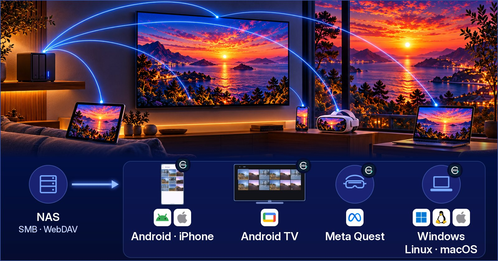

🌐 <b>मराठी</b> · इतर भाषा (88)
<a href="../README.md">English</a> · <a href="README.af.md">Afrikaans</a> · <a href="README.ar.md">العربية</a> · <a href="README.az.md">Azərbaycanca</a> · <a href="README.be.md">Беларуская</a> · <a href="README.bg.md">Български</a> · <a href="README.bi.md">Bislama</a> · <a href="README.bn.md">বাংলা</a> · <a href="README.br.md">Brezhoneg</a> · <a href="README.bs.md">Bosanski</a> · <a href="README.ca.md">Català</a> · <a href="README.cs.md">Čeština</a> · <a href="README.cv.md">Чӑвашла</a> · <a href="README.da.md">Dansk</a> · <a href="README.de.md">Deutsch</a> · <a href="README.de_CH.md">Deutsch (Schweiz)</a> · <a href="README.el.md">Ελληνικά</a> · <a href="README.en_GB.md">English (UK)</a> · <a href="README.eo.md">Esperanto</a> · <a href="README.es.md">Español</a> · <a href="README.et.md">Eesti</a> · <a href="README.eu.md">Euskara</a> · <a href="README.fa.md">فارسی</a> · <a href="README.fi.md">Suomi</a> · <a href="README.fil.md">Filipino</a> · <a href="README.fr.md">Français</a> · <a href="README.ga.md">Gaeilge</a> · <a href="README.gl.md">Galego</a> · <a href="README.gsw.md">Alemannisch</a> · <a href="README.gu.md">ગુજરાતી</a> · <a href="README.he.md">עברית</a> · <a href="README.hi.md">हिन्दी</a> · <a href="README.hr.md">Hrvatski</a> · <a href="README.hu.md">Magyar</a> · <a href="README.hy.md">Հայերեն</a> · <a href="README.id.md">Bahasa Indonesia</a> · <a href="README.is.md">Íslenska</a> · <a href="README.it.md">Italiano</a> · <a href="README.ja.md">日本語</a> · <a href="README.ka.md">ქართული</a> · <a href="README.kab.md">Taqbaylit</a> · <a href="README.kk.md">Қазақша</a> · <a href="README.km.md">ខ្មែរ</a> · <a href="README.kmr.md">Kurmancî</a> · <a href="README.kn.md">ಕನ್ನಡ</a> · <a href="README.ko.md">한국어</a> · <a href="README.kxm.md">ภาษาเขมรถิ่นไทย</a> · <a href="README.lb.md">Lëtzebuergesch</a> · <a href="README.lmo.md">Lombard</a> · <a href="README.lt.md">Lietuvių</a> · <a href="README.lv.md">Latviešu</a> · <a href="README.mfa.md">Bahasa Melayu Kelantan</a> · <a href="README.mi.md">Te reo Māori</a> · <a href="README.mk.md">Македонски</a> · <a href="README.ml.md">മലയാളം</a> · <a href="README.mn.md">Монгол</a> · <a href="README.ms.md">Bahasa Melayu</a> · <a href="README.nb_NO.md">Norsk bokmål</a> · <a href="README.ne.md">नेपाली</a> · <a href="README.nl.md">Nederlands</a> · <a href="README.nn.md">Norsk nynorsk</a> · <a href="README.pa.md">ਪੰਜਾਬੀ</a> · <a href="README.pl.md">Polski</a> · <a href="README.pt.md">Português</a> · <a href="README.pt_BR.md">Português (Brasil)</a> · <a href="README.ro.md">Română</a> · <a href="README.ru.md">Русский</a> · <a href="README.si.md">සිංහල</a> · <a href="README.sk.md">Slovenčina</a> · <a href="README.sl.md">Slovenščina</a> · <a href="README.sq.md">Shqip</a> · <a href="README.sr_Cyrl.md">Српски</a> · <a href="README.sr_Latn.md">Srpski</a> · <a href="README.sv.md">Svenska</a> · <a href="README.sw.md">Kiswahili</a> · <a href="README.swg.md">Schwäbisch</a> · <a href="README.ta.md">தமிழ்</a> · <a href="README.te.md">తెలుగు</a> · <a href="README.th.md">ไทย</a> · <a href="README.tl.md">Tagalog</a> · <a href="README.tr.md">Türkçe</a> · <a href="README.uk.md">Українська</a> · <a href="README.ur.md">اردو</a> · <a href="README.uz.md">Oʻzbekcha</a> · <a href="README.vi.md">Tiếng Việt</a> · <a href="README.yue_Hant.md">粵語</a> · <a href="README.zh_Hans.md">简体中文</a> · <a href="README.zh_Hant.md">繁體中文</a>

  

# Immuch360

**तुमचे मीडिया. कोणताही स्क्रीन. प्रत्येक दृष्टिकोन.**

🌐 <a href="https://immuch360.com/mr/"><b>immuch360.com</b></a>

तुमच्या डिव्हाइस, तुमच्या NAS, तुमच्या Immich सर्व्हर, तुमच्या कॅमेऱ्यांमधून आणि तुमच्या ड्रोनमधून सपाट, 360° आणि 3D फोटो आणि व्हिडिओ. खाते लागत नाही. Immuch360 हे एक मोफत आणि मुक्त स्रोत अॅप आहे, जे तुमचे फोटो आणि व्हिडिओ ते जिथे आहेत तिथेच वाचते आणि प्रत्येकाला त्याला साजेशा व्ह्यूअरमध्ये प्ले करते: सपाट, ज्यात तुम्ही चारी बाजूंनी पाहू शकता अशा गोल स्वरूपात, 3D मध्ये, किंवा हेडसेटमध्ये तुमच्या सभोवताली. ते फोन, टॅबलेट, टीव्ही, Meta Quest हेडसेट आणि संगणकांवर चालते. त्याची वेबसाइट, [immuch360.com](https://immuch360.com/mr/), ते प्रत्येक स्क्रीनवर काय करते ते 89 भाषांमध्ये दाखवते.

**बिल्ड 53 आणि डेस्कटॉप बिल्ड 34 मध्ये नवीन, आवृत्ती 3.4.8.** संगणकांवर, [Spatial 2.5D](#see-your-3d-photos-and-videos-in-depth-on-your-computer) तुमच्या 3D फोटोंना सपाट स्क्रीनवर खोली देते, Windows, Linux आणि macOS वर, आणि तुमच्या 3D व्हिडिओंना Windows आणि macOS वर: तुम्ही डोके हलवता तसे दृश्य हलते, तुम्ही संमती दिल्यावर वेबकॅम त्याचा मागोवा घेतो, किंवा माउसने, आणि वेबकॅमची चित्रे संगणकाच्या मेमरीतच राहतात, कधीही जतन किंवा पाठवली जात नाहीत; प्रोजेक्टने अजून वेबकॅमसह वापरून पाहिलेले नाही. व्हील [पॉइंटरभोवती फोटो झूम करते](#zoom-into-a-photo-with-the-wheel) आणि ड्रॅग तो हलवतो. [सुधारा (AI)](#make-a-photo-sharper-on-your-computer-ai) तुमच्या शेअर्सचे, DLNA, Plex, Jellyfin आणि Emby चे आणि तुमच्या Immich सर्व्हरचे फोटो घेते, 360° आणि 3D फोटो त्यांची शिवण किंवा त्यांचे दोन डोळे न तोडता सुधारते, आणि Apple चिप असलेल्या Mac वर तीक्ष्ण करा देते (अजून Mac वर वापरून पाहिलेले नाही). फोनवरून, ["यावर प्ले करा…"](#show-your-photos-and-videos-on-the-tv-from-your-phone) 360° आयटम स्क्रीनच्या 360° व्ह्यूमध्ये उघडते, निवड किंवा अल्बम स्लाइडशो म्हणून प्ले करते, स्क्रीनला तुमच्या सर्व्हरवर साइन इन करते आणि फक्त फोनवर असलेले फोटो आणि व्हिडिओ पाठवते; Android एम्युलेटर्समध्ये वापरून पाहिलेले, अजून खऱ्या फोनवर किंवा टीव्हीवर नाही. Meta Quest मध्ये, मोठ्या स्क्रीनचा स्लाइडशो फोटोंदरम्यान [क्रॉस फेड करतो किंवा सरकतो](#browse-your-photos-on-the-big-screen-of-the-quest), तुम्ही निवडलेल्या काळ्या, धूसर किंवा passthrough पार्श्वभूमीवर, प्रोजेक्टने अजून हेडसेटमध्ये वापरून पाहिलेले नाही.

**बिल्ड 33 ते 52 मध्ये नवीन.** [चित्रपट तुम्ही जिथे थांबलात तिथून पुढे सुरू होतात](#pick-up-a-film-where-you-stopped). ते लवकर सुरू होतात, आणि धीम्या सर्व्हरवरून ते [थांबण्याऐवजी चालू राहतात](#when-a-video-waits-or-will-not-play). फोन आणि संगणकांवर टाइमलाइन [महिने आणि वर्षांपर्यंत झूम आउट होते](#find-a-month-or-a-year-in-a-long-timeline). Android फोन किंवा Meta Quest वर, ["फोल्डर ब्राउझ करा"](#browse-a-folder-of-your-phone-or-headset) डिव्हाइसचे फोल्डर शेअरसारखे उघडते, आणि TIFF फोटो दिसतात. Android TV [रिमोटने तारखेनुसार शोधतो](#on-android-tv-and-google-tv), Meta Quest 3 किंवा 3S [गॉसियन स्प्लॅट उघडतो](#explore-gaussian-splats-in-a-meta-quest-3-or-3s), जे उजव्या थंबस्टिकने फिरवता येतात, SPZ आवृत्ती 4 सह, आणि संगणक [तुमच्या NAS वरील फोटोंच्या 3D आवृत्त्या बनवतो](#turn-one-photo-into-3d-a-scene-a-panorama). दोन ग्राफिक्स चिप असलेल्या Windows लॅपटॉपवर ॲप [आता वेगवान चिपवर चालते](#when-a-video-waits-or-will-not-play), त्यामुळे 8K चित्रपट सहजपणे चालतात. गॉसियन स्प्लॅट आता [संगणकांवर आणि Android फोन आणि टॅबलेटवर उघडतात](#explore-gaussian-splats-on-your-phone-tablet-or-computer), Windows संगणक AI ने [तुमच्या फोटोंवरून किंवा व्हिडिओवरून स्प्लॅट देखावे बनवतो](#make-a-splat-scene-from-your-photos-or-a-video-ai), तुमचा Immich सर्व्हर [ते फोटोंच्या आत ठेवतो](#keep-a-splat-scene-on-your-immich-server) जे तुमच्या टाइमलाइनवरून उघडतात, आणि संगणक [AV2 व्हिडिओ प्ले करतात](#play-av2-videos-on-your-computer). बिल्ड 42 पासून, Insta360, GoPro MAX आणि DJI Osmo 360 कॅमेऱ्यांचे रॉ व्हिडिओ, तुमच्या Immich लायब्ररी, एखाद्या शेअर किंवा एखाद्या फोल्डरमधून, Android फोन, टॅबलेट आणि टीव्हीवर [कॅमेऱ्याच्या जायरोस्कोपने स्थिर होऊन प्ले होतात](#stabilise-your-360-videos-with-the-cameras-gyroscope), डेस्कटॉप बिल्ड 22 चा स्प्लॅट क्रिएटर तुम्ही जवळून पाहता अशा देखाव्यांसाठी [तपशीलवार गुणवत्ता देतो](#make-a-splat-scene-from-your-photos-or-a-video-ai), आणि 360° पॅनोरमा [ग्राफिक्स कार्डवर 3.5 GiB मोकळी मेमरी असताना सुरू होतो](#turn-one-photo-into-3d-a-scene-a-panorama). iPhone आणि iPad अॅप [App Store वर आहे](https://apps.apple.com/us/app/immuch360-360-3d-player/id6817655965), आवृत्ती 3.4.3. बिल्ड 43 पासून, अॅपची अपडेट सूचना फोन आणि टॅबलेटवर Google Play किंवा App Store उघडते; त्याची वेबसाइट, [immuch360.com](https://immuch360.com/mr/), 7 नोव्हेंबर रोजी सुरू झाली. बिल्ड 44 आणि डेस्कटॉप बिल्ड 24 पासून, Meta Quest 3 किंवा 3S [300,000 गॉसियनपर्यंतचे स्प्लॅट दाखवतो](#explore-gaussian-splats-in-a-meta-quest-3-or-3s), संगणक [Ctrl आणि Shift ने अनेक फोटो आणि व्हिडिओ निवडतात](#use-your-computer-as-the-media-player), ज्या टीव्हीचा डीकोडर एखादा व्हिडिओ नाकारतो तो [सर्व्हरची दुसरी फाइल आपोआप प्ले करतो](#when-a-video-waits-or-will-not-play), दोन ग्राफिक्स कार्ड असलेल्या लॅपटॉपवर पॅनोरमा निवडलेल्या ग्राफिक्स कार्डवर चालतात, आणि Quest आणि संगणकांची अपडेट सूचना त्यांचे स्टोअर पेज किंवा डाउनलोड पेज उघडते, अनेक दुरुस्त्यांसह. बिल्ड 45 आणि डेस्कटॉप बिल्ड 25 पासून, प्रत्येक प्लॅटफॉर्मवर आवृत्ती 3.4.0, अॅप Immich च्या 11 नंतरच्या दुरुस्त्यांसह Immich 3.4.0 अॅपचे अनुसरण करते, [Immich 3.4 सर्व्हरचे JPEG XL फोटो](#keep-your-immich-library-with-more) दाखवते, [तुमचे Plex चित्रपट वर्षानुसार](#watch-your-plex-films) उघडते, प्रत्येक चित्रपटासाठी एक पेज, डिव्हाइसवर त्यांचे डाउनलोड आणि फोनवरून टीव्हीवर त्यांचे प्लेबॅक यांसह, स्टोअर बिल्डमध्ये रेटिंग मागू शकते, आणि संगणकांवर त्याचे व्हिडिओ घटक [त्यांच्या स्वतःच्या ओपन रिपॉझिटरीमधून](#licences-and-credits) घेते. बिल्ड 46 आणि डेस्कटॉप बिल्ड 26 पासून, आवृत्ती 3.4.1, 360° कॅमेऱ्यांचे रॉ व्हिडिओ iPhone आणि iPad वर, Meta Quest मध्ये आणि Windows वरही [स्थिर होऊन प्ले होतात](#stabilise-your-360-videos-with-the-cameras-gyroscope), Meta Quest [त्याचा स्वतःचा प्लेयर डीकोड करू शकत नाही ते Plex चित्रपट libmpv ने प्ले करतो](#watch-your-plex-films), फोन [असा चित्रपट Chromecast किंवा Google TV वर पाठवतो](#watch-your-plex-films), आणि 3D फोटोची AI खोली [तुम्ही निवडलेली तीव्रता घेते](#turn-one-photo-into-3d-a-scene-a-panorama); तुमच्या Plex खात्याने साइन इन करूनही नवीन सर्व्हर जोडता येतो, आणि अॅप [त्याच्या सेटिंग्ज एका फाइलमध्ये ठेवते](#keep-your-settings-in-a-file). बिल्ड 47 आणि डेस्कटॉप बिल्ड 27 पासून, आवृत्ती 3.4.2, Plex चित्रपट [डिव्हाइस डीकोड करते असा ऑडिओ ट्रॅक प्ले करतो](#watch-your-plex-films) आणि कोणता ते सांगतो, स्क्रीनला साजेशी आवृत्ती उघडतो आणि धीम्या कनेक्शनवर हलकी आवृत्ती सुचवतो, Windows आणि macOS त्याचा Dolby TrueHD आवाज प्ले करतात, Android [त्याचे डाउनलोड एका सूचनेत दाखवते](#watch-your-plex-films) आणि Android TV देखील चित्रपट डाउनलोड करतो, आणि [बॅटरीवरचे Tapo कॅमेरे लाइव्ह दिसतात](#watch-your-home-cameras-on-the-big-screen); खात्यांसह सेटिंग्ज फाइल पुनर्संचयित केल्याने आता तुम्ही तुमच्या Immich सर्व्हरवर साइन इन होता. बिल्ड 48 आणि डेस्कटॉप बिल्ड 28 पासून, आवृत्ती 3.4.3, एक Windows संगणक SteamVR, Meta Horizon Link किंवा दुसऱ्या OpenXR रनटाइमद्वारे [तुमचे व्हिडिओ PC VR हेडसेटमध्ये प्ले करतो](#watch-your-videos-in-a-pc-vr-headset-from-windows) (प्रोजेक्टने अजून हेडसेटमध्ये वापरून पाहिलेले नाही), [इतर ब्रँडचे कॅमेरे लाइव्ह दिसतात](#cameras-of-other-brands-over-onvif-or-rtsp), ONVIF द्वारे सापडलेले किंवा त्यांच्या RTSP लिंकने जोडलेले (सिम्युलेटेड कॅमेऱ्याने तपासलेले, इतर ब्रँडचा खरा कॅमेरा अजून वापरून पाहिलेला नाही), [DJI Osmo 360 II आणि GoPro MAX 2 चे रॉ व्हिडिओ स्थिर होऊन प्ले होतात](#open-the-raw-files-of-360-cameras), Plex चित्रपट [फोनवर आता खूप हळू येत नाहीत](#when-a-video-waits-or-will-not-play), LG आणि Samsung टीव्ही [कुशीवर पडलेला व्हिडिओ एका बटणाने फिरवतात](#on-a-samsung-tv-tizen) (अजून LG टीव्हीवर वापरून पाहिलेले नाही; Issue 17 मधील Samsung टीव्हीने फिरवणे नाकारले), आणि अद्ययावत सर्व्हरसाठी "सर्व्हर अपडेट उपलब्ध आहे" आता दिसत नाही. बिल्ड 49 आणि डेस्कटॉप बिल्ड 29 पासून, आवृत्ती 3.4.4, अॅप स्वतः [तुमचे Jellyfin आणि Emby सर्व्हर वाचते](#watch-your-jellyfin-and-emby-libraries) (अजून डिव्हाइसवर वापरून पाहिलेले नाही), तुमच्या नेटवर्कवर सापडलेले आणि टीव्हीवर किंवा हेडसेटमध्ये Quick Connect ने साइन इन केलेले, त्यांच्या मूळ फाइल्स प्ले केल्या जातात जेणेकरून 360° व्हिडिओ 360° राहतो; Meta Quest च्या मोठ्या स्क्रीनवर, फोटो [तुम्ही ब्राउझ करत असताना तुम्ही सेट केलेला आकार आणि जागा ठेवतात, आणि स्लाइडशो म्हणून प्ले होतात](#browse-your-photos-on-the-big-screen-of-the-quest) (प्रोजेक्टने अजून हेडसेटमध्ये वापरून पाहिलेले नाही); फोन आणि टॅबलेटच्या 360° व्हिडिओ प्लेयरला [360° फोटोंचे कंट्रोल्स मिळतात](#360-videos-on-your-phone-with-the-controls-of-360-photos), जायरोस्कोप बटण, झूमसाठी पिंच आणि सरळ वर किंवा खाली ड्रॅग (एका वापरकर्त्याने Samsung Galaxy S25 Ultra वर वापरून पाहिलेले, अजून iPhone वर नाही); संगणक AI ने [तुमचे 2D व्हिडिओ 3D व्हिडिओंमध्ये बदलतो](#turn-your-2d-videos-into-3d-on-your-computer) (अजून 3D स्क्रीनवर किंवा हेडसेटमध्ये वापरून पाहिलेले नाही); आणि Samsung टीव्ही [फिरवण्याची गरज असलेला व्हिडिओ Samsung च्या स्वतःच्या प्लेयरकडे देतात](#on-a-samsung-tv-tizen), जो Issue 17 चा टीव्ही प्ले करतो पण फिरवण्यास नकार देतो. बिल्ड 50 आणि डेस्कटॉप बिल्ड 30, आवृत्ती 3.4.5 पासून, Meta Quest च्या 2D विंडोमध्ये व्हिडिओ प्ले होत असताना, विंडो बिल्ड 48 आणि 49 प्रमाणे सेकंदाला सुमारे 10 वेळा ऐवजी [डिस्प्लेच्या दराने पुन्हा रेखाटली जाते](#step-inside-your-photos-and-videos-with-a-meta-quest) (Meta Quest 3 वर मोजलेले), Android TV [रिमोटने फोटोमध्ये झूम करतो](#on-android-tv-and-google-tv) आणि बाणांनी तो हलवतो (नवीन, अजून टीव्हीवर वापरून पाहिलेले नाही), आणि तीन दुरुस्त्या mlc70 च्या Android TV fork मधून येतात: झटपट स्वाइप आता मागे सोडलेल्या फोटोचे तपशील दाखवत नाही, अॅनिमेटेड फोटो त्याची मेमरी मोकळी करतो, आणि स्थान फिल्टर नवीन देशाची शहरे देतो. बिल्ड 51 आणि डेस्कटॉप बिल्ड 31 पासून, आवृत्ती 3.4.6, Windows आणि Linux वर [सुधारा (AI)](#make-a-photo-sharper-on-your-computer-ai) मूळ फोटोशेजारी धूसर फोटोची अधिक तीक्ष्ण प्रत बनवते, तीन स्तरांवर, प्रत्येक RTX 4060 असलेल्या एका PC वर एकदा चालवलेला, नैसर्गिक Apple चिप असलेल्या Mac वरही उपलब्ध आहे (अजून Mac वर वापरून पाहिलेले नाही), संगणक AI ने [360° व्हिडिओचा 360° 3D व्हिडिओ बनवतो](#a-360-video-turned-into-a-360-3d-video), Windows वर 3D व्हिडिओंची खोली ग्राफिक्स कार्ड अंदाजित करते, AI वैशिष्ट्ये तुमच्या सर्व्हरचे आणि शेअरचे व्हिडिओ थेट घेतात, सेटिंग्ज फाइलला [लायब्ररीमध्ये तिचे कार्ड](#keep-your-settings-in-a-file) आहे, टीव्ही ती नेटवर्क शेअरवर जतन करतो, संगणकांवर Escape एक पायरी मागे जातो, स्टोअर बिल्ड रेटिंग [अधिक क्वचित आणि अधिक हळुवारपणे](#privacy) मागतात, Linux TIFF फोटो, स्प्लॅट देखावे आणि एका डोळ्याने 3D व्हिडिओ दाखवतो, आणि दोन क्रॅश दुरुस्त झाले. बिल्ड 52 आणि डेस्कटॉप बिल्ड 32 पासून, आवृत्ती 3.4.7, ["यावर प्ले करा…"](#show-your-photos-and-videos-on-the-tv-from-your-phone) तुमच्या Immich लायब्ररीचे, तुमच्या शेअर्सचे आणि Jellyfin व Emby चे फोटो आणि व्हिडिओ फोनवरून टीव्ही, Meta Quest, संगणक किंवा Chromecast कडे पाठवते, तुमच्या फोटो आणि व्हिडिओंची नावे [त्यांच्या थंबनेलवर वाचनीय राहतात](#play-the-files-of-a-nas-a-computer-a-media-server-or-plex), संगणकाचे AI घटक [एका क्लिकमध्ये अपडेट होतात](#update-the-ai-components-in-one-click), Linux ला [एक AppImage](#linux) मिळते, आणि iPhone आणि iPad अॅप Xcode 27 ने बिल्ड केले आहे. डेस्कटॉप बिल्ड 33 ने [सुधारा (AI)](#make-a-photo-sharper-on-your-computer-ai) दुरुस्त केले, जे डेस्कटॉप बिल्ड 31 आणि 32 मध्ये प्रत्येक फोटोवर अयशस्वी होत होते ([Issue 23](https://github.com/freeKC/Immuch360/issues/23)).

  Immich मोबाइल अॅपचा अनधिकृत फोर्क. Immich किंवा FUTO शी संलग्न नाही. नाव "I am much 360" असे वाचले जाते.

<b>अनुक्रमणिका</b>

- [हे कोणासाठी आहे](#who-it-is-for)
- [कोणते स्क्रीन](#which-screens), [ते एकत्र काय करतात](#use-cases) आणि [प्रत्येक स्क्रीन काय करतो](#what-each-screen-does)
- [तुम्ही काय करू शकता](#what-you-can-do)
- [तुमच्या डिव्हाइसवर मिळवा](#get-it-on-your-device)
- [कसे करायचे](#how-to)
  - [सर्व्हरसह किंवा सर्व्हरशिवाय तुमचे फोटो आणि व्हिडिओ पाहा](#watch-your-photos-and-videos-with-or-without-a-server)
  - [पॅनोरमा, 360°, VR180 आणि 3D एक्सप्लोर करा](#explore-panoramas-360-vr180-and-3d): [फोनवर 360° व्हिडिओ](#360-videos-on-your-phone-with-the-controls-of-360-photos)
  - [एका फोटोला 3D, देखावा, पॅनोरमा बनवा](#turn-one-photo-into-3d-a-scene-a-panorama): [एका क्लिकमध्ये अपडेट होणारे AI घटक](#update-the-ai-components-in-one-click)
  - [तुमच्या संगणकावर तुमचे 2D व्हिडिओ 3D मध्ये बदला](#turn-your-2d-videos-into-3d-on-your-computer): [360° व्हिडिओ ते 360° 3D](#a-360-video-turned-into-a-360-3d-video)
  - [तुमच्या संगणकावर फोटो अधिक तीक्ष्ण करा (AI)](#make-a-photo-sharper-on-your-computer-ai)
  - [रिमोटने टीव्हीवर पाहा](#watch-on-the-tv-with-the-remote): [Android TV आणि Google TV](#on-android-tv-and-google-tv), [LG](#on-an-lg-tv-webos), [Samsung](#on-a-samsung-tv-tizen)
  - [तुमच्या फोनने टीव्ही, हेडसेट किंवा संगणकावर साइन इन करा](#sign-in-a-tv-a-headset-or-a-computer-with-your-phone)
  - [तुमच्या फोनवरून तुमचे फोटो आणि व्हिडिओ टीव्हीवर दाखवा](#show-your-photos-and-videos-on-the-tv-from-your-phone)
  - [Meta Quest ने तुमच्या फोटो आणि व्हिडिओंमध्ये प्रवेश करा](#step-inside-your-photos-and-videos-with-a-meta-quest): [मोठी स्क्रीन](#browse-your-photos-on-the-big-screen-of-the-quest), [कियॉस्क मोड](#kiosk-mode-for-an-exhibition-or-a-shop)
  - [Meta Quest 3 किंवा 3S मध्ये गॉसियन स्प्लॅट एक्सप्लोर करा](#explore-gaussian-splats-in-a-meta-quest-3-or-3s)
  - [तुमच्या फोनवर, टॅबलेटवर किंवा संगणकावर गॉसियन स्प्लॅट एक्सप्लोर करा](#explore-gaussian-splats-on-your-phone-tablet-or-computer)
  - [तुमच्या फोटोंवरून किंवा व्हिडिओवरून स्प्लॅट देखावा बनवा (AI)](#make-a-splat-scene-from-your-photos-or-a-video-ai)
  - [तुमच्या Immich सर्व्हरवर स्प्लॅट देखावा ठेवा](#keep-a-splat-scene-on-your-immich-server)
  - [NAS, संगणक, मीडिया सर्व्हर किंवा Plex च्या फाइल्स प्ले करा](#play-the-files-of-a-nas-a-computer-a-media-server-or-plex): [तुमचे चित्रपट वर्षानुसार](#watch-your-plex-films), [Jellyfin आणि Emby](#watch-your-jellyfin-and-emby-libraries)
  - [तुमच्या फोनचे किंवा हेडसेटचे फोल्डर ब्राउझ करा](#browse-a-folder-of-your-phone-or-headset)
  - [तुम्ही जिथे थांबलात तिथून चित्रपट पुढे पाहा](#pick-up-a-film-where-you-stopped)
  - [व्हिडिओ थांबून राहतो किंवा प्ले होत नाही तेव्हा](#when-a-video-waits-or-will-not-play)
  - [तुमची Immich लायब्ररी ठेवा, आणखी सुविधांसह](#keep-your-immich-library-with-more)
  - [लांब टाइमलाइनमध्ये महिना किंवा वर्ष शोधा](#find-a-month-or-a-year-in-a-long-timeline)
  - [तुमचे घरगुती कॅमेरे मोठ्या स्क्रीनवर पाहा](#watch-your-home-cameras-on-the-big-screen): [इतर ब्रँड](#cameras-of-other-brands-over-onvif-or-rtsp)
  - [तुमचा DJI ड्रोन](#your-dji-drone): [लाइव्ह व्हिडिओ](#see-what-your-drone-sees-on-your-phone), [Quest मध्ये किंवा Android TV वर](#watch-it-in-a-meta-quest-or-on-an-android-tv), [इम्पोर्ट](#bring-a-drones-or-a-camera-cards-photos-and-videos-to-immich)
  - [360° कॅमेऱ्यांच्या रॉ फाइल्स उघडा](#open-the-raw-files-of-360-cameras)
  - [कॅमेऱ्याच्या जायरोस्कोपने तुमचे 360° व्हिडिओ स्थिर करा](#stabilise-your-360-videos-with-the-cameras-gyroscope)
  - [एका कीने फोटो फिरवा](#turn-a-photo-with-one-key)
  - [तुमचा संगणक मीडिया प्लेयर म्हणून वापरा](#use-your-computer-as-the-media-player): [व्हीलने झूम](#zoom-into-a-photo-with-the-wheel)
  - [तुमच्या संगणकावर तुमचे 3D फोटो आणि व्हिडिओ खोलीसह पाहा](#see-your-3d-photos-and-videos-in-depth-on-your-computer)
  - [Windows वरून PC VR हेडसेटमध्ये तुमचे व्हिडिओ पाहा](#watch-your-videos-in-a-pc-vr-headset-from-windows)
  - [तुमच्या संगणकावर AV2 व्हिडिओ प्ले करा](#play-av2-videos-on-your-computer)
  - [तुमच्या सेटिंग्ज एका फाइलमध्ये ठेवा](#keep-your-settings-in-a-file)
- [Immich शी तुलना](#compared-with-immich)
- [गोपनीयता](#privacy)
- [परवाने आणि श्रेय](#licences-and-credits)
- [रोडमॅप](#roadmap)
- [दस्तऐवजीकरण](#documentation)

## हे कोणासाठी आहे

- **तुम्ही 360° किंवा 3D शूट करता** आणि तुमचे शॉट्स सपाट, दुहेरी किंवा ताणलेले न पाहता त्यांच्यात चारी बाजूंनी पाहू इच्छिता, आणि फोनवर त्याचे फोटो फिरवता तसे तुमचे 360° व्हिडिओ फिरवू इच्छिता: [360°, VR180 आणि 3D](#explore-panoramas-360-vr180-and-3d), [फोनवर 360° व्हिडिओ](#360-videos-on-your-phone-with-the-controls-of-360-photos).
- **तुम्ही हातात, सायकलवर किंवा हेल्मेटवर 360° कॅमेऱ्याने चित्रीकरण करता** आणि Immich मध्ये, एखाद्या शेअरवर किंवा एखाद्या फोल्डरमध्ये ठेवलेले तुमच्या Insta360, GoPro MAX किंवा MAX 2, DJI Osmo 360 किंवा Osmo 360 II कॅमेऱ्याचे रॉ व्हिडिओ तुमच्या फोनवर, टीव्हीवर, Meta Quest वर किंवा Windows संगणकावर सरळ आणि स्थिर प्ले व्हावेत असे इच्छिता: [कॅमेऱ्याच्या जायरोस्कोपने स्थिर केलेले](#stabilise-your-360-videos-with-the-cameras-gyroscope).
- **तुमचे फोटो आणि चित्रपट NAS, संगणक, Plex किंवा Immich वर आहेत** आणि काहीही कॉपी न करता ते टीव्हीवर पाहू इच्छिता: [टीव्हीवर](#watch-on-the-tv-with-the-remote), [NAS, शेअर्स आणि Plex](#play-the-files-of-a-nas-a-computer-a-media-server-or-plex).
- **तुम्ही तुमचे चित्रपट Plex सर्व्हरवर ठेवता** आणि वर्षानुसार एक निवडू इच्छिता, तो सुरू होण्यापूर्वी तो काय आहे ते पाहू इच्छिता, प्रवासाला नेऊ इच्छिता, तुमच्या फोनवरून टीव्हीवर किंवा Chromecast वर सुरू करू इच्छिता, आणि तुमचा Android फोन, टीव्ही किंवा Meta Quest डीकोड करू शकत नाही ते चित्रपटही प्ले करू इच्छिता: [तुमचे चित्रपट, वर्षानुसार](#watch-your-plex-films).
- **तुम्ही तुमचे चित्रपट Jellyfin किंवा Emby सर्व्हरवर ठेवता** आणि ते तुमच्या Meta Quest मध्ये, टीव्हीवर किंवा फोनवर, 360° आणि 3D जसे आहेत तसे, आणि तुमची जागा सर्व्हरवर ठेवून हवे आहेत (अजून डिव्हाइसवर वापरून पाहिलेले नाही): [Jellyfin आणि Emby](#watch-your-jellyfin-and-emby-libraries).
- **तुमच्याकडे Meta Quest आहे** आणि तुम्ही तुमच्या स्वतःच्या फोटो आणि व्हिडिओंमध्ये प्रवेश करू इच्छिता: [हेडसेटमध्ये](#step-inside-your-photos-and-videos-with-a-meta-quest), आणि तुम्ही सेट केलेल्या आकारात आणि जागी मोठ्या स्क्रीनवर तुमचे फोटो ब्राउझ करू इच्छिता, स्लाइडशो म्हणूनही (प्रोजेक्टने अजून हेडसेटमध्ये वापरून पाहिलेले नाही): [मोठी स्क्रीन](#browse-your-photos-on-the-big-screen-of-the-quest).
- **तुमच्याकडे Windows संगणकाला जोडलेला PC VR हेडसेट आहे** आणि त्यात तुमचे 360° व्हिडिओ तुमच्या सभोवती आणि तुमचे चित्रपट मोठ्या स्क्रीनवर हवे आहेत (प्रोजेक्टने अजून हेडसेटमध्ये वापरून पाहिलेले नाही): [PC VR हेडसेटमध्ये](#watch-your-videos-in-a-pc-vr-headset-from-windows).
- **तुमचे फोटो सपाट आहेत** आणि तुम्हाला ते 3D मध्ये हवे आहेत, हेडसेटमध्ये झुकून पाहण्याजोगा देखावा म्हणून, किंवा 360° पॅनोरमाच्या आत, 3D कॅमेऱ्याशिवाय: [एका फोटोला 3D, देखावा, पॅनोरमा बनवा](#turn-one-photo-into-3d-a-scene-a-panorama), नवीन, तुमच्या स्वतःच्या संगणकावर AI ने बनवलेले.
- **तुमचे व्हिडिओ सपाट आहेत**, तुमच्या फोनच्या क्लिप्ससह, आणि तुम्हाला ते हेडसेटसाठी किंवा 3D स्क्रीनसाठी 3D मध्ये, आणि तुमचे 360° व्हिडिओ 360° 3D मध्ये, तुमच्या स्वतःच्या संगणकावर बनवलेले हवे आहेत (अजून 3D स्क्रीनवर किंवा हेडसेटमध्ये वापरून पाहिलेले नाही): [2D व्हिडिओ ते 3D](#turn-your-2d-videos-into-3d-on-your-computer), [360° ते 360° 3D](#a-360-video-turned-into-a-360-3d-video).
- **तुमचे फोटो धूसर आहेत**, थोडे फोकसबाहेर किंवा कमी प्रकाशात घेतलेले, आणि तुम्हाला मूळ फोटोशेजारी अधिक तीक्ष्ण प्रत हवी आहे, तुमच्या स्वतःच्या संगणकावर बनवलेली, तुमच्या शेअर्स आणि सर्व्हरवरूनही, रचलेले तपशील स्पष्टपणे सांगितलेले: [सुधारा (AI)](#make-a-photo-sharper-on-your-computer-ai).
- **तुमच्याकडे 3D फोटो किंवा व्हिडिओ आणि एक संगणक आहे** आणि तुम्हाला ते त्याच्या सपाट स्क्रीनवर खोलीसह हवे आहेत, तुम्ही डोके हलवता तसे दृश्य हलते, वेबकॅम त्याचा मागोवा घेतो, किंवा माउसने (प्रोजेक्टने अजून वेबकॅमसह वापरून पाहिलेले नाही): [तुमच्या संगणकावर Spatial 2.5D](#see-your-3d-photos-and-videos-in-depth-on-your-computer).
- **तुम्ही Immich चालवता** आणि तुम्हाला त्याचे अॅप हवे आहे, तसेच इमर्सिव व्ह्यूअर आणि तुमच्या फोनवरून साइन इन होणारे मोठे स्क्रीन: [तुमची Immich लायब्ररी](#keep-your-immich-library-with-more), [Immich शी तुलना](#compared-with-immich).
- **तुम्ही Tapo कॅमेऱ्यांनी घरावर लक्ष ठेवता**, बॅटरीवरच्या कॅमेऱ्यांसह, किंवा ONVIF किंवा RTSP द्वारे इतर ब्रँडच्या कॅमेऱ्यांनी, आणि ते तुमच्या फोटोंशेजारी, टीव्हीवरही हवे आहेत (सिम्युलेटेड कॅमेऱ्यावर तपासलेले): [घरगुती कॅमेरे](#watch-your-home-cameras-on-the-big-screen).
- **तुम्ही DJI ड्रोन उडवता** आणि त्याचे लाइव्ह चित्र DJI Fly शिवाय तुमच्या फोनवर, आणि सोबतच्या लोकांसाठी Meta Quest मध्ये किंवा Android TV वर हवे आहे: [तुमचा ड्रोन](#see-what-your-drone-sees-on-your-phone).
- **तुम्ही जागा आणि वस्तू 3D मध्ये, गॉसियन स्प्लॅट म्हणून कॅप्चर करता,** किंवा त्या तुमच्या स्वतःच्या फोटोंवरून बनवायला आवडेल, आणि तुमच्या फोनवर, तुमच्या संगणकावर किंवा हेडसेटमध्ये त्यांच्यातून फिरायचे आहे: [फोन, टॅबलेट किंवा संगणकावर](#explore-gaussian-splats-on-your-phone-tablet-or-computer), [तुमच्या फोटोंवरून बनवलेले](#make-a-splat-scene-from-your-photos-or-a-video-ai), [Immich मध्ये ठेवलेले](#keep-a-splat-scene-on-your-immich-server).
- **तुमच्याकडे AV2 व्हिडिओ आहेत**, AV1 नंतर येणारा फॉरमॅट, आणि ते तुमच्या संगणकावर पाहायचे आहेत: [तुमच्या संगणकावर AV2](#play-av2-videos-on-your-computer).
- **तुमच्या घरी अनेक स्क्रीन आहेत** आणि ते एकत्र काम करावेत असे तुम्हाला वाटते: [तुमचे स्क्रीन एकत्र काय करतात](#use-cases).

तयार करायला कोणतेही Immuch360 खाते नाही, आणि आमच्याकडे काहीही येत नाही: अॅप फक्त तुमच्या डिव्हाइसशी आणि तुम्ही निवडलेल्या सर्व्हरशी बोलते, बिल्ड 45 पासून चित्रपटाच्या पेजसाठी Wikipedia शी, बिल्ड 46 पासून तुम्ही plex.tv ने साइन इन करता तेव्हा plex.tv शी, आणि तुम्ही मागितल्यावरच AI घटक किंवा AV2 डिकोडर डाउनलोड करते.

## कोणते स्क्रीन

| प्लॅटफॉर्म | ते कुठे मिळेल | नोव्हेंबर 2026 मधील स्थिती |
|---|---|---|
|  **Android** फोन आणि टॅबलेट | [Google Play](https://play.google.com/store/apps/details?id=com.aprogsys.immuch360) · [APK](https://github.com/freeKC/Immuch360/releases) | Google Play वर (बिल्ड 47, 16 नोव्हेंबरला प्रकाशित; बिल्ड 51, 24 नोव्हेंबरपासून Google च्या पुनरावलोकनात; त्यानंतर बिल्ड 53 येतो), GitHub वर बिल्ड 53, जिथे [रॉ 360° व्हिडिओ स्थिर होऊन प्ले होतात](#stabilise-your-360-videos-with-the-cameras-gyroscope), [चित्रपट तुम्ही जिथे थांबलात तिथून पुढे सुरू होतात](#pick-up-a-film-where-you-stopped), ["फोल्डर ब्राउझ करा"](#browse-a-folder-of-your-phone-or-headset) फोनचे फोल्डर उघडते आणि [गॉसियन स्प्लॅट उघडतात](#explore-gaussian-splats-on-your-phone-tablet-or-computer), शेअरवरून किंवा [तुमच्या Immich टाइमलाइनवरून](#keep-a-splat-scene-on-your-immich-server), [एका फाइलमध्ये ठेवलेल्या सेटिंग्ज](#keep-your-settings-in-a-file), [सूचनेत दाखवलेले चित्रपटाचे डाउनलोड](#watch-your-plex-films), बिल्ड 48 पासून [इतर ब्रँडचे कॅमेरे, लाइव्ह](#cameras-of-other-brands-over-onvif-or-rtsp) (सिम्युलेटेड कॅमेऱ्याने तपासलेले) आणि, बिल्ड 49 पासून, [Jellyfin आणि Emby सर्व्हर](#watch-your-jellyfin-and-emby-libraries) (अजून डिव्हाइसवर वापरून पाहिलेले नाही) आणि [360° व्हिडिओ प्लेयरमध्ये 360° फोटोंचे कंट्रोल्स](#360-videos-on-your-phone-with-the-controls-of-360-photos) (एका वापरकर्त्याने Samsung Galaxy S25 Ultra वर वापरून पाहिलेले), आणि बिल्ड 51 पासून [लायब्ररीमधील सेटिंग्ज फाइलचे कार्ड](#keep-your-settings-in-a-file), तिची फाइल नेटवर्क शेअरवरही जतन होते, आणि बिल्ड 52 पासून "यावर प्ले करा…" ने [टीव्ही किंवा Chromecast कडे पाठवलेले तुमचे फोटो आणि व्हिडिओ](#show-your-photos-and-videos-on-the-tv-from-your-phone) (अजून डिव्हाइसवर वापरून पाहिलेले नाही), आणि बिल्ड 53 पासून त्याच प्रकारे पाठवलेले [360° आयटम, निवड किंवा अल्बम आणि फोनचे स्वतःचे फोटो आणि व्हिडिओ](#show-your-photos-and-videos-on-the-tv-from-your-phone) (Android एम्युलेटर्समध्ये वापरून पाहिलेले) |
|  **iPhone आणि iPad** | [App Store](https://apps.apple.com/us/app/immuch360-360-3d-player/id6817655965) | 26 नोव्हेंबरपासून App Store वर आवृत्ती 3.4.7, [टाइमलाइनमधील महिने आणि वर्षे](#find-a-month-or-a-year-in-a-long-timeline), [तुम्ही जिथे थांबलात तिथून पुढे सुरू होणारे चित्रपट](#pick-up-a-film-where-you-stopped), फोनवरून [टीव्ही, हेडसेट किंवा संगणकाचे साइन इन](#sign-in-a-tv-a-headset-or-a-computer-with-your-phone), Immich मध्ये ठेवलेले स्प्लॅट देखावे त्यांच्या फोटोच्या रूपात दाखवलेले, Immich 3.4.0 च्या दुरुस्त्या आणि त्याचे JPEG XL फोटो, [स्थिर केलेले रॉ 360° व्हिडिओ](#stabilise-your-360-videos-with-the-cameras-gyroscope), [एका फाइलमध्ये ठेवलेल्या सेटिंग्ज](#keep-your-settings-in-a-file), [बॅटरीवरच्या Tapo कॅमेऱ्यांचा लाइव्ह व्ह्यू](#watch-your-home-cameras-on-the-big-screen) आणि [इतर ब्रँडच्या कॅमेऱ्यांच्या लाइव्ह व्ह्यू](#cameras-of-other-brands-over-onvif-or-rtsp) (सिम्युलेटेड कॅमेऱ्याने तपासलेले) यांसह, आणि आवृत्ती 3.4.4 पासून [Jellyfin आणि Emby सर्व्हर](#watch-your-jellyfin-and-emby-libraries) (अजून डिव्हाइसवर वापरून पाहिलेले नाही) आणि [360° व्हिडिओ प्लेयरमध्ये 360° फोटोंचे कंट्रोल्स](#360-videos-on-your-phone-with-the-controls-of-360-photos) (अजून iPhone वर वापरून पाहिलेले नाही) यांसह, आणि आवृत्ती 3.4.6 पासून [सेटिंग्ज फाइलचे कार्ड](#keep-your-settings-in-a-file) आणि नेटवर्क शेअरवरून तिचे पुनर्संचयन, आणि Xcode 27 ने बिल्ड केलेल्या आवृत्ती 3.4.7 पासून [फोटो आणि व्हिडिओंसाठी "यावर प्ले करा…"](#show-your-photos-and-videos-on-the-tv-from-your-phone) (अजून iPhone वर वापरून पाहिलेले नाही); आवृत्ती 3.4.8, बिल्ड 53 ची iPhone आणि iPad आवृत्ती, त्यानंतर येते; किंवा [स्वतः बिल्ड करा](../docs/immuch360/build.md) |
|  **Android TV आणि Google TV** | [Google Play](https://play.google.com/store/apps/details?id=com.aprogsys.immuch360) · [APK](#android-tv-and-google-tv) | Google Play वर, जे Android TV आणि Google TV वर अॅप देते, आणि GitHub वर बिल्ड 53: [स्थिर केलेले रॉ 360° व्हिडिओ](#stabilise-your-360-videos-with-the-cameras-gyroscope), [रिमोटने तारखेनुसार शोध](#on-android-tv-and-google-tv), QR कोड स्कॅन करून [तुमच्या फोनने साइन इन](#sign-in-a-tv-a-headset-or-a-computer-with-your-phone), व्हिडिओ प्लेयरमध्ये रिमोटसाठी टाइम बार, ऑडिओ आणि सबटायटल्स, आणि फोनद्वारे रिले केलेला [ड्रोनचा लाइव्ह व्हिडिओ](#watch-it-in-a-meta-quest-or-on-an-android-tv), [टीव्हीवर डाउनलोड केलेले चित्रपट](#watch-your-plex-films) आणि, बिल्ड 49 पासून, Quick Connect ने साइन इन केलेले [Jellyfin आणि Emby सर्व्हर](#watch-your-jellyfin-and-emby-libraries) (अजून डिव्हाइसवर वापरून पाहिलेले नाही) आणि, बिल्ड 50 पासून, [रिमोटने झूम केलेले फोटो](#on-android-tv-and-google-tv) (Android TV एम्युलेटरवर काम करताना पाहिले, अजून टीव्हीवर वापरून पाहिलेले नाही), आणि बिल्ड 51 पासून [नेटवर्क शेअरवर जतन केलेली आणि तिथून पुनर्संचयित केलेली सेटिंग्ज फाइल](#keep-your-settings-in-a-file) (Android TV एम्युलेटरवर काम करताना पाहिली), आणि बिल्ड 52 पासून [फोन "यावर प्ले करा…" ने पाठवत असलेले फोटो आणि व्हिडिओ](#show-your-photos-and-videos-on-the-tv-from-your-phone) (अजून टीव्हीवर वापरून पाहिलेले नाही), आणि बिल्ड 53 पासून फोन पाठवत असलेले 360° फोटो त्यांच्या 360° व्ह्यूमध्ये उघडलेले, फोनच्या शीटवरून साइन इन आणि फोनचे स्वतःचे फोटो आणि व्हिडिओ (Android TV एम्युलेटरवर काम करताना पाहिले) |
| **LG टीव्ही** webOS 5.0 आणि नंतरचे | [.ipk, आवृत्ती 1.0.5](https://github.com/freeKC/Immuch360/releases/tag/webos-v1.0.5) · LG Content Store (पुनरावलोकनात) | आवृत्ती 1.0.0, 24 ऑक्टोबरला LG Content Store ला सबमिट केली, 26 ऑक्टोबरपासून LG च्या चाचण्यांमध्ये; आवृत्ती 1.0.1, 27 ऑक्टोबरपासून GitHub वर, अॅरो कीने फोटो झूम करते आणि फोटो अजून लोड होत असताना तसे सांगते, आणि आवृत्ती 1.0.2, बिल्ड 46 सोबत GitHub वर, जपानीमध्ये "साइन इन" हे ログイン असे लिहिते, आवृत्ती 1.0.3, बिल्ड 47 सोबत, DLNA सर्व्हरच्या फोल्डरमध्ये थेट टीव्ही चॅनेल असल्यास तसे सांगते, जे ती अजून प्ले करू शकत नाही, आणि आवृत्ती 1.0.4, बिल्ड 48 सोबत, [कुशीवर पडलेला व्हिडिओ एका बटणाने फिरवते](#on-an-lg-tv-webos) (अजून LG टीव्हीवर वापरून पाहिलेले नाही), आणि आवृत्ती 1.0.5, बिल्ड 49 सोबत, DLNA सर्व्हरमध्ये त्याच्या DLNA प्लगइनसह Jellyfin चे नाव घेते; LG अॅप प्रकाशित करेपर्यंत, ते [Developer Mode](#lg-tvs-webos) मध्ये इन्स्टॉल होते. आवृत्ती 1.0.0 LG च्या Cloud Test Lab मधील webOS 25 टीव्हीवर चालली |
| **Samsung टीव्ही** Tizen 5.5 आणि नंतरचे | [.wgt, आवृत्ती 0.3.6](https://github.com/freeKC/Immuch360/releases/tag/tizen-v0.3.6) | त्याच टीव्ही अॅपची आवृत्ती 0.3.6, तुमच्या स्वतःच्या Samsung सर्टिफिकेटने साइन करून [Developer mode](#samsung-tvs-tizen) मध्ये इन्स्टॉल करण्यासाठी; 0.1.0 एका टेस्टरच्या Samsung टीव्हीवर चालला, 0.2.0 मध्ये त्या चाचणीतील दुरुस्त्या आहेत, 0.3.0 LG आवृत्ती 1.0.1 चे फोटो झूम आणि लोडिंग खूण जोडतो, आणि 0.3.1 LG आवृत्ती 1.0.2 चे जपानी शब्द, 0.3.2 फोनवर उभा चित्रित केलेला व्हिडिओ योग्य दिशेने प्ले करतो ([Issue 17](https://github.com/freeKC/Immuch360/issues/17)), आणि 0.3.3 व 0.3.4 [तो उभा असल्याचे सांगणाऱ्या टीव्हीवर तो फिरवतात](#on-a-samsung-tv-tizen) आणि तो हाताने फिरवणारे बटण जोडतात, आणि 0.3.5 व 0.3.6 असा व्हिडिओ Samsung च्या स्वतःच्या प्लेयरकडे देतात; तक्रारदाराच्या टीव्हीवर, 0.3.4 आणि 0.3.5 ने चित्र कुशीवरच ठेवले, टीव्हीने फिरवणे नाकारले, आणि तिथे मार्ग म्हणजे तुमचा Immich सर्व्हर ट्रान्सकोड करतो तो, उभा साठवलेला व्हिडिओ; Samsung च्या स्टोअरवर नाही |
|  **Meta Quest** 2, Pro, 3 आणि 3S | [Horizon Store](https://www.meta.com/experiences/immuch360/1384208401440714/) · [APK](#meta-quest) | Horizon Store वर (बिल्ड 50, ज्याची 2D विंडो व्हिडिओ प्ले होत असताना डिस्प्लेच्या दराने पुन्हा रेखाटली जाते, 25 नोव्हेंबरला प्रकाशित; बिल्ड 52, 25 नोव्हेंबरपासून Meta च्या पुनरावलोकनात; त्यानंतर बिल्ड 53 येतो), GitHub वर बिल्ड 53, [कियॉस्क मोडसह](#kiosk-mode-for-an-exhibition-or-a-shop), इमर्सिव व्ह्यूमध्ये [स्थिर केलेले रॉ 360° व्हिडिओ](#stabilise-your-360-videos-with-the-cameras-gyroscope), [तो डीकोड करू शकत नाही ते libmpv ने प्ले केलेले चित्रपट](#watch-your-plex-films), आणि Quest 3 आणि 3S वर [गॉसियन स्प्लॅट](#explore-gaussian-splats-in-a-meta-quest-3-or-3s) आणि सपाट फोटोची [AI खोली](#turn-one-photo-into-3d-a-scene-a-panorama), आणि बिल्ड 49 पासून तुम्ही सेट केलेल्या आकारात [मोठ्या स्क्रीनवर ब्राउझ केलेले फोटो](#browse-your-photos-on-the-big-screen-of-the-quest), स्लाइडशो म्हणूनही (प्रोजेक्टने अजून हेडसेटमध्ये वापरून पाहिलेले नाही), आणि Quick Connect ने साइन इन केलेले [Jellyfin आणि Emby सर्व्हर](#watch-your-jellyfin-and-emby-libraries) (अजून डिव्हाइसवर वापरून पाहिलेले नाही), आणि बिल्ड 51 पासून ज्याचा Horizon OS इमर्सिव व्ह्यूअरसाठी खूप जुना आहे असा हेडसेट अॅप बंद करण्याऐवजी अपडेट मागतो (अशा हेडसेटवर वापरून पाहिलेले नाही), आणि बिल्ड 53 पासून [मोठ्या स्क्रीनच्या फोटोंदरम्यान क्रॉस फेड किंवा सरकणे, काळ्या, धूसर किंवा passthrough पार्श्वभूमीवर](#browse-your-photos-on-the-big-screen-of-the-quest) (प्रोजेक्टने अजून हेडसेटमध्ये वापरून पाहिलेले नाही) |
|  **Windows** | [इन्स्टॉलर किंवा ZIP](https://github.com/freeKC/Immuch360/releases/tag/desktop-v3.4.8-34) | डेस्कटॉप बिल्ड 34, साइन केलेला: फोटो, सपाट आणि 360° व्हिडिओ, शेअर्स, Plex, कॅमेरे (सिम्युलेटेड कॅमेऱ्याने तपासलेले), फोनने साइन इन, एका कीने फिरवलेले फोटो, 89 भाषांमधील इंटरफेस, आणि AI ने [तुमच्या फोटोंवरून बनवलेले 3D फोटो, 3D देखावे आणि 360° पॅनोरमा](#turn-one-photo-into-3d-a-scene-a-panorama), तुमच्या NAS वरील फोटोंसह; [गॉसियन स्प्लॅट](#explore-gaussian-splats-on-your-phone-tablet-or-computer) उघडलेले, [तुमच्या फोटोंवरून किंवा व्हिडिओवरून बनवलेले](#make-a-splat-scene-from-your-photos-or-a-video-ai) आणि [Immich मध्ये ठेवलेले](#keep-a-splat-scene-on-your-immich-server), [AV2 व्हिडिओ](#play-av2-videos-on-your-computer), डेस्कटॉप बिल्ड 22 पासून [स्प्लॅट देखाव्यांसाठी गुणवत्तेची निवड](#make-a-splat-scene-from-your-photos-or-a-video-ai) आणि [3.5 GiB मोकळ्या ग्राफिक्स मेमरीपासून 360° पॅनोरमा](#turn-one-photo-into-3d-a-scene-a-panorama), आणि डेस्कटॉप बिल्ड 26 पासून [स्थिर केलेले रॉ 360° व्हिडिओ](#stabilise-your-360-videos-with-the-cameras-gyroscope) आणि [खोलीची तीव्रता आणि अधिक धारदार कडा असलेले 3D फोटो](#turn-one-photo-into-3d-a-scene-a-panorama), डेस्कटॉप बिल्ड 27 पासून [चित्रपटांचा Dolby TrueHD आवाज आणि Blu-ray सबटायटल्स](#watch-your-plex-films), डेस्कटॉप बिल्ड 28 पासून [PC VR हेडसेटमध्ये तुमचे व्हिडिओ](#watch-your-videos-in-a-pc-vr-headset-from-windows) (प्रोजेक्टने अजून हेडसेटमध्ये वापरून पाहिलेले नाही), आणि डेस्कटॉप बिल्ड 29 पासून AI ने [तुमच्या 2D व्हिडिओंवरून बनवलेले 3D व्हिडिओ](#turn-your-2d-videos-into-3d-on-your-computer) (अजून 3D स्क्रीनवर किंवा हेडसेटमध्ये वापरून पाहिलेले नाही), आणि डेस्कटॉप बिल्ड 31 पासून AI ने [तुमच्या फोटोंच्या अधिक तीक्ष्ण प्रती](#make-a-photo-sharper-on-your-computer-ai) आणि AI ने [360° 3D व्हिडिओमध्ये बदललेले 360° व्हिडिओ](#a-360-video-turned-into-a-360-3d-video), ग्राफिक्स कार्डने अंदाजित केलेली खोली, तुमच्या सर्व्हरचे आणि शेअरचे व्हिडिओ थेट घेतलेले, एक पायरी मागे जाण्यासाठी Escape, डेस्कटॉप बिल्ड 32 पासून [एका क्लिकमध्ये अपडेट होणारे AI घटक](#update-the-ai-components-in-one-click), डेस्कटॉप बिल्ड 33 पासून पुन्हा काम करणारे [सुधारा (AI)](#make-a-photo-sharper-on-your-computer-ai), आणि डेस्कटॉप बिल्ड 34 पासून [व्हीलने फोटोंचा झूम](#zoom-into-a-photo-with-the-wheel), [3D फोटो आणि व्हिडिओंसाठी Spatial 2.5D](#see-your-3d-photos-and-videos-in-depth-on-your-computer), वेबकॅम किंवा माउसने (प्रोजेक्टने अजून वेबकॅमसह वापरून पाहिलेले नाही), आणि शेअर्स आणि सर्व्हरच्या फोटोंवर सुधारा (AI), 360° आणि 3D फोटोंवरही |
|   **macOS आणि Linux** | [.deb, .rpm, AppImage, DMG](https://github.com/freeKC/Immuch360/releases/tag/desktop-v3.4.8-34) | डेस्कटॉप बिल्ड 34: फोटो, 360° फोटो आणि सपाट व्हिडिओ (360° व्हिडिओ सपाट प्ले होतात), Immich सर्व्हर आणि नेटवर्क शेअर्स, आणि तुमच्या फोटोंवरून AI ने बनवलेले [3D फोटो आणि 3D देखावे](#turn-one-photo-into-3d-a-scene-a-panorama), Linux वर 8 GB ग्राफिक्स कार्डवर, त्यातील 3.5 GiB मोकळी असल्यापासून, 360° पॅनोरमासह, आणि [गॉसियन स्प्लॅट](#explore-gaussian-splats-on-your-phone-tablet-or-computer) व [AV2 व्हिडिओ](#play-av2-videos-on-your-computer) सह (Mac वर अजून वापरून पाहिलेले नाहीत); डेस्कटॉप बिल्ड 11 26 ऑक्टोबरला Ubuntu 24.04 कंटेनरमध्ये आणि एका Mac वर वापरून पाहिला; डेस्कटॉप बिल्ड 27 पासून macOS वर चित्रपटांचा Dolby TrueHD आवाज; डेस्कटॉप बिल्ड 29 पासून, Linux वर आणि Apple चिप असलेल्या Mac वर AI ने [तुमच्या 2D व्हिडिओंवरून बनवलेले 3D व्हिडिओ](#turn-your-2d-videos-into-3d-on-your-computer) (अजून 3D स्क्रीनवर किंवा हेडसेटमध्ये वापरून पाहिलेले नाही); डेस्कटॉप बिल्ड 31 पासून, Linux वर, AI ने [तुमच्या फोटोंच्या अधिक तीक्ष्ण प्रती](#make-a-photo-sharper-on-your-computer-ai), TIFF फोटो, स्वतःहून नवीन फाइल्स दाखवणारे फोल्डर, 4 GB ग्राफिक्स कार्डवर तुमच्या फोटोंवरून बनवलेले स्प्लॅट देखावे आणि एका डोळ्याने सपाट दाखवलेले 3D व्हिडिओ, आणि Apple चिप असलेल्या Mac वर सुधारा (AI) चा नैसर्गिक स्तर (अजून Mac वर वापरून पाहिलेले नाही); डेस्कटॉप बिल्ड 32 पासून, इतर Linux डिस्ट्रिब्युशनसाठी [एक AppImage](#linux), Arch Linux आणि openSUSE वर CI ने तपासलेले; डेस्कटॉप बिल्ड 34 पासून, व्हीलने झूम, Linux आणि macOS वर 3D फोटोंसाठी आणि macOS वर 3D व्हिडिओंसाठी [Spatial 2.5D](#see-your-3d-photos-and-videos-in-depth-on-your-computer) (अजून Mac वर किंवा वेबकॅमसह वापरून पाहिलेले नाही), आणि Apple चिप असलेल्या Mac वर सुधारा (AI) चा तीक्ष्ण करा स्तर (अजून Mac वर वापरून पाहिलेले नाही); macOS वर साइन न केलेले |

*प्रत्येक रिलीजसोबत स्टेटस अपडेट केले जातात; प्रत्येक स्टोअरकडे काय आहे, त्याच्या पुनरावलोकनात काय आहे आणि प्रत्येक बिल्ड [रिलीज स्टेटस](../docs/immuch360/release-status.md) मध्ये आहेत. वेबसाइट [immuch360.com](https://immuch360.com/mr/) प्रत्येक स्क्रीन काय करते, प्रत्येक फंक्शनसाठी कसे करायचे आणि स्टोअरच्या लिंक 89 भाषांमध्ये दाखवते.*

  

### तुमचे स्क्रीन एकत्र काय करतात

तुम्ही ज्या ज्या स्क्रीनवर पाहता त्या प्रत्येकावर Immuch360 इन्स्टॉल करा: प्रत्येक स्क्रीन तुमचे स्रोत स्वतः वाचतो, आणि काही स्क्रीन दुसऱ्याला चित्र, फाइल किंवा साइन इन देतात. प्रत्येक चित्रात, Immuch360 चा आयकॉन अॅप चालवणारी उपकरणे दाखवतो.

#### प्रत्येक स्क्रीनवर तुमचा NAS

  

**तुम्हाला लागेल:** SMB किंवा WebDAV शेअर असलेला NAS, आणि तुम्ही ज्या ज्या स्क्रीनवर पाहता त्या प्रत्येकावर Immuch360.

प्रत्येक स्क्रीनवर शेअर जोडा, आणि प्रत्येक स्क्रीन फोटो आणि व्हिडिओ जिथे आहेत तिथूनच प्ले करतो, काहीही कॉपी न करता: फोन, टॅबलेट, Android TV, Meta Quest, Windows, Linux आणि macOS संगणक, आणि तुमच्या Immich सर्व्हरवर साइन इन केलेले LG टीव्ही (webOS 22 पासून SMB). 360° फोटो फोनवर आणि टीव्हीवर गोलासारखा फिरतो, आणि हेडसेटमध्ये तुम्हाला सर्व बाजूंनी वेढतो. कसे करायचे: [NAS, संगणक, मीडिया सर्व्हर किंवा Plex च्या फाइल्स प्ले करा](#play-the-files-of-a-nas-a-computer-a-media-server-or-plex).

#### प्रत्येक स्क्रीनवर तुमचा Immich सर्व्हर, तुमच्या फोनवरून साइन इन केलेला

  

**तुम्हाला लागेल:** Immich सर्व्हर, तुमच्या Android फोनवर Immuch360, आणि तुम्ही साइन इन करता त्या स्क्रीनवर Immuch360: Android TV, Meta Quest, Windows, Linux किंवा macOS संगणक.

फोनवर, Immuch360 संपूर्ण Immich मोबाइल अॅप जसेच्या तसे ठेवते, त्याचे 360°, VR180 आणि 3D व्ह्यूअर जोडते, आणि अधिकृत अॅपच्या शेजारी इन्स्टॉल होते. तुमच्या सर्व्हरवर साइन इन केल्यावर, ते मोठ्या स्क्रीनना साइन इन करते: ते टीव्ही किंवा संगणकाचा QR कोड स्कॅन करते, किंवा हेडसेट दाखवत असलेला कोड तुम्ही त्यावर टाइप करता, आणि तुमचा पासवर्ड फोनवरच राहतो. कसे करायचे: [तुमच्या फोनने टीव्ही, हेडसेट किंवा संगणकावर साइन इन करा](#sign-in-a-tv-a-headset-or-a-computer-with-your-phone).

#### तुमचे सपाट फोटो 3D मध्ये, तुमच्या संगणकापासून हेडसेटपर्यंत

  

**तुम्हाला लागेल:** Windows, Linux किंवा macOS संगणकावर आणि Meta Quest मध्ये Immuch360, त्यांच्या मध्ये तुमचा NAS, किंवा "AI आवृत्त्यांचाही बॅकअप घ्या" चालू असलेला तुमचा Immich सर्व्हर.

संगणक स्वतःच तुमचे फोटो 3D फोटो आणि 3D देखाव्यांमध्ये बदलतो, आणि Windows किंवा Linux वर 8 GB ग्राफिक्स कार्डसह 360° पॅनोरमांमध्ये, आणि ते मूळ फाइल्सच्या शेजारी सेव्ह करतो. हेडसेट 3D फोटो खऱ्या 3D मध्ये दाखवतो, देखावा तुमच्या खोलीत ठेवतो आणि पॅनोरमा तुमच्या सर्व बाजूंनी; फोन आणि टीव्ही पॅनोरमा त्यांच्या 360° व्ह्यूअरमध्ये उघडतात. कसे करायचे: [एका फोटोला 3D, देखावा, पॅनोरमा बनवा](#turn-one-photo-into-3d-a-scene-a-panorama).

#### तुमच्या ड्रोनचे लाइव्ह दृश्य हेडसेटमध्ये किंवा टीव्हीवर

  

**तुम्हाला लागेल:** DJI ड्रोन आणि त्याचा DJI RC-N3 रिमोट, रिमोटला जोडलेल्या Android फोनवर Immuch360, आणि Meta Quest मध्ये किंवा Android TV वर Immuch360.

फोन ड्रोनचा लाइव्ह व्हिडिओ दाखवतो आणि तुमच्या Wi-Fi वरून किंवा स्वतःच्या हॉटस्पॉटवरून तो पुढे पाठवतो, त्यामुळे सोबतचे लोक हेडसेटमध्ये किंवा टीव्हीवर उड्डाण पाहतात. फक्त प्राप्त करणे: रिमोट किंवा ड्रोनला कधीही कोणतीही कमांड पाठवली जात नाही, आणि रिमोटचे पूर्ण नियंत्रण कायम राहते. कसे करायचे: [Meta Quest मध्ये किंवा Android TV वर पाहा](#watch-it-in-a-meta-quest-or-on-an-android-tv).

#### तुमच्या 360° कॅमेऱ्याच्या रॉ फाइल्स, तुम्ही जिथे पाहता तिथेच जोडल्या जातात

  

**तुम्हाला लागेल:** Insta360, GoPro MAX किंवा MAX 2, DJI Osmo 360 किंवा Osmo 360 II कॅमेरा, तुमचा NAS, आणि स्क्रीनवर Immuch360: फोन, टॅबलेट, Android TV, Meta Quest, Windows.

कॅमेऱ्याच्या कार्डवरील .insp, .insv, .360 किंवा .osv फाइल्स जशाच्या तशा तुमच्या NAS च्या SMB किंवा WebDAV शेअरवर कॉपी करा; Immich सर्व्हर Insta360 च्या फाइल्सही घेतो. प्रत्येक स्क्रीन त्या प्ले होत असताना, प्रत्येक फाइलमध्ये लिहिलेल्या कॅलिब्रेशनसह जोडतो, आणि आधी कॅमेऱ्याच्या अॅपमध्ये काहीही एक्सपोर्ट केले जात नाही. कसे करायचे: [360° कॅमेऱ्यांच्या रॉ फाइल्स उघडा](#open-the-raw-files-of-360-cameras).

#### तुमचे Plex आणि DLNA सर्व्हर टीव्हीवर आणि हेडसेटमध्ये

  

**तुम्हाला लागेल:** Plex Media Server, Jellyfin किंवा Emby सर्व्हर, किंवा minidlna सारखा DLNA सर्व्हर, आणि प्रत्येक स्क्रीनवर Immuch360: Android TV, Meta Quest, फोन, टॅबलेट, Windows.

Plex तुमच्या लायब्ररींच्या मूळ फाइल्स देतो, त्यामुळे 360° व्हिडिओ 360° च राहतो, हेडसेटमध्ये तुमच्या सर्व बाजूंनी, घरी आणि घराबाहेर तुमच्या पोर्ट फॉरवर्डिंगद्वारे; DLNA सर्व्हर तुमच्या घरच्या नेटवर्कवर सापडतात. तुमच्या Immich सर्व्हरवर साइन इन केलेले LG टीव्हीही ते प्ले करतात. बिल्ड 45 पासून, फोन, टॅबलेट, Android TV, Quest आणि संगणक Plex चित्रपट लायब्ररी तिच्या सर्व चित्रपटांसह वर्षानुसार उघडतात, प्रत्येक चित्रपट त्याच्या पेजसह, आणि फोनवर निवडलेला चित्रपट Android TV, Quest किंवा संगणकावर प्ले होतो, रिमोटच्या नियंत्रणात. बिल्ड 46 पासून, Quest त्याचा स्वतःचा प्लेयर डीकोड करू शकत नाही ते चित्रपट libmpv ने प्ले करतो, Android डिव्हाइसचा कोणताही प्लेयर डीकोड करत नाही ते तुमचा Plex सर्व्हर रूपांतरित करतो, आणि फोन चित्रपट Chromecast किंवा Google TV वर पाठवतो. बिल्ड 47 पासून, चित्रपट डिव्हाइस डीकोड करते असा ऑडिओ ट्रॅक प्ले करतो आणि कोणता ते सांगतो, स्क्रीनला साजेशी आवृत्ती उघडतो आणि Windows व macOS वर त्याचा Dolby TrueHD आवाज प्ले करतो, आणि DLNA सर्व्हरच्या थेट टीव्ही चॅनेलचे फोल्डर ते अजून प्ले होऊ शकत नाहीत असे सांगते. बिल्ड 49 पासून, Jellyfin किंवा Emby सर्व्हरलाही स्वतःचा प्रकार आहे, स्वतःहून सापडतो, टीव्हीवर किंवा हेडसेटमध्ये Quick Connect ने साइन इन, 360° 360° राहावे म्हणून त्याच्या मूळ फाइल्स प्ले होतात आणि तुमची जागा सर्व्हरवर ठेवली जाते (अजून डिव्हाइसवर वापरून पाहिलेले नाही). कसे करायचे: [NAS, संगणक, मीडिया सर्व्हर किंवा Plex च्या फाइल्स प्ले करा](#play-the-files-of-a-nas-a-computer-a-media-server-or-plex), [तुमचे Plex चित्रपट पाहा](#watch-your-plex-films) आणि [तुमच्या Jellyfin आणि Emby लायब्ररी पाहा](#watch-your-jellyfin-and-emby-libraries).

#### तुमचा फोन किंवा तुमचा Windows संगणक, हेडसेटमध्ये उघडलेला

  

**तुम्हाला लागेल:** Android फोन, iPhone किंवा Windows संगणकावर, आणि Meta Quest मध्ये Immuch360, घरच्या एकाच Wi-Fi वर.

फोनवर "हा फोन नेटवर्कवर शेअर करा" किंवा संगणकावर "हा संगणक नेटवर्कवर शेअर करा" चालू करा, आणि हेडसेट त्याचे फोटो आणि व्हिडिओ प्ले करतो, 360° वाले तुमच्या सर्व बाजूंनी: सर्व्हर नाही, NAS नाही, अपलोड नाही. iPhone वर, अॅप स्क्रीनवर असेपर्यंत शेअर चालू राहतो. कसे करायचे: [हा फोन नेटवर्कवर शेअर करा](../docs/immuch360/user-guide.md#share-this-phone-on-the-network).

#### तुमचे Tapo कॅमेरे टीव्हीवर आणि हेडसेटमध्ये

  

**तुम्हाला लागेल:** तुमच्या घरच्या नेटवर्कवरील Tapo कॅमेरे, आणि Android फोन, Android TV, Meta Quest किंवा Windows संगणकावर Immuch360.

प्रत्येक स्क्रीन कॅमेरा लाइव्ह दाखवतो आणि त्याच्या मेमरी कार्डवरील रेकॉर्डिंग दिवसवार प्ले करतो, तुमच्या फोटोंशेजारी, आणि फोन एक क्लिप तुमच्या Immich सर्व्हरला पाठवतो. अॅप कॅमेऱ्यांशी फक्त तुमच्या नेटवर्कवर बोलते, कधीही TP-Link च्या सर्व्हरमधून नाही. बिल्ड 47 पासून, बॅटरीवरचे कॅमेरेही त्यांच्या मीडिया पोर्टद्वारे फोन, टॅबलेट, Android TV आणि Quest वर लाइव्ह दिसतात. बिल्ड 48 पासून, इतर ब्रँडचे कॅमेरे त्यांच्या शेजारी लाइव्ह दिसतात, ONVIF द्वारे सापडलेले किंवा त्यांच्या RTSP लिंकने जोडलेले. सिम्युलेटेड कॅमेऱ्यावर तपासलेले. कसे करायचे: [तुमचे घरगुती कॅमेरे मोठ्या स्क्रीनवर पाहा](#watch-your-home-cameras-on-the-big-screen).

#### तुमच्या खोलीत गॉसियन स्प्लॅट, Meta Quest 3 किंवा 3S मध्ये

  

**तुम्हाला लागेल:** Polycam, Scaniverse, Luma किंवा दुसऱ्या साधनाने बनवलेला स्प्लॅट, तुमच्या NAS वर किंवा हेडसेटमध्ये .spz किंवा बायनरी .ply फाइल म्हणून, आणि Meta Quest 3 किंवा 3S मध्ये Immuch360.

हेडसेट ती जागा किंवा वस्तू तिच्या आकारात, तुमच्या समोर किंवा तुमच्या सर्व बाजूंनी ठेवतो: तिच्याभोवती चाला, डाव्या थंबस्टिकने तिच्यातून सरकत जा, उजव्याने वळा. गॉसियन स्प्लॅट Meta Spatial SDK चा एक भाग वापरतात ज्याला Meta समर्थन देत नाही किंवा त्याची हमी देत नाही: कोणत्याही दोषाची जबाबदारी फक्त Immuch360 ची आहे. कसे करायचे: [Meta Quest 3 किंवा 3S मध्ये गॉसियन स्प्लॅट एक्सप्लोर करा](#explore-gaussian-splats-in-a-meta-quest-3-or-3s).

#### तुमच्या अभ्यागतांसाठी एक Meta Quest

  

**तुम्हाला लागेल:** Immuch360 असलेला Meta Quest, आणि हेडसेटमध्ये, तुमच्या NAS वर किंवा तुमच्या Immich सर्व्हरवर एक 360° फोटो किंवा व्हिडिओ.

कियॉस्क मोडमध्ये, प्रत्येक वेळी अभ्यागत हेडसेट घालतो तेव्हा हेडसेट तुमचा 360° फोटो किंवा व्हिडिओ आपोआप, सुरुवातीपासून उघडतो, आणि फिल्म तुमच्या मजकुराच्या कार्डवर संपते. अभ्यागत काहीही दाबत नाहीत; बाहेर पडण्यासाठी तुम्ही B किंवा Y एक सेकंद दाबून धरता. कसे करायचे: [कियॉस्क मोड, प्रदर्शनासाठी किंवा दुकानासाठी](#kiosk-mode-for-an-exhibition-or-a-shop).

### प्रत्येक स्क्रीन काय करतो

फोन, टॅबलेट, Android TV, Meta Quest आणि संगणकांसाठी एक कोड बेस, आणि LG टीव्हीसाठी एक वेगळे टीव्ही अॅप, जे Samsung टीव्हीसाठीही पॅकेज केले आहे, तुम्ही स्वतः इन्स्टॉल करण्यासाठी. प्रत्येकाकडे आज काय आहे:

| क्षमता | Android | iPhone, iPad | Android TV | LG webOS | Samsung Tizen | Quest |
|---|:---:|:---:|:---:|:---:|:---:|:---:|
| Immich सर्व्हरसह गॅलरी, अल्बम, शोध | ✅ | ✅ | ✅ व्ह्यूअर | ✅ व्ह्यूअर | ✅ व्ह्यूअर | ✅ |
| महिने आणि वर्षांनुसार टाइमलाइन | ✅ | ✅ | ❌ | ❌ | ❌ | ❌ |
| तुमच्या फोनने साइन इन (QR कोड) | ✅ कोड स्कॅन करतो | ✅ कोड स्कॅन करतो | ✅ | ✅ फोनच्या ब्राउझरमध्ये | ❌ टीव्हीवर टाइप करून | ✅ फोनवर कोड टाइप करून |
| सर्व्हरशिवाय: डिव्हाइसचे स्वतःचे मीडिया | ✅ | ✅ | फक्त शेअर्स | ❌ | ❌ | ✅ |
| शेअरसारखे उघडणारे डिव्हाइसचे फोल्डर | ✅ तुम्ही निवडलेले फोल्डर | ❌ | ❌ | ❌ | ❌ | ✅ |
| सपाट फोटो आणि व्हिडिओ | ✅ | ✅ | ✅ | ✅ | ✅ | ✅ |
| TIFF फोटो | ✅ | ✅ सिस्टम डीकोडर | ✅ | ✅ सर्व्हरवरून | ✅ सर्व्हरवरून | ✅ इमर्सिव्ह दृश्यातही |
| JPEG XL थंबनेल आणि प्रिव्ह्यू (Immich 3.4) | ✅ | ✅ 3.4.0 पासून, Immich चा डीकोडर, iPhone वर अजून वापरून पाहिलेले नाही | ✅ | ❌ "पूर्वावलोकन उपलब्ध नाही" | ❌ "पूर्वावलोकन उपलब्ध नाही" | ✅ इमर्सिव्ह दृश्यातही |
| एका कीने फोटो फिरवा | ✅ | ✅ | ✅ रंगीत की | ✅ रंगीत की | ✅ | ✅ विंडो |
| गोल स्वरूपात 360° फोटो | ✅ | ✅ | ✅ | ✅ | ✅ | ✅ इमर्सिव |
| 360° व्हिडिओ | ✅ | ✅ टाइम बार नाही | ✅ डीकोड न झाल्यास संदेश | फक्त सपाट | फक्त सपाट | ✅ इमर्सिव |
| 360° व्हिडिओ: जायरोस्कोप बटण, पिंच, सरळ वर आणि खाली ड्रॅग | ✅ बिल्ड 49 पासून, एका वापरकर्त्याने Samsung Galaxy S25 Ultra वर वापरून पाहिलेले | ✅ आवृत्ती 3.4.4 पासून, अजून iPhone वर वापरून पाहिलेले नाही | ❌ | ❌ | ❌ | ❌ |
| तुम्ही जिथे थांबलात तिथून पुढे सुरू होणारे चित्रपट | ✅ | ✅ | ✅ | ❌ | ❌ | ✅ इमर्सिव्ह दृश्यातही |
| व्हिडिओ स्रोत: हे डिव्हाइस डीकोड करते ती फाइल | ✅ | ✅ | ✅ | ❌ | ❌ | ✅ |
| धीमा सर्व्हर: व्हिडिओ किती वेळ थांबतो, आणि का | ✅ | स्वतःचा थांबण्याचा नियम | ✅ | ❌ | ❌ | ✅ |
| AV2 व्हिडिओ | ❌ | ❌ | ❌ | ❌ | ❌ | ❌ |
| 3D आणि VR180 | ✅ एक डोळा | ✅ एक डोळा | ✅ एक डोळा | फोटो एक डोळा, व्हिडिओ सपाट | फोटो एक डोळा, व्हिडिओ सपाट | ✅ खरे 3D |
| फाइलच्या नावानुसार सपाट 3D, तुम्ही हलवता त्या अधिक स्पष्ट स्क्रीन | ❌ | ❌ | ❌ | ❌ | ❌ | ✅ |
| मोठ्या स्क्रीनवर फोटो: ब्राउझ, स्लाइडशो, आकार आणि जागा ठेवलेली | ❌ | ❌ | ❌ | ❌ | ❌ | ✅ बिल्ड 49 पासून, अजून हेडसेटमध्ये वापरून पाहिलेले नाही |
| मोठ्या स्क्रीनचा स्लाइडशो: क्रॉस फेड किंवा सरकणे, काळी, धूसर किंवा passthrough पार्श्वभूमी | ❌ | ❌ | ❌ | ❌ | ❌ | ✅ बिल्ड 53 पासून, अजून हेडसेटमध्ये वापरून पाहिलेले नाही |
| भेट देणाऱ्यांसाठी कियॉस्क मोड | ❌ | ❌ | ❌ | ❌ | ❌ | ✅ |
| स्पेशियल 2.5D (हेड ट्रॅकिंग) | ✅ | ✅ | ❌ | ❌ | ❌ | ❌ |
| Apple स्पेशियल फोटो | ✅ एक डोळा | ✅ एक डोळा | ✅ एक डोळा | ❌ | ❌ | ✅ 3D |
| गॉसियन स्प्लॅट, .spz आणि .ply | ✅ | ❌ | ❌ | ❌ | ❌ | ✅ Quest 3 आणि 3S |
| Immich मध्ये फोटो म्हणून ठेवलेले स्प्लॅट देखावे | ✅ | फोटो | फोटो | फोटो | फोटो | ✅ Quest 3 आणि 3S, हेडसेटमध्ये अजून वापरून पाहिलेले नाही |
| 2D फोटोवरून 3D फोटो (AI) | ✅ वाचतो, शेजारी शेजारी | ✅ वाचतो, शेजारी शेजारी | ✅ वाचतो, शेजारी शेजारी | ✅ वाचतो, शेजारी शेजारी | ✅ वाचतो, शेजारी शेजारी | ✅ हेडसेटमध्ये AI खोली (Quest 3 आणि 3S), 3D मध्ये दाखवलेली, सौम्य, सामान्य किंवा तीव्र |
| 2D फोटोवरून 3D देखावा (AI) | ✅ वाचतो, त्याच्या फोटोच्या रूपात | ✅ वाचतो, त्याच्या फोटोच्या रूपात | ✅ वाचतो, त्याच्या फोटोच्या रूपात | ✅ वाचतो, त्याच्या फोटोच्या रूपात | ✅ वाचतो, त्याच्या फोटोच्या रूपात | ✅ 3D मध्ये एक्सप्लोर केला जातो |
| 2D फोटोवरून 360° पॅनोरमा (AI) | ✅ वाचतो, त्याच्या AI लेबलसह | ✅ 360° फोटो म्हणून वाचतो, लेबल 🔜 | ✅ वाचतो, त्याच्या AI लेबलसह | ✅ 360° फोटो म्हणून वाचतो, लेबल 🔜 | ✅ 360° फोटो म्हणून वाचतो, लेबल 🔜 | ✅ तुमच्या सभोवताली वाचतो, त्याच्या AI लेबलसह |
| शेअरमधील फोटोंशेजारी 3D आवृत्त्या (AI) | ✅ वाचतो | ✅ वाचतो | ✅ वाचतो | ✅ वाचतो | ❌ | ✅ वाचतो |
| फोटोंवरून किंवा व्हिडिओवरून स्प्लॅट देखावा (AI) | ✅ वाचतो | ❌ | ❌ | ❌ | ❌ | ✅ वाचतो, Quest 3 आणि 3S, हेडसेटमध्ये अजून वापरून पाहिलेले नाही |
| 2D व्हिडिओवरून 3D व्हिडिओ (AI) | ✅ वाचतो, शेजारी शेजारी | ✅ वाचतो, शेजारी शेजारी | ✅ वाचतो, शेजारी शेजारी | सपाट व्हिडिओ, शेजारी शेजारी | सपाट व्हिडिओ, शेजारी शेजारी | ✅ मोठ्या स्क्रीनवर 3D मध्ये, अजून हेडसेटमध्ये वापरून पाहिलेले नाही |
| रॉ Insta360, GoPro आणि DJI फाइल्स | ✅ | ✅ | ✅ | ❌ | ❌ | ✅ |
| कॅमेऱ्याच्या जायरोस्कोपने स्थिर केलेले रॉ 360° व्हिडिओ | ✅ Insta360, GoPro MAX आणि MAX 2, DJI Osmo 360 आणि Osmo 360 II, तुमच्या लायब्ररी, शेअर्स आणि फोल्डर्समधून | ✅ आवृत्ती 3.4.1 पासून, iPhone वर अजून वापरून पाहिलेले नाही | ✅ Insta360, GoPro MAX आणि MAX 2, DJI Osmo 360 आणि Osmo 360 II, तुमच्या लायब्ररी आणि शेअर्समधून | ❌ | ❌ | ✅ इमर्सिव व्ह्यूमध्ये, हेडसेटमध्ये अजून वापरून पाहिलेले नाही |
| SMB, WebDAV, DLNA शेअर्स | ✅ | ✅ | ✅ | ✅ SMB webOS 22 पासून | ❌ | ✅ |
| Plex Media Server | ✅ | ✅ | ✅ | ✅ | ❌ | ✅ |
| तुमच्या Plex खात्याने साइन इन (plex.tv) | ✅ ब्राउझरमध्ये | ✅ ब्राउझरमध्ये | ✅ plex.tv/link वर कोड | ✅ plex.tv/link वर कोड | ❌ | ✅ plex.tv/link वर कोड |
| हे डिव्हाइस डीकोड करू शकत नाही असे Plex चित्रपट | ✅ तुमच्या Plex सर्व्हरने रूपांतरित | ❌ | ✅ तुमच्या Plex सर्व्हरने रूपांतरित | ❌ | ❌ | ✅ libmpv, नाहीतर तुमच्या Plex सर्व्हरने रूपांतरित |
| Chromecast किंवा Google TV वर पाठवलेला Plex चित्रपट | ✅ | ✅ अॅप उघडे असेपर्यंत | ❌ | ❌ | ❌ | ❌ |
| तुमचे Immich फोटो आणि व्हिडिओ, आणि शेअरमधील फोटो आणि व्हिडिओ, "यावर प्ले करा…" ने टीव्ही किंवा Chromecast कडे पाठवलेले (बिल्ड 52 पासून, अजून डिव्हाइसवर वापरून पाहिलेले नाही) | ✅ ते पाठवते, Chromecast कडेही | तोच कोड, अजून iPhone वर वापरून पाहिलेला नाही | ✅ ते दाखवते | ❌ | ❌ | ✅ ते त्याच्या विंडोमध्ये दाखवते |
| बिल्ड 53 पासून "यावर प्ले करा…": स्क्रीनच्या 360° व्ह्यूमध्ये 360° आयटम, स्लाइडशो म्हणून निवड किंवा अल्बम, फोनवरून साइन इन केलेली स्क्रीन, फोनचे स्वतःचे फोटो आणि व्हिडिओ | ✅ पाठवते, एम्युलेटरवर वापरून पाहिलेले | तोच कोड, अजून iPhone वर वापरून पाहिलेला नाही | ✅ दाखवते, एम्युलेटरवर वापरून पाहिलेले | ❌ | ❌ | ✅ दाखवते, 360° हेडसेटमध्ये किंवा विंडोमध्ये |
| अनेक आवृत्त्यांमधील Plex चित्रपट: स्क्रीनला साजेशी आवृत्ती, तुमची निवड जतन | ✅ | ✅ | ✅ | ❌ | ❌ | ✅ |
| हे डिव्हाइस डीकोड करू शकत नाही असा Plex चित्रपटाचा ऑडिओ ट्रॅक: दुसरा ट्रॅक, सूचनेसह | ✅ | ✅ | ✅ | ❌ | ❌ | ✅ |
| Jellyfin आणि Emby सर्व्हर | ✅ | ✅ आवृत्ती 3.4.4 पासून | ✅ आधी Quick Connect | ❌ DLNA द्वारे, त्याच्या प्लगइनसह | ❌ | ✅ आधी Quick Connect |
| Tapo कॅमेरे: रेकॉर्डिंग्ज | ✅ | ✅ | ✅ | 🔜 डिसेंबर 2026 पूर्वी नाही | ❌ | ✅ |
| Tapo कॅमेरे: लाइव्ह व्ह्यू | ✅ | ✅ iPhone वर अजून वापरून पाहिलेले नाही | ✅ | ✅ फक्त व्हिडिओ | ❌ | ✅ |
| बॅटरीवरचे Tapo कॅमेरे: लाइव्ह व्ह्यू | ✅ फक्त व्हिडिओ | ✅ आवाजासह, iPhone वर अजून वापरून पाहिलेले नाही | ✅ फक्त व्हिडिओ | ❌ | ❌ | ✅ फक्त व्हिडिओ |
| इतर ब्रँडचे कॅमेरे, ONVIF किंवा RTSP: लाइव्ह व्ह्यू | ✅ H.264, H.265, MPEG-4 | ✅ H.264, आवृत्ती 3.4.3 पासून, पत्त्याने किंवा लिंकने जोडलेले | ✅ | ❌ | ❌ | ✅ |
| हे डिव्हाइस नेटवर्कवर शेअर करा | ✅ | ✅ | ❌ | ❌ | ❌ | ❌ |
| शेअर्स आणि डिव्हाइसवरून Immich वर अपलोड करा | ✅ | ✅ | ❌ | ❌ | ❌ | ✅ |
| फाइलमध्ये जतन केलेल्या आणि पुनर्संचयित केलेल्या सेटिंग्ज | ✅ | ✅ Files आणि शेअर द्वारे, iPhone वर अजून वापरून पाहिलेले नाही | ✅ फाइल पिकरने किंवा, बिल्ड 51 पासून, नेटवर्क शेअरवरून | ❌ | ❌ | ✅ |
| USB वरून DJI ड्रोन किंवा कार्डमधून इम्पोर्ट | ✅ | ❌ | ❌ | ❌ | ❌ | ❌ |
| DJI ड्रोनचा लाइव्ह व्हिडिओ | ✅ RC-N3 सह | ❌ | ✅ फोनद्वारे रिले | ❌ | ❌ | ✅ फोनद्वारे रिले |
| डार्क थीम | सिस्टीमप्रमाणे | सिस्टीमप्रमाणे | ✅ डीफॉल्टनुसार | ✅ एकमेव थीम | ✅ एकमेव थीम | सिस्टीमप्रमाणे |
| इनपुट | टच, जायरोस्कोप | टच, जायरोस्कोप | रिमोट; व्हिडिओ चालू असतानाही आणि त्याच्या टाइम बारवरही डावी आणि उजवी की, तपशीलांसाठी Menu | रिमोट, Magic Remote | रिमोट | कंट्रोलर्स, हात |
| ते कुठे मिळेल | Google Play, APK | App Store | Google Play, APK | .ipk, LG Content Store (पुनरावलोकनात) | .wgt, तुम्ही साइन केलेला | Horizon Store, APK |

| क्षमता | Windows | Linux | macOS |
|---|:---:|:---:|:---:|
| Immich सर्व्हरसह गॅलरी, अल्बम, शोध | ✅ | ✅ | ✅ |
| महिने आणि वर्षांनुसार टाइमलाइन | ✅ Ctrl आणि व्हील | ✅ Ctrl आणि व्हील | ✅ Command आणि व्हील |
| तुमच्या फोनने साइन इन (QR कोड) | ✅ | ✅ (त्याचे वेब पेज वापरून पाहिले; Avahi चालते तिथे कोड टाका खाली दिसते) | ✅ (कोणत्या पद्धतीने ते नोंदवलेले नाही) |
| सर्व्हरशिवाय: डिव्हाइसचे स्वतःचे मीडिया | ✅ फोल्डर | ✅ फोल्डर | ✅ फोल्डर |
| शेअरसारखे उघडणारे डिव्हाइसचे फोल्डर | ✅ फोल्डर | ✅ फोल्डर | ✅ फोल्डर |
| रिफ्रेश न करता दाखवलेल्या फोल्डरच्या नवीन फाइल्स | ✅ | ✅ डेस्कटॉप बिल्ड 31 पासून (खूप मोठी झाडे: सर्वात खोल फोल्डर पुढच्या पुन्हा स्कॅनच्या वेळी) | ✅ अजून Mac वर तपासलेले नाही |
| सपाट फोटो आणि व्हिडिओ | ✅ | ✅ | ✅ |
| TIFF फोटो | ✅ सिस्टम डीकोडर | ✅ डेस्कटॉप बिल्ड 31 पासून, अॅपचा डीकोडर (DNG आणि इतर रॉ फाइल्स वगळून) | ✅ सिस्टम डीकोडर |
| JPEG XL थंबनेल आणि प्रिव्ह्यू (Immich 3.4) | ✅ | ✅ | ✅ |
| एका कीने फोटो फिरवा | ✅ | ✅ | ✅ |
| पॉइंटरभोवती व्हीलने झूम केलेला आणि ड्रॅगने हलवलेला फोटो (डेस्कटॉप बिल्ड 34 पासून, प्रोजेक्टच्या चाचण्यांनी तपासलेले) | ✅ | ✅ | ✅ |
| गोल स्वरूपात 360° फोटो | ✅ | ✅ | ✅ |
| 360° व्हिडिओ | ✅ | फक्त सपाट | फक्त सपाट |
| तुम्ही जिथे थांबलात तिथून पुढे सुरू होणारे चित्रपट | ✅ | ✅ | ✅ |
| व्हिडिओ स्रोत: हे डिव्हाइस डीकोड करते ती फाइल | ✅ | ✅ | ✅ |
| धीमा सर्व्हर: व्हिडिओ किती वेळ थांबतो, आणि का | ✅ | ✅ | ✅ |
| AV2 व्हिडिओ | ✅ | ✅ | ✅ CI ने तपासलेले |
| 3D आणि VR180 | ✅ एक डोळा | फोटो एक डोळा, व्हिडिओ एक डोळा, सपाट, डेस्कटॉप बिल्ड 31 पासून | फोटो एक डोळा, व्हिडिओ एक डोळा, सपाट, डेस्कटॉप बिल्ड 31 पासून, CI ने बिल्ड केलेले |
| फाइलच्या नावानुसार सपाट 3D, तुम्ही हलवता त्या अधिक स्पष्ट स्क्रीन | ❌ | ❌ | ❌ |
| भेट देणाऱ्यांसाठी कियॉस्क मोड | ❌ | ❌ | ❌ |
| PC VR हेडसेट: 360°, 180° आणि सपाट व्हिडिओ | ✅ डेस्कटॉप बिल्ड 28 पासून, हेडसेटमध्ये अजून वापरून पाहिलेले नाही | ❌ | ❌ |
| Spatial 2.5D: 3D फोटो आणि व्हिडिओंसाठी स्क्रीनवर खोली, वेबकॅम किंवा माउसने | ✅ डेस्कटॉप बिल्ड 34 पासून, अजून वेबकॅमसह वापरून पाहिलेले नाही | ✅ डेस्कटॉप बिल्ड 34 पासून 3D फोटो, अजून वेबकॅमसह वापरून पाहिलेले नाही; 3D व्हिडिओ 🔜 | ✅ डेस्कटॉप बिल्ड 34 पासून 3D फोटो आणि व्हिडिओ, CI ने बिल्ड केलेले, अजून Mac वर वापरून पाहिलेले नाही |
| Apple स्पेशियल फोटो | ✅ एक डोळा | ✅ एक डोळा, सर्व्हरवरून | ✅ एक डोळा |
| गॉसियन स्प्लॅट, .spz आणि .ply | ✅ | ✅ | ✅ CI ने बिल्ड केलेले |
| Immich मध्ये फोटो म्हणून ठेवलेले स्प्लॅट देखावे | ✅ | ✅ | ✅ CI ने बिल्ड केलेले |
| 2D फोटोवरून 3D फोटो (AI) | ✅ तीन तीव्रता, अधिक धारदार कडा | ✅ तीन तीव्रता, अधिक धारदार कडा | ✅ CI ने बिल्ड केलेले, तीन तीव्रता, अधिक धारदार कडा |
| 2D फोटोवरून 3D देखावा (AI) | ✅ | ✅ | ✅ CI ने बिल्ड केलेले |
| 2D फोटोवरून 360° पॅनोरमा (AI) | ✅ 8 GB ग्राफिक्स कार्ड | ✅ 8 GB ग्राफिक्स कार्ड, लहान आकारात Intel ग्राफिक्सवर चालवलेले | 🔜 रोडमॅपवर |
| शेअरमधील फोटोंशेजारी 3D आवृत्त्या (AI) | ✅ | ✅ | ✅ 3D फोटो आणि देखावे |
| फोटोंवरून किंवा व्हिडिओवरून स्प्लॅट देखावा (AI) | ✅ 4 GB ग्राफिक्स कार्ड | ✅ डेस्कटॉप बिल्ड 31 पासून, 4 GB ग्राफिक्स कार्ड, CI ने प्रोसेसरवर चालवलेले, अजून ग्राफिक्स कार्ड असलेल्या Linux PC वर वापरून पाहिलेले नाही | ✅ वाचतो, CI ने बिल्ड केलेले |
| 2D व्हिडिओवरून 3D व्हिडिओ (AI) | ✅ डेस्कटॉप बिल्ड 31 पासून ग्राफिक्स कार्डवर, नाहीतर प्रोसेसरवर | ✅ प्रोसेसरवर | ✅ Apple चिपवर Core ML, Intel Mac वर प्रोसेसर, CI ने चालवलेले, अजून Mac वर वापरून पाहिलेले नाही |
| 360° व्हिडिओवरून 360° 3D व्हिडिओ (AI) | ✅ डेस्कटॉप बिल्ड 31 पासून, ग्राफिक्स कार्डवर | ✅ डेस्कटॉप बिल्ड 31 पासून, प्रोसेसरवर, CI ने चालवलेले | ✅ डेस्कटॉप बिल्ड 31 पासून, CI ने बिल्ड केलेले, Mac वर चालवलेले नाही |
| फोटो सुधारा (AI): तीक्ष्ण करा, तपशील पुनर्रचना, नैसर्गिक | ✅ डेस्कटॉप बिल्ड 31 पासून: तीक्ष्ण करा आणि तपशील पुनर्रचना ग्राफिक्स कार्डवर (तपशील पुनर्रचना: 6 GB चे स्वतंत्र कार्ड), नैसर्गिक प्रोसेसरवर (16 GB) | ✅ तेच, CI ने बिल्ड केलेले, ग्राफिक्स कार्ड असलेल्या Linux PC वर वापरून पाहिलेले नाही | Apple चिपवर नैसर्गिक, आणि डेस्कटॉप बिल्ड 34 पासून तीक्ष्ण करा (अजून Mac वर वापरून पाहिलेले नाही); तपशील पुनर्रचना अजून नाही |
| शेअर्स, DLNA, Plex, Jellyfin, Emby आणि Immich सर्व्हरच्या फोटोंवर सुधारा (AI), 360° आणि 3D फोटो तसेच ठेवलेले (डेस्कटॉप बिल्ड 34 पासून) | ✅ | ✅ CI ने बिल्ड केलेले | ✅ CI ने बिल्ड केलेले, अजून Mac वर वापरून पाहिलेले नाही |
| रॉ Insta360, GoPro आणि DJI फाइल्स | ✅ | ✅ फोटो, व्हिडिओ सपाट | ✅ फोटो, व्हिडिओ सपाट |
| कॅमेऱ्याच्या जायरोस्कोपने स्थिर केलेले रॉ 360° व्हिडिओ | ✅ 360° प्लेयरमध्ये, कॅमेऱ्याच्या फाइलवर अजून वापरून पाहिलेले नाही | ❌ | ❌ |
| SMB, WebDAV, DLNA शेअर्स | ✅ | ✅ | ✅ |
| Plex Media Server | ✅ | 🔧 CI | 🔧 CI |
| तुमच्या Plex खात्याने साइन इन (plex.tv) | ✅ ब्राउझरमध्ये | 🔧 CI | 🔧 CI |
| अनेक आवृत्त्यांमधील Plex चित्रपट: स्क्रीनला साजेशी आवृत्ती, तुमची निवड जतन | ✅ | 🔧 CI | 🔧 CI |
| Jellyfin आणि Emby सर्व्हर | ✅ | 🔧 CI | 🔧 CI |
| फोन "यावर प्ले करा…" ने पाठवत असलेले फोटो आणि व्हिडिओ (डेस्कटॉप बिल्ड 32 पासून, अजून वापरून पाहिलेले नाही) | ✅ | 🔧 CI | 🔧 CI |
| एका क्लिकमध्ये अपडेट होणारे AI घटक (डेस्कटॉप बिल्ड 32 पासून) | ✅ | ✅ | ✅ CI ने बिल्ड केलेले |
| चित्रपटांचा Dolby TrueHD आवाज आणि Blu-ray (PGS) सबटायटल्स | ✅ डेस्कटॉप बिल्ड 27 पासून | ✅ सिस्टीमची libmpv | ✅ TrueHD डेस्कटॉप बिल्ड 27 पासून, CI ने बिल्ड केलेले |
| Tapo कॅमेरे: रेकॉर्डिंग्ज | ✅ | 🔧 CI | 🔧 CI |
| Tapo कॅमेरे: लाइव्ह व्ह्यू | ✅ | 🔧 CI | 🔧 CI |
| बॅटरीवरचे Tapo कॅमेरे: लाइव्ह व्ह्यू | 🔜 नंतरची आवृत्ती | 🔜 | 🔜 |
| इतर ब्रँडचे कॅमेरे, ONVIF किंवा RTSP: लाइव्ह व्ह्यू | ✅ | 🔧 CI | 🔧 CI |
| हे डिव्हाइस नेटवर्कवर शेअर करा | ✅ | ❌ | ❌ |
| शेअर्स आणि डिव्हाइसवरून Immich वर अपलोड करा | ✅ | ✅ | ✅ |
| फाइलमध्ये जतन केलेल्या आणि पुनर्संचयित केलेल्या सेटिंग्ज | ✅ | ✅ | ✅ |
| Ctrl+क्लिक, Shift+क्लिक आणि Ctrl+A ने अनेक फोटो निवडा, राइट क्लिकवर क्रिया | ✅ | ✅ | ✅ Command सह, Mac वर अजून वापरून पाहिलेले नाही |
| USB वरून DJI ड्रोन किंवा कार्डमधून इम्पोर्ट | ❌ | ❌ | ❌ |
| DJI ड्रोनचा लाइव्ह व्हिडिओ | ❌ | ❌ | ❌ |
| डार्क थीम | सिस्टीमप्रमाणे | सिस्टीमप्रमाणे | सिस्टीमप्रमाणे |
| इनपुट | माउस, कीबोर्ड, मागे जाण्यासाठी Escape | माउस, कीबोर्ड, मागे जाण्यासाठी Escape | माउस, कीबोर्ड, ट्रॅकपॅड, मागे जाण्यासाठी Escape |
| ते कुठे मिळेल | इन्स्टॉलर किंवा ZIP (साइन केलेले) | .deb, .rpm, AppImage | DMG किंवा ZIP (साइन न केलेले) |

*Linux आणि macOS: डेस्कटॉप बिल्ड 11, 26 ऑक्टोबर 2026 रोजी Ubuntu 24.04 वर, टेस्ट Immich सर्व्हर आणि टेस्ट शेअर्स असलेल्या कंटेनरमध्ये, आणि लेखकाने एका Mac वर वापरून पाहिला. AI ओळी, या तपासण्यांसाठी बनवलेल्या, डेस्कटॉप बिल्ड 13 च्या कोडच्या बिल्डसह, 27 ते 29 ऑक्टोबर 2026: Linux PC वरील कंटेनरमध्ये Linux अॅपने बनवलेले 3D फोटो, RTX 4060 असलेल्या लॅपटॉपवर Windows अॅपने आणि त्या Linux PC वर इंजिनने बनवलेले देखावे, त्या लॅपटॉपवर 360° पॅनोरमा. बिल्ड 33 ते 39 च्या ओळी: महिना आणि वर्ष दृश्ये डेस्कटॉप बिल्ड 14 सह Windows PC वर, 3D आवृत्त्या प्रकल्पाच्या बिल्ड मशीनवरील Samba आणि WebDAV शेअरवर लिहिलेल्या, "फोल्डर ब्राउझ करा" Android 16 एम्युलेटरवर, धीम्या केलेल्या कनेक्शनमागे Android एम्युलेटरवर स्ट्रीम केलेल्या व्हिडिओंची सुरुवात, बिल्ड 35 सह Quest 3 मध्ये कियॉस्क आणि अधिक स्पष्ट सपाट स्क्रीन, 31 ऑक्टोबरला Quest 3 च्या स्प्लॅट मॉड्यूलमध्ये बिल्ड 39 च्या स्प्लॅट फाइल्स, आणि चित्रपट आणि व्हिडिओ स्रोत प्रकल्पाच्या CI आणि बिल्ड मशीनच्या चाचण्यांद्वारे. बिल्ड 41 आणि डेस्कटॉप बिल्ड 21 च्या ओळी: Galaxy S24+ वर, RTX 4060 असलेल्या लॅपटॉपवरील Windows अॅपमध्ये आणि CI च्या कंटेनरमध्ये Linux वर स्प्लॅट, त्या लॅपटॉपने बनवलेले स्प्लॅट देखावे, Immich 3.3.0 आणि 3.2.4 च्या चाचणी सर्व्हरवर स्प्लॅट फोटो, आणि त्या लॅपटॉपवर, Ubuntu 22.04 आणि 24.04 कंटेनरमध्ये आणि, स्क्रीनशिवाय, CI च्या Mac वर AV2. बिल्ड 42 आणि डेस्कटॉप बिल्ड 22 च्या ओळी: Insta360 X3, X4 आणि X5, GoPro MAX आणि DJI Osmo 360 कॅमेऱ्यांच्या नमुना फाइल्सच्या मोशन ट्रॅकवर प्रोजेक्टच्या CI आणि बिल्ड होस्टच्या चाचण्यांनी स्थिरीकरण, त्याच्या चाचण्यांनी आणि RTX 4060 असलेल्या लॅपटॉपवर त्याच्या प्रशिक्षणाच्या एका मापनाने गुणवत्तेची निवड, आणि App Store च्या आवृत्ती 3.3.2 वरून iPhone आणि iPad स्तंभ. बिल्ड 46 आणि डेस्कटॉप बिल्ड 26 च्या ओळी आणि सेल: स्थिरीकरण, खोलीची तीव्रता आणि अधिक धारदार कडा, तुमच्या Plex खात्याने साइन इन, डिव्हाइस डीकोड करू शकत नाही असे Plex चित्रपट, Chromecast आणि सेटिंग्ज फाइल प्रोजेक्टच्या CI आणि बिल्ड होस्टच्या चाचण्यांनी, अजून एकही डिव्हाइसवर नाही. बिल्ड 47 आणि डेस्कटॉप बिल्ड 27 च्या ओळी आणि सेल: Plex चित्रपटाच्या आवृत्त्या आणि ऑडिओ ट्रॅक, Dolby TrueHD आणि Blu-ray सबटायटल्स, आणि बॅटरीवरचे Tapo कॅमेरे प्रोजेक्टच्या CI आणि बिल्ड होस्टच्या चाचण्यांनी, अजून एकही डिव्हाइसवर नाही. बिल्ड 48 आणि डेस्कटॉप बिल्ड 28 च्या ओळी आणि सेल: इतर ब्रँडचे कॅमेरे प्रोजेक्टच्या CI च्या चाचण्यांनी आणि स्थानिक RTSP सर्व्हरविरुद्ध, PC VR हेडसेट व्ह्यू Windows वर प्रोजेक्टच्या CI च्या चाचण्यांनी, हेडसेटशिवाय, आणि GoPro MAX 2 व DJI Osmo 360 II सार्वजनिक नमुना फाइल्सवर प्रोजेक्टच्या चाचण्यांनी, अजून एकही डिव्हाइसवर नाही. बिल्ड 49 आणि डेस्कटॉप बिल्ड 29 च्या ओळी आणि सेल: Jellyfin आणि Emby सर्व्हर प्रोजेक्टच्या बिल्ड होस्टवर Docker मध्ये Jellyfin 12.4, Jellyfin 10.10 आणि Emby 4.10 विरुद्ध, 360° व्हिडिओ कंट्रोल्स Android आणि iOS वर प्रोजेक्टच्या चाचण्यांनी, Quest ची मोठी स्क्रीन प्रोजेक्टच्या चाचण्यांनी आणि त्याच्या CI च्या एम्युलेटरने, आणि 3D व्हिडिओ खऱ्या FFmpeg प्रोग्राम आणि मॉडेलसह प्रोजेक्टच्या बिल्ड होस्टवर आणि CI वर, अजून एकही डिव्हाइसवर नाही, आणि कोणताही 3D व्हिडिओ 3D स्क्रीनवर किंवा हेडसेटमध्ये पाहिलेला नाही.*

✅ त्या प्लॅटफॉर्मवरील अॅपमध्ये आहे · ❌ तिथे उपलब्ध नाही · 🔜 नियोजित · 🔧 CI सोर्समध्ये आहे, प्रोजेक्टच्या CI ने त्या सिस्टीमवर बिल्ड करून सुरू केले आहे · फक्त सपाट: संगणकांचा 360° व्हिडिओ रेंडरर फक्त Windows वर असल्यामुळे व्हिडिओ एका संदेशासह सपाट प्ले होतो; LG टीव्हीवर webOS व्हिडिओ फ्रेम गोलाला देते की नाही हे अजून मोजायचे आहे; एका टेस्टरच्या Samsung टीव्हीवर ब्राउझरने 3D व्ह्यूला काळ्या व्हिडिओ फ्रेम दिल्या. "एक डोळा" म्हणजे 3D फाइल सपाट स्क्रीनवर तिचा डावा डोळा दाखवते. LG आणि Samsung स्तंभ हे एकच वेगळे टीव्ही अॅप आहेत: LG आवृत्ती 1.0.0, जिचे शेअर्स आणि Plex खऱ्या सर्व्हरवर आणि कॅमेरे प्रोजेक्टच्या बिल्ड होस्टवरील सिम्युलेटेड कॅमेऱ्यावर तपासले गेले, आणि Samsung आवृत्ती 0.3.6. कुठे काय तपासले गेले आणि काय निश्चित करायचे बाकी आहे, हे [Features](../docs/immuch360/features.md), [Platform support](../docs/immuch360/platform-support.md) आणि [Compatibility](../docs/immuch360/compatibility.md) मध्ये आहे.

AI ओळींमध्ये, "वाचतो" म्हणजे संगणकाने बनवलेले डिव्हाइस उघडते, आणि स्वतः काहीही बनवत नाही: 3D फोटो त्याचे दोन डोळे शेजारी शेजारी दाखवतो, देखावा लहान 3D देखावा खुणेसह त्याच्या फोटोच्या रूपात दिसतो, पॅनोरमा 360° व्ह्यूअरमध्ये उघडतो. त्याचे AI लेबल म्हणजे "360° AI" बॅज, "फोटोच्या कडांपलीकडे AI ने तयार केलेले" हे वाक्य आणि मूळ फोटोची बाह्यरेषा, जी रोडमॅप iPhone, iPad, LG आणि Samsung अॅप्समध्ये आणतो. फक्त संगणक आणि Quest काही बनवतात. या ओळींसाठी काय तपासले ते [मार्गदर्शनात](#turn-one-photo-into-3d-a-scene-a-panorama) आहे.

- **Android फोन आणि टॅबलेट**: संपूर्ण अॅप, टच आणि गायरोस्कोप, प्रत्येक स्रोत; बिल्ड 32 पासून ते संगणकावर बनवलेले 360° पॅनोरमा त्यांच्या AI लेबलसह उघडतात; बिल्ड 38 पासून ते डिव्हाइसचे फोल्डर ब्राउझ करतात, TIFF फोटो दाखवतात, तुम्ही जिथे थांबलात तिथून चित्रपट पुढे सुरू करतात, आणि बिल्ड 39 पासून स्ट्रीम केलेला व्हिडिओ कनेक्शन परवानगी देताच सुरू होतो आणि तो का थांबला आहे ते सांगतो. बिल्ड 41 पासून ते गॉसियन स्प्लॅट, आणि Immich मध्ये ठेवलेले स्प्लॅट देखावे उघडतात. बिल्ड 42 पासून, 360° प्लेयर Insta360, GoPro MAX आणि DJI Osmo 360 कॅमेऱ्यांचे रॉ व्हिडिओ कॅमेऱ्याच्या जायरोस्कोपने स्थिर करतो, तुमच्या Immich लायब्ररी, एखाद्या शेअर किंवा डिव्हाइसच्या एखाद्या फोल्डरमधून. बिल्ड 46 पासून, हे डिव्हाइस डीकोड करू शकत नाही असा Plex चित्रपट तुमचा Plex सर्व्हर रूपांतरित करू शकतो, Plex चित्रपट फोनवरून Chromecast किंवा Google TV वर प्ले होतो, सेटिंग्ज एका फाइलमध्ये ठेवल्या जातात, आणि स्थिर दृश्य सरळ सुरू होते आणि सुमारे एका सेकंदात कॅमेऱ्याच्या दिशेकडे वळते. बिल्ड 47 पासून, Plex चित्रपट डिव्हाइस डीकोड करते असा ऑडिओ ट्रॅक प्ले करतो आणि कोणता ते सांगतो, स्क्रीनला साजेशी आवृत्ती उघडतो, तुमचा Plex सर्व्हर तो का रूपांतरित करतो ते सांगतो आणि, धीम्या कनेक्शनवर, हलकी आवृत्ती किंवा कनेक्शन जेवढे वाहते तेवढ्यावर रूपांतरण सुचवतो; चित्रपटाचे डाउनलोड त्याची प्रगती एका सूचनेत दाखवते, आणि बॅटरीवरचे Tapo कॅमेरे लाइव्ह दिसतात, फक्त व्हिडिओ. बिल्ड 48 पासून, इतर ब्रँडचे कॅमेरे लाइव्ह दिसतात, ONVIF द्वारे सापडलेले किंवा त्यांच्या RTSP लिंकने जोडलेले, DJI Osmo 360 II किंवा GoPro MAX 2 चे रॉ व्हिडिओही स्थिर होऊन प्ले होतात, आणि Plex चित्रपट आता खूप हळू येत नाही: बिल्ड 48 चा उमेदवार असलेल्या Galaxy S24 ला 32 ते 40 Mbit/s मिळाले, जिथे बिल्ड 47 ला 4 ते 8 मिळत होते. बिल्ड 49 पासून, Jellyfin आणि Emby सर्व्हरना स्वतःचा प्रकार आहे, आणि 360° व्हिडिओ प्लेयर लँडस्केपची सक्ती करण्याऐवजी डिव्हाइसच्या फिरण्याचे अनुसरण करतो, 360° फोटोंसोबत सामायिक आणि डीफॉल्टनुसार बंद असलेल्या जायरोस्कोप बटणासह, पिंच आणि डबल टॅप झूम, आणि सरळ वर आणि खाली पोहोचणारा ड्रॅग; एका वापरकर्त्याने Samsung Galaxy S25 Ultra वर वापरून पाहिलेले.
- **iPhone आणि iPad**: संपूर्ण अॅप; 360° व्हिडिओ प्लेयरमध्ये आवृत्ती 3.4.4 पासून 360° फोटोंची नियंत्रणे आहेत (अजून iPhone वर वापरून पाहिलेले नाही), आणि Apple मल्टीकास्ट एन्टायटलमेंट देईपर्यंत DLNA शोध युनिकास्ट रिक्वेस्ट पाठवतो. आवृत्ती 3.3.2, 6 नोव्हेंबर 2026 रोजी प्रकाशित, फोनने साइन इनची फोनची बाजू, टाइमलाइनमधील महिने आणि वर्षे, तुम्ही जिथे थांबलात तिथून पुढे सुरू होणारे चित्रपट, व्हिडिओ स्रोत आणि Tapo लाइव्ह व्ह्यू घेऊन आली, iPhone वर अजून वापरून पाहिलेले नाही. आवृत्ती 3.3.3, 9 नोव्हेंबर 2026 रोजी प्रकाशित, App Store उघडणारी अपडेट सूचना घेऊन आली. आवृत्ती 3.3.4, 10 नोव्हेंबर 2026 रोजी प्रकाशित, मध्ये 3.3.3 ची सामग्री आणि बिल्ड 44 च्या दुरुस्त्या होत्या. आवृत्ती 3.4.0, 12 नोव्हेंबर 2026 रोजी प्रकाशित, Immich 3.4.0 च्या दुरुस्त्या, Immich 3.4 सर्व्हरचे JPEG XL फोटो, मोठ्या आवृत्ती फरकाची अपडेट सूचना, वर्षानुसार Plex चित्रपट, त्यांचे पेज, अॅप उघडे असताना त्यांचे डाउनलोड आणि टीव्ही किंवा संगणकावर "यावर प्ले करा…", आणि अॅपला रेटिंग देण्यासाठी App Store चे स्वतःचे विचारणे घेऊन आली; Plex ऑडिओ आणि सबटायटल मेनू अजून iPhone आणि iPad वर नाहीत. आवृत्ती 3.4.1, 12 नोव्हेंबर 2026 रोजी प्रकाशित, Insta360, GoPro MAX आणि DJI Osmo 360 कॅमेऱ्यांचे रॉ 360° व्हिडिओ कॅमेऱ्याच्या जायरोस्कोपने स्थिर करते, अॅप उघडे असेपर्यंत Plex चित्रपट Chromecast किंवा Google TV वर पाठवते, तुमच्या Plex खात्याने साइन इन करून Plex सर्व्हर जोडते आणि Files आणि शेअर द्वारे सेटिंग्ज एका फाइलमध्ये ठेवते; यापैकी काहीही अजून iPhone वर वापरून पाहिलेले नाही. आवृत्ती 3.4.2, बिल्ड 47 ची आवृत्ती, 14 नोव्हेंबर 2026 पासून App Store वर, हे घेऊन आली: बॅटरीवरच्या Tapo कॅमेऱ्यांचा आवाजासह लाइव्ह व्ह्यू, Plex चित्रपटाच्या आवृत्त्या, त्याचे डाउनलोड संपल्यावर एक सूचना, आणि खात्यांसह पुनर्संचयित केलेली सेटिंग्ज फाइल जी तुम्हाला तुमच्या सर्व्हरवर साइन इन करते; हेही अजून iPhone वर वापरून पाहिलेले नाही. आवृत्ती 3.4.3, बिल्ड 48 ची आवृत्ती, 16 नोव्हेंबर 2026 पासून App Store वर, घेऊन आली: H.264 मध्ये इतर ब्रँडच्या कॅमेऱ्यांचा लाइव्ह व्ह्यू, त्यांच्या पत्त्याने किंवा RTSP लिंकने जोडलेले, कारण नेटवर्क शोधासाठी Apple ची multicast परवानगी लागते, DJI Osmo 360 II किंवा GoPro MAX 2 चे स्थिर केलेले रॉ व्हिडिओ, आणि अद्ययावत सर्व्हरसाठी "सर्व्हर अपडेट उपलब्ध आहे" सूचनेचा शेवट; अजून iPhone वर वापरून पाहिलेले नाही. आवृत्ती 3.4.4, बिल्ड 49 ची आवृत्ती, 20 नोव्हेंबर 2026 पासून App Store वर, घेऊन आली: Jellyfin आणि Emby सर्व्हर, आणि 360° व्हिडिओ प्लेयरमध्ये 15° ते 115° पिंच, डबल टॅप, सरळ वर आणि खाली ड्रॅग आणि डीफॉल्टनुसार बंद असलेले, 360° फोटोंसोबत सामायिक जायरोस्कोप बटण; अजून iPhone वर वापरून पाहिलेले नाही. आवृत्ती 3.4.5, बिल्ड 50 ची आवृत्ती, 22 नोव्हेंबर 2026 रोजी प्रकाशित झाली. आवृत्ती 3.4.6, बिल्ड 51 ची आवृत्ती, 25 नोव्हेंबर 2026 रोजी प्रकाशित, सेटिंग्ज फाइलचे कार्ड आणि नेटवर्क शेअरवरून तिचे पुनर्संचयन घेऊन आली. आवृत्ती 3.4.7, बिल्ड 52 ची आवृत्ती, 26 नोव्हेंबर 2026 पासून App Store वर, Xcode 27 ने बिल्ड केलेली आहे आणि फोटो आणि व्हिडिओंसाठी "यावर प्ले करा…" आणते, अजून iPhone वर वापरून पाहिलेले नाही; आवृत्ती 3.4.8, बिल्ड 53 ची आवृत्ती, त्यानंतर येते.
- **Android TV आणि Google TV**: तोच APK, रिमोटने चालवला जाणारा, डीफॉल्टनुसार डार्क; एक व्ह्यूअर: बॅकअप, अपलोड्स आणि एडिटर लपवलेले आहेत आणि तपशील फक्त वाचण्यासाठी आहेत, पण फोटो तरीही एका कीने फिरतो. प्रत्येक शोध फिल्टर रिमोटने काम करतो: ठिकाण आणि कॅमेरा त्यांचे पर्याय यादीत उघडतात, तारीख फिल्टर त्याचे सर्व पर्याय दाखवतो, आणि टॅग्स, ठिकाण, तारीख, मीडिया प्रकार, स्टार रेटिंग आणि डिस्प्ले पर्यायांच्या शीट्स साफ करा आणि लागू करा ही बटणे पर्यायांच्या शेजारी, एका उजव्या कीच्या अंतरावर, स्क्रीनच्या बहुतांश उंचीवर ठेवतात. फोटो ग्रिड कमी इमेज मेमरी वापरतो, आणि दाबून धरलेली अॅरो की तो सेकंदाला जास्तीत जास्त सुमारे 10 ओळी हलवते. बिल्ड 28 पासून तो फोनवरून, त्याच्या QR कोडने किंवा छोट्या कोडने साइन इन होतो (दोन इम्युलेटरमध्ये कोड टाइप करून वापरून पाहिले). बिल्ड 29 पासून व्हिडिओचा टाइम बार रिमोटचा फोकस घेतो, चित्रपटांना ऑडिओ आणि सबटायटल्स मेनू मिळतात, आणि शेअरमधील पुढील फाइल स्वतःच्या कंट्रोल्ससह उघडते. Google TV इम्युलेटरवर तपासले; 23 ऑक्टोबरला बिल्ड 28 खऱ्या Android TV वर चालला, आणि तिथे सापडलेल्या व्हिडिओ समस्या म्हणजे बिल्ड 29 मधील दुरुस्त्या, इम्युलेटरवर तपासलेल्या. बिल्ड 30 पासून, त्याचे ड्रोन कार्ड फोनद्वारे रिले केलेला DJI ड्रोनचा लाइव्ह व्हिडिओ, ड्रोनची मूल्ये आणि अडथळा वर्तुळासह दाखवते: पेअरिंग आणि चित्र 25 ऑक्टोबरला एका TCL Android TV वर तपासले गेले, आधीच्या रिलेवर अडखळणे आणि हिरवट छटा होती; 26 ऑक्टोबरला, बिल्ड 30 सह, त्यावर उत्तर म्हणून आलेल्या स्थिर प्रवाहाने उड्डाणात त्या टीव्हीवर चित्र येत ठेवले, 7 फ्रीझसह. बिल्ड 33 पासून, शोध आणि त्याची तारीख श्रेणी रिमोटने चालतात, फोटो त्याची तारीख खाली डावीकडे दाखवतो, आणि टाइम बारवरील जलद दाब अधिक पुढे उडी घेतात; बिल्ड 38 पासून, चित्रपट तुम्ही जिथे थांबलात तिथून पुढे सुरू होतात, आणि TIFF फोटो दिसतात. बिल्ड 42 पासून, 360° प्लेयर Insta360, GoPro MAX आणि DJI Osmo 360 कॅमेऱ्यांचे रॉ व्हिडिओ कॅमेऱ्याच्या जायरोस्कोपने स्थिर करतो, तुमच्या Immich लायब्ररी किंवा एखाद्या शेअरमधून. बिल्ड 46 पासून, टीव्ही डीकोड करू शकत नाही असा Plex चित्रपट तुमचा Plex सर्व्हर रूपांतरित करू शकतो, आणि Plex सर्व्हर plex.tv/link वरील कोडने जोडला जातो. बिल्ड 47 पासून, Plex चित्रपट टीव्हीवर डाउनलोड होतो, जो आधी चित्रपटाचा आकार आणि मोकळी जागा दाखवतो. बिल्ड 48 पासून, इतर ब्रँडचे कॅमेरे लाइव्ह दिसतात, आणि DJI Osmo 360 II किंवा GoPro MAX 2 चे रॉ व्हिडिओही स्थिर होऊन प्ले होतात. बिल्ड 49 पासून, Jellyfin किंवा Emby सर्व्हर Quick Connect ने जोडला जातो, त्याचा कोड आधी दाखवला जातो जेणेकरून रिमोटला काहीही टाइप करावे लागत नाही; 360° प्लेयर त्याचे बाण ठेवतो. बिल्ड 53 पासून, फोनने पाठवलेला 360° फोटो टीव्हीच्या 360° व्ह्यूअरमध्ये उघडतो, कोणत्याही सर्व्हरवर साइन इन न केलेला टीव्ही फोनच्या शीटवरून साइन इन होतो, आणि फोनचे स्वतःचे फोटो आणि व्हिडिओ तिथे प्ले होतात, Android TV एम्युलेटरवर पाहिलेले.
- **webOS 5.0 आणि नंतरचे LG टीव्ही**: रिमोट आणि Magic Remote साठी एक वेगळे अॅप, [immich-tv-webos](https://github.com/Seeky91/immich-tv-webos) वर बांधलेले: गोलावर 360° फोटो दाखवणारा Immich व्ह्यूअर, एका कीने फिरणारा फोटो, डार्क थीम आणि अॅपच्या 89 भाषा (टीव्ही अॅपचे स्वतःचे थोडे मजकूर सध्या इंग्रजीत); नेटवर्क शेअर्स, Plex आणि Tapo कॅमेऱ्यांचा लाइव्ह व्ह्यू, टीव्हीवरील त्याच्या स्वतःच्या सेवेद्वारे (SMB webOS 22 पासून); 360° व्हिडिओ सपाट. 24 ऑक्टोबरला LG Content Store ला सबमिट केलेली आवृत्ती 1.0.0 LG च्या Cloud Test Lab मधील तीन मॉडेलच्या webOS 25 टीव्हीवर चालली: साइन इन, फोन साइन इन पेज, फोटो, अल्बम, एक व्हिडिओ, 360° व्ह्यू, स्लाइडशो, एक शोध आणि प्रत्येक पेजवरून Back. आवृत्ती 0.1.0 एका टेस्टरच्या LG टीव्हीवर (webOS 22) चालली. शेअर्स आणि Plex खऱ्या सर्व्हरवर आणि कॅमेरे प्रोजेक्टच्या बिल्ड होस्टवरील सिम्युलेटेड कॅमेऱ्यावर तपासले गेले. आवृत्ती 1.0.2, बिल्ड 46 सोबत GitHub वर, Immich अॅप्सप्रमाणे जपानीमध्ये "साइन इन" हे ログイン असे लिहिते. आवृत्ती 1.0.3, बिल्ड 47 सोबत GitHub वर, DLNA सर्व्हरच्या फोल्डरमध्ये थेट टीव्ही चॅनेल असल्यास तसे सांगते, जे ती अजून प्ले करू शकत नाही. आवृत्ती 1.0.4, बिल्ड 48 सोबत GitHub वर, कुशीवर पडलेल्या व्हिडिओसाठी व्हिडिओच्या वरच्या पट्टीत "चित्र फिरवा" आणि "चित्र बसवा" जोडते; LG टीव्हीवर अॅप व्हिडिओचे फिरवणे टीव्हीच्या प्लेयरवर सोडते आणि तुम्ही सांगितल्यावर तो फिरवते, अजून LG टीव्हीवर वापरून पाहिलेले नाही. आवृत्ती 1.0.5, बिल्ड 49 सोबत GitHub वर, DLNA प्रकाराला "DLNA मीडिया सर्व्हर (त्याच्या DLNA प्लगइनसह Jellyfin, NAS, टीव्ही बॉक्स)" असे नाव देते, कारण Jellyfin 10.9 पासून त्या प्लगइनशिवाय Jellyfin सर्व्हरवर DLNA नसते; टीव्ही अॅपला स्वतःचा Jellyfin प्रकार नाही.
- **Tizen 5.5 आणि नंतरचे Samsung टीव्ही**: Samsung टीव्हीसाठी पॅकेज केलेले LG टीव्ही अॅप, आवृत्ती 0.3.6, जी तुम्ही स्वतः साइन आणि इन्स्टॉल करायची: रिमोटसाठी एक Immich व्ह्यूअर, टाइप करून साइन इन (सर्व्हरचा पत्ता, मग ईमेल आणि पासवर्ड किंवा API की), स्लाइडशो, गोलावरील 360° फोटो, एका कीने फिरणारा फोटो आणि टीव्ही काय सपोर्ट करतो ते सांगणारे About पेज; फोनने साइन इन, शेअर्स, Plex आणि कॅमेरे त्याच्या रोडमॅपवर आहेत; 360° व्हिडिओ सूचनेसह सपाट. आवृत्ती 0.1.0 Tizen 9 वरील एका टेस्टरच्या Samsung टीव्हीवर चालली: 4K पर्यंतचे फोटो आणि व्हिडिओ प्ले झाले, 4K पेक्षा जास्त काहीही डीकोड झाले नाही, आणि टीव्हीच्या ब्राउझरने 3D व्ह्यूला काळ्या व्हिडिओ फ्रेम दिल्या. आवृत्ती 0.2.0 मध्ये त्या चाचणीतील दुरुस्त्या आहेत (टीव्हीच्या डीकोडरपेक्षा मोठ्या किंवा अडकणाऱ्या व्हिडिओसाठी संदेश, 360° व्हिडिओ सूचनेसह सपाट) आणि ती प्रोजेक्टच्या CI ने टीव्हीची जागा घेणाऱ्या ब्राउझरमध्ये तपासली आहे. आवृत्ती 0.3.0 LG आवृत्ती 1.0.1 चे फोटो झूम आणि लोडिंग खूण जोडते, आणि 0.3.1 LG आवृत्ती 1.0.2 चे जपानी शब्द. आवृत्ती 0.3.2 फोनवर उभा चित्रित केलेला व्हिडिओ योग्य दिशेने प्ले करते, जिथे Samsung चा प्लेयर तो कुशीवर ठेवत असे ([Issue 17](https://github.com/freeKC/Immuch360/issues/17)). आवृत्ती 0.3.3 तो उभा असल्याचे सांगताना कुशीवर रेखाटणाऱ्या टीव्हीवरही तो फिरवते, जे Issue चे प्रकरण आहे, आणि व्हिडिओच्या वरच्या पट्टीत "चित्र फिरवा" आणि "चित्र बसवा" जोडते; 0.3.4 मध्ये त्यांचे मजकूर 89 भाषांमध्ये आहेत. तक्रारदाराच्या टीव्हीवर, Tizen 9.0 वरील GQ65S90C, 0.3.4 ने अजूनही चित्र कुशीवरच ठेवले. 16 नोव्हेंबरला प्रकाशित आवृत्ती 0.3.5 फिरवण्याची गरज असलेला व्हिडिओ Samsung च्या स्वतःच्या प्लेयर AVPlay कडे देते, मानक प्लेयर पर्याय म्हणून ठेवून ("Samsung चा व्हिडिओ प्लेअर हा व्हिडिओ प्ले करू शकला नाही: मानक प्लेअर तो प्ले करत आहे."); तक्रारदाराच्या टीव्हीवर त्याने व्हिडिओ प्ले केला, पण टीव्हीने फिरवणे नाकारले, म्हणून तिथे मार्ग म्हणजे तुमच्या Immich सर्व्हरला व्हिडिओ ट्रान्सकोड करू देणे, जो तो उभा साठवतो. बिल्ड 49 सोबतची आवृत्ती 0.3.6 म्हणजे 89 भाषांमधील त्या सूचनेसह 0.3.5. इतर कोणत्याही Samsung टीव्हीवर 0.3.5 किंवा 0.3.6 अजून चाललेला नाही.
- **Meta Quest 2, Pro, 3 आणि 3S**: विंडो म्हणून अॅप, तसेच इमर्सिव व्ह्यू आणि, बिल्ड 30 पासून, फोनद्वारे रिले केलेला DJI ड्रोनचा लाइव्ह व्हिडिओ दाखवणारे ड्रोन कार्ड, बिल्ड 30 सह पहिल्यांदा तपासले जात आहे; HEVC हा सुरक्षित कोडेक आहे, Quest 3 वर H.264 सुमारे 4096x2304 वर थांबतो; अॅप Quest 3 वर तपासले आहे. बिल्ड 32 पासून, Quest 3 किंवा 3S वर, AI खोली सपाट फोटो 3D मध्ये दाखवते, हेडसेटमध्येच मोजलेली, आणि संगणकावर बनवलेले 3D फोटो, देखावे आणि पॅनोरमा 3D मध्ये उघडतात. बिल्ड 33 पासून, तुम्ही हलवता त्या सपाट 3D स्क्रीन आणि कियॉस्क मोड; बिल्ड 38 पासून, इमर्सिव्ह दृश्यात पुढे सुरू होणारे चित्रपट आणि TIFF फोटो; बिल्ड 39 पासून, Quest 3 आणि 3S वर गॉसियन स्प्लॅट. बिल्ड 46 पासून, Insta360, GoPro MAX आणि DJI Osmo 360 कॅमेऱ्यांचे रॉ 360° व्हिडिओ इमर्सिव व्ह्यूमध्ये स्थिर होऊन प्ले होतात आणि हेडसेट डीकोड करू शकत नाही ते Plex चित्रपट libmpv ने किंवा तुमच्या Plex सर्व्हरच्या रूपांतरणाद्वारे प्ले होतात, आणि पहिली खोली सुमारे 7 ऐवजी सुमारे 4 s मध्ये, तुम्ही निवडलेल्या तीव्रतेने दिसायला हवी. बिल्ड 47 पासून, हेडसेट ज्याचा ऑडिओ ट्रॅक डीकोड करू शकत नाही असा Plex चित्रपट, उदाहरणार्थ Dolby TrueHD, दुसरा ट्रॅक प्ले करतो आणि कोणता ते सांगतो, mpv ने प्ले केलेला Dolby Vision प्रोफाइल 5 चित्रपट त्याचे रंग चुकीचे दिसू शकतात अशी सूचना देतो, आणि बॅटरीवरचे Tapo कॅमेरे लाइव्ह दिसतात, फक्त व्हिडिओ. बिल्ड 48 पासून, इतर ब्रँडचे कॅमेरे लाइव्ह दिसतात, आणि DJI Osmo 360 II किंवा GoPro MAX 2 चे रॉ व्हिडिओ इमर्सिव व्ह्यूमध्ये स्थिर होऊन प्ले होतात. बिल्ड 49 पासून, मोठ्या स्क्रीनवर उघडलेले फोटो तुम्ही डाव्या थंबस्टिकने किंवा पॅनेलने ब्राउझ करत असताना तुम्ही सेट केलेला आकार आणि जागा ठेवतात, आणि स्लाइडशो म्हणून प्ले होतात; जवळ आणलेला फोटो आता लहान होत नाही, "खोली: सामान्य" दाखवलेल्या फोटोवर AI खोलीची तीव्रता बदलते, आणि फोटोची धूसर प्रत त्याच्यामागील फ्रेम भरू शकते, हे सर्व प्रोजेक्टने अजून हेडसेटमध्ये वापरून पाहिलेले नाही; Jellyfin किंवा Emby सर्व्हर Quick Connect ने जोडला जातो. बिल्ड 53 पासून, मोठ्या स्क्रीनचा स्लाइडशो फोटोंदरम्यान, पॅनेलवर निवडलेल्या काळ्या, धूसर किंवा passthrough पार्श्वभूमीवर, क्रॉस फेड करतो किंवा सरकतो, आणि फोन पाठवत असलेला 360° आयटम तुमच्या निवडीनुसार हेडसेटमध्ये किंवा विंडोमध्ये उघडतो; प्रोजेक्टने अजून हेडसेटमध्ये वापरून पाहिलेले नाही.
- **Windows 10 आणि 11**: गॅलरीऐवजी फोल्डर्ससह अॅप, सपाट आणि 360° व्हिडिओसाठी स्वतःचा व्हिडिओ प्लेयर (libmpv), ग्राफिक्स चिपवर स्टिच केलेल्या रॉ फाइल्स, प्रोग्रामने उघडलेल्या किंवा विंडोवर ड्रॉप केलेल्या फाइल्स आणि फोल्डर्स, आणि APROGSYS ने साइन केलेला इन्स्टॉलर किंवा ZIP; डेस्कटॉप बिल्ड 13 पासून, "3D बनवा (AI)" तुमच्या फोटोंना प्रोसेसरवर 3D फोटो आणि 3D देखाव्यांमध्ये, आणि 8 GB ग्राफिक्स कार्डवर 360° पॅनोरमामध्ये बदलते. डेस्कटॉप बिल्ड 16 पासून, "3D बनवा (AI)" नेटवर्क शेअरमधील फोटोंवरही चालते, डेस्कटॉप बिल्ड 17 पासून व्हिडिओ हा संगणक डीकोड करतो त्या फाइलमधून प्ले होतो, डेस्कटॉप बिल्ड 18 पासून चित्रपट तुम्ही जिथे थांबलात तिथून पुढे सुरू होतात, आणि डेस्कटॉप बिल्ड 19 पासून धीम्या सर्व्हरवरील चित्रपट चालू राहतो आणि तो का वाट पाहत आहे ते सांगतो. डेस्कटॉप बिल्ड 20 पासून, चित्रपट नेटवर्क शेअरची वाट पाहत असतानाही विंडो लगेच बंद होते: उघडे चित्रपट जिथे थांबले ती जागा लक्षात ठेवतात, आणि सेशनचे लॉग लिहिले जातात. डेस्कटॉप बिल्ड 21 पासून, ॲप दोन चिप असलेल्या लॅपटॉपच्या वेगवान ग्राफिक्स चिपवर चालते, आणि व्हिडिओचे तपशील चित्रपट कसा डिकोड होतो ते सांगतात. हाच बिल्ड गॉसियन स्प्लॅट उघडतो, 4 GB ग्राफिक्स कार्डवर तुमच्या फोटोंवरून किंवा व्हिडिओवरून स्प्लॅट देखावे बनवतो, आणि AV2 व्हिडिओ प्ले करतो. डेस्कटॉप बिल्ड 22 पासून, 360° पॅनोरमा ग्राफिक्स कार्डवर 3.5 GiB मोकळी मेमरी असताना सुरू होतो, आणि स्प्लॅट देखावे तीन गुणवत्तांमध्ये येतात, हेडसेट, तपशीलवार आणि कमाल. डेस्कटॉप बिल्ड 26 पासून, 360° प्लेयर Insta360, GoPro MAX आणि DJI Osmo 360 कॅमेऱ्यांचे रॉ 360° व्हिडिओ कॅमेऱ्याच्या जायरोस्कोपने स्थिर करतो आणि 3D फोटोंना खोलीची तीव्रता आणि अधिक धारदार कडा मिळतात, आणि सेटिंग्ज एका फाइलमध्ये ठेवल्या जातात. डेस्कटॉप बिल्ड 27 पासून, चित्रपट त्यांचा Dolby TrueHD आवाज आणि त्यांची Blu-ray (PGS) सबटायटल्स प्ले करतात, Plex चित्रपट त्याच्या आवृत्त्या देतो, आणि Dolby Vision प्रोफाइल 5 चित्रपट त्याचे रंग चुकीचे दिसू शकतात अशी सूचना देतो. डेस्कटॉप बिल्ड 28 पासून, "हेडसेटमध्ये पाहा" तुमचे 360° आणि 180° व्हिडिओ तुमच्या सभोवती आणि तुमचे चित्रपट मोठ्या स्क्रीनवर PC VR हेडसेटमध्ये दाखवते, SteamVR, Meta Horizon Link, Virtual Desktop किंवा दुसऱ्या OpenXR रनटाइमद्वारे (प्रोजेक्टने अजून हेडसेटमध्ये वापरून पाहिलेले नाही), इतर ब्रँडचे कॅमेरे लाइव्ह दिसतात, आणि प्रोफाइल मेनूची App Version ओळ डेस्कटॉप बिल्डचे नाव सांगते. डेस्कटॉप बिल्ड 29 पासून, "3D बनवा (AI)" प्रोसेसरवर 2D व्हिडिओला शेजारी शेजारी 3D व्हिडिओमध्ये बदलते, पहिल्या अंदाजानुसार व्हिडिओच्या प्रत्येक मिनिटासाठी सुमारे 10 ते 30 मिनिटे काम, थांबवा आणि पुन्हा सुरू करा यांसह (अजून 3D स्क्रीनवर किंवा हेडसेटमध्ये वापरून पाहिलेले नाही), आणि Jellyfin आणि Emby सर्व्हरना स्वतःचा प्रकार आहे. डेस्कटॉप बिल्ड 31 पासून, "सुधारा (AI)" तुमच्या फोटोंच्या अधिक तीक्ष्ण प्रती बनवते, 360° व्हिडिओ 360° 3D व्हिडिओ बनतो, 3D व्हिडिओंची खोली DirectML द्वारे ग्राफिक्स कार्ड अंदाजित करते, तुमच्या सर्व्हरचे आणि शेअरचे व्हिडिओ थेट घेतले जातात, आणि Escape एक पायरी मागे जातो. डेस्कटॉप बिल्ड 34 पासून, व्हील पॉइंटरभोवती फोटो झूम करते आणि ड्रॅग तो हलवतो, Spatial 2.5D 3D फोटो आणि व्हिडिओंना स्क्रीनवर खोली देते, दृश्य वेबकॅमद्वारे तुमच्या डोक्याचा मागोवा घेते, किंवा माउसचा (प्रोजेक्टने अजून वेबकॅमसह वापरून पाहिलेले नाही), आणि "सुधारा (AI)" शेअर्स आणि सर्व्हरचे फोटो घेते आणि 360° आणि 3D फोटो तसेच ठेवते.
- **Linux**: प्रोजेक्टच्या CI ने बिल्ड केलेले .deb आणि .rpm, Ubuntu 22.04 आणि 24.04, Debian 12 आणि Fedora 40 आणि 44 वर इन्स्टॉल करून तपासलेले; सिस्टीमच्या libmpv द्वारे फोटो, 360° फोटो आणि सपाट व्हिडिओ (360°, 3D आणि रॉ व्हिडिओ एका संदेशासह सपाट प्ले होतात), डेस्कटॉप बिल्ड 7 पासून X11 सेशन्सवरही हार्डवेअर मार्गाने रेखाटलेले; Ubuntu 22.04 आणि Debian 12 पासून पुढे SMB शेअर्स; कीरिंग (GNOME Keyring किंवा KWallet) नसल्यास अॅप आता पहिल्या सुरुवातीला 25 सेकंद अडकत नाही: ते पासवर्ड फक्त त्या सेशनसाठी ठेवते आणि तसे त्याच्या सेटिंग्जमध्ये सांगते; डेस्कटॉप बिल्ड 13 पासून, "3D बनवा (AI)" प्रोसेसरवर 3D फोटो आणि देखावे बनवते, आणि 8 GB ग्राफिक्स कार्डवर 360° पॅनोरमा (फक्त लहान आकारात, Intel ग्राफिक्सवर वापरून पाहिले); WSLg मध्ये आणि कंटेनर्समध्ये तपासलेले. डेस्कटॉप बिल्ड 16 पासून, "3D बनवा (AI)" नेटवर्क शेअरमधील फोटोंवरही चालते, डेस्कटॉप बिल्ड 17 पासून व्हिडिओ हा संगणक डीकोड करतो त्या फाइलमधून प्ले होतो, डेस्कटॉप बिल्ड 18 पासून चित्रपट तुम्ही जिथे थांबलात तिथून पुढे सुरू होतात, आणि डेस्कटॉप बिल्ड 19 पासून धीम्या सर्व्हरवरील चित्रपट चालू राहतो आणि तो का वाट पाहत आहे ते सांगतो. डेस्कटॉप बिल्ड 20 पासून, चित्रपट नेटवर्क शेअरची वाट पाहत असतानाही विंडो लगेच बंद होते: उघडे चित्रपट जिथे थांबले ती जागा लक्षात ठेवतात, आणि सेशनचे लॉग लिहिले जातात. डेस्कटॉप बिल्ड 21 पासून, ते गॉसियन स्प्लॅट उघडते आणि AV2 व्हिडिओ प्ले करते. डेस्कटॉप बिल्ड 22 पासून, 360° पॅनोरमा ग्राफिक्स कार्डवर 3.5 GiB मोकळी मेमरी असताना सुरू होतो. डेस्कटॉप बिल्ड 26 पासून, 3D फोटोंना खोलीची तीव्रता आणि अधिक धारदार कडा मिळतात, आणि सेटिंग्ज एका फाइलमध्ये ठेवल्या जातात. डेस्कटॉप बिल्ड 27 पासून, Plex चित्रपट त्याच्या आवृत्त्या देतो, आणि Dolby Vision प्रोफाइल 5 चित्रपट त्याचे रंग चुकीचे दिसू शकतात अशी सूचना देतो. डेस्कटॉप बिल्ड 28 पासून, इतर ब्रँडचे कॅमेरे सिस्टमच्या libmpv द्वारे लाइव्ह प्ले होतात, CI ने तपासलेले, आणि प्रोफाइल मेनूची App Version ओळ डेस्कटॉप बिल्डचे नाव सांगते. डेस्कटॉप बिल्ड 29 पासून, "3D बनवा (AI)" प्रोसेसरवर 2D व्हिडिओला शेजारी शेजारी 3D व्हिडिओमध्ये बदलते (अजून 3D स्क्रीनवर किंवा हेडसेटमध्ये वापरून पाहिलेले नाही), आणि Jellyfin आणि Emby सर्व्हरना स्वतःचा प्रकार आहे, CI ने तपासलेले. डेस्कटॉप बिल्ड 31 पासून, TIFF फोटो दिसतात (DNG आणि इतर रॉ फाइल्स वगळून), फोल्डरच्या नवीन फाइल्स रिफ्रेश न करता दिसतात, स्प्लॅट देखावे 4 GB ग्राफिक्स कार्डवर बनतात, 3D व्हिडिओ एका डोळ्याने सपाट प्ले होतात, "सुधारा (AI)" तुमच्या फोटोंच्या अधिक तीक्ष्ण प्रती बनवते, डेस्कटॉप एंट्री दोन ग्राफिक्स चिप असलेल्या लॅपटॉपची वेगवान चिप मागते, आणि स्वतःच्या FFmpeg सह Fedora वर अॅप RPM Fusion चा FFmpeg कसा इन्स्टॉल करायचा ते सांगते; TIFF फोटो आणि Avahi घोषणा Ubuntu 24.04 कंटेनरमध्ये .deb सह काम करताना पाहिले गेले. डेस्कटॉप बिल्ड 32 पासून, एक AppImage इतर डिस्ट्रिब्युशनवरही चालते, Arch Linux, openSUSE Tumbleweed, Ubuntu 22.04, Debian 12 आणि Fedora 44 कंटेनरमध्ये CI ने तपासलेले, आणि सिस्टीममध्ये कोणती पॅकेजेस नाहीत ते, ती इन्स्टॉल करणाऱ्या कमांडसह, सांगते. डेस्कटॉप बिल्ड 34 पासून, तोच झूम, V4L2 द्वारे वेबकॅमसह, किंवा माउसने, 3D फोटोंसाठी Spatial 2.5D (2.5D मधील 3D व्हिडिओ नंतरच्या आवृत्तीत येतील), आणि शेअर्स आणि सर्व्हरवरून "सुधारा (AI)".
- **macOS**: प्रोजेक्टच्या CI ने बिल्ड केलेले DMG आणि ZIP, युनिव्हर्सल, साइन न केलेले (Gatekeeper एकदा विचारतो); अॅप सुरू होते, Finder सह, त्याला दिलेल्या फाइल्स आणि फोल्डर उघडते, आपली गुपिते login keychain मध्ये ठेवते आणि स्वतःच्या libmpv ने सपाट व्हिडिओ प्ले करते, आधी प्रोजेक्टच्या CI Mac वर तपासलेले; 26 ऑक्टोबर 2026 रोजी लेखकाने एका Mac वर डेस्कटॉप बिल्ड 11 वापरून पाहिला, आणि तो चालला. डेस्कटॉप बिल्ड 13 पासून, प्रोजेक्टच्या CI ने बिल्ड केलेले Mac अॅप प्रोसेसरवरही 3D फोटो आणि देखावे बनवते, आणि Mac वरील 360° पॅनोरमा रोडमॅपवर आहेत. डेस्कटॉप बिल्ड 16 पासून, "3D बनवा (AI)" नेटवर्क शेअरमधील फोटोंवरही चालते, डेस्कटॉप बिल्ड 17 पासून व्हिडिओ हा संगणक डीकोड करतो त्या फाइलमधून प्ले होतो, डेस्कटॉप बिल्ड 18 पासून चित्रपट तुम्ही जिथे थांबलात तिथून पुढे सुरू होतात, आणि डेस्कटॉप बिल्ड 19 पासून धीम्या सर्व्हरवरील चित्रपट चालू राहतो आणि तो का वाट पाहत आहे ते सांगतो. डेस्कटॉप बिल्ड 20 पासून, चित्रपट नेटवर्क शेअरची वाट पाहत असतानाही विंडो लगेच बंद होते: उघडे चित्रपट जिथे थांबले ती जागा लक्षात ठेवतात, आणि सेशनचे लॉग लिहिले जातात. डेस्कटॉप बिल्ड 21 पासून, प्रोजेक्टच्या CI ने बिल्ड केलेले Mac अॅप देखील गॉसियन स्प्लॅट उघडते आणि AV2 व्हिडिओ प्ले करते, Mac वर अजून वापरून पाहिलेले नाही. डेस्कटॉप बिल्ड 26 पासून, त्याच्या 3D फोटोंना खोलीची तीव्रता आणि अधिक धारदार कडा मिळतात, आणि सेटिंग्ज एका फाइलमध्ये ठेवल्या जातात. डेस्कटॉप बिल्ड 27 पासून, चित्रपट त्यांचा Dolby TrueHD आवाज प्ले करतात, Plex चित्रपट त्याच्या आवृत्त्या देतो, आणि Dolby Vision प्रोफाइल 5 चित्रपट त्याचे रंग चुकीचे दिसू शकतात अशी सूचना देतो. डेस्कटॉप बिल्ड 28 पासून, इतर ब्रँडचे कॅमेरे लाइव्ह प्ले होतात, CI ने तपासलेले, आणि प्रोफाइल मेनूची App Version ओळ डेस्कटॉप बिल्डचे नाव सांगते. डेस्कटॉप बिल्ड 29 पासून, Apple चिप असलेल्या Mac वर, "3D बनवा (AI)" 2D व्हिडिओला शेजारी शेजारी 3D व्हिडिओमध्ये बदलते, प्रोजेक्टच्या CI ने तयार केलेले आणि अजून Mac वर वापरून पाहिलेले नाही, आणि Jellyfin आणि Emby सर्व्हरना स्वतःचा प्रकार आहे. डेस्कटॉप बिल्ड 31 पासून, 3D व्हिडिओ त्यांचे खोली मॉडेल Apple चिपवर Core ML द्वारे चालवतात आणि Intel Mac वरही, हळू, दिले जातात, "सुधारा (AI)" चा नैसर्गिक स्तर Apple चिपवर तुमच्या फोटोंच्या अधिक तीक्ष्ण प्रती बनवतो, आणि प्रोजेक्टचे CI डेस्कटॉप चाचण्या Mac वर चालवते; यापैकी काहीही अजून Mac वर वापरून पाहिलेले नाही. डेस्कटॉप बिल्ड 34 पासून, तोच झूम, Metal द्वारे 3D फोटो आणि व्हिडिओंसाठी Spatial 2.5D, macOS परवानगी देईल तेव्हा वेबकॅमसह, किंवा माउसने, आणि Apple चिपवर Metal इंजिनद्वारे "सुधारा (AI)" चा तीक्ष्ण करा स्तर, प्रोजेक्टच्या CI ने GitHub च्या व्हर्च्युअल Mac वर चालवलेला; यापैकी काहीही अजून Mac वर वापरून पाहिलेले नाही.

## तुम्ही काय करू शकता

प्रत्येक ओळ खालील तिची कृती उघडते. प्रत्येक पर्याय, संदेश आणि मर्यादेसह संपूर्ण मार्गदर्शक [वापरकर्ता मार्गदर्शक](../docs/immuch360/user-guide.md) मध्ये आहे.

1. [सर्व्हरसह किंवा सर्व्हरशिवाय तुमचे फोटो आणि व्हिडिओ पाहा](#watch-your-photos-and-videos-with-or-without-a-server): एक गॅलरी आणि एक प्लेयर, फक्त डिव्हाइसवर किंवा तुमच्या Immich सर्व्हरसह.
2. [360° फोटो आणि व्हिडिओ, पॅनोरमा, VR180 आणि 3D मध्ये चारी बाजूंनी पाहा](#explore-panoramas-360-vr180-and-3d): बोटाने, फोनने किंवा रिमोटने फिरवायचा गोल, आणि बिल्ड 49 पासून फोटोंच्या कंट्रोल्ससह [फोनवर 360° व्हिडिओ](#360-videos-on-your-phone-with-the-controls-of-360-photos) (एका वापरकर्त्याने Samsung Galaxy S25 Ultra वर वापरून पाहिलेले, अजून iPhone वर नाही).
3. [एका फोटोला 3D फोटो, 3D देखावा किंवा 360° पॅनोरमा बनवा](#turn-one-photo-into-3d-a-scene-a-panorama): तुमच्या संगणकावर AI ने बनवलेले, Meta Quest मध्ये 3D मध्ये पाहिलेले, जो कोणत्याही सपाट फोटोलाही तुम्ही निवडलेल्या तीव्रतेने खोली देतो. *नवीन.*
4. [रिमोटने टीव्हीवर पाहा](#watch-on-the-tv-with-the-remote): Android TV आणि Google TV, LG टीव्ही, आणि Samsung टीव्ही, जिथे तुम्ही ते स्वतः इन्स्टॉल करता.
5. [तुमच्या फोनने टीव्ही, हेडसेट किंवा संगणकावर साइन इन करा](#sign-in-a-tv-a-headset-or-a-computer-with-your-phone): त्याचा QR कोड स्कॅन करा, खात्री करा, पाहा.
6. [Meta Quest ने तुमच्या फोटो आणि व्हिडिओंमध्ये प्रवेश करा](#step-inside-your-photos-and-videos-with-a-meta-quest): 360° तुमच्या सभोवताली, 3D खऱ्या 3D मध्ये, आणि बिल्ड 49 पासून तुम्ही सेट केलेल्या आकारात [मोठ्या स्क्रीनवर ब्राउझ केलेले फोटो](#browse-your-photos-on-the-big-screen-of-the-quest), स्लाइडशो म्हणूनही, बिल्ड 53 पासून तुम्ही निवडलेल्या पार्श्वभूमीवर क्रॉस फेड किंवा सरकण्यासह (प्रोजेक्टने अजून हेडसेटमध्ये वापरून पाहिलेले नाही).
7. [Meta Quest 3 किंवा 3S मध्ये गॉसियन स्प्लॅट एक्सप्लोर करा](#explore-gaussian-splats-in-a-meta-quest-3-or-3s): Polycam, Scaniverse किंवा Luma चे 3D कॅप्चर, तुमच्या खोलीत.
8. [तुमच्या फोनवर, टॅबलेटवर किंवा संगणकावर गॉसियन स्प्लॅट एक्सप्लोर करा](#explore-gaussian-splats-on-your-phone-tablet-or-computer): Android फोन किंवा टॅबलेटवर, किंवा Windows, Linux आणि macOS वर, आणि तुम्ही देखाव्यातून फिरता.
9. [तुमच्या फोटोंवरून किंवा व्हिडिओवरून स्प्लॅट देखावा बनवा (AI)](#make-a-splat-scene-from-your-photos-or-a-video-ai): Windows संगणकावर पुन्हा तयार केलेली जागा किंवा वस्तू, त्यातून फिरण्यासाठी.
10. [तुमच्या Immich सर्व्हरवर स्प्लॅट देखावा ठेवा](#keep-a-splat-scene-on-your-immich-server): त्याच्याच एका फोटोच्या आत, तुमच्या टाइमलाइनवरून उघडलेला.
11. [NAS, संगणक, मीडिया सर्व्हर किंवा Plex च्या फाइल्स प्ले करा](#play-the-files-of-a-nas-a-computer-a-media-server-or-plex): जागेवरच, काहीही कॉपी न करता; आणि [तुमचे Plex चित्रपट](#watch-your-plex-films), वर्षानुसार, प्रत्येक त्याच्या पेजसह, प्रवासासाठी डाउनलोड केलेले, तुमच्या फोनवरून टीव्हीवर किंवा Chromecast वर प्ले केलेले, आणि तुमचे Android डिव्हाइस किंवा हेडसेट ते डीकोड करू शकत नसतानाही प्ले केलेले, डिव्हाइस प्ले करते अशा ऑडिओ ट्रॅकसह.
12. [तुमच्या फोनचे किंवा हेडसेटचे फोल्डर ब्राउझ करा](#browse-a-folder-of-your-phone-or-headset): शेअरसारखे उघडणारे डिव्हाइसचे फोल्डर, त्यातील TIFF फोटोंसह.
13. [तुम्ही जिथे थांबलात तिथून चित्रपट पुढे पाहा](#pick-up-a-film-where-you-stopped): त्याच्या थंबनेलवर एक पट्टी, आणि तो तुम्ही सोडलात तिथून पुढे सुरू होतो.
14. [व्हिडिओ थांबून राहतो किंवा प्ले होत नाही तेव्हा](#when-a-video-waits-or-will-not-play): हे डिव्हाइस डीकोड करते ती फाइल, सुरू होईपर्यंत किती वेळ, आणि का.
15. [तुमची Immich लायब्ररी ठेवा, आणखी सुविधांसह](#keep-your-immich-library-with-more): Immich मोबाइल अॅप, तसेच इमर्सिव व्ह्यूअर आणि मोठे स्क्रीन.
16. [लांब टाइमलाइनमध्ये महिना किंवा वर्ष शोधा](#find-a-month-or-a-year-in-a-long-timeline): महिने, मग वर्षे, उघडण्यासाठी एक टॅप.
17. [तुमचे Tapo कॅमेरे पाहा](#watch-your-home-cameras-on-the-big-screen): लाइव्ह, बॅटरीवरच्या कॅमेऱ्यांसह, आणि त्यांच्या मेमरी कार्डवरील रेकॉर्डिंग्ज, आणि बिल्ड 48 पासून [इतर ब्रँडचे कॅमेरे](#cameras-of-other-brands-over-onvif-or-rtsp), लाइव्ह, ONVIF किंवा RTSP द्वारे; सिम्युलेटेड कॅमेऱ्यावर तपासलेले, इतर ब्रँडचा कोणताही खरा कॅमेरा अजून वापरून पाहिलेला नाही.
18. [तुमच्या DJI ड्रोनचा लाइव्ह व्हिडिओ तुमच्या फोनवर पाहा](#see-what-your-drone-sees-on-your-phone), आणि [Meta Quest मध्ये किंवा Android TV वर](#watch-it-in-a-meta-quest-or-on-an-android-tv): DJI RC-N3 रिमोटद्वारे, फक्त प्राप्त करणे.
19. [ड्रोन किंवा कॅमेरा कार्डचे फोटो आणि व्हिडिओ Immich मध्ये आणा](#bring-a-drones-or-a-camera-cards-photos-and-videos-to-immich): USB वरून, Android फोनवरून.
20. [360° कॅमेऱ्यांच्या रॉ फाइल्स उघडा](#open-the-raw-files-of-360-cameras): Insta360, GoPro MAX आणि MAX 2, DJI Osmo 360 आणि Osmo 360 II, अॅपद्वारे स्टिच केलेल्या.
21. [कॅमेऱ्याच्या जायरोस्कोपने तुमचे 360° व्हिडिओ स्थिर करा](#stabilise-your-360-videos-with-the-cameras-gyroscope): Android फोन, टॅबलेट आणि टीव्हीवर, iPhone आणि iPad वर, Meta Quest मध्ये आणि Windows वर, क्षितिज सरळ आणि हादरे गेलेले.
22. [एका कीने फोटो फिरवा](#turn-a-photo-with-one-key): एक बटण, कीबोर्डची एक की किंवा रिमोटची रंगीत की.
23. [तुमचा संगणक मीडिया प्लेयर म्हणून वापरा](#use-your-computer-as-the-media-player): तुमचे फोल्डर, Open with, विंडोवर टाकलेली फाइल, Ctrl, Shift आणि Ctrl+A ने निवडलेले अनेक फोटो, एक पायरी मागे जाण्यासाठी Escape, आणि डेस्कटॉप बिल्ड 34 पासून फोटोंचा [व्हीलने झूम](#zoom-into-a-photo-with-the-wheel).
24. [तुमच्या संगणकावर AV2 व्हिडिओ प्ले करा](#play-av2-videos-on-your-computer): प्रोसेसरद्वारे डिकोड केलेले, तुमचा संगणक परवानगी देईल तितक्या वेगाने.
25. [तुमच्या सेटिंग्ज एका फाइलमध्ये ठेवा](#keep-your-settings-in-a-file), लायब्ररीच्या कार्डवरून: तुमचे सर्व्हर, शेअर्स, सेटिंग्ज आणि बॅकअप अल्बम जतन केलेले, मग पुन्हा इन्स्टॉल केल्यानंतर, दुसऱ्या डिव्हाइसवर किंवा तुम्ही स्टोअर आणि GitHub बिल्डमध्ये बदल करता तेव्हा पुनर्संचयित केलेले, नेटवर्क शेअरवरही.
26. [Windows वरून PC VR हेडसेटमध्ये तुमचे व्हिडिओ पाहा](#watch-your-videos-in-a-pc-vr-headset-from-windows): तुमच्या सभोवती 360° व्हिडिओ, मोठ्या स्क्रीनवर सपाट आणि 3D चित्रपट, SteamVR, Meta Horizon Link किंवा दुसऱ्या OpenXR रनटाइमद्वारे. *प्रोजेक्टने अजून हेडसेटमध्ये वापरून पाहिलेले नाही.*
27. [तुमच्या संगणकावर तुमचे 2D व्हिडिओ 3D मध्ये बदला](#turn-your-2d-videos-into-3d-on-your-computer): तुमच्या संगणकावरील, तुमच्या सर्व्हरवरील किंवा शेअरवरील व्हिडिओवरून AI ने बनवलेला शेजारी शेजारी 3D व्हिडिओ, आणि [360° व्हिडिओवरून 360° 3D व्हिडिओ](#a-360-video-turned-into-a-360-3d-video), Windows वर ग्राफिक्स कार्डने अंदाजित केलेली खोली, हेडसेटसाठी किंवा 3D स्क्रीनसाठी, Windows, Linux आणि Apple चिप असलेल्या Mac वर. *अजून 3D स्क्रीनवर किंवा हेडसेटमध्ये वापरून पाहिलेले नाही.*
28. [तुमच्या Jellyfin आणि Emby लायब्ररी पाहा](#watch-your-jellyfin-and-emby-libraries): पानांसह चित्रपट आणि मालिका, 360° 360° राहावे म्हणून मूळ फाइल्स, टीव्हीवर किंवा हेडसेटमध्ये Quick Connect, आणि सर्व्हरवर ठेवलेली तुमची जागा. *अजून डिव्हाइसवर वापरून पाहिलेले नाही.*
29. [तुमच्या संगणकावर फोटो अधिक तीक्ष्ण करा](#make-a-photo-sharper-on-your-computer-ai): मूळ फोटोशेजारी अधिक तीक्ष्ण प्रत, प्रामाणिक ते प्रभावी अशा तीन स्तरांवर, Windows आणि Linux वर AI ने बनवलेली, नैसर्गिक आणि, डेस्कटॉप बिल्ड 34 पासून, तीक्ष्ण करा Apple चिप असलेल्या Mac वरही, तुमच्या शेअर्स आणि सर्व्हरवरून आणि 360° आणि 3D फोटोंवर, रचलेले तपशील स्पष्टपणे सांगितलेले.
30. [तुमच्या फोनवरून तुमचे फोटो आणि व्हिडिओ टीव्हीवर दाखवा](#show-your-photos-and-videos-on-the-tv-from-your-phone): "यावर प्ले करा…" ते तुमच्या Immich लायब्ररीतून, शेअरमधून, Jellyfin किंवा Emby मधून टीव्ही, Quest किंवा संगणकावरील Immuch360 कडे, किंवा Chromecast कडे पाठवते, फोनवरून तुम्ही चालवता त्या स्लाइडशोसह, आणि बिल्ड 53 पासून स्क्रीनच्या 360° व्ह्यूमध्ये 360° आयटम, स्लाइडशो म्हणून निवड किंवा अल्बम, आणि फोनचे स्वतःचे फोटो आणि व्हिडिओ. *Android एम्युलेटर्समध्ये वापरून पाहिलेले, अजून खऱ्या डिव्हाइसवर नाही.*
31. [एका क्लिकमध्ये AI घटक अपडेट करा](#update-the-ai-components-in-one-click): संगणकावर, नंतरच्या बिल्डमध्ये नवे घटक असताना तुम्ही इन्स्टॉल केलेले घटक अद्ययावत होतात, काहीही नवीन डाउनलोड न करता. *नवीन.*
32. [तुमच्या संगणकावर तुमचे 3D फोटो आणि व्हिडिओ खोलीसह पाहा](#see-your-3d-photos-and-videos-in-depth-on-your-computer): Windows, Linux आणि macOS वर Spatial 2.5D, वेबकॅमद्वारे तुमच्या डोक्यासोबत हलणारे दृश्य, किंवा माउसने. *नवीन, प्रोजेक्टने अजून वेबकॅमसह वापरून पाहिलेले नाही.*
33. [व्हीलने फोटोमध्ये झूम करा](#zoom-into-a-photo-with-the-wheel): संगणकावर, पॉइंटरभोवती, आणि ड्रॅग झूम केलेला फोटो हलवतो. *नवीन.*

## तुमच्या डिव्हाइसवर मिळवा

अॅप प्रकाशित झाले आहे तिथे तुमच्या डिव्हाइसच्या स्टोअरमधून घ्या, किंवा तोपर्यंत [Releases](https://github.com/freeKC/Immuch360/releases) पेजवरून. [वेबसाइटचे डाउनलोड पेज](https://immuch360.com/mr/download/) त्याच लिंक एकत्र देते.

### Android फोन आणि टॅबलेट

1. [Google Play](https://play.google.com/store/apps/details?id=com.aprogsys.immuch360), किंवा [Releases](https://github.com/freeKC/Immuch360/releases) पेजचा APK: फोनसाठी `Immuch360-v<version>-arm64-v8a-release.apk`; युनिव्हर्सल `Immuch360-v<version>-release.apk` सगळीकडे चालतो.
2. अॅप अधिकृत Immich अॅपच्या शेजारी इन्स्टॉल होते. GitHub वरील APK स्वतः अपडेट होत नाही: Releases पेजवर लक्ष ठेवा; एकदा तुम्ही स्टोअरमधून अॅप इन्स्टॉल केले की, त्या स्टोअरमधूनच अपडेट्स घ्या. बिल्ड 43 पासून, प्रोफाइल मेनूमधील अॅपच्या अपडेट सूचनेचे बटण Google Play वर, किंवा iPhone आणि iPad वर App Store वर, अॅपचे पेज उघडते. बिल्ड 45 पासून, "अॅप अपडेट उपलब्ध आहे" तेव्हा दिसते जेव्हा तुमचा Immich सर्व्हर एक संपूर्ण मोठी आवृत्ती पुढे असतो (Immich 4), आणि नवीन 3.x सर्व्हरसाठी किंवा त्याच रिलीजच्या चाचणी आवृत्तीसाठी आता दिसत नाही. Google Play बिल्ड आणि GitHub चा APK वेगळ्या कींनी साइन केलेले असतात: एकावरून दुसऱ्यावर जाण्यासाठी, आधी अॅप अनइन्स्टॉल करा, आणि बिल्ड 46 पासून त्याआधी [तुमच्या सेटिंग्ज एका फाइलमध्ये ठेवा](#keep-your-settings-in-a-file).

### iPhone आणि iPad

1. [App Store](https://apps.apple.com/us/app/immuch360-360-3d-player/id6817655965): आवृत्ती 3.4.7, 26 नोव्हेंबर 2026 रोजी प्रकाशित, बिल्ड 52 ची iPhone आणि iPad आवृत्ती; आवृत्ती 3.4.8, बिल्ड 53 ची iPhone आणि iPad आवृत्ती, त्यानंतर येते. किंवा Mac वर Xcode ने अॅप बिल्ड करा, पाहा [स्वतः बिल्ड करा](../docs/immuch360/build.md).
2. "सर्व्हरशिवाय वापरा" वर टॅप करा, किंवा तुमच्या सर्व्हरने साइन इन करण्यासाठी "Immich सर्व्हरशी कनेक्ट करा" वर टॅप करा; दोन्ही बिल्ड 24 पासून स्वागत पेजवर आहेत.

### Android TV आणि Google TV

1. Google Play, Android TV आणि Google TV वर अॅप देते: टीव्हीवरील Google Play मध्ये Immuch360 शोधा. Google Play नसल्यास, [Releases](https://github.com/freeKC/Immuch360/releases) पेजवरील युनिव्हर्सल `Immuch360-v<version>-release.apk` घ्या.
2. टीव्हीवर, डेव्हलपर पर्याय आणि USB डीबगिंग चालू करा (Google TV वर: सेटिंग्ज, सिस्टम, माहिती, “Android TV OS build” सात वेळा निवडा, मग सेटिंग्ज, सिस्टम, डेव्हलपर पर्याय; नावे टीव्हीनुसार बदलतात).
3. त्याच नेटवर्कवरील संगणकावरून, adb (Android SDK Platform Tools) सह: `adb connect <address of the TV>`, टीव्हीवरील विनंती स्वीकारा, मग `adb install -r Immuch360-v<version>-release.apk`.
4. ॲप टीव्हीच्या ॲप्समध्ये त्याच्या बॅनरसह दिसते. पुढचे रिलीझ त्याच प्रकारे इन्स्टॉल करा: `-r` लॉगिन आणि सेटिंग्ज ठेवते.

### LG टीव्ही (webOS)

1. आवृत्ती 1.0.0 LG च्या पुनरावलोकनात आहे. ती LG Content Store वर येईपर्यंत Developer Mode मध्ये इन्स्टॉल होते: तुम्हाला webOS 5.0 किंवा नंतरचा LG टीव्ही, त्याच नेटवर्कवरील संगणक आणि मोफत LG डेव्हलपर खाते लागेल. टीव्हीवर, LG Content Store मधून Developer Mode इन्स्टॉल करा, साइन इन करा, Dev Mode Status चालू करा आणि टीव्हीला रीस्टार्ट होऊ द्या; त्याचा IP अॅड्रेस आणि अॅप दाखवत असलेला पासफ्रेज लिहून ठेवा.
2. संगणकावर, webOS CLI (Node.js 18 किंवा नंतरचे) इन्स्टॉल करा: `npm install -g @webos-tools/cli`, मग `ares-setup-device` ने टीव्ही नोंदवा (त्याचा IP अॅड्रेस, पोर्ट 9922, यूजर `prisoner`) आणि `ares-novacom --device <name> --getkey` चालवा, जो पासफ्रेज विचारतो.
3. [webOS 1.0.5 रिलीज](https://github.com/freeKC/Immuch360/releases/tag/webos-v1.0.5) मधून UHD टीव्हीसाठी `Immuch360-webOS-1.0.5.ipk`, किंवा ज्या Full HD टीव्हीला LG 1280x720 अॅप्स देते त्यासाठी `Immuch360-webOS-1.0.5-1280x720.ipk` डाउनलोड करा. `SHA256SUMS.txt` ने ते तपासा, मग `ares-install --device <name> Immuch360-webOS-1.0.5.ipk`. webosbrew चा [webOS Dev Manager](https://github.com/webosbrew/dev-manager-desktop) हेच कमांड लाइनशिवाय करतो.
4. Developer Mode सेशन 1000 तास टिकते आणि Developer Mode अॅपचे EXTEND बटण ते वाढवते; ते संपल्यावर, टीव्ही अशा प्रकारे इन्स्टॉल केलेली अॅप्स काढून टाकतो. तपशील [webos/README.md](../webos/README.md#install-on-a-tv-in-developer-mode) मध्ये आहेत.
5. अॅप LG Content Store वर आल्यावर, Developer Mode मधील प्रत काढून टाका आणि स्टोअरमधून इन्स्टॉल करा.

### Samsung टीव्ही (Tizen)

1. आवृत्ती 0.3.6 Samsung च्या स्टोअरवर नाही: ती तुम्ही स्वतः इन्स्टॉल करता. तुम्हाला Tizen 5.5 किंवा नंतरचा Samsung टीव्ही (2020 आणि नंतरचे मॉडेल), त्याच नेटवर्कवर एक संगणक आणि एक Samsung खाते लागेल. टीव्हीवर: Apps, App Settings, 12345 टाइप करा, Developer mode चालू करा, संगणकाचा IP पत्ता टाका, मग टीव्ही रीस्टार्ट करा.
2. [Tizen 0.3.6 रिलीज](https://github.com/freeKC/Immuch360/releases/tag/tizen-v0.3.6) मधून `Immuch360-Tizen-0.3.6.wgt` डाउनलोड करा आणि `SHA256SUMS.txt` ने तपासा. Samsung टीव्ही फक्त त्याच्यासाठी साइन केलेले अॅपच इन्स्टॉल करतो, म्हणून तुमच्या टीव्हीचा DUID सूचीबद्ध करणाऱ्या Samsung सर्टिफिकेटने पॅकेज पुन्हा साइन करावे लागते: [Apps2Samsung](https://github.com/Apps2Samsung/Apps2Samsung), एक कम्युनिटी टूल, DUID वाचते, तुमच्या Samsung खात्याने पॅकेज साइन करते आणि ते इन्स्टॉल करते; Samsung Certificate Extension सह Tizen Studio हेच हाताने करते.
3. अॅप उघडा आणि तुमच्या सर्व्हरचा पत्ता, मग तुमचा ईमेल आणि पासवर्ड किंवा API की टाइप करून साइन इन करा. "या टीव्हीबद्दल" टीव्ही काय सपोर्ट करतो ते मजकूर आणि QR कोड स्वरूपात दाखवते: काय काम करत नाही त्यासह [Issues](https://github.com/freeKC/Immuch360/issues) किंवा [Discussions](https://github.com/freeKC/Immuch360/discussions) मध्ये पोस्ट केलेला तो मजकूर सर्वाधिक मदत करतो.

### Meta Quest

1. [Horizon Store](https://www.meta.com/experiences/immuch360/1384208401440714/) वरून: स्टोअर आवृत्ती, Meta प्रत्येक सबमिशनचे पुनरावलोकन करताना अपडेट होते.
2. किंवा डेव्हलपर मोडमध्ये adb किंवा SideQuest वापरून [release](https://github.com/freeKC/Immuch360/releases) ची `-quest-release.apk` फाइल साइडलोड करा: `adb install -r Immuch360-v<version>-quest-release.apk`, नंतर हेडसेटची लायब्ररी उघडा, "Unknown sources".
3. स्टोअर आवृत्ती आणि GitHub APK वेगळ्या कींनी साइन केलेले असतात: एकावरून दुसऱ्यावर जाण्यासाठी, आधी अॅप अनइन्स्टॉल करा, ज्यामुळे लॉगिन, सेटिंग्ज आणि नेटवर्क शेअर्सची यादी नष्ट होते; बिल्ड 46 पासून, आधी [तुमच्या सेटिंग्ज एका फाइलमध्ये ठेवा](#keep-your-settings-in-a-file), आणि नंतर त्या पुनर्संचयित करा. बिल्ड 44 पासून, प्रोफाइल मेनूमधील अॅपची अपडेट सूचना स्टोअर आवृत्तीत Horizon Store पेज, आणि GitHub च्या APK मध्ये Releases पेज उघडते.

### Windows

1. [डेस्कटॉप रिलीज](https://github.com/freeKC/Immuch360/releases/tag/desktop-v3.4.8-34) मधून `Immuch360-Desktop-3.4.8-desktop.34-windows-x64-setup.exe` डाउनलोड करा (ते तपासण्यासाठी `SHA256SUMS.txt` सोबत) आणि उघडा. इन्स्टॉलर आणि ZIP साइन केलेले आहेत; Windows प्रकाशक म्हणून APROGSYS दाखवते. प्रकाशक SmartScreen साठी नवीन असेपर्यंत, ते तरीही एकदा विचारू शकते: "More info", मग "Run anyway".
2. "Install for me only" (अॅडमिन अधिकारांशिवाय) किंवा "Install for all users" निवडा, मग इन्स्टॉलरची भाषा, जी Windows ची आधीच निवडलेली भाषा असते.
3. Start menu मधून Immuch360 Desktop सुरू करा. फोटो आणि व्हिडिओंना ते "Open with" मध्ये मिळते (फाइलवर राईट क्लिक करा, Open with); ते कधीही स्वतःला त्यांचा डिफॉल्ट प्रोग्राम बनवत नाही. नवीन बिल्डची पहिली सुरुवात Windows फाइल्स स्कॅन करत असताना एक मिनिटापर्यंत वेळ घेऊ शकते.
4. Windows 10 किंवा 11, 64 बिट. अपडेट करण्यासाठी, पुढच्या बिल्डचा इन्स्टॉलर उघडा: तुमचे लॉगिन, फोल्डर्स आणि सेटिंग्ज तसेच राहतात. डेस्कटॉप बिल्ड 24 पासून, प्रोफाइल मेनूमधील अपडेट सूचना वेबसाइटचे [डाउनलोड पेज](https://immuch360.com/mr/download/) उघडते. त्याच रिलीजचा ZIP हा फोल्डरच्या स्वरूपातील तोच प्रोग्राम आहे, जो कुठेही अनझिप करून त्यातून `immuch360.exe` सुरू करता येतो. ज्या संगणकावर डेस्कटॉप बिल्ड 4 ते 8 सुरुवातीलाच "duplicate column name: group_date" वर थांबत होते, तिथे बिल्ड 9 तो डेटाबेस उघडतो आणि तुमचा डेटा जपतो.

### Linux

Ubuntu 22.04 किंवा नंतरच्या आणि Debian 12 किंवा नंतरच्या आवृत्तीवर: `sudo apt install ./Immuch360-Desktop-3.4.8-desktop.34-linux-amd64.deb`; Fedora 40 किंवा नंतरच्या आवृत्तीवर: `sudo dnf install ./Immuch360-Desktop-3.4.8-desktop.34-linux-x86_64.rpm`, दोन्ही [डेस्कटॉप रिलीज](https://github.com/freeKC/Immuch360/releases/tag/desktop-v3.4.8-34) मधून. मग तुमच्या अॅप्लिकेशन्समधून Immuch360 Desktop सुरू करा. ते दाखवते: संगणकाचे फोल्डर्स, फोटो आणि 360° फोटो गोलाच्या स्वरूपात, आणि पॅकेज इन्स्टॉल करत असलेल्या सिस्टीमच्या libmpv द्वारे सपाट व्हिडिओ (360°, 3D आणि रॉ व्हिडिओ एका संदेशासह सपाट प्ले होतात); SMB शेअर्स Ubuntu 22.04 आणि Debian 12 पासून पुढे काम करतात. Fedora वर, कॅमेरा व्हिडिओसाठी RPM Fusion चे FFmpeg लागते. GNOME Keyring किंवा KWallet नसल्यास, पासवर्ड फक्त त्या सेशनसाठी ठेवले जातात, आणि अॅपच्या सेटिंग्ज तसे सांगतात.

इतर कोणत्याही डिस्ट्रिब्युशनवर, Arch Linux आणि openSUSE यांसह, त्याच रिलीजचे AppImage, डेस्कटॉप बिल्ड 32 पासून, इन्स्टॉल न करता चालते: `chmod +x Immuch360-Desktop-3.4.8-desktop.34-linux-x86_64.AppImage` ने ते एक्झिक्युटेबल करा, मग ते सुरू करा. ते GTK 3, WebKitGTK 4.1, libsecret आणि libmpv तुमच्या सिस्टीममधून घेते, आणि त्यांपैकी एखादे नसल्यास ते पॅकेजेसची नावे सांगते आणि तुमच्या डिस्ट्रिब्युशनची कमांड देते, टर्मिनलमध्ये किंवा विंडोमध्ये: उदाहरणार्थ Arch Linux वर, साध्या सिस्टीमवर `sudo pacman -S --needed gtk3 libepoxy webkit2gtk-4.1 libsoup3 mpv`, Fedora वर `sudo dnf install`, Debian आणि Ubuntu वर `sudo apt install`, openSUSE वर `sudo zypper install`. FUSE नसल्यास, `--appimage-extract-and-run` जोडा. ते अजून स्वतःला अपडेट करत नाही: पुढचे रिलीजमधून घ्या. CI ने ते Arch Linux, openSUSE Tumbleweed, Ubuntu 22.04, Debian 12 आणि Fedora 44 च्या स्वच्छ कंटेनरमध्ये तपासले, जिथे त्याने एक व्हिडिओ प्ले केला; अजून Linux डेस्कटॉपवर वापरून पाहिलेले नाही.

### macOS

[डेस्कटॉप रिलीज](https://github.com/freeKC/Immuch360/releases/tag/desktop-v3.4.8-34) मधून `Immuch360-Desktop-3.4.8-desktop.34-macos.dmg` उघडा आणि अॅप Applications मध्ये ड्रॅग करा (Apple silicon आणि Intel, macOS 12 किंवा नंतरची आवृत्ती). ते साइन केलेले नाही, म्हणून macOS तुम्हाला एकदा विचारतो: macOS 14 आणि त्याआधीच्या आवृत्तीवर Control क्लिक करून Open निवडा, किंवा macOS 15 आणि नंतरच्या आवृत्तीवर System Settings, Privacy & Security मध्ये "Open Anyway" निवडा. लेखकाने 26 ऑक्टोबर 2026 रोजी एका Mac वर डेस्कटॉप बिल्ड 11 वापरून पाहिला, आणि तो चालला; इतर Mac आणि macOS आवृत्त्यांवरील अहवालांचे स्वागत आहे.

## कसे करायचे

प्रत्येक भाग आधी तुम्हाला काय मिळते ते सांगतो, मग पायऱ्या, मग मर्यादा. [वापरकर्ता मार्गदर्शक](../docs/immuch360/user-guide.md) मध्ये प्रत्येक पर्याय आणि संदेश आहे.

### सर्व्हरसह किंवा सर्व्हरशिवाय तुमचे फोटो आणि व्हिडिओ पाहा

Immuch360 हे सर्वप्रथम सामान्य फोटो आणि व्हिडिओंसाठी गॅलरी आणि प्लेयर आहे, आणि त्याला खाते किंवा सर्व्हर लागत नाही. “सर्व्हरशिवाय वापरा” अॅप डिव्हाइसच्या फोटो आणि व्हिडिओंवर उघडते, प्रत्येक व्ह्यूअर, 360° यादी आणि नेटवर्क स्रोतांसह, आणि काहीही डिव्हाइसबाहेर जात नाही. Immich सर्व्हर असल्यास टाइमलाइन, अल्बम, आवडते, आठवणी आणि शोध त्यातून येतात. व्हिडिओ आवाज, सीकिंग, बफरिंग निर्देशक आणि ऑडिओ ट्रॅकच्या निवडीसह नेटिव्ह प्लेयरमध्ये प्ले होतात: 360°, Spatial आणि संगणक प्लेयरमध्ये, आणि बिल्ड 29 पासून Android अॅपच्या सपाट प्लेयरमध्येही, जो सबटायटल्सही दाखवतो.

1. अॅप उघडा. स्वागत पेज “तुमचे मीडिया. कोणताही स्क्रीन. प्रत्येक दृष्टिकोन.” असे दाखवते आणि तीन पर्याय देते: पहिल्यावर टॅप करा, “सर्व्हरशिवाय वापरा”. सर्व्हर नंतर सेटिंग्जमधून किंवा “लायब्ररी” टॅबमधून जोडता येतो.
2. तुमच्या फोटो आणि व्हिडिओसाठी ॲक्सेसची परवानगी द्या. तुम्ही नकार दिल्यास, ॲप “ॲपला या डिव्हाइसवरील फोटो दिसत नाहीत” असे सांगते, “ॲक्सेसची परवानगी द्या” आणि “सेटिंग्ज उघडा” सह.
3. “फोटो” टॅब डिव्हाइसची टाइमलाइन दाखवतो; “शोधा” आणि “अल्बम्स” राखाडी राहतात, कारण ते सर्व्हरवरून येतात. “लायब्ररी” टॅबमध्ये वर 360°, मग “या डिव्हाइसवर” (डिव्हाइसचे अल्बम) आणि “नेटवर्क शेअर” आहेत. वर उजवीकडील मेनू “फक्त हे डिव्हाइस” असे सांगतो: काहीही कुठेही पाठवले जात नाही.
4. फोटो किंवा व्हिडिओ उघडण्यासाठी त्यावर टॅप करा; पुढच्यावर जाण्यासाठी डावीकडे आणि उजवीकडे स्वाइप करा, झूम करण्यासाठी पिंच किंवा डबल टॅप करा. व्हिडिओचे तपशील पाहण्यासाठी वर स्वाइप करा: कोडेक, आकार, फ्रेम रेट, बिट रेट, आणि हे डिव्हाइस तो डीकोड करते की नाही.
5. Android फोन, टॅबलेट आणि टीव्हीवर, बिल्ड 29 पासून, अनेक ऑडिओ भाषा किंवा सबटायटल्स असलेल्या चित्रपटाच्या कंट्रोल्समध्ये एक ऑडिओ बटण आणि एक सबटायटल्स बटण असते: तुम्ही निवडलेली ऑडिओ भाषा पुढील चित्रपटांसाठी लक्षात ठेवली जाते, आणि सक्तीचे सबटायटल्स सोडून, तुम्ही निवडेपर्यंत सबटायटल्स बंद राहतात. Immich अॅपच्या Android प्लेयरमध्ये यापैकी काहीही नाही.

संगणकावर, तुम्ही निवडलेले फोल्डर गॅलरीची भूमिका बजावतात; टीव्हीवर, ज्याचे स्वतःचे फोटो नसतात, नेटवर्क स्रोत ती भूमिका बजावतात.

अधिक: [सर्व्हर किंवा खात्याशिवाय](../docs/immuch360/user-guide.md#without-a-server-or-an-account), [व्ह्यूअर आणि व्हिडिओ प्लेयर](../docs/immuch360/user-guide.md#watch-your-photos-and-videos), [व्हिडिओ तपशील आणि डीकोडर](../docs/immuch360/user-guide.md#video-details-decoders-and-why-a-video-stutters).

### पॅनोरमा, 360°, VR180 आणि 3D एक्सप्लोर करा

Immuch360 सपाट फोटो आणि व्हिडिओ, पॅनोरमा, 360° फोटो आणि व्हिडिओ, VR180, स्टिरिओस्कोपिक 3D, Apple स्पेशियल फोटो आणि DJI ड्रोनचे 360° गोल ओळखते, आणि प्रत्येकाला त्याला साजेशा व्ह्यूअरमध्ये उघडते. 360° फोटो बोटाने किंवा फोन हलवून फिरवायच्या गोल स्वरूपात उघडतो; 360° व्हिडिओ आवाजासह गोल प्लेयरमध्ये प्ले होतो; VR180 फाइल्स अर्ध्या गोलावर काढल्या जातात; स्टिरिओस्कोपिक 3D फाइल्स सपाट स्क्रीनवर एक डोळा आणि हेडसेटमध्ये दोन्ही डोळे दाखवतात. अर्धवट पॅनोरमा त्यांचा क्रॉप ठेवतात, आणि चित्र कॅमेऱ्याने नोंदवलेल्या दृश्यापासून सुरू होते. सर्व्हरने चिन्हांकित न केलेली फाइल एका टॅपने 360° म्हणून पाहता येते.

  
  

1. फोटो किंवा व्हिडिओ उघडा. 360° फाइल्सच्या थंबनेलवर 360° बॅज असतो, आणि लायब्ररी टॅबमध्ये एक 360° यादी असते जी त्या सर्व एकत्र दाखवते, कालावधी, स्रोत, प्रकार आणि कॅमेरा यानुसार फिल्टरसह.
2. वरच्या बारमध्ये 360° वर टॅप करा. आजूबाजूला पाहण्यासाठी ड्रॅग करा, झूम करण्यासाठी पिंच करा, फोन फिरवून आजूबाजूला पाहण्यासाठी जायरोस्कोप बटणावर टॅप करा.
3. 3D बटण "मोनो (3D नाही)", "3D, वर आणि खाली" आणि "3D, शेजारी शेजारी" यांमधून फिरते; 360°/180° बटण पूर्ण गोल आणि VR180 च्या अर्ध्या गोलामध्ये स्विच करते.
4. 360° असूनही सपाट दिसणाऱ्या फाइलसाठी: वर उजवीकडे ⋮ वर टॅप करा, नंतर "360° म्हणून पहा".

फोन आणि टॅबलेटवर, स्टिरिओस्कोपिक व्हिडिओला सपाट स्क्रीनवरही डेप्थ मिळू शकते: स्पेशियल 2.5D प्लेयर तुमचे डोके फॉलो करण्यासाठी फ्रंट कॅमेरा वापरतो आणि दोन डोळ्यांच्या मधले दृश्य दाखवतो. iPhone ने काढलेले Apple स्पेशियल फोटो ओळखले जातात आणि Meta Quest मध्ये 3D मध्ये दाखवले जातात.

#### तुमच्या फोनवर 360° व्हिडिओ, 360° फोटोंच्या कंट्रोल्ससह

तुम्ही तुमच्या फोनवर 360° व्हिडिओमध्ये चारी बाजूंनी पाहता आणि तो पोर्ट्रेटमध्ये राहावा, फक्त तुमच्या बोटाचे अनुसरण करावा, झूम करावा, आणि सरळ वर आणि सरळ खाली पाहावा असे तुम्हाला वाटते. Android वर बिल्ड 49 पासून, आणि iPhone व iPad वर आवृत्ती 3.4.4 पासून, 360° व्हिडिओ प्लेयरला 360° फोटोंचे कंट्रोल्स आहेत: TheBatAss यांनी ते Samsung Galaxy S25 Ultra वर वापरून पाहिले, आणि ते अजून iPhone वर वापरून पाहिलेले नाहीत. TheBatAss यांनी [Issue 20](https://github.com/freeKC/Immuch360/issues/20) मध्ये मागितले.

1. 360° व्हिडिओ उघडा, Insta360, GoPro किंवा DJI ची रॉ फाइलही, आणि 360° वर टॅप करा. प्लेयर अॅपच्या बाकीच्या भागाप्रमाणे फोनच्या फिरण्याचे अनुसरण करतो, पोर्ट्रेट किंवा लँडस्केप; फोनचे फिरणे लॉक असल्यास, तो जसा आहे तसा राहतो.
2. वरच्या पट्टीच्या उजव्या टोकावरील होकायंत्र हे 360° फोटोंचे जायरोस्कोप बटण आहे, दोन्हीसाठी एकच निवड, डीफॉल्टनुसार बंद. बंद असताना, फोन हलवल्याने काहीही हलत नाही आणि दृश्य तुमच्या बोटाचे अनुसरण करते; चालू असताना, फोन फिरवल्याने दृश्य फिरते, आणि ड्रॅग त्यात भर घालतो. निवड पुढील फोटो आणि व्हिडिओंसाठी ठेवली जाते.
3. झूम करण्यासाठी पिंच करा, 15° ते 115° दृश्यक्षेत्र, किंवा 45° पर्यंत झूम इन करण्यासाठी आणि 90° वर परत येण्यासाठी डबल टॅप करा, प्ले होत असताना किंवा थांबवलेले असताना.
4. सरळ वर पाहण्यासाठी खाली ड्रॅग करा, आणि सरळ खाली पाहण्यासाठी वर ड्रॅग करा: दृश्य शिरोबिंदू आणि अधोबिंदूपर्यंत पोहोचते आणि सरळ राहते, क्षितिज समतल. VR180 व्हिडिओ स्क्रीनची कड त्याच्या अर्धगोलाच्या वरच्या किंवा खालच्या टोकापर्यंत पोहोचते तिथे थांबतो.

कॅमेऱ्याच्या जायरोस्कोपने स्थिरीकरण आणि रॉ व्हिडिओंचे स्टिचिंग पूर्वीप्रमाणेच चालते. Android TV त्याचे बाण ठेवतो, आणि Quest त्याचा इमर्सिव व्ह्यू. एक टॅप आता कंट्रोल्स थोड्या वेळाने दाखवतो, डबल टॅपपासून वेगळे ओळखण्यासाठी लागणारा वेळ. Android आणि iOS वर प्रोजेक्टच्या चाचण्यांनी, Media3 च्या दृश्याविरुद्ध आणि 360° फोटोंच्या प्रकरणांवर तपासलेले; TheBatAss यांनी Samsung Galaxy S25 Ultra वर वापरून पाहिलेले, अजून iPhone वर नाही.

अधिक: वापरकर्ता मार्गदर्शकातील [360° व्हिडिओ प्लेयर](../docs/immuch360/user-guide.md#the-controls-of-360-photos-in-the-360-video-player-from-build-49), आणि [बिल्ड 49](https://github.com/freeKC/Immuch360/releases/tag/v3.4.4-49) च्या नोंदी.

अधिक: [360° फोटो आणि व्हिडिओ](../docs/immuch360/user-guide.md#360-photos-and-videos-as-a-sphere), [3D आणि VR180](../docs/immuch360/user-guide.md#3d-and-vr180-photos-and-videos), [स्पेशियल 2.5D](../docs/immuch360/user-guide.md#depth-on-a-flat-screen-spatial-25d), [Apple स्पेशियल फोटो आणि व्हिडिओ](../docs/immuch360/user-guide.md#apple-spatial-photos-and-videos), [360° यादी](../docs/immuch360/user-guide.md#find-your-360-shots-the-360-list).

### एका फोटोला 3D, देखावा, पॅनोरमा बनवा

तुमचे बहुतेक फोटो सपाट आहेत, आणि तुम्ही परत जाऊन ते 3D मध्ये पुन्हा घेऊ शकत नाही. Immuch360 त्यांना खोली देते. तुमच्या संगणकावर, एक फोटो **3D फोटो**, हेडसेटमध्ये तुम्ही झुकून पाहता असा **3D देखावा**, किंवा तुमच्या सभोवतालच्या जागेचा उरलेला भाग कल्पनेने रचणारा **360° पॅनोरमा** बनतो. Quest 3 किंवा 3S कोणत्याही सपाट फोटोसाठी खोली स्वतः बनवतो. सर्व काही तुमच्या स्वतःच्या संगणकावर आणि हेडसेटवर चालते: क्लाउड नाही, खाते नाही, तुमचे मूळ फोटो कधीही बदलले जात नाहीत. बिल्ड 32 आणि डेस्कटॉप बिल्ड 13 मध्ये नवीन, डीफॉल्टनुसार चालू. Immich अॅपमध्ये असे काहीही नाही.

  

Poly Haven च्या CC0 फोटोवरून अॅपचे खरे आउटपुट, लहान केलेले, रिटच न केलेले: एक 3D फोटो, त्याचे दोन डोळे आलटून पालटून.

**तुमच्या संगणकावर**, Windows, Linux किंवा macOS वर डेस्कटॉप बिल्ड 13 सह:

1. लायब्ररीमध्ये, एका फोल्डरमध्ये किंवा नेटवर्क शेअरमध्ये एक किंवा अधिक फोटो निवडा, मग "3D बनवा (AI)".
2. तुम्हाला काय हवे ते निवडा: "3D फोटो", "3D देखावा", "360° पॅनोरामा", किंवा तुमच्या स्वतःच्या 360° शॉट्ससाठी "360° फोटोची 3D आवृत्ती". बॉक्स सांगतो की AI काय अंदाजेल किंवा रचेल ("या पॅनोरामाचा सुमारे 96% भाग AI ने रचलेला असेल"), या संगणकावर साधारण किती वेळ लागेल, आणि फाइल कुठे जाईल: "मूळ फोटोच्या शेजारी" किंवा "माझ्या पसंतीचा फोल्डर". हा संगणक जो प्रकार करू शकत नाही तो राखाडी राहतो, त्याच्या कारणासह, जसे "Mac वर अजून नाही" किंवा "ग्राफिक्स कार्डमध्ये 6.0 GiB मेमरी आहे, 360° पॅनोरामांना 7.5 GiB लागते". डेस्कटॉप बिल्ड 15 पासून, "360° फोटोची 3D आवृत्ती" 360° टॅग नसलेला 2:1 फ्रेमचा फोटोही स्वीकारते, जो तुम्ही आधी तपासावा म्हणून वेगळा दाखवला जातो.
3. पहिल्यांदा, बॉक्स त्या प्रकाराचे घटक देतो: "डाउनलोड करा", एकदाच. ते या संगणकावर चालतात आणि नंतर ऑफलाइनही काम करतात.
4. "रूपांतरित करा". काम दोन रांगांमध्ये लागते, प्रोसेसर आणि ग्राफिक्स कार्ड, त्यांच्या टप्प्यांसह आणि उरलेल्या वेळेसह; "रद्द करा" कोणत्याही क्षणी एक थांबवते, आणि अॅपमधून बाहेर पडताना आधी विचारले जाते.
5. निकाल उघडा. 3D फोटो "डावा डोळा", "शेजारी शेजारी", "आलटून पालटून" (वरचे अॅनिमेशन) किंवा चष्म्यासाठी "लाल आणि निळसर" म्हणून दिसतो; देखाव्यात माउस किंवा टचपॅडने फिरवता येणारे "3D मध्ये पूर्वावलोकन", आणि "इतर 3D ॲप्ससाठी निर्यात करा (.glb)" असते; पॅनोरमा 360° व्ह्यूअरमध्ये उघडतो.

**खोलीची तीव्रता आणि गुणवत्ता**, डेस्कटॉप बिल्ड 26 पासून: 3D फोटोसाठी, विंडो "खोलीची तीव्रता" देते, म्हणजे जवळच्या वस्तू पार्श्वभूमीपासून किती उठून दिसतात: सौम्य, सामान्य, म्हणजे आधीच्या बिल्डची खोली, किंवा तीव्र, अधिक ठसठशीत, ज्यामुळे डोळे लवकर थकू शकतात. प्रत्येक तीव्रता स्वतःची आवृत्ती बनवते, आणि 3D फोटोचे तपशील ती कोणत्या तीव्रतेने बनली ते सांगतात ("खोली: तीव्र"). सेटिंग्ज, "AI आणि 3D" मध्ये, "3D फोटोंच्या खोलीची गुणवत्ता" "v2, अधिक चांगल्या कडा" देते, जी डीफॉल्टनुसार निवडलेली असते: तिची खोली फोटोच्या कडांना अनुसरते, त्यामुळे वस्तू आता पार्श्वभूमीचे वलय सोबत ओढत नाही, आणि 360° पॅनोरमाचे घटक इन्स्टॉल असताना, नवीन डोळ्याला उघड होणारे भाग MI-GAN भरते. "v1, जलद" ही आधीच्या बिल्डची खोली आहे, आणि Quest बनवते तीच. 24 थ्रेड असलेल्या लॅपटॉपवर 10 Mpx च्या एका फोटोवर मोजले: v2 ला सुमारे 0.25 s अधिक लागले, आणि MI-GAN भरणीला सुमारे 7 s अधिक.

  
  

  

एक फोटो, चार प्रकारे: Poly Haven च्या CC0 फोटोवरून अॅपचे खरे आउटपुट, लहान केलेले, रिटच न केलेले, या पेजसाठी अॅपचे बॅज जोडलेले, देखाव्याची दोन दृश्ये देखाव्याच्या फाइलवरून काढलेली. पॅनोरमामधील बाह्यरेषेबाहेरील सर्व काही AI ने रचलेले आहे.

| | 3D फोटो | 3D देखावा | 360° पॅनोरमा |
|---|---|---|---|
| तुम्हाला काय मिळते | `<name>_3D_LRF_Full_SBS.jpg`, शेजारी शेजारी 3D फोटो: डाव्या डोळ्यासाठी तुमचा फोटो, मोजलेला उजवा डोळा | `<name>_scene3D.jpg`, देखावा थरांमध्ये वाहून नेणारा फोटो | `<name>_360.jpg`, 6144 x 3072, आणि "3D आवृत्तीही तयार करा" सह, `<name>_360_3D.jpg` |
| AI काय करते | फोटोची खोली अंदाजते (Depth Anything V2 Small) | जागेचा आकार अंदाजते (MoGe-2) आणि फोटो जे लपवतो ते भरते (LaMa), थरांच्या देखाव्यासाठी | फोटोच्या कडांपलीकडील सर्व काही रचते (FLUX.2 klein 4B आणि 360° LoRA); तुमचे स्वतःचे पिक्सेल होते तिथेच राहतात |
| किती वेळ | प्रत्येक फोटोसाठी काही सेकंद | प्रत्येक फोटोसाठी 15 ते 45 सेकंद | RTX 4060 असलेल्या लॅपटॉपवर सुमारे 5 मिनिटे, त्याच्या 3D आवृत्तीसाठी आणखी 30 सेकंद |
| ते कशावर चालते | Windows, Linux किंवा macOS संगणकाचा प्रोसेसर | Windows, Linux किंवा macOS संगणकाचा प्रोसेसर | 16 GB मेमरी असलेल्या Windows किंवा Linux संगणकात, Vulkan आणि स्वतःची 8 GB मेमरी असलेले ग्राफिक्स कार्ड; NVIDIA कार्डवर तपासलेले, AMD आणि Intel कार्ड आणि Mac रोडमॅपवर |
| तुम्ही मागितल्यावर एकदा डाउनलोड | सुमारे 110 MB | आणखी 349 MB | आणखी सुमारे 5.4 GB |
| कुठे पाहायचे | Meta Quest मध्ये 3D मध्ये; संगणकावर "आलटून पालटून" किंवा "लाल आणि निळसर" | Meta Quest मध्ये, जिथे तुम्ही त्यात झुकून पाहता; संगणकावर "3D मध्ये पूर्वावलोकन" | Meta Quest मध्ये तुमच्या सभोवताली, आणि प्रत्येक 360° व्ह्यूअरमध्ये |

प्रत्येक नवीन फाइल तिच्या मूळ फाइलच्या शेजारी जाते, कधीही तिच्यावर नाही, किंवा मूळ फाइलचा फोल्डर नवीन फाइल घेत नसल्यास तुमच्या पसंतीच्या फोल्डरमध्ये; नेटवर्क फोल्डरवर, त्या फोल्डरसाठी तुम्ही होकार दिल्यावरच ("Immuch360 तिथे फक्त नवीन फाइल्स लिहिते, मूळ फाइल्समध्ये कधीही बदल करत नाही"). लायब्ररी प्रत्येक आवृत्तीला तिच्या बॅजसह मूळ फाइलशी जोडते, "3D AI", "3D देखावा" किंवा "360° AI", "Immuch360 AI आवृत्त्या" या अल्बममध्ये, जो तुम्ही "AI आवृत्त्यांचाही बॅकअप घ्या" चालू केल्याशिवाय तुमच्या Immich बॅकअपबाहेर राहतो; सावधान, बॅकअप अल्बममधील "सर्व निवडा" हा अल्बमही निवडते आणि तो स्विच चालू करते. Quest मध्ये फाइल पाहण्यासाठी, ती तुमच्या NAS वर जतन करा, तुमच्या Immich सर्व्हरवर तिचा बॅकअप घ्या किंवा, Windows वर, "हा संगणक नेटवर्कवर शेअर करा" चालू करा.

**नेटवर्क शेअरमधील फोटो**, डेस्कटॉप बिल्ड 16 पासून: ते शेअरमध्ये निवडा किंवा एक उघडून त्याचा ⋮ मेनू वापरा. अॅप आधी प्रत्येक फोटो प्रगतीसह संगणकावर कॉपी करते, मग तुम्ही "होय, या नेटवर्क फोल्डरसाठी" असे उत्तर दिल्यानंतर SMB किंवा WebDAV शेअरवर मूळ फाइलशेजारी 3D आवृत्ती लिहिते, कधीही एखाद्या फाइलवर नाही. DLNA आणि Plex फाइल्स स्वीकारत नाहीत, त्यामुळे आवृत्ती तुम्ही निवडलेल्या फोल्डरमध्ये जाते. शेअरमधील फोटोच्या पानाला आवृत्त्या मिळतात, जे त्याच्याशेजारी सापडलेल्या 3D आवृत्त्यांची यादी दाखवते. प्रकल्पाच्या बिल्ड मशीनवर Samba आणि WebDAV सर्व्हरसह तपासले.

**Meta Quest मध्ये**, बिल्ड 32 सह:

- **AI खोली**: तुमच्या लायब्ररीतून किंवा शेअरमधून कोणताही सपाट फोटो उघडा, आणि वरच्या बारमध्ये "AI खोली" दाबा: हेडसेट स्वतः खोली अंदाजतो आणि फोटो 3D मध्ये दाखवतो, "खोली AI ने अंदाजलेली". मॉडेल, 99.5 MB, तुम्ही पहिल्यांदा दाबल्यावर डाउनलोड होते, आणि खोल्या कॅशेमध्ये ठेवल्या जातात. सेटिंग्ज, प्रगत, "AI आणि 3D" मधील "AI खोली 2.5D मध्ये उघडा", तुम्ही डोके हलवताना जवळच्या वस्तू पार्श्वभूमीसमोर हलवते. Quest 2 किंवा Quest Pro वर बटण राखाडी राहते, "या हेडसेटवर अजून चाचणी केलेली नाही", जोपर्यंत तुम्ही तिथे "Quest 2 आणि Quest Pro वर AI खोली (चाचणी न केलेले)" चालू करत नाही. बिल्ड 46 पासून, त्याच सेटिंग्जमधील "खोलीची तीव्रता" सौम्य, सामान्य किंवा तीव्र देते, आणि दुसऱ्या तीव्रतेने दाखवलेला फोटो त्याची खोली पुन्हा मोजतो, Quest 3 वर सुमारे 2 s. हेडसेटवरील पहिली खोली आता सुमारे 7 ऐवजी सुमारे 4 s मध्ये दिसायला हवी, त्याची ग्राफिक्स चिप नंतर तपासली जाते, प्रत्येक सिस्टीम अपडेटनंतर एकदा: 30 ऑक्टोबर 2026 रोजी Quest 3 वर मोजले, खोलीचा टप्पा ग्राफिक्स चिपवर एका सेकंदापेक्षा कमी घेतो, संपूर्ण खोली सुमारे 2 s, आणि परत येणारा फोटो 0.2 s; बिल्ड 46 सह हेडसेटमध्ये अजून पाहिलेले नाही. "खोली थांबवा" पूर्ण होत असलेला नकाशा ठेवते, आणि 2:1 फ्रेम असलेल्या फोटोला त्याची खोली मिळते, जोपर्यंत त्याचा मेटाडेटा तो 360° फोटो आहे असे सांगत नाही.
- **संगणकावरून आलेले 3D फोटो आणि देखावे**: "3D मध्ये पहा" 3D फोटो खऱ्या 3D मध्ये दाखवते. मूळ फोटोवर "3D देखावा पहा", किंवा देखाव्यावर "3D देखावा एक्सप्लोर करा", देखावा तुमच्या खोलीत ठेवते: झुकून पाहा, किंवा पुनर्रचित भागात डाव्या थंबस्टिकने सरकत जा (वर दाखवलेल्या खोलीसाठी "हालचालीसाठी जागा: प्रत्येक दिशेने सुमारे 0.5 m"); त्याच्या कडेला थर सपाट आणि गडद होतात, A, X किंवा ग्रिप बटण दाखवत असलेल्या पॅनेलमधील "रीसेट करा" देखावा पुन्हा तुमच्यासमोर ठेवते, आणि B किंवा Y मागे जाते.
- **पॅनोरमा**: तयार केलेला पॅनोरमा तुमच्या सभोवताली उघडतो, तुमच्या फोटोकडे तोंड करून, "फोटोच्या कडांपलीकडे AI ने तयार केलेले" आणि मूळ फोटोच्या पातळ बाह्यरेषेसह, जे काही सेकंदांनंतर फिकट होतात; त्याची 3D आवृत्ती खऱ्या 3D मध्ये असते.

**फोन, टॅबलेट आणि टीव्हीवर**, संगणकाने बनवलेल्या फाइल्स जशाच्या तशा उघडतात, आणि तिथे काहीही तयार केले जात नाही. Android फोन, टॅबलेट आणि Android TV वर पॅनोरमा "360° AI" बॅज, वाक्य आणि बाह्यरेषेसह 360° व्ह्यूअरमध्ये उघडतो; iPhone, iPad, LG आणि Samsung टीव्हीवर तो सध्या साध्या 360° फोटोसारखा उघडतो. देखावा त्याच्या कोपऱ्यात लहान 3D देखावा खुणेसह त्याच्या फोटोच्या रूपात दिसतो; Android वर, त्याच्या तपशिलांमध्ये "एक्सप्लोर करण्यासाठी तो Meta Quest वर उघडा" जोडले जाते. 3D फोटो त्याचे दोन डोळे शेजारी शेजारी दाखवतो.

**काय खरे आणि काय नाही, नेहमी सांगितले जाते.** हाच मुद्दा आहे, बारीक अक्षरातील अट नव्हे. 3D फोटोची खोली एका फोटोवरून अंदाजलेली असते, आणि फोटो जे लपवतो ते भरलेले असते आणि खरे नसते. देखावा म्हणजे "एकाच फोटोवरून पुनर्रचित, त्याच्या मर्यादेत एक्सप्लोर करा". पॅनोरमा तुमचे खरे पिक्सेल होते तिथेच ठेवतो आणि उरलेले रचतो, सामान्य फोटोसाठी गोलाचा सुमारे 90%, आणि तुम्ही सुरू करण्याआधी किती ते बॉक्स सांगतो. तुम्ही जिथे पाहता तिथे अॅप हे सांगते, "खोली AI ने अंदाजलेली", "फोटोच्या कडांपलीकडे AI ने तयार केलेले" आणि बॅजद्वारे, आणि फाइल्सही सांगतात: आमच्या XMP मध्ये, आणि देखावे व पॅनोरमासाठी AI ने बनवलेल्या प्रतिमेच्या IPTC डिजिटल सोर्स टाइपमध्ये, ज्यामुळे इतर अॅप्स तयार केलेला पॅनोरमा खऱ्या 360° फोटोपासून वेगळा ओळखू शकतात. तुमचे मूळ फोटो कधीही बदलले जात नाहीत, आणि तुमचा संगणक किंवा हेडसेट सोडून काहीही जात नाही. बॉक्स म्हणतो तसे: "रूपांतरण पूर्ण झाले म्हणजे चांगला परिणाम मिळेलच असे नाही."

**काय तपासले**, 29 ऑक्टोबर 2026 पर्यंत, या तपासण्यांसाठी बनवलेल्या या कोडच्या बिल्डसह: Linux PC वरील कंटेनरमध्ये Linux अॅपने 3D फोटो, ऑफलाइनही; RTX 4060 Laptop GPU असलेल्या लॅपटॉपवर Windows अॅपने देखावे (2 min 39 s मध्ये दहा) आणि Linux PC वर इंजिनने; त्या लॅपटॉपवर, प्रत्येकी 4 min 16 s ते 4 min 44 s मध्ये चार पॅनोरमा, त्यांच्या 3D आवृत्त्या सुमारे 30 s मध्ये, "रद्द करा", बंद पाडलेले अॅप, ग्राफिक्स कार्ड धरून ठेवणारा दुसरा प्रोग्राम यांसह, आणि चाचण्यांदरम्यान अॅपचे कोणतेही नेटवर्क कनेक्शन नसताना.

मर्यादा: 360° पॅनोरमासाठी योग्य ग्राफिक्स कार्ड असलेला Windows किंवा Linux संगणक लागतो, नाहीतर बॉक्स कारण सांगतो ("Mac वर अजून नाही", "Vulkan असलेले ग्राफिक्स कार्ड आढळले नाही", "इंटिग्रेटेड ग्राफिक्स संगणकाची मेमरी वाटून घेतात: पॅनोरामासाठी खूप हळू", तरीही प्रयत्न करण्यासाठी "इंटिग्रेटेड ग्राफिक्सवर वापरून पहा (चाचणी न केलेले)" सह); डेस्कटॉप बिल्ड 21 पासून, पॅनोरमा सुरू होण्यापूर्वी, अॅप स्वतः धरून ठेवलेली ग्राफिक्स मेमरी मोकळी करते, थांबवलेले व्हिडिओ आणि कॅशे केलेली चित्रे, आणि डेस्कटॉप बिल्ड 22 पासून मग कार्डवर 3.5 GiB मोकळी मेमरी मागते (सुमारे 5.6 GiB च्या खाली निर्मिती तुकड्यांमध्ये चालते, अधिक हळू, त्याच प्रतिमेसह, आणि संगणकाची 8 GB पर्यंत मेमरी घेते), आणि नाहीतर काय मोकळे आहे ते सांगत थांबते ([प्रत्येक कार्ड काय करू शकते](../docs/immuch360/user-guide.md#360-panoramas-and-the-graphics-card-memory)); पॅनोरमाच्या आत, तुमच्या फोटोची कड रंगछटेतील तीक्ष्ण पायरीसारखी दिसू शकते; बहुतेक देखावे "दृष्टिक्षेत्राचा अंदाज लावला: आकार थोडे चुकू शकतात" असे सांगतात; देखाव्याला सुमारे 2 GB मोकळी मेमरी लागते (नाहीतर "पुरेशी मेमरी नाही"); AI आवृत्त्यांचा बॅकअप घेतल्यास, Immich चा डुप्लिकेट शोधक प्रत्येक फोटोची त्याच्या देखाव्याशी जोडी लावतो आणि बहुतेक वेळा जड फाइल असलेला देखावा ठेवण्याचे सुचवतो: मूळ फोटो ठेवा. फोन आणि टीव्ही काहीही बनवत नाहीत, आणि हेडसेट फक्त खोली बनवतो; देखावा एका फोटोवरून येतो, आणि अनेक फोटोंवरून किंवा व्हिडिओवरून Windows संगणक [स्प्लॅट देखावा बनवतो](#make-a-splat-scene-from-your-photos-or-a-video-ai).

**घटक**: संगणकावर, सेटिंग्ज, "AI आणि 3D" प्रत्येक वैशिष्ट्याचे घटक त्यांच्या आकारासह, "डाउनलोड करा" आणि "काढा" सह सूचीबद्ध करते, मग "सर्व AI घटक काढा" आणि दुसऱ्या ड्राइव्हवर "AI घटक हलवा"; "AI वैशिष्ट्ये" बंद केल्यास प्रत्येक AI बटण लपते आणि काहीही डाउनलोड होत नाही. प्रत्येक फाइल तिच्या SHA-256 ने तपासली जाते. Windows वर ते `%LOCALAPPDATA%\com.aprogsys\Immuch360 Desktop\ai-components` मध्ये असतात, जो अनइन्स्टॉलर हटवतो (तुम्ही त्यांना हलवलेला फोल्डर नव्हे); Linux वर बहुतेक सिस्टीमवर `~/.local/share/immuch360/ai-components` मध्ये, आणि Mac वर `~/Library/Application Support/com.aprogsys.immuch360.desktop/ai-components` मध्ये. Quest मध्ये, "AI आणि 3D" सेटिंग्ज, प्रगत मध्ये आहे, खोलीच्या कॅशेसह.

अधिक: [बिल्ड 32](https://github.com/freeKC/Immuch360/releases/tag/v3.3.0-rc.0-32), [डेस्कटॉप बिल्ड 13](https://github.com/freeKC/Immuch360/releases/tag/desktop-v3.3.0-rc.0-13), [डेस्कटॉप बिल्ड 15](https://github.com/freeKC/Immuch360/releases/tag/desktop-v3.3.0-rc.0-15), [डेस्कटॉप बिल्ड 16](https://github.com/freeKC/Immuch360/releases/tag/desktop-v3.3.0-rc.0-16), [डेस्कटॉप बिल्ड 21](https://github.com/freeKC/Immuch360/releases/tag/desktop-v3.3.0-rc.0-21), [डेस्कटॉप बिल्ड 22](https://github.com/freeKC/Immuch360/releases/tag/desktop-v3.3.0-rc.0-22), [बिल्ड 46](https://github.com/freeKC/Immuch360/releases/tag/v3.4.1-46) आणि [डेस्कटॉप बिल्ड 26](https://github.com/freeKC/Immuch360/releases/tag/desktop-v3.4.1-26) च्या नोट्स, आणि [मॉडेल्स, त्यांचे परवाने, त्यांचे स्रोत आणि त्यांचे चेकसम](https://github.com/freeKC/Immuch360/blob/immuch360/licenses/ai-components/MODEL-LICENSES.md).

#### एका क्लिकमध्ये AI घटक अपडेट करा

अॅपचा नंतरचा बिल्ड तुम्ही इन्स्टॉल केलेल्या मॉडेलची किंवा इंजिनची नवी आवृत्ती आणू शकतो. डेस्कटॉप बिल्ड 32 पासून, अॅप तसे सांगते आणि ते एका क्लिकमध्ये अपडेट करते, Windows, Linux आणि macOS वर: फक्त तुम्ही इन्स्टॉल केलेले घटक, काहीही नवीन डाउनलोड न करता, आणि प्रत्येक इन्स्टॉल केलेली आवृत्ती तिचे अपडेट डाउनलोड होऊन तपासले जाईपर्यंत ठेवली जाते.

1. वरच्या पट्टीत, रूपांतरणांच्या शेजारी, संख्येसह एक अपडेट आयकॉन दिसतो, आणि सेटिंग्जमध्ये "हा संगणक" वर एक बॅज. "AI आणि 3D" "2 AI घटक अपडेट करता येतात" या ओळीवर उघडते, डाउनलोड करायच्या आकारासह.
2. "सर्व अपडेट करा", किंवा एका घटकावर "अपडेट करा". थांबवा डाउनलोड थांबवते आणि आलेले ठेवते; पुन्हा सुरू करा तिथून पुढे जाते, आणि दरम्यान कनेक्शन मीटर्ड झाले असल्यास पुन्हा विचारते.
3. "AI घटक आपोआप अपडेट करा", डीफॉल्टनुसार चालू, सुरू झाल्यानंतर ते स्वतःहून करते, मीटर्ड कनेक्शनवर कधीही नाही, आणि 1 GiB पेक्षा जास्त असल्यास आधी विचारते. अयशस्वी अपडेट इन्स्टॉल केलेली आवृत्ती जशी होती तशीच ठेवते.
4. "आता न वापरल्या जाणाऱ्या फाइल्स" जुन्या आवृत्तीने मागे सोडलेले, त्याच्या आकारासह, दाखवते: काढा यादी दाखवते आणि आधी विचारते, कारण या संगणकावरील Immuch360 ची दुसरी आवृत्ती अजूनही त्या वापरत असू शकते.

बिल्ड 52 आणि 53 संगणकावर आधीपासून असू शकणाऱ्या कोणत्याही घटकात बदल करत नाहीत (53 Apple चिप असलेल्या Mac साठी तीक्ष्ण करा चे Metal इंजिन जोडतो, एक नवीन डाउनलोड), त्यामुळे नंतरचा बिल्ड त्यांपैकी एकाची नवी आवृत्ती आणेल तेव्हा ही सूचना पहिल्यांदा दिसेल. प्रोजेक्टच्या चाचण्यांनी आणि तिन्ही सिस्टीमवरील त्याच्या CI ने तपासलेले; macOS आणि Linux चे मीटर्ड कनेक्शन अजून खऱ्या संगणकावर वाचले गेलेले नाही.

### तुमच्या संगणकावर तुमचे 2D व्हिडिओ 3D मध्ये बदला

तुमचे व्हिडिओ सपाट आहेत: तुमच्या फोनच्या, कॅमेऱ्याच्या किंवा प्रवासाच्या क्लिप्स. तुमच्या संगणकावर, Immuch360 Desktop त्यापैकी एकाचा शेजारी शेजारी 3D व्हिडिओ बनवते, हेडसेटमध्ये किंवा 3D स्क्रीनवर पाहण्यासाठी: प्रत्येक फ्रेमची खोली AI ने अंदाजित, एका फ्रेमपासून पुढच्या फ्रेमपर्यंत स्थिर, मूळचा आवाज, तारीख आणि ठिकाण यांसह. सर्व काही तुमच्या स्वतःच्या संगणकावर चालते, त्याच्या प्रोसेसरवर किंवा, डेस्कटॉप बिल्ड 31 पासून Windows वर, त्याच्या ग्राफिक्स कार्डवर, मूळ कधीही बदलत नाही, आणि थांबवलेले काम जिथे थांबले तिथून पुन्हा सुरू होते. डेस्कटॉप बिल्ड 29 पासून, AI वैशिष्ट्यांसह चालू, अजून 3D स्क्रीनवर किंवा हेडसेटमध्ये वापरून पाहिलेले नाही. Immich अॅप 3D मध्ये काहीही बनवत नाही.

**तुम्हाला लागेल:** Windows, Linux किंवा Apple चिप असलेल्या Mac वर Immuch360 Desktop बिल्ड 29, संगणकावरील एक व्हिडिओ, किंवा डेस्कटॉप बिल्ड 31 पासून तुमच्या Immich सर्व्हरचा किंवा शेअरचा, त्याच्या ड्राइव्हवर मोकळी जागा (किती ते बॉक्स सांगतो), आणि वेळ: संगणक व्हिडिओच्या प्रत्येक मिनिटासाठी सुमारे 10 ते 30 मिनिटे काम करतो, प्रोजेक्टच्या मोजमापांवरून पहिला अंदाज.

1. संगणकाच्या फोल्डरमधील, तुमच्या सर्व्हरवरील किंवा शेअरवरील सपाट व्हिडिओ निवडा, किंवा तो उघडा, मग "3D बनवा (AI)" आणि "3D व्हिडिओ".
2. पहिल्या वेळी, बॉक्स 3D व्हिडिओंचे दोन घटक त्यांच्या आकार आणि परवान्यासह देतो: प्रोजेक्टचा FFmpeg प्रोग्राम, LGPL 2.1 किंवा नंतरचा, सिस्टमनुसार 8 ते 15 MB, आणि Video Depth Anything Small मॉडेल, Apache 2.0, सुमारे 111 MB. डाउनलोड करा, एकदाच; नंतर ते ऑफलाइन काम करतात.
3. बॉक्स व्हिडिओ वाचतो आणि त्याचे काय करणार ते सांगतो ("HDR चे टोन मॅपिंगने SDR केले जाते", "सर्व ऑडिओ ट्रॅक ठेवले जातात"), एन्कोडर ("H.264, या संगणकाच्या एन्कोडरने"), त्याला सुमारे किती वेळ लागू शकतो, पहिला अंदाज, आणि त्याला लागणारी मेमरी आणि मोकळी जागा. गुणवत्ता: जलद, मानक (डीफॉल्ट) किंवा बारीक (16 GB किंवा अधिक मेमरी); खोलीची तीव्रता: सौम्य (व्हिडिओंसाठी डीफॉल्ट), सामान्य किंवा तीव्र; पूर्ण शेजारी शेजारी (डीफॉल्ट) किंवा अर्धे शेजारी शेजारी. रूपांतरित करा.
4. पॅनेल पूर्ण झालेल्या फ्रेम, वेग आणि उरलेला वेळ दाखवते, थांबवा आणि बंद करा यांसह. थांबवा काम ठेवते ("केलेले काम ठेवले जाते: पुन्हा सुरू करा थांबलेल्या ठिकाणापासून पुढे जाते"), आणि बाहेर पडल्याने किंवा रीस्टार्टमुळे अपूर्ण राहिलेला व्हिडिओ पुढच्या सुरुवातीला पुन्हा सुरू करण्यासाठी दिला जातो. काम करत असताना संगणक जागा राहतो.
5. फाइल `<name>_3D_LRF_Full_SBS.mp4`, किंवा `_Half_SBS`, मूळच्या शेजारी किंवा तुमच्या निवडीच्या फोल्डरमध्ये जाते, आणि "3D व्हिडिओ उघडा" ती प्ले करते. Meta Quest मध्ये, "3D मध्ये पहा" ती मोठ्या स्क्रीनवर 3D मध्ये दाखवते (प्रोजेक्टने अजून हेडसेटमध्ये वापरून पाहिलेले नाही); फोन किंवा टीव्ही ती सपाट व्हिडिओ म्हणून प्ले करतो, तिचे दोन डोळे शेजारी शेजारी.

#### 360° व्हिडिओचा 360° 3D व्हिडिओ

डेस्कटॉप बिल्ड 31 पासून, 360° व्हिडिओ 360° 3D व्हिडिओ बनतो: संपूर्ण गोलाची खोली तुमच्या सभोवतालच्या सहा दृश्यांवर AI ने अंदाजित, डावा डोळा वर, फाइल 360° 3D म्हणून चिन्हांकित केलेली जेणेकरून हेडसेट आणि 360° प्लेयर ती तुमच्या सभोवती 3D मध्ये दाखवतात. गोलाच्या वरच्या आणि खालच्या टोकाला खोली हळूहळू शून्य होते, आणि सौम्य राहते.

1. लायब्ररीमध्ये, फोल्डरमध्ये, तुमच्या Immich सर्व्हरवर किंवा शेअरवर 360° व्हिडिओ निवडा, मग "3D बनवा (AI)" आणि "3D व्हिडिओ". 360° चिन्ह नसलेला 2:1 व्हिडिओ तुम्हाला विचारतो: "होय, 360° व्हिडिओ: त्याचा 360° 3D व्हिडिओ करा" किंवा "नाही, सपाट व्हिडिओ: त्याचा शेजारी शेजारी 3D व्हिडिओ करा".
2. "360° 3D व्हिडिओ" खाली, 3072 x 3072 ठेवा, प्रत्येक डोळ्यासाठी 3072 x 1536: "बहुतेक हेडसेट, फोन आणि संगणकांवर 30 फ्रेम प्रति सेकंदपर्यंत चालतो (H.264 स्तर 5.2)". 2048 x 2048 हलका आहे, आणि ज्या प्लेयरचा डीकोडर तो स्वीकारतो त्यासाठी 4096 x 4096 अधिक तीक्ष्ण. रूपांतरित करा.
3. `<name>_360_3D.mp4` फाइल मूळच्या शेजारी किंवा तुमच्या आवडीच्या फोल्डरमध्ये जाते, मूळमध्ये स्पेशियल आवाज असल्यास तोही सोबत. तुमच्या सर्व्हरचा किंवा शेअरचा व्हिडिओ काम सुरू होण्यापूर्वी त्याच्या 3D व्हिडिओच्या ड्राइव्हवर डाउनलोड केला जातो, त्याची प्रगती, थांबवा आणि पुन्हा सुरू करा यांसह, आणि 3D व्हिडिओ तयार झाल्यावर प्रत हटवली जाते.

**ग्राफिक्स कार्ड**: डेस्कटॉप बिल्ड 31 पासून, Windows वर, 3D व्हिडिओंचे, सपाट आणि 360°, खोली मॉडेल DirectML द्वारे ग्राफिक्स कार्डवर चालते, Windows गेमसाठी वापरते ते कार्ड, वापरण्यापूर्वी प्रोसेसरशी तुलना करून तपासलेले; कार्ड अयशस्वी झाल्यास प्रोसेसर काम हाती घेतो. सेटिंग्ज, हा संगणक, AI, "3D व्हिडिओंची खोली" मध्ये "ग्राफिक्स कार्ड, आपोआप निवडलेले", नावाने निवडलेले कार्ड, किंवा "फक्त प्रोसेसर" असे पर्याय आहेत. Apple चिप असलेल्या Mac वर ते Core ML द्वारे चालते, अजून Mac वर वापरून पाहिलेले नाही; Linux वर, प्रोसेसरवर. RTX 4060 Laptop GPU असलेल्या एका Windows 11 PC वर, 3072 x 3072 वरील 12 s (362 फ्रेम) च्या 360° व्हिडिओवर मोजलेले: प्रोसेसरवर प्रति फ्रेम सुमारे 3.1 s, आणि ग्राफिक्स कार्डवर प्रति फ्रेम 1.1 s, एकूण 6 min 37 s. त्या फाइलचे दोन डोळे पार्श्वभूमीवर 1 पिक्सेलने आणि जवळच्या वस्तूंवर 3 ते 10 पिक्सेलने वेगळे आहेत: सौम्य खोली, अजून हेडसेटमध्ये पाहिलेली नाही.

**बॉक्स सांगतो त्याप्रमाणे नाकारलेले**: VR180 व्हिडिओ, 360° कॅमेऱ्यांच्या रॉ फाइल्स (कॅमेऱ्याच्या अॅपमधून त्या 360° व्हिडिओ म्हणून एक्सपोर्ट करा), आधीच 3D मध्ये असलेले व्हिडिओ, इंटरलेस्ड व्हिडिओ, Dolby Vision प्रोफाइल 5, पाव फेरा नसलेले फिरवणे, FFmpeg प्रोग्राम वाचू शकत नाही अशी फाइल. सबटायटल्स, डेटा ट्रॅक आणि कव्हर चित्रे ठेवली जात नाहीत. मॉडेलच्या 32 फ्रेमच्या विंडो जिथे मिळतात तिथे, पोत असलेल्या भागांवर सुमारे दर 0.7 s ला हलकी चमक दिसू शकते.

**प्रोजेक्टच्या बिल्ड होस्टवर मोजलेले, अजून 3D स्क्रीनवर किंवा हेडसेटमध्ये पाहिलेले नाही.** 8 थ्रेड असलेल्या i5-1145G7 वर, मानक गुणवत्तेत: प्रति फ्रेम सुमारे 0.9 s, म्हणजे प्रति सेकंद 25 किंवा 30 फ्रेमच्या चित्रपटाच्या प्रत्येक मिनिटासाठी सुमारे 26 मिनिटे काम; वेगवान संगणकाला कमी वेळ लागायला हवा, अजून मोजलेले नाही. तीन चाचणी क्लिप्सवर प्रत्येक फ्रेमची खोली मॉडेलच्या स्वतःच्या प्रोग्रामचे त्याच्या श्रेणीच्या सुमारे हजाराव्या भागापर्यंत अनुसरण करते, थांबवलेले आणि पुन्हा सुरू केलेले काम बाइटपर्यंत तीच फाइल देते, आणि आउटपुट FFmpeg ने आणि अॅपच्या स्वतःच्या 3D तपासणीने परत वाचले. 3D स्क्रीनवर किंवा हेडसेटमध्ये काहीही पाहिलेले नाही: ते कसे दिसते ते [Issues](https://github.com/freeKC/Immuch360/issues) मध्ये आम्हाला सांगा.

अधिक: वापरकर्ता मार्गदर्शकातील [3D व्हिडिओ](../docs/immuch360/user-guide.md#3d-videos-from-your-2d-videos-from-desktop-build-29), [डेस्कटॉप बिल्ड 29](https://github.com/freeKC/Immuch360/releases/tag/desktop-v3.4.4-29) च्या नोंदी, आणि [मॉडेल्स, त्यांचे परवाने आणि त्यांच्या बेरजा](https://github.com/freeKC/Immuch360/blob/immuch360/licenses/ai-components/MODEL-LICENSES.md).

### तुमच्या संगणकावर फोटो अधिक तीक्ष्ण करा (AI)

थोडा फोकसबाहेर, कमी प्रकाशात घेतलेला किंवा खूप लहान फोटो: तुमच्या संगणकावर, "सुधारा (AI)" त्याची अधिक तीक्ष्ण प्रत, `<name>_enhanced.jpg`, मूळच्या शेजारी बनवते, मूळ कधीही बदलत नाही. प्रामाणिक ते प्रभावी असे तीन स्तर, आणि अॅप स्पष्टपणे सांगते की ते जोडत असलेले तपशील रचलेले आहेत. डेस्कटॉप बिल्ड 31 पासून, AI वैशिष्ट्यांसह चालू: Windows आणि Linux वर तीनही स्तर, आणि Apple चिप असलेल्या Mac वर नैसर्गिक आणि, डेस्कटॉप बिल्ड 34 पासून, तीक्ष्ण करा. Immich अॅप फोटो सुधारत नाही.

  

अॅपचे खरे आउटपुट, रिटच न केलेले, मुद्दाम धूसर केलेल्या Poly Haven च्या CC0 फोटोवरून: तपशील पुनर्रचना ने अक्षरांच्या आत काढलेला तपशील रचलेला आहे.

**तुम्हाला लागेल:** Immuch360 Desktop बिल्ड 33 किंवा नंतरचा (डेस्कटॉप बिल्ड 31 आणि 32 मध्ये सुधारा अयशस्वी होते, [Issue 23](https://github.com/freeKC/Immuch360/issues/23)), शेअर्स, 360° आणि 3D फोटो आणि Mac वरील तीक्ष्ण करा साठी बिल्ड 34; तीक्ष्ण करा साठी, Vulkan असलेले आणि स्वतःची 2 GB मेमरी असलेले ग्राफिक्स कार्ड, इंटिग्रेटेड चिपही चालते; तपशील पुनर्रचना साठी, 6 GB चे स्वतंत्र ग्राफिक्स कार्ड; नैसर्गिक साठी, 16 GB मेमरी, Windows, Linux किंवा Apple चिप असलेल्या Mac वर; Apple चिप असलेल्या Mac वर, तीक्ष्ण करा त्याच्या ग्राफिक्सवर चालते.

1. लायब्ररीमध्ये, संगणकाच्या फोल्डरमध्ये, तुमच्या Immich सर्व्हरवर किंवा, डेस्कटॉप बिल्ड 34 पासून, तुमच्या NAS, DLNA, Plex, Jellyfin किंवा Emby च्या शेअरमध्ये एक किंवा अधिक फोटो निवडा, किंवा एक उघडा, मग "3D बनवा (AI)" च्या शेजारी असलेले "सुधारा (AI)".
2. स्तर निवडा. तीक्ष्ण करा: "अधिक तीक्ष्ण कडा आणि बारीक तपशील, ग्राफिक्स कार्डवर. किंचित धूसर किंवा थोडे फोकसबाहेर असलेल्या फोटोंसाठी सर्वोत्तम." तपशील पुनर्रचना: "पटण्याजोगे तपशील रचून धूसरपणा दुरुस्त करते, ग्राफिक्स कार्डवर. सर्वात प्रभावी, आणि मूळाशी सर्वात कमी प्रामाणिक." नैसर्गिक: "मूळाशी सर्वात प्रामाणिक: मध्यम सुधारणा, रंग आणि मांडणी जपली जाते. प्रोसेसरवर, हळू चालते." हा संगणक चालवू शकत नाही असा स्तर त्याच्या कारणासह राखाडी राहतो.
3. तीव्रता ठरवते की निकाल फोटोचा किती भाग बदलतो, उरलेला भाग मूळच राहतो: डीफॉल्टनुसार तीक्ष्ण करा साठी 60 %, तपशील पुनर्रचना साठी 70 % आणि नैसर्गिक साठी 100 %. बॉक्स या संगणकावर साधारण किती वेळ लागतो ते सांगतो, आणि पहिल्यांदा तो स्तराच्या फाइल्स एकदाच डाउनलोड करण्यासाठी देतो: तीक्ष्ण करा साठी सुमारे 100 MB, तपशील पुनर्रचना साठी 4 GB आणि नैसर्गिक साठी 2 GB.
4. सुधारा. प्रत्येक फोटो रूपांतरणांच्या पॅनेलमधील एक काम असतो, त्याच्या पायऱ्या, थांबवा, पुन्हा सुरू करा आणि रद्द करा यांसह, आणि संपूर्ण बॅचसाठी "सुधारणा थांबवा". पूर्ण झाल्यावर, "तुलना करा" "आधी आणि नंतर" उघडते: दोन चित्रांवर एक विभाजक, माउसने किंवा डावा आणि उजवा कीने हलवला जाणारा, आणि पिक्सेल एकास एक पाहण्यासाठी "100 %".
5. प्रत मूळच्या शेजारी जाते, किंवा तुमच्या सर्व्हरच्या फोटोंसाठी तुमच्या आवडीच्या फोल्डरमध्ये, आणि आवृत्त्या खाली "सुधारलेला फोटो (AI)" म्हणून दिसते. ती मूळची तारीख, ठिकाण आणि रंग प्रोफाइल ठेवते, आणि तिचा मेटाडेटा सांगतो की AI ने ती सुधारली, जेणेकरून इतर अॅप्सना ते कळू शकेल.

**काय रचलेले आहे, स्पष्टपणे सांगितलेले.** "तपशील AI ने रचलेले आहेत: चेहरे, मजकूर आणि लहान वस्तू वास्तवाशी जुळतीलच असे नाही." तपशील पुनर्रचना साठी: "चेहरे दुसऱ्याच व्यक्तीचे होऊ शकतात आणि अंक बदलू शकतात: दस्तऐवज, पुरावे किंवा ओळख पटवण्यासाठी नाही." आणि "कॅमेरा जोरात हलल्यामुळे आलेला धूसरपणा दुरुस्त होत नाही." 50 मेगापिक्सेलपेक्षा मोठे फोटो सध्या वगळले जातात, आणि तसेच VR180, Apple स्पेशियल आणि रॉ 360° फोटोही.

**शेअर्स आणि सर्व्हरवरून, 360° आणि 3D फोटो** (डेस्कटॉप बिल्ड 34 पासून). शेअरचा फोटो संगणकावर एकदा कॉपी केला जातो, त्याच्या प्रगतीसह आणि Cancel सह, मग सुधारला जातो. परिणाम SMB किंवा WebDAV शेअरवर मूळच्या शेजारी `<name>_enhanced.jpg` म्हणून जातो, कधीही दुसऱ्या फाइलवर नाही, त्या नेटवर्क फोल्डरसाठी तुम्ही एकदा संमती दिल्यानंतर, आणि DLNA, Plex, Jellyfin आणि Emby साठी तुमच्या निवडीच्या फोल्डरमध्ये, कारण ते नवीन फाइल घेत नाहीत. "तुलना करा" या परिणामांसाठी आणि तुमच्या सर्व्हरच्या परिणामांसाठी काम करते. 360° फोटोची शिवण आणि ध्रुव वेगवेगळे सुधारले जातात, जेणेकरून ते तरीही जुळतात, आणि तो त्याचे 360° टॅग ठेवतो; 3D फोटोचे दोन्ही डोळे सारखेच सुधारले जातात, जेणेकरून तो तरीही 3D मध्ये दिसतो. 3D फोटोंवर तपशील पुनर्रचना दिले जात नाही: "हा स्तर प्रत्येक डोळ्यात वेगवेगळे तपशील रचेल, आणि दोन्ही डोळे यापुढे जुळणार नाहीत". प्रोजेक्टच्या चाचण्यांनी, मेमरीत ठेवलेल्या शेअरवर तपासलेले; अजून खऱ्या शेअरवरून चालवलेले नाही.

**Mac वर** (डेस्कटॉप बिल्ड 34 पासून): Apple चिपवर, M1 किंवा नंतरच्या, तीक्ष्ण करा Metal इंजिनद्वारे आणि नैसर्गिक Core ML द्वारे चालते; तपशील पुनर्रचना रोखून ठेवले आहे ("या आवृत्तीत अजून Mac वर नाही: हा स्तर आतापर्यंत Apple चिपवर चाललेला नाही."), आणि Intel Mac ते का शक्य नाही ते सांगतो. प्रोजेक्टच्या CI ने GitHub च्या व्हर्च्युअल Mac वर Metal द्वारे तीक्ष्ण करा चालवले; अजून Mac वर वापरून पाहिलेले नाही, आणि Mac दाखवत असलेल्या वेळा Windows लॅपटॉपवर मोजल्या होत्या.

**एकदा, एका PC वर मोजलेले.** अॅपच्या स्वतःच्या इंजिनसह, RTX 4060 Laptop GPU असलेल्या Windows 11 PC वर आणि 3 मेगापिक्सेलच्या फोटोवर: ग्राफिक्स कार्डवर तीक्ष्ण करा 32 s आणि तपशील पुनर्रचना 38 s, आणि प्रोसेसरच्या 24 थ्रेडवर नैसर्गिक सुमारे 4 min 40 s, त्याच PC वरील WSL मधील Linux बिल्डने चालवलेले कारण त्या संध्याकाळी Windows कडे खूप कमी मोकळी मेमरी होती. ग्राफिक्स कार्ड असलेल्या Linux PC वर किंवा Mac वर अजून काहीही चालवलेले नाही. मॉडेल्स: Real-ESRGAN x4plus, stable-diffusion.cpp द्वारे SeedVR2 3B, आणि ONNX Runtime द्वारे VOSR 2.0, सर्व मुक्त ([त्यांचे परवाने आणि चेकसम](https://github.com/freeKC/Immuch360/blob/immuch360/licenses/ai-components/MODEL-LICENSES.md)). डेस्कटॉप बिल्ड 31 आणि 32 कोणतेही मॉडेल उघडण्यापूर्वीच प्रत्येक फोटोवर अयशस्वी होत होते, हे homeadmin1 यांनी [Issue 23](https://github.com/freeKC/Immuch360/issues/23) मध्ये कळवले; डेस्कटॉप बिल्ड 33 ने ते दुरुस्त केले, आणि आता चाचण्या प्रत्येक रूपांतरण अॅप चालवते तसेच चालवतात.

अधिक: वापरकर्ता मार्गदर्शकातील [सुधारा (AI)](../docs/immuch360/user-guide.md#enhance-a-photo-from-desktop-build-31), आणि [डेस्कटॉप बिल्ड 31](https://github.com/freeKC/Immuch360/releases/tag/desktop-v3.4.6-31) आणि [डेस्कटॉप बिल्ड 34](https://github.com/freeKC/Immuch360/releases/tag/desktop-v3.4.8-34) च्या नोट्स.

### रिमोटने टीव्हीवर पाहा

तुमचे फोटो मोठ्या स्क्रीनवर, रिमोटने. सर्व टीव्ही अॅप्स सारख्याच पद्धतीने काम करतात: अॅरो की फ्रेम हलवतात, OK उघडतो, Back मागे जातो, आणि 360° फोटोमध्ये अॅरो की चारी बाजूंनी पाहतात. टीव्हीकडे स्वतःचे फोटो नसतात, म्हणून तो तुमचा Immich सर्व्हर दाखवतो आणि, Android TV आणि LG टीव्हीवर, तुमचे नेटवर्क शेअर्स, तुमचा Plex सर्व्हर आणि तुमचे कॅमेरे.

- **Android TV आणि Google TV**: Android अॅप स्वतः, Android TV आणि Google TV साठी Google Play वर, आणि GitHub वर बिल्ड 49.
- **webOS 5.0 आणि नंतरचे LG टीव्ही**: स्वतःचे टीव्ही अॅप, आवृत्ती 1.0.0, LG Content Store साठी LG च्या पुनरावलोकनात, आणि आवृत्ती 1.0.5 GitHub वर.
- **Tizen 5.5 आणि नंतरचे Samsung टीव्ही**: LG टीव्हीवरील तेच टीव्ही अॅप, आवृत्ती 0.3.6, जी तुम्ही स्वतः साइन आणि इन्स्टॉल करता.

  

#### Android TV आणि Google TV वर

तेच Android अॅप, पहिल्या सुरुवातीपासून डार्क थीममध्ये, आणि रिमोट हाच एकमेव इनपुट. व्ह्यूअरमध्ये डावी आणि उजवी की मागील किंवा पुढील फोटो किंवा व्हिडिओवर जातात, व्हिडिओ चालू असतानाही, आणि 360° फोटो किंवा व्हिडिओमध्ये अॅरो की चारी बाजूंनी पाहतात.

  

1. टीव्हीवरील Google Play वरून अॅप इन्स्टॉल करा, किंवा adb ने APK इन्स्टॉल करा, पाहा [इन्स्टॉल करा](#android-tv-and-google-tv). स्वागत पेजवर, शेअर, Plex सर्व्हर किंवा कॅमेऱ्यासाठी "नेटवर्क शेअर किंवा मीडिया सर्व्हर जोडा", "सर्व्हरशिवाय वापरा", किंवा "Immich सर्व्हरशी कनेक्ट करा" निवडा; याचे पेज तुम्ही त्याचा QR कोड तुमच्या फोनने स्कॅन केल्यावर टीव्ही साइन इन करते (पाहा [तुमच्या फोनने साइन इन](#sign-in-a-tv-a-headset-or-a-computer-with-your-phone)).
2. व्ह्यूअरमध्ये, रिमोटच्या प्ले आणि पॉज, रिवाइंड, फास्ट फॉरवर्ड, मागील आणि पुढील कळा काम करतात. व्हिडिओ चालू असताना OK दाबल्यास प्ले आणि पॉज निवडलेले कंट्रोल्स दिसतात, आणि दुसरा OK पॉज करतो; त्यानंतर -10 s आणि +10 s बटणे, मग चित्रपटात असल्यास ऑडिओ आणि सबटायटल्स बटणे. बिल्ड 29 पासून, प्लेवरून खाली दाबल्यास टाइम बार येतो: डावी आणि उजवी की प्रत्येक दाबाला 10 s हलवतात, धरून ठेवल्यास जलद, आणि OK प्ले किंवा पॉज करतो. शेवटच्या कीनंतर 5 s ने कंट्रोल्स आणि तारीख लपतात, आणि मग डावी आणि उजवी की मागील किंवा पुढील फाइलवर जातात; शेअरवर, ती फाइल तिला चालवणाऱ्या कंट्रोल्ससह तिच्या स्वतःच्या पेजवर उघडते. सेटिंग्ज, Asset Viewer, Videos, Looping चालू केल्याशिवाय टीव्हीवर व्हिडिओ आता लूप होत नाहीत.
3. Menu की, Info की किंवा दाबून धरलेला OK फोटो किंवा व्हिडिओचे तपशील फक्त वाचण्यासाठी उघडतो: तारीख, ठिकाण, कॅमेरा, कोडेक, आकार आणि बिट रेट. बिल्ड 45 पासून ते फोटोचे टॅगही दाखवतात, Immich 3.4.0 प्रमाणे: Down प्रत्येक टॅगपर्यंत पोहोचतो, आणि OK त्या टॅगचे फोटो उघडतो. टीव्ही डीकोड करू शकत नाही असा व्हिडिओ कायम लोड होत राहण्याऐवजी, त्याचा कोडेक, आकार आणि टीव्हीच्या डीकोडरची मर्यादा सांगतो; डीकोडरच्या पलीकडचा 360° व्हिडिओ 360° प्लेयर उघडण्यापूर्वी विचारतो, आणि कारण प्रोफाइल मेनूच्या Logs पेजवर लिहिले जाते.
4. रिमोटने शोध: निकालांमधून मागे शोधा कडे शोध फील्डवर फोकससह परत जाते, आणि तारीख मध्ये, कस्टम श्रेणी आधी सुरुवातीचे आणि शेवटचे वर्ष, मग महिना आणि दिवस निवडते. अल्बम्स मध्ये, साफ करा शोध फील्डशेजारी असते. हे Michael Cloutier ([mlc70](https://github.com/mlc70/Immuch-Android-TV)) यांचे काम आहे, त्यांच्या commits सह.
5. फोटोची नियंत्रणे दिसत असताना तो त्याची तारीख आणि वेळ खाली डावीकडे दाखवतो ("फोटोची तारीख व वेळ दाखवा", सेटिंग्ज, साधन दर्शक मध्ये). व्हिडिओच्या टाइम बारवर, Left किंवा Right पटापट दाबल्यास प्रत्येक दाबाला 10 s, मग 30 s, मग 60 s उडी मिळते, आणि प्रत्येक दाब मोजला जातो. अल्बम त्याच्या पहिल्या फोटोवर उघडतो, वरच्या पट्टीत त्याच्या नावासह.
6. बिल्ड 50 पासून, फोटो रिमोटने झूम होतो: रिमोटच्या झूम किंवा चॅनेल कीज, किंवा फिरवा च्या उजवीकडील गोल "झूम इन" बटण (Down, मग Right), एका वेळी एक पायरी झूम इन करतात; मग बाण फोटो हलवतात, OK अजूनही नियंत्रणे दाखवतो, आणि Back फोटो पुन्हा संपूर्ण दाखवतो. 23 नोव्हेंबर 2026 रोजी Android TV एम्युलेटरवर काम करताना पाहिले, अजून टीव्हीवर वापरून पाहिलेले नाही. हे Michael Cloutier ([mlc70](https://github.com/mlc70/Immuch-Android-TV)) यांच्या Android TV fork मधून येते.

  
  

बिल्ड 28 हा 23 ऑक्टोबरला खऱ्या Android TV वर चालला; बिल्ड 29 च्या व्हिडिओ दुरुस्त्या त्या चाचणीतून आल्या, आणि बिल्ड 29 ते 35 Google TV एम्युलेटरवर तपासले गेले, जिथे बिल्ड 35 सह जलद दाबांच्या मालिका 13 पैकी 13 वेळा योग्य वेळेवर पोहोचल्या.

#### LG टीव्हीवर (webOS)

Immich ची स्वतःची अॅप्स LG टीव्हीवर इन्स्टॉल होत नाहीत. Immuch360 कडे webOS 5.0 आणि नंतरच्या LG टीव्हीसाठी (2020 पासूनचे टीव्ही) स्वतःचे टीव्ही अॅप आहे, रिमोट आणि Magic Remote ने चालवले जाणारे: ते तुमचा Immich सर्व्हर, तुमचे नेटवर्क शेअर्स, तुमचा Plex सर्व्हर आणि तुमचे Tapo कॅमेरे दाखवते, आणि तुमचे 360° फोटो अॅरो कीने फिरवता येणाऱ्या गोलावर ठेवते. ते Seeky91 च्या [immich-tv-webos](https://github.com/Seeky91/immich-tv-webos) वर बांधलेले आहे, ज्याने टाइमलाइन, अल्बम, लोक, ठिकाणे, शोध, स्लाइडशो आणि फोनने साइन इन आणले; Seeky91 चे आभार. आवृत्ती 1.0.0 24 ऑक्टोबरला LG Content Store ला सबमिट केली आणि ती LG च्या Cloud Test Lab मधील webOS 25 टीव्हीवर चालली; LG मंजूर करेपर्यंत ती Developer Mode मध्ये इन्स्टॉल होते, आणि [Issues](https://github.com/freeKC/Immuch360/issues) मधील प्रत्येक अहवाल मदत करतो.

1. ते Developer Mode मधील टीव्हीवर इन्स्टॉल करा, पाहा [इन्स्टॉल करा](#lg-tvs-webos). त्याचा स्वतःचा अॅप id आहे, त्यामुळे ते Seeky91 यांच्या Immich TV च्या शेजारी इन्स्टॉल होते.
2. तुमच्या फोनने (QR कोड स्कॅन करा), तुमच्या ईमेल आणि पासवर्डने, किंवा API की ने साइन इन करा.
3. अॅरो की आणि OK ने ब्राउझ करा. व्ह्यूअरमध्ये, डावी आणि उजवी की मागील किंवा पुढील फोटो किंवा व्हिडिओवर जातात, व्हिडिओ चालू असतानाही; शेवटच्या कीनंतर 5 सेकंदांनी कंट्रोल्स लपतात; Info तपशील उघडते; चॅनेल की झूम करतात; Magic Remote चा पॉइंटर आणि व्हील काम करतात. GitHub वरील आवृत्ती 1.0.1 पासून, वरची की फोटो लगेच झूम इन करते, मग अॅरो की तो हलवतात आणि Back झूम आउट करते, आणि फोटो अजून येत असताना लोडिंग खूण दिसते.
4. 360° फोटो गोलावर उघडतो: अॅरो कीच्या प्रत्येक दाबाने तो एक पायरी फिरतो, आणि धरून ठेवलेली की तो फिरवत राहते. "360° म्हणून पहा" सर्व्हरने चिन्हांकित न केलेल्या 2:1 फोटोसाठी काम करते; VR180 फोटो अर्ध्या गोलावर आणि 3D फोटो एका डोळ्याने दिसतो. पिवळी आणि निळी की सपाट फोटो फिरवतात.
5. साइन इन केल्यानंतर, अॅपच्या बाजूच्या पट्टीत "नेटवर्क शेअर": SMB, WebDAV किंवा DLNA शेअर, Plex सर्व्हर (plex.tv/link वर कोडने साइन इन केलेला) किंवा Tapo कॅमेरा जोडा. त्यांचे फोटो त्याच व्ह्यूअरमध्ये उघडतात, 360° फोटो गोलावर.
6. कुशीवर पडलेला व्हिडिओ (आवृत्ती 1.0.4 पासून): व्हिडिओमध्ये Up दाबा, मग "चित्र फिरवा" वर OK, जसे [Samsung टीव्हीवर](#on-a-samsung-tv-tizen); पिवळी आणि निळी की प्ले होत असताना तो पाव फेरा फिरवतात, आणि निवड त्या व्हिडिओसाठी ठेवली जाते. LG टीव्हीवर अॅप व्हिडिओचे फिरवणे टीव्हीच्या प्लेयरवर सोडते आणि तुम्ही सांगितल्यावर तो फिरवते; अजून LG टीव्हीवर वापरून पाहिलेले नाही.

आवृत्ती 1.0.0 LG Content Store साठी बनवली आहे: Photos किंवा स्वागत पेजवरून Back प्रत्येक webOS आवृत्तीला अपेक्षित पद्धतीने अॅपमधून बाहेर पडतो, आणि आधी उघडा पॉपअप बंद करतो; 15 s मध्ये उत्तर न देणारा सर्व्हर कारण सांगणाऱ्या संदेशाने आणि Retry बटणाने संपतो; गोपनीयता धोरण अॅपमध्ये उघडते, फोनवर [त्याचा LG टीव्ही विभाग](../PRIVACY.md#lg-tvs-webos) वाचण्यासाठी QR कोडसह; LG फोटो अॅप्सकडून मागते त्याप्रमाणे टीव्ही त्याचा Gallery पिक्चर मोड वापरतो; आणि ज्या Full HD टीव्हीना LG 1280x720 अॅप्स देते त्यांच्यासाठी दुसरे पॅकेज आहे.

मर्यादा: SMB ला webOS 22 (2022 चे टीव्ही) किंवा नंतरचे लागते. शेअर्स, Plex आणि कॅमेरे टीव्हीवरील अॅपच्या स्वतःच्या सेवेतून येतात, जी अॅपसाठी ते वाचते, आणि ते प्रोजेक्टच्या बिल्ड होस्टवर खऱ्या सर्व्हर आणि सिम्युलेटेड कॅमेऱ्यावर तपासले गेले. कॅमेऱ्याचा लाइव्ह व्ह्यू फक्त व्हिडिओ आहे. पुढे येणार: कॅमेऱ्यांची रेकॉर्डिंग्ज (डिसेंबर 2026 पूर्वी नाही) आणि त्यांचा आवाज, गोलावरील 360° व्हिडिओ (ते संदेशासह सपाट प्ले होतात), अपलोड्स. webOS 25 पूर्वी, Immich समोरील रिव्हर्स प्रॉक्सीने CORS हेडर पाठवले पाहिजेत; ही समस्या आल्यावर अॅप ते समजावून सांगते. अॅप webOS 22 आणि 25 वर चालले, आणि webOS 26 रोडमॅपवर आहे.

#### Samsung टीव्हीवर (Tizen)

Tizen 5.5 आणि नंतरच्या Samsung टीव्हीना (2020 पासूनचे टीव्ही) तेच टीव्ही अॅप आवृत्ती 0.3.6 म्हणून मिळते, जी Samsung च्या स्टोअरवर नाही: टाइप करून साइन इन, टाइमलाइन, अल्बम, व्ह्यूअर आणि स्लाइडशो, गोलावरील 360° फोटो आणि एका कीने फिरवलेला फोटो. रोडमॅपवर: फोनने साइन इन, शेअर्स, Plex आणि कॅमेरे, जे LG टीव्हीवर एका बॅकग्राउंड सेवेत चालतात.

1. तुमच्या टीव्हीसाठी पॅकेज साइन करा आणि Developer mode मध्ये इन्स्टॉल करा, पाहा [इन्स्टॉल करा](#samsung-tvs-tizen).
2. तुमच्या सर्व्हरचा पत्ता, मग तुमचा ईमेल आणि पासवर्ड किंवा API की टाइप करून साइन इन करा.
3. अॅरो की आणि OK ने ब्राउझ करा. 360° फोटो गोलावर उघडतो; 360° व्हिडिओ सपाट प्ले होतो, पहिल्यांदा सूचनेसह, कारण एका टेस्टरच्या टीव्हीवर टीव्हीच्या ब्राउझरने 3D व्ह्यूला काळ्या व्हिडिओ फ्रेम दिल्या.
4. टीव्हीचे डीकोडर स्वीकारतात त्यापेक्षा मोठा व्हिडिओ कायम लोड होत राहण्याऐवजी तसे सांगतो, टीव्ही प्ले करू शकतो तो आकार आणि फाइलचा आकार यासह. अडकणारा व्हिडिओ त्याचा बिटरेट आणि मार्ग सांगणारी सूचना दाखवतो: Immich ला जड फाइल्स ट्रान्सकोड करू द्या, किंवा जलद कनेक्शन वापरा. "या टीव्हीबद्दल" टीव्हीची व्हिडिओ कमाल मर्यादा देते.

आवृत्ती 0.1.0 Tizen 9 वरील एका टेस्टरच्या Samsung टीव्हीवर चालली, आणि 0.2.0 मध्ये त्या चाचणीतील दुरुस्त्या आहेत, ज्या प्रोजेक्टच्या CI ने टीव्हीची जागा घेणाऱ्या ब्राउझरमध्ये तपासल्या आहेत. आवृत्ती 0.3.0 पासून, वरची की फोटो लगेच झूम इन करते, मग अॅरो की तो हलवतात आणि Back झूम आउट करते, आणि फोटो अजून येत असताना लोडिंग खूण दिसते, जसे LG टीव्हीवर आवृत्ती 1.0.1 पासून; CI ची एंड टू एंड चाचणी झूम तपासते, आणि अजून कोणत्याही Samsung टीव्हीवर 0.3.0 चाललेला नाही. आवृत्ती 0.3.1 फक्त जपानी शब्द बदलते, इतर काहीही नाही. आवृत्ती 0.3.2 फोनवर उभा चित्रित केलेला व्हिडिओ योग्य दिशेने प्ले करते: Samsung च्या प्लेयरने फाइलमध्ये साठवलेले फिरवणे दुर्लक्षित केले, त्यामुळे चित्र कुशीवर पडलेले होते ([Issue 17](https://github.com/freeKC/Immuch360/issues/17)). तक्रारदाराच्या टीव्हीवर ते अजूनही कुशीवर पडलेले होते: टीव्ही व्हिडिओ उभा असल्याचे सांगत होता पण साठवलेले चित्र कुशीवर रेखाटत होता, म्हणून आवृत्ती 0.3.3 त्या प्रकरणातही तो फिरवते आणि खालील बटणे जोडते, आणि 0.3.4 मध्ये त्यांचे मजकूर 89 भाषांमध्ये आहेत. तक्रारदाराच्या टीव्हीवर, Tizen 9.0 वरील GQ65S90C, 0.3.4 ने चित्र रुंद किंवा अरुंद केले पण कधीही फिरवले नाही: अॅपने मागितलेला आकार टीव्हीने घेतला आणि फिरवणे दुर्लक्षित केले. तुमच्या टीव्हीवर व्हिडिओ अजूनही कुशीवर पडत असल्यास, कृपया About this TV ची "Video turn" ओळ Issue मध्ये पोस्ट करा. चाचणीनंतर [Discussions](https://github.com/freeKC/Immuch360/discussions) किंवा [Issues](https://github.com/freeKC/Immuch360/issues) मध्ये पोस्ट केलेला About पेजचा मजकूर सर्वाधिक मदत करतो.

**चित्र फिरवा** (आवृत्ती 0.3.3 पासून, आणि LG टीव्हीवर आवृत्ती 1.0.4 पासून): व्हिडिओमध्ये Up दाबा: "चित्र फिरवा" निवडलेले असताना व्हिडिओची वरची पट्टी दिसते, आणि प्रत्येक OK चित्र घड्याळाच्या दिशेने पाव फेरा फिरवतो; पिवळी आणि निळी की प्ले होत असताना ते दोन्हीपैकी कोणत्याही दिशेने पाव फेरा फिरवतात. टीव्ही सांगत असलेला आकार आणि फाइलचा आकार यांचे स्वरूप वेगळे असल्यास, Right "चित्र बसवा" पर्यंत पोहोचते, जे फिरवलेल्या चित्राच्या दोन बसवण्यांमध्ये बदल करते. मग वरची पट्टी "हाताने फिरवले: 90°, या व्हिडिओसाठी ठेवले" असे सांगते, आणि तुम्ही पुढच्या वेळी तो व्हिडिओ उघडाल तेव्हा निवड परत येते. Down किंवा Back व्हिडिओकडे परत नेतात, आणि पुढचा Back तो बंद करतो. तक्रारदाराच्या Samsung टीव्हीवर त्याने चित्र न फिरवता त्याचा आकार बदलला, आणि अजून LG टीव्हीवर वापरून पाहिलेले नाही: अॅप मागत असलेले फिरवणे टीव्ही दुर्लक्षित करू शकतो, आणि About this TV ची "Video turn" ओळ काय लागू झाले ते सांगते. अधिक: [कुशीवर पडलेला व्हिडिओ](../docs/immuch360/user-guide.md#a-video-on-its-side-on-an-lg-or-samsung-tv).

**Samsung चा स्वतःचा प्लेयर** (16 नोव्हेंबरला प्रकाशित [आवृत्ती 0.3.5](https://github.com/freeKC/Immuch360/releases/tag/tizen-v0.3.5) पासून, आणि बिल्ड 49 सोबत 0.3.6): Samsung टीव्हीवर, त्याच्या फाइलमुळे किंवा "चित्र फिरवा" मुळे फिरवण्याची गरज असलेला व्हिडिओ, टीव्हीच्या ब्राउझरच्या प्लेयरऐवजी, स्वतःचे फिरवणे असलेल्या Samsung टीव्हीच्या व्हिडिओ प्लेयर AVPlay द्वारे प्ले होतो, आणि मानक प्लेयरच्या व्हिडिओवर "चित्र फिरवा" तो जिथे पोहोचला होता त्या वेळी त्याला तिकडे हलवते. AVPlay व्हिडिओ प्ले करू शकत नसल्यास, मानक प्लेयर तो त्याच वेळी सत्राच्या उरलेल्या भागासाठी घेतो ("Samsung चा व्हिडिओ प्लेअर हा व्हिडिओ प्ले करू शकला नाही: मानक प्लेअर तो प्ले करत आहे."), आणि About this TV ची "Video turn" ओळ प्लेयर आणि टीव्हीने काय उत्तर दिले ते सांगते. तक्रारदाराच्या टीव्हीवर, Tizen 9.0 वरील GQ65S90C, AVPlay ने व्हिडिओ प्ले केला, पण टीव्हीने फिरवणे नाकारले (`PLAYER_DISPLAY_ROTATION_90 NotSupportedError`), म्हणून चित्र कुशीवरच राहिले; इतर कोणत्याही Samsung टीव्हीवर ते अजून चाललेले नाही. LG टीव्ही त्यांचा प्लेयर ठेवतात.

**तुमचा टीव्ही फिरवणे नाकारतो तेव्हा**, तुमच्या Immich सर्व्हरला व्हिडिओ फिरवू द्या: त्याच्या वेब अॅपमध्ये, Administration, Settings, Video Transcoding Settings, "Transcode policy" ला "Videos higher than target resolution or not in an accepted format" (किंवा "All videos") सेट करा, "Target resolution" निवडा (1080p चांगली सुरुवात आहे: 4K रूपांतरण सर्व्हरसाठी जड आहे), आधी "Hardware Acceleration" बंद ठेवून प्रयत्न करा, कारण ते फिरवणे फ्लॅग म्हणून ठेवू शकते, मग Administration, Jobs मध्ये "Missing" वर "Transcode videos" चालवा. रूपांतरित व्हिडिओ उभा साठवला जातो, आणि टीव्ही अॅप तो जसा आहे तसा प्ले करते.

अधिक: [तुमच्या टीव्हीवर पाहा](../docs/immuch360/user-guide.md#watch-on-your-tv-android-tv-and-google-tv), [webOS अॅप: इन्स्टॉल, रिमोट कंट्रोलच्या कळा, CORS हेडर](../webos/README.md), [प्लॅटफॉर्म सपोर्ट](../docs/immuch360/platform-support.md).

### तुमच्या फोनने टीव्ही, हेडसेट किंवा संगणकावर साइन इन करा

**स्कॅन करा. साइन इन करा. पाहा.** टीव्ही रिमोटने किंवा हेडसेटमध्ये सर्व्हरचा पत्ता, ईमेल आणि पासवर्ड टाइप करायला काही मिनिटे लागतात. तुमच्या Immich सर्व्हरवर साइन इन केलेले Immuch360 तुमच्या फोनवर असल्यास, टीव्ही, Meta Quest किंवा संगणक काही सेकंदांत साइन इन होतो: मोठा स्क्रीन QR कोड दाखवतो, फोन तो स्कॅन करतो, तुम्ही पुष्टी करता, आणि स्क्रीन तुमची लायब्ररी उघडतो. फोन अॅप वापरल्यास तुमचा पासवर्ड फोनवरच राहतो. Immich अॅपमध्ये असे काहीही नाही.

  

1. मोठ्या स्क्रीनवर (Android TV आणि Google TV, Meta Quest ची विंडो, Windows, Linux किंवा macOS), "Immich सर्व्हरशी कनेक्ट करा" निवडा: साइन-इन पेज सर्व्हर फॉर्मच्या शेजारी "तुमच्या फोनने साइन इन करा", एक QR कोड आणि 10 अक्षरांचा कोड दाखवते.
2. तुमच्या सर्व्हरवर साइन इन केलेल्या फोनवर: सेटिंग्ज, "टीव्ही किंवा संगणक कनेक्ट करा", मग "कोड स्कॅन करा". Meta Quest मध्ये, ज्याचा स्क्रीन फोन स्कॅन करू शकत नाही, "त्याऐवजी कोड टाका" निवडा आणि हेडसेट दाखवत असलेला कोड टाइप करा.
3. फोन "(स्क्रीन) साइन इन करायचा?" असे विचारतो आणि सहा अंकी संख्या दाखवतो: स्क्रीनवर तीच संख्या दिसते याची खात्री करा, मग साइन इन वर टॅप करा. स्क्रीन तुमची टाइमलाइन उघडतो.

हे सुरक्षित कसे राहते: फोन आणि स्क्रीन एकाच घरगुती नेटवर्कवर असणे आवश्यक आहे, आणि कोड जास्तीत जास्त दोन मिनिटे टिकतो आणि एकदाच चालतो. फोन तुमच्या सर्व्हरकडे त्या स्क्रीनसाठी, त्याच्या नावाने ("Immuch360 on लिव्हिंग रूम टीव्ही") एक नवीन सेशन मागतो, आणि ते एन्क्रिप्ट करून स्क्रीनला पाठवतो, त्यामुळे तुमचा पासवर्ड कधीही फोनबाहेर जात नाही. "टीव्ही किंवा संगणक कनेक्ट करा" या फोनने साइन इन केलेले स्क्रीन दाखवते, प्रत्येकासोबत साइन आउट, आणि Immich त्यांना खाते व्यवस्था, अधिकृत उपकरणे मध्ये दाखवते, जिथे तुम्ही ते रद्दही करू शकता. फोन साइन आउट केल्यास तेही साइन आउट होतात.

फोनची बाजू Android वर चालते, आणि iPhone आणि iPad वर आवृत्ती 3.3.2 पासून. फोनवर Immuch360 नसल्यास, फोनच्या कॅमेऱ्याने कोड स्कॅन करा: स्क्रीनने दिलेले एक पेज ब्राउझरमध्ये उघडते, तुमच्या ईमेल आणि पासवर्डसाठी, एन्क्रिप्ट केलेले आणि एकदाच वापरले जाणारे. LG टीव्ही त्यांच्या स्वतःच्या QR कोडने, फोनच्या ब्राउझरमध्ये साइन इन करतात; बिल्ड 28 पासून फोन अॅपचा स्कॅनर तो ओळखतो आणि ते पेज उघडतो. Samsung टीव्ही सध्या टाइप करून साइन इन होतात.

अधिक: [तुमच्या फोनने साइन इन](../docs/immuch360/user-guide.md#sign-in-a-tv-a-headset-or-a-computer-with-your-phone), [स्क्रीन काय पाठवतात आणि काय ठेवतात](../docs/immuch360/technical-details.md#sign-in-with-your-phone).

### तुमच्या फोनवरून तुमचे फोटो आणि व्हिडिओ टीव्हीवर दाखवा

कुटुंबाने एखाद्या सहलीचे फोटो टीव्हीवर पाहावेत असे तुम्हाला वाटते, टीव्हीवर कशातही नवीन साइन इन न करता किंवा फाइल कॉपी न करता. बिल्ड 52 पासून, फोनच्या व्ह्यूअरमधील "यावर प्ले करा…" तुम्ही पाहत असलेला फोटो किंवा व्हिडिओ टीव्ही, Meta Quest किंवा संगणकावरील Immuch360 कडे, किंवा Chromecast किंवा Google TV कडे पाठवते, आणि फोन तो चालवतो: पुढच्या फोटोवर स्वाइप करा, किंवा स्लाइडशो सुरू करा. हे तुमच्या Immich लायब्ररीच्या, तुमच्या SMB, WebDAV आणि DLNA शेअर्सच्या, आणि Jellyfin व Emby च्या फोटो आणि व्हिडिओंसाठी काम करते, जसे ते Plex चित्रपटांसाठी करत होते. बिल्ड 53 पासून, ते 360° आयटम स्क्रीनच्या 360° व्ह्यूमध्येही उघडते, निवड किंवा अल्बम स्लाइडशो म्हणून प्ले करते, स्क्रीनला तुमच्या सर्व्हरवर साइन इन करते, आणि फक्त फोनवर असलेले फोटो आणि व्हिडिओ पाठवते.

**तुम्हाला लागेल:** फोनवर आणि स्क्रीनवर Immuch360 बिल्ड 52, त्यासोबत आलेल्या गोष्टींसाठी दोन्हींवर बिल्ड 53, दोन्ही एकाच घरगुती नेटवर्कवर, आणि स्क्रीन एकदा फोनशी लिंक केलेली: तुम्ही [तुमच्या फोनने स्क्रीनवर साइन इन करता](#sign-in-a-tv-a-headset-or-a-computer-with-your-phone) तेव्हा "या फोनलाही त्यावर चित्रपट, फोटो आणि व्हिडिओ प्ले करू द्या" चालू ठेवा, किंवा स्क्रीनवर सेटिंग्ज, "फोनवरून प्ले करा", "फोन लिंक करा" उघडा. Chromecast, Google TV किंवा Cast अंगभूत असलेल्या टीव्हीवर काहीही इन्स्टॉल करावे लागत नाही.

1. फोनवर एखादा फोटो किंवा व्हिडिओ उघडा, मग त्याच्या मेनूमधील "यावर प्ले करा…", किंवा Cast आयकॉन. शीट तुमच्या स्क्रीन आणि तुमच्या Wi-Fi वरील Cast डिव्हाइस दाखवते, प्रत्येक ते दाखवू शकते की नाही हे सांगत.
2. टीव्हीवर टॅप करा. Immuch360 चालवणारी स्क्रीन ती गोष्ट तिच्या नेहमीच्या व्ह्यूअरमध्ये तिच्या स्वतःच्या Immich खात्याने उघडते, त्यामुळे कोणताही पासवर्ड किंवा सेशन फोन सोडत नाही; फोनच्या तळाशी असलेली पट्टी "टीव्ही वर दाखवत आहे" असे सांगते, मागील, स्लाइडशो, पुढे आणि थांबवा यांसह.
3. फोनवर स्वाइप करा: पुढचा फोटो टीव्हीवर दिसतो. स्लाइडशो दर 6 s ने पुढे जातो, पुढे जाण्यापूर्वी व्हिडिओ शेवटपर्यंत प्ले करतो आणि एखादा थांबवलेला असताना वाट पाहतो. थांबवा तो टीव्हीवर बंद करते, आणि टीव्हीचा रिमोट तरीही काम करतो.
4. Cast डिव्हाइसला फोटोचे सर्व्हरचे JPEG मिळते, HEIC आणि RAW सह, आणि व्हिडिओची ती आवृत्ती जी ते प्ले करू शकते: मूळ तिथे प्ले होत नसताना तुमच्या Immich सर्व्हरने रूपांतरित केलेली ("तुमच्या Immich सर्व्हरने रूपांतरित केलेली आवृत्ती प्ले करते"). फोन ती रिले करतो, त्यामुळे दरम्यान फोनवर Immuch360 उघडे ठेवा; तुमचे सेशन कधीही फोन सोडत नाही, आणि रिले फक्त त्या डिव्हाइसलाच उत्तर देतो.
5. शेअरचा किंवा Jellyfin व Emby चा व्हिडिओ तोच शेअर किंवा सर्व्हर असलेल्या स्क्रीनवर उघडतो; नाहीतर शीट तो तिथे जोडायला सांगते.
6. बिल्ड 53 पासून, 360° फोटो टीव्ही किंवा संगणकाच्या 360° व्ह्यूअरमध्ये उघडतो, आणि 360° व्हिडिओ त्याच्या 360° प्लेयरमध्ये; Meta Quest एकदा "हेडसेटमध्ये" किंवा "विंडोमध्ये" विचारतो. फोनवरील पुढे आणि मागील ते दृश्य बंद करतात आणि पुढचा आयटम दाखवतात.
7. "यावर स्लाइडशो…", निवडीच्या क्रियांमध्ये किंवा अल्बमच्या बारमध्ये, ते एकामागून एक पाठवते, फोनचे घड्याळ दर 6 s ने पुढे सरकते: अॅप उघडे ठेवून फोन जागा ठेवा.
8. कोणत्याही सर्व्हरवर साइन इन न केलेली स्क्रीन "(सर्व्हर) मध्ये साइन इन केलेले नाही" सांगते, "(स्क्रीन) वर (सर्व्हर) मध्ये साइन इन करा" सह: दोन्ही डिव्हाइसेस तेच सहा अंक दाखवतात, स्क्रीन "(फोन) वापरून (सर्व्हर) मध्ये साइन इन करायचे?" विचारते आणि खात्याचे नाव सांगते, आणि तुम्ही दोन्हींवर स्वीकारल्यावर तिला तिचे स्वतःचे सेशन मिळते आणि ती आयटम दाखवते. आधीच साइन इन केलेली स्क्रीन अशा प्रकारे कधीही साइन आउट होत नाही.
9. फक्त फोनवर असलेला, अपलोड न केलेला फोटो किंवा व्हिडिओ फोनवरूनच जातो ("फक्त या फोनवर: Immuch360 ते येथून स्क्रीनवर पाठवते"), आणि "या फोनवरून पाठवा" असा आयटम पाठवते जो स्क्रीन तिच्या स्वतःच्या खात्याने किंवा शेअरने उघडू शकत नाही. दरम्यान Android Stop सह "(स्क्रीन) वर पाठवत आहे" दाखवते; iPhone आणि iPad वर, Immuch360 उघडे ठेवा.

लॉक केलेल्या फोल्डरमधील फोटो कधीही लिंक केलेल्या स्क्रीनकडे जात नाही, आणि Cast डिव्हाइसला तो तुम्ही पुष्टी केल्यानंतर मिळतो; संग्रहित फोटो आधी विचारतो. दुसऱ्या खात्यात किंवा सर्व्हरवर साइन इन केलेली, किंवा साइन इन न केलेली स्क्रीन कारण सांगते. अजूनही बिल्ड 51 वर असलेल्या स्क्रीनसाठी, फोनची शीट तुम्हाला त्या स्क्रीनवर Immuch360 अपडेट करायला सांगते, आणि ती स्क्रीन तरीही चित्रपट प्ले करते.

**अजून नाही**: स्क्रीनच्या घड्याळाने चालवलेला स्लाइडशो; फोनवरून फिरवलेला 360° व्ह्यू, आणि फोनवरूनच पाठवलेला 360° आयटम सपाट उघडतो, जिथे स्क्रीनचे 360° बटण तो दाखवते; फोनवरून पाठवलेला लॉक केलेल्या फोल्डरचा फोटो; फक्त फोनवर असलेल्या फोटो आणि व्हिडिओंचे Cast; LG आणि Samsung टीव्ही अॅप्स. iPhone आणि iPad वर तोच कोड चालतो, अजून iPhone वर वापरून पाहिलेला नाही; स्लाइडशो आणि Cast साठी अॅप समोर असावे लागते.

**Android एम्युलेटर्समध्ये वापरून पाहिलेले, अजून खऱ्या फोनवर, टीव्हीवर किंवा Cast डिव्हाइसवर नाही.** बिल्ड 53 सह, Android फोन एम्युलेटर आणि Google TV एम्युलेटरवर: Immich लायब्ररीचा फोटो, टीव्हीच्या 360° व्ह्यूअरमध्ये उघडलेला 360° फोटो, शेवटपर्यंत प्ले केलेला व्हिडिओ, फोनच्या शीटवरून साइन इन केलेला टीव्ही, आणि फोनचा स्वतःचा फोटो आणि व्हिडिओ त्याच्यावरूनच पाठवलेले, दरम्यान फोन स्लीपमध्ये. स्वाइप व्हिडिओपर्यंत पोहोचल्यावर बिल्ड 52 पहिल्या फोटोवरच थांबत असे, जे बिल्ड 53 दुरुस्त करतो. फोन आणि स्क्रीन चाचण्यांमध्ये एकमेकांविरुद्धही वापरून पाहिले गेले, आणि Cast मार्ग सिम्युलेटेड डिव्हाइसविरुद्ध. शीटच्या स्क्रीनशॉटसह [Issues](https://github.com/freeKC/Immuch360/issues) मधील अहवाल सर्वाधिक मदत करतो.

अधिक: [तुमच्या फोनवरून तुमच्या टीव्हीवर चित्रपट प्ले करा](../docs/immuch360/user-guide.md#play-a-film-on-your-tv-from-your-phone), आणि [बिल्ड 52](https://github.com/freeKC/Immuch360/releases/tag/v3.4.7-52) आणि [बिल्ड 53](https://github.com/freeKC/Immuch360/releases/tag/v3.4.8-53) च्या नोट्स.

### Meta Quest ने तुमच्या फोटो आणि व्हिडिओंमध्ये प्रवेश करा

Meta Quest वर तेच अॅप तुमच्या संपूर्ण लायब्ररीसह एका विंडोच्या रूपात चालते, आणि त्याचे 360° बटण एक इमर्सिव व्ह्यू उघडते जिथे फोटो किंवा व्हिडिओ तुमच्याभोवती सर्वत्र असतो: तुम्ही डोके फिरवून आजूबाजूला पाहता, स्टिरिओस्कोपिक फाइल्स खऱ्या 3D मध्ये असतात, Apple स्पेशियल फोटो तुमच्यासमोर 3D मध्ये तरंगतो, आणि कंट्रोलर्स किंवा तुमचे हात टाइम बार, मागील आणि पुढील, आणि Turn बटण चालवतात, जे खुर्ची न फिरवता तुमच्या पाठीमागचे दृश्य समोर आणते. मीडिया तुमच्या सर्व्हरवरून, हेडसेटवरूनच, NAS वरून, मीडिया सर्व्हरवरून, फोनवरून किंवा Plex सर्व्हरवरून येते, आणि तिथेच प्ले होते.

  
  
  

1. [Horizon Store](https://www.meta.com/experiences/immuch360/1384208401440714/) वरून अॅप इन्स्टॉल करा, किंवा नवीन बिल्डचा APK साइडलोड करा, पाहा [इन्स्टॉल करा](#meta-quest).
2. स्वागत पेजवर, हेडसेटच्या स्वतःच्या फोटो आणि व्हिडिओसाठी "सर्व्हरशिवाय वापरा" वर टॅप करा, किंवा "Immich सर्व्हरशी कनेक्ट करा": हेडसेट दाखवत असलेला कोड तुमच्या फोनवरील Immuch360 मध्ये टाइप करा ([तुमच्या फोनने साइन इन](#sign-in-a-tv-a-headset-or-a-computer-with-your-phone)), किंवा तुमच्या सर्व्हरचा पत्ता, ईमेल आणि पासवर्डने लॉगिन करा.
3. 360° फोटो किंवा व्हिडिओ उघडा आणि 360° दाबा: इमर्सिव व्ह्यू उघडतो. B किंवा Y, किंवा इन्फो पॅनेलचे Back बटण, विंडो परत आणते.
4. इमर्सिव व्ह्यूमध्ये, व्ह्यू त्या दिशेला 30° फिरवण्यासाठी उजवी थंबस्टिक डावीकडे किंवा उजवीकडे ढकला. बिल्ड 29 पासून, बहुतांश हेडसेट अॅप्सप्रमाणे, तुम्ही ढकलता त्या दिशेला ते फिरते; बिल्ड 17 ते 28 ते उलट दिशेला फिरवत होते, आणि सेटिंग्ज, साधन दर्शक, व्हिडिओ, "थंबस्टिक फिरणे उलट करा" ती दिशा परत आणते.
5. विंडोमध्ये, पुढील फोटो किंवा व्हिडिओसाठी थंबस्टिक उजवीकडे ढकला, मागीलसाठी डावीकडे, Gaurav Mukherjee ([gmfun](https://github.com/gmfun/Immuch360)) यांच्या commits मधून.
6. "मोठ्या स्क्रीनवर पहा" फोटो किंवा व्हिडिओ तुमच्यासमोर मोठ्या सपाट स्क्रीनवर ठेवते: तो हलवण्यासाठी ग्रिप बटण धरा, जवळ किंवा दूर नेण्यासाठी थंबस्टिक ढकला, आणि आकार बदलण्यासाठी दोन्ही ग्रिप बटणे धरा. `Movie_SBS.mp4`, `Film.Half-OU.mkv` किंवा `clip_LR.mp4` सारख्या नावाच्या व्हिडिओला "3D मध्ये पहा" मिळते आणि तो त्या प्रकारच्या स्क्रीनवर 3D मध्ये प्ले होतो ("फाइलच्या नावानुसार 3D"), आणि अधिक स्पष्ट सपाट स्क्रीनचा पर्याय त्या स्क्रीन हेडसेटच्या स्वतःच्या सुपरसॅम्पलिंग आणि शार्पनिंगने काढतो; दोन्ही सेटिंग्ज, प्रगत मध्ये आहेत.
7. डीकोडर व्हिडिओ मध्येच थांबवतो तेव्हा, दर्शक तो चुकलेल्या भागानंतर पुन्हा प्ले करतो आणि तसे सांगतो. चित्रपट तुम्ही जिथे थांबलात तिथून पुढे सुरू होतो, आणि TIFF फोटो इमर्सिव्ह दृश्यातही दिसतात.

#### Quest च्या मोठ्या स्क्रीनवर तुमचे फोटो ब्राउझ करा

तुम्ही मोठ्या स्क्रीनवर तुम्हाला आवडणाऱ्या आकारात आणि जागी फोटो ठेवता, आणि पुढचे फोटोही तिथेच यावेत, एकेक करून किंवा स्लाइडशो म्हणून, प्रत्येक पुन्हा न ठेवता, असे तुम्हाला वाटते. बिल्ड 49 पासून, "मोठ्या स्क्रीनवर पहा", 3D मध्ये किंवा "AI खोली" ने उघडलेले फोटो तुम्ही ब्राउझ करत असताना तुम्ही सेट केलेला आकार आणि जागा ठेवतात, आणि त्या फ्रेममध्ये स्लाइडशो म्हणून प्ले होतात, प्रोजेक्टने अजून हेडसेटमध्ये वापरून पाहिलेले नाही. LiquidXCode यांनी [Issue 19](https://github.com/freeKC/Immuch360/issues/19) मध्ये मागितले, आणि त्यांनी बिल्ड 53 साठी क्रॉस फेड आणि संक्रमण व पार्श्वभूमीची निवडही मागितली.

1. अल्बमचा किंवा टाइमलाइनचा फोटो उघडा, मग "मोठ्या स्क्रीनवर पहा", "3D मध्ये पहा" किंवा "AI खोली". स्क्रीन हलवण्यासाठी त्यावर ग्रिप धरा, जवळ किंवा दूर आणण्यासाठी थंबस्टिक ढकला, आकार बदलण्यासाठी दोन्ही ग्रिप धरा. जवळ आणलेला फोटो आता त्याचा आकार ठेवतो आणि आता लहान होत नाही, आणि 3D फोटो खूप जवळ येण्यापूर्वी "आधी लहान करा: इतका जवळचा 3D फोटो डोळे थकवतो" असे सांगतो.
2. डावा थंबस्टिक उजवीकडे किंवा डावीकडे ढकला, किंवा पॅनेलवर पुढील आणि मागील दाबा: अल्बमचे पुढचे फोटो त्याच आकारात आणि जागी येतात, व्हिडिओ आणि 360° मीडिया वगळले जातात. पॅनेलवरील आणि डीफॉल्टनुसार चालू असलेले "आकार आणि जागा ठेवा" ती फ्रेम तुम्ही पुढच्या वेळी व्ह्यूअर उघडाल तेव्हासाठीही ठेवते; बंद केल्यास, "प्रत्येक फोटो तुमच्यासमोर उघडतो".
3. पॅनेलवर प्ले दाबा, किंवा पॅनेल लपलेले असताना ट्रिगर दाबा: त्याच फ्रेममध्ये स्लाइडशो, प्रत्येक फोटो अॅपच्या स्लाइडशोच्या कालावधीसाठी, दाखवलेला फोटो पुढचा तयार होईपर्यंत ठेवला जातो, जेणेकरून त्यांच्यामध्ये काळी चमक येत नाही. ग्रिप धरल्याने तो थांबतो, आणि शेवटच्या फोटोनंतर "स्लाइडशोचा शेवट" येतो.
4. AI खोलीवर, पॅनेलवरील "खोली: सामान्य" दाखवलेल्या फोटोवर सौम्य, सामान्य आणि तीव्र यांमध्ये बदलते आणि ते तुमची सेटिंग म्हणून ठेवते. खोलीवरून ब्राउझ केल्याने प्रत्येक फोटो येताना खोली बनतो, आणि तुम्ही निवडलेले 3D, 2.5D किंवा "2D (मूळ)" दृश्य ब्राउझ करताना कायम राहते: 2D मध्ये ब्राउझ केलेला फोटो तुम्ही 3D दाबल्यावरच मोजला जातो.

बिल्ड 53 पासून, मोठ्या स्क्रीनवरील फोटोच्या पॅनेलवर "पार्श्वभूमी: धूसर फोटो" आणि "संक्रमण: क्रॉस फेड" आहेत: प्रत्येक दाब पुढच्या पर्यायावर जातो, काळा, धूसर फोटो किंवा तुमची खोली, जी हेडसेटचे कॅमेरे काय पाहतात ते दाखवते, आणि काहीही नाही, क्रॉस फेड किंवा सरकणे, आणि अॅप ते पुढच्या वेळेसाठी ठेवते. तेच पर्याय सेटिंग्ज, Advanced मध्ये आहेत, "हेडसेटमधील फोटोंची पार्श्वभूमी" आणि "हेडसेटमधील फोटोंमधील संक्रमण", बिल्ड 49 च्या "फोटोंमागे धूसर पार्श्वभूमी" स्विचऐवजी. "अधिक स्पष्ट सपाट स्क्रीन" चालू असताना संक्रमण प्ले होते, डीफॉल्टनुसार असते तसे; अन्यथा फोटो लगेच बदलतो. या बिल्डमध्ये नाही: संपूर्ण फोल्डरचे बॅच रूपांतरण, नंतरच्या बिल्डसाठी नियोजित, या ब्राउझमध्ये व्हिडिओ, स्लाइडशोची पुनरावृत्ती किंवा शफल, आणि एकटे उघडणारे शेअरचे फोटो. प्रोजेक्टच्या चाचण्यांनी तपासलेले; प्रोजेक्टने अजून हेडसेटमध्ये वापरून पाहिलेले नाही.

अधिक: वापरकर्ता मार्गदर्शकातील [मोठी स्क्रीन](../docs/immuch360/user-guide.md#photos-on-the-big-screen-browse-slideshow-size-and-place-from-build-49), आणि [बिल्ड 49](https://github.com/freeKC/Immuch360/releases/tag/v3.4.4-49) आणि [बिल्ड 53](https://github.com/freeKC/Immuch360/releases/tag/v3.4.8-53) च्या नोंदी.

#### कियॉस्क मोड, प्रदर्शनासाठी किंवा दुकानासाठी

भेट देणाऱ्यांना हेडसेट द्या, आणि कोणी तो घालताच प्रत्येक वेळी तो तुमचा 360° फोटो किंवा व्हिडिओ सुरुवातीपासून उघडतो. ही कल्पना [ppawelstachh-sys](https://github.com/ppawelstachh-sys/Immuch360) यांच्या डेमो बिल्ड्समधून आली आहे, आमच्या कोडवर पुन्हा लिहिलेली.

1. सेटिंग्ज, प्रगत, कियॉस्क मोड मध्ये: कियॉस्क मीडिया, 360° फोटो किंवा व्हिडिओ, आणि हवे असल्यास शेवटच्या कार्डसाठी मजकूर निवडा.
2. पुढच्या सुरुवातीला, हेडसेट कियॉस्क मीडियाचे नाव काही सेकंद रद्द करा सह दाखवतो, मग ते उघडतो.
3. कोणी हेडसेट घालताच प्रत्येक वेळी चित्रपट पुन्हा सुरू होतो आणि कार्डवर संपतो. कियॉस्क दाबांकडे दुर्लक्ष करतो: बाहेर पडण्यासाठी B किंवा Y एक सेकंद धरा.

30 ऑक्टोबरला बिल्ड 35 सह Quest 3 वर तपासले: अधिक स्पष्ट सपाट स्क्रीनवर साइड बाय साइड स्टिरिओ फोटो, 3D देखावा आणि कियॉस्क दोनदा, प्रत्येक बंद केले, आणि अॅपची विंडो परत आली.

अधिक: [Meta Quest हेडसेटमध्ये](../docs/immuch360/user-guide.md#in-the-meta-quest-3-headset), [हेडसेट: कोडेक, स्टोअर आणि परवानग्या](../docs/immuch360/platform-support.md#meta-quest).

### Meta Quest 3 किंवा 3S मध्ये गॉसियन स्प्लॅट एक्सप्लोर करा

गॉसियन स्प्लॅट म्हणजे Polycam, Scaniverse, Postshot, Luma आणि इतर साधनांनी बनवलेले एखाद्या जागेचे किंवा वस्तूचे 3D कॅप्चर. Meta Quest 3 किंवा 3S वर, Immuch360 ते तुमच्यासमोर किंवा तुमच्याभोवती, खऱ्या आकारात ठेवते, आणि तुम्ही त्याभोवती चालता किंवा त्यातून सरकता. हे डीफॉल्टनुसार चालू आहे.

1. तुमचे .spz किंवा .ply स्प्लॅट SMB किंवा WebDAV शेअरवर, किंवा हेडसेटच्या फोल्डरमध्ये ठेवा ("फोल्डर ब्राउझ करा", किंवा नेटवर्क शेअर च्या + मेनूमधून स्प्लॅट फाइल उघडा). ते फोटो आणि व्हिडिओंनंतर दिसतात, 3D स्प्लॅट बॅज आणि त्यांच्या गॉसियनच्या संख्येसह.
2. एक उघडा, मग स्प्लॅट दृश्य पाहा. वस्तू तुमच्यासमोर डोळ्यांच्या उंचीवर उभी राहते, जागा तुमच्याभोवती उघडते. डावा थंबस्टिक त्यातून सरकवतो, आणि उजवा थंबस्टिक दृश्य तुमच्याभोवती 30° फिरवतो, तुम्ही पोहोचलेली जागा कायम ठेवून (थंबस्टिकचे फिरणे उलट करा ही सेटिंग ते उलट दिशेने फिरवते). A, X किंवा ग्रिप बटण दाखवत असलेल्या पॅनेलमधील रीसेट करा बटण तुम्ही जिथे उभे आहात तिथून ते पुन्हा ठेवते, आणि सरळ करा बटण आडवी किंवा उलटी आलेली वस्तू फिरवते, आणि त्या फाइलसाठी ते लक्षात ठेवले जाते.
3. स्प्लॅट जास्तीत जास्त 300,000 गॉसियन दाखवतो, आणि मोठा स्प्लॅट त्याचे सर्वात प्रबळ 300,000 दाखवतो ("452,451 पैकी 300,000 गॉसियनपर्यंत कमी केले"); सेटिंग्ज, प्रगत मधील "मोठे स्प्लॅट" पर्याय 1,000,000 पर्यंत परवानगी देतो.
4. हेडसेट बायनरी .ply आणि आवृत्ती 1 ते 4 च्या SPZ फाइल्स वाचतो, आवृत्ती 4 बिल्ड 40 पासून.

गॉसियन स्प्लॅट Meta Spatial SDK चा एक भाग वापरतात ज्याला Meta समर्थन देत नाही किंवा त्याची हमी देत नाही: कोणत्याही दोषाची जबाबदारी फक्त Immuch360 ची आहे. Quest 2 किंवा Quest Pro वर स्प्लॅट यादीत दिसतात, आणि स्प्लॅट दृश्य पाहा ला Meta Quest 3 किंवा 3S हवे असे सांगितले जाते. वापरून पाहण्यासाठी फाइल्स: [InnerScene च्या स्प्लॅट दर्शक पानावरील](https://www.innerscene.com/tools/gaussian-splat-viewer) CC0 नमुने.

31 ऑक्टोबरला Quest 3 वर तपासले: बिल्ड 39 चा कोड त्या नमुन्यांपासून तयार करतो त्या फाइल्स अॅप वापरत असलेल्या Meta Spatial SDK च्या स्प्लॅट मॉड्यूलमध्ये उघडतात, आणि प्रत्येक दिसते आणि सरळ उभी राहते. बिल्ड 40 साठी, प्रोजेक्टच्या चाचण्या आणि CI ने फिरणे आणि SPZ आवृत्ती 4 तपासले: बिल्ड 39 सह Quest 3 मध्ये रेकॉर्ड केलेल्या थंबस्टिकच्या हालचाली, पुन्हा चालवल्यावर, प्रत्येक ढकलण्याला दृश्य 30° फिरवतात आणि ते कधीही रीसेट करत नाहीत, फिरणे तुम्ही सरकत पोहोचलेली जागा कायम ठेवते, आणि चाचण्यांच्या आवृत्ती 4 फाइल्स हेडसेटसाठी त्यांच्या आवृत्ती 3 स्रोतांसारख्याच बाइट दर बाइट तयार होतात.

अधिक: [बिल्ड 36](https://github.com/freeKC/Immuch360/releases/tag/v3.3.0-rc.0-36), [बिल्ड 39](https://github.com/freeKC/Immuch360/releases/tag/v3.3.0-rc.0-39) आणि [बिल्ड 40](https://github.com/freeKC/Immuch360/releases/tag/v3.3.0-rc.0-40) च्या नोट्स.

### तुमच्या फोनवर, टॅबलेटवर किंवा संगणकावर गॉसियन स्प्लॅट एक्सप्लोर करा

Polycam, Scaniverse, Postshot, Luma किंवा दुसऱ्या साधनाने बनवलेला स्प्लॅट, किंवा तुमच्या संगणकाने तुमच्या फोटोंवरून बनवलेला स्प्लॅट, Android फोन किंवा टॅबलेटवर आणि Windows, Linux आणि macOS वर उघडतो, आणि तुम्ही हेडसेटमध्ये फिरता तसे त्यातून फिरता. हे डीफॉल्टनुसार चालू आहे. Immich अॅप कोणताही स्प्लॅट उघडत नाही.

  

1. तुमचे .spz किंवा .ply स्प्लॅट SMB किंवा WebDAV शेअरवर किंवा फोनच्या फोल्डरमध्ये ठेवा ("फोल्डर ब्राउझ करा"), किंवा नेटवर्क शेअर च्या + मेनूमधील "स्प्लॅट फाइल उघडा" ने एक निवडा; संगणकावर, प्रोग्रामने उघडलेली किंवा त्याच्या विंडोवर टाकलेली स्प्लॅट फाइल लगेच उघडते. स्प्लॅट फोटो आणि व्हिडिओंनंतर दिसतात, "3D स्प्लॅट" बॅज आणि त्यांच्या गॉसियनच्या संख्येसह.
2. एक उघडा: जागा तुमच्याभोवती उघडते, वस्तू तुमच्यासमोर. संगणकावर, आजूबाजूला पाहण्यासाठी ड्रॅग करा, W, A, S, D (AZERTY वर Z, Q, S, D) किंवा बाण कींनी चाला, व्हीलने पुढे आणि मागे जा, E आणि Q ने वर आणि खाली, आणि रीसेट करण्यासाठी R आणि परत जाण्यासाठी Esc दाबा; "भोवती फिरा" चालण्याऐवजी वस्तूभोवती फिरते. फोनवर, डाव्या अंगठ्याने तुम्ही चालता, ड्रॅगने आजूबाजूला पाहता, पिंचने पुढे आणि मागे जाता, दोन बोटांनी सरकता आणि डबल टॅपने रीसेट होते; गायरोस्कोप बटणाने तुम्ही फोन फिरवता तसे आजूबाजूला पाहता.
3. रीसेट करा बटण देखावा पुन्हा ठेवते, "सरळ करा" आडवा किंवा उलटा आलेला देखावा फिरवते, आणि या डिव्हाइसवर त्या फाइलसाठी ते लक्षात ठेवले जाते, आणि माहिती पत्रक किती गॉसियन दाखवले जातात आणि ते किती वेगाने रेखाटले जातात ते सांगते.

किती गॉसियन दाखवले जातात ते डिव्हाइसवर अवलंबून असते. फोन किंवा टॅबलेट जास्तीत जास्त 150,000 दाखवतो, सर्वात प्रबळ ("452,451 पैकी 150,000 गॉसियनपर्यंत कमी केले"), किंवा सेटिंग्ज, प्रगत मधील "मोठे स्प्लॅट" सह 500,000. स्वतःचे ग्राफिक्स कार्ड असलेला संगणक स्प्लॅट पूर्ण दाखवतो, त्याची मेमरी धरू शकते तितका (16 GB मेमरी आणि 8 GB कार्ड असलेल्या लॅपटॉपवर सुमारे 10 दशलक्ष गॉसियन), आणि त्यापलीकडे "या संगणकासाठी खूप मोठा" असे सांगतो. संगणकाची मेमरी वाटून घेणाऱ्या ग्राफिक्स चिपसह, तो जास्तीत जास्त 1,000,000 दाखवतो, जोपर्यंत सेटिंग्ज, प्रगत मधील "प्रत्येक गॉसियन ठेवा" ते सर्व मागत नाही. पूर्ण दाखवलेला स्प्लॅट खूप हळू रेखाटला जातो तेव्हा, दर्शक हलकी प्रत किंवा ते सर्व ठेवण्याचा पर्याय देतो, आणि त्या फाइलसाठी तुमचे उत्तर लक्षात ठेवतो. Windows वर, डीफॉल्टनुसार चालू असलेले "अधिक शक्तिशाली ग्राफिक्स कार्डवर स्प्लॅट" ते दोन कार्ड असलेल्या लॅपटॉपच्या स्वतंत्र कार्डवर रेखाटते.

Galaxy S24+ वर तपासले, जिथे चाचण्यांचे स्प्लॅट जवळजवळ लगेच दिसले आणि सहजपणे हलले; RTX 4060 असलेल्या लॅपटॉपवरील Windows अॅपमध्ये, ज्याने त्यातील प्रत्येक सुमारे 120 फ्रेम प्रति सेकंद वेगाने रेखाटला, 637,401 गॉसियनच्या खोलीसह; आणि Ubuntu, Debian आणि Fedora वर प्रोजेक्टच्या CI ने. iPhone, iPad आणि टीव्ही स्प्लॅट उघडत नाहीत, आणि Mac वर दर्शक प्रोजेक्टच्या CI ने बिल्ड केलेला आहे, अजून वापरून पाहिलेला नाही. NVIDIA कार्ड असलेल्या Linux वर, दर्शक काहीही रेखाटत नसेल तेव्हा, अॅप सांगते तसे, Immuch360 `WEBKIT_DISABLE_DMABUF_RENDERER=1` सह सुरू करा.

अधिक: [बिल्ड 41](https://github.com/freeKC/Immuch360/releases/tag/v3.3.0-rc.0-41) आणि [डेस्कटॉप बिल्ड 21](https://github.com/freeKC/Immuch360/releases/tag/desktop-v3.3.0-rc.0-21) च्या नोट्स, आणि [दर्शकाचा कोड आणि परवाने](../licenses/splat-viewer/README.md).

### तुमच्या फोटोंवरून किंवा व्हिडिओवरून स्प्लॅट देखावा बनवा (AI)

तुम्ही खोली, बाग किंवा पुतळ्याचे चित्रीकरण केले आणि तुम्हाला त्यात पुन्हा उभे राहायला आवडेल. Windows संगणकावर, Immuch360 Desktop ते तुमच्या फोटोंवरून किंवा व्हिडिओवरून गॉसियन स्प्लॅट म्हणून पुन्हा तयार करते, ज्यातून तुम्ही Meta Quest 3 किंवा 3S मध्ये किंवा वरील स्प्लॅट दर्शकामध्ये फिरता. सर्व काही तुमच्या संगणकावर चालते: क्लाउड नाही, खाते नाही. हे डीफॉल्टनुसार चालू आहे. Immich अॅपमध्ये असे काहीही नाही.

  

तुम्हाला स्वतःचे ग्राफिक्स कार्ड असलेला Windows संगणक लागतो, Vulkan सह आणि 4 GB किंवा अधिक मेमरीसह, संगणकात 8 GB मेमरी, आणि जागेचे किंवा वस्तूचे 20 ते 200 फोटो, किंवा त्याचा एक व्हिडिओ, 10 सेकंद ते 5 मिनिटांचा.

1. हळू चित्रीकरण करा, किंवा प्रत्येक पावलावर एक फोटो घ्या, प्रत्येक फोटो आधीच्या फोटोने पाहिलेला बहुतेक भाग पाहतो असा. जागेसाठी, भिंतींच्या कडेने जागेच्या पलीकडे पाहत चाला, मग मधून चाला; वस्तूसाठी, तिच्याभोवती दोनदा फिरा, तिच्या उंचीवरून मग थोडे वरून. समान प्रकाश, झूम नाही, काहीही हलणारे नाही; आरसे, प्रकाशाविरुद्ध खिडक्या आणि चमकदार पृष्ठभाग टाळा.
2. लायब्ररीमध्ये किंवा फोल्डरमध्ये फोटो किंवा व्हिडिओ निवडा, मग "स्प्लॅट देखावा बनवा (AI)", आणि तुम्ही काय चित्रित केले ते सांगा: "एक ठिकाण: खोली, रस्ता, बाग" किंवा "एक वस्तू, जिच्याभोवती तुम्ही फिरलात". बॉक्स सांगतो की तो कोणते फोटो वगळतो आणि का, हेडसेटला काय मिळेल (150,000 गॉसियनपर्यंत), या संगणकावर सुमारे किती वेळ लागतो, आणि फाइल कुठे जाते: फोटोंच्या शेजारी, किंवा तुमच्या आवडीच्या फोल्डरमध्ये. "इतर 3D ॲप्ससाठी .ply सुद्धा जतन करा" तेच गॉसियन .ply म्हणूनही ठेवते.
3. बॉक्स त्याचे दोन घटक देतो, एकदाच डाउनलोड करण्यासाठी: [COLMAP](../licenses/colmap/README.md) 4.2.1 (BSD 3 Clause), सुमारे 10 MB, जो प्रोसेसरवर फोटो 3D मध्ये ठेवतो, आणि [Brush](../licenses/brush/README.md) 0.3.0 (Apache 2.0), सुमारे 16 MB, जो ग्राफिक्स कार्डवर स्प्लॅट प्रशिक्षित करतो. दोन्ही प्रोजेक्टच्या CI ने त्यांच्या स्रोतांपासून बिल्ड केलेले, APROGSYS ने साइन केलेले आणि त्यांच्या SHA-256 ने तपासलेले आहेत; त्यानंतर ते ऑफलाइन काम करतात.
4. "देखावा बनवा". पॅनेल प्रत्येक टप्पा दाखवतो, फ्रेम घेणे, फोटो 3D मध्ये ठेवणे, स्प्लॅट प्रशिक्षित करणे, उरलेल्या वेळेसह, आणि "रद्द करा" ते थांबवते. RTX 4060 असलेल्या लॅपटॉपवर, खोलीच्या 150 फोटोंसाठी सुमारे 12 मिनिटे, आणि वस्तूच्या एका मिनिटाच्या व्हिडिओसाठी 8.
5. देखावा, `<name>_splat.spz`, फोटोंच्या शेजारी किंवा तुमच्या फोल्डरमध्ये जातो. तो हेडसेटमध्ये तुमच्या NAS वरून किंवा त्याच्या Download फोल्डरमधून उघडा, जिथे तो पूर्ण दिसतो, किंवा संगणक, फोन किंवा टॅबलेटच्या स्प्लॅट दर्शकामध्ये, जिथे "Immich मध्ये जतन करा" तो तुमच्या सर्व्हरवर ठेवते. हेडसेटसाठी वस्तू तिच्याभोवती कापली जाते, जेणेकरून ती तुमच्यासमोर उघडेल; .ply पूर्ण देखावा ठेवते.

**गुणवत्ता**, डेस्कटॉप बिल्ड 22 पासून: "तुम्ही काय चित्रित केले?" च्या खाली, बॉक्स तीन ओळी देतो, प्रत्येक ओळ ती ज्या डिव्हाइससाठी बनवली आहे त्यांची नावे सांगते, या संगणकावर तिला लागणारा वेळ आणि तिच्या फाइलचा आकार यांसह ("या संगणकावर सुमारे 13 मिनिटे, सुमारे 3.4 MiB ची फाइल"). बॉक्स उघडतो तेव्हा प्रत्येक वेळी "हेडसेट (Meta Quest, फोन, टॅबलेट, पीसी)" निवडलेले असते.

- "हेडसेट (Meta Quest, फोन, टॅबलेट, पीसी)": वरील टप्प्यांचा देखावा, 150,000 गॉसियनपर्यंत, RTX 4060 असलेल्या लॅपटॉपवर 5 ते 6 मिनिटांचे प्रशिक्षण.
- "तपशीलवार (पीसी, नवीन फोन; हेडसेटला लहान प्रत मिळते)": फोटो आणि फ्रेम 1,920 पिक्सेलवर तयार आणि प्रशिक्षित केलेले, दहा लाख गॉसियनपर्यंत, जेणेकरून बारीक मजकूर, जाळी किंवा स्क्रू जिथे हेडसेट त्यांना धूसर करतो तिथे स्पष्ट दिसतात. त्या लॅपटॉपवर, 27 ते 31 मिनिटांचे प्रशिक्षण, आणि वस्तूसाठी 3 MB ची फाइल, जागेसाठी 19 ते 20 MB.
- "कमाल (ग्राफिक्स कार्ड असलेला पीसी; हेडसेट आणि फोनला लहान प्रत मिळते)": तुमच्या फोटोंच्या किंवा व्हिडिओच्या पूर्ण आकारात तपशीलवार, या संगणकाची मेमरी जितके सांभाळू शकेल तितके; ती सांभाळू शकत नाही तेव्हा, जसे 1080p व्हिडिओसाठी, ओळ "या संगणकावर तपशीलवार सारखेच" असे सांगते.

तपशीलवार आणि कमाल सह, `<name>_splat.spz` संगणक आणि फोनसाठी पूर्ण देखावा ठेवते, आणि त्याच्या शेजारी `<name>_splat.headset.spz`, त्याचे 300,000 सर्वात मजबूत गॉसियन, ही हेडसेटमध्ये उघडायची प्रत आहे. आकडे आणि निवड [वापरकर्ता मार्गदर्शकात](../docs/immuch360/user-guide.md#splat-scenes-the-quality-choice) तपशीलवार दिली आहेत.

फोटोंनी जे पाहिले तेवढेच पुन्हा तयार होते: कोणत्याही फोटोने न पाहिलेली ठिकाणे रिकामी किंवा धूसर राहतात. खूप कमी फोटो 3D मध्ये ठेवता येतात तेव्हा, अॅप कारण आणि पुन्हा काय चित्रित करायचे ते सांगते. स्प्लॅट देखावे Windows वर स्वतःचे ग्राफिक्स कार्ड असताना बनवले जातात: इंटिग्रेटेड ग्राफिक्स, 360° फोटो आणि 360° व्हिडिओंना अजून समर्थन नाही.

लेखकाच्या RTX 4060 Laptop GPU असलेल्या लॅपटॉपवर तपासले: 150 फोटोंवरून खोली 12 मिनिटे 18 सेकंदात, आणि त्याचा स्वतःचा, फोनने चित्रित केलेला, वस्तूचा एका मिनिटाचा व्हिडिओ, 130 पैकी 129 फ्रेम ठेवलेल्या आणि वस्तू सरळ केलेली, 7 मिनिटे 47 सेकंदात. तिन्ही गुणवत्ता त्या लॅपटॉपवर फक्त प्रशिक्षण प्रोग्रामने मोजल्या, त्या वस्तूवर, 8K मध्ये चित्रित केलेल्या एका जागेवर आणि 150 फोटोंच्या एका खोलीवर, आणि बॉक्स, फाइल्स आणि हेडसेट प्रत प्रोजेक्टच्या चाचण्यांनी; अॅपमध्येच अजून कोणताही तपशीलवार किंवा कमाल देखावा बनवलेला नाही, आणि क्रिएटरचा कोणताही देखावा अजून हेडसेटमध्ये उघडलेला नाही.

अधिक: [डेस्कटॉप बिल्ड 21](https://github.com/freeKC/Immuch360/releases/tag/desktop-v3.3.0-rc.0-21) आणि [डेस्कटॉप बिल्ड 22](https://github.com/freeKC/Immuch360/releases/tag/desktop-v3.3.0-rc.0-22) च्या नोट्स, आणि [घटक आणि त्यांचे चेकसम](https://github.com/freeKC/Immuch360/releases/tag/ai-components-4).

### तुमच्या Immich सर्व्हरवर स्प्लॅट देखावा ठेवा

Immich सर्व्हर .spz किंवा .ply फाइल्स घेत नाही. Immuch360 स्प्लॅट देखावा त्याच्याच एका फोटोच्या आत जतन करते, `<name>_splat.jpg`, जो कोणताही Immich सर्व्हर इतर कोणत्याही फोटोसारखा ठेवतो: तो तुमच्या सर्व डिव्हाइसेसच्या टाइमलाइनमध्ये दिसतो, आणि Immuch360 त्यातून देखावा उघडते. हे डीफॉल्टनुसार चालू आहे, आणि सर्व्हरवर काहीही बदलावे लागत नाही.

  

1. संगणक, Android फोन किंवा टॅबलेटच्या स्प्लॅट दर्शकामध्ये, तुम्हाला आवडलेल्या दृश्यापर्यंत चाला, मग "Immich मध्ये जतन करा": तुम्ही पाहत असलेले दृश्य त्याचा फोटो बनते, तुमच्या टाइमलाइनमध्ये देखाव्याच्या तारखेला आणि "स्प्लॅट दृश्ये" अल्बममध्ये. शेअर किंवा फोल्डरचे अनेक स्प्लॅट: ते निवडा, मग "Immich वर अपलोड करा". .ply SPZ म्हणून जतन होतो, थोड्या गुणवत्ता घटीसह संपीडित.
2. तुमच्या टाइमलाइनमध्ये फोटो उघडा, मग "स्प्लॅट दृश्य पाहा": संगणकावर, Android फोन किंवा टॅबलेटवर, किंवा GitHub बिल्डसह Meta Quest 3 किंवा 3S वर. प्रत्येक डिव्हाइस देखावा एकदा डाउनलोड करते (मोबाइल डेटावर, मोठ्या देखाव्यापूर्वी ते विचारते), मग तो लगेच उघडते, ऑफलाइनही.
3. फोटोच्या कोपऱ्यात एक लहान 3D खूण असते, जेणेकरून तुम्ही तो Immich आणि इतर अॅप्समध्ये ओळखू शकता; सेटिंग्ज, प्रगत मधील "जतन केलेल्या स्प्लॅट दृश्यांच्या फोटोंवर खूण करा" ती पुढच्या फोटोंमधून वगळते.

या फोटोंवर एडिटर आणि एका कीने फिरवणे बंद आहेत: स्प्लॅट देखावा त्याच्या दर्शकामध्ये "सरळ करा" ने फिरतो. Android TV, iPhone आणि iPad फोटो दाखवतात आणि तो कुठे एक्सप्लोर करायचा ते सांगतात; LG आणि Samsung टीव्ही आणि Immich अॅप्स फोटो दाखवतात. Immich मध्ये संपादित केलेला फोटो त्याचा देखावा ठेवतो, जो मूळ फोटोवरून उघडतो; दुसऱ्या प्रोग्रामने पुन्हा जतन केलेली प्रत, जसे मेसेजिंग अॅप फोटो संपीडित करताना करते, तो गमावते.

Immich 3.3.0 आणि 3.2.4 च्या चाचणी सर्व्हरवर तपासले: 38,884 ते 1,000,000 गॉसियनचे देखावे 2 ते 7 सेकंदात जतन झाले आणि बाइटपर्यंत अचूक परत वाचले गेले, रेंज विनंत्या टाकून देणाऱ्या प्रॉक्सीमधूनही, त्याच देखाव्याच्या दुसऱ्या जतनाला तो आधीच तिथे असल्याचे आढळले, आणि Immich वेब अॅपने फोटो त्याच्या खुणेसह दाखवला. कोणताही स्प्लॅट फोटो अजून हेडसेटमध्ये उघडलेला नाही.

अधिक: [बिल्ड 41](https://github.com/freeKC/Immuch360/releases/tag/v3.3.0-rc.0-41) आणि [डेस्कटॉप बिल्ड 21](https://github.com/freeKC/Immuch360/releases/tag/desktop-v3.3.0-rc.0-21) च्या नोट्स.

### NAS, संगणक, मीडिया सर्व्हर किंवा Plex च्या फाइल्स प्ले करा

तुमचे व्हिडिओ NAS, संगणक, मीडिया सर्व्हर किंवा Plex वर असतात. Immuch360 तुमच्या नेटवर्कचे सर्व्हर स्वतःहून शोधते, ते ब्राउझ करते आणि त्यांचे फोटो आणि व्हिडिओ तिथेच, अॅपच्या प्रत्येक व्ह्यूअरमध्ये, काहीही कॉपी न करता प्ले करते: SMB (Samba, Windows शेअर्स), WebDAV (Nextcloud, Synology आणि इतर) आणि DLNA मीडिया सर्व्हर (minidlna, Gerbera, NAS, TV बॉक्स, किंवा त्यांच्या DLNA प्लगइनसह Jellyfin आणि Emby), आणि बिल्ड 49 पासून स्वतःचा प्रकार म्हणून [Jellyfin आणि Emby सर्व्हर](#watch-your-jellyfin-and-emby-libraries). फोन स्वतःची गॅलरी वाय-फायवर हेडसेटसाठी किंवा कोणत्याही WebDAV क्लायंटसाठी शेअर करू शकतो, आणि Windows संगणकही.

  
  

1. "लायब्ररी" टॅब उघडा, मग "नेटवर्क शेअर", मग + आणि "एक नेटवर्क शेअर (NAS, संगणक, मीडिया सर्व्हर)". बिल्ड 24 पासून, स्वागत पेजवरील "नेटवर्क शेअर किंवा मीडिया सर्व्हर जोडा" हे सर्व्हरशिवायच "नेटवर्क शेअर" थेट उघडते.
2. "नेटवर्कवर सापडले" खालील सर्व्हरवर टॅप करा, किंवा फॉर्म स्वतः भरा: प्रकार, सर्व्हरचे नाव किंवा अॅड्रेस, शेअर किंवा पाथ, सुरुवातीचे फोल्डर, युजरनेम आणि पासवर्ड.
3. "कनेक्शन तपासा" वर टॅप करा, नंतर Save करा. शेअर ब्राउझ करण्यासाठी त्यावर टॅप करा: आधी फोल्डर, नंतर फोटो आणि व्हिडिओ, आणि 360° म्हणून ओळखल्या गेलेल्या फाइल्सवर 360° बॅज.
4. Plex सर्व्हरसाठी: “नेटवर्क शेअर” मध्ये, + आणि "A Plex Media Server", मग "नेटवर्कवर सापडले" खाली तुमच्या सर्व्हरवर टॅप करा, एकदा टोकन पेस्ट करा (पेजवरील "ते कसे मिळवायचे" ते कुठे सापडते ते सांगते), किंवा बिल्ड 46 पासून "Plex ने साइन इन करा" वर टॅप करा (खाली), मग "कनेक्शन तपासा" आणि सेव्ह करा.
5. Immich सर्व्हर कनेक्ट केलेला असताना, फोल्डरमधील फाइल्स सिलेक्ट करा आणि त्या तुमच्या सर्व्हरवर पाठवण्यासाठी "Immich वर अपलोड करा" वर टॅप करा.

प्लेयर्स त्यांना हवे असलेले बाइट्स अॅपमधील एका ब्रिजमार्गे वाचतात, बाइट रेंजसह, त्यामुळे सीकिंग काम करते आणि डिव्हाइसवर काहीही साठवले जात नाही; स्मूथ प्लेबॅकसाठी SMB व्हिडिओ एकाचवेळी सहा कनेक्शनपर्यंत समांतरपणे वाचला जातो. बिल्ड 29 पासून, M2TS म्हणून रेकॉर्ड केलेले चित्रपट (Blu-ray, AVCHD कॅमकॉर्डर, टीव्ही रेकॉर्डर) Android अॅपमध्ये SMB आणि WebDAV शेअर्समधून आणि त्यांना ट्रान्सपोर्ट स्ट्रीम म्हणून सूचीबद्ध करणाऱ्या DLNA सर्व्हरमधून प्ले होतात, आणि 0 आकार सांगणारा DLNA सर्व्हर आता रिकामा व्हिडिओ देत नाही. बिल्ड 52 आणि डेस्कटॉप बिल्ड 32 पासून, चित्र दिसताच प्रत्येक फोटो आणि व्हिडिओचे नाव त्याच्या थंबनेलवर गडद पट्टीवर राहते, लांब असल्यास त्याचा शेवट ठेवून ("PXL_2026…0815.jpg"), आणि 3D, AV2 आणि 360° बॅज आणि कालावधी गडद गोळीवर बसतात, पांढऱ्या आकाशावर तसेच अंधाऱ्या खोलीत वाचनीय; टाइमलाइनचे महिने आणि आठवणींची शीर्षकेही. अजून डिव्हाइसवर पाहिलेले नाही.

DLNA मीडिया सर्व्हर फक्त त्याने इंडेक्स केलेल्या फाइल्सच सूचीबद्ध करतो: 360° कॅमेऱ्यांच्या रॉ फाइल्स (.insv, .360, .osv) आणि स्प्लॅट फाइल्स (.ply, .spz) सहसा तिथे दिसत नाहीत, म्हणून त्या SMB किंवा WebDAV शेअरवरून किंवा डिव्हाइसच्या फोल्डरमधून उघडा. बिल्ड 47 आणि डेस्कटॉप बिल्ड 27 पासून, आणि LG टीव्हीवर आवृत्ती 1.0.3 पासून, थेट टीव्ही चॅनेलचे फोल्डर, जसे Freebox चे टीव्ही चॅनेल, रिकामे उघडण्याऐवजी "थेट टीव्ही चॅनेल अद्याप येथे प्ले होत नाहीत" असे सांगते.

**Plex Media Server, plex.tv ऐच्छिक**: अॅप थेट तुमच्या सर्व्हरशी पेअर होते, एका टोकनने जो तुम्ही एकदाच पेस्ट करता, आणि तुमच्या लायब्ररीच्या ओरिजिनल फाइल्स लाइव्ह वाचते, त्यामुळे 360° हे 360° च राहते, घरी आणि तुमच्या पोर्ट फॉरवर्डिंगद्वारे घराबाहेरही. बिल्ड 46 पासून, त्याच पेजवरील "Plex ने साइन इन करा" हा दुसरा मार्ग आहे: plex.tv वर पुष्टी केलेला कोड तुमचा सर्व्हर आणि त्याचे टोकन भरतो, आणि मग अॅप फक्त तुमच्या सर्व्हरशी बोलते. फोन, टॅबलेट किंवा संगणक ब्राउझरमध्ये plex.tv उघडतो; टीव्ही किंवा Quest plex.tv/link साठी 4 अक्षरी कोड आणि QR कोड दाखवतो. खऱ्या Plex खात्याने अजून वापरून पाहिलेले नाही. LG टीव्हीवर Plex मध्ये plex.tv/link वर कोडने साइन इन केले जाते.

अधिक: [नेटवर्क शेअर्स](../docs/immuch360/user-guide.md#network-shares-a-nas-a-computer-or-a-media-server), [हा फोन नेटवर्कवर शेअर करा](../docs/immuch360/user-guide.md#share-this-phone-on-the-network), [DLNA मीडिया सर्व्हर](../docs/immuch360/user-guide.md#dlna-media-servers), [Plex Media Server](../docs/immuch360/user-guide.md#plex-media-server-without-plextv), [Plex ने साइन इन करा](../docs/immuch360/user-guide.md#add-a-plex-server), [Jellyfin आणि Emby सर्व्हर](../docs/immuch360/user-guide.md#jellyfin-and-emby-servers-from-build-49).

#### तुमचे Plex चित्रपट पाहा

तुम्ही तुमचे चित्रपट Plex सर्व्हरवर ठेवता आणि ते सर्व पाहू इच्छिता, सर्वात नवीन वर, चित्रपट सुरू होण्यापूर्वी तो काय आहे ते जाणू इच्छिता, एखादा प्रवासाला नेऊ इच्छिता, किंवा तुमच्या फोनने तो टीव्हीवर सुरू करू इच्छिता. बिल्ड 45 आणि डेस्कटॉप बिल्ड 25 पासून, Plex चित्रपट लायब्ररी तिच्या चित्रपटांच्या पेजवर उघडते, प्रत्येक चित्रपटाचे स्वतःचे पेज असते, आणि चित्रपट डिव्हाइसवर डाउनलोड होतो किंवा फोनवरून टीव्हीवर प्ले होतो. बिल्ड 46 पासून, Meta Quest त्याचा स्वतःचा प्लेयर डीकोड करू शकत नाही ते चित्रपट libmpv ने प्ले करतो, Android डिव्हाइसचा कोणताही प्लेयर डीकोड करत नाही ते तुमचा Plex सर्व्हर रूपांतरित करतो, आणि फोन चित्रपट Chromecast किंवा Google TV वर पाठवतो. बिल्ड 47 आणि डेस्कटॉप बिल्ड 27 पासून, चित्रपट डिव्हाइस डीकोड करते असा ऑडिओ ट्रॅक प्ले करतो आणि कोणता ते सांगतो, त्याच्या आवृत्त्या दाखवतो, तुमचा Plex सर्व्हर तो का रूपांतरित करतो ते सांगतो, आणि Windows व macOS वर त्याचा Dolby TrueHD आवाज प्ले करतो. हे डीफॉल्टनुसार चालू आहे. Immich अॅपमध्ये Plex क्लायंट नाही, आणि Plex अॅप्स plex.tv द्वारे साइन इन करतात, तर Immuch360 थेट तुमच्या सर्व्हरशी बोलते.

**तुम्हाला लागेल:** चित्रपट लायब्ररी असलेला Plex Media Server, वर दिल्याप्रमाणे "नेटवर्क शेअर" मध्ये जोडलेला, आणि तुम्ही ज्या स्क्रीनवर पाहता त्यावर Immuch360: फोन, टॅबलेट, Android TV, Meta Quest किंवा संगणक.

1. **वर्षानुसार प्रत्येक चित्रपट**: "नेटवर्क शेअर" मध्ये, तुमचा Plex सर्व्हर उघडा, मग त्याची चित्रपट लायब्ररी, किंवा "लायब्ररी" टॅबमध्ये "चित्रपट" वर टॅप करा. प्रत्येक चित्रपट सर्वात नवीन वर्षापासून एकाच यादीत असतो, प्रत्येक वर्षाच्या शीर्षकाखाली त्याच्या संख्येसह, प्रत्येक पोस्टर त्याच्या शीर्षक आणि वर्षासह, तुम्ही स्क्रोल करता तसे लोड होणारे; उजव्या कडेवरील स्क्रबर एखाद्या वर्षापर्यंत ओढा. मेनूमधील "फोल्डर दाखवा" फोल्डर दृश्य उघडते, जिथे प्रत्येक चित्रपट आता त्याच्या चित्राखाली त्याचे शीर्षक दाखवतो.
2. **शोध**: "शीर्षक शोधा" मध्ये काही अक्षरे टाइप करा: ज्या चित्रपटांच्या शीर्षकात ती आहेत ते दिसतात, बिल्ड 47 पासून अॅक्सेंट किंवा अपॉस्ट्रॉफीची पर्वा न करता ("ecris" ने "J'écris ton nom" सापडतो), चुकीच्या स्पेलिंगच्या शीर्षकासाठी तुमच्या सर्व्हरचा स्वतःचा शोध जे जोडतो त्यासह; × किंवा Back ते साफ करते.
3. **फिल्टर**: फिल्टर बटण एखाद्या वर्षाचे किंवा दशकाचे चित्रपट, वयानुसार प्रेक्षकांचे चित्रपट ("12 वर्षे आणि त्यावरील", Plex च्या रेटिंगवरून), किंवा अजून न पाहिलेले चित्रपट ठेवते. हा एक फिल्टर आहे, पालक लॉक नाही.
4. **चित्रपटाचे पेज**: पोस्टरवर टॅप करा. पेज तुमचा सर्व्हर जे ठेवतो ते दाखवते: पोस्टर, पार्श्वभूमी, वर्ष, कालावधी, प्रेक्षक, शैली, सारांश, दिग्दर्शक, लेखक, कलाकार आणि फाइल, मग प्ले, किंवा तुम्ही इथे किंवा Plex अॅपमध्ये जिथे थांबलात तिथून "1:12:03 पासून पुन्हा सुरू करा". त्याखाली, अॅपच्या भाषेत चित्रपटाच्या Wikipedia लेखाची सुरुवात, त्याच्या IMDb किंवा TMDB क्रमांकाने सापडलेली; पेज मेनूमधील किंवा सेटिंग्ज, प्रगत मधील "विकिपीडियावरून चित्रपटाचा तपशील" ते बंद करते. बिल्ड 47 पासून, अनेक आवृत्त्यांमधील चित्रपट, उदाहरणार्थ 1080p आणि 4K, त्या "आवृत्त्या" खाली दाखवतो: प्ले स्क्रीनला आणि या डिव्हाइसच्या डीकोडर्सना साजेशी आवृत्ती उघडतो, आणि तुम्ही टॅप केलेली आवृत्ती पुढच्या वेळेसाठी जतन होते.
5. **ऑडिओ आणि सबटायटल्स**: प्लेयरमध्ये, ऑडिओ आणि सबटायटल्स मेनू Plex ट्रॅकना देत असलेली नावे दाखवतात आणि Plex चित्रपटाशेजारी ठेवत असलेल्या सबटायटल फाइल्सची यादी करतात; चित्रपट तुम्ही Plex मध्ये निवडलेल्या ट्रॅकसह सुरू होतो, आणि तुमची निवड Plex मध्ये जतन होते, अॅप तुमच्या Plex सर्व्हरवर लिहिते ती एकमेव गोष्ट. संगणकावर सबटायटल्स मेनू ऑडिओच्या शेजारी असतो. बिल्ड 47 पासून, हे डिव्हाइस चित्रपटाचा ऑडिओ ट्रॅक डीकोड करू शकत नसल्यास, उदाहरणार्थ Meta Quest मध्ये Dolby TrueHD, अॅप दुसरा ट्रॅक प्ले करते, असल्यास त्याच भाषेतील, आणि कोणता ते सांगते ("ऑडिओ: फ्रेंच AC3 5.1 (TrueHD या डिव्हाइसवर प्ले होत नाही)"); हे डिव्हाइस प्ले करू शकेल असा आवाज नसलेला चित्रपट तसे सांगतो, आणि Android वर "सर्व्हरला रूपांतरित करू द्या" सुचवतो.
6. **डाउनलोड**: चित्रपटाच्या पेजवर किंवा पोस्टरच्या लाँग प्रेस मेनूमधील "या डिव्हाइसवर डाउनलोड करा" संपूर्ण चित्रपट, सर्व्हरवर जसा आहे तसा, फोन, टॅबलेट, Meta Quest किंवा संगणकावर कॉपी करते, अॅपच्या स्टोरेजमध्ये आणि कधीही गॅलरीत नाही (संगणकावर, अॅपचे डाउनलोड फोल्डर, डीफॉल्टनुसार Downloads/Immuch360). डीफॉल्टनुसार ते वाय-फायची वाट पाहते, "या वेळी मोबाइल डेटावर डाउनलोड करा" सह, कनेक्शन तुटल्यानंतर जिथे थांबले तिथून पुढे जाते आणि, Android वर, स्क्रीन बंद असतानाही. "नेटवर्क शेअर", "डाउनलोड केलेले चित्रपट", ते सर्व्हरशिवाय, तुम्ही जिथे थांबलात तिथून प्ले करते. बिल्ड 47 पासून, Android वर एक सूचना कॉपीची प्रगती, वेग आणि उरलेला वेळ दाखवते, थांबवा आणि रद्द करा सह, मग "डाउनलोड केलेला" किंवा ते का थांबले ते सांगते, पुन्हा प्रयत्न करा सह (Android 13 आणि नंतरचे पहिल्या डाउनलोडला परवानगी मागतात); डाउनलोड चित्रपटाची कोणती आवृत्ती कॉपी करायची ते विचारते, आणि Android TV देखील चित्रपट डाउनलोड करतो, आधी त्यांचा आकार आणि मोकळी जागा दाखवून. iPhone आणि iPad वर, ते डाउनलोड होत असताना अॅप उघडे ठेवा; शेवट झाल्यावर एक सूचना सांगते.
7. **तुमच्या फोनवरून टीव्हीवर**: जेव्हा तुम्ही [तुमच्या फोनने टीव्हीवर साइन इन करता](#sign-in-a-tv-a-headset-or-a-computer-with-your-phone), तेव्हा "या फोनलाही त्यावर चित्रपट, फोटो आणि व्हिडिओ प्ले करू द्या" चालू ठेवा, किंवा टीव्हीवर सेटिंग्ज, "फोनवरून प्ले करा", "फोन लिंक करा" उघडा. टीव्हीवर Immuch360 उघडे असताना, फोनवर चित्रपट उघडा, मग "यावर प्ले करा…": टीव्ही, Quest ची विंडो किंवा संगणक तो त्याच्या नेहमीच्या प्लेयरमध्ये फोनच्या स्थानापासून प्ले करतो, रिमोटच्या नियंत्रणात, आणि फोन स्थान, ऑडिओ, सबटायटल्स, "स्क्रीनवर थांबवा" आणि "या फोनवर पुढे पाहा" असलेला रिमोट बनतो. फोन कोणता चित्रपट ते पाठवतो, तुमचे Plex टोकन कधीही नाही; तुमचा Plex सर्व्हर नसलेला टीव्ही दोन्हीवर त्याच सहा अंकांनंतर "(स्क्रीन) वर (सर्व्हर) जोडा" देतो.
8. **हे डिव्हाइस डीकोड करू शकत नाही असा चित्रपट**: बिल्ड 46 पासून, चित्रपट सुरू होण्यापूर्वी अॅप प्लेयर निवडते. Meta Quest त्याचा स्वतःचा प्लेयर करू शकत नाही ते (DTS ऑडिओ, DivX 3, WMA आणि WMV, 10 bit H.264) libmpv ने प्ले करतो, त्याचे हार्डवेअर व्हिडिओ डीकोडिंग कायम ठेवून. प्रत्येक Android डिव्हाइसवर, डिव्हाइसचा कोणताही प्लेयर डीकोड करत नाही असा चित्रपट, उदाहरणार्थ TrueHD ऑडिओ, तुमचा Plex सर्व्हर त्याच्या प्रोसेसरने किंवा ग्राफिक्स कार्डने रूपांतरित करतो: सेटिंग्ज, प्रगत मधील "हे डिव्हाइस जे प्ले करू शकत नाही ते Plex सर्व्हरला रूपांतरित करू द्या" डीफॉल्टनुसार चालू आहे. डिव्हाइसचा प्लेयर अयशस्वी झाल्यावर, अॅप स्वतः बदलते आणि तसे सांगते ("हे डिव्हाइस चित्रपट प्ले करू शकले नाही: आता mpv तो प्ले करत आहे"). Quest वर, व्हिडिओ पेजच्या मेनूमधील "प्लेअर: स्वयंचलित", आणि सेटिंग्ज, प्रगत मधील "चित्रपट प्लेअर", स्वयंचलित, डिव्हाइस किंवा mpv निवडतात. बिल्ड 47 पासून, तुमचा Plex सर्व्हर चित्रपट रूपांतरित करतो तेव्हा, अॅप काही सेकंदांसाठी कारण सांगते ("Plex सर्व्हरने रूपांतरित केलेला: हे डिव्हाइस DTS प्ले करू शकत नाही"), प्लेयरचे रूपांतरण आयकॉन टॅप केल्यावर ते पुन्हा सांगते, आणि चित्रपटाचे पेज प्ले आधी ते सांगते. Dolby Vision प्रोफाइल 5 चित्रपट, ज्याचे रंग libmpv आणि काही Android डिव्हाइस दाखवू शकत नाहीत, "Dolby Vision प्रोफाइल 5: या डिव्हाइसवर रंग चुकीचे दिसू शकतात" असे सांगतो, आणि Android वर "सर्व्हरला रूपांतरित करू द्या" सुचवतो.
9. **Chromecast किंवा Google TV वर** (बिल्ड 46 पासून): तीच "यावर प्ले करा…" शीट "Cast डिव्हाइस" दाखवते, तुमच्या वाय-फायवरील Chromecast, Google TV आणि Cast अंगभूत असलेले टीव्ही, त्यांच्यावर Immuch360 नसताना, प्रत्येक "हा चित्रपट प्ले व्हायला हवा", "कदाचित प्ले करू शकणार नाही" किंवा "प्ले करू शकत नाही" आणि कारणासह ("DTS ऑडिओ", "AVI फाइल"). एकावर टॅप करा: फोन चित्रपट त्याच्या शीर्षक, वर्ष आणि पोस्टरसह रिले करतो, आणि शीट व प्रत्येक पेजवरील एक बार नियंत्रणे देतात. चित्रपट प्ले होत असताना फोनवर Immuch360 उघडे ठेवा; तुमचे Plex टोकन फोन कधीही सोडत नाही.

टीव्हीवर, चित्रपटांच्या पेजवर एका ओळीत सात पोस्टर आणि शोधासाठी टीव्ही कीबोर्ड असतो; बिल्ड 47 पासून, Android TV देखील चित्रपट डाउनलोड करतो. संगणकावर, Ctrl F, Command F किंवा / शोधाकडे नेतात, आणि Ctrl किंवा Command व्हीलसह एका ओळीतील पोस्टरची संख्या बदलतात. iPhone आणि iPad वर चित्रपटांचे पेज, चित्रपटाचे पेज, डाउनलोड आणि "यावर प्ले करा…" आहेत, ट्रॅक मेनूशिवाय. फोन Quest वर चित्रपट प्ले करण्याआधी Quest विचारतो, आणि "फोनने प्ले करण्याआधी विचारा" टीव्ही किंवा संगणकावर तेच करते.

बिल्ड 46 आणि 47 च्या मर्यादा: चित्रपटांचे पेज, एक वर्षाचा फिल्टर, चित्रपटाचे पेज आणि चित्रपटाशेजारच्या सबटायटल फाइल्स खऱ्या Plex सर्व्हरवर तपासल्या गेल्या, आणि त्या सर्व्हरवर बिल्ड 45 सह Quest 3 मध्ये अयशस्वी झालेले तीन चित्रपट (एक DivX 3 AVI, एक Dolby Vision MKV, ऑफलाइन गेलेली एक डिस्क) ही बिल्ड 46 उत्तर देत असलेली प्रकरणे आहेत. 13 नोव्हेंबर रोजी, बिल्ड 46 च्या प्लेयरसह एका Galaxy S24 ने त्या सर्व्हरचे चित्रपट प्ले केले: एक डिव्हाइसच्या प्लेयरने, एक DTS चित्रपट आणि एक DivX 3 AVI सर्व्हरच्या रूपांतरणाद्वारे, त्यांच्या आवाजासह, एक 2160p HEVC चित्रपट तीन मिनिटे, आणि 227 MB चे एक डाउनलोड; त्याने जे दाखवले त्यामुळे बिल्ड 47 च्या दुरुस्त्या झाल्या. टीव्हीवर "यावर प्ले करा…", libmpv, खऱ्या Plex खात्याने साइन इन, खरे Cast डिव्हाइस, आणि बिल्ड 47 ची ऑडिओ ट्रॅक निवड, आवृत्त्या, रूपांतरण सूचना आणि डाउनलोड सूचना अजून डिव्हाइसवर वापरून पाहिलेले नाहीत, आणि Windows व macOS वरील Dolby TrueHD libmpv बिल्ड्समध्ये तपासले गेले, अजून चित्रपटासह नाही. फोन आणि स्क्रीन एकाच घरगुती नेटवर्कवर असणे आवश्यक आहे, स्क्रीनवर Immuch360 उघडे असताना, आणि Windows वर सिस्टीम सार्वजनिक म्हणून चिन्हांकित करते अशा नेटवर्कवर नाही. चित्रपटाशेजारच्या सबटायटल फाइल्स त्याच्यासोबत कॉपी होत नाहीत, चित्रांच्या रूपात रेखाटलेली सबटायटल्स (PGS, VobSub) वगळली जातात, आणि LG आणि Samsung टीव्ही अॅप्समध्ये अजून ही कार्ये नाहीत.

अधिक: [वर्षानुसार प्रत्येक चित्रपट](../docs/immuch360/user-guide.md#every-film-of-a-plex-library-by-year-from-build-45), [चित्रपटाचे पेज, ट्रॅक आणि फिल्टर](../docs/immuch360/user-guide.md#films-of-a-plex-library-from-build-45), [चित्रपट डाउनलोड करा](../docs/immuch360/user-guide.md#download-a-film-to-this-device), [तुमच्या फोनवरून तुमच्या टीव्हीवर चित्रपट प्ले करा](../docs/immuch360/user-guide.md#play-a-film-on-your-tv-from-your-phone), [हे डिव्हाइस डीकोड करू शकत नाही असा चित्रपट](../docs/immuch360/user-guide.md#a-film-this-device-cannot-decode-from-build-46), [Plex सर्व्हर उत्तर देणे थांबवतो तेव्हा](../docs/immuch360/user-guide.md#when-the-plex-server-stops-answering-from-build-46), आणि [बिल्ड 45](https://github.com/freeKC/Immuch360/releases/tag/v3.4.0-45), [डेस्कटॉप बिल्ड 25](https://github.com/freeKC/Immuch360/releases/tag/desktop-v3.4.0-25), [बिल्ड 46](https://github.com/freeKC/Immuch360/releases/tag/v3.4.1-46), [डेस्कटॉप बिल्ड 26](https://github.com/freeKC/Immuch360/releases/tag/desktop-v3.4.1-26), [बिल्ड 47](https://github.com/freeKC/Immuch360/releases/tag/v3.4.2-47) आणि [डेस्कटॉप बिल्ड 27](https://github.com/freeKC/Immuch360/releases/tag/desktop-v3.4.2-27) च्या नोट्स.

#### तुमच्या Jellyfin आणि Emby लायब्ररी पाहा

तुमचे चित्रपट आणि मालिका Jellyfin किंवा Emby सर्व्हरवर आहेत, आणि तुम्हाला ते हेडसेटमध्ये, टीव्हीवर किंवा फोनवर हवे आहेत, 360° व्हिडिओ गोल म्हणून आणि 3D चित्रपट 3D मध्ये. Jellyfin 10.9 पासून तुम्ही त्याचे प्लगइन जोडल्याशिवाय सर्व्हरवर DLNA नसते, म्हणून DLNA प्रकार तो शोधत नाही. बिल्ड 49 आणि डेस्कटॉप बिल्ड 29 पासून, Jellyfin किंवा Emby सर्व्हरला स्वतःचा प्रकार आहे, डीफॉल्टनुसार चालू, अजून डिव्हाइसवर वापरून पाहिलेले नाही: स्वतःहून सापडतो, Quick Connect ने किंवा पासवर्डने साइन इन, त्याच्या लायब्ररी, चित्रपट आणि मालिका ब्राउझ केल्या जातात, मूळ फाइल्स अॅपच्या प्रत्येक व्ह्यूअरमध्ये प्ले होतात, आणि त्याच्या इतर अॅप्ससाठी तुमची जागा सर्व्हरवर ठेवली जाते. Immich अॅपमध्ये Jellyfin क्लायंट नाही.

**तुम्हाला लागेल:** तुमच्या नेटवर्कवर Jellyfin सर्व्हर (10.10 आणि 12.4 मध्ये Quick Connect डीफॉल्टनुसार चालू) किंवा Emby सर्व्हर, त्या सर्व्हरचा वापरकर्ता, आणि तुम्ही ज्या स्क्रीनवर पाहता त्यावर Immuch360: Android फोन किंवा टॅबलेट, आवृत्ती 3.4.4 पासून iPhone किंवा iPad, Android TV, Meta Quest, किंवा Windows, Linux किंवा macOS संगणक.

1. लायब्ररी, नेटवर्क शेअर, + आणि "एक Jellyfin किंवा Emby सर्व्हर". तुमच्या नेटवर्कचे सर्व्हर आपोआप दिसतात, Jellyfin किंवा Emby असे टॅग केलेले; तुमच्यावर टॅप करा, किंवा "सर्व्हरचा पत्ता" मध्ये त्याचा पत्ता टाइप करा (`http://192.168.1.20:8096`, किंवा रिव्हर्स प्रॉक्सीमागे `https://media.example.org/jellyfin`), मग कनेक्ट करा.
2. साइन इन करा. "Quick Connect" सहा अंकी कोड आणि QR कोड दाखवते: सर्व्हरवर आधीच साइन इन असलेल्या फोनवर किंवा संगणकावर, तुमचे प्रोफाइल उघडा, मग Quick Connect, आणि कोड टाका, किंवा QR कोड स्कॅन करा. टीव्ही आणि Meta Quest आधी Quick Connect दाखवतात, जेणेकरून रिमोटने किंवा हेडसेटमध्ये काहीही टाइप करावे लागत नाही. किंवा "वापरकर्ता आणि पासवर्ड"; Emby मध्ये Quick Connect नाही ("Emby मध्ये Quick Connect नाही: वापरकर्ता आणि पासवर्डने साइन इन करा."). सेव्ह करा: सत्र डिव्हाइसच्या सुरक्षित स्टोरेजमध्ये ठेवले जाते, आणि पासवर्ड कुठेही नाही.
3. लायब्ररी उघडा. चित्रपट त्याचे पान उघडतो: त्याचे पोस्टर, वर्ष, लांबी, त्याच्या फाइलचे स्ट्रीम एका ओळीत, तुम्ही जिथे सोडले तिथे "पुन्हा सुरू करा", इथे किंवा सर्व्हरच्या अॅप्समध्ये, आणि "सुरुवातीपासून प्ले करा". मालिका तिचे सीझन आणि भाग "पुढील भाग" सह दाखवते. घरगुती व्हिडिओ आणि फोटो सर्व्हर जसे सूचीबद्ध करतो तसे दिसतात.
4. प्ले करा. अॅप फाइल सर्व्हरच्या डिस्कवर जशी आहे तशी वाचते, म्हणून 360° व्हिडिओ गोल म्हणून उघडतो, 3D चित्रपट Quest मध्ये 3D मध्ये प्ले होतो, आणि Windows चा PC VR व्ह्यू आणि Android TV तो NAS च्या फाइलप्रमाणे प्ले करतात. हे डिव्हाइस डीकोड करू शकत नाही असा चित्रपट Quest मध्ये आणि संगणकांवर libmpv ने, किंवा Android वर सर्व्हरच्या रूपांतरणाद्वारे प्ले होतो, Plex प्रमाणे ("हे डिव्हाइस जे प्ले करू शकत नाही ते मीडिया सर्व्हरला रूपांतरित करू द्या", सेटिंग्ज, Advanced मध्ये). चित्रपट प्ले होत असताना, अॅप सर्व्हरला तुम्ही कुठे आहात ते दर मिनिटाला आणि प्रत्येक थांब्यावर सांगते, म्हणून हेडसेटमध्ये थांबवलेला चित्रपट फोनवर पुढे सुरू होतो. बिल्ड 52 पासून, ["यावर प्ले करा…"](#show-your-photos-and-videos-on-the-tv-from-your-phone) एखादी गोष्ट तोच सर्व्हर असलेल्या स्क्रीनकडे, किंवा Cast डिव्हाइसकडे पाठवते.

**अजून नाही**: फिल्टर्स आणि शोधासह वर्षानुसार चित्रपटांचे पान, डाउनलोड्स, चित्रपटाच्या आवृत्त्यांमध्ये निवड, सर्व्हरवर परत लिहिलेले ऑडिओ आणि सबटायटल्स, संगीत, थेट टीव्ही, संग्रह, प्लेलिस्ट आणि पुस्तके, स्वतः साइन केलेले https प्रमाणपत्र, आणि DLNA प्रकार ठेवणारे LG आणि Samsung टीव्ही अॅप्स, त्याच्या DLNA प्लगइनसह Jellyfin. Jellyfin आणि Emby 360° कॅमेऱ्यांच्या रॉ फाइल्स इंडेक्स करत नाहीत: त्यांच्यासाठी तोच फोल्डर SMB किंवा WebDAV शेअर म्हणून जोडा.

**खऱ्या सर्व्हरविरुद्ध तपासलेले, अजून डिव्हाइसवर वापरून पाहिलेले नाही.** प्रोजेक्टने त्याच्या बिल्ड होस्टवर Docker मध्ये Jellyfin 12.4, Jellyfin 10.10 आणि Emby 4.10 विरुद्ध अॅपचा कोड चालवला: शोध, साइन इन करण्याचे दोन्ही मार्ग, प्रत्येक लायब्ररी, शेवटच्या बाइटपर्यंत परत वाचलेली प्रत्येक फाइल, 360° आणि 3D फाइल्स, लिहिलेली आणि परत वाचलेली जागा, आणि रूपांतरण. कोणत्याही फोन, टीव्ही, हेडसेट किंवा संगणकाने अजून Jellyfin चित्रपट प्ले केलेला नाही; पानाच्या "निदान" ओळीसह [Issues](https://github.com/freeKC/Immuch360/issues) मधील अहवाल सर्वाधिक मदत करतो. Immuch360 चा Jellyfin प्रोजेक्टशी किंवा Emby LLC शी संबंध नाही.

अधिक: वापरकर्ता मार्गदर्शकातील [Jellyfin आणि Emby सर्व्हर](../docs/immuch360/user-guide.md#jellyfin-and-emby-servers-from-build-49), [Issue 18](https://github.com/freeKC/Immuch360/issues/18), जिथे LiquidXCode यांनी ते मागितले, आणि [बिल्ड 49](https://github.com/freeKC/Immuch360/releases/tag/v3.4.4-49) च्या नोंदी.

### तुमच्या फोनचे किंवा हेडसेटचे फोल्डर ब्राउझ करा

या डिव्हाइसवर डिव्हाइसचे अल्बम एकेक करून, सबफोल्डरशिवाय दाखवते, त्यामुळे Download/Quest मधील चित्रपटांचे फोल्डर किंवा स्प्लॅटचे फोल्डर तुम्ही लावल्याप्रमाणे दिसत नाही. "फोल्डर ब्राउझ करा" फोन, टॅबलेट किंवा Meta Quest चे फोल्डर त्याच्या सर्व सबफोल्डर्ससह नेटवर्क शेअरसारखे उघडते, आणि ते तुमच्या यादीत ठेवते.

  
  

1. लायब्ररी, या डिव्हाइसवर, "फोल्डर ब्राउझ करा" (किंवा नेटवर्क शेअर, +, "या डिव्हाइसचे फोल्डर ब्राउझ करा").
2. Android फोल्डर पिकर Download मध्ये उघडतो: आतील एखादे फोल्डर निवडा, जसे Download/Quest, मग "Use this folder" आणि "Allow". Android 11 आणि नवीन आवृत्त्या अॅप्सना Download मधील फोल्डर उघडू देतात, Download स्वतः नाही, आणि थेट Download मध्ये ठेवलेले फोटो Download अल्बममध्येच राहतात.
3. फोल्डर त्याचे सबफोल्डर, फोटो आणि व्हिडिओ त्यांच्या 360° आणि 3D बॅजसह उघडते, आणि हेडसेटवर त्याच्या गॉसियन स्प्लॅटसह. ते या डिव्हाइसवर च्या वर राहते; "आता वाचता येत नाही" म्हणजे ते हलवले किंवा अनप्लग केले, आणि त्याची फुली ते यादीतून काढते, पूर्ववत करा सह, फाइल्स डिव्हाइसवर ठेवून.
4. दीर्घ दाब किंवा निवडा, मग "Immich वर अपलोड करा" फाइल्स तुमच्या Immich सर्व्हरवर पाठवते.

**TIFF फोटो** आता फोन, टॅबलेट, Android TV आणि Quest वर दिसतात. तुमच्या सर्व्हरवरून, TIFF तुमचा सर्व्हर बनवतो त्या JPEG वरून दिसतो ("सर्व्हरचे पूर्वावलोकन म्हणून दाखवले: हे डिव्हाइस TIFF डीकोड करत नाही"); डिव्हाइसवरून किंवा शेअरवरून, अॅप स्वतः तो डीकोड करते ("या डिव्हाइसवर TIFF डीकोड होत आहे"), आणि डाउनलोड मूळ TIFF ठेवतात. Windows आणि macOS TIFF फोटो त्यांच्या स्वतःच्या डीकोडरने दाखवतात, आणि Linux पर्यायी थंबनेल देते.

Android 16 एम्युलेटरवर तपासले: Download मधील पिकर, सबफोल्डर्ससह फोल्डर, फोटो, अपलोड, अॅपचा पुन्हा सुरू होणे, हलवलेले फोल्डर आणि ते काढणे. TIFF डीकोडर 24 चाचणी फाइल्स पिक्सेलपर्यंत अचूक परत देतो.

अधिक: [बिल्ड 38](https://github.com/freeKC/Immuch360/releases/tag/v3.3.0-rc.0-38) च्या नोट्स.

### तुम्ही जिथे थांबलात तिथून चित्रपट पुढे पाहा

दुसऱ्या दिवशी तुम्ही चित्रपटाकडे परत येता आणि तुम्ही कुठे होतात, किंवा कोणते चित्रपट पूर्ण पाहिले, ते तुम्हाला माहीत नसते. Immuch360 ते तुमच्यासाठी लक्षात ठेवते: चित्रपटाचे थंबनेल तुम्ही किती पाहिले ते दाखवते, आणि चित्रपट तिथून पुढे सुरू होतो.

1. 10 मिनिटांपेक्षा लांब व्हिडिओ चित्रपट मानला जातो. त्याचे थंबनेल तुम्ही पाहिलेल्या भागाची पट्टी दाखवते, आणि तुम्ही त्याच्या शेवटच्या 2 मिनिटांपर्यंत पाहिले असल्यास एक खूण.
2. तो पुन्हा उघडा: तो तुम्ही जिथे थांबलात तिथून पुढे सुरू होतो, काही सेकंद "42:10 पासून पुन्हा सुरू" सह. कोणतेही बटण नाही, पॉपअप नाही, आणि स्वाइप आणि रिमोटच्या की पूर्वीसारख्याच चालतात.
3. दर्शकाच्या मेनूमध्ये आणि तपशिलांमध्ये "सुरुवातीपासून प्ले करा" आणि "न पाहिलेले म्हणून चिन्हांकित करा" असतात, आणि तपशील "42 % पाहिले" किंवा "01:40:00 पैकी 42:10 वर थांबवले" असेही सांगतात. टीव्हीवर, रिमोट तपशिलांमध्ये त्यांच्यापर्यंत पोहोचतो.
4. सेटिंग्ज, साधन दर्शक, व्हिडिओ मध्ये, "मी कुठे थांबलो ते लक्षात ठेवा" हे बंद करते, आणि त्याचा स्लायडर चित्रपट किती लांब असावा ते ठरवतो, 0 (प्रत्येक व्हिडिओ) ते 60 मिनिटे. चित्रपट आता लूपमध्ये चालत नाहीत; लहान व्हिडिओ अजूनही लूपमध्ये चालतात.

हे तुमच्या Immich लायब्ररीच्या दर्शकात, नेटवर्क शेअर आणि डिव्हाइस फोल्डर्सच्या प्लेयरमध्ये, Meta Quest च्या इमर्सिव्ह दृश्यात, आणि संगणकांवर चालते; फोन आणि संगणकांचे 360° प्लेयर चित्रपट सुरुवातीपासून सुरू करतात. तुम्ही काय पाहिले ते डिव्हाइसवरील डेटाबेसमध्ये राहते आणि तुमच्या सर्व्हरवर कधीही पाठवले जात नाही.

प्रोजेक्टच्या CI ने आणि त्याच्या बिल्ड होस्टवर तपासले, बिल्ड 38 आणि डेस्कटॉप बिल्ड 18 सह: संपूर्ण Dart संच पास झाला, चित्रपटांसाठी लिहिलेल्या चाचण्यांसह, थंबनेलवरील पट्टीपासून Quest च्या इमर्सिव्ह दृश्यात पुढे सुरू होण्यापर्यंत.

अधिक: [बिल्ड 38](https://github.com/freeKC/Immuch360/releases/tag/v3.3.0-rc.0-38) आणि [डेस्कटॉप बिल्ड 18](https://github.com/freeKC/Immuch360/releases/tag/desktop-v3.3.0-rc.0-18) च्या नोट्स.

### व्हिडिओ थांबून राहतो किंवा प्ले होत नाही तेव्हा

तुमच्या सर्व्हर किंवा NAS वरील चित्रपट हे डिव्हाइस डीकोड करते त्या फाइलमधून प्ले होतो, आणि त्याला थांबावे लागते तेव्हा तो का आणि किती वेळ ते सांगतो.

- **डीकोड होऊ शकणारी फाइल प्ले होते.** Immich व्हिडिओची मूळ फाइल ठेवतो आणि, ट्रान्सकोड करतो तेव्हा, एक प्रत. अॅप हे डिव्हाइस जे डीकोड करते ते प्ले करते: "मूळ प्ले होत आहे: सर्व्हरची प्रत (H.264 5760 x 2880) या डिव्हाइसच्या डीकोडरच्या क्षमतेपेक्षा जास्त आहे". सर्व्हर ती मूळ फाइल स्ट्रीम करू शकत नाही तेव्हा, अॅप आधी ती डाउनलोड करते ("प्ले करण्यासाठी मूळ डाउनलोड होत आहे: 45 %"); कोणतीही फाइल डीकोड होऊ शकत नाही तेव्हा, ते Immich मध्ये काय बदलायचे ते सांगते. बिल्ड 44 पासून Android वर, डिव्हाइसने जी फाइल चालेल असे सांगितले ती डीकोडरने नाकारली (5760 x 2880 वर टीव्हीचा HEVC डीकोडर), तर अॅप दुसरी फाइल एकदा प्ले करते, तसे सांगते, आणि अॅप बंद होईपर्यंत ती निवड ठेवते. व्हिडिओवर वर स्वाइप करा: "व्हिडिओ स्रोत" कार्ड कोणती फाइल प्ले होत आहे आणि का ते सांगते, आणि त्याचे बटण दुसरी प्ले करते.
- **धीमे कनेक्शन.** लोडिंग निर्देशकाखाली, "लोड होत आहे: या व्हिडिओला लागणाऱ्या 8.1 Mbit/s पैकी 2 Mbit/s" आणि "सुमारे 37 सेकंदांत सुरू होईल": कनेक्शन जे आणते त्यानुसार अॅप थांबते, मग मोठे भाग प्ले करते. "सर्व्हर हा व्हिडिओ 2 Mbit/s ने पाठवत आहे, त्याला 8.1 Mbit/s लागतात: तो अधूनमधून थांबेल" उपायासह येते: Immich मध्ये, Administration, Video transcoding, कमी लक्ष्य रिझोल्यूशन किंवा कमाल बिटरेट. बिल्ड 47 पासून, Plex चित्रपटासाठी, ती चौकट चित्रपटाची हलकी आवृत्ती असल्यास तीही सुचवते ("1080p HEVC, 3.0 GiB आवृत्ती प्ले करा"), त्याच क्षणापासून, आणि Android वर "सर्व्हरला 6.3 Mbit/s वर रूपांतरित करू द्या", कनेक्शन जे वाहते त्याच्या सुमारे 70 %.
- **थांबलेला सर्व्हर.** "सर्व्हरने हा व्हिडिओ पाठवणे थांबवले. सर्व्हरने उत्तर देताच हे पुढे चालेल": चित्रपट सर्व्हरची वाट पाहतो आणि त्याने उत्तर देताच पुढे चालतो. शेअरसाठीही असेच.
- **उत्तर देणे थांबवणारा Plex सर्व्हर.** बिल्ड 46 पासून, उदाहरणार्थ तो रीस्टार्ट होत असताना, पेज रिमोट अॅक्सेससाठीच्या सल्ल्याऐवजी "Plex सर्व्हरने उत्तर देणे थांबवले आहे" आणि “पुन्हा प्रयत्न करा” दाखवते; अॅप त्याला दर काही सेकंदांनी पुन्हा विचारते, कधीही एकाच वेळी अनेकदा नाही, आणि तो उत्तर देताच पेज आपोआप परत येते. सुरुवात पाठवायला धीमा असलेल्या सर्व्हरसाठी चित्रपट तीन मिनिटांपर्यंत थांबतो ("सर्व्हरची वाट पाहत आहे…", रद्द करा सह), सर्व्हर आत्ता ज्याची फाइल वाचू शकत नाही असा चित्रपट, NAS च्या रीस्टार्टनंतर त्याची डिस्क ऑफलाइन असताना, "आता सर्व्हरवर नाही" ऐवजी तसे सांगतो, आणि प्लेबॅक त्रुटी "Response code: 500" ऐवजी सर्व्हरचे कारण दाखवते. प्रकल्पाच्या चाचण्यांनी तपासले; खरोखर थांबणाऱ्या सर्व्हरसह अजून वापरून पाहिलेले नाही.
- **फोनला खूप हळू मिळणारा Plex चित्रपट.** बिल्ड 48 पासून, फोन Plex चित्रपट स्क्रीन रेखाटणाऱ्या अॅपच्या भागापासून वेगळा वाचतो, आणि त्याचा प्लेयर आपली स्थिती 125 ऐवजी प्रति सेकंद दहा वेळा सांगतो: 14 नोव्हेंबरला, बिल्ड 48 चा उमेदवार असलेल्या Galaxy S24 ला 21 Mbit/s चा चित्रपट 32 ते 40 Mbit/s वर मिळाला, जिथे बिल्ड 47 ला 4 ते 8 मिळत होते आणि तो दर काही सेकंदांनी थांबत होता. काहीही सेट करायचे नाही. टीव्ही, Quest आणि संगणक Plex त्याच प्रकारे वाचतात, तिथे अजून मोजलेले नाही.
- **हे डिव्हाइस डीकोड करू शकत नाही असा Plex चित्रपट** बिल्ड 46 पासून तरीही प्ले होतो: Meta Quest तो libmpv कडे सोपवतो, आणि तुमचा Plex सर्व्हर तो कोणत्याही Android डिव्हाइससाठी रूपांतरित करू शकतो, पाहा [तुमचे Plex चित्रपट पाहा](#watch-your-plex-films).
- **दोन ग्राफिक्स चिप असलेला लॅपटॉप.** डेस्कटॉप बिल्ड 21 पासून, Windows ॲप वेगवान चिपवर चालते: लेखकाच्या लॅपटॉपवर, इंटिग्रेटेड चिपवर प्रति सेकंद 15 ते 19 फ्रेम दाखवणारा, काळ्या फ्रेमसह, एक 8K HEVC चित्रपट आता सुमारे 30 दाखवतो, एकही काळी फ्रेम न दाखवता. चालू चित्रपटाच्या तपशीलांमध्ये (I की), "व्हिडिओ डिकोडिंग" ग्राफिक्स कार्ड आणि डिकोडरचे नाव सांगते ("हार्डवेअर, NVIDIA GeForce RTX 4060 Laptop GPU वर • d3d11va"), आणि 4K किंवा 8K चित्रपटासाठी, जेव्हा Windows च्या ग्राफिक्स सेटिंग्जमधील ऊर्जा बचत ॲपला इंटिग्रेटेड चिपवर ठेवते, तेव्हा ही ओळ उच्च कार्यप्रदर्शन कुठे निवडायचे ते सांगते: Windows सेटिंग्ज, सिस्टम, डिस्प्ले, ग्राफिक्स, नंतर ॲप पुन्हा सुरू करा. बॅटरीवर, तिथली ऊर्जा बचत ॲपला इंटिग्रेटेड चिपवर ठेवते आणि ऊर्जा वाचवते, 4K आणि 8K प्लेबॅकच्या किमतीवर. इंटिग्रेटेड चिपवर 8K डेस्कटॉप बिल्ड 20 पेक्षा चांगले चालते, पण सहजपणे नाही: प्रति सेकंद सुमारे 23 फ्रेम, काही काळ्या फ्रेमसह.

iPhone आणि iPad त्यांचे सिस्टम डीकोडर आणि स्वतःचा थांबण्याचा नियम ठेवतात. 0.6 ते 3 Mbit/s पर्यंत धीमे केलेल्या सर्व्हर आणि शेअरसह Android एम्युलेटरवर तपासले: बिल्ड 38 ने 20 s नंतर सोडून दिलेले चित्रपट आता प्ले होतात, आणि ज्या चित्रपटाचा सर्व्हर एक मिनिट शांत राहिला तो सर्व्हरने उत्तर दिल्यानंतर 1.3 s मध्ये पुन्हा प्ले होऊ लागला.

अधिक: [बिल्ड 37](https://github.com/freeKC/Immuch360/releases/tag/v3.3.0-rc.0-37), [डेस्कटॉप बिल्ड 17](https://github.com/freeKC/Immuch360/releases/tag/desktop-v3.3.0-rc.0-17), [बिल्ड 39](https://github.com/freeKC/Immuch360/releases/tag/v3.3.0-rc.0-39), [डेस्कटॉप बिल्ड 19](https://github.com/freeKC/Immuch360/releases/tag/desktop-v3.3.0-rc.0-19), [डेस्कटॉप बिल्ड 21](https://github.com/freeKC/Immuch360/releases/tag/desktop-v3.3.0-rc.0-21), [बिल्ड 46](https://github.com/freeKC/Immuch360/releases/tag/v3.4.1-46), [बिल्ड 47](https://github.com/freeKC/Immuch360/releases/tag/v3.4.2-47) आणि [बिल्ड 48](https://github.com/freeKC/Immuch360/releases/tag/v3.4.3-48) च्या नोट्स, आणि [Plex सर्व्हर उत्तर देणे थांबवतो तेव्हा](../docs/immuch360/user-guide.md#when-the-plex-server-stops-answering-from-build-46).

### तुमची Immich लायब्ररी ठेवा, आणखी सुविधांसह

[Immich](https://github.com/immich-app/immich) सर्व्हरसोबत, Immuch360 हे Immich मोबाइल अॅप आहे, वेब अॅपप्रमाणेच त्याच सर्व्हर आणि त्याच खात्यासह: बॅकअप, टाइमलाइन, अल्बम, शोध, लोक, आठवणी, शेअरिंग, पार्टनर्स, हे सर्व तुमच्या सर्व्हरशी सिंक असते. हे अधिकृत अॅपच्या शेजारी इन्स्टॉल होते. त्याशिवाय: 360° बॅज आणि यादी, प्रत्येक इमर्सिव व्ह्यूअर, प्रत्येक व्हिडिओसाठी ओरिजिनल फाइल आणि सर्व्हरच्या ट्रान्सकोड केलेल्या स्ट्रीममधील निवड, व्हिडिओचे तांत्रिक तपशील, आणि शेअर किंवा डिव्हाइसच्या फाइल्स स्वतः तुमच्या सर्व्हरला पाठवण्याची सुविधा.

1. स्वागत पेजवर "Immich सर्व्हरशी कनेक्ट करा" वर टॅप करा, मग Immich अॅपप्रमाणेच तुमचा सर्व्हर अॅड्रेस, ईमेल आणि पासवर्ड वापरून लॉगिन करा; Back स्वागत पेजवर परत घेऊन जाते. बिल्ड 23 पर्यंत लॉगिन पेज थेट उघडते. तुमची लायब्ररी, अल्बम आणि बॅकअप सेटिंग्ज तुमच्या खात्याची असतात.
2. सेटिंग्जमध्ये, Asset Viewer, Videos मध्ये, "व्हिडिओ स्रोत" हे डिव्हाइस डीकोड करत असेल तेव्हा ओरिजिनल, नेहमी ओरिजिनल, किंवा नेहमी ट्रान्सकोड केलेला स्ट्रीम निवडते.
3. अॅप नसलेल्या व्यक्तीला 360° फोटो दाखवण्यासाठी, तो Immich शेअर्ड लिंकने शेअर करा: Immich वेब अॅप तो त्यांच्या ब्राउझरमध्ये गोल म्हणून दाखवते.
4. तुमचा सर्व्हर Immich 3.4 किंवा नंतरची आवृत्ती चालवत असल्यास, त्याचा अॅडमिन प्रशासन, सेटिंग्ज, प्रतिमा पर्याय मध्ये लघुरूप विन्यास आणि पूर्वावलोकन विन्यास यांच्या फॉरमॅटमध्ये JPEG XL निवडू शकतो: त्याच चित्रासाठी लहान फाइल्स. बिल्ड 45 आणि डेस्कटॉप बिल्ड 25 पासून, Immuch360 ते Android फोन, टॅबलेट आणि टीव्हीवर, Meta Quest मध्ये (विंडो आणि इमर्सिव्ह दृश्य), होम स्क्रीन विजेटमध्ये, Windows, Linux आणि macOS वर, आणि iPhone आणि iPad वर आवृत्ती 3.4.0 पासून, Immich च्या स्वतःच्या डीकोडरने दाखवते. LG आणि Samsung टीव्ही अॅप्स JPEG XL दाखवू शकत नाहीत: त्यांचे फोटो "पूर्वावलोकन उपलब्ध नाही" म्हणतात, म्हणून तुम्ही त्या टीव्हीवर पाहत असल्यास WebP किंवा JPEG ठेवा. CI च्या लॅबने Android 14 एमुलेटरवर JPEG XL उत्तर देणाऱ्या चाचणी सर्व्हरविरुद्ध तपासले, आणि डेस्कटॉप चाचण्यांनी Windows आणि Linux वर; अजून JPEG XL वर सेट केलेल्या खऱ्या Immich 3.4 सर्व्हरविरुद्ध नाही, ना Quest मध्ये, टीव्ही बॉक्सवर किंवा संगणकावर हाताने, ना iPhone किंवा iPad वर.

सध्याचा बिल्ड, बिल्ड 49, आवृत्ती 3.4.4, Immich च्या 11 नंतरच्या दुरुस्त्यांसह Immich 3.4.0 अॅपचे अनुसरण करतो, जसे बिल्ड 45 ते 48 ने केले, Immich 3.3 आणि 3.4 सर्व्हरसाठी; CI ची लॅब तो सिम्युलेटेड Immich 3.3.5 सर्व्हरविरुद्ध चालवते, बिल्ड 45 आणि 46 लेखकाच्या फोनवर लेखकाच्या स्वतःच्या Immich सर्व्हरसह 11 आणि 12 नोव्हेंबरपासून चालले, बिल्ड 47, 14 नोव्हेंबरपासून, आणि बिल्ड 48 च्या उमेदवाराने तिथे 14 नोव्हेंबरला Plex चित्रपट प्ले केले. Immich 3.4.0 चे पासकी साइन इन Immuch360 मध्ये बंदच राहते. बिल्ड 48 आणि डेस्कटॉप बिल्ड 28 पासून, तुमचा सर्व्हर Immich चे नवीनतम रिलीज चालवत असताना आणि अॅपपासून फक्त शेवटच्या अंकात वेगळा असताना "सर्व्हर अपडेट उपलब्ध आहे" आता दिसत नाही, जसे [Issue 16](https://github.com/freeKC/Immuch360/issues/16) मधील अॅप 3.4.2 सह Immich 3.4.1 सर्व्हर; सर्व्हर नवीन Immich रिलीज कळवतो तेव्हा, किंवा तो अॅपपेक्षा एका लहान किंवा मोठ्या रिलीजने मागे असतो तेव्हा ते दिसते. बिल्ड 28 ते 44 हे 10 ऑक्टोबर 2026 च्या Immich `main` (आवृत्ती 3.3.0-rc.0) वर आधारित होते; बिल्ड 28 त्याच Immich `main` पासून बिल्ड केलेल्या सर्व्हरवर तपासला गेला, आणि बिल्ड 27 Immich 3.2.4 सर्व्हरवरही. कृपया समस्या Immich प्रोजेक्टला नव्हे, [Issues](https://github.com/freeKC/Immuch360/issues) मध्ये कळवा.

काय सारखेच आहे आणि Immuch360 काय जोडते, हे [Immich शी तुलना](#compared-with-immich) मध्ये आहे.

अधिक: [बाकी सर्व काही Immich आहे](../docs/immuch360/user-guide.md#everything-else-is-immich), [Immich अॅपशी तुलना](../docs/immuch360/compatibility.md#compared-with-the-immich-app).

### लांब टाइमलाइनमध्ये महिना किंवा वर्ष शोधा

दहा वर्षांचे फोटो म्हणजे लांब स्क्रोल. सर्वात लहान थंबनेलच्या पलीकडे पिंच करा आणि टाइमलाइन प्रत्येक महिन्यासाठी एक ब्लॉक दाखवते, काही छोट्या थंबनेल आणि संख्येसह, मग प्रत्येक वर्षासाठी त्याच्या बारा महिन्यांसह एक ब्लॉक. ChazyChaxxx यांनी [Discussion 10](https://github.com/freeKC/Immuch360/discussions/10) मध्ये मागितले.

1. फोन किंवा टॅबलेटवर, पिंच करा; संगणकावर, Ctrl धरा आणि माउस व्हील फिरवा (Mac वर Command), किंवा टचपॅडवर पिंच करा. "महिने", मग "वर्षे" दिसतात.
2. तुमच्या नेहमीच्या झूमवर उघडण्यासाठी महिना किंवा वर्ष टॅप किंवा क्लिक करा; महिने आणि वर्षांमधून, मागे ग्रिडकडे परत जाते.
3. उजवीकडील स्क्रोल पट्टी तुमच्या बोटाखालील वर्ष आणि महिना दाखवते, आणि तुम्ही ती स्थिर धरल्यावर हळू होते.

लेखकाच्या फोनवर आणि, प्रत्येक टप्प्यावर, डेस्कटॉप बिल्ड 14 सह Windows PC वर तपासले. अॅप नेहमी ग्रिडवर उघडते, आणि टीव्ही आणि Meta Quest ची विंडो ग्रिडच ठेवतात.

अधिक: [बिल्ड 33](https://github.com/freeKC/Immuch360/releases/tag/v3.3.0-rc.0-33) आणि [डेस्कटॉप बिल्ड 14](https://github.com/freeKC/Immuch360/releases/tag/desktop-v3.3.0-rc.0-14) च्या नोट्स.

### तुमचे घरगुती कॅमेरे मोठ्या स्क्रीनवर पाहा

  

एक चित्र. Tapo सपोर्ट सिम्युलेटेड कॅमेऱ्यावर तपासलेला आहे.

TP-Link चे तुमचे Tapo कॅमेरे, तुमच्या फोटोंशेजारी, Tapo अॅपशिवाय. अॅप कॅमेरा लाइव्ह दाखवते (Android फोन आणि टॅबलेट, Android TV, Meta Quest, Windows आणि, फक्त व्हिडिओ, LG टीव्ही; iPhone आणि iPad वर आवृत्ती 3.3.2 पासून, त्यांच्यावर अजून वापरून पाहिलेले नाही) आणि त्याच्या मेमरी कार्डवरील रेकॉर्डिंग्ज दिवसानुसार यादीत दाखवते (फोन, टॅबलेट, Android TV, Quest आणि संगणक). क्लिप कॅमेऱ्यातून आणली जाते, कोणत्याही व्हिडिओप्रमाणे प्ले होते आणि Immich ला पाठवता येते. अॅप कॅमेऱ्याशी फक्त तुमच्या नेटवर्कवर बोलते, TP-Link च्या सर्व्हरशी कधीही नाही, आणि कॅमेऱ्यावर कधीही काहीही बदलत नाही. बिल्ड 48 पासून, इतर ब्रँडचे कॅमेरेही लाइव्ह दिसतात: पाहा [इतर ब्रँडचे कॅमेरे](#cameras-of-other-brands-over-onvif-or-rtsp).

**सिम्युलेटेड कॅमेऱ्यावर तपासलेले.** प्रोटोकॉल फर्मवेअर 1.3.4 असलेल्या C510W च्या कॅप्चरवरून लिहिला गेला. "कॅमेरा तपासा" दाखवत असलेले मॉडेल आणि फर्मवेअर असलेला अहवाल खूप मदत करतो.

1. आधी Tapo अॅपमध्ये: मेन पॉवरवरील कॅमेऱ्याच्या लाइव्ह व्ह्यूसाठी वापरले जाणारे कॅमेरा खाते तयार करा (कॅमेऱ्याची सेटिंग्ज, Advanced Settings, Camera Account), आणि Me, मग Tapo Lab खाली Third-Party Compatibility चालू करा.
2. Immuch360 मध्ये: लायब्ररी, नेटवर्क शेअर, + आणि "A Tapo camera". "नेटवर्कवर सापडले" खाली तुमच्या कॅमेऱ्यावर टॅप करा, किंवा त्याचा पत्ता टाइप करा.
3. रेकॉर्डिंग्जसाठी तुमच्या TP-Link खात्याचा पासवर्ड, लाइव्ह व्ह्यूसाठी कॅमेरा खात्याचा, किंवा दोन्ही टाइप करा; मग "कॅमेरा तपासा", आणि सेव्ह करा.
4. कॅमेऱ्यावर टॅप करा: त्याचा लाइव्ह व्ह्यू त्याच्या पेजच्या वर असतो, आवाज, SD किंवा HD आणि फुल स्क्रीनसह; त्याखाली रेकॉर्डिंग्ज असलेले दिवस येतात. क्लिप आणून प्ले करण्यासाठी त्यावर टॅप करा; तिच्या ⋮ मेनूमध्ये "Immich वर अपलोड करा" आहे.

**बॅटरीवरचे कॅमेरे** (बिल्ड 47 पासून): C400 ते C460 ला कॅमेरा खाते आणि RTSP प्रवाह नसतो, म्हणून त्याचा लाइव्ह व्ह्यू कॅमेऱ्याच्या मीडिया पोर्टद्वारे तुमच्या TP-Link खात्याच्या पासवर्डने येतो, Tapo अॅपप्रमाणे, फोन, टॅबलेट, Android TV आणि Quest वर, iPhone आणि iPad वर आवाजासह, Android वर सध्या फक्त व्हिडिओ. झोपलेल्या कॅमेऱ्याला काही प्रयत्न मिळतात; तरीही तो उत्तर देत नसल्यास, अॅप त्याला जागे करण्यासाठी Tapo अॅपमध्ये त्याचा लाइव्ह व्ह्यू उघडायला सांगते, पुन्हा प्रयत्न करा सह. त्या स्क्रीनवर, कॅमेरा खाते नसलेल्या मेन पॉवरवरील कॅमेऱ्यालाही TP-Link पासवर्ड असताना तोच लाइव्ह व्ह्यू मिळतो, आणि फर्मवेअर 1.3.5 वरील C410 आता त्याच्या मीडिया पोर्टमध्ये साइन इन करतो, त्याच्या रेकॉर्डिंग्जसाठीही. अयशस्वी झालेला लाइव्ह व्ह्यू कारण सांगतो, पुन्हा प्रयत्न करा आणि [Issues](https://github.com/freeKC/Immuch360/issues) मध्ये पोस्ट करण्यासाठी "निदान:" ओळीसह. अजून खऱ्या कॅमेऱ्यावर वापरून पाहिलेले नाही; संगणकांवर हा लाइव्ह व्ह्यू नंतरच्या आवृत्तीत येईल, आणि Tapo हबशी जोडलेला कॅमेरा अजून त्याद्वारे स्ट्रीम करू शकत नाही.

**बिल्ड 48 पासून**, साइन इन pytapo, Home Assistant Tapo Control आणि python-kasa यांनी 13 नोव्हेंबर 2026 पर्यंत जे शिकले त्याचे अनुसरण करते: सुमारे दर दहा मिनिटांनी आपले सत्र गमावणारा कॅमेरा, उदाहरणार्थ फर्मवेअर 1.4 असलेला C100, C200 किंवा C220, लगेच पुन्हा साइन इन होतो, काही फर्मवेअर मागत असलेली पासवर्डची नवीन रूपे समजली जातात, नाकारलेला पासवर्ड थांबण्यापूर्वी पुढचे रूप वापरून पाहतो, आणि खूप प्रयत्नांनंतर लॉक झालेल्या कॅमेऱ्याबद्दल तसे सांगितले जाते. सिम्युलेटेड कॅमेऱ्यावर तपासलेले, अजून खऱ्या कॅमेऱ्याने नाही.

अधिक: [Tapo कॅमेरे](../docs/immuch360/user-guide.md#tapo-cameras-live-view-and-the-recordings-of-the-memory-card), [बॅटरीवरचे कॅमेरे](../docs/immuch360/user-guide.md#battery-cameras-from-build-47), आणि [बिल्ड 47](https://github.com/freeKC/Immuch360/releases/tag/v3.4.2-47) व [बिल्ड 48](https://github.com/freeKC/Immuch360/releases/tag/v3.4.3-48) च्या नोट्स.

#### इतर ब्रँडचे कॅमेरे, ONVIF किंवा RTSP द्वारे

तुमचे इतर ब्रँडचे कॅमेरे, Reolink, Hikvision, Dahua, Axis आणि इतर, तुमच्या फोटोंशेजारी लाइव्ह, त्यांच्या अॅप्सशिवाय, बिल्ड 48 आणि डेस्कटॉप बिल्ड 28 पासून. अॅप तुमच्या नेटवर्कवर ONVIF बोलणारे कॅमेरे शोधते, किंवा तुम्ही टाइप केलेला पत्ता किंवा तुम्ही पेस्ट केलेली RTSP लिंक घेते, जसे UniFi Protect, Frigate किंवा go2rtc देतात त्या. लाइव्ह व्ह्यू, सध्या रेकॉर्डिंगशिवाय, आणि कॅमेऱ्यावर काहीही लिहिले जात नाही. Immich अॅप कोणताही कॅमेरा दाखवत नाही.

**तुम्हाला लागेल:** ONVIF किंवा RTSP चालू असलेला आणि स्वतःचे खाते असलेला कॅमेरा, बहुतेकदा वेगळा ONVIF किंवा RTSP वापरकर्ता, त्याच्या क्लाउड अॅपचा नाही; आणि कॅमेऱ्याच्या नेटवर्कवरील स्क्रीनवर Immuch360: Android फोन किंवा टॅबलेट, Android TV, Meta Quest, Windows, Linux किंवा macOS संगणक, किंवा आवृत्ती 3.4.3 पासून iPhone किंवा iPad.

1. कॅमेऱ्यावर किंवा त्याच्या अॅपमध्ये ONVIF किंवा RTSP चालू करा; Immuch360 चे पेज प्रत्येक ब्रँडसाठी कुठे ते सांगते: Reolink, Server Settings (ONVIF पोर्ट 8000); Hikvision, Integration Protocol, ONVIF वापरकर्त्यासह; Dahua आणि Amcrest, Network चे ONVIF पेज; Imou आणि Ezviz, त्यांचा सुरक्षा किंवा पडताळणी कोड पासवर्ड म्हणून; Tapo, Camera Account (ONVIF पोर्ट 2020); Aqara G5 Pro, Aqara अॅपमध्ये RTSP (पोर्ट 8554); UniFi Protect, प्रत्येक कॅमेऱ्याचा RTSP स्विच, मग त्याची लिंक.
2. Immuch360 मध्ये: लायब्ररी, नेटवर्क शेअर, + आणि "दुसऱ्या ब्रँडचा कॅमेरा (ONVIF किंवा RTSP)". सुमारे 3 s मध्ये उत्तर देणारे कॅमेरे "नेटवर्कवर सापडलेले कॅमेरे (ONVIF)" खाली दिसतात: तुमच्यावर टॅप करा. किंवा "पत्ता किंवा RTSP लिंक" मध्ये त्याचा पत्ता टाइप करा (192.168.1.40, किंवा दुसऱ्या ONVIF पोर्टसाठी 192.168.1.40:8000), किंवा संपूर्ण rtsp:// किंवा rtsps:// लिंक पेस्ट करा. iPhone आणि iPad वर यादी रिकामी राहते, कारण शोधासाठी Apple ची multicast परवानगी लागते: पत्ता टाइप करा किंवा लिंक पेस्ट करा.
3. कॅमेऱ्याला खाते असल्यास "कॅमेरा खाते" टाइप करा, मग "कॅमेरा वाचा": पेज मॉडेल आणि त्याचे फर्मवेअर, मुख्य आणि उप स्ट्रीम ("मुख्य स्ट्रीम H.264 2304 x 1296, उप स्ट्रीम H.264 640 x 360") आणि ही स्क्रीन ते प्ले करते का, किंवा का नाही, ते सांगते. सेव्ह करा.
4. कॅमेऱ्यावर टॅप करा: त्याचा लाइव्ह व्ह्यू फोन आणि टीव्हीवर उप स्ट्रीमवर सुरू होतो, मुख्यसाठी HD सह, आणि Quest मध्ये मुख्य स्ट्रीमवर.

| स्क्रीन | व्हिडिओ | आवाज | लिंक्स |
|---|---|---|---|
| Android फोन आणि टॅबलेट, Android TV, Meta Quest | H.264, डिव्हाइस डीकोड करत असल्यास H.265, MPEG-4 | AAC, G.711 | rtsp://, आणि UniFi rtsps:// लिंक्स त्याच्या साध्या पोर्ट 7447 द्वारे |
| iPhone आणि iPad, आवृत्ती 3.4.3 पासून | H.264 | G.711; AAC स्ट्रीम आवाजाशिवाय प्ले होतो | rtsp://, आणि UniFi rtsps:// लिंक्स 7447 द्वारे |
| Windows, Linux आणि macOS | FFmpeg जे डीकोड करते: H.264, H.265, MJPEG, MPEG-4 | AAC, G.711, G.726 | rtsp:// आणि rtsps:// |
| LG आणि Samsung टीव्ही | अजून नाही | | |

ही स्क्रीन प्ले करू शकत नाही असा स्ट्रीम सुरू होण्यापूर्वी तसे सांगतो ("हे डिव्हाइस कॅमेऱ्याकडून MJPEG प्ले करत नाही. कॅमेरा H.264 वर बदला, किंवा तो संगणक ॲपमध्ये पाहा."), आणि तसेच पोहोचता न येणारा, खाते नाकारणारा किंवा ONVIF कॅमेरा नसलेला कॅमेराही.

**ब्रँड.** त्यांच्या दस्तऐवजांनुसार चालणे अपेक्षित: मुख्य वीजपुरवठ्यावरील Tapo (इथे जोडल्यास, Tapo फक्त आपला लाइव्ह व्ह्यू दाखवतो; "एक Tapo कॅमेरा" म्हणून जोडल्यास, तो आपली रेकॉर्डिंग्जही ठेवतो), Reolink चे वायर्ड आणि PoE कॅमेरे, NVR आणि Home Hub, ONVIF वापरकर्त्यासह Hikvision आणि Ezviz, Dahua, Amcrest, Imou आणि Lorex, Axis, Vivotek आणि D-Link, आणि पेस्ट केलेल्या लिंकने Aqara G5 Pro, G100 आणि G350, UniFi Protect, Frigate, go2rtc आणि MediaMTX रीस्ट्रीम, आणि आपल्या HomeBase वर RTSP असलेला Eufy. प्रोजेक्टने यापैकी कोणताही अजून खऱ्या डिव्हाइसवर पाहिलेला नाही: अॅप ब्रँडच्या दस्तऐवजांवरून लिहिलेल्या सिम्युलेटेड ONVIF कॅमेऱ्याविरुद्ध, आणि त्याचे स्ट्रीम स्थानिक RTSP सर्व्हरविरुद्ध तपासले गेले. पेज सांगते तसे नाकारलेले: Ring, Nest, Blink, Arlo, Wyze आणि हबशिवायचे बॅटरीवरचे Reolink कॅमेरे, जे फक्त त्यांच्या क्लाउडमधून स्ट्रीम करतात; Home Assistant किंवा Frigate आधीच ते दाखवत असल्यास, ते देत असलेली RTSP लिंक पेस्ट करा.

**खाते.** कॅमेरा विचारण्यापूर्वी कोणतेही खाते पाठवले जात नाही, आणि फक्त Basic प्रमाणीकरण घेणारा कॅमेरा, जे पासवर्ड एन्क्रिप्शनशिवाय पाठवते, वाचताना नाकारला जातो ("कॅमेरा फक्त Basic प्रमाणीकरण घेतो, जे पासवर्ड एन्क्रिप्शनशिवाय पाठवते: Immuch360 तसे करत नाही."). पासवर्ड आणि स्ट्रीम पत्ता, ज्यात टोकन असू शकते, डिव्हाइसच्या सुरक्षित स्टोरेजमध्ये राहतात, आणि लॉग पत्ते लपवतात. खात्यांसह सेटिंग्ज फाइल ते सोबत नेते; त्यांच्याशिवाय पुनर्संचयित केल्यास, कॅमेरा पेज तुम्हाला कॅमेरा पुन्हा वाचायला सांगते.

मर्यादा: रेकॉर्डिंग नाही (ONVIF Profile G), टाइलवर चित्र नाही, PTZ नाही; TCP वरून RTSP, कधीही UDP नाही; MJPEG फक्त संगणकांवर, आणि iPhone आणि iPad वर H.265 किंवा AAC आवाज नाही; अजून LG आणि Samsung टीव्हीवर नाही. स्क्रीनपेक्षा वेगळ्या नेटवर्कवरील कॅमेऱ्याला त्याच्या पत्त्यासाठी "वर काहीही प्रतिसाद देत नाही" मिळते. खाते मागणारा पोर्ट 80 वरील वेब सर्व्हर ONVIF पोर्टपूर्वी शोध थांबवू शकतो: पत्ता:पोर्ट टाइप करा.

अधिक: [इतर ब्रँडचे कॅमेरे](../docs/immuch360/user-guide.md#cameras-of-other-brands-onvif-or-rtsp-from-build-48), आणि [बिल्ड 48](https://github.com/freeKC/Immuch360/releases/tag/v3.4.3-48) च्या नोट्स.

### तुमचा DJI ड्रोन

लायब्ररीतील ड्रोन कार्ड, डीफॉल्टनुसार चालू, Immuch360 DJI ड्रोनसह जे करते ते एकत्र आणते: Android फोनवर, ड्रोनचा लाइव्ह व्हिडिओ त्याच्या रिमोट कंट्रोलरद्वारे, आणि त्याचे फोटो आणि व्हिडिओ USB वरून Immich मध्ये; Meta Quest मध्ये किंवा Android TV वर, फोनद्वारे रिले केलेला तो लाइव्ह व्हिडिओ, पाहण्यासाठी. Immuch360 हे DJI चे उत्पादन नाही आणि DJI ने मंजूर केलेले नाही, आणि DJI ला काहीही पाठवले जात नाही.

#### तुमचा ड्रोन जे पाहतो ते तुमच्या फोनवर पाहा

  

तुमचा DJI ड्रोन जे पाहतो ते तुमच्या Android फोनवर पाहा, DJI Fly शिवाय आणि कोणत्याही खात्याशिवाय: DJI RC-N3 रिमोट कंट्रोलर त्याच्या केबलने फोनला जोडा, आणि Immuch360 ड्रोनचा लाइव्ह व्हिडिओ लँडस्केपमध्ये फुल स्क्रीन, 1080p मध्ये H.265, केबलवरून वाचलेल्या उड्डाण मूल्यांसह दाखवते. रिमोटकडे ड्रोनचे पूर्ण नियंत्रण राहते. हे RC-N3, DJI Neo 2 आणि Samsung Galaxy S24+ सह तपासले गेले: बिल्ड 29 सह जमिनीवर, आणि 24 आणि 25 ऑक्टोबरला बिल्ड 30 च्या सुरुवातीच्या बिल्ड्ससह, मग 26 ऑक्टोबरला बिल्ड 30 सह उड्डाणात.

**कोणते रिमोट आणि ड्रोन**, 26 ऑक्टोबर 2026 रोजी: लाइव्ह व्हिडिओ फोनला त्याच्या केबलवर धरून ठेवणाऱ्या DJI रिमोटद्वारे येतो. दुसरी जोडी वापरून पाहिली? लाइव्ह स्क्रीनवर "प्रगत", मग "निदान" उघडा, आणि तुम्ही कोणता ड्रोन आणि रिमोट वापरला आणि "निदान" काय दाखवते ते आम्हाला [Issues](https://github.com/freeKC/Immuch360/issues) मध्ये सांगा.

- **तपासलेले**: कोणत्याही रिमोटसह उडण्यासाठी आवश्यक असलेला त्याचा Digital Transceiver बसवलेला DJI Neo 2, आणि DJI RC-N3, Samsung Galaxy S24+ सह; 23 ऑक्टोबरला जमिनीवर आणि 24 ते 26 ऑक्टोबरदरम्यान घरात उड्डाणात.
- **चालणे अपेक्षित**: DJI त्यासाठी यादीत देत असलेल्या इतर ड्रोनसह RC-N3 (Neo, Flip, Mini 4 Pro, Mini 5 Pro, Air 3, Air 3S, Lito 1, Lito X1, आणि त्याच्या स्वतःच्या मार्गदर्शकानुसार Avata 360), आणि त्याच केबलवर फोन धरणारा RC-N2, त्याच ड्रोनसह आणि Neo 2 सह. अॅप फक्त H.265 व्हिडिओ दाखवते, आणि उड्डाण मूल्ये फक्त Neo 2 वर सिद्ध झाली आहेत: दुसऱ्या ड्रोनसह चित्र किंवा मूल्ये नसू शकतात.
- **समर्थित नाही**: स्वतःची स्क्रीन असलेले रिमोट (DJI RC, RC 2, RC Pro 2), आणि म्हणून Mavic 4 Pro, जो DJI त्यापैकी एकासोबत देतो; DJI गॉगल्स; RC-N1, RC-N1C आणि जुने रिमोट; रिमोटशिवाय, वाय-फायवरून फोनने उडवलेला ड्रोन.

ते फक्त ऐकते. रिमोट किंवा ड्रोनला कधीही कोणतीही कमांड पाठवली जात नाही: रिमोट उघडल्यानंतर 20 सेकंदांपासून पेज दर सेकंदाला लिहिणारा एक बाइट फक्त रिमोट डेटा घेतो की नाही हे सांगतो, आणि त्यात कोणतीही कमांड नसते.

लाइव्ह स्क्रीनवर: ड्रोनची बॅटरी आणि मोटर वेळ आणि, उड्डाणात, टेक ऑफ बिंदूपासूनची उंची, उभा वेग, वेग आणि ड्रोनखालील अंतर. एखादे मूल्य आमच्या स्वतःच्या उड्डाण कॅप्चरने सिद्ध केल्यावरच तिथे येते: उंची, वेग आणि खालील अंतर 25 ऑक्टोबरच्या दोन इनडोअर उड्डाणांच्या कॅप्चरवर सिद्ध झाले, 1.8 m उंची आणि 1.5 m/s पर्यंत, त्यापलीकडे अजून नाही; ते तिथे दाखवणे बिल्ड 30 मध्ये नवीन आहे आणि त्यासह पहिल्यांदा तपासले जात आहे. ड्रोन जमिनीवरून किंवा हातातून सुटल्यावर, टेक ऑफनंतर सुमारे 1.5 s ने उंची दिसते, आणि कोणत्याही विमानाला शक्य नाही अशी उडी मारल्यास मोटर थांबेपर्यंत लपलेली राहते. Advanced बॅटरीचा व्होल्टेज आणि तापमान, दिशा (तिचा शून्य उत्तरेशी जुळवून पाहिलेला नाही) आणि मोटर जोडते, आणि Diagnostics लिंक देत असलेला प्रत्येक आकडा, बॅटरीच्या करंटसह. उपग्रह, स्थान किंवा घरापासूनचे अंतर दाखवले जात नाही. आकडे अजून DJI Fly शी तुलना केलेले नाहीत: त्यांच्या आधारे उडवू नका.

**अडथळा वर्तुळ**, डीफॉल्टनुसार चालू: ड्रोनच्या सेन्सरना जवळ काही दिसल्यास, चित्राच्या मध्याभोवती एक अर्धपारदर्शक वर्तुळ दिसते, अडथळ्याच्या दिशेने एक कंस, जवळ येताना अंबरपासून लाल होत, त्याच्या शेजारी अंतर आणि वेग वाढणारी एक छोटी टिक; जवळ काहीही नसल्यास काहीही दिसत नाही. वर्तुळ आणि कंसाची दिशा 25 ऑक्टोबरला उड्डाणात, इनडोअर, अशा बिल्डवर तपासली गेली जिथे दिशा एक पर्याय होती; डीफॉल्टनुसार दाखवणे बिल्ड 30 सह पहिल्यांदा तपासले जात आहे. Advanced मध्ये तुम्ही अंतरे ठरवता ("Glow from", 3.0 m, आणि "Strong glow from", 1.0 m), वर्तुळाऐवजी चित्राच्या कडांना फ्रेम निवडता, किंवा वर्तुळ, त्याचा आवाज किंवा कंपन बंद करता. ते फक्त ड्रोनचे सेन्सर जे कळवतात तेच दाखवते: Sport मोडमध्ये किंवा अडथळा टाळणे बंद असताना काहीही नाही, आणि चमक नसणे म्हणजे मार्ग मोकळा असा अर्थ नाही. फक्त माहितीसाठी: Immuch360 कधीही ड्रोन चालवत किंवा थांबवत नाही.

1. ड्रोन कार्ड लायब्ररीत आहे, आणि त्याच्या पेजवर "DJI live video": सेटिंग्ज, Advanced मधील "DJI live video" डीफॉल्टनुसार चालू आहे.
2. ड्रोन आणि रिमोट चालू करा, DJI Fly बंद करा, मग "DJI live video" उघडा आणि सुरक्षा सूचना वाचा.
3. रिमोट त्याच्या केबलने फोनला जोडा. Android ने ते कोणत्या अॅपने उघडायचे असे विचारल्यास, "नेहमी" न निवडता Immuch360 निवडा, कारण "नेहमी" रिमोट DJI Fly पासून काढून घेईल; USB मोड विचारल्यास, फक्त चार्जिंग निवडा. त्यानंतर रिमोट जोडल्यावर ही स्क्रीन आपोआप उघडते ("Open this screen when the remote is plugged in", Advanced मध्ये डीफॉल्टनुसार चालू).
4. Remote, Drone आणि Picture एकामागून एक उजळतात, आणि काही सेकंदांत चित्र फुल स्क्रीन येते. तीन बटणे (बाहेर पडा, "Send to a headset or a TV" आणि Advanced) आणि मूल्ये चित्राशेजारच्या काळ्या पट्ट्यांमध्ये असतात. "Live" सारख्या नोंदी सुमारे पाच सेकंदांनी फिकट होतात; कुठेही टॅप केल्यास त्या परत येतात, आणि चित्रावरील काहीही ड्रोनवर परिणाम करत नाही. तुम्हाला काही करायला सांगणारी त्रुटी दिसत राहते.
5. Advanced मध्ये "Save a capture for a bug report" आहे, जे लिंकचा कॅप्चर `Download/Immuch360/dji-link` मध्ये लिहिते; "Play a saved capture", रिमोटशिवाय तो पुन्हा प्ले करण्यासाठी; आणि Diagnostics, लिंक देत असलेल्या प्रत्येक आकड्यासह.

ड्रोनचे फोटो आणि व्हिडिओ रिमोटद्वारे मिळवता येत नाहीत, कारण तो ड्रोनचे स्टोरेज उघडत नाही: ते [खाली](#bring-a-drones-or-a-camera-cards-photos-and-videos-to-immich) सांगितल्याप्रमाणे थेट ड्रोनवरून USB ने किंवा त्याच्या कार्डमधून कॉपी करा. पेज सांगते त्याप्रमाणे सेव्ह केलेले कॅप्चर स्वतःकडेच ठेवा: त्यांच्यात ड्रोनचा व्हिडिओ आणि रिमोट आणि विमानाचे सिरियल नंबर असतात, आणि त्याचे स्थानही असू शकते; Diagnostics दाखवत असलेल्या माहितीसह [Issues](https://github.com/freeKC/Immuch360/issues) मधील अहवाल मदत करतो, विशेषतः इतर DJI रिमोटसह.

#### Meta Quest मध्ये किंवा Android TV वर पाहा

रिमोटला जोडलेला फोन ड्रोनचे चित्र आणि मूल्ये त्याच लोकल नेटवर्कवरील Meta Quest मधील किंवा Android TV किंवा Google TV वरील Immuch360 ला पाठवू शकतो, सोबतच्या लोकांसाठी. हेडसेट ते विंडोमध्ये किंवा, मोठे, तुमच्यासमोरील फ्लाइट व्ह्यूमध्ये दाखवतो, आणि टीव्ही फुल स्क्रीन, फोनसारख्याच मूल्ये आणि अडथळा वर्तुळासह. ते फक्त पाहतात: हेडसेट किंवा टीव्ही जे करतो त्यातील काहीही रिमोट किंवा ड्रोनपर्यंत पोहोचत नाही. "फक्त पाहणे" सारख्या त्यांच्या नोंदी काही सेकंदांनी फिकट होतात आणि की, टॅप किंवा बटणाने परत येतात. ड्रोनचे चित्र 24 ऑक्टोबरला एकदा, घरगुती वाय-फायवरून, Quest 3 पर्यंत पोहोचले; मूल्ये आणि अडथळा वर्तुळासह हेडसेट विंडो आणि फ्लाइट व्ह्यू बिल्ड 30 सह पहिल्यांदा तपासले जात आहेत. हेडसेटमध्ये वर्तुळ चित्राचा मध्य झाकत असल्यास, त्याच्या मेनूतील "कडांवर फ्रेम" मध्य मोकळा ठेवतो. एका TCL Android TV वर, पेअरिंग आणि चित्र 25 ऑक्टोबरला तपासले गेले, आधीच्या रिलेवर अडखळणे आणि हिरवट छटा होती; 26 ऑक्टोबरला, बिल्ड 30 सह, स्थिर प्रवाहावर स्विच झाल्यानंतर, ड्रोनने 18 Mbit/s पाठवलेल्या संपूर्ण उड्डाणात टीव्हीने चित्र दाखवणे सुरू ठेवले, 7 फ्रीझसह, सर्वात लांब 1.7 s; चित्र कसे दिसले हे नोंदवले गेले नाही. बिल्ड 31 पासून टीव्हीवरील सुरक्षा सूचना रिमोटचा फोकस धरून ठेवते (widget चाचण्यांनी तपासले); बिल्ड 30 मध्ये तिच्या खालचा व्ह्यू फोकस घेऊ शकत होता, त्यामुळे सूचना वाचता किंवा स्वीकारता येत नव्हती, आणि बाहेर पडण्याचा एकमेव मार्ग Back होता, जो पेज सोडतो. हेडसेट किंवा टीव्ही पाहत उडवताना तुमच्या शेजारी ड्रोनवर नजर ठेवणारा निरीक्षक हवा (EU ओपन श्रेणी); तो नसल्यास, ड्रोनकडे पाहा.

1. फोनवर, लाइव्ह स्क्रीनवर, "Send to a headset or a TV" वर टॅप करा आणि ते चालू करा.
2. **Meta Quest**: Immuch360 उघडा, लायब्ररी, Drone, आणि फोन निवडा; फोन दाखवत असलेला कोड टाइप करा, त्या फोनसाठी एकदाच. चित्र विंडोमध्ये उघडते; "Open the flight view" ते मोठे करते, आणि B किंवा Y विंडो परत आणते.
3. **Android TV आणि Google TV**: Immuch360 उघडा, लायब्ररी, Drone. "Let this TV watch" खाली टीव्ही एक कोड आणि त्याचा QR कोड दाखवतो: फोनवर, त्याच पॅनलमध्ये, "Add a TV" वर टॅप करून तो स्कॅन करा, किंवा टाइप करा. मग टीव्हीवर फोन निवडा आणि OK दाबा: चित्र फुल स्क्रीन येते; OK आकडे दाखवतो किंवा लपवतो, आणि Menu पर्याय उघडतो.
4. फोन आणि स्क्रीन एकाच लोकल नेटवर्कवर असले पाहिजेत. घराबाहेर, फोनचा हॉटस्पॉट चालू करा, उपलब्ध असल्यास 5 GHz बँडमध्ये, आणि हेडसेट किंवा टीव्हीवरून त्याला जोडा.
5. बग अहवालासाठी, हेडसेटच्या मेनूमध्ये आणि टीव्हीच्या Options मध्ये Diagnostics आणि "Save a reception record" आहेत, जे त्या स्क्रीनला मिळालेले जतन करते.

**रिले गुणवत्ता**, बिल्ड 30 मध्ये नवीन, फोनवरील "प्रगत" मध्ये: उड्डाणात ड्रोन सुमारे 18 Mbit/s पाठवतो, आणि 25 ऑक्टोबरला फोनपासून राउटरमार्गे टीव्हीपर्यंतच्या घरगुती वाय-फाय मार्गाने तो पूर्ण प्रवाह उड्डाण वेळेच्या फक्त एक तृतीयांश वेळ वाहून नेला; उर्वरित वेळ टीव्हीचे चित्र अडखळले, तुटले आणि त्याला हिरवट छटा आली. डीफॉल्ट "स्वयंचलित" सह, ज्या स्क्रीनचे वाय-फाय टिकाव धरू शकत नाही त्याला फोन त्याच्यासाठी पुन्हा एन्कोड केलेले स्थिर चित्र देतो, सेकंदाला 30 चित्रांवर 1080p पर्यंत आणि त्याचे वाय-फाय वाहू शकेल त्या दराने, तुटण्याऐवजी कमी तपशीलासह स्वच्छ राहण्यासाठी बनवलेले; त्याच्या वाय-फायने स्थिर चित्र 30 s अडखळल्याशिवाय वाहून नेल्यावर पुढील लँडिंग किंवा टेक ऑफला ते ड्रोनच्या स्वतःच्या चित्राकडे परत जाते; 26 ऑक्टोबरला त्या टीव्हीच्या वाय-फायने ते कधीच केले नाही, आणि टीव्ही स्थिर चित्रावरच राहिला, त्याच्या 59 सेकंदांपैकी 44 सेकंद सेकंदाला 15 चित्रांवर. "पूर्ण स्ट्रीम" नेहमी ड्रोनचे चित्र जसे येते तसे पाठवते, "स्थिर स्ट्रीम" नेहमी फोनचे. स्थिर चित्र 26 ऑक्टोबरला बिल्ड 30 सह पहिल्यांदा फोनवर चालले: Galaxy S24+, जो ते हार्डवेअर HEVC मध्ये स्थिर बिट रेटवर एन्कोड करतो. Ethernet केबलवरील टीव्ही, किंवा फोनच्या स्वतःच्या हॉटस्पॉटला जोडलेला स्क्रीन, दोनऐवजी एकच वाय-फाय हॉप ठेवतो.

या बिल्डमध्ये नाही: iPhone आणि iPad वर ड्रोन (सुरू केलेले नाही), LG आणि Samsung टीव्हीपर्यंत रिले, आणि 1.8 m आणि 1.5 m/s पलीकडील मूल्यांचा पुरावा, मग उपग्रह आणि घरापासूनचे अंतर, जे बाहेरील उड्डाणाची वाट पाहत आहेत.

#### ड्रोन किंवा कॅमेरा कार्डचे फोटो आणि व्हिडिओ Immich मध्ये आणा

DJI ड्रोनचे फोटो आणि व्हिडिओ USB वरून थेट तुमच्या Immich सर्व्हरवर इम्पोर्ट करा: ड्रोन किंवा कार्ड रीडर Android फोनला जोडा, नवीन फाइल्स निवडा आणि पाठवा; ड्रोनच्या फ्लाइट डेटावरून व्हिडिओ नकाशावर ठेवले जातात आणि ड्रोनचे 360° गोल 360° म्हणून दाखवले जातात. Immich अॅप फक्त फोनच्या गॅलरीत आधीपासून असलेल्याचाच बॅकअप घेते, आणि Immich सर्व्हर अजून DJI Neo 2 व्हिडिओचे ठिकाण वाचू शकत नाही. हे पेज फक्त Android फोन आणि टॅबलेटवर आहे, आणि चाचणी फाइल्ससह Android एम्युलेटरवर तपासलेले आहे; खऱ्या DJI Neo 2 सोबत चाचणी रोडमॅपवर आहे.

  

1. लायब्ररीतील ड्रोन कार्ड उघडा, मग "Photos and videos from the drone". त्याची सेटिंग, सेटिंग्ज, Advanced मधील "DJI drones", डीफॉल्टनुसार चालू आहे; ते पेज लपवण्यासाठी तिथे ती बंद करा.
2. ड्रोन (Neo 2 बंद राहू शकतो) किंवा कार्ड रीडर USB-C डेटा केबलने फोनला जोडा; स्क्रीन नसलेल्या DJI रिमोटमध्ये (RC-N1, RC-N2, RC-N3) फोटो नसतात. DJI ड्रोन पेजवर, "ड्रोन किंवा कार्ड निवडा" वर टॅप करा, पिकरच्या साइड मेनूमध्ये ते निवडा, त्याचा DCIM फोल्डर उघडा किंवा संपूर्ण ड्राइव्ह ठेवा, मग "हा फोल्डर वापरा" आणि परवानगी द्या.
3. पेज फोटो आणि व्हिडिओ दिवसानुसार यादीत दाखवते, .LRF, .SRT, .THM आणि .m4a सहाय्यक फाइल्सशिवाय. "सर्व नवीन निवडा" वर टॅप करा, मग "Immich वर अपलोड करा"; आधी पाठवलेल्या फाइल्सवर क्लाउडचे चिन्ह असते आणि त्या वगळल्या जातात. "डिव्हाइसवर ठेवा" त्याऐवजी फाइल्स फोनच्या गॅलरीत, "Immuch360 import" अल्बममध्ये कॉपी करते.
4. व्हिडिओ नकाशावर यावा यासाठी, उडण्यापूर्वी DJI Fly मध्ये Video Subtitles चालू करा (व्हिडिओ मोड, सेटिंग्ज, कॅमेरा): मग ड्रोन प्रत्येक व्हिडिओच्या शेजारी एक .SRT फाइल लिहितो, अॅप त्यातून ठिकाण वाचते आणि Immich ला ते सापडले नसल्यास, अपलोडनंतर तुमच्या सर्व्हरवर सेट करते.

DJI ड्रोनचे 360° गोल (Mini, Air, Mavic आणि इतर, त्यांच्या कॅमेऱ्यावरून ओळखले जाणारे) 360° टॅग्स नसतानाही Immuch360 मध्ये 360° म्हणून दिसतात. Immich ला त्या टॅग्सची गरज असते: डीफॉल्टनुसार बंद असलेला "ड्रोनचे गोल Immich साठी 360° म्हणून टॅग करा" हा अपलोड पर्याय फोटो बदल न करता, शेजारी एक छोटी .xmp फाइल जोडून पाठवतो, जेणेकरून Immich देखील तो गोल म्हणून दाखवेल. Neo 2 मध्ये गोल किंवा पॅनोरमा मोड नाही: त्याचे फोटो आणि व्हिडिओ सपाट असतात. Neo 2 क्लिपचा आवाज फोनने रेकॉर्ड केला असल्यास, तो आवाज वेगळ्या .m4a फाइलमध्ये असतो: पेज त्या क्लिपवर खूण करते, आणि Immich ला ती आवाजाशिवाय मिळते (आवाज ठेवण्यासाठी ती DJI Fly ने डाउनलोड करा). DCIM फोल्डर असलेले कोणतेही कॅमेरा कार्ड कार्ड रीडरमध्ये असेच काम करते. DJI ला काहीही पाठवले जात नाही.

अधिक: [USB वरून DJI ड्रोन](../docs/immuch360/user-guide.md#dji-drones-photos-and-videos-over-usb), [DJI लिंक डायग्नोस्टिक्स](../docs/immuch360/user-guide.md#dji-link-diagnostics).

### 360° कॅमेऱ्यांच्या रॉ फाइल्स उघडा

Insta360 कॅमेऱ्यांचे रॉ .insp फोटो आणि .insv व्हिडिओ (एक किंवा दोन लेन्स, एका ट्रॅकमध्ये, दोन ट्रॅकमध्ये किंवा दोन फाइल्समध्ये), GoPro MAX आणि MAX 2 च्या .360 फाइल्स आणि DJI Osmo 360 व Osmo 360 II च्या .osv फाइल्स अॅप प्ले करतानाच, फाइलमध्ये लिहिलेल्या कॅलिब्रेशनसह, स्टिच करते, कुठेही काहीही इन्स्टॉल न करता.

1. रॉ फाइल्स अॅप जिथून वाचते तिथे ठेवा: SMB किंवा WebDAV शेअर, तुमचा Immich सर्व्हर (तो फक्त .insp आणि .insv घेतो), किंवा संगणकाचे फोल्डर. Android फोनची गॅलरी रॉ फाइल्स दाखवत नाही, म्हणून फोनवर कॉपी केलेली रॉ फाइल ना त्याच्या गॅलरीत दिसते ना अॅपमध्ये.
2. दोन फाइल्समध्ये बनलेल्या रेकॉर्डिंगच्या दोन्ही फाइल्स एकत्र ठेवा: अॅप पहिल्या फाइलशेजारी दुसरी शोधते.
3. फाइल उघडा आणि 360° वर टॅप करा. फोटो त्याच्या कॅलिब्रेशनच्या स्रोतासह "रॉ 360° फाइल, अॅपद्वारे स्टिच केलेली" असे दाखवतो; व्हिडिओ प्ले होताना स्टिच होतो. Android फोन, टॅबलेट आणि टीव्हीवर, आणि बिल्ड 46 पासून iPhone आणि iPad वर, Meta Quest मध्ये आणि Windows वर, Insta360, GoPro MAX किंवा MAX 2, DJI Osmo 360 किंवा Osmo 360 II चा व्हिडिओ [कॅमेऱ्याच्या जायरोस्कोपने स्थिर होऊन](#stabilise-your-360-videos-with-the-cameras-gyroscope) सुद्धा प्ले होतो.

| कॅमेरा | रॉ फाइल्स | स्टिच केलेले | स्थिर केलेले | यावर तपासलेले |
|---|---|---|---|---|
| Insta360 X3, X4 आणि X5 | .insp, .insv | ✅ | ✅ बिल्ड 42 पासून | प्रत्येक कॅमेऱ्याच्या नमुना फाइल्स |
| Insta360 X6 आणि X4 Air | .insp, .insv | अपेक्षित | अपेक्षित | अजून कोणतीही फाइल सापडलेली नाही: खऱ्या फाइलवर तपासलेले नाही |
| Insta360 ONE X2 | .insp, दोन फाइल्समध्ये .insv | ✅ | ✅ बिल्ड 48 पासून, त्याच्या फ्रेम वेळा योग्य वाचल्या | एका कॅमेऱ्याची सार्वजनिक व्हिडिओ जोडी आणि एक फोटो |
| Insta360 ONE RS 1-Inch 360 | .insp, दोन फाइल्समध्ये .insv | ✅ बिल्ड 48 पासून उभे, आधी कुशीवर | ✅ बिल्ड 48 पासून | एका कॅमेऱ्याच्या सार्वजनिक फाइल्स; ONE RS 360 लेन्स मॉड्यूलला तेच अक्ष मिळतात, तपासलेले नाही |
| GoPro MAX | .360 | ✅ | ✅ बिल्ड 42 पासून | एक फाइल |
| GoPro MAX 2 | .360 | ✅ | ✅ बिल्ड 48 पासून | फर्मवेअर H24.02.01.09.71 च्या तीन सार्वजनिक फाइल्स; त्याचा 8 बिट मोड पाहिलेला नाही |
| DJI Osmo 360 | .osv | ✅ | ✅ बिल्ड 42 पासून | नमुना फाइल्स |
| DJI Osmo 360 II | .osv | ✅ बिल्ड 48 पासून त्याच्या स्वतःच्या कॅलिब्रेशनसह | ✅ बिल्ड 48 पासून | प्रति सेकंद 25 फ्रेमची एक सार्वजनिक फाइल, फर्मवेअर 01.01.02.10; त्याचे 50 आणि 60 फ्रेम मोड पाहिलेले नाहीत |

*सार्वजनिक नमुना फाइल्सवर प्रोजेक्टच्या चाचण्यांनी तपासलेले: कॅलिब्रेशन, मोशन ट्रॅक आणि, चित्राविरुद्ध, त्याचे अक्ष आणि त्याची वेळ; या फाइल्स डिव्हाइसवर चालवल्याची नोंद अजून नाही. नवीन ओळी आधीच स्थिर करणाऱ्या स्क्रीनवर स्थिर होतात: Android फोन, टॅबलेट आणि टीव्ही, iPhone आणि iPad, Quest आणि Windows.*

Linux आणि macOS रॉ व्हिडिओ सपाट प्ले करतात, आणि ड्युअल फिशआय .dng फाइल्स सध्या सपाट दिसतात.

अधिक: [रॉ 360° कॅमेरा फाइल्स](../docs/immuch360/user-guide.md#raw-360-camera-files-without-the-cameras-app).

### कॅमेऱ्याच्या जायरोस्कोपने तुमचे 360° व्हिडिओ स्थिर करा

हातात, सायकलवर किंवा हेल्मेटवर चित्रित केलेला 360° व्हिडिओ हलतो, आणि त्याचे क्षितिज झुकते. कॅमेरे त्यांची स्वतःची हालचाल रॉ फाइलमध्ये नोंदवतात, तिचे पिक्सेल स्थिर न करता. बिल्ड 42 पासून, Android फोन, टॅबलेट आणि टीव्हीचा 360° प्लेयर कॅमेऱ्याच्या जायरोस्कोपने नोंदवलेली ती हालचाल वाचतो, आणि प्रत्येक फ्रेम उलट फिरवतो: क्षितिज सरळ राहते, हादरे जातात आणि तुम्ही वळता तेव्हा दृश्य रस्त्याच्या बरोबर जाते. बिल्ड 46 आणि डेस्कटॉप बिल्ड 26 पासून, iPhone आणि iPad चा 360° प्लेयर, Meta Quest चा इमर्सिव व्ह्यू आणि Windows चा 360° प्लेयरही तसेच करतात. हे डीफॉल्टनुसार चालू आहे. Immich अॅपमध्ये असे काहीही नाही.

1. रॉ व्हिडिओ अशा ठिकाणी ठेवा जिथून अॅप ते वाचते: तुमचा Immich सर्व्हर Insta360 X3, X4 किंवा X5 चे .insv व्हिडिओ जसे आहेत तसे घेतो, आणि एखादा नेटवर्क शेअर किंवा डिव्हाइसचे एखादे फोल्डर GoPro MAX आणि MAX 2 (.360) आणि DJI Osmo 360 व Osmo 360 II (.osv) चे व्हिडिओही ठेवते, जे Immich सर्व्हर घेत नाही. दोन फाइल्समध्ये बनलेल्या रेकॉर्डिंगच्या दोन्ही फाइल्स एकत्र ठेवा, जसे [360° कॅमेऱ्यांच्या रॉ फाइल्स उघडा](#open-the-raw-files-of-360-cameras) मध्ये.
2. तुमच्या टाइमलाइन, एखाद्या शेअर किंवा ["फोल्डर ब्राउझ करा"](#browse-a-folder-of-your-phone-or-headset) मधून व्हिडिओ उघडा आणि 360° वर टॅप करा: तो लगेच सुरू होतो, आणि काही सेकंद "कॅमेऱ्याच्या जायरोस्कोपने स्थिर केले" दिसते.
3. स्थिरीकरण बटण, प्लेयरच्या वरच्या पट्टीत ऑडिओ, 360° आणि 3D बटणांच्या शेजारी, व्हिडिओ जसा चित्रित झाला तसा पाहण्यासाठी ते बंद करते, आणि पुन्हा चालू करते. सेटिंग्ज, साधन दर्शक, व्हिडिओ मधील "कॅमेऱ्याच्या जायरोस्कोपने स्थिर करा" बटणाचे अनुसरण करते आणि पुढील व्हिडिओंसाठी तुमची निवड लक्षात ठेवते. iPhone आणि iPad वर बटण 360° प्लेयरच्या वरच्या पट्टीतही आहे, Windows वर 360° प्लेयरच्या वरच्या भागात, आणि Meta Quest मध्ये "कॅमेऱ्याच्या जायरोस्कोपने स्थिर करा" इमर्सिव व्ह्यूच्या पॅनेलमध्ये आहे.

GoPro MAX चा एक व्हिडिओ एका फाइलवर तपासला: क्षितिज आणि हादरे दुरुस्त होतात, फक्त कॅमेरा जवळजवळ सरळ वर किंवा खाली रोखलेला असताना नाही, तिथे हादऱ्यांचा काही भाग राहतो. DJI Osmo 360 चा व्हिडिओ त्याच्या पहिल्या 5 सेकंदांत रॉ चित्रातून स्थिर चित्राकडे जातो, कारण त्या सेकंदांचा कॅमेऱ्याचा रेकॉर्ड 20° पर्यंत झुकलेला असू शकतो. बिल्ड 48 पासून, GoPro MAX 2 चा व्हिडिओही स्थिर होतो, त्याचे ट्रॅक व्ह्यूच्या अक्षांसह वाचले जातात, आणि DJI Osmo 360 II चा व्हिडिओ त्याच्या स्वतःच्या कॅलिब्रेशनने स्टिच होतो आणि स्थिर होतो, त्याचा अॅटिट्यूड त्याच्या स्वतःच्या ट्रॅकमधून वाचला जातो; कोणत्या फाइल्सवर हे [कॅमेऱ्यांचे टेबल](#open-the-raw-files-of-360-cameras) सांगते. अॅप कोणत्याही ठिकाणाहून वाचू शकत नाही अशी फाइल आधीसारखी, बटणाशिवाय प्ले होते: आपला आकार न सांगणाऱ्या DLNA किंवा Plex सर्व्हरची फाइल, भाग मागितल्यावर संपूर्ण फाइल पाठवणारा सर्व्हर, प्रत्येक फाइल सुरुवातीपासून पाठवणारे डिव्हाइस. मोशन ट्रॅक नसलेला व्हिडिओ आधीसारखा, बटणाशिवाय प्ले होतो, आणि दृश्य एका बाजूला वळलेले सुरू होऊ शकते, क्षितिज सरळ. Linux आणि macOS हे व्हिडिओ स्थिरीकरणाशिवाय, सपाट प्ले करतात. Meta Quest मध्ये दृश्य सुमारे 2 सेकंदांत कॅमेऱ्याच्या दिशेला अनुसरते, कधीही सेकंदाला 30 अंशांपेक्षा वेगाने नाही, कारण हेडसेटमध्ये जगाचे अचानक वळणे हादऱ्यांपेक्षा वाईट असते. बिल्ड 46 पासून Android वर, दृश्य कॅमेऱ्याच्या पुढच्या बाजूसह सरळ सुरू होते आणि सुमारे एका सेकंदात त्याच्या दिशेकडे वळते, जिथे Insta360 X5 च्या प्रवासात ते 49 अंशांपर्यंत चुकलेले राहू शकत होते, थांबवलेला व्हिडिओ स्थिर फ्रेम लगेच दाखवतो, आणि Android ने बॅकग्राउंडमध्ये बंद केलेला प्लेयर स्थिर होऊन परत येतो.

सहा Insta360 फाइल्सवर मोजले: जायरोस्कोप चित्रात दिसणाऱ्या हालचालीशी प्रति फ्रेम 0.1 ते 0.3° च्या आत जुळतो, मोटरसायकल प्रवासात प्रति फ्रेम 0.65 ते 1.0° च्या हादऱ्यांच्या तुलनेत. Insta360 X3, X4 आणि X5, GoPro MAX (एक फाइल) आणि DJI Osmo 360 कॅमेऱ्यांच्या नमुना फाइल्सच्या मोशन ट्रॅकवर प्रोजेक्टच्या चाचण्यांनी आणि CI ने तपासले, Immich लायब्ररी आणि एका शेअरमधून वाचून. iPhone आणि iPad, Quest आणि Windows चे प्लेयर प्रोजेक्टच्या चाचण्यांनी आणि CI ने तपासले: Metal स्टिचच्या Swift चाचण्या, प्रत्येक कॅमेऱ्याच्या नमुना फाइल्सवर हेडसेटच्या स्टिचचे वळण फोनच्या स्टिचशी तुलना करून, आणि Windows प्लेयरचे फ्रेम वेळा 18,052 रेखाटनांवर, प्रत्येक एका फ्रेमच्या आत. बिल्ड 48 पासून, सार्वजनिक नमुना फाइल्सच्या चित्राविरुद्ध: Insta360 ONE X2 प्रति फ्रेम 0.25° च्या आत, Insta360 ONE RS 1-Inch 360 लहान हालचालीवर 0.03° च्या आत, आणि DJI Osmo 360 II 0.18 ते 0.20° च्या आत, त्याच्या चित्रातील प्रति फ्रेम 0.55° हालचालीविरुद्ध. फोन, टीव्ही, iPhone, हेडसेट किंवा संगणकावर स्थिर चित्र चालवल्याची नोंद अजून नाही.

अधिक: [बिल्ड 42](https://github.com/freeKC/Immuch360/releases/tag/v3.3.0-rc.0-42), [बिल्ड 46](https://github.com/freeKC/Immuch360/releases/tag/v3.4.1-46), [डेस्कटॉप बिल्ड 26](https://github.com/freeKC/Immuch360/releases/tag/desktop-v3.4.1-26) आणि [बिल्ड 48](https://github.com/freeKC/Immuch360/releases/tag/v3.4.3-48) च्या नोट्स, आणि [Issue 14](https://github.com/freeKC/Immuch360/issues/14), जिथे Aoaodacat यांनी ते मागितले.

### एका कीने फोटो फिरवा

एडिटर न उघडता, एकाच दाबाने फोटो 90° फिरवा: एक बटण, कीबोर्डची एक की किंवा टीव्ही रिमोटची एक रंगीत की, प्रत्येक प्लॅटफॉर्मवर. Immich अॅप फोटो त्याच्या एडिटरमध्ये फिरवते; Immuch360 हे एका कीने करते, आणि Immich सर्व्हर 2.6 किंवा नंतरच्या आवृत्तीवरील तुमच्या स्वतःच्या फोटोंसाठी ते त्याच सर्व्हर एडिटरमधून जाते, त्यामुळे वेब अॅप आणि तुमची इतर डिव्हाइसेस ते फिरवलेले दाखवतात. इतर कोणताही फोटो फक्त या डिव्हाइसवर फिरवला जातो. 360°, 180° आणि 3D फोटो कधीच फिरत नाहीत, त्यामुळे इमर्सिव व्ह्यू सरळ राहतात.

  

1. **फोन, टॅबलेट आणि Meta Quest विंडो**: फोटो उघडा आणि तो घड्याळाच्या दिशेने फिरवण्यासाठी खालच्या ओळीत, संपादित करा च्या आधी असलेल्या फिरवा वर टॅप करा; दीर्घ दाब तो उलट दिशेने फिरवतो. कीबोर्डवर, R आणि Shift+R.
2. **Android TV आणि Google TV**: व्ह्यूअरमध्ये फोकस कुठेही असला तरी, रिमोटची पिवळी की फोटो घड्याळाच्या दिशेने आणि निळी की घड्याळाच्या उलट दिशेने फिरवते. रंगीत की नसलेल्या रिमोटवर, खाली दाबा: फोटोखालील पट्टी फिरवा निवडलेले असताना दिसते (फोटोला मजकूर बटण असल्यास एकदा उजवीकडे), आणि प्रत्येक OK फोटो फिरवतो.
3. **LG टीव्ही (webOS)**: Android TV प्रमाणे पिवळी आणि निळी की, कीबोर्डवर R आणि Shift+R, किंवा फोटोच्या कंट्रोल्समधील फिरवण्याचे बटण. Samsung टीव्हीही एका कीने फोटो फिरवतात.
4. **Windows, Linux आणि macOS**: R घड्याळाच्या दिशेने फिरवते, Shift+R घड्याळाच्या उलट दिशेने, किंवा वरच्या पट्टीत फुल स्क्रीनच्या आधी असलेले फिरवण्याचे बटण.
5. **नेटवर्क शेअर, Plex किंवा कॅमेऱ्याचे फोटो**: वरच्या पट्टीत पहिले असलेले फिरवण्याचे बटण, R आणि Shift+R, किंवा पिवळी आणि निळी की.

फिरवलेले कुठे सेव्ह होते: Immich 2.6 किंवा नंतरच्या आवृत्तीवरील तुमच्या स्वतःच्या खात्याचा फोटो सर्व्हरच्या फोटो एडिटरमधून फिरवला जातो, जो मूळ फाइल ठेवतो आणि फिरवलेले चित्र तयार करतो (ते काम करत असताना एक पातळ पट्टी दिसते; चार वेळा फिरवल्यास, किंवा एकदा मागे फिरवल्यास, मूळ स्थिती परत येते). डिव्हाइसचे, शेअरचे, पार्टनरचे किंवा शेअर केलेल्या अल्बमचे फोटो, आणि जुन्या सर्व्हरवरील प्रत्येक फोटो फक्त या डिव्हाइसवर, त्या फोटोपुरता फिरवला जातो, आणि फाइल कधीच बदलत नाही; Immich फोटोसाठी अॅप हे एकदा सांगते. Android, iOS आणि संगणक अॅप्समध्ये, डिव्हाइसवर ठेवलेले फिरवणे व्ह्यूअरमध्ये दिसते, पण अजून थंबनेल्स, स्लाइडशो आणि आठवणींमध्ये नाही. व्हिडिओ, लॉक केलेला फोल्डर आणि प्रत्येक 360°, 180° किंवा 3D फोटोसाठी फिरवा उपलब्ध नाही.

### तुमचा संगणक मीडिया प्लेयर म्हणून वापरा

Windows संगणकावर, Immuch360 Desktop तुम्ही निवडलेले फोल्डर कोणत्याही सर्व्हरशिवाय वाचते, सपाट आणि 360° व्हिडिओ स्वतःच्या प्लेयरमध्ये प्ले करते, तेच शेअर्स आणि सर्व्हर ब्राउझ करते, आणि घरी संगणक हेडसेटसह शेअर करू शकते. Linux आणि macOS वरही ते आहे, 360° व्हिडिओ सपाट प्ले होतात.

  

1. ते इन्स्टॉल करा, किंवा अनझिप करून `immuch360.exe` सुरू करा, पाहा [इन्स्टॉल करा](#windows). स्वागत पेजवर, "सर्व्हरशिवाय वापरा" तुमच्या फोल्डरची निवड उघडते, आणि "Immich सर्व्हरशी कनेक्ट करा" तुमच्या फोनसाठी QR कोडसह लॉगिन पेज.
2. प्रोग्रामने उघडलेला, किंवा त्याच्या विंडोवर टाकलेला फोटो, व्हिडिओ किंवा फोल्डर लगेच उघडतो, 360° असल्यास त्याच्या 360° व्ह्यूमध्ये; अनेक फाइल्स एकाच पेजवर एकत्र उघडतात. फोटो आणि व्हिडिओंना ते "Open with" मध्ये मिळते; ते कधीही स्वतःला त्यांचा डीफॉल्ट प्रोग्राम बनवत नाही.
3. व्ह्यूअरमध्ये कीबोर्ड ते चालवतो: Space प्ले आणि पॉज करतो, J आणि L मागे आणि पुढे जातात, F फुल स्क्रीन, आणि R आणि Shift+R फोटो फिरवतात.
4. अनेक फोटो आणि व्हिडिओ एकाच वेळी अपलोड, शेअर किंवा रूपांतरित करण्यासाठी, डेस्कटॉप बिल्ड 24 पासून ते फाइल मॅनेजरप्रमाणे निवडा: टाइमलाइनमध्ये, अल्बममध्ये, संगणकाच्या किंवा शेअरच्या फोल्डरमध्ये, Ctrl+क्लिक फोटो किंवा व्हिडिओ जोडते किंवा काढते, Shift+क्लिक शेवटच्या क्लिक केलेल्यापासून सर्व जोडते, Ctrl+A संपूर्ण ग्रिड निवडते आणि Esc निवड साफ करते. राइट क्लिक संपूर्ण निवडीच्या क्रिया उघडते, "Immich वर अपलोड करा" पासून सुरुवात करून. Windows आणि Linux वर प्रोजेक्टच्या चाचण्यांनी तपासलेले; Mac वर Ctrl ऐवजी Command, तिथे अजून वापरून पाहिलेले नाही.
5. डेस्कटॉप बिल्ड 31 पासून, Escape एक पायरी मागे जातो: तो मेनू किंवा संवाद बंद करतो, मजकूर फील्ड सोडतो, निवड साफ करतो, पूर्ण स्क्रीन सोडतो, व्ह्यूअर बंद करतो, मग एक पेज मागे जातो, आणि मुख्य पेजवर काहीही करत नाही. Alt+Left, Mac वर Command+[, आणि माउसचे मागे बटणही मागे जातात. सुरू असलेले 3D रूपांतरण चालू राहते.

अधिक: [Windows संगणकावर](../docs/immuch360/user-guide.md#on-a-windows-computer-immuch360-desktop), [प्लॅटफॉर्म सपोर्ट](../docs/immuch360/platform-support.md).

#### व्हीलने फोटोमध्ये झूम करा

संगणकाच्या स्क्रीनवर एक मोठा फोटो, आणि तुम्हाला एखादा तपशील पाहायचा आहे. डेस्कटॉप बिल्ड 34 पासून, व्हील पॉइंटरभोवती फोटोमध्ये झूम करते आणि ड्रॅग झूम केलेला फोटो हलवतो, तुमच्या लायब्ररी आणि फोल्डरच्या व्ह्यूअरमध्ये, शेअरच्या फोटोंमध्ये आणि सुधारा (AI) च्या "तुलना करा" मध्ये, Windows, Linux आणि macOS वर.

1. तपशीलावर व्हील फिरवा: तो पॉइंटरखाली राहतो, आणि स्तर क्षणभर तळाशी दिसतो. मागे फिरवल्यावर, व्हील संपूर्ण फोटोवर थांबते.
2. झूम केलेले असताना, फोटो हलवण्यासाठी डाव्या बटणाने ड्रॅग करा, तो त्याच्या कडांवर थांबतो; टचपॅडवर, झूम करण्यासाठी पिंच करा आणि दोन बोटांनी तो हलवा.
3. डबल क्लिक तुम्ही जिथे क्लिक केले तिथे 100 %, मूळचे पिक्सेल, दाखवतो, आणि आणखी एक संपूर्ण फोटो. प्लस आणि मायनस की झूम करतात, 1 की 100 % दाखवते, 0 संपूर्ण फोटो, बाण झूम केलेला फोटो हलवतात, आणि Escape व्ह्यूअर बंद करण्यापूर्वी तो संपूर्ण दाखवतो.
4. झूम केलेले असताना, व्ह्यूअर मूळ फोटो लोड करतो, त्यामुळे "मूळ प्रतिमा लोड करा" बंद असतानाही तपशील तीक्ष्ण राहतात.

संपूर्ण आकारात, बाण आणि शेवरॉन तरीही पुढच्या फोटोवर जातात, आणि 360° फोटो त्यांचे स्वतःचे व्हील आणि ड्रॅग ठेवतात. प्रोजेक्टच्या चाचण्यांनी आणि तिन्ही सिस्टीमवरील त्याच्या CI ने तपासलेले; अजून संगणकावर हाताने वापरून पाहिलेले नाही.

### तुमच्या संगणकावर तुमचे 3D फोटो आणि व्हिडिओ खोलीसह पाहा

तुमच्याकडे 3D फोटो आहेत, शेजारी शेजारी किंवा वर आणि खाली, 3D कॅमेऱ्यातून किंवा "3D बनवा (AI)" ने बनवलेले, आणि सपाट स्क्रीन असलेला संगणक. डेस्कटॉप बिल्ड 34 पासून, Spatial 2.5D ते त्या स्क्रीनवर खोलीसह दाखवते: अॅप दोन डोळ्यांवरून खोली मोजते आणि तुम्ही जिथे आहात तिथून देखावा रेखाटते, त्यामुळे तुम्ही डोके हलवता तेव्हा तो खिडकीतून पाहिल्यासारखा हलतो, वेबकॅम त्याचा मागोवा घेतो, किंवा माउस. Windows, Linux आणि macOS वर फोटो, तुमच्या लायब्ररीतून, फोल्डरमधून किंवा शेअरमधून, आणि Windows आणि macOS वर 3D व्हिडिओ, VR180 आणि 360° 3D सह.

**तुम्हाला लागेल:** Immuch360 Desktop बिल्ड 34; तुमच्या डोक्यासाठी वेबकॅम, अंगभूत किंवा USB वरील, किंवा माउस.

1. 3D फोटो किंवा, Windows आणि macOS वर, 3D व्हिडिओ उघडा, मग वरच्या बारमधील "Spatial 2.5D" (फिरणारे 3D आयकॉन). सेटिंग्ज, साधन दर्शक, व्हिडिओ मधील "Spatial 2.5D" चालू असताना ते तिथे असते, डीफॉल्टनुसार असते तसे; लायब्ररीचा अर्ध्या रुंदीचा फोटो तुम्ही त्याचा व्ह्यू मोड निवडल्यावर ते दाखवतो.
2. पहिल्यांदा, "वेबकॅमने तुमच्या डोक्याचे अनुसरण करायचे?" कार्ड ते काय करते ते सांगते: "वेबकॅम वापरा" तो उघडते, "माउस वापरा" तो बंद ठेवते, आणि चित्रावरून हलवलेला पॉइंटर दृश्य हलवतो. Mac वर, मग macOS विचारतो की Immuch360 कॅमेरा वापरू शकते का.
3. वेबकॅम चालू असताना, पेजवर कॅमेरा आयकॉन दिसतो ("वेबकॅम चालू: त्याची चित्रे मेमरीतच राहतात, फक्त तुमच्या चेहऱ्याची स्थिती वापरली जाते"). R तुम्ही जिथे बसला आहात तिथे दृश्य पुन्हा मध्यभागी आणतो, D खोली दाखवतो, आणि "दृश्य हलवण्यासाठी" "डोके (वेबकॅम)", "माउस", "आपोआप डोलणे" किंवा "फक्त बाण की" निवडते. Escape पेज बंद करतो, आणि त्यासोबत वेबकॅमही.
4. व्हिडिओ Space किंवा K ने प्ले आणि पॉज होतो, M तो म्यूट करतो आणि बाण पुढे मागे जातात; 360° 3D किंवा VR180 व्हिडिओ ड्रॅगने फिरतो आणि व्हीलने झूम होतो.
5. सेटिंग्ज, साधन दर्शक, व्हिडिओ मध्ये: "डोक्याच्या मागोव्यासाठी वेबकॅम वापरा" (बंद केल्यावर, माउस दृश्य हलवतो), वापरायचा वेबकॅम, "हालचालीची तीव्रता" आणि "दिशा उलट करा".

**वेबकॅम, स्पष्टपणे सांगितलेले.** तो तुमच्या होकारानंतर उघडतो, Spatial 2.5D पेज स्क्रीनवर असताना, आणि पेज बंद झाल्यावर किंवा झाकले गेल्यावर, विंडो मिनिमाइझ झाल्यावर, आणि संगणक लॉक झाल्यावर किंवा त्याची स्क्रीन स्लीप झाल्यावर बंद होतो. त्याची चित्रे संगणकाच्या मेमरीत अॅपमध्ये अंगभूत असलेल्या चेहरा शोधकाद्वारे ([libfacedetection](../licenses/libfacedetection/README.md)) प्रक्रिया केली जातात, जो तुमच्या चेहऱ्याची स्थिती ठेवतो आणि इतर काहीही नाही: कोणतेही चित्र फाइलमध्ये लिहिले जात नाही, रेकॉर्ड केले जात नाही किंवा कुठेही पाठवले जात नाही. वेबकॅम दुसऱ्या अॅपकडे असणे, सिस्टीममध्ये कॅमेरा प्रवेश बंद असणे, किंवा Mac वर Center Stage हे शब्दांत सांगितले जाते, आणि माउस ताबा घेतो. Wayland अंतर्गत Linux वर, मिनिमाइझ केलेली विंडो पेज बंद होईपर्यंत वेबकॅम चालू ठेवू शकते.

**अजून नाही**: Linux वर 2.5D मधील 3D व्हिडिओ ("Linux वर Spatial 2.5D 3D फोटो दाखवते: 3D व्हिडिओ नंतरच्या आवृत्तीत येतील"), 2.5D मधील 360° 3D फोटो आणि Apple स्पेशियल फोटो, आणि Linux वर फक्त कॉम्प्रेस केलेली चित्रे पाठवणारा वेबकॅम.

**प्रोजेक्टच्या चाचण्यांनी आणि त्याच्या CI ने तपासलेले, प्रोजेक्टने अजून वेबकॅमसह वापरून पाहिलेले नाही.** हेड ट्रॅकिंगने तिन्ही सिस्टीमच्या CI मध्ये रेकॉर्ड केलेल्या डोक्याचा मागोवा घेतला, आणि 3D व्हिडिओंचे पास Windows वरील बिल्ड केलेल्या अॅपमध्ये, त्याच्या सॉफ्टवेअर रेंडररवर, आणि GitHub च्या व्हर्च्युअल Mac वर चालले; अजून खऱ्या ग्राफिक्स कार्डवर, खऱ्या Mac वर किंवा व्यक्तीसमोर काहीही चाललेले नाही. [Issues](https://github.com/freeKC/Immuch360/issues) मधील अहवाल सर्वाधिक मदत करतो.

अधिक: वापरकर्ता मार्गदर्शकातील [संगणकावर Spatial 2.5D](../docs/immuch360/user-guide.md#on-a-computer-from-desktop-build-34), आणि [डेस्कटॉप बिल्ड 34](https://github.com/freeKC/Immuch360/releases/tag/desktop-v3.4.8-34) च्या नोट्स.

### Windows वरून PC VR हेडसेटमध्ये तुमचे व्हिडिओ पाहा

तुमचे 360° आणि 180° व्हिडिओ तुमच्या सभोवती, आणि तुमचे चित्रपट मोठ्या स्क्रीनवर, तुमच्या Windows संगणकाच्या PC VR हेडसेटमध्ये: Immuch360 Desktop तो प्ले करत असलेला व्हिडिओ OpenXR द्वारे हेडसेटला पाठवतो, जे मानक SteamVR, Meta Horizon Link आणि Virtual Desktop बोलतात, तुमच्या Immich लायब्ररी, तुमचे फोल्डर्स, तुमचा NAS किंवा तुमच्या Plex सर्व्हरवरून. डेस्कटॉप बिल्ड 28 पासून, डीफॉल्टने चालू, आणि **प्रोजेक्टने अजून हेडसेटमध्ये वापरून पाहिलेले नाही**. विंडो सर्व कंट्रोल्स ठेवते. Immich अॅपमध्ये असे काहीही नाही.

**तुम्हाला लागेल:** PC VR हेडसेट चालवू शकणारे ग्राफिक्स कार्ड असलेले Windows 10 किंवा 11; संगणकाचा OpenXR रनटाइम म्हणून सेट केलेला PC VR रनटाइम, जसे SteamVR, Meta Quest साठी Meta Horizon Link, किंवा Virtual Desktop; त्याला जोडलेला हेडसेट, त्याच्या केबलने, Air Link, Steam Link किंवा Virtual Desktop द्वारे; आणि Windows साठी Immuch360 Desktop डेस्कटॉप बिल्ड 28.

1. रनटाइमला संगणकाचा OpenXR रनटाइम बनवा: Meta Horizon Link मध्ये, Settings, General, "OpenXR Runtime", "Set Meta Horizon Link as active"; SteamVR मध्ये, Settings, OpenXR, "Set SteamVR as OpenXR runtime". मग हेडसेट जोडा.
2. Immuch360 मध्ये, सेटिंग्ज, Asset Viewer, व्हिडिओ: "PC VR हेडसेट" चालू आहे, आणि त्याखालील ओळ रनटाइमचे नाव सांगते ("रनटाइम: SteamVR"); "या संगणकावर कोणताही PC VR रनटाइम सापडला नाही." म्हणजे कोणताही सेट केलेला नाही, आणि मग बटण लपलेले राहते. "हेडसेट व्हिडिओशी जुळवा" हेडसेट परवानगी देत असल्यास 24 fps चित्रपटासाठी 72 किंवा 120 Hz मागते, आणि "हेडसेट काढल्यावर पॉज करा" जे सांगते तेच करते. "प्रति सेकंद 24 फ्रेमचे चाचणी चित्र", आणि 30 चे, डाव्या डोळ्याला लाल पॅच, उजव्याला निळा आणि राखाडी उतार दाखवतात, प्रत्येक डोळा आणि चित्राच्या पायऱ्या तपासण्यासाठी.
3. तुमच्या लायब्ररी, फोल्डर, शेअर किंवा Plex मधून व्हिडिओ उघडा, मग ऑडिओ आणि सबटायटल बटणांशेजारी "हेडसेटमध्ये पाहा", किंवा H दाबा. 360° व्हिडिओसाठी, "तुमच्या सभोवती" किंवा "सपाट स्क्रीनवर"; सपाट चित्रपटासाठी, "सपाट स्क्रीनवर", "सपाट स्क्रीनवर, 3D शेजारी शेजारी" किंवा "सपाट स्क्रीनवर, 3D वर आणि खाली", त्याच्या फाइलचे नाव जे सांगते ते आधीच खूण केलेले (`Avatar.2009.3D.HOU.mkv` ला 3D वर आणि खाली मिळते). हेडसेट घाला: विंडो चित्रपट दाखवत राहते आणि त्याचे कंट्रोल्स ठेवते.
4. कंट्रोलर्सने: ट्रिगर प्ले आणि पॉज करतो; स्टिक 10 s पुढे-मागे नेते, मग 2 s धरल्यावर एकावेळी 30 s; ती दाबल्यावर चित्र तुमच्या समोर पुन्हा मध्यभागी येते, आणि ती 1 s धरल्यावर झोपून पाहण्यासाठी चित्र तुमच्या नजरेसमोर ठेवले जाते; Menu 1 s धरल्यावर बाहेर पडते. ट्रॅकपॅड असलेले कंट्रोलर पॅडने पुढे-मागे नेतात आणि ग्रिपने पुन्हा मध्यभागी आणतात. व्हिडिओखालील पट्टी शीर्षक, वेळ, पॉज असताना या सूचना, आणि सबटायटल्स दाखवते. कीबोर्डवर, Shift+H पुन्हा मध्यभागी आणते, आणि बटणाच्या मेनूमध्ये "पुन्हा मध्यभागी आणा", "झोपून" आणि "हेडसेट दृश्य थांबवा" आहेत.
5. विंडोमध्ये पुढचा व्हिडिओ उघडा: हेडसेट तो नवीन सुरुवातीशिवाय दाखवतो, आणि लायब्ररीत परत आल्यावर "विंडोमध्ये व्हिडिओ निवडा" असे सांगतो. पुन्हा H, किंवा "हेडसेट दृश्य थांबवा", व्ह्यू संपवते. हेडसेट काढल्यावर व्हिडिओ पॉज होतो, आणि तुम्ही ट्रिगर दाबेपर्यंत किंवा विंडो वापरेपर्यंत काहीही पुढे प्ले होत नाही.

**अजून हेडसेटमध्ये नाही**: फोटो, AV2 व्हिडिओ, स्थिरीकरण, आणि अॅप दोन प्लेयरने, प्रत्येक लेन्ससाठी एक, रेखाटत असलेल्या रॉ 360° फाइल्स (मग मेनू "या फाइलसाठी अद्याप उपलब्ध नाही" असे सांगतो). सध्या Windows: Linux आणि macOS वर सेटिंग "सध्या फक्त Windows." असे सांगते. रनटाइम थांबल्यावर, व्हिडिओ विंडोमध्ये पॉज होतो ("VR रनटाइम थांबला. व्हिडिओ विंडोमध्ये थांबवलेला आहे."), आणि हेडसेट व्ह्यूने सलग दोनदा अॅप बंद केल्यास, तुम्ही त्याच सेटिंगमध्ये पुन्हा चालू करेपर्यंत हेडसेटमध्ये पाहा आपोआप बंद होते. अॅप GitHub आणि वेबसाइटवरून येते, Steam वरून नाही.

**प्रोजेक्टने अजून हेडसेटमध्ये वापरून पाहिलेले नाही.** हेडसेट व्ह्यू प्रोजेक्टच्या चाचण्यांनी आणि त्याच्या CI ने Windows वर, हेडसेटशिवाय आणि रनटाइमशिवाय तपासला गेला: प्रत्येक डोळ्याला काय मिळते, मागितलेला रिफ्रेश दर, कंट्रोलर्स आणि पट्टी कोड आणि OpenXR मानकाचे अनुसरण करतात, हेडसेटने जे दाखवले त्याचे नाही. प्रत्येक व्ह्यू त्याच सेटिंगमधील "हेडसेट लॉगचे फोल्डर उघडा" उघडत असलेल्या फोल्डरमध्ये लॉग लिहितो: रनटाइम, हेडसेट, रिफ्रेश दर आणि व्ह्यू का थांबला, कधीही पत्ता, पाथ, टोकन किंवा शीर्षक नाही. तो लॉग आणि तुम्ही काय पाहिले याबद्दल काही ओळी, [Issues](https://github.com/freeKC/Immuch360/issues) मध्ये पोस्ट केल्यास, सर्वाधिक मदत करतात.

अधिक: वापरकर्ता मार्गदर्शकातील [PC VR हेडसेट](../docs/immuch360/user-guide.md#a-pc-vr-headset-from-desktop-build-28), आणि [डेस्कटॉप बिल्ड 28](https://github.com/freeKC/Immuch360/releases/tag/desktop-v3.4.3-28) च्या नोट्स.

### तुमच्या संगणकावर AV2 व्हिडिओ प्ले करा

AV2 हा AV1 नंतर येणारा व्हिडिओ फॉरमॅट आहे, Alliance for Open Media ने 2026 मध्ये अंतिम केलेला, आणि आमच्या माहितीतला कोणताही फोन, टीव्ही किंवा ग्राफिक्स कार्ड तो अजून डिकोड करत नाही. Immuch360 Desktop AV2 फाइल्स सॉफ्टवेअर डिकोडिंगने वाचते: तुमच्या संगणकाचा प्रोसेसर त्यांना VideoLAN च्या dav2d ने डिकोड करतो, तुमचा संगणक परवानगी देईल तितक्या वेगाने. Immich त्या प्ले करत नाही. हे Windows आणि Linux वर डीफॉल्टनुसार चालू; macOS वर, फक्त प्रोजेक्टच्या CI ने तपासलेले, अजून कोणताही Mac वापरून पाहिलेला नाही.

  

1. तुमच्या `.ivf` किंवा `.obu` AV2 फाइल्स तुमच्या लायब्ररीच्या फोल्डरमध्ये ठेवा, किंवा त्या असलेला शेअर उघडा, किंवा तुमच्या फाइल मॅनेजरमधून Immuch360 Desktop ने एक उघडा. त्यांच्या टाइलवर AV2 बॅज असतो.
2. एक उघडा. एकदाच, "डाउनलोड करा आणि चालवा" AV2 डिकोडर आणते (सुमारे 1 MB, Mac वर 1.7 MB; Windows वरचा APROGSYS ने साइन केलेला) आणि त्याच्या SHA-256 ने तो तपासते; त्यानंतर तो ऑफलाइन काम करतो, आणि तुमच्या AV2 व्हिडिओंना त्यांचे थंबनेल मिळतात. डेस्कटॉप बिल्ड 25 पासून तो [av2-companion](https://github.com/immuch360/av2-companion) मधून येतो, आणि आधीच्या बिल्डने इन्स्टॉल केलेला डिकोडर अॅप सुरू होताना काढून टाकला जातो, त्यामुळे पुढचा AV2 व्हिडिओ पुन्हा "डाउनलोड करा आणि चालवा" देतो.
3. व्हिडिओच्या तपशीलांमधील (I की) "व्हिडिओ डिकोडिंग" हा संगणक तो किती वेगाने डिकोड करतो ते दाखवते. लेखकाच्या लॅपटॉपवर, Intel Core i9-13980HX सह, 1080p पर्यंतचे 8 बिट व्हिडिओ सहजपणे चालतात, 10 बिट 1080p जेमतेम साथ देतो, आणि 4K साथ देत नाही, 8 बिटमध्ये तसेच 10 बिटमध्ये: असा व्हिडिओ मागे पडलेले भरून काढण्यासाठी थांबतो. हा संगणक खूप हळू डिकोड करतो असा व्हिडिओ चालण्यापूर्वी तसे सांगतो, "तरीही चालवा" सह.

बंद करण्यासाठी: सेटिंग्ज, साधन दर्शक, "AV2 व्हिडिओ"; "AV2 डिकोडर काढा" देखील तिथेच आहे. डिकोडिंग प्रोसेसरचा प्रत्येक कोर वापरते आणि संगणक गरम करते. फोन, टीव्ही आणि Quest अजून AV2 प्ले करत नाहीत, आणि Immich सर्व्हर `.ivf` आणि `.obu` फाइल्स घेत नाही.

अधिक: [डेस्कटॉप बिल्ड 21](https://github.com/freeKC/Immuch360/releases/tag/desktop-v3.3.0-rc.0-21) आणि [डेस्कटॉप बिल्ड 25](https://github.com/freeKC/Immuch360/releases/tag/desktop-v3.4.0-25) च्या नोट्स, आणि [AV2 डिकोडर, त्याचा सोर्स आणि त्याचे परवाने](https://github.com/immuch360/av2-companion), रिलीज [v1.0.1](https://github.com/immuch360/av2-companion/releases/tag/v1.0.1) (MIT, Windows प्रोग्राम APROGSYS ने साइन केलेला).

### तुमच्या सेटिंग्ज एका फाइलमध्ये ठेवा

Google Play बिल्ड आणि GitHub चा APK वेगळ्या कींनी साइन केलेले असतात, म्हणून Android एकावर दुसरा फक्त अनइन्स्टॉलनंतरच इन्स्टॉल करते, ज्यामुळे अॅपचा डेटा हटतो; पुन्हा इन्स्टॉल करणे, Quest च्या स्टोअरमधील "Restore the app" किंवा नवीन फोन हेच करतात. बिल्ड 46 आणि डेस्कटॉप बिल्ड 26 पासून, अॅप त्याचे सर्व्हर, शेअर्स, Plex सर्व्हर, कॅमेरे, सेटिंग्ज आणि बॅकअप अल्बम एका फाइलमध्ये जतन करते, आणि त्यातून ते पुनर्संचयित करते. gthrepwood यांनी [Issue 16](https://github.com/freeKC/Immuch360/issues/16) मध्ये मागितले. Immich अॅपमध्ये सेटिंग्ज निर्यात नाही.

1. बिल्ड 51 पासून लायब्ररीचे "सेटिंग्ज फाइल" कार्ड, किंवा सेटिंग्ज, "सेटिंग्ज फाइल", मग "सेटिंग्ज निर्यात करा". "फक्त सेटिंग्ज" निवडा: सर्व्हरचा पत्ता, पासवर्डशिवाय स्रोत, सेटिंग्ज आणि बॅकअप अल्बम, अशा फाइलमध्ये जी ज्याच्याकडे असेल तो कोणीही वाचू शकतो. किंवा "सेटिंग्ज, खाती आणि पासवर्ड" निवडा: तुमच्या Immich खात्याचे सेशन, शेअर्सचे पासवर्ड, Plex टोकन आणि कॅमेऱ्यांचे पासवर्डही, संपूर्ण फाइल तुम्ही दोनदा टाइप करता त्या पासफ्रेजने एन्क्रिप्ट केलेली (AES-256-GCM, तिची की Argon2id ने मिळवलेली). पासफ्रेजशिवाय कोणीही फाइल उघडू शकत नाही, आणि पासफ्रेज परत मिळवता येत नाही.
2. ती "शेअर करा", तुमच्या क्लाउड ड्राइव्हवर किंवा स्वतःला ईमेलने (iPhone आणि iPad वर, "Save to Files"), किंवा Android, Quest, टीव्ही आणि संगणकांवर "फाइलमध्ये जतन करा". बिल्ड 51 पासून, "नेटवर्क शेअरवर जतन करा" ती अॅपच्या SMB किंवा WebDAV शेअरवर लिहिते: शेअर, एक फोल्डर निवडा, मग "येथे जतन करा"; फाइल पिकर नसलेल्या टीव्हीवर हाच मार्ग दिला जातो. तुम्ही असे करेपर्यंत फाइल डिव्हाइसवरच राहते.
3. नवीन इन्स्टॉलवर, स्वागत स्क्रीनवरील "फाइलमधून सेटिंग्ज पुनर्संचयित करा", किंवा लायब्ररीचे "सेटिंग्ज फाइल" कार्ड, किंवा सेटिंग्ज, "सेटिंग्ज फाइल": फाइल निवडा, किंवा बिल्ड 51 पासून "नेटवर्क शेअरमधून उघडा", जे शेअरचे फोल्डर आणि सेटिंग्ज फाइल्स दाखवते, (iPhone आणि iPad वर, ती Files अॅपमध्ये उघडा, शेअर करा वर टॅप करा, मग Immuch360), पासफ्रेज असल्यास ती टाइप करा, आणि काहीही लिहिले जाण्यापूर्वी त्यात काय आहे ते वाचा. "मर्ज करा" फाइलमध्ये असलेले जोडते आणि आधीपासून असलेले स्रोत ठेवते; "बदला" आधी अॅपचे स्रोत, सेटिंग्ज आणि बॅकअप अल्बमच्या निवडी काढून टाकते. एक अहवाल काय पुनर्संचयित झाले, आणि काही का झाले नाही ते सांगतो.

खाते कोणत्याही सर्व्हरवर साइन इन नसलेल्या अॅपमध्ये परत येते, फाइल बनवलेल्या अॅपच्या सेशनप्रमाणे: ते अॅप अजून वापरात असल्यास, एकावर साइन आउट केल्याने दुसऱ्यावरूनही साइन आउट होते. बिल्ड 47 पासून पुनर्संचयन तुम्हाला तुमच्या Immich सर्व्हरवर साइन इन करते, जिथे बिल्ड 46 अॅपला साइन आउट अवस्थेत सोडत असे, आणि अहवाल तुमच्या नाव आणि ईमेलसह "म्हणून साइन इन केले" असे सांगतो; सर्व्हर सेशन यापुढे स्वीकारत नसल्यास, अहवाल तसे सांगतो आणि पत्ता भरलेला साइन इन फॉर्म उघडतो, आणि सर्व्हर उत्तर देत नसल्यास, खाते ठेवले जाते आणि तो उत्तर देताच अॅप साइन इन करते. फाइलमध्ये कधीही नसते: तुमचा फोन आणि तुमच्या स्क्रीनमधील "यावर प्ले करा" लिंक, DJI रिले कोड, Plex साठी या डिव्हाइसची ओळख, लॉक केलेल्या फोल्डरचा PIN आणि डाउनलोड केलेले चित्रपट; टीव्ही पुन्हा एका स्कॅनने लिंक करा. फाइल पिकर नसलेला टीव्ही तसे सांगतो: फोनवर सेटिंग्ज पुनर्संचयित करा, मग त्याने टीव्हीवर साइन इन करा.

प्रोजेक्टच्या चाचण्यांनी तपासले, एन्क्रिप्शन Argon2id च्या दुसऱ्या अंमलबजावणीविरुद्ध; बिल्ड 51 पासून कार्ड, WebDAV शेअरवर जतन करणे आणि तिथून पुनर्संचयन Android TV एम्युलेटरवर काम करताना पाहिले, अजून खऱ्या डिव्हाइसवर चालवलेले नाही, आणि iPhone वर Files अॅपद्वारे पुनर्संचयन तपासलेले नाही.

अधिक: [तुमच्या सेटिंग्ज एका फाइलमध्ये ठेवा](../docs/immuch360/user-guide.md#keep-your-settings-in-a-file-from-build-46), आणि [बिल्ड 46](https://github.com/freeKC/Immuch360/releases/tag/v3.4.1-46), [डेस्कटॉप बिल्ड 26](https://github.com/freeKC/Immuch360/releases/tag/desktop-v3.4.1-26) आणि [बिल्ड 47](https://github.com/freeKC/Immuch360/releases/tag/v3.4.2-47) च्या नोट्स.

## Immich शी तुलना

Immuch360 संपूर्ण Immich मोबाइल अॅप ठेवते आणि त्याभोवती जे आहे ते जोडते. थोडक्यात:

| | Immuch360, Immich अॅपच्या तुलनेत |
|---|---|
| **तेच** | तुमचा Immich सर्व्हर आणि खाते: बॅकअप, टाइमलाइन, अल्बम, शोध, लोक, आठवणी, शेअरिंग आणि पार्टनर, सर्व तुमच्या सर्व्हरशी सिंक. ते अधिकृत अॅपशेजारी इन्स्टॉल होते. |
| **सर्व्हरची गरज नाही** | ते सर्व्हर किंवा खात्याशिवायही चालते, डिव्हाइसच्या फोटो आणि व्हिडिओंवर, संगणकाच्या फोल्डरवर आणि नेटवर्क शेअर्सवर; Plex आणि कॅमेरे त्यांचे स्वतःचे साइन इन वापरतात, कधीही Immuch360 खाते नाही. |
| **360° आणि इमर्सिव** | गोल स्वरूपात 360° फोटो आणि व्हिडिओ, पॅनोरमा, VR180 आणि 3D, Meta Quest मध्ये इमर्सिव व्ह्यू, 360° बॅज आणि 360° यादी, आणि फोन, टॅबलेट, टीव्ही, Meta Quest आणि Windows वर कॅमेऱ्याच्या जायरोस्कोपने स्थिर केलेले Insta360, GoPro MAX आणि MAX 2, आणि DJI Osmo 360 व Osmo 360 II कॅमेऱ्यांचे रॉ व्हिडिओ, आणि डेस्कटॉप बिल्ड 28 पासून Windows वर PC VR हेडसेटमध्ये तुमचे व्हिडिओ (प्रोजेक्टने अजून हेडसेटमध्ये वापरून पाहिलेले नाही), आणि बिल्ड 49 पासून 360° फोटोंच्या कंट्रोल्ससह फोनचे 360° व्हिडिओ, आणि Quest मध्ये तुम्ही सेट केलेल्या आकारात ब्राउझ केलेले आणि स्लाइडशो म्हणून प्ले केलेले मोठ्या स्क्रीनचे फोटो (360° व्हिडिओ एका वापरकर्त्याने Samsung Galaxy S25 Ultra वर वापरून पाहिलेले, मोठी स्क्रीन प्रोजेक्टने अजून हेडसेटमध्ये वापरून पाहिलेली नाही). Immich मोबाइल अॅपमध्ये 360° पाहणे जानेवारी 2024 पासून मागितले जात आहे आणि अजून आलेले नाही. |
| **तुमच्या फोटोंवरून 3D** | संगणकावर, एक फोटो 3D फोटो, 3D देखावा किंवा 360° पॅनोरमा बनतो, आणि Meta Quest 3 किंवा 3S मध्ये कोणत्याही सपाट फोटोला तुम्ही निवडलेल्या तीव्रतेने त्याची खोली मिळते: तुमच्या स्वतःच्या संगणकावर आणि हेडसेटवर AI ने बनवलेले, अॅपमध्ये आणि फाइल्समध्ये तसे लेबल केलेले, मूळ फोटो कधीही बदलला जात नाही; डेस्कटॉप बिल्ड 29 पासून, संगणकावर 2D व्हिडिओ शेजारी शेजारी 3D व्हिडिओ बनतो (अजून 3D स्क्रीनवर किंवा हेडसेटमध्ये वापरून पाहिलेले नाही), आणि डेस्कटॉप बिल्ड 31 पासून 360° व्हिडिओ 360° 3D व्हिडिओ बनतो. Immich अॅप 3D मध्ये काहीही बनवत नाही. |
| **अधिक तीक्ष्ण फोटो** | डेस्कटॉप बिल्ड 31 पासून, "सुधारा (AI)" तुमच्या स्वतःच्या संगणकावर, मूळ फोटोशेजारी त्याची अधिक तीक्ष्ण प्रत बनवते, तीन स्तरांवर, रचलेले तपशील स्पष्टपणे सांगितलेले, आणि डेस्कटॉप बिल्ड 34 पासून शेअर्स आणि सर्व्हरच्या फोटोंवर आणि 360° आणि 3D फोटोंवर. Immich अॅप फोटो सुधारत नाही. |
| **संगणकाच्या स्क्रीनवर खोली** | डेस्कटॉप बिल्ड 34 पासून, Spatial 2.5D 3D फोटो, आणि Windows आणि macOS वर 3D व्हिडिओ, संगणकाच्या सपाट स्क्रीनवर खोलीसह दाखवते, वेबकॅमद्वारे तुमच्या डोक्यासोबत हलणारे दृश्य, किंवा माउसने (प्रोजेक्टने अजून वेबकॅमसह वापरून पाहिलेले नाही). Immich अॅपमध्ये असे काहीही नाही. |
| **गॉसियन स्प्लॅट** | Android फोन आणि टॅबलेट, संगणक आणि Meta Quest 3 आणि 3S वर उघडलेले, Windows संगणकावर तुमच्या फोटोंवरून किंवा व्हिडिओवरून बनवलेले, आणि तुमच्या Immich सर्व्हरवर फोटोच्या आत ठेवलेले, कारण सर्व्हर कोणतीही .spz किंवा .ply फाइल घेत नाही. Immich अॅप कोणताही स्प्लॅट उघडत नाही. |
| **टीव्हीवर** | Android TV आणि Google TV वर तेच अॅप, आणि LG टीव्हीसाठी टीव्ही अॅप, जे Samsung टीव्हीसाठीही पॅकेज केले आहे, तुम्ही स्वतः इन्स्टॉल करण्यासाठी. Immich ची स्वतःची अॅप्स LG टीव्हीवर इन्स्टॉल होत नाहीत. |
| **तुमच्या फोनने साइन इन** | तुमचा फोन टीव्ही, हेडसेट किंवा संगणकाचा QR कोड स्कॅन करतो तेव्हा तो साइन इन होतो, आणि तुमचा पासवर्ड फोनवरच राहतो. Immich अॅपमध्ये असे काहीही नाही. बिल्ड 52 पासून, "यावर प्ले करा…" फोटो किंवा व्हिडिओ त्या स्क्रीनकडे पाठवते, जी तो स्वतःच्या खात्याने उघडते, किंवा फोनमार्फत Chromecast कडे, तुमचे सेशन फोनवरच ठेवून, तर Immich अॅपचे Cast डिव्हाइसला सेशन की असलेला पत्ता देते. बिल्ड 53 पासून, फोन त्या शीटवरून स्क्रीनला साइन इनही करतो, आणि फक्त त्याच्याकडेच असलेले फोटो आणि व्हिडिओ पाठवतो. |
| **शेअर्स आणि Plex** | SMB, WebDAV आणि DLNA शेअर्स आणि Plex सर्व्हर, जागेवरच प्ले केलेले, आणि त्यांच्या फाइल्स हाताने तुमच्या सर्व्हरवर पाठवलेल्या; बिल्ड 45 पासून, Plex लायब्ररीचे चित्रपट वर्षानुसार, प्रत्येक चित्रपटासाठी एक पेज, डिव्हाइसवर त्यांचे डाउनलोड आणि फोनवरून टीव्हीवर त्यांचे प्लेबॅक; बिल्ड 46 पासून, तुमच्या Plex खात्याने साइन इन, डिव्हाइस डीकोड करू शकत नाही असे चित्रपट, Quest मध्ये libmpv ने प्ले केलेले किंवा तुमच्या Plex सर्व्हरने रूपांतरित केलेले, आणि Chromecast वर पाठवलेला चित्रपट; बिल्ड 47 पासून, डिव्हाइस प्ले करते असा ऑडिओ ट्रॅक, चित्रपटाच्या आवृत्त्या आणि, Android वर, सूचनेत दाखवलेले त्याचे डाउनलोड; बिल्ड 49 पासून, स्वतःचा प्रकार म्हणून Jellyfin आणि Emby सर्व्हर, स्वतःहून सापडलेले, Quick Connect ने साइन इन केलेले, त्यांच्या मूळ फाइल्स प्ले केलेल्या आणि तुमची जागा सर्व्हरवर ठेवलेली (अजून डिव्हाइसवर वापरून पाहिलेले नाही). Immich अॅपमध्ये Plex किंवा Jellyfin क्लायंट नाही. |
| **Tapo कॅमेरे** | लाइव्ह व्ह्यू, बिल्ड 47 पासून बॅटरीवरच्या कॅमेऱ्यांचाही, आणि मेमरी कार्डवरील रेकॉर्डिंग्ज, तुमच्या फोटोंशेजारी; सिम्युलेटेड कॅमेऱ्यावर तपासलेले. |
| **इतर ब्रँडचे कॅमेरे** | बिल्ड 48 पासून, तुमच्या नेटवर्कवर सापडलेल्या किंवा त्यांच्या लिंकने जोडलेल्या ONVIF आणि RTSP कॅमेऱ्यांचा लाइव्ह व्ह्यू, तुमच्या फोटोंशेजारी; सिम्युलेटेड कॅमेऱ्यावर तपासलेले. Immich अॅप कोणताही कॅमेरा दाखवत नाही. |
| **एका कीने फिरवणे** | Immich अॅप फोटो त्याच्या एडिटरमध्ये फिरवते; Immuch360 तो एका कीने फिरवते, आणि Immich 2.6 किंवा नंतरच्या आवृत्तीवरील तुमच्या स्वतःच्या फोटोंसाठी ते त्याच सर्व्हर एडिटरमधून जाते, त्यामुळे वेब अॅप आणि तुमची इतर डिव्हाइस ते फिरवलेले दाखवतात. |
| **व्हिडिओ** | Android प्लेयरमध्ये ऑडिओ आणि सबटायटल मेनू, जे Immich अॅपच्या Android प्लेयरमध्ये नाहीत; ओरिजिनल फाइल किंवा ट्रान्सकोड केलेला प्रवाह, प्रत्येक व्हिडिओसाठी निवडलेला; व्हिडिओचे तांत्रिक तपशील; तुम्ही जिथे थांबलात तिथून पुढे सुरू होणारे चित्रपट; तुमच्यासाठी निवडलेली, हे डिव्हाइस डीकोड करते ती फाइल, आणि थांबलेल्या सर्व्हरपासून वेगळा ओळखलेला धीमा सर्व्हर; संगणकांवर, प्रोसेसरद्वारे डिकोड केलेले AV2 व्हिडिओ, आणि डेस्कटॉप बिल्ड 27 पासून Windows व macOS वर चित्रपटांचा Dolby TrueHD आवाज. |
| **तुमच्या सेटिंग्ज** | बिल्ड 46 पासून, एका फाइलमध्ये जतन केलेल्या आणि पुन्हा इन्स्टॉल केल्यानंतर किंवा नवीन डिव्हाइसवर पुनर्संचयित केलेल्या, खाती आणि पासवर्ड तुम्ही निवडलेल्या पासफ्रेजने एन्क्रिप्ट केलेले; Immich अॅपमध्ये सेटिंग्ज निर्यात नाही. |
| **तुमचा ड्रोन** | DJI ड्रोनचे फोटो आणि व्हिडिओ USB वरून पाठवलेले, व्हिडिओ त्याच्या उड्डाण डेटावरून नकाशावर ठेवलेले, तर Immich अॅप फक्त फोनच्या गॅलरीत आधीच असलेले बॅकअप करते; आणि RC-N3 रिमोटद्वारे ड्रोनचा लाइव्ह व्हिडिओ, त्याच्या उड्डाण मूल्यांसह आणि अडथळा वर्तुळासह, फोनवर आणि Meta Quest किंवा Android TV ला रिले केलेला. |
| **कुठे कळवायचे** | [Immuch360 Issues](https://github.com/freeKC/Immuch360/issues), Immich प्रोजेक्टला नाही. |

कार्यानुसार तुलना [Immich अॅपशी तुलना](../docs/immuch360/compatibility.md#compared-with-the-immich-app) मध्ये आहे.

## गोपनीयता

डेव्हलपरकडे काहीही जात नाही: खाते नाही, अॅनालिटिक्स नाही, क्रॅश रिपोर्टिंग सेवा नाही, जाहिरात नाही. बिल्ड 51 पासून स्टोअर बिल्ड रेटिंग अधिक क्वचित आणि अधिक हळुवारपणे मागतात, अॅप तीन दिवसांत चार वेळा उघडल्यानंतर आणि दोन पाहणे चांगले संपल्यानंतर, त्यापैकी एक 360° मध्ये, 3D मध्ये किंवा इमर्सिव: Android फोन आणि टॅबलेटवर Google Play चे स्वतःचे कार्ड, iPhone आणि iPad वर App Store चे स्वतःचे विचारणे, आणि Quest च्या Horizon Store आवृत्तीत 8 सेकंदांनंतर आपोआप विरून जाणारी एक ओळ, "रेटिंग द्या" सह; रिमोटने चालवल्या जाणाऱ्या टीव्हीवर, GitHub बिल्डमध्ये किंवा संगणकांवर कधीही नाही, अपडेटनंतर 24 तासांच्या आत किंवा क्रॅशनंतर 3 दिवसांच्या आत कधीही नाही, जास्तीत जास्त तीनदा, 60 दिवसांच्या अंतराने, आणि "रेटिंग द्या" किंवा "नको, धन्यवाद" नंतर पुन्हा कधीही नाही. सेटिंग्जमध्ये स्टोअर बिल्डमध्ये "Immuch360 ला रेटिंग द्या" आहे, आणि प्रत्येक बिल्डमध्ये "काही चालत नाहीये?", जे प्रोजेक्टचे Issues उघडते; त्यामागील मोजणी डिव्हाइसवरच राहते. अॅप फक्त तुम्ही निवडलेल्या सर्व्हरशीच बोलते (तुमचा Immich सर्व्हर, तुमचे शेअर्स, तुमचा Plex सर्व्हर, तुमचे कॅमेरे), बिल्ड 45 पासून तुम्ही Plex चित्रपटाचे पेज उघडता तेव्हा Wikipedia शी, बिल्ड 46 पासून तुम्ही निवडल्यास "Plex ने साइन इन करा" दरम्यान plex.tv शी, आणि सर्व्हर नसल्यास, कोणाशीही नाही. पासवर्ड आणि टोकन डिव्हाइसच्या सुरक्षित स्टोरेजमध्येच राहतात; LG आणि Samsung टीव्हीकडे अॅपसाठी असे स्टोरेज नाही, म्हणून तिथे ते अॅपच्या स्वतःच्या स्टोरेजमध्ये, एन्क्रिप्ट न करता राहतात. बिल्ड 45 पासून, साइन आउट केल्याने फोन, टीव्ही आणि संगणकांवर अॅपच्या कुकीजही साफ होतात. कॅमेरा फक्त डिव्हाइसवरच वापरला जातो, फोनच्या स्पेशियल 2.5D प्लेयरद्वारे आणि, डेस्कटॉप बिल्ड 34 पासून, तुम्ही संमती दिल्यानंतर संगणकांवरील Spatial 2.5D द्वारे, आणि तुम्ही साइन इन करत असलेल्या स्क्रीनचा कोड स्कॅन करण्यासाठी; त्याच्या इमेज कधीही साठवल्या जात नाहीत आणि कुठेही पाठवल्या जात नाहीत. तुमच्या फोनवरून साइन इन केलेल्या स्क्रीनला त्याचे स्वतःचे सेशन मिळते, तुमच्या घरगुती नेटवर्कवर एन्क्रिप्ट करून पाठवलेले, तुमचा पासवर्ड कधीही नाही; LG टीव्ही फोनच्या ब्राउझरमधील एका पेजद्वारे साइन इन होतो, जे तुमचा ईमेल आणि पासवर्ड तुमच्या घरगुती नेटवर्कवर एन्क्रिप्ट न करता टीव्हीला पाठवते, आणि टीव्ही फक्त सेशन ठेवतो. ड्रोन पेजचे कॅप्चर आणि प्राप्ती नोंदी तुम्ही शेअर केल्याशिवाय डिव्हाइसवरच राहतात: त्यांच्यात ड्रोनचा व्हिडिओ असतो आणि त्याचे स्थानही असू शकते, आणि कॅप्चरमध्ये रिमोट आणि विमानाचे सिरियल नंबर. ड्रोनचे चित्र आणि मूल्ये फोनवरून फक्त तुम्ही पेअर केलेल्या हेडसेट आणि टीव्हीपर्यंत जातात, तुमच्या लोकल नेटवर्कवर, एन्क्रिप्ट न करता, वाय-फायवर शेअर केलेल्या फोनप्रमाणे. DJI ला किंवा TP-Link ला काहीही पाठवले जात नाही: बिल्ड 47 पासून, बॅटरीवरच्या Tapo कॅमेऱ्याचा लाइव्ह व्ह्यू तुमच्या TP-Link खात्याचा पासवर्ड थेट कॅमेऱ्यालाच, तुमच्या नेटवर्कवर, पाठवतो, जसे रेकॉर्डिंग्ज आधीपासून करतात. संपूर्ण धोरण [PRIVACY.md](../PRIVACY.md) मध्ये आहे, आणि प्रत्येक स्रोतानुसार तपशील [वापरकर्ता मार्गदर्शक](../docs/immuch360/user-guide.md#privacy) मध्ये आहेत. तुमच्या चित्रपटांपैकी तुम्ही काय पाहिले ते डिव्हाइसवरील डेटाबेसमध्ये राहते आणि तुमच्या सर्व्हरवर कधीही पाठवले जात नाही.

**Plex चित्रपट आणि Wikipedia** (बिल्ड 45 पासून): Plex चित्रपटाचे पेज Wikimedia Foundation चालवत असलेल्या Wikidata आणि Wikipedia कडे त्या चित्रपटाविषयीचा लेख मागते, चित्रपटाचा IMDb किंवा TMDB क्रमांक आणि लेखाचे शीर्षक पाठवून, तुमचे Plex टोकन, तुमच्या सर्व्हरचा पत्ता किंवा तुमच्या लायब्ररीतील इतर काहीही कधीही नाही; सापडलेले लेख डिव्हाइसवर 30 दिवस ठेवले जातात, आणि सेटिंग्ज, प्रगत मधील "विकिपीडियावरून चित्रपटाचा तपशील" ते बंद करते आणि ते हटवते. अॅप तुमच्या Plex सर्व्हरवर एक गोष्ट लिहिते: तुम्ही चित्रपटासाठी निवडलेला ऑडिओ ट्रॅक आणि सबटायटल्स. तुमच्या फोनवरून टीव्हीला पाठवलेला चित्रपट सहा अंकी तपासणीने एकदा बनवलेल्या लिंकवरून जातो, तुमच्या घरगुती नेटवर्कवर एन्क्रिप्ट केलेला, आणि त्यात कोणतेही टोकन नसते.

**Plex ने साइन इन करा, Chromecast आणि सेटिंग्ज फाइल** (बिल्ड 46 पासून): "Plex ने साइन इन करा" plex.tv शी एकदा बोलते, जेव्हा तुम्ही ते नवीन सर्व्हरच्या पेजवर निवडता, तुमचे टोकन आणि तुमच्या सर्व्हरची यादी मिळवण्यासाठी; त्यानंतर अॅप फक्त तुमच्या सर्व्हरशी बोलते. Chromecast किंवा Google TV वर पाठवलेला चित्रपट तुमच्या फोनवरून तुमच्या घरगुती नेटवर्कवरून जातो, त्याच्या शीर्षक, वर्ष आणि पोस्टरसह: कोणत्याही Cast अॅपप्रमाणे डिव्हाइस Google चा डीफॉल्ट मीडिया रिसीव्हर लोड करते, आणि तुमचे Plex टोकन फोनवरच राहते. सेटिंग्ज फाइल तुम्ही ती शेअर किंवा जतन करेपर्यंत डिव्हाइसवरच राहते; "फक्त सेटिंग्ज" मध्ये कोणताही पासवर्ड नसतो, आणि "सेटिंग्ज, खाती आणि पासवर्ड" तुमच्या पासफ्रेजने एन्क्रिप्ट केलेली असते.

**इतर ब्रँडचे कॅमेरे आणि PC VR हेडसेट** (बिल्ड 48 पासून): अॅप तुमच्या नेटवर्कवरील कॅमेऱ्याशी बोलते, कधीही त्याच्या निर्मात्याच्या सर्व्हरशी नाही; कॅमेरा विचारण्यापूर्वी ते कोणतेही खाते पाठवत नाही, पासवर्ड एन्क्रिप्शनशिवाय पाठवेल असे फक्त Basic प्रमाणीकरण घेणारा कॅमेरा नाकारते, आणि कॅमेऱ्यावर काहीही लिहित नाही. कॅमेऱ्याचा पासवर्ड आणि त्याचा स्ट्रीम पत्ता, ज्यात टोकन असू शकते, डिव्हाइसच्या सुरक्षित स्टोरेजमध्ये राहतात, आणि लॉग पत्ते लपवतात. हेडसेट व्ह्यू संगणक, त्याचा रनटाइम आणि हेडसेट यांच्यात चालतो, आणि त्याच्या लॉगमध्ये पत्ता, पाथ, टोकन किंवा शीर्षक नसते.

**Jellyfin, Emby आणि 3D व्हिडिओ** (बिल्ड 49 पासून): अॅप फक्त तुमच्या Jellyfin किंवा Emby सर्व्हरशी बोलते, त्याचे सत्र डिव्हाइसच्या सुरक्षित स्टोरेजमध्ये ठेवते आणि पासवर्ड कधीही नाही, आणि सर्व्हरच्या स्वतःच्या अॅप्सप्रमाणे चित्रपट कुठे थांबला ते सर्व्हरला सांगते; तुमच्या घरच्या नेटवर्कबाहेरच्या http पत्त्याला इशारा मिळतो. 3D व्हिडिओ तुमच्या संगणकावर बनवला जातो आणि कुठेही पाठवला जात नाही, आणि त्याचे दोन घटक तुम्ही मागितल्यावर प्रोजेक्टच्या रिलीजमधून डाउनलोड केले जातात, प्रत्येक त्याच्या SHA-256 ने तपासलेला. बिल्ड 52 पासून, "यावर प्ले करा…" लिंक केलेल्या स्क्रीनला फोटो किंवा व्हिडिओचा id आणि तुमच्या सर्व्हरच्या पत्त्याचा hash पाठवते, कधीही पासवर्ड, सेशन किंवा पत्ता स्वतः नाही; Cast डिव्हाइसला फोन त्या गोष्टीसाठी बनवलेल्या पत्त्यावर चित्र किंवा व्हिडिओ रिले करतो, जो फक्त त्या डिव्हाइसलाच उत्तर देतो. AI घटकांचे अपडेट तुम्ही इन्स्टॉल केलेल्या घटकांच्या नव्या आवृत्त्या आणि इतर काहीही नाही, त्याच रिलीजमधून डाउनलोड करते, प्रत्येक त्याच्या SHA-256 ने तपासलेली. बिल्ड 53 पासून, फक्त फोनवर असलेला फोटो किंवा व्हिडिओ फोनवरून स्क्रीनकडे त्या स्क्रीनसाठी बनवलेल्या पत्त्यावरून जातो, जो तिच्या नेटवर्क पत्त्याशी बांधलेला आणि लिंकच्या की ने तपासलेला असतो, जो इतर कोणतेही डिव्हाइस वाचू शकत नाही; "यावर प्ले करा…" शीटवरून साइन इन केलेल्या स्क्रीनला तिचे स्वतःचे सेशन मिळते, तुमच्या फोनने साइन इन करण्याप्रमाणे.

**AI वैशिष्ट्ये** फक्त तुमच्या डिव्हाइसवर चालतात. फोटो, त्याची खोली, त्याचा देखावा आणि त्याचा पॅनोरमा तुमच्या संगणकावर किंवा हेडसेटमध्ये मोजले जातात आणि कुठेही पाठवले जात नाहीत. अॅप फक्त तुम्ही मागितलेला घटक डाउनलोड करण्यासाठी कनेक्ट होते, GitHub वरील या प्रोजेक्टच्या रिलीजमधून किंवा, ते न जमल्यास, मॉडेलचे अधिकृत पेज असल्यास तिथून, प्रत्येक फाइल तिच्या SHA-256 ने तपासते, आणि मग ऑफलाइन काम करते. संगणकावर मॉडेल्स चालवणारे ONNX Runtime त्याच्या अधिकृत बिल्डमध्ये Microsoft ला टेलिमेट्री पाठवते; Immuch360 ती बंद करते. नवीन फाइल्स तुमच्या मूळ फाइल्सच्या शेजारी जातात, कधीही त्यांच्यावर नाही, आणि तुम्ही "AI आवृत्त्यांचाही बॅकअप घ्या" चालू केल्यासच तुमच्या Immich सर्व्हरपर्यंत पोहोचतात (बॅकअप अल्बममधील "सर्व निवडा" देखील ते चालू करते).

**संगणकांवर Spatial 2.5D** (डेस्कटॉप बिल्ड 34 पासून): तुम्ही त्याच्या कार्डवर संमती दिल्यानंतर वेबकॅम उघडतो, Spatial 2.5D पेज स्क्रीनवर असताना आणि विंडो दिसत असताना, आणि पेजसोबत, विंडो मिनिमाइझ झाल्यावर आणि संगणक लॉक झाल्यावर बंद होतो; तो चालू असताना कॅमेरा आयकॉन दिसतो. त्याची चित्रे संगणकाच्या मेमरीत अॅपमध्ये अंगभूत असलेल्या चेहरा शोधकाद्वारे प्रक्रिया केली जातात, जो तुमच्या चेहऱ्याची स्थिती ठेवतो: कोणतेही चित्र जतन, रेकॉर्ड किंवा पाठवले जात नाही. सेटिंग्ज, साधन दर्शक, व्हिडिओ मधील "डोक्याच्या मागोव्यासाठी वेबकॅम वापरा" तो बंद करते.

## परवाने आणि श्रेय

Immuch360 हे [Immich](https://github.com/immich-app/immich) मोबाइल अॅपचे [GNU AGPL v3](../LICENSE) अंतर्गत एक अनधिकृत फोर्क आहे, जे Immich टीम किंवा FUTO शी संलग्न नाही, आणि त्यांनी मान्यताही दिलेली नाही. हा फोर्क अस्तित्वात आहे कारण मोबाइलवर 360° पाहण्याची सुविधा Immich मध्ये जानेवारी 2024 पासून मागितली जात आहे आणि ती अजून अधिकृत अॅपमध्ये नाही; हा फोर्क ती आता देतो, खऱ्या डिव्हाइसवरील फीडबॅक गोळा करतो, आणि मेंटेनर्सना जे हवे असेल ते छोट्या पुल रिक्वेस्टच्या स्वरूपात Immich ला परत देईल. अधिकृत अॅप जे काही करते ते सर्व कायम ठेवले आहे; ब्रांच, बिल्ड चेन आणि CI यांचे वर्णन [स्वतः बिल्ड करा](../docs/immuch360/build.md) मध्ये आहे.

360° फोटो व्ह्यूअर dmitry-brazhenko यांच्या upstream पुल रिक्वेस्ट [immich-app/immich#31169](https://github.com/immich-app/immich/pull/31169) वर आधारित आहे, जी स्वतः bencefr यांच्या [#30192](https://github.com/immich-app/immich/pull/30192) मधील प्रोटोटाइपवर बांधलेली आहे; दोघांचेही आभार. शोध फिल्टरमधील रिमोट कंट्रोल दुरुस्त्या आणि TV वरील अल्बम क्रमवारी mlc70 यांच्या [mlc70/Immuch-Android-TV#1](https://github.com/mlc70/Immuch-Android-TV/pull/1) मधील कामापासून सुरू झाल्या, आणि अॅक्शन रेल आणि स्क्रीनच्या उंचीच्या 80 टक्के भागावरील फिल्टर शीट्स mlc70 यांच्या [mlc70/Immuch-Android-TV#3](https://github.com/mlc70/Immuch-Android-TV/pull/3) मधून आल्या आहेत, त्यांचे लेखकत्व कायम ठेवून; mlc70 यांचे आभार. Samsung टीव्हीसाठीही पॅकेज केलेले LG webOS अॅप Seeky91 यांच्या [immich-tv-webos](https://github.com/Seeky91/immich-tv-webos) वर बांधलेले आहे, MIT लायसन्स अंतर्गत, त्याच्या फोल्डरमध्ये ठेवलेले; Seeky91 यांचे आभार. Tapo कॅमेरे [pytapo](https://github.com/JurajNyiri/pytapo), [Home Assistant Tapo Control](https://github.com/JurajNyiri/HomeAssistant-Tapo-Control) आणि [python-kasa](https://github.com/python-kasa/python-kasa) जे दस्तऐवजीकरण करतात त्यावरून लिहिले गेले, आणि बिल्ड 48 साठी 13 नोव्हेंबर 2026 पर्यंत पुन्हा अनुसरले गेले; इतर ब्रँडचे कॅमेरे यांचा क्लायंट प्रोजेक्टचा स्वतःचा आहे, ONVIF तपशीलांवरून लिहिलेला, आणि बिल्ड 49 चा Jellyfin आणि Emby सर्व्हरचा क्लायंटही तसाच, त्यांच्या HTTP API वरून लिहिलेला; Immuch360 चा Jellyfin प्रोजेक्टशी किंवा Emby LLC शी संबंध नाही. Meta Quest व्ह्यू Meta Spatial SDK वर अवलंबून आहे, जो ओपन सोर्स नाही, म्हणून तो या फोर्कमध्येच राहतो. SMB शेअर्स LGPL 2.1 किंवा नंतरच्या लायसन्स अंतर्गत libsmb2 वापरतात: बिल्ड 27 आणि डेस्कटॉप बिल्ड 7 पासून, प्रत्येक बिल्डमध्ये त्याची सूचना, त्याचे लायसन्स मजकूर आणि त्याचे सोर्स आर्काइव्ह `Immuch360-libsmb2-sources.tar.gz` असते, जे प्रत्येक रिलीजला देखील जोडलेले असते. Windows आणि macOS बिल्ड्समध्ये प्रोजेक्टने [libmpv-builds](https://github.com/immuch360/libmpv-builds) मध्ये बिल्ड केलेली libmpv ([mpv](https://mpv.io) ची लायब्ररी, [FFmpeg](https://ffmpeg.org) सह) LGPL अंतर्गत, तिच्या लायसन्स आणि सोर्ससह आहे, जी अॅपच्या लायसन्स पेजवर सूचीबद्ध आहे (परवाने, प्रोफाइल मेनूच्या तळाशी); डेस्कटॉप बिल्ड 27 पासून त्यांच्यात FFmpeg चे TrueHD, MLP आणि PGS डीकोडर आहेत, जे देखील LGPL भाग आहेत. डेस्कटॉप बिल्ड 28 पासून, Windows बिल्डमध्ये हेडसेट व्ह्यूसाठी Khronos Group चा OpenXR लोडर, `openxr_loader.dll`, Apache 2.0 किंवा MIT लायसन्स अंतर्गत, त्याच्या सूचनेसह आहे. डेस्कटॉप बिल्ड 29 पासून, 3D व्हिडिओ, तुम्ही मागितल्यावर, प्रोजेक्टने [libmpv-builds](https://github.com/immuch360/libmpv-builds) मध्ये त्याच्या GPL भागांशिवाय तयार केलेला FFmpeg प्रोग्राम LGPL 2.1 किंवा नंतरच्या लायसन्स अंतर्गत, त्याच्या सोर्ससह डाउनलोड करतात. बिल्ड 46 पासून, हेडसेट डीकोड करू शकत नाही अशा Plex चित्रपटांसाठी Quest APK मध्येही libmpv आहे: [media-kit चे Android साठीचे libmpv](https://github.com/media-kit/libmpv-android-video-build) v1.1.7 चे बिल्ड, LGPL आवृत्ती 3 किंवा नंतरच्या अंतर्गत, एक डायनॅमिक लायब्ररी, त्याच्या GPL भागांशिवाय बिल्ड केलेल्या FFmpeg सह, त्याचे सोर्स [libmpv-builds](https://github.com/immuch360/libmpv-builds) मध्ये प्रकाशित आणि त्याचे लायसन्स [त्याच्या नोट्समध्ये](../licenses/libmpv-android/README.md). बिल्ड 40 पासून, Quest APK मध्ये zstd-jni 1.5.7-3 (BSD 2-Clause) आहे, त्याच्या BSD लायसन्स अंतर्गत zstd 1.5.7 सह, SPZ आवृत्ती 4 मधील स्प्लॅट वाचण्यासाठी, आणि अॅपचे लायसन्स पेज त्यांना "zstd-jni" खाली दाखवते. बिल्ड 41 आणि डेस्कटॉप बिल्ड 21 पासून, संगणक, फोन आणि टॅबलेटच्या स्प्लॅट दर्शकामध्ये Spark 2.4.0 (MIT, World Labs) आहे, प्रोजेक्टच्या CI ने त्याच्या स्रोतांपासून बिल्ड केलेले, आणि three.js 0.180.0 (MIT), [त्याच्या नोट्स](../licenses/splat-viewer/README.md) मध्ये सूचीबद्ध; AV2 डिकोडर, फक्त तुम्ही मागितल्यावर [av2-companion](https://github.com/immuch360/av2-companion) मधून डाउनलोड होणारा (MIT, डेस्कटॉप बिल्ड 25 पासून), VideoLAN च्या dav2d (BSD 2-Clause) वर बांधलेला आहे, Alliance for Open Media Patent License 1.0 अंतर्गत ([त्याचे परवाने](https://github.com/immuch360/av2-companion/tree/v1.0.1/licenses)). तपशील आणि या पानावर उल्लेख केलेल्या प्लॅटफॉर्मचे ट्रेडमार्क [लायसन्स आणि ट्रेडमार्क](../docs/immuch360/platform-support.md#license-and-trademarks) मध्ये आहेत.

**व्हिडिओ घटक हे स्वतःचे स्वतंत्र ओपन प्रोजेक्ट आहेत**, डेस्कटॉप बिल्ड 25 पासून: अॅप त्याचा AV2 डिकोडर [av2-companion](https://github.com/immuch360/av2-companion) v1.0.1 मधून डाउनलोड करते, त्याच्या Windows आणि macOS बिल्डची libmpv [libmpv-builds](https://github.com/immuch360/libmpv-builds) मधून घेते, आणि 360°, VR180 आणि 3D रेंडररसह त्याची व्हिडिओ प्लेयर पॅकेजेस [media_kit_360](https://github.com/immuch360/media_kit_360) मधून, रॉ 360° व्हिडिओंच्या स्थिरीकरणासाठी v1.1.0 डेस्कटॉप बिल्ड 26 पासून, Dolby TrueHD व Blu-ray (PGS) सबटायटल्ससाठी v1.1.1 डेस्कटॉप बिल्ड 27 पासून आणि, डेस्कटॉप बिल्ड 28 पासून, त्याचा OpenXR हेडसेट व्ह्यू, आणि Windows आणि macOS वरील Spatial 2.5D साठी डेस्कटॉप बिल्ड 34 पासून v1.3.0, जे [immuch360](https://github.com/immuch360) संस्थेचे रिपॉझिटरी आहेत, त्यांच्या स्वतःच्या कोडसाठी MIT लायसन्स अंतर्गत. ते तिथे हलवले तेव्हा त्यांच्यात पूर्वीचेच mpv, FFmpeg आणि रेंडरर होते, आणि इतर अॅप्स ते वापरू शकतात; वेबसाइटचे [घटक पेज](https://immuch360.com/mr/components/) त्यांची यादी देते.

बिल्ड 33 मध्ये Michael Cloutier ([mlc70](https://github.com/mlc70/Immuch-Android-TV)) यांचे शोध नेव्हिगेशन त्यांच्या commits सह, Gaurav Mukherjee ([gmfun](https://github.com/gmfun/Immuch360)) यांचे commits आणि कल्पना, आणि [ppawelstachh-sys](https://github.com/ppawelstachh-sys/Immuch360) यांच्या डेमो बिल्ड्समधील कल्पना आमच्या कोडवर पुन्हा लिहून आल्या आहेत; महिना आणि वर्ष दृश्ये [Discussion 10](https://github.com/freeKC/Immuch360/discussions/10) मधील ChazyChaxxx यांना उत्तर आहेत. त्यांचे आभार. बिल्ड 42 Aoaodacat यांना उत्तर आहे, ज्यांनी [Issue 14](https://github.com/freeKC/Immuch360/issues/14) मध्ये 360° व्हिडिओंच्या स्थिरीकरणाची मागणी केली, आणि gthrepwood यांना, ज्यांच्या [Issue 13](https://github.com/freeKC/Immuch360/issues/13) मधील अहवालांमुळे डेस्कटॉप बिल्ड 22 ची पॅनोरमा मेमरी आली; दोघांचे आभार. बिल्ड 46 पुन्हा gthrepwood यांना उत्तर देतो, ज्यांनी [Issue 16](https://github.com/freeKC/Immuch360/issues/16) मध्ये पुन्हा इन्स्टॉल केल्यानंतरही सेटिंग्ज ठेवण्याचा मार्ग मागितला, आणि Issue 14 चे स्थिरीकरण iPhone आणि iPad, Quest आणि Windows वर आणतो. बिल्ड 47 DeltaTango69 यांना उत्तर देतो, ज्यांच्या [Issue 17](https://github.com/freeKC/Immuch360/issues/17) मधील अहवालाने Samsung टीव्हीवर उभे व्हिडिओ कुशीवर पडलेले दाखवले; DeltaTango69 यांचे आभार. बिल्ड 48 पुन्हा gthrepwood यांना उत्तर देतो, ज्यांच्या Issue 16 मधील अहवालाने अद्ययावत सर्व्हरसाठी "सर्व्हर अपडेट उपलब्ध आहे" सूचना दाखवली, आणि पुन्हा DeltaTango69 यांना, ज्यांच्या Issue 17 मधील "Video turn" ओळीमुळे Samsung आवृत्ती 0.3.3 चे फिरवणे आले; दोघांचेही आभार. बिल्ड 49 LiquidXCode यांना उत्तर देतो, ज्यांनी [Issue 18](https://github.com/freeKC/Immuch360/issues/18) मध्ये Jellyfin आणि [Issue 19](https://github.com/freeKC/Immuch360/issues/19) मध्ये Quest ची मोठी स्क्रीन मागितली, TheBatAss यांना, ज्यांनी [Issue 20](https://github.com/freeKC/Immuch360/issues/20) मध्ये 360° व्हिडिओ प्लेयरमध्ये 360° फोटोंचे कंट्रोल्स मागितले, आणि पुन्हा DeltaTango69 यांना, ज्यांच्या Samsung आवृत्त्या 0.3.4 आणि 0.3.5 च्या चाचण्यांनी त्यांचा टीव्ही फिरवणे नाकारतो हे दाखवले; त्या सर्वांचे आभार.

बिल्ड 50 मध्ये Michael Cloutier ([mlc70](https://github.com/mlc70/Immuch-Android-TV)) यांच्या Android TV fork मधून चार पोर्ट्स येतात, आमच्या कोडवर पुन्हा लिहिलेले, प्रत्येक commit चे सह-लेखक म्हणून mlc70 यांचे नाव देऊन: रिमोटने फोटोचा झूम, उशिरा आलेल्या उत्तरानंतर आता न दाखवले जाणारे मागे सोडलेल्या फोटोचे तपशील, मोकळी केलेली अॅनिमेटेड फोटोची मेमरी, आणि स्थान फिल्टरमध्ये नवीन देशाची शहरे. TheBatAss यांनी बिल्ड 49 चे 360° व्हिडिओ कंट्रोल्स Samsung Galaxy S25 Ultra वर वापरून पाहिले आणि Issue 20 मध्ये आम्हाला सांगितले. दोघांचेही आभार. बिल्ड 52 पुन्हा gthrepwood यांना उत्तर देतो, ज्यांनी [Issue 21](https://github.com/freeKC/Immuch360/issues/21) मध्ये AI घटकांचे एका क्लिकमध्ये अपडेट मागितले, आणि PTALTS-LK यांना, ज्यांनी [Issue 22](https://github.com/freeKC/Immuch360/issues/22) मध्ये AppImage मागितले; दोघांचेही आभार. बिल्ड 53 पुन्हा LiquidXCode यांना उत्तर देतो, ज्यांनी [Issue 19](https://github.com/freeKC/Immuch360/issues/19) मध्ये Quest स्लाइडशोच्या संक्रमणाची आणि पार्श्वभूमीची निवड मागितली, आणि homeadmin1 यांना, ज्यांच्या [Issue 23](https://github.com/freeKC/Immuch360/issues/23) मधील अहवालामुळे डेस्कटॉप बिल्ड 33 मध्ये सुधारा (AI) दुरुस्त झाले; दोघांचेही आभार.

AI वैशिष्ट्ये इतरांनी बनवलेली मॉडेल्स आणि इंजिने चालवतात, फक्त तुम्ही मागितल्यावर डाउनलोड होणारी, या रिपॉझिटरीच्या [ai-components-1](https://github.com/freeKC/Immuch360/releases/tag/ai-components-1), [ai-components-2](https://github.com/freeKC/Immuch360/releases/tag/ai-components-2), [ai-components-3](https://github.com/freeKC/Immuch360/releases/tag/ai-components-3) , [ai-components-4](https://github.com/freeKC/Immuch360/releases/tag/ai-components-4), डेस्कटॉप बिल्ड 29 पासून, [ai-components-5](https://github.com/freeKC/Immuch360/releases/tag/ai-components-5) आणि, डेस्कटॉप बिल्ड 31 पासून, [ai-components-6](https://github.com/freeKC/Immuch360/releases/tag/ai-components-6) आणि [ai-components-7](https://github.com/freeKC/Immuch360/releases/tag/ai-components-7) या रिलीजमधून; प्रत्येक फाइल, तिचा स्रोत, तिचा परवाना आणि तिचा SHA-256 [MODEL-LICENSES.md](https://github.com/freeKC/Immuch360/blob/immuch360/licenses/ai-components/MODEL-LICENSES.md) मध्ये आहेत. त्यांच्या लेखकांचे आभार:

- **3D फोटो**: Depth Anything V2 Small (Apache 2.0), संगणकावर ONNX Runtime (MIT) द्वारे आणि हेडसेटमध्ये Quest APK मधील LiteRT 2.3.0 (Apache 2.0) द्वारे चालवलेले.
- **3D देखावे**: MoGe-2 ViT-S (MIT), प्रोजेक्टने त्याच्या MIT वेट्सवरून ONNX मध्ये एक्सपोर्ट केलेले, आणि LaMa (Apache 2.0).
- **360° पॅनोरमा**: FLUX.2 klein base 4B त्याच्या VAE सह (Apache 2.0), Qwen3 4B (Apache 2.0), nomadoor चा 360° LoRA (Apache 2.0), MI-GAN (MIT) आणि Real-ESRGAN x4plus (BSD 3 Clause), stable-diffusion.cpp आणि ggml (MIT) द्वारे चालवलेले, प्रोजेक्टच्या CI ने बिल्ड केलेले आणि Windows वर साइन केलेले.
- **स्प्लॅट देखावे**: COLMAP 4.2.1 (BSD 3 Clause), त्याच्या GPL भागांशिवाय बिल्ड केलेले, आणि Brush 0.3.0 (Apache 2.0), दोन्ही प्रोजेक्टच्या CI ने बिल्ड केलेले आणि Windows वर साइन केलेले.
- **3D व्हिडिओ**: ONNX Runtime (MIT) ने चालवलेले Video Depth Anything Small (Apache 2.0), आणि प्रोजेक्टच्या CI ने तयार केलेला [libmpv-builds](https://github.com/immuch360/libmpv-builds) चा FFmpeg प्रोग्राम (LGPL 2.1 किंवा नंतरचा).
- **सुधारा (AI)**, डेस्कटॉप बिल्ड 31 पासून: stable-diffusion.cpp (MIT) ने चालवलेले Real-ESRGAN x4plus (BSD 3 Clause), stable-diffusion.cpp ने चालवलेले ByteDance Seed चे SeedVR2 3B (Apache 2.0), आणि ONNX Runtime ने चालवलेले VOSR 2.0 1.4B (Apache 2.0), डेस्कटॉप बिल्ड 34 पासून Apple चिप असलेल्या Mac वरील तीक्ष्ण करा साठी stable-diffusion.cpp च्या Metal बिल्डसह, प्रोजेक्टच्या CI ने बनवलेल्या; Windows वर, 3D व्हिडिओंची खोली ONNX Runtime 1.24.4 (MIT) च्या DirectML बिल्ड आणि Windows च्या DirectML द्वारे चालते.

nomadoor चा 360° LoRA त्याच्या कार्डवर Apache 2.0 आहे आणि CC0 व सार्वजनिक डोमेन प्रतिमांवर प्रशिक्षित केलेला आहे, एक भाग CC BY अंतर्गत: त्या भागाचे श्रेय MODEL-LICENSES.md च्या पुढील आवृत्तीत येईल. इथे काहीही नॉन कमर्शियल परवान्याखाली नाही, आणि कशालाही CUDA लागत नाही. ONNX Runtime आणि LiteRT मध्ये इतर लायब्ररी समाविष्ट आहेत, त्यांच्या नोटिसांमध्ये सूचीबद्ध, त्यापैकी MPL 2.0 अंतर्गत Eigen, एक कमकुवत कॉपीलेफ्ट परवाना.

**हेड ट्रॅकिंग** संगणकांवर, डेस्कटॉप बिल्ड 34 पासून, Shiqi Yu यांच्या [libfacedetection](https://github.com/ShiqiYu/libfacedetection) (BSD 3 Clause) ने तुमचा चेहरा शोधते, त्याचा कोड आणि त्याची वेट्स अॅपमध्ये अंगभूत, काहीही डाउनलोड केले जात नाही. त्याची वेट्स InsightFace च्या लँडमार्क्ससह WIDER FACE इमेजवर प्रशिक्षित केली गेली, असा डेटा जो त्याचे लेखक अव्यावसायिक संशोधनासाठी राखून ठेवतात; Immuch360 हे विक्री नसलेले आणि जाहिरात नसलेले मोफत अॅप आहे, आणि [त्याची नोंद](../licenses/libfacedetection/README.md) ही तथ्ये आणि ते समाविष्ट करण्याचा प्रोजेक्टचा निर्णय नोंदवते.

या पेजवरील कॅप्चर हे अॅपचे खरे कॅप्चर आहेत: फोनचे एम्युलेटरमधील Android बिल्डवर, Android TV चे Google TV एम्युलेटरवर, LG आणि Samsung चे टीव्हीच्या जागी वापरलेल्या ब्राउझरमध्ये, Windows चे Windows 11 PC वर आणि Meta Quest विंडो Quest 3 मध्ये, सर्व [Poly Haven](https://polyhaven.com) च्या CC0 पॅनोरमासह; हेडसेटचे इमर्सिव कॅप्चर लेखकाच्या स्वतःच्या मीडियासह Quest 3 वर घेतले, आणि iPad चा iPad सिम्युलेटरमध्ये, CC0 Poly Haven पॅनोरमासह. AI क्रिएटरची चित्रे अॅपचे खरे आउटपुट आहेत, Poly Haven च्या CC0 फोटोंवरून बनवलेली, Windows अॅपच्या दोन खऱ्या कॅप्चरसह. सुरुवातीचे चित्र आणि टीव्ही, साइन इन, फिरवणे, कॅमेरे आणि ड्रोन यांची चित्रे प्रोजेक्टसाठी बनवलेली चित्रे आहेत: ती अॅपचा कोणताही स्क्रीन, दुसऱ्या कंपनीचा कोणताही लोगो आणि कोणताही चेहरा दाखवत नाहीत. वापराच्या उदाहरणांची कार्डे असे एक चित्र प्रोजेक्टसाठी काढलेल्या एका पट्टीवर ठेवतात, ज्यात प्लॅटफॉर्मचे लोगो, अॅपचा आयकॉन, दोन कार्डांमध्ये अॅपचे खरे कॅप्चर आणि दोनमध्ये Poly Haven चे CC0 फोटो आहेत; प्लॅटफॉर्मच्या लोगोंशिवाय, ती दुसऱ्या कंपनीचा कोणताही लोगो आणि कोणताही चेहरा दाखवत नाहीत. स्प्लॅट आणि AV2 च्या कसे करायचे विभागातील चार कार्डे त्याच प्रकारे बनवलेली आहेत, अॅपच्या कोणत्याही कॅप्चरशिवाय; AV2 कार्ड Wikimedia Commons च्या CC0 चित्रपटाची एक फ्रेम दाखवते. प्रत्येक चित्र, त्याचा स्रोत, तारीख आणि परवाना यासह, [CAPTURES.md](../.github/readme/CAPTURES.md) मध्ये सूचीबद्ध आहे.

## रोडमॅप

अजून न झालेले, सर्वात शक्य ते आधी. इथे काहीही वचन नाही, आणि [इश्यू ट्रॅकर](https://github.com/freeKC/Immuch360/issues) वरील अभिप्राय आधी काय येईल ते ठरवण्यास मदत करतो.

- **स्टोअर्स**: बिल्ड 51 सह Google Play (24 नोव्हेंबरपासून Google च्या पुनरावलोकनात, बिल्ड 47, 16 नोव्हेंबरला प्रकाशित), मग बिल्ड 53, बिल्ड 52 सह Meta Horizon Store (25 नोव्हेंबरपासून Meta च्या पुनरावलोकनात, बिल्ड 50, 25 नोव्हेंबरला प्रकाशित), मग बिल्ड 53, बिल्ड 53 च्या आवृत्ती 3.4.8 सह App Store (3.4.7, 26 नोव्हेंबर रोजी प्रकाशित), LG Content Store (24 ऑक्टोबरपासून LG च्या पुनरावलोकनात आवृत्ती 1.0.0, मग आवृत्ती 1.0.5), आणि नंतर Samsung स्टोअर.
- **AI क्रिएटर**: 3D स्क्रीनवर आणि हेडसेटमध्ये पाहिलेले 3D व्हिडिओ आणि 360° 3D व्हिडिओ, मग VR180 आणि 360° कॅमेऱ्यांच्या रॉ फाइल्स, बॅटरीविषयी प्रश्नासह; Apple चिपवर चालल्यानंतर Mac वर सुधारा (AI) चे तपशील पुनर्रचना, खऱ्या शेअरवरून चालवलेले सुधारा, मग VR180, Apple स्पेशियल फोटो आणि व्हिडिओ; Mac वर 360° पॅनोरमा; Linux वर, इंटिग्रेटेड ग्राफिक्ससह आणि 360° फोटो आणि व्हिडिओंवरून बनवलेले स्प्लॅट देखावे; तपशीलवार आणि कमाल स्प्लॅट देखाव्यांची हेडसेट प्रत हेडसेटमध्ये मोजलेली; iOS, LG आणि Samsung अॅप्समध्ये AI लेबल; ग्राफिक्स कार्ड असलेल्या Linux PC वर, आणि AMD आणि Intel कार्डवर वापरून पाहिलेले पॅनोरमा.
- **ड्रोन**: 1.8 m आणि 1.5 m/s पलीकडील उंची आणि वेग, आणि टेपने अडथळ्यांची अंतरे सिद्ध करण्यासाठी बाहेरील उड्डाण, मग उपग्रह आणि घरापासूनचे अंतर दाखवणे; हेडसेटमध्ये तपासलेले रिलेचे स्थिर चित्र; LG आणि Samsung टीव्हीपर्यंत रिले; iPhone आणि iPad वर ड्रोन, सुरू केलेले नाही; खऱ्या DJI Neo 2 सह इम्पोर्ट पेजची चाचणी, मग फोनने रेकॉर्ड केलेला आवाज त्याच्या क्लिपमध्ये विलीन करणे. या चाचण्यांपूर्वी ड्रोनला कमांड पाठवणारे काहीही नियोजित नाही.
- **टीव्ही**: खऱ्या Android TV वर बिल्ड 29, त्याचे व्हिडिओ कंट्रोल्स आणि फोनने साइन इनसह; खऱ्या LG टीव्हीवर LG अॅपचे शेअर्स, Plex आणि लाइव्ह व्ह्यू, आणि webOS 26; अधिक Samsung टीव्हीवर Samsung आवृत्ती 0.3.6, Issue 17 च्या फिरवण्यासह, आणि फिरवणे नाकारणाऱ्या टीव्हीसाठी अॅपमध्येच चित्र फिरवण्याचा अभ्यास, मग Samsung टीव्हीवर फोनने साइन इन, शेअर्स, Plex आणि कॅमेरे; मग LG टीव्हीच्या गोलावरील 360° व्हिडिओ, कॅमेऱ्यांचा आवाज आणि त्यांची रेकॉर्डिंग्ज (डिसेंबर 2026 पूर्वी नाही).
- **कॅमेरे**: खऱ्या कॅमेऱ्याने तपासलेले Tapo कॅमेरे, बॅटरीवरच्यांसह; संगणकांवर बॅटरीवरच्या कॅमेऱ्यांचा लाइव्ह व्ह्यू, Android वर त्याचा आवाज, आणि Tapo हबद्वारे; खऱ्या कॅमेऱ्यांनी तपासलेले इतर ब्रँडचे कॅमेरे, त्यांची रेकॉर्डिंग्ज (ONVIF Profile G), फोन आणि टीव्हीवर MJPEG, iPhone आणि iPad वर H.265 आणि AAC आवाज, आणि LG व Samsung टीव्हीवर.
- **कॉम्प्युटर**: Windows PC वर प्रत्येक फंक्शनची हाताने चाचणी, फोनने साइन इनसह; Meta Horizon Link आणि Steam Link द्वारे हेडसेटमध्ये वापरून पाहिलेला PC VR हेडसेट व्ह्यू, मग हेडसेटमध्ये फोटो, दोन लेन्सच्या रॉ फाइल्स आणि स्थिरीकरण; Windows, Linux आणि macOS वर वेबकॅमसह वापरून पाहिलेले Spatial 2.5D, मग Linux वर त्याचे 3D व्हिडिओ, त्याचे 360° 3D फोटो आणि धीम्या ग्राफिक्स कार्डसाठी कमी फ्रेम दर; त्यानंतर Linux आणि macOS वर 360° व्हिडिओ रेंडरर, खऱ्या Linux PC वर चाचणी; त्यानंतर अॅपचे स्वयंचलित अपडेट्स, AppImage सह, AppImage मध्ये स्वतःचे libmpv आणि Arch Linux चे AUR पॅकेज, आणि साइन केलेले macOS अॅप; MKV, WebM आणि MP4 फाइल्समधील AV2, ज्या Immich सर्व्हर घेतो; Dolby Vision प्रोफाइल 5 त्याच्या स्वतःच्या रंगांत, आणि संगणकांवर Plex सर्व्हरचे रूपांतरण.
- **फोन आणि टॅबलेट**: iPhone वर वापरून पाहिलेले 360° व्हिडिओ प्लेयरमधील 360° फोटोंचे कंट्रोल्स; iOS 360° व्हिडिओ प्लेयरमध्ये टाइम बार, फोनच्या 360° प्लेयर्समध्ये मागील आणि पुढील, iOS सपाट प्लेयरमध्ये ऑडिओ ट्रॅक आणि सबटायटल्स मेनू; iPhone आणि iPad वर स्प्लॅट दर्शक; Quest प्रमाणे फोन, टॅबलेट आणि टीव्हीच्या चित्रपटांसाठी libmpv, आणि Quest च्या libmpv मध्ये Dolby TrueHD.
- **इमर्सिव मीडिया**: ड्युअल फिशआय .dng, Linux आणि macOS वर रॉ व्हिडिओंचे स्थिरीकरण, प्रति सेकंद 50 आणि 60 फ्रेमवरील Insta360 X6 आणि Osmo 360 II खऱ्या फाइल्सवर तपासलेले, आणि iPhone वर, Quest मध्ये आणि Windows वर त्याची पाहणी, Quest वर त्याचे डीकोडर्स परवानगी देत असल्यास 3D मध्ये स्पेशियल व्हिडिओ, हेडसेटमध्ये स्पेशियल फोटोंदरम्यान मागील आणि पुढील; हेडसेटमध्ये वापरून पाहिलेली Quest ची मोठी स्क्रीन आणि तिची संक्रमणे, मग फोल्डरचे AI खोलीत बॅच रूपांतरण आणि मोठ्या स्क्रीनवर शेअरचे फोटो.
- **स्रोत**: प्रत्येक स्क्रीनवर खऱ्या सर्व्हरसह वापरून पाहिलेले Jellyfin आणि Emby, मग त्यांचे वर्षानुसार चित्रपटांचे पान, त्यांचे डाउनलोड्स आणि LG व Samsung टीव्ही अॅप्स; शेअर फोल्डरच्या फाइल्समध्ये स्वाइप करणे, WebDAV साठी Digest ऑथेंटिकेशन, आधीच जोडलेल्या सर्व्हरवर Plex ने साइन इन, खऱ्या फोनवर, टीव्हीवर आणि Cast डिव्हाइसवर वापरून पाहिलेले "यावर प्ले करा…", मग फोनवरून फिरवलेला 360° व्ह्यू, लॉक केलेले फोल्डर आणि अपलोड न केलेल्या फोटोंसाठी Cast, आणि LG व Samsung टीव्हीवर; Plex साठी IPv6, H.265 Tapo रेकॉर्डिंग्ज, DLNA सर्व्हरचे थेट टीव्ही चॅनेल, TV होम स्क्रीनवरील चॅनेल्स.
- **अपस्ट्रीम**: देखभालकर्त्यांना हवे असलेल्या भागांसाठी Immich ला छोट्या पुल रिक्वेस्ट, 360° फोटो दर्शकापासून सुरुवात.

प्रत्येक वैशिष्ट्यासाठी अजून प्रलंबित असलेल्या डिव्हाइस तपासण्यांसह संपूर्ण यादी [रिलीज स्टेटस](../docs/immuch360/release-status.md#roadmap) मध्ये आहे.

## दस्तऐवजीकरण

- [वैशिष्ट्ये: संपूर्ण यादी आणि प्लॅटफॉर्मनिहाय वैशिष्ट्यांचा मॅट्रिक्स](../docs/immuch360/features.md)
- [वापरकर्ता मार्गदर्शक: प्रत्येक फंक्शन, टप्प्याटप्प्याने, त्याच्या पर्याय आणि संदेशांसह](../docs/immuch360/user-guide.md)
- [कंपॅटिबिलिटी: फॉरमॅट्स, कोडेक, डीकोडर्स, तपासलेले सर्व्हर आणि डिव्हाइस, मर्यादा](../docs/immuch360/compatibility.md)
- [प्लॅटफॉर्म सपोर्ट: प्रत्येक सिस्टीमकडे काय आहे, ते कसे इन्स्टॉल होते, काय वेगळे आहे](../docs/immuch360/platform-support.md)
- [ज्ञात समस्या](../docs/immuch360/known-issues.md) आणि [समस्यानिवारण](../docs/immuch360/troubleshooting.md), रिपोर्टसोबत जोडायचे लॉग्जसह
- [तांत्रिक तपशील: आर्किटेक्चर, Flutter आणि नेटिव्ह मॉड्युल्स, मीडिया ब्रिज, स्टिचिंग पाइपलाइन, डीकोडर्स](../docs/immuch360/technical-details.md)
- [AI घटक: प्रत्येक मॉडेल, त्याचा स्रोत, त्याचा परवाना, त्याचा आकार आणि त्याचा चेकसम](https://github.com/freeKC/Immuch360/blob/immuch360/licenses/ai-components/MODEL-LICENSES.md)
- [डेस्कटॉप 360° व्हिडिओ रेंडरर: libmpv, प्रोजेक्शन पास आणि त्यामागील मोजमापे](../docs/immuch360/desktop-360-video-renderer.md)
- [रिलीज स्टेटस: बिल्ड्स, स्टोअर्स आणि प्रत्येक स्टोअरमध्ये काय आहे](../docs/immuch360/release-status.md)
- [स्वतः बिल्ड करा: फोन, हेडसेट, टीव्ही आणि संगणक](../docs/immuch360/build.md)
- [LG webOS टीव्हीसाठी Immuch360: Developer Mode मध्ये इन्स्टॉल, रिमोट कंट्रोलच्या की, CORS हेडर्स](../webos/README.md)

### प्रगत वैशिष्ट्ये

अॅप काय वाचू आणि प्ले करू शकते, संपूर्ण तपशील हवा असलेल्या वाचकासाठी. प्रत्येक ओळ [वापरकर्ता मार्गदर्शक](../docs/immuch360/user-guide.md) आणि [कंपॅटिबिलिटी पेज](../docs/immuch360/compatibility.md) मध्ये सविस्तर दिलेली आहे.

<b>फॉरमॅट, स्रोत, प्लेबॅक आणि हार्डवेअर, सविस्तर</b>

- **फॉरमॅट्स**: सपाट फोटो आणि व्हिडिओ (डिव्हाइस जे डीकोड करते: MP4, MOV, MKV आणि इतर); इक्विरेक्टँग्युलर 360° फोटो आणि व्हिडिओ; आंशिक पॅनोरमा (GPano क्रॉप); VR180; स्टिरिओस्कोपिक 3D, वर-खाली किंवा शेजारी-शेजारी, फाइलमधून वाचलेले (st3d बॉक्स) किंवा फ्रेमवरून अंदाजलेले; Apple स्पेशियल फोटो (HEIC स्टिरिओ पेअर) आणि स्पेशियल व्हिडिओ (MV-HEVC, एक डोळा); रॉ Insta360 .insp आणि .insv, GoPro .360, DJI .osv; 10 बिट HLG आणि PQ स्रोत गोलावर टोन मॅप केलेले; Android वर अॅपने डीकोड केलेले TIFF (8 आणि 16 बिट, ग्रे, RGB, पॅलेट आणि CMYK, असंपीडित किंवा LZW, Deflate, PackBits किंवा JPEG ने संपीडित); Immich 3.4 सर्व्हरचे JPEG XL थंबनेल आणि प्रिव्ह्यू, बिल्ड 45 आणि डेस्कटॉप बिल्ड 25 पासून, Android, Quest आणि, dart:ffi द्वारे, संगणकांवर Immich च्या स्वतःच्या Rust कोअरने (jxl-rs) डीकोड केलेले; Meta Quest 3 आणि 3S वर आणि, बिल्ड 41 आणि डेस्कटॉप बिल्ड 21 पासून, Android फोन आणि टॅबलेटवर आणि संगणकांवर, आणि अॅप Immich मध्ये जतन करते त्या `_splat.jpg` फोटोंच्या आत, आवृत्ती 1 ते 4 च्या .spz मधील आणि बायनरी .ply मधील गॉसियन स्प्लॅट; संगणकांवर .ivf आणि .obu फाइल्समधील AV2; बिल्ड 49 आणि डेस्कटॉप बिल्ड 29 पासून, नावात Full SBS असलेला शेजारी शेजारी व्हिडिओ त्याची फ्रेम कशीही असली तरी दोन पूर्ण डोळे ठेवतो, पोर्ट्रेट फोन क्लिप्सवरून बनवलेल्या 3D व्हिडिओंप्रमाणे.
- **प्रोजेक्शन आणि मेटाडेटा**: फाइलमधून वाचलेला GPano आणि स्फेरिकल मेटाडेटा, सर्व्हर किंवा शेअरवर रेंज रिक्वेस्टसह; कॅमेऱ्याचे प्रारंभिक दृश्य; त्यांच्या कॅमेऱ्यावरून ओळखलेले DJI ड्रोनचे गोल, Immich नेही ते चिन्हांकित करावेत म्हणून पर्यायी .xmp sidecar सह; डिव्हाइसवर लक्षात ठेवलेले "360° म्हणून पहा"; फाइल किंवा तिच्या नावावरून ओळखलेले VR180; ड्रोन व्हिडिओचे ठिकाण त्याच्या .SRT फ्लाइट लॉगमधून वाचलेले; मेटाडेटा जसा आहे तसाच राहतो कारण ओरिजिनल फाइल प्ले होते, कन्व्हर्ट केलेली कॉपी कधीच नाही; पाव फेरी Immich एडिटरमधून सेव्ह केलेली किंवा डिव्हाइसवर ठेवलेली, इमर्सिव फाइलवर कधीच नाही.
- **नेटिव्ह प्लेबॅक**: Android आणि TV वर Media3, iOS वर SceneKit आणि AVFoundation, हेडसेटमध्ये Meta Spatial SDK, Windows वर [libmpv-builds](https://github.com/immuch360/libmpv-builds) मधील libmpv आणि डेस्कटॉप बिल्ड 25 पासून [media_kit_360](https://github.com/immuch360/media_kit_360) ची पॅकेजेस; बिल्ड 46 पासून Quest मध्ये त्याचे स्वतःचे डीकोडर नाकारतात त्या Plex चित्रपटांसाठी libmpv, त्याचे हार्डवेअर डीकोडिंग कायम ठेवून (mediacodec-copy) आणि प्रत्येक स्ट्रीमसाठी FFmpeg, आणि डिव्हाइसचा कोणताही प्लेयर चित्रपट डीकोड करत नाही तेव्हा Media3 ने प्ले केलेले Plex सर्व्हरचे HLS रूपांतरण; बिल्ड 47 आणि डेस्कटॉप बिल्ड 27 पासून, प्लेयर डीकोड करतो असा ऑडिओ ट्रॅक आवाज सुरू होण्यापूर्वी निवडलेला, किंवा mpv अयशस्वी डीकोडर कळवतो किंवा 8 s शांत राहतो तेव्हा, स्क्रीन आणि डीकोडर्सवरून निवडलेली Plex चित्रपटाची आवृत्ती, हलक्या आवृत्तीने किंवा मोजलेल्या दराच्या 70 % वरील रूपांतरणाने उत्तर दिलेले धीमे कनेक्शन, आणि Windows व macOS च्या libmpv मधील FFmpeg चे TrueHD, MLP आणि PGS डीकोडर; डेस्कटॉप बिल्ड 28 पासून Windows वर, media_kit_360 च्या 360° रेंडररच्या फ्रेम प्रत्येक डोळ्यासाठी OpenXR सत्रात रेखाटल्या जातात, तुमच्या सभोवती 360° आणि 180° व्हिडिओ आणि स्क्रीनवर सपाट किंवा 3D चित्रपट, हेडसेटचा रिफ्रेश दर व्हिडिओच्या फ्रेम दराच्या पटीत मागितला जातो (प्रोजेक्टने अजून हेडसेटमध्ये वापरून पाहिलेले नाही); डिव्हाइस काय डीकोड करते यावरून निवडलेला ओरिजिनल किंवा ट्रान्सकोड केलेला स्ट्रीम, आणि बिल्ड 44 पासून Android वर, डीकोडरने चालू असलेला नाकारल्यास दुसरा; सेटिंग्ज, Advanced मध्ये डिव्हाइसच्या व्हिडिओ डीकोडर्सची यादी; बिल्ड 49 पासून, Android फोनचा 360° व्हिडिओ प्लेयर स्वतः Media3 चे दृश्य चालवतो, रेखांश, दोन्ही दिशांना 90° पर्यंत अक्षांश आणि डोळ्याच्या जागेत झूम, आणि iOS चा प्लेयर फोनच्या फिरण्याच्या दरावरून त्याचा कॅमेरा फिरवतो, जायरोस्कोप डीफॉल्टनुसार बंद; ऑडिओ ट्रॅक निवड, Android प्लेयरमध्ये सबटायटल्स आणि बफरिंग इंडिकेटर, आणि बिल्ड 45 पासून Plex चित्रपटासाठी Plex त्याच्या ट्रॅकना देत असलेली नावे, Plex त्याच्या शेजारी ठेवत असलेल्या सबटायटल फाइल्स, मीडिया ब्रिजने पुरवलेल्या, सर्व्हरवर परत लिहिलेली निवड, आणि संगणकांवर सबटायटल्स मेनू; कनेक्शन जे आणते आणि व्हिडिओला जे लागते त्यानुसार स्ट्रीम केलेल्या व्हिडिओची सुरुवात, आणि त्याचा सर्व्हर शांत असताना वाट पाहिला जाणारा व्हिडिओ; फक्त संगणकावर libmpv ला फ्रेम पुरवणाऱ्या प्रोजेक्टच्या एका लहान प्रोग्राममध्ये, डेस्कटॉप बिल्ड 25 पासून [av2-companion](https://github.com/immuch360/av2-companion), VideoLAN च्या dav2d द्वारे प्रोसेसरवर डिकोड केलेले AV2; संगणक, फोन आणि टॅबलेटवर सिस्टमच्या वेब व्ह्यूमध्ये (WebView2, WebKitGTK, WKWebView, Android System WebView) three.js वरील Spark 2.4.0 ने रेखाटलेले गॉसियन स्प्लॅट, अॅपने फक्त डिव्हाइसवरच पुरवलेले.
- **डिव्हाइसवर स्टिच केलेल्या रॉ फाइल्स**: फोटोसाठी Flutter फ्रॅगमेंट शेडर; सिंगल ट्रॅक व्हिडिओसाठी प्लेयरमधील GPU इफेक्ट; प्रत्येक ट्रॅकसाठी किंवा फाइलसाठी एक लेन्स असलेल्या व्हिडिओसाठी एकाच वेळी दोन हार्डवेअर डीकोडर्स आणि एक GPU compositor (Android आणि Quest वर OpenGL ES 3, iOS वर Metal, आणि Windows वर, डेस्कटॉप बिल्ड 5 पासून, अॅप ज्यांचे फ्रेम्स ग्राफिक्स चिपवर जोडतो असे दोन libmpv प्लेयर्स); कॅमेऱ्याचे स्वतःचे कॅलिब्रेशन (Mei, V6 आणि equidistant मॉडेल्स) आणि अॅक्सिलरोमीटर रेकॉर्डिंग; जेव्हा डिव्हाइस दोन डीकोडर्स चालवू शकत नसेल तेव्हा एक लेन्स, ट्रान्सकोड केलेला स्ट्रीम, कॅमेऱ्याची LRV कॉपी किंवा स्टिच न केलेला व्हिडिओ याकडे परत जाते. बिल्ड 42 पासून, कॅमेऱ्याचा मोशन ट्रॅक (Insta360 जायरोस्कोप, GoPro MAX चे ओरिएंटेशन आणि गुरुत्व, DJI Osmo 360 चा अॅटिट्यूड, आणि बिल्ड 48 पासून Osmo 360 II चा camd ट्रॅक, GoPro MAX 2 चे अक्ष, मिलिसेकंदांमधील ONE X2 च्या फ्रेम वेळा आणि ONE RS चे IMU अक्ष) फाइलमध्ये वाचला जातो आणि प्रति फ्रेम एका रोटेशनमध्ये बदलला जातो, जो Android चा 360° प्लेयर प्रत्येक फ्रेमसोबत Media3 ला देतो; बिल्ड 46 पासून iPhone आणि iPad चा Metal स्टिच प्रत्येक फ्रेम तिच्या कंपोझिशनच्या वेळी फिरवतो, Quest ती त्याच्या स्टिचमध्येच हळू दिशेने फिरवतो, आणि डेस्कटॉप बिल्ड 26 पासून Windows चा 360° टप्पा ती फ्रेमच्या स्वतःच्या वेळी फिरवतो.
- **स्रोत**: डिव्हाइसची गॅलरी; संगणकाचे फोल्डर; सिस्टीमच्या फोल्डर पिकरद्वारे USB वरून ड्रोन किंवा कॅमेरा कार्ड (Android); ड्रोनच्या लाइव्ह व्हिडिओसाठी त्याच्या केबलवरून DJI RC-N3 रिमोट कंट्रोलर (Android), लोकल नेटवर्कवर Meta Quest किंवा Android TV ला रिले केलेला; Immich सर्व्हर; SMB 2 आणि 3, WebDAV, DLNA/UPnP, बिल्ड 47 पासून त्याचे थेट टीव्ही चॅनेल वेगळे ओळखलेले; सर्व्हरच्या स्वतःच्या सर्टिफिकेटविरुद्ध तपासलेले HTTPS वरील Plex, आणि बिल्ड 45 पासून त्याच्या चित्रपट लायब्ररी वर्षानुसार, वर्षे आधीच वाचून 100 च्या पेजमध्ये, प्रत्येक चित्रपटासाठी एक पेज, पुन्हा सुरू होणाऱ्या बाइट रेंजसह डिव्हाइसवर चित्रपटाची प्रत, आणि सहा अंकी तपासणीने एकदा बनवलेल्या लिंकवरून फोनवरून टीव्हीला पाठवलेला चित्रपट, त्याच्या आज्ञा AES-256-GCM अंतर्गत; बिल्ड 46 पासून, plex.tv चे PIN साइन इन, आणि त्या चित्रपटासाठी बनवलेल्या पत्त्यावर फोनद्वारे Cast डिव्हाइसला रिले केलेला Plex चित्रपट, टोकन फोनवरच ठेवलेले; लोकल नेटवर्कवरील Tapo कॅमेरे (HTTPS आणि RTSP), आणि बिल्ड 47 पासून त्यांचा मीडिया पोर्ट, बॅटरीवरच्या कॅमेऱ्याचा लाइव्ह प्रवाह डिव्हाइसवर HLS प्लेलिस्टमध्ये रूपांतरित केलेला; बिल्ड 48 पासून, WS-Discovery ने सापडलेले आणि कधीही न लिहिणाऱ्या ONVIF Media 1 कॉल्सनी वाचलेले इतर ब्रँडचे कॅमेरे (डिव्हाइस, त्याचे प्रोफाइल, त्याचे स्ट्रीम आणि स्नॅपशॉट पत्ते), ONVIF UsernameToken digest आणि HTTP Digest (MD5, SHA-256) ने उत्तर दिलेले खाते, कधीही Basic नाही, आणि TCP वरून त्यांचा RTSP स्ट्रीम Media3, libmpv किंवा, iPhone आणि iPad वर, डिव्हाइसवर बनवलेल्या HLS प्लेलिस्टद्वारे प्ले केलेला; बिल्ड 49 पासून, पोर्ट 7359 वरील त्यांच्या UDP प्रश्नाने आणि पोर्ट 8096 च्या स्कॅनने सापडलेले Jellyfin 10.9 आणि नंतरचे व Emby सर्व्हर, Quick Connect ने किंवा पासवर्डने साइन इन, त्यांच्या HTTP API द्वारे वाचलेले, त्यांच्या मूळ फाइल्स बाइट रेंजसह स्ट्रीम केलेल्या, प्रत्येक पाहण्यासाठी एका प्ले सत्राखाली परत कळवलेली जागा, आणि त्यांचे HLS रूपांतरण सत्र हेडरमध्ये ठेवून वाचलेले, त्याच्या पत्त्यात कधीही नाही; वाय-फायवर WebDAV सर्व्हर म्हणून शेअर केलेला फोन किंवा संगणक; Bonjour/mDNS, लोकल नेटवर्क स्कॅन, SSDP, GDM आणि TP-Link डिस्कव्हरीने सापडलेले सर्व्हर, आणि त्यांचा अॅड्रेस बदलला तरी फॉलो केलेले; सिस्टमच्या फोल्डर पिकरद्वारे फोन, टॅबलेट किंवा Android Meta Quest चे फोल्डर.
- **ऑन डिमांड रीडिंग**: एक लोकल ब्रिज प्लेयर्सना बाइट रेंज आणि प्रत्येक सेशनसाठी एक टोकन देतो; मोठे ब्लॉक्स, रीड अहेड आणि एकाचवेळी सहा SMB कनेक्शनपर्यंत समांतर; प्रत्येक व्हिडिओच्या एका फ्रेमवरून थंबनेल्स; डिव्हाइसवर काहीही कॉपी होत नाही.
- **हार्डवेअर**: जिथे उपलब्ध असतील तिथे हार्डवेअर डीकोडर्स वापरले जातात, त्यांच्या मोजलेल्या मर्यादांसह (Quest 3 चे H.264 सीलिंग, सॉफ्टवेअर डीकोडर्ससाठी जास्तीत जास्त दोन 2048x2048 लेन्स); Windows वर प्रत्येक डीकोड केलेल्या फ्रेमवरून ग्राफिक्स चिपने रेखाटलेले 360° दृश्य, प्रत्येक संगणकावर मोजलेला फ्रेम साइझ, इंटिग्रेटेड किंवा डेडिकेटेड चिप ओळखली जाते, आणि डेस्कटॉप बिल्ड 21 पासून दोन चिप असलेल्या लॅपटॉपवर ड्रायव्हर्सकडे डेडिकेटेड चिप मागितली जाते; संगणकावर, स्प्लॅटचे गॉसियन संगणकाच्या आणि त्याच्या ग्राफिक्स कार्डच्या मेमरीशी तुलना करून मोजले जातात.
- **प्लॅटफॉर्म-विशिष्ट वैशिष्ट्ये**: फोनवर जायरोस्कोप, 360° फोटोंसाठी आणि बिल्ड 49 पासून 360° व्हिडिओंसाठी एकच निवड, आणि स्पेशियल 2.5D प्लेयर; Quest वर इमर्सिव व्ह्यू, कंट्रोलर्स आणि हात; Android TV वर रिमोट लेआउट, कीबोर्ड डायलॉग आणि TV बॅनर; संगणकावर माउस आणि कीबोर्ड, डेस्कटॉप बिल्ड 24 पासून Ctrl+क्लिक, Shift+क्लिक आणि Ctrl+A ने निवड, फुल स्क्रीन, एक सिंगल विंडो, प्रोग्रामने उघडलेल्या किंवा विंडोवर ड्रॉप केलेल्या फाइल्स आणि फोल्डर्स, जे तुमच्या फोल्डर्सच्या फाइल्सप्रमाणेच वाचले जातात, Windows कडे डीकोडर असल्यास फोल्डर्समधील HEIC, AVIF, TIFF आणि कॅमेरा रॉ फोटो, आणि पासवर्ड व टोकनसाठी Windows चे डेटा प्रोटेक्शन.
- **AI क्रिएटर**: पूर्ण रुंदीचे शेजारी शेजारी JPEG म्हणून 3D फोटो, डावा डोळा आधी, प्रोसेसरवर ONNX Runtime 1.31.0 द्वारे Depth Anything V2 Small वरून खोली (Intel Mac वर 1.23.2), डेस्कटॉप बिल्ड 26 पासून XMP मध्ये लिहिलेल्या 1.5, 2 किंवा 3 % पॅरॅलॅक्सवर, आणि relief-v2 सह फोटोच्या रंगांच्या मार्गदर्शनाखाली अपसॅम्पल केलेली खोली (joint bilateral) आणि MI-GAN इन्स्टॉल असताना त्याने भरलेले उघड झालेले भाग; खोली जिथे तुटते तिथे कापलेला थरांचा glTF देखावा वाहून नेणारा JPEG म्हणून देखावे, MoGe-2 ViT-S आणि LaMa वरून, .glb एक्सपोर्टसह; 6144 x 3072 चे 360° पॅनोरमा, Vulkan वर stable-diffusion.cpp द्वारे FLUX.2 klein base 4B आणि 360° LoRA ने तयार केलेले, शिवण MI-GAN ने जोडलेली, तपशील Real-ESRGAN ने वाढवलेला आणि खरे पिक्सेल परत ठेवलेले; 360° फोटोंच्या 3D आवृत्त्या, वर आणि खाली; प्रत्येक फाइलमध्ये आमचा XMP (प्रकार, उगम, मूळ फाइलचा SHA-1, गुणवत्ता खुणा), आणि देखावे व पॅनोरमामध्ये IPTC डिजिटल सोर्स टाइप; LiteRT द्वारे Quest ची खोली, त्याच्या ग्राफिक्स चिपवर किंवा प्रोसेसरवर, कॅशेमध्ये ठेवलेली, बिल्ड 46 पासून त्याच तीन तीव्रतांवर, प्रोसेसरचा नकाशा लगेच दाखवलेला आणि ग्राफिक्स चिप नंतर त्याच्याशी तुलना करून तपासलेली; संगणकावर, दोन रांगांची क्यू आणि Vulkan द्वारे ग्राफिक्स कार्ड वाचणारे, पॅनोरमापूर्वी अॅपचा स्वतःचा त्यातील वाटा मोकळा करणारे, डेस्कटॉप बिल्ड 22 पासून त्यातील 3.5 GiB मोकळी मागणारे, सुमारे 5.6 GiB च्या खाली निर्मिती तुकड्यांमध्ये विभागून, इतर प्रोग्राम त्याची मेमरी धरून ठेवत असताना थांबणारे, आणि डेस्कटॉप बिल्ड 24 पासून जनरेटरच्या स्वतःच्या कार्ड यादीत नावाने शोधलेल्या त्याच कार्डवर जनरेटर चालवणारे गेट; प्रत्येक घटक त्याच्या SHA-256 ने तपासलेला, Windows जनरेटर साइन केलेला; शेअरमधील फोटोंच्या 3D आवृत्त्या SMB आणि WebDAV वर त्यांच्या शेजारी लिहिलेल्या; 20 ते 200 फोटो किंवा व्हिडिओवरून स्प्लॅट देखावे, प्रोसेसरवर COLMAP 4.2.1 ने ठेवलेले कॅमेरे आणि Vulkan वर Brush 0.3.0 ने प्रशिक्षित केलेला स्प्लॅट, वस्तू ज्या पृष्ठभागावर उभी आहे त्यावर सरळ केलेली, 150,000 गॉसियनपर्यंतच्या आवृत्ती 2 च्या SPZ म्हणून लिहिलेले, किंवा डेस्कटॉप बिल्ड 22 पासून, तपशीलवार आणि कमाल सह, पूर्ण देखावा आणि हेडसेटसाठी त्याच्या 300,000 सर्वात मजबूत गॉसियनची प्रत, आणि, मागितल्यास, .ply; डेस्कटॉप बिल्ड 29 पासून, प्रोसेसरवर Video Depth Anything Small ने बनवलेले 3D व्हिडिओ, एका वेळी 32 फ्रेम, प्रत्येक विंडो आधीच्या विंडोसोबत सामायिक असलेल्या फ्रेमवर जुळवलेली आणि देखाव्याच्या कटवर पुन्हा सुरू केलेली, उजवा डोळा 3D फोटोंप्रमाणे रेखाटलेला, फ्रेम प्रोजेक्टच्या FFmpeg प्रोग्रामने डीकोड आणि एन्कोड केलेल्या, संगणकाच्या एन्कोडरने H.264 किंवा अन्यथा AV1, सुमारे 30 s च्या भागांमध्ये ज्यांतून थांबवलेले काम पुन्हा सुरू होते, मग प्रत्येक ऑडिओ ट्रॅक आणि डावा उजवा व्हिडिओच्या st3d बॉक्ससह मक्स केलेले; डेस्कटॉप बिल्ड 31 पासून, 360° 3D व्हिडिओ, खोली घनाच्या सहा बाजूंवर अंदाजित आणि 360° 3D व्हिडिओच्या चिन्हांसह वर आणि खाली लिहिलेली, 3D व्हिडिओंचे खोली मॉडेल Windows वर DirectML आणि Mac वर Core ML द्वारे ग्राफिक्स कार्डवर, आणि Real-ESRGAN x4plus, SeedVR2 3B किंवा VOSR 2.0 ने सुधारलेले फोटो, टाइल्समध्ये, मूळशी मिसळलेले, आमच्या XMP आणि IPTC डिजिटल स्रोत प्रकारासह.
- **रचनेनुसारच प्रायव्हसी**: खाते नाही, क्लाउड नाही, अॅनालिटिक्स नाही; पासवर्ड आणि टोकन डिव्हाइसच्या सुरक्षित स्टोरेजमध्ये (LG आणि Samsung टीव्हीवर, ज्यांच्याकडे अॅपसाठी असे स्टोरेज नाही, अॅपच्या स्वतःच्या स्टोरेजमध्ये, एन्क्रिप्ट न करता); फोनवरून साइन इन केलेल्या स्क्रीनला त्याचे स्वतःचे सेशन मिळते, घरगुती नेटवर्कवर एन्क्रिप्ट करून पाठवलेले, पासवर्ड कधीही नाही (LG टीव्हीला फोनच्या ब्राउझरमधील पेजवरून पासवर्ड मिळतो, घरगुती नेटवर्कवर एन्क्रिप्ट न करता, आणि तो फक्त सेशन ठेवतो); स्पेशियल प्लेयरचा आणि कोड स्कॅनरचा कॅमेरा फक्त डिव्हाइसवरच वापरला जातो; शेअर्स, Plex आणि कॅमेरे फक्त तुमच्या नेटवर्कवरच गाठले जातात; AI डिव्हाइसवर मोजले जाते, त्याचे घटक फक्त तुम्ही मागितल्यावर डाउनलोड होतात आणि त्यांच्या SHA-256 ने तपासले जातात, ONNX Runtime ची टेलिमेट्री बंद; तुमच्या चित्रपटांपैकी तुम्ही काय पाहिले, डिव्हाइसवर ठेवलेले; बिल्ड 45 पासून, Plex चित्रपटाचा IMDb किंवा TMDB क्रमांक आणि त्याच्या लेखाचे शीर्षक त्याच्या पेजसाठी Wikipedia ला पाठवलेले, तुमच्या सर्व्हरचे काहीही नाही, आणि रेटिंगच्या आमंत्रणामागील मोजणीही डिव्हाइसवर ठेवलेली; बिल्ड 46 पासून, तुम्ही "Plex ने साइन इन करा" निवडता तेव्हा plex.tv कडे एकदा टोकन मागितले जाते, आणि खाती आणि पासवर्ड असलेली सेटिंग्ज फाइल तुमच्या पासफ्रेजपासून Argon2id ने मिळवलेल्या कीखाली AES-256-GCM ने एन्क्रिप्ट केली जाते; बिल्ड 48 पासून, इतर ब्रँडच्या कॅमेऱ्याचा पासवर्ड आणि स्ट्रीम पत्ता सुरक्षित स्टोरेजमध्ये, कॅमेरा विचारण्यापूर्वी कोणतेही खाते पाठवले जात नाही, आणि हेडसेट व्ह्यूचे लॉग पत्ता, पाथ, टोकन किंवा शीर्षकाशिवाय; बिल्ड 49 पासून, Jellyfin किंवा Emby सर्व्हरचे सत्र सुरक्षित स्टोरेजमध्ये, त्याचा पासवर्ड कधीही नाही, आणि संगणकावर बनवलेले 3D व्हिडिओ, कुठेही न पाठवलेले.

