

🌐 <b>Bahasa Melayu</b> · Bahasa lain (88)
<a href="../README.md">English</a> · <a href="README.af.md">Afrikaans</a> · <a href="README.ar.md">العربية</a> · <a href="README.az.md">Azərbaycanca</a> · <a href="README.be.md">Беларуская</a> · <a href="README.bg.md">Български</a> · <a href="README.bi.md">Bislama</a> · <a href="README.bn.md">বাংলা</a> · <a href="README.br.md">Brezhoneg</a> · <a href="README.bs.md">Bosanski</a> · <a href="README.ca.md">Català</a> · <a href="README.cs.md">Čeština</a> · <a href="README.cv.md">Чӑвашла</a> · <a href="README.da.md">Dansk</a> · <a href="README.de.md">Deutsch</a> · <a href="README.de_CH.md">Deutsch (Schweiz)</a> · <a href="README.el.md">Ελληνικά</a> · <a href="README.en_GB.md">English (UK)</a> · <a href="README.eo.md">Esperanto</a> · <a href="README.es.md">Español</a> · <a href="README.et.md">Eesti</a> · <a href="README.eu.md">Euskara</a> · <a href="README.fa.md">فارسی</a> · <a href="README.fi.md">Suomi</a> · <a href="README.fil.md">Filipino</a> · <a href="README.fr.md">Français</a> · <a href="README.ga.md">Gaeilge</a> · <a href="README.gl.md">Galego</a> · <a href="README.gsw.md">Alemannisch</a> · <a href="README.gu.md">ગુજરાતી</a> · <a href="README.he.md">עברית</a> · <a href="README.hi.md">हिन्दी</a> · <a href="README.hr.md">Hrvatski</a> · <a href="README.hu.md">Magyar</a> · <a href="README.hy.md">Հայերեն</a> · <a href="README.id.md">Bahasa Indonesia</a> · <a href="README.is.md">Íslenska</a> · <a href="README.it.md">Italiano</a> · <a href="README.ja.md">日本語</a> · <a href="README.ka.md">ქართული</a> · <a href="README.kab.md">Taqbaylit</a> · <a href="README.kk.md">Қазақша</a> · <a href="README.km.md">ខ្មែរ</a> · <a href="README.kmr.md">Kurmancî</a> · <a href="README.kn.md">ಕನ್ನಡ</a> · <a href="README.ko.md">한국어</a> · <a href="README.kxm.md">ภาษาเขมรถิ่นไทย</a> · <a href="README.lb.md">Lëtzebuergesch</a> · <a href="README.lmo.md">Lombard</a> · <a href="README.lt.md">Lietuvių</a> · <a href="README.lv.md">Latviešu</a> · <a href="README.mfa.md">Bahasa Melayu Kelantan</a> · <a href="README.mi.md">Te reo Māori</a> · <a href="README.mk.md">Македонски</a> · <a href="README.ml.md">മലയാളം</a> · <a href="README.mn.md">Монгол</a> · <a href="README.mr.md">मराठी</a> · <a href="README.nb_NO.md">Norsk bokmål</a> · <a href="README.ne.md">नेपाली</a> · <a href="README.nl.md">Nederlands</a> · <a href="README.nn.md">Norsk nynorsk</a> · <a href="README.pa.md">ਪੰਜਾਬੀ</a> · <a href="README.pl.md">Polski</a> · <a href="README.pt.md">Português</a> · <a href="README.pt_BR.md">Português (Brasil)</a> · <a href="README.ro.md">Română</a> · <a href="README.ru.md">Русский</a> · <a href="README.si.md">සිංහල</a> · <a href="README.sk.md">Slovenčina</a> · <a href="README.sl.md">Slovenščina</a> · <a href="README.sq.md">Shqip</a> · <a href="README.sr_Cyrl.md">Српски</a> · <a href="README.sr_Latn.md">Srpski</a> · <a href="README.sv.md">Svenska</a> · <a href="README.sw.md">Kiswahili</a> · <a href="README.swg.md">Schwäbisch</a> · <a href="README.ta.md">தமிழ்</a> · <a href="README.te.md">తెలుగు</a> · <a href="README.th.md">ไทย</a> · <a href="README.tl.md">Tagalog</a> · <a href="README.tr.md">Türkçe</a> · <a href="README.uk.md">Українська</a> · <a href="README.ur.md">اردو</a> · <a href="README.uz.md">Oʻzbekcha</a> · <a href="README.vi.md">Tiếng Việt</a> · <a href="README.yue_Hant.md">粵語</a> · <a href="README.zh_Hans.md">简体中文</a> · <a href="README.zh_Hant.md">繁體中文</a>

  

# Immuch360

**Media anda. Semua skrin. Setiap sudut pandang.**

🌐 <a href="https://immuch360.com/ms/"><b>immuch360.com</b></a>

Foto dan video rata, 360° dan 3D daripada peranti anda, NAS anda, pelayan Immich anda, kamera anda dan dron anda. Tiada akaun diperlukan. Immuch360 ialah aplikasi percuma dan sumber terbuka yang membaca foto dan video anda di tempat ia berada dan memainkan setiap satu dalam pemapar yang sesuai dengannya: rata, sebagai sfera yang anda lihat sekeliling, dalam 3D, atau di sekeliling anda dalam headset. Ia berjalan pada telefon, tablet, TV, headset Meta Quest dan komputer. Laman webnya, [immuch360.com](https://immuch360.com/ms/), menunjukkan apa yang dilakukannya pada setiap skrin, dalam 89 bahasa.

**Baharu dalam binaan 33 hingga 45.** [Filem disambung di tempat anda berhenti](#pick-up-a-film-where-you-stopped). Filem bermula lebih awal, dan daripada pelayan yang perlahan filem [terus dimainkan, bukannya berhenti](#when-a-video-waits-or-will-not-play). Garis masa [dizum keluar kepada bulan dan tahun](#find-a-month-or-a-year-in-a-long-timeline) pada telefon dan komputer. Pada telefon Android atau Meta Quest, ["Semak imbas folder"](#browse-a-folder-of-your-phone-or-headset) membuka folder peranti seperti perkongsian, dan foto TIFF dipaparkan. Android TV [mencari mengikut tarikh dengan alat kawalan jauh](#on-android-tv-and-google-tv), Meta Quest 3 atau 3S [membuka splat Gaussian](#explore-gaussian-splats-in-a-meta-quest-3-or-3s) (eksperimen), diputar dengan kayu ibu jari kanan dan termasuk SPZ versi 4, dan komputer [membuat versi 3D foto NAS anda](#turn-one-photo-into-3d-a-scene-a-panorama). Pada komputer riba Windows dengan dua cip grafik, aplikasi [kini berjalan pada cip yang laju](#when-a-video-waits-or-will-not-play), jadi filem 8K dimainkan dengan lancar. Splat Gaussian kini [dibuka pada komputer serta telefon dan tablet Android](#explore-gaussian-splats-on-your-phone-tablet-or-computer), komputer Windows [membuat adegan splat daripada foto anda atau video](#make-a-splat-scene-from-your-photos-or-a-video-ai) dengan AI, pelayan Immich anda [menyimpannya di dalam foto](#keep-a-splat-scene-on-your-immich-server) yang dibuka dari garis masa anda, dan komputer [memainkan video AV2](#play-av2-videos-on-your-computer), semuanya eksperimen. Mulai binaan 42, video mentah kamera Insta360, GoPro MAX dan DJI Osmo 360, daripada pustaka Immich anda, perkongsian atau folder, [distabilkan dengan giroskop kamera semasa dimainkan](#stabilise-your-360-videos-with-the-cameras-gyroscope-experimental) pada telefon, tablet dan TV Android, pencipta splat binaan desktop 22 [menawarkan kualiti Terperinci](#make-a-splat-scene-from-your-photos-or-a-video-ai) untuk adegan yang anda lihat dari dekat, dan panorama 360° [bermula dengan 3.5 GiB kad grafik bebas](#turn-one-photo-into-3d-a-scene-a-panorama), semuanya eksperimen. Aplikasi iPhone dan iPad [ada di App Store](https://apps.apple.com/us/app/immuch360-360-3d-player/id6817655965), versi 3.3.4. Mulai binaan 43, notis kemas kini aplikasi membuka Google Play atau App Store pada telefon dan tablet; laman webnya, [immuch360.com](https://immuch360.com/ms/), dibuka pada 7 November. Mulai binaan 44 dan binaan desktop 24, Meta Quest 3 atau 3S [memaparkan splat sehingga 300,000 gaussian](#explore-gaussian-splats-in-a-meta-quest-3-or-3s) (eksperimen), komputer [memilih beberapa foto dan video dengan Ctrl dan Shift](#use-your-computer-as-the-media-player), TV yang penyahkodnya menolak video [memainkan fail lain pelayan dengan sendirinya](#when-a-video-waits-or-will-not-play), panorama berjalan pada kad grafik yang dipilih bagi komputer riba yang mempunyai dua (eksperimen), dan notis kemas kini Quest dan komputer membuka kedai atau halaman muat turunnya, dengan banyak pembetulan. Mulai binaan 45 dan binaan desktop 25, versi 3.4.0 pada setiap platform, aplikasi mengikuti aplikasi Immich 3.4.0 dengan 11 pembetulan Immich yang lebih baharu, memaparkan [foto JPEG XL pelayan Immich 3.4](#keep-your-immich-library-with-more), membuka [filem Plex anda mengikut tahun](#watch-your-plex-films) dengan halaman bagi setiap filem, muat turunnya ke peranti dan main balik pada TV dari telefon (eksperimen), mungkin meminta penilaian dalam binaan kedai, dan mengambil komponen videonya daripada [repositori terbuka komponen itu sendiri](#licences-and-credits).

  Cabangan tidak rasmi aplikasi mudah alih Immich. Tidak bergabung dengan Immich atau FUTO. Nama ini dibaca sebagai "I am much 360".

<b>Kandungan</b>

- [Untuk siapa](#who-it-is-for)
- [Skrin mana](#which-screens), [apa yang dilakukannya bersama](#use-cases) dan [apa yang dilakukan setiap skrin](#what-each-screen-does)
- [Apa yang anda boleh lakukan](#what-you-can-do)
- [Dapatkan pada peranti anda](#get-it-on-your-device)
- [Cara melakukannya](#how-to)
  - [Tonton foto dan video anda, dengan atau tanpa pelayan](#watch-your-photos-and-videos-with-or-without-a-server)
  - [Jelajahi panorama, 360°, VR180 dan 3D](#explore-panoramas-360-vr180-and-3d)
  - [Jadikan satu foto 3D, adegan, panorama](#turn-one-photo-into-3d-a-scene-a-panorama)
  - [Tonton pada TV dengan alat kawalan jauh](#watch-on-the-tv-with-the-remote): [Android TV dan Google TV](#on-android-tv-and-google-tv), [LG](#on-an-lg-tv-webos), [Samsung](#on-a-samsung-tv-tizen)
  - [Log masuk pada TV, headset atau komputer dengan telefon anda](#sign-in-a-tv-a-headset-or-a-computer-with-your-phone)
  - [Masuk ke dalam foto dan video anda dengan Meta Quest](#step-inside-your-photos-and-videos-with-a-meta-quest): [mod kiosk](#kiosk-mode-for-an-exhibition-or-a-shop)
  - [Teroka splat Gaussian dalam Meta Quest 3 atau 3S](#explore-gaussian-splats-in-a-meta-quest-3-or-3s)
  - [Teroka splat Gaussian pada telefon, tablet atau komputer anda](#explore-gaussian-splats-on-your-phone-tablet-or-computer)
  - [Buat adegan splat daripada foto anda atau video (AI)](#make-a-splat-scene-from-your-photos-or-a-video-ai)
  - [Simpan adegan splat pada pelayan Immich anda](#keep-a-splat-scene-on-your-immich-server)
  - [Mainkan fail NAS, komputer, pelayan media atau Plex](#play-the-files-of-a-nas-a-computer-a-media-server-or-plex): [filem anda mengikut tahun](#watch-your-plex-films)
  - [Semak imbas folder telefon atau headset anda](#browse-a-folder-of-your-phone-or-headset)
  - [Sambung filem di tempat anda berhenti](#pick-up-a-film-where-you-stopped)
  - [Apabila video menunggu atau tidak dimainkan](#when-a-video-waits-or-will-not-play)
  - [Kekalkan pustaka Immich anda, dengan lebih banyak lagi](#keep-your-immich-library-with-more)
  - [Cari bulan atau tahun dalam garis masa yang panjang](#find-a-month-or-a-year-in-a-long-timeline)
  - [Tonton kamera rumah anda pada skrin besar](#watch-your-home-cameras-on-the-big-screen)
  - [Dron DJI anda (eksperimen)](#your-dji-drone-experimental): [video langsung](#see-what-your-drone-sees-on-your-phone), [dalam Quest atau pada Android TV](#watch-it-in-a-meta-quest-or-on-an-android-tv), [import](#bring-a-drones-or-a-camera-cards-photos-and-videos-to-immich)
  - [Buka fail mentah kamera 360°](#open-the-raw-files-of-360-cameras)
  - [Stabilkan video 360° anda dengan giroskop kamera (eksperimen)](#stabilise-your-360-videos-with-the-cameras-gyroscope-experimental)
  - [Putar foto dengan satu kekunci](#turn-a-photo-with-one-key)
  - [Gunakan komputer anda sebagai pemain media](#use-your-computer-as-the-media-player)
  - [Mainkan video AV2 pada komputer anda](#play-av2-videos-on-your-computer)
- [Berbanding dengan Immich](#compared-with-immich)
- [Privasi](#privacy)
- [Lesen dan penghargaan](#licences-and-credits)
- [Pelan hala tuju](#roadmap)
- [Dokumentasi](#documentation)

## Untuk siapa

- **Anda merakam 360° atau 3D** dan mahu melihat sekeliling dalam rakaman anda, bukan melihatnya rata, berganda atau teregang: [360°, VR180 dan 3D](#explore-panoramas-360-vr180-and-3d).
- **Anda merakam dengan kamera 360° di tangan, di atas basikal atau pada topi keledar** dan mahu video mentah kamera Insta360, GoPro MAX atau DJI Osmo 360 anda, yang disimpan dalam Immich, pada perkongsian atau dalam folder, dimainkan dengan rata dan stabil pada telefon dan TV anda (eksperimen): [distabilkan dengan giroskop kamera](#stabilise-your-360-videos-with-the-cameras-gyroscope-experimental).
- **Foto dan filem anda berada pada NAS, komputer, Plex atau Immich** dan anda mahu menontonnya pada TV tanpa menyalin apa-apa: [pada TV](#watch-on-the-tv-with-the-remote), [NAS, perkongsian dan Plex](#play-the-files-of-a-nas-a-computer-a-media-server-or-plex).
- **Anda menyimpan filem anda pada pelayan Plex** dan mahu memilih satu mengikut tahun, melihat apa filem itu sebelum ia bermula, membawanya dalam perjalanan atau memulakannya pada TV dari telefon anda (eksperimen): [filem anda, mengikut tahun](#watch-your-plex-films).
- **Anda mempunyai Meta Quest** dan mahu masuk ke dalam foto dan video anda sendiri: [dalam headset](#step-inside-your-photos-and-videos-with-a-meta-quest).
- **Foto anda rata** dan anda mahukannya dalam 3D, sebagai adegan yang boleh anda jengah dalam headset, atau di dalam panorama 360°, tanpa kamera 3D: [jadikan satu foto 3D, adegan, panorama](#turn-one-photo-into-3d-a-scene-a-panorama), baharu, dibuat oleh AI pada komputer anda sendiri.
- **Anda menjalankan Immich** dan mahukan aplikasinya, serta pemapar mendalam dan skrin besar yang anda log masukkan dari telefon anda: [pustaka Immich anda](#keep-your-immich-library-with-more), [berbanding dengan Immich](#compared-with-immich).
- **Anda memantau rumah dengan kamera Tapo** dan mahukannya di sebelah foto anda, pada TV juga (disemak dengan kamera simulasi): [kamera rumah](#watch-your-home-cameras-on-the-big-screen).
- **Anda menerbangkan dron DJI** dan mahukan gambar langsungnya pada telefon anda tanpa DJI Fly, dan dalam Meta Quest atau pada Android TV untuk orang yang bersama anda (eksperimen): [dron anda](#see-what-your-drone-sees-on-your-phone).
- **Anda menangkap tempat dan objek dalam 3D, sebagai splat Gaussian,** atau ingin membuatnya daripada foto anda sendiri, dan mahu berjalan melaluinya pada telefon anda, komputer anda atau dalam headset (eksperimen): [pada telefon, tablet atau komputer](#explore-gaussian-splats-on-your-phone-tablet-or-computer), [dibuat daripada foto anda](#make-a-splat-scene-from-your-photos-or-a-video-ai), [disimpan dalam Immich](#keep-a-splat-scene-on-your-immich-server).
- **Anda mempunyai video AV2**, format yang menyusuli AV1, dan mahu menontonnya pada komputer anda (eksperimen): [AV2 pada komputer anda](#play-av2-videos-on-your-computer).
- **Anda mempunyai beberapa skrin di rumah** dan mahu ia berfungsi bersama: [apa yang dilakukan skrin anda bersama](#use-cases).

Tiada akaun Immuch360 untuk dicipta, dan tiada apa-apa yang dihantar kepada kami: aplikasi hanya berhubung dengan peranti anda dan pelayan yang anda pilih, mulai binaan 45 dengan Wikipedia untuk halaman sesebuah filem (eksperimen), dan memuat turun komponen AI atau penyahkod AV2 hanya apabila anda memintanya.

## Skrin mana

| Platform | Di mana untuk mendapatkannya | Status pada November 2026 |
|---|---|---|
|  **Android** telefon dan tablet | [Google Play](https://play.google.com/store/apps/details?id=com.aprogsys.immuch360) · [APK](https://github.com/freeKC/Immuch360/releases) | pada Google Play (binaan 40; binaan 45 dihantar untuk semakan Google), binaan 45 di GitHub, tempat [video 360° mentah distabilkan semasa dimainkan](#stabilise-your-360-videos-with-the-cameras-gyroscope-experimental) (eksperimen), [filem disambung di tempat anda berhenti](#pick-up-a-film-where-you-stopped), ["Semak imbas folder"](#browse-a-folder-of-your-phone-or-headset) membuka folder telefon dan [splat Gaussian dibuka](#explore-gaussian-splats-on-your-phone-tablet-or-computer), daripada perkongsian atau [daripada garis masa Immich anda](#keep-a-splat-scene-on-your-immich-server) (eksperimen) |
|  **iPhone dan iPad** | [App Store](https://apps.apple.com/us/app/immuch360-360-3d-player/id6817655965) | versi 3.3.4 di App Store sejak 10 November, dengan [bulan dan tahun dalam garis masa](#find-a-month-or-a-year-in-a-long-timeline), [filem yang disambung di tempat anda berhenti](#pick-up-a-film-where-you-stopped), [log masuk TV, headset atau komputer](#sign-in-a-tv-a-headset-or-a-computer-with-your-phone) dari telefon, adegan splat yang disimpan dalam Immich dipaparkan sebagai fotonya, notis kemas kini yang membuka App Store dan pembetulan binaan 44; versi 3.4.0, versi iPhone dan iPad bagi binaan 45, dihantar kepada Apple bersama binaan 45; atau [bina sendiri](../docs/immuch360/build.md) |
|  **Android TV dan Google TV** | [Google Play](https://play.google.com/store/apps/details?id=com.aprogsys.immuch360) · [APK](#android-tv-and-google-tv) | pada Google Play, yang menawarkan aplikasi ini pada Android TV dan Google TV, dan binaan 45 di GitHub: [video 360° mentah yang distabilkan](#stabilise-your-360-videos-with-the-cameras-gyroscope-experimental) (eksperimen), [carian mengikut tarikh dengan alat kawalan jauh](#on-android-tv-and-google-tv), [log masuk dengan telefon anda](#sign-in-a-tv-a-headset-or-a-computer-with-your-phone) dengan mengimbas kod QR, bar masa, audio dan sari kata untuk alat kawalan jauh dalam pemain video, dan [video langsung dron](#watch-it-in-a-meta-quest-or-on-an-android-tv) yang dihantar semula oleh telefon (eksperimen) |
| **TV LG** dengan webOS 5.0 dan ke atas | [.ipk, versi 1.0.1](https://github.com/freeKC/Immuch360/releases/tag/webos-v1.0.1) · LG Content Store (dalam semakan) | versi 1.0.0, dihantar ke LG Content Store pada 24 Oktober, dalam ujian LG sejak 26 Oktober; versi 1.0.1, di GitHub sejak 27 Oktober, mengezum foto daripada anak panah dan memberitahu apabila foto masih dimuatkan; sehingga LG menerbitkan aplikasi, ia dipasang dalam [Developer Mode](#lg-tvs-webos). Versi 1.0.0 berjalan pada TV webOS 25 di Cloud Test Lab LG |
| **TV Samsung** dengan Tizen 5.5 dan ke atas | [binaan ujian .wgt](https://github.com/freeKC/Immuch360/releases/tag/tizen-v0.3.0) | binaan ujian 0.3.0 bagi aplikasi TV yang sama, untuk ditandatangani dengan sijil Samsung anda sendiri dan dipasang dalam [Developer mode](#samsung-tvs-tizen); 0.1.0 berjalan pada TV Samsung seorang penguji, 0.2.0 mengandungi pembaikan daripada ujian itu, dan 0.3.0 menambah zum foto dan pil Memuatkan daripada versi LG 1.0.1, belum dijalankan pada TV Samsung; tiada di kedai Samsung |
|  **Meta Quest** 2, Pro, 3 dan 3S | [Horizon Store](https://www.meta.com/experiences/immuch360/1384208401440714/) · [APK](#meta-quest) | pada Horizon Store (binaan 42, tersedia sejak 9 November; binaan 44 dalam semakan Meta sejak 9 November; binaan 45 menyusul), binaan 45 di GitHub, dengan [mod kiosk](#kiosk-mode-for-an-exhibition-or-a-shop) dan, pada Quest 3 dan 3S, [splat Gaussian](#explore-gaussian-splats-in-a-meta-quest-3-or-3s) dan [kedalaman AI](#turn-one-photo-into-3d-a-scene-a-panorama) bagi foto rata, semuanya eksperimen |
|  **Windows** | [Pemasang atau ZIP](https://github.com/freeKC/Immuch360/releases/tag/desktop-v3.4.0-25) | binaan desktop 25, pratonton yang ditandatangani: foto, video rata dan 360°, perkongsian, Plex, kamera (disemak dengan kamera simulasi), log masuk dengan telefon anda, foto diputar dengan satu kekunci, antara muka dalam 89 bahasa, dan [foto 3D, adegan 3D dan panorama 360° yang dibuat daripada foto anda](#turn-one-photo-into-3d-a-scene-a-panorama) oleh AI (eksperimen), termasuk foto NAS anda; [splat Gaussian](#explore-gaussian-splats-on-your-phone-tablet-or-computer) dibuka, [dibuat daripada foto anda atau video](#make-a-splat-scene-from-your-photos-or-a-video-ai) dan [disimpan dalam Immich](#keep-a-splat-scene-on-your-immich-server), [video AV2](#play-av2-videos-on-your-computer), dan mulai binaan desktop 22 [pilihan Kualiti untuk adegan splat](#make-a-splat-scene-from-your-photos-or-a-video-ai) serta [panorama 360° daripada 3.5 GiB memori grafik bebas](#turn-one-photo-into-3d-a-scene-a-panorama), semuanya eksperimen |
|   **macOS dan Linux** | [.deb, .rpm, DMG](https://github.com/freeKC/Immuch360/releases/tag/desktop-v3.4.0-25) | binaan desktop 25, pratonton: foto, foto 360° dan video rata (video 360° dimainkan secara rata), pelayan Immich dan perkongsian rangkaian, dan [foto 3D dan adegan 3D](#turn-one-photo-into-3d-a-scene-a-panorama) yang dibuat oleh AI daripada foto anda, dengan panorama 360° pada Linux dengan kad grafik 8 GB, mulai 3.5 GiB daripadanya bebas, dan [splat Gaussian](#explore-gaussian-splats-on-your-phone-tablet-or-computer) serta [video AV2](#play-av2-videos-on-your-computer) (eksperimen, belum dicuba pada Mac); binaan desktop 11 dicuba pada 26 Oktober dalam bekas Ubuntu 24.04 dan pada Mac; tidak ditandatangani pada macOS |

*Status dikemas kini pada setiap keluaran; butiran, binaan demi binaan, terdapat dalam [Status keluaran](../docs/immuch360/release-status.md). Laman web [immuch360.com](https://immuch360.com/ms/) menunjukkan apa yang dilakukan oleh setiap skrin, cara melakukan setiap fungsi dan pautan kedai, dalam 89 bahasa.*

  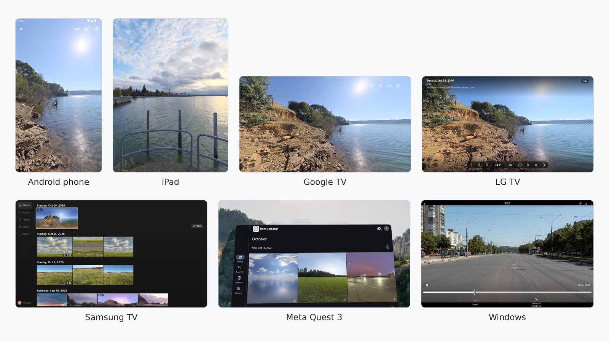

### Apa yang dilakukan skrin anda bersama

Pasang Immuch360 pada setiap skrin yang anda tonton: setiap satu membaca sumber anda sendiri, dan sesetengahnya menyerahkan gambar, fail atau log masuk kepada yang lain. Dalam setiap gambar, ikon Immuch360 menandakan peranti yang menjalankan aplikasi.

#### NAS anda pada setiap skrin

  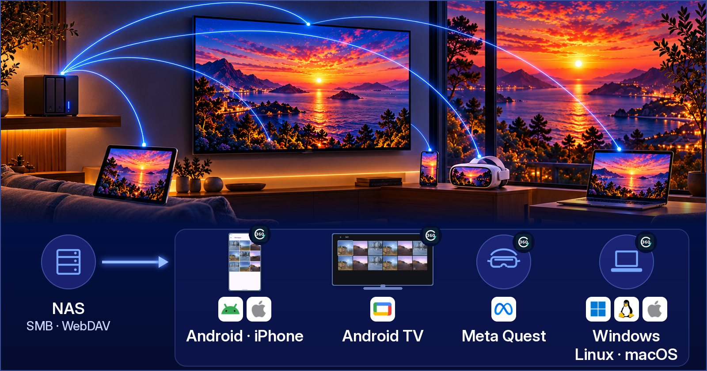

**Anda perlukan:** NAS dengan perkongsian SMB atau WebDAV, dan Immuch360 pada setiap skrin yang anda tonton.

Tambah perkongsian itu pada setiap skrin, dan setiap satu memainkan foto dan video di tempat ia berada, tiada yang disalin: telefon, tablet, Android TV, Meta Quest, komputer Windows, Linux dan macOS, dan TV LG yang log masuk ke pelayan Immich anda (SMB dari webOS 22). Foto 360° berputar sebagai sfera pada telefon dan TV, dan mengelilingi anda dalam headset. Cara melakukannya: [Mainkan fail NAS, komputer, pelayan media atau Plex](#play-the-files-of-a-nas-a-computer-a-media-server-or-plex).

#### Pelayan Immich anda pada setiap skrin, dilog masuk dari telefon anda

  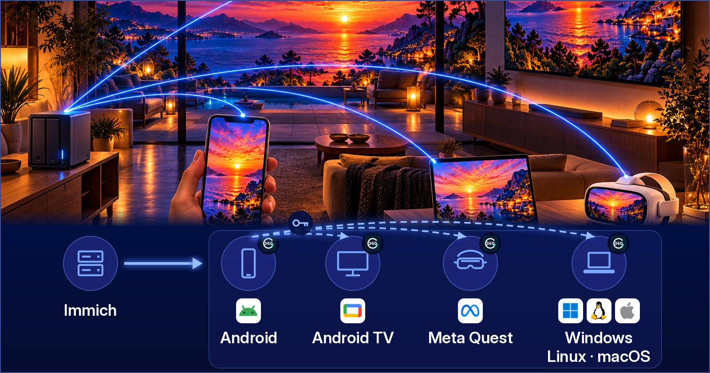

**Anda perlukan:** pelayan Immich, Immuch360 pada telefon Android anda, dan Immuch360 pada skrin yang anda log masukkan: Android TV, Meta Quest, komputer Windows, Linux atau macOS.

Pada telefon, Immuch360 mengekalkan keseluruhan aplikasi mudah alih Immich, menambah pemapar 360°, VR180 dan 3D miliknya, dan dipasang di sebelah aplikasi rasmi. Apabila log masuk ke pelayan anda, ia melog masuk skrin besar: ia mengimbas kod QR TV atau komputer, atau anda menaip padanya kod yang dipaparkan headset, dan kata laluan anda kekal pada telefon. Cara melakukannya: [Log masuk pada TV, headset atau komputer dengan telefon anda](#sign-in-a-tv-a-headset-or-a-computer-with-your-phone).

#### Foto rata anda dalam 3D, dari komputer anda ke headset (eksperimen)

  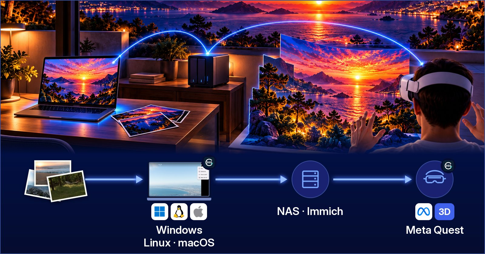

**Anda perlukan:** Immuch360 pada komputer Windows, Linux atau macOS dan dalam Meta Quest, dengan NAS anda di antaranya, atau pelayan Immich anda dengan "Sandarkan juga versi AI" dihidupkan.

Komputer itu sendiri menjadikan foto anda foto 3D dan adegan 3D, dan panorama 360° dengan kad grafik 8 GB pada Windows atau Linux, dan menyimpannya di sebelah fail asal. Headset memaparkan foto 3D dalam 3D sebenar, meletakkan adegan dalam bilik anda dan panorama di sekeliling anda; telefon dan TV membuka panorama dalam pemapar 360° masing-masing. Cara melakukannya: [Jadikan satu foto 3D, adegan, panorama](#turn-one-photo-into-3d-a-scene-a-panorama).

#### Paparan langsung dron anda dalam headset atau pada TV (eksperimen)

  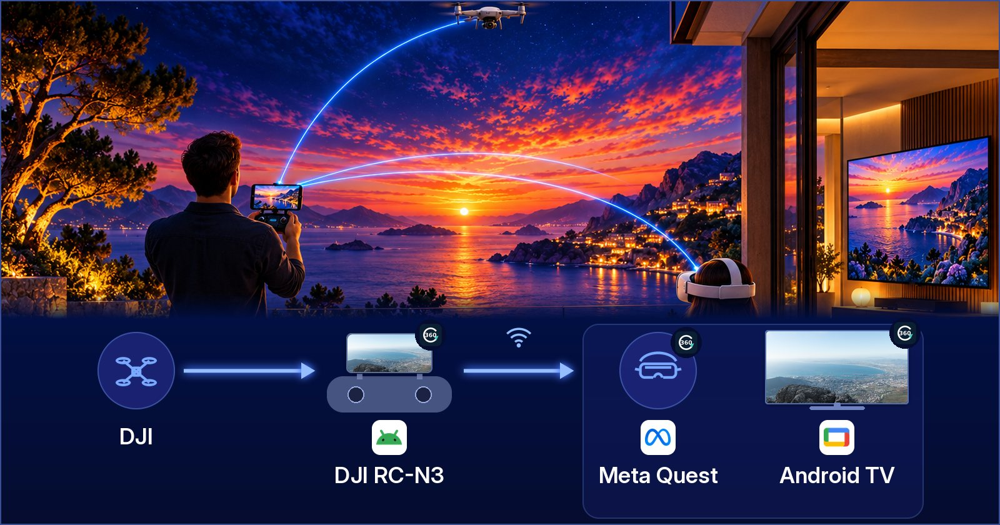

**Anda perlukan:** dron DJI dan pengawal jauh DJI RC-N3nya, Immuch360 pada telefon Android yang dipasang pada pengawal jauh, dan Immuch360 dalam Meta Quest atau pada Android TV.

Telefon memaparkan video langsung dron dan menyalurkannya, melalui Wi-Fi anda atau hotspotnya sendiri, supaya orang yang bersama anda menonton penerbangan dalam headset atau pada TV. Terima sahaja: tiada arahan yang pernah dihantar kepada pengawal jauh atau dron, dan pengawal jauh mengekalkan kawalan penuh. Cara melakukannya: [Tontonnya dalam Meta Quest atau pada Android TV](#watch-it-in-a-meta-quest-or-on-an-android-tv).

#### Fail mentah kamera 360° anda, dicantum di tempat anda menontonnya

  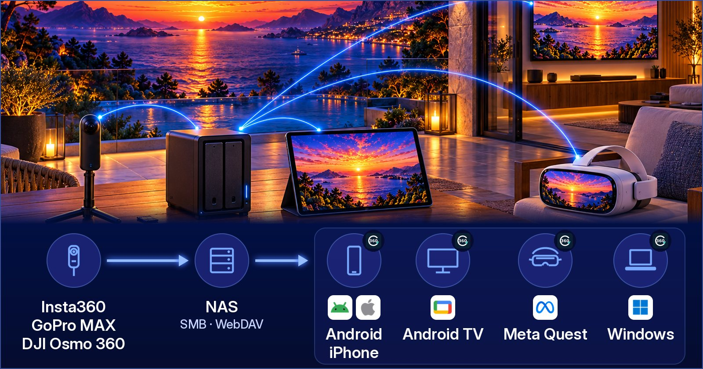

**Anda perlukan:** kamera Insta360, GoPro MAX atau DJI Osmo 360, NAS anda, dan Immuch360 pada skrin: telefon, tablet, Android TV, Meta Quest, Windows.

Salin fail .insp, .insv, .360 atau .osv dari kad kamera ke perkongsian SMB atau WebDAV pada NAS anda, sebagaimana adanya; pelayan Immich juga menerima fail Insta360. Setiap skrin mencantumkannya semasa dimainkan, dengan kalibrasi yang tertulis dalam setiap fail, dan tiada apa yang dieksport dalam aplikasi kamera terlebih dahulu. Cara melakukannya: [Buka fail mentah kamera 360°](#open-the-raw-files-of-360-cameras).

#### Pelayan Plex dan DLNA anda pada TV dan dalam headset

  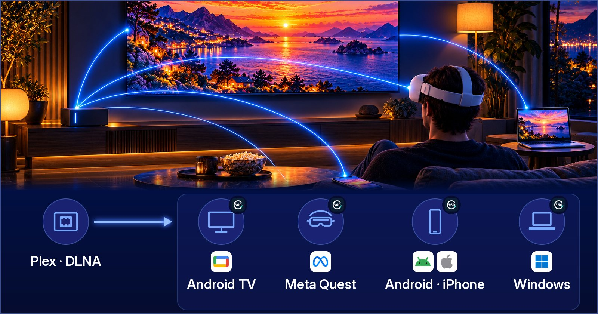

**Anda perlukan:** Plex Media Server atau pelayan DLNA seperti Jellyfin, Emby atau minidlna, dan Immuch360 pada setiap skrin: Android TV, Meta Quest, telefon, tablet, Windows.

Plex memberikan fail asal pustaka anda, jadi video 360° kekal 360°, di sekeliling anda dalam headset, di rumah dan, melalui pemajuan port anda, di luar rumah; pelayan DLNA ditemui pada rangkaian rumah anda. TV LG yang log masuk ke pelayan Immich anda juga memainkannya. Mulai binaan 45, telefon, tablet, Android TV, Quest dan komputer membuka pustaka filem Plex pada setiap filem mengikut tahun, setiap filem dengan halamannya, dan filem yang dipilih pada telefon dimainkan pada Android TV, Quest atau komputer, dengan alat kawalan jauh yang mengawalnya (eksperimen). Cara melakukannya: [Mainkan fail NAS, komputer, pelayan media atau Plex](#play-the-files-of-a-nas-a-computer-a-media-server-or-plex) dan [Tonton filem Plex anda](#watch-your-plex-films).

#### Telefon atau komputer Windows anda, dibuka dalam headset

  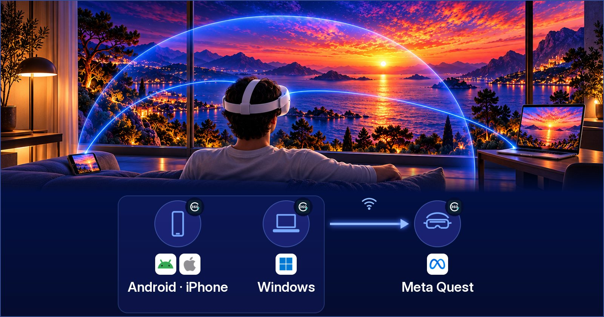

**Anda perlukan:** Immuch360 pada telefon Android, iPhone atau komputer Windows, dan dalam Meta Quest, pada Wi-Fi rumah yang sama.

Hidupkan "Kongsi telefon ini pada rangkaian" pada telefon, atau "Kongsi komputer ini pada rangkaian" pada komputer, dan headset memainkan foto dan videonya, yang 360° di sekeliling anda: tiada pelayan, tiada NAS, tiada muat naik. Pada iPhone, perkongsian berjalan semasa aplikasi berada pada skrin. Cara melakukannya: [Kongsi telefon ini pada rangkaian](../docs/immuch360/user-guide.md#share-this-phone-on-the-network).

#### Kamera Tapo anda pada TV dan dalam headset

  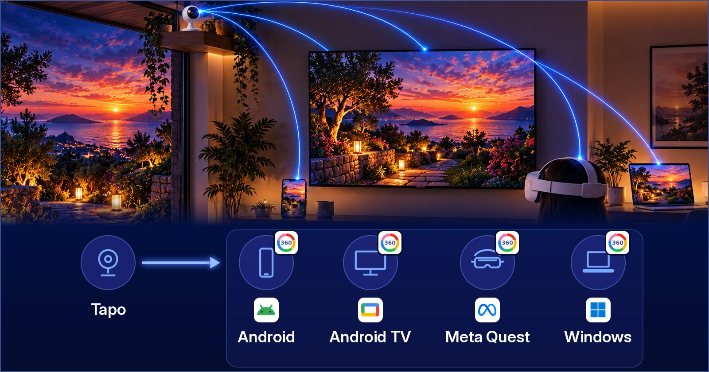

**Anda perlukan:** kamera Tapo pada rangkaian rumah anda, dan Immuch360 pada telefon Android, Android TV, Meta Quest atau komputer Windows.

Setiap skrin memaparkan kamera secara langsung dan memainkan rakaman kad memorinya hari demi hari, di sebelah foto anda, dan telefon menghantar klip ke pelayan Immich anda. Aplikasi bercakap dengan kamera pada rangkaian anda sahaja, tidak pernah melalui pelayan TP-Link. Disemak dengan kamera simulasi. Cara melakukannya: [Tonton kamera rumah anda pada skrin besar](#watch-your-home-cameras-on-the-big-screen).

#### Splat Gaussian dalam bilik anda, dalam Meta Quest 3 atau 3S (eksperimen)

  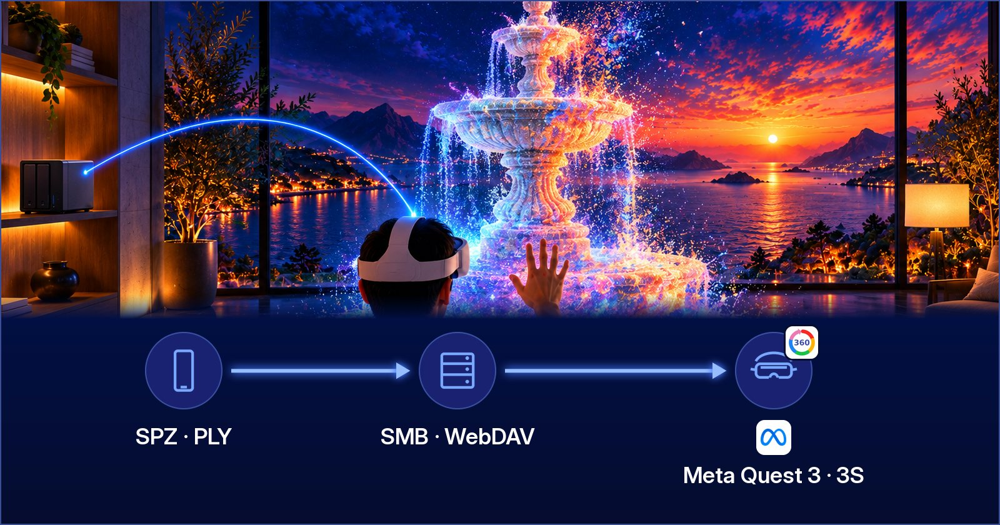

**Anda perlukan:** splat yang dibuat dengan Polycam, Scaniverse, Luma atau alat lain, sebagai fail .spz atau .ply binari pada NAS anda atau dalam headset, dan Immuch360 dalam Meta Quest 3 atau 3S.

Headset meletakkan tempat atau objek itu pada saiznya, di hadapan anda atau di sekeliling anda: berjalan mengelilinginya, meluncur melaluinya dengan thumbstick kiri, berpusing dengan yang kanan. Splat Gaussian menggunakan API eksperimen daripada Meta Spatial SDK, yang tidak disokong mahupun dijamin oleh Meta: sebarang kecacatan ialah tanggungjawab Immuch360 sahaja. Cara melakukannya: [Teroka splat Gaussian dalam Meta Quest 3 atau 3S](#explore-gaussian-splats-in-a-meta-quest-3-or-3s).

#### Meta Quest untuk pengunjung anda (eksperimen)

  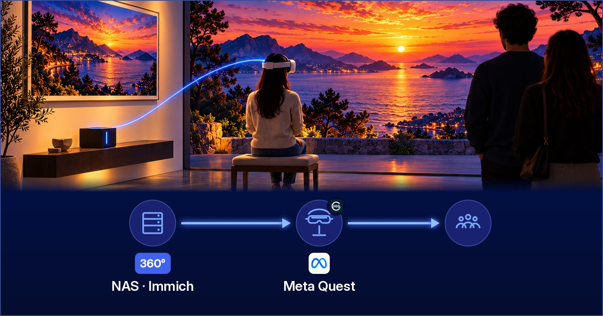

**Anda perlukan:** Meta Quest dengan Immuch360, dan foto atau video 360° dalam headset, pada NAS anda atau pada pelayan Immich anda.

Dalam mod kiosk, headset membuka foto atau video 360° anda dengan sendirinya, dari permulaan, setiap kali pengunjung memakainya, dan filem berakhir pada kad dengan teks anda. Pengunjung tidak menekan apa-apa; anda menahan B atau Y selama satu saat untuk keluar. Cara melakukannya: [Mod kiosk, untuk pameran atau kedai](#kiosk-mode-for-an-exhibition-or-a-shop).

### Apa yang dilakukan setiap skrin

Satu asas kod untuk telefon, tablet, Android TV, Meta Quest dan komputer, dan aplikasi TV berasingan untuk TV LG, yang turut dipakejkan untuk TV Samsung sebagai binaan ujian. Apa yang ada pada setiap satu hari ini:

| Keupayaan | Android | iPhone, iPad | Android TV | LG webOS | Samsung Tizen | Quest |
|---|:---:|:---:|:---:|:---:|:---:|:---:|
| Galeri, album, carian dengan pelayan Immich | ✅ | ✅ | ✅ pemapar | ✅ pemapar | ✅ pemapar | ✅ |
| Garis masa mengikut bulan dan tahun | ✅ | ✅ | ❌ | ❌ | ❌ | ❌ |
| Log masuk dengan telefon anda (kod QR) | ✅ mengimbas kod | ✅ mengimbas kod | ✅ | ✅ dalam pelayar telefon | ❌ ditaip pada TV | ✅ kod ditaip pada telefon |
| Tanpa pelayan: media peranti sendiri | ✅ | ✅ | perkongsian sahaja | ❌ | ❌ | ✅ |
| Folder peranti, dibuka seperti perkongsian | ✅ folder yang anda pilih | ❌ | ❌ | ❌ | ❌ | ✅ |
| Foto dan video rata | ✅ | ✅ | ✅ | ✅ | ✅ | ✅ |
| Foto TIFF | ✅ | ✅ penyahkod sistem | ✅ | ✅ daripada pelayan | ✅ daripada pelayan | ✅ juga dalam paparan imersif |
| Lakaran kecil dan pratonton JPEG XL (Immich 3.4) | ✅ | ✅ penyahkod Immich | ✅ | ❌ "Pratonton tidak tersedia" | ❌ "Pratonton tidak tersedia" | ✅ juga dalam paparan imersif |
| Putar foto dengan satu kekunci | ✅ | ✅ | ✅ kekunci berwarna | ✅ kekunci berwarna | ✅ | ✅ tetingkap |
| Foto 360° sebagai sfera | ✅ | ✅ | ✅ | ✅ | ✅ | ✅ mendalam |
| Video 360° | ✅ | ✅ tiada bar masa | ✅ mesej jika tidak dapat dinyahkod | rata sahaja | rata sahaja | ✅ mendalam |
| Filem disambung di tempat anda berhenti | ✅ | ✅ | ✅ | ❌ | ❌ | ✅ juga dalam paparan imersif |
| Sumber video: fail yang dinyahkod oleh peranti ini | ✅ | ✅ | ✅ | ❌ | ❌ | ✅ |
| Pelayan perlahan: berapa lama video menunggu, dan mengapa | ✅ | peraturan menunggu sendiri | ✅ | ❌ | ❌ | ✅ |
| Video AV2 (eksperimen) | ❌ | ❌ | ❌ | ❌ | ❌ | ❌ |
| 3D dan VR180 | ✅ satu mata | ✅ satu mata | ✅ satu mata | foto satu mata, video rata | foto satu mata, video rata | ✅ 3D sebenar |
| 3D rata mengikut nama fail, skrin lebih tajam yang anda alihkan (eksperimen) | ❌ | ❌ | ❌ | ❌ | ❌ | ✅ |
| Mod kiosk untuk pelawat (eksperimen) | ❌ | ❌ | ❌ | ❌ | ❌ | ✅ |
| Spatial 2.5D (penjejakan kepala) | ✅ eksperimen | ✅ eksperimen | ❌ | ❌ | ❌ | ❌ |
| Foto spatial Apple | ✅ satu mata | ✅ satu mata | ✅ satu mata | ❌ | ❌ | ✅ 3D |
| Splat Gaussian, .spz dan .ply (eksperimen) | ✅ | ❌ | ❌ | ❌ | ❌ | ✅ Quest 3 dan 3S |
| Adegan splat yang disimpan sebagai foto dalam Immich (eksperimen) | ✅ | foto itu | foto itu | foto itu | foto itu | ✅ Quest 3 dan 3S, belum dicuba dalam headset |
| Foto 3D daripada foto 2D (AI) | ✅ membacanya, sebelah-menyebelah | ✅ membacanya, sebelah-menyebelah | ✅ membacanya, sebelah-menyebelah | ✅ membacanya, sebelah-menyebelah | ✅ membacanya, sebelah-menyebelah | ✅ kedalaman AI dalam headset (Quest 3 dan 3S), dipaparkan dalam 3D |
| Adegan 3D daripada foto 2D (AI) | ✅ membacanya, sebagai fotonya | ✅ membacanya, sebagai fotonya | ✅ membacanya, sebagai fotonya | ✅ membacanya, sebagai fotonya | ✅ membacanya, sebagai fotonya | ✅ diterokai dalam 3D |
| Panorama 360° daripada foto 2D (AI) | ✅ membacanya, dengan label AI-nya | ✅ membacanya sebagai foto 360°, label 🔜 | ✅ membacanya, dengan label AI-nya | ✅ membacanya sebagai foto 360°, label 🔜 | ✅ membacanya sebagai foto 360°, label 🔜 | ✅ membacanya di sekeliling anda, dengan label AI-nya |
| Versi 3D di sebelah foto perkongsian (AI) | ✅ dibaca | ✅ dibaca | ✅ dibaca | ✅ dibaca | ❌ | ✅ dibaca |
| Adegan splat daripada foto atau video (AI) | ✅ membacanya | ❌ | ❌ | ❌ | ❌ | ✅ membacanya, Quest 3 dan 3S, belum dicuba dalam headset |
| Fail mentah Insta360, GoPro dan DJI | ✅ | ✅ | ✅ | ❌ | ❌ | ✅ |
| Video 360° mentah yang distabilkan dengan giroskop kamera (eksperimen) | ✅ Insta360, GoPro MAX, DJI Osmo 360, daripada pustaka, perkongsian dan folder anda | 🔜 | ✅ Insta360, GoPro MAX, DJI Osmo 360, daripada pustaka dan perkongsian anda | ❌ | ❌ | 🔜 |
| Perkongsian SMB, WebDAV, DLNA | ✅ | ✅ | ✅ | ✅ SMB mulai webOS 22 | ❌ | ✅ |
| Plex Media Server | ✅ | ✅ | ✅ | ✅ | ❌ | ✅ |
| Kamera Tapo: rakaman | ✅ | ✅ | ✅ | 🔜 tidak sebelum Disember 2026 | ❌ | ✅ |
| Kamera Tapo: paparan langsung | ✅ | ✅ belum dicuba pada iPhone | ✅ | ✅ video sahaja | ❌ | ✅ |
| Kongsi peranti ini pada rangkaian | ✅ | ✅ | ❌ | ❌ | ❌ | ❌ |
| Muat naik ke Immich daripada perkongsian dan peranti | ✅ | ✅ | ❌ | ❌ | ❌ | ✅ |
| Import daripada dron DJI atau kad melalui USB (eksperimen) | ✅ | ❌ | ❌ | ❌ | ❌ | ❌ |
| Video langsung dron DJI (eksperimen) | ✅ dengan RC-N3 | ❌ | ✅ dihantar semula oleh telefon | ❌ | ❌ | ✅ dihantar semula oleh telefon |
| Tema gelap | ikut sistem | ikut sistem | ✅ secara lalai | ✅ satu-satunya tema | ✅ satu-satunya tema | ikut sistem |
| Input | sentuh, giroskop | sentuh, giroskop | alat kawalan jauh; Kiri dan Kanan juga semasa video dan pada bar masanya, Menu untuk butiran | alat kawalan jauh, Magic Remote | alat kawalan jauh | pengawal, tangan |
| Di mana untuk mendapatkannya | Google Play, APK | App Store | Google Play, APK | .ipk, LG Content Store (dalam semakan) | binaan ujian .wgt, ditandatangani oleh anda | Horizon Store, APK |

| Keupayaan | Windows | Linux | macOS |
|---|:---:|:---:|:---:|
| Galeri, album, carian dengan pelayan Immich | ✅ | ✅ | ✅ |
| Garis masa mengikut bulan dan tahun | ✅ Ctrl dan roda | ✅ Ctrl dan roda | ✅ Command dan roda |
| Log masuk dengan telefon anda (kod QR) | ✅ | ✅ (halaman webnya dicuba) | ✅ (cara yang digunakan tidak direkodkan) |
| Tanpa pelayan: media peranti sendiri | ✅ folder | ✅ folder | ✅ folder |
| Folder peranti, dibuka seperti perkongsian | ✅ folder | ✅ folder | ✅ folder |
| Foto dan video rata | ✅ | ✅ | ✅ |
| Foto TIFF | ✅ penyahkod sistem | ❌ lakaran kecil ganti | ✅ penyahkod sistem |
| Lakaran kecil dan pratonton JPEG XL (Immich 3.4) | ✅ | ✅ | ✅ |
| Putar foto dengan satu kekunci | ✅ | ✅ | ✅ |
| Foto 360° sebagai sfera | ✅ | ✅ | ✅ |
| Video 360° | ✅ | rata sahaja | rata sahaja |
| Filem disambung di tempat anda berhenti | ✅ | ✅ | ✅ |
| Sumber video: fail yang dinyahkod oleh peranti ini | ✅ | ✅ | ✅ |
| Pelayan perlahan: berapa lama video menunggu, dan mengapa | ✅ | ✅ | ✅ |
| Video AV2 (eksperimen) | ✅ | ✅ | ✅ disemak oleh CI |
| 3D dan VR180 | ✅ satu mata | foto satu mata, video rata | foto satu mata, video rata |
| 3D rata mengikut nama fail, skrin lebih tajam yang anda alihkan (eksperimen) | ❌ | ❌ | ❌ |
| Mod kiosk untuk pelawat (eksperimen) | ❌ | ❌ | ❌ |
| Spatial 2.5D (penjejakan kepala) | 🔜 dalam pembangunan | ❌ | ❌ |
| Foto spatial Apple | ✅ satu mata | ✅ satu mata, daripada pelayan | ✅ satu mata |
| Splat Gaussian, .spz dan .ply (eksperimen) | ✅ | ✅ | ✅ dibina oleh CI |
| Adegan splat yang disimpan sebagai foto dalam Immich (eksperimen) | ✅ | ✅ | ✅ dibina oleh CI |
| Foto 3D daripada foto 2D (AI) | ✅ | ✅ | ✅ dibina oleh CI |
| Adegan 3D daripada foto 2D (AI) | ✅ | ✅ | ✅ dibina oleh CI |
| Panorama 360° daripada foto 2D (AI) | ✅ kad grafik 8 GB | ✅ kad grafik 8 GB, dijalankan pada saiz kecil pada grafik Intel | 🔜 dalam pelan hala tuju |
| Versi 3D di sebelah foto perkongsian (AI) | ✅ | ✅ | ✅ foto 3D dan adegan |
| Adegan splat daripada foto atau video (AI) | ✅ kad grafik 4 GB | ✅ membacanya | ✅ membacanya, dibina oleh CI |
| Fail mentah Insta360, GoPro dan DJI | ✅ | ✅ foto, video rata | ✅ foto, video rata |
| Video 360° mentah yang distabilkan dengan giroskop kamera (eksperimen) | 🔜 | ❌ | ❌ |
| Perkongsian SMB, WebDAV, DLNA | ✅ | ✅ | ✅ |
| Plex Media Server | ✅ | 🔧 CI | 🔧 CI |
| Kamera Tapo: rakaman | ✅ | 🔧 CI | 🔧 CI |
| Kamera Tapo: paparan langsung | ✅ | 🔧 CI | 🔧 CI |
| Kongsi peranti ini pada rangkaian | ✅ | ❌ | ❌ |
| Muat naik ke Immich daripada perkongsian dan peranti | ✅ | ✅ | ✅ |
| Pilih beberapa foto dengan Ctrl+klik, Shift+klik dan Ctrl+A, tindakan pada klik kanan | ✅ | ✅ | ✅ dengan Command, belum dicuba pada Mac |
| Import daripada dron DJI atau kad melalui USB (eksperimen) | ❌ | ❌ | ❌ |
| Video langsung dron DJI (eksperimen) | ❌ | ❌ | ❌ |
| Tema gelap | ikut sistem | ikut sistem | ikut sistem |
| Input | tetikus, papan kekunci | tetikus, papan kekunci | tetikus, papan kekunci, pad jejak |
| Di mana untuk mendapatkannya | pemasang atau ZIP (pratonton ditandatangani) | .deb, .rpm (pratonton) | DMG atau ZIP (pratonton tidak ditandatangani) |

*Linux dan macOS: binaan desktop 11, dicuba pada 26 Oktober 2026 pada Ubuntu 24.04, dalam bekas dengan pelayan Immich ujian dan perkongsian ujian, dan oleh pengarang pada Mac. Baris AI, dengan binaan ujian kod binaan desktop 13, dari 27 hingga 29 Oktober 2026: foto 3D dibuat oleh aplikasi Linux dalam bekas pada PC Linux, adegan oleh aplikasi Windows pada komputer riba dengan RTX 4060 dan oleh enjin pada PC Linux itu, panorama 360° pada komputer riba itu. Baris binaan 33 hingga 39: paparan bulan dan tahun pada PC Windows dengan binaan desktop 14, versi 3D ditulis ke perkongsian Samba dan WebDAV pada mesin binaan projek, "Semak imbas folder" pada emulator Android 16, permulaan video yang distrim pada emulator Android di sebalik sambungan yang diperlahankan, mod kiosk dan skrin rata lebih tajam dalam Quest 3 dengan binaan 35, fail splat binaan 39 dalam modul splat Quest 3 pada 31 Oktober, dan filem serta sumber video oleh ujian CI dan mesin binaan projek. Baris binaan 41 dan binaan desktop 21: splat pada Galaxy S24+, dalam aplikasi Windows pada komputer riba dengan RTX 4060 dan pada Linux dalam bekas CI, adegan splat yang dibuat oleh komputer riba itu, foto splat terhadap pelayan Immich ujian 3.3.0 dan 3.2.4, dan AV2 pada komputer riba itu, dalam bekas Ubuntu 22.04 dan 24.04 dan, tanpa skrin, pada Mac CI. Baris binaan 42 dan binaan desktop 22: penstabilan oleh ujian CI dan hos binaan projek pada trek gerakan fail sampel kamera Insta360 X3, X4 dan X5, GoPro MAX dan DJI Osmo 360, pilihan Kualiti oleh ujiannya dan ukuran latihannya pada komputer riba dengan RTX 4060, dan lajur iPhone dan iPad daripada versi 3.3.2 App Store.*

✅ dalam aplikasi pada platform itu · ❌ tidak ditawarkan di sana · 🔜 dirancang · 🔧 CI dalam sumber, dibina dan dimulakan oleh CI projek pada sistem itu · rata sahaja: video dimainkan secara rata, dengan mesej, kerana enjin pemaparan video 360° komputer hanya untuk Windows; pada TV LG, sama ada webOS menyerahkan bingkai video kepada sfera masih perlu diukur; pada TV Samsung seorang penguji, pelayar memberikan bingkai video hitam kepada paparan 3D. "Satu mata" bermaksud fail 3D memaparkan mata kirinya pada skrin rata. Lajur LG dan Samsung ialah satu aplikasi TV berasingan: versi LG 1.0.0, yang perkongsian dan Plexnya disemak dengan pelayan sebenar dan kameranya dengan kamera simulasi pada hos binaan projek, dan binaan ujian Samsung 0.3.0. Apa yang disemak di mana, dan apa yang masih perlu disahkan, terdapat dalam [Features](../docs/immuch360/features.md), [Platform support](../docs/immuch360/platform-support.md) dan [Compatibility](../docs/immuch360/compatibility.md).

Dalam baris AI, "membacanya" bermaksud peranti membuka apa yang dibuat oleh komputer, dan tidak membuat apa-apa sendiri: foto 3D memaparkan dua matanya sebelah-menyebelah, adegan dipaparkan sebagai fotonya dengan tanda kecil 3D SCENE, panorama dibuka dalam pemapar 360°. Label AI-nya ialah lencana "360° AI", ayat "Dijana oleh AI di luar tepi foto" dan garis foto asal, yang dibawa oleh pelan hala tuju ke aplikasi iPhone, iPad, LG dan Samsung. Hanya komputer dan Quest yang membuat sesuatu. Apa yang disemak untuk baris ini ada dalam [panduan cara](#turn-one-photo-into-3d-a-scene-a-panorama).

- **Telefon dan tablet Android**: aplikasi lengkap, sentuh dan giroskop, setiap sumber; mulai binaan 32 ia membuka panorama 360° yang dibuat pada komputer dengan label AI-nya; mulai binaan 38 ia menyemak imbas folder peranti, memaparkan foto TIFF, menyambung filem di tempat anda berhenti, dan mulai binaan 39 video yang distrim bermula sebaik sahaja sambungan membenarkan dan memberitahu mengapa ia menunggu. Mulai binaan 41 ia membuka splat Gaussian, dan adegan splat yang disimpan dalam Immich (eksperimen). Mulai binaan 42, pemain 360° menstabilkan video mentah kamera Insta360, GoPro MAX dan DJI Osmo 360 dengan giroskop kamera, daripada pustaka Immich anda, perkongsian atau folder peranti (eksperimen).
- **iPhone dan iPad**: aplikasi lengkap; pemain video 360° hanya mempunyai main dan jeda, dan carian DLNA menghantar permintaan unicast sehingga Apple memberikan keizinan multicast. Versi 3.3.2, diterbitkan pada 6 November 2026, telah membawa bahagian telefon bagi log masuk dengan telefon anda, bulan dan tahun garis masa, filem yang disambung di tempat anda berhenti, sumber video dan paparan langsung Tapo, belum dicuba pada iPhone. Versi 3.3.3, diterbitkan pada 9 November 2026, telah membawa notis kemas kini yang membuka App Store. Versi 3.3.4, di App Store sejak 10 November 2026, mempunyai kandungan 3.3.3 serta pembetulan binaan 44. Versi 3.4.0, dihantar kepada Apple bersama binaan 45, membawa pembetulan Immich 3.4.0, foto JPEG XL pelayan Immich 3.4, notis kemas kini bagi jurang satu versi utama, filem Plex mengikut tahun, halamannya, muat turunnya selagi aplikasi kekal terbuka dan "Mainkan pada…" ke TV atau komputer (eksperimen), serta gesaan App Store sendiri untuk menilai aplikasi; menu audio dan sari kata Plex belum ada pada iPhone dan iPad.
- **Android TV dan Google TV**: APK yang sama, dikawal oleh alat kawalan jauh, gelap secara lalai; satu pemapar: sandaran, muat naik dan penyunting disembunyikan dan butiran adalah baca sahaja, tetapi foto masih boleh diputar dengan satu kekunci. Setiap penapis carian berfungsi dengan alat kawalan jauh: Lokasi dan Kamera membuka pilihannya dalam senarai, penapis tarikh memaparkan semua pilihannya, dan helaian pilihan Tag, Lokasi, Tarikh, Jenis Media, Penarafan Bintang dan Paparan meletakkan Kosongkan dan Guna di sebelah pilihan, hanya satu Kanan jauhnya, pada sebahagian besar ketinggian skrin. Grid foto menggunakan kurang memori imej, dan anak panah yang ditekan lama menggerakkannya paling banyak kira-kira 10 baris sesaat. Mulai binaan 28 ia log masuk daripada telefon, melalui kod QR atau kod pendeknya (dicuba antara dua emulator dengan kod ditaip). Mulai binaan 29 bar masa video menerima fokus alat kawalan jauh, filem mendapat menu audio dan sari kata, dan fail seterusnya dalam perkongsian dibuka dengan kawalannya sendiri. Disemak pada emulator Google TV; binaan 28 berjalan pada Android TV sebenar pada 23 Oktober, dan masalah video yang ditemui di sana ialah pembetulan binaan 29, yang disemak pada emulator. Mulai binaan 30, kad Dronnya memaparkan video langsung dron DJI yang dihantar semula oleh telefon, dengan nilai dron dan cincin halangan (eksperimen): pemasangan dan gambar dicuba pada Android TV TCL pada 25 Oktober, dengan tersekat-sekat dan warna kehijauan pada penghantaran semula yang terdahulu; pada 26 Oktober, dengan binaan 30, strim stabil yang menjawab masalah itu memastikan gambar TV itu terus sampai semasa penerbangan, dengan 7 kali beku. Mulai binaan 33, carian dan julat tarikhnya berfungsi dengan alat kawalan jauh, foto memaparkan tarikhnya di kiri bawah, dan tekanan pantas pada bar masa melompat lebih jauh; mulai binaan 38, filem disambung di tempat anda berhenti, dan foto TIFF dipaparkan. Mulai binaan 42, pemain 360° menstabilkan video mentah kamera Insta360, GoPro MAX dan DJI Osmo 360 dengan giroskop kamera, daripada pustaka Immich anda atau perkongsian (eksperimen).
- **TV LG dengan webOS 5.0 dan ke atas**: aplikasi berasingan untuk alat kawalan jauh dan Magic Remote, dibina atas [immich-tv-webos](https://github.com/Seeky91/immich-tv-webos): pemapar Immich dengan foto 360° pada sfera, foto diputar dengan satu kekunci, tema gelap dan 89 bahasa aplikasi (beberapa teks aplikasi TV itu sendiri dalam bahasa Inggeris buat masa ini); perkongsian rangkaian, Plex dan paparan langsung kamera Tapo, melalui perkhidmatannya sendiri pada TV (SMB mulai webOS 22); video 360° rata. Versi 1.0.0, dihantar ke LG Content Store pada 24 Oktober, berjalan pada TV webOS 25 tiga model di Cloud Test Lab LG: log masuk, halaman log masuk telefon, foto, album, video, paparan 360°, tayangan slaid, carian dan Back dari setiap halaman. Versi 0.1.0 berjalan pada TV LG seorang penguji (webOS 22). Perkongsian dan Plex disemak dengan pelayan sebenar dan kamera dengan kamera simulasi pada hos binaan projek.
- **TV Samsung dengan Tizen 5.5 dan ke atas**: aplikasi TV LG yang dipakejkan untuk TV Samsung, binaan ujian 0.3.0, untuk ditandatangani dan dipasang sendiri: pemapar Immich untuk alat kawalan jauh, dilog masuk dengan menaip (alamat pelayan, kemudian e-mel dan kata laluan atau kunci API), dengan tayangan slaid, foto 360° pada sfera, foto diputar dengan satu kekunci dan halaman Perihal yang menyatakan apa yang disokong oleh TV; log masuk dengan telefon, perkongsian, Plex dan kamera ada dalam pelan hala tujunya; video 360° rata, dengan notis. Versi 0.1.0 berjalan pada TV Samsung seorang penguji dengan Tizen 9: foto dan video sehingga 4K dimainkan, tiada apa-apa melebihi 4K dinyahkod, dan pelayar TV memberikan bingkai video hitam kepada paparan 3D. Versi 0.2.0 mengandungi pembaikan daripada ujian itu (mesej untuk video yang melebihi penyahkod TV atau yang tersekat, video 360° rata dengan notis) dan disemak oleh CI projek dalam pelayar yang menggantikan TV. Binaan ujian 0.3.0 menambah zum foto dan pil Memuatkan daripada versi LG 1.0.1, belum dijalankan pada TV Samsung.
- **Meta Quest 2, Pro, 3 dan 3S**: aplikasi sebagai tetingkap, ditambah paparan mendalam dan, mulai binaan 30, kad Dron yang memaparkan video langsung dron DJI yang dihantar semula oleh telefon (eksperimen), diuji buat kali pertama dengan binaan 30; HEVC ialah kodek yang selamat, H.264 terhenti sekitar 4096x2304 pada Quest 3; aplikasi ini disemak pada Quest 3. Mulai binaan 32, pada Quest 3 atau 3S, kedalaman AI memaparkan foto rata dalam 3D, dikira dalam headset, dan foto 3D, adegan dan panorama yang dibuat pada komputer dibuka dalam 3D (eksperimen). Mulai binaan 33, skrin 3D rata yang anda alihkan dan mod kiosk; mulai binaan 38, filem yang disambung dan foto TIFF dalam paparan imersif; mulai binaan 39, splat Gaussian pada Quest 3 dan 3S.
- **Windows 10 dan 11**: pratonton, dengan folder dan bukan galeri, pemain video sendiri (libmpv) untuk video rata dan 360°, fail mentah dicantumkan pada cip grafik, fail dan folder yang dibuka dengan program atau dilepaskan pada tetingkap, pemasang atau ZIP, ditandatangani oleh APROGSYS; mulai binaan desktop 13, "Buat 3D (AI)" menjadikan foto anda foto 3D dan adegan 3D pada pemproses, dan panorama 360° pada kad grafik 8 GB. Mulai binaan desktop 16, "Buat 3D (AI)" juga berfungsi pada foto perkongsian rangkaian, mulai binaan desktop 17 video dimainkan daripada fail yang dinyahkod oleh komputer ini, mulai binaan desktop 18 filem disambung di tempat anda berhenti, dan mulai binaan desktop 19 filem daripada pelayan yang perlahan terus dimainkan dan memberitahu mengapa ia menunggu. Mulai binaan desktop 20, tetingkap ditutup serta-merta, walaupun ketika filem menunggu perkongsian rangkaian: filem yang terbuka menyimpan tempat ia berhenti, dan log sesi itu ditulis. Mulai binaan desktop 21, aplikasi berjalan pada cip grafik laju sebuah komputer riba yang mempunyai dua, dan butiran video memberitahu bagaimana filem dinyahkod. Binaan yang sama membuka splat Gaussian, membuat adegan splat daripada foto anda atau video pada kad grafik 4 GB, dan memainkan video AV2, semuanya eksperimen. Mulai binaan desktop 22, panorama 360° bermula dengan 3.5 GiB kad grafik bebas, dan adegan splat datang dalam tiga kualiti, Set kepala, Terperinci dan Maksimum (eksperimen).
- **Linux**: pakej .deb dan .rpm yang dibina oleh CI projek, dipasang dan disemak pada Ubuntu 22.04 dan 24.04, Debian 12 serta Fedora 40 dan 44; foto, foto 360° dan video rata melalui libmpv sistem (video 360°, 3D dan mentah dimainkan secara rata dengan mesej), dilukis melalui laluan perkakasan pada sesi X11 juga sejak binaan desktop 7; perkongsian SMB daripada Ubuntu 22.04 dan Debian 12 ke atas; tanpa rantai kunci (GNOME Keyring atau KWallet) aplikasi tidak lagi tergantung selama 25 saat pada permulaan pertamanya: ia menyimpan kata laluan untuk sesi itu sahaja dan memaklumkannya dalam tetapannya; mulai binaan desktop 13, "Buat 3D (AI)" membuat foto 3D dan adegan pada pemproses, dan panorama 360° pada kad grafik 8 GB (dicuba hanya pada saiz kecil, pada grafik Intel); disemak di bawah WSLg dan dalam bekas. Mulai binaan desktop 16, "Buat 3D (AI)" juga berfungsi pada foto perkongsian rangkaian, mulai binaan desktop 17 video dimainkan daripada fail yang dinyahkod oleh komputer ini, mulai binaan desktop 18 filem disambung di tempat anda berhenti, dan mulai binaan desktop 19 filem daripada pelayan yang perlahan terus dimainkan dan memberitahu mengapa ia menunggu. Mulai binaan desktop 20, tetingkap ditutup serta-merta, walaupun ketika filem menunggu perkongsian rangkaian: filem yang terbuka menyimpan tempat ia berhenti, dan log sesi itu ditulis. Mulai binaan desktop 21, ia membuka splat Gaussian dan memainkan video AV2 (eksperimen). Mulai binaan desktop 22, panorama 360° bermula dengan 3.5 GiB kad grafik bebas.
- **macOS**: DMG dan ZIP yang dibina oleh CI projek, universal, tidak ditandatangani (Gatekeeper bertanya sekali); ia dimulakan, membuka fail dan folder yang diberikan kepadanya, termasuk daripada Finder, menyimpan rahsianya dalam rantai kunci log masuk dan memainkan video rata dengan libmpv sendiri, mula-mula disemak pada Mac CI projek; pada 26 Oktober 2026 pengarang mencuba binaan desktop 11 pada Mac, dan ia berfungsi. Mulai binaan desktop 13, aplikasi Mac yang dibina oleh CI projek juga membuat foto 3D dan adegan pada pemproses, dan panorama 360° pada Mac ada dalam pelan hala tuju. Mulai binaan desktop 16, "Buat 3D (AI)" juga berfungsi pada foto perkongsian rangkaian, mulai binaan desktop 17 video dimainkan daripada fail yang dinyahkod oleh komputer ini, mulai binaan desktop 18 filem disambung di tempat anda berhenti, dan mulai binaan desktop 19 filem daripada pelayan yang perlahan terus dimainkan dan memberitahu mengapa ia menunggu. Mulai binaan desktop 20, tetingkap ditutup serta-merta, walaupun ketika filem menunggu perkongsian rangkaian: filem yang terbuka menyimpan tempat ia berhenti, dan log sesi itu ditulis. Mulai binaan desktop 21, aplikasi Mac yang dibina oleh CI projek juga membuka splat Gaussian dan memainkan video AV2 (eksperimen), belum dicuba pada Mac.

## Apa yang anda boleh lakukan

Setiap baris membuka panduan caranya di bawah. Panduan lengkap, dengan setiap pilihan, mesej dan had, terdapat dalam [panduan pengguna](../docs/immuch360/user-guide.md).

1. [Tonton foto dan video anda, dengan atau tanpa pelayan](#watch-your-photos-and-videos-with-or-without-a-server): galeri dan pemain, pada peranti sahaja atau dengan pelayan Immich anda.
2. [Lihat sekeliling foto dan video 360°, panorama, VR180 dan 3D](#explore-panoramas-360-vr180-and-3d): sfera yang anda putar dengan jari, telefon atau alat kawalan jauh.
3. [Jadikan satu foto sebagai foto 3D, adegan 3D atau panorama 360°](#turn-one-photo-into-3d-a-scene-a-panorama): dibuat oleh AI pada komputer anda, dilihat dalam 3D dalam Meta Quest, yang juga memberi kedalaman kepada mana-mana foto rata. *Baharu, eksperimen.*
4. [Tonton pada TV dengan alat kawalan jauh](#watch-on-the-tv-with-the-remote): Android TV dan Google TV, TV LG, dan TV Samsung sebagai binaan ujian.
5. [Log masuk pada TV, headset atau komputer dengan telefon anda](#sign-in-a-tv-a-headset-or-a-computer-with-your-phone): imbas kod QRnya, sahkan, tonton.
6. [Masuk ke dalam foto dan video anda dengan Meta Quest](#step-inside-your-photos-and-videos-with-a-meta-quest): 360° di sekeliling anda, 3D dalam 3D sebenar.
7. [Teroka splat Gaussian dalam Meta Quest 3 atau 3S](#explore-gaussian-splats-in-a-meta-quest-3-or-3s): tangkapan 3D Polycam, Scaniverse atau Luma, di dalam bilik anda. *Eksperimen.*
8. [Teroka splat Gaussian pada telefon, tablet atau komputer anda](#explore-gaussian-splats-on-your-phone-tablet-or-computer): pada telefon atau tablet Android, atau pada Windows, Linux dan macOS, dan anda berjalan melalui adegan itu. *Eksperimen.*
9. [Buat adegan splat daripada foto anda atau video (AI)](#make-a-splat-scene-from-your-photos-or-a-video-ai): tempat atau objek yang dibina semula pada komputer Windows, untuk anda berjalan melaluinya. *Eksperimen.*
10. [Simpan adegan splat pada pelayan Immich anda](#keep-a-splat-scene-on-your-immich-server): di dalam foto adegan itu, dibuka dari garis masa anda. *Eksperimen.*
11. [Mainkan fail NAS, komputer, pelayan media atau Plex](#play-the-files-of-a-nas-a-computer-a-media-server-or-plex): di tempatnya, tiada apa-apa disalin; dan [filem Plex anda](#watch-your-plex-films), mengikut tahun, setiap satu dengan halamannya, dimuat turun untuk perjalanan atau dimainkan pada TV dari telefon anda (eksperimen).
12. [Semak imbas folder telefon atau headset anda](#browse-a-folder-of-your-phone-or-headset): folder peranti dibuka seperti perkongsian, termasuk foto TIFF-nya.
13. [Sambung filem di tempat anda berhenti](#pick-up-a-film-where-you-stopped): bar pada lakaran kecilnya, dan ia disambung di tempat anda tinggalkan.
14. [Apabila video menunggu atau tidak dimainkan](#when-a-video-waits-or-will-not-play): fail yang dinyahkod oleh peranti ini, berapa lama sehingga bermula, dan mengapa.
15. [Kekalkan pustaka Immich anda, dengan lebih banyak lagi](#keep-your-immich-library-with-more): aplikasi mudah alih Immich, ditambah pemapar mendalam dan skrin besar.
16. [Cari bulan atau tahun dalam garis masa yang panjang](#find-a-month-or-a-year-in-a-long-timeline): bulan, kemudian tahun, satu ketikan untuk membuka.
17. [Tonton kamera Tapo anda](#watch-your-home-cameras-on-the-big-screen): secara langsung, dan rakaman kad memorinya; disemak dengan kamera simulasi.
18. [Lihat video langsung dron DJI anda pada telefon anda](#see-what-your-drone-sees-on-your-phone), dan [dalam Meta Quest atau pada Android TV](#watch-it-in-a-meta-quest-or-on-an-android-tv): melalui pengawal jauh DJI RC-N3, terima sahaja. *Eksperimen.*
19. [Bawa foto dan video dron atau kad kamera ke Immich](#bring-a-drones-or-a-camera-cards-photos-and-videos-to-immich): melalui USB, daripada telefon Android. *Eksperimen.*
20. [Buka fail mentah kamera 360°](#open-the-raw-files-of-360-cameras): Insta360, GoPro MAX dan DJI Osmo 360, dicantum oleh aplikasi.
21. [Stabilkan video 360° anda dengan giroskop kamera (eksperimen)](#stabilise-your-360-videos-with-the-cameras-gyroscope-experimental): ufuk rata dan goncangan hilang, dalam pemain 360° telefon, tablet dan TV Android.
22. [Putar foto dengan satu kekunci](#turn-a-photo-with-one-key): butang, kekunci papan kekunci atau kekunci berwarna alat kawalan jauh.
23. [Gunakan komputer anda sebagai pemain media](#use-your-computer-as-the-media-player): folder anda, Open with, fail yang dilepaskan pada tetingkap, beberapa foto yang dipilih dengan Ctrl, Shift dan Ctrl+A. *Pratonton.*
24. [Mainkan video AV2 pada komputer anda](#play-av2-videos-on-your-computer): dinyahkod oleh pemproses, selaju yang dibenarkan oleh komputer anda. *Eksperimen.*

## Dapatkan pada peranti anda

Ambil aplikasi daripada kedai peranti anda di mana ia diterbitkan, atau daripada halaman [Releases](https://github.com/freeKC/Immuch360/releases) sementara itu. [Halaman muat turun laman web](https://immuch360.com/ms/download/) mengumpulkan pautan yang sama.

### Telefon dan tablet Android

1. [Google Play](https://play.google.com/store/apps/details?id=com.aprogsys.immuch360), atau APK pada halaman [Releases](https://github.com/freeKC/Immuch360/releases): `Immuch360-v<version>-arm64-v8a-release.apk` untuk telefon; `Immuch360-v<version>-release.apk` yang universal berfungsi di mana-mana.
2. Aplikasi dipasang bersebelahan dengan aplikasi Immich rasmi. APK daripada GitHub tidak mengemas kini dirinya sendiri: pantau halaman Releases; setelah anda memasang aplikasi daripada kedai, dapatkan kemas kini daripada kedai itu. Mulai binaan 43, butang notis kemas kini aplikasi, dalam menu profil, membuka halaman aplikasi di Google Play, atau di App Store pada iPhone dan iPad. Mulai binaan 45, "Kemaskini aplikasi tersedia" dipaparkan apabila pelayan Immich anda mendahului dengan satu versi utama penuh (Immich 4), dan tidak lagi untuk pelayan 3.x yang lebih baharu atau versi ujian bagi keluaran yang sama.

### iPhone dan iPad

1. [App Store](https://apps.apple.com/us/app/immuch360-360-3d-player/id6817655965): versi 3.3.4, diterbitkan pada 10 November 2026, kandungan 3.3.3 (9 November 2026) serta pembetulan binaan 44; versi 3.4.0, versi iPhone dan iPad bagi binaan 45, dihantar kepada Apple bersama binaan 45. Atau bina aplikasi dengan Xcode pada Mac, lihat [Bina sendiri](../docs/immuch360/build.md).
2. Ketik "Guna tanpa pelayan", atau "Sambung ke pelayan Immich" untuk log masuk dengan pelayan anda; kedua-duanya terdapat pada halaman selamat datang daripada binaan 24.

### Android TV dan Google TV

1. Google Play menawarkan aplikasi ini pada Android TV dan Google TV: cari Immuch360 dalam Google Play pada TV. Tanpa Google Play, dapatkan `Immuch360-v<version>-release.apk` yang universal daripada halaman [Releases](https://github.com/freeKC/Immuch360/releases).
2. Pada TV, hidupkan pilihan pembangun dan penyahpepijatan USB (pada Google TV: Tetapan, Sistem, Perihal, pilih "Android TV OS build" tujuh kali, kemudian Tetapan, Sistem, Pilihan pembangun; nama berbeza antara TV).
3. Daripada komputer dalam rangkaian yang sama, dengan adb (Android SDK Platform Tools): `adb connect <address of the TV>`, terima gesaan pada TV, kemudian `adb install -r Immuch360-v<version>-release.apk`.
4. Aplikasi dipaparkan dalam senarai aplikasi TV, dengan sepanduknya. Pasang keluaran seterusnya dengan cara yang sama: `-r` mengekalkan log masuk dan tetapan.

### TV LG (webOS)

1. Versi 1.0.0 dalam semakan LG. Sehingga ia berada di LG Content Store, ia dipasang dalam Developer Mode: anda memerlukan TV LG dengan webOS 5.0 atau lebih baharu, komputer pada rangkaian yang sama dan akaun pembangun LG percuma. Pada TV, pasang Developer Mode daripada LG Content Store, log masuk, hidupkan Dev Mode Status dan biarkan TV dimulakan semula; catat alamat IP-nya dan frasa laluan yang dipaparkan oleh aplikasi.
2. Pada komputer, pasang webOS CLI (Node.js 18 atau lebih baharu): `npm install -g @webos-tools/cli`, kemudian daftarkan TV dengan `ares-setup-device` (alamat IP-nya, port 9922, pengguna `prisoner`) dan `ares-novacom --device <name> --getkey`, yang meminta frasa laluan.
3. Daripada [pra-keluaran webOS 1.0.1](https://github.com/freeKC/Immuch360/releases/tag/webos-v1.0.1), muat turun `Immuch360-webOS-1.0.1.ipk` untuk TV UHD, atau `Immuch360-webOS-1.0.1-1280x720.ipk` untuk TV Full HD, yang diberikan aplikasi 1280x720 oleh LG. Semaknya dengan `SHA256SUMS.txt`, kemudian `ares-install --device <name> Immuch360-webOS-1.0.1.ipk`. [webOS Dev Manager](https://github.com/webosbrew/dev-manager-desktop) daripada webosbrew melakukan perkara yang sama tanpa baris arahan.
4. Sesi Developer Mode bertahan 1000 jam dan butang EXTEND dalam aplikasi Developer Mode memperbaharuinya; apabila ia tamat, TV membuang aplikasi yang dipasang dengan cara ini. Butirannya terdapat dalam [webos/README.md](../webos/README.md#install-on-a-tv-in-developer-mode).
5. Setelah aplikasi berada di LG Content Store, buang salinan Developer Mode dan pasangnya daripada kedai.

### TV Samsung (Tizen)

1. Binaan ujian 0.3.0 tiada di kedai Samsung: anda memasangnya sendiri. Anda memerlukan TV Samsung dengan Tizen 5.5 atau lebih baharu (model 2020 dan seterusnya), komputer pada rangkaian yang sama dan akaun Samsung. Pada TV: Apps, App Settings, taip 12345, hidupkan Developer mode, masukkan alamat IP komputer, kemudian mulakan semula TV.
2. Muat turun `Immuch360-Tizen-0.3.0.wgt` daripada [pra-keluaran Tizen](https://github.com/freeKC/Immuch360/releases/tag/tizen-v0.3.0) dan semaknya dengan `SHA256SUMS.txt`. TV Samsung hanya memasang aplikasi yang ditandatangani untuknya, jadi pakej mesti ditandatangani semula dengan sijil Samsung yang menyenaraikan DUID TV anda: [Apps2Samsung](https://github.com/Apps2Samsung/Apps2Samsung), alat komuniti, membaca DUID, menandatangani pakej dengan akaun Samsung anda dan memasangnya; Tizen Studio dengan Samsung Certificate Extension melakukan perkara yang sama secara manual.
3. Buka aplikasi dan log masuk dengan menaip alamat pelayan anda, kemudian e-mel dan kata laluan anda atau kunci API. Perihal TV ini memaparkan apa yang disokong oleh TV, sebagai teks dan sebagai kod QR: teks itu, yang dihantar dalam [Issues](https://github.com/freeKC/Immuch360/issues) atau [Discussions](https://github.com/freeKC/Immuch360/discussions) bersama apa yang tidak berfungsi, paling membantu.

### Meta Quest

1. Daripada [Horizon Store](https://www.meta.com/experiences/immuch360/1384208401440714/): versi kedai, dikemas kini apabila Meta menyemak setiap penyerahan.
2. Atau sideload fail `-quest-release.apk` daripada satu [release](https://github.com/freeKC/Immuch360/releases) dalam mod pembangun dengan adb atau SideQuest: `adb install -r Immuch360-v<version>-quest-release.apk`, kemudian buka Pustaka headset, "Sumber tidak diketahui".
3. Versi kedai dan APK GitHub ditandatangani dengan kunci yang berbeza: untuk bertukar daripada satu ke yang lain, nyahpasang aplikasi dahulu, yang akan menghilangkan log masuk, tetapan dan senarai perkongsian rangkaian. Mulai binaan 44, notis kemas kini aplikasi, dalam menu profil, membuka halaman Horizon Store dalam versi kedai, dan halaman Releases dalam APK GitHub.

### Windows

1. Muat turun `Immuch360-Desktop-3.4.0-desktop.25-windows-x64-setup.exe` daripada [pra-keluaran desktop](https://github.com/freeKC/Immuch360/releases/tag/desktop-v3.4.0-25) (dengan `SHA256SUMS.txt` untuk menyemaknya) dan buka. Pemasang dan ZIP telah ditandatangani; Windows memaparkan APROGSYS sebagai penerbit. Selagi penerbit itu masih baharu bagi SmartScreen, ia mungkin masih bertanya sekali: "More info", kemudian "Run anyway".
2. Pilih "Install for me only" (tanpa hak pentadbir) atau "Install for all users", kemudian bahasa pemasang, iaitu bahasa Windows yang telah dipilih.
3. Mulakan Immuch360 Desktop daripada Start menu. Foto dan video mendapatnya dalam "Open with" (klik kanan fail, Open with); ia tidak sekali-kali menjadikan dirinya program lalai mereka. Permulaan pertama binaan baharu boleh mengambil masa sehingga satu minit semasa Windows mengimbas fail-fail itu.
4. Windows 10 atau 11, 64 bit. Untuk mengemas kini, buka pemasang binaan seterusnya: log masuk, folder dan tetapan anda kekal. Mulai binaan desktop 24, notis kemas kini dalam menu profil membuka [halaman muat turun](https://immuch360.com/ms/download/) laman web. ZIP bagi keluaran yang sama ialah program yang sama dalam bentuk folder, untuk dinyahzipkan di mana-mana dan memulakan `immuch360.exe` daripadanya. Pada komputer di mana binaan desktop 4 hingga 8 terhenti semasa permulaan pada "duplicate column name: group_date", binaan 9 membuka pangkalan data itu dan mengekalkan data anda.

### Linux

Pada Ubuntu 22.04 atau lebih baharu dan Debian 12 atau lebih baharu: `sudo apt install ./Immuch360-Desktop-3.4.0-desktop.25-linux-amd64.deb`; pada Fedora 40 atau lebih baharu: `sudo dnf install ./Immuch360-Desktop-3.4.0-desktop.25-linux-x86_64.rpm`, kedua-duanya daripada [pra-keluaran desktop](https://github.com/freeKC/Immuch360/releases/tag/desktop-v3.4.0-25). Kemudian mulakan Immuch360 Desktop daripada aplikasi anda. Pratonton: folder komputer, foto dan foto 360° sebagai sfera, dan video rata melalui libmpv sistem, yang dipasang oleh pakej (video 360°, 3D dan mentah dimainkan secara rata, dengan mesej); perkongsian SMB berfungsi daripada Ubuntu 22.04 dan Debian 12 ke atas. Pada Fedora, video kamera memerlukan FFmpeg daripada RPM Fusion. Tanpa GNOME Keyring atau KWallet, kata laluan disimpan untuk sesi itu sahaja, dan tetapan aplikasi memaklumkannya.

### macOS

Buka `Immuch360-Desktop-3.4.0-desktop.25-macos.dmg` daripada [pra-keluaran desktop](https://github.com/freeKC/Immuch360/releases/tag/desktop-v3.4.0-25) dan seret aplikasi ke Applications (Apple silicon dan Intel, macOS 12 atau lebih baharu). Ia tidak ditandatangani, jadi macOS bertanya sekali: Control klik padanya dan pilih Open pada macOS 14 dan lebih awal, atau pilih "Open Anyway" dalam System Settings, Privacy & Security pada macOS 15 dan lebih baharu. Pengarang mencuba binaan desktop 11 pada Mac pada 26 Oktober 2026, dan ia berfungsi; laporan daripada Mac dan versi macOS lain dialu-alukan.

## Cara melakukannya

Setiap bahagian menyatakan apa yang anda dapat, kemudian langkah-langkahnya, kemudian hadnya. [Panduan pengguna](../docs/immuch360/user-guide.md) mempunyai setiap pilihan dan mesej.

### Tonton foto dan video anda, dengan atau tanpa pelayan

Immuch360 pertama sekali ialah galeri dan pemain untuk foto dan video biasa, dan ia tidak memerlukan akaun mahupun pelayan. "Guna tanpa pelayan" membuka aplikasi pada foto dan video peranti, dengan setiap pemapar, senarai 360° dan sumber rangkaian, dan tiada apa-apa yang meninggalkan peranti. Dengan pelayan Immich, garis masa, album, kegemaran, kenangan dan carian datang daripadanya. Video dimainkan dalam pemain asli dengan bunyi, carian kedudukan, penunjuk penimbalan dan pilihan trek audio, dalam pemain 360°, Spatial dan komputer dan, mulai binaan 29, dalam pemain rata aplikasi Android, yang turut memaparkan sari kata.

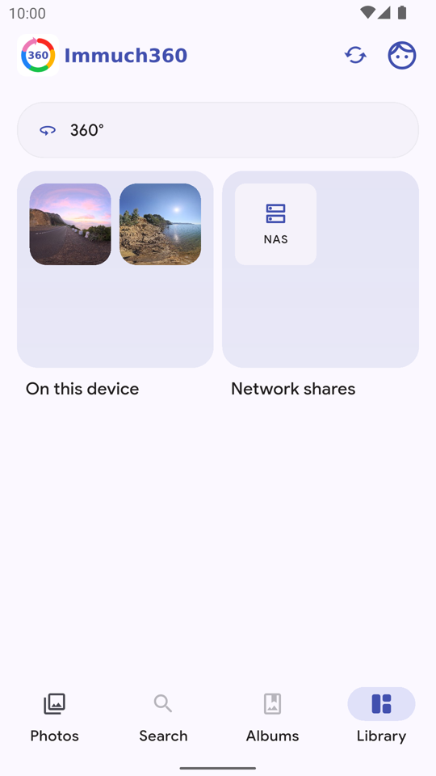

1. Buka aplikasi. Halaman selamat datang memaparkan "Media anda. Semua skrin. Setiap sudut pandang." dan tiga pilihan: ketik yang pertama, "Guna tanpa pelayan". Pelayan boleh disambungkan kemudian, daripada Tetapan atau tab Pustaka.
2. Benarkan akses kepada foto dan video anda. Jika anda menolak, aplikasi menyatakan "Aplikasi tidak dapat melihat foto pada peranti ini", dengan "Benarkan akses" dan "Buka tetapan".
3. Tab Foto menunjukkan garis masa peranti; Cari dan Album kekal dikelabukan, kerana ia datang daripada pelayan. Tab Pustaka mempunyai 360° di atas, kemudian Pada peranti ini (album peranti) dan Perkongsian rangkaian. Menu di bahagian atas kanan menyatakan "Peranti ini sahaja": tiada apa-apa dihantar ke mana-mana.
4. Ketik foto atau video untuk membukanya; leret ke kiri dan ke kanan untuk pergi ke yang seterusnya, cubit atau ketik dua kali untuk mengezum. Leret ke atas pada video untuk melihat butirannya: kodek, saiz, kadar bingkai, kadar bit, dan sama ada peranti ini menyahkodnya.
5. Pada telefon, tablet dan TV Android, mulai binaan 29, filem dengan beberapa bahasa audio atau dengan sari kata mempunyai butang audio dan butang sari kata dalam kawalannya: bahasa audio yang anda pilih dikekalkan untuk filem seterusnya, dan sari kata kekal dimatikan sehingga anda memilihnya, kecuali sari kata paksa. Pemain Android aplikasi Immich tidak mempunyai satu pun daripadanya.

Pada komputer, folder yang anda pilih memainkan peranan galeri; pada TV, yang tidak mempunyai foto sendiri, sumber rangkaian yang memainkan peranan itu.

Lagi: [tanpa pelayan atau akaun](../docs/immuch360/user-guide.md#without-a-server-or-an-account), [pemapar dan pemain video](../docs/immuch360/user-guide.md#watch-your-photos-and-videos), [butiran video dan penyahkod](../docs/immuch360/user-guide.md#video-details-decoders-and-why-a-video-stutters).

### Jelajahi panorama, 360°, VR180 dan 3D

Immuch360 mengenali foto dan video rata, panorama, foto dan video 360°, VR180, 3D stereoskopik, foto spatial Apple dan sfera 360° dron DJI, dan membuka setiap satu dalam pemapar yang sesuai dengannya. Foto 360° dibuka sebagai sfera yang anda putar dengan jari atau dengan menggerakkan telefon; video 360° dimainkan dalam pemain sfera dengan bunyi; fail VR180 dilukis pada separuh sfera; fail 3D stereoskopik memaparkan satu mata pada skrin rata dan kedua-dua mata dalam headset. Panorama separa mengekalkan potongannya, dan gambar bermula pada pandangan yang dirakam oleh kamera. Fail yang tidak ditandakan oleh pelayan boleh dilihat sebagai 360° dengan satu ketikan.

  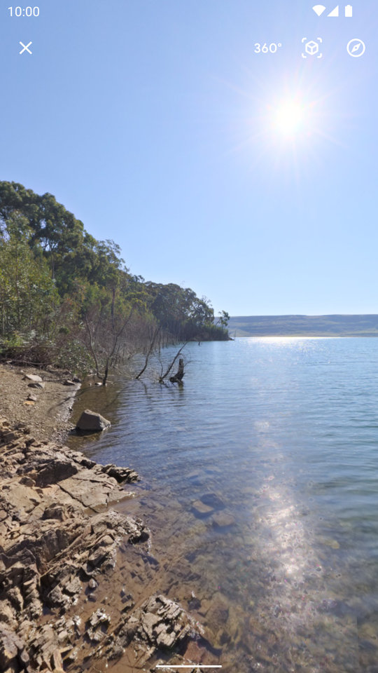
  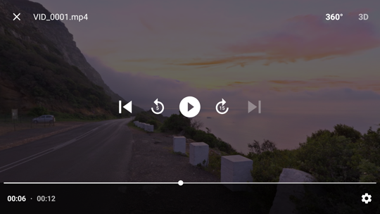

1. Buka foto atau video. Fail 360° membawa lencana 360° pada gambar kecilnya, dan tab Pustaka mempunyai senarai 360° yang mengumpulkannya, dengan penapis mengikut tempoh, sumber, jenis dan kamera.
2. Ketik 360° pada bar atas. Seret untuk melihat sekeliling, cubit untuk zum, ketik butang giroskop untuk melihat sekeliling dengan memusingkan telefon.
3. Butang 3D berpusing antara "Mono (bukan 3D)", "3D, atas dan bawah" dan "3D, sebelah-menyebelah"; butang 360°/180° menukar antara sfera penuh dan separuh sfera VR180.
4. Untuk fail yang dipaparkan rata walaupun ia fail 360°: ⋮ di kanan atas, kemudian "Lihat sebagai 360°".

Pada telefon dan tablet, video stereoskopik juga boleh mendapat kedalaman pada skrin rata: pemain Spatial 2.5D menggunakan kamera depan untuk mengesan kepala anda dan memaparkan pandangan di antara kedua-dua mata (eksperimen). Foto spatial Apple yang diambil dengan iPhone dikenali dan dipaparkan dalam 3D pada Meta Quest.

Lagi: [foto dan video 360°](../docs/immuch360/user-guide.md#360-photos-and-videos-as-a-sphere), [3D dan VR180](../docs/immuch360/user-guide.md#3d-and-vr180-photos-and-videos), [Spatial 2.5D](../docs/immuch360/user-guide.md#depth-on-a-flat-screen-spatial-25d-experimental), [foto dan video spatial Apple](../docs/immuch360/user-guide.md#apple-spatial-photos-and-videos), [senarai 360°](../docs/immuch360/user-guide.md#find-your-360-shots-the-360-list).

### Jadikan satu foto 3D, adegan, panorama

Kebanyakan foto anda rata, dan anda tidak boleh kembali untuk mengambilnya semula dalam 3D. Immuch360 memberinya kedalaman. Pada komputer anda, satu foto menjadi **foto 3D**, **adegan 3D** yang boleh anda jengah dalam headset, atau **panorama 360°** yang membayangkan selebihnya tempat itu di sekeliling anda. Quest 3 atau 3S membuat kedalaman itu sendiri, untuk mana-mana foto rata. Semuanya berjalan pada komputer dan headset anda sendiri: tiada awan, tiada akaun, foto asal anda tidak pernah diubah. Baharu dalam binaan 32 dan binaan desktop 13, eksperimen dan dihidupkan secara lalai. Aplikasi Immich tidak mempunyai apa-apa seperti ini.

  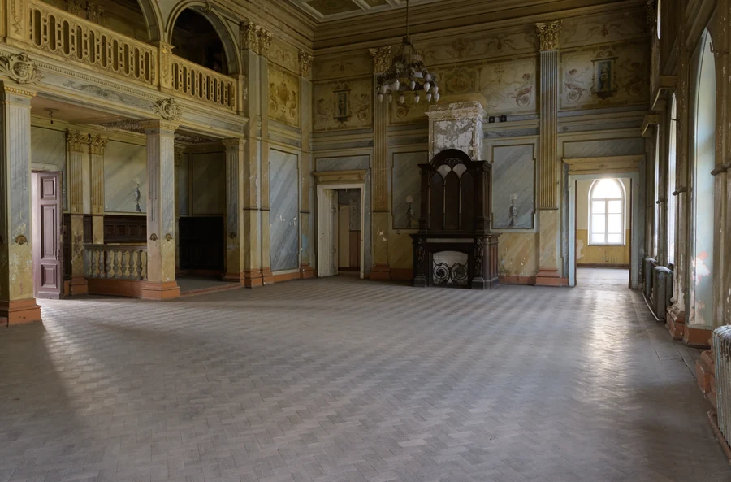

Hasil sebenar aplikasi daripada foto CC0 Poly Haven, dikecilkan, tidak diubah suai: foto 3D, dua matanya bergilir-gilir.

**Pada komputer anda**, dengan binaan desktop 13 pada Windows, Linux atau macOS:

1. Pilih satu atau lebih foto dalam pustaka, dalam folder atau dalam perkongsian rangkaian, kemudian "Buat 3D (AI)".
2. Pilih apa yang anda mahu: "Foto 3D", "Adegan 3D", "Panorama 360°", atau "Versi 3D foto 360°" untuk foto 360° anda sendiri. Kotak itu memberitahu apa yang akan dianggarkan atau dicipta oleh AI ("Kira-kira 96% daripada panorama ini akan dicipta oleh AI"), lebih kurang berapa lama masa yang diambil pada komputer ini, dan ke mana fail itu pergi: "Di sebelah foto asal" atau "Folder pilihan saya". Jenis yang tidak dapat dibuat oleh komputer ini kekal kelabu, dengan sebabnya, seperti "Belum ada pada Mac" atau "Kad grafik mempunyai memori 6.0 GiB, panorama 360° memerlukan 7.5 GiB". Mulai binaan desktop 15, "Versi 3D foto 360°" juga menerima foto dengan bingkai 2:1 tanpa tag 360°, disenaraikan secara berasingan supaya anda menyemaknya dahulu.
3. Kali pertama, kotak itu menawarkan komponen jenis tersebut: Muat turun, sekali sahaja. Ia berjalan pada komputer ini dan berfungsi di luar talian selepas itu.
4. Tukar. Tugasan beratur pada dua lorong, pemproses dan kad grafik, dengan langkah dan baki masanya; Batal menghentikan satu tugasan pada bila-bila masa, dan menutup aplikasi akan bertanya dahulu.
5. Buka hasilnya. Foto 3D dipaparkan sebagai "Mata kiri", "Sebelah-menyebelah", "Goyang" (animasi di atas) atau "Merah dan sian" untuk cermin mata; adegan mempunyai "Pratonton dalam 3D", diputar dengan tetikus atau pad sentuh, dan "Eksport untuk aplikasi 3D lain (.glb)"; panorama dibuka dalam pemapar 360°.

  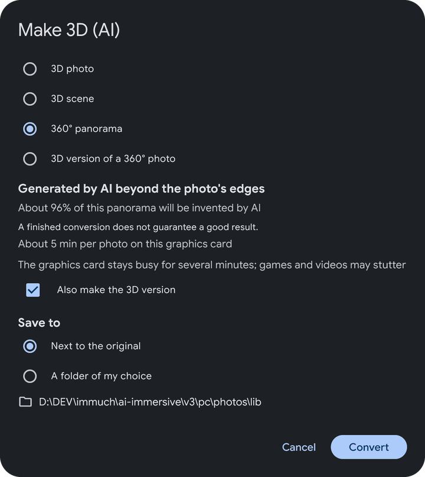
  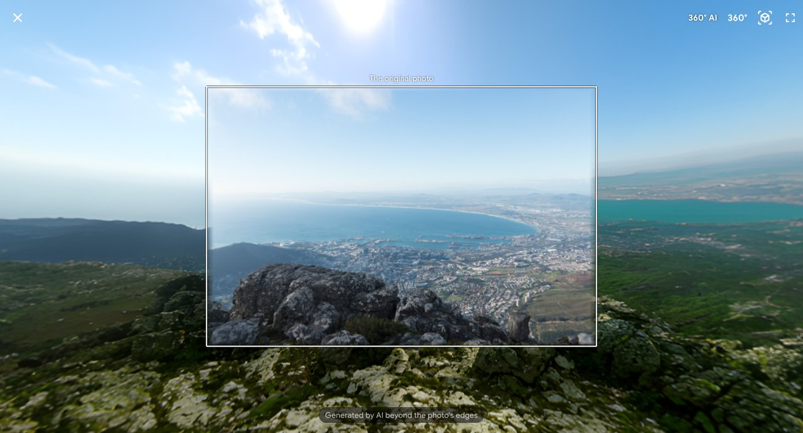

  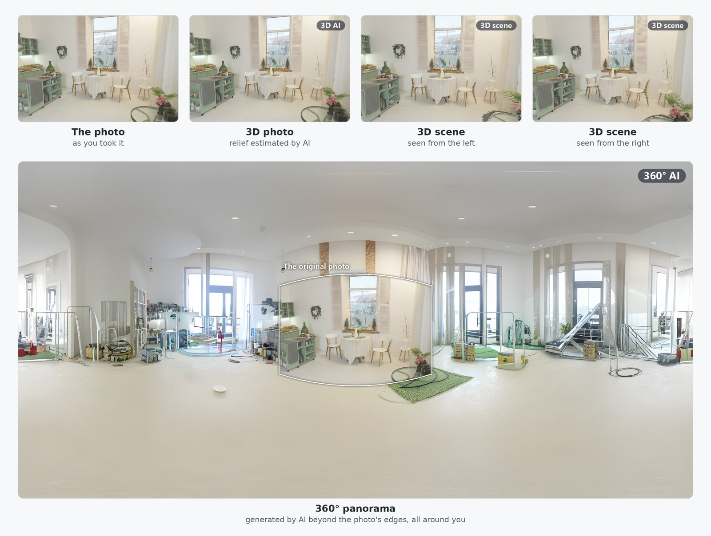

Satu foto, empat cara: hasil sebenar aplikasi daripada foto CC0 Poly Haven, dikecilkan, tidak diubah suai, dengan lencana aplikasi ditambah untuk halaman ini, dua paparan adegan dilukis daripada fail adegan. Semua yang berada di luar garis panorama dicipta oleh AI.

| | Foto 3D | Adegan 3D | Panorama 360° |
|---|---|---|---|
| Apa yang anda dapat | `<name>_3D_LRF_Full_SBS.jpg`, foto 3D sebelah-menyebelah: foto anda untuk mata kiri, mata kanan yang dikira | `<name>_scene3D.jpg`, foto yang membawa adegan, dalam lapisan | `<name>_360.jpg`, 6144 x 3072, dan dengan "Buat juga versi 3D", `<name>_360_3D.jpg` |
| Apa yang dibuat oleh AI | menganggarkan kedalaman foto (Depth Anything V2 Small) | menganggarkan bentuk tempat itu (MoGe-2) dan mengisi apa yang tersembunyi dalam foto (LaMa), untuk adegan berlapis | mencipta segala-galanya di luar tepi foto (FLUX.2 klein 4B dan LoRA 360°); piksel anda sendiri kekal di tempatnya |
| Berapa lama | beberapa saat setiap foto | 15 hingga 45 saat setiap foto | kira-kira 5 minit pada komputer riba dengan RTX 4060, 30 saat lagi untuk versi 3D-nya |
| Ia berjalan pada | pemproses komputer Windows, Linux atau macOS | pemproses komputer Windows, Linux atau macOS | kad grafik dengan Vulkan dan 8 GB memorinya sendiri, dalam komputer Windows atau Linux dengan memori 16 GB; disemak dengan kad NVIDIA, dengan kad AMD dan Intel serta Mac dalam pelan hala tuju |
| Dimuat turun sekali, apabila anda minta | kira-kira 110 MB | 349 MB lagi | kira-kira 5.4 GB lagi |
| Di mana untuk melihatnya | dalam 3D dalam Meta Quest; "Goyang" atau "Merah dan sian" pada komputer | dalam Meta Quest, tempat anda menjengahnya; "Pratonton dalam 3D" pada komputer | di sekeliling anda dalam Meta Quest, dan dalam setiap pemapar 360° |

Setiap fail baharu diletakkan di sebelah fail asalnya, tidak sekali-kali menimpanya, atau dalam folder pilihan anda apabila folder fail asal tidak menerima fail baharu; pada folder rangkaian, hanya selepas anda bersetuju untuk folder itu ("Immuch360 hanya menulis fail baharu di situ, tidak sekali-kali fail asal"). Pustaka memautkan setiap versi kepada fail asalnya dengan lencananya, "3D AI", "Adegan 3D" atau "360° AI", dalam album "Versi AI Immuch360", yang tidak disertakan dalam sandaran Immich anda melainkan anda menghidupkan "Sandarkan juga versi AI"; berhati-hati, "Pilih semua" dalam album sandaran turut memilih album ini dan menghidupkan suis itu. Untuk melihat fail dalam Quest, simpan pada NAS anda, sandarkan ke pelayan Immich anda atau, pada Windows, hidupkan "Kongsi komputer ini pada rangkaian".

**Foto daripada perkongsian rangkaian**, mulai binaan desktop 16: pilihnya dalam perkongsian atau buka satu dan gunakan menu ⋮-nya. Aplikasi menyalin setiap foto ke komputer dahulu, dengan kemajuannya, kemudian menulis versi 3D di sebelah fail asal pada perkongsian SMB atau WebDAV selepas anda menjawab "Ya, untuk folder rangkaian ini", tidak pernah di atas fail. DLNA dan Plex tidak menerima fail, jadi versi itu pergi ke folder yang anda pilih. Halaman foto perkongsian mendapat Versi, yang menyenaraikan versi 3D yang ditemui di sebelahnya. Disemak pada mesin binaan projek dengan pelayan Samba dan WebDAV.

**Dalam Meta Quest**, dengan binaan 32:

- **Kedalaman AI**: buka mana-mana foto rata, daripada pustaka anda atau perkongsian, dan tekan "Kedalaman AI" di bar atas: headset menganggarkan kedalaman itu sendiri dan memaparkan foto dalam 3D, "Kedalaman dianggarkan oleh AI". Model itu, 99.5 MB, dimuat turun kali pertama anda menekannya, dan kedalaman disimpan dalam cache. "Buka kedalaman AI dalam 2.5D (percubaan)", dalam Tetapan, Lanjutan, "AI dan 3D", membuatkan objek dekat bergerak di hadapan latar belakang semasa anda menggerakkan kepala. Pada Quest 2 atau Quest Pro butang itu kekal kelabu, "Belum diuji pada set kepala ini", sehingga anda menghidupkan "Kedalaman AI pada Quest 2 dan Quest Pro (belum diuji)" di situ.
- **Foto 3D dan adegan daripada komputer**: "Lihat dalam 3D" memaparkan foto 3D dalam 3D sebenar. "Lihat adegan 3D" pada foto asal, atau "Terokai adegan 3D" pada adegan, meletakkan adegan itu dalam bilik anda: condongkan badan, atau meluncur dengan kayu ibu jari kiri di dalam kawasan yang dibina semula ("Ruang untuk bergerak: kira-kira 0.5 m ke setiap arah" untuk bilik yang ditunjukkan di atas); lapisan menjadi rata dan gelap di pinggirnya, butang Tetap semula, dalam panel yang dipaparkan oleh A, X atau butang genggam, meletakkan adegan itu semula di hadapan anda, dan B atau Y kembali.
- **Panorama**: panorama yang dijana dibuka di sekeliling anda, menghadap foto anda, dengan "Dijana oleh AI di luar tepi foto" dan garis nipis foto asal, yang pudar selepas beberapa saat; versi 3D-nya dalam 3D sebenar.

**Pada telefon, tablet dan TV**, fail yang dibuat oleh komputer dibuka seadanya, dan tiada apa-apa dijana di situ. Panorama dibuka dalam pemapar 360° dengan lencana "360° AI", ayat itu dan garisnya pada telefon dan tablet Android serta Android TV; pada iPhone, iPad, TV LG dan Samsung ia dibuka sebagai foto 360° biasa buat masa ini. Adegan dipaparkan sebagai fotonya, dengan tanda kecil 3D SCENE di sudutnya; pada Android, butirannya menambah "Buka pada Meta Quest untuk menerokainya". Foto 3D memaparkan dua matanya sebelah-menyebelah.

**Apa yang sebenar dan apa yang tidak, sentiasa dinyatakan.** Itulah tujuannya, bukan cetakan halus. Kedalaman foto 3D dianggarkan daripada satu foto, dan apa yang tersembunyi dalam foto diisi dan bukan sebenar. Adegan ialah "Dibina semula daripada satu foto, terokai dalam batasannya". Panorama mengekalkan piksel sebenar anda di tempatnya dan mencipta selebihnya, kira-kira 90% daripada sfera untuk foto biasa, dan kotak itu memberitahu berapa banyak sebelum anda bermula. Aplikasi menyatakannya di tempat anda melihat, dengan "Kedalaman dianggarkan oleh AI", "Dijana oleh AI di luar tepi foto" dan lencana, dan fail juga menyatakannya: dalam XMP kami, dan untuk adegan dan panorama dalam jenis sumber digital IPTC bagi imej yang dibuat dengan AI, supaya aplikasi lain dapat membezakan panorama yang dijana daripada foto 360° sebenar. Foto asal anda tidak pernah diubah, dan tiada apa-apa meninggalkan komputer atau headset anda. Seperti kata kotak itu: "Penukaran yang selesai tidak menjamin hasil yang baik."

**Apa yang disemak**, setakat 29 Oktober 2026, dengan binaan ujian kod ini: foto 3D oleh aplikasi Linux dalam bekas pada PC Linux, juga di luar talian; adegan oleh aplikasi Windows pada komputer riba dengan RTX 4060 Laptop GPU (sepuluh dalam 2 min 39 s) dan oleh enjin pada PC Linux; pada komputer riba itu, empat panorama dalam 4 min 16 s hingga 4 min 44 s setiap satu, versi 3D-nya dalam kira-kira 30 s, dengan Batal, aplikasi yang dimatikan secara paksa, program lain yang memegang kad grafik, dan tiada sambungan rangkaian oleh aplikasi semasa ujian.

Had: panorama 360° memerlukan komputer Windows atau Linux dengan kad grafik yang sesuai, dan jika tidak, kotak itu memberitahu sebabnya ("Belum ada pada Mac", "Tiada kad grafik dengan Vulkan ditemui", "Grafik bersepadu berkongsi memori komputer: terlalu perlahan untuk panorama", dengan "Cuba pada grafik bersepadu (belum diuji)" untuk mencuba juga); mulai binaan desktop 21, sebelum panorama bermula, aplikasi membebaskan memori grafik yang dipegangnya sendiri, video yang dijeda dan gambar dalam cache, dan mulai binaan desktop 22 ia kemudian meminta 3.5 GiB kad itu bebas (di bawah kira-kira 5.6 GiB penjanaan berjalan secara berbahagian, lebih perlahan, dengan imej yang sama, dan mengambil sehingga 8 GB memori komputer), dan jika tidak ia menunggu, sambil memberitahu berapa yang bebas ([apa yang boleh dilakukan oleh setiap kad](../docs/immuch360/user-guide.md#360-panoramas-and-the-graphics-card-memory)); di dalam panorama, tepi foto anda boleh kelihatan sebagai lompatan tona yang tajam; kebanyakan adegan menyatakan "Medan pandangan diteka: bentuk mungkin tersasar"; adegan memerlukan kira-kira 2 GB memori bebas ("Memori tidak mencukupi" jika tidak); dengan versi AI disandarkan, pencari pendua Immich memasangkan setiap foto dengan adegannya dan sering mencadangkan untuk menyimpan adegan, fail yang lebih berat: simpan foto asal. Telefon dan TV tidak membuat apa-apa, dan headset hanya membuat kedalaman; adegan datang daripada satu foto, dan daripada beberapa foto atau video, komputer Windows [membuat adegan splat](#make-a-splat-scene-from-your-photos-or-a-video-ai).

**Komponen**: pada komputer, Tetapan, "AI dan 3D" menyenaraikan komponen setiap ciri dengan saiznya, Muat turun dan Alih keluar, kemudian "Alih keluar semua komponen AI" dan "Pindahkan komponen AI" ke pemacu lain; "Ciri AI" dimatikan menyembunyikan setiap butang AI dan tidak memuat turun apa-apa. Setiap fail disemak dengan SHA-256nya. Pada Windows ia berada dalam `%LOCALAPPDATA%\com.aprogsys\Immuch360 Desktop\ai-components`, yang dipadamkan oleh penyahpasang (bukan folder yang anda pindahkan ke situ); pada Linux dalam `~/.local/share/immuch360/ai-components` pada kebanyakan sistem, dan pada Mac dalam `~/Library/Application Support/com.aprogsys.immuch360.desktop/ai-components`. Dalam Quest, "AI dan 3D" berada dalam Tetapan, Lanjutan, bersama cache kedalaman.

Lagi: nota [binaan 32](https://github.com/freeKC/Immuch360/releases/tag/v3.3.0-rc.0-32), [binaan desktop 13](https://github.com/freeKC/Immuch360/releases/tag/desktop-v3.3.0-rc.0-13), [binaan desktop 15](https://github.com/freeKC/Immuch360/releases/tag/desktop-v3.3.0-rc.0-15), [binaan desktop 16](https://github.com/freeKC/Immuch360/releases/tag/desktop-v3.3.0-rc.0-16), [binaan desktop 21](https://github.com/freeKC/Immuch360/releases/tag/desktop-v3.3.0-rc.0-21) dan [binaan desktop 22](https://github.com/freeKC/Immuch360/releases/tag/desktop-v3.3.0-rc.0-22), dan [model, lesennya, sumbernya dan jumlah semaknya](https://github.com/freeKC/Immuch360/blob/immuch360/licenses/ai-components/MODEL-LICENSES.md).

### Tonton pada TV dengan alat kawalan jauh

Foto anda pada skrin besar, dengan alat kawalan jauh. Semua aplikasi TV berfungsi dengan cara yang sama: anak panah menggerakkan bingkai, OK membuka, Back kembali, dan dalam foto 360° anak panah melihat sekeliling. TV tidak mempunyai foto sendiri, jadi ia memaparkan pelayan Immich anda dan, pada Android TV dan TV LG, perkongsian rangkaian anda, pelayan Plex anda dan kamera anda.

- **Android TV dan Google TV**: aplikasi Android itu sendiri, pada Google Play untuk Android TV dan Google TV, dan binaan 45 di GitHub.
- **TV LG dengan webOS 5.0 dan ke atas**: aplikasi TV tersendiri, versi 1.0.0, dalam semakan LG untuk LG Content Store, dan versi 1.0.1 di GitHub.
- **TV Samsung dengan Tizen 5.5 dan ke atas**: aplikasi TV yang sama seperti pada TV LG, binaan ujian 0.3.0, yang anda tandatangani dan pasang sendiri.

  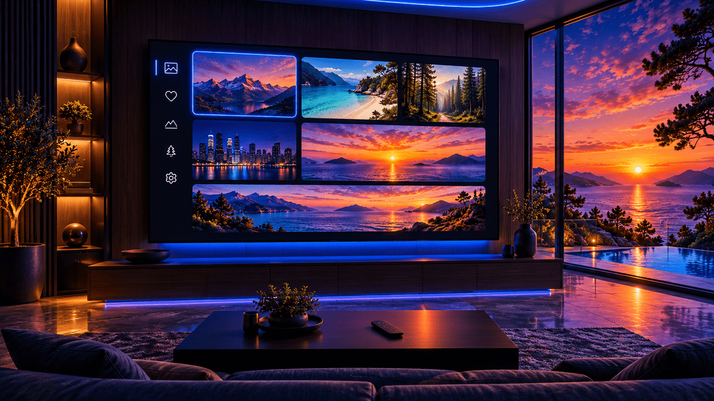

#### Pada Android TV dan Google TV

Aplikasi Android yang sama, dalam tema gelap dari permulaan pertama, dengan alat kawalan jauh sebagai satu-satunya input. Dalam pemapar, Kiri dan Kanan pergi ke foto atau video sebelum atau seterusnya, walaupun semasa video dimainkan, dan dalam foto atau video 360° anak panah melihat sekeliling.

  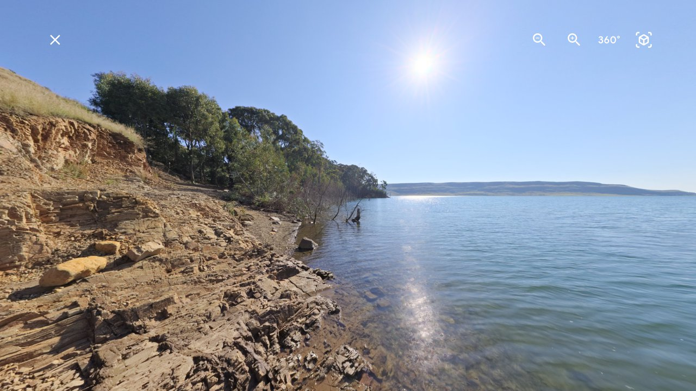

1. Pasang aplikasi daripada Google Play pada TV, atau APK dengan adb, lihat [Pasang](#android-tv-and-google-tv). Pada halaman selamat datang, pilih "Tambah perkongsian rangkaian atau pelayan media" untuk perkongsian, pelayan Plex atau kamera, "Guna tanpa pelayan", atau "Sambung ke pelayan Immich", yang halamannya melog masuk TV apabila anda mengimbas kod QRnya dengan telefon anda (lihat [Log masuk dengan telefon anda](#sign-in-a-tv-a-headset-or-a-computer-with-your-phone)).
2. Dalam pemapar, kekunci main dan jeda, undur, maju pantas, sebelum dan seterusnya pada alat kawalan jauh berfungsi. OK semasa video memaparkan kawalan dengan main dan jeda dipilih, dan OK kedua menjeda; butang -10 s dan +10 s menyusul, kemudian butang audio dan sari kata apabila filem mempunyainya. Mulai binaan 29, Bawah dari main mencapai bar masa: Kiri dan Kanan bergerak 10 s setiap tekanan, lebih pantas apabila ditahan, dan OK memainkan atau menjeda. Kawalan dan tarikh disembunyikan 5 s selepas kekunci terakhir, dan Kiri dan Kanan kemudian pergi ke fail sebelum atau seterusnya; pada perkongsian, fail itu dibuka dalam halamannya sendiri, dengan kawalan yang mengendalikannya. Video tidak lagi berulang pada TV, melainkan anda menghidupkan Tetapan, Pemapar Aset, Video, Ulangan.
3. Kekunci Menu, kekunci Info atau OK yang ditekan lama membuka butiran foto atau video, baca sahaja: tarikh, tempat, kamera, kodek, saiz dan kadar bit. Mulai binaan 45 butiran itu memaparkan tag foto, seperti dalam Immich 3.4.0: Bawah mencapai setiap tag, dan OK membuka foto dengan tag itu. Video yang tidak dapat dinyahkod oleh TV memberitahunya, dengan kodek, saiz dan had penyahkod TV, dan bukannya memuatkan tanpa henti; video 360° yang melebihi kemampuan penyahkod bertanya dahulu sebelum membuka pemain 360°, dan sebabnya ditulis pada halaman Log dalam menu profil.
4. Carian dengan alat kawalan jauh: Back daripada hasil kembali ke Search dengan fokus pada medan carian, dan dalam Date, julat tersuai memilih tahun mula dan tahun akhir dahulu, kemudian bulan dan hari. Dalam Album-album, Bersihkan terletak di sebelah medan carian. Ini kerja Michael Cloutier ([mlc70](https://github.com/mlc70/Immuch-Android-TV)), dengan commit beliau.
5. Foto memaparkan tarikh dan masanya di kiri bawah semasa kawalannya kelihatan ("Tunjukkan tarikh dan masa foto", dalam Settings, Asset Viewer). Pada bar masa video, siri tekanan Left atau Right yang pantas melompat 10 s, kemudian 30 s, kemudian 60 s setiap tekanan, dan setiap tekanan dikira. Album dibuka pada foto pertamanya, dengan namanya di bar atas.

  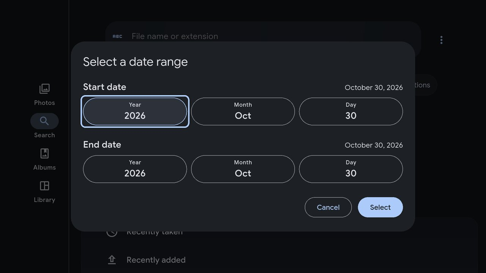
  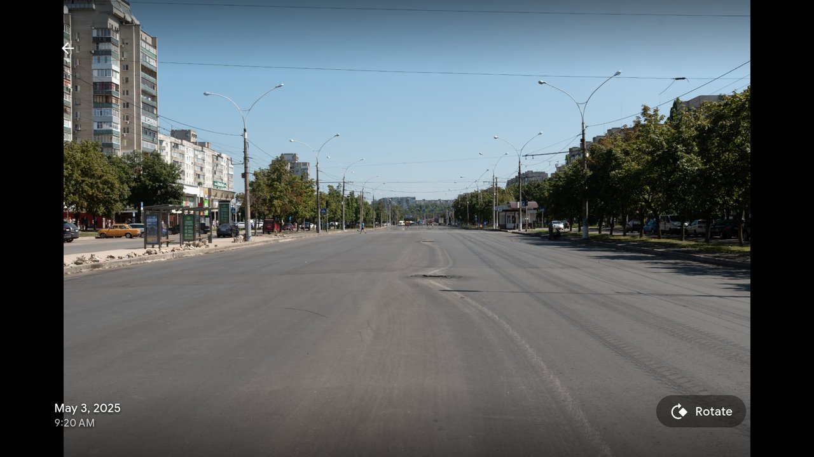

Binaan 28 berjalan pada Android TV sebenar pada 23 Oktober; pembaikan video binaan 29 datang daripada larian itu, dan binaan 29 hingga 35 disemak pada emulator Google TV, tempat siri tekanan pantas dengan binaan 35 mendarat pada masa yang betul 13 kali daripada 13.

#### Pada TV LG (webOS)

Aplikasi Immich sendiri tidak boleh dipasang pada TV LG. Immuch360 mempunyai aplikasi TV tersendiri untuk TV LG dengan webOS 5.0 dan ke atas (TV 2020 dan seterusnya), dikawal oleh alat kawalan jauh dan Magic Remote: ia memaparkan pelayan Immich anda, perkongsian rangkaian anda, pelayan Plex anda dan kamera Tapo anda, dan meletakkan foto 360° anda pada sfera yang anda putar dengan anak panah. Ia dibina atas [immich-tv-webos](https://github.com/Seeky91/immich-tv-webos) oleh Seeky91, yang membawa garis masa, album, orang, tempat, carian, tayangan slaid dan log masuk dengan telefon; terima kasih kepada Seeky91. Versi 1.0.0 dihantar ke LG Content Store pada 24 Oktober dan berjalan pada TV webOS 25 di Cloud Test Lab LG; sehingga LG meluluskannya, ia dipasang dalam Developer Mode, dan setiap laporan dalam [Issues](https://github.com/freeKC/Immuch360/issues) membantu.

1. Pasangnya pada TV dalam Developer Mode, lihat [Pasang](#lg-tvs-webos). Ia mempunyai id aplikasinya sendiri, jadi ia dipasang bersebelahan Immich TV oleh Seeky91.
2. Log masuk dengan telefon anda (imbas kod QR), dengan e-mel dan kata laluan anda, atau dengan kunci API.
3. Layari dengan anak panah dan OK. Dalam pemapar, Kiri dan Kanan pergi ke foto atau video sebelumnya atau seterusnya, juga semasa video dimainkan; kawalan disembunyikan 5 saat selepas kekunci terakhir; Info membuka butiran; kekunci saluran mengezum; penuding dan roda Magic Remote berfungsi. Mulai versi 1.0.1, di GitHub, Atas mengezum masuk foto serta-merta, anak panah kemudian menggerakkannya dan Kembali mengezum keluar, dan pil Memuatkan dipaparkan semasa foto masih tiba.
4. Foto 360° dibuka pada sfera: setiap tekanan anak panah memutarnya satu langkah, dan kekunci yang ditahan terus memutarnya. "Lihat sebagai 360°" meliputi foto 2:1 yang tidak ditandakan oleh pelayan; foto VR180 dipaparkan pada separuh sfera dan foto 3D dengan satu mata. Kekunci kuning dan biru memutar foto rata.
5. Setelah log masuk, "Perkongsian rangkaian" dalam bar sisi aplikasi: tambah perkongsian SMB, WebDAV atau DLNA, pelayan Plex (dilog masuk dengan kod pada plex.tv/link) atau kamera Tapo. Foto-fotonya dibuka dalam pemapar yang sama, foto 360° pada sfera.

Versi 1.0.0 dibuat untuk LG Content Store: Back keluar daripada aplikasi dari Foto atau halaman selamat datang mengikut cara yang dijangka oleh setiap versi webOS, dan menutup tetingkap timbul yang terbuka dahulu; pelayan yang tidak menjawab dalam 15 s berakhir dengan mesej yang menyatakan sebabnya dan butang Cuba semula; dasar privasi dibuka dalam aplikasi, dengan kod QR untuk membaca [bahagian TV LG-nya](../PRIVACY.md#lg-tvs-webos) pada telefon; TV menggunakan mod gambar Gallery, seperti yang diminta LG daripada aplikasi foto; dan pakej kedua sesuai untuk TV Full HD yang diberikan aplikasi 1280x720 oleh LG.

Had: SMB memerlukan webOS 22 (TV 2022) atau lebih baharu. Perkongsian, Plex dan kamera datang melalui perkhidmatan aplikasi sendiri pada TV, yang membacanya untuk aplikasi, dan disemak dengan pelayan sebenar dan kamera simulasi pada hos binaan projek. Paparan langsung kamera ialah video sahaja. Akan datang: rakaman kamera (tidak sebelum Disember 2026) dan bunyinya, video 360° pada sfera (ia dimainkan secara rata, dengan mesej), muat naik. Pada webOS sebelum 25, proksi songsang di hadapan Immich mesti menghantar pengepala CORS; aplikasi menerangkannya apabila menemui masalah itu. Aplikasi berjalan pada webOS 22 dan 25, dan webOS 26 ada dalam pelan hala tuju.

#### Pada TV Samsung (Tizen)

TV Samsung dengan Tizen 5.5 dan ke atas (TV 2020 dan seterusnya) mendapat aplikasi TV yang sama sebagai binaan ujian 0.3.0, yang tiada di kedai Samsung: log masuk dengan menaip, garis masa, album, pemapar dan tayangan slaid, foto 360° pada sfera dan foto diputar dengan satu kekunci. Dalam pelan hala tuju: log masuk dengan telefon, perkongsian, Plex dan kamera, yang berjalan dalam perkhidmatan latar belakang pada TV LG.

1. Tandatangani pakej untuk TV anda dan pasangnya dalam Developer mode, lihat [Pasang](#samsung-tvs-tizen).
2. Log masuk dengan menaip alamat pelayan anda, kemudian e-mel dan kata laluan anda atau kunci API.
3. Layari dengan anak panah dan OK. Foto 360° dibuka pada sfera; video 360° dimainkan secara rata, dengan notis pada kali pertama, kerana pada TV seorang penguji pelayar TV memberikan bingkai video hitam kepada paparan 3D.
4. Video yang melebihi apa yang diterima oleh penyahkod TV memberitahunya, dengan saiz yang boleh dimainkan oleh TV dan saiz fail, dan bukannya memuatkan tanpa henti. Video yang tersekat memaparkan notis dengan kadar bitnya dan jalan keluarnya: biarkan Immich mentranskod fail berat, atau gunakan sambungan yang lebih pantas. Perihal TV ini memberikan had video TV.

Versi 0.1.0 berjalan pada TV Samsung seorang penguji dengan Tizen 9, dan 0.2.0 mengandungi pembaikan daripada ujian itu, disemak oleh CI projek dalam pelayar yang menggantikan TV. Mulai binaan ujian 0.3.0, Atas mengezum masuk foto serta-merta, anak panah kemudian menggerakkannya dan Kembali mengezum keluar, dan pil Memuatkan dipaparkan semasa foto masih tiba, seperti pada TV LG mulai versi 1.0.1; ujian end to end CI menyemak zum, dan belum ada TV Samsung yang menjalankan 0.3.0. Teks halaman Perihal, yang dihantar dalam [Discussions](https://github.com/freeKC/Immuch360/discussions) atau [Issues](https://github.com/freeKC/Immuch360/issues) selepas ujian, paling membantu.

Lagi: [tonton pada TV anda](../docs/immuch360/user-guide.md#watch-on-your-tv-android-tv-and-google-tv), [aplikasi webOS: pemasangan, kekunci alat kawalan jauh, pengepala CORS](../webos/README.md), [sokongan platform](../docs/immuch360/platform-support.md).

### Log masuk pada TV, headset atau komputer dengan telefon anda

**Imbas. Log masuk. Tonton.** Menaip alamat pelayan, e-mel dan kata laluan dengan alat kawalan jauh TV, atau dalam headset, mengambil masa beberapa minit. Dengan Immuch360 pada telefon anda, yang telah log masuk ke pelayan Immich anda, TV, Meta Quest atau komputer dilog masuk dalam beberapa saat: skrin besar memaparkan kod QR, telefon mengimbasnya, anda mengesahkan, dan skrin membuka pustaka anda. Dengan aplikasi telefon, kata laluan anda kekal pada telefon. Aplikasi Immich tidak mempunyai apa-apa seperti ini.

  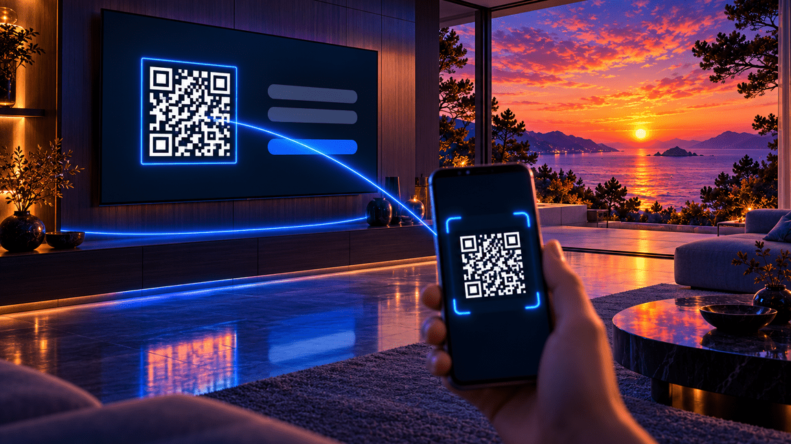

1. Pada skrin besar (Android TV dan Google TV, tetingkap Meta Quest, Windows, Linux atau macOS), pilih "Sambung ke pelayan Immich": halaman log masuk memaparkan "Log masuk dengan telefon anda", kod QR dan kod 10 aksara, di sebelah borang pelayan.
2. Pada telefon yang telah log masuk ke pelayan anda: Tetapan, "Sambungkan TV atau komputer", kemudian "Imbas kod". Dalam Meta Quest, yang skrinnya tidak dapat diimbas oleh telefon, pilih "Masukkan kod sebaliknya" dan taip kod yang dipaparkan oleh headset.
3. Telefon bertanya "Log masuk (skrin)?" dan memaparkan nombor enam digit: semak bahawa skrin memaparkan nombor yang sama, kemudian ketik Log masuk. Skrin membuka garis masa anda.

Bagaimana ia kekal selamat: telefon dan skrin mesti berada pada rangkaian rumah yang sama, dan kod itu tahan paling lama dua minit dan berfungsi sekali sahaja. Telefon meminta pelayan anda satu sesi baharu untuk skrin itu, dinamakan sempena skrin tersebut ("Immuch360 on TV ruang tamu"), dan menghantarnya ke skrin dalam bentuk tersulit, jadi kata laluan anda tidak pernah meninggalkan telefon. "Sambungkan TV atau komputer" menyenaraikan skrin yang dilog masuk oleh telefon ini, masing-masing dengan Log keluar, dan Immich menyenaraikannya dalam Tetapan Akaun, Peranti Yang Dibenarkan, di mana anda juga boleh membatalkannya. Melog keluar telefon turut melog keluar skrin-skrin itu.

Bahagian telefon berjalan pada Android, dan pada iPhone dan iPad mulai versi 3.3.2. Tanpa Immuch360 pada telefon, imbas kod dengan kamera telefon: halaman yang disediakan oleh skrin terbuka dalam pelayar, untuk e-mel dan kata laluan anda, tersulit dan digunakan sekali sahaja. TV LG log masuk dengan kod QR mereka sendiri, dalam pelayar telefon; mulai binaan 28 pengimbas aplikasi telefon mengenalinya dan membuka halaman itu. TV Samsung dilog masuk dengan menaip buat masa ini.

Lagi: [log masuk dengan telefon anda](../docs/immuch360/user-guide.md#sign-in-a-tv-a-headset-or-a-computer-with-your-phone), [apa yang dihantar dan disimpan oleh skrin](../docs/immuch360/technical-details.md#sign-in-with-your-phone).

### Masuk ke dalam foto dan video anda dengan Meta Quest

Pada Meta Quest, aplikasi yang sama berjalan sebagai tetingkap dengan keseluruhan pustaka anda, dan butang 360°nya membuka paparan mendalam di mana foto atau video mengelilingi anda: anda melihat sekeliling dengan memusingkan kepala, fail stereoskopik dalam 3D sebenar, foto spatial Apple terapung di hadapan anda dalam 3D, dan pengawal atau tangan anda mengawal bar masa, sebelum dan seterusnya, serta butang Pusing yang membawa apa yang di belakang anda ke hadapan tanpa memusingkan kerusi anda. Media datang daripada pelayan anda, headset itu sendiri, NAS, pelayan media, telefon atau pelayan Plex, dimainkan di tempatnya.

  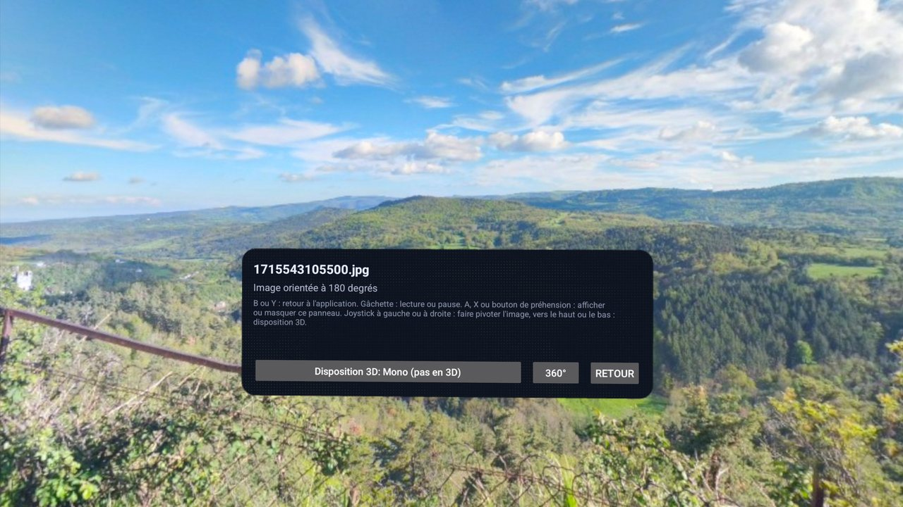
  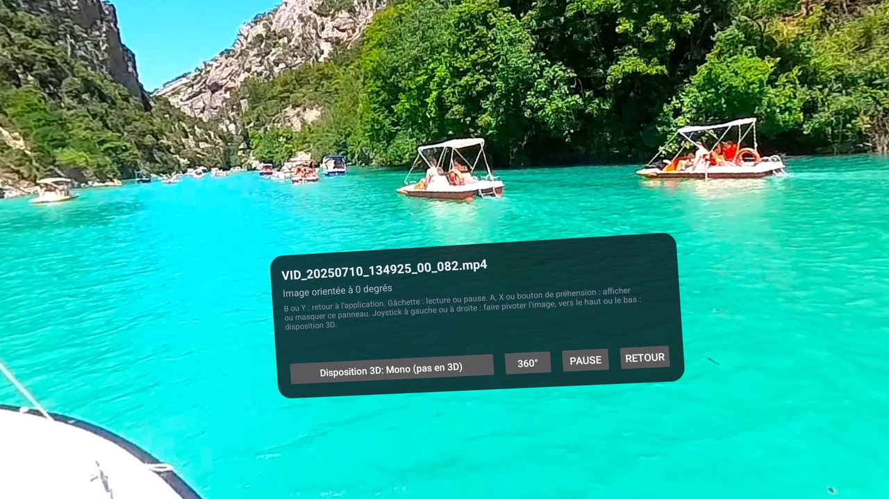
  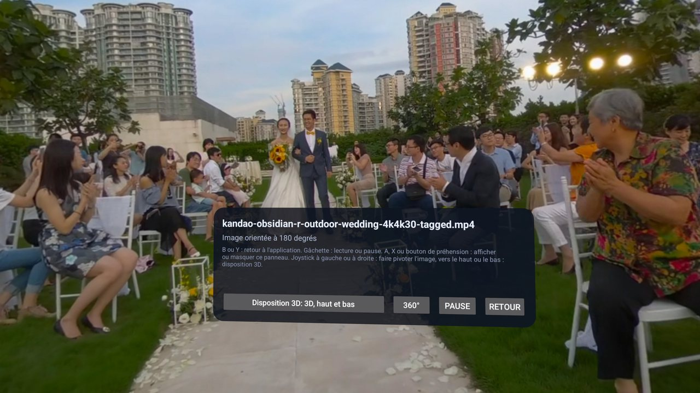

1. Pasang aplikasi daripada [Horizon Store](https://www.meta.com/experiences/immuch360/1384208401440714/), atau sideload APK binaan yang lebih baharu, lihat [Pasang](#meta-quest).
2. Pada halaman selamat datang, ketik "Guna tanpa pelayan" untuk foto dan video headset itu sendiri, atau "Sambung ke pelayan Immich": taip kod yang dipaparkan oleh headset dalam Immuch360 pada telefon anda ([log masuk dengan telefon anda](#sign-in-a-tv-a-headset-or-a-computer-with-your-phone)), atau log masuk dengan alamat pelayan, e-mel dan kata laluan anda.
3. Buka foto atau video 360° dan tekan 360°: paparan mendalam akan terbuka. B atau Y, atau butang Back pada panel maklumat, membawa tetingkap itu kembali.
4. Dalam paparan mendalam, tolak thumbstick kanan ke kiri atau ke kanan untuk memutar paparan 30° ke arah itu. Mulai binaan 29 ia berputar ke arah yang anda tolak, seperti dalam kebanyakan aplikasi headset; binaan 17 hingga 28 memutarnya ke arah bertentangan, dan Tetapan, Pemapar Aset, Video, "Songsangkan putaran thumbstick" mengembalikan arah itu.
5. Dalam tetingkap, tolak kayu ibu jari ke kanan untuk foto atau video seterusnya, ke kiri untuk yang sebelumnya, daripada commit Gaurav Mukherjee ([gmfun](https://github.com/gmfun/Immuch360)).
6. "Lihat pada skrin besar" meletakkan foto atau video pada skrin rata besar di hadapan anda: tahan butang genggam untuk mengalihkannya, tolak kayu ibu jari untuk mendekatkan atau menjauhkannya, dan tahan kedua-dua butang genggam untuk mengubah saiznya. Video dengan nama seperti `Movie_SBS.mp4`, `Film.Half-OU.mkv` atau `clip_LR.mp4` mendapat "Lihat dalam 3D" dan dimainkan dalam 3D pada jenis skrin itu ("3D mengikut nama fail (percubaan)"), dan pilihan skrin rata lebih tajam (percubaan) melukis skrin itu dengan pensampelan super dan penajaman headset itu sendiri; kedua-duanya dalam Settings, Lanjutan.
7. Apabila penyahkod menghentikan video di tengah jalan, pemapar memainkannya semula selepas bahagian yang terlepas dan memberitahunya. Filem disambung di tempat anda berhenti, dan foto TIFF juga dipaparkan dalam paparan imersif.

#### Mod kiosk, untuk pameran atau kedai

Serahkan headset kepada pelawat dan ia membuka foto atau video 360° anda, dari awal, setiap kali seseorang memakainya. Idea ini datang daripada binaan demo [ppawelstachh-sys](https://github.com/ppawelstachh-sys/Immuch360), ditulis semula di atas kod kami.

1. Dalam Settings, Lanjutan, Mod kiosk (eksperimen): pilih media kiosk, foto atau video 360°, dan jika mahu, teks untuk kad penutup.
2. Pada permulaan seterusnya, headset memaparkan nama media kiosk selama beberapa saat, dengan Batal, kemudian membukanya.
3. Filem bermula semula setiap kali seseorang memakai headset dan berakhir pada kad. Kiosk mengabaikan tekanan: tahan B atau Y selama satu saat untuk keluar.

Disemak pada Quest 3 pada 30 Oktober dengan binaan 35: foto stereo sebelah-menyebelah pada skrin rata lebih tajam, adegan 3D dan kiosk dua kali, setiap satu ditutup, dengan tetingkap aplikasi kembali.

Lagi: [dalam headset Meta Quest](../docs/immuch360/user-guide.md#in-the-meta-quest-3-headset), [headset: kodek, kedai dan kebenaran](../docs/immuch360/platform-support.md#meta-quest).

### Teroka splat Gaussian dalam Meta Quest 3 atau 3S

Splat Gaussian ialah tangkapan 3D sesuatu tempat atau objek, dibuat dengan Polycam, Scaniverse, Postshot, Luma dan alat lain. Pada Meta Quest 3 atau 3S, Immuch360 meletakkannya di hadapan anda atau di sekeliling anda, pada saiz sebenar, dan anda berjalan mengelilinginya atau meluncur melaluinya. Ia eksperimen dan dihidupkan secara lalai.

1. Letakkan splat .spz atau .ply anda pada perkongsian SMB atau WebDAV, atau dalam folder headset ("Semak imbas folder", atau buka fail splat daripada menu + Perkongsian rangkaian). Ia muncul selepas foto dan video, dengan lencana Splat 3D dan bilangan gaussiannya.
2. Buka satu, kemudian teroka adegan splat. Objek berdiri di hadapan anda pada paras mata, tempat terbuka di sekeliling anda. Kayu ibu jari kiri meluncur melaluinya, dan kayu ibu jari kanan memutar paparan 30° di sekeliling anda, sambil mengekalkan tempat yang anda capai ("Terbalikkan pusingan kayu kawalan" memutarnya ke arah bertentangan). Butang Tetap semula, dalam panel yang dipaparkan oleh A, X atau butang genggam, meletakkannya semula dari tempat anda berdiri, dan butang Tegakkan memutar objek yang tiba berbaring atau terbalik, dan ia diingati untuk fail itu.
3. Splat memaparkan paling banyak 300,000 gaussian, dan splat yang lebih besar memaparkan 300,000 yang paling kuat ("Dikurangkan kepada 300,000 daripada 452,451 gaussian"); pilihan splat besar (eksperimen), dalam Settings, Lanjutan, membenarkan 1,000,000.
4. Headset membaca fail .ply binari dan SPZ versi 1 hingga 4, versi 4 mulai binaan 40.

Splat Gaussian menggunakan API eksperimen daripada Meta Spatial SDK, yang tidak disokong mahupun dijamin oleh Meta: sebarang kecacatan ialah tanggungjawab Immuch360 sahaja. Pada Quest 2 atau Quest Pro splat disenaraikan, dan meneroka adegan splat memberitahu bahawa ia memerlukan Meta Quest 3 atau 3S. Fail untuk dicuba: sampel CC0 di [halaman pemapar splat InnerScene](https://www.innerscene.com/tools/gaussian-splat-viewer).

Disemak pada Quest 3 pada 31 Oktober: fail yang disediakan oleh kod binaan 39 daripada sampel itu dibuka dalam modul splat Meta Spatial SDK, yang digunakan oleh aplikasi, dan setiap satu dipaparkan dan berdiri tegak. Untuk binaan 40, ujian dan CI projek menyemak pusingan dan SPZ versi 4: gerakan kayu ibu jari yang dirakam dalam Quest 3 dengan binaan 39, apabila dimainkan semula, memutar paparan 30° bagi setiap tolakan dan tidak pernah menetapkannya semula, pusingan mengekalkan tempat yang anda capai dengan meluncur, dan fail versi 4 dalam ujian disediakan untuk headset bait demi bait sama seperti sumber versi 3 mereka.

Lagi: nota [binaan 36](https://github.com/freeKC/Immuch360/releases/tag/v3.3.0-rc.0-36), [binaan 39](https://github.com/freeKC/Immuch360/releases/tag/v3.3.0-rc.0-39) dan [binaan 40](https://github.com/freeKC/Immuch360/releases/tag/v3.3.0-rc.0-40).

### Teroka splat Gaussian pada telefon, tablet atau komputer anda

Splat yang dibuat dengan Polycam, Scaniverse, Postshot, Luma atau alat lain, atau splat yang dibuat oleh komputer anda daripada foto anda, dibuka pada telefon atau tablet Android dan pada Windows, Linux dan macOS, dan anda berjalan melaluinya seperti dalam headset. Ia eksperimen dan dihidupkan secara lalai. Aplikasi Immich tidak membuka sebarang splat.

  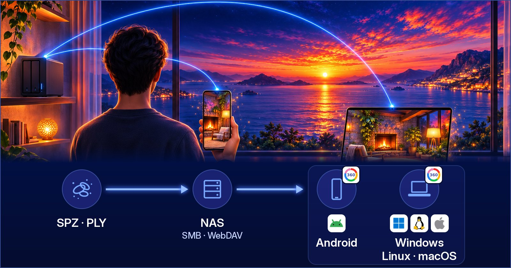

1. Letakkan splat .spz atau .ply anda pada perkongsian SMB atau WebDAV atau dalam folder telefon ("Semak imbas folder"), atau pilih satu dengan "Buka fail splat" dalam menu + Perkongsian rangkaian; pada komputer, fail splat yang dibuka dengan program ini atau dilepaskan pada tetingkapnya dibuka serta-merta. Splat muncul selepas foto dan video, dengan lencana "Splat 3D" dan bilangan gaussiannya.
2. Buka satu: tempat terbuka di sekeliling anda, objek di hadapan anda. Pada komputer, seret untuk melihat sekeliling, berjalan dengan W, A, S, D (Z, Q, S, D pada AZERTY) atau anak panah, maju dan undur dengan roda, naik dan turun dengan E dan Q, dan tekan R untuk menetapkan semula dan Esc untuk kembali; "Berpusing mengelilingi" berpusing di sekeliling objek dan bukannya berjalan. Pada telefon, ibu jari kiri anda berjalan, seretan melihat sekeliling, cubitan maju dan undur, dua jari menggelongsor dan ketik dua kali menetapkan semula; butang giroskop melihat sekeliling semasa anda memusingkan telefon.
3. Butang Tetap semula meletakkan adegan itu semula, "Tegakkan" memutar adegan yang tiba berbaring atau terbalik, dan ia diingati untuk fail itu pada peranti ini, dan helaian maklumat memberitahu berapa banyak gaussian yang dipaparkan dan seberapa pantas ia dilukis.

Bilangan gaussian yang dipaparkan bergantung pada peranti. Telefon atau tablet memaparkan paling banyak 150,000, yang paling kuat ("Dikurangkan kepada 150,000 daripada 452,451 gaussian"), atau 500,000 dengan "Splat besar (eksperimen)" dalam Settings, Lanjutan. Komputer dengan kad grafiknya sendiri memaparkan splat sepenuhnya, sehingga apa yang dapat ditampung oleh memorinya (kira-kira 10 juta gaussian pada komputer riba dengan memori 16 GB dan kad 8 GB), dan menyatakan "Terlalu besar untuk komputer ini" jika melebihinya. Dengan cip grafik yang berkongsi memori komputer, ia memaparkan paling banyak 1,000,000, melainkan "Simpan setiap gaussian (eksperimen)", dalam Settings, Lanjutan, meminta kesemuanya. Apabila splat yang dipaparkan sepenuhnya dilukis terlalu perlahan, pemapar menawarkan salinan yang lebih ringan atau menyimpan kesemuanya, dan mengingati jawapan anda untuk fail itu. Pada Windows, "Splat pada kad grafik yang lebih berkuasa (eksperimen)", yang dihidupkan secara lalai, melukisnya pada kad khusus komputer riba yang mempunyai dua.

Disemak pada Galaxy S24+, tempat splat ujian dipaparkan hampir serta-merta dan bergerak dengan lancar; dalam aplikasi Windows pada komputer riba dengan RTX 4060, yang melukis setiap satu pada kira-kira 120 bingkai sesaat, termasuk sebuah bilik 637,401 gaussian; dan pada Ubuntu, Debian dan Fedora oleh CI projek. iPhone, iPad dan TV tidak membuka splat, dan pada Mac pemapar dibina oleh CI projek, belum dicuba lagi. Pada Linux dengan kad NVIDIA, apabila pemapar tidak melukis apa-apa, mulakan Immuch360 dengan `WEBKIT_DISABLE_DMABUF_RENDERER=1`, seperti yang dinyatakan oleh aplikasi.

Lagi: nota [binaan 41](https://github.com/freeKC/Immuch360/releases/tag/v3.3.0-rc.0-41) dan [binaan desktop 21](https://github.com/freeKC/Immuch360/releases/tag/desktop-v3.3.0-rc.0-21), dan [kod dan lesen pemapar](../licenses/splat-viewer/README.md).

### Buat adegan splat daripada foto anda atau video (AI)

Anda merakam bilik, taman atau patung dan ingin berdiri di dalamnya sekali lagi. Pada komputer Windows, Immuch360 Desktop membinanya semula daripada foto anda atau video sebagai splat Gaussian, yang anda lalui dengan berjalan dalam Meta Quest 3 atau 3S atau dalam pemapar splat di atas. Semuanya berjalan pada komputer anda: tiada awan, tiada akaun. Ia eksperimen dan dihidupkan secara lalai. Aplikasi Immich tidak mempunyai apa-apa yang seumpamanya.

  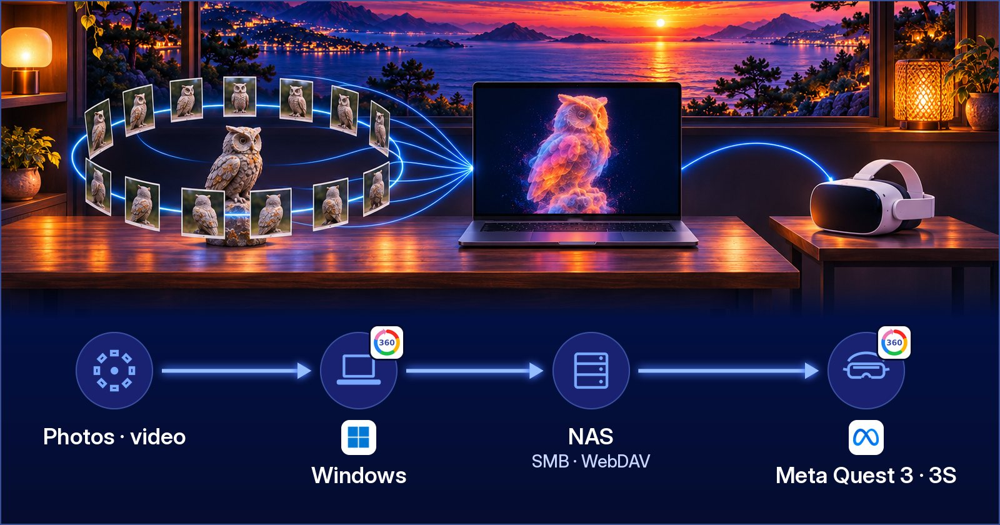

Anda memerlukan komputer Windows dengan kad grafiknya sendiri, dengan Vulkan dan memori 4 GB atau lebih, memori 8 GB dalam komputer, dan 20 hingga 200 foto tempat atau objek itu, atau satu video tentangnya, dari 10 saat hingga 5 minit.

1. Rakam perlahan-lahan, atau ambil foto pada setiap langkah, setiap satu melihat kebanyakan apa yang dilihat oleh yang sebelumnya. Untuk tempat, berjalan di sepanjang dinding sambil melihat merentasinya, kemudian melalui bahagian tengah; untuk objek, berjalan mengelilinginya dua kali, pada ketinggiannya kemudian dari sedikit di atas. Cahaya sekata, tanpa zum, tiada apa-apa yang bergerak; elakkan cermin, tingkap yang melawan cahaya dan permukaan berkilat.
2. Pilih foto atau video itu, dalam pustaka atau folder, kemudian "Buat adegan splat (AI)", dan nyatakan apa yang anda rakam: "Tempat: bilik, jalan, taman" atau "Objek, yang anda kelilingi". Kotak itu memberitahu foto mana yang ditinggalkannya dan sebabnya, apa yang akan diperoleh headset (sehingga 150,000 gaussian), kira-kira berapa lama masa yang diambil pada komputer ini, dan ke mana fail itu pergi: di sebelah foto, atau folder pilihan anda. "Simpan juga .ply untuk aplikasi 3D lain" menyimpan gaussian yang sama sebagai .ply juga.
3. Kotak itu menawarkan dua komponennya, untuk dimuat turun sekali sahaja: [COLMAP](../licenses/colmap/README.md) 4.2.1 (BSD 3 Clause), kira-kira 10 MB, yang meletakkan foto dalam 3D pada pemproses, dan [Brush](../licenses/brush/README.md) 0.3.0 (Apache 2.0), kira-kira 16 MB, yang melatih splat pada kad grafik. Kedua-duanya dibina oleh CI projek daripada sumbernya, ditandatangani oleh APROGSYS dan disemak dengan SHA-256 masing-masing; kemudian ia berfungsi di luar talian.
4. "Buat adegan". Panel memaparkan setiap langkah, mengambil bingkai, meletakkan foto dalam 3D, melatih splat, dengan baki masa, dan Batal menghentikannya. Pada komputer riba dengan RTX 4060, kira-kira 12 minit untuk 150 foto sebuah bilik, dan 8 untuk video satu minit sebuah objek.
5. Adegan itu, `<name>_splat.spz`, disimpan di sebelah foto atau ke dalam folder anda. Bukanya dalam headset dari NAS anda atau dari folder Download headset, tempat ia dipaparkan sepenuhnya, atau dalam pemapar splat komputer, telefon atau tablet, tempat "Simpan ke Immich" menyimpannya pada pelayan anda. Objek dipangkas di sekelilingnya untuk headset, supaya ia dibuka di hadapan anda; .ply menyimpan keseluruhan adegan.

**Kualiti**, mulai binaan desktop 22: di bawah "Apakah yang anda rakam?", kotak itu menawarkan tiga baris, setiap satu menamakan peranti yang ditujunya, dengan masa yang akan diambil pada komputer ini dan saiz failnya ("Kira-kira 13 min pada komputer ini, fail kira-kira 3.4 MiB"). "Set kepala (Meta Quest, telefon, tablet, PC)" dipilih setiap kali kotak itu dibuka.

- "Set kepala (Meta Quest, telefon, tablet, PC)": adegan daripada langkah di atas, sehingga 150,000 gaussian, 5 hingga 6 minit latihan pada komputer riba dengan RTX 4060.
- "Terperinci (PC, telefon baharu; set kepala mendapat salinan dikecilkan)": foto dan bingkai disediakan dan dilatih pada 1,920 piksel, sehingga sejuta gaussian, supaya teks halus, grid atau skru kelihatan tajam di tempat Set kepala mengaburkannya. Pada komputer riba itu, 27 hingga 31 minit latihan, dan fail 3 MB untuk objek, 19 hingga 20 MB untuk tempat.
- "Maksimum (PC dengan kad grafik; set kepala dan telefon mendapat salinan dikecilkan)": Terperinci pada saiz penuh foto atau video anda, setakat yang dapat ditampung oleh memori komputer ini; baris itu menyatakan "Sama seperti Terperinci pada komputer ini" apabila tidak dapat, seperti untuk video 1080p.

Dengan Terperinci dan Maksimum, `<name>_splat.spz` menyimpan keseluruhan adegan, untuk komputer dan telefon, dan `<name>_splat.headset.spz` di sebelahnya, 300,000 gaussian terkuatnya, ialah salinan untuk dibuka dalam headset. Angka dan pilihan itu diperincikan dalam [panduan pengguna](../docs/immuch360/user-guide.md#splat-scenes-the-quality-choice).

Hanya apa yang dilihat oleh foto dibina semula: tempat yang tidak dilihat oleh mana-mana foto kekal kosong atau kabur. Apabila terlalu sedikit foto boleh diletakkan dalam 3D, aplikasi memberitahu sebabnya dan apa yang perlu dirakam semula. Adegan splat dibuat pada Windows dengan kad grafiknya sendiri: grafik bersepadu, foto 360° dan video 360° belum disokong.

Disemak pada komputer riba penulis dengan RTX 4060 Laptop GPU: sebuah bilik daripada 150 foto dalam 12 min 18 s, dan video satu minit sebuah objek yang dirakamnya sendiri dengan telefon, 129 daripada 130 bingkai diletakkan dan objek itu ditegakkan, dalam 7 min 47 s. Ketiga-tiga kualiti diukur pada komputer riba itu dengan program latihan sahaja, pada objek itu, tempat yang dirakam dalam 8K dan bilik 150 foto, dan kotak, fail serta salinan headset oleh ujian projek; belum ada adegan Terperinci atau Maksimum yang dibuat dalam aplikasi itu sendiri, dan belum ada adegan daripada pencipta itu yang dibuka dalam headset.

Lagi: nota [binaan desktop 21](https://github.com/freeKC/Immuch360/releases/tag/desktop-v3.3.0-rc.0-21) dan [binaan desktop 22](https://github.com/freeKC/Immuch360/releases/tag/desktop-v3.3.0-rc.0-22), dan [komponen dan jumlah semaknya](https://github.com/freeKC/Immuch360/releases/tag/ai-components-4).

### Simpan adegan splat pada pelayan Immich anda

Pelayan Immich tidak menerima fail .spz atau .ply. Immuch360 menyimpan adegan splat di dalam foto adegan itu, `<name>_splat.jpg`, yang disimpan oleh mana-mana pelayan Immich seperti foto lain: ia dipaparkan dalam garis masa semua peranti anda, dan Immuch360 membuka adegan itu daripadanya. Ia eksperimen dan dihidupkan secara lalai, tanpa apa-apa untuk diubah pada pelayan.

  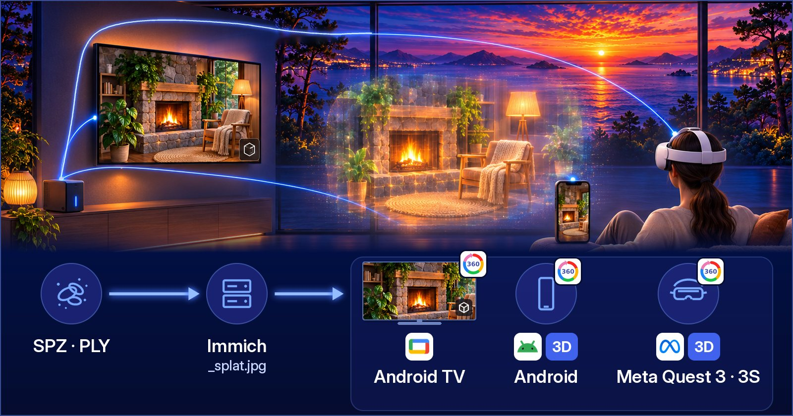

1. Dalam pemapar splat komputer, telefon Android atau tablet, berjalan ke pandangan yang anda suka, kemudian "Simpan ke Immich": pandangan yang anda lihat menjadi fotonya, dalam garis masa anda pada tarikh adegan itu dan dalam album "Adegan splat". Beberapa splat daripada perkongsian atau folder: pilihnya, kemudian "Muat naik ke Immich". Fail .ply disimpan sebagai SPZ, dimampatkan dengan sedikit kehilangan.
2. Buka foto itu dalam garis masa anda, kemudian "Teroka adegan splat": pada komputer, telefon atau tablet Android, atau Meta Quest 3 atau 3S dengan binaan GitHub. Setiap peranti memuat turun adegan itu sekali (pada data mudah alih, ia bertanya dahulu sebelum adegan yang besar), kemudian membukanya serta-merta, juga di luar talian.
3. Foto itu membawa tanda 3D kecil di satu sudut, supaya anda dapat membezakannya dalam Immich dan aplikasi lain; "Tandakan foto adegan splat yang disimpan", dalam Settings, Lanjutan, mengecualikannya daripada foto yang seterusnya.

Penyunting dan putaran dengan satu kekunci dimatikan pada foto ini: adegan splat diputar dalam pemaparnya, dengan "Tegakkan". Android TV, iPhone dan iPad memaparkan foto itu dan memberitahu di mana untuk menerokanya; TV LG dan Samsung serta aplikasi Immich memaparkan foto itu. Foto yang disunting dalam Immich mengekalkan adegannya, yang dibuka daripada foto asal; salinan yang disimpan semula oleh program lain, seperti yang dilakukan oleh aplikasi pemesejan apabila memampatkan foto, kehilangannya.

Disemak terhadap pelayan ujian Immich 3.3.0 dan 3.2.4: adegan 38,884 hingga 1,000,000 gaussian disimpan dalam 2 hingga 7 saat dan dibaca semula bait demi bait, juga melalui proksi yang menggugurkan permintaan julat, simpanan kedua adegan yang sama mendapati ia sudah ada, dan foto itu dipaparkan dengan tandanya oleh aplikasi web Immich. Belum ada foto splat yang dibuka dalam headset.

Lagi: nota [binaan 41](https://github.com/freeKC/Immuch360/releases/tag/v3.3.0-rc.0-41) dan [binaan desktop 21](https://github.com/freeKC/Immuch360/releases/tag/desktop-v3.3.0-rc.0-21).

### Mainkan fail NAS, komputer, pelayan media atau Plex

Video anda berada pada NAS, komputer, pelayan media atau Plex. Immuch360 mencari pelayan rangkaian anda secara automatik, melayarinya dan memainkan foto serta video tersebut di tempatnya, dalam setiap pemapar aplikasi, tanpa menyalin apa-apa: SMB (Samba, perkongsian Windows), WebDAV (Nextcloud, Synology dan lain-lain) dan pelayan media DLNA (Jellyfin, Emby, minidlna, NAS, kotak TV). Telefon juga boleh berkongsi galerinya sendiri pada Wi-Fi untuk headset atau mana-mana klien WebDAV, dan begitu juga komputer Windows.

  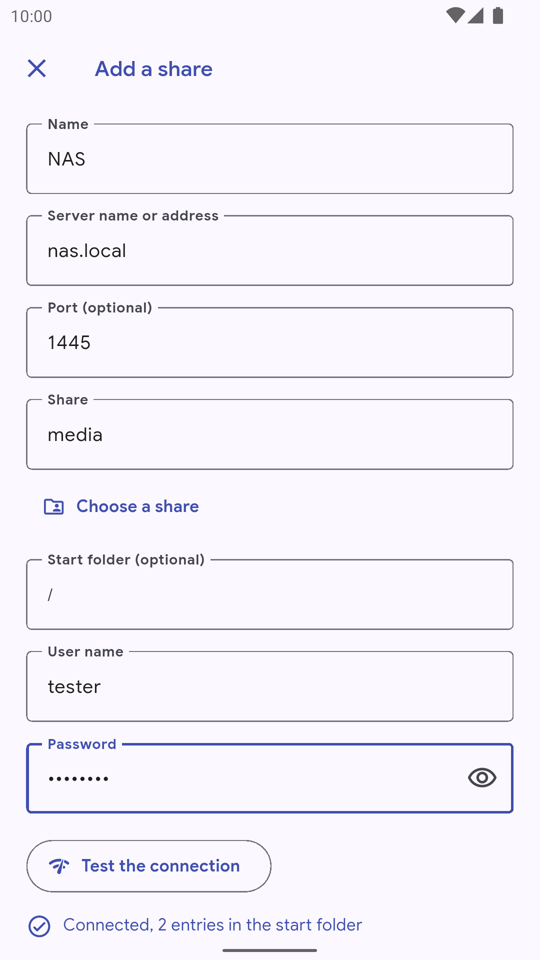
  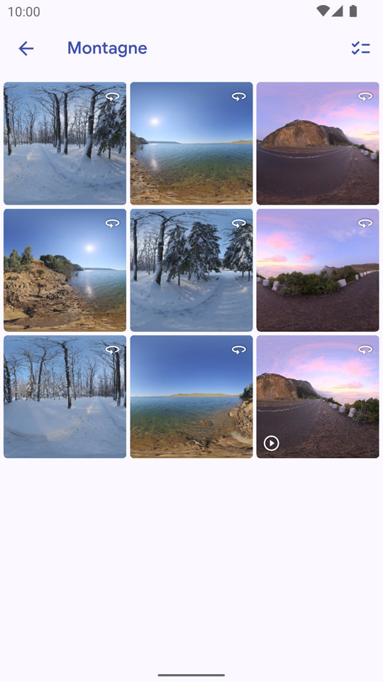

1. Buka tab Pustaka, kemudian Perkongsian rangkaian, kemudian + dan "Perkongsian rangkaian (NAS, komputer, pelayan media)". Daripada binaan 24, "Tambah perkongsian rangkaian atau pelayan media" pada halaman selamat datang membuka Perkongsian rangkaian secara terus, tanpa pelayan.
2. Ketik pelayan di bawah "Ditemui pada rangkaian", atau isi borang secara manual: jenis, nama atau alamat pelayan, perkongsian atau laluan, folder permulaan, nama pengguna dan kata laluan.
3. Ketik "Uji sambungan", kemudian Simpan. Ketik perkongsian untuk melayarinya: folder dahulu, kemudian foto dan video, dengan lencana 360° pada fail yang dikenali sebagai 360°.
4. Untuk pelayan Plex: dalam Perkongsian rangkaian, + dan "Plex Media Server", kemudian ketik pelayan anda di bawah "Ditemui pada rangkaian", tampal token sekali ("Cara mendapatkannya" pada halaman menyatakan di mana untuk menemuinya), kemudian "Uji sambungan" dan Simpan.
5. Dengan pelayan Immich yang disambungkan, pilih fail dalam folder dan ketik "Muat naik ke Immich" untuk menghantarnya ke pelayan anda.

Pemain membaca bait yang diperlukan melalui jambatan dalam aplikasi, dengan julat bait, supaya carian masa berfungsi dan tiada apa-apa disimpan pada peranti; video SMB dibaca melalui sehingga enam sambungan serentak untuk main balik yang lancar. Mulai binaan 29, filem yang dirakam sebagai M2TS (Blu-ray, kamkorder AVCHD, perakam TV) dimainkan dalam aplikasi Android daripada perkongsian SMB dan WebDAV dan daripada pelayan DLNA yang menyenaraikannya sebagai strim pengangkutan, dan pelayan DLNA yang menyenaraikan saiz 0 tidak lagi memberikan video kosong.

Pelayan media DLNA hanya menyenaraikan fail yang diindeksnya: fail mentah kamera 360° (.insv, .360, .osv) dan fail splat (.ply, .spz) biasanya tidak muncul di sana, jadi bukanya daripada perkongsian SMB atau WebDAV atau folder peranti.

**Plex Media Server, tanpa plex.tv**: aplikasi berpasangan terus dengan pelayan anda, dengan token yang anda tampal sekali, dan membaca fail asal pustaka anda secara langsung, supaya 360° kekal 360°, di rumah dan, melalui penghalaan port anda, di luar rumah. Pada TV LG, Plex dilog masuk dengan kod pada plex.tv/link.

Lagi: [perkongsian rangkaian](../docs/immuch360/user-guide.md#network-shares-a-nas-a-computer-or-a-media-server), [kongsi telefon ini pada rangkaian](../docs/immuch360/user-guide.md#share-this-phone-on-the-network), [pelayan media DLNA](../docs/immuch360/user-guide.md#dlna-media-servers), [Plex Media Server](../docs/immuch360/user-guide.md#plex-media-server-without-plextv).

#### Tonton filem Plex anda

Anda menyimpan filem anda pada pelayan Plex dan mahu melihat semuanya, yang terbaharu di atas, mengetahui apa sesebuah filem sebelum ia bermula, membawa satu dalam perjalanan, atau memulakannya pada TV dengan telefon anda. Mulai binaan 45 dan binaan desktop 25, pustaka filem Plex dibuka pada halaman filemnya, setiap filem mempunyai halamannya sendiri, dan filem dimuat turun ke peranti atau dimainkan pada TV dari telefon. Ia eksperimen dan dihidupkan secara lalai. Aplikasi Immich tidak mempunyai klien Plex, dan aplikasi Plex log masuk melalui plex.tv, manakala Immuch360 berhubung terus dengan pelayan anda.

**Anda perlukan:** Plex Media Server dengan pustaka filem, ditambah dalam Perkongsian rangkaian seperti di atas, dan Immuch360 pada skrin tempat anda menonton: telefon, tablet, Android TV, Meta Quest atau komputer.

1. **Setiap filem mengikut tahun**: dalam Perkongsian rangkaian, buka pelayan Plex anda, kemudian pustaka filemnya, atau ketik Filem dalam tab Pustaka. Setiap filem berada dalam satu senarai bermula dari tahun terbaharu, di bawah tajuk bagi setiap tahun dengan bilangannya, setiap poster dengan tajuk dan tahunnya, dimuatkan semasa anda menatal; seret penatal di tepi kanan ke sesuatu tahun. "Tunjukkan folder", dalam menu, membuka paparan folder, tempat setiap filem kini memaparkan tajuknya di bawah gambarnya.
2. **Carian**: taip beberapa huruf dalam "Cari tajuk": filem yang tajuknya mengandungi huruf itu dipaparkan, bersama apa yang ditambah oleh carian pelayan anda sendiri bagi tajuk yang salah ejaan; × atau Kembali mengosongkannya.
3. **Penapis**: butang penapis mengekalkan filem bagi sesuatu tahun atau dekad, bagi penonton mengikut umur ("12 tahun ke atas", daripada penarafan Plex), atau yang belum ditonton. Penapis, bukan kunci ibu bapa.
4. **Halaman filem**: ketik poster. Halaman itu memaparkan apa yang ada pada pelayan anda: poster, latar, tahun, tempoh, penonton, genre, sinopsis, pengarah, penulis, pelakon dan fail, kemudian Main, atau "Sambung pada 1:12:03" di tempat anda berhenti di sini atau dalam aplikasi Plex. Di bawahnya, permulaan artikel Wikipedia filem itu dalam bahasa aplikasi, ditemui melalui nombor IMDb atau TMDB-nya; "Butiran filem daripada Wikipedia", dalam menu halaman atau dalam Tetapan, Lanjutan, mematikannya.
5. **Audio dan sari kata**: dalam pemain, menu Audio dan Sari kata memaparkan nama yang diberikan Plex kepada trek dan menyenaraikan fail sari kata yang disimpan Plex di sebelah filem; filem bermula dengan trek yang anda pilih dalam Plex, dan pilihan anda disimpan ke Plex, satu-satunya perkara yang ditulis oleh aplikasi ke pelayan Plex anda. Pada komputer, menu Sari kata terletak di sebelah Audio.
6. **Muat turun**: "Muat turun ke peranti ini", pada halaman filem atau dalam menu tekan lama poster, menyalin keseluruhan filem, sebagaimana ia ada pada pelayan, ke telefon, tablet, Meta Quest atau komputer, ke dalam storan aplikasi dan tidak sekali-kali ke galeri (pada komputer, folder muat turun aplikasi, Downloads/Immuch360 secara lalai). Ia menunggu Wi-Fi secara lalai, dengan "Muat turun melalui data mudah alih kali ini", menyambung di tempat ia berhenti selepas sambungan terputus dan, pada Android, dengan skrin dimatikan. Perkongsian rangkaian, "Filem yang dimuat turun", memainkannya tanpa pelayan, di tempat anda berhenti. Pada iPhone dan iPad, biarkan aplikasi terbuka semasa ia memuat turun.
7. **Pada TV dari telefon anda**: apabila anda [log masuk TV dengan telefon anda](#sign-in-a-tv-a-headset-or-a-computer-with-your-phone), biarkan "Benarkan juga telefon ini memainkan filem padanya" dihidupkan, atau pada TV buka Tetapan, "Mainkan dari telefon", "Pautkan telefon". Dengan Immuch360 terbuka pada TV, buka filem pada telefon, kemudian "Mainkan pada…": TV, tetingkap Quest atau komputer memainkannya dalam pemain biasanya pada kedudukan telefon, dengan alat kawalan jauh yang mengawalnya, dan telefon menjadi alat kawalan jauh dengan kedudukan, Audio, Sari kata, "Hentikan pada skrin" dan "Teruskan pada telefon ini". Telefon menghantar filem yang mana, tidak sekali-kali token Plex anda; TV tanpa pelayan Plex anda menawarkan "Tambah (pelayan) ke (skrin)", selepas enam digit yang sama pada kedua-duanya.

Pada TV, halaman filem mempunyai tujuh poster sebaris dan papan kekunci TV untuk carian, dan tiada muat turun. Pada komputer, Ctrl F, Command F atau / pergi ke carian, dan Ctrl atau Command dengan roda mengubah bilangan poster sebaris. iPhone dan iPad mempunyai halaman filem, halaman sesebuah filem, muat turun dan "Mainkan pada…", tanpa menu trek. Quest bertanya sebelum telefon memainkan filem padanya, dan "Tanya sebelum telefon memainkan filem" melakukan perkara yang sama pada TV atau komputer.

Had binaan 45: fungsi Plex diuji dengan data ujian dan pelayan Plex simulasi, tidak sekali-kali dengan pelayan Plex sebenar, dan tidak pada telefon, TV atau headset fizikal sebelum binaan ini; pengarang mencubanya pada binaan 45. Telefon dan skrin mesti berada pada rangkaian rumah yang sama, dengan Immuch360 terbuka pada skrin, dan pada Windows bukan pada rangkaian yang ditandakan oleh sistem sebagai awam. Fail sari kata di sebelah filem tidak disalin bersamanya, sari kata yang dilukis sebagai gambar (PGS, VobSub) dikecualikan, dan aplikasi TV LG dan Samsung belum mempunyai fungsi ini.

Lagi: [setiap filem mengikut tahun](../docs/immuch360/user-guide.md#every-film-of-a-plex-library-by-year-from-build-45), [halaman filem, trek dan penapis](../docs/immuch360/user-guide.md#films-of-a-plex-library-from-build-45), [muat turun filem](../docs/immuch360/user-guide.md#download-a-film-to-this-device), [mainkan filem pada TV anda dari telefon anda](../docs/immuch360/user-guide.md#play-a-film-on-your-tv-from-your-phone), dan nota [binaan 45](https://github.com/freeKC/Immuch360/releases/tag/v3.4.0-45) serta [binaan desktop 25](https://github.com/freeKC/Immuch360/releases/tag/desktop-v3.4.0-25).

### Semak imbas folder telefon atau headset anda

On this device menyenaraikan album peranti satu demi satu, tanpa subfolder, jadi folder filem dalam Download/Quest atau folder splat tidak kelihatan seperti yang anda susun. "Semak imbas folder" membuka folder telefon, tablet atau Meta Quest seperti perkongsian rangkaian, dengan semua subfoldernya, dan menyimpannya dalam senarai anda.

  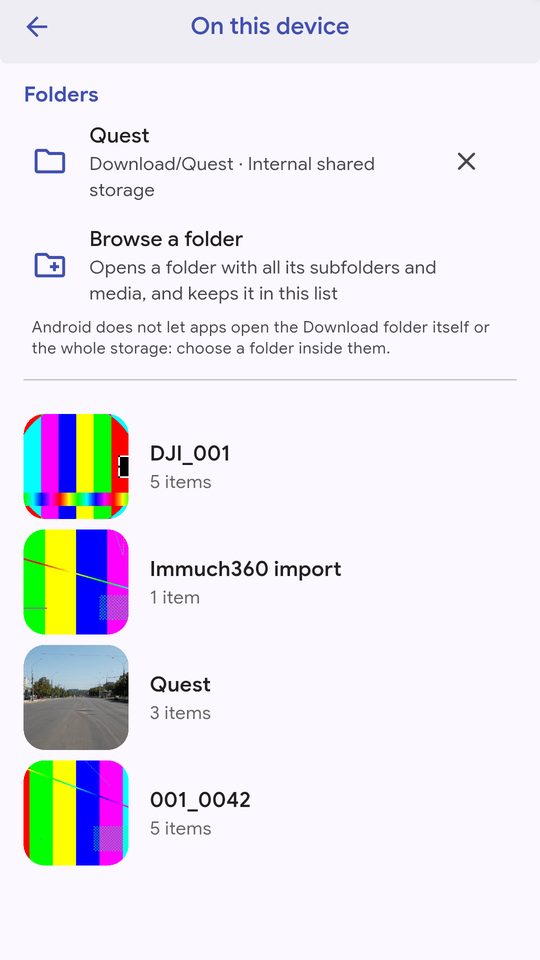
  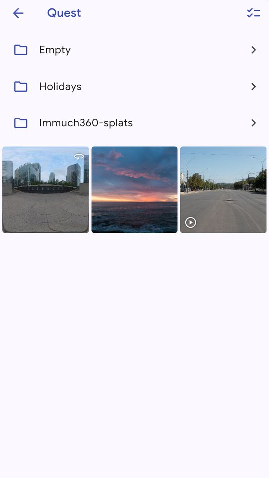

1. Pustaka, On this device, "Semak imbas folder" (atau Perkongsian rangkaian, +, "Semak imbas folder peranti ini").
2. Pemilih folder Android dibuka dalam Download: pilih folder di dalamnya, seperti Download/Quest, kemudian "Use this folder" dan "Allow". Android 11 dan lebih baharu membenarkan aplikasi membuka folder di dalam Download, bukan Download itu sendiri, dan foto yang diletakkan terus dalam Download kekal dalam album Download.
3. Folder dibuka dengan subfolder, foto dan videonya bersama lencana 360° dan 3D, dan pada headset, dengan splat Gaussiannya. Ia kekal di atas On this device; "Tidak boleh dibaca sekarang" bermaksud ia dialihkan atau dicabut, dan pangkahnya mengeluarkannya daripada senarai, dengan Undo, sambil meninggalkan fail pada peranti.
4. Tekan lama atau Select, kemudian "Muat naik ke Immich" menghantar fail ke pelayan Immich anda.

**Foto TIFF** kini dipaparkan, pada telefon, tablet, Android TV dan Quest. Daripada pelayan anda, TIFF dipaparkan daripada JPEG yang dibuat oleh pelayan anda ("Ditunjukkan sebagai pratonton pelayan: peranti ini tidak menyahkod TIFF"); daripada peranti atau perkongsian, aplikasi itu sendiri menyahkodnya ("Menyahkod TIFF pada peranti ini"), dan muat turun menyimpan TIFF asal. Windows dan macOS memaparkan foto TIFF dengan penyahkod mereka sendiri, dan Linux memberikan lakaran kecil ganti.

Disemak pada emulator Android 16: pemilih dalam Download, folder dengan subfoldernya, foto, muat naik, mula semula aplikasi, folder yang dialihkan dan pengeluarannya. Penyahkod TIFF mengembalikan 24 fail ujian dengan tepat hingga ke piksel.

Lagi: nota [binaan 38](https://github.com/freeKC/Immuch360/releases/tag/v3.3.0-rc.0-38).

### Sambung filem di tempat anda berhenti

Anda kembali kepada filem keesokan harinya dan tidak tahu di mana anda berada, atau filem mana yang sudah anda habiskan. Immuch360 mengingatinya untuk anda: lakaran kecil filem menunjukkan berapa banyak yang telah anda tonton, dan filem disambung dari situ.

1. Video yang lebih panjang daripada 10 minit dikira sebagai filem. Lakaran kecilnya memaparkan bar bahagian yang telah anda tonton, dan tanda apabila anda menontonnya hingga 2 minit terakhirnya.
2. Bukanya semula: ia disambung di tempat anda berhenti, dengan "Disambung pada 42:10" selama beberapa saat. Tiada butang, tiada tetingkap timbul, dan leretan serta kekunci alat kawalan jauh berfungsi seperti sebelumnya.
3. Menu pemapar dan butiran mempunyai "Main dari awal" dan "Tandakan sebagai belum ditonton", dan butiran juga menyebut "Ditonton 42 %" atau "Dihentikan pada 42:10 daripada 01:40:00". Pada TV, alat kawalan jauh mencapainya dalam butiran.
4. Dalam Settings, Asset Viewer, Video, "Ingat tempat saya berhenti" mematikannya, dan peluncurnya menentukan berapa panjang filem, dari 0 (setiap video) hingga 60 minit. Filem tidak lagi berulang; video yang lebih pendek masih berulang.

Ia berfungsi dalam pemapar pustaka Immich anda, dalam pemain perkongsian rangkaian dan folder peranti, dalam paparan imersif Meta Quest, dan pada komputer; pemain 360° telefon dan komputer memulakan filem dari awal. Apa yang telah anda tonton kekal dalam pangkalan data pada peranti dan tidak pernah dihantar ke pelayan anda.

Disemak oleh CI projek dan pada hos binaannya, dengan binaan 38 dan binaan desktop 18: keseluruhan suite ujian Dart lulus, dengan ujian yang ditulis untuk filem, daripada bar pada lakaran kecil hingga sambungan semula dalam paparan imersif Quest.

Lagi: nota [binaan 38](https://github.com/freeKC/Immuch360/releases/tag/v3.3.0-rc.0-38) dan [binaan desktop 18](https://github.com/freeKC/Immuch360/releases/tag/desktop-v3.3.0-rc.0-18).

### Apabila video menunggu atau tidak dimainkan

Filem daripada pelayan atau NAS anda dimainkan daripada fail yang dinyahkod oleh peranti ini, dan apabila ia perlu menunggu, ia memberitahu mengapa, dan berapa lama.

- **Fail yang boleh dinyahkod dimainkan.** Immich menyimpan fail asal video dan, apabila ia mengekod semula, satu salinan. Aplikasi memainkan apa yang dinyahkod oleh peranti ini: "Memainkan fail asal: salinan pelayan (H.264 5760 x 2880) melebihi had penyahkod peranti ini". Apabila pelayan tidak dapat menstrim fail asal itu, aplikasi memuat turunnya dahulu ("Memuat turun fail asal untuk dimainkan: 45 %"); apabila tiada fail yang boleh dinyahkod, ia memberitahu apa yang perlu diubah dalam Immich. Mulai binaan 44 pada Android, apabila penyahkod menolak fail yang dikatakan peranti boleh diterimanya (penyahkod HEVC TV pada 5760 x 2880), aplikasi memainkan fail yang satu lagi sekali, memberitahunya, dan mengekalkan pilihan itu sehingga ia ditutup. Leret ke atas pada video: kad "Sumber video" memberitahu fail mana yang dimainkan dan mengapa, dan butangnya memainkan yang satu lagi.
- **Sambungan perlahan.** Di bawah penunjuk pemuatan, "Memuatkan: 2 Mbit/s daripada 8.1 Mbit/s yang diperlukan video ini" dan "Bermula dalam kira-kira 37 s": aplikasi menunggu mengikut apa yang dibawa oleh sambungan, kemudian memainkan bahagian yang lebih panjang. "Pelayan menghantar video ini pada 2 Mbit/s, ia memerlukan 8.1 Mbit/s: ia akan berhenti sekali-sekala" datang bersama jalan penyelesaian: dalam Immich, Administration, Video transcoding, resolusi sasaran atau kadar bit maksimum yang lebih rendah.
- **Pelayan yang berhenti.** "Pelayan berhenti menghantar video ini. Ia akan bersambung sebaik sahaja pelayan menjawab": filem menunggu pelayan dan bersambung sebaik sahaja ia menjawab. Sama juga untuk perkongsian.
- **Komputer riba dengan dua cip grafik.** Mulai binaan desktop 21, aplikasi Windows berjalan pada cip yang laju: pada komputer riba penulis, filem 8K HEVC yang pada cip bersepadu memaparkan 15 hingga 19 gambar sesaat, dengan gambar hitam, kini memaparkan kira-kira 30, tanpa satu pun gambar hitam. Dalam butiran filem yang sedang dimainkan (kekunci I), "Penyahkodan video" menamakan kad grafik dan penyahkodnya ("Perkakasan, pada NVIDIA GeForce RTX 4060 Laptop GPU • d3d11va"), dan untuk filem 4K atau 8K, apabila Penjimatan kuasa dalam seting grafik Windows mengekalkan aplikasi pada cip bersepadu, baris ini memberitahu di mana untuk memilih Prestasi tinggi: Seting Windows, Sistem, Paparan, Grafik, kemudian mulakan semula aplikasi. Pada bateri, Penjimatan kuasa di situ mengekalkan aplikasi pada cip bersepadu dan menjimatkan kuasa, dengan mengorbankan main balik 4K dan 8K. Pada cip bersepadu, 8K dimainkan lebih baik berbanding binaan desktop 20, tetapi tidak lancar: kira-kira 23 gambar sesaat, dengan beberapa gambar hitam.

iPhone dan iPad mengekalkan penyahkod sistem dan peraturan menunggu mereka sendiri. Disemak pada emulator Android dengan pelayan dan perkongsian yang diperlahankan antara 0.6 dan 3 Mbit/s: filem yang ditinggalkan oleh binaan 38 selepas 20 s kini dimainkan, dan filem yang pelayannya senyap selama satu minit terus dimainkan 1.3 s selepas pelayan menjawab.

Lagi: nota [binaan 37](https://github.com/freeKC/Immuch360/releases/tag/v3.3.0-rc.0-37), [binaan desktop 17](https://github.com/freeKC/Immuch360/releases/tag/desktop-v3.3.0-rc.0-17), [binaan 39](https://github.com/freeKC/Immuch360/releases/tag/v3.3.0-rc.0-39), [binaan desktop 19](https://github.com/freeKC/Immuch360/releases/tag/desktop-v3.3.0-rc.0-19) dan [binaan desktop 21](https://github.com/freeKC/Immuch360/releases/tag/desktop-v3.3.0-rc.0-21).

### Kekalkan pustaka Immich anda, dengan lebih banyak lagi

Dengan pelayan [Immich](https://github.com/immich-app/immich), Immuch360 ialah aplikasi mudah alih Immich, dengan pelayan dan akaun yang sama seperti aplikasi web: sandaran, garis masa, album, carian, orang, kenangan, perkongsian, rakan kongsi, semuanya disegerakkan dengan pelayan anda. Ia dipasang bersebelahan dengan aplikasi rasmi. Selain itu: lencana dan senarai 360°, setiap pemapar mendalam, pilihan antara fail asal dan strim yang ditranskod oleh pelayan untuk setiap video, butiran teknikal video, dan fail perkongsian atau peranti yang dihantar ke pelayan anda secara manual.

1. Pada halaman selamat datang, ketik "Sambung ke pelayan Immich", kemudian log masuk dengan alamat pelayan, e-mel dan kata laluan anda, seperti dalam aplikasi Immich; Back membawa anda kembali ke halaman selamat datang. Sehingga binaan 23, halaman log masuk terbuka terus. Pustaka, album dan tetapan sandaran anda adalah milik akaun anda.
2. Dalam Tetapan, Pemapar Aset, Video, "Sumber video" memilih fail asal apabila peranti ini boleh menyahkodnya, sentiasa fail asal, atau sentiasa strim yang ditranskod.
3. Untuk menunjukkan foto 360° kepada seseorang yang tidak mempunyai aplikasi ini, kongsikannya dengan pautan kongsi Immich: aplikasi web Immich memaparkannya sebagai sfera dalam pelayar mereka.
4. Jika pelayan anda menjalankan Immich 3.4 atau lebih baharu, pentadbirnya boleh memilih JPEG XL dalam Pentadbiran, Tetapan, Tetapan Imej, Format bagi Tetapan Lakaran Kenit dan bagi Tetapan Pratonton: fail lebih kecil untuk gambar yang sama. Mulai binaan 45 dan binaan desktop 25, Immuch360 memaparkannya pada telefon, tablet dan TV Android, dalam Meta Quest (tetingkap dan paparan imersif), dalam widget skrin utama, pada Windows, Linux dan macOS, dan pada iPhone dan iPad mulai versi 3.4.0, dengan penyahkod Immich sendiri. Aplikasi TV LG dan Samsung tidak dapat memaparkan JPEG XL: foto-fotonya menyatakan "Pratonton tidak tersedia", jadi kekalkan WebP atau JPEG jika anda menonton pada TV tersebut. Disemak oleh makmal CI pada emulator Android 14 dengan pelayan ujian yang menjawab dengan JPEG XL, dan oleh ujian desktop pada Windows dan Linux; belum dengan pelayan Immich 3.4 sebenar yang ditetapkan kepada JPEG XL, mahupun dalam Quest, pada kotak TV atau pada komputer secara manual.

Binaan semasa, binaan 45, versi 3.4.0, mengikuti aplikasi Immich 3.4.0 dengan 11 pembetulan Immich yang lebih baharu, untuk pelayan Immich 3.3 dan 3.4; makmal CI menjalankannya dengan pelayan Immich simulasi, dan belum ada pelayan Immich 3.4 sebenar yang dicuba. Log masuk passkey Immich 3.4.0 kekal dimatikan dalam Immuch360. Binaan 28 hingga 44 adalah berdasarkan Immich `main` pada 10 Oktober 2026 (versi 3.3.0-rc.0); binaan 28 telah diuji dengan pelayan yang dibina daripada `main` Immich yang sama, dan binaan 27 juga dengan pelayan Immich 3.2.4. Sila laporkan masalah dalam [Issues](https://github.com/freeKC/Immuch360/issues), bukan kepada projek Immich.

Apa yang sama dan apa yang ditambah oleh Immuch360 terdapat dalam [Berbanding dengan Immich](#compared-with-immich).

Lagi: [selebihnya ialah Immich](../docs/immuch360/user-guide.md#everything-else-is-immich), [berbanding dengan aplikasi Immich](../docs/immuch360/compatibility.md#compared-with-the-immich-app).

### Cari bulan atau tahun dalam garis masa yang panjang

Sepuluh tahun foto ialah tatalan yang panjang. Cubit melepasi lakaran kecil yang paling kecil dan garis masa memaparkan satu blok setiap bulan, dengan beberapa lakaran kecil yang kecil dan kiraan, kemudian satu blok setiap tahun dengan dua belas bulannya. Diminta oleh ChazyChaxxx dalam [Discussion 10](https://github.com/freeKC/Immuch360/discussions/10).

1. Pada telefon atau tablet, cubit; pada komputer, tahan Ctrl dan putar roda tetikus (Command pada Mac), atau cubit pada pad sentuh. "Bulan", kemudian "Tahun" muncul.
2. Ketik atau klik bulan atau tahun untuk membukanya pada zum biasa anda; daripada bulan dan tahun, Back kembali ke grid.
3. Bar tatal di kanan memaparkan tahun dan bulan di bawah jari anda, dan menjadi perlahan apabila anda menahannya diam.

Disemak pada telefon pengarang dan, pada setiap langkah, pada PC Windows dengan binaan desktop 14. Aplikasi sentiasa dibuka pada grid, dan TV serta tetingkap Meta Quest mengekalkan grid.

Lagi: nota [binaan 33](https://github.com/freeKC/Immuch360/releases/tag/v3.3.0-rc.0-33) dan [binaan desktop 14](https://github.com/freeKC/Immuch360/releases/tag/desktop-v3.3.0-rc.0-14).

### Tonton kamera rumah anda pada skrin besar

  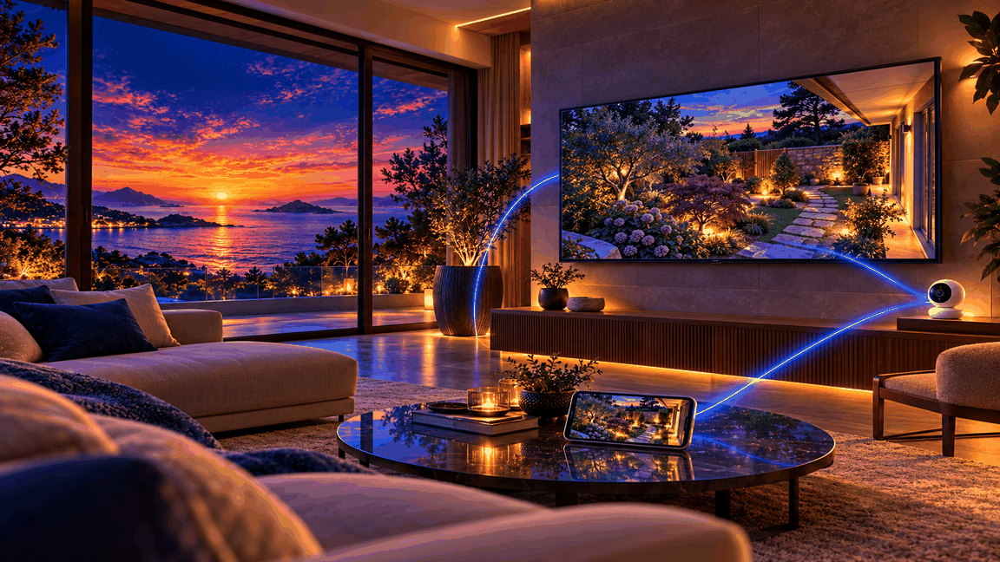

Ilustrasi. Sokongan Tapo disemak dengan kamera simulasi.

Kamera Tapo anda daripada TP-Link, di sebelah foto anda, tanpa aplikasi Tapo. Aplikasi memaparkan kamera secara langsung (telefon dan tablet Android, Android TV, Meta Quest, Windows dan, video sahaja, TV LG; iPhone dan iPad mulai versi 3.3.2, belum dicuba padanya) dan menyenaraikan rakaman kad memorinya hari demi hari (telefon, tablet, Android TV, Quest dan komputer). Klip diambil daripada kamera, dimainkan seperti mana-mana video dan boleh dihantar ke Immich. Aplikasi berhubung dengan kamera pada rangkaian anda sahaja, tidak sekali-kali dengan pelayan TP-Link, dan tidak sekali-kali mengubah apa-apa pada kamera.

**Disemak dengan kamera simulasi.** Protokol ditulis daripada tangkapan C510W dengan perisian tegar 1.3.4. Laporan dengan model dan perisian tegar yang dipaparkan oleh "Uji kamera" sangat membantu.

1. Dalam aplikasi Tapo dahulu: cipta akaun kamera (tetapan kamera, Advanced Settings, Camera Account), yang digunakan untuk paparan langsung, dan hidupkan Third-Party Compatibility, di bawah Me, kemudian Tapo Lab.
2. Dalam Immuch360: Pustaka, Perkongsian rangkaian, + dan "Kamera Tapo". Ketik kamera anda di bawah "Ditemui pada rangkaian", atau taip alamatnya.
3. Taip kata laluan akaun TP-Link anda untuk rakaman, akaun kamera untuk paparan langsung, atau kedua-duanya; kemudian "Uji kamera", dan Simpan.
4. Ketik kamera: paparan langsungnya berada di bahagian atas halamannya, dengan bunyi, SD atau HD dan Skrin penuh; di bawahnya terdapat hari-hari dengan rakaman. Ketik klip untuk mengambil dan memainkannya; menu ⋮nya mempunyai "Muat naik ke Immich".

Lagi: [kamera Tapo](../docs/immuch360/user-guide.md#tapo-cameras-live-view-and-the-recordings-of-the-memory-card).

### Dron DJI anda (eksperimen)

Kad Dron dalam Pustaka, eksperimen dan dihidupkan secara lalai, mengumpulkan apa yang dilakukan Immuch360 dengan dron DJI: pada telefon Android, video langsung dron melalui pengawal jauhnya, dan foto serta videonya dibawa ke Immich melalui USB; dalam Meta Quest atau pada Android TV, video langsung itu dihantar semula oleh telefon, untuk ditonton. Immuch360 bukan produk DJI dan tidak diluluskan oleh DJI, dan tiada apa-apa dihantar kepada DJI.

#### Lihat apa yang dilihat dron anda, pada telefon anda

  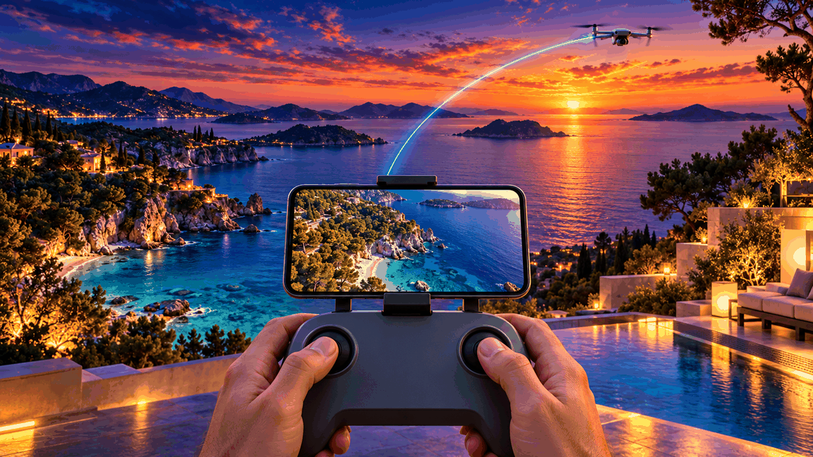

Lihat apa yang dilihat oleh dron DJI anda pada telefon Android anda, tanpa DJI Fly dan tanpa sebarang akaun: sambungkan pengawal jauh DJI RC-N3 ke telefon dengan kabelnya, dan Immuch360 memaparkan video langsung dron dalam skrin penuh mendatar, H.265 dalam 1080p, dengan nilai penerbangan yang dibaca daripada kabel. Pengawal jauh mengekalkan kawalan penuh ke atas dron. Ia dicuba dengan RC-N3, DJI Neo 2 dan Samsung Galaxy S24+: di atas tanah dengan binaan 29, dan dalam penerbangan dengan binaan ujian binaan 30 pada 24 dan 25 Oktober, kemudian dengan binaan 30 pada 26 Oktober.

**Pengawal jauh dan dron yang mana**, pada 26 Oktober 2026: video langsung datang melalui pengawal jauh DJI yang memegang telefon pada kabelnya. Sudah mencuba pasangan lain? Pada skrin langsung, buka Lanjutan, kemudian Diagnostik, dan beritahu kami dalam [Issues](https://github.com/freeKC/Immuch360/issues) dron dan pengawal jauh yang anda gunakan dan apa yang dipaparkan oleh Diagnostik.

- **Diuji**: DJI Neo 2 yang dipasang dengan Digital Transceivernya, yang diperlukannya untuk terbang dengan mana-mana pengawal jauh, dan DJI RC-N3, dengan Samsung Galaxy S24+; di atas tanah pada 23 Oktober dan dalam penerbangan, di dalam bangunan, dari 24 hingga 26 Oktober.
- **Dijangka berfungsi**: RC-N3 dengan dron lain yang disenaraikan oleh DJI untuknya (Neo, Flip, Mini 4 Pro, Mini 5 Pro, Air 3, Air 3S, Lito 1, Lito X1, dan Avata 360 menurut panduannya sendiri), dan RC-N2, yang memegang telefon pada kabel yang sama, dengan dron yang sama dan Neo 2. Aplikasi memaparkan video H.265 sahaja, dan nilai penerbangan terbukti pada Neo 2 sahaja: dengan dron lain, gambar atau nilai mungkin tiada.
- **Tidak disokong**: pengawal jauh dengan skrin sendiri (DJI RC, RC 2, RC Pro 2), dan oleh itu Mavic 4 Pro, yang dijual oleh DJI bersama salah satu daripadanya; gogal DJI; RC-N1, RC-N1C dan pengawal jauh yang lebih lama; dron yang diterbangkan daripada telefon melalui Wi-Fi, tanpa pengawal jauh.

Ia hanya mendengar. Tiada arahan yang pernah dihantar kepada pengawal jauh atau dron: satu bait yang ditulis oleh halaman setiap saat, bermula 20 saat selepas pengawal jauh dibuka, hanya memberitahu sama ada pengawal jauh menerima data, dan tidak membawa sebarang arahan.

Pada skrin langsung: bateri dron dan masa motor dan, dalam penerbangan, ketinggian di atas titik berlepas, kelajuan menegak, kelajuan dan jarak di bawah dron. Sesuatu nilai hanya dipaparkan di situ setelah tangkapan penerbangan kami sendiri membuktikannya: ketinggian, kelajuan dan jarak di bawah dibuktikan pada tangkapan dua penerbangan dalam bangunan pada 25 Oktober, sehingga 1.8 m tinggi dan 1.5 m/s, belum melebihi itu; memaparkannya di situ adalah baharu dalam binaan 30 dan diuji buat kali pertama dengannya. Ketinggian dipaparkan kira-kira 1.5 s selepas berlepas, setelah dron meninggalkan tanah atau tangan, dan kekal tersembunyi sehingga motor berhenti jika ia pernah melompat dengan cara yang mustahil bagi mana-mana pesawat. Advanced menambah voltan dan suhu bateri, arah (sifarnya belum disemak terhadap utara) dan motor, dan Diagnostics setiap nombor yang diberikan oleh pautan, termasuk arus bateri. Tiada satelit, kedudukan atau jarak dari rumah dipaparkan. Nombor-nombor itu belum dibandingkan dengan DJI Fly: jangan terbang berpandukannya.

**Cincin halangan**, dihidupkan secara lalai: apabila penderia dron melihat sesuatu yang dekat, bulatan lut sinar dipaparkan di sekeliling tengah gambar, dengan lengkok ke arah halangan, ambar bertukar merah apabila semakin dekat, jaraknya di sebelah dan bunyi detik pendek yang semakin laju; jika tiada apa-apa yang dekat, tiada apa-apa dipaparkan. Bulatan dan arah lengkok disemak dalam penerbangan, dalam bangunan, pada 25 Oktober, pada binaan ujian di mana arah ialah satu pilihan; dipaparkan secara lalai, ia diuji buat kali pertama dengan binaan 30. Dalam Advanced anda menetapkan jarak ("Glow from", 3.0 m, dan "Strong glow from", 1.0 m), memilih bingkai di tepi gambar dan bukannya bulatan, atau mematikan cincin, bunyinya atau getarannya. Ia hanya memaparkan apa yang dilaporkan oleh penderia dron: tiada apa-apa dalam mod Sport atau apabila pengelakan halangan dimatikan, dan tiada cahaya tidak bermaksud laluan selamat. Maklumat sahaja: Immuch360 tidak sekali-kali mengemudi atau menghentikan dron.

1. Kad Dron berada dalam Pustaka, dan "DJI live video" pada halamannya: "DJI live video (experimental)", dalam Tetapan, Advanced, dihidupkan secara lalai.
2. Hidupkan dron dan pengawal jauh, tutup DJI Fly, kemudian buka "DJI live video" dan baca notis keselamatan.
3. Sambungkan pengawal jauh ke telefon dengan kabelnya. Jika Android bertanya aplikasi mana yang patut membukanya, pilih Immuch360 tanpa "Sentiasa", kerana pilihan itu akan mengambil pengawal jauh daripada DJI Fly; jika ia meminta mod USB, pilih pengecasan sahaja. Selepas itu, menyambungkan pengawal jauh membuka skrin ini dengan sendirinya ("Open this screen when the remote is plugged in", dihidupkan secara lalai dalam Advanced).
4. Remote, Drone dan Picture menyala bergilir-gilir, dan gambar muncul dalam skrin penuh dalam beberapa saat. Tiga butang (keluar, "Send to a headset or a TV" dan Advanced) dan nilai-nilai berada dalam jalur hitam di sebelah gambar. Nota seperti "Live" pudar selepas kira-kira lima saat; ketikan di mana-mana membawanya kembali, dan tiada apa-apa pada gambar bertindak ke atas dron. Ralat yang meminta anda bertindak kekal dipaparkan.
5. Advanced mempunyai "Save a capture for a bug report", yang menulis tangkapan pautan ke `Download/Immuch360/dji-link`, "Play a saved capture", untuk memainkannya semula tanpa pengawal jauh, dan Diagnostics, dengan setiap nombor yang diberikan oleh pautan.

Foto dan video dron tidak boleh dicapai melalui pengawal jauh, yang tidak membuka storan dron: salinnya daripada dron itu sendiri melalui USB atau daripada kadnya, seperti [di bawah](#bring-a-drones-or-a-camera-cards-photos-and-videos-to-immich). Simpan tangkapan yang disimpan untuk diri anda sendiri, seperti yang dinyatakan oleh halaman: ia mengandungi video dron dan nombor siri pengawal jauh dan pesawat, dan mungkin mengandungi kedudukannya; laporan dalam [Issues](https://github.com/freeKC/Immuch360/issues) dengan apa yang dipaparkan oleh Diagnostics membantu, terutamanya dengan pengawal jauh DJI lain.

#### Tontonnya dalam Meta Quest atau pada Android TV

Telefon yang disambungkan ke pengawal jauh boleh menghantar gambar dan nilai dron ke Immuch360 dalam Meta Quest atau pada Android TV atau Google TV pada rangkaian setempat yang sama, untuk orang yang bersama anda. Headset memaparkannya dalam tetingkap atau, lebih besar, dalam paparan penerbangan di hadapan anda, dan TV dalam skrin penuh, dengan nilai dan cincin halangan yang sama seperti telefon. Mereka hanya menonton: tiada apa-apa yang dilakukan oleh headset atau TV sampai ke pengawal jauh atau dron. Nota mereka, seperti "Menonton sahaja", pudar selepas beberapa saat dan kembali dengan kekunci, ketikan atau butang. Gambar dron sampai ke Quest 3 sekali, pada 24 Oktober, melalui Wi-Fi rumah; tetingkap headset dan paparan penerbangan dengan nilai dan cincin halangan diuji buat kali pertama dengan binaan 30. Jika bulatan menutup bahagian tengah gambar dalam headset, "Bingkai di tepi" dalam menunya mengekalkan bahagian tengah bebas. Pada Android TV TCL, pemasangan dan gambar dicuba pada 25 Oktober, dengan tersekat-sekat dan warna kehijauan pada penghantaran semula yang terdahulu; pada 26 Oktober, dengan binaan 30, selepas bertukar kepada strim stabil, TV terus memaparkan gambar sepanjang penerbangan di mana dron menghantar 18 Mbit/s, dengan 7 kali beku, yang paling lama 1.7 s; rupa gambar itu tidak direkodkan. Mulai binaan 31 notis keselamatan pada TV mengekalkan fokus alat kawalan jauh (disemak oleh ujian widget); dalam binaan 30 paparan di bawahnya boleh mengambil fokus, jadi notis itu tidak dapat dibaca mahupun diterima, dan satu-satunya jalan keluar ialah Back, yang meninggalkan halaman. Terbang sambil menonton headset atau TV memerlukan pemerhati di sebelah anda yang memastikan dron kelihatan (kategori terbuka EU); tanpanya, tonton dron.

1. Pada telefon, pada skrin langsung, ketik "Send to a headset or a TV" dan hidupkannya.
2. **Meta Quest**: buka Immuch360, Pustaka, Drone, dan pilih telefon; taip kod yang dipaparkan oleh telefon, sekali untuk telefon itu. Gambar dibuka dalam tetingkap; "Open the flight view" membesarkannya, dan B atau Y membawa tetingkap kembali.
3. **Android TV dan Google TV**: buka Immuch360, Pustaka, Drone. Di bawah "Let this TV watch", TV memaparkan kod dan kod QRnya: pada telefon, dalam panel yang sama, ketik "Add a TV" dan imbasnya, atau taipnya. Kemudian pilih telefon pada TV dan tekan OK: gambar muncul dalam skrin penuh; OK memaparkan atau menyembunyikan nombor, dan Menu membuka pilihan.
4. Telefon dan skrin mesti berada pada rangkaian setempat yang sama. Di luar rumah, hidupkan tempat liputan telefon, dalam jalur 5 GHz jika tersedia, dan sertainya daripada headset atau TV.
5. Untuk laporan pepijat, menu headset dan Options TV mempunyai Diagnostics dan "Save a reception record", yang menyimpan apa yang diterima oleh skrin itu.

**Kualiti hantaran**, baharu dalam binaan 30, dalam Lanjutan pada telefon: dalam penerbangan dron menghantar kira-kira 18 Mbit/s, dan pada 25 Oktober laluan Wi-Fi rumah daripada telefon melalui penghala ke TV membawa strim penuh itu hanya satu pertiga masa penerbangan; selebihnya gambar TV tersekat-sekat, pecah dan menjadi kehijauan. Dengan Automatik, lalai, skrin yang Wi-Fi-nya tidak dapat mengikut mendapat gambar stabil yang dikod semula oleh telefon untuknya, sehingga 1080p pada 30 gambar sesaat dan pada kadar yang dibawa oleh Wi-Fi-nya, dibuat untuk kekal bersih, dengan kurang perincian, dan bukannya pecah; ia kembali kepada gambar dron sendiri pada pendaratan atau pelepasan seterusnya, setelah Wi-Fi-nya membawa gambar stabil selama 30 s tanpa terhenti; pada 26 Oktober Wi-Fi TV itu tidak pernah berbuat demikian, dan TV kekal pada gambar stabil, pada 15 gambar sesaat untuk 44 daripada 59 saatnya. Strim penuh sentiasa menghantar gambar dron seperti yang diterima, Strim stabil sentiasa gambar telefon. Gambar stabil itu mula-mula berjalan pada telefon pada 26 Oktober, dengan binaan 30: Galaxy S24+, yang mengekodnya dalam HEVC perkakasan pada kadar bit tetap. TV pada kabel Ethernet, atau skrin yang menyertai tempat liputan telefon sendiri, meninggalkan satu lompatan Wi-Fi dan bukannya dua.

Tiada dalam binaan ini: dron pada iPhone dan iPad (belum dimulakan), penghantaran semula ke TV LG dan Samsung, dan bukti nilai melebihi 1.8 m dan 1.5 m/s, kemudian satelit dan jarak dari rumah, yang menunggu penerbangan di luar.

#### Bawa foto dan video dron atau kad kamera ke Immich

Import foto dan video dron DJI melalui USB, terus ke pelayan Immich anda: sambungkan dron atau pembaca kad ke telefon Android, pilih fail baharu dan hantar, dengan video diletakkan pada peta daripada data penerbangan dron dan sfera 360° dron dipaparkan sebagai 360°. Aplikasi Immich hanya menyandarkan apa yang sudah ada dalam galeri telefon, dan pelayan Immich belum dapat membaca tempat video DJI Neo 2. Halaman ini eksperimental, pada telefon dan tablet Android sahaja, dan disemak pada emulator Android dengan fail ujian; ujian dengan DJI Neo 2 sebenar ada dalam pelan hala tuju.

  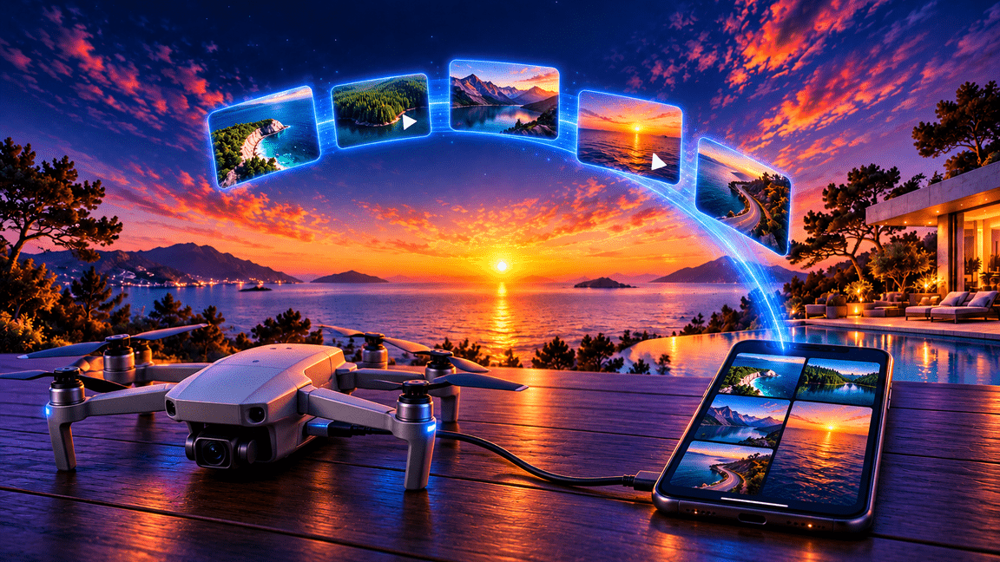

1. Buka kad Dron dalam Pustaka, kemudian "Photos and videos from the drone". Tetapannya, "DJI drones (experimental)" dalam Tetapan, Advanced, dihidupkan secara lalai; matikannya di situ untuk menyembunyikan halaman itu.
2. Sambungkan dron (Neo 2 boleh kekal dimatikan) atau pembaca kad ke telefon dengan kabel data USB-C; pengawal jauh DJI tanpa skrin (RC-N1, RC-N2, RC-N3) tidak menyimpan foto. Pada halaman Dron DJI, ketik "Pilih dron atau kad", pilihnya dalam menu sisi pemilih, buka folder DCIM-nya atau kekalkan keseluruhan pemacu, kemudian "Guna folder ini" dan Benarkan.
3. Halaman menyenaraikan foto dan video mengikut hari, tanpa fail sampingan .LRF, .SRT, .THM dan .m4a. Ketik "Pilih semua yang baharu", kemudian "Muat naik ke Immich"; fail yang dihantar sebelum ini membawa tanda awan dan dilangkau. "Simpan pada peranti" sebaliknya menyalin fail ke galeri telefon, dalam album "Immuch360 import".
4. Supaya video muncul pada peta, hidupkan Video Subtitles dalam DJI Fly (mod video, Tetapan, Kamera) sebelum anda terbang: dron kemudian menulis fail .SRT di sebelah setiap video, aplikasi membaca tempat daripadanya dan menetapkannya pada pelayan anda selepas muat naik, apabila Immich tidak menemui sebarang tempat.

Sfera 360° dron DJI (Mini, Air, Mavic dan lain-lain, dikenali daripada kameranya) dipaparkan sebagai 360° dalam Immuch360 walaupun tanpa tag 360°. Immich memerlukan tag tersebut: pilihan muat naik "Tandakan sfera dron sebagai 360° untuk Immich", dimatikan secara lalai, menghantar foto tanpa diubah dengan fail .xmp kecil di sebelahnya, supaya Immich juga memaparkannya sebagai sfera. Neo 2 tidak mempunyai mod sfera atau panorama: foto dan videonya rata. Apabila telefon merakam bunyi klip Neo 2, bunyi itu berada dalam fail .m4a yang berasingan: halaman menandakan klip itu, dan Immich menerimanya tanpa bunyi (muat turunnya dengan DJI Fly untuk mengekalkan bunyi). Mana-mana kad kamera dengan folder DCIM berfungsi dengan cara yang sama dalam pembaca kad. Tiada apa-apa dihantar kepada DJI.

Lagi: [dron DJI melalui USB](../docs/immuch360/user-guide.md#dji-drones-photos-and-videos-over-usb-experimental), [diagnostik pautan DJI](../docs/immuch360/user-guide.md#dji-link-diagnostics-experimental).

### Buka fail mentah kamera 360°

Foto .insp dan video .insv mentah kamera Insta360 (satu atau dua kanta, dalam satu trek, dua trek atau dua fail), fail .360 GoPro MAX dan fail .osv DJI Osmo 360 dicantum oleh aplikasi semasa dimainkan, dengan kalibrasi yang ditulis dalam fail, tanpa perlu memasang apa-apa di mana-mana.

1. Letakkan fail mentah di tempat aplikasi membacanya: perkongsian SMB atau WebDAV, pelayan Immich anda (ia menerima .insp dan .insv sahaja), atau folder komputer. Galeri telefon Android tidak menyenaraikan fail mentah, jadi fail mentah yang disalin ke telefon tidak dipaparkan dalam galerinya mahupun dalam aplikasi.
2. Simpan kedua-dua fail rakaman yang terdiri daripada dua fail bersama-sama: aplikasi mencari fail yang satu lagi di sebelah fail pertama.
3. Buka fail dan ketik 360°. Foto memaparkan "Fail 360° mentah, dicantum oleh aplikasi" dengan sumber kalibrasinya; video dicantum semasa dimainkan. Pada telefon, tablet dan TV Android, video Insta360, GoPro MAX atau DJI Osmo 360 juga [distabilkan dengan giroskop kamera](#stabilise-your-360-videos-with-the-cameras-gyroscope-experimental) semasa dimainkan (eksperimen).

Linux dan macOS memainkan video mentah secara rata, dan fail .dng fisheye berkembar dipaparkan rata buat masa ini.

Lagi: [fail kamera 360° mentah](../docs/immuch360/user-guide.md#raw-360-camera-files-without-the-cameras-app).

### Stabilkan video 360° anda dengan giroskop kamera (eksperimen)

Video 360° yang dirakam di tangan, di atas basikal atau pada topi keledar bergoncang, dan ufuknya condong. Kamera merakam gerakannya sendiri dalam fail mentah tanpa menstabilkan pikselnya. Mulai binaan 42, pemain 360° telefon, tablet dan TV Android membaca gerakan itu, yang dirakam oleh giroskop kamera, dan memutar setiap bingkai kembali: ufuk kekal rata, goncangan hilang dan paparan mengikut jalan apabila anda membelok. Ia eksperimen dan dihidupkan secara lalai. Aplikasi Immich tidak mempunyai apa-apa yang seumpamanya.

1. Letakkan video mentah di tempat aplikasi membacanya: pelayan Immich anda menerima video .insv Insta360 X3, X4 atau X5 seadanya, dan perkongsian rangkaian atau folder peranti juga menyimpan video GoPro MAX (.360) dan DJI Osmo 360 (.osv), yang tidak diterima oleh pelayan Immich. Simpan bersama kedua-dua fail rakaman yang terdiri daripada dua fail, seperti dalam [Buka fail mentah kamera 360°](#open-the-raw-files-of-360-cameras).
2. Buka video daripada garis masa anda, perkongsian atau ["Semak imbas folder"](#browse-a-folder-of-your-phone-or-headset) dan ketik 360°: ia bermula serta-merta, dan "Distabilkan dengan giroskop kamera" dipaparkan selama beberapa saat.
3. Butang penstabilan, di bar atas pemain di sebelah butang audio, 360° dan 3D, mematikannya untuk melihat video seperti yang dirakam, dan menghidupkannya semula. "Stabilkan dengan giroskop kamera (percubaan)", dalam Settings, Asset Viewer, Video, mengikut butang itu dan menyimpan pilihan anda untuk video seterusnya.

Video GoPro MAX telah disemak pada satu fail: ufuk dan goncangan dibetulkan, kecuali ketika kamera menghala hampir tegak ke atas atau ke bawah, di mana sebahagian goncangan kekal. Video DJI Osmo 360 beralih daripada gambar mentah kepada gambar yang distabilkan dalam 5 saat pertamanya, kerana rakaman kamera bagi saat-saat itu boleh condong sehingga 20°. Video GoPro MAX 2 dimainkan seperti sebelum ini, tanpa butang itu, begitu juga fail yang tidak dapat dibaca oleh aplikasi dari sebarang kedudukan: fail pelayan DLNA atau Plex yang tidak memberitahu saiznya, pelayan yang menghantar seluruh fail apabila diminta sebahagian, peranti yang menghantar setiap fail dari awal. Video tanpa trek gerakan dimainkan seperti sebelum ini, tanpa butang itu, dan paparan boleh bermula dalam keadaan berpusing ke satu sisi, dengan ufuk rata. iPhone, iPad, Meta Quest dan komputer belum menstabilkan.

Diukur pada enam fail Insta360: giroskop sepadan dengan gerakan yang dilihat dalam gambar dalam lingkungan 0.1 hingga 0.3° setiap bingkai, berbanding goncangan 0.65 hingga 1.0° setiap bingkai pada tunggangan motosikal. Disemak oleh ujian dan CI projek pada trek gerakan fail sampel kamera Insta360 X3, X4 dan X5, GoPro MAX (satu fail) dan DJI Osmo 360, yang dibaca daripada pustaka Immich dan daripada perkongsian. Belum ada rekod main gambar yang distabilkan pada telefon atau TV.

Lagi: nota [binaan 42](https://github.com/freeKC/Immuch360/releases/tag/v3.3.0-rc.0-42), dan [isu 14](https://github.com/freeKC/Immuch360/issues/14), tempat Aoaodacat memintanya.

### Putar foto dengan satu kekunci

Putar foto 90° dengan satu tekanan, tanpa membuka penyunting: butang, kekunci papan kekunci atau kekunci berwarna pada alat kawalan jauh TV, pada setiap platform. Aplikasi Immich memutar foto dalam penyuntingnya; Immuch360 melakukannya dengan satu kekunci, dan untuk foto anda sendiri pada pelayan Immich 2.6 atau lebih baharu ia melalui penyunting pelayan yang sama itu, jadi aplikasi web dan peranti anda yang lain memaparkannya dalam keadaan diputar. Foto lain hanya diputar pada peranti ini. Foto 360°, 180° dan 3D tidak pernah diputar, supaya paparan mendalam kekal mendatar.

  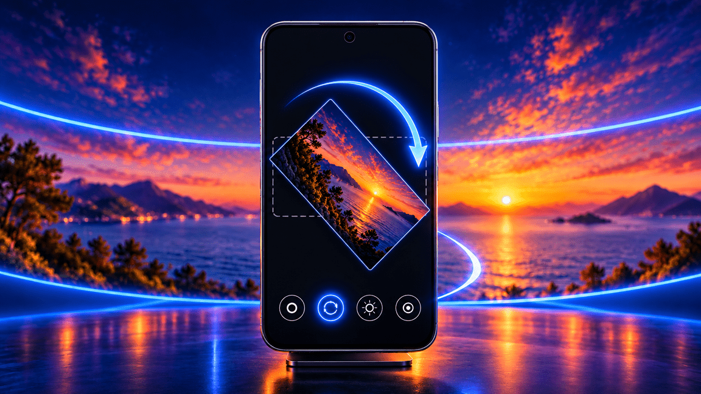

1. **Telefon, tablet dan tetingkap Meta Quest**: buka foto dan ketik Putar pada baris bawah, sebelum Edit, untuk memutarnya ikut arah jam; tekan lama untuk memutarnya ke arah sebaliknya. Dengan papan kekunci, R dan Shift+R.
2. **Android TV dan Google TV**: kekunci kuning pada alat kawalan jauh memutar foto ikut arah jam dan kekunci biru lawan arah jam, di mana pun fokus berada dalam pemapar. Pada alat kawalan jauh tanpa kekunci berwarna, tekan Bawah: bar di bawah foto muncul dengan Putar dipilih (satu Kanan lagi apabila foto mempunyai butang teks), dan setiap OK memutar foto.
3. **TV LG (webOS)**: kuning dan biru seperti pada Android TV, R dan Shift+R pada papan kekunci, atau butang putar dalam kawalan foto. TV Samsung juga memutar foto dengan satu kekunci.
4. **Windows, Linux dan macOS**: R memutar ikut arah jam, Shift+R lawan arah jam, atau butang putar dalam bar atas, sebelum skrin penuh.
5. **Foto daripada perkongsian rangkaian, Plex atau kamera**: butang putar yang pertama dalam bar atas, R dan Shift+R, atau kekunci kuning dan biru.

Di mana putaran disimpan: foto akaun anda sendiri pada Immich 2.6 atau lebih baharu diputar melalui penyunting foto pelayan, yang menyimpan fail asal dan menghasilkan gambar yang diputar (bar nipis dipaparkan semasa ia berfungsi; empat putaran, atau satu putaran balik, kembali kepada asal). Foto peranti, perkongsian, rakan kongsi atau album yang dikongsi, dan setiap foto pada pelayan yang lebih lama diputar pada peranti ini sahaja, untuk foto itu, dan fail tidak pernah diubah; aplikasi memaklumkannya sekali untuk foto Immich. Dalam aplikasi Android, iOS dan komputer, putaran yang disimpan pada peranti kelihatan dalam pemapar, tetapi belum dalam lakaran kecil, tayangan slaid dan kenangan. Video, folder berkunci dan setiap foto 360°, 180° atau 3D tidak mempunyai Putar.

### Gunakan komputer anda sebagai pemain media

Pada komputer Windows, Immuch360 Desktop membaca folder yang anda pilih tanpa sebarang pelayan, memainkan video rata dan 360° dalam pemainnya sendiri, melayari perkongsian dan pelayan yang sama, dan boleh berkongsi komputer dengan headset di rumah. Linux dan macOS mempunyainya sebagai pratonton, dengan video 360° dimainkan secara rata.

  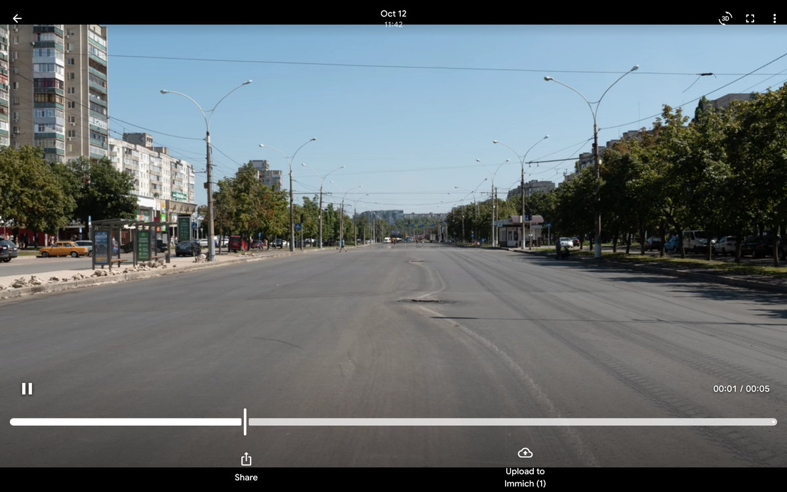

1. Pasang pratonton itu, atau nyahzipkannya dan mulakan `immuch360.exe`, lihat [Pasang](#windows). Pada halaman selamat datang, "Guna tanpa pelayan" membuka pilihan folder anda, dan "Sambung ke pelayan Immich" membuka halaman log masuk, dengan kod QRnya untuk telefon anda.
2. Foto, video atau folder yang dibuka dengan program itu, atau dilepaskan pada tetingkapnya, terbuka serta-merta, yang 360° dalam paparan 360°nya; beberapa fail dibuka bersama pada satu halaman. Foto dan video mendapatnya dalam "Open with"; ia tidak sekali-kali menjadikan dirinya program lalai bagi fail tersebut.
3. Dalam pemapar, papan kekunci mengawalnya: Space memainkan dan menjeda, J dan L berundur dan maju, F ialah skrin penuh, dan R dan Shift+R memutar foto.
4. Untuk memuat naik, berkongsi atau menukar banyak foto dan video sekali gus, pilih foto dan video itu seperti dalam pengurus fail, mulai binaan desktop 24: dalam garis masa, album, folder komputer atau perkongsian, Ctrl+klik menambah foto atau video atau mengeluarkannya, Shift+klik menambah semuanya daripada yang terakhir diklik, Ctrl+A memilih seluruh grid dan Esc mengosongkan pilihan. Klik kanan membuka tindakan bagi seluruh pilihan, bermula dengan "Muat naik ke Immich". Disemak oleh ujian projek pada Windows dan Linux; pada Mac, Command mengambil tempat Ctrl, belum dicuba di sana.

Lagi: [pada komputer Windows](../docs/immuch360/user-guide.md#on-a-windows-computer-immuch360-desktop-preview), [sokongan platform](../docs/immuch360/platform-support.md).

### Mainkan video AV2 pada komputer anda

AV2 ialah format video yang menyusuli AV1, dimuktamadkan oleh Alliance for Open Media pada 2026, dan belum ada telefon, TV atau kad grafik yang kami ketahui yang menyahkodnya. Immuch360 Desktop membaca fail AV2 dengan penyahkodan perisian: pemproses komputer anda menyahkodnya dengan dav2d oleh VideoLAN, selaju yang dibenarkan oleh komputer anda. Immich tidak memainkannya. Ia eksperimen dan dihidupkan secara lalai, pada Windows dan Linux; pada macOS, disemak oleh CI projek sahaja, belum ada Mac yang dicuba.

  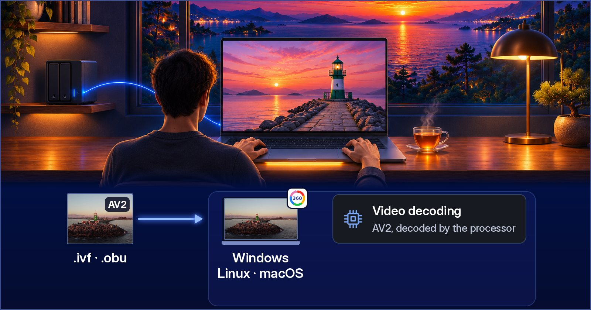

1. Letakkan fail AV2 `.ivf` atau `.obu` anda dalam folder pustaka anda, atau buka perkongsian yang menyimpannya, atau buka satu dengan Immuch360 Desktop daripada pengurus fail anda. Jubinnya membawa lencana AV2.
2. Buka satu. Sekali sahaja, "Muat turun dan main" mengambil penyahkod AV2 (kira-kira 1 MB, 1.7 MB pada Mac; yang Windows ditandatangani oleh APROGSYS) dan menyemaknya dengan SHA-256nya; kemudian ia berfungsi di luar talian, dan video AV2 anda mendapat lakaran kecilnya. Mulai binaan desktop 25 ia datang daripada [av2-companion](https://github.com/immuch360/av2-companion), dan penyahkod yang dipasang oleh binaan terdahulu dibuang apabila aplikasi bermula, jadi video AV2 seterusnya menawarkan "Muat turun dan main" sekali lagi.
3. "Penyahkodan video", dalam butiran video (kekunci I), menunjukkan seberapa pantas komputer ini menyahkodnya. Pada komputer riba penulis, dengan Intel Core i9-13980HX, video 8 bit sehingga 1080p dimainkan dengan lancar, 1080p 10 bit cukup-cukup dapat mengikuti, dan 4K tidak dapat mengikuti, dalam 8 bit seperti dalam 10 bit: video sedemikian berhenti seketika untuk mengejar. Video yang dinyahkod terlalu perlahan oleh komputer ini memberitahunya sebelum dimainkan, dengan "Main juga".

Untuk mematikannya: Settings, Asset Viewer, "Video AV2 (eksperimen)"; "Alih keluar penyahkod AV2" juga ada di situ. Penyahkodan menggunakan setiap teras pemproses dan memanaskan komputer. Telefon, TV dan Quest belum memainkan AV2, dan pelayan Immich tidak menerima fail `.ivf` dan `.obu`.

Lagi: nota [binaan desktop 21](https://github.com/freeKC/Immuch360/releases/tag/desktop-v3.3.0-rc.0-21) dan [binaan desktop 25](https://github.com/freeKC/Immuch360/releases/tag/desktop-v3.4.0-25), dan [penyahkod AV2, sumbernya dan lesennya](https://github.com/immuch360/av2-companion), keluaran [v1.0.1](https://github.com/immuch360/av2-companion/releases/tag/v1.0.1) (MIT, program Windows ditandatangani oleh APROGSYS).

## Berbanding dengan Immich

Immuch360 mengekalkan keseluruhan aplikasi mudah alih Immich dan menambah apa yang ada di sekelilingnya. Ringkasnya:

| | Immuch360, berbanding dengan aplikasi Immich |
|---|---|
| **Sama** | pelayan dan akaun Immich anda: sandaran, garis masa, album, carian, orang, kenangan, perkongsian dan rakan kongsi, semuanya disegerakkan dengan pelayan anda. Ia dipasang di sebelah aplikasi rasmi. |
| **Tiada pelayan diperlukan** | ia juga berjalan tanpa pelayan atau akaun, pada foto dan video peranti, folder komputer dan perkongsian rangkaian; Plex dan kamera menggunakan log masuk mereka sendiri, tidak sekali-kali akaun Immuch360. |
| **360° dan mendalam** | foto dan video 360° sebagai sfera, panorama, VR180 dan 3D, paparan mendalam dalam Meta Quest, lencana 360° dan senarai 360°, dan pada telefon, tablet dan TV Android, video mentah kamera Insta360, GoPro MAX dan DJI Osmo 360 yang distabilkan dengan giroskop kamera (eksperimen). Tontonan 360° dalam aplikasi mudah alih Immich telah diminta sejak Januari 2024 dan masih belum ada. |
| **3D daripada foto anda** | pada komputer, satu foto menjadi foto 3D, adegan 3D atau panorama 360°, dan dalam Meta Quest 3 atau 3S mana-mana foto rata mendapat kedalamannya: dibuat oleh AI pada komputer dan headset anda sendiri, dilabel sedemikian dalam aplikasi dan dalam fail, foto asal tidak pernah diubah. Aplikasi Immich tidak membuat apa-apa dalam 3D. |
| **Splat Gaussian** | dibuka pada telefon dan tablet Android, komputer serta Meta Quest 3 dan 3S, dibuat daripada foto anda atau video pada komputer Windows, dan disimpan pada pelayan Immich anda di dalam foto, kerana pelayan tidak menerima fail .spz atau .ply. Aplikasi Immich tidak membuka sebarang splat. |
| **Pada TV** | aplikasi yang sama pada Android TV dan Google TV, dan aplikasi TV untuk TV LG, yang turut dipakejkan untuk TV Samsung sebagai binaan ujian. Aplikasi Immich sendiri tidak boleh dipasang pada TV LG. |
| **Log masuk dengan telefon anda** | TV, headset atau komputer dilog masuk apabila telefon anda mengimbas kod QRnya, dan kata laluan anda kekal pada telefon. Aplikasi Immich tidak mempunyai apa-apa seperti itu. |
| **Perkongsian dan Plex** | perkongsian SMB, WebDAV dan DLNA serta pelayan Plex, dimainkan di tempatnya, dan failnya dihantar ke pelayan anda secara manual; mulai binaan 45, filem pustaka Plex mengikut tahun, halaman bagi setiap filem, muat turunnya ke peranti dan main baliknya pada TV dari telefon (eksperimen). Aplikasi Immich tidak mempunyai klien Plex. |
| **Kamera Tapo** | paparan langsung dan rakaman kad memori, di sebelah foto anda; disemak dengan kamera simulasi. |
| **Putaran satu kekunci** | aplikasi Immich memutar foto dalam penyuntingnya; Immuch360 memutarnya dengan satu kekunci, dan untuk foto anda sendiri pada Immich 2.6 atau lebih baharu ia melalui penyunting pelayan yang sama, supaya aplikasi web dan peranti anda yang lain memaparkannya dalam keadaan diputar. |
| **Video** | menu audio dan sari kata dalam pemain Android, yang tiada dalam pemain Android aplikasi Immich; fail asal atau strim yang ditranskod, dipilih bagi setiap video; butiran teknikal video; filem disambung di tempat anda berhenti; fail yang dinyahkod oleh peranti ini, dipilih untuk anda, dan pelayan perlahan dibezakan daripada pelayan yang berhenti; pada komputer, video AV2 dinyahkod oleh pemproses (eksperimen). |
| **Dron anda** | foto dan video dron DJI dihantar melalui USB, dengan video diletakkan pada peta daripada data penerbangannya, sedangkan aplikasi Immich hanya menyandarkan apa yang sudah ada dalam galeri telefon; dan video langsung dron melalui pengawal jauh RC-N3, dengan nilai penerbangannya dan cincin halangan, pada telefon dan dihantar semula ke Meta Quest atau Android TV. Kedua-duanya eksperimen. |
| **Di mana untuk melapor** | [Immuch360 Issues](https://github.com/freeKC/Immuch360/issues), bukan projek Immich. |

Perbandingan fungsi demi fungsi terdapat dalam [Berbanding dengan aplikasi Immich](../docs/immuch360/compatibility.md#compared-with-the-immich-app).

## Privasi

Tiada apa-apa yang dihantar kepada pembangun: tanpa akaun, tanpa analitik, tanpa perkhidmatan laporan ranap, tanpa pengiklanan. Mulai binaan 45, binaan kedai mungkin meminta penilaian, selepas beberapa tontonan yang baik dalam beberapa hari: kad Google Play sendiri pada telefon, tablet Android dan Google TV, gesaan App Store sendiri pada iPhone dan iPad, dan dalam versi Horizon Store bagi Quest satu ayat dengan "Bukan sekarang" dan "Nilai"; tidak sekali-kali dalam binaan GitHub mahupun pada komputer, tidak sekali-kali dalam masa 24 jam selepas kemas kini atau selepas binaan ranap, dua kali paling banyak, berselang 90 hari, dan tidak lagi selepas Nilai atau dua kali Bukan sekarang; kiraan di sebaliknya kekal pada peranti. Aplikasi hanya berhubung dengan pelayan yang anda pilih (pelayan Immich anda, perkongsian anda, pelayan Plex anda, kamera anda), mulai binaan 45 dengan Wikipedia apabila anda membuka halaman filem Plex (eksperimen), dan, tanpa pelayan, dengan tiada apa-apa sama sekali. Kata laluan dan token kekal dalam storan selamat peranti; TV LG dan Samsung tidak menyediakannya untuk aplikasi, jadi di sana ia kekal dalam storan aplikasi itu sendiri, tidak disulitkan. Mulai binaan 45, log keluar juga mengosongkan kuki aplikasi, pada telefon, TV dan komputer. Kamera digunakan pada peranti sahaja, oleh pemain Spatial 2.5D dan untuk mengimbas kod skrin yang anda log masukkan; imejnya tidak sekali-kali disimpan dan tidak sekali-kali dihantar ke mana-mana. Skrin yang dilog masuk daripada telefon anda mendapat sesinya sendiri, dihantar secara tersulit pada rangkaian rumah anda, tidak sekali-kali kata laluan anda; TV LG dilog masuk oleh halaman dalam pelayar telefon, yang menghantar e-mel dan kata laluan anda ke TV tanpa disulitkan pada rangkaian rumah anda, dan TV hanya menyimpan sesi. Tangkapan dan rekod penerimaan halaman dron kekal pada peranti melainkan anda berkongsinya: ia mengandungi video dron dan mungkin mengandungi kedudukannya, dan tangkapan mengandungi nombor siri pengawal jauh dan pesawat. Gambar dan nilai dron pergi daripada telefon hanya ke headset dan TV yang anda pasangkan, pada rangkaian setempat anda, tidak disulitkan, seperti telefon yang dikongsi pada Wi-Fi. Tiada apa-apa dihantar kepada DJI, mahupun kepada TP-Link. Dasar penuh terdapat dalam [PRIVACY.md](../PRIVACY.md), dan butiran bagi setiap sumber dalam [panduan pengguna](../docs/immuch360/user-guide.md#privacy). Apa yang telah anda tonton daripada filem anda disimpan dalam pangkalan data pada peranti dan tidak pernah dihantar ke pelayan anda.

**Filem Plex dan Wikipedia** (mulai binaan 45, eksperimen): halaman filem Plex meminta Wikidata dan Wikipedia, yang dikendalikan oleh Wikimedia Foundation, artikel tentang filem itu, dengan menghantar nombor IMDb atau TMDB filem dan tajuk artikel, tidak sekali-kali token Plex anda, alamat pelayan anda atau apa-apa lagi daripada pustaka anda; artikel yang ditemui disimpan pada peranti selama 30 hari, dan "Butiran filem daripada Wikipedia", dalam Tetapan, Lanjutan, mematikannya dan memadamkannya. Aplikasi menulis satu perkara ke pelayan Plex anda: trek audio dan sari kata yang anda pilih bagi sesebuah filem. Filem yang dihantar dari telefon anda ke TV melalui pautan yang dibuat sekali dengan semakan enam digit, disulitkan pada rangkaian rumah anda, dan tidak membawa sebarang token.

**Ciri AI** berfungsi pada peranti anda sahaja. Foto, kedalamannya, adegannya dan panoramanya dikira pada komputer atau dalam headset anda dan tidak dihantar ke mana-mana. Aplikasi hanya bersambung untuk memuat turun komponen yang anda minta, daripada keluaran projek ini di GitHub atau, jika gagal, daripada halaman rasmi model apabila ada, menyemak setiap fail dengan SHA-256nya, dan kemudian berfungsi di luar talian. ONNX Runtime, yang menjalankan model pada komputer, menghantar telemetri kepada Microsoft dalam binaan rasminya; Immuch360 mematikannya. Fail baharu diletakkan di sebelah foto asal anda, tidak sekali-kali menimpanya, dan sampai ke pelayan Immich anda hanya jika anda menghidupkan "Sandarkan juga versi AI" ("Pilih semua" dalam album sandaran turut menghidupkannya).

## Lesen dan penghargaan

Immuch360 ialah cabangan tidak rasmi aplikasi mudah alih [Immich](https://github.com/immich-app/immich), di bawah [GNU AGPL v3](../LICENSE), tidak bergabung dengan, dan tidak disokong oleh, pasukan Immich atau FUTO. Cabangan ini wujud kerana paparan 360° pada mudah alih telah dipinta dalam Immich sejak Januari 2024 dan belum terdapat dalam aplikasi rasmi; ia melancarkannya sekarang, mengumpul maklum balas peranti sebenar, dan akan menawarkan semula kepada Immich, dalam pull request kecil, apa-apa yang penyelenggara mahukan. Segala yang dilakukan oleh aplikasi rasmi dikekalkan; cabang, rantaian binaan dan CI dihuraikan dalam [Bina sendiri](../docs/immuch360/build.md).

Pemapar foto 360° adalah berdasarkan pull request huluan [immich-app/immich#31169](https://github.com/immich-app/immich/pull/31169) oleh dmitry-brazhenko, yang sendiri dibina atas prototaip oleh bencefr dalam [#30192](https://github.com/immich-app/immich/pull/30192); terima kasih kepada kedua-duanya. Pembetulan alat kawalan jauh untuk penapis carian dan pengisihan album pada TV bermula daripada kerja mlc70 dalam [mlc70/Immuch-Android-TV#1](https://github.com/mlc70/Immuch-Android-TV/pull/1), dan rel tindakan serta helaian penapis pada 80 peratus ketinggian skrin datang daripada [mlc70/Immuch-Android-TV#3](https://github.com/mlc70/Immuch-Android-TV/pull/3) oleh mlc70, dengan kepengarangannya dikekalkan; terima kasih kepada mlc70. Aplikasi LG webOS, yang juga dipakejkan untuk TV Samsung, dibina atas [immich-tv-webos](https://github.com/Seeky91/immich-tv-webos) oleh Seeky91, di bawah lesen MIT, disimpan dalam foldernya sendiri; terima kasih kepada Seeky91. Kamera Tapo ditulis berdasarkan apa yang didokumenkan oleh [pytapo](https://github.com/JurajNyiri/pytapo), [Home Assistant Tapo Control](https://github.com/JurajNyiri/HomeAssistant-Tapo-Control) dan [python-kasa](https://github.com/python-kasa/python-kasa). Paparan Meta Quest bergantung pada Meta Spatial SDK, yang bukan sumber terbuka, jadi ia kekal dalam cabangan ini. Perkongsian SMB menggunakan libsmb2, di bawah LGPL 2.1 atau lebih baharu: sejak binaan 27 dan binaan desktop 7, setiap binaan membawa notisnya, teks lesennya dan arkib sumbernya, `Immuch360-libsmb2-sources.tar.gz`, yang juga dilampirkan pada setiap keluaran. Binaan Windows dan macOS membawa libmpv (pustaka [mpv](https://mpv.io), bersama [FFmpeg](https://ffmpeg.org)) yang dibina oleh projek dalam [libmpv-builds](https://github.com/immuch360/libmpv-builds), di bawah LGPL, dengan lesen dan sumbernya, disenaraikan pada halaman lesen aplikasi (Lesen, di bahagian bawah menu profil). Mulai binaan 40, APK Quest membawa zstd-jni 1.5.7-3 (BSD 2-Clause), bersama zstd 1.5.7 di bawah lesen BSD miliknya, untuk membaca splat SPZ versi 4, dan halaman lesen aplikasi menyenaraikannya di bawah "zstd-jni". Mulai binaan 41 dan binaan desktop 21, pemapar splat komputer, telefon dan tablet membawa Spark 2.4.0 (MIT, World Labs), dibina oleh CI projek daripada sumbernya, dan three.js 0.180.0 (MIT), disenaraikan dalam [notanya](../licenses/splat-viewer/README.md); penyahkod AV2, yang dimuat turun hanya apabila anda minta daripada [av2-companion](https://github.com/immuch360/av2-companion) (MIT, mulai binaan desktop 25), dibina atas dav2d VideoLAN (BSD 2-Clause), di bawah Alliance for Open Media Patent License 1.0 ([lesennya](https://github.com/immuch360/av2-companion/tree/v1.0.1/licenses)). Butiran dan tanda dagangan platform yang disebut pada halaman ini terdapat dalam [Lesen dan tanda dagangan](../docs/immuch360/platform-support.md#license-and-trademarks).

**Komponen video ialah projek terbuka tersendiri**, mulai binaan desktop 25: aplikasi memuat turun penyahkod AV2nya daripada [av2-companion](https://github.com/immuch360/av2-companion) v1.0.1, mengambil libmpv bagi binaan Windows dan macOSnya daripada [libmpv-builds](https://github.com/immuch360/libmpv-builds), dan pakej pemain videonya dengan pemapar 360°, VR180 dan 3D daripada [media_kit_360](https://github.com/immuch360/media_kit_360) v1.0.1, repositori organisasi [immuch360](https://github.com/immuch360), di bawah lesen MIT bagi kod mereka sendiri. Ia mengandungi mpv, FFmpeg dan pemapar yang sama seperti sebelum ini, jadi tiada apa-apa yang berubah dalam apa yang dimainkan, dan aplikasi lain boleh menggunakannya; [halaman komponen](https://immuch360.com/ms/components/) laman web menyenaraikannya.

Binaan 33 membawa navigasi carian Michael Cloutier ([mlc70](https://github.com/mlc70/Immuch-Android-TV)) dengan commit beliau, commit dan idea daripada Gaurav Mukherjee ([gmfun](https://github.com/gmfun/Immuch360)), dan idea daripada binaan demo [ppawelstachh-sys](https://github.com/ppawelstachh-sys/Immuch360), ditulis semula di atas kod kami; paparan bulan dan tahun menjawab ChazyChaxxx dalam [Discussion 10](https://github.com/freeKC/Immuch360/discussions/10). Terima kasih kepada mereka. Binaan 42 menjawab Aoaodacat, yang meminta penstabilan video 360° dalam [isu 14](https://github.com/freeKC/Immuch360/issues/14), dan gthrepwood, yang laporannya dalam [isu 13](https://github.com/freeKC/Immuch360/issues/13) membawa kepada memori panorama binaan desktop 22; terima kasih kepada kedua-duanya.

Ciri AI menjalankan model dan enjin yang dibuat oleh pihak lain, dimuat turun hanya apabila anda minta, daripada pra-keluaran [ai-components-1](https://github.com/freeKC/Immuch360/releases/tag/ai-components-1), [ai-components-2](https://github.com/freeKC/Immuch360/releases/tag/ai-components-2), [ai-components-3](https://github.com/freeKC/Immuch360/releases/tag/ai-components-3) dan [ai-components-4](https://github.com/freeKC/Immuch360/releases/tag/ai-components-4) repositori ini; setiap fail, sumbernya, lesennya dan SHA-256nya ada dalam [MODEL-LICENSES.md](https://github.com/freeKC/Immuch360/blob/immuch360/licenses/ai-components/MODEL-LICENSES.md). Terima kasih kepada pengarangnya:

- **Foto 3D**: Depth Anything V2 Small (Apache 2.0), dijalankan oleh ONNX Runtime (MIT) pada komputer dan oleh LiteRT 2.3.0 (Apache 2.0), di dalam APK Quest, dalam headset.
- **Adegan 3D**: MoGe-2 ViT-S (MIT), dieksport ke ONNX oleh projek daripada pemberat MIT-nya, dan LaMa (Apache 2.0).
- **Panorama 360°**: FLUX.2 klein base 4B dengan VAE-nya (Apache 2.0), Qwen3 4B (Apache 2.0), LoRA 360° nomadoor (Apache 2.0), MI-GAN (MIT) dan Real-ESRGAN x4plus (BSD 3 Clause), dijalankan oleh stable-diffusion.cpp dan ggml (MIT), dibina oleh CI projek dan ditandatangani pada Windows.
- **Adegan splat**: COLMAP 4.2.1 (BSD 3 Clause), dibina tanpa bahagian GPL-nya, dan Brush 0.3.0 (Apache 2.0), kedua-duanya dibina oleh CI projek dan ditandatangani pada Windows.

LoRA 360° nomadoor adalah Apache 2.0 pada kadnya dan dilatih pada imej CC0 dan domain awam, dengan sebahagian di bawah CC BY: atribusi bahagian itu akan datang dalam versi MODEL-LICENSES.md yang kemudian. Tiada apa-apa di sini di bawah lesen bukan komersial, dan tiada apa-apa memerlukan CUDA. ONNX Runtime dan LiteRT mempunyai pustaka lain terbina dalam, disenaraikan dalam notisnya, antaranya Eigen di bawah MPL 2.0, lesen copyleft lemah.

Tangkapan pada halaman ini ialah tangkapan sebenar aplikasi: yang telefon pada binaan Android dalam emulator, yang Android TV pada emulator Google TV, yang LG dan Samsung dalam pelayar yang menggantikan TV, yang Windows pada PC Windows 11 dan tetingkap Meta Quest dalam Quest 3, semuanya dengan panorama CC0 daripada [Poly Haven](https://polyhaven.com); tangkapan mendalam headset diambil pada Quest 3 dengan media pengarang sendiri, dan yang iPad dalam simulator iPad, dengan panorama CC0 Poly Haven. Gambar pencipta AI ialah hasil sebenar aplikasi, dibuat daripada foto CC0 Poly Haven, dengan dua tangkapan sebenar aplikasi Windows. Imej pembukaan dan gambar TV, log masuk, putaran, kamera dan dron ialah ilustrasi yang dibuat untuk projek: ia tidak memaparkan skrin aplikasi, logo syarikat lain mahupun wajah. Kad kes penggunaan meletakkan ilustrasi sedemikian di atas satu baris yang dilukis untuk projek, dengan logo platform, ikon aplikasi, tangkapan sebenar aplikasi dalam dua kad dan foto CC0 Poly Haven dalam dua; selain logo platform, ia tidak memaparkan logo syarikat lain mahupun wajah. Empat kad cara melakukannya untuk splat dan AV2 dibuat dengan cara yang sama, tanpa tangkapan aplikasi; kad AV2 memaparkan satu bingkai filem CC0 daripada Wikimedia Commons. Setiap imej, dengan sumber, tarikh dan lesennya, disenaraikan dalam [CAPTURES.md](../.github/readme/CAPTURES.md).

## Pelan hala tuju

Apa yang belum siap, yang paling mungkin dahulu. Tiada apa di sini merupakan janji, dan maklum balas dalam [penjejak isu](https://github.com/freeKC/Immuch360/issues) membantu menentukan apa yang didahulukan.

- **Kedai**: Google Play dengan binaan 45 (dihantar untuk semakan Google), Meta Horizon Store dengan binaan 44 (dalam semakan Meta sejak 9 November), kemudian binaan 45, App Store dengan versi 3.4.0 binaan 45 (3.3.4 diterbitkan pada 10 November), LG Content Store (versi 1.0.0 dalam semakan LG sejak 24 Oktober, kemudian versi 1.0.1), dan kemudian kedai Samsung.
- **Pencipta AI**: panorama 360° pada Mac; adegan splat yang dibuat pada Linux, dengan grafik bersepadu dan daripada foto dan video 360°; salinan headset adegan splat Terperinci dan Maksimum diukur dalam headset; label AI dalam aplikasi iOS, LG dan Samsung; panorama dicuba pada PC Linux dengan kad grafik, dan pada kad AMD dan Intel.
- **Dron**: penerbangan di luar untuk membuktikan ketinggian dan kelajuan melebihi 1.8 m dan 1.5 m/s serta jarak halangan berbanding pita pengukur, kemudian untuk memaparkan satelit dan jarak dari rumah; gambar stabil penghantaran semula disemak dalam headset; penghantaran semula ke TV LG dan Samsung; dron pada iPhone dan iPad, belum dimulakan; ujian halaman import dengan DJI Neo 2 sebenar, kemudian bunyi yang dirakam oleh telefon digabungkan ke dalam klipnya. Tiada apa-apa yang menghantar arahan kepada dron dirancang sebelum ujian tersebut.
- **TV**: binaan 29 pada Android TV sebenar, termasuk kawalan videonya dan log masuk dengan telefon anda; perkongsian, Plex dan paparan langsung aplikasi LG pada TV LG sebenar, dan webOS 26; binaan ujian Samsung 0.3.0 pada TV Samsung sebenar, kemudian log masuk dengan telefon, perkongsian, Plex dan kamera pada TV Samsung; kemudian video 360° pada sfera TV LG, bunyi kamera dan rakamannya (tidak sebelum Disember 2026).
- **Kamera**: kamera Tapo disemak dengan kamera sebenar.
- **Komputer**: pengujian setiap fungsi secara manual pada PC Windows, termasuk log masuk dengan telefon anda; Spatial 2.5D dengan webcam pada Windows, dalam pembangunan untuk November 2026; kemudian enjin pemaparan video 360° pada Linux dan macOS, ujian pada PC Linux sebenar; kemudian kemas kini automatik dan aplikasi macOS yang ditandatangani; AV2 dalam fail MKV, WebM dan MP4, yang diterima oleh pelayan Immich.
- **Telefon dan tablet**: bar masa dalam pemain video 360° iOS, sebelum dan seterusnya dalam pemain 360° telefon, menu trek audio dan sari kata dalam pemain rata iOS; pemapar splat pada iPhone dan iPad.
- **Media mendalam**: fail .dng fisheye dwi, penstabilan video mentah pada iPhone dan iPad, Quest dan komputer, serta fail GoPro MAX 2, video spatial dalam 3D pada Quest jika penyahkodnya membenarkannya, sebelum dan seterusnya antara foto spatial dalam headset.
- **Sumber**: leret antara fail folder perkongsian, pengesahan Digest untuk WebDAV, kod QR untuk membawa token Plex daripada komputer, IPv6 untuk Plex, rakaman Tapo H.265, saluran pada skrin utama TV.
- **Upstream**: pull request kecil kepada Immich untuk bahagian yang dikehendaki oleh penyelenggara, bermula dengan pemapar foto 360°.

Senarai penuh, dengan pengujian peranti yang masih tertunda bagi setiap ciri, terdapat dalam [Status keluaran](../docs/immuch360/release-status.md#roadmap).

## Dokumentasi

- [Ciri: inventori lengkap dan matriks ciri mengikut platform](../docs/immuch360/features.md)
- [Panduan pengguna: setiap fungsi, langkah demi langkah, dengan pilihan dan mesejnya](../docs/immuch360/user-guide.md)
- [Keserasian: format, kodek, penyahkod, pelayan dan peranti yang diuji, had](../docs/immuch360/compatibility.md)
- [Sokongan platform: apa yang setiap sistem ada, cara ia dipasang, apa yang berbeza](../docs/immuch360/platform-support.md)
- [Isu diketahui](../docs/immuch360/known-issues.md) dan [Penyelesaian masalah](../docs/immuch360/troubleshooting.md), dengan log untuk dilampirkan pada laporan
- [Butiran teknikal: seni bina, modul Flutter dan asli, jambatan media, saluran pencantuman, penyahkod](../docs/immuch360/technical-details.md)
- [Komponen AI: setiap model, sumbernya, lesennya, saiznya dan jumlah semaknya](https://github.com/freeKC/Immuch360/blob/immuch360/licenses/ai-components/MODEL-LICENSES.md)
- [Pemapar video 360° desktop: libmpv, laluan unjuran dan ukuran di sebaliknya](../docs/immuch360/desktop-360-video-renderer.md)
- [Status keluaran: binaan, kedai dan apa yang setiap kedai ada](../docs/immuch360/release-status.md)
- [Bina sendiri: telefon, headset, TV dan komputer](../docs/immuch360/build.md)
- [Immuch360 untuk TV LG webOS: pemasangan dalam Developer Mode, kekunci alat kawalan jauh, pengepala CORS](../webos/README.md)

### Ciri lanjutan

Apa yang aplikasi boleh baca dan main, untuk pembaca yang ingin mengetahui keseluruhannya. Setiap baris dihuraikan dalam [panduan pengguna](../docs/immuch360/user-guide.md) dan [halaman keserasian](../docs/immuch360/compatibility.md).

<b>Format, sumber, main balik dan perkakasan, secara terperinci</b>

- **Format**: foto dan video rata (apa yang disahkod oleh peranti: MP4, MOV, MKV dan lain-lain); foto dan video 360° ekuirektangular; panorama separa (pangkasan GPano); VR180; 3D stereoskopik, atas dan bawah atau sebelah-menyebelah, dibaca daripada fail (kotak st3d) atau diteka daripada bingkai; foto spatial Apple (pasangan stereo HEIC) dan video spatial (MV-HEVC, satu mata); Insta360 .insp dan .insv mentah, GoPro .360, DJI .osv; sumber HLG dan PQ 10 bit yang dipetakan ton pada sfera; TIFF dinyahkod oleh aplikasi pada Android (8 dan 16 bit, kelabu, RGB, palet dan CMYK, tidak dimampatkan atau dimampatkan dengan LZW, Deflate, PackBits atau JPEG); lakaran kecil dan pratonton JPEG XL pelayan Immich 3.4, mulai binaan 45 dan binaan desktop 25, dinyahkod oleh teras Rust Immich sendiri (jxl-rs) pada Android, Quest dan, melalui dart:ffi, komputer; splat Gaussian dalam .spz versi 1 hingga 4 dan .ply binari, pada Meta Quest 3 dan 3S dan, mulai binaan 41 dan binaan desktop 21, pada telefon dan tablet Android dan pada komputer, dan di dalam foto `_splat.jpg` yang disimpan oleh aplikasi ke Immich; AV2 dalam fail .ivf dan .obu pada komputer (eksperimen).
- **Unjuran dan metadata**: metadata GPano dan sfera dibaca daripada fail, dengan permintaan julat pada pelayan atau perkongsian; pandangan awal kamera; sfera dron DJI dikenali daripada kameranya, dengan fail sampingan .xmp pilihan supaya Immich juga menandakannya; "Lihat sebagai 360°" diingati pada peranti; VR180 dikenali daripada fail atau namanya; tempat video dron dibaca daripada log penerbangan .SRT-nya; metadata dikekalkan utuh kerana fail asal yang dimainkan, bukan sekali-kali salinan yang ditukar; putaran suku pusingan disimpan melalui penyunting Immich atau dikekalkan pada peranti, tidak sekali-kali pada fail mendalam.
- **Main balik asli**: Media3 pada Android dan TV, SceneKit dan AVFoundation pada iOS, Meta Spatial SDK dalam headset, libmpv pada Windows, daripada [libmpv-builds](https://github.com/immuch360/libmpv-builds) dan pakej [media_kit_360](https://github.com/immuch360/media_kit_360) mulai binaan desktop 25; fail asal atau strim yang ditranskod dipilih berdasarkan apa yang disahkod oleh peranti, dan mulai binaan 44 pada Android yang satu lagi apabila penyahkod menolak yang sedang dimainkan; senarai penyahkod video peranti dalam Tetapan, Lanjutan; pilihan trek audio, sari kata dalam pemain Android dan penunjuk penimbalan, dan mulai binaan 45 bagi filem Plex nama yang diberikan Plex kepada treknya, fail sari kata yang disimpan Plex di sebelahnya, disampaikan oleh jambatan media, pilihan yang ditulis semula ke pelayan, dan menu Sari kata pada komputer (eksperimen); permulaan video yang distrim mengikut apa yang dibawa sambungan berbanding apa yang diperlukan video, dan video yang ditunggu semasa pelayannya senyap; AV2 dinyahkod pada pemproses oleh dav2d VideoLAN, dalam program kecil projek, [av2-companion](https://github.com/immuch360/av2-companion) mulai binaan desktop 25, yang menyampaikan bingkai kepada libmpv pada komputer sahaja; splat Gaussian pada komputer, telefon dan tablet dilukis oleh Spark 2.4.0 di atas three.js dalam paparan web sistem (WebView2, WebKitGTK, WKWebView, Android System WebView), disampaikan oleh aplikasi pada peranti sahaja.
- **Fail mentah dicantumkan pada peranti**: shader fragmen Flutter untuk foto; kesan GPU dalam pemain untuk video satu trek; dua penyahkod perkakasan serentak dan compositor GPU untuk video satu kanta setiap trek atau setiap fail (OpenGL ES 3 pada Android dan Quest, Metal pada iOS, dan pada Windows, daripada binaan desktop 5, dua pemain libmpv yang bingkainya digandingkan oleh aplikasi pada cip grafik); penentukuran sendiri kamera (model Mei, V6 dan equidistant) dan rakaman akselerometer; kembali kepada satu kanta, strim yang ditranskod, salinan LRV kamera atau video yang tidak dicantumkan, apabila peranti tidak dapat menjalankan dua penyahkod. Mulai binaan 42, trek gerakan kamera (giroskop Insta360, orientasi dan graviti GoPro MAX, kedudukan sudut DJI Osmo 360) dibaca dalam fail dan diubah menjadi satu putaran setiap bingkai, yang diserahkan oleh pemain 360° Android kepada Media3 bersama setiap bingkai (eksperimen).
- **Sumber**: galeri peranti; folder komputer; dron atau kad kamera melalui USB, menerusi pemilih folder sistem (Android, eksperimen); pengawal jauh DJI RC-N3 melalui kabelnya untuk video langsung dron (Android, eksperimen), dihantar semula pada rangkaian setempat ke Meta Quest atau Android TV; pelayan Immich; SMB 2 dan 3, WebDAV, DLNA/UPnP; Plex melalui HTTPS yang disemak terhadap sijil pelayan sendiri, dan mulai binaan 45 pustaka filemnya mengikut tahun, dalam halaman 100 dengan tahun dibaca terlebih dahulu, halaman bagi setiap filem, salinan filem ke peranti dengan julat bait yang disambung semula, dan filem yang dihantar dari telefon ke TV melalui pautan yang dibuat sekali dengan semakan enam digit, arahannya di bawah AES-256-GCM (eksperimen); kamera Tapo melalui rangkaian setempat (HTTPS dan RTSP); telefon atau komputer yang dikongsi pada Wi-Fi sebagai pelayan WebDAV; pelayan yang ditemui oleh Bonjour/mDNS, imbasan rangkaian setempat, SSDP, GDM dan penemuan TP-Link, serta diikuti apabila alamatnya berubah; folder telefon, tablet atau Meta Quest Android melalui pemilih folder sistem.
- **Pembacaan atas permintaan**: jambatan setempat menyediakan pemain dengan julat bait dan token setiap sesi; blok besar, bacaan lebih awal dan sehingga enam sambungan SMB serentak; gambar kecil daripada satu bingkai setiap video; tiada apa-apa disalin ke peranti.
- **Perkakasan**: penyahkod perkakasan digunakan di mana-mana ia wujud, dengan had yang diukur (siling H.264 Quest 3, paling banyak dua kanta 2048x2048 untuk penyahkod perisian); pada Windows paparan 360° dilukis oleh cip grafik daripada setiap bingkai yang disahkod, saiz bingkai diukur pada setiap komputer, cip bersepadu atau khusus dikesan, dan mulai binaan desktop 21 cip khusus diminta daripada pemacu pada komputer riba yang mempunyai dua; pada komputer, gaussian sesuatu splat dikira berbanding memori komputer dan kad grafiknya.
- **Ciri khusus platform**: giroskop dan pemain Spatial 2.5D pada telefon; paparan mendalam, pengawal dan tangan pada Quest; susun atur alat kawalan jauh, dialog papan kekunci dan sepanduk TV pada Android TV; pada komputer, tetikus dan papan kekunci, pilihan dengan Ctrl+klik, Shift+klik dan Ctrl+A mulai binaan desktop 24, skrin penuh, satu tetingkap tunggal, fail dan folder yang dibuka dengan program atau dilepaskan pada tetingkapnya, dibaca seperti fail folder anda, HEIC, AVIF, TIFF dan foto mentah kamera dalam folder apabila Windows mempunyai penyahkod untuknya, dan perlindungan data Windows untuk kata laluan dan token.
- **Pencipta AI**: foto 3D sebagai JPEG sebelah-menyebelah lebar penuh, mata kiri dahulu, kedalaman daripada Depth Anything V2 Small melalui ONNX Runtime 1.31.0 pada pemproses (1.23.2 pada Mac Intel); adegan sebagai JPEG yang membawa adegan glTF berlapis yang dipotong di tempat kedalaman terputus, daripada MoGe-2 ViT-S dan LaMa, dengan eksport .glb; panorama 360° 6144 x 3072, dijana oleh FLUX.2 klein base 4B dan LoRA 360° melalui stable-diffusion.cpp pada Vulkan, sambungan dicantum oleh MI-GAN, perincian ditingkatkan oleh Real-ESRGAN dan piksel sebenar diletakkan semula; versi 3D foto 360°, atas dan bawah; dalam setiap fail, XMP kami (jenis, asal, SHA-1 foto asal, bendera kualiti), dan dalam adegan dan panorama, jenis sumber digital IPTC; kedalaman Quest oleh LiteRT, pada cip grafik atau pemprosesnya, disimpan dalam cache; pada komputer, baris gilir dua lorong dan get yang membaca kad grafik melalui Vulkan, membebaskan bahagian memorinya yang dipegang oleh aplikasi sendiri sebelum panorama, meminta 3.5 GiB daripadanya bebas mulai binaan desktop 22, dengan penjanaan dipotong kepada beberapa bahagian di bawah kira-kira 5.6 GiB, menunggu semasa program lain memegang memorinya dan, mulai binaan desktop 24, menjalankan penjana pada kad itu, yang ditemui melalui namanya dalam senarai kad penjana itu sendiri; setiap komponen disemak dengan SHA-256nya, penjana Windows ditandatangani; versi 3D foto perkongsian ditulis di sebelahnya pada SMB dan WebDAV; adegan splat daripada 20 hingga 200 foto atau video, kamera diletakkan oleh COLMAP 4.2.1 pada pemproses dan splat dilatih oleh Brush 0.3.0 pada Vulkan, objek ditegakkan di atas permukaan tempat ia berdiri, ditulis sebagai SPZ versi 2 sehingga 150,000 gaussian atau, mulai binaan desktop 22, dengan Terperinci dan Maksimum, keseluruhan adegan dan salinan 300,000 gaussian terkuatnya untuk headset, dan, apabila diminta, .ply.
- **Privasi melalui reka bentuk**: tanpa akaun, tanpa awan, tanpa analitik; kata laluan dan token dalam storan selamat peranti (pada TV LG dan Samsung, yang tidak menyediakannya untuk aplikasi, dalam storan aplikasi itu sendiri, tidak disulitkan); skrin yang dilog masuk daripada telefon mendapat sesinya sendiri, dihantar secara tersulit pada rangkaian rumah, tidak sekali-kali kata laluan (TV LG mendapat kata laluan daripada halaman dalam pelayar telefon, tanpa disulitkan pada rangkaian rumah, dan hanya menyimpan sesi); kamera pemain Spatial dan pengimbas kod digunakan pada peranti sahaja; perkongsian, Plex dan kamera dicapai pada rangkaian anda sahaja; AI dikira pada peranti, komponennya dimuat turun hanya apabila anda minta dan disemak dengan SHA-256nya, telemetri ONNX Runtime dimatikan; apa yang telah anda tonton daripada filem anda, disimpan pada peranti; mulai binaan 45, nombor IMDb atau TMDB filem Plex dan tajuk artikelnya dihantar kepada Wikipedia untuk halamannya (eksperimen), tiada apa-apa daripada pelayan anda, dan kiraan di sebalik permintaan penilaian juga disimpan pada peranti.

