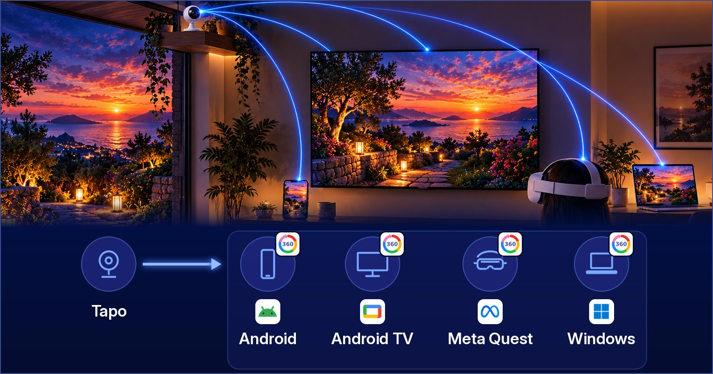

🌐 <b>Română</b> · Alte limbi (88)
<a href="../README.md">English</a> · <a href="README.af.md">Afrikaans</a> · <a href="README.ar.md">العربية</a> · <a href="README.az.md">Azərbaycanca</a> · <a href="README.be.md">Беларуская</a> · <a href="README.bg.md">Български</a> · <a href="README.bi.md">Bislama</a> · <a href="README.bn.md">বাংলা</a> · <a href="README.br.md">Brezhoneg</a> · <a href="README.bs.md">Bosanski</a> · <a href="README.ca.md">Català</a> · <a href="README.cs.md">Čeština</a> · <a href="README.cv.md">Чӑвашла</a> · <a href="README.da.md">Dansk</a> · <a href="README.de.md">Deutsch</a> · <a href="README.de_CH.md">Deutsch (Schweiz)</a> · <a href="README.el.md">Ελληνικά</a> · <a href="README.en_GB.md">English (UK)</a> · <a href="README.eo.md">Esperanto</a> · <a href="README.es.md">Español</a> · <a href="README.et.md">Eesti</a> · <a href="README.eu.md">Euskara</a> · <a href="README.fa.md">فارسی</a> · <a href="README.fi.md">Suomi</a> · <a href="README.fil.md">Filipino</a> · <a href="README.fr.md">Français</a> · <a href="README.ga.md">Gaeilge</a> · <a href="README.gl.md">Galego</a> · <a href="README.gsw.md">Alemannisch</a> · <a href="README.gu.md">ગુજરાતી</a> · <a href="README.he.md">עברית</a> · <a href="README.hi.md">हिन्दी</a> · <a href="README.hr.md">Hrvatski</a> · <a href="README.hu.md">Magyar</a> · <a href="README.hy.md">Հայերեն</a> · <a href="README.id.md">Bahasa Indonesia</a> · <a href="README.is.md">Íslenska</a> · <a href="README.it.md">Italiano</a> · <a href="README.ja.md">日本語</a> · <a href="README.ka.md">ქართული</a> · <a href="README.kab.md">Taqbaylit</a> · <a href="README.kk.md">Қазақша</a> · <a href="README.km.md">ខ្មែរ</a> · <a href="README.kmr.md">Kurmancî</a> · <a href="README.kn.md">ಕನ್ನಡ</a> · <a href="README.ko.md">한국어</a> · <a href="README.kxm.md">ภาษาเขมรถิ่นไทย</a> · <a href="README.lb.md">Lëtzebuergesch</a> · <a href="README.lmo.md">Lombard</a> · <a href="README.lt.md">Lietuvių</a> · <a href="README.lv.md">Latviešu</a> · <a href="README.mfa.md">Bahasa Melayu Kelantan</a> · <a href="README.mi.md">Te reo Māori</a> · <a href="README.mk.md">Македонски</a> · <a href="README.ml.md">മലയാളം</a> · <a href="README.mn.md">Монгол</a> · <a href="README.mr.md">मराठी</a> · <a href="README.ms.md">Bahasa Melayu</a> · <a href="README.nb_NO.md">Norsk bokmål</a> · <a href="README.ne.md">नेपाली</a> · <a href="README.nl.md">Nederlands</a> · <a href="README.nn.md">Norsk nynorsk</a> · <a href="README.pa.md">ਪੰਜਾਬੀ</a> · <a href="README.pl.md">Polski</a> · <a href="README.pt.md">Português</a> · <a href="README.pt_BR.md">Português (Brasil)</a> · <a href="README.ru.md">Русский</a> · <a href="README.si.md">සිංහල</a> · <a href="README.sk.md">Slovenčina</a> · <a href="README.sl.md">Slovenščina</a> · <a href="README.sq.md">Shqip</a> · <a href="README.sr_Cyrl.md">Српски</a> · <a href="README.sr_Latn.md">Srpski</a> · <a href="README.sv.md">Svenska</a> · <a href="README.sw.md">Kiswahili</a> · <a href="README.swg.md">Schwäbisch</a> · <a href="README.ta.md">தமிழ்</a> · <a href="README.te.md">తెలుగు</a> · <a href="README.th.md">ไทย</a> · <a href="README.tl.md">Tagalog</a> · <a href="README.tr.md">Türkçe</a> · <a href="README.uk.md">Українська</a> · <a href="README.ur.md">اردو</a> · <a href="README.uz.md">Oʻzbekcha</a> · <a href="README.vi.md">Tiếng Việt</a> · <a href="README.yue_Hant.md">粵語</a> · <a href="README.zh_Hans.md">简体中文</a> · <a href="README.zh_Hant.md">繁體中文</a>

  

# Immuch360

**Conținutul dvs. Orice ecran. Orice perspectivă.**

🌐 <a href="https://immuch360.com/ro/"><b>immuch360.com</b></a>

Fotografii și videoclipuri plate, 360° și 3D de pe dispozitivul dvs., de pe NAS, de pe serverul dvs. Immich, de la camerele și de la drona dvs. Fără cont. Immuch360 este o aplicație gratuită și open source care vă citește fotografiile și videoclipurile acolo unde se află și o redă pe fiecare în vizualizatorul potrivit: plat, ca o sferă în care priviți în jur, în 3D sau în jurul dvs. într-o cască. Rulează pe telefoane, tablete, televizoare, căști Meta Quest și computere. Site-ul său, [immuch360.com](https://immuch360.com/ro/), arată ce face pe fiecare ecran, în 89 de limbi.

**Nou în build 53 și desktop build 34, versiunea 3.4.8.** Pe computere, [Spatial 2.5D](#see-your-3d-photos-and-videos-in-depth-on-your-computer) dă adâncime fotografiilor dvs. 3D pe ecranul plat, inclusiv fotografiilor 360° și VR180 3D, pe Windows, Linux și macOS, și videoclipurilor dvs. 3D pe Windows și macOS: vizualizarea se mișcă atunci când vă mișcați capul, urmărit de camera web după ce sunteți de acord, sau cu mouse-ul, iar imaginile camerei web rămân în memoria computerului, niciodată salvate sau trimise; încercat pe un laptop Windows cu o cameră web USB, videoclipurile 3D pe placa sa grafică, încă nu pe un Mac sau pe un computer cu Linux. Rotița [mărește o fotografie în jurul cursorului](#zoom-into-a-photo-with-the-wheel), iar o tragere o deplasează. [Îmbunătățiți (IA)](#make-a-photo-sharper-on-your-computer-ai) ia fotografiile partajărilor dvs., din DLNA, Plex, Jellyfin și Emby și de pe serverul dvs. Immich, îmbunătățește fotografiile 360° și 3D fără să le strice cusătura sau cei doi ochi și oferă Accentuare claritate pe un Mac cu cip Apple (încă neîncercat pe un Mac). De pe telefon, ["Redare pe…"](#show-your-photos-and-videos-on-the-tv-from-your-phone) deschide un element 360° în vizualizarea 360° a ecranului, redă o selecție sau un album ca prezentare de diapozitive, conectează un ecran la serverul dvs. și trimite fotografiile și videoclipurile care sunt doar pe telefon; încercat între emulatoare Android, încă nu pe un telefon sau un televizor real. Într-un Meta Quest, prezentarea de diapozitive a ecranului mare [trece de la o fotografie la alta prin disolvare încrucișată sau glisare](#browse-your-photos-on-the-big-screen-of-the-quest), peste un fundal negru, estompat sau passthrough pe care îl alegeți, neîncercat încă într-o cască de proiect.

**Nou în build-urile 33 până la 52.** [Filmele continuă de unde v-ați oprit](#pick-up-a-film-where-you-stopped). Pornesc mai devreme, iar de pe un server lent [continuă să ruleze în loc să se oprească](#when-a-video-waits-or-will-not-play). Cronologia [se micșorează până la luni și ani](#find-a-month-or-a-year-in-a-long-timeline) pe telefoane și computere. Pe un telefon Android sau pe un Meta Quest, ["Răsfoiește un dosar"](#browse-a-folder-of-your-phone-or-headset) deschide un dosar al dispozitivului ca pe o partajare, iar fotografiile TIFF se afișează. Android TV [caută după dată cu telecomanda](#on-android-tv-and-google-tv), un Meta Quest 3 sau 3S [deschide splaturi gaussiene](#explore-gaussian-splats-in-a-meta-quest-3-or-3s), pe care le rotiți cu joystickul drept, inclusiv în versiunea 4 SPZ, iar un computer [creează versiuni 3D ale fotografiilor de pe NAS-ul dvs](#turn-one-photo-into-3d-a-scene-a-panorama). Pe un laptop Windows cu două cipuri grafice, aplicația [rulează acum pe cel rapid](#when-a-video-waits-or-will-not-play), așa că filmele 8K rulează fluent. Splaturile gaussiene [se deschid acum pe computere și pe telefoanele și tabletele Android](#explore-gaussian-splats-on-your-phone-tablet-or-computer), un computer Windows [creează scene splat din fotografiile dvs. sau dintr-un videoclip](#make-a-splat-scene-from-your-photos-or-a-video-ai) prin IA, serverul dvs. Immich [le păstrează în fotografii](#keep-a-splat-scene-on-your-immich-server) care se deschid din cronologia dvs., iar computerele [redau videoclipuri AV2](#play-av2-videos-on-your-computer). Din build 42, videoclipurile brute ale camerelor Insta360, GoPro MAX și DJI Osmo 360, din biblioteca dvs. Immich, dintr-o partajare sau dintr-un dosar, [se redau stabilizate cu giroscopul camerei](#stabilise-your-360-videos-with-the-cameras-gyroscope) pe telefoanele, tabletele și televizoarele Android, creatorul de splaturi din desktop build 22 [oferă calitatea Detaliată](#make-a-splat-scene-from-your-photos-or-a-video-ai) pentru scenele pe care le priviți de aproape, iar o panoramă 360° [pornește cu 3.5 GiB liberi pe placa grafică](#turn-one-photo-into-3d-a-scene-a-panorama). Aplicația pentru iPhone și iPad este [pe App Store](https://apps.apple.com/us/app/immuch360-360-3d-player/id6817655965), versiunea 3.4.3. Din build 43, notificarea de actualizare a aplicației deschide Google Play sau App Store pe telefoane și tablete; site-ul său, [immuch360.com](https://immuch360.com/ro/), s-a deschis pe 7 noiembrie. Din build 44 și desktop build 24, un Meta Quest 3 sau 3S [afișează splaturi de până la 300,000 de gaussiene](#explore-gaussian-splats-in-a-meta-quest-3-or-3s), computerele [selectează mai multe fotografii și videoclipuri cu Ctrl și Shift](#use-your-computer-as-the-media-player), un televizor al cărui decodor refuză un videoclip [redă celălalt fișier al serverului](#when-a-video-waits-or-will-not-play) de la sine, panoramele rulează pe placa grafică aleasă a unui laptop care are două, iar notificarea de actualizare de pe Quest și de pe computere deschide pagina lor din magazin sau pagina de descărcare, cu multe corecturi. Din build 45 și desktop build 25, versiunea 3.4.0 pe toate platformele, aplicația urmează aplicația Immich 3.4.0 cu 11 corecturi ulterioare din Immich, afișează [fotografiile JPEG XL ale serverelor Immich 3.4](#keep-your-immich-library-with-more), deschide [filmele dvs. Plex după an](#watch-your-plex-films) cu o pagină pentru fiecare film, descărcarea lor pe dispozitiv și redarea lor la televizor de pe telefon, poate cere o evaluare în build-urile din magazine și, pe computere, își ia componentele video din [propriile lor depozite deschise](#licences-and-credits). Din build 46 și desktop build 26, versiunea 3.4.1, videoclipurile brute ale camerelor 360° [se redau stabilizate](#stabilise-your-360-videos-with-the-cameras-gyroscope) și pe iPhone și iPad, într-un Meta Quest și pe Windows, un Meta Quest [redă cu libmpv filmele Plex pe care propriul player nu le poate decoda](#watch-your-plex-films), un telefon [trimite un astfel de film la un Chromecast sau un Google TV](#watch-your-plex-films), iar relieful IA al unei fotografii 3D [ia intensitatea pe care o alegeți](#turn-one-photo-into-3d-a-scene-a-panorama); un server nou poate fi adăugat și prin conectarea cu contul dvs. Plex, iar aplicația [își păstrează setările într-un fișier](#keep-your-settings-in-a-file). Din build 47 și desktop build 27, versiunea 3.4.2, un film Plex [redă o pistă audio pe care dispozitivul o decodează](#watch-your-plex-films) și spune care, deschide versiunea potrivită pentru ecran și, pe o conexiune lentă, oferă una mai ușoară, Windows și macOS redau sunetul său Dolby TrueHD, Android [arată descărcarea sa într-o notificare](#watch-your-plex-films), iar Android TV descarcă și el filme, iar [camerele Tapo cu baterie se văd live](#watch-your-home-cameras-on-the-big-screen); restaurarea unui fișier de setări cu conturile sale vă conectează acum la serverul dvs. Immich. Din build 48 și desktop build 28, versiunea 3.4.3, un computer cu Windows [vă redă videoclipurile într-o cască PC VR](#watch-your-videos-in-a-pc-vr-headset-from-windows) prin SteamVR, Meta Horizon Link sau alt runtime OpenXR (neîncercat încă într-o cască de proiect), [camerele altor mărci se văd live](#cameras-of-other-brands-over-onvif-or-rtsp), găsite prin ONVIF sau adăugate prin linkul lor RTSP (verificat cu o cameră simulată, nicio cameră reală de altă marcă încercată încă), videoclipurile brute ale [DJI Osmo 360 II și GoPro MAX 2 se redau stabilizate](#open-the-raw-files-of-360-cameras), filmele Plex [nu mai ajung prea încet pe telefoane](#when-a-video-waits-or-will-not-play), televizoarele LG și Samsung [rotesc un videoclip culcat pe o parte](#on-a-samsung-tv-tizen) cu un singur buton (neîncercat încă pe un televizor LG; televizorul Samsung din issue 17 a refuzat rotirea), iar "Actualizare pentru server disponibilă" nu mai apare pentru un server actualizat. Din build 49 și desktop build 29, versiunea 3.4.4, aplicația [citește singură serverele dvs. Jellyfin și Emby](#watch-your-jellyfin-and-emby-libraries) (neîncercat încă pe un dispozitiv), găsite în rețeaua dvs. și conectate cu Quick Connect pe un televizor sau într-o cască, iar fișierele lor originale sunt redate astfel încât un videoclip 360° rămâne 360°; pe ecranul mare al unui Meta Quest, fotografiile [păstrează mărimea și locul pe care le-ați stabilit în timp ce le răsfoiți și se redau ca prezentare de diapozitive](#browse-your-photos-on-the-big-screen-of-the-quest) (neîncercat încă într-o cască de proiect); playerul video 360° al telefoanelor și tabletelor [primește comenzile fotografiilor 360°](#360-videos-on-your-phone-with-the-controls-of-360-photos), un buton al giroscopului, ciupirea pentru zoom și o glisare drept în sus sau în jos (încercat de un utilizator pe un Samsung Galaxy S25 Ultra, încă nu pe un iPhone); un computer [face videoclipuri 3D din videoclipurile dvs. 2D](#turn-your-2d-videos-into-3d-on-your-computer) cu IA (neîncercat încă pe un ecran 3D sau într-o cască); iar televizoarele Samsung [dau un videoclip care trebuie rotit playerului propriu al Samsung](#on-a-samsung-tv-tizen), pe care televizorul din issue 17 îl redă, dar refuză să-l rotească. Din build 50 și desktop build 30, versiunea 3.4.5, cât timp un videoclip rulează în fereastra 2D a unui Meta Quest, fereastra [se redesenează la frecvența ecranului](#step-inside-your-photos-and-videos-with-a-meta-quest) în loc de aproximativ 10 ori pe secundă ca în build-urile 48 și 49 (măsurat pe un Meta Quest 3), Android TV [mărește o fotografie cu telecomanda](#on-android-tv-and-google-tv) și o deplasează cu săgețile (nou, neîncercat încă pe un televizor), iar trei corecturi vin din fork-ul Android TV al lui mlc70: o glisare rapidă nu mai arată detaliile fotografiei lăsate în urmă, o fotografie animată își eliberează memoria, iar filtrul Locație oferă orașele noii țări. Din build 51 și desktop build 31, versiunea 3.4.6, [Îmbunătățiți (IA)](#make-a-photo-sharper-on-your-computer-ai) face o copie mai clară a unei fotografii neclare lângă original pe Windows și Linux, pe trei niveluri, fiecare rulat o dată pe un PC cu un RTX 4060, Natural este oferit și pe un Mac cu cip Apple (încă neîncercat pe un Mac), un computer [transformă un videoclip 360° într-un videoclip 360° 3D](#a-360-video-turned-into-a-360-3d-video) cu IA, adâncimea videoclipurilor 3D fiind estimată de placa grafică pe Windows, funcțiile IA iau direct videoclipurile serverului dvs. și ale unei partajări, fișierul de setări are [cardul său în Bibliotecă](#keep-your-settings-in-a-file), un televizor îl salvează pe o partajare de rețea, Escape revine un pas înapoi pe computere, build-urile din magazine cer o evaluare [mai rar și mai delicat](#privacy), Linux afișează fotografii TIFF, scene splat și videoclipuri 3D cu un ochi, iar două blocări sunt corectate. Din build 52 și desktop build 32, versiunea 3.4.7, ["Redare pe…"](#show-your-photos-and-videos-on-the-tv-from-your-phone) trimite fotografiile și videoclipurile din biblioteca dvs. Immich, din partajările dvs. și din Jellyfin și Emby de pe telefon la un televizor, un Meta Quest, un computer sau un Chromecast, numele fotografiilor și videoclipurilor dvs. [rămân lizibile peste miniaturi](#play-the-files-of-a-nas-a-computer-a-media-server-or-plex), componentele IA ale unui computer [se actualizează cu un singur clic](#update-the-ai-components-in-one-click), Linux primește [un AppImage](#linux), iar aplicația pentru iPhone și iPad este construită cu Xcode 27. Desktop build 33 a corectat [Îmbunătățiți (IA)](#make-a-photo-sharper-on-your-computer-ai), care eșua pe fiecare fotografie în desktop build-urile 31 și 32 ([issue 23](https://github.com/freeKC/Immuch360/issues/23)).

  Fork neoficial al aplicației mobile Immich. Nu este afiliat cu Immich sau cu FUTO. Numele se citește ca "I am much 360".

<b>Cuprins</b>

- [Pentru cine este](#who-it-is-for)
- [Ce ecrane](#which-screens), [ce fac împreună](#use-cases) și [ce face fiecare ecran](#what-each-screen-does)
- [Ce puteți face](#what-you-can-do)
- [Instalați-o pe dispozitivul dvs.](#get-it-on-your-device)
- [Cum să](#how-to)
  - [Vizionați fotografiile și videoclipurile dvs., cu sau fără server](#watch-your-photos-and-videos-with-or-without-a-server)
  - [Explorați panorame, 360°, VR180 și 3D](#explore-panoramas-360-vr180-and-3d): [videoclipuri 360° pe telefoane](#360-videos-on-your-phone-with-the-controls-of-360-photos)
  - [Transformați o fotografie în 3D, o scenă, o panoramă](#turn-one-photo-into-3d-a-scene-a-panorama): [componentele IA actualizate cu un singur clic](#update-the-ai-components-in-one-click)
  - [Transformați-vă videoclipurile 2D în 3D pe computer](#turn-your-2d-videos-into-3d-on-your-computer): [videoclipuri 360° în 360° 3D](#a-360-video-turned-into-a-360-3d-video)
  - [Faceți o fotografie mai clară pe computer (IA)](#make-a-photo-sharper-on-your-computer-ai)
  - [Vizionați la televizor cu telecomanda](#watch-on-the-tv-with-the-remote): [Android TV și Google TV](#on-android-tv-and-google-tv), [LG](#on-an-lg-tv-webos), [Samsung](#on-a-samsung-tv-tizen)
  - [Conectați un televizor, o cască sau un computer cu telefonul](#sign-in-a-tv-a-headset-or-a-computer-with-your-phone)
  - [Afișați fotografiile și videoclipurile dvs. la televizor de pe telefon](#show-your-photos-and-videos-on-the-tv-from-your-phone)
  - [Intrați în fotografiile și videoclipurile dvs. cu un Meta Quest](#step-inside-your-photos-and-videos-with-a-meta-quest): [ecranul mare](#browse-your-photos-on-the-big-screen-of-the-quest), [mod chioșc](#kiosk-mode-for-an-exhibition-or-a-shop)
  - [Explorați splaturi gaussiene într-un Meta Quest 3 sau 3S](#explore-gaussian-splats-in-a-meta-quest-3-or-3s)
  - [Explorați splaturi gaussiene pe telefonul, tableta sau computerul dvs.](#explore-gaussian-splats-on-your-phone-tablet-or-computer)
  - [Creați o scenă splat din fotografiile dvs. sau dintr-un videoclip (IA)](#make-a-splat-scene-from-your-photos-or-a-video-ai)
  - [Păstrați o scenă splat pe serverul dvs. Immich](#keep-a-splat-scene-on-your-immich-server)
  - [Redați fișierele unui NAS, unui computer, unui server media sau Plex](#play-the-files-of-a-nas-a-computer-a-media-server-or-plex): [filmele dvs. după an](#watch-your-plex-films), [Jellyfin și Emby](#watch-your-jellyfin-and-emby-libraries)
  - [Răsfoiți un dosar al telefonului sau al căștii](#browse-a-folder-of-your-phone-or-headset)
  - [Reluați un film de unde v-ați oprit](#pick-up-a-film-where-you-stopped)
  - [Când un videoclip așteaptă sau nu pornește](#when-a-video-waits-or-will-not-play)
  - [Păstrați-vă biblioteca Immich, cu mai mult](#keep-your-immich-library-with-more)
  - [Găsiți o lună sau un an într-o cronologie lungă](#find-a-month-or-a-year-in-a-long-timeline)
  - [Urmăriți camerele de acasă pe ecranul mare](#watch-your-home-cameras-on-the-big-screen): [alte mărci](#cameras-of-other-brands-over-onvif-or-rtsp)
  - [Drona dvs. DJI](#your-dji-drone): [video live](#see-what-your-drone-sees-on-your-phone), [într-un Meta Quest sau pe un Android TV](#watch-it-in-a-meta-quest-or-on-an-android-tv), [import](#bring-a-drones-or-a-camera-cards-photos-and-videos-to-immich)
  - [Deschideți fișierele brute ale camerelor 360°](#open-the-raw-files-of-360-cameras)
  - [Stabilizați videoclipurile dvs. 360° cu giroscopul camerei](#stabilise-your-360-videos-with-the-cameras-gyroscope)
  - [Rotiți o fotografie cu o singură tastă](#turn-a-photo-with-one-key)
  - [Folosiți computerul ca player media](#use-your-computer-as-the-media-player): [mărire cu rotița](#zoom-into-a-photo-with-the-wheel)
  - [Vedeți fotografiile și videoclipurile 3D în adâncime pe computer](#see-your-3d-photos-and-videos-in-depth-on-your-computer)
  - [Urmăriți videoclipurile într-o cască PC VR, de pe Windows](#watch-your-videos-in-a-pc-vr-headset-from-windows)
  - [Redați videoclipuri AV2 pe computerul dvs.](#play-av2-videos-on-your-computer)
  - [Păstrați-vă setările într-un fișier](#keep-your-settings-in-a-file)
- [Comparat cu Immich](#compared-with-immich)
- [Confidențialitate](#privacy)
- [Licențe și mulțumiri](#licences-and-credits)
- [Planuri](#roadmap)
- [Documentație](#documentation)

## Pentru cine este

- **Fotografiați în 360° sau 3D** și vreți să priviți în jur în imaginile dvs., nu să le vedeți plate, dublate sau întinse, și să vă rotiți videoclipurile 360° pe telefon așa cum îi rotiți fotografiile: [360°, VR180 și 3D](#explore-panoramas-360-vr180-and-3d), [videoclipuri 360° pe telefoane](#360-videos-on-your-phone-with-the-controls-of-360-photos).
- **Filmați cu o cameră 360° în mână, pe bicicletă sau pe cască** și vreți ca videoclipurile brute ale camerei dvs. Insta360, GoPro MAX sau MAX 2, DJI Osmo 360 sau Osmo 360 II, păstrate în Immich, pe o partajare sau într-un dosar, să se redea drepte și stabile pe telefonul, pe televizorul, în Meta Quest-ul sau pe computerul dvs. cu Windows: [stabilizate cu giroscopul camerei](#stabilise-your-360-videos-with-the-cameras-gyroscope).
- **Fotografiile și filmele dvs. stau pe un NAS, un computer, în Plex sau în Immich** și le vreți la televizor fără să copiați nimic: [la televizor](#watch-on-the-tv-with-the-remote), [NAS, partajări și Plex](#play-the-files-of-a-nas-a-computer-a-media-server-or-plex).
- **Vă țineți filmele pe un server Plex** și vreți să alegeți unul după an, să vedeți ce este înainte să înceapă, să-l luați într-o călătorie, să-l porniți de pe telefon la televizor sau pe un Chromecast și să redați chiar și filmele pe care telefonul Android, televizorul sau Meta Quest-ul dvs. nu le pot decoda: [filmele dvs., după an](#watch-your-plex-films).
- **Vă păstrați filmele pe un server Jellyfin sau Emby** și le vreți în Meta Quest, pe televizor sau pe telefon, cu 360° și 3D păstrate așa cum sunt, și locul dvs. păstrat pe server (neîncercat încă pe un dispozitiv): [Jellyfin și Emby](#watch-your-jellyfin-and-emby-libraries).
- **Aveți un Meta Quest** și vreți să intrați în propriile fotografii și videoclipuri: [în cască](#step-inside-your-photos-and-videos-with-a-meta-quest), și să vă răsfoiți fotografiile pe un ecran mare la mărimea și în locul pe care le-ați stabilit, și ca prezentare de diapozitive (neîncercat încă într-o cască de proiect): [ecranul mare](#browse-your-photos-on-the-big-screen-of-the-quest).
- **Aveți o cască PC VR la un computer cu Windows** și vreți în ea videoclipurile 360° în jurul dvs. și filmele pe un ecran mare (neîncercat încă într-o cască de proiect): [într-o cască PC VR](#watch-your-videos-in-a-pc-vr-headset-from-windows).
- **Fotografiile dvs. sunt plate** și le vreți în 3D, ca o scenă în care să vă aplecați într-o cască, sau într-o panoramă 360°, fără o cameră 3D: [transformați o fotografie în 3D, o scenă, o panoramă](#turn-one-photo-into-3d-a-scene-a-panorama), nou, creat de IA pe propriul computer.
- **Videoclipurile dvs. sunt plate**, inclusiv clipurile telefonului, și le vreți în 3D pentru o cască sau un ecran 3D, și videoclipurile 360° în 360° 3D, făcute pe propriul computer (neîncercat încă pe un ecran 3D sau într-o cască): [videoclipuri 2D în 3D](#turn-your-2d-videos-into-3d-on-your-computer), [360° în 360° 3D](#a-360-video-turned-into-a-360-3d-video).
- **Fotografiile dvs. sunt neclare**, puțin nefocalizate sau făcute în lumină slabă, și vreți o copie mai clară lângă original, făcută pe propriul computer, și din partajările și serverele dvs., cu detaliile inventate spuse clar: [Îmbunătățiți (IA)](#make-a-photo-sharper-on-your-computer-ai).
- **Aveți fotografii 3D, fotografii 360° 3D sau videoclipuri 3D și un computer** și le vreți cu adâncime pe ecranul lui plat, vizualizarea mișcându-se când vă mișcați capul, urmărit de camera web, sau cu mouse-ul (încercat pe un laptop Windows cu o cameră web, încă nu pe un Mac sau pe un computer cu Linux): [Spatial 2.5D pe computer](#see-your-3d-photos-and-videos-in-depth-on-your-computer).
- **Folosiți Immich** și vreți aplicația lui, plus vizualizatoarele imersive și ecranele mari conectate de pe telefon: [biblioteca dvs. Immich](#keep-your-immich-library-with-more), [comparat cu Immich](#compared-with-immich).
- **Vă supravegheați casa cu camere Tapo**, inclusiv cu baterie, sau cu camere ale altor mărci prin ONVIF sau RTSP, și le vreți lângă fotografiile dvs., și la televizor (verificat cu o cameră simulată): [camerele de acasă](#watch-your-home-cameras-on-the-big-screen).
- **Zburați cu o dronă DJI** și vreți imaginea ei live pe telefon fără DJI Fly, iar într-un Meta Quest sau pe un Android TV pentru cei care sunt cu dvs.: [drona dvs.](#see-what-your-drone-sees-on-your-phone).
- **Capturați locuri și obiecte în 3D, ca splaturi gaussiene,** sau ați vrea să le creați din propriile fotografii, și vreți să vă plimbați prin ele pe telefon, pe computer sau într-o cască: [pe un telefon, o tabletă sau un computer](#explore-gaussian-splats-on-your-phone-tablet-or-computer), [create din fotografiile dvs.](#make-a-splat-scene-from-your-photos-or-a-video-ai), [păstrate în Immich](#keep-a-splat-scene-on-your-immich-server).
- **Aveți videoclipuri AV2**, formatul care urmează după AV1, și vreți să le vizionați pe computer: [AV2 pe computerul dvs.](#play-av2-videos-on-your-computer).
- **Aveți mai multe ecrane acasă** și vreți ca ele să lucreze împreună: [ce fac ecranele dvs. împreună](#use-cases).

Nu există niciun cont Immuch360 de creat și nimic nu ajunge la noi: aplicația comunică doar cu dispozitivele dvs. și cu serverele pe care le alegeți, din build 45 cu Wikipedia pentru pagina unui film, din build 46 cu plex.tv când vă conectați prin el, și descarcă o componentă IA sau decodorul AV2 doar când le cereți.

## Ce ecrane

| Platformă | De unde o obțineți | Stare în noiembrie 2026 |
|---|---|---|
|  **Android** telefoane și tablete | [Google Play](https://play.google.com/store/apps/details?id=com.aprogsys.immuch360) · [APK](https://github.com/freeKC/Immuch360/releases) | pe Google Play (build 47 publicat pe 16 noiembrie; build 51 în verificarea Google din 24 noiembrie; urmează build 53), build 53 pe GitHub, unde [videoclipurile 360° brute se redau stabilizate](#stabilise-your-360-videos-with-the-cameras-gyroscope), [filmele continuă de unde v-ați oprit](#pick-up-a-film-where-you-stopped), ["Răsfoiește un dosar"](#browse-a-folder-of-your-phone-or-headset) deschide un dosar al telefonului, iar [splaturile gaussiene se deschid](#explore-gaussian-splats-on-your-phone-tablet-or-computer), dintr-o partajare sau [din cronologia dvs. Immich](#keep-a-splat-scene-on-your-immich-server), [setările păstrate într-un fișier](#keep-your-settings-in-a-file), [descărcarea unui film afișată într-o notificare](#watch-your-plex-films), din build 48 [camerele altor mărci, live](#cameras-of-other-brands-over-onvif-or-rtsp) (verificat cu o cameră simulată) și, din build 49, [serverele Jellyfin și Emby](#watch-your-jellyfin-and-emby-libraries) (neîncercat încă pe un dispozitiv) și [comenzile fotografiilor 360° în playerul video 360°](#360-videos-on-your-phone-with-the-controls-of-360-photos) (încercat de un utilizator pe un Samsung Galaxy S25 Ultra) și, din build 51, [cardul fișierului de setări în Bibliotecă](#keep-your-settings-in-a-file), cu fișierul salvat și pe o partajare de rețea, iar din build 52 [fotografiile și videoclipurile dvs. trimise la un televizor sau la un Chromecast](#show-your-photos-and-videos-on-the-tv-from-your-phone) cu "Redare pe…" (neîncercat încă pe un dispozitiv) și, din build 53, [elementele 360°, o selecție sau un album și fotografiile și videoclipurile telefonului însuși](#show-your-photos-and-videos-on-the-tv-from-your-phone) trimise la fel (încercat între emulatoare Android) |
|  **iPhone și iPad** | [App Store](https://apps.apple.com/us/app/immuch360-360-3d-player/id6817655965) | versiunea 3.4.7 pe App Store din 26 noiembrie, cu [luni și ani în cronologie](#find-a-month-or-a-year-in-a-long-timeline), [filme care continuă de unde v-ați oprit](#pick-up-a-film-where-you-stopped), [conectarea unui televizor, a unei căști sau a unui computer](#sign-in-a-tv-a-headset-or-a-computer-with-your-phone) de pe telefon, scenele splat păstrate în Immich afișate ca fotografia lor, corecturile din Immich 3.4.0 și fotografiile sale JPEG XL, [videoclipuri 360° brute stabilizate](#stabilise-your-360-videos-with-the-cameras-gyroscope), [setările păstrate într-un fișier](#keep-your-settings-in-a-file), [vizualizarea live a camerelor Tapo cu baterie](#watch-your-home-cameras-on-the-big-screen) și [vizualizarea live a camerelor altor mărci](#cameras-of-other-brands-over-onvif-or-rtsp) (verificat cu o cameră simulată), iar din versiunea 3.4.4 cu [serverele Jellyfin și Emby](#watch-your-jellyfin-and-emby-libraries) (neîncercat încă pe un dispozitiv) și [comenzile fotografiilor 360° în playerul video 360°](#360-videos-on-your-phone-with-the-controls-of-360-photos) (neîncercat încă pe un iPhone), iar din versiunea 3.4.6 cu [cardul fișierului de setări](#keep-your-settings-in-a-file) și restaurarea lui de pe o partajare de rețea, iar din versiunea 3.4.7, construită cu Xcode 27, cu ["Redare pe…" pentru fotografii și videoclipuri](#show-your-photos-and-videos-on-the-tv-from-your-phone) (încă neîncercat pe un iPhone); urmează versiunea 3.4.8, versiunea pentru iPhone și iPad a build-ului 53; sau [construiți-o singuri](../docs/immuch360/build.md) |
|  **Android TV și Google TV** | [Google Play](https://play.google.com/store/apps/details?id=com.aprogsys.immuch360) · [APK](#android-tv-and-google-tv) | pe Google Play, care oferă aplicația pe Android TV și Google TV, și build 53 pe GitHub: [videoclipuri 360° brute stabilizate](#stabilise-your-360-videos-with-the-cameras-gyroscope), [căutare după dată cu telecomanda](#on-android-tv-and-google-tv), [conectare cu telefonul](#sign-in-a-tv-a-headset-or-a-computer-with-your-phone) prin scanarea unui cod QR, o bară de timp, audio și subtitrări pentru telecomandă în playerul video și [videoclipul live al unei drone](#watch-it-in-a-meta-quest-or-on-an-android-tv) retransmis de un telefon, [filme descărcate pe televizor](#watch-your-plex-films) și, din build 49, [serverele Jellyfin și Emby](#watch-your-jellyfin-and-emby-libraries) conectate cu Quick Connect (neîncercat încă pe un dispozitiv) și, din build 50, [fotografii mărite cu telecomanda](#on-android-tv-and-google-tv) (văzut funcționând pe un emulator Android TV, neîncercat încă pe un televizor) și, din build 51, [fișierul de setări salvat și restaurat pe o partajare de rețea](#keep-your-settings-in-a-file) (văzut funcționând pe un emulator Android TV) și, din build 52, [fotografiile și videoclipurile pe care un telefon le trimite cu "Redare pe…"](#show-your-photos-and-videos-on-the-tv-from-your-phone) (neîncercat încă pe un televizor) și, din build 53, fotografiile 360° pe care le trimite un telefon deschise în vizualizarea lor 360°, o conectare din foaia telefonului și fotografiile și videoclipurile telefonului însuși (văzut funcționând pe un emulator Android TV) |
| **Televizoare LG** cu webOS 5.0 și mai nou | [.ipk, versiunea 1.0.5](https://github.com/freeKC/Immuch360/releases/tag/webos-v1.0.5) · LG Content Store (în verificare) | versiunea 1.0.0, trimisă la LG Content Store pe 24 octombrie, în testele LG din 26 octombrie; versiunea 1.0.1, pe GitHub din 27 octombrie, mărește o fotografie din săgeți și spune când o fotografie încă se încarcă, iar versiunea 1.0.2, pe GitHub cu build 46, scrie "conectare" ca ログイン în japoneză, versiunea 1.0.3, cu build 47, spune când un dosar al unui server DLNA conține canale TV live, pe care încă nu le poate reda, versiunea 1.0.4, cu build 48, [rotește un videoclip culcat pe o parte](#on-an-lg-tv-webos) cu un singur buton (neîncercat încă pe un televizor LG), iar versiunea 1.0.5, cu build 49, numește Jellyfin cu pluginul său DLNA printre serverele DLNA; până când LG publică aplicația, se instalează în [Developer Mode](#lg-tvs-webos). Versiunea 1.0.0 a rulat pe televizoare webOS 25 din Cloud Test Lab al LG |
| **Televizoare Samsung** cu Tizen 5.5 și mai nou | [.wgt, versiunea 0.3.6](https://github.com/freeKC/Immuch360/releases/tag/tizen-v0.3.6) | versiunea 0.3.6 a aceleiași aplicații TV, de semnat cu propriul certificat Samsung și de instalat în [Developer mode](#samsung-tvs-tizen); 0.1.0 a rulat pe televizorul Samsung al unui tester, 0.2.0 conține remedierile din acea rulare, 0.3.0 adaugă mărirea fotografiilor și eticheta Se încarcă din versiunea LG 1.0.1, iar 0.3.1 formularea japoneză din versiunea LG 1.0.2, 0.3.2 redă cu partea de sus în sus un videoclip filmat vertical cu un telefon ([issue 17](https://github.com/freeKC/Immuch360/issues/17)), 0.3.3 și 0.3.4 [îl rotesc pe un televizor care îl raportează vertical](#on-a-samsung-tv-tizen) și adaugă un buton care îl rotește manual, iar 0.3.5 și 0.3.6 dau un astfel de videoclip playerului propriu al Samsung; pe televizorul autorului raportului, 0.3.4 și 0.3.5 au lăsat imaginea culcată pe o parte, televizorul refuzând rotirea, iar soluția acolo este un videoclip pe care serverul dvs. Immich îl transcodează, stocat vertical; nu este în magazinul Samsung |
|  **Meta Quest** 2, Pro, 3 și 3S | [Horizon Store](https://www.meta.com/experiences/immuch360/1384208401440714/) · [APK](#meta-quest) | pe Horizon Store (build 52, publicat pe 26 noiembrie, după build 50, a cărui fereastră 2D se redesenează la frecvența ecranului în timpul redării unui videoclip; urmează build 53), build 53 pe GitHub, cu un [mod chioșc](#kiosk-mode-for-an-exhibition-or-a-shop), [videoclipuri 360° brute stabilizate](#stabilise-your-360-videos-with-the-cameras-gyroscope) în vizualizarea imersivă, [filmele pe care nu le poate decoda redate de libmpv](#watch-your-plex-films) și, pe Quest 3 și 3S, [splaturi gaussiene](#explore-gaussian-splats-in-a-meta-quest-3-or-3s) și [relieful IA](#turn-one-photo-into-3d-a-scene-a-panorama) al unei fotografii plate, iar din build 49 [fotografii răsfoite pe ecranul mare](#browse-your-photos-on-the-big-screen-of-the-quest) la mărimea stabilită de dvs., și ca prezentare de diapozitive (neîncercat încă într-o cască de proiect), și [serverele Jellyfin și Emby](#watch-your-jellyfin-and-emby-libraries) conectate cu Quick Connect (neîncercat încă pe un dispozitiv) și, din build 51, o cască al cărei Horizon OS este prea vechi pentru vizualizatorul imersiv cere o actualizare în loc să închidă aplicația (neîncercat pe o astfel de cască) și, din build 53, [o disolvare încrucișată sau o glisare între fotografiile ecranului mare, peste un fundal negru, estompat sau passthrough](#browse-your-photos-on-the-big-screen-of-the-quest) (neîncercat încă într-o cască de proiect) |
|  **Windows** | [Instalator sau ZIP](https://github.com/freeKC/Immuch360/releases/tag/desktop-v3.4.8-34) | desktop build 34, semnat: fotografii, videoclipuri plate și 360°, partajări, Plex, camere (verificat cu o cameră simulată), conectare cu telefonul, fotografii rotite cu o singură tastă, interfața în 89 de limbi și [fotografii 3D, scene 3D și panorame 360° create din fotografiile dvs.](#turn-one-photo-into-3d-a-scene-a-panorama) de IA, inclusiv din fotografiile de pe NAS-ul dvs.; [splaturi gaussiene](#explore-gaussian-splats-on-your-phone-tablet-or-computer) deschise, [create din fotografiile dvs. sau dintr-un videoclip](#make-a-splat-scene-from-your-photos-or-a-video-ai) și [păstrate în Immich](#keep-a-splat-scene-on-your-immich-server), [videoclipuri AV2](#play-av2-videos-on-your-computer), din desktop build 22 o [alegere a calității pentru scenele splat](#make-a-splat-scene-from-your-photos-or-a-video-ai) și [panorame 360° de la 3.5 GiB de memorie grafică liberă](#turn-one-photo-into-3d-a-scene-a-panorama) și, din desktop build 26, [videoclipuri 360° brute stabilizate](#stabilise-your-360-videos-with-the-cameras-gyroscope) și [fotografii 3D cu o intensitate a reliefului și contururi mai clare](#turn-one-photo-into-3d-a-scene-a-panorama), din desktop build 27 [sunetul Dolby TrueHD și subtitrările Blu-ray ale filmelor](#watch-your-plex-films), din desktop build 28 [videoclipurile dvs. într-o cască PC VR](#watch-your-videos-in-a-pc-vr-headset-from-windows) (neîncercat încă într-o cască de proiect) și, din desktop build 29, [videoclipuri 3D făcute din videoclipurile dvs. 2D](#turn-your-2d-videos-into-3d-on-your-computer) cu IA (neîncercat încă pe un ecran 3D sau într-o cască) și, din desktop build 31, [copii mai clare ale fotografiilor dvs.](#make-a-photo-sharper-on-your-computer-ai) cu IA și [videoclipuri 360° transformate în videoclipuri 360° 3D](#a-360-video-turned-into-a-360-3d-video) cu IA, adâncimea estimată de placa grafică, videoclipurile serverului dvs. și ale unei partajări luate direct, și Escape pentru a reveni un pas, din desktop build 32 [componentele IA actualizate cu un singur clic](#update-the-ai-components-in-one-click), din desktop build 33 [Îmbunătățiți (IA)](#make-a-photo-sharper-on-your-computer-ai) funcționând din nou, iar din desktop build 34 [mărirea fotografiilor cu rotița](#zoom-into-a-photo-with-the-wheel), [Spatial 2.5D pentru fotografii și videoclipuri 3D](#see-your-3d-photos-and-videos-in-depth-on-your-computer), cu camera web sau cu mouse-ul (neîncercat încă cu o cameră web de proiect), și Îmbunătățiți (IA) pe fotografiile partajărilor și serverelor, inclusiv pe fotografiile 360° și 3D |
|   **macOS și Linux** | [.deb, .rpm, AppImage, DMG](https://github.com/freeKC/Immuch360/releases/tag/desktop-v3.4.8-34) | desktop build 34: fotografii, fotografii 360° și videoclipuri plate (videoclipurile 360° se redau plat), un server Immich și partajări de rețea și [fotografii 3D și scene 3D](#turn-one-photo-into-3d-a-scene-a-panorama) create de IA din fotografiile dvs., cu panorame 360° pe Linux pe o placă grafică de 8 GB, de la 3.5 GiB liberi pe ea, și [splaturi gaussiene](#explore-gaussian-splats-on-your-phone-tablet-or-computer) și [videoclipuri AV2](#play-av2-videos-on-your-computer) (neîncercate încă pe un Mac); desktop build 11 încercat pe 26 octombrie într-un container Ubuntu 24.04 și pe un Mac; din desktop build 27, sunetul Dolby TrueHD al filmelor pe macOS; din desktop build 29, [videoclipuri 3D făcute din videoclipurile dvs. 2D](#turn-your-2d-videos-into-3d-on-your-computer) cu IA pe Linux și pe un Mac cu cip Apple (neîncercat încă pe un ecran 3D sau într-o cască); din desktop build 31, pe Linux, [copii mai clare ale fotografiilor dvs.](#make-a-photo-sharper-on-your-computer-ai) cu IA, fotografii TIFF, dosare care își arată singure fișierele noi, scene splat făcute din fotografiile dvs. pe o placă grafică de 4 GB și videoclipuri 3D afișate plat cu un ochi, iar pe un Mac cu cip Apple nivelul Natural al Îmbunătățiți (IA) (neîncercat încă pe un Mac); din desktop build 32, [un AppImage](#linux) pentru celelalte distribuții Linux, verificat de CI pe Arch Linux și openSUSE; din desktop build 34, mărirea cu rotița, [Spatial 2.5D](#see-your-3d-photos-and-videos-in-depth-on-your-computer) pentru fotografii 3D pe Linux și macOS și pentru videoclipuri 3D pe macOS (încă neîncercat pe un Mac sau cu o cameră web) și, pe un Mac cu cip Apple, nivelul Accentuare claritate al Îmbunătățiți (IA) (încă neîncercat pe un Mac); nesemnat pe macOS |

*Stările sunt actualizate la fiecare lansare; ce are fiecare magazin, ce este în verificarea sa și fiecare build se află în [Starea lansării](../docs/immuch360/release-status.md). Site-ul [immuch360.com](https://immuch360.com/ro/) arată ce face fiecare ecran, un ghid pentru fiecare funcție și linkurile magazinelor, în 89 de limbi.*

  

### Ce fac ecranele dvs. împreună

Instalați Immuch360 pe fiecare ecran pe care vă uitați: fiecare citește singur sursele dvs., iar unele transmit altuia o imagine, un fișier sau o conectare. În fiecare imagine, pictograma Immuch360 marchează dispozitivele care rulează aplicația.

#### NAS-ul dvs. pe fiecare ecran

  

**Aveți nevoie de:** un NAS cu o partajare SMB sau WebDAV și Immuch360 pe fiecare ecran pe care vă uitați.

Adăugați partajarea pe fiecare ecran, iar fiecare redă fotografiile și videoclipurile acolo unde se află, fără să copieze nimic: telefoane, tablete, Android TV, un Meta Quest, computere Windows, Linux și macOS, și televizoare LG conectate la serverul dvs. Immich (SMB de la webOS 22). O fotografie 360° se rotește ca o sferă pe telefon și pe televizor și vă înconjoară în cască. Cum să: [Redați fișierele unui NAS, unui computer, unui server media sau Plex](#play-the-files-of-a-nas-a-computer-a-media-server-or-plex).

#### Serverul dvs. Immich pe fiecare ecran, conectat de pe telefon

  

**Aveți nevoie de:** un server Immich, Immuch360 pe telefonul dvs. Android și Immuch360 pe ecranele pe care le conectați: Android TV, un Meta Quest, un computer Windows, Linux sau macOS.

Pe telefon, Immuch360 păstrează întreaga aplicație mobilă Immich, îi adaugă vizualizatoarele sale 360°, VR180 și 3D și se instalează lângă aplicația oficială. Conectat la serverul dvs., conectează ecranele mari: scanează codul QR al televizorului sau al computerului, sau tastați pe el codul pe care îl arată casca, iar parola dvs. rămâne pe telefon. Cum să: [Conectați un televizor, o cască sau un computer cu telefonul](#sign-in-a-tv-a-headset-or-a-computer-with-your-phone).

#### Fotografiile dvs. plate în 3D, de pe computer în cască

  

**Aveți nevoie de:** Immuch360 pe un computer Windows, Linux sau macOS și într-un Meta Quest, cu NAS-ul dvs. între ele, sau serverul dvs. Immich cu "Faceți backup și pentru versiunile IA" activat.

Computerul însuși transformă fotografiile dvs. în fotografii 3D și scene 3D, și în panorame 360° cu o placă grafică de 8 GB pe Windows sau Linux, și le salvează lângă originale. Casca arată o fotografie 3D în 3D adevărat, pune o scenă în camera dvs. și o panoramă în jurul dvs.; telefoanele și televizoarele deschid panoramele în vizualizatorul lor 360°. Cum să: [Transformați o fotografie în 3D, o scenă, o panoramă](#turn-one-photo-into-3d-a-scene-a-panorama).

#### Imaginea live a dronei dvs. într-o cască sau la televizor

  

**Aveți nevoie de:** o dronă DJI și controlerul ei DJI RC-N3, Immuch360 pe telefonul Android conectat la controler și Immuch360 într-un Meta Quest sau pe un Android TV.

Telefonul arată videoclipul live al dronei și îl retransmite, prin Wi-Fi-ul dvs. sau prin propriul hotspot, astfel încât cei care sunt cu dvs. urmăresc zborul în cască sau la televizor. Doar recepție: nicio comandă nu este trimisă vreodată controlerului sau dronei, iar controlerul păstrează controlul deplin. Cum să: [Vizionați-o într-un Meta Quest sau pe un Android TV](#watch-it-in-a-meta-quest-or-on-an-android-tv).

#### Fișierele brute ale camerei dvs. 360°, îmbinate acolo unde le priviți

  

**Aveți nevoie de:** o cameră Insta360, GoPro MAX sau MAX 2, DJI Osmo 360 sau Osmo 360 II, NAS-ul dvs. și Immuch360 pe ecrane: telefoane, tablete, Android TV, un Meta Quest, Windows.

Copiați fișierele .insp, .insv, .360 sau .osv de pe cardul camerei pe o partajare SMB sau WebDAV a NAS-ului dvs., așa cum sunt; un server Immich le acceptă și pe cele Insta360. Fiecare ecran le îmbină în timpul redării, cu calibrarea scrisă în fiecare fișier, și nimic nu este exportat înainte în aplicația camerei. Cum să: [Deschideți fișierele brute ale camerelor 360°](#open-the-raw-files-of-360-cameras).

#### Serverele dvs. Plex și DLNA la televizor și în cască

  

**Aveți nevoie de:** un Plex Media Server, un server Jellyfin sau Emby, sau un server DLNA precum minidlna, și Immuch360 pe fiecare ecran: Android TV, un Meta Quest, telefoane, tablete, Windows.

Plex oferă fișierele originale ale bibliotecilor dvs., astfel încât un videoclip 360° rămâne 360°, în jurul dvs. în cască, acasă și, prin redirecționarea de porturi, departe de casă; serverele DLNA sunt găsite în rețeaua de acasă. Televizoarele LG conectate la serverul dvs. Immich le redau și ele. Din build 45, telefoanele, tabletele, Android TV, Quest și computerele deschid o bibliotecă de filme Plex pe toate filmele după an, fiecare film cu pagina sa, iar un film ales pe telefon se redă pe Android TV, pe Quest sau pe un computer, cu telecomanda la comandă. Din build 46, Quest redă cu libmpv filmele pe care propriul player nu le poate decoda, serverul dvs. Plex le convertește pe cele pe care niciun player al unui dispozitiv Android nu le decodează, iar un telefon trimite un film la un Chromecast sau un Google TV. Din build 47, un film redă o pistă audio pe care dispozitivul o decodează și spune care, deschide versiunea potrivită pentru ecran și își redă sunetul Dolby TrueHD pe Windows și macOS, iar un dosar de canale TV live al unui server DLNA spune că acestea nu pot fi redate încă. Din build 49, și un server Jellyfin sau Emby are un tip propriu, găsit singur, conectat cu Quick Connect pe un televizor sau în cască, cu fișierele sale originale redate astfel încât 360° rămâne 360° și locul dvs. păstrat pe server (neîncercat încă pe un dispozitiv). Cum să: [Redați fișierele unui NAS, unui computer, unui server media sau Plex](#play-the-files-of-a-nas-a-computer-a-media-server-or-plex), [Urmăriți-vă filmele Plex](#watch-your-plex-films) și [Urmăriți-vă bibliotecile Jellyfin și Emby](#watch-your-jellyfin-and-emby-libraries).

#### Telefonul sau computerul dvs. Windows, deschis în cască

  

**Aveți nevoie de:** Immuch360 pe un telefon Android, un iPhone sau un computer Windows, și într-un Meta Quest, în aceeași rețea Wi-Fi de acasă.

Activați "Partajați acest telefon în rețea" pe telefon sau "Partajați acest computer în rețea" pe computer, iar casca îi redă fotografiile și videoclipurile, pe cele 360° în jurul dvs.: fără server, fără NAS, fără încărcare. Pe un iPhone, partajarea funcționează cât timp aplicația este pe ecran. Cum să: [Partajați acest telefon în rețea](../docs/immuch360/user-guide.md#share-this-phone-on-the-network).

#### Camerele dvs. Tapo la televizor și în cască

  

**Aveți nevoie de:** camere Tapo în rețeaua de acasă și Immuch360 pe un telefon Android, un Android TV, un Meta Quest sau un computer Windows.

Fiecare ecran arată o cameră live și redă înregistrările de pe cardul ei de memorie zi cu zi, lângă fotografiile dvs., iar telefonul trimite un clip pe serverul dvs. Immich. Aplicația comunică cu camerele numai în rețeaua dvs., niciodată prin serverele TP-Link. Din build 47, camerele cu baterie se văd și ele live, prin portul lor media, pe telefoane, tablete, Android TV și Quest. Din build 48, camerele altor mărci se văd live alături de ele, găsite prin ONVIF sau adăugate prin linkul lor RTSP. Verificat cu o cameră simulată. Cum să: [Urmăriți camerele de acasă pe ecranul mare](#watch-your-home-cameras-on-the-big-screen).

#### Splaturi gaussiene în camera dvs., într-un Meta Quest 3 sau 3S

  

**Aveți nevoie de:** un splat făcut cu Polycam, Scaniverse, Luma sau alt instrument, ca fișier .spz sau .ply binar pe NAS-ul dvs. sau în cască, și Immuch360 într-un Meta Quest 3 sau 3S.

Casca așază locul sau obiectul la mărimea lui, în fața dvs. sau în jurul dvs.: mergeți în jurul lui, alunecați prin el cu joystickul stâng, rotiți-vă cu cel drept. Splaturile gaussiene folosesc o parte din Meta Spatial SDK pe care Meta nu o susține și nu o garantează: orice defect ține numai de Immuch360. Cum să: [Explorați splaturi gaussiene într-un Meta Quest 3 sau 3S](#explore-gaussian-splats-in-a-meta-quest-3-or-3s).

#### Un Meta Quest pentru vizitatorii dvs.

  

**Aveți nevoie de:** un Meta Quest cu Immuch360 și o fotografie sau un videoclip 360° în cască, pe NAS-ul dvs. sau pe serverul dvs. Immich.

În modul chioșc, casca deschide singură fotografia sau videoclipul dvs. 360°, de la început, de fiecare dată când un vizitator o pune pe cap, iar un film se încheie cu un card cu textul dvs. Vizitatorii nu apasă nimic; țineți apăsat B sau Y o secundă pentru a ieși. Cum să: [Mod chioșc, pentru o expoziție sau un magazin](#kiosk-mode-for-an-exhibition-or-a-shop).

### Ce face fiecare ecran

O singură bază de cod pentru telefoane, tablete, Android TV, Meta Quest și computere, și o aplicație TV separată pentru televizoarele LG, împachetată și pentru televizoarele Samsung, de instalat singuri. Ce are fiecare astăzi:

| Funcție | Android | iPhone, iPad | Android TV | LG webOS | Samsung Tizen | Quest |
|---|:---:|:---:|:---:|:---:|:---:|:---:|
| Galerie, albume, căutare cu un server Immich | ✅ | ✅ | ✅ vizualizator | ✅ vizualizator | ✅ vizualizator | ✅ |
| Cronologie pe luni și pe ani | ✅ | ✅ | ❌ | ❌ | ❌ | ❌ |
| Conectare cu telefonul (cod QR) | ✅ scanează codul | ✅ scanează codul | ✅ | ✅ în browserul telefonului | ❌ tastat pe televizor | ✅ cod tastat pe telefon |
| Fără server: conținutul propriu al dispozitivului | ✅ | ✅ | doar partajări | ❌ | ❌ | ✅ |
| Un dosar al dispozitivului, deschis ca o partajare | ✅ un dosar ales de dvs. | ❌ | ❌ | ❌ | ❌ | ✅ |
| Fotografii și videoclipuri plate | ✅ | ✅ | ✅ | ✅ | ✅ | ✅ |
| Fotografii TIFF | ✅ | ✅ decodorul sistemului | ✅ | ✅ de pe server | ✅ de pe server | ✅ și în vizualizarea imersivă |
| Miniaturi și previzualizări JPEG XL (Immich 3.4) | ✅ | ✅ din 3.4.0, decodorul Immich, neîncercat încă pe un iPhone | ✅ | ❌ "Previzualizare indisponibilă" | ❌ "Previzualizare indisponibilă" | ✅ și în vizualizarea imersivă |
| Rotirea unei fotografii cu o singură tastă | ✅ | ✅ | ✅ taste colorate | ✅ taste colorate | ✅ | ✅ fereastră |
| Fotografii 360° ca sferă | ✅ | ✅ | ✅ | ✅ | ✅ | ✅ imersiv |
| Videoclipuri 360° | ✅ | ✅ fără bară de timp | ✅ mesaj dacă nu poate fi decodat | doar plat | doar plat | ✅ imersiv |
| Videoclipuri 360°: butonul giroscopului, ciupire, o glisare drept în sus și în jos | ✅ din build 49, încercat de un utilizator pe un Samsung Galaxy S25 Ultra | ✅ din versiunea 3.4.4, neîncercat încă pe un iPhone | ❌ | ❌ | ❌ | ❌ |
| Filmele continuă de unde v-ați oprit | ✅ | ✅ | ✅ | ❌ | ❌ | ✅ și în vizualizarea imersivă |
| Sursa video: fișierul pe care acest dispozitiv îl decodează | ✅ | ✅ | ✅ | ❌ | ❌ | ✅ |
| Server lent: cât așteaptă un videoclip, și de ce | ✅ | propria regulă de așteptare | ✅ | ❌ | ❌ | ✅ |
| Videoclipuri AV2 | ❌ | ❌ | ❌ | ❌ | ❌ | ❌ |
| 3D și VR180 | ✅ un ochi | ✅ un ochi | ✅ un ochi | fotografii un ochi, videoclipuri plate | fotografii un ochi, videoclipuri plate | ✅ 3D adevărat |
| 3D plat după numele fișierului, ecrane mai clare pe care le mutați | ❌ | ❌ | ❌ | ❌ | ❌ | ✅ |
| Fotografii pe ecranul mare: răsfoire, prezentare de diapozitive, mărime și loc păstrate | ❌ | ❌ | ❌ | ❌ | ❌ | ✅ din build 49, neîncercat încă într-o cască |
| Prezentarea de diapozitive a ecranului mare: disolvare încrucișată sau glisare, un fundal negru, estompat sau passthrough | ❌ | ❌ | ❌ | ❌ | ❌ | ✅ din build 53, neîncercat încă într-o cască |
| Mod chioșc pentru vizitatori | ❌ | ❌ | ❌ | ❌ | ❌ | ✅ |
| Spatial 2.5D (urmărirea capului) | ✅ | ✅ | ❌ | ❌ | ❌ | ❌ |
| Fotografii spațiale Apple | ✅ un ochi | ✅ un ochi | ✅ un ochi | ❌ | ❌ | ✅ 3D |
| Splaturi gaussiene, .spz și .ply | ✅ | ❌ | ❌ | ❌ | ❌ | ✅ Quest 3 și 3S |
| Scene splat păstrate ca fotografii în Immich | ✅ | fotografia | fotografia | fotografia | fotografia | ✅ Quest 3 și 3S, neîncercate încă într-o cască |
| Fotografie 3D dintr-o fotografie 2D (IA) | ✅ o citește, cu ochii unul lângă altul | ✅ o citește, cu ochii unul lângă altul | ✅ o citește, cu ochii unul lângă altul | ✅ o citește, cu ochii unul lângă altul | ✅ o citește, cu ochii unul lângă altul | ✅ relief IA în cască (Quest 3 și 3S), afișat în 3D, Subtil, Normal sau Puternic |
| Scenă 3D dintr-o fotografie 2D (IA) | ✅ o citește, ca fotografia ei | ✅ o citește, ca fotografia ei | ✅ o citește, ca fotografia ei | ✅ o citește, ca fotografia ei | ✅ o citește, ca fotografia ei | ✅ explorată în 3D |
| Panoramă 360° dintr-o fotografie 2D (IA) | ✅ o citește, cu eticheta IA | ✅ o citește ca fotografie 360°, eticheta 🔜 | ✅ o citește, cu eticheta IA | ✅ o citește ca fotografie 360°, eticheta 🔜 | ✅ o citește ca fotografie 360°, eticheta 🔜 | ✅ o citește în jurul dvs., cu eticheta IA |
| Versiuni 3D lângă fotografiile unei partajări (IA) | ✅ citite | ✅ citite | ✅ citite | ✅ citite | ❌ | ✅ citite |
| Scenă splat din fotografii sau dintr-un videoclip (IA) | ✅ o citește | ❌ | ❌ | ❌ | ❌ | ✅ o citește, Quest 3 și 3S, neîncercată încă într-o cască |
| Videoclip 3D dintr-un videoclip 2D (IA) | ✅ îl citește, unul lângă altul | ✅ îl citește, unul lângă altul | ✅ îl citește, unul lângă altul | un videoclip plat, unul lângă altul | un videoclip plat, unul lângă altul | ✅ în 3D pe un ecran mare, neîncercat încă într-o cască |
| Fișiere brute Insta360, GoPro și DJI | ✅ | ✅ | ✅ | ❌ | ❌ | ✅ |
| Videoclipuri 360° brute stabilizate cu giroscopul camerei | ✅ Insta360, GoPro MAX și MAX 2, DJI Osmo 360 și Osmo 360 II, din biblioteca dvs., partajări și dosare | ✅ din versiunea 3.4.1, neîncercat încă pe un iPhone | ✅ Insta360, GoPro MAX și MAX 2, DJI Osmo 360 și Osmo 360 II, din biblioteca dvs. și partajări | ❌ | ❌ | ✅ în vizualizarea imersivă, neîncercat încă într-o cască |
| Partajări SMB, WebDAV, DLNA | ✅ | ✅ | ✅ | ✅ SMB din webOS 22 | ❌ | ✅ |
| Plex Media Server | ✅ | ✅ | ✅ | ✅ | ❌ | ✅ |
| Conectare cu contul dvs. Plex (plex.tv) | ✅ în browser | ✅ în browser | ✅ cod pe plex.tv/link | ✅ cod pe plex.tv/link | ❌ | ✅ cod pe plex.tv/link |
| Filme Plex pe care acest dispozitiv nu le poate decoda | ✅ convertite de serverul dvs. Plex | ❌ | ✅ convertite de serverul dvs. Plex | ❌ | ❌ | ✅ libmpv, altfel convertite de serverul dvs. Plex |
| Un film Plex trimis la un Chromecast sau un Google TV | ✅ | ✅ cât timp aplicația rămâne deschisă | ❌ | ❌ | ❌ | ❌ |
| Fotografiile și videoclipurile dvs. Immich, și cele ale unei partajări, trimise la un televizor sau la un Chromecast cu "Redare pe…" (din build 52, neîncercat încă pe un dispozitiv) | ✅ le trimite, și la un Chromecast | același cod, neîncercat încă pe un iPhone | ✅ le afișează | ❌ | ❌ | ✅ le afișează în fereastra sa |
| "Redare pe…" din build 53: un element 360° în vizualizarea 360° a ecranului, o selecție sau un album ca prezentare de diapozitive, un ecran conectat de pe telefon, fotografiile și videoclipurile telefonului însuși | ✅ le trimite, încercat pe un emulator | același cod, neîncercat încă pe un iPhone | ✅ le afișează, încercat pe un emulator | ❌ | ❌ | ✅ le afișează, 360° în cască sau în fereastră |
| Un film Plex în mai multe versiuni: cea potrivită pentru ecran, alegerea dvs. păstrată | ✅ | ✅ | ✅ | ❌ | ❌ | ✅ |
| O pistă audio a unui film Plex pe care acest dispozitiv nu o poate decoda: altă pistă, cu o notificare | ✅ | ✅ | ✅ | ❌ | ❌ | ✅ |
| Servere Jellyfin și Emby | ✅ | ✅ din versiunea 3.4.4 | ✅ Quick Connect mai întâi | ❌ prin DLNA, cu pluginul său | ❌ | ✅ Quick Connect mai întâi |
| Camere Tapo: înregistrări | ✅ | ✅ | ✅ | 🔜 nu înainte de decembrie 2026 | ❌ | ✅ |
| Camere Tapo: vizualizare live | ✅ | ✅ neîncercat încă pe un iPhone | ✅ | ✅ doar video | ❌ | ✅ |
| Camere Tapo cu baterie: vizualizare live | ✅ doar video | ✅ cu sunet, neîncercat încă pe un iPhone | ✅ doar video | ❌ | ❌ | ✅ doar video |
| Camere ale altor mărci, ONVIF sau RTSP: vizualizare live | ✅ H.264, H.265, MPEG-4 | ✅ H.264, din versiunea 3.4.3, adăugate prin adresă sau link | ✅ | ❌ | ❌ | ✅ |
| Partajarea acestui dispozitiv în rețea | ✅ | ✅ | ❌ | ❌ | ❌ | ❌ |
| Încărcare în Immich din partajări și de pe dispozitiv | ✅ | ✅ | ❌ | ❌ | ❌ | ✅ |
| Setări salvate într-un fișier și restaurate | ✅ | ✅ prin Fișiere și Distribuiți, neîncercat încă pe un iPhone | ✅ cu un selector de fișiere sau, din build 51, o partajare de rețea | ❌ | ❌ | ✅ |
| Import de pe o dronă DJI sau de pe un card prin USB | ✅ | ❌ | ❌ | ❌ | ❌ | ❌ |
| Videoclipul live al dronei DJI | ✅ cu un RC-N3 | ❌ | ✅ retransmis de un telefon | ❌ | ❌ | ✅ retransmis de un telefon |
| Temă întunecată | ca sistemul | ca sistemul | ✅ implicit | ✅ singura temă | ✅ singura temă | ca sistemul |
| Intrare | tactil, giroscop | tactil, giroscop | telecomandă; Stânga și Dreapta și în timpul unui videoclip și pe bara sa de timp, Menu pentru detalii | telecomandă, Magic Remote | telecomandă | controlere, mâini |
| De unde o obțineți | Google Play, APK | App Store | Google Play, APK | .ipk, LG Content Store (în verificare) | .wgt, semnat de dvs. | Horizon Store, APK |

| Capacitate | Windows | Linux | macOS |
|---|:---:|:---:|:---:|
| Galerie, albume, căutare cu un server Immich | ✅ | ✅ | ✅ |
| Cronologie pe luni și pe ani | ✅ Ctrl și rotița | ✅ Ctrl și rotița | ✅ Command și rotița |
| Conectare cu telefonul (cod QR) | ✅ | ✅ (pagina sa web încercată; listat sub Introduceți un cod acolo unde rulează Avahi) | ✅ (metoda folosită nu a fost notată) |
| Fără server: conținutul propriu al dispozitivului | ✅ dosare | ✅ dosare | ✅ dosare |
| Un dosar al dispozitivului, deschis ca o partajare | ✅ dosare | ✅ dosare | ✅ dosare |
| Fișierele noi ale unui dosar afișate fără Reîmprospătare | ✅ | ✅ din desktop build 31 (arbori foarte mari: dosarele cele mai adânci la următoarea rescanare) | ✅ neverificat încă pe un Mac |
| Fotografii și videoclipuri plate | ✅ | ✅ | ✅ |
| Fotografii TIFF | ✅ decodorul sistemului | ✅ din desktop build 31, decodorul aplicației (fără DNG și alte fișiere brute) | ✅ decodorul sistemului |
| Miniaturi și previzualizări JPEG XL (Immich 3.4) | ✅ | ✅ | ✅ |
| Rotirea unei fotografii cu o singură tastă | ✅ | ✅ | ✅ |
| O fotografie mărită cu rotița în jurul cursorului și deplasată prin tragere (din desktop build 34, verificat prin testele proiectului) | ✅ | ✅ | ✅ |
| Fotografii 360° ca sferă | ✅ | ✅ | ✅ |
| Videoclipuri 360° | ✅ | doar plat | doar plat |
| Filmele continuă de unde v-ați oprit | ✅ | ✅ | ✅ |
| Sursa video: fișierul pe care acest dispozitiv îl decodează | ✅ | ✅ | ✅ |
| Server lent: cât așteaptă un videoclip, și de ce | ✅ | ✅ | ✅ |
| Videoclipuri AV2 | ✅ | ✅ | ✅ verificat de CI |
| 3D și VR180 | ✅ un ochi | fotografii un ochi, videoclipuri un ochi, plat, din desktop build 31 | fotografii un ochi, videoclipuri un ochi, plat, din desktop build 31, construit de CI |
| 3D plat după numele fișierului, ecrane mai clare pe care le mutați | ❌ | ❌ | ❌ |
| Mod chioșc pentru vizitatori | ❌ | ❌ | ❌ |
| O cască PC VR: videoclipuri 360°, 180° și plate | ✅ din desktop build 28, neîncercat încă într-o cască | ❌ | ❌ |
| Spatial 2.5D: adâncime pe ecran pentru fotografii și videoclipuri 3D, cu camera web sau cu mouse-ul | ✅ din desktop build 34, inclusiv fotografii 360° 3D, încercat pe un laptop cu o cameră web | ✅ fotografii 3D din desktop build 34, inclusiv fotografii 360° 3D, neîncercat încă pe un computer cu Linux; videoclipuri 3D 🔜 | ✅ fotografii și videoclipuri 3D din desktop build 34, construit de CI, neîncercat încă pe un Mac |
| Fotografii spațiale Apple | ✅ un ochi | ✅ un ochi, de pe un server | ✅ un ochi |
| Splaturi gaussiene, .spz și .ply | ✅ | ✅ | ✅ construit de CI |
| Scene splat păstrate ca fotografii în Immich | ✅ | ✅ | ✅ construit de CI |
| Fotografie 3D dintr-o fotografie 2D (IA) | ✅ trei intensități, contururi mai clare | ✅ trei intensități, contururi mai clare | ✅ construit de CI, trei intensități, contururi mai clare |
| Scenă 3D dintr-o fotografie 2D (IA) | ✅ | ✅ | ✅ construit de CI |
| Panoramă 360° dintr-o fotografie 2D (IA) | ✅ placă grafică de 8 GB | ✅ placă grafică de 8 GB, încercat la o dimensiune mică pe o grafică Intel | 🔜 în planuri |
| Versiuni 3D lângă fotografiile unei partajări (IA) | ✅ | ✅ | ✅ fotografii 3D și scene |
| Scenă splat din fotografii sau dintr-un videoclip (IA) | ✅ placă grafică de 4 GB | ✅ din desktop build 31, placă grafică de 4 GB, rulat de CI pe procesor, neîncercat încă pe un PC cu Linux cu placă grafică | ✅ o citește, construit de CI |
| Videoclip 3D dintr-un videoclip 2D (IA) | ✅ pe placa grafică din desktop build 31, altfel pe procesor | ✅ pe procesor | ✅ Core ML pe un cip Apple, procesorul pe un Mac Intel, rulat de CI, neîncercat încă pe un Mac |
| Videoclip 360° 3D dintr-un videoclip 360° (IA) | ✅ din desktop build 31, pe placa grafică | ✅ din desktop build 31, pe procesor, rulat de CI | ✅ din desktop build 31, construit de CI, nerulat pe un Mac |
| Îmbunătățirea unei fotografii (IA): Accentuare claritate, Reconstruire detalii, Natural | ✅ din desktop build 31: Accentuare claritate și Reconstruire detalii pe o placă grafică (Reconstruire detalii: o placă dedicată de 6 GB), Natural pe procesor (16 GB) | ✅ la fel, construit de CI, neîncercat pe un PC cu Linux cu placă grafică | Natural pe un cip Apple și Accentuare claritate din desktop build 34 (neîncercat încă pe un Mac); Reconstruire detalii încă nu |
| Îmbunătățiți (IA) pe fotografiile partajărilor, DLNA, Plex, Jellyfin, Emby și ale serverului Immich, fotografiile 360° și 3D păstrate ca atare (din desktop build 34) | ✅ | ✅ construit de CI | ✅ construit de CI, neîncercat încă pe un Mac |
| Fișiere brute Insta360, GoPro și DJI | ✅ | ✅ fotografii, videoclipuri plate | ✅ fotografii, videoclipuri plate |
| Videoclipuri 360° brute stabilizate cu giroscopul camerei | ✅ în playerul 360°, neîncercat încă pe un fișier de cameră | ❌ | ❌ |
| Partajări SMB, WebDAV, DLNA | ✅ | ✅ | ✅ |
| Plex Media Server | ✅ | 🔧 CI | 🔧 CI |
| Conectare cu contul dvs. Plex (plex.tv) | ✅ în browser | 🔧 CI | 🔧 CI |
| Un film Plex în mai multe versiuni: cea potrivită pentru ecran, alegerea dvs. păstrată | ✅ | 🔧 CI | 🔧 CI |
| Servere Jellyfin și Emby | ✅ | 🔧 CI | 🔧 CI |
| Fotografiile și videoclipurile pe care un telefon le trimite cu "Redare pe…" (din desktop build 32, neîncercat încă) | ✅ | 🔧 CI | 🔧 CI |
| Componentele IA actualizate cu un singur clic (din desktop build 32) | ✅ | ✅ | ✅ construit de CI |
| Sunetul Dolby TrueHD și subtitrările Blu-ray (PGS) ale filmelor | ✅ din desktop build 27 | ✅ libmpv-ul sistemului | ✅ TrueHD din desktop build 27, construit de CI |
| Camere Tapo: înregistrări | ✅ | 🔧 CI | 🔧 CI |
| Camere Tapo: vizualizare live | ✅ | 🔧 CI | 🔧 CI |
| Camere Tapo cu baterie: vizualizare live | 🔜 o versiune ulterioară | 🔜 | 🔜 |
| Camere ale altor mărci, ONVIF sau RTSP: vizualizare live | ✅ | 🔧 CI | 🔧 CI |
| Partajați acest dispozitiv în rețea | ✅ | ❌ | ❌ |
| Încărcare în Immich din partajări și din dispozitiv | ✅ | ✅ | ✅ |
| Setări salvate într-un fișier și restaurate | ✅ | ✅ | ✅ |
| Selectarea mai multor fotografii cu Ctrl+clic, Shift+clic și Ctrl+A, acțiuni la un clic dreapta | ✅ | ✅ | ✅ cu Command, neîncercat încă pe un Mac |
| Import de pe o dronă DJI sau de pe un card prin USB | ❌ | ❌ | ❌ |
| Videoclipul live al dronei DJI | ❌ | ❌ | ❌ |
| Temă întunecată | ca sistemul | ca sistemul | ca sistemul |
| Intrare | mouse, tastatură, Escape pentru a reveni | mouse, tastatură, Escape pentru a reveni | mouse, tastatură, trackpad, Escape pentru a reveni |
| De unde o obțineți | instalator sau ZIP (semnat) | .deb, .rpm, AppImage | DMG sau ZIP (nesemnat) |

*Linux și macOS: desktop build 11, încercat pe 26 octombrie 2026 pe Ubuntu 24.04, într-un container cu un server Immich și partajări de test, și de autor pe un Mac. Rândurile IA, cu build-uri ale codului din desktop build 13 făcute pentru aceste verificări, între 27 și 29 octombrie 2026: fotografii 3D create de aplicația Linux într-un container pe un PC cu Linux, scene de aplicația Windows pe un laptop cu un RTX 4060 și de motor pe acel PC cu Linux, panorame 360° pe acel laptop. Rândurile build-urilor 33 până la 39: vizualizările pe luni și pe ani pe un PC cu Windows cu desktop build 14, versiunile 3D scrise pe o partajare Samba și pe una WebDAV pe mașina de build a proiectului, "Răsfoiește un dosar" pe un emulator Android 16, pornirea videoclipurilor transmise în flux pe un emulator Android în spatele unor conexiuni încetinite, modul chioșc și ecranele plate mai clare într-un Quest 3 cu build 35, fișierele de splaturi din build 39 în modulul de splaturi al unui Quest 3 pe 31 octombrie, iar filmele și sursa video prin testele CI-ului și ale mașinii de build a proiectului. Rândurile din build 41 și desktop build 21: splaturile pe un Galaxy S24+, în aplicația Windows pe un laptop cu un RTX 4060 și pe Linux în containerele CI-ului, scenele splat create de acel laptop, fotografiile splat cu servere Immich de test 3.3.0 și 3.2.4, iar AV2 pe acel laptop, în containere Ubuntu 22.04 și 24.04 și, fără ecran, pe Mac-ul CI-ului. Rândurile din build 42 și desktop build 22: stabilizarea prin testele CI-ului și ale gazdei de build ale proiectului pe pistele de mișcare ale unor fișiere de exemplu de la camerele Insta360 X3, X4 și X5, GoPro MAX și DJI Osmo 360, alegerea calității prin testele ei și o măsurare a antrenării ei pe laptopul cu un RTX 4060, iar coloana iPhone și iPad din versiunea 3.3.2 de pe App Store. Rândurile și celulele build-ului 46 și ale desktop build 26: stabilizarea, intensitatea reliefului și contururile mai clare, conectarea cu contul dvs. Plex, filmele Plex pe care un dispozitiv nu le poate decoda, Chromecast și fișierul de setări prin testele CI-ului și ale mașinii de build a proiectului, niciunul încă pe un dispozitiv. Rândurile și celulele build-ului 47 și ale desktop build 27: versiunile și pista audio ale unui film Plex, Dolby TrueHD și subtitrările Blu-ray, și camerele Tapo cu baterie prin testele CI-ului și ale mașinii de build a proiectului, niciunul încă pe un dispozitiv. Rândurile și celulele build-ului 48 și ale desktop build 28: camerele altor mărci prin testele CI-ului proiectului și față de un server RTSP local, vizualizarea în cască PC VR prin testele CI-ului proiectului pe Windows, fără cască, și GoPro MAX 2 și DJI Osmo 360 II prin testele proiectului pe fișiere de exemplu publice, niciunul încă pe un dispozitiv. Rândurile și celulele din build 49 și desktop build 29: serverele Jellyfin și Emby față de Jellyfin 12.4, Jellyfin 10.10 și Emby 4.10 în Docker pe mașina de build a proiectului, comenzile videoclipurilor 360° prin testele proiectului pe Android și iOS, ecranul mare al Quest prin testele proiectului și un emulator al CI-ului său, iar videoclipurile 3D pe mașina de build și CI-ul proiectului cu programul FFmpeg și modelul reale, niciunul încă pe un dispozitiv, și niciun videoclip 3D privit pe un ecran 3D sau într-o cască.*

✅ în aplicație pe acea platformă · ❌ neoferit acolo · 🔜 planificat · 🔧 CI în codul sursă, construit și pornit de CI-ul proiectului pe acel sistem · doar plat: videoclipul se redă plat, cu un mesaj, deoarece randarea video 360° a computerelor există doar pe Windows; pe televizoarele LG rămâne de măsurat dacă webOS transmite cadrele video către sferă; pe televizorul Samsung al unui tester, browserul a dat vizualizării 3D cadre video negre. "Un ochi" înseamnă că un fișier 3D arată ochiul stâng pe un ecran plat. Coloanele LG și Samsung sunt o singură aplicație TV separată: versiunea LG 1.0.0, ale cărei partajări și Plex au fost verificate cu servere reale, iar camerele cu o cameră simulată, pe mașina de build a proiectului, și versiunea Samsung 0.3.6. Ce a fost verificat unde, și ce rămâne de confirmat, se află în [Funcții](../docs/immuch360/features.md), [Suportul platformelor](../docs/immuch360/platform-support.md) și [Compatibilitate](../docs/immuch360/compatibility.md).

În rândurile IA, "o citește" înseamnă că dispozitivul deschide ce a făcut un computer și nu creează nimic el însuși: o fotografie 3D își arată cei doi ochi unul lângă altul, o scenă apare ca fotografia ei cu un mic marcaj 3D SCENE, o panoramă se deschide în vizualizatorul 360°. Eticheta ei IA este insigna "360° IA", fraza "Generat de IA dincolo de marginile fotografiei" și conturul fotografiei originale, pe care planurile le aduc aplicațiilor pentru iPhone, iPad, LG și Samsung. Doar computerele și Quest creează ceva. Ce s-a verificat pentru aceste rânduri se află în [ghidul pas cu pas](#turn-one-photo-into-3d-a-scene-a-panorama).

- **Telefoane și tablete Android**: aplicația completă, tactil și giroscop, fiecare sursă; din build 32 deschid panoramele 360° făcute pe un computer, cu eticheta lor IA; din build 38 răsfoiesc dosarele dispozitivului, afișează fotografii TIFF, reiau un film de unde v-ați oprit, iar din build 39 un videoclip transmis în flux pornește imediat ce conexiunea permite și spune de ce așteaptă. Din build 41 deschid splaturi gaussiene și scenele splat păstrate în Immich. Din build 42, playerul 360° stabilizează cu giroscopul camerei videoclipurile brute ale camerelor Insta360, GoPro MAX și DJI Osmo 360, din biblioteca dvs. Immich, dintr-o partajare sau dintr-un dosar al dispozitivului. Din build 46, un film Plex pe care acest dispozitiv nu îl poate decoda poate fi convertit de serverul dvs. Plex, un film Plex se redă pe un Chromecast sau un Google TV de pe telefon, setările sunt păstrate într-un fișier, iar imaginea stabilizată pornește dreaptă și se rotește spre direcția camerei în aproximativ o secundă. Din build 47, un film Plex redă o pistă audio pe care dispozitivul o decodează și spune care, deschide versiunea potrivită pentru ecran, spune de ce îl convertește serverul dvs. Plex și, pe o conexiune lentă, oferă o versiune mai ușoară sau o conversie la ce duce conexiunea; descărcarea unui film își arată progresul într-o notificare, iar camerele Tapo cu baterie se văd live, doar video. Din build 48, camerele altor mărci se văd live, găsite prin ONVIF sau adăugate prin linkul lor RTSP, videoclipurile brute ale unui DJI Osmo 360 II sau ale unui GoPro MAX 2 se redau și ele stabilizate, iar un film Plex nu mai ajunge prea încet: un Galaxy S24 cu un candidat al build-ului 48 a primit 32 până la 40 Mbit/s acolo unde build 47 primea 4 până la 8. Din build 49, serverele Jellyfin și Emby au un tip propriu, iar playerul video 360° urmează rotirea dispozitivului în loc să impună modul peisaj, cu un buton al giroscopului comun cu fotografiile 360° și oprit implicit, ciupire și atingere dublă pentru zoom, și o glisare care ajunge drept în sus și în jos; încercat de un utilizator pe un Samsung Galaxy S25 Ultra.
- **iPhone și iPad**: aplicația completă; playerul video 360° are comenzile fotografiilor 360° din versiunea 3.4.4 (neîncercat încă pe un iPhone), iar căutarea DLNA trimite cereri unicast până când Apple acordă permisiunea multicast. Versiunea 3.3.2, publicată pe 6 noiembrie 2026, a adus partea de telefon a conectării cu telefonul, lunile și anii din cronologie, filmele care continuă de unde v-ați oprit, sursa video și vizualizarea live Tapo, neîncercată încă pe un iPhone. Versiunea 3.3.3, publicată pe 9 noiembrie 2026, a adus o notificare de actualizare care deschide App Store. Versiunea 3.3.4, publicată pe 10 noiembrie 2026, avea conținutul versiunii 3.3.3 plus corecturile din build 44. Versiunea 3.4.0, publicată pe 12 noiembrie 2026, a adus corecturile din Immich 3.4.0, fotografiile JPEG XL ale serverelor Immich 3.4, notificarea de actualizare la o diferență de versiune majoră, filmele Plex după an, pagina lor, descărcarea lor cât timp aplicația rămâne deschisă și "Redare pe…" către un televizor sau un computer, precum și solicitarea proprie a App Store de a evalua aplicația; meniurile audio și de subtitrări Plex nu sunt încă pe iPhone și iPad. Versiunea 3.4.1, publicată pe 12 noiembrie 2026, stabilizează cu giroscopul camerei videoclipurile 360° brute ale camerelor Insta360, GoPro MAX și DJI Osmo 360, trimite un film Plex la un Chromecast sau un Google TV cât timp aplicația rămâne deschisă, adaugă un server Plex prin conectarea cu contul dvs. Plex și păstrează setările într-un fișier prin Fișiere și Distribuiți; nimic din toate acestea nu a fost încercat încă pe un iPhone. Versiunea 3.4.2, versiunea build-ului 47, pe App Store din 14 noiembrie 2026, a adus vizualizarea live a camerelor Tapo cu baterie cu sunetul lor, versiunile unui film Plex, o notificare la finalul descărcării sale și un fișier de setări restaurat cu conturile sale care vă conectează la serverul dvs.; nici acestea nu au fost încercate încă pe un iPhone. Versiunea 3.4.3, versiunea build-ului 48, pe App Store din 16 noiembrie 2026, a adus vizualizarea live a camerelor altor mărci în H.264, adăugate prin adresa lor sau prin linkul lor RTSP, deoarece căutarea în rețea are nevoie de permisiunea multicast a Apple, videoclipurile brute ale unui DJI Osmo 360 II sau ale unui GoPro MAX 2 stabilizate și sfârșitul unei notificări "Actualizare pentru server disponibilă" pentru un server actualizat; neîncercată încă pe un iPhone. Versiunea 3.4.4, versiunea build-ului 49, pe App Store din 20 noiembrie 2026, a adus serverele Jellyfin și Emby, iar în playerul video 360° o ciupire de la 15° la 115°, o atingere dublă, o glisare drept în sus și în jos și un buton al giroscopului oprit implicit, comun cu fotografiile 360°; neîncercată încă pe un iPhone. Versiunea 3.4.5, versiunea build-ului 50, a fost publicată pe 22 noiembrie 2026. Versiunea 3.4.6, versiunea build-ului 51, publicată pe 25 noiembrie 2026, a adus cardul fișierului de setări și restaurarea lui de pe o partajare de rețea. Versiunea 3.4.7, versiunea build-ului 52, pe App Store din 26 noiembrie 2026, este construită cu Xcode 27 și aduce "Redare pe…" pentru fotografii și videoclipuri, încă neîncercat pe un iPhone; urmează versiunea 3.4.8, versiunea build-ului 53.
- **Android TV și Google TV**: același APK, condus de telecomandă, întunecat implicit; un vizualizator: backupul, încărcările și editorul sunt ascunse, iar detaliile sunt doar pentru citire, dar o fotografie se rotește în continuare cu o singură tastă. Fiecare filtru de căutare funcționează cu telecomanda: Locație și Cameră își deschid opțiunile într-o listă, filtrul de dată își arată toate opțiunile, iar foile Etichete, Locație, Dată, Tip media, Evaluare cu stele și Opțiuni de afișare pun Șterge și Aplică lângă opțiuni, la o apăsare pe Dreapta, pe aproape toată înălțimea ecranului. Grila de fotografii folosește mai puțină memorie pentru imagini, iar o săgeată ținută apăsată o deplasează cu cel mult aproximativ 10 rânduri pe secundă. Din build 28 televizorul se conectează de pe un telefon, prin codul său QR sau prin codul său scurt (încercat între două emulatoare cu codul tastat). Din build 29 bara de timp a unui videoclip primește focalizarea telecomenzii, filmele primesc meniuri audio și de subtitrări, iar fișierul următor dintr-o partajare se deschide cu comenzi proprii. Verificat pe emulatorul Google TV; build 28 a rulat pe un Android TV real pe 23 octombrie, iar problemele video găsite acolo sunt remedierile din build 29, verificate pe emulator. Din build 30, dala sa Drone arată videoclipul live al unei drone DJI retransmis de un telefon, cu valorile dronei și inelul de obstacole: asocierea și imaginea au fost încercate pe un televizor TCL cu Android TV pe 25 octombrie, cu sacadări și o tentă verde la retransmisia anterioară; pe 26 octombrie, cu build 30, fluxul stabil care răspunde acestor probleme a menținut imaginea pe acel televizor în timpul zborului, cu 7 înghețări. Din build 33, căutarea și intervalul ei de date funcționează cu telecomanda, o fotografie își arată data în stânga jos, iar apăsările rapide pe bara de timp sar mai departe; din build 38, filmele continuă de unde v-ați oprit, iar fotografiile TIFF se afișează. Din build 42, playerul 360° stabilizează cu giroscopul camerei videoclipurile brute ale camerelor Insta360, GoPro MAX și DJI Osmo 360, din biblioteca dvs. Immich sau dintr-o partajare. Din build 46, un film Plex pe care televizorul nu îl poate decoda poate fi convertit de serverul dvs. Plex, iar un server Plex se adaugă cu un cod pe plex.tv/link. Din build 47, un film Plex se descarcă pe televizor, care arată mai întâi dimensiunea filmului și spațiul liber. Din build 48, camerele altor mărci se văd live, iar videoclipurile brute ale unui DJI Osmo 360 II sau ale unui GoPro MAX 2 se redau și ele stabilizate. Din build 49, un server Jellyfin sau Emby se adaugă cu Quick Connect, cu codul său afișat mai întâi, astfel încât telecomanda nu tastează nimic; playerul 360° își păstrează săgețile. Din build 53, o fotografie 360° trimisă de un telefon se deschide în vizualizatorul 360° al televizorului, un televizor neconectat la niciun server este conectat din foaia telefonului, iar fotografiile și videoclipurile telefonului însuși se redau acolo, văzut pe un emulator Android TV.
- **Televizoare LG cu webOS 5.0 și mai nou**: o aplicație separată pentru telecomandă și Magic Remote, construită pe [immich-tv-webos](https://github.com/Seeky91/immich-tv-webos): un vizualizator Immich cu fotografiile 360° pe o sferă, o fotografie rotită cu o singură tastă, o temă întunecată și cele 89 de limbi ale aplicației (puținele texte ale aplicației TV propriu-zise sunt deocamdată în engleză); partajările de rețea, Plex și vizualizarea live a camerelor Tapo, prin serviciul său propriu de pe televizor (SMB din webOS 22); videoclipuri 360° plate. Versiunea 1.0.0, trimisă la LG Content Store pe 24 octombrie, a rulat pe televizoare webOS 25 de trei modele în Cloud Test Lab al LG: conectarea, pagina de conectare cu telefonul, fotografii, albume, un videoclip, vizualizarea 360°, prezentarea, o căutare și Înapoi de pe fiecare pagină. Versiunea 0.1.0 a rulat pe televizorul LG al unui tester (webOS 22). Partajările și Plex au fost verificate cu servere reale, iar camerele cu o cameră simulată, pe mașina de build a proiectului. Versiunea 1.0.2, pe GitHub cu build 46, scrie "conectare" ca ログイン în japoneză, ca aplicațiile Immich. Versiunea 1.0.3, pe GitHub cu build 47, spune când un dosar al unui server DLNA conține canale TV live, pe care încă nu le poate reda. Versiunea 1.0.4, pe GitHub cu build 48, adaugă "Rotiți imaginea" și "Încadrați imaginea" în bara de sus a unui videoclip, pentru un videoclip culcat pe o parte; pe un televizor LG aplicația lasă rotirea unui videoclip în seama playerului televizorului și îl rotește când cereți, neîncercat încă pe un televizor LG. Versiunea 1.0.5, pe GitHub cu build 49, numește tipul DLNA "Server media DLNA (Jellyfin cu pluginul său DLNA, NAS, TV box)", deoarece un server Jellyfin nu are DLNA fără acel plugin începând cu Jellyfin 10.9; aplicația TV nu are un tip Jellyfin propriu.
- **Televizoare Samsung cu Tizen 5.5 și mai nou**: aplicația TV LG împachetată pentru televizoarele Samsung, versiunea 0.3.6, de semnat și de instalat singuri: un vizualizator Immich pentru telecomandă, cu conectare prin tastare (adresa serverului, apoi un e-mail și o parolă sau o cheie API), cu prezentarea, fotografiile 360° pe o sferă, o fotografie rotită cu o singură tastă și o pagină Despre care arată ce suportă televizorul; conectarea cu telefonul, partajările, Plex și camerele sunt în planurile sale; videoclipuri 360° plate, cu o notificare. Versiunea 0.1.0 a rulat pe televizorul Samsung al unui tester cu Tizen 9: fotografiile și videoclipurile până la 4K s-au redat, nimic peste 4K nu a fost decodat, iar browserul televizorului a dat vizualizării 3D cadre video negre. Versiunea 0.2.0 conține remedierile din acea rulare (un mesaj pentru un videoclip peste decodoarele televizorului sau pentru unul care se blochează, videoclipuri 360° plate cu o notificare) și a fost verificată de CI-ul proiectului în browsere care țin locul televizorului. Versiunea 0.3.0 adaugă mărirea fotografiilor și eticheta Se încarcă din versiunea LG 1.0.1, iar 0.3.1 formularea japoneză din versiunea LG 1.0.2. Versiunea 0.3.2 redă cu partea de sus în sus un videoclip filmat vertical cu un telefon, acolo unde playerul Samsung îl lăsa culcat pe o parte ([issue 17](https://github.com/freeKC/Immuch360/issues/17)). Versiunea 0.3.3 îl rotește și pe un televizor care îl raportează vertical în timp ce îl desenează culcat pe o parte, cazul din issue, și adaugă "Rotiți imaginea" și "Încadrați imaginea" în bara de sus a unui videoclip; 0.3.4 are textele lor în cele 89 de limbi. Pe televizorul autorului raportului, un GQ65S90C cu Tizen 9.0, 0.3.4 a lăsat în continuare imaginea culcată pe o parte. Versiunea 0.3.5, publicată pe 16 noiembrie, dă un videoclip care trebuie rotit playerului propriu al Samsung, AVPlay, cu playerul standard ca rezervă ("Playerul video Samsung nu a putut reda acest videoclip: îl redă playerul standard."); pe televizorul autorului raportului a redat videoclipul, dar televizorul a refuzat rotirea, așa că soluția acolo este să lăsați serverul dvs. Immich să transcodeze videoclipul, care îl stochează vertical. Versiunea 0.3.6, cu build 49, este 0.3.5 cu acea notificare în cele 89 de limbi. Niciun alt televizor Samsung nu a rulat încă 0.3.5 sau 0.3.6.
- **Meta Quest 2, Pro, 3 și 3S**: aplicația ca o fereastră, plus vizualizarea imersivă și, din build 30, o dală Drone care arată videoclipul live al unei drone DJI retransmis de un telefon, testată pentru prima dată cu build 30; HEVC este codecul sigur, H.264 se blochează în jurul a 4096x2304 pe Quest 3; aplicația a fost verificată pe Quest 3. Din build 32, pe un Quest 3 sau 3S, relieful IA arată o fotografie plată în 3D, calculat în cască, iar fotografiile 3D, scenele și panoramele făcute pe un computer se deschid în 3D. Din build 33, ecrane 3D plate pe care le mutați și un mod chioșc; din build 38, filme care se reiau și fotografii TIFF în vizualizarea imersivă; din build 39, splaturi gaussiene pe Quest 3 și 3S. Din build 46, videoclipurile 360° brute ale camerelor Insta360, GoPro MAX și DJI Osmo 360 se redau stabilizate în vizualizarea imersivă și filmele Plex pe care casca nu le poate decoda se redau cu libmpv sau prin conversia serverului dvs. Plex, iar primul relief ar trebui să apară în aproximativ 4 s în loc de aproximativ 7, la intensitatea pe care o alegeți. Din build 47, un film Plex a cărui pistă audio casca nu o poate decoda, Dolby TrueHD de exemplu, redă altă pistă și spune care, un film Dolby Vision profil 5 redat de mpv avertizează că culorile sale pot fi greșite, iar camerele Tapo cu baterie se văd live, doar video. Din build 48, camerele altor mărci se văd live, iar videoclipurile brute ale unui DJI Osmo 360 II sau ale unui GoPro MAX 2 se redau stabilizate în vizualizarea imersivă. Din build 49, fotografiile deschise pe un ecran mare păstrează mărimea și locul pe care le-ați stabilit în timp ce le răsfoiți cu joystickul stâng sau cu panoul, și se redau ca prezentare de diapozitive; o fotografie adusă mai aproape nu se mai micșorează, "Relief: Normal" schimbă intensitatea unui relief IA pe fotografia afișată, iar o copie estompată a fotografiei poate umple cadrul din spatele ei, toate neîncercate încă într-o cască de proiect; un server Jellyfin sau Emby se adaugă cu Quick Connect. Din build 53, prezentarea de diapozitive a ecranului mare trece de la o fotografie la alta prin disolvare încrucișată sau glisare, peste un fundal negru, estompat sau passthrough ales pe panou, iar un element 360° pe care îl trimite un telefon se deschide în cască sau în fereastră, după cum alegeți; neîncercat încă într-o cască de proiect.
- **Windows 10 și 11**: aplicația, cu dosare în loc de galerie, un player video propriu (libmpv) pentru videoclipuri plate și 360°, fișiere brute asamblate pe cipul grafic, fișiere și dosare deschise cu programul sau trase pe fereastră, un instalator sau un ZIP, semnate de APROGSYS; din desktop build 13, "Creați 3D (IA)" vă transformă fotografiile în fotografii 3D și scene 3D pe procesor, și în panorame 360° pe o placă grafică de 8 GB. Din desktop build 16, "Creați 3D (IA)" funcționează și pe fotografiile unei partajări de rețea, din desktop build 17 un videoclip se redă din fișierul pe care îl decodează acest computer, din desktop build 18 filmele continuă de unde v-ați oprit, iar din desktop build 19 un film de pe un server lent continuă să ruleze și spune de ce așteaptă. Din desktop build 20, fereastra se închide imediat, chiar și când un film așteaptă o partajare: filmele deschise își păstrează punctul unde s-au oprit, iar jurnalele sesiunii sunt scrise. Din desktop build 21, aplicația rulează pe cipul grafic rapid al unui laptop care are două, iar detaliile videoclipului spun cum este decodat un film. Același build deschide splaturi gaussiene, creează scene splat din fotografiile dvs. sau dintr-un videoclip pe o placă grafică de 4 GB și redă videoclipuri AV2. Din desktop build 22, o panoramă 360° pornește cu 3.5 GiB liberi pe placa grafică, iar scenele splat vin în trei calități, Cască, Detaliată și Maximă. Din desktop build 26, playerul 360° stabilizează cu giroscopul camerei videoclipurile 360° brute ale camerelor Insta360, GoPro MAX și DJI Osmo 360 și fotografiile 3D primesc o intensitate a reliefului și contururi mai clare, iar setările sunt păstrate într-un fișier. Din desktop build 27, filmele își redau sunetul Dolby TrueHD și subtitrările Blu-ray (PGS), un film Plex își oferă versiunile, iar un film Dolby Vision profil 5 avertizează că culorile sale pot fi greșite. Din desktop build 28, "Vizualizare în cască" vă arată videoclipurile 360° și 180° în jurul dvs. și filmele pe un ecran mare într-o cască PC VR, prin SteamVR, Meta Horizon Link, Virtual Desktop sau alt runtime OpenXR (neîncercat încă într-o cască de proiect), camerele altor mărci se văd live, iar linia App Version din meniul profilului numește desktop build-ul. Din desktop build 29, "Creați 3D (IA)" face dintr-un videoclip 2D un videoclip 3D unul lângă altul pe procesor, aproximativ 10 până la 30 de minute de lucru pentru fiecare minut de videoclip după o primă estimare, cu Pauză și Reluare (neîncercat încă pe un ecran 3D sau într-o cască), iar serverele Jellyfin și Emby au un tip propriu. Din desktop build 31, "Îmbunătățiți (IA)" face copii mai clare ale fotografiilor dvs., un videoclip 360° devine un videoclip 360° 3D, adâncimea videoclipurilor 3D este estimată de placa grafică prin DirectML, videoclipurile serverului dvs. și ale unei partajări sunt luate direct, iar Escape revine un pas înapoi. Din desktop build 34, rotița mărește o fotografie în jurul cursorului, iar o tragere o deplasează, Spatial 2.5D dă adâncime pe ecran fotografiilor și videoclipurilor 3D, vizualizarea urmându-vă capul prin camera web, sau mouse-ul (neîncercat încă cu o cameră web de proiect), iar "Îmbunătățiți (IA)" ia fotografiile partajărilor și serverelor și păstrează fotografiile 360° și 3D ca atare.
- **Linux**: un .deb și un .rpm construite de CI-ul proiectului, instalate și verificate pe Ubuntu 22.04 și 24.04, Debian 12 și Fedora 40 și 44; fotografii, fotografii 360° și videoclipuri plate prin libmpv-ul sistemului (videoclipurile 360°, 3D și brute se redau plat, cu un mesaj), desenate pe calea hardware și în sesiunile X11 începând cu desktop build 7; partajări SMB începând cu Ubuntu 22.04 și Debian 12; fără portchei (GNOME Keyring sau KWallet) aplicația nu se mai blochează 25 s la prima pornire: păstrează parolele doar pentru sesiune și spune acest lucru în setările sale; din desktop build 13, "Creați 3D (IA)" creează fotografii 3D și scene pe procesor, și panorame 360° pe o placă grafică de 8 GB (încercat doar la o dimensiune mică, pe o grafică Intel); verificat sub WSLg și în containere. Din desktop build 16, "Creați 3D (IA)" funcționează și pe fotografiile unei partajări de rețea, din desktop build 17 un videoclip se redă din fișierul pe care îl decodează acest computer, din desktop build 18 filmele continuă de unde v-ați oprit, iar din desktop build 19 un film de pe un server lent continuă să ruleze și spune de ce așteaptă. Din desktop build 20, fereastra se închide imediat, chiar și când un film așteaptă o partajare: filmele deschise își păstrează punctul unde s-au oprit, iar jurnalele sesiunii sunt scrise. Din desktop build 21, deschide splaturi gaussiene și redă videoclipuri AV2. Din desktop build 22, o panoramă 360° pornește cu 3.5 GiB liberi pe placa grafică. Din desktop build 26, fotografiile 3D primesc o intensitate a reliefului și contururi mai clare, iar setările sunt păstrate într-un fișier. Din desktop build 27, un film Plex își oferă versiunile, iar un film Dolby Vision profil 5 avertizează că culorile sale pot fi greșite. Din desktop build 28, camerele altor mărci se redau live prin libmpv-ul sistemului, verificat de CI, iar linia App Version din meniul profilului numește desktop build-ul. Din desktop build 29, "Creați 3D (IA)" face dintr-un videoclip 2D un videoclip 3D unul lângă altul pe procesor (neîncercat încă pe un ecran 3D sau într-o cască), iar serverele Jellyfin și Emby au un tip propriu, verificat de CI. Din desktop build 31, fotografiile TIFF sunt afișate (fără DNG și alte fișiere brute), fișierele noi ale dosarelor apar fără Reîmprospătare, scenele splat se fac pe o placă grafică de 4 GB, videoclipurile 3D se redau plat cu un ochi, "Îmbunătățiți (IA)" face copii mai clare ale fotografiilor dvs., intrarea desktop cere cipul grafic rapid al unui laptop care are două, iar pe Fedora cu propriul FFmpeg aplicația spune cum se instalează cel din RPM Fusion; fotografiile TIFF și anunțul Avahi au fost văzute funcționând cu pachetul .deb în containere Ubuntu 24.04. Din desktop build 32, un AppImage rulează și pe celelalte distribuții, verificat de CI în containere Arch Linux, openSUSE Tumbleweed, Ubuntu 22.04, Debian 12 și Fedora 44, și spune ce pachete îi lipsesc unui sistem, cu comanda care le instalează. Din desktop build 34, aceeași mărire, Spatial 2.5D pentru fotografii 3D cu camera web prin V4L2, sau mouse-ul (videoclipurile 3D în 2.5D vin într-o versiune ulterioară), și "Îmbunătățiți (IA)" din partajări și servere.
- **macOS**: un DMG și un ZIP construite de CI-ul proiectului, universale, nesemnate (Gatekeeper întreabă o dată); aplicația pornește, deschide fișierele și dosarele primite, inclusiv din Finder, își păstrează secretele în portchei-ul de autentificare (login keychain) și redă videoclipuri plate cu propriul libmpv, verificat mai întâi pe Mac-ul CI al proiectului; pe 26 octombrie 2026 autorul a încercat desktop build 11 pe un Mac și a funcționat. Din desktop build 13, aplicația pentru Mac construită de CI-ul proiectului creează și fotografii 3D și scene pe procesor, iar panoramele 360° pe Mac sunt în planuri. Din desktop build 16, "Creați 3D (IA)" funcționează și pe fotografiile unei partajări de rețea, din desktop build 17 un videoclip se redă din fișierul pe care îl decodează acest computer, din desktop build 18 filmele continuă de unde v-ați oprit, iar din desktop build 19 un film de pe un server lent continuă să ruleze și spune de ce așteaptă. Din desktop build 20, fereastra se închide imediat, chiar și când un film așteaptă o partajare: filmele deschise își păstrează punctul unde s-au oprit, iar jurnalele sesiunii sunt scrise. Din desktop build 21, aplicația Mac construită de CI-ul proiectului deschide și ea splaturi gaussiene și redă videoclipuri AV2, neîncercată încă pe un Mac. Din desktop build 26, fotografiile sale 3D primesc o intensitate a reliefului și contururi mai clare, iar setările sunt păstrate într-un fișier. Din desktop build 27, filmele își redau sunetul Dolby TrueHD, un film Plex își oferă versiunile, iar un film Dolby Vision profil 5 avertizează că culorile sale pot fi greșite. Din desktop build 28, camerele altor mărci se redau live, verificat de CI, iar linia App Version din meniul profilului numește desktop build-ul. Din desktop build 29, pe un Mac cu cip Apple, "Creați 3D (IA)" face dintr-un videoclip 2D un videoclip 3D unul lângă altul, construit de CI-ul proiectului și neîncercat încă pe un Mac, iar serverele Jellyfin și Emby au un tip propriu. Din desktop build 31, videoclipurile 3D își rulează modelul de adâncime prin Core ML pe un cip Apple și sunt oferite și pe un Mac Intel, încet, nivelul Natural al "Îmbunătățiți (IA)" face copii mai clare ale fotografiilor dvs. pe un cip Apple, iar CI-ul proiectului rulează testele desktop pe un Mac; nimic din toate acestea nu a fost încercat încă pe un Mac. Din desktop build 34, aceeași mărire, Spatial 2.5D pentru fotografii și videoclipuri 3D prin Metal, cu camera web după ce macOS o permite, sau mouse-ul, și nivelul Accentuare claritate al "Îmbunătățiți (IA)" printr-un motor Metal pe un cip Apple, rulat de CI-ul proiectului pe un Mac virtual al GitHub; nimic din toate acestea nu a fost încercat încă pe un Mac.

## Ce puteți face

Fiecare rând deschide mai jos explicația sa pas cu pas. Ghidul complet, cu toate opțiunile, mesajele și limitele, se află în [ghidul utilizatorului](../docs/immuch360/user-guide.md).

1. [Vizionați fotografiile și videoclipurile dvs., cu sau fără server](#watch-your-photos-and-videos-with-or-without-a-server): o galerie și un player, doar pe dispozitiv sau cu serverul dvs. Immich.
2. [Priviți în jur în fotografii și videoclipuri 360°, panorame, VR180 și 3D](#explore-panoramas-360-vr180-and-3d): o sferă pe care o rotiți cu degetul, cu telefonul sau cu telecomanda, iar din build 49 [videoclipuri 360° pe telefoane](#360-videos-on-your-phone-with-the-controls-of-360-photos) cu comenzile fotografiilor (încercat de un utilizator pe un Samsung Galaxy S25 Ultra, încă nu pe un iPhone).
3. [Transformați o fotografie într-o fotografie 3D, o scenă 3D sau o panoramă 360°](#turn-one-photo-into-3d-a-scene-a-panorama): creată de IA pe computerul dvs., văzută în 3D într-un Meta Quest, care dă relief și oricărei fotografii plate, la intensitatea pe care o alegeți. *Nou.*
4. [Vizionați la televizor cu telecomanda](#watch-on-the-tv-with-the-remote): Android TV și Google TV, televizoare LG, și televizoare Samsung, unde o instalați singuri.
5. [Conectați un televizor, o cască sau un computer cu telefonul](#sign-in-a-tv-a-headset-or-a-computer-with-your-phone): scanați codul său QR, confirmați, vizionați.
6. [Intrați în fotografiile și videoclipurile dvs. cu un Meta Quest](#step-inside-your-photos-and-videos-with-a-meta-quest): 360° în jurul dvs., 3D în 3D adevărat, iar din build 49 [fotografii răsfoite pe un ecran mare](#browse-your-photos-on-the-big-screen-of-the-quest) la mărimea stabilită de dvs., și ca prezentare de diapozitive, din build 53 cu o disolvare încrucișată sau o glisare peste fundalul pe care îl alegeți (neîncercat încă într-o cască de proiect).
7. [Explorați splaturi gaussiene într-un Meta Quest 3 sau 3S](#explore-gaussian-splats-in-a-meta-quest-3-or-3s): capturile 3D din Polycam, Scaniverse sau Luma, în camera dvs.
8. [Explorați splaturi gaussiene pe telefonul, tableta sau computerul dvs.](#explore-gaussian-splats-on-your-phone-tablet-or-computer): pe un telefon sau o tabletă Android, ori pe Windows, Linux și macOS, iar dvs. vă plimbați prin scenă.
9. [Creați o scenă splat din fotografiile dvs. sau dintr-un videoclip (IA)](#make-a-splat-scene-from-your-photos-or-a-video-ai): un loc sau un obiect reconstruit pe un computer Windows, prin care să vă plimbați.
10. [Păstrați o scenă splat pe serverul dvs. Immich](#keep-a-splat-scene-on-your-immich-server): în interiorul unei fotografii a ei, deschisă din cronologia dvs.
11. [Redați fișierele unui NAS, unui computer, unui server media sau Plex](#play-the-files-of-a-nas-a-computer-a-media-server-or-plex): pe loc, fără să copiați nimic; și [filmele dvs. Plex](#watch-your-plex-films), după an, fiecare cu pagina sa, descărcate pentru o călătorie, redate de pe telefon la televizor sau pe un Chromecast, și redate chiar și când dispozitivul Android sau casca dvs. nu le pot decoda, cu o pistă audio pe care dispozitivul o redă.
12. [Răsfoiți un dosar al telefonului sau al căștii](#browse-a-folder-of-your-phone-or-headset): un dosar al dispozitivului deschis ca o partajare, cu fotografiile lui TIFF.
13. [Reluați un film de unde v-ați oprit](#pick-up-a-film-where-you-stopped): o bară pe miniatura lui, iar el continuă de unde l-ați lăsat.
14. [Când un videoclip așteaptă sau nu pornește](#when-a-video-waits-or-will-not-play): fișierul pe care acest dispozitiv îl decodează, cât durează până pornește, și de ce.
15. [Păstrați-vă biblioteca Immich, cu mai mult](#keep-your-immich-library-with-more): aplicația mobilă Immich, plus vizualizatoarele imersive și ecranele mari.
16. [Găsiți o lună sau un an într-o cronologie lungă](#find-a-month-or-a-year-in-a-long-timeline): luni, apoi ani, o atingere pentru a deschide.
17. [Urmăriți camerele dvs. Tapo](#watch-your-home-cameras-on-the-big-screen): live, inclusiv camerele cu baterie, plus înregistrările de pe cardul lor de memorie, iar din build 48 [camerele altor mărci](#cameras-of-other-brands-over-onvif-or-rtsp), live, prin ONVIF sau RTSP; verificat cu o cameră simulată, nicio cameră reală de altă marcă încercată încă.
18. [Vedeți videoclipul live al dronei dvs. DJI pe telefon](#see-what-your-drone-sees-on-your-phone), și [într-un Meta Quest sau pe un Android TV](#watch-it-in-a-meta-quest-or-on-an-android-tv): printr-un controler DJI RC-N3, doar recepție.
19. [Aduceți în Immich fotografiile și videoclipurile unei drone sau ale cardului unei camere](#bring-a-drones-or-a-camera-cards-photos-and-videos-to-immich): prin USB, de pe un telefon Android.
20. [Deschideți fișierele brute ale camerelor 360°](#open-the-raw-files-of-360-cameras): Insta360, GoPro MAX și MAX 2, DJI Osmo 360 și Osmo 360 II, asamblate de aplicație.
21. [Stabilizați videoclipurile dvs. 360° cu giroscopul camerei](#stabilise-your-360-videos-with-the-cameras-gyroscope): orizontul drept și fără tremurat, pe telefoanele, tabletele și televizoarele Android, pe iPhone și iPad, într-un Meta Quest și pe Windows.
22. [Rotiți o fotografie cu o singură tastă](#turn-a-photo-with-one-key): un buton, o tastă a tastaturii sau o tastă colorată a telecomenzii.
23. [Folosiți computerul ca player media](#use-your-computer-as-the-media-player): dosarele dvs., Deschide cu, un fișier tras pe fereastră, mai multe fotografii selectate cu Ctrl, Shift și Ctrl+A, Escape pentru a reveni un pas și, din desktop build 34, [mărirea cu rotița](#zoom-into-a-photo-with-the-wheel) a fotografiilor.
24. [Redați videoclipuri AV2 pe computerul dvs.](#play-av2-videos-on-your-computer): decodate de procesor, atât de repede cât permite computerul dvs.
25. [Păstrați-vă setările într-un fișier](#keep-your-settings-in-a-file), din cardul Bibliotecii: serverele, partajările, setările și albumele de backup salvate, apoi restaurate după o reinstalare, pe un alt dispozitiv sau când treceți între build-urile din magazin și cele de pe GitHub, și pe o partajare de rețea.
26. [Urmăriți videoclipurile într-o cască PC VR, de pe Windows](#watch-your-videos-in-a-pc-vr-headset-from-windows): videoclipuri 360° în jurul dvs., filme plate și 3D pe un ecran mare, prin SteamVR, Meta Horizon Link sau alt runtime OpenXR. *Neîncercat încă într-o cască de proiect.*
27. [Transformați-vă videoclipurile 2D în 3D pe computer](#turn-your-2d-videos-into-3d-on-your-computer): un videoclip 3D unul lângă altul făcut de IA dintr-un videoclip de pe computer, de pe server sau de pe o partajare, și [un videoclip 360° 3D dintr-un videoclip 360°](#a-360-video-turned-into-a-360-3d-video), cu adâncimea estimată de placa grafică pe Windows, pentru o cască sau un ecran 3D, pe Windows, Linux și un Mac cu cip Apple. *Neîncercat încă pe un ecran 3D sau într-o cască.*
28. [Urmăriți-vă bibliotecile Jellyfin și Emby](#watch-your-jellyfin-and-emby-libraries): filme și seriale cu paginile lor, fișierele originale astfel încât 360° rămâne 360°, Quick Connect pe un televizor sau într-o cască, și locul dvs. păstrat pe server. *Neîncercat încă pe un dispozitiv.*
29. [Faceți o fotografie mai clară pe computer](#make-a-photo-sharper-on-your-computer-ai): o copie mai clară lângă original, pe trei niveluri de la fidel la spectaculos, făcută de IA pe Windows și Linux, Natural și, din desktop build 34, Accentuare claritate și pe un Mac cu cip Apple, din partajările și serverele dvs. și pe fotografiile 360° și 3D, cu detaliile inventate spuse clar.
30. [Afișați fotografiile și videoclipurile dvs. la televizor de pe telefon](#show-your-photos-and-videos-on-the-tv-from-your-phone): "Redare pe…" le trimite din biblioteca dvs. Immich, dintr-o partajare, din Jellyfin sau Emby la Immuch360 pe un televizor, un Quest sau un computer, sau la un Chromecast, cu o prezentare pe care o conduceți de pe telefon, iar din build 53 un element 360° în vizualizarea 360° a ecranului, o selecție sau un album ca prezentare și fotografiile și videoclipurile telefonului însuși. *Încercat între emulatoare Android, încă nu pe un dispozitiv real.*
31. [Actualizați componentele IA cu un singur clic](#update-the-ai-components-in-one-click): pe un computer, componentele pe care le-ați instalat sunt aduse la zi când un build ulterior are versiuni mai noi, fără să se descarce nimic nou. *Nou.*
32. [Vedeți fotografiile și videoclipurile 3D în adâncime pe computer](#see-your-3d-photos-and-videos-in-depth-on-your-computer): Spatial 2.5D pe Windows, Linux și macOS, inclusiv fotografii 360° 3D, vizualizarea mișcându-se cu capul dvs. prin camera web, sau cu mouse-ul. *Nou, încercat pe un laptop Windows cu o cameră web, încă nu pe un Mac sau pe un computer cu Linux.*
33. [Măriți o fotografie cu rotița](#zoom-into-a-photo-with-the-wheel): pe un computer, în jurul cursorului, iar o tragere deplasează fotografia mărită. *Nou.*

## Instalați-o pe dispozitivul dvs.

Luați aplicația din magazinul dispozitivului dvs. în care este publicată sau, până atunci, de pe pagina [Releases](https://github.com/freeKC/Immuch360/releases). [Pagina de descărcare a site-ului](https://immuch360.com/ro/download/) reunește aceleași linkuri.

### Telefoane și tablete Android

1. [Google Play](https://play.google.com/store/apps/details?id=com.aprogsys.immuch360), sau APK-ul de pe pagina [Releases](https://github.com/freeKC/Immuch360/releases): `Immuch360-v<version>-arm64-v8a-release.apk` pentru un telefon; cel universal `Immuch360-v<version>-release.apk` funcționează pretutindeni.
2. Aplicația se instalează alături de aplicația oficială Immich. APK-ul de pe GitHub nu se actualizează singur: urmăriți pagina Releases; după ce ați instalat aplicația dintr-un magazin, luați actualizările din acel magazin. Din build 43, butonul notificării de actualizare a aplicației, din meniul profilului, deschide pagina aplicației pe Google Play sau pe App Store pe iPhone și iPad. Din build 45, "Actualizarea aplicației disponibilă" apare când serverul dvs. Immich este cu o versiune majoră întreagă înainte (Immich 4), și nu mai apare pentru un server 3.x mai nou sau pentru o versiune de test a aceleiași lansări. Build-ul de pe Google Play și APK-ul de pe GitHub sunt semnate cu chei diferite: pentru a trece de la unul la altul, dezinstalați întâi aplicația, iar din build 46 [păstrați-vă setările într-un fișier](#keep-your-settings-in-a-file) înainte.

### iPhone și iPad

1. [App Store](https://apps.apple.com/us/app/immuch360-360-3d-player/id6817655965): versiunea 3.4.7, publicată pe 26 noiembrie 2026, versiunea pentru iPhone și iPad a build-ului 52; urmează versiunea 3.4.8, versiunea pentru iPhone și iPad a build-ului 53. Sau construiți aplicația cu Xcode pe un Mac, vedeți [Construiți-o singuri](../docs/immuch360/build.md).
2. Atingeți "Folosește fără server", sau "Conectează-te la un server Immich" pentru a vă conecta cu serverul dvs.; ambele se află pe pagina de bun venit începând cu build 24.

### Android TV și Google TV

1. Google Play oferă aplicația pe Android TV și Google TV: căutați Immuch360 în Google Play pe televizor. Fără Google Play, luați APK-ul universal `Immuch360-v<version>-release.apk` de pe pagina [Releases](https://github.com/freeKC/Immuch360/releases).
2. Pe televizor, activați opțiunile pentru dezvoltatori și depanarea USB (pe un Google TV: Setări, Sistem, Despre, selectați de șapte ori „Versiunea sistemului de operare Android TV” (Android TV OS build), apoi Setări, Sistem, Opțiuni pentru dezvoltatori; numele variază de la un televizor la altul).
3. De pe un computer din aceeași rețea, cu adb (Android SDK Platform Tools): `adb connect <address of the TV>`, acceptați solicitarea pe televizor, apoi `adb install -r Immuch360-v<version>-release.apk`.
4. Aplicația apare printre aplicațiile televizorului, cu bannerul ei. Instalați următoarea versiune la fel: `-r` păstrează autentificarea și setările.

### Televizoare LG (webOS)

1. Versiunea 1.0.0 este în verificarea LG. Până când ajunge în LG Content Store, se instalează în Developer Mode: aveți nevoie de un televizor LG cu webOS 5.0 sau mai nou, un computer în aceeași rețea și un cont gratuit de dezvoltator LG. Pe televizor, instalați Developer Mode din LG Content Store, autentificați-vă, activați Dev Mode Status și lăsați televizorul să repornească; notați adresa IP a acestuia și fraza de acces pe care o arată aplicația.
2. Pe computer, instalați webOS CLI (Node.js 18 sau mai nou): `npm install -g @webos-tools/cli`, apoi înregistrați televizorul cu `ares-setup-device` (adresa IP, portul 9922, utilizatorul `prisoner`) și `ares-novacom --device <name> --getkey`, care cere fraza de acces.
3. Din [lansarea webOS 1.0.5](https://github.com/freeKC/Immuch360/releases/tag/webos-v1.0.5), descărcați `Immuch360-webOS-1.0.5.ipk` pentru un televizor UHD sau `Immuch360-webOS-1.0.5-1280x720.ipk` pentru un televizor Full HD, căruia LG îi dă aplicații de 1280x720. Verificați-l cu `SHA256SUMS.txt`, apoi `ares-install --device <name> Immuch360-webOS-1.0.5.ipk`. [webOS Dev Manager](https://github.com/webosbrew/dev-manager-desktop) de la webosbrew face același lucru fără linia de comandă.
4. O sesiune Developer Mode durează 1000 de ore, iar butonul EXTEND din aplicația Developer Mode o reînnoiește; când expiră, televizorul elimină aplicațiile instalate astfel. Detaliile se află în [webos/README.md](../webos/README.md#install-on-a-tv-in-developer-mode).
5. Odată ce aplicația este în LG Content Store, ștergeți copia din Developer Mode și instalați-o din magazin.

### Televizoare Samsung (Tizen)

1. Versiunea 0.3.6 nu se află în magazinul Samsung: îl instalați singuri. Aveți nevoie de un televizor Samsung cu Tizen 5.5 sau mai nou (modele din 2020 încoace), un computer în aceeași rețea și un cont Samsung. Pe televizor: Apps, App Settings, tastați 12345, activați Developer mode, introduceți adresa IP a computerului, apoi reporniți televizorul.
2. Descărcați `Immuch360-Tizen-0.3.6.wgt` din [lansarea Tizen 0.3.6](https://github.com/freeKC/Immuch360/releases/tag/tizen-v0.3.6) și verificați-l cu `SHA256SUMS.txt`. Un televizor Samsung instalează doar o aplicație semnată pentru el, așa că pachetul trebuie semnat din nou cu un certificat Samsung care conține DUID-ul televizorului dvs.: [Apps2Samsung](https://github.com/Apps2Samsung/Apps2Samsung), un instrument al comunității, citește DUID-ul, semnează pachetul cu contul dvs. Samsung și îl instalează; Tizen Studio cu Samsung Certificate Extension face același lucru manual.
3. Deschideți aplicația și conectați-vă tastând adresa serverului, apoi e-mailul și parola sau o cheie API. Despre acest televizor arată ce suportă televizorul, ca text și ca un cod QR: acel text, publicat în [Issues](https://github.com/freeKC/Immuch360/issues) sau [Discussions](https://github.com/freeKC/Immuch360/discussions) împreună cu ce nu funcționează, ajută cel mai mult.

### Meta Quest

1. Din [Horizon Store](https://www.meta.com/experiences/immuch360/1384208401440714/): versiunea din magazin, actualizată pe măsură ce Meta verifică fiecare trimitere.
2. Sau instalați manual fișierul `-quest-release.apk` al unei [lansări](https://github.com/freeKC/Immuch360/releases) în modul dezvoltator cu adb sau SideQuest: `adb install -r Immuch360-v<version>-quest-release.apk`, apoi deschideți Biblioteca căștii, "Surse necunoscute".
3. Versiunea din magazin și APK-ul de pe GitHub sunt semnate cu chei diferite: pentru a trece de la una la alta, dezinstalați întâi aplicația, ceea ce pierde autentificarea, setările și lista partajărilor de rețea; din build 46, [păstrați-vă setările într-un fișier](#keep-your-settings-in-a-file) mai întâi și restaurați-le după. Din build 44, notificarea de actualizare a aplicației, din meniul profilului, deschide pagina Horizon Store în versiunea din magazin și pagina Releases în APK-ul de pe GitHub.

### Windows

1. Descărcați `Immuch360-Desktop-3.4.8-desktop.34-windows-x64-setup.exe` din [lansarea pentru desktop](https://github.com/freeKC/Immuch360/releases/tag/desktop-v3.4.8-34) (cu `SHA256SUMS.txt` pentru verificare) și porniți-l. Instalatorul și ZIP-ul sunt semnate; Windows afișează APROGSYS ca editor. Cât timp editorul este nou pentru SmartScreen, acesta poate întreba totuși o dată: "Informații suplimentare", apoi "Executare în continuare".
2. Alegeți "Instalare numai pentru mine" (fără drepturi de administrator) sau "Instalare pentru toți utilizatorii", apoi limba instalatorului, cea deja selectată de Windows.
3. Porniți Immuch360 Desktop din meniul Start. Fotografiile și videoclipurile îl au în "Deschidere cu" (clic dreapta pe un fișier, Deschidere cu); nu se face niciodată programul lor implicit. Prima pornire a unui build nou poate dura până la un minut, cât timp Windows scanează fișierele.
4. Windows 10 sau 11, pe 64 de biți. Pentru actualizare, porniți instalatorul build-ului următor: autentificarea, dosarele și setările dvs. rămân. Din desktop build 24, notificarea de actualizare din meniul profilului deschide [pagina de descărcare](https://immuch360.com/ro/download/) a site-ului. ZIP-ul aceleiași lansări este același program sub formă de dosar, de dezarhivat oriunde și de pornit `immuch360.exe` din el. Pe un computer unde desktop build-urile 4 până la 8 se opreau la pornire cu "duplicate column name: group_date", build 9 deschide acea bază de date și vă păstrează datele.

### Linux

Pe Ubuntu 22.04 sau mai nou și Debian 12 sau mai nou: `sudo apt install ./Immuch360-Desktop-3.4.8-desktop.34-linux-amd64.deb`; pe Fedora 40 sau mai nou: `sudo dnf install ./Immuch360-Desktop-3.4.8-desktop.34-linux-x86_64.rpm`, ambele din [lansarea pentru desktop](https://github.com/freeKC/Immuch360/releases/tag/desktop-v3.4.8-34). Apoi porniți Immuch360 Desktop din aplicațiile dvs. Afișează dosarele computerului, fotografii și fotografii 360° ca o sferă, și videoclipuri plate prin libmpv-ul sistemului, pe care pachetul îl instalează (videoclipurile 360°, 3D și brute se redau plat, cu un mesaj); partajările SMB funcționează începând cu Ubuntu 22.04 și Debian 12. Pe Fedora, videoclipurile camerelor au nevoie de FFmpeg din RPM Fusion. Fără GNOME Keyring sau KWallet, parolele sunt păstrate doar pentru sesiune, iar setările aplicației spun acest lucru.

Pe orice altă distribuție, inclusiv Arch Linux și openSUSE, AppImage-ul aceleiași lansări, din desktop build 32, rulează fără instalare: faceți-l executabil cu `chmod +x Immuch360-Desktop-3.4.8-desktop.34-linux-x86_64.AppImage`, apoi porniți-l. Ia GTK 3, WebKitGTK 4.1, libsecret și libmpv din sistemul dvs., iar când lipsește unul numește pachetele și dă comanda distribuției dvs., în terminal sau într-o fereastră: pe Arch Linux, de exemplu, `sudo pacman -S --needed gtk3 libepoxy webkit2gtk-4.1 libsoup3 mpv` pe un sistem gol, `sudo dnf install` pe Fedora, `sudo apt install` pe Debian și Ubuntu, `sudo zypper install` pe openSUSE. Fără FUSE, adăugați `--appimage-extract-and-run`. Nu se actualizează încă singur: luați-l pe următorul din lansări. CI-ul l-a verificat în containere curate Arch Linux, openSUSE Tumbleweed, Ubuntu 22.04, Debian 12 și Fedora 44, unde a redat un videoclip; neîncercat încă pe un desktop Linux.

### macOS

Deschideți `Immuch360-Desktop-3.4.8-desktop.34-macos.dmg` din [lansarea pentru desktop](https://github.com/freeKC/Immuch360/releases/tag/desktop-v3.4.8-34) și trageți aplicația în Aplicații (Apple silicon și Intel, macOS 12 sau mai nou). Nu este semnată, așa că macOS vă întreabă o dată: faceți Control-clic pe ea și alegeți Deschide pe macOS 14 și mai vechi, sau alegeți "Deschide oricum" în Setări sistem, Confidențialitate și securitate pe macOS 15 și mai nou. Autorul a încercat desktop build 11 pe un Mac pe 26 octombrie 2026 și a funcționat; rapoartele de pe alte Mac-uri și versiuni macOS sunt binevenite.

## Cum să

Fiecare intrare spune ce obțineți, apoi pașii, apoi limitele. [Ghidul utilizatorului](../docs/immuch360/user-guide.md) are toate opțiunile și mesajele.

### Vizionați fotografiile și videoclipurile dvs., cu sau fără server

Immuch360 este în primul rând o galerie și un player pentru fotografii și videoclipuri obișnuite și nu are nevoie nici de cont, nici de server. "Folosește fără server" deschide aplicația pe fotografiile și videoclipurile dispozitivului, cu fiecare vizualizator, lista 360° și sursele de rețea, iar nimic nu părăsește dispozitivul. Cu un server Immich, cronologia, albumele, favoritele, amintirile și căutarea vin de la el. Videoclipurile se redau într-un player nativ cu sunet, derulare, un indicator de încărcare și o alegere a pistelor audio, în playerele 360°, Spatial și pentru computer și, din build 29, în playerul plat al aplicației Android, care afișează și subtitrări.

1. Deschideți aplicația. Pagina de bun venit arată "Conținutul dvs. Orice ecran. Orice perspectivă." și trei opțiuni: atingeți prima, "Folosește fără server". Un server poate fi conectat mai târziu, din Setări sau din fila Librărie.
2. Permiteți accesul la fotografii și videoclipuri. Dacă refuzați, aplicația afișează „Aplicația nu poate vedea fotografiile de pe acest dispozitiv”, cu „Permite accesul” și „Deschide setările”.
3. Fila Fotografii afișează cronologia dispozitivului; Căutați și Albume rămân dezactivate, deoarece vin de la server. Fila Librărie are 360° sus, apoi Pe acest dispozitiv (albumele dispozitivului) și Partajări de rețea. Meniul din dreapta sus spune "Doar acest dispozitiv": nimic nu este trimis nicăieri.
4. Atingeți o fotografie sau un videoclip pentru a-l deschide; glisați la stânga sau la dreapta pentru a trece la următorul, ciupiți sau atingeți dublu pentru a face zoom. Glisați în sus pe un videoclip pentru detaliile sale: codec, dimensiune, cadre pe secundă, rată de biți și dacă acest dispozitiv îl poate decoda.
5. Pe telefoanele, tabletele și televizoarele Android, din build 29, un film cu mai multe limbi audio sau cu subtitrări are un buton audio și un buton de subtitrări în comenzile sale: limba audio pe care o alegeți este păstrată pentru filmele următoare, iar subtitrările rămân dezactivate până când le alegeți, cu excepția celor forțate. Playerul Android al aplicației Immich nu are niciunul dintre ele.

Pe un computer, dosarele pe care le alegeți joacă rolul galeriei; pe un televizor, care nu are fotografii proprii, sursele de rețea joacă acest rol.

Mai mult: [fără server și fără cont](../docs/immuch360/user-guide.md#without-a-server-or-an-account), [vizualizatoarele și playerul video](../docs/immuch360/user-guide.md#watch-your-photos-and-videos), [detalii video și decodoare](../docs/immuch360/user-guide.md#video-details-decoders-and-why-a-video-stutters).

### Explorați panorame, 360°, VR180 și 3D

Immuch360 cunoaște fotografii și videoclipuri plate, panorame, fotografii și videoclipuri 360°, VR180, 3D stereoscopic, fotografii spațiale Apple și sferele 360° ale dronelor DJI, și le deschide pe fiecare în vizualizatorul potrivit. O fotografie 360° se deschide ca o sferă pe care o rotiți cu degetul sau mișcând telefonul; un videoclip 360° se redă într-un player sferic cu sunet; fișierele VR180 sunt desenate pe o semisferă; fișierele 3D stereoscopice arată un ochi pe un ecran plat și ambii ochi într-o cască. Panoramele parțiale își păstrează decuparea, iar imaginea începe cu vederea înregistrată de cameră. Un fișier pe care serverul nu îl marchează poate fi vizualizat ca 360° cu o singură atingere.

  
  

1. Deschideți fotografia sau videoclipul. Fișierele 360° au o insignă 360° pe miniatură, iar fila Bibliotecă are o listă 360° care le adună, cu filtre după perioadă, sursă, tip și cameră.
2. Atingeți 360° în bara de sus. Glisați pentru a explora, ciupiți pentru a face zoom, atingeți butonul giroscopului pentru a explora rotind telefonul.
3. Butonul 3D parcurge "Mono (nu 3D)", "3D, sus și jos" și "3D, unul lângă altul"; butonul 360°/180° comută între sfera completă și semisfera VR180.
4. Pentru un fișier care apare plat, chiar dacă este unul 360°: ⋮ în dreapta sus, apoi "Vizualizează ca 360°".

Pe telefoane și tablete, un videoclip stereoscopic poate obține și profunzime pe ecranul plat: playerul Spatial 2.5D folosește camera frontală pentru a vă urmări capul și arată vederea dintre cei doi ochi. Fotografiile spațiale Apple făcute cu un iPhone sunt recunoscute și arătate în 3D pe un Meta Quest.

#### Videoclipuri 360° pe telefon, cu comenzile fotografiilor 360°

Priviți în jur într-un videoclip 360° pe telefon și vreți să rămână în portret, să urmeze doar degetul, să facă zoom și să priviți drept în sus și drept în jos. Din build 49 pe Android și din versiunea 3.4.4 pe iPhone și iPad, playerul video 360° are comenzile fotografiilor 360°: TheBatAss le-a încercat pe un Samsung Galaxy S25 Ultra, iar pe un iPhone nu au fost încă încercate. Cerut de TheBatAss în [issue 20](https://github.com/freeKC/Immuch360/issues/20).

1. Deschideți un videoclip 360°, inclusiv un fișier brut Insta360, GoPro sau DJI, și atingeți 360°. Playerul urmează rotirea telefonului, portret sau peisaj, ca restul aplicației; cu rotirea telefonului blocată, rămâne cum este.
2. Busola de la capătul drept al barei de sus este butonul giroscopului fotografiilor 360°, o singură alegere pentru ambele, oprit implicit. Oprit, mișcarea telefonului nu mișcă nimic și vizualizarea urmează degetul; pornit, rotirea telefonului rotește vizualizarea, iar o glisare se adaugă la ea. Alegerea este păstrată pentru următoarele fotografii și videoclipuri.
3. Ciupiți pentru zoom, de la 15° la 115° de câmp vizual, sau atingeți de două ori pentru a mări la 45° și înapoi la 90°, în timpul redării sau în pauză.
4. Glisați în jos pentru a privi drept în sus, și în sus pentru a privi drept în jos: vizualizarea ajunge la zenit și la nadir și rămâne dreaptă, cu orizontul la nivel. Un videoclip VR180 se oprește acolo unde marginea ecranului ajunge în vârful sau la baza semisferei sale.

Stabilizarea cu giroscopul camerei și îmbinarea videoclipurilor brute se redau ca înainte. Android TV își păstrează săgețile, iar Quest vizualizarea imersivă. O singură atingere arată acum comenzile un moment mai târziu, timpul de a o deosebi de o atingere dublă. Verificat prin testele proiectului pe Android și iOS, față de vizualizarea Media3 și pe cazurile fotografiilor 360°; încercat de TheBatAss pe un Samsung Galaxy S25 Ultra, încă nu pe un iPhone.

Mai mult: [playerul video 360°](../docs/immuch360/user-guide.md#the-controls-of-360-photos-in-the-360-video-player-from-build-49) în ghidul utilizatorului și notele pentru [build 49](https://github.com/freeKC/Immuch360/releases/tag/v3.4.4-49).

Mai multe: [fotografii și videoclipuri 360°](../docs/immuch360/user-guide.md#360-photos-and-videos-as-a-sphere), [3D și VR180](../docs/immuch360/user-guide.md#3d-and-vr180-photos-and-videos), [Spatial 2.5D](../docs/immuch360/user-guide.md#depth-on-a-flat-screen-spatial-25d), [fotografii și videoclipuri spațiale Apple](../docs/immuch360/user-guide.md#apple-spatial-photos-and-videos), [lista 360°](../docs/immuch360/user-guide.md#find-your-360-shots-the-360-list).

### Transformați o fotografie în 3D, o scenă, o panoramă

Majoritatea fotografiilor dvs. sunt plate și nu vă puteți întoarce să le faceți din nou în 3D. Immuch360 le dă adâncime. Pe computer, o fotografie devine o **fotografie 3D**, o **scenă 3D** în care vă aplecați într-o cască, sau o **panoramă 360°** care imaginează restul locului în jurul dvs. Un Quest 3 sau 3S face singur relieful, pentru orice fotografie plată. Totul rulează pe propriul computer și în propria cască: fără cloud, fără cont, iar originalele dvs. nu sunt modificate niciodată. Nou în build 32 și în desktop build 13, activat implicit. Aplicația Immich nu are nimic asemănător.

  

Un rezultat real al aplicației dintr-o fotografie CC0 de la Poly Haven, micșorat, neretușat: o fotografie 3D, cei doi ochi ai ei pe rând.

**Pe computer**, cu desktop build 13 pe Windows, Linux sau macOS:

1. Selectați una sau mai multe fotografii în bibliotecă, într-un dosar sau într-o partajare de rețea, apoi "Creați 3D (IA)".
2. Alegeți ce vreți: "Fotografie 3D", "Scenă 3D", "Panoramă 360°" sau "Versiune 3D a unei fotografii 360°" pentru propriile fotografii 360°. Caseta spune ce va estima sau va inventa IA ("Aproximativ 96% din această panoramă va fi inventat de IA"), cam cât durează pe acest computer și unde ajunge fișierul: "Lângă original" sau "Un dosar ales de mine". Un tip pe care acest computer nu îl poate face rămâne gri, cu motivul său, de exemplu "Încă nu pe Mac" sau "Placa grafică are 6.0 GiB de memorie, panoramele 360° necesită 7.5 GiB". Din desktop build 15, "Versiune 3D a unei fotografii 360°" acceptă și o fotografie cu un cadru 2:1 fără eticheta 360°, listată separat ca s-o verificați întâi.
3. Prima dată, caseta oferă componentele acelui tip: Descărcați, o singură dată. Ele rulează pe acest computer și apoi funcționează offline.
4. Convertiți. Sarcinile stau la coadă pe două benzi, procesorul și placa grafică, cu pașii și timpul rămas; Anulează oprește oricare dintre ele în orice moment, iar închiderea aplicației întreabă mai întâi.
5. Deschideți rezultatul. O fotografie 3D se afișează ca "Ochiul stâng", "Unul lângă altul", "Oscilare" (animația de mai sus) sau "Roșu și cyan" pentru ochelari; o scenă are "Previzualizare 3D", rotită cu mouse-ul sau cu touchpad-ul, și "Exportați pentru alte aplicații 3D (.glb)"; o panoramă se deschide în vizualizatorul 360°.

**Intensitatea și calitatea reliefului**, din desktop build 26: pentru o fotografie 3D, fereastra oferă "Intensitatea reliefului", cât de mult ies obiectele apropiate din fundal: Subtil, Normal, relieful build-urilor anterioare, sau Puternic, mai izbitor, care poate obosi ochii mai repede. Fiecare intensitate face o versiune proprie, iar detaliile unei fotografii 3D spun care a făcut-o ("Relief: Puternic"). În Setări, "IA și 3D", "Calitatea reliefului fotografiilor 3D" oferă "v2, contururi mai bune", aleasă implicit: adâncimea ei urmează contururile fotografiei, astfel încât un obiect nu mai trage după el un halou de fundal, iar când componentele panoramelor 360° sunt instalate, MI-GAN umple zonele pe care noul ochi le descoperă. "v1, rapid" este relieful build-urilor anterioare și cel pe care îl face Quest. Măsurat pe o fotografie de 10 Mpx pe un laptop cu 24 de fire de execuție: v2 a durat cu aproximativ 0.25 s mai mult, iar umplerea MI-GAN cu aproximativ 7 s mai mult.

  
  

  

O fotografie, în patru feluri: rezultate reale ale aplicației dintr-o fotografie CC0 de la Poly Haven, micșorate, neretușate, cu insignele aplicației adăugate pentru această pagină, cele două vederi ale scenei desenate din fișierul scenei. Tot ce se află în afara conturului panoramei este inventat de IA.

| | Fotografie 3D | Scenă 3D | Panoramă 360° |
|---|---|---|---|
| Ce obțineți | `<name>_3D_LRF_Full_SBS.jpg`, o fotografie 3D cu imaginile una lângă alta: fotografia dvs. pentru ochiul stâng, un ochi drept calculat | `<name>_scene3D.jpg`, o fotografie care poartă scena, în straturi | `<name>_360.jpg`, 6144 x 3072, iar cu "Creați și versiunea 3D", `<name>_360_3D.jpg` |
| Ce face IA | estimează relieful fotografiei (Depth Anything V2 Small) | estimează forma locului (MoGe-2) și completează ce ascunde fotografia (LaMa), pentru o scenă în straturi | inventează tot ce este dincolo de marginile fotografiei (FLUX.2 klein 4B și un LoRA 360°); pixelii dvs. rămân acolo unde erau |
| Cât durează | câteva secunde pe fotografie | 15 până la 45 de secunde pe fotografie | aproximativ 5 minute pe un laptop cu un RTX 4060, încă 30 de secunde pentru versiunea ei 3D |
| Pe ce rulează | procesorul unui computer cu Windows, Linux sau macOS | procesorul unui computer cu Windows, Linux sau macOS | o placă grafică cu Vulkan și 8 GB de memorie proprie, într-un computer cu Windows sau Linux cu 16 GB de memorie; verificat cu o placă NVIDIA, cu plăcile AMD și Intel și Mac-ul în planuri |
| Descărcat o dată, când cereți | aproximativ 110 MB | încă 349 MB | încă aproximativ 5.4 GB |
| Unde o vedeți | în 3D într-un Meta Quest; "Oscilare" sau "Roșu și cyan" pe un computer | într-un Meta Quest, unde vă aplecați în ea; "Previzualizare 3D" pe computer | în jurul dvs. într-un Meta Quest și în orice vizualizator 360° |

Fiecare fișier nou merge lângă originalul său, niciodată peste el, sau într-un dosar ales de dvs. atunci când dosarul originalului nu acceptă fișiere noi; pe un dosar de rețea, doar după ce spuneți da pentru acel dosar ("Immuch360 scrie acolo fișiere noi, niciodată originalele"). Biblioteca leagă fiecare versiune de originalul ei cu insigna sa, "3D IA", "Scenă 3D" sau "360° IA", în albumul "Versiuni IA Immuch360", care rămâne în afara backup-ului dvs. Immich, cu excepția cazului în care activați "Faceți backup și pentru versiunile IA"; atenție, "Selectați tot" în albumele de backup alege și acest album și activează acel comutator. Pentru a vedea un fișier în Quest, salvați-l pe NAS, faceți-i backup pe serverul dvs. Immich sau, pe Windows, activați "Partajați acest computer".

**Fotografiile unei partajări de rețea**, din desktop build 16: selectați-le în partajare sau deschideți una și folosiți meniul ei ⋮. Aplicația copiază întâi fiecare fotografie pe computer, cu progresul, apoi scrie versiunea 3D lângă original pe o partajare SMB sau WebDAV după ce răspundeți "Da, pentru acest dosar de rețea", niciodată peste un fișier. DLNA și Plex nu acceptă fișiere, așa că versiunea merge într-un dosar pe care îl alegeți. Pagina unei fotografii dintr-o partajare primește Versiuni, care listează versiunile 3D găsite lângă ea. Verificat pe mașina de build a proiectului cu un server Samba și un server WebDAV.

**Într-un Meta Quest**, cu build 32:

- **Relief IA**: deschideți orice fotografie plată, din biblioteca dvs. sau dintr-o partajare, și apăsați "Relief IA" în bara de sus: casca estimează singură relieful și arată fotografia în 3D, "Relief estimat de IA". Modelul, de 99.5 MB, se descarcă prima dată când apăsați butonul, iar reliefurile sunt păstrate într-un cache. "Deschideți reliefurile IA în 2.5D", în Setări, Avansat, "IA și 3D", face ca obiectele apropiate să se miște în fața fundalului când vă mișcați capul. Pe un Quest 2 sau pe un Quest Pro butonul rămâne gri, "Încă netestat pe această cască", până când activați acolo "Relief IA pe Quest 2 și Quest Pro (netestat)". Din build 46, "Intensitatea reliefului", în aceleași setări, oferă Subtil, Normal sau Puternic, iar o fotografie afișată la altă intensitate își calculează din nou relieful, aproximativ 2 s pe un Quest 3. Primul relief pe o cască ar trebui să apară acum în aproximativ 4 s în loc de aproximativ 7, cipul său grafic fiind verificat după aceea, o dată la fiecare actualizare de sistem: măsurat pe un Quest 3 pe 30 octombrie 2026, trecerea de adâncime durează sub o secundă pe cipul grafic, un relief întreg aproximativ 2 s, iar o fotografie care revine 0.2 s; încă nevăzut într-o cască cu build 46. "Opriți relieful" păstrează o hartă care era pe cale să fie terminată, iar o fotografie cu un cadru 2:1 își primește relieful, cu excepția cazului în care metadatele ei spun că este o fotografie 360°.
- **Fotografii 3D și scene de pe computer**: "Vizualizați în 3D" arată o fotografie 3D în 3D adevărat. "Vedeți scena 3D" pe original sau "Explorați scena 3D" pe scenă pune scena în încăperea dvs.: aplecați-vă sau alunecați cu joystick-ul stâng în interiorul zonei reconstruite ("Spațiu de mișcare: aproximativ 0.5 m în fiecare direcție" pentru încăperea de mai sus); straturile se aplatizează și se întunecă la marginea ei, Resetare, în panoul afișat de A, X sau un buton de prindere, așază din nou scena în fața dvs., iar B sau Y vă duce înapoi.
- **Panorame**: o panoramă generată se deschide în jurul dvs., cu fața spre fotografia dvs., cu "Generat de IA dincolo de marginile fotografiei" și un contur subțire al fotografiei originale, care dispar după câteva secunde; versiunea ei 3D este în 3D adevărat.

**Pe telefoane, tablete și televizoare**, fișierele făcute de un computer se deschid așa cum sunt și nimic nu este generat acolo. O panoramă se deschide în vizualizatorul 360° cu insigna "360° IA", fraza și conturul pe telefoanele și tabletele Android și pe Android TV; pe iPhone, iPad și televizoarele LG și Samsung se deschide deocamdată ca o fotografie 360° obișnuită. O scenă apare ca fotografia ei, cu un mic marcaj 3D SCENE în colț; pe Android, detaliile ei adaugă "Deschideți-o pe un Meta Quest pentru a o explora". O fotografie 3D își arată cei doi ochi unul lângă altul.

**Ce este real și ce nu, spus mereu.** Acesta este scopul, nu textul mărunt. Relieful unei fotografii 3D este estimat dintr-o singură fotografie, iar ce ascunde fotografia este completat și nu este real. O scenă poartă mențiunea "Reconstruit dintr-o singură fotografie, explorați în limitele sale". O panoramă vă păstrează pixelii reali acolo unde erau și inventează restul, aproximativ 90% din sferă pentru o fotografie obișnuită, iar caseta spune cât înainte să începeți. Aplicația spune asta acolo unde vă uitați, cu "Relief estimat de IA", "Generat de IA dincolo de marginile fotografiei" și insignele, iar fișierele o spun și ele: în XMP-ul nostru, iar pentru scene și panorame în tipul de sursă digitală IPTC al unei imagini create cu IA, astfel încât alte aplicații să poată deosebi o panoramă generată de o fotografie 360° reală. Originalele dvs. nu sunt modificate niciodată și nimic nu părăsește computerul sau casca dvs. Cum spune caseta: "O conversie finalizată nu garantează un rezultat bun."

**Ce s-a verificat**, până la 29 octombrie 2026, cu build-uri ale acestui cod făcute pentru aceste verificări: fotografii 3D de aplicația Linux într-un container pe un PC cu Linux, și offline; scene de aplicația Windows pe un laptop cu un RTX 4060 Laptop GPU (zece în 2 min 39 s) și de motor pe PC-ul cu Linux; pe acel laptop, patru panorame în 4 min 16 s până la 4 min 44 s fiecare, versiunile lor 3D în aproximativ 30 s, cu Anulează, o aplicație oprită forțat, un alt program care ocupa placa grafică și nicio conexiune la rețea a aplicației în timpul testelor.

Limite: panoramele 360° au nevoie de un computer cu Windows sau Linux cu o placă grafică potrivită, iar altfel caseta spune de ce ("Încă nu pe Mac", "Nu s-a găsit nicio placă grafică cu Vulkan", "Grafica integrată folosește memoria computerului: prea lentă pentru panorame", cu "Încercați pe grafica integrată (netestat)" pentru a încerca totuși); din desktop build 21, înainte de pornirea unei panorame, aplicația eliberează memoria grafică pe care o ocupă ea însăși, videoclipurile puse pe pauză și imaginile din cache, și, din desktop build 22, cere apoi 3.5 GiB liberi pe placă (sub aproximativ 5.6 GiB generarea rulează pe bucăți, mai lent, cu aceeași imagine, și ocupă până la 8 GB din memoria computerului), iar altfel așteaptă, spunând cât este liber ([ce poate face fiecare placă](../docs/immuch360/user-guide.md#360-panoramas-and-the-graphics-card-memory)); în interiorul unei panorame, marginea fotografiei poate apărea ca o treaptă clară de ton; majoritatea scenelor spun "Câmp vizual estimat: formele pot fi deformate"; o scenă are nevoie de aproximativ 2 GB de memorie liberă (altfel "Memorie insuficientă"); cu versiunile IA incluse în backup, detectorul de duplicate al Immich pune fiecare fotografie în pereche cu scena ei și sugerează adesea păstrarea scenei, fișierul mai mare: păstrați originalul. Telefoanele și televizoarele nu creează nimic, iar casca creează doar reliefuri; o scenă provine dintr-o singură fotografie, iar din mai multe fotografii sau dintr-un videoclip un computer Windows [creează o scenă splat](#make-a-splat-scene-from-your-photos-or-a-video-ai).

**Componentele**: pe computer, Setări, "IA și 3D" listează componentele fiecărei funcții cu dimensiunea lor, Descărcați și Eliminați, apoi "Eliminați toate componentele IA" și "Mutați componentele IA" pe o altă unitate; "Funcții IA" dezactivat ascunde fiecare buton IA și nu descarcă nimic. Fiecare fișier este verificat prin SHA-256. Pe Windows stau în `%LOCALAPPDATA%\com.aprogsys\Immuch360 Desktop\ai-components`, pe care programul de dezinstalare îl șterge (nu și un dosar în care le-ați mutat); pe Linux în `~/.local/share/immuch360/ai-components` pe majoritatea sistemelor, iar pe un Mac în `~/Library/Application Support/com.aprogsys.immuch360.desktop/ai-components`. În Quest, "IA și 3D" se află în Setări, Avansat, cu cache-ul de reliefuri.

Mai mult: notele pentru [build 32](https://github.com/freeKC/Immuch360/releases/tag/v3.3.0-rc.0-32), [desktop build 13](https://github.com/freeKC/Immuch360/releases/tag/desktop-v3.3.0-rc.0-13), [desktop build 15](https://github.com/freeKC/Immuch360/releases/tag/desktop-v3.3.0-rc.0-15), [desktop build 16](https://github.com/freeKC/Immuch360/releases/tag/desktop-v3.3.0-rc.0-16), [desktop build 21](https://github.com/freeKC/Immuch360/releases/tag/desktop-v3.3.0-rc.0-21), [desktop build 22](https://github.com/freeKC/Immuch360/releases/tag/desktop-v3.3.0-rc.0-22), [build 46](https://github.com/freeKC/Immuch360/releases/tag/v3.4.1-46) și [desktop build 26](https://github.com/freeKC/Immuch360/releases/tag/desktop-v3.4.1-26), și [modelele, licențele, sursele și sumele lor](https://github.com/freeKC/Immuch360/blob/immuch360/licenses/ai-components/MODEL-LICENSES.md).

#### Actualizați componentele IA cu un singur clic

Un build ulterior al aplicației poate aduce o versiune mai nouă a unui model sau a unui motor pe care l-ați instalat. Din desktop build 32, aplicația vă spune și le actualizează cu un singur clic, pe Windows, Linux și macOS: doar componentele pe care le-ați instalat, fără să se descarce nimic nou, fiecare versiune instalată fiind păstrată până când actualizarea ei este descărcată și verificată.

1. O pictogramă de actualizare cu un număr apare în bara de sus, lângă conversii, și o insignă pe "Acest computer" în Setări. "IA și 3D" se deschide pe rândul "2 componente IA pot fi actualizate", cu mărimea de descărcat.
2. "Actualizați tot", sau "Actualizați" pe o singură componentă. Pauză oprește descărcarea și păstrează ce a sosit; Reluare continuă de acolo și întreabă din nou dacă între timp conexiunea a devenit contorizată.
3. "Actualizați automat componentele IA", activat implicit, o face singur după pornire, niciodată pe o conexiune contorizată, și întreabă întâi peste 1 GiB. O actualizare eșuată lasă versiunea instalată așa cum era.
4. "Fișiere care nu mai sunt folosite" enumeră ce a lăsat în urmă o versiune mai veche, cu mărimea sa: Eliminați afișează lista și întreabă întâi, deoarece o altă versiune de Immuch360 de pe acest computer le poate folosi încă.

Build-urile 52 și 53 nu schimbă niciuna dintre componentele pe care un computer le poate avea deja (53 adaugă motorul Metal al Accentuare claritate pentru un Mac cu cip Apple, o descărcare nouă), așa că notificarea apare pentru prima dată când un build ulterior aduce o versiune mai nouă a uneia dintre ele. Verificat prin testele proiectului și CI-ul său pe cele trei sisteme; conexiunea contorizată din macOS și Linux nu a fost încă citită pe un computer real.

### Transformați-vă videoclipurile 2D în 3D pe computer

Videoclipurile dvs. sunt plate: clipurile telefonului, ale unei camere sau ale unei călătorii. Pe computer, Immuch360 Desktop face din unul dintre ele un videoclip 3D unul lângă altul, de privit într-o cască sau pe un ecran 3D: relieful fiecărui cadru estimat de IA, stabil de la un cadru la următorul, cu sunetul, data și locul originalului. Totul rulează pe propriul computer, pe procesorul său sau, din desktop build 31 pe Windows, pe placa sa grafică, originalul nu este modificat niciodată, iar o sarcină oprită se reia de unde s-a oprit. Din desktop build 29, pornit odată cu funcțiile IA, neîncercat încă pe un ecran 3D sau într-o cască. Aplicația Immich nu face nimic în 3D.

**Aveți nevoie de:** Immuch360 Desktop build 29 pe Windows, Linux sau un Mac cu cip Apple, un videoclip de pe computer sau, din desktop build 31, de pe serverul dvs. Immich ori de pe o partajare, spațiu liber pe disc (caseta spune cât), și timp: computerul lucrează aproximativ 10 până la 30 de minute pentru fiecare minut de videoclip, o primă estimare din măsurătorile proiectului.

1. Selectați un videoclip plat într-un dosar al computerului, pe serverul dvs. sau pe o partajare, sau deschideți-l, apoi "Creați 3D (IA)" și "Videoclip 3D".
2. Prima dată, caseta oferă cele două componente ale videoclipurilor 3D, cu mărimea și licența lor: programul FFmpeg al proiectului, LGPL 2.1 sau o versiune ulterioară, între 8 și 15 MB, în funcție de sistem, și modelul Video Depth Anything Small, Apache 2.0, aproximativ 111 MB. Descărcați, o singură dată; apoi funcționează offline.
3. Caseta citește videoclipul și spune ce va face cu el ("HDR este convertit în SDR prin maparea tonurilor", "Toate pistele audio sunt păstrate"), encoderul ("H.264, prin encoderul acestui computer"), cam cât poate dura, o primă estimare aproximativă, și memoria și spațiul liber de care are nevoie. Calitate: Rapidă, Standard (implicit) sau Fină (16 GB de memorie sau mai mult); Intensitatea reliefului: Subtil (implicit pentru videoclipuri), Normal sau Puternic; Unul lângă altul, întreg (implicit) sau Unul lângă altul, pe jumătate. Convertiți.
4. Panoul arată cadrele făcute, ritmul și timpul rămas, cu Pauză și Oprește. Pauza păstrează munca ("Munca făcută este păstrată: Reluare continuă de unde s-a oprit"), iar un videoclip lăsat neterminat de o închidere sau o repornire este oferit pentru reluare la următoarea pornire. Computerul rămâne treaz cât timp lucrează.
5. Fișierul `<name>_3D_LRF_Full_SBS.mp4`, sau `_Half_SBS`, ajunge lângă original sau într-un dosar ales de dvs., iar "Deschide videoclipul 3D" îl redă. Într-un Meta Quest, "Vizualizați în 3D" îl arată în 3D pe un ecran mare (neîncercat încă într-o cască de proiect); un telefon sau un televizor îl redă ca videoclip plat, cu cei doi ochi unul lângă altul.

#### Un videoclip 360° transformat într-un videoclip 360° 3D

Din desktop build 31, un videoclip 360° devine un videoclip 360° 3D: relieful întregii sfere estimat de IA pe șase vederi în jurul dvs., ochiul stâng sus, fișierul marcat 360° 3D astfel încât căștile și playerele 360° să-l arate în jurul dvs. în 3D. Relieful se estompează până la zero în partea de sus și de jos a sferei și rămâne blând.

1. Selectați videoclipul 360° în bibliotecă, într-un dosar, pe serverul dvs. Immich sau pe o partajare, apoi "Creați 3D (IA)" și "Videoclip 3D". Un videoclip 2:1 fără marcaj 360° vă întreabă: "Da, un videoclip 360°: transformați-l într-un videoclip 360° 3D" sau "Nu, un videoclip plat: transformați-l într-un videoclip 3D unul lângă altul".
2. La "Videoclip 360° 3D", păstrați 3072 x 3072, adică 3072 x 1536 pentru fiecare ochi: "Se redă pe majoritatea căștilor, telefoanelor și computerelor până la 30 de cadre pe secundă (H.264 nivelul 5.2)". 2048 x 2048 este mai ușor, iar 4096 x 4096 mai clar pentru un player al cărui decodor îl acceptă. Convertiți.
3. Fișierul `<name>_360_3D.mp4` este pus lângă original sau într-un dosar ales de dvs., cu sunetul spațial al originalului când îl are. Un videoclip de pe serverul dvs. sau de pe o partajare este descărcat pe discul videoclipului său 3D înainte să înceapă lucrul, cu progresul său, Pauză și Reluare, iar copia este ștearsă după ce videoclipul 3D este gata.

**Placa grafică**: din desktop build 31, pe Windows, modelul de adâncime al videoclipurilor 3D, plate și 360°, rulează pe placa grafică prin DirectML, placa pe care Windows o folosește pentru jocuri, verificată față de procesor înainte de a fi folosită; procesorul preia lucrul dacă placa eșuează. Setări, Acest computer, IA, "Adâncimea videoclipurilor 3D" oferă "Placă grafică, aleasă automat", o placă după numele ei sau "Doar procesorul". Pe un Mac cu cip Apple rulează prin Core ML, neîncercat încă pe un Mac; pe Linux, pe procesor. Măsurat pe un PC cu Windows 11 și un RTX 4060 Laptop GPU, pe un videoclip 360° de 12 s (362 de cadre) la 3072 x 3072: aproximativ 3.1 s pe cadru pe procesor și 1.1 s pe cadru pe placa grafică, 6 min 37 s în total. Cei doi ochi ai acelui fișier diferă cu 1 pixel pe fundal și cu 3 până la 10 pixeli pe obiectele apropiate: un relief blând, neprivit încă într-o cască.

**Refuzate, așa cum spune caseta**: videoclipurile VR180, fișierele brute ale camerelor 360° (exportați-le ca videoclip 360° din aplicația camerei), videoclipurile deja în 3D, videoclipurile întrețesute, Dolby Vision profil 5, o rotire care nu este un sfert de rotație, un fișier pe care programul FFmpeg nu îl poate citi. Subtitrările, pistele de date și imaginile de copertă nu sunt păstrate. O ușoară sclipire poate apărea cam la fiecare 0.7 s pe zonele texturate, acolo unde se întâlnesc ferestrele de 32 de cadre ale modelului.

**Măsurat pe mașina de build a proiectului, încă nevăzut pe un ecran 3D sau într-o cască.** Pe un i5-1145G7 cu 8 fire de execuție, la calitatea Standard: aproximativ 0.9 s pe cadru, deci aproximativ 26 de minute de lucru pentru fiecare minut al unui film la 25 sau 30 de cadre pe secundă; un computer mai rapid ar trebui să dureze mai puțin, nemăsurat încă. Adâncimea fiecărui cadru urmează programul propriu al modelului până la aproximativ o miime din intervalul său pe trei clipuri de test, o sarcină pusă pe pauză și reluată dă același fișier până la octet, iar ieșirile au fost recitite de FFmpeg și de propria sondă 3D a aplicației. Nimic nu a fost privit pe un ecran 3D sau într-o cască: spuneți-ne cum arată în [Issues](https://github.com/freeKC/Immuch360/issues).

Mai mult: [videoclipuri 3D](../docs/immuch360/user-guide.md#3d-videos-from-your-2d-videos-from-desktop-build-29) în ghidul utilizatorului, notele pentru [desktop build 29](https://github.com/freeKC/Immuch360/releases/tag/desktop-v3.4.4-29) și [modelele, licențele și sumele lor de control](https://github.com/freeKC/Immuch360/blob/immuch360/licenses/ai-components/MODEL-LICENSES.md).

### Faceți o fotografie mai clară pe computer (IA)

O fotografie puțin nefocalizată, făcută în lumină slabă sau prea mică: pe computerul dvs., "Îmbunătățiți (IA)" face o copie mai clară a ei, `<name>_enhanced.jpg`, lângă original, care nu este modificat niciodată. Trei niveluri, de la fidel la spectaculos, iar aplicația spune clar că detaliile pe care le adaugă sunt inventate. Din desktop build 31, pornit odată cu funcțiile IA: cele trei niveluri pe Windows și Linux, iar pe un Mac cu cip Apple Natural și, din desktop build 34, Accentuare claritate. Aplicația Immich nu îmbunătățește fotografii.

  

Rezultate reale ale aplicației, neretușate, dintr-o fotografie CC0 de pe Poly Haven încețoșată intenționat: detaliile desenate în litere de Reconstruire detalii sunt inventate.

**Aveți nevoie de:** Immuch360 Desktop build 33 sau mai nou (Îmbunătățiți (IA) eșuează în desktop build-urile 31 și 32, [issue 23](https://github.com/freeKC/Immuch360/issues/23)), build 34 pentru partajări, fotografiile 360° și 3D și Accentuare claritate pe un Mac; pentru Accentuare claritate, o placă grafică cu Vulkan și 2 GB de memorie proprie, și un cip integrat merge; pentru Reconstruire detalii, o placă grafică dedicată de 6 GB; pentru Natural, 16 GB de memorie, pe Windows, Linux sau un Mac cu cip Apple; pe un Mac cu cip Apple, Accentuare claritate rulează pe grafica sa.

1. Selectați una sau mai multe fotografii în bibliotecă, într-un dosar al computerului, pe serverul dvs. Immich sau, din desktop build 34, într-o partajare a NAS-ului dvs., din DLNA, Plex, Jellyfin sau Emby, sau deschideți una, apoi "Îmbunătățiți (IA)", lângă "Creați 3D (IA)".
2. Alegeți nivelul. Accentuare claritate: "Contururi mai clare și detalii fine, pe placa grafică. Ideal pentru fotografii puțin neclare sau ușor nefocalizate." Reconstruire detalii: "Repară neclaritatea inventând detalii plauzibile, pe placa grafică. Cel mai spectaculos și cel mai puțin fidel." Natural: "Cel mai fidel: un câștig moderat, culorile și compoziția păstrate. Rulează pe procesor, încet." Un nivel pe care acest computer nu îl poate rula rămâne gri, cu motivul său.
3. Intensitatea stabilește cât din rezultat înlocuiește fotografia, restul rămânând originalul: implicit 60 % pentru Accentuare claritate, 70 % pentru Reconstruire detalii și 100 % pentru Natural. Caseta spune cam cât durează pe acest computer, iar prima dată oferă fișierele nivelului, de descărcat o singură dată: aproximativ 100 MB pentru Accentuare claritate, 4 GB pentru Reconstruire detalii și 2 GB pentru Natural.
4. Îmbunătățiți. Fiecare fotografie este o sarcină a panoului conversiilor, cu pașii ei, Pauză, Reluare și Anulare, și "Întrerupeți îmbunătățirea" pentru un lot întreg. Odată gata, "Comparați" deschide "Înainte și după": un separator peste cele două imagini, mutat cu mouse-ul sau cu Stânga și Dreapta, și "100 %" pentru a vedea pixelii unu la unu.
5. Copia este pusă lângă original sau, pentru fotografiile serverului dvs., într-un dosar ales de dvs., și apare sub Versiuni ca "Fotografie îmbunătățită (IA)". Păstrează data, locul și profilul de culoare ale originalului, iar metadatele ei spun că IA a îmbunătățit-o, ca alte aplicații să știe.

**Ce este inventat, spus clar.** "Detaliile sunt inventate de IA: fețele, textele și obiectele mici pot să nu corespundă realității." Pentru Reconstruire detalii: "Fețele pot deveni ale altcuiva, iar cifrele se pot schimba: nu pentru documente, probe sau identificare." Și "Tremuratul puternic al camerei nu este corectat." Fotografiile de peste 50 de megapixeli sunt omise deocamdată, la fel ca fotografiile VR180, fotografiile spațiale Apple și fotografiile 360° brute.

**Din partajări și servere, fotografii 360° și 3D** (din desktop build 34). O fotografie dintr-o partajare este copiată o dată pe computer, cu progresul ei și Anulare, apoi îmbunătățită. Rezultatul merge lângă original pe o partajare SMB sau WebDAV, ca `<name>_enhanced.jpg`, niciodată peste alt fișier, după ce sunteți de acord o dată pentru acel dosar de rețea, și într-un dosar ales de dvs. pentru DLNA, Plex, Jellyfin și Emby, care nu primesc fișiere noi. "Comparați" funcționează pentru aceste rezultate și pentru cele ale serverului dvs. O fotografie 360° își are cusătura și polii îmbunătățiți separat, astfel încât să se întâlnească în continuare, și își păstrează etichetele 360°; o fotografie 3D are ambii ochi îmbunătățiți la fel, astfel încât să se afișeze în continuare în 3D. Reconstruire detalii nu este oferit pe fotografiile 3D: "ar inventa alte detalii în fiecare ochi, iar cei doi ochi nu s-ar mai potrivi". Verificat prin testele proiectului, pe o partajare ținută în memorie; încă nerulat printr-o partajare reală.

**Pe un Mac** (din desktop build 34): pe un cip Apple, M1 sau mai nou, Accentuare claritate rulează printr-un motor Metal, iar Natural prin Core ML; Reconstruire detalii este reținut ("Încă nu pe Mac în această versiune: până acum nu a rulat pe un cip Apple."), iar un Mac Intel spune de ce nu poate. CI-ul proiectului a rulat Accentuare claritate prin Metal pe un Mac virtual al GitHub; încă neîncercat pe un Mac, iar duratele pe care le afișează un Mac au fost măsurate pe un laptop cu Windows.

**Măsurat o dată, pe un singur PC.** Cu motorul propriu al aplicației, pe un PC cu Windows 11 cu un RTX 4060 Laptop GPU și o fotografie de 3 megapixeli: Accentuare claritate 32 s și Reconstruire detalii 38 s pe placa grafică, iar Natural aproximativ 4 min 40 s pe cele 24 de fire ale procesorului, rulat de build-ul Linux sub WSL pe același PC, pentru că Windows avea prea puțină memorie liberă în acea seară. Nimic nu a rulat încă pe un PC cu Linux cu placă grafică sau pe un Mac. Modelele: Real-ESRGAN x4plus, SeedVR2 3B prin stable-diffusion.cpp și VOSR 2.0 prin ONNX Runtime, toate deschise ([licențele și sumele lor de control](https://github.com/freeKC/Immuch360/blob/immuch360/licenses/ai-components/MODEL-LICENSES.md)). Desktop build-urile 31 și 32 eșuau pe fiecare fotografie înainte să se deschidă vreun model, lucru raportat de homeadmin1 în [issue 23](https://github.com/freeKC/Immuch360/issues/23); desktop build 33 a corectat asta, iar testele rulează acum fiecare conversie așa cum o rulează aplicația.

Mai mult: [Îmbunătățiți (IA)](../docs/immuch360/user-guide.md#enhance-a-photo-from-desktop-build-31) în ghidul utilizatorului și notele pentru [desktop build 31](https://github.com/freeKC/Immuch360/releases/tag/desktop-v3.4.6-31) și [desktop build 34](https://github.com/freeKC/Immuch360/releases/tag/desktop-v3.4.8-34).

### Vizionați la televizor cu telecomanda

Fotografiile dvs. pe ecranul mare, cu telecomanda. Aplicațiile TV funcționează toate la fel: săgețile mută cadrul, OK deschide, Înapoi revine, iar într-o fotografie 360° săgețile privesc în jur. Un televizor nu are fotografii proprii, așa că afișează serverul dvs. Immich și, pe Android TV și pe televizoarele LG, partajările dvs. de rețea, serverul dvs. Plex și camerele dvs.

- **Android TV și Google TV**: chiar aplicația Android, pe Google Play pentru Android TV și Google TV, și build 49 pe GitHub.
- **Televizoare LG cu webOS 5.0 și mai nou**: o aplicație TV proprie, versiunea 1.0.0, în verificarea LG pentru LG Content Store, și versiunea 1.0.5 pe GitHub.
- **Televizoare Samsung cu Tizen 5.5 și mai nou**: aceeași aplicație TV ca pe televizoarele LG, versiunea 0.3.6, pe care o semnați și o instalați singuri.

  

#### Pe Android TV și Google TV

Aceeași aplicație Android, cu temă întunecată de la prima pornire, cu telecomanda ca singură intrare. În vizualizator, Stânga și Dreapta trec la fotografia sau videoclipul precedent sau următor, chiar și în timpul redării unui videoclip, iar într-o fotografie sau un videoclip 360° săgețile privesc în jur.

  

1. Instalați aplicația din Google Play pe televizor sau APK-ul cu adb, vedeți [Instalare](#android-tv-and-google-tv). Pe pagina de bun venit, alegeți "Adaugă o partajare de rețea sau un server media" pentru o partajare, un server Plex sau o cameră, "Folosește fără server", sau "Conectează-te la un server Immich", a cărei pagină conectează televizorul când îi scanați codul QR cu telefonul (vedeți [Conectare cu telefonul](#sign-in-a-tv-a-headset-or-a-computer-with-your-phone)).
2. Într-un vizualizator funcționează tastele de redare și pauză, derulare înapoi și înainte, precedent și următor ale telecomenzii. OK în timpul unui videoclip afișează comenzile cu redare și pauză selectat, iar un al doilea OK pune pauză; urmează butoanele -10 s și +10 s, apoi butoanele audio și de subtitrări când filmul le are. Din build 29, Jos de pe redare duce la bara de timp: Stânga și Dreapta deplasează cu 10 s la fiecare apăsare, mai repede când sunt ținute apăsate, iar OK redă sau pune pauză. Comenzile și data dispar la 5 s după ultima tastă, iar Stânga și Dreapta trec atunci la fișierul precedent sau următor; într-o partajare, acel fișier se deschide într-o pagină proprie, cu comenzi care îl controlează. Videoclipurile nu se mai redau în buclă pe un televizor, decât dacă activați Setări, Vizualizator resurse, Videoclipuri, Buclă.
3. Tasta Menu, tasta Info sau OK ținut apăsat deschide detaliile fotografiei sau ale videoclipului, doar pentru citire: dată, loc, cameră, codec, dimensiune și rată de biți. Din build 45 arată etichetele unei fotografii, ca în Immich 3.4.0: Jos ajunge la fiecare etichetă, iar OK deschide fotografiile cu acea etichetă. Un videoclip pe care televizorul nu îl poate decoda spune acest lucru, cu codecul său, dimensiunea sa și limita decodoarelor televizorului, în loc să se încarce la nesfârșit; un videoclip 360° peste capacitatea decodoarelor întreabă înainte de a deschide playerul 360°, iar motivul este scris pe pagina Log-uri din meniul profilului.
4. Căutarea cu telecomanda: Back din rezultate revine la Căutați cu focalizarea pe câmpul de căutare, iar în Dată, un interval personalizat alege întâi anul de început și anul de sfârșit, apoi luna și ziua. În Albume, Șterge stă lângă câmpul de căutare. Aceasta este munca lui Michael Cloutier ([mlc70](https://github.com/mlc70/Immuch-Android-TV)), cu commit-urile lui.
5. O fotografie își arată data și ora în stânga jos cât timp comenzile ei sunt vizibile ("Afișează data și ora fotografiei", în Setări, Vizualizator resurse). Pe bara de timp a unui videoclip, o serie rapidă de apăsări pe Left sau Right sare 10 s, apoi 30 s, apoi 60 s la fiecare apăsare, și fiecare apăsare contează. Un album se deschide la prima lui fotografie, cu numele lui în bara de sus.
6. Din build 50, o fotografie se mărește cu telecomanda: tastele de zoom sau de canal ale telecomenzii, ori butonul rotund "Mărire" din dreapta lui Rotiți (Down, apoi Right), măresc câte un pas; săgețile deplasează apoi fotografia, OK arată în continuare comenzile, iar Back arată din nou fotografia întreagă. Văzut funcționând pe un emulator Android TV pe 23 noiembrie 2026, neîncercat încă pe un televizor. Vine din fork-ul Android TV al lui Michael Cloutier ([mlc70](https://github.com/mlc70/Immuch-Android-TV)).

  
  

Build 28 a rulat pe un Android TV real pe 23 octombrie; remedierile video din build 29 provin din acea rulare, iar build-urile 29 până la 35 au fost verificate pe emulatorul Google TV, unde cu build 35 seriile de apăsări rapide au ajuns la momentul corect de 13 ori din 13.

#### Pe un televizor LG (webOS)

Aplicațiile proprii ale Immich nu se instalează pe un televizor LG. Immuch360 are o aplicație TV proprie pentru televizoarele LG cu webOS 5.0 și mai nou (televizoare din 2020 încoace), controlată cu telecomanda și cu Magic Remote: afișează serverul dvs. Immich, partajările dvs. de rețea, serverul dvs. Plex și camerele dvs. Tapo, și pune fotografiile dvs. 360° pe o sferă pe care o rotiți cu săgețile. Este construită pe [immich-tv-webos](https://github.com/Seeky91/immich-tv-webos) de Seeky91, care a adus cronologia, albumele, persoanele, locurile, căutarea, prezentarea de diapozitive și conectarea cu un telefon; mulțumiri lui Seeky91. Versiunea 1.0.0 a fost trimisă la LG Content Store pe 24 octombrie și a rulat pe televizoare webOS 25 din Cloud Test Lab al LG; până când LG o aprobă, se instalează în Developer Mode, și fiecare raport în [Issues](https://github.com/freeKC/Immuch360/issues) ajută.

1. Instalați-o pe un televizor în Developer Mode, vedeți [Instalare](#lg-tvs-webos). Are propriul id de aplicație, așa că se instalează alături de Immich TV de Seeky91.
2. Autentificați-vă cu telefonul (scanați codul QR), cu e-mailul și parola, sau cu o cheie API.
3. Navigați cu săgețile și OK. În vizualizator, Stânga și Dreapta trec la fotografia sau videoclipul anterior ori următor, și în timpul redării unui videoclip; comenzile dispar la 5 s după ultima tastă; Info deschide detaliile; tastele de canal fac zoom; indicatorul și rotița Magic Remote funcționează. Din versiunea 1.0.1, pe GitHub, Sus mărește imediat o fotografie, apoi săgețile o mută, iar Înapoi o micșorează, și o etichetă Se încarcă apare cât timp o fotografie încă sosește.
4. O fotografie 360° se deschide pe o sferă: fiecare apăsare a unei săgeți o rotește cu un pas, iar o tastă ținută apăsată o rotește în continuare. "Vizualizează ca 360°" acoperă o fotografie 2:1 pe care serverul nu o marchează; o fotografie VR180 apare pe o jumătate de sferă, iar o fotografie 3D cu un ochi. Tastele galbenă și albastră rotesc o fotografie plată.
5. După conectare, "Partajări de rețea" în bara laterală a aplicației: adăugați o partajare SMB, WebDAV sau DLNA, un server Plex (conectat cu un cod pe plex.tv/link) sau o cameră Tapo. Fotografiile lor se deschid în același vizualizator, fotografiile 360° pe sferă.
6. Un videoclip culcat pe o parte (din versiunea 1.0.4): apăsați Sus în videoclip, apoi OK pe "Rotiți imaginea", ca pe [televizoarele Samsung](#on-a-samsung-tv-tizen); tastele galbenă și albastră îl rotesc cu un sfert în timp ce se redă, iar alegerea este păstrată pentru acel videoclip. Pe un televizor LG aplicația lasă rotirea unui videoclip în seama playerului televizorului și îl rotește când cereți; neîncercat încă pe un televizor LG.

Versiunea 1.0.0 este făcută pentru LG Content Store: Înapoi închide aplicația de pe Fotografii sau de pe pagina de bun venit așa cum se așteaptă fiecare versiune webOS și închide mai întâi o fereastră pop-up deschisă; un server care nu răspunde în 15 s se încheie cu un mesaj care spune de ce și un buton Reîncercați; politica de confidențialitate se deschide în aplicație, cu un cod QR pentru a citi [secțiunea sa despre televizoarele LG](../PRIVACY.md#lg-tvs-webos) pe un telefon; televizorul folosește modul de imagine Galerie, așa cum cere LG aplicațiilor foto; iar un al doilea pachet se potrivește televizoarelor Full HD cărora LG le dă aplicații de 1280x720.

Limite: SMB are nevoie de webOS 22 (televizoare din 2022) sau mai nou. Partajările, Plex și camerele trec prin serviciul propriu al aplicației de pe televizor, care le citește pentru aplicație, și au fost verificate cu servere reale și o cameră simulată pe mașina de build a proiectului. Vizualizarea live a unei camere este doar video. Urmează: înregistrările camerelor (nu înainte de decembrie 2026) și sunetul lor, videoclipurile 360° pe sferă (se redau plat, cu un mesaj), încărcările. Pe webOS mai vechi de 25, proxy-ul invers din fața Immich trebuie să trimită anteturi CORS; aplicația le explică atunci când întâlnește problema. Aplicația a rulat pe webOS 22 și 25, iar webOS 26 este în planuri.

#### Pe un televizor Samsung (Tizen)

Televizoarele Samsung cu Tizen 5.5 și mai nou (televizoare din 2020 încoace) primesc aceeași aplicație TV ca versiunea 0.3.6, care nu se află în magazinul Samsung: conectare prin tastare, cronologia, albumele, vizualizatorul și prezentarea, fotografii 360° pe sferă și o fotografie rotită cu o singură tastă. În planuri: conectarea cu telefonul, partajările, Plex și camerele, care rulează pe televizoarele LG într-un serviciu de fundal.

1. Semnați pachetul pentru televizorul dvs. și instalați-l în Developer mode, vedeți [Instalare](#samsung-tvs-tizen).
2. Conectați-vă tastând adresa serverului, apoi e-mailul și parola sau o cheie API.
3. Navigați cu săgețile și OK. O fotografie 360° se deschide pe sferă; un videoclip 360° se redă plat, cu o notificare prima dată, deoarece pe televizorul unui tester browserul televizorului a dat vizualizării 3D cadre video negre.
4. Un videoclip peste ce acceptă decodoarele televizorului spune acest lucru, cu dimensiunea pe care televizorul o poate reda și dimensiunea fișierului, în loc să se încarce la nesfârșit. Un videoclip care se blochează afișează o notificare cu rata sa de biți și soluția: lăsați Immich să transcodeze fișierele grele sau folosiți o legătură mai rapidă. Despre acest televizor indică plafonul video al televizorului.

Versiunea 0.1.0 a rulat pe televizorul Samsung al unui tester cu Tizen 9, iar 0.2.0 conține remedierile din acea rulare, verificate de CI-ul proiectului în browsere care țin locul televizorului. Din versiunea 0.3.0, Sus mărește imediat o fotografie, apoi săgețile o mută, iar Înapoi o micșorează, și o etichetă Se încarcă apare cât timp o fotografie încă sosește, ca pe televizoarele LG din versiunea 1.0.1; testul cap la cap al CI verifică mărirea, iar niciun televizor Samsung nu a rulat încă 0.3.0. Versiunea 0.3.1 schimbă formularea japoneză, nimic altceva. Versiunea 0.3.2 redă cu partea de sus în sus un videoclip filmat vertical cu un telefon: playerul Samsung ignora rotația stocată în fișier, așa că imaginea stătea culcată pe o parte ([issue 17](https://github.com/freeKC/Immuch360/issues/17)). Pe televizorul autorului raportului stătea încă pe o parte: televizorul raporta videoclipul vertical în timp ce desena imaginea stocată culcată pe o parte, așa că versiunea 0.3.3 îl rotește și în acest caz și adaugă butoanele de mai jos, iar 0.3.4 are textele lor în cele 89 de limbi. Pe televizorul autorului raportului, un GQ65S90C cu Tizen 9.0, 0.3.4 a făcut imaginea mai lată sau mai îngustă, dar nu a rotit-o niciodată: televizorul a luat mărimea cerută de aplicație și a ignorat rotirea. Dacă un videoclip stă încă pe o parte pe televizorul dvs., vă rugăm să publicați în issue linia "Video turn" de pe pagina Despre. Textul paginii Despre, publicat în [Discussions](https://github.com/freeKC/Immuch360/discussions) sau [Issues](https://github.com/freeKC/Immuch360/issues) după o rulare, ajută cel mai mult.

**Rotiți imaginea** (din versiunea 0.3.3, iar pe televizoarele LG din versiunea 1.0.4): într-un videoclip, apăsați Sus: bara de sus a videoclipului apare cu "Rotiți imaginea" selectat, iar fiecare OK rotește imaginea cu un sfert în sensul acelor de ceasornic; tastele galbenă și albastră o rotesc cu un sfert în ambele sensuri în timp ce se redă. Acolo unde dimensiunea raportată de televizor și dimensiunea fișierului au forme diferite, Dreapta ajunge la "Încadrați imaginea", care comută între două încadrări ale imaginii rotite. Bara de sus spune atunci "Rotit manual: 90°, păstrat pentru acest videoclip", iar alegerea revine data viitoare când deschideți acel videoclip. Jos sau Înapoi revin la videoclip, iar următorul Înapoi îl închide. Pe televizorul Samsung al autorului raportului a schimbat forma imaginii fără să o rotească, și nu a fost încercat încă pe un televizor LG: un televizor poate ignora o rotire pe care o cere aplicația, iar linia "Video turn" de pe pagina Despre spune ce s-a aplicat. Mai mult: [un videoclip culcat pe o parte](../docs/immuch360/user-guide.md#a-video-on-its-side-on-an-lg-or-samsung-tv).

**Playerul propriu al Samsung** (din [versiunea 0.3.5](https://github.com/freeKC/Immuch360/releases/tag/tizen-v0.3.5), publicat pe 16 noiembrie, și 0.3.6 cu build 49): pe un televizor Samsung, un videoclip care trebuie rotit, după fișierul său sau prin "Rotiți imaginea", se redă prin AVPlay, playerul video al televizoarelor Samsung, care are o rotire proprie, în locul playerului din browserul televizorului, iar "Rotiți imaginea" pe un videoclip al playerului standard îl mută acolo la momentul la care ajunsese. Când AVPlay nu poate reda un videoclip, playerul standard îl preia la același moment ("Playerul video Samsung nu a putut reda acest videoclip: îl redă playerul standard.") pentru restul sesiunii, iar linia "Video turn" de pe pagina Despre numește playerul și ce a răspuns televizorul. Pe televizorul autorului raportului, un GQ65S90C cu Tizen 9.0, AVPlay a redat videoclipul, dar televizorul a refuzat rotirea (`PLAYER_DISPLAY_ROTATION_90 NotSupportedError`), așa că imaginea a rămas culcată pe o parte; niciun alt televizor Samsung nu l-a rulat încă. Televizoarele LG își păstrează playerul.

**Când televizorul dvs. refuză rotirea**, lăsați serverul dvs. Immich să rotească videoclipul: în aplicația sa web, Administration, Settings, Video Transcoding Settings, setați "Transcode policy" la "Videos higher than target resolution or not in an accepted format" (sau "All videos"), alegeți o "Target resolution" (1080p este un început bun: o conversie 4K este grea pentru server), încercați mai întâi cu "Hardware Acceleration" oprit, deoarece poate păstra rotirea ca indicator, apoi în Administration, Jobs, rulați "Transcode videos" pe "Missing". Un videoclip convertit este stocat vertical, iar aplicația TV îl redă așa cum este.

Mai mult: [vizionați la televizor](../docs/immuch360/user-guide.md#watch-on-your-tv-android-tv-and-google-tv), [aplicația webOS: instalare, tastele telecomenzii, anteturi CORS](../webos/README.md), [suportul platformelor](../docs/immuch360/platform-support.md).

### Conectați un televizor, o cască sau un computer cu telefonul

**Scanați. Conectați-vă. Vizionați.** Tastarea unei adrese de server, a unui e-mail și a unei parole cu telecomanda televizorului, sau într-o cască, durează minute. Cu Immuch360 pe telefon, conectat la serverul dvs. Immich, un televizor, un Meta Quest sau un computer se conectează în câteva secunde: ecranul mare afișează un cod QR, telefonul îl scanează, confirmați, iar ecranul vă deschide biblioteca. Cu aplicația de pe telefon, parola dvs. rămâne pe telefon. Aplicația Immich nu are nimic asemănător.

  

1. Pe ecranul mare (Android TV și Google TV, fereastra Meta Quest, Windows, Linux sau macOS), alegeți "Conectează-te la un server Immich": pagina de conectare afișează "Conectare cu telefonul", un cod QR și un cod de 10 caractere, lângă formularul serverului.
2. Pe telefon, conectat la serverul dvs.: Setări, "Conectează un televizor sau un computer", apoi "Scanează codul". Într-un Meta Quest, al cărui ecran nu poate fi scanat cu un telefon, alegeți "Introdu un cod în schimb" și tastați codul afișat de cască.
3. Telefonul întreabă "Conectezi (ecranul)?" și afișează un număr din șase cifre: verificați că ecranul afișează același număr, apoi atingeți Conectează. Ecranul se deschide pe cronologia dvs.

Cum rămâne sigur: telefonul și ecranul trebuie să fie în aceeași rețea de acasă, iar codul durează cel mult două minute și funcționează o singură dată. Telefonul cere serverului dvs. o sesiune nouă pentru acel ecran, numită după el ("Immuch360 pe televizorul din sufragerie"), și i-o trimite ecranului criptată, așa că parola dvs. nu părăsește niciodată telefonul. "Conectează un televizor sau un computer" listează ecranele conectate de acest telefon, fiecare cu Deconectare, iar Immich le listează în Setări cont, Dispozitive autorizate, unde le puteți și revoca. Deconectarea telefonului le deconectează și pe ele.

Partea de telefon funcționează pe Android, iar pe iPhone și iPad din versiunea 3.3.2. Fără Immuch360 pe telefon, scanați codul cu camera telefonului: o pagină servită de ecran se deschide în browser, pentru e-mailul și parola dvs., criptate și folosite o singură dată. Televizoarele LG se conectează cu un cod QR propriu, în browserul telefonului; din build 28 scanerul aplicației de pe telefon îl recunoaște și deschide acea pagină. Televizoarele Samsung se conectează deocamdată prin tastare.

Mai mult: [conectare cu telefonul](../docs/immuch360/user-guide.md#sign-in-a-tv-a-headset-or-a-computer-with-your-phone), [ce trimit și ce păstrează ecranele](../docs/immuch360/technical-details.md#sign-in-with-your-phone).

### Afișați fotografiile și videoclipurile dvs. la televizor de pe telefon

Vreți ca familia să vadă fotografiile unei călătorii la televizor, fără să conectați televizorul la ceva nou și fără să copiați vreun fișier. Din build 52, "Redare pe…", în vizualizatorul telefonului, trimite fotografia sau videoclipul pe care îl priviți la Immuch360 pe un televizor, un Meta Quest sau un computer, sau la un Chromecast sau un Google TV, iar telefonul îl conduce: glisați la fotografia următoare sau porniți o prezentare. Funcționează pentru fotografiile și videoclipurile din biblioteca dvs. Immich, din partajările dvs. SMB, WebDAV și DLNA, și din Jellyfin și Emby, așa cum funcționa pentru filmele Plex. Din build 53, deschide și un element 360° în vizualizarea 360° a ecranului, redă o selecție sau un album ca prezentare de diapozitive, conectează un ecran la serverul dvs. și trimite fotografiile și videoclipurile care sunt doar pe telefon.

**Aveți nevoie de:** Immuch360 build 52 pe telefon și pe ecran, build 53 pe ambele pentru ce a venit cu el, ambele în aceeași rețea de acasă, și ecranul asociat o dată cu telefonul: când [conectați ecranul cu telefonul](#sign-in-a-tv-a-headset-or-a-computer-with-your-phone), lăsați activat "Permiteți și acestui telefon să redea filme, fotografii și videoclipuri pe el", sau pe ecran deschideți Setări, "Redare de pe un telefon", "Asociați un telefon". Un Chromecast, un Google TV sau un televizor cu Cast integrat nu au nevoie de nimic instalat.

1. Pe telefon, deschideți o fotografie sau un videoclip, apoi "Redare pe…" din meniul său, sau pictograma Cast. Foaia listează ecranele dvs. și dispozitivele Cast din Wi-Fi-ul dvs., fiecare spunând dacă îl poate afișa.
2. Atingeți televizorul. Un ecran pe care rulează Immuch360 deschide elementul în vizualizatorul său obișnuit cu propriul cont Immich, așa că nicio parolă și nicio sesiune nu părăsește telefonul; bara din partea de jos a telefonului spune "Se afișează pe" televizor, cu Anterior, Prezentare, Următorul și Oprire.
3. Glisați pe telefon: fotografia următoare apare la televizor. Prezentare trece mai departe la fiecare 6 s, redă un videoclip până la capăt înainte să treacă mai departe și așteaptă cât timp unul este pus pe pauză. Oprire o închide la televizor, iar telecomanda televizorului funcționează în continuare.
4. Un dispozitiv Cast primește JPEG-ul serverului pentru o fotografie, inclusiv HEIC și RAW, și versiunea unui videoclip pe care o poate reda: cea convertită de serverul dvs. Immich când originalul nu ar rula acolo ("Redă versiunea convertită de serverul dvs. Immich"). Telefonul o retransmite, așa că țineți Immuch360 deschis pe telefon între timp; sesiunea dvs. nu părăsește niciodată telefonul, iar retransmisia răspunde doar acelui dispozitiv.
5. Un videoclip dintr-o partajare sau din Jellyfin și Emby se deschide pe un ecran care are aceeași partajare sau același server; altfel foaia vă spune să le adăugați acolo.
6. Din build 53, o fotografie 360° se deschide în vizualizatorul 360° al televizorului sau al computerului, iar un videoclip 360° în playerul său 360°; un Meta Quest întreabă o dată "În cască" sau "În fereastră". Următorul și Anterior de pe telefon închid acea vizualizare și afișează elementul următor.
7. "Prezentare pe…", printre acțiunile unei selecții sau în bara unui album, le trimite una după alta, ceasul telefonului avansând la fiecare 6 s: țineți telefonul treaz cu aplicația deschisă.
8. Un ecran neconectat la niciun server afișează "Neconectat la (server)", cu "Conectați (ecran) la (server)": ambele dispozitive afișează aceleași șase cifre, ecranul întreabă "Vă conectați la (server) cu (telefon)?" și numește contul, iar după ce acceptați pe ambele primește o sesiune proprie și afișează elementul. Un ecran deja conectat nu este niciodată deconectat astfel.
9. O fotografie sau un videoclip care este doar pe telefon, neîncărcat, pleacă de pe telefonul însuși ("Doar pe acest telefon: Immuch360 îl trimite ecranului de aici"), iar "Trimiteți-l de pe acest telefon" trimite un element pe care ecranul nu îl poate deschide cu propriul cont sau propria partajare. Între timp, Android afișează "Se trimite către (ecran)" cu Stop; pe iPhone și iPad, țineți Immuch360 deschis.

O fotografie din dosarul blocat nu ajunge niciodată la un ecran asociat, iar un dispozitiv Cast o primește după ce confirmați; o fotografie arhivată întreabă întâi. Un ecran conectat la alt cont sau alt server, sau neconectat, spune de ce. Pentru un ecran aflat încă pe build 51, foaia de pe telefon vă cere să actualizați Immuch360 pe acel ecran, care redă în continuare filme.

**Încă nu**: o prezentare condusă de ceasul ecranului; o vizualizare 360° rotită de pe telefon, iar un element 360° trimis de pe telefonul însuși se deschide plat, unde butonul 360° al ecranului îl afișează; o fotografie din dosarul blocat trimisă de pe telefon; Cast pentru fotografiile și videoclipurile care sunt doar pe telefon; aplicațiile TV LG și Samsung. Pe iPhone și iPad rulează același cod, neîncercat încă pe un iPhone; prezentarea și Cast au nevoie ca aplicația să fie în prim-plan.

**Încercat între emulatoare Android, încă nu pe un telefon, un televizor sau un dispozitiv Cast real.** Cu build 53, pe un emulator de telefon Android și un emulator Google TV: o fotografie din biblioteca Immich, o fotografie 360° care s-a deschis în vizualizatorul 360° al televizorului, un videoclip redat până la capăt, un televizor conectat din foaia telefonului și o fotografie și un videoclip ale telefonului însuși trimise de pe el, telefonul fiind între timp în repaus. Build 52 rămânea la prima fotografie când o glisare ajungea la un videoclip, lucru pe care build 53 îl corectează. Telefonul și ecranul au fost încercate și unul față de celălalt în teste, iar calea Cast față de un dispozitiv simulat. Un raport în [Issues](https://github.com/freeKC/Immuch360/issues), cu o captură a foii, ajută cel mai mult.

Mai mult: [redați un film la televizor de pe telefon](../docs/immuch360/user-guide.md#play-a-film-on-your-tv-from-your-phone) și notele [build-ului 52](https://github.com/freeKC/Immuch360/releases/tag/v3.4.7-52) și ale [build-ului 53](https://github.com/freeKC/Immuch360/releases/tag/v3.4.8-53).

### Intrați în fotografiile și videoclipurile dvs. cu un Meta Quest

Pe un Meta Quest, aceeași aplicație funcționează ca o fereastră cu toată biblioteca dvs., iar butonul său 360° deschide o vizualizare imersivă în care fotografia sau videoclipul este de jur împrejurul dvs.: explorați întorcând capul, fișierele stereoscopice sunt în 3D real, o fotografie spațială Apple plutește în fața dvs. în 3D, iar controlerele sau mâinile dvs. conduc bara de timp, precedentul și următorul, și butonul Întoarce care aduce în fața dvs. ce este în spatele dvs. fără să vă întoarceți scaunul. Conținutul vine de pe serverul dvs., de pe casca însăși, de pe un NAS, un server media, un telefon sau un server Plex, redat pe loc.

  
  
  

1. Instalați aplicația din [Horizon Store](https://www.meta.com/experiences/immuch360/1384208401440714/), sau instalați manual APK-ul unui build mai nou, vedeți [Instalare](#meta-quest).
2. Pe pagina de bun venit, atingeți "Folosește fără server" pentru fotografiile și videoclipurile proprii ale căștii, sau "Conectează-te la un server Immich": tastați codul afișat de cască în Immuch360 de pe telefon ([conectare cu telefonul](#sign-in-a-tv-a-headset-or-a-computer-with-your-phone)) sau conectați-vă cu adresa serverului, e-mailul și parola.
3. Deschideți o fotografie sau un videoclip 360° și apăsați 360°: se deschide vizualizarea imersivă. B sau Y, sau butonul Înapoi al panoului de informații, readuce fereastra.
4. În vizualizarea imersivă, împingeți joystick-ul drept spre stânga sau spre dreapta pentru a roti vizualizarea cu 30° în acea direcție. Din build 29 se rotește în direcția în care împingeți, ca în majoritatea aplicațiilor pentru căști; build-urile 17 până la 28 o roteau în sens invers, iar Setări, Vizualizator resurse, Videoclipuri, "Inversează rotirea cu joystick-ul" readuce acea direcție.
5. În fereastră, împingeți un joystick spre dreapta pentru fotografia sau videoclipul următor, spre stânga pentru cel anterior, din commit-urile lui Gaurav Mukherjee ([gmfun](https://github.com/gmfun/Immuch360)).
6. "Vizualizați pe un ecran mare" pune o fotografie sau un videoclip pe un ecran plat mare în fața dvs.: țineți apăsat un buton de prindere pentru a-l muta, împingeți joystickul pentru a-l apropia sau depărta, și țineți apăsate ambele butoane de prindere pentru a-i schimba mărimea. Un videoclip cu un nume ca `Movie_SBS.mp4`, `Film.Half-OU.mkv` sau `clip_LR.mp4` primește "Vizualizați în 3D" și rulează în 3D pe acel tip de ecran ("3D după numele fișierului"), iar opțiunea de ecrane plate mai clare desenează acele ecrane cu supraeșantionarea și accentuarea proprii ale căștii; amândouă sunt în Setări, Avansat.
7. Când decodorul oprește un videoclip la jumătate, vizualizatorul îl redă din nou după partea pierdută și spune asta. Un film continuă de unde v-ați oprit, iar fotografiile TIFF se afișează și în vizualizarea imersivă.

#### Răsfoiți-vă fotografiile pe ecranul mare al Quest

Așezați o fotografie la mărimea și în locul care vă plac pe ecranul mare și vreți ca și următoarele să fie acolo, una câte una sau ca prezentare de diapozitive, fără să o așezați din nou pe fiecare. Din build 49, fotografiile deschise cu "Vizualizați pe un ecran mare", în 3D sau cu "Relief IA" păstrează mărimea și locul pe care le-ați stabilit în timp ce le răsfoiți și se redau ca prezentare de diapozitive în acel cadru, neîncercat încă într-o cască de proiect. Cerut de LiquidXCode în [issue 19](https://github.com/freeKC/Immuch360/issues/19), care a cerut și, pentru build 53, o disolvare încrucișată și o alegere a tranziției și a fundalului.

1. Deschideți o fotografie dintr-un album sau din cronologie, apoi "Vizualizați pe un ecran mare", "Vizualizați în 3D" sau "Relief IA". Țineți apăsat un buton de prindere pe ecran pentru a-l muta, împingeți joystickul pentru a-l apropia sau depărta, țineți apăsate ambele butoane de prindere pentru a-i schimba mărimea. O fotografie adusă mai aproape își păstrează acum mărimea și nu se mai micșorează, iar o fotografie 3D spune "Micșorați-o mai întâi: o fotografie 3D atât de aproape obosește ochii" înainte de a veni prea aproape.
2. Împingeți joystickul stâng la dreapta sau la stânga, sau apăsați Următorul și Precedentul pe panou: următoarele fotografii ale albumului vin la aceeași mărime și în același loc, sărind peste videoclipuri și conținut 360°. "Păstrați mărimea și locul", pe panou și pornit implicit, păstrează acel cadru și pentru data viitoare când deschideți vizualizatorul; oprit, "Fiecare fotografie se deschide în fața dumneavoastră".
3. Apăsați Redare pe panou, sau trăgaciul cu panoul ascuns: o prezentare de diapozitive în același cadru, fiecare fotografie pe durata prezentării de diapozitive a aplicației, fotografia afișată păstrată până când următoarea este gata, astfel încât niciun flash negru nu apare între ele. Ținerea unui buton de prindere o pune pe pauză, iar după ultima fotografie apare "Sfârșitul prezentării de diapozitive".
4. Pe un relief IA, "Relief: Normal" pe panou comută între Subtil, Normal și Puternic pe fotografia afișată și îl păstrează ca setarea dvs. Răsfoirea pornind de la un relief face din fiecare fotografie un relief pe măsură ce vine, iar vizualizarea 3D, 2.5D sau "2D (originalul)" aleasă rămâne în timp ce răsfoiți: o fotografie răsfoită în 2D este calculată doar când apăsați 3D.

Din build 53, panoul unei fotografii de pe ecranul mare are "Fundal: Fotografie estompată" și "Tranziție: Disolvare încrucișată": fiecare apăsare trece la alegerea următoare, Negru, Fotografie estompată sau Încăperea dvs., care arată ce văd camerele căștii, și Niciuna, Disolvare încrucișată sau Glisare, iar aplicația le păstrează pentru data următoare. Aceleași alegeri sunt în Setări, Avansat, "Fundalul fotografiilor în cască" și "Tranziția între fotografii în cască", în locul comutatorului "Fundal mat în spatele fotografiilor" din build 49. Tranziția rulează cât timp "Ecrane plate mai clare" este pornit, ca implicit; altfel fotografia se schimbă imediat. Nu în acest build: o conversie în lot a unui dosar întreg, planificată pentru un build ulterior, videoclipuri în această răsfoire, repetarea sau amestecarea prezentării de diapozitive, și fotografiile unei partajări, care se deschid singure. Verificat prin testele proiectului; neîncercat încă într-o cască de proiect.

Mai mult: [ecranul mare](../docs/immuch360/user-guide.md#photos-on-the-big-screen-browse-slideshow-size-and-place-from-build-49) în ghidul utilizatorului și notele pentru [build 49](https://github.com/freeKC/Immuch360/releases/tag/v3.4.4-49) și [build 53](https://github.com/freeKC/Immuch360/releases/tag/v3.4.8-53).

#### Mod chioșc, pentru o expoziție sau un magazin

Dați casca vizitatorilor și ea deschide fotografia sau videoclipul dvs. 360°, de la început, de fiecare dată când cineva o pune pe cap. Ideea vine din build-urile demonstrative ale lui [ppawelstachh-sys](https://github.com/ppawelstachh-sys/Immuch360), rescrise pe codul nostru.

1. În Setări, Avansat, Mod chioșc: alegeți conținutul chioșcului, o fotografie sau un videoclip 360°, și dacă doriți, un text pentru cardul de final.
2. La următoarea pornire, casca arată câteva secunde numele conținutului chioșcului, cu Anulează, apoi îl deschide.
3. Filmul repornește de fiecare dată când cineva pune casca și se termină pe card. Chioșcul ignoră apăsările: țineți apăsat B sau Y o secundă pentru a ieși.

Verificat pe un Quest 3 pe 30 octombrie cu build 35: o fotografie stereo alăturată pe un ecran plat mai clar, o scenă 3D și chioșcul de două ori, fiecare închis, cu fereastra aplicației revenită.

Mai multe: [în casca Meta Quest](../docs/immuch360/user-guide.md#in-the-meta-quest-3-headset), [casca: codecuri, magazin și permisiuni](../docs/immuch360/platform-support.md#meta-quest).

### Explorați splaturi gaussiene într-un Meta Quest 3 sau 3S

Un splat gaussian este o captură 3D a unui loc sau a unui obiect, făcută cu Polycam, Scaniverse, Postshot, Luma și alte instrumente. Pe un Meta Quest 3 sau 3S, Immuch360 îl așază în fața dvs. sau în jurul dvs., la mărime naturală, iar dvs. vă plimbați în jurul lui sau alunecați prin el. Este pornit implicit.

1. Puneți splaturile .spz sau .ply pe o partajare SMB sau WebDAV, ori într-un dosar al căștii ("Răsfoiește un dosar", sau deschiderea unui fișier splat din meniul + din Partajări de rețea). Apar după fotografii și videoclipuri, cu o insignă Splat 3D și numărul lor de gaussiene.
2. Deschideți unul, apoi explorați scena splat. Un obiect stă în fața dvs. la nivelul ochilor, un loc se deschide în jurul dvs. Joystickul stâng alunecă prin el, iar joystickul drept rotește vederea cu 30° în jurul dvs., păstrând locul la care ați ajuns ("Inversați rotirea cu joystickul" o rotește în sens invers). Resetare, în panoul afișat de A, X sau un buton de prindere, îl așază din nou de unde stați, iar butonul Îndreaptă rotește un obiect care sosește culcat sau cu capul în jos, și acest lucru este reținut pentru acel fișier.
3. Un splat afișează cel mult 300,000 de gaussiene, iar unul mai mare afișează cele mai puternice 300,000 ale sale ("Redus la 300,000 din 452,451 de gaussiene"); opțiunea de splaturi mari, în Setări, Avansat, permite până la 1,000,000.
4. Casca citește fișiere .ply binare și SPZ în versiunile 1 până la 4, versiunea 4 din build 40.

Splaturile gaussiene folosesc o parte din Meta Spatial SDK pe care Meta nu o susține și nu o garantează: orice defect ține numai de Immuch360. Pe un Quest 2 sau Quest Pro splaturile sunt listate, iar explorarea scenei splat spune că necesită un Meta Quest 3 sau 3S. Fișiere de încercat: mostrele CC0 de pe [pagina vizualizatorului de splaturi InnerScene](https://www.innerscene.com/tools/gaussian-splat-viewer).

Verificat pe un Quest 3 pe 31 octombrie: fișierele pe care codul din build 39 le pregătește din acele mostre se deschid în modulul de splaturi din Meta Spatial SDK, cel folosit de aplicație, și fiecare se afișează și stă drept. Pentru build 40, testele și CI-ul proiectului au verificat rotirea și versiunea 4 SPZ: mișcările joystickului înregistrate pe un Quest 3 cu build 39, redate din nou, rotesc vederea cu 30° la fiecare împingere și nu o resetează niciodată, o rotire păstrează locul la care ați alunecat, iar fișierele în versiunea 4 ale testelor sunt pregătite pentru cască byte cu byte la fel ca sursele lor în versiunea 3.

Mai mult: notele pentru [build 36](https://github.com/freeKC/Immuch360/releases/tag/v3.3.0-rc.0-36), [build 39](https://github.com/freeKC/Immuch360/releases/tag/v3.3.0-rc.0-39) și [build 40](https://github.com/freeKC/Immuch360/releases/tag/v3.3.0-rc.0-40).

### Explorați splaturi gaussiene pe telefonul, tableta sau computerul dvs.

Un splat făcut cu Polycam, Scaniverse, Postshot, Luma sau alt instrument, ori unul pe care computerul dvs. l-a creat din fotografiile dvs., se deschide pe un telefon sau o tabletă Android și pe Windows, Linux și macOS, iar dvs. vă plimbați prin el ca într-o cască. Este pornit implicit. Aplicația Immich nu deschide niciun splat.

  

1. Puneți splaturile .spz sau .ply pe o partajare SMB sau WebDAV ori într-un dosar al telefonului ("Răsfoiește un dosar"), sau alegeți unul cu "Deschide un fișier splat" din meniul + din Partajări de rețea; pe un computer, un fișier splat deschis cu programul sau tras pe fereastra lui se deschide imediat. Splaturile apar după fotografii și videoclipuri, cu o insignă "Splat 3D" și numărul lor de gaussiene.
2. Deschideți unul: un loc se deschide în jurul dvs., un obiect în fața dvs. Pe un computer, trageți pentru a vă uita în jur, mergeți cu W, A, S, D (Z, Q, S, D pe AZERTY) sau cu săgețile, înainte și înapoi cu rotița, în sus și în jos cu E și Q, și apăsați R pentru a reseta și Esc pentru a reveni; "Rotire în jur" vă rotește în jurul unui obiect în loc să mergeți. Pe un telefon, degetul mare stâng merge, o tragere privește în jur, o ciupire merge înainte și înapoi, două degete glisează, iar o atingere dublă resetează; butonul giroscopului privește în jur pe măsură ce rotiți telefonul.
3. Resetare așază din nou scena, "Îndreaptă" rotește una care sosește culcată sau cu capul în jos, și acest lucru este reținut pentru acel fișier pe acest dispozitiv, iar fișa de informații spune câte gaussiene sunt afișate și cât de repede sunt desenate.

Câte gaussiene sunt afișate depinde de dispozitiv. Un telefon sau o tabletă afișează cel mult 150,000, pe cele mai puternice ("Redus la 150,000 din 452,451 gaussiene"), sau 500,000 cu "Splaturi mari" în Setări, Avansat. Un computer cu propria placă grafică afișează un splat întreg, până la cât cuprinde memoria lui (aproximativ 10 milioane de gaussiene pe un laptop cu 16 GB de memorie și o placă de 8 GB), iar dincolo de asta spune "Prea mare pentru acest computer". Cu un cip grafic care folosește în comun memoria computerului, afișează cel mult 1,000,000, cu excepția cazului în care "Păstrează toate gaussienele", în Setări, Avansat, le cere pe toate. Când un splat afișat întreg este desenat prea încet, vizualizatorul oferă o copie mai ușoară sau păstrarea tuturor și reține răspunsul dvs. pentru acel fișier. Pe Windows, "Splaturi pe placa grafică mai puternică", pornit implicit, le desenează pe placa dedicată a unui laptop care are două.

Verificat pe un Galaxy S24+, unde splaturile din teste s-au afișat aproape imediat și s-au mișcat fluent; în aplicația Windows pe un laptop cu un RTX 4060, care le-a desenat pe fiecare la aproximativ 120 de cadre pe secundă, inclusiv o cameră de 637,401 gaussiene; și pe Ubuntu, Debian și Fedora de CI-ul proiectului. iPhone, iPad și televizoarele nu deschid splaturi, iar pe un Mac vizualizatorul este construit de CI-ul proiectului, neîncercat încă. Pe Linux cu o placă NVIDIA, când vizualizatorul nu desenează nimic, porniți Immuch360 cu `WEBKIT_DISABLE_DMABUF_RENDERER=1`, cum spune aplicația.

Mai mult: notele pentru [build 41](https://github.com/freeKC/Immuch360/releases/tag/v3.3.0-rc.0-41) și [desktop build 21](https://github.com/freeKC/Immuch360/releases/tag/desktop-v3.3.0-rc.0-21), și [codul vizualizatorului și licențele lui](../licenses/splat-viewer/README.md).

### Creați o scenă splat din fotografiile dvs. sau dintr-un videoclip (IA)

Ați filmat o cameră, o grădină sau o statuie și ați vrea să stați din nou în ea. Pe un computer Windows, Immuch360 Desktop o reconstruiește din fotografiile dvs. sau dintr-un videoclip ca un splat gaussian, prin care vă plimbați într-un Meta Quest 3 sau 3S ori în vizualizatorul de splaturi de mai sus. Totul rulează pe computerul dvs.: fără cloud, fără cont. Este pornit implicit. Aplicația Immich nu are nimic asemănător.

  

Aveți nevoie de un computer Windows cu propria placă grafică, cu Vulkan și 4 GB de memorie sau mai mult, 8 GB de memorie în computer și 20 până la 200 de fotografii ale locului sau ale obiectului, ori un videoclip al lui, de la 10 secunde la 5 minute.

1. Filmați încet sau faceți o fotografie la fiecare pas, fiecare văzând cea mai mare parte din ce a văzut cea dinainte. Pentru un loc, mergeți de-a lungul pereților privind peste el, apoi prin mijloc; pentru un obiect, mergeți de două ori în jurul lui, la înălțimea lui, apoi de puțin mai sus. Lumină uniformă, fără zoom, nimic în mișcare; evitați oglinzile, ferestrele în contralumină și suprafețele lucioase.
2. Selectați fotografiile sau videoclipul, în bibliotecă sau într-un dosar, apoi "Creați o scenă splat (IA)", și spuneți ce ați filmat: "Un loc: o cameră, o stradă, o grădină" sau "Un obiect, pe care l-ați înconjurat". Caseta spune ce fotografii lasă deoparte și de ce, ce va primi casca (până la 150,000 de gaussiene), cam cât durează pe acest computer și unde ajunge fișierul: lângă fotografii sau într-un dosar ales de dvs. "Salvați și un .ply pentru alte aplicații 3D" păstrează aceleași gaussiene și ca .ply.
3. Caseta oferă cele două componente ale sale, de descărcat o singură dată: [COLMAP](../licenses/colmap/README.md) 4.2.1 (BSD 3 Clause), aproximativ 10 MB, care așază fotografiile în 3D pe procesor, și [Brush](../licenses/brush/README.md) 0.3.0 (Apache 2.0), aproximativ 16 MB, care antrenează splatul pe placa grafică. Ambele sunt construite de CI-ul proiectului din sursele lor, semnate de APROGSYS și verificate prin SHA-256 al lor; apoi funcționează offline.
4. "Creați scena". Panoul arată fiecare pas, extragerea cadrelor, așezarea fotografiilor în 3D, antrenarea splatului, cu timpul rămas, iar Anulează îl oprește. Pe un laptop cu un RTX 4060, aproximativ 12 minute pentru 150 de fotografii ale unei camere și 8 pentru un videoclip de un minut al unui obiect.
5. Scena, `<name>_splat.spz`, ajunge lângă fotografii sau în dosarul dvs. Deschideți-o în cască de pe NAS-ul dvs. sau din dosarul ei Download, unde se afișează întreagă, ori în vizualizatorul de splaturi al unui computer, al unui telefon sau al unei tablete, unde "Salvează în Immich" o păstrează pe serverul dvs. Un obiect este decupat în jurul lui pentru cască, astfel încât să se deschidă în fața dvs.; .ply-ul păstrează întreaga scenă.

**Calitate**, din desktop build 22: sub "Ce ați filmat?", caseta oferă trei rânduri, fiecare numind dispozitivele pentru care este făcut, cu timpul pe care l-ar lua pe acest computer și mărimea fișierului său ("Aproximativ 13 min pe acest computer, un fișier de aproximativ 3.4 MiB"). "Cască (Meta Quest, telefon, tabletă, PC)" este ales de fiecare dată când se deschide caseta.

- "Cască (Meta Quest, telefon, tabletă, PC)": scena din pașii de mai sus, până la 150,000 de gaussiene, 5 până la 6 minute de antrenare pe laptopul cu un RTX 4060.
- "Detaliată (PC, telefon recent; casca primește o copie redusă)": fotografiile și cadrele pregătite și antrenate la 1,920 de pixeli, până la un milion de gaussiene, astfel încât un text fin, o grilă sau un șurub să iasă clare acolo unde Cască le estompează. Pe acel laptop, 27 până la 31 de minute de antrenare și un fișier de 3 MB pentru un obiect, 19 până la 20 MB pentru un loc.
- "Maximă (PC cu placă grafică; casca și telefonul primesc o copie redusă)": Detaliată la mărimea completă a fotografiilor sau a videoclipului dvs., în măsura în care memoria acestui computer o poate ține; rândul spune "La fel ca Detaliată pe acest computer" când nu poate, ca pentru un videoclip 1080p.

Cu Detaliată și Maximă, `<name>_splat.spz` conține întreaga scenă, pentru computere și telefoane, iar `<name>_splat.headset.spz` de lângă el, cu cele mai puternice 300,000 de gaussiene ale ei, este copia de deschis în cască. Cifrele și alegerea sunt detaliate în [ghidul utilizatorului](../docs/immuch360/user-guide.md#splat-scenes-the-quality-choice).

Se reconstruiește doar ce au văzut fotografiile: locurile pe care nu le-a văzut nicio fotografie rămân goale sau neclare. Când prea puține fotografii pot fi așezate în 3D, aplicația spune de ce și ce să filmați din nou. Scenele splat se creează pe Windows cu o placă grafică proprie: grafica integrată, fotografiile 360° și videoclipurile 360° nu sunt încă acceptate.

Verificat pe laptopul autorului cu un RTX 4060 Laptop GPU: o cameră din 150 de fotografii în 12 min 18 s, și propriul lui videoclip de un minut al unui obiect, filmat cu un telefon, 129 din 130 de cadre așezate și obiectul îndreptat, în 7 min 47 s. Cele trei calități au fost măsurate pe acel laptop doar cu programul de antrenare, pe acel obiect, un loc filmat în 8K și o cameră de 150 de fotografii, iar caseta, fișierele și copia pentru cască prin testele proiectului; nicio scenă Detaliată sau Maximă nu a fost încă creată în aplicația însăși și nicio scenă a creatorului nu a fost încă deschisă într-o cască.

Mai mult: notele pentru [desktop build 21](https://github.com/freeKC/Immuch360/releases/tag/desktop-v3.3.0-rc.0-21) și [desktop build 22](https://github.com/freeKC/Immuch360/releases/tag/desktop-v3.3.0-rc.0-22), și [componentele și sumele lor](https://github.com/freeKC/Immuch360/releases/tag/ai-components-4).

### Păstrați o scenă splat pe serverul dvs. Immich

Un server Immich nu acceptă fișiere .spz sau .ply. Immuch360 salvează o scenă splat în interiorul unei fotografii a ei, `<name>_splat.jpg`, pe care orice server Immich o păstrează ca pe orice altă fotografie: apare în cronologia tuturor dispozitivelor dvs., iar Immuch360 deschide scena din ea. Este pornit implicit, fără nimic de schimbat pe server.

  

1. În vizualizatorul de splaturi al unui computer, al unui telefon Android sau al unei tablete, mergeți până la o vedere care vă place, apoi "Salvează în Immich": vederea pe care o vedeți devine fotografia ei, în cronologia dvs. la data scenei și în albumul "Scene splat". Mai multe splaturi ale unei partajări sau ale unui dosar: selectați-le, apoi "Încarcă în Immich". Un .ply este salvat ca SPZ, comprimat cu o ușoară pierdere.
2. Deschideți fotografia în cronologia dvs., apoi "Explorează scena splat": pe un computer, un telefon sau o tabletă Android ori un Meta Quest 3 sau 3S cu build-ul de pe GitHub. Fiecare dispozitiv descarcă scena o singură dată (pe datele mobile, întreabă înainte de una mare), apoi o deschide imediat, și offline.
3. Fotografia poartă un mic semn 3D într-un colț, ca să o deosebiți în Immich și în alte aplicații; "Marchează fotografiile scenelor splat salvate", în Setări, Avansat, îl omite din următoarele.

Editorul și rotirea cu o singură tastă sunt dezactivate pe aceste fotografii: o scenă splat se rotește în vizualizatorul ei, cu "Îndreaptă". Android TV, iPhone și iPad arată fotografia și spun unde să o explorați; televizoarele LG și Samsung și aplicațiile Immich arată fotografia. O fotografie editată în Immich își păstrează scena, care se deschide din original; o copie salvată din nou de alt program, cum face o aplicație de mesagerie când comprimă fotografiile, o pierde.

Verificat cu servere de test Immich 3.3.0 și 3.2.4: scene de 38,884 până la 1,000,000 de gaussiene salvate în 2 până la 7 secunde și citite înapoi byte cu byte, inclusiv printr-un proxy care elimină cererile de interval, o a doua salvare a aceleiași scene a găsit-o deja acolo, iar fotografia afișată cu semnul ei de aplicația web Immich. Nicio fotografie splat nu a fost încă deschisă într-o cască.

Mai mult: notele pentru [build 41](https://github.com/freeKC/Immuch360/releases/tag/v3.3.0-rc.0-41) și [desktop build 21](https://github.com/freeKC/Immuch360/releases/tag/desktop-v3.3.0-rc.0-21).

### Redați fișierele unui NAS, unui computer, unui server media sau Plex

Videoclipurile dvs. se află pe un NAS, un computer, un server media sau în Plex. Immuch360 găsește singur serverele din rețeaua dvs., le răsfoiește și redă fotografiile și videoclipurile lor pe loc, în fiecare vizualizator al aplicației, fără să copieze nimic: SMB (Samba, partajări Windows), WebDAV (Nextcloud, Synology și altele) și servere media DLNA (minidlna, Gerbera, un NAS, un TV box, sau Jellyfin și Emby cu pluginul lor DLNA), iar din build 49 [serverele Jellyfin și Emby](#watch-your-jellyfin-and-emby-libraries) ca tip propriu. Un telefon poate și el partaja propria galerie pe Wi-Fi pentru o cască sau orice client WebDAV, la fel ca un computer cu Windows.

  
  

1. Deschideți fila Librărie, apoi Partajări de rețea, apoi + și "O partajare de rețea (NAS, computer, server media)". Din build 24, "Adaugă o partajare de rețea sau un server media" de pe pagina de bun venit deschide Partajări de rețea direct, fără server.
2. Atingeți un server sub "Găsite în rețea" sau completați formularul manual: tip, numele sau adresa serverului, partajare sau cale, dosar de pornire, nume de utilizator și parolă.
3. Atingeți "Testați conexiunea", apoi Salvați. Atingeți partajarea pentru a o răsfoi: mai întâi dosarele, apoi fotografiile și videoclipurile, cu insigna 360° pe fișierele recunoscute ca 360°.
4. Pentru un server Plex: în Partajări de rețea, + și "Un Plex Media Server", apoi atingeți serverul dvs. sub "Găsite în rețea", lipiți o dată un token ("Cum îl obțineți" de pe pagină spune unde îl găsiți), sau din build 46 atingeți "Conectați-vă cu Plex" (mai jos), apoi "Testați conexiunea" și Salvați.
5. Cu un server Immich conectat, selectați fișiere într-un dosar și atingeți "Încarcă în Immich" pentru a le trimite pe serverul dvs.

Playerele citesc octeții de care au nevoie printr-o punte din interiorul aplicației, cu intervale de octeți, astfel încât derularea funcționează și nimic nu este stocat pe dispozitiv; un videoclip SMB este citit prin până la șase conexiuni în paralel pentru o redare fluidă. Din build 29, filmele înregistrate ca M2TS (Blu-ray, camere video AVCHD, înregistratoare TV) se redau în aplicația Android din partajările SMB și WebDAV și de pe serverele DLNA care le listează ca fluxuri de transport, iar un server DLNA care indică o dimensiune de 0 nu mai dă un videoclip gol. Din build 52 și desktop build 32, numele fiecărei fotografii și al fiecărui videoclip rămâne peste miniatura sa odată ce imaginea apare, pe o bandă întunecată, cu finalul păstrat când este lung ("PXL_2026…0815.jpg"), iar insignele 3D, AV2 și 360° și duratele stau pe o pastilă întunecată, lizibile pe un cer alb ca într-o cameră întunecată; la fel lunile cronologiei și titlurile amintirilor. Nevăzut încă pe un dispozitiv.

Un server media DLNA listează doar fișierele pe care le-a indexat: fișierele brute ale camerelor 360° (.insv, .360, .osv) și fișierele splat (.ply, .spz) de obicei nu apar acolo, așa că deschideți-le dintr-o partajare SMB sau WebDAV ori dintr-un dosar al dispozitivului. Din build 47 și desktop build 27, iar pe televizoarele LG din versiunea 1.0.3, un dosar de canale TV live, cum ar fi canalele TV ale unui Freebox, spune "Canalele TV live nu pot fi redate încă aici" în loc să se deschidă gol.

**Plex Media Server, plex.tv opțional**: aplicația se asociază direct cu serverul dvs., cu un token pe care îl lipiți o singură dată, și citește live fișierele originale ale bibliotecilor dvs., astfel încât 360° rămâne 360°, acasă și, prin redirecționarea de porturi, în afara casei. Din build 46, "Conectați-vă cu Plex" de pe aceeași pagină este cealaltă cale: un cod confirmat pe plex.tv completează serverul dvs. și token-ul lui, iar apoi aplicația comunică doar cu serverul dvs. Un telefon, o tabletă sau un computer deschide plex.tv în browser; un televizor sau un Quest arată un cod de 4 caractere și un cod QR pentru plex.tv/link. Neîncercat încă cu un cont Plex real. Pe un televizor LG, Plex se conectează cu un cod pe plex.tv/link.

Mai mult: [partajări de rețea](../docs/immuch360/user-guide.md#network-shares-a-nas-a-computer-or-a-media-server), [partajați acest telefon în rețea](../docs/immuch360/user-guide.md#share-this-phone-on-the-network), [servere media DLNA](../docs/immuch360/user-guide.md#dlna-media-servers), [Plex Media Server](../docs/immuch360/user-guide.md#plex-media-server-without-plextv), [Conectați-vă cu Plex](../docs/immuch360/user-guide.md#add-a-plex-server), [Servere Jellyfin și Emby](../docs/immuch360/user-guide.md#jellyfin-and-emby-servers-from-build-49).

#### Urmăriți-vă filmele Plex

Vă țineți filmele pe un server Plex și vreți să le vedeți pe toate, cele mai noi sus, să știți ce este un film înainte să înceapă, să luați unul într-o călătorie sau să-l porniți la televizor cu telefonul. Din build 45 și desktop build 25, o bibliotecă de filme Plex se deschide pe pagina filmelor sale, fiecare film are o pagină proprie, iar un film se descarcă pe dispozitiv sau se redă la televizor de pe telefon. Din build 46, un Meta Quest redă cu libmpv filmele pe care propriul player nu le poate decoda, serverul dvs. Plex le convertește pe cele pe care niciun player al unui dispozitiv Android nu le decodează, iar telefonul trimite un film la un Chromecast sau un Google TV. Din build 47 și desktop build 27, un film redă o pistă audio pe care dispozitivul o decodează și spune care, își arată versiunile, spune de ce îl convertește serverul dvs. Plex și își redă sunetul Dolby TrueHD pe Windows și macOS. Este pornit implicit. Aplicația Immich nu are client Plex, iar aplicațiile Plex se conectează prin plex.tv, în timp ce Immuch360 comunică direct cu serverul dvs.

**Aveți nevoie de:** un Plex Media Server cu o bibliotecă de filme, adăugat în Partajări de rețea ca mai sus, și Immuch360 pe ecranele pe care vă uitați: telefoane, tablete, Android TV, un Meta Quest sau un computer.

1. **Toate filmele după an**: în Partajări de rețea, deschideți serverul dvs. Plex, apoi biblioteca sa de filme, sau atingeți Filme în fila Librărie. Toate filmele sunt într-o singură listă începând cu anul cel mai nou, sub un antet pentru fiecare an cu numărul lor, fiecare afiș cu titlul și anul său, încărcate pe măsură ce derulați; trageți bara de derulare de pe marginea dreaptă la un an. "Afișați dosarele", din meniu, deschide vizualizarea pe dosare, unde fiecare film își arată acum titlul sub imagine.
2. **Căutare**: tastați câteva litere în "Căutați un titlu": apar filmele al căror titlu le conține, din build 47 fără a ține cont de diacritice sau apostrofuri ("ecris" găsește "J'écris ton nom"), cu ce adaugă căutarea proprie a serverului dvs. pentru un titlu scris greșit; × sau Înapoi o șterge.
3. **Filtre**: butonul de filtru păstrează filmele unui an sau ale unui deceniu, ale unui public după vârstă ("De la 12 ani", din clasificările Plex) sau cele încă nevizionate. Un filtru, nu un control parental.
4. **Pagina filmului**: atingeți un afiș. Pagina arată ce are serverul dvs.: afiș, fundal, an, durată, public, genuri, rezumat, regizor, scenariști, distribuție și fișierul, apoi Redare, sau "Reluați de la 1:12:03" de unde v-ați oprit aici sau într-o aplicație Plex. Dedesubt, începutul articolului Wikipedia despre film în limba aplicației, găsit după numărul său IMDb sau TMDB; "Detalii despre filme din Wikipedia", în meniul paginii sau în Setări, Avansat, îl dezactivează. Din build 47, un film în mai multe versiuni, 1080p și 4K de exemplu, le arată sub "Versiuni": Redare o deschide pe cea potrivită pentru ecran și pentru decodoarele acestui dispozitiv, iar cea pe care o atingeți este păstrată pentru data viitoare.
5. **Audio și subtitrări**: în player, meniurile Audio și Subtitrări arată numele pe care Plex le dă pistelor și listează fișierele de subtitrare pe care Plex le păstrează lângă film; filmul pornește cu pistele alese în Plex, iar alegerea dvs. este salvată în Plex, singurul lucru pe care aplicația îl scrie pe serverul dvs. Plex. Pe un computer, meniul Subtitrări stă lângă Audio. Din build 47, când acest dispozitiv nu poate decoda pista audio a filmului, Dolby TrueHD într-un Meta Quest de exemplu, aplicația redă alta, în aceeași limbă când există, și spune care ("Audio: Franceză AC3 5.1 (TrueHD nu poate fi redat pe acest dispozitiv)"); un film fără niciun sunet pe care acest dispozitiv îl redă spune acest lucru și, pe Android, oferă "Lăsați serverul să-l convertească".
6. **Descărcare**: "Descărcați pe acest dispozitiv", pe pagina filmului sau în meniul de apăsare lungă al unui afiș, copiază filmul întreg, așa cum este pe server, pe telefon, pe tabletă, pe Meta Quest sau pe computer, în stocarea aplicației și niciodată în galerie (pe un computer, în dosarul de descărcări al aplicației, implicit Downloads/Immuch360). Implicit așteaptă Wi-Fi, cu "Descărcați prin date mobile de data aceasta", continuă de unde s-a oprit după o conexiune pierdută și, pe Android, cu ecranul stins. Partajări de rețea, "Filme descărcate", îl redă fără server, de unde v-ați oprit. Din build 47, pe Android, o notificare urmărește copierea cu progresul, viteza și timpul rămas, cu Pauză și Anulează, apoi spune "Descărcat" sau de ce s-a oprit, cu Reîncearcǎ (Android 13 și mai nou cer permisiunea la prima descărcare); Descărcare întreabă ce versiune a unui film să copieze, iar Android TV descarcă și el filme, arătând mai întâi dimensiunea lor și spațiul liber. Pe iPhone și iPad, țineți aplicația deschisă cât timp descarcă; o notificare anunță finalul.
7. **La televizor de pe telefon**: când [conectați televizorul cu telefonul](#sign-in-a-tv-a-headset-or-a-computer-with-your-phone), lăsați activat "Permiteți și acestui telefon să redea filme, fotografii și videoclipuri pe el", sau pe televizor deschideți Setări, "Redare de pe un telefon", "Asociați un telefon". Cu Immuch360 deschis pe televizor, deschideți un film pe telefon, apoi "Redare pe…": televizorul, fereastra Quest sau un computer îl redă în playerul său obișnuit de la poziția telefonului, cu telecomanda la comandă, iar telefonul devine o telecomandă cu poziția, Audio, Subtitrări, "Opriți pe ecran" și "Continuați pe acest telefon". Telefonul trimite ce film, niciodată token-ul dvs. Plex; un televizor fără serverul dvs. Plex oferă "Adăugați (server) pe (ecran)", după aceleași șase cifre pe amândouă.
8. **Un film pe care acest dispozitiv nu îl poate decoda**: din build 46 aplicația alege playerul înainte să înceapă filmul. Un Meta Quest redă cu libmpv ce propriul player nu poate (sunet DTS, DivX 3, WMA și WMV, H.264 pe 10 biți), păstrând decodarea video hardware. Pe orice dispozitiv Android, un film pe care niciun player al dispozitivului nu îl decodează, cu sunet TrueHD de exemplu, este convertit de serverul dvs. Plex cu procesorul sau placa sa grafică: "Permiteți serverului Plex să convertească ce nu poate reda acest dispozitiv", în Setări, Avansat, este activat implicit. Când playerul dispozitivului eșuează, aplicația comută singură și o spune ("Acest dispozitiv nu a putut reda filmul: preia mpv"). Pe Quest, "Player: Automat" din meniul paginii video și "Player pentru filme" din Setări, Avansat aleg între Automat, Dispozitiv sau mpv. Din build 47, când serverul dvs. Plex convertește un film, aplicația spune de ce timp de câteva secunde ("Convertit de serverul Plex: acest dispozitiv nu poate reda DTS"), pictograma de conversie a playerului o spune din nou la o atingere, iar pagina filmului o spune înainte de Redare. Un film Dolby Vision profil 5, ale cărui culori libmpv și unele dispozitive Android nu le pot afișa, spune "Dolby Vision profil 5: culorile pot fi greșite pe acest dispozitiv" și, pe Android, oferă "Lăsați serverul să-l convertească".
9. **Pe un Chromecast sau un Google TV** (din build 46): aceeași foaie "Redare pe…" listează "Dispozitive Cast", Chromecast-urile, Google TV-urile și televizoarele cu Cast încorporat din rețeaua dvs. Wi-Fi, fără Immuch360 pe ele, fiecare cu "Ar trebui să redea acest film", "S-ar putea să nu îl redea" sau "Nu îl poate reda" și motivul ("sunet DTS", "fișier AVI"). Atingeți unul: telefonul retransmite filmul cu titlul, anul și afișul lui, iar foaia și o bară pe fiecare pagină țin comenzile. Țineți Immuch360 deschis pe telefon cât timp rulează filmul; token-ul dvs. Plex nu părăsește niciodată telefonul.

Pe un televizor, pagina filmelor are șapte afișe pe rând și tastatura televizorului pentru căutare; din build 47, Android TV descarcă și el filme. Pe un computer, Ctrl F, Command F sau / duc la căutare, iar Ctrl sau Command cu rotița schimbă numărul de afișe pe rând. iPhone și iPad au pagina filmelor, pagina filmului, descărcarea și "Redare pe…", fără meniurile de piste. Quest întreabă înainte ca un telefon să redea un film pe el, iar "Cere confirmare înainte ca un telefon să redea un film" face același lucru pe un televizor sau pe un computer.

Limitele build-urilor 46 și 47: pagina filmelor, un filtru după an, pagina filmului și fișierele de subtitrare de lângă un film au fost verificate pe un server Plex real, iar trei filme care au eșuat într-un Quest 3 cu build 45 pe acel server (un AVI DivX 3, un MKV Dolby Vision, un disc ieșit offline) sunt cazurile la care răspunde build 46. Pe 13 noiembrie, un Galaxy S24 cu playerul din build 46 a redat filme de pe acel server: unul cu playerul dispozitivului, un film DTS și un AVI DivX 3 prin conversia serverului, cu sunetul lor, un film HEVC 2160p timp de trei minute și o descărcare de 227 MB; ce a arătat a dus la remedierile din build 47. "Redare pe…" către un televizor, libmpv, conectarea cu un cont Plex real, un dispozitiv Cast real, precum și alegerea pistei audio, versiunile, notificarea de conversie și notificarea de descărcare din build 47 nu sunt încă încercate pe un dispozitiv, iar Dolby TrueHD pe Windows și macOS a fost verificat în build-urile libmpv, încă nu cu un film. Telefonul și ecranul trebuie să fie în aceeași rețea de acasă, cu Immuch360 deschis pe ecran, iar pe Windows nu într-o rețea pe care sistemul o marchează ca publică. Fișierele de subtitrare de lângă un film nu sunt copiate cu el, subtitrările desenate ca imagini (PGS, VobSub) sunt omise, iar aplicațiile pentru televizoarele LG și Samsung nu au încă aceste funcții.

Mai mult: [toate filmele după an](../docs/immuch360/user-guide.md#every-film-of-a-plex-library-by-year-from-build-45), [pagina filmului, pistele și filtrele](../docs/immuch360/user-guide.md#films-of-a-plex-library-from-build-45), [descărcați un film](../docs/immuch360/user-guide.md#download-a-film-to-this-device), [redați un film la televizor de pe telefon](../docs/immuch360/user-guide.md#play-a-film-on-your-tv-from-your-phone), [un film pe care acest dispozitiv nu îl poate decoda](../docs/immuch360/user-guide.md#a-film-this-device-cannot-decode-from-build-46), [când serverul Plex nu mai răspunde](../docs/immuch360/user-guide.md#when-the-plex-server-stops-answering-from-build-46) și notele pentru [build 45](https://github.com/freeKC/Immuch360/releases/tag/v3.4.0-45), [desktop build 25](https://github.com/freeKC/Immuch360/releases/tag/desktop-v3.4.0-25), [build 46](https://github.com/freeKC/Immuch360/releases/tag/v3.4.1-46), [desktop build 26](https://github.com/freeKC/Immuch360/releases/tag/desktop-v3.4.1-26), [build 47](https://github.com/freeKC/Immuch360/releases/tag/v3.4.2-47) și [desktop build 27](https://github.com/freeKC/Immuch360/releases/tag/desktop-v3.4.2-27).

#### Urmăriți-vă bibliotecile Jellyfin și Emby

Filmele și serialele dvs. stau pe un server Jellyfin sau Emby și le vreți în cască, pe televizor sau pe telefon, un videoclip 360° ca sferă și un film 3D în 3D. Începând cu Jellyfin 10.9, un server nu are DLNA decât dacă îi adăugați pluginul, așa că tipul DLNA nu îl găsește. Din build 49 și desktop build 29, un server Jellyfin sau Emby are un tip propriu, pornit implicit, neîncercat încă pe un dispozitiv: găsit singur, conectat cu Quick Connect sau o parolă, cu bibliotecile, filmele și serialele sale răsfoite, fișierele originale redate în fiecare vizualizator al aplicației, și locul dvs. păstrat pe server pentru celelalte aplicații ale sale. Aplicația Immich nu are client Jellyfin.

**Aveți nevoie de:** un server Jellyfin (Quick Connect este pornit implicit în 10.10 și 12.4) sau un server Emby în rețeaua dvs., un utilizator al acelui server, și Immuch360 pe ecranele pe care priviți: un telefon sau o tabletă Android, un iPhone sau iPad din versiunea 3.4.4, Android TV, un Meta Quest, sau un computer Windows, Linux sau macOS.

1. Bibliotecă, Partajări de rețea, + și "Un server Jellyfin sau Emby". Serverele din rețeaua dvs. apar singure, marcate Jellyfin sau Emby; atingeți-l pe al dvs., sau tastați adresa sa în "Adresa serverului" (`http://192.168.1.20:8096`, sau `https://media.example.org/jellyfin` în spatele unui reverse proxy), apoi "Conectați".
2. Conectați-vă. "Quick Connect" arată un cod din șase cifre și un cod QR: pe un telefon sau un computer deja conectat la server, deschideți-vă profilul, apoi Quick Connect, și introduceți codul, sau scanați codul QR. Un televizor și Meta Quest arată mai întâi Quick Connect, astfel încât nu se tastează nimic cu o telecomandă sau într-o cască. Sau "Utilizator și parolă"; Emby nu are Quick Connect ("Emby nu are Quick Connect: conectați-vă cu utilizatorul și parola."). Salvați: sesiunea este păstrată în stocarea securizată a dispozitivului, iar parola nicăieri.
3. Deschideți o bibliotecă. Un film își deschide pagina: posterul, anul, durata, fluxurile fișierului pe o singură linie, "Reluare de la" unde l-ați lăsat, aici sau în aplicațiile serverului, și "Redare de la început". Un serial își arată sezoanele și episoadele, cu "Episodul următor". Videoclipurile și fotografiile de familie apar așa cum le listează serverul.
4. Redați. Aplicația citește fișierul așa cum stă pe discul serverului, așa că un videoclip 360° se deschide ca sferă, un film 3D se redă în 3D în Quest, iar vizualizarea PC VR din Windows și Android TV îl redau ca pe un fișier al unui NAS. Un film pe care acest dispozitiv nu îl poate decoda se redă cu libmpv în Quest și pe computere sau, pe Android, prin conversia serverului, ca pentru Plex ("Permiteți serverului media să convertească ce nu poate reda acest dispozitiv", în Setări, Avansat). În timp ce un film se redă, aplicația îi spune serverului unde vă aflați, în fiecare minut și la fiecare pauză, așa că un film oprit în cască se reia pe telefon. Din build 52, ["Redare pe…"](#show-your-photos-and-videos-on-the-tv-from-your-phone) trimite un element la un ecran care are același server sau la un dispozitiv Cast.

**Încă nu**: pagina de filme după an cu filtrele și căutarea ei, descărcările, o alegere între versiunile unui film, audio și subtitrări scrise înapoi pe server, muzică, TV live, colecții, liste de redare și cărți, un certificat https autosemnat, și aplicațiile TV LG și Samsung, care păstrează tipul DLNA, Jellyfin cu pluginul său DLNA. Jellyfin și Emby nu indexează fișierele brute ale camerelor 360°: adăugați același dosar ca partajare SMB sau WebDAV pentru ele.

**Verificat cu servere reale, neîncercat încă pe un dispozitiv.** Proiectul a rulat codul aplicației față de Jellyfin 12.4, Jellyfin 10.10 și Emby 4.10 în Docker pe mașina sa de build: descoperirea, ambele moduri de conectare, fiecare bibliotecă, fiecare fișier recitit până la ultimul octet, fișierele 360° și 3D, locul scris și recitit, și conversia. Niciun telefon, televizor, cască sau computer nu a redat încă un film Jellyfin; un raport în [Issues](https://github.com/freeKC/Immuch360/issues), cu linia "Diagnosticare" a paginii, ajută cel mai mult. Immuch360 nu este afiliat proiectului Jellyfin sau Emby LLC.

Mai mult: [Servere Jellyfin și Emby](../docs/immuch360/user-guide.md#jellyfin-and-emby-servers-from-build-49) în ghidul utilizatorului, [issue 18](https://github.com/freeKC/Immuch360/issues/18), unde LiquidXCode a cerut-o, și notele pentru [build 49](https://github.com/freeKC/Immuch360/releases/tag/v3.4.4-49).

### Răsfoiți un dosar al telefonului sau al căștii

Pe acest dispozitiv listează albumele dispozitivului unul câte unul, fără subdosare, așa că un dosar de filme din Download/Quest sau un dosar de splaturi nu apare așa cum l-ați aranjat. "Răsfoiește un dosar" deschide un dosar al telefonului, al tabletei sau al Meta Quest ca pe o partajare de rețea, cu toate subdosarele lui, și îl păstrează în lista dvs.

  
  

1. Librărie, Pe acest dispozitiv, "Răsfoiește un dosar" (sau Partajări de rețea, +, "Răsfoiește un dosar de pe acest dispozitiv").
2. Selectorul de dosare Android se deschide în Download: alegeți un dosar din interior, ca Download/Quest, apoi "Use this folder" și "Allow". Android 11 și versiunile mai noi lasă aplicațiile să deschidă un dosar din Download, nu Download însuși, iar fotografiile puse direct în Download rămân în albumul Download.
3. Dosarul se deschide cu subdosarele, fotografiile și videoclipurile lui cu insignele 360° și 3D, iar pe cască, cu splaturile lui gaussiene. Rămâne în partea de sus a Pe acest dispozitiv; "Nu poate fi citit acum" înseamnă că a fost mutat sau deconectat, iar crucea lui îl scoate din listă, cu Anulează, lăsând fișierele pe dispozitiv.
4. O apăsare lungă sau Selectează, apoi "Încarcă în Immich" trimite fișierele pe serverul dvs. Immich.

**Fotografiile TIFF** se afișează acum, pe telefoane, tablete, Android TV și Quest. De pe serverul dvs., un TIFF se afișează din JPEG-ul pe care îl face serverul ("Afișat ca previzualizare a serverului: acest dispozitiv nu decodează TIFF"); de pe dispozitiv sau dintr-o partajare, aplicația îl decodează singură ("Se decodează TIFF-ul pe acest dispozitiv"), iar descărcările păstrează TIFF-ul original. Windows și macOS afișează fotografiile TIFF cu propriile decodoare, iar Linux dă o miniatură de rezervă.

Verificat pe un emulator Android 16: selectorul în Download, un dosar cu subdosarele lui, o fotografie, o încărcare, o repornire a aplicației, un dosar mutat și eliminarea lui. Decodorul TIFF redă cele 24 de fișiere de test exacte până la pixel.

Mai mult: notele pentru [build 38](https://github.com/freeKC/Immuch360/releases/tag/v3.3.0-rc.0-38).

### Reluați un film de unde v-ați oprit

Reveniți la un film a doua zi și nu știți unde ați rămas, nici ce filme ați terminat. Immuch360 ține minte pentru dvs.: miniatura unui film arată cât ați văzut, iar filmul continuă de acolo.

1. Un videoclip mai lung de 10 minute contează ca film. Miniatura lui arată o bară cu ce ați văzut, și un semn când l-ați văzut până în ultimele 2 minute.
2. Deschideți-l din nou: continuă de unde v-ați oprit, cu "Reluat de la 42:10" câteva secunde. Niciun buton, nicio fereastră pop-up, iar glisările și tastele telecomenzii funcționează ca înainte.
3. Meniul vizualizatorului și detaliile au "Redă de la început" și "Marchează ca nevizionat", iar detaliile spun și "Vizionat 42 %" sau "Oprit la 42:10 din 01:40:00". Pe un televizor, telecomanda ajunge la ele în detalii.
4. În Setări, Vizualizator resurse, Videoclipuri, "Ține minte unde m-am oprit" dezactivează asta, iar glisorul lui decide cât de lung este un film, de la 0 (orice videoclip) la 60 de minute. Filmele nu mai rulează în buclă; videoclipurile mai scurte rulează în continuare în buclă.

Funcționează în vizualizatorul bibliotecii dvs. Immich, în playerul partajărilor de rețea și al dosarelor dispozitivului, în vizualizarea imersivă a Meta Quest, și pe computere; playerele 360° ale telefoanelor și computerelor pornesc un film de la început. Ce ați văzut rămâne într-o bază de date pe dispozitiv și nu este trimis niciodată serverului dvs.

Verificat de CI-ul proiectului și pe mașina sa de build, cu build 38 și desktop build 18: întreaga suită Dart a trecut, cu testele scrise pentru filme, de la bara de pe o miniatură până la reluarea în vizualizarea imersivă din Quest.

Mai mult: notele pentru [build 38](https://github.com/freeKC/Immuch360/releases/tag/v3.3.0-rc.0-38) și [desktop build 18](https://github.com/freeKC/Immuch360/releases/tag/desktop-v3.3.0-rc.0-18).

### Când un videoclip așteaptă sau nu pornește

Un film de pe serverul sau NAS-ul dvs. rulează din fișierul pe care acest dispozitiv îl decodează, iar când trebuie să aștepte, spune de ce, și cât.

- **Rulează fișierul care poate fi decodat.** Immich păstrează originalul unui videoclip și, când îl transcodează, o copie. Aplicația redă ce decodează acest dispozitiv: "Se redă originalul: copia serverului (H.264 5760 x 2880) depășește decodorul acestui dispozitiv". Când serverul nu poate transmite în flux acel original, aplicația îl descarcă întâi ("Se descarcă originalul pentru a fi redat: 45 %"); când niciunul dintre fișiere nu poate fi decodat, spune ce trebuie schimbat în Immich. Din build 44 pe Android, când un decodor refuză un fișier pe care dispozitivul a spus că îl acceptă (decodorul HEVC al unui televizor la 5760 x 2880), aplicația redă o dată celălalt fișier, spune acest lucru și păstrează alegerea până se închide. Glisați în sus pe un videoclip: cardul "Sursa video" spune ce fișier rulează și de ce, iar butonul lui îl redă pe celălalt.
- **O conexiune lentă.** Sub indicatorul de încărcare, "Se încarcă: 2 Mbit/s din cei 8.1 Mbit/s de care are nevoie acest videoclip" și "Începe în aproximativ 37 s": aplicația așteaptă după ce aduce conexiunea, apoi redă bucăți mai lungi. "Serverul trimite acest videoclip la 2 Mbit/s, are nevoie de 8.1 Mbit/s: se va opri din când în când" vine cu soluția: în Immich, Administration, Video transcoding, o rezoluție țintă sau o rată de biți maximă mai mică. Din build 47, pentru un film Plex, caseta oferă și o versiune mai ușoară a filmului când are una ("Redați versiunea 1080p HEVC, 3.0 GiB"), din același moment, iar pe Android "Lăsați serverul să-l convertească la 6.3 Mbit/s", aproximativ 70 % din ce duce conexiunea.
- **Un server care s-a oprit.** "Serverul a încetat să trimită acest videoclip. Continuă imediat ce serverul răspunde": filmul așteaptă serverul și continuă imediat ce acesta răspunde. La fel pentru o partajare.
- **Un server Plex care nu mai răspunde.** Din build 46, de exemplu cât timp repornește, pagina spune "Serverul Plex nu mai răspunde" cu Reîncearcǎ, în loc de sfatul pentru accesul de la distanță; aplicația îl întreabă din nou la câteva secunde, niciodată în rafale, iar pagina revine singură imediat ce răspunde. Un film așteaptă până la trei minute un server lent în a-i trimite începutul ("Se așteaptă serverul…", cu Anulează), un film al cărui fișier serverul nu îl poate citi acum, cu discul offline după o repornire a NAS-ului, spune acest lucru în loc de "nu mai este pe server", iar o eroare de redare arată motivul serverului în loc de "Response code: 500". Verificat de testele proiectului; încă neîncercat cu un server care se oprește cu adevărat.
- **Un film Plex pe care un telefon îl primește prea încet.** Din build 48, un telefon citește un film Plex separat de partea aplicației care desenează ecranul, iar playerul său își raportează poziția de zece ori pe secundă în loc de 125: pe 14 noiembrie, un Galaxy S24 cu un candidat al build-ului 48 a primit un film de 21 Mbit/s cu 32 până la 40 Mbit/s, acolo unde build 47 primea 4 până la 8 și se oprea la fiecare câteva secunde. Nimic de setat. Televizoarele, Quest și computerele citesc Plex la fel, nemăsurat încă acolo.
- **Un film Plex pe care acest dispozitiv nu îl poate decoda** se redă oricum din build 46: un Meta Quest îl predă lui libmpv, iar serverul dvs. Plex îl poate converti pentru orice dispozitiv Android, vedeți [Urmăriți-vă filmele Plex](#watch-your-plex-films).
- **Un laptop cu două cipuri grafice.** Din desktop build 21, aplicația Windows rulează pe cipul rapid: pe laptopul autorului, un film 8K HEVC care arăta 15 până la 19 imagini pe secundă, cu imagini negre, pe cipul integrat arată acum în jur de 30, fără niciuna neagră. În detaliile unui film care rulează (tasta I), "Decodarea videoclipului" numește placa grafică și decodorul ("Hardware, pe NVIDIA GeForce RTX 4060 Laptop GPU • d3d11va"), iar pentru un film 4K sau 8K, când Economisire energie, în setările grafice din Windows, ține aplicația pe cipul integrat, spune unde să alegeți Performanță ridicată: Setări Windows, Sistem, Afișaj, Grafică, apoi reporniți aplicația. Pe baterie, Economisire energie acolo ține aplicația pe cipul integrat și economisește energie, cu prețul redării în 4K și 8K. Pe un cip integrat, 8K rulează mai bine decât cu desktop build 20, dar nu fluent: în jur de 23 de imagini pe secundă, cu câteva imagini negre.

iPhone și iPad își păstrează decodoarele sistemului și propria regulă de așteptare. Verificat pe un emulator Android cu un server și o partajare încetinite între 0.6 și 3 Mbit/s: filmele la care build 38 renunța după 20 s rulează acum, iar un film al cărui server a tăcut timp de un minut a continuat să ruleze la 1.3 s după ce serverul a răspuns.

Mai mult: notele pentru [build 37](https://github.com/freeKC/Immuch360/releases/tag/v3.3.0-rc.0-37), [desktop build 17](https://github.com/freeKC/Immuch360/releases/tag/desktop-v3.3.0-rc.0-17), [build 39](https://github.com/freeKC/Immuch360/releases/tag/v3.3.0-rc.0-39), [desktop build 19](https://github.com/freeKC/Immuch360/releases/tag/desktop-v3.3.0-rc.0-19), [desktop build 21](https://github.com/freeKC/Immuch360/releases/tag/desktop-v3.3.0-rc.0-21), [build 46](https://github.com/freeKC/Immuch360/releases/tag/v3.4.1-46), [build 47](https://github.com/freeKC/Immuch360/releases/tag/v3.4.2-47) și [build 48](https://github.com/freeKC/Immuch360/releases/tag/v3.4.3-48), și [când serverul Plex nu mai răspunde](../docs/immuch360/user-guide.md#when-the-plex-server-stops-answering-from-build-46).

### Păstrați-vă biblioteca Immich, cu mai mult

Cu un server [Immich](https://github.com/immich-app/immich), Immuch360 este aplicația mobilă Immich, cu același server și același cont ca aplicația web: backup, cronologie, albume, căutare, persoane, amintiri, distribuire, parteneri, toate sincronizate cu serverul dvs. Se instalează alături de aplicația oficială. În plus: insigna și lista 360°, fiecare vizualizator imersiv, alegerea între fișierul original și fluxul transcodificat al serverului pentru fiecare videoclip, detaliile tehnice ale unui videoclip și fișierele unei partajări sau ale dispozitivului trimise pe serverul dvs. manual.

1. Pe pagina de bun venit, atingeți "Conectează-te la un server Immich", apoi conectați-vă cu adresa serverului dvs., cu e-mailul și parola dvs., ca în aplicația Immich; Înapoi vă readuce la pagina de bun venit. Până la build 23, pagina de conectare se deschide direct. Biblioteca dvs., albumele și setările de backup sunt cele ale contului dvs.
2. În Setări, Vizualizator resurse, Videoclipuri, "Sursa video" alege originalul când acest dispozitiv îl decodează, mereu originalul sau mereu fluxul transcodificat.
3. Pentru a arăta o fotografie 360° cuiva care nu are aplicația, distribuiți-o cu un link partajat Immich: aplicația web Immich o arată ca o sferă în browserul lor.
4. Dacă serverul dvs. rulează Immich 3.4 sau mai nou, administratorul său poate alege JPEG XL în Administrare, Setări, Setări imagine, Formatează din Setari miniaturi și din Previzualizați setările: fișiere mai mici pentru aceeași imagine. Din build 45 și desktop build 25, Immuch360 le afișează pe telefoanele, tabletele și televizoarele Android, în Meta Quest (fereastra și vizualizarea imersivă), în widgetul de pe ecranul de pornire, pe Windows, Linux și macOS, și pe iPhone și iPad din versiunea 3.4.0, cu decodorul propriu al Immich. Aplicațiile pentru televizoarele LG și Samsung nu pot afișa JPEG XL: fotografiile lor arată "Previzualizare indisponibilă", așa că păstrați WebP sau JPEG dacă vă uitați pe acele televizoare. Verificat de laboratorul CI-ului pe un emulator Android 14 față de un server de test care răspunde în JPEG XL, și de testele desktop pe Windows și Linux; încă nu față de un server Immich 3.4 real setat pe JPEG XL, nici într-un Quest, pe un TV box sau manual pe un computer, nici pe un iPhone sau iPad.

Build-ul actual, build 49, versiunea 3.4.4, urmează aplicația Immich 3.4.0 cu 11 corecturi ulterioare din Immich, ca build-urile 45 până la 48, pentru serverele Immich 3.3 și 3.4; laboratorul CI-ului îl rulează față de un server Immich 3.3.5 simulat, build-urile 45 și 46 au rulat pe telefonul autorului cu propriul server Immich al autorului începând cu 11 și 12 noiembrie, build 47 din 14 noiembrie, iar un candidat al build-ului 48 a redat acolo filme Plex pe 14 noiembrie. Conectarea cu passkey din Immich 3.4.0 rămâne dezactivată în Immuch360. Din build 48 și desktop build 28, "Actualizare pentru server disponibilă" nu mai apare când serverul dvs. rulează cea mai recentă versiune Immich și diferă de aplicație doar prin ultima cifră, ca un server Immich 3.4.1 cu aplicația 3.4.2 în [issue 16](https://github.com/freeKC/Immuch360/issues/16); apare când serverul raportează o versiune Immich mai nouă sau când rămâne în urma aplicației cu o versiune minoră sau majoră. Build-urile 28 până la 44 se bazau pe ramura `main` a Immich din 10 octombrie 2026 (versiunea 3.3.0-rc.0); build 28 a fost testat pe un server construit din aceeași ramură `main` a Immich, iar build 27 și pe un server Immich 3.2.4. Raportați problemele în [Issues](https://github.com/freeKC/Immuch360/issues), nu proiectului Immich.

Ce este la fel și ce adaugă Immuch360 se află în [Comparat cu Immich](#compared-with-immich).

Mai multe: [tot restul este Immich](../docs/immuch360/user-guide.md#everything-else-is-immich), [comparație cu aplicația Immich](../docs/immuch360/compatibility.md#compared-with-the-immich-app).

### Găsiți o lună sau un an într-o cronologie lungă

Zece ani de fotografii înseamnă un derulat lung. Apropiați degetele dincolo de cele mai mici miniaturi, iar cronologia arată un bloc pentru fiecare lună, cu câteva miniaturi mici și un număr, apoi un bloc pentru fiecare an cu cele douăsprezece luni ale lui. Cerut de ChazyChaxxx în [Discussion 10](https://github.com/freeKC/Immuch360/discussions/10).

1. Pe un telefon sau o tabletă, apropiați degetele; pe un computer, țineți apăsat Ctrl și rotiți rotița mouse-ului (Command pe un Mac), sau apropiați degetele pe touchpad. Apare "Luni", apoi "Ani".
2. Atingeți sau faceți clic pe o lună sau un an pentru a-l deschide la zoomul obișnuit; din luni și ani, Back revine la grilă.
3. Bara de derulare din dreapta arată anul și luna de sub degetul dvs., și încetinește când o țineți nemișcată.

Verificat pe telefonul autorului și, la fiecare pas, pe un PC cu Windows cu desktop build 14. Aplicația se deschide mereu pe grilă, iar televizoarele și fereastra Meta Quest păstrează grila.

Mai mult: notele pentru [build 33](https://github.com/freeKC/Immuch360/releases/tag/v3.3.0-rc.0-33) și [desktop build 14](https://github.com/freeKC/Immuch360/releases/tag/desktop-v3.3.0-rc.0-14).

### Urmăriți camerele de acasă pe ecranul mare

  

O ilustrație. Suportul Tapo a fost verificat cu o cameră simulată.

Camerele dvs. Tapo de la TP-Link, lângă fotografiile dvs., fără aplicația Tapo. Aplicația arată o cameră live (telefoane și tablete Android, Android TV, Meta Quest, Windows și, doar video, televizoarele LG; iPhone și iPad din versiunea 3.3.2, neîncercată încă pe ele) și listează înregistrările de pe cardul ei de memorie, zi de zi (telefoane, tablete, Android TV, Quest și computere). Un clip este descărcat de pe cameră, se redă ca orice videoclip și poate fi trimis în Immich. Aplicația comunică cu camera doar în rețeaua dvs., niciodată cu serverele TP-Link, și nu schimbă niciodată nimic pe cameră. Din build 48, și camerele altor mărci se văd live: vedeți [Camere ale altor mărci](#cameras-of-other-brands-over-onvif-or-rtsp).

**Verificat cu o cameră simulată.** Protocolul a fost scris pe baza capturilor unei C510W cu firmware-ul 1.3.4. Un raport cu modelul și firmware-ul pe care le arată "Testați camera" ajută mult.

1. Mai întâi în aplicația Tapo: creați contul camerei (setările camerei, Advanced Settings, Camera Account), folosit pentru vizualizarea live a unei camere alimentate de la rețea, și activați Third-Party Compatibility, în Me, apoi Tapo Lab.
2. În Immuch360: Librărie, Partajări de rețea, + și "O cameră Tapo". Atingeți camera dvs. sub "Găsite în rețea" sau tastați adresa ei.
3. Tastați parola contului dvs. TP-Link pentru înregistrări, pe cea a contului camerei pentru vizualizarea live, sau ambele; apoi "Testați camera" și Salvați.
4. Atingeți camera: vizualizarea ei live este în partea de sus a paginii, cu sunet, SD sau HD și Ecran complet; dedesubt vin zilele cu înregistrări. Atingeți un clip pentru a-l descărca și a-l reda; meniul său ⋮ are "Încarcă în Immich".

**Camere cu baterie** (din build 47): un C400 până la C460 nu are cont de cameră și nici flux RTSP, așa că vizualizarea sa live vine prin portul media al camerei cu parola contului dvs. TP-Link, ca în aplicația Tapo, pe telefoane, tablete, Android TV și Quest, cu sunet pe iPhone și iPad, doar video pe Android deocamdată. O cameră adormită primește câteva încercări; dacă tot nu răspunde, aplicația vă spune să deschideți vizualizarea ei live în aplicația Tapo ca s-o treziți, cu Reîncearcǎ. Pe aceleași ecrane, o cameră alimentată de la rețea fără cont de cameră primește aceeași vizualizare live când parola TP-Link este introdusă, iar un C410 cu firmware 1.3.5 se conectează acum la portul său media, și pentru înregistrările sale. O vizualizare live care eșuează spune de ce, cu Reîncearcǎ și o linie "Diagnosticare:" de publicat în [Issues](https://github.com/freeKC/Immuch360/issues). Neîncercat încă cu o cameră reală; pe computere, această vizualizare live vine într-o versiune ulterioară, iar o cameră asociată cu un hub Tapo nu poate încă transmite prin ea.

**Din build 48**, conectarea urmează ceea ce pytapo, Home Assistant Tapo Control și python-kasa au învățat până pe 13 noiembrie 2026: o cameră care își pierde sesiunea cam la fiecare zece minute, de exemplu un C100, C200 sau C220 cu firmware 1.4, este reconectată imediat, formele mai noi ale parolei pe care le cere un anumit firmware sunt înțelese, o parolă refuzată încearcă forma următoare înainte să se oprească, iar o cameră blocată după prea multe încercări este semnalată ca atare. Verificat cu o cameră simulată, încă nu cu una reală.

Mai mult: [camere Tapo](../docs/immuch360/user-guide.md#tapo-cameras-live-view-and-the-recordings-of-the-memory-card), [camere cu baterie](../docs/immuch360/user-guide.md#battery-cameras-from-build-47) și notele pentru [build 47](https://github.com/freeKC/Immuch360/releases/tag/v3.4.2-47) și [build 48](https://github.com/freeKC/Immuch360/releases/tag/v3.4.3-48).

#### Camere ale altor mărci, prin ONVIF sau RTSP

Camerele dvs. ale altor mărci, Reolink, Hikvision, Dahua, Axis și altele, live lângă fotografiile dvs., fără aplicațiile lor, din build 48 și desktop build 28. Aplicația găsește camerele care vorbesc ONVIF în rețeaua dvs. sau ia adresa pe care o tastați ori un link RTSP pe care îl lipiți, precum cele date de UniFi Protect, Frigate sau go2rtc. Vizualizarea live, deocamdată fără înregistrări, și nimic nu se scrie pe cameră. Aplicația Immich nu arată nicio cameră.

**Aveți nevoie de:** o cameră cu ONVIF sau RTSP activat și propriul ei cont, adesea un utilizator ONVIF sau RTSP separat, nu cel al aplicației ei din cloud; și Immuch360 pe un ecran din rețeaua camerei: un telefon sau o tabletă Android, Android TV, un Meta Quest, un computer cu Windows, Linux sau macOS, ori un iPhone sau iPad din versiunea 3.4.3.

1. Activați ONVIF sau RTSP, pe cameră sau în aplicația ei; pagina din Immuch360 spune unde, pentru fiecare marcă: Reolink, Server Settings (portul ONVIF 8000); Hikvision, Integration Protocol, cu un utilizator ONVIF; Dahua și Amcrest, pagina ONVIF din Network; Imou și Ezviz, codul lor de siguranță sau de verificare ca parolă; Tapo, Camera Account (portul ONVIF 2020); Aqara G5 Pro, RTSP în aplicația Aqara (portul 8554); UniFi Protect, comutatorul RTSP al fiecărei camere, apoi linkul ei.
2. În Immuch360: Bibliotecă, Partajări de rețea, + și "O cameră de altă marcă (ONVIF sau RTSP)". În aproximativ 3 s, camerele care răspund apar sub "Camere găsite în rețea (ONVIF)": atingeți-o pe a dvs. Sau tastați adresa ei în "Adresă sau link RTSP" (192.168.1.40, sau 192.168.1.40:8000 pentru alt port ONVIF) ori lipiți un link rtsp:// sau rtsps:// complet. Pe iPhone și iPad lista rămâne goală, deoarece căutarea are nevoie de permisiunea multicast a Apple: tastați adresa sau lipiți linkul.
3. Tastați "Contul camerei" dacă camera are unul, apoi "Citiți camera": pagina numește modelul și firmware-ul său, fluxurile principal și secundar ("Flux principal H.264 2304 x 1296, flux secundar H.264 640 x 360") și dacă acest ecran le redă sau de ce nu. Salvați.
4. Atingeți camera: vizualizarea ei live pornește pe fluxul secundar pe telefoane și televizoare, cu HD pentru cel principal, și pe fluxul principal în Quest.

| Ecran | Video | Sunet | Linkuri |
|---|---|---|---|
| Telefoane și tablete Android, Android TV, Meta Quest | H.264, H.265 când dispozitivul îl decodează, MPEG-4 | AAC, G.711 | rtsp://, și linkuri UniFi rtsps:// prin portul său simplu 7447 |
| iPhone și iPad, din versiunea 3.4.3 | H.264 | G.711; un flux AAC se redă fără sunet | rtsp://, și linkuri UniFi rtsps:// prin 7447 |
| Windows, Linux și macOS | ce decodează FFmpeg: H.264, H.265, MJPEG, MPEG-4 | AAC, G.711, G.726 | rtsp:// și rtsps:// |
| Televizoare LG și Samsung | încă nu | | |

Un flux pe care acest ecran nu îl poate reda spune asta înainte să pornească ("Acest dispozitiv nu redă MJPEG de la o cameră. Treceți camera pe H.264 sau urmăriți-o în aplicația pentru computer."), la fel și o cameră care nu poate fi accesată, refuză contul sau nu este o cameră ONVIF.

**Mărcile.** Ar trebui să funcționeze, conform documentației lor: Tapo alimentate la priză (adăugată aici, o Tapo își arată doar vizualizarea live; adăugată ca "O cameră Tapo", își păstrează și înregistrările), camerele Reolink cu fir și PoE, NVR-urile și Home Hub, Hikvision și Ezviz cu un utilizator ONVIF, Dahua, Amcrest, Imou și Lorex, Axis, Vivotek și D-Link, iar printr-un link lipit Aqara G5 Pro, G100 și G350, retransmisiile UniFi Protect, Frigate, go2rtc și MediaMTX, și Eufy cu RTSP pe HomeBase-ul ei. Niciuna dintre ele nu a fost văzută încă de proiect pe un dispozitiv real: aplicația a fost verificată cu o cameră ONVIF simulată, scrisă după documentația mărcilor, iar fluxurile ei față de un server RTSP local. Refuzate, cum spune pagina: Ring, Nest, Blink, Arlo, Wyze și camerele Reolink cu baterie fără hub, care transmit doar prin cloudul lor; dacă Home Assistant sau Frigate le arată deja, lipiți linkul RTSP pe care îl dau.

**Contul.** Niciun cont nu este trimis înainte ca o cameră să ceară unul, iar o cameră care acceptă doar autentificarea Basic, care trimite parola necriptată, este refuzată când este citită ("Camera acceptă doar autentificarea Basic, care trimite parola necriptată: Immuch360 nu face asta."). Parola și adresa fluxului, care poate conține un token, rămân în stocarea securizată a dispozitivului, iar jurnalele maschează adresele. Un fișier de setări cu conturile sale le poartă; restaurat fără ele, pagina camerei vă cere să citiți din nou camera.

Limitări: fără înregistrări (ONVIF Profile G), fără imagine pe dală, fără PTZ; RTSP prin TCP, niciodată UDP; MJPEG pe computere, și nici H.265, nici sunet AAC pe iPhone și iPad; încă nu pe televizoarele LG și Samsung. O cameră aflată în altă rețea decât ecranul primește "Nimic nu răspunde la" adresa ei. Un server web pe portul 80 care cere un cont poate opri căutarea înainte de portul ONVIF: tastați adresă:port.

Mai mult: [camere ale altor mărci](../docs/immuch360/user-guide.md#cameras-of-other-brands-onvif-or-rtsp-from-build-48) și notele pentru [build 48](https://github.com/freeKC/Immuch360/releases/tag/v3.4.3-48).

### Drona dvs. DJI

O dală Drone în Librărie, activată implicit, adună ce face Immuch360 cu o dronă DJI: pe un telefon Android, videoclipul live al dronei prin controlerul ei, și fotografiile și videoclipurile ei aduse în Immich prin USB; într-un Meta Quest sau pe un Android TV, acel videoclip live retransmis de telefon, pentru vizionare. Immuch360 nu este un produs DJI și nu este aprobat de DJI, iar nimic nu este trimis către DJI.

#### Vedeți ce vede drona dvs., pe telefon

  

Vedeți ce vede drona dvs. DJI pe telefonul dvs. Android, fără DJI Fly și fără niciun cont: conectați un controler DJI RC-N3 la telefon cu cablul său, iar Immuch360 afișează videoclipul live al dronei pe tot ecranul, în mod peisaj, H.265 la 1080p, cu valorile de zbor citite prin cablu. Controlerul păstrează controlul deplin asupra dronei. A fost încercat cu un RC-N3, un DJI Neo 2 și un Samsung Galaxy S24+: la sol cu build 29, în zbor cu build-uri timpurii ale build-ului 30 pe 24 și 25 octombrie, apoi cu build 30 pe 26 octombrie.

**Ce controlere și drone**, la 26 octombrie 2026: videoclipul live vine printr-un controler DJI care ține telefonul conectat prin cablul său. Ați încercat o altă pereche? Pe ecranul live, deschideți "Avansat", apoi "Diagnosticare", și spuneți-ne în [Issues](https://github.com/freeKC/Immuch360/issues) ce dronă și ce controler ați folosit și ce arată Diagnosticare.

- **Testat**: un DJI Neo 2 echipat cu Digital Transceiver, de care are nevoie pentru a zbura cu orice controler, și un DJI RC-N3, cu un Samsung Galaxy S24+; la sol pe 23 octombrie și în zbor, în interior, între 24 și 26 octombrie.
- **Ar trebui să funcționeze**: RC-N3 cu celelalte drone pe care DJI le listează pentru el (Neo, Flip, Mini 4 Pro, Mini 5 Pro, Air 3, Air 3S, Lito 1, Lito X1 și Avata 360 conform propriului său ghid), și RC-N2, care ține telefonul pe același cablu, cu aceleași drone și cu Neo 2. Aplicația afișează doar video H.265, iar valorile de zbor sunt dovedite doar pe Neo 2: cu o altă dronă, imaginea sau valorile pot lipsi.
- **Nesuportat**: controlerele cu ecran propriu (DJI RC, RC 2, RC Pro 2), deci și Mavic 4 Pro, pe care DJI îl livrează cu unul dintre ele; ochelarii DJI; RC-N1, RC-N1C și controlerele mai vechi; o dronă pilotată de pe telefon prin Wi-Fi, fără controler.

Pagina doar ascultă. Nicio comandă nu este trimisă vreodată controlerului sau dronei: singurul octet pe care pagina îl scrie în fiecare secundă, începând la 20 de secunde după deschiderea controlerului, indică doar dacă controlerul acceptă date și nu conține nicio comandă.

Pe ecranul live: bateria dronei și timpul de funcționare al motoarelor și, în zbor, înălțimea deasupra punctului de decolare, viteza verticală, viteza și distanța de sub dronă. O valoare apare acolo doar după ce capturile noastre de zbor o dovedesc: înălțimea, vitezele și distanța de dedesubt au fost dovedite pe capturile a două zboruri în interior pe 25 octombrie, până la 1.8 m înălțime și 1.5 m/s, nu încă dincolo de acestea; afișarea lor acolo este nouă în build 30 și testată pentru prima dată cu el. Înălțimea apare la aproximativ 1.5 s după decolare, odată ce drona a părăsit solul sau mâna, și rămâne ascunsă până la oprirea motoarelor dacă sare vreodată într-un fel în care nicio aeronavă nu poate. "Advanced" adaugă tensiunea și temperatura bateriei, direcția (cu zeroul neverificat față de nord) și motoarele, iar "Diagnostics" fiecare număr pe care îl dă legătura, inclusiv curentul bateriei. Nu sunt afișați sateliți, poziția sau distanța față de punctul de plecare. Numerele nu sunt încă comparate cu DJI Fly: nu zburați după ele.

**Inelul de obstacole**, activat implicit: când senzorii dronei văd ceva aproape, un cerc translucid apare în jurul centrului imaginii, cu un arc spre obstacol, chihlimbariu și apoi roșu pe măsură ce se apropie, distanța sa alături și un sunet scurt care se accelerează; când nimic nu e aproape, nu apare nimic. Cercul și direcția arcului au fost verificate în zbor, în interior, pe 25 octombrie, pe un build în care direcția era o opțiune; afișat implicit, este testat pentru prima dată cu build 30. În "Advanced" setați distanțele ("Glow from", 3.0 m, și "Strong glow from", 1.0 m), alegeți un cadru pe marginile imaginii în locul cercului sau dezactivați inelul, sunetul sau vibrația lui. Arată doar ce raportează senzorii dronei: nimic în modul Sport sau cu evitarea obstacolelor dezactivată, iar lipsa strălucirii nu înseamnă că drumul este liber. Doar informație: Immuch360 nu pilotează și nu oprește niciodată drona.

1. Dala Drone se află în Librărie, iar "DJI live video" pe pagina ei: "DJI live video", în Setări, Avansat, este activat implicit.
2. Porniți drona și controlerul, închideți DJI Fly, apoi deschideți "DJI live video" și citiți avertismentul de siguranță.
3. Conectați controlerul la telefon cu cablul său. Dacă Android întreabă ce aplicație să îl deschidă, alegeți Immuch360 fără "Întotdeauna", care ar lua controlerul de la DJI Fly; dacă cere un mod USB, alegeți doar încărcare. De atunci, conectarea controlerului deschide singură acest ecran ("Open this screen when the remote is plugged in", activat implicit în "Advanced").
4. Remote, Drone și Picture se aprind pe rând, iar imaginea apare pe tot ecranul în câteva secunde. Trei butoane (ieșire, "Send to a headset or a TV" și "Advanced") și valorile stau în benzile negre de lângă imagine. Notele, precum "Live", dispar după aproximativ cinci secunde; o atingere oriunde le aduce înapoi, iar nimic de pe imagine nu acționează asupra dronei. O eroare care vă cere să acționați rămâne.
5. "Advanced" are "Save a capture for a bug report", care scrie captura legăturii în `Download/Immuch360/dji-link`, "Play a saved capture", pentru a o reda din nou fără controler, și "Diagnostics", cu fiecare număr pe care îl dă legătura.

Fotografiile și videoclipurile dronei nu pot fi accesate prin controler, care nu deschide stocarea dronei: copiați-le direct de pe dronă prin USB sau de pe cardul ei, ca [mai jos](#bring-a-drones-or-a-camera-cards-photos-and-videos-to-immich). Păstrați capturile salvate pentru dvs., așa cum spune pagina: conțin videoclipul dronei și numerele de serie ale controlerului și aeronavei și pot conține poziția ei; un raport în [Issues](https://github.com/freeKC/Immuch360/issues) cu ce arată "Diagnostics" ajută, mai ales cu alte controlere DJI.

#### Vizionați-o într-un Meta Quest sau pe un Android TV

Telefonul conectat la controler poate trimite imaginea și valorile dronei către Immuch360 într-un Meta Quest sau pe un Android TV ori Google TV din aceeași rețea locală, pentru cei care sunt cu dvs. O cască le arată într-o fereastră sau, mai mare, într-o vizualizare de zbor în fața dvs., iar un televizor pe tot ecranul, cu aceleași valori și același inel de obstacole ca telefonul. Ele doar privesc: nimic din ce face o cască sau un televizor nu ajunge la controler sau la dronă. Notele lor, precum "Doar vizionare", dispar după câteva secunde și revin la o tastă, o atingere sau un buton. Imaginea dronei a ajuns o dată într-un Quest 3, pe 24 octombrie, printr-o rețea Wi-Fi de acasă; fereastra căștii și vizualizarea de zbor cu valorile și inelul de obstacole sunt testate pentru prima dată cu build 30. Dacă cercul ascunde centrul imaginii în cască, "Cadru la margini" din meniul ei lasă centrul liber. Pe un televizor TCL cu Android TV, asocierea și imaginea au fost încercate pe 25 octombrie, cu sacadări și o tentă verde la retransmisia anterioară; pe 26 octombrie, cu build 30, după trecerea la fluxul stabil, televizorul a continuat să afișeze imaginea pe durata unui zbor în care drona trimitea 18 Mbit/s, cu 7 înghețări, cea mai lungă de 1.7 s; cum arăta imaginea nu a fost notat. Din build 31 avertismentul de siguranță de pe televizor păstrează focalizarea telecomenzii (verificat prin teste de widget); în build 30 vizualizarea de sub el putea prelua focalizarea, astfel încât avertismentul nu putea fi nici citit, nici acceptat, iar singura ieșire era Înapoi, care părăsește pagina. Zborul în timp ce priviți casca sau televizorul cere un observator lângă dvs. care păstrează drona în câmpul vizual (categoria deschisă UE); fără unul, priviți drona.

1. Pe telefon, pe ecranul live, atingeți "Send to a headset or a TV" și activați opțiunea.
2. **Meta Quest**: deschideți Immuch360, Librărie, Drone și alegeți telefonul; tastați codul pe care îl arată telefonul, o singură dată pentru acel telefon. Imaginea se deschide în fereastră; "Open the flight view" o mărește, iar B sau Y readuce fereastra.
3. **Android TV și Google TV**: deschideți Immuch360, Librărie, Drone. Sub "Let this TV watch", televizorul arată un cod și codul său QR: pe telefon, în același panou, atingeți "Add a TV" și scanați-l sau tastați-l. Apoi selectați telefonul pe televizor și apăsați OK: imaginea apare pe tot ecranul; OK arată sau ascunde numerele, iar Menu deschide opțiunile.
4. Telefonul și ecranul trebuie să fie în aceeași rețea locală. Departe de casă, porniți hotspotul telefonului, în banda de 5 GHz dacă o oferă, și conectați la el casca sau televizorul.
5. Pentru un raport de eroare, meniul căștii și "Options" de pe televizor au "Diagnostics" și "Save a reception record", care păstrează ce a primit acel ecran.

**Calitatea retransmisiei**, nouă în build 30, în "Avansat" pe telefon: în zbor drona trimite aproximativ 18 Mbit/s, iar pe 25 octombrie o cale Wi-Fi de acasă de la telefon prin router la televizor a transportat acest flux complet doar o treime din timpul de zbor; în restul timpului imaginea televizorului a sacadat, s-a fragmentat și a căpătat o tentă verde. Cu "Automat", setarea implicită, un ecran al cărui Wi-Fi nu ține pasul primește o imagine stabilă pe care telefonul o codează din nou pentru el, până la 1080p la 30 de imagini pe secundă și la debitul pe care îl transportă Wi-Fi-ul său, făcută să rămână curată, cu mai puține detalii, în loc să se fragmenteze; revine la imaginea proprie a dronei la următoarea aterizare sau decolare, după ce Wi-Fi-ul său a transportat imaginea stabilă timp de 30 s fără întrerupere; pe 26 octombrie Wi-Fi-ul acelui televizor nu a reușit niciodată, iar televizorul a rămas pe imaginea stabilă, la 15 imagini pe secundă timp de 44 din cele 59 de secunde ale sale. "Flux complet" trimite întotdeauna imaginea dronei așa cum vine, "Flux stabil" întotdeauna pe cea a telefonului. Imaginea stabilă a rulat pentru prima dată pe un telefon pe 26 octombrie, cu build 30: un Galaxy S24+, care o codează în HEVC hardware la un debit constant. Un televizor pe cablu Ethernet sau un ecran conectat la hotspotul telefonului însuși lasă un singur salt Wi-Fi în loc de două.

Nu sunt în acest build: drona pe iPhone și iPad (neîncepută), retransmisia către televizoarele LG și Samsung și dovada valorilor peste 1.8 m și 1.5 m/s, apoi sateliții și distanța față de punctul de plecare, care așteaptă un zbor în aer liber.

#### Aduceți în Immich fotografiile și videoclipurile unei drone sau ale cardului unei camere

Importați fotografiile și videoclipurile unei drone DJI prin USB, direct pe serverul dvs. Immich: conectați drona sau un cititor de carduri la un telefon Android, alegeți fișierele noi și trimiteți-le, cu videoclipurile plasate pe hartă din datele de zbor ale dronei și sferele 360° ale dronei afișate ca 360°. Aplicația Immich face backup doar la ce se află deja în galeria telefonului, iar serverul Immich nu poate citi încă locul unui videoclip DJI Neo 2. Această pagină este doar pe telefoane și tablete Android, și a fost verificată pe un emulator Android cu fișiere de test; un test cu un DJI Neo 2 real este în planuri.

  

1. Deschideți dala Drone din Librărie, apoi "Photos and videos from the drone". Setarea ei, "DJI drones" în Setări, Avansat, este activată implicit; dezactivați-o acolo pentru a ascunde acea pagină.
2. Conectați drona (un Neo 2 poate rămâne oprit) sau un cititor de carduri la telefon cu un cablu de date USB-C; un controler DJI fără ecran (RC-N1, RC-N2, RC-N3) nu conține fotografii. Pe pagina Dronă DJI, atingeți "Alegeți drona sau cardul", alegeți-o în meniul lateral al selectorului, deschideți dosarul ei DCIM sau păstrați întreaga unitate, apoi "Folosiți acest dosar" și Permiteți.
3. Pagina listează fotografiile și videoclipurile pe zile, fără fișierele însoțitoare .LRF, .SRT, .THM și .m4a. Atingeți "Selectați toate cele noi", apoi "Încarcă în Immich"; fișierele trimise anterior poartă un semn de nor și sunt omise. "Păstrați pe dispozitiv" copiază în schimb fișierele în galeria telefonului, în albumul "Immuch360 import".
4. Pentru ca un videoclip să ajungă pe hartă, activați Subtitrări video în DJI Fly (modul video, Setări, Cameră) înainte de zbor: drona scrie atunci un fișier .SRT lângă fiecare videoclip, aplicația citește locul din el și îl setează pe serverul dvs. după încărcare, atunci când Immich nu a găsit niciunul.

Sferele 360° ale dronelor DJI (Mini, Air, Mavic și altele, recunoscute după cameră) apar ca 360° în Immuch360 chiar și fără etichete 360°. Immich are nevoie de aceste etichete: opțiunea de încărcare "Marcați sferele dronei ca 360° pentru Immich", dezactivată implicit, trimite fotografia neschimbată cu un mic fișier .xmp alături, astfel încât și Immich să o arate ca sferă. Neo 2 nu are mod sferă sau panoramă: fotografiile și videoclipurile sale sunt plate. Când telefonul a înregistrat sunetul unui clip Neo 2, acel sunet se află într-un fișier .m4a separat: pagina marchează clipul, iar Immich îl primește fără sunet (descărcați-l cu DJI Fly pentru a păstra sunetul). Orice card de cameră cu un dosar DCIM funcționează la fel într-un cititor de carduri. Nimic nu este trimis către DJI.

Mai mult: [drone DJI prin USB](../docs/immuch360/user-guide.md#dji-drones-photos-and-videos-over-usb), [diagnosticarea legăturii DJI](../docs/immuch360/user-guide.md#dji-link-diagnostics).

### Deschideți fișierele brute ale camerelor 360°

Fotografiile brute .insp și videoclipurile .insv ale camerelor Insta360 (unul sau două obiective, într-o pistă, două piste sau două fișiere), fișierele .360 ale GoPro MAX și MAX 2 și fișierele .osv ale DJI Osmo 360 și Osmo 360 II sunt asamblate de aplicație în timp ce se redau, cu calibrarea scrisă în fișier, fără nimic de instalat nicăieri.

1. Puneți fișierele brute acolo unde aplicația le citește: o partajare SMB sau WebDAV, serverul dvs. Immich (acceptă doar .insp și .insv) sau dosarele unui computer. Galeria unui telefon Android nu listează fișierele brute, așa că un fișier brut copiat pe telefon nu apare nici în galeria lui, nici în aplicație.
2. Păstrați împreună cele două fișiere ale unei înregistrări făcute din două fișiere: aplicația îl caută pe celălalt lângă primul.
3. Deschideți fișierul și atingeți 360°. O fotografie arată "Fișier 360° brut, asamblat de aplicație" cu sursa calibrării sale; un videoclip este asamblat în timp ce se redă. Pe telefoanele, tabletele și televizoarele Android, și din build 46 pe iPhone și iPad, într-un Meta Quest și pe Windows, un videoclip Insta360, GoPro MAX sau MAX 2, DJI Osmo 360 sau Osmo 360 II se redă și [stabilizat cu giroscopul camerei](#stabilise-your-360-videos-with-the-cameras-gyroscope).

| Cameră | Fișiere brute | Asamblat | Stabilizat | Verificat pe |
|---|---|---|---|---|
| Insta360 X3, X4 și X5 | .insp, .insv | ✅ | ✅ din build 42 | fișiere de exemplu de la fiecare cameră |
| Insta360 X6 și X4 Air | .insp, .insv | așteptat | așteptat | niciun fișier găsit încă: neverificat pe un fișier real |
| Insta360 ONE X2 | .insp, .insv în două fișiere | ✅ | ✅ din build 48, timpii de cadru citiți corect | o pereche publică de videoclipuri și o fotografie de la o cameră |
| Insta360 ONE RS 1-Inch 360 | .insp, .insv în două fișiere | ✅ vertical din build 48, culcat pe o parte înainte | ✅ din build 48 | fișiere publice de la o cameră; modulul de obiectiv ONE RS 360 primește aceleași axe, neverificat |
| GoPro MAX | .360 | ✅ | ✅ din build 42 | un fișier |
| GoPro MAX 2 | .360 | ✅ | ✅ din build 48 | trei fișiere publice cu firmware H24.02.01.09.71; modul său de 8 biți nevăzut |
| DJI Osmo 360 | .osv | ✅ | ✅ din build 42 | fișiere de exemplu |
| DJI Osmo 360 II | .osv | ✅ cu propria calibrare din build 48 | ✅ din build 48 | un fișier public la 25 de cadre pe secundă, firmware 01.01.02.10; modurile sale de 50 și 60 de cadre nevăzute |

*Verificat prin testele proiectului pe fișiere de exemplu publice: calibrarea, pista de mișcare și, față de imagine, axele și sincronizarea ei; nicio rulare a acestor fișiere pe un dispozitiv nu este încă înregistrată. Rândurile noi sunt stabilizate pe ecranele care stabilizează deja: telefoane, tablete și televizoare Android, iPhone și iPad, Quest și Windows.*

Linux și macOS redau videoclipurile brute plat, iar fișierele .dng dual fisheye se afișează plat deocamdată.

Mai mult: [fișiere brute ale camerelor 360°](../docs/immuch360/user-guide.md#raw-360-camera-files-without-the-cameras-app).

### Stabilizați videoclipurile dvs. 360° cu giroscopul camerei

Un videoclip 360° filmat în mână, pe bicicletă sau pe cască tremură, iar orizontul lui se înclină. Camerele își înregistrează propria mișcare în fișierul brut fără să-i stabilizeze pixelii. Din build 42, playerul 360° al telefoanelor, tabletelor și televizoarelor Android citește acea mișcare, înregistrată de giroscopul camerei, și rotește înapoi fiecare cadru: orizontul rămâne drept, tremuratul dispare, iar imaginea urmează drumul când virați. Din build 46 și desktop build 26, playerul 360° de pe iPhone și iPad, vizualizarea imersivă a unui Meta Quest și playerul 360° de pe Windows o fac și ele. Este pornit implicit. Aplicația Immich nu are nimic asemănător.

1. Puneți videoclipurile brute acolo unde le citește aplicația: serverul dvs. Immich acceptă videoclipurile .insv ale unei Insta360 X3, X4 sau X5 așa cum sunt, iar o partajare de rețea sau un dosar al dispozitivului păstrează și videoclipurile GoPro MAX și MAX 2 (.360) și DJI Osmo 360 și Osmo 360 II (.osv), pe care un server Immich nu le acceptă. Păstrați împreună ambele fișiere ale unei înregistrări făcute din două fișiere, ca în [Deschideți fișierele brute ale camerelor 360°](#open-the-raw-files-of-360-cameras).
2. Deschideți videoclipul din cronologia dvs., dintr-o partajare sau din ["Răsfoiește un dosar"](#browse-a-folder-of-your-phone-or-headset) și atingeți 360°: pornește imediat, iar "Stabilizat cu giroscopul camerei" apare câteva secunde.
3. Butonul de stabilizare, în bara de sus a playerului, lângă butoanele audio, 360° și 3D, o dezactivează pentru a vedea videoclipul așa cum a fost filmat și o activează din nou. "Stabilizează cu giroscopul camerei", în Setări, Vizualizator resurse, Videoclipuri, urmează butonul și vă păstrează alegerea pentru următoarele videoclipuri. Pe iPhone și iPad butonul este și el în bara de sus a playerului 360°, pe Windows în partea de sus a playerului 360°, iar într-un Meta Quest "Stabilizează cu giroscopul camerei" este în panoul vizualizării imersive.

Un videoclip GoPro MAX a fost verificat pe un fișier: orizontul și tremuratul sunt corectate, cu excepția momentelor în care camera e îndreptată aproape vertical în sus sau în jos, unde o parte din tremurat rămâne. Un videoclip DJI Osmo 360 trece de la imaginea brută la cea stabilizată în primele sale 5 secunde, pentru că înregistrarea camerei din acele secunde poate fi înclinată cu până la 20°. Din build 48, și un videoclip GoPro MAX 2 este stabilizat, cu pistele citite cu axele vizualizării, iar un videoclip DJI Osmo 360 II este asamblat cu propria calibrare și stabilizat, cu atitudinea citită din propria pistă; [tabelul camerelor](#open-the-raw-files-of-360-cameras) spune pe ce fișiere. Un fișier pe care aplicația nu îl poate citi din orice poziție se redă ca înainte, fără buton: un fișier al unui server DLNA sau Plex care nu îi spune dimensiunea, un server care trimite tot fișierul când i se cere o parte, un dispozitiv care trimite fiecare fișier de la început. Un videoclip fără pistă de mișcare se redă ca înainte, fără buton, iar imaginea poate porni întoarsă într-o parte, cu orizontul drept. Linux și macOS redau aceste videoclipuri plat, fără stabilizare. Într-un Meta Quest imaginea urmează direcția camerei în aproximativ 2 secunde, niciodată mai repede de 30 de grade pe secundă, deoarece într-o cască o întoarcere bruscă a lumii este mai rea decât tremuratul. Din build 46 pe Android, imaginea pornește dreaptă cu partea din față a camerei și se rotește spre direcția ei în aproximativ o secundă, acolo unde putea rămâne deviată cu până la 49 de grade la o plimbare cu un Insta360 X5, un videoclip pus pe pauză arată imediat cadrul stabilizat, iar un player pe care Android l-a închis în fundal revine stabilizat.

Măsurat pe șase fișiere Insta360: giroscopul corespunde mișcării văzute în imagine în limita a 0.1 până la 0.3° pe cadru, față de un tremurat de 0.65 până la 1.0° pe cadru la plimbările cu motocicleta. Verificat prin testele și CI-ul proiectului pe pistele de mișcare ale unor fișiere de exemplu de la camerele Insta360 X3, X4 și X5, GoPro MAX (un fișier) și DJI Osmo 360, citite din biblioteca Immich și dintr-o partajare. Playerele de pe iPhone și iPad, de pe Quest și de pe Windows au fost verificate prin testele și CI-ul proiectului: testele Swift ale asamblării Metal, rotirea asamblării căștii față de cea a telefonului pe fișiere de exemplu de la fiecare cameră și timpii de cadru ai playerului Windows pe 18,052 de desenări, fiecare în limita unui cadru. Din build 48, față de imaginea fișierelor de exemplu publice: un Insta360 ONE X2 în limita a 0.25° pe cadru, un Insta360 ONE RS 1-Inch 360 în limita a 0.03° la o mișcare mică și un DJI Osmo 360 II în limita a 0.18 până la 0.20°, față de 0.55° pe cadru de mișcare în imaginea sa. Nicio rulare a imaginii stabilizate pe un telefon, un televizor, un iPhone, o cască sau un computer nu este înregistrată încă.

Mai mult: notele pentru [build 42](https://github.com/freeKC/Immuch360/releases/tag/v3.3.0-rc.0-42), [build 46](https://github.com/freeKC/Immuch360/releases/tag/v3.4.1-46), [desktop build 26](https://github.com/freeKC/Immuch360/releases/tag/desktop-v3.4.1-26) și [build 48](https://github.com/freeKC/Immuch360/releases/tag/v3.4.3-48), și [issue 14](https://github.com/freeKC/Immuch360/issues/14), unde Aoaodacat a cerut-o.

### Rotiți o fotografie cu o singură tastă

Rotiți o fotografie cu 90° dintr-o singură apăsare, fără să deschideți un editor: un buton, o tastă de pe tastatură sau o tastă colorată a telecomenzii televizorului, pe fiecare platformă. Aplicația Immich rotește o fotografie în editorul ei; Immuch360 o face cu o singură tastă, iar pentru propriile dvs. fotografii de pe un server Immich 2.6 sau mai nou trece prin același editor al serverului, astfel încât aplicația web și celelalte dispozitive ale dvs. le arată rotite. Orice altă fotografie este rotită doar pe acest dispozitiv. Fotografiile 360°, 180° și 3D nu se rotesc niciodată, ca vizualizările imersive să rămână drepte.

  

1. **Telefoane, tablete și fereastra Meta Quest**: deschideți fotografia și atingeți Rotire în rândul de jos, înainte de Editare, pentru a o roti în sensul acelor de ceasornic; o apăsare lungă o rotește în sens invers. Cu o tastatură, R și Shift+R.
2. **Android TV și Google TV**: tasta galbenă a telecomenzii rotește fotografia în sensul acelor de ceasornic, iar tasta albastră în sens invers, oriunde s-ar afla focalizarea în vizualizator. Pe o telecomandă fără taste colorate, apăsați Jos: bara de sub fotografie apare cu Rotire selectat (la o apăsare pe Dreapta, când fotografia are un buton text), iar fiecare OK rotește fotografia.
3. **Televizoare LG (webOS)**: galben și albastru ca pe Android TV, R și Shift+R pe o tastatură, sau butonul de rotire din comenzile fotografiei. Televizoarele Samsung rotesc și ele o fotografie cu o singură tastă.
4. **Windows, Linux și macOS**: R rotește în sensul acelor de ceasornic, Shift+R în sens invers, sau butonul de rotire din bara de sus, înainte de ecran complet.
5. **Fotografii dintr-o partajare de rețea, din Plex sau de pe o cameră**: butonul de rotire, primul în bara de sus, R și Shift+R, sau tastele galbenă și albastră.

Unde se salvează rotirea: o fotografie din propriul dvs. cont pe Immich 2.6 sau mai nou este rotită prin editorul de fotografii al serverului, care păstrează fișierul original și creează o imagine rotită (o bară subțire apare cât timp lucrează; patru rotiri, sau o rotire înapoi, revin la original). Fotografiile dispozitivului, ale unei partajări, ale unui partener sau ale unui album partajat, precum și orice fotografie de pe un server mai vechi sunt rotite doar pe acest dispozitiv, pentru acea fotografie, iar fișierul nu este modificat niciodată; aplicația spune acest lucru o dată pentru o fotografie Immich. În aplicațiile pentru Android, iOS și computer, o rotire păstrată pe dispozitiv apare în vizualizator, dar încă nu în miniaturi, în prezentarea de diapozitive și în amintiri. Videoclipurile, dosarul blocat și orice fotografie 360°, 180° sau 3D nu au Rotire.

### Folosiți computerul ca player media

Pe un computer cu Windows, Immuch360 Desktop citește dosarele pe care le alegeți fără niciun server, redă videoclipuri plate și 360° într-un player propriu, răsfoiește aceleași partajări și servere și poate partaja computerul cu o cască acasă. Linux și macOS îl au și ele, cu videoclipurile 360° redate plat.

  

1. Instalați-o sau dezarhivați-o și porniți `immuch360.exe`, vedeți [Instalare](#windows). Pe pagina de bun venit, "Folosește fără server" deschide alegerea dosarelor dvs., iar "Conectează-te la un server Immich" pagina de conectare, cu codul său QR pentru telefon.
2. O fotografie, un videoclip sau un dosar deschis cu programul, sau tras pe fereastra sa, se deschide imediat, unul 360° în vizualizarea sa 360°; mai multe fișiere se deschid împreună pe o singură pagină. Fotografiile și videoclipurile îl au în "Deschide cu"; nu se setează niciodată singur ca programul lor implicit.
3. Într-un vizualizator, tastatura îl conduce: Spațiu redă și pune pauză, J și L merg înapoi și înainte, F este ecran complet, iar R și Shift+R rotesc o fotografie.
4. Pentru a încărca, partaja sau converti multe fotografii și videoclipuri deodată, selectați-le ca într-un manager de fișiere, din desktop build 24: în cronologie, într-un album, într-un dosar al computerului sau al unei partajări, Ctrl+clic adaugă o fotografie sau un videoclip ori îl scoate, Shift+clic adaugă tot de la ultimul element pe care ați făcut clic, Ctrl+A selectează toată grila, iar Esc golește selecția. Un clic dreapta deschide acțiunile întregii selecții, începând cu "Încarcă în Immich". Verificat de testele proiectului pe Windows și Linux; pe un Mac, Command ține locul lui Ctrl, neîncercat încă acolo.
5. Din desktop build 31, Escape revine un pas înapoi: închide un meniu sau un dialog, părăsește un câmp de text, golește o selecție, iese din ecranul complet, închide vizualizatorul, apoi revine o pagină înapoi și nu face nimic pe pagina principală. Alt+Left, Command+[ pe un Mac și butonul înapoi al unui mouse revin și ele înapoi. O conversie 3D în curs continuă.

Mai mult: [pe un computer cu Windows](../docs/immuch360/user-guide.md#on-a-windows-computer-immuch360-desktop), [suportul platformelor](../docs/immuch360/platform-support.md).

#### Măriți o fotografie cu rotița

O fotografie mare pe ecranul unui computer și vreți să priviți un detaliu. Din desktop build 34, rotița mărește o fotografie în jurul cursorului, iar o tragere deplasează fotografia mărită, în vizualizatorul bibliotecii și dosarelor dvs., în fotografiile unei partajări și în "Comparați" din Îmbunătățiți (IA), pe Windows, Linux și macOS.

1. Rotiți rotița deasupra detaliului: acesta rămâne sub cursor, iar nivelul apare jos pentru o clipă. Rotită înapoi, rotița se oprește la fotografia întreagă.
2. Cu fotografia mărită, trageți cu butonul stâng pentru a deplasa fotografia, care se oprește la marginile ei; pe un touchpad, ciupiți pentru mărire și deplasați-o cu două degete.
3. Un dublu clic afișează 100 %, pixelii originalului, acolo unde ați făcut clic, iar altul fotografia întreagă. Tastele plus și minus fac mărirea, 1 afișează 100 %, 0 fotografia întreagă, săgețile deplasează o fotografie mărită, iar Escape o afișează întreagă înainte de a închide vizualizatorul.
4. Cu fotografia mărită, vizualizatorul încarcă fotografia originală, așa că detaliile rămân clare chiar cu "Încarcă fotografia originală" oprit.

La mărimea întreagă, săgețile și chevronii trec în continuare la fotografia următoare, iar fotografiile 360° își păstrează propria rotiță și tragere. Verificat prin testele proiectului și CI-ul său pe cele trei sisteme; neîncercat încă manual pe un computer.

### Vedeți fotografiile și videoclipurile 3D în adâncime pe computer

Aveți fotografii 3D, una lângă alta sau sus și jos, de la o cameră 3D sau făcute cu "Creați 3D (IA)", și un computer cu ecran plat. Din desktop build 34, Spatial 2.5D le afișează cu adâncime pe acel ecran: aplicația măsoară adâncimea din cei doi ochi și desenează scena din locul în care vă aflați, așa că se mișcă de parcă ar fi văzută printr-o fereastră când vă mișcați capul, urmărit de camera web, sau cu mouse-ul. Fotografii pe Windows, Linux și macOS, din biblioteca dvs., dintr-un dosar sau dintr-o partajare, inclusiv fotografii 360° și VR180 3D, și videoclipuri 3D pe Windows și macOS, inclusiv VR180 și 360° 3D.

**Aveți nevoie de:** Immuch360 Desktop build 34; o cameră web pentru capul dvs., integrată sau pe USB, sau mouse-ul.

1. Deschideți o fotografie 3D sau, pe Windows și macOS, un videoclip 3D, apoi "Spatial 2.5D" în bara de sus (o pictogramă 3D care se rotește). Este acolo cât timp "Spatial 2.5D", în Setări, Vizualizator resurse, Videoclipuri, este pornit, cum este implicit; o fotografie de jumătate de lățime din bibliotecă îl arată după ce îi alegeți modul de vizualizare.
2. Prima dată, cardul "Urmărirea capului cu camera web?" spune ce face: "Folosiți camera web" o deschide, "Folosiți mouse-ul" o lasă închisă, iar cursorul mișcat peste imagine mișcă vizualizarea. Pe un Mac, macOS întreabă apoi dacă Immuch360 poate folosi camera. Dacă camera web nu pornește dintr-un motiv trecător, de exemplu un apel eșuat către serviciul de cameră al Windows, aplicația mai încearcă o dată singură după 2 s; dacă nici asta nu reușește, "Încercați din nou camera web" o pornește.
3. Cât timp camera web este pornită, o pictogramă de cameră apare pe pagină ("Camera web pornită: imaginile ei rămân în memorie, se folosește doar poziția feței dumneavoastră"). R recentrează vizualizarea pe locul în care stați, D afișează adâncimea, iar "Mutați vizualizarea cu" alege "Cap (cameră web)", "Mouse", "Oscilare automată" sau "Doar tastele". Escape închide pagina și, odată cu ea, camera web.
4. Un videoclip pornește și se oprește cu Spațiu sau K, M îi oprește sunetul, iar săgețile derulează; un videoclip 360° 3D sau VR180 se rotește prin tragere și se mărește cu rotița.
5. În Setări, Vizualizator resurse, Videoclipuri: "Folosiți camera web pentru urmărirea capului" (oprit, mouse-ul mișcă vizualizarea), camera web de folosit, "Intensitatea mișcării" și "Inversați direcția".
6. O fotografie obișnuită din biblioteca dvs. sau dintr-o partajare primește și ea "Spatial 2.5D" când "Creați 3D (IA)" o preia: o apăsare îi creează fotografia 3D cu "Creați 3D (IA)", în același dialog, urmărește lucrarea cu Anulează, apoi deschide rezultatul în 2.5D, iar următoarea apăsare îl deschide imediat. Verificat de testele proiectului; conversia reală care se încheie în vizualizarea 2.5D nu a fost încă rulată pe un computer cu placă grafică.
7. O fotografie 360° 3D, cu cei doi ochi unul deasupra celuilalt sau unul lângă altul, sau o fotografie VR180 3D primește "Spatial 2.5D" lângă butonul 360°: vizualizarea este cea a vizualizatorului 360°, o tragere o rotește, iar rotița face zoom ("Trageți pentru a privi în jur, rotița face zoom"), și punctul de vedere se mișcă între cei doi ochi când vă mișcați. O fotografie 360° obișnuită îl primește când "Creați 3D (IA)" o preia: o apăsare îi creează versiunea 360° 3D ("Versiune 3D a unei fotografii 360°"), urmărește lucrarea cu Anulează, apoi o deschide. Adâncimea este măsurată o singură dată pentru întreaga sferă, așa că marginile ei sunt difuze, și poate fi mai puțin exactă chiar în spatele dvs., unde se întâlnesc marginile fotografiei; fotografia este citită la cel mult 4.096 pixeli pe latura lungă. Verificat de testele proiectului cu sfere sintetice; neîncercat încă pe o fotografie 360° 3D reală sau pe o placă grafică, iar conversia reală care se încheie în acea vizualizare nu a fost rulată.

**Camera web, spus clar.** Se deschide după ce spuneți da, cât timp o pagină Spatial 2.5D este pe ecran, și se închide când pagina se închide sau este acoperită, când fereastra este minimizată și când computerul se blochează sau ecranul lui intră în repaus. Imaginile ei sunt prelucrate în memoria computerului de un detector de fețe integrat în aplicație ([libfacedetection](../licenses/libfacedetection/README.md)), care păstrează poziția feței dvs. și nimic altceva: nicio imagine nu este scrisă într-un fișier, înregistrată sau trimisă nicăieri. O altă aplicație care ține camera web, un acces la cameră oprit în sistem sau Center Stage pe un Mac este spus în cuvinte, iar mouse-ul preia controlul. Pe Linux sub Wayland, o fereastră minimizată poate ține camera web pornită până la închiderea paginii.

**Încă nu**: videoclipurile 3D în 2.5D pe Linux ("Pe Linux, Spatial 2.5D afișează fotografii 3D: videoclipurile 3D vor veni într-o versiune ulterioară"), fotografiile spațiale Apple în 2.5D, iar pe Linux o cameră web care trimite doar imagini comprimate.

**Verificat prin testele proiectului și CI-ul său și încercat pe un laptop Windows.** Urmărirea capului a urmărit un cap înregistrat în CI-ul celor trei sisteme, iar trecerile videoclipurilor 3D au rulat într-o aplicație construită pe Windows, pe randarea sa software, și pe un Mac virtual al GitHub. Pe un laptop cu Windows 11, o NVIDIA GeForce RTX 4060 Laptop GPU și o cameră web USB, un videoclip HEVC 3840 x 3840 sus și jos a rulat în 2.5D pe placa grafică fără niciun cadru pierdut la decodare, iar camera web a urmărit capul la a doua pornire, după o pornire care a eșuat înainte de orice imagine (noua încercare automată a venit după aceea și nu a fost rulată acolo). Neîncercat încă: un Mac, un computer cu Linux, alte camere web și plăci grafice, fotografiile în 2.5D pe o placă grafică, inclusiv cele 360°, și conversia prin IA care se încheie în vizualizarea 2.5D. Un raport în [Issues](https://github.com/freeKC/Immuch360/issues) ajută cel mai mult.

Mai mult: [Spatial 2.5D pe un computer](../docs/immuch360/user-guide.md#on-a-computer-from-desktop-build-34) în ghidul utilizatorului și notele pentru [desktop build 34](https://github.com/freeKC/Immuch360/releases/tag/desktop-v3.4.8-34).

### Urmăriți videoclipurile într-o cască PC VR, de pe Windows

Videoclipurile dvs. 360° și 180° de jur împrejurul dvs., și filmele pe un ecran mare, în casca PC VR a computerului dvs. cu Windows: Immuch360 Desktop trimite videoclipul pe care îl redă către cască prin OpenXR, standardul pe care îl vorbesc SteamVR, Meta Horizon Link și Virtual Desktop, din biblioteca dvs. Immich, din dosarele dvs., de pe NAS-ul dvs. sau de pe serverul dvs. Plex. Din desktop build 28, activat implicit, și **neîncercat încă într-o cască de proiect**. Fereastra păstrează toate comenzile. Aplicația Immich nu are nimic asemănător.

**Aveți nevoie de:** Windows 10 sau 11 cu o placă grafică în stare să ruleze o cască PC VR; un runtime PC VR setat ca runtime OpenXR al computerului, precum SteamVR, Meta Horizon Link pentru un Meta Quest sau Virtual Desktop; casca conectată la el, prin cablul ei, Air Link, Steam Link sau Virtual Desktop; și Immuch360 Desktop build 28 pentru Windows.

1. Faceți din runtime runtime-ul OpenXR al computerului: în Meta Horizon Link, Settings, General, "OpenXR Runtime", "Set Meta Horizon Link as active"; în SteamVR, Settings, OpenXR, "Set SteamVR as OpenXR runtime". Apoi conectați casca.
2. În Immuch360, Setări, Asset Viewer, Videoclipuri: "Cască PC VR" este activată, iar linia de sub ea numește runtime-ul ("Runtime: SteamVR"); "Niciun runtime PC VR găsit pe acest computer." înseamnă că niciunul nu este setat, iar butonul rămâne atunci ascuns. "Potriviți casca la videoclip" cere 72 sau 120 Hz pentru un film de 24 fps când casca permite, iar "Pauză când casca este scoasă" face ce spune. "Imagine de test la 24 cadre pe secundă", și cea la 30, arată o pată roșie ochiului stâng, una albastră celui drept și un gradient gri, pentru a verifica fiecare ochi și treptele imaginii.
3. Deschideți un videoclip din bibliotecă, dintr-un dosar, dintr-o partajare sau din Plex, apoi "Vizualizare în cască", lângă butoanele audio și de subtitrări, sau apăsați H. Pentru un videoclip 360°, "În jurul dvs." sau "Pe un ecran plat"; pentru un film plat, "Pe un ecran plat", "Pe un ecran plat, 3D unul lângă altul" sau "Pe un ecran plat, 3D sus și jos", cel indicat de numele fișierului fiind deja marcat (`Avatar.2009.3D.HOU.mkv` primește 3D sus și jos). Puneți casca: fereastra arată în continuare filmul și își păstrează comenzile.
4. Cu controlerele: trăgaciul redă și pune pe pauză; stick-ul sare 10 s, apoi câte 30 s când este ținut 2 s; apăsarea lui recentrează imaginea în fața dvs., iar ținerea lui 1 s așază imaginea înaintea privirii, pentru a urmări culcat; ținerea Menu 1 s iese. Controlerele cu trackpad sar cu pad-ul și recentrează cu grip-ul. O bandă sub videoclip arată titlul, timpul, aceste indicații în pauză și subtitrările. Pe tastatură, Shift+H recentrează, iar meniul butonului are Recentrare, "Culcat" și "Opriți vizualizarea în cască".
5. Deschideți următorul videoclip în fereastră: casca îl arată fără o nouă pornire, iar înapoi în bibliotecă spune "Alegeți un videoclip în fereastră". H din nou, sau "Opriți vizualizarea în cască", încheie vizualizarea. Scoaterea căștii pune videoclipul pe pauză, iar nimic nu continuă să se redea până nu apăsați trăgaciul sau folosiți fereastra.

**Încă nu în cască**: fotografii, videoclipuri AV2, stabilizarea și fișierele 360° brute pe care aplicația le desenează cu două playere, câte unul pe obiectiv (meniul spune atunci "Încă indisponibil pentru acest fișier"). Deocamdată doar Windows: pe Linux și macOS setarea spune "Deocamdată doar pe Windows.". Când runtime-ul se oprește, videoclipul se pune pe pauză în fereastră ("Runtime-ul VR s-a oprit. Videoclipul este pe pauză în fereastră."), iar dacă o vizualizare în cască închide aplicația de două ori la rând, Vizualizare în cască se dezactivează singură până când o activați din nou în aceeași setare. Aplicația vine de pe GitHub și de pe site, nu de pe Steam.

**Neîncercat încă într-o cască de proiect.** Vizualizarea în cască a fost verificată prin testele proiectului și CI-ul său pe Windows, fără cască și fără runtime: ce primește fiecare ochi, rata de reîmprospătare cerută, controlerele și banda urmează codul și standardul OpenXR, nu ce a arătat o cască. Fiecare vizualizare scrie un jurnal în dosarul pe care îl deschide "Deschideți dosarul jurnalelor căștii", în aceeași setare: runtime-ul, casca, ratele de reîmprospătare și de ce s-a oprit vizualizarea, niciodată o adresă, o cale, un token sau un titlu. Acel jurnal și câteva rânduri despre ce ați văzut, publicate în [Issues](https://github.com/freeKC/Immuch360/issues), ajută cel mai mult.

Mai mult: [o cască PC VR](../docs/immuch360/user-guide.md#a-pc-vr-headset-from-desktop-build-28) în ghidul utilizatorului și notele pentru [desktop build 28](https://github.com/freeKC/Immuch360/releases/tag/desktop-v3.4.3-28).

### Redați videoclipuri AV2 pe computerul dvs.

AV2 este formatul video care urmează după AV1, finalizat de Alliance for Open Media în 2026, și niciun telefon, televizor sau placă grafică pe care le cunoaștem nu îl decodează încă. Immuch360 Desktop citește fișierele AV2 prin decodare software: procesorul computerului dvs. le decodează cu dav2d de la VideoLAN, atât de repede cât permite computerul dvs. Immich nu le redă. Este pornit implicit, pe Windows și Linux; pe macOS, verificat doar de CI-ul proiectului, niciun Mac încercat încă.

  

1. Puneți fișierele AV2 `.ivf` sau `.obu` într-un dosar al bibliotecii dvs., sau deschideți partajarea care le conține, sau deschideți unul cu Immuch360 Desktop din managerul de fișiere. Dalele lor poartă o insignă AV2.
2. Deschideți unul. O singură dată, "Descarcă și redă" aduce decodorul AV2 (aproximativ 1 MB, 1.7 MB pe un Mac; cel pentru Windows semnat de APROGSYS) și îl verifică prin SHA-256 al lui; apoi funcționează offline, iar videoclipurile dvs. AV2 își primesc miniaturile. Din desktop build 25 provine din [av2-companion](https://github.com/immuch360/av2-companion), iar un decodor instalat de un build anterior este eliminat la pornirea aplicației, așa că următorul videoclip AV2 oferă din nou "Descarcă și redă".
3. "Decodarea videoclipului", în detaliile videoclipului (tasta I), arată cât de repede îl decodează acest computer. Pe laptopul autorului, cu un Intel Core i9-13980HX, videoclipurile pe 8 biți până la 1080p rulează fluent, 1080p pe 10 biți abia ține pasul, iar 4K nu ține pasul, nici pe 8 biți, nici pe 10 biți: un astfel de videoclip se oprește ca să recupereze. Un videoclip pe care acest computer îl decodează prea încet spune asta înainte de redare, cu "Redă oricum".

Pentru a o dezactiva: Setări, Vizualizator resurse, "Videoclipuri AV2"; tot acolo este și "Elimină decodorul AV2". Decodarea folosește fiecare nucleu al procesorului și încălzește computerul. Telefoanele, televizorul și Quest-ul nu redau încă AV2, iar serverul Immich nu acceptă fișiere `.ivf` și `.obu`.

Mai mult: notele pentru [desktop build 21](https://github.com/freeKC/Immuch360/releases/tag/desktop-v3.3.0-rc.0-21) și [desktop build 25](https://github.com/freeKC/Immuch360/releases/tag/desktop-v3.4.0-25), și [decodorul AV2, sursa și licențele lui](https://github.com/immuch360/av2-companion), lansarea [v1.0.1](https://github.com/immuch360/av2-companion/releases/tag/v1.0.1) (MIT, programul pentru Windows semnat de APROGSYS).

### Păstrați-vă setările într-un fișier

Build-ul de pe Google Play și APK-ul de pe GitHub sunt semnate cu chei diferite, așa că Android îl instalează pe unul peste celălalt doar după o dezinstalare, care șterge datele aplicației; o reinstalare, "Restore the app" în magazinul unui Quest sau un telefon nou fac același lucru. Din build 46 și desktop build 26, aplicația își salvează serverele, partajările, serverele Plex, camerele, setările și albumele de backup într-un fișier și le restaurează din el. Cerut de gthrepwood în [issue 16](https://github.com/freeKC/Immuch360/issues/16). Aplicația Immich nu are export de setări.

1. Cardul "Fișier de setări" din Bibliotecă, din build 51, sau Setări, "Fișier de setări", apoi "Exportați setările". Alegeți "Doar setări": adresa serverului, sursele fără parolele lor, setările și albumele de backup, într-un fișier pe care îl poate citi oricine îl are. Sau alegeți "Setări, conturi și parole": în plus sesiunea contului dvs. Immich, parolele partajărilor, token-urile Plex și parolele camerelor, întregul fișier criptat cu o frază de acces pe care o tastați de două ori (AES-256-GCM, cu cheia derivată prin Argon2id). Fără fraza de acces nimeni nu deschide fișierul, iar fraza de acces nu poate fi recuperată.
2. "Distribuiți" fișierul, în stocarea dvs. în cloud sau printr-un e-mail către dvs. (pe iPhone și iPad, "Save to Files"), sau "Salvați într-un fișier" pe Android, pe Quest, pe televizoare și pe computere. Din build 51, "Salvați pe o partajare de rețea" îl scrie pe o partajare SMB sau WebDAV a aplicației: alegeți partajarea, un dosar, apoi "Salvați aici"; pe un televizor fără selector de fișiere este modul oferit. Fișierul rămâne pe dispozitiv până când faceți asta.
3. Pe noua instalare, "Restaurați setările dintr-un fișier" pe ecranul de bun venit, sau cardul "Fișier de setări" din Bibliotecă, sau Setări, "Fișier de setări": alegeți fișierul, sau din build 51 "Deschideți dintr-o partajare de rețea", care listează dosarele și fișierele de setări ale unei partajări, (pe iPhone și iPad, deschideți-l în aplicația Fișiere, atingeți Distribuiți, apoi Immuch360), tastați fraza de acces dacă are una și citiți ce conține înainte să fie scris ceva. "Îmbinați" adaugă ce conține fișierul și păstrează sursele deja existente; "Înlocuiți" elimină mai întâi sursele, setările și alegerile de albume de backup ale aplicației. Un raport spune ce a fost restaurat și de ce ceva nu a fost.

Contul revine într-o aplicație conectată la niciun server, ca sesiunea aplicației care a făcut fișierul: dacă acea aplicație este încă folosită, deconectarea de pe una o deconectează și pe cealaltă. Din build 47, restaurarea vă conectează la serverul dvs. Immich, acolo unde build 46 lăsa aplicația deconectată, iar raportul spune "Conectat ca" cu numele și e-mailul dvs.; când serverul nu mai acceptă sesiunea, raportul spune acest lucru și deschide formularul de conectare cu adresa completată, iar când serverul nu răspunde, contul este păstrat și aplicația se conectează de îndată ce acesta răspunde. Niciodată în fișier: legăturile Redare pe dintre telefonul și ecranele dvs., codurile de retransmisie DJI, identitatea acestui dispozitiv pentru Plex, PIN-ul dosarului blocat și filmele descărcate; asociați din nou televizoarele cu o singură scanare. Un televizor fără selector de fișiere spune acest lucru: restaurați setările pe telefon, apoi conectați televizorul cu el.

Verificat prin testele proiectului, criptarea față de o altă implementare a Argon2id; din build 51, cardul, salvarea pe o partajare WebDAV și restaurarea de pe ea au fost văzute funcționând pe un emulator Android TV, nicio rulare pe un dispozitiv real încă, iar restaurarea pe un iPhone prin aplicația Fișiere nu este verificată.

Mai mult: [păstrați-vă setările într-un fișier](../docs/immuch360/user-guide.md#keep-your-settings-in-a-file-from-build-46) și notele pentru [build 46](https://github.com/freeKC/Immuch360/releases/tag/v3.4.1-46), [desktop build 26](https://github.com/freeKC/Immuch360/releases/tag/desktop-v3.4.1-26) și [build 47](https://github.com/freeKC/Immuch360/releases/tag/v3.4.2-47).

## Comparat cu Immich

Immuch360 păstrează întreaga aplicație mobilă Immich și adaugă ce este în jurul ei. Pe scurt:

| | Immuch360, comparat cu aplicația Immich |
|---|---|
| **La fel** | serverul și contul dvs. Immich: backup, cronologie, albume, căutare, persoane, amintiri, partajare și parteneri, toate sincronizate cu serverul dvs. Se instalează lângă aplicația oficială. |
| **Fără server necesar** | rulează și fără server sau cont, pe fotografiile și videoclipurile dispozitivului, dosarele unui computer și partajările de rețea; Plex și camerele folosesc propria conectare, niciodată un cont Immuch360. |
| **360° și imersiv** | fotografii și videoclipuri 360° ca sferă, panorame, VR180 și 3D, o vizualizare imersivă într-un Meta Quest, o insignă 360° și o listă 360°, iar pe telefoane, tablete, televizoare, Meta Quest și Windows videoclipurile brute ale camerelor Insta360, GoPro MAX și MAX 2, și DJI Osmo 360 și Osmo 360 II stabilizate cu giroscopul camerei, iar din desktop build 28 videoclipurile dvs. într-o cască PC VR pe Windows (neîncercat încă într-o cască de proiect), iar din build 49 videoclipurile 360° ale telefoanelor cu comenzile fotografiilor 360°, și în Quest fotografiile ecranului mare răsfoite la mărimea stabilită de dvs. și redate ca prezentare de diapozitive (videoclipurile 360° încercate de un utilizator pe un Samsung Galaxy S25 Ultra, ecranul mare neîncercat încă într-o cască de proiect). Vizualizarea 360° în aplicația mobilă Immich este cerută din ianuarie 2024 și încă nu există. |
| **3D din fotografiile dvs.** | pe un computer, o fotografie devine o fotografie 3D, o scenă 3D sau o panoramă 360°, iar într-un Meta Quest 3 sau 3S orice fotografie plată capătă relief, la intensitatea pe care o alegeți: creat de IA pe propriul computer și în propria cască, marcat ca atare în aplicație și în fișiere, originalul nemodificat niciodată; din desktop build 29, un videoclip 2D devine un videoclip 3D unul lângă altul pe computer (neîncercat încă pe un ecran 3D sau într-o cască), iar din desktop build 31 un videoclip 360° devine un videoclip 360° 3D. Aplicația Immich nu face nimic în 3D. |
| **Fotografii mai clare** | din desktop build 31, "Îmbunătățiți (IA)" face o copie mai clară a unei fotografii lângă original, pe propriul computer, pe trei niveluri, cu detaliile inventate spuse clar, iar din desktop build 34 pe fotografiile partajărilor și serverelor și pe fotografiile 360° și 3D. Aplicația Immich nu îmbunătățește fotografii. |
| **Adâncime pe ecranul unui computer** | din desktop build 34, Spatial 2.5D afișează fotografii 3D, inclusiv fotografii 360° 3D, și videoclipuri 3D pe Windows și macOS, cu adâncime pe ecranul plat al unui computer, vizualizarea mișcându-se cu capul dvs. prin camera web, sau cu mouse-ul (încercat pe un laptop Windows cu o cameră web, încă nu pe un Mac sau pe un computer cu Linux). Aplicația Immich nu are nimic asemănător. |
| **Splaturi gaussiene** | deschise pe telefoanele și tabletele Android, pe computere și pe Meta Quest 3 și 3S, create din fotografiile dvs. sau dintr-un videoclip pe un computer Windows și păstrate pe serverul dvs. Immich în interiorul unei fotografii, deoarece serverul nu acceptă niciun fișier .spz sau .ply. Aplicația Immich nu deschide niciun splat. |
| **La televizor** | aceeași aplicație pe Android TV și Google TV, și o aplicație TV pentru televizoarele LG, împachetată și pentru televizoarele Samsung, de instalat singuri. Aplicațiile proprii ale Immich nu se instalează pe un televizor LG. |
| **Conectare cu telefonul** | un televizor, o cască sau un computer se conectează când telefonul dvs. îi scanează codul QR, iar parola dvs. rămâne pe telefon. Aplicația Immich nu are nimic asemănător. Din build 52, "Redare pe…" trimite o fotografie sau un videoclip la acel ecran, care îl deschide cu propriul cont, sau la un Chromecast prin telefon, sesiunea dvs. rămânând pe telefon, în timp ce Cast din aplicația Immich îi dă dispozitivului o adresă cu o cheie de sesiune. Din build 53, telefonul conectează și un ecran din acea foaie și trimite fotografiile și videoclipurile pe care doar el le are. |
| **Partajări și Plex** | partajări SMB, WebDAV și DLNA și servere Plex, redate pe loc, iar fișierele lor trimise manual pe serverul dvs.; din build 45, filmele unei biblioteci Plex după an, o pagină pentru fiecare film, descărcarea lor pe dispozitiv și redarea lor la televizor de pe telefon; din build 46, conectarea cu contul dvs. Plex, filmele pe care un dispozitiv nu le poate decoda, redate de libmpv în Quest sau convertite de serverul dvs. Plex, și un film trimis la un Chromecast; din build 47, o pistă audio pe care dispozitivul o redă, versiunile unui film și, pe Android, descărcarea sa afișată într-o notificare; din build 49, serverele Jellyfin și Emby ca tip propriu, găsite singure, conectate cu Quick Connect, cu fișierele lor originale redate și locul dvs. păstrat pe server (neîncercat încă pe un dispozitiv). Aplicația Immich nu are client Plex sau Jellyfin. |
| **Camere Tapo** | vizualizarea live, din build 47 și a camerelor cu baterie, și înregistrările de pe cardul de memorie, lângă fotografiile dvs.; verificat cu o cameră simulată. |
| **Camere ale altor mărci** | din build 48, vizualizarea live a camerelor ONVIF și RTSP, găsite în rețeaua dvs. sau adăugate prin linkul lor, lângă fotografiile dvs.; verificat cu o cameră simulată. Aplicația Immich nu arată nicio cameră. |
| **Rotire cu o singură tastă** | aplicația Immich rotește o fotografie în editorul ei; Immuch360 o rotește cu o singură tastă, iar pentru propriile fotografii pe Immich 2.6 sau mai nou trece prin același editor al serverului, astfel încât aplicația web și celelalte dispozitive ale dvs. le arată rotite. |
| **Videoclipuri** | meniuri audio și de subtitrări în playerul Android, pe care playerul Android al aplicației Immich nu le are; fișierul original sau fluxul transcodat, ales pentru fiecare videoclip; detaliile tehnice ale unui videoclip; filme care continuă de unde v-ați oprit; fișierul pe care acest dispozitiv îl decodează, ales pentru dvs., și un server lent deosebit de un server care s-a oprit; pe computere, videoclipuri AV2 decodate de procesor, iar din desktop build 27 sunetul Dolby TrueHD al filmelor pe Windows și macOS. |
| **Setările dvs.** | din build 46, salvate într-un fișier și restaurate după o reinstalare sau pe un dispozitiv nou, conturile și parolele criptate cu o frază de acces pe care o alegeți; aplicația Immich nu are export de setări. |
| **Drona dvs.** | fotografiile și videoclipurile unei drone DJI trimise prin USB, cu videoclipurile plasate pe hartă după datele de zbor, acolo unde aplicația Immich face backup doar la ce se află deja în galeria telefonului; și videoclipul live al dronei printr-un controler RC-N3, cu valorile de zbor și un inel de obstacole, pe telefon și retransmis către un Meta Quest sau un Android TV. |
| **Unde raportați** | [Issues Immuch360](https://github.com/freeKC/Immuch360/issues), nu proiectul Immich. |

Comparația funcție cu funcție se află în [Comparat cu aplicația Immich](../docs/immuch360/compatibility.md#compared-with-the-immich-app).

## Confidențialitate

Nimic nu ajunge la dezvoltator: fără cont, fără analiză, fără serviciu de raportare a blocărilor, fără publicitate. Din build 51, build-urile din magazine cer o evaluare mai rar și mai delicat, după ce aplicația a fost deschisă de patru ori în trei zile și două vizionări s-au încheiat bine, una dintre ele în 360°, în 3D sau imersivă: cardul propriu Google Play pe telefoanele și tabletele Android, solicitarea proprie a App Store pe iPhone și iPad, iar în versiunea Horizon Store a Quest o linie care dispare singură după 8 secunde, cu "Evaluați"; niciodată pe un televizor controlat cu telecomanda, în build-urile de pe GitHub sau pe computere, niciodată în 24 de ore de la o actualizare sau în 3 zile de la o blocare, de cel mult trei ori, la 60 de zile distanță, și niciodată din nou după "Evaluați" sau "Nu, mulțumesc". Setările au "Evaluați Immuch360" în build-urile din magazine și "Ceva nu funcționează?", care deschide Issues ale proiectului, în fiecare build; contoarele din spatele ei rămân pe dispozitiv. Aplicația comunică doar cu serverele pe care le alegeți (serverul dvs. Immich, partajările dvs., serverul dvs. Plex, camerele dvs.), din build 45 cu Wikipedia când deschideți pagina unui film Plex, din build 46 cu plex.tv în timpul "Conectați-vă cu Plex" dacă alegeți asta și, fără server, cu nimic. Parolele și token-urile rămân în stocarea securizată a dispozitivului; televizoarele LG și Samsung nu au una pentru aplicație, așa că acolo rămân în stocarea proprie a aplicației, necriptate. Din build 45, deconectarea șterge și cookie-urile aplicației, pe telefoane, televizoare și computere. Camera este folosită doar pe dispozitiv, de playerul Spatial 2.5D al telefoanelor și, din desktop build 34, de Spatial 2.5D pe computere după ce sunteți de acord, și pentru a scana codul unui ecran pe care îl conectați; imaginile ei nu sunt niciodată stocate și niciodată trimise nicăieri. Un ecran conectat de pe telefonul dvs. primește o sesiune proprie, trimisă criptat în rețeaua dvs. de acasă, niciodată parola dvs.; un televizor LG este conectat printr-o pagină din browserul telefonului, care trimite e-mailul și parola dvs. către televizor necriptate în rețeaua dvs. de acasă, iar televizorul păstrează doar sesiunea. Capturile și înregistrările de recepție ale paginilor dronei rămân pe dispozitiv, dacă nu le partajați: conțin videoclipul dronei și pot conține poziția ei, iar o captură numerele de serie ale controlerului și aeronavei. Imaginea și valorile dronei merg de la telefon doar către căștile și televizoarele pe care le asociați, în rețeaua dvs. locală, necriptate, ca la un telefon partajat pe Wi-Fi. Nimic nu este trimis către DJI, nici către TP-Link: din build 47, vizualizarea live a unei camere Tapo cu baterie trimite parola contului dvs. TP-Link camerei înseși, în rețeaua dvs., cum fac deja înregistrările. Politica completă se află în [PRIVACY.md](../PRIVACY.md), iar detaliile pe sursă în [ghidul utilizatorului](../docs/immuch360/user-guide.md#privacy). Ce ați văzut din filmele dvs. rămâne într-o bază de date pe dispozitiv și nu este trimis niciodată serverului dvs.

**Filmele Plex și Wikipedia** (din build 45): pagina unui film Plex cere de la Wikidata și Wikipedia, administrate de Wikimedia Foundation, articolul despre acel film, trimițând numărul IMDb sau TMDB al filmului și titlul articolului, niciodată token-ul dvs. Plex, adresa serverului dvs. sau altceva din biblioteca dvs.; articolele găsite sunt păstrate pe dispozitiv 30 de zile, iar "Detalii despre filme din Wikipedia", în Setări, Avansat, dezactivează funcția și le șterge. Aplicația scrie un singur lucru pe serverul dvs. Plex: pista audio și subtitrările pe care le alegeți pentru un film. Un film trimis de pe telefon la un televizor trece printr-o legătură făcută o dată cu verificarea din șase cifre, criptată în rețeaua dvs. de acasă, și nu poartă niciun token.

**Conectați-vă cu Plex, Chromecast și fișierul de setări** (din build 46): "Conectați-vă cu Plex" comunică o dată cu plex.tv, când îl alegeți pe pagina unui server nou, pentru a obține token-ul dvs. și lista serverelor dvs.; aplicația comunică apoi doar cu serverul dvs. Un film trimis la un Chromecast sau un Google TV pleacă de pe telefonul dvs. prin rețeaua dvs. de acasă, cu titlul, anul și afișul lui: dispozitivul încarcă receptorul media implicit al Google, ca pentru orice aplicație Cast, iar token-ul dvs. Plex rămâne pe telefon. Un fișier de setări rămâne pe dispozitiv până când îl distribuiți sau îl salvați; "Doar setări" nu conține nicio parolă, iar "Setări, conturi și parole" este criptat cu fraza dvs. de acces.

**Camere ale altor mărci și casca PC VR** (din build 48): aplicația comunică cu o cameră din rețeaua dvs., niciodată cu serverele producătorului ei; nu trimite niciun cont înainte ca o cameră să ceară unul, refuză o cameră care acceptă doar autentificarea Basic, care ar trimite parola necriptată, și nu scrie nimic pe cameră. Parola unei camere și adresa fluxului ei, care poate conține un token, rămân în stocarea securizată a dispozitivului, iar jurnalele maschează adresele. Vizualizarea în cască rulează între computer, runtime-ul său și cască, iar jurnalele ei nu conțin nicio adresă, cale, token sau titlu.

**Jellyfin, Emby și videoclipurile 3D** (din build 49): aplicația vorbește doar cu serverul dvs. Jellyfin sau Emby, îi păstrează sesiunea în stocarea securizată a dispozitivului și niciodată parola, și îi spune serverului unde s-a oprit un film, așa cum fac propriile sale aplicații; o adresă http din afara rețelei dvs. de acasă primește un avertisment. Un videoclip 3D este făcut pe computerul dvs. și trimis nicăieri, iar cele două componente ale sale sunt descărcate când le cereți, din versiunile publicate ale proiectului, fiecare verificată prin SHA-256 al ei. Din build 52, "Redare pe…" trimite unui ecran asociat id-ul unei fotografii sau al unui videoclip și un hash al adresei serverului dvs., niciodată o parolă, o sesiune sau adresa însăși; către un dispozitiv Cast, telefonul retransmite imaginea sau videoclipul la o adresă creată pentru acel element, care răspunde doar acelui dispozitiv. Actualizarea componentelor IA descarcă versiunile mai noi ale componentelor pe care le-ați instalat și nimic altceva, din aceleași versiuni publicate, fiecare verificată prin SHA-256 al ei. Din build 53, o fotografie sau un videoclip care este doar pe telefon merge de la telefon la ecran printr-o adresă creată pentru acel ecran, legată de adresa lui de rețea și verificată cu o cheie a asocierii, pe care niciun alt dispozitiv nu o poate citi; un ecran conectat din foaia "Redare pe…" primește o sesiune proprie, ca la conectarea cu telefonul.

**Funcțiile IA** lucrează doar pe dispozitivele dvs. Fotografia, relieful, scena și panorama ei sunt calculate pe computerul sau în casca dvs. și nu sunt trimise nicăieri. Aplicația se conectează doar pentru a descărca o componentă pe care ați cerut-o, din lansările acestui proiect pe GitHub sau, în lipsa lor, de pe pagina oficială a modelului când există una, verifică fiecare fișier prin SHA-256 și apoi funcționează offline. ONNX Runtime, care rulează modelele pe un computer, trimite telemetrie către Microsoft în build-urile sale oficiale; Immuch360 o dezactivează. Fișierele noi merg lângă originalele dvs., niciodată peste ele, și ajung pe serverul dvs. Immich doar dacă activați "Faceți backup și pentru versiunile IA" ("Selectați tot" în albumele de backup îl activează și el).

**Spatial 2.5D pe computere** (din desktop build 34): camera web se deschide după ce sunteți de acord pe cardul ei, cât timp o pagină Spatial 2.5D este pe ecran și fereastra este vizibilă, și se închide odată cu pagina, când fereastra este minimizată și când computerul se blochează; o pictogramă de cameră apare cât timp este pornită. Imaginile ei sunt prelucrate în memoria computerului de detectorul de fețe integrat în aplicație, care păstrează poziția feței dvs.: nicio imagine nu este salvată, înregistrată sau trimisă. "Folosiți camera web pentru urmărirea capului", în Setări, Vizualizator resurse, Videoclipuri, o oprește.

## Licențe și mulțumiri

Immuch360 este un fork neoficial al aplicației mobile [Immich](https://github.com/immich-app/immich), sub licența [GNU AGPL v3](../LICENSE), neafiliat cu și neavizat de echipa Immich sau de FUTO. Acest fork există pentru că vizualizarea 360° pe mobil a fost cerută la Immich din ianuarie 2024 și nu se află încă în aplicația oficială; el o livrează acum, adună reacții reale de pe dispozitive și va oferi înapoi către Immich, în pull request-uri mici, orice vor dezvoltatorii proiectului. Tot ce face aplicația oficială este păstrat; ramurile, lanțul de construire și CI-ul sunt descrise în [Construiți-o singuri](../docs/immuch360/build.md).

Vizualizatorul de fotografii 360° se bazează pe pull request-ul amonte [immich-app/immich#31169](https://github.com/immich-app/immich/pull/31169) al lui dmitry-brazhenko, el însuși construit pe prototipul lui bencefr din [#30192](https://github.com/immich-app/immich/pull/30192); mulțumiri amândurora. Remedierile pentru telecomandă în filtrele de căutare și sortarea albumelor pe televizoare au pornit de la munca lui mlc70 din [mlc70/Immuch-Android-TV#1](https://github.com/mlc70/Immuch-Android-TV/pull/1), iar bara de acțiuni și foile de filtre pe 80 la sută din înălțimea ecranului provin din [mlc70/Immuch-Android-TV#3](https://github.com/mlc70/Immuch-Android-TV/pull/3) al lui mlc70, cu paternitatea păstrată; mulțumiri lui mlc70. Aplicația LG webOS, împachetată și pentru televizoarele Samsung, este construită pe [immich-tv-webos](https://github.com/Seeky91/immich-tv-webos) de Seeky91, sub licența MIT, păstrată în dosarul său; mulțumiri lui Seeky91. Camerele Tapo au fost scrise din ce documentează [pytapo](https://github.com/JurajNyiri/pytapo), [Home Assistant Tapo Control](https://github.com/JurajNyiri/HomeAssistant-Tapo-Control) și [python-kasa](https://github.com/python-kasa/python-kasa), și urmărite din nou până pe 13 noiembrie 2026 pentru build 48; clientul camerelor altor mărci este propriu proiectului, scris după specificațiile ONVIF, la fel ca clientul serverelor Jellyfin și Emby din build 49, scris după API-ul lor HTTP; Immuch360 nu este afiliat proiectului Jellyfin sau Emby LLC. Vizualizarea pe Meta Quest se bazează pe Meta Spatial SDK, care nu este open source, așa că rămâne în acest fork. Partajările SMB folosesc libsmb2, sub LGPL 2.1 sau mai nouă: începând cu build 27 și desktop build 7, fiecare build include nota sa, textele licenței și arhiva sa de surse, `Immuch360-libsmb2-sources.tar.gz`, atașată și fiecărei lansări. Build-urile pentru Windows și macOS conțin libmpv (biblioteca lui [mpv](https://mpv.io), cu [FFmpeg](https://ffmpeg.org)) construită de proiect în [libmpv-builds](https://github.com/immuch360/libmpv-builds), sub LGPL, cu licențele și sursele sale, listată pe pagina de licențe a aplicației (Licențe, în partea de jos a meniului profilului); din desktop build 27 conțin decodoarele TrueHD, MLP și PGS ale FFmpeg, care sunt și ele părți LGPL. Din desktop build 28, build-ul pentru Windows conține încărcătorul OpenXR al Khronos Group, `openxr_loader.dll`, sub licența Apache 2.0 sau MIT, cu nota sa, pentru vizualizarea în cască. Din desktop build 29, videoclipurile 3D descarcă, la cerere, programul FFmpeg construit de proiect în [libmpv-builds](https://github.com/immuch360/libmpv-builds) fără părțile sale GPL, sub LGPL 2.1 sau o versiune ulterioară, cu sursele sale. Din build 46, APK-ul pentru Quest conține și el libmpv, pentru filmele Plex pe care casca nu le poate decoda: build-ul [libmpv-android-video-build](https://github.com/media-kit/libmpv-android-video-build) v1.1.7 de la media-kit, sub LGPL versiunea 3 sau ulterioară, o bibliotecă dinamică, cu FFmpeg construit fără părțile sale GPL, cu sursele publicate în [libmpv-builds](https://github.com/immuch360/libmpv-builds) și licențele în [notele sale](../licenses/libmpv-android/README.md). Din build 40, APK-ul pentru Quest conține zstd-jni 1.5.7-3 (BSD 2-Clause), cu zstd 1.5.7 sub licența sa BSD, pentru a citi splaturile în versiunea 4 SPZ, iar pagina de licențe a aplicației le arată la intrarea "zstd-jni". Din build 41 și desktop build 21, vizualizatorul de splaturi al computerelor, telefoanelor și tabletelor conține Spark 2.4.0 (MIT, World Labs), construit de CI-ul proiectului din sursele sale, și three.js 0.180.0 (MIT), listate în [notele lui](../licenses/splat-viewer/README.md); decodorul AV2, descărcat doar când cereți, din [av2-companion](https://github.com/immuch360/av2-companion) (MIT, din desktop build 25), este construit pe dav2d de la VideoLAN (BSD 2-Clause), sub Alliance for Open Media Patent License 1.0 ([licențele lui](https://github.com/immuch360/av2-companion/tree/v1.0.1/licenses)). Detaliile și mărcile comerciale ale platformelor numite pe această pagină se află în [Licență și mărci comerciale](../docs/immuch360/platform-support.md#license-and-trademarks).

**Componentele video sunt proiecte deschise de sine stătătoare**, din desktop build 25: aplicația își descarcă decodorul AV2 din [av2-companion](https://github.com/immuch360/av2-companion) v1.0.1, ia libmpv-ul build-urilor sale pentru Windows și macOS din [libmpv-builds](https://github.com/immuch360/libmpv-builds), iar pachetele playerului său video cu motorul de randare 360°, VR180 și 3D din [media_kit_360](https://github.com/immuch360/media_kit_360), v1.1.0 din desktop build 26 pentru stabilizarea videoclipurilor 360° brute, v1.1.1 din desktop build 27 pentru Dolby TrueHD și subtitrările Blu-ray (PGS) și, din desktop build 28, vizualizarea sa în cască OpenXR, iar v1.3.0 din desktop build 34 pentru Spatial 2.5D pe Windows și macOS, depozite ale organizației [immuch360](https://github.com/immuch360), sub licența MIT pentru propriul lor cod. Când s-au mutat acolo, conțineau același mpv, FFmpeg și motor de randare ca înainte, iar alte aplicații le pot folosi; [pagina componentelor](https://immuch360.com/ro/components/) a site-ului le listează.

Build 33 aduce navigarea de căutare a lui Michael Cloutier ([mlc70](https://github.com/mlc70/Immuch-Android-TV)) cu commit-urile lui, commit-urile și ideile lui Gaurav Mukherjee ([gmfun](https://github.com/gmfun/Immuch360)), și idei din build-urile demonstrative ale lui [ppawelstachh-sys](https://github.com/ppawelstachh-sys/Immuch360), rescrise pe codul nostru; vizualizările pe luni și pe ani îi răspund lui ChazyChaxxx în [Discussion 10](https://github.com/freeKC/Immuch360/discussions/10). Le mulțumim. Build 42 răspunde la [issue 14](https://github.com/freeKC/Immuch360/issues/14), unde Aoaodacat a cerut stabilizarea videoclipurilor 360°, și la [issue 13](https://github.com/freeKC/Immuch360/issues/13), unde rapoartele trimise de gthrepwood au dus la memoria pentru panorame din desktop build 22; mulțumim amândurora. Build 46 îi răspunde din nou lui gthrepwood, care a cerut în [issue 16](https://github.com/freeKC/Immuch360/issues/16) o modalitate de a păstra setările după o reinstalare, și aduce stabilizarea din issue 14 pe iPhone și iPad, pe Quest și pe Windows. Build 47 îi răspunde lui DeltaTango69, al cărui raport din [issue 17](https://github.com/freeKC/Immuch360/issues/17) a arătat videoclipuri filmate vertical culcate pe o parte pe un televizor Samsung; mulțumim lui DeltaTango69. Build 48 îi răspunde din nou lui gthrepwood, al cărui raport din issue 16 a arătat o notificare "Actualizare pentru server disponibilă" pentru un server actualizat, și din nou lui DeltaTango69, a cărui linie "Video turn" din issue 17 a dus la rotirea din versiunea Samsung 0.3.3; mulțumim amândurora. Build 49 îi răspunde lui LiquidXCode, care a cerut Jellyfin în [issue 18](https://github.com/freeKC/Immuch360/issues/18) și ecranul mare al Quest în [issue 19](https://github.com/freeKC/Immuch360/issues/19), lui TheBatAss, care a cerut comenzile fotografiilor 360° în playerul video 360° în [issue 20](https://github.com/freeKC/Immuch360/issues/20), și din nou lui DeltaTango69, ale cărui rulări ale versiunilor Samsung 0.3.4 și 0.3.5 au arătat că televizorul său refuză rotirea; le mulțumim.

Build 50 aduce patru portări din fork-ul Android TV al lui Michael Cloutier ([mlc70](https://github.com/mlc70/Immuch-Android-TV)), rescrise pe codul nostru, cu mlc70 numit coautor al fiecărui commit: mărirea unei fotografii cu telecomanda, detaliile unei fotografii lăsate în urmă care nu mai sunt afișate după un răspuns întârziat, memoria unei fotografii animate eliberată și orașele unei țări noi în filtrul Locație. TheBatAss a încercat comenzile video 360° din build 49 pe un Samsung Galaxy S25 Ultra și ne-a spus în issue 20. Mulțumim amândurora. Build 52 îi răspunde din nou lui gthrepwood, care a cerut o actualizare cu un singur clic a componentelor IA în [issue 21](https://github.com/freeKC/Immuch360/issues/21), și lui PTALTS-LK, care a cerut un AppImage în [issue 22](https://github.com/freeKC/Immuch360/issues/22); mulțumim amândurora. Build 53 îi răspunde din nou lui LiquidXCode, care a cerut o alegere a tranziției și a fundalului prezentării de diapozitive a Quest în [issue 19](https://github.com/freeKC/Immuch360/issues/19), și lui homeadmin1, al cărui raport din [issue 23](https://github.com/freeKC/Immuch360/issues/23) a dus la corectarea Îmbunătățiți (IA) în desktop build 33; mulțumim amândurora.

Funcțiile IA rulează modele și motoare create de alții, descărcate doar când cereți, din lansările [ai-components-1](https://github.com/freeKC/Immuch360/releases/tag/ai-components-1), [ai-components-2](https://github.com/freeKC/Immuch360/releases/tag/ai-components-2), [ai-components-3](https://github.com/freeKC/Immuch360/releases/tag/ai-components-3), [ai-components-4](https://github.com/freeKC/Immuch360/releases/tag/ai-components-4), din desktop build 29, [ai-components-5](https://github.com/freeKC/Immuch360/releases/tag/ai-components-5) și, din desktop build 31, [ai-components-6](https://github.com/freeKC/Immuch360/releases/tag/ai-components-6) și [ai-components-7](https://github.com/freeKC/Immuch360/releases/tag/ai-components-7) ale acestui depozit; fiecare fișier, sursa, licența și SHA-256 al lui sunt în [MODEL-LICENSES.md](https://github.com/freeKC/Immuch360/blob/immuch360/licenses/ai-components/MODEL-LICENSES.md). Mulțumiri autorilor lor:

- **Fotografii 3D**: Depth Anything V2 Small (Apache 2.0), rulat de ONNX Runtime (MIT) pe un computer și de LiteRT 2.3.0 (Apache 2.0), în APK-ul pentru Quest, în cască.
- **Scene 3D**: MoGe-2 ViT-S (MIT), exportat în ONNX de proiect din ponderile sale MIT, și LaMa (Apache 2.0).
- **Panorame 360°**: FLUX.2 klein base 4B cu VAE-ul său (Apache 2.0), Qwen3 4B (Apache 2.0), LoRA-ul 360° al lui nomadoor (Apache 2.0), MI-GAN (MIT) și Real-ESRGAN x4plus (BSD 3 Clause), rulate de stable-diffusion.cpp și ggml (MIT), construite de CI-ul proiectului și semnate pe Windows.
- **Scene splat**: COLMAP 4.2.1 (BSD 3 Clause), construit fără părțile sale GPL, și Brush 0.3.0 (Apache 2.0), ambele construite de CI-ul proiectului și semnate pe Windows.
- **Videoclipuri 3D**: Video Depth Anything Small (Apache 2.0), rulat de ONNX Runtime (MIT), și programul FFmpeg din [libmpv-builds](https://github.com/immuch360/libmpv-builds) (LGPL 2.1 sau o versiune ulterioară), construit de CI-ul proiectului.
- **Îmbunătățiți (IA)**, din desktop build 31: Real-ESRGAN x4plus (BSD 3 Clause) rulat de stable-diffusion.cpp (MIT), SeedVR2 3B de la ByteDance Seed (Apache 2.0) rulat de stable-diffusion.cpp și VOSR 2.0 1.4B (Apache 2.0) rulat de ONNX Runtime, din desktop build 34 cu un build Metal al stable-diffusion.cpp pentru Accentuare claritate pe un Mac cu cip Apple, făcut de CI-ul proiectului; pe Windows, adâncimea videoclipurilor 3D rulează prin build-ul DirectML al ONNX Runtime 1.24.4 (MIT) și DirectML din Windows.

LoRA-ul 360° al lui nomadoor este Apache 2.0 conform fișei sale și a fost antrenat pe imagini CC0 și din domeniul public, cu o parte sub CC BY: atribuirea acelei părți vine într-o versiune ulterioară a MODEL-LICENSES.md. Nimic de aici nu este sub o licență necomercială și nimic nu are nevoie de CUDA. ONNX Runtime și LiteRT au încorporate alte biblioteci, listate în notele lor, printre ele Eigen sub MPL 2.0, o licență copyleft slabă.

**Urmărirea capului** pe computere, din desktop build 34, vă găsește fața cu [libfacedetection](https://github.com/ShiqiYu/libfacedetection) de Shiqi Yu (BSD 3 Clause), cu codul și ponderile sale integrate în aplicație, nimic descărcat. Ponderile sale au fost antrenate pe imaginile WIDER FACE cu reperele InsightFace, date pe care autorii lor le rezervă cercetării necomerciale; Immuch360 este o aplicație gratuită, fără vânzare și fără publicitate, iar [nota sa](../licenses/libfacedetection/README.md) consemnează aceste fapte și decizia proiectului de a o include.

Capturile de pe această pagină sunt capturi reale ale aplicației: cele de telefon pe build-ul Android într-un emulator, cele de Android TV pe emulatorul Google TV, cele LG și Samsung într-un browser care ține locul televizorului, cele de Windows pe un PC cu Windows 11, iar fereastra Meta Quest într-un Quest 3, toate cu panorame CC0 de la [Poly Haven](https://polyhaven.com); capturile imersive ale căștii au fost făcute pe un Quest 3 cu propriul conținut al autorului, iar cea de iPad în simulatorul iPad, cu o panoramă CC0 de la Poly Haven. Imaginile creatorului IA sunt rezultate reale ale aplicației, făcute din fotografii CC0 de la Poly Haven, cu două capturi reale ale aplicației Windows. Imaginea de deschidere și imaginile televizorului, ale conectării, ale rotirii, ale camerelor și ale dronei sunt ilustrații făcute pentru proiect: nu arată niciun ecran al aplicației, niciun logo al altei companii și nicio față. Cardurile cazurilor de utilizare pun o astfel de ilustrație deasupra unui rând desenat pentru proiect, cu logourile platformelor, pictograma aplicației, capturi reale ale aplicației în două carduri și fotografii CC0 de la Poly Haven în două; în afară de logourile platformelor, nu arată niciun logo al altei companii și nicio față. Cele patru carduri de instrucțiuni pentru splaturi și AV2 sunt făcute la fel, fără nicio captură a aplicației; cardul AV2 arată un cadru dintr-un film CC0 de pe Wikimedia Commons. Fiecare imagine, cu sursa, data și licența ei, este listată în [CAPTURES.md](../.github/readme/CAPTURES.md).

## Planuri

Ce nu este încă gata, începând cu ce este cel mai probabil. Nimic de aici nu este o promisiune, iar părerile din [sistemul de issues](https://github.com/freeKC/Immuch360/issues) ajută la stabilirea priorităților.

- **Magazinele**: Google Play cu build 51 (în verificarea Google din 24 noiembrie, build 47 publicat pe 16 noiembrie), apoi build 53, Meta Horizon Store cu build 52 (publicat pe 26 noiembrie), apoi build 53, App Store cu versiunea 3.4.8 din build 53 (3.4.7 publicată pe 26 noiembrie), LG Content Store (versiunea 1.0.0 în verificarea LG din 24 octombrie, apoi versiunea 1.0.5) și mai târziu magazinul Samsung.
- **Creatorul IA**: videoclipurile 3D și videoclipurile 360° 3D privite pe un ecran 3D și într-o cască, apoi VR180 și fișierele brute ale camerelor 360°, cu o întrebare despre baterie; Reconstruire detalii din Îmbunătățiți (IA) pe Mac după ce a rulat pe un cip Apple, Îmbunătățiți rulat printr-o partajare reală, apoi VR180, fotografiile spațiale Apple și videoclipurile; panorame 360° pe Mac; scene splat create pe Linux, cu grafică integrată și din fotografii și videoclipuri 360°; copia pentru cască a scenelor splat de calitate Detaliată și Maximă, măsurată într-o cască; etichetele IA în aplicațiile iOS, LG și Samsung; panorame încercate pe un PC cu Linux cu placă grafică și pe plăci AMD și Intel.
- **Drone**: un zbor în aer liber pentru a dovedi înălțimea și vitezele peste 1.8 m și 1.5 m/s și distanțele față de obstacole cu o ruletă, apoi pentru a afișa sateliții și distanța față de punctul de plecare; imaginea stabilă a retransmisiei verificată într-o cască; retransmisia către televizoarele LG și Samsung; drona pe iPhone și iPad, neîncepută; un test al paginii de import cu un DJI Neo 2 real, apoi sunetul înregistrat de telefon îmbinat în clipul său. Nimic care trimite o comandă unei drone nu este planificat înaintea acestor teste.
- **Televizoare**: build 29 pe un Android TV real, inclusiv comenzile video și conectarea cu telefonul; partajările, Plex și vizualizarea live ale aplicației LG pe un televizor LG real, și webOS 26; versiunea Samsung 0.3.6 pe mai multe televizoare Samsung, inclusiv rotirea din issue 17, iar pentru televizoarele care refuză rotirea un studiu despre rotirea imaginii în aplicație, apoi conectarea cu telefonul, partajările, Plex și camerele pe televizoarele Samsung; apoi videoclipurile 360° pe sfera televizoarelor LG, sunetul camerelor și înregistrările lor (nu înainte de decembrie 2026).
- **Camere**: camerele Tapo verificate cu o cameră reală, inclusiv cele cu baterie; vizualizarea live a camerelor cu baterie pe computere, cu sunetul ei pe Android, și printr-un hub Tapo; camerele altor mărci verificate cu camere reale, înregistrările lor (ONVIF Profile G), MJPEG pe telefoane și televizoare, H.265 și sunet AAC pe iPhone și iPad, și pe televizoarele LG și Samsung.
- **Computere**: testarea manuală a fiecărei funcții pe un PC cu Windows, inclusiv conectarea cu telefonul; vizualizarea în cască PC VR încercată într-o cască, prin Meta Horizon Link și Steam Link, apoi fotografiile, fișierele brute cu două obiective și stabilizarea în cască; Spatial 2.5D încercat pe Linux și macOS, cu mai multe camere web și plăci grafice, apoi videoclipurile sale 3D pe Linux, fotografiile spațiale Apple și o frecvență de cadre mai mică pentru plăcile grafice lente; apoi randarea video 360° pe Linux și macOS, un test pe un PC real cu Linux; apoi actualizări automate ale aplicației, inclusiv ale AppImage-ului, un libmpv propriu în AppImage și pachetul AUR pentru Arch Linux, și o aplicație macOS semnată; AV2 în fișiere MKV, WebM și MP4, pe care un server Immich le acceptă; Dolby Vision profil 5 în propriile culori și conversia serverului Plex pe computere.
- **Telefoane și tablete**: comenzile fotografiilor 360° în playerul video 360° încercate pe un iPhone; o bară de timp în playerul video 360° pe iOS, precedentul și următorul în playerele 360° de pe telefoane, meniuri pentru pista audio și subtitrări în playerul plat de pe iOS; vizualizatorul de splaturi pe iPhone și iPad; libmpv pentru filmele de pe telefoane, tablete și televizoare, ca în Quest, și Dolby TrueHD în libmpv-ul din Quest.
- **Conținut imersiv**: .dng cu fisheye dual, stabilizarea videoclipurilor brute pe Linux și macOS, Insta360 X6 și Osmo 360 II la 50 și 60 de cadre pe secundă verificate pe fișiere reale, și o verificare a ei pe un iPhone, într-un Quest și pe Windows, videoclipuri spațiale în 3D pe Quest dacă decodoarele sale o permit, precedentul și următorul între fotografii spațiale în cască; ecranul mare al Quest și tranzițiile sale încercate într-o cască, apoi o conversie în lot a unui dosar în reliefuri IA și fotografiile unei partajări pe ecranul mare.
- **Surse**: Jellyfin și Emby încercate cu un server real pe fiecare ecran, apoi pagina lor de filme după an, descărcările lor și aplicațiile TV LG și Samsung; glisarea între fișierele unui dosar de partajare, autentificare Digest pentru WebDAV, Conectați-vă cu Plex pe un server deja adăugat, "Redare pe…" încercat pe un telefon, un televizor și un dispozitiv Cast reale, apoi vizualizarea 360° rotită de pe telefon, dosarul blocat și Cast pentru fotografiile neîncărcate, și pe televizoarele LG și Samsung; IPv6 pentru Plex, înregistrări Tapo H.265, canalele TV live ale unui server DLNA, canale pe ecranul de pornire al televizorului.
- **Upstream**: pull requesturi mici către Immich pentru părțile pe care le vor menținătorii, începând cu vizualizatorul de fotografii 360°.

Lista completă, cu verificările de dispozitive încă în așteptare pentru fiecare funcție, se află în [Starea lansării](../docs/immuch360/release-status.md#roadmap).

## Documentație

- [Funcții: inventarul complet și matricea funcțiilor pe platformă](../docs/immuch360/features.md)
- [Ghidul utilizatorului: fiecare funcție, pas cu pas, cu opțiunile și mesajele ei](../docs/immuch360/user-guide.md)
- [Compatibilitate: formate, codecuri, decodoare, servere și dispozitive verificate, limite](../docs/immuch360/compatibility.md)
- [Suportul platformelor: ce are fiecare sistem, cum se instalează, ce diferă](../docs/immuch360/platform-support.md)
- [Probleme cunoscute](../docs/immuch360/known-issues.md) și [Depanare](../docs/immuch360/troubleshooting.md), cu jurnalele de atașat la un raport
- [Detalii tehnice: arhitectură, module Flutter și native, intermediarul media, fluxul de asamblare, decodoarele](../docs/immuch360/technical-details.md)
- [Componentele IA: fiecare model, sursa, licența, dimensiunea și suma lui](https://github.com/freeKC/Immuch360/blob/immuch360/licenses/ai-components/MODEL-LICENSES.md)
- [Randorul video 360° pentru desktop: libmpv, pasul de proiecție și măsurătorile din spatele lui](../docs/immuch360/desktop-360-video-renderer.md)
- [Starea lansării: build-uri, magazine și ce are fiecare magazin](../docs/immuch360/release-status.md)
- [Construiți-o singuri: telefoane, căști, televizoare și computere](../docs/immuch360/build.md)
- [Immuch360 pentru televizoarele LG webOS: instalarea în Developer Mode, tastele telecomenzii, anteturile CORS](../webos/README.md)

### Funcții avansate

Ce poate citi și reda aplicația, pentru cititorul care vrea întreaga întindere. Fiecare linie este detaliată în [ghidul utilizatorului](../docs/immuch360/user-guide.md) și pe [pagina de compatibilitate](../docs/immuch360/compatibility.md).

<b>Formate, surse, redare și hardware, în detaliu</b>

- **Formate**: fotografii și videoclipuri plate (ce decodează dispozitivul: MP4, MOV, MKV și altele); fotografii și videoclipuri 360° echirectangulare; panorame parțiale (decupare GPano); VR180; 3D stereoscopic, sus și jos sau unul lângă altul, citit din fișier (cadrul st3d) sau ghicit din imagine; fotografii spațiale Apple (perechi stereo HEIC) și videoclipuri spațiale (MV-HEVC, un ochi); fișiere brute Insta360 .insp și .insv, GoPro .360, DJI .osv; surse HLG și PQ pe 10 biți mapate tonal pe sferă; TIFF decodat de aplicație pe Android (8 și 16 biți, gri, RGB, paletă și CMYK, necomprimat sau comprimat cu LZW, Deflate, PackBits sau JPEG); miniaturi și previzualizări JPEG XL ale serverelor Immich 3.4, din build 45 și desktop build 25, decodate de nucleul Rust propriu al Immich (jxl-rs) pe Android, pe Quest și, prin dart:ffi, pe computere; splaturi gaussiene în .spz din versiunile 1 până la 4 și .ply binar, pe Meta Quest 3 și 3S și, din build 41 și desktop build 21, pe telefoanele și tabletele Android și pe computere, precum și în fotografiile `_splat.jpg` pe care aplicația le salvează în Immich; AV2 în fișiere .ivf și .obu pe computere; din build 49 și desktop build 29, un videoclip unul lângă altul al cărui nume spune Full SBS păstrează doi ochi întregi oricare ar fi cadrul său, ca videoclipurile 3D făcute din clipuri de telefon verticale.
- **Proiecție și metadate**: metadate GPano și sferice citite din fișier, cu cereri parțiale pe un server sau o partajare; vederea inițială a camerei; sferele dronelor DJI recunoscute după cameră, cu un fișier însoțitor .xmp opțional pentru ca și Immich să le marcheze; "Vizualizează ca 360°" reținut pe dispozitiv; VR180 recunoscut din fișier sau din numele lui; locul unui videoclip de dronă citit din jurnalul său de zbor .SRT; metadatele rămân intacte pentru că se redă fișierul original, niciodată o copie convertită; un sfert de rotație salvat prin editorul Immich sau păstrat pe dispozitiv, niciodată pe un fișier imersiv.
- **Redare nativă**: Media3 pe Android și pe televizor, SceneKit și AVFoundation pe iOS, Meta Spatial SDK în cască, libmpv pe Windows, din [libmpv-builds](https://github.com/immuch360/libmpv-builds) și pachetele [media_kit_360](https://github.com/immuch360/media_kit_360) din desktop build 25; libmpv în Quest din build 46 pentru filmele Plex pe care propriile decodoare le refuză, cu decodarea hardware păstrată (mediacodec-copy) și FFmpeg pe flux, și conversia HLS a serverului Plex redată de Media3 când niciun player al dispozitivului nu decodează un film; din build 47 și desktop build 27, o pistă audio pe care playerul o decodează, aleasă înainte să pornească sunetul, sau când mpv raportează un decodor care a eșuat sau rămâne mut 8 s, versiunea unui film Plex aleasă după ecran și decodoare, o conexiune lentă la care se răspunde cu o versiune mai ușoară sau cu o conversie la 70 % din rata măsurată, și decodoarele TrueHD, MLP și PGS ale FFmpeg în libmpv-ul pentru Windows și macOS; din desktop build 28 pe Windows, cadrele motorului de randare 360° din media_kit_360 desenate pentru fiecare ochi într-o sesiune OpenXR, videoclipuri 360° și 180° în jurul dvs. și filme plate sau 3D pe un ecran, rata de reîmprospătare a căștii cerută ca multiplu al ratei de cadre a videoclipului (neîncercat încă într-o cască de proiect); originalul sau fluxul transcodificat alese în funcție de ce decodează dispozitivul, iar din build 44 pe Android celălalt când un decodor îl refuză pe cel redat; o listă a decodoarelor video ale dispozitivului în Setări, Avansat; din build 49, playerul video 360° al telefoanelor Android conduce singur vizualizarea Media3, o longitudine, o latitudine de până la 90° în ambele sensuri și un zoom în spațiul ochiului, iar cel de pe iOS își rotește camera după viteza de rotație a telefonului, cu giroscopul oprit implicit; alegerea pistei audio, subtitrări în playerul Android și un indicator de încărcare, iar din build 45 pentru un film Plex numele pe care Plex le dă pistelor sale, fișierele de subtitrare pe care Plex le păstrează lângă el, servite de puntea media, alegerea scrisă înapoi pe server și un meniu Subtitrări pe computere; pornirea unui videoclip transmis în flux după ce aduce conexiunea față de ce îi trebuie videoclipului, și un videoclip așteptat cât timp serverul lui tace; AV2 decodat pe procesor de dav2d de la VideoLAN, într-un mic program al proiectului, [av2-companion](https://github.com/immuch360/av2-companion) din desktop build 25, care furnizează cadrele către libmpv doar pe computer; splaturi gaussiene pe computere, telefoane și tablete desenate de Spark 2.4.0 pe three.js în vizualizarea web a sistemului (WebView2, WebKitGTK, WKWebView, Android System WebView), servite de aplicație doar pe dispozitiv.
- **Fișiere brute asamblate pe dispozitiv**: un fragment shader Flutter pentru fotografii; un efect GPU în player pentru videoclipuri cu o singură pistă; două decodoare hardware simultan și un compositor GPU pentru videoclipuri cu un obiectiv per pistă sau per fișier (OpenGL ES 3 pe Android și pe Quest, Metal pe iOS, iar pe Windows, din desktop build 5, două playere libmpv ale căror cadre sunt asociate de aplicație pe cipul grafic); calibrarea proprie a camerei (modelele Mei, V6 și echidistant) și înregistrarea accelerometrului; soluții de rezervă la un obiectiv, fluxul transcodificat, copia LRV a camerei sau videoclipul neasamblat, atunci când dispozitivul nu poate rula două decodoare. Din build 42, pista de mișcare a camerei (giroscopul Insta360, orientarea și gravitația GoPro MAX, atitudinea DJI Osmo 360, iar din build 48 pista camd a Osmo 360 II, axele GoPro MAX 2, timpii de cadru ai ONE X2 în milisecunde și axele IMU ale ONE RS) citită în fișier și transformată într-o rotație pe cadru, pe care playerul 360° de pe Android o transmite către Media3 cu fiecare cadru; din build 46 asamblarea Metal de pe iPhone și iPad rotește fiecare cadru la momentul compunerii sale, Quest îl rotește în interiorul asamblării sale cu o urmărire mai lentă a direcției, iar din desktop build 26 trecerea 360° de pe Windows îl rotește la momentul propriu al cadrului.
- **Surse**: galeria dispozitivului; dosarele unui computer; o dronă sau un card de cameră prin USB, prin selectorul de dosare al sistemului (Android); un controler DJI RC-N3 prin cablul său pentru videoclipul live al dronei (Android), retransmis în rețeaua locală către un Meta Quest sau un Android TV; un server Immich; SMB 2 și 3, WebDAV, DLNA/UPnP, cu canalele sale TV live deosebite din build 47; Plex prin HTTPS verificat față de certificatul propriu al serverului, iar din build 45 bibliotecile sale de filme după an, în pagini de 100 cu anii citiți dinainte, o pagină pentru fiecare film, copierea unui film pe dispozitiv cu intervale de octeți reluate și un film trimis de pe un telefon la un televizor printr-o legătură făcută o dată cu o verificare din șase cifre, cu comenzile sub AES-256-GCM; din build 46, conectarea prin PIN a plex.tv și un film Plex retransmis de telefon către un dispozitiv Cast la o adresă făcută pentru acel film, cu token-ul păstrat pe telefon; camere Tapo pe rețeaua locală (HTTPS și RTSP), iar din build 47 portul lor media, fluxul live al unei camere cu baterie transformat pe dispozitiv într-o listă de redare HLS; din build 48, camere ale altor mărci găsite prin WS-Discovery și citite prin apeluri ONVIF Media 1 care nu scriu niciodată (dispozitivul, profilurile sale, adresele fluxurilor și ale instantaneelor sale), contul răspuns prin digest-ul ONVIF UsernameToken și HTTP Digest (MD5, SHA-256), niciodată Basic, și fluxul lor RTSP prin TCP redat de Media3, de libmpv sau, pe iPhone și iPad, printr-o listă de redare HLS făcută pe dispozitiv; din build 49, serverele Jellyfin 10.9 și mai noi și Emby găsite prin întrebarea lor UDP pe portul 7359 și o scanare a portului 8096, conectate prin Quick Connect sau o parolă, citite prin API-ul lor HTTP, cu fișierele originale transmise pe intervale de octeți, locul raportat înapoi sub o singură sesiune de redare pe vizionare, și conversia lor HLS citită cu sesiunea într-un antet, niciodată în adresă; un telefon sau un computer partajat pe Wi-Fi ca server WebDAV; servere găsite prin Bonjour/mDNS, o scanare a rețelei locale, SSDP, GDM și descoperirea TP-Link, și urmărite când își schimbă adresa; dosarele unui telefon, ale unei tablete sau ale unui Meta Quest Android prin selectorul de dosare al sistemului.
- **Citire la cerere**: un intermediar local servește playerele cu intervale de bytes și un token per sesiune; blocuri mari, citire anticipată și până la șase conexiuni SMB paralele; miniaturi dintr-un cadru al fiecărui videoclip; nimic copiat pe dispozitiv.
- **Hardware**: decodoare hardware folosite oriunde există, cu limitele lor măsurate (plafonul H.264 pe Quest 3, cel mult două obiective de 2048x2048 pentru decodoarele software); pe Windows, vizualizarea 360° desenată de cipul grafic din fiecare cadru decodat, dimensiunea cadrului măsurată pe fiecare computer, cipul integrat sau dedicat detectat, iar din desktop build 21 cel dedicat cerut driverelor pe un laptop care are două; pe un computer, gaussienele unui splat socotite față de memoria computerului și a plăcii lui grafice.
- **Particularități de platformă**: giroscopul, o singură alegere pentru fotografiile 360° și, din build 49, pentru videoclipurile 360°, și playerul Spatial 2.5D pe telefoane; vizualizarea imersivă, controlerele și mâinile pe Quest; aspectul condus de telecomandă, dialogul de tastatură și bannerul de televizor pe Android TV; pe computer, mouse și tastatură, o selecție cu Ctrl+clic, Shift+clic și Ctrl+A din desktop build 24, ecran complet, o singură fereastră, fișiere și dosare deschise cu programul sau trase pe fereastra sa, citite la fel ca fișierele din dosarele dvs., fotografii HEIC, AVIF, TIFF și brute de cameră ale dosarelor când Windows are un decodor pentru ele, și protecția datelor din Windows pentru parole și token-uri.
- **Creatorul IA**: fotografii 3D ca JPEG-uri cu imaginile una lângă alta la lățime completă, ochiul stâng primul, relieful de la Depth Anything V2 Small prin ONNX Runtime 1.31.0 pe procesor (1.23.2 pe un Mac cu Intel), din desktop build 26 la o paralaxă de 1.5, 2 sau 3 % scrisă în XMP, iar cu relief-v2 adâncimea supraeșantionată sub îndrumarea culorilor fotografiei (joint bilateral) și zonele descoperite umplute de MI-GAN când este instalat; scene ca un JPEG care poartă o scenă glTF în straturi tăiate acolo unde adâncimea se rupe, din MoGe-2 ViT-S și LaMa, cu export .glb; panorame 360° de 6144 x 3072, generate de FLUX.2 klein base 4B și un LoRA 360° prin stable-diffusion.cpp pe Vulkan, îmbinarea unită de MI-GAN, detaliile crescute de Real-ESRGAN și pixelii reali puși la loc; versiuni 3D ale fotografiilor 360°, sus și jos; în fiecare fișier XMP-ul nostru (tip, origine, SHA-1 al originalului, indicatori de calitate), iar în scene și panorame tipul de sursă digitală IPTC; relieful din Quest prin LiteRT, pe cipul său grafic sau pe procesor, păstrat într-un cache, la aceleași trei intensități din build 46, harta procesorului afișată imediat și cipul grafic verificat față de ea după aceea; pe computer, o coadă pe două benzi și o barieră care citește placa grafică prin Vulkan, eliberează partea din ea ocupată de aplicația însăși înainte de o panoramă, cere 3.5 GiB liberi pe ea din desktop build 22, cu generarea tăiată în bucăți sub aproximativ 5.6 GiB, așteaptă cât timp alte programe îi ocupă memoria și, din desktop build 24, rulează generatorul pe acea placă, găsită după nume în lista proprie de plăci a generatorului; fiecare componentă verificată prin SHA-256, generatorul pentru Windows semnat; versiunile 3D ale fotografiilor unei partajări scrise lângă ele pe SMB și WebDAV; scene splat din 20 până la 200 de fotografii sau dintr-un videoclip, camerele așezate de COLMAP 4.2.1 pe procesor și splatul antrenat de Brush 0.3.0 pe Vulkan, un obiect îndreptat pe suprafața pe care stă, scrise ca SPZ în versiunea 2 de până la 150,000 de gaussiene sau, din desktop build 22, cu Detaliată și Maximă, întreaga scenă și o copie a celor mai puternice 300,000 de gaussiene ale ei pentru cască și, la cerere, un .ply; din desktop build 29, videoclipuri 3D făcute pe procesor de Video Depth Anything Small, câte 32 de cadre odată, fiecare fereastră aliniată pe cadrele pe care le are în comun cu cea dinainte și repornită la o schimbare de scenă, ochiul drept desenat ca la fotografiile 3D, cadrele decodate și codate de programul FFmpeg al proiectului, H.264 prin encoderul computerului sau altfel AV1, în segmente de aproximativ 30 s de la care o sarcină oprită se reia, apoi multiplexate cu fiecare pistă audio și cutia st3d a unui videoclip stânga dreapta; din desktop build 31, videoclipuri 360° 3D, cu adâncimea estimată pe șase fețe ale unui cub și scrise sus-jos cu marcajele unui videoclip 360° 3D, modelul de adâncime al videoclipurilor 3D pe placa grafică prin DirectML pe Windows și Core ML pe Mac, și fotografii îmbunătățite de Real-ESRGAN x4plus, SeedVR2 3B sau VOSR 2.0, pe plăci, amestecate cu originalul, cu XMP-ul nostru și tipul de sursă digitală IPTC.
- **Confidențialitate prin construcție**: fără cont, fără cloud, fără analiză; parole și token-uri în stocarea securizată a dispozitivului (pe televizoarele LG și Samsung, care nu au una pentru aplicație, în stocarea proprie a aplicației, necriptate); un ecran conectat de pe un telefon primește o sesiune proprie, trimisă criptat în rețeaua de acasă, niciodată parola (un televizor LG primește parola de la o pagină din browserul telefonului, necriptată în rețeaua de acasă, și păstrează doar sesiunea); camera playerului Spatial și a scanerului de coduri folosită doar pe dispozitiv; partajări, Plex și camere accesate doar în rețeaua dvs.; IA calculată pe dispozitiv, componentele ei descărcate doar când cereți și verificate prin SHA-256, telemetria ONNX Runtime dezactivată; ce ați văzut din filmele dvs., păstrat pe dispozitiv; din build 45, numărul IMDb sau TMDB al unui film Plex și titlul articolului său trimise la Wikipedia pentru pagina lui, nimic de pe serverul dvs., iar contoarele din spatele invitației de evaluare păstrate tot pe dispozitiv; din build 46, plex.tv întrebat o dată pentru un token când alegeți "Conectați-vă cu Plex", și un fișier de setări care conține conturi și parole criptat cu AES-256-GCM sub o cheie derivată din fraza dvs. de acces prin Argon2id; din build 48, parola și adresa fluxului unei camere de altă marcă în stocarea securizată, niciun cont trimis înainte ca o cameră să ceară, și jurnalele vizualizării în cască fără adresă, cale, token sau titlu; din build 49, sesiunea unui server Jellyfin sau Emby în stocarea securizată, niciodată parola sa, iar videoclipurile 3D făcute pe computer, trimise nicăieri.

