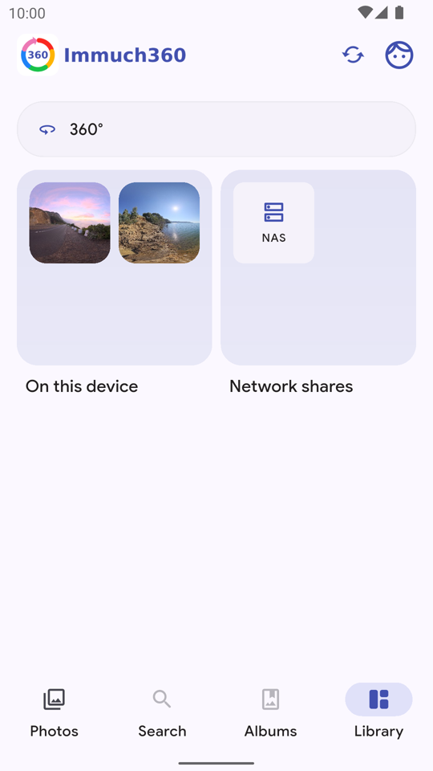
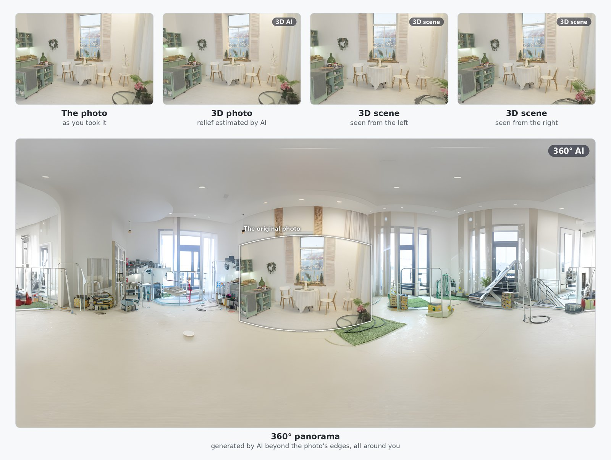

🌐 <b>Српски</b> · Други језици (88)
<a href="../README.md">English</a> · <a href="README.af.md">Afrikaans</a> · <a href="README.ar.md">العربية</a> · <a href="README.az.md">Azərbaycanca</a> · <a href="README.be.md">Беларуская</a> · <a href="README.bg.md">Български</a> · <a href="README.bi.md">Bislama</a> · <a href="README.bn.md">বাংলা</a> · <a href="README.br.md">Brezhoneg</a> · <a href="README.bs.md">Bosanski</a> · <a href="README.ca.md">Català</a> · <a href="README.cs.md">Čeština</a> · <a href="README.cv.md">Чӑвашла</a> · <a href="README.da.md">Dansk</a> · <a href="README.de.md">Deutsch</a> · <a href="README.de_CH.md">Deutsch (Schweiz)</a> · <a href="README.el.md">Ελληνικά</a> · <a href="README.en_GB.md">English (UK)</a> · <a href="README.eo.md">Esperanto</a> · <a href="README.es.md">Español</a> · <a href="README.et.md">Eesti</a> · <a href="README.eu.md">Euskara</a> · <a href="README.fa.md">فارسی</a> · <a href="README.fi.md">Suomi</a> · <a href="README.fil.md">Filipino</a> · <a href="README.fr.md">Français</a> · <a href="README.ga.md">Gaeilge</a> · <a href="README.gl.md">Galego</a> · <a href="README.gsw.md">Alemannisch</a> · <a href="README.gu.md">ગુજરાતી</a> · <a href="README.he.md">עברית</a> · <a href="README.hi.md">हिन्दी</a> · <a href="README.hr.md">Hrvatski</a> · <a href="README.hu.md">Magyar</a> · <a href="README.hy.md">Հայերեն</a> · <a href="README.id.md">Bahasa Indonesia</a> · <a href="README.is.md">Íslenska</a> · <a href="README.it.md">Italiano</a> · <a href="README.ja.md">日本語</a> · <a href="README.ka.md">ქართული</a> · <a href="README.kab.md">Taqbaylit</a> · <a href="README.kk.md">Қазақша</a> · <a href="README.km.md">ខ្មែរ</a> · <a href="README.kmr.md">Kurmancî</a> · <a href="README.kn.md">ಕನ್ನಡ</a> · <a href="README.ko.md">한국어</a> · <a href="README.kxm.md">ภาษาเขมรถิ่นไทย</a> · <a href="README.lb.md">Lëtzebuergesch</a> · <a href="README.lmo.md">Lombard</a> · <a href="README.lt.md">Lietuvių</a> · <a href="README.lv.md">Latviešu</a> · <a href="README.mfa.md">Bahasa Melayu Kelantan</a> · <a href="README.mi.md">Te reo Māori</a> · <a href="README.mk.md">Македонски</a> · <a href="README.ml.md">മലയാളം</a> · <a href="README.mn.md">Монгол</a> · <a href="README.mr.md">मराठी</a> · <a href="README.ms.md">Bahasa Melayu</a> · <a href="README.nb_NO.md">Norsk bokmål</a> · <a href="README.ne.md">नेपाली</a> · <a href="README.nl.md">Nederlands</a> · <a href="README.nn.md">Norsk nynorsk</a> · <a href="README.pa.md">ਪੰਜਾਬੀ</a> · <a href="README.pl.md">Polski</a> · <a href="README.pt.md">Português</a> · <a href="README.pt_BR.md">Português (Brasil)</a> · <a href="README.ro.md">Română</a> · <a href="README.ru.md">Русский</a> · <a href="README.si.md">සිංහල</a> · <a href="README.sk.md">Slovenčina</a> · <a href="README.sl.md">Slovenščina</a> · <a href="README.sq.md">Shqip</a> · <a href="README.sr_Latn.md">Srpski</a> · <a href="README.sv.md">Svenska</a> · <a href="README.sw.md">Kiswahili</a> · <a href="README.swg.md">Schwäbisch</a> · <a href="README.ta.md">தமிழ்</a> · <a href="README.te.md">తెలుగు</a> · <a href="README.th.md">ไทย</a> · <a href="README.tl.md">Tagalog</a> · <a href="README.tr.md">Türkçe</a> · <a href="README.uk.md">Українська</a> · <a href="README.ur.md">اردو</a> · <a href="README.uz.md">Oʻzbekcha</a> · <a href="README.vi.md">Tiếng Việt</a> · <a href="README.yue_Hant.md">粵語</a> · <a href="README.zh_Hans.md">简体中文</a> · <a href="README.zh_Hant.md">繁體中文</a>

  

# Immuch360

**Ваши медији. Сваки екран. Свака перспектива.**

🌐 <a href="https://immuch360.com/sr-cyrl/"><b>immuch360.com</b></a>

Равне, 360° и 3D фотографије и видео записи са вашег уређаја, вашег NAS-а, вашег Immich сервера, ваших камера и вашег дрона. Налог није потребан. Immuch360 је бесплатна апликација отвореног кода која чита ваше фотографије и видео записе тамо где се налазе и пушта сваки у прегледачу који му одговара: равно, као лопту у којој гледате около, у 3D-у, или свуда око вас у наочарима. Ради на телефонима, таблетима, телевизорима, Meta Quest наочарима и рачунарима. Њен веб-сајт, [immuch360.com](https://immuch360.com/sr-cyrl/), показује шта ради на сваком екрану, на 89 језика.

**Ново у build-овима 33 до 50.** [Филмови се настављају тамо где сте стали](#pick-up-a-film-where-you-stopped). Почињу раније, а са спорог сервера [настављају да се пуштају уместо да стану](#when-a-video-waits-or-will-not-play). Временска линија се [удаљава до месеци и година](#find-a-month-or-a-year-in-a-long-timeline) на телефонима и рачунарима. На Android телефону или у Meta Quest, [„Прегледај фасциклу“](#browse-a-folder-of-your-phone-or-headset) отвара фасциклу уређаја као дељени ресурс, а TIFF фотографије се приказују. Android TV [претражује по датуму даљинским](#on-android-tv-and-google-tv), Meta Quest 3 или 3S [отвара Гаусове сплатове](#explore-gaussian-splats-in-a-meta-quest-3-or-3s) (експериментално), које окрећете десном палицом, укључујући и SPZ верзију 4, а рачунар [прави 3D верзије фотографија са вашег NAS-а](#turn-one-photo-into-3d-a-scene-a-panorama). На лаптопу са Windows-ом и два графичка чипа апликација [сада ради на брзом](#when-a-video-waits-or-will-not-play), па се 8K филмови пуштају глатко. Гаусови сплатови се сада [отварају на рачунарима и на Android телефонима и таблетима](#explore-gaussian-splats-on-your-phone-tablet-or-computer), Windows рачунар [прави сплат сцене од ваших фотографија или видеа](#make-a-splat-scene-from-your-photos-or-a-video-ai) помоћу AI, ваш Immich сервер [их чува унутар фотографија](#keep-a-splat-scene-on-your-immich-server) које се отварају са ваше временске линије, а рачунари [пуштају AV2 видео записе](#play-av2-videos-on-your-computer), све експериментално. Од build-а 42, изворни видео записи камера Insta360, GoPro MAX и DJI Osmo 360, из ваше Immich библиотеке, дељеног ресурса или фасцикле, [пуштају се стабилизовани жироскопом камере](#stabilise-your-360-videos-with-the-cameras-gyroscope-experimental) на Android телефонима, таблетима и телевизорима, креатор сплат сцена desktop build-а 22 [нуди квалитет Детаљно](#make-a-splat-scene-from-your-photos-or-a-video-ai) за сцене које гледате изблиза, а 360° панорама [почиње са 3.5 GiB слободне меморије на графичкој картици](#turn-one-photo-into-3d-a-scene-a-panorama), све експериментално. Апликација за iPhone и iPad је [на App Store-у](https://apps.apple.com/us/app/immuch360-360-3d-player/id6817655965), верзија 3.4.3. Од build-а 43 обавештење о ажурирању апликације отвара Google Play или App Store на телефонима и таблетима; њен веб-сајт, [immuch360.com](https://immuch360.com/sr-cyrl/), отворен је 7. новембра. Од build-а 44 и desktop build-а 24, Meta Quest 3 или 3S [приказује сплатове до 300,000 гаусијана](#explore-gaussian-splats-in-a-meta-quest-3-or-3s) (експериментално), рачунари [бирају више фотографија и видео записа тастерима Ctrl и Shift](#use-your-computer-as-the-media-player), телевизор чији декодер одбије видео [сам пушта другу датотеку са сервера](#when-a-video-waits-or-will-not-play), панораме раде на изабраној графичкој картици лаптопа који их има две (експериментално), а обавештење о ажурирању на Quest-у и рачунарима отвара њихову страницу у продавници или страницу за преузимање, уз много исправки. Од build-а 45 и desktop build-а 25, верзија 3.4.0 на свим платформама, апликација прати Immich 3.4.0 апликацију са 11 каснијих исправки Immich-а, приказује [JPEG XL фотографије Immich 3.4 сервера](#keep-your-immich-library-with-more), отвара [ваше Plex филмове по годинама](#watch-your-plex-films) са страницом за сваки филм, њиховим преузимањем на уређај и пуштањем на телевизору са телефона (експериментално), може да затражи оцену у build-овима из продавница, и на рачунарима узима своје видео компоненте из [њихових сопствених отворених репозиторијума](#licences-and-credits). Од build-а 46 и desktop build-а 26, верзија 3.4.1, изворни видео записи 360° камера [пуштају се стабилизовани](#stabilise-your-360-videos-with-the-cameras-gyroscope-experimental) и на iPhone-у и iPad-у, у Meta Quest-у и на Windows-у, Meta Quest [помоћу libmpv пушта Plex филмове које његов сопствени плејер не може да декодира](#watch-your-plex-films), телефон [шаље такав филм на Chromecast или Google TV](#watch-your-plex-films), а AI рељеф 3D фотографије [добија јачину коју изаберете](#turn-one-photo-into-3d-a-scene-a-panorama), све експериментално; нови сервер може да се дода и пријавом преко вашег Plex налога, а апликација [чува своја подешавања у датотеци](#keep-your-settings-in-a-file). Од build-а 47 и desktop build-а 27, верзија 3.4.2, Plex филм [пушта звучни запис који уређај декодира](#watch-your-plex-films) и каже који, отвара верзију која одговара екрану и, на спорој вези, нуди лакшу, Windows и macOS пуштају његов Dolby TrueHD звук, Android [приказује његово преузимање у нотификацији](#watch-your-plex-films), а Android TV такође преузима филмове, и [Tapo камере на батерију приказују слику уживо](#watch-your-home-cameras-on-the-big-screen) (експериментално); враћање датотеке подешавања са њеним налозима сада вас пријављује на ваш Immich сервер. Од build-а 48 и desktop build-а 28, верзија 3.4.3, Windows рачунар [пушта ваше видео записе у PC VR наочарима](#watch-your-videos-in-a-pc-vr-headset-from-windows-experimental) преко SteamVR-а, Meta Horizon Link-а или другог OpenXR окружења (експериментално, пројекат још није испробао у наочарима), [камере других марки приказују слику уживо](#cameras-of-other-brands-over-onvif-or-rtsp), пронађене преко ONVIF-а или додате преко своје RTSP везе (проверено са симулираном камером, ниједна права камера друге марке још није испробана), изворни видео записи [DJI Osmo 360 II и GoPro MAX 2 пуштају се стабилизовани](#open-the-raw-files-of-360-cameras) (експериментално), Plex филмови [више не стижу преспоро на телефоне](#when-a-video-waits-or-will-not-play), LG и Samsung телевизори [окрећу видео који лежи на боку](#on-a-samsung-tv-tizen) једним дугметом (још није испробано на LG телевизору; Samsung телевизор из issue 17 одбио је окретање), а „Server update is available“ се више не појављује за ажуриран сервер. Од build-а 49 и desktop build-а 29, верзија 3.4.4, апликација [сама чита ваше Jellyfin и Emby сервере](#watch-your-jellyfin-and-emby-libraries) (експериментално, још није испробано на уређају), које проналази на вашој мрежи и на које се пријављује преко Quick Connect-а на телевизору или у наочарима, а њихови оригинални фајлови се пуштају тако да 360° видео остаје 360°; на великом екрану Meta Quest-а фотографије [задржавају величину и место које сте подесили док их прелиставате, и пуштају се као слајдови](#browse-your-photos-on-the-big-screen-of-the-quest) (пројекат још није испробао у наочарима); 360° видео плејер телефона и таблета [добија контроле 360° фотографија](#360-videos-on-your-phone-with-the-controls-of-360-photos), дугме жироскопа, скупљање прстију за зум и превлачење право горе или доле (испробао корисник на Samsung Galaxy S25 Ultra, још не на iPhone-у); рачунар [од ваших 2D видео записа прави 3D видео записе](#turn-your-2d-videos-into-3d-on-your-computer-experimental) помоћу AI (експериментално, још није испробано на 3D екрану или у наочарима); а Samsung телевизори [предају видео који треба окренути Samsung-овом сопственом плејеру](#on-a-samsung-tv-tizen), који телевизор из issue 17 пушта, али одбија да окрене. Од build-а 50 и desktop build-а 30, верзија 3.4.5, док се видео пушта у 2D прозору Meta Quest-а, прозор [се поново исцртава брзином екрана](#step-inside-your-photos-and-videos-with-a-meta-quest) уместо око 10 пута у секунди као у build-овима 48 и 49 (измерено на Meta Quest 3), Android TV [зумира фотографију даљинским](#on-android-tv-and-google-tv) и помера је стрелицама (ново, још није испробано на телевизору), а три исправке долазе из Android TV fork-а корисника mlc70: брзо превлачење више не приказује детаље фотографије остављене иза, анимирана фотографија ослобађа своју меморију, а филтер Локација нуди градове нове земље.

  Незванична верзија (fork) Immich мобилне апликације. Није повезана са Immich-ом нити FUTO-ом. Име се чита као "I am much 360".

<b>Садржај</b>

- [За кога је](#who-it-is-for)
- [Који екрани](#which-screens), [шта раде заједно](#use-cases) и [шта ради сваки екран](#what-each-screen-does)
- [Шта можете да радите](#what-you-can-do)
- [Набавите је за свој уређај](#get-it-on-your-device)
- [Како да](#how-to)
  - [Гледајте своје фотографије и видео записе, са сервером или без њега](#watch-your-photos-and-videos-with-or-without-a-server)
  - [Истражите панораме, 360°, VR180 и 3D](#explore-panoramas-360-vr180-and-3d): [360° видео записи на телефонима](#360-videos-on-your-phone-with-the-controls-of-360-photos)
  - [Претворите једну фотографију у 3D, сцену, панораму](#turn-one-photo-into-3d-a-scene-a-panorama)
  - [Претворите своје 2D видео записе у 3D на рачунару (експериментално)](#turn-your-2d-videos-into-3d-on-your-computer-experimental)
  - [Гледајте на телевизору са даљинским](#watch-on-the-tv-with-the-remote): [Android TV и Google TV](#on-android-tv-and-google-tv), [LG](#on-an-lg-tv-webos), [Samsung](#on-a-samsung-tv-tizen)
  - [Пријавите телевизор, наочаре или рачунар телефоном](#sign-in-a-tv-a-headset-or-a-computer-with-your-phone)
  - [Уђите у своје фотографије и видео записе са Meta Quest-ом](#step-inside-your-photos-and-videos-with-a-meta-quest): [велики екран](#browse-your-photos-on-the-big-screen-of-the-quest), [режим киоска](#kiosk-mode-for-an-exhibition-or-a-shop)
  - [Истражите Гаусове сплатове у Meta Quest 3 или 3S](#explore-gaussian-splats-in-a-meta-quest-3-or-3s)
  - [Истражите Гаусове сплатове на свом телефону, таблету или рачунару](#explore-gaussian-splats-on-your-phone-tablet-or-computer)
  - [Направите сплат сцену од ваших фотографија или видеа (AI)](#make-a-splat-scene-from-your-photos-or-a-video-ai)
  - [Чувајте сплат сцену на свом Immich серверу](#keep-a-splat-scene-on-your-immich-server)
  - [Пуштајте фајлове са NAS-а, рачунара, медијског сервера или Plex-а](#play-the-files-of-a-nas-a-computer-a-media-server-or-plex): [ваши филмови по годинама](#watch-your-plex-films), [Jellyfin и Emby](#watch-your-jellyfin-and-emby-libraries)
  - [Прегледајте фасциклу телефона или наочара](#browse-a-folder-of-your-phone-or-headset)
  - [Наставите филм тамо где сте стали](#pick-up-a-film-where-you-stopped)
  - [Када видео чека или неће да се пусти](#when-a-video-waits-or-will-not-play)
  - [Задржите своју Immich библиотеку, уз више](#keep-your-immich-library-with-more)
  - [Пронађите месец или годину на дугој временској линији](#find-a-month-or-a-year-in-a-long-timeline)
  - [Гледајте кућне камере на великом екрану](#watch-your-home-cameras-on-the-big-screen): [друге марке](#cameras-of-other-brands-over-onvif-or-rtsp)
  - [Ваш DJI дрон (експериментално)](#your-dji-drone-experimental): [видео уживо](#see-what-your-drone-sees-on-your-phone), [у Quest-у или на Android TV-у](#watch-it-in-a-meta-quest-or-on-an-android-tv), [увоз](#bring-a-drones-or-a-camera-cards-photos-and-videos-to-immich)
  - [Отворите изворне фајлове 360° камера](#open-the-raw-files-of-360-cameras)
  - [Стабилизујте своје 360° видео записе жироскопом камере (експериментално)](#stabilise-your-360-videos-with-the-cameras-gyroscope-experimental)
  - [Окрените фотографију једним тастером](#turn-a-photo-with-one-key)
  - [Користите рачунар као медијски плејер](#use-your-computer-as-the-media-player)
  - [Гледајте своје видео записе у PC VR наочарима, са Windows-а (експериментално)](#watch-your-videos-in-a-pc-vr-headset-from-windows-experimental)
  - [Пуштајте AV2 видео записе на свом рачунару](#play-av2-videos-on-your-computer)
  - [Чувајте своја подешавања у датотеци](#keep-your-settings-in-a-file)
- [У поређењу са Immich-ом](#compared-with-immich)
- [Приватност](#privacy)
- [Лиценце и заслуге](#licences-and-credits)
- [План развоја](#roadmap)
- [Документација](#documentation)

## За кога је

- **Снимате у 360° или 3D** и желите да гледате около у својим снимцима, а не да их видите равне, удвостручене или развучене, и да окрећете своје 360° видео записе на телефону као што окрећете његове фотографије: [360°, VR180 и 3D](#explore-panoramas-360-vr180-and-3d), [360° видео записи на телефонима](#360-videos-on-your-phone-with-the-controls-of-360-photos).
- **Снимате 360° камером у руци, на бициклу или на кациги** и желите да се изворни видео записи ваше Insta360, GoPro MAX или MAX 2, DJI Osmo 360 или Osmo 360 II камере, сачувани у Immich-у, на дељеном ресурсу или у фасцикли, пуштају водоравно и мирно на вашем телефону, телевизору, Meta Quest-у или Windows рачунару (експериментално): [стабилизовани жироскопом камере](#stabilise-your-360-videos-with-the-cameras-gyroscope-experimental).
- **Ваше фотографије и филмови су на NAS-у, рачунару, Plex-у или Immich-у** и желите их на телевизору без копирања ичега: [на телевизору](#watch-on-the-tv-with-the-remote), [NAS, дељени ресурси и Plex](#play-the-files-of-a-nas-a-computer-a-media-server-or-plex).
- **Ваши филмови су на Plex серверу** и желите да изаберете један по години, видите шта је пре него што почне, понесете га на пут, покренете га на телевизору или Chromecast-у са телефона, и пустите чак и филмове које ваш Android телефон, телевизор или Meta Quest не може да декодира (експериментално): [ваши филмови, по годинама](#watch-your-plex-films).
- **Своје филмове чувате на Jellyfin или Emby серверу** и желите их у свом Meta Quest-у, на телевизору или телефону, са 360° и 3D какви јесу, и са вашим местом сачуваним на серверу (експериментално, још није испробано на уређају): [Jellyfin и Emby](#watch-your-jellyfin-and-emby-libraries).
- **Имате Meta Quest** и желите да уђете у своје фотографије и видео записе: [у наочарима](#step-inside-your-photos-and-videos-with-a-meta-quest), и да прелиставате своје фотографије на великом екрану у величини и на месту које сте подесили, и као слајдове (пројекат још није испробао у наочарима): [велики екран](#browse-your-photos-on-the-big-screen-of-the-quest).
- **Имате PC VR наочари на Windows рачунару** и желите у њима своје 360° видео записе око себе и филмове на великом екрану (експериментално, пројекат још није испробао у наочарима): [у PC VR наочарима](#watch-your-videos-in-a-pc-vr-headset-from-windows-experimental).
- **Ваше фотографије су равне** и желите их у 3D, као сцену у коју се нагнете у наочарима, или унутар 360° панораме, без 3D камере: [претворите једну фотографију у 3D, сцену, панораму](#turn-one-photo-into-3d-a-scene-a-panorama), ново, прави је AI на вашем сопственом рачунару.
- **Ваши видео записи су равни**, укључујући клипове са телефона, и желите их у 3D за наочаре или 3D екран, направљене на вашем сопственом рачунару (експериментално, још није испробано на 3D екрану или у наочарима): [2D видео записи у 3D](#turn-your-2d-videos-into-3d-on-your-computer-experimental).
- **Користите Immich** и желите његову апликацију, плус имерзивне прегледаче и велике екране које пријављујете са телефона: [ваша Immich библиотека](#keep-your-immich-library-with-more), [у поређењу са Immich-ом](#compared-with-immich).
- **Чувате дом Tapo камерама**, и онима на батерију (експериментално), или камерама других марки преко ONVIF-а или RTSP-а, и желите их поред својих фотографија, и на телевизору (проверено наспрам симулиране камере): [кућне камере](#watch-your-home-cameras-on-the-big-screen).
- **Летите DJI дроном** и желите његову слику уживо на телефону без DJI Fly-а, и у Meta Quest-у или на Android TV-у за људе који су са вама (експериментално): [ваш дрон](#see-what-your-drone-sees-on-your-phone).
- **Снимате места и предмете у 3D, као Гаусове сплатове,** или бисте желели да их правите од сопствених фотографија, и желите да кроз њих ходате на свом телефону, рачунару или у наочарима (експериментално): [на телефону, таблету или рачунару](#explore-gaussian-splats-on-your-phone-tablet-or-computer), [направљене од ваших фотографија](#make-a-splat-scene-from-your-photos-or-a-video-ai), [сачуване у Immich-у](#keep-a-splat-scene-on-your-immich-server).
- **Имате AV2 видео записе**, формат који долази после AV1, и желите да их гледате на свом рачунару (експериментално): [AV2 на вашем рачунару](#play-av2-videos-on-your-computer).
- **Код куће имате неколико екрана** и желите да раде заједно: [шта ваши екрани раде заједно](#use-cases).

Не постоји Immuch360 налог који треба направити, и ништа не стиже до нас: апликација разговара само са вашим уређајима и са серверима које изаберете, од build-а 45 са Wikipedia-ом за страницу филма (експериментално), од build-а 46 са plex.tv када се преко њега пријавите, и преузима AI компоненту или AV2 декодер само када то затражите.

## Који екрани

| Платформа | Где да је набавите | Статус у новембру 2026. |
|---|---|---|
|  **Android** телефони и таблети | [Google Play](https://play.google.com/store/apps/details?id=com.aprogsys.immuch360) · [APK](https://github.com/freeKC/Immuch360/releases) | на Google Play-у (build 47 објављен 16. новембра; build 48 на Google-овој провери од 16. новембра; следи build 50), build 50 на GitHub-у, где се [изворни 360° видео записи пуштају стабилизовани](#stabilise-your-360-videos-with-the-cameras-gyroscope-experimental) (експериментално), [филмови настављају тамо где сте стали](#pick-up-a-film-where-you-stopped), [„Прегледај фасциклу“](#browse-a-folder-of-your-phone-or-headset) отвара фасциклу телефона, а [Гаусови сплатови се отварају](#explore-gaussian-splats-on-your-phone-tablet-or-computer), са дељеног ресурса или [са ваше Immich временске линије](#keep-a-splat-scene-on-your-immich-server) (експериментално), [подешавања се чувају у датотеци](#keep-your-settings-in-a-file), [преузимање филма се приказује у нотификацији](#watch-your-plex-films), од build-а 48 [камере других марки уживо](#cameras-of-other-brands-over-onvif-or-rtsp) (проверено са симулираном камером) и, од build-а 49, [Jellyfin и Emby сервери](#watch-your-jellyfin-and-emby-libraries) (експериментално, још није испробано на уређају) и [контроле 360° фотографија у 360° видео плејеру](#360-videos-on-your-phone-with-the-controls-of-360-photos) (испробао корисник на Samsung Galaxy S25 Ultra) |
|  **iPhone и iPad** | [App Store](https://apps.apple.com/us/app/immuch360-360-3d-player/id6817655965) | верзија 3.4.4 на App Store-у од 20. новембра, са [месецима и годинама на временској линији](#find-a-month-or-a-year-in-a-long-timeline), [филмовима који се настављају тамо где сте стали](#pick-up-a-film-where-you-stopped), [пријавом телевизора, наочара или рачунара](#sign-in-a-tv-a-headset-or-a-computer-with-your-phone) са телефона, сплат сценама сачуваним у Immich-у, приказаним као њихова фотографија, исправкама Immich-а 3.4.0 и његовим JPEG XL фотографијама, [стабилизованим изворним 360° видео записима](#stabilise-your-360-videos-with-the-cameras-gyroscope-experimental) (експериментално), [подешавањима сачуваним у датотеци](#keep-your-settings-in-a-file), [приказом уживо Tapo камера на батерију](#watch-your-home-cameras-on-the-big-screen) (експериментално) и [приказом уживо камера других марки](#cameras-of-other-brands-over-onvif-or-rtsp) (проверено са симулираном камером), а од верзије 3.4.4 са [Jellyfin и Emby серверима](#watch-your-jellyfin-and-emby-libraries) (експериментално, још није испробано на уређају) и [контролама 360° фотографија у 360° видео плејеру](#360-videos-on-your-phone-with-the-controls-of-360-photos) (још није испробано на iPhone-у); верзија 3.4.5, iPhone и iPad верзија build-а 50, следи; или [направите је сами](../docs/immuch360/build.md) |
|  **Android TV и Google TV** | [Google Play](https://play.google.com/store/apps/details?id=com.aprogsys.immuch360) · [APK](#android-tv-and-google-tv) | на Google Play-у, који нуди апликацију на Android TV и Google TV уређајима, и build 50 на GitHub-у: [стабилизовани изворни 360° видео записи](#stabilise-your-360-videos-with-the-cameras-gyroscope-experimental) (експериментално), [претрага по датуму даљинским](#on-android-tv-and-google-tv), [пријава телефоном](#sign-in-a-tv-a-headset-or-a-computer-with-your-phone) скенирањем QR кода, временска трака, звук и титлови за даљински у видео плејеру, и [видео дрона уживо](#watch-it-in-a-meta-quest-or-on-an-android-tv) који преноси телефон (експериментално), [филмови преузети на телевизор](#watch-your-plex-films) и, од build-а 49, [Jellyfin и Emby сервери](#watch-your-jellyfin-and-emby-libraries) са пријавом преко Quick Connect-а (експериментално, још није испробано на уређају) и, од build-а 50, [фотографије зумиране даљинским](#on-android-tv-and-google-tv) (ново, још није испробано на телевизору) |
| **LG телевизори** са webOS 5.0 и новијим | [.ipk, верзија 1.0.5](https://github.com/freeKC/Immuch360/releases/tag/webos-v1.0.5) · LG Content Store (на провери) | верзија 1.0.0, послата у LG Content Store 24. октобра, на LG-јевим тестовима од 26. октобра; верзија 1.0.1, на GitHub-у од 27. октобра, зумира фотографију стрелицама и каже када се фотографија још учитава, а верзија 1.0.2, на GitHub-у са build-ом 46, на јапанском пише „пријава“ као ログイン, верзија 1.0.3, са build-ом 47, каже када фасцикла DLNA сервера садржи ТВ канале уживо, које још не може да пусти, верзија 1.0.4, са build-ом 48, [окреће видео који лежи на боку](#on-an-lg-tv-webos) једним дугметом (још није испробано на LG телевизору), а верзија 1.0.5, са build-ом 49, међу DLNA серверима наводи Jellyfin са његовим DLNA додатком; док LG не објави апликацију, инсталира се у режиму [Developer Mode](#lg-tvs-webos). Верзија 1.0.0 је радила на webOS 25 телевизорима у LG-јевом Cloud Test Lab-у |
| **Samsung телевизори** са Tizen 5.5 и новијим | [.wgt тест build](https://github.com/freeKC/Immuch360/releases/tag/tizen-v0.3.6) | тест build 0.3.6 исте ТВ апликације, који потписујете сопственим Samsung сертификатом и инсталирате у режиму [Developer mode](#samsung-tvs-tizen); 0.1.0 је радио на Samsung телевизору једног тестера, 0.2.0 садржи исправке из те пробе, 0.3.0 додаје зумирање фотографија и ознаку Учитавање из LG верзије 1.0.1, а 0.3.1 јапански текст из LG верзије 1.0.2, 0.3.2 исправно пушта видео снимљен усправно на телефону ([issue 17](https://github.com/freeKC/Immuch360/issues/17)), 0.3.3 и 0.3.4 [га окрећу на телевизору који га пријављује усправно](#on-a-samsung-tv-tizen) и додају дугме које га окреће ручно, а 0.3.5 и 0.3.6 такав видео предају Samsung-овом сопственом плејеру; на телевизору аутора извештаја, 0.3.4 и 0.3.5 оставили су слику на боку, јер је телевизор одбио окретање, а излаз је ту видео који ваш Immich сервер транскодира, сачуван усправно; није у Samsung-овој продавници |
|  **Meta Quest** 2, Pro, 3 и 3S | [Horizon Store](https://www.meta.com/experiences/immuch360/1384208401440714/) · [APK](#meta-quest) | на Horizon Store-у (build 47 објављен 19. новембра; build 48 враћен са Meta-ине провере 20. новембра, јер је његов 2D прозор исцртавао мање од 60 слика у секунди док се видео пуштао; следи build 50, чији се прозор поново исцртава брзином екрана), build 50 на GitHub-у, са [режимом киоска](#kiosk-mode-for-an-exhibition-or-a-shop), [стабилизованим изворним 360° видео записима](#stabilise-your-360-videos-with-the-cameras-gyroscope-experimental) у имерзивном приказу, [филмовима које не може да декодира, пуштеним помоћу libmpv](#watch-your-plex-films) и, на Quest 3 и 3S, [Гаусовим сплатовима](#explore-gaussian-splats-in-a-meta-quest-3-or-3s) и [AI рељефом](#turn-one-photo-into-3d-a-scene-a-panorama) равне фотографије, све експериментално, а од build-а 49 [фотографије које се прелиставају на великом екрану](#browse-your-photos-on-the-big-screen-of-the-quest) у величини коју сте подесили, и као слајдови (пројекат још није испробао у наочарима), и [Jellyfin и Emby сервери](#watch-your-jellyfin-and-emby-libraries) са пријавом преко Quick Connect-а (експериментално, још није испробано на уређају) |
|  **Windows** | [Инсталатер или ZIP](https://github.com/freeKC/Immuch360/releases/tag/desktop-v3.4.5-30) | desktop build 30, потписана пробна верзија: фотографије, равни и 360° видео записи, дељени ресурси, Plex, камере (проверено са симулираном камером), пријава телефоном, окретање фотографија једним тастером, интерфејс на 89 језика, и [3D фотографије, 3D сцене и 360° панораме направљене од ваших фотографија](#turn-one-photo-into-3d-a-scene-a-panorama) помоћу AI (експериментално), и од фотографија са вашег NAS-а; [Гаусови сплатови](#explore-gaussian-splats-on-your-phone-tablet-or-computer) који се отварају, [праве од ваших фотографија или видеа](#make-a-splat-scene-from-your-photos-or-a-video-ai) и [чувају у Immich-у](#keep-a-splat-scene-on-your-immich-server), [AV2 видео записи](#play-av2-videos-on-your-computer), од desktop build-а 22 [избор квалитета за сплат сцене](#make-a-splat-scene-from-your-photos-or-a-video-ai) и [360° панораме од 3.5 GiB слободне графичке меморије](#turn-one-photo-into-3d-a-scene-a-panorama), и од desktop build-а 26 [стабилизовани изворни 360° видео записи](#stabilise-your-360-videos-with-the-cameras-gyroscope-experimental) и [3D фотографије са јачином рељефа и оштријим ивицама](#turn-one-photo-into-3d-a-scene-a-panorama), све експериментално, од desktop build-а 27 [Dolby TrueHD звук и Blu-ray титлови филмова](#watch-your-plex-films), од desktop build-а 28 [ваши видео записи у PC VR наочарима](#watch-your-videos-in-a-pc-vr-headset-from-windows-experimental) (експериментално, пројекат још није испробао у наочарима) и, од desktop build-а 29, [3D видео записи направљени од ваших 2D видео записа](#turn-your-2d-videos-into-3d-on-your-computer-experimental) помоћу AI (експериментално, још није испробано на 3D екрану или у наочарима) |
|   **macOS и Linux** | [.deb, .rpm, DMG](https://github.com/freeKC/Immuch360/releases/tag/desktop-v3.4.5-30) | desktop build 30, пробне верзије: фотографије, 360° фотографије и равни видео записи (360° видео записи се пуштају равно), Immich сервер и мрежни дељени ресурси, и [3D фотографије и 3D сцене](#turn-one-photo-into-3d-a-scene-a-panorama) које AI прави од ваших фотографија, са 360° панорамама на Linux-у на графичкој картици од 8 GB, од 3.5 GiB слободне меморије на њој, и [Гаусови сплатови](#explore-gaussian-splats-on-your-phone-tablet-or-computer) и [AV2 видео записи](#play-av2-videos-on-your-computer) (експериментално, још није испробано на Mac-у); desktop build 11 испробан 26. октобра у Ubuntu 24.04 контејнеру и на Mac-у; од desktop build-а 27, Dolby TrueHD звук филмова на macOS-у; од desktop build-а 29, [3D видео записи направљени од ваших 2D видео записа](#turn-your-2d-videos-into-3d-on-your-computer-experimental) помоћу AI на Linux-у и на Mac-у са Apple чипом (експериментално, још није испробано на 3D екрану или у наочарима); непотписано на macOS-у |

*Статуси се ажурирају са сваким издањем; шта свака продавница има, шта је на њеној провери и сваки build налазе се у [Статусу издања](../docs/immuch360/release-status.md). Веб-сајт [immuch360.com](https://immuch360.com/sr-cyrl/) показује шта ради сваки екран, упутство за сваку функцију и линкове продавница, на 89 језика.*

  

### Шта ваши екрани раде заједно

Инсталирајте Immuch360 на сваки екран на којем гледате: сваки сам чита ваше изворе, а неки другом предају слику, фајл или пријаву. На свакој слици икона Immuch360 означава уређаје на којима ради апликација.

#### Ваш NAS на сваком екрану

  

**Потребно вам је:** NAS са SMB или WebDAV дељеном фасциклом и Immuch360 на сваком екрану на којем гледате.

Додајте дељену фасциклу на сваком екрану и сваки пушта фотографије и видео записе тамо где се налазе, без копирања: телефони, таблети, Android TV, Meta Quest, рачунари са Windows, Linux и macOS системом и LG телевизори пријављени на ваш Immich сервер (SMB од webOS 22). Фотографија од 360° окреће се као сфера на телефону и телевизору, а у наочарима вас окружује. Како да: [Пуштајте фајлове са NAS-а, рачунара, медијског сервера или Plex-а](#play-the-files-of-a-nas-a-computer-a-media-server-or-plex).

#### Ваш Immich сервер на сваком екрану, са пријавом са вашег телефона

  

**Потребно вам је:** Immich сервер, Immuch360 на вашем Android телефону и Immuch360 на екранима које пријављујете: Android TV, Meta Quest, рачунар са Windows, Linux или macOS системом.

На телефону Immuch360 задржава целу Immich мобилну апликацију, додаје своје прегледаче за 360°, VR180 и 3D и инсталира се поред званичне апликације. Пријављен на ваш сервер, он пријављује велике екране: скенира QR код телевизора или рачунара, или ви у њега укуцате код који приказују наочаре, а ваша лозинка остаје на телефону. Како да: [Пријавите телевизор, наочаре или рачунар телефоном](#sign-in-a-tv-a-headset-or-a-computer-with-your-phone).

#### Ваше равне фотографије у 3D-у, од рачунара до наочара (експериментално)

  

**Потребно вам је:** Immuch360 на рачунару са Windows, Linux или macOS системом и у Meta Quest-у, са вашим NAS-ом између њих или Immich сервером са укљученом опцијом „Прави резервну копију и AI верзија“.

Рачунар сам претвара ваше фотографије у 3D фотографије и 3D сцене, а са графичком картицом од 8 GB на Windows-у или Linux-у и у панораме од 360°, и чува их поред оригинала. Наочаре приказују 3D фотографију у правом 3D-у, постављају сцену у вашу собу и панораму свуда око вас; телефони и телевизори отварају панораме у свом прегледачу за 360°. Како да: [Претворите једну фотографију у 3D, сцену, панораму](#turn-one-photo-into-3d-a-scene-a-panorama).

#### Слика уживо са вашег дрона у наочарима или на телевизору (експериментално)

  

**Потребно вам је:** DJI дрон и његов даљински управљач DJI RC-N3, Immuch360 на Android телефону прикљученом на даљински управљач и Immuch360 у Meta Quest-у или на Android TV-у.

Телефон приказује видео уживо са дрона и прослеђује га преко вашег Wi-Fi-ја или сопствене приступне тачке, тако да људи који су са вама гледају лет у наочарима или на телевизору. Само пријем: даљинском управљачу ни дрону се никад не шаље никаква команда, а даљински управљач задржава потпуну контролу. Како да: [Гледајте га у Meta Quest-у или на Android TV-у](#watch-it-in-a-meta-quest-or-on-an-android-tv).

#### Изворни фајлови ваше 360° камере, спојени тамо где их гледате

  

**Потребно вам је:** камера Insta360, GoPro MAX или MAX 2, DJI Osmo 360 или Osmo 360 II, ваш NAS и Immuch360 на екранима: телефони, таблети, Android TV, Meta Quest, Windows.

Копирајте фајлове .insp, .insv, .360 или .osv са картице камере на SMB или WebDAV дељену фасциклу вашег NAS-а, такве какви јесу; Immich сервер прима и оне са Insta360. Сваки екран их спаја током пуштања, са калибрацијом записаном у сваком фајлу, и ништа се претходно не извози у апликацији камере. Како да: [Отворите изворне фајлове 360° камера](#open-the-raw-files-of-360-cameras).

#### Ваши Plex и DLNA сервери на телевизору и у наочарима

  

**Потребно вам је:** Plex Media Server, Jellyfin или Emby сервер, или DLNA сервер као што је minidlna и Immuch360 на сваком екрану: Android TV, Meta Quest, телефони, таблети, Windows.

Plex даје оригиналне фајлове ваших библиотека, па видео од 360° остаје 360°, свуда око вас у наочарима, код куће и, ван куће, преко вашег прослеђивања портова; DLNA сервери се проналазе на вашој кућној мрежи. LG телевизори пријављени на ваш Immich сервер их такође пуштају. Од build-а 45, телефони, таблети, Android TV, Quest и рачунари отварају Plex библиотеку филмова на свим филмовима по годинама, сваки филм са својом страницом, а филм изабран на телефону пушта се на Android TV-у, Quest-у или рачунару, док управљање преузима даљински (експериментално). Од build-а 46, Quest помоћу libmpv пушта филмове које његов сопствени плејер не може да декодира, ваш Plex сервер конвертује оне које ниједан плејер Android уређаја не декодира, а телефон шаље филм на Chromecast или Google TV (експериментално). Од build-а 47, филм пушта звучни запис који уређај декодира и каже који, отвара верзију која одговара екрану и пушта свој Dolby TrueHD звук на Windows-у и macOS-у (експериментално), а фасцикла ТВ канала уживо DLNA сервера каже да још не могу да се пусте. Од build-а 49, и Jellyfin или Emby сервер има сопствени тип, сам се проналази, пријављује се преко Quick Connect-а на телевизору или у наочарима, његови оригинални фајлови се пуштају тако да 360° остаје 360°, а ваше место се чува на серверу (експериментално, још није испробано на уређају). Како да: [Пуштајте фајлове са NAS-а, рачунара, медијског сервера или Plex-а](#play-the-files-of-a-nas-a-computer-a-media-server-or-plex), [Гледајте своје Plex филмове](#watch-your-plex-films) и [Гледајте своје Jellyfin и Emby библиотеке](#watch-your-jellyfin-and-emby-libraries).

#### Ваш телефон или ваш Windows рачунар, отворен у наочарима

  

**Потребно вам је:** Immuch360 на Android телефону, iPhone-у или Windows рачунару и у Meta Quest-у, на истом кућном Wi-Fi-ју.

Укључите „Дели овај телефон на мрежи“ на телефону или „Дели овај рачунар на мрежи“ на рачунару и наочаре пуштају његове фотографије и видео записе, оне од 360° свуда око вас: без сервера, без NAS-а, без отпремања. На iPhone-у дељење ради док је апликација на екрану. Како да: [Дели овај телефон на мрежи](../docs/immuch360/user-guide.md#share-this-phone-on-the-network).

#### Ваше Tapo камере на телевизору и у наочарима

  

**Потребно вам је:** Tapo камере на вашој кућној мрежи и Immuch360 на Android телефону, Android TV-у, Meta Quest-у или Windows рачунару.

Сваки екран приказује камеру уживо и пушта снимке са њене меморијске картице дан по дан, поред ваших фотографија, а телефон шаље исечак на ваш Immich сервер. Апликација разговара са камерама само на вашој мрежи, никад преко сервера компаније TP-Link. Од build-а 47, и камере на батерију приказују слику уживо, преко свог медијског порта, на телефонима, таблетима, Android TV-у и Quest-у (експериментално). Од build-а 48, поред њих и камере других марки приказују слику уживо, пронађене преко ONVIF-а или додате преко своје RTSP везе. Проверено наспрам симулиране камере. Како да: [Гледајте кућне камере на великом екрану](#watch-your-home-cameras-on-the-big-screen).

#### Гаусови сплатови у вашој соби, у Meta Quest 3 или 3S (експериментално)

  

**Потребно вам је:** сплат направљен помоћу Polycam, Scaniverse, Luma или другог алата, као .spz или бинарни .ply фајл на вашем NAS-у или у наочарима, и Immuch360 у Meta Quest 3 или 3S.

Наочаре постављају место или предмет у његовој величини, испред вас или свуда око вас: обиђите га, клизите кроз њега левом палицом, окрећите се десном. Гаусови сплатови користе експериментални API из Meta Spatial SDK, који Meta нити подржава нити гарантује: за сваки недостатак одговоран је само Immuch360. Како да: [Истражите Гаусове сплатове у Meta Quest 3 или 3S](#explore-gaussian-splats-in-a-meta-quest-3-or-3s).

#### Meta Quest за ваше посетиоце (експериментално)

  

**Потребно вам је:** Meta Quest са Immuch360 и фотографија или видео од 360° у наочарима, на вашем NAS-у или на вашем Immich серверу.

У режиму киоска наочаре саме отварају вашу фотографију или видео од 360°, од почетка, сваки пут када их посетилац стави, а филм се завршава картицом са вашим текстом. Посетиоци ништа не притискају; ви држите B или Y једну секунду да изађете. Како да: [Режим киоска, за изложбу или продавницу](#kiosk-mode-for-an-exhibition-or-a-shop).

### Шта ради сваки екран

Једна кодна база за телефоне, таблете, Android TV, Meta Quest и рачунаре, и засебна ТВ апликација за LG телевизоре, упакована и за Samsung телевизоре као тест build. Шта свако од њих има данас:

| Могућност | Android | iPhone, iPad | Android TV | LG webOS | Samsung Tizen | Quest |
|---|:---:|:---:|:---:|:---:|:---:|:---:|
| Галерија, албуми, претрага са Immich сервером | ✅ | ✅ | ✅ прегледач | ✅ прегледач | ✅ прегледач | ✅ |
| Временска линија по месецима и годинама | ✅ | ✅ | ❌ | ❌ | ❌ | ❌ |
| Пријава телефоном (QR код) | ✅ скенира код | ✅ скенира код | ✅ | ✅ у прегледачу телефона | ❌ куца се на телевизору | ✅ код укуцан на телефону |
| Без сервера: сопствени медији уређаја | ✅ | ✅ | само дељени ресурси | ❌ | ❌ | ✅ |
| Фасцикла уређаја, отворена као дељени ресурс | ✅ фасцикла коју изаберете | ❌ | ❌ | ❌ | ❌ | ✅ |
| Равне фотографије и видео записи | ✅ | ✅ | ✅ | ✅ | ✅ | ✅ |
| TIFF фотографије | ✅ | ✅ системски декодер | ✅ | ✅ са сервера | ✅ са сервера | ✅ и у имерзивном приказу |
| JPEG XL сличице и прегледи (Immich 3.4) | ✅ | ✅ од 3.4.0, Immich-ов декодер, још није испробано на iPhone-у | ✅ | ❌ „Преглед није доступан“ | ❌ „Преглед није доступан“ | ✅ и у имерзивном приказу |
| Окретање фотографије једним тастером | ✅ | ✅ | ✅ тастери у боји | ✅ тастери у боји | ✅ | ✅ прозор |
| 360° фотографије као лопта | ✅ | ✅ | ✅ | ✅ | ✅ | ✅ имерзивно |
| 360° видео записи | ✅ | ✅ без временске траке | ✅ порука ако се не може декодирати | само равно | само равно | ✅ имерзивно |
| 360° видео записи: дугме жироскопа, скупљање прстију, превлачење право горе и доле | ✅ од build-а 49, испробао корисник на Samsung Galaxy S25 Ultra | ✅ од верзије 3.4.4, још није испробано на iPhone-у | ❌ | ❌ | ❌ | ❌ |
| Филмови се настављају тамо где сте стали | ✅ | ✅ | ✅ | ❌ | ❌ | ✅ и у имерзивном приказу |
| Извор видеа: датотека коју овај уређај декодира | ✅ | ✅ | ✅ | ❌ | ❌ | ✅ |
| Спор сервер: колико видео чека, и зашто | ✅ | сопствено правило чекања | ✅ | ❌ | ❌ | ✅ |
| AV2 видео записи (експериментално) | ❌ | ❌ | ❌ | ❌ | ❌ | ❌ |
| 3D и VR180 | ✅ једно око | ✅ једно око | ✅ једно око | фотографије једно око, видео равно | фотографије једно око, видео равно | ✅ прави 3D |
| Равни 3D према имену датотеке, оштрији екрани које померате (експериментално) | ❌ | ❌ | ❌ | ❌ | ❌ | ✅ |
| Фотографије на великом екрану: прелиставање, слајдови, задржане величина и место | ❌ | ❌ | ❌ | ❌ | ❌ | ✅ од build-а 49, још није испробано у наочарима |
| Режим киоска за посетиоце (експериментално) | ❌ | ❌ | ❌ | ❌ | ❌ | ✅ |
| Spatial 2.5D (праћење главе) | ✅ експериментално | ✅ експериментално | ❌ | ❌ | ❌ | ❌ |
| Apple просторне фотографије | ✅ једно око | ✅ једно око | ✅ једно око | ❌ | ❌ | ✅ 3D |
| Гаусови сплатови, .spz и .ply (експериментално) | ✅ | ❌ | ❌ | ❌ | ❌ | ✅ Quest 3 и 3S |
| Сплат сцене сачуване као фотографије у Immich-у (експериментално) | ✅ | фотографија | фотографија | фотографија | фотографија | ✅ Quest 3 и 3S, још није испробано у наочарима |
| 3D фотографија од 2D фотографије (AI) | ✅ чита је, једно поред другог | ✅ чита је, једно поред другог | ✅ чита је, једно поред другог | ✅ чита је, једно поред другог | ✅ чита је, једно поред другог | ✅ AI рељеф у наочарима (Quest 3 и 3S), приказан у 3D, Благ, Нормалан или Јак |
| 3D сцена од 2D фотографије (AI) | ✅ чита је, као њену фотографију | ✅ чита је, као њену фотографију | ✅ чита је, као њену фотографију | ✅ чита је, као њену фотографију | ✅ чита је, као њену фотографију | ✅ истражује се у 3D |
| 360° панорама од 2D фотографије (AI) | ✅ чита је, са њеном AI ознаком | ✅ чита је као 360° фотографију, ознака 🔜 | ✅ чита је, са њеном AI ознаком | ✅ чита је као 360° фотографију, ознака 🔜 | ✅ чита је као 360° фотографију, ознака 🔜 | ✅ чита је свуда око вас, са њеном AI ознаком |
| 3D верзије поред фотографија дељеног ресурса (AI) | ✅ читају се | ✅ читају се | ✅ читају се | ✅ читају се | ❌ | ✅ читају се |
| Сплат сцена од фотографија или видеа (AI) | ✅ чита је | ❌ | ❌ | ❌ | ❌ | ✅ чита је, Quest 3 и 3S, још није испробано у наочарима |
| 3D видео запис од 2D видео записа (AI, експериментално) | ✅ чита га, једно поред другог | ✅ чита га, једно поред другог | ✅ чита га, једно поред другог | раван видео, једно поред другог | раван видео, једно поред другог | ✅ у 3D на великом екрану, још није испробано у наочарима |
| Изворни фајлови Insta360, GoPro и DJI | ✅ | ✅ | ✅ | ❌ | ❌ | ✅ |
| Изворни 360° видео записи стабилизовани жироскопом камере (експериментално) | ✅ Insta360, GoPro MAX и MAX 2, DJI Osmo 360 и Osmo 360 II, из ваше библиотеке, дељених ресурса и фасцикли | ✅ од верзије 3.4.1, још није испробано на iPhone-у | ✅ Insta360, GoPro MAX и MAX 2, DJI Osmo 360 и Osmo 360 II, из ваше библиотеке и дељених ресурса | ❌ | ❌ | ✅ у имерзивном приказу, још није испробано у наочарима |
| SMB, WebDAV, DLNA дељени ресурси | ✅ | ✅ | ✅ | ✅ SMB од webOS 22 | ❌ | ✅ |
| Plex Media Server | ✅ | ✅ | ✅ | ✅ | ❌ | ✅ |
| Пријава преко вашег Plex налога (plex.tv) | ✅ у прегледачу | ✅ у прегледачу | ✅ код на plex.tv/link | ✅ код на plex.tv/link | ❌ | ✅ код на plex.tv/link |
| Plex филмови које овај уређај не може да декодира (експериментално) | ✅ конвертује их ваш Plex сервер | ❌ | ✅ конвертује их ваш Plex сервер | ❌ | ❌ | ✅ libmpv, иначе их конвертује ваш Plex сервер |
| Plex филм послат на Chromecast или Google TV (експериментално) | ✅ | ✅ док апликација остаје отворена | ❌ | ❌ | ❌ | ❌ |
| Plex филм у више верзија: она која одговара екрану, ваш избор се памти | ✅ | ✅ | ✅ | ❌ | ❌ | ✅ |
| Звучни запис Plex филма који овај уређај не може да декодира: други запис, уз обавештење | ✅ | ✅ | ✅ | ❌ | ❌ | ✅ |
| Jellyfin и Emby сервери (експериментално) | ✅ | ✅ од верзије 3.4.4 | ✅ прво Quick Connect | ❌ преко DLNA, са његовим додатком | ❌ | ✅ прво Quick Connect |
| Tapo камере: снимци | ✅ | ✅ | ✅ | 🔜 не пре децембра 2026 | ❌ | ✅ |
| Tapo камере: уживо | ✅ | ✅ још није испробано на iPhone-у | ✅ | ✅ само слика | ❌ | ✅ |
| Tapo камере на батерију: уживо (експериментално) | ✅ само слика | ✅ са звуком, још није испробано на iPhone-у | ✅ само слика | ❌ | ❌ | ✅ само слика |
| Камере других марки, ONVIF или RTSP: уживо | ✅ H.264, H.265, MPEG-4 | ✅ H.264, од верзије 3.4.3, додате по адреси или вези | ✅ | ❌ | ❌ | ✅ |
| Дељење овог уређаја на мрежи | ✅ | ✅ | ❌ | ❌ | ❌ | ❌ |
| Отпремање на Immich са дељених ресурса и уређаја | ✅ | ✅ | ❌ | ❌ | ❌ | ✅ |
| Подешавања сачувана у датотеци и враћена | ✅ | ✅ преко Фајлова и Подели, још није испробано на iPhone-у | ✅ бирачем датотека, иначе са телефона | ❌ | ❌ | ✅ |
| Увоз са DJI дрона или картице преко USB-а (експериментално) | ✅ | ❌ | ❌ | ❌ | ❌ | ❌ |
| Видео DJI дрона уживо (експериментално) | ✅ са RC-N3 | ❌ | ✅ преко телефона | ❌ | ❌ | ✅ преко телефона |
| Тамна тема | као систем | као систем | ✅ подразумевано | ✅ једина тема | ✅ једина тема | као систем |
| Улаз | додир, жироскоп | додир, жироскоп | даљински; лево и десно и током видео записа и на његовој временској траци, Menu за детаље | даљински, Magic Remote | даљински | контролери, руке |
| Где да је набавите | Google Play, APK | App Store | Google Play, APK | .ipk, LG Content Store (на провери) | .wgt тест build, који сами потписујете | Horizon Store, APK |

| Могућност | Windows | Linux | macOS |
|---|:---:|:---:|:---:|
| Галерија, албуми, претрага са Immich сервером | ✅ | ✅ | ✅ |
| Временска линија по месецима и годинама | ✅ Ctrl и точкић | ✅ Ctrl и точкић | ✅ Command и точкић |
| Пријава телефоном (QR код) | ✅ | ✅ (испробана њена веб страница) | ✅ (на који начин, није забележено) |
| Без сервера: сопствени медији уређаја | ✅ фасцикле | ✅ фасцикле | ✅ фасцикле |
| Фасцикла уређаја, отворена као дељени ресурс | ✅ фасцикле | ✅ фасцикле | ✅ фасцикле |
| Равне фотографије и видео записи | ✅ | ✅ | ✅ |
| TIFF фотографије | ✅ системски декодер | ❌ заменска сличица | ✅ системски декодер |
| JPEG XL сличице и прегледи (Immich 3.4) | ✅ | ✅ | ✅ |
| Окретање фотографије једним тастером | ✅ | ✅ | ✅ |
| 360° фотографије као лопта | ✅ | ✅ | ✅ |
| 360° видео записи | ✅ | само равно | само равно |
| Филмови се настављају тамо где сте стали | ✅ | ✅ | ✅ |
| Извор видеа: датотека коју овај уређај декодира | ✅ | ✅ | ✅ |
| Спор сервер: колико видео чека, и зашто | ✅ | ✅ | ✅ |
| AV2 видео записи (експериментално) | ✅ | ✅ | ✅ проверено CI системом |
| 3D и VR180 | ✅ једно око | фотографије једно око, видео равно | фотографије једно око, видео равно |
| Равни 3D према имену датотеке, оштрији екрани које померате (експериментално) | ❌ | ❌ | ❌ |
| Режим киоска за посетиоце (експериментално) | ❌ | ❌ | ❌ |
| PC VR наочари: 360°, 180° и равни видео записи (експериментално) | ✅ од desktop build-а 28, још није испробано у наочарима | ❌ | ❌ |
| Spatial 2.5D (праћење главе) | 🔜 у развоју | ❌ | ❌ |
| Apple просторне фотографије | ✅ једно око | ✅ једно око, са сервера | ✅ једно око |
| Гаусови сплатови, .spz и .ply (експериментално) | ✅ | ✅ | ✅ изграђено CI системом |
| Сплат сцене сачуване као фотографије у Immich-у (експериментално) | ✅ | ✅ | ✅ изграђено CI системом |
| 3D фотографија од 2D фотографије (AI) | ✅ три јачине, оштрије ивице | ✅ три јачине, оштрије ивице | ✅ изграђено CI системом, три јачине, оштрије ивице |
| 3D сцена од 2D фотографије (AI) | ✅ | ✅ | ✅ изграђено CI системом |
| 360° панорама од 2D фотографије (AI) | ✅ графичка картица од 8 GB | ✅ графичка картица од 8 GB, покренуто у малој величини на Intel графици | 🔜 у плану развоја |
| 3D верзије поред фотографија дељеног ресурса (AI) | ✅ | ✅ | ✅ 3D фотографије и сцене |
| Сплат сцена од фотографија или видеа (AI) | ✅ графичка картица од 4 GB | ✅ чита је | ✅ чита је, изграђено CI системом |
| 3D видео запис од 2D видео записа (AI, експериментално) | ✅ на процесору | ✅ на процесору | ✅ Apple чип, направио CI |
| Изворни фајлови Insta360, GoPro и DJI | ✅ | ✅ фотографије, видео равно | ✅ фотографије, видео равно |
| Изворни 360° видео записи стабилизовани жироскопом камере (експериментално) | ✅ у 360° плејеру, још није испробано на фајлу камере | ❌ | ❌ |
| SMB, WebDAV, DLNA дељени ресурси | ✅ | ✅ | ✅ |
| Plex Media Server | ✅ | 🔧 CI | 🔧 CI |
| Пријава преко вашег Plex налога (plex.tv) | ✅ у прегледачу | 🔧 CI | 🔧 CI |
| Plex филм у више верзија: она која одговара екрану, ваш избор се памти | ✅ | 🔧 CI | 🔧 CI |
| Jellyfin и Emby сервери (експериментално) | ✅ | 🔧 CI | 🔧 CI |
| Dolby TrueHD звук и Blu-ray (PGS) титлови филмова | ✅ од desktop build-а 27 | ✅ системски libmpv | ✅ TrueHD од desktop build-а 27, изградио CI |
| Tapo камере: снимци | ✅ | 🔧 CI | 🔧 CI |
| Tapo камере: уживо | ✅ | 🔧 CI | 🔧 CI |
| Tapo камере на батерију: уживо (експериментално) | 🔜 у каснијој верзији | 🔜 | 🔜 |
| Камере других марки, ONVIF или RTSP: уживо | ✅ | 🔧 CI | 🔧 CI |
| Дељење овог уређаја на мрежи | ✅ | ❌ | ❌ |
| Отпремање на Immich са дељених ресурса и уређаја | ✅ | ✅ | ✅ |
| Подешавања сачувана у датотеци и враћена | ✅ | ✅ | ✅ |
| Избор више фотографија са Ctrl+клик, Shift+клик и Ctrl+A, радње на десни клик | ✅ | ✅ | ✅ са Command, још није испробано на Mac-у |
| Увоз са DJI дрона или картице преко USB-а (експериментално) | ❌ | ❌ | ❌ |
| Видео DJI дрона уживо (експериментално) | ❌ | ❌ | ❌ |
| Тамна тема | као систем | као систем | као систем |
| Улаз | миш, тастатура | миш, тастатура | миш, тастатура, тачпед |
| Где да је набавите | инсталатер или ZIP (потписано, пробно) | .deb, .rpm (пробно) | DMG или ZIP (пробно, непотписано) |

*Linux и macOS: desktop build 11, испробан 26. октобра 2026. на Ubuntu-у 24.04, у контејнеру са тест Immich сервером и тест дељеним ресурсима, и од стране аутора на Mac-у. AI редови, са тест build-овима кода desktop build-а 13, од 27. до 29. октобра 2026: 3D фотографије направљене Linux апликацијом у контејнеру на Linux рачунару, сцене Windows апликацијом на лаптопу са RTX 4060 и мотором на том Linux рачунару, 360° панораме на том лаптопу. Редови build-ова 33 до 39: прикази по месецима и годинама на Windows рачунару са desktop build-ом 14, 3D верзије уписане на Samba и на WebDAV дељени ресурс на машини за градњу пројекта, „Прегледај фасциклу“ на Android 16 емулатору, почетак стримованих видеа на Android емулатору преко успорених веза, режим киоска и оштрији равни екрани у Quest 3 са build-ом 35, 31. октобра фајлови сплатова из build-а 39 у модулу за сплатове на Quest 3, а филмови и извор видеа тестовима CI система и машине за градњу пројекта. Редови build-а 41 и desktop build-а 21: сплатови на Galaxy S24+, у Windows апликацији на лаптопу са RTX 4060 и на Linux-у у контејнерима CI система, сплат сцене које је направио тај лаптоп, сплат фотографије са тест Immich серверима 3.3.0 и 3.2.4, и AV2 на том лаптопу, у Ubuntu 22.04 и 24.04 контејнерима и, без екрана, на Mac-у CI система. Редови build-а 42 и desktop build-а 22: стабилизација тестовима CI система и build хоста пројекта на записима кретања пробних фајлова камера Insta360 X3, X4 и X5, GoPro MAX и DJI Osmo 360, избор квалитета његовим тестовима и мерењем његовог тренирања на лаптопу са RTX 4060, а колона iPhone и iPad од верзије 3.3.2 са App Store-а. Редови и ћелије build-а 46 и desktop build-а 26: стабилизација, јачина рељефа и оштрије ивице, пријава преко вашег Plex налога, Plex филмови које уређај не може да декодира, Chromecast и датотека подешавања тестовима CI система и build хоста пројекта, још ништа на уређају. Редови и ћелије build-а 47 и desktop build-а 27: верзије и звучни запис Plex филма, Dolby TrueHD и Blu-ray титлови, и Tapo камере на батерију тестовима CI система и build хоста пројекта, још ништа на уређају. Редови и ћелије build-а 48 и desktop build-а 28: камере других марки тестовима CI система пројекта и наспрам локалног RTSP сервера, приказ у PC VR наочарима тестовима CI система пројекта на Windows-у, без наочара, а GoPro MAX 2 и DJI Osmo 360 II тестовима пројекта на јавним пробним фајловима, још ништа на уређају. Редови и ћелије build-а 49 и desktop build-а 29: Jellyfin и Emby сервери наспрам Jellyfin 12.4, Jellyfin 10.10 и Emby 4.10 у Docker-у на build серверу пројекта, контроле 360° видео записа тестовима пројекта на Android-у и iOS-у, велики екран Quest-а тестовима пројекта и емулатором његовог CI система, а 3D видео записи на build серверу и CI систему пројекта са правим FFmpeg програмом и моделом, још ништа на уређају, и ниједан 3D видео запис није гледан на 3D екрану или у наочарима.*

✅ у апликацији на тој платформи · ❌ тамо се не нуди · 🔜 планирано · 🔧 CI у изворном коду, изграђено и покренуто CI системом пројекта на том систему · само равно: видео се пушта равно, уз поруку, јер 360° видео рендерер рачунара постоји само за Windows; на LG телевизорима тек треба измерити да ли webOS предаје видео кадрове лопти; на Samsung телевизору једног тестера, прегледач је 3D приказу давао црне видео кадрове. „Једно око“ значи да 3D фајл приказује своје лево око на равном екрану. Колоне LG и Samsung су једна засебна ТВ апликација: LG верзија 1.0.0, чији су дељени ресурси и Plex проверени наспрам стварних сервера, а камере наспрам симулиране камере на build рачунару пројекта, и Samsung тест build 0.3.6. Шта је проверено где, и шта још треба потврдити, налази се у [Функцијама](../docs/immuch360/features.md), [Подршци за платформе](../docs/immuch360/platform-support.md) и [Компатибилности](../docs/immuch360/compatibility.md).

У AI редовима, „чита је“ значи да уређај отвара оно што је рачунар направио, а сам ништа не прави: 3D фотографија приказује своја два ока једно поред другог, сцена се приказује као њена фотографија са малом ознаком 3D SCENE, панорама се отвара у 360° прегледачу. Њену AI ознаку чине ознака „360° AI“, реченица „Генерисано помоћу AI изван ивица фотографије“ и оквир оригиналне фотографије, које план развоја доноси апликацијама за iPhone, iPad, LG и Samsung. Нешто праве само рачунари и Quest. Шта је проверено за ове редове налази се [у упутству](#turn-one-photo-into-3d-a-scene-a-panorama).

- **Android телефони и таблети**: потпуна апликација, додир и жироскоп, сви извори; од build-а 32 отварају 360° панораме направљене на рачунару са њиховом AI ознаком; од build-а 38 прегледају фасцикле уређаја, приказују TIFF фотографије, настављају филм тамо где сте стали, а од build-а 39 стримовани видео почиње чим веза дозволи и каже зашто чека. Од build-а 41 отварају Гаусове сплатове и сплат сцене сачуване у Immich-у (експериментално). Од build-а 42, 360° плејер жироскопом камере стабилизује изворне видео записе камера Insta360, GoPro MAX и DJI Osmo 360, из ваше Immich библиотеке, дељеног ресурса или фасцикле уређаја (експериментално). Од build-а 46, Plex филм који овај уређај не може да декодира може да конвертује ваш Plex сервер, Plex филм се са телефона пушта на Chromecast-у или Google TV-у (оба експериментално), подешавања се чувају у датотеци, а стабилизовани приказ почиње раван и окреће се ка смеру камере за око једну секунду. Од build-а 47, Plex филм пушта звучни запис који уређај декодира и каже који, отвара верзију која одговара екрану, каже зашто га ваш Plex сервер конвертује и, на спорој вези, нуди лакшу верзију или конверзију на оно што веза носи; преузимање филма приказује свој напредак у нотификацији, а Tapo камере на батерију приказују слику уживо, само слика (експериментално). Од build-а 48, камере других марки приказују слику уживо, пронађене преко ONVIF-а или додате преко своје RTSP везе, изворни видео записи DJI Osmo 360 II или GoPro MAX 2 такође се пуштају стабилизовани (експериментално), а Plex филм више не стиже преспоро: Galaxy S24 са кандидатом build-а 48 добијао је 32 до 40 Mbit/s тамо где је build 47 добијао 4 до 8. Од build-а 49, Jellyfin и Emby сервери имају сопствени тип (експериментално), а 360° видео плејер прати ротацију уређаја уместо да намеће положени положај, са дугметом жироскопа заједничким са 360° фотографијама и подразумевано искљученим, скупљањем прстију и двоструким додиром за зум, и превлачењем које досеже право горе и доле; испробао корисник на Samsung Galaxy S25 Ultra.
- **iPhone и iPad**: потпуна апликација; 360° видео плејер има контроле 360° фотографија од верзије 3.4.4 (још није испробано на iPhone-у), а DLNA претрага шаље unicast захтеве док Apple не додели multicast дозволу. Верзија 3.3.2, објављена 6. новембра 2026, донела је део на телефону за пријаву телефоном, месеце и године на временској линији, филмове који се настављају тамо где сте стали, извор видеа и Tapo уживо приказ, који још није испробан на iPhone-у. Верзија 3.3.3, објављена 9. новембра 2026, донела је обавештење о ажурирању које отвара App Store. Верзија 3.3.4, објављена 10. новембра 2026, имала је садржај верзије 3.3.3 уз исправке build-а 44. Верзија 3.4.0, објављена 12. новембра 2026, донела је исправке Immich-а 3.4.0, JPEG XL фотографије Immich 3.4 сервера, обавештење о ажурирању при разлици од целе главне верзије, Plex филмове по годинама, њихову страницу, њихово преузимање док апликација остаје отворена и „Репродукуј на…“ на телевизору или рачунару (експериментално), као и App Store-ов сопствени упит за оцену апликације; Plex менији за звук и титлове још нису на iPhone-у и iPad-у. Верзија 3.4.1, објављена 12. новембра 2026, жироскопом камере стабилизује изворне 360° видео записе камера Insta360, GoPro MAX и DJI Osmo 360, шаље Plex филм на Chromecast или Google TV док апликација остаје отворена (оба експериментално), додаје Plex сервер пријавом преко вашег Plex налога и чува подешавања у датотеци преко Фајлова и Подели; ништа од тога још није испробано на iPhone-у. Верзија 3.4.2, верзија build-а 47, на App Store-у од 14. новембра 2026, донела је приказ уживо Tapo камера на батерију са њиховим звуком (експериментално), верзије Plex филма, нотификацију на крају његовог преузимања, и датотеку подешавања враћену са својим налозима која вас пријављује на ваш сервер; ни то још није испробано на iPhone-у. Верзија 3.4.3, верзија build-а 48, у App Store-у од 16. новембра 2026, донела је приказ уживо камера других марки у H.264, додатих по адреси или преко RTSP везе, јер претрага мреже захтева Apple-ову multicast дозволу, изворни видео записи DJI Osmo 360 II или GoPro MAX 2 стабилизовани (експериментално), и крај обавештења „Server update is available“ за ажуриран сервер; још није испробано на iPhone-у. Верзија 3.4.4, верзија build-а 49, на App Store-у од 20. новембра 2026, донела је Jellyfin и Emby сервери (експериментално), а у 360° видео плејеру скупљање прстију од 15° до 115°, двоструки додир, превлачење право горе и доле и дугме жироскопа подразумевано искључено, заједничко са 360° фотографијама; још није испробано на iPhone-у. Верзија 3.4.5, верзија build-а 50, следи.
- **Android TV и Google TV**: исти APK, управљан даљинским, подразумевано таман; прегледач: резервна копија, отпремања и уређивач су скривени, а детаљи су само за читање, али се фотографија и даље окреће једним тастером. Сваки филтер претраге ради са даљинским: Локација и Камера отварају своје изборе на листи, филтер датума приказује све своје изборе, а панели Ознаке, Локација, Датум, Врста медија, Оцена звездица и Опције приказа постављају Очисти и Примени поред избора, један притисак десно даље, на већем делу висине екрана. Мрежа фотографија користи мање меморије за слике, а задржана стрелица је помера највише око 10 редова у секунди. Од build-а 28 пријављује се са телефона, својим QR кодом или кратким кодом (испробано између два емулатора са укуцаним кодом). Од build-а 29 временска трака видео записа добија фокус даљинског, филмови добијају меније за звук и титлове, а следећи фајл дељеног ресурса отвара се са сопственим контролама. Проверено на Google TV емулатору; build 28 је радио на стварном Android TV-у 23. октобра, а проблеми са видеом пронађени тамо исправљени су у build-у 29, провереном на емулатору. Од build-а 30, његова плочица Drone приказује видео DJI дрона уживо који преноси телефон, са вредностима дрона и прстеном препрека (експериментално): упаривање и слика испробани су на TCL Android TV-у 25. октобра, уз трзање и зелену нијансу у ранијем преносу; 26. октобра, са build-ом 30, стабилан ток који то решава одржао је слику на том телевизору током лета, уз 7 замрзавања. Од build-а 33 претрага и њен опсег датума раде са даљинским, фотографија приказује свој датум доле лево, а брзи притисци на временској траци скачу даље; од build-а 38 филмови се настављају тамо где сте стали, а TIFF фотографије се приказују. Од build-а 42, 360° плејер жироскопом камере стабилизује изворне видео записе камера Insta360, GoPro MAX и DJI Osmo 360, из ваше Immich библиотеке или дељеног ресурса (експериментално). Од build-а 46, Plex филм који телевизор не може да декодира може да конвертује ваш Plex сервер (експериментално), а Plex сервер се додаје кодом на plex.tv/link. Од build-а 47, Plex филм се преузима на телевизор, који прво приказује величину филма и слободан простор. Од build-а 48, камере других марки приказују слику уживо, а изворни видео записи DJI Osmo 360 II или GoPro MAX 2 такође се пуштају стабилизовани (експериментално). Од build-а 49, Jellyfin или Emby сервер додаје се преко Quick Connect-а, а његов код се прво приказује, тако да се даљинским ништа не куца (експериментално); 360° плејер задржава своје стрелице.
- **LG телевизори са webOS 5.0 и новијим**: засебна апликација за даљински и Magic Remote, изграђена на [immich-tv-webos](https://github.com/Seeky91/immich-tv-webos): Immich прегледач са 360° фотографијама на лопти, окретањем фотографије једним тастером, тамном темом и 89 језика апликације (малобројни текстови саме ТВ апликације засад на енглеском); мрежни дељени ресурси, Plex и приказ Tapo камера уживо, преко сопственог сервиса на телевизору (SMB од webOS 22); 360° видео записи равно. Верзија 1.0.0, послата у LG Content Store 24. октобра, радила је на webOS 25 телевизорима три модела у LG-јевом Cloud Test Lab-у: пријава, страница за пријаву телефоном, фотографије, албуми, видео запис, 360° приказ, пројекција слајдова, претрага и Назад са сваке странице. Верзија 0.1.0 је радила на LG телевизору једног тестера (webOS 22). Дељени ресурси и Plex проверени су наспрам стварних сервера, а камере наспрам симулиране камере на build рачунару пројекта. Верзија 1.0.2, на GitHub-у са build-ом 46, на јапанском пише „пријава“ као ログイン, као што то раде Immich апликације. Верзија 1.0.3, на GitHub-у са build-ом 47, каже када фасцикла DLNA сервера садржи ТВ канале уживо, које још не може да пусти. Верзија 1.0.4, на GitHub-у са build-ом 48, додаје „Окрени слику“ и „Уклопи слику“ у горњу траку видеа, за видео који лежи на боку; на LG телевизору апликација препушта окретање видеа плејеру телевизора и окреће га када то затражите, још није испробано на LG телевизору. Верзија 1.0.5, на GitHub-у са build-ом 49, DLNA тип назива „DLNA медијски сервер (Jellyfin са својим DLNA додатком, NAS, ТВ бокс)“, јер Jellyfin сервер од Jellyfin 10.9 нема DLNA без тог додатка; ТВ апликација нема сопствени Jellyfin тип.
- **Samsung телевизори са Tizen 5.5 и новијим**: LG ТВ апликација упакована за Samsung телевизоре, тест build 0.3.6, који сами потписујете и инсталирате: Immich прегледач за даљински, са пријавом куцањем (адреса сервера, затим имејл и лозинка или API кључ), са пројекцијом слајдова, 360° фотографијама на лопти, окретањем фотографије једним тастером и страницом О апликацији која наводи шта телевизор подржава; пријава телефоном, дељени ресурси, Plex и камере су у њеном плану развоја; 360° видео записи равно, уз обавештење. Верзија 0.1.0 је радила на Samsung телевизору једног тестера са Tizen 9: фотографије и видео записи до 4K су се пуштали, ништа изнад 4K није декодирано, а прегледач телевизора је 3D приказу давао црне видео кадрове. Верзија 0.2.0 садржи исправке из те пробе (порука за видео изнад могућности декодера телевизора или за видео који застаје, 360° видео записи равно уз обавештење) и проверена је CI системом пројекта у прегледачима који замењују телевизор. Тест build 0.3.0 додаје зумирање фотографија и ознаку Учитавање из LG верзије 1.0.1, а 0.3.1 јапански текст из LG верзије 1.0.2. Тест build 0.3.2 исправно пушта видео снимљен усправно на телефону, који је Samsung-ов плејер остављао да лежи на боку ([issue 17](https://github.com/freeKC/Immuch360/issues/17)). Тест build 0.3.3 га окреће и на телевизору који га пријављује усправно док га исцртава на боку, случај из issue-а, и додаје „Окрени слику“ и „Уклопи слику“ у горњу траку видеа; 0.3.4 има њихове текстове на свих 89 језика. На телевизору аутора извештаја, GQ65S90C са Tizen 9.0, 0.3.4 је и даље остављао слику на боку. Тест build 0.3.5, објављен 16. новембра, предаје видео који треба окренути Samsung-овом сопственом плејеру, AVPlay, са стандардним плејером као резервом („Samsung видео плејер није могао да репродукује овај видео: репродукује га стандардни плејер.“); на телевизору аутора извештаја пустио је видео, али је телевизор одбио окретање, па је излаз ту да пустите свој Immich сервер да транскодира видео, који га чува усправно. Тест build 0.3.6, са build-ом 49, јесте 0.3.5 са тим обавештењем на свих 89 језика. Ниједан други Samsung телевизор још није покренуо 0.3.5 или 0.3.6.
- **Meta Quest 2, Pro, 3 и 3S**: апликација као прозор, плус имерзивни приказ и, од build-а 30, плочица Drone која приказује видео DJI дрона уживо који преноси телефон (експериментално), први пут тестирана са build-ом 30; HEVC је безбедан кодек, H.264 се зауставља око 4096x2304 на Quest 3; апликација је проверена на Quest 3. Од build-а 32, на Quest 3 или 3S, AI рељеф приказује равну фотографију у 3D, израчунату у наочарима, а 3D фотографије, сцене и панораме направљене на рачунару отварају се у 3D (експериментално). Од build-а 33 равни 3D екрани које померате и режим киоска; од build-а 38 филмови који се настављају и TIFF фотографије у имерзивном приказу; од build-а 39 Гаусови сплатови на Quest 3 и 3S. Од build-а 46, изворни 360° видео записи камера Insta360, GoPro MAX и DJI Osmo 360 пуштају се стабилизовани у имерзивном приказу и Plex филмови које наочаре не могу да декодирају пуштају се помоћу libmpv или кроз конверзију вашег Plex сервера (оба експериментално), а први рељеф би требало да се приказује за око 4 s уместо за око 7, у јачини коју изаберете. Од build-а 47, Plex филм чији звучни запис наочаре не могу да декодирају, на пример Dolby TrueHD, пушта други запис и каже који, Dolby Vision профил 5 филм који пушта mpv упозорава да његове боје могу бити погрешне, а Tapo камере на батерију приказују слику уживо, само слика (експериментално). Од build-а 48, камере других марки приказују слику уживо, а изворни видео записи DJI Osmo 360 II или GoPro MAX 2 пуштају се стабилизовани у имерзивном приказу (експериментално). Од build-а 49, фотографије отворене на великом екрану задржавају величину и место које сте подесили док их прелиставате левом палицом или панелом, и пуштају се као слајдови; фотографија приближена више се не смањује, „Рељеф: Нормалан“ мења јачину AI рељефа на приказаној фотографији, а замућена копија фотографије може да испуни оквир иза ње (експериментално), све то пројекат још није испробао у наочарима; Jellyfin или Emby сервер додаје се преко Quick Connect-а (експериментално).
- **Windows 10 и 11**: пробна верзија, са фасциклама уместо галерије, сопственим видео плејером (libmpv) за равне и 360° видео записе, изворним фајловима спојеним на графичком чипу, фајловима и фасциклама отвореним програмом или спуштеним на прозор, инсталатером или ZIP-ом, које је потписао APROGSYS; од desktop build-а 13, „Направи 3D (AI)“ претвара ваше фотографије у 3D фотографије и 3D сцене на процесору, и у 360° панораме на графичкој картици од 8 GB. Од desktop build-а 16 „Направи 3D (AI)“ ради и на фотографијама мрежног дељеног ресурса, од desktop build-а 17 видео се пушта из фајла који овај рачунар декодира, од desktop build-а 18 филмови се настављају тамо где сте стали, а од desktop build-а 19 филм са спорог сервера наставља да се пушта и каже зашто чека. Од desktop build-а 20, прозор се затвара одмах, чак и док филм чека мрежни дељени ресурс: отворени филмови чувају место где су стали, а логови сесије се записују. Од desktop build-а 21, апликација ради на брзом графичком чипу лаптопа који их има два, а детаљи видеа кажу како се филм декодира. Исти build отвара Гаусове сплатове, прави сплат сцене од ваших фотографија или видеа на графичкој картици од 4 GB и пушта AV2 видео записе, све експериментално. Од desktop build-а 22, 360° панорама почиње са 3.5 GiB слободне меморије на графичкој картици, а сплат сцене долазе у три квалитета, Наочаре, Детаљно и Максимално (експериментално). Од desktop build-а 26, 360° плејер жироскопом камере стабилизује изворне 360° видео записе камера Insta360, GoPro MAX и DJI Osmo 360 и 3D фотографије добијају јачину рељефа и оштрије ивице (оба експериментално), а подешавања се чувају у датотеци. Од desktop build-а 27, филмови пуштају свој Dolby TrueHD звук и своје Blu-ray (PGS) титлове, Plex филм нуди своје верзије, а Dolby Vision профил 5 филм упозорава да његове боје могу бити погрешне. Од desktop build-а 28, „Гледај на наочарима“ приказује ваше 360° и 180° видео записе око вас и филмове на великом екрану у PC VR наочарима, преко SteamVR-а, Meta Horizon Link-а, Virtual Desktop-а или другог OpenXR окружења (експериментално, пројекат још није испробао у наочарима), камере других марки приказују слику уживо, а ред App Version у менију профила наводи desktop build. Од desktop build-а 29, „Направи 3D (AI)“ од 2D видео записа прави 3D видео запис једно поред другог на процесору, око 10 до 30 минута рада по минуту видео записа према првој процени, са Паузом и Настављањем (експериментално, још није испробано на 3D екрану или у наочарима), а Jellyfin и Emby сервери имају сопствени тип (експериментално).
- **Linux**: .deb и .rpm изграђени CI системом пројекта, инсталирани и проверени на Ubuntu 22.04 и 24.04, Debian 12 и Fedori 40 и 44; фотографије, 360° фотографије и равни видео записи преко системског libmpv-а (360°, 3D и изворни видео записи се пуштају равно, уз поруку), од desktop build-а 7 исцртани хардверском путањом и у X11 сесијама; SMB дељени ресурси од Ubuntu 22.04 и Debian 12 надаље; без привеска кључева (GNOME Keyring или KWallet) апликација се више не замрзава 25 секунди при првом покретању: чува шифре само за сесију и то наводи у својим подешавањима; од desktop build-а 13, „Направи 3D (AI)“ прави 3D фотографије и сцене на процесору, и 360° панораме на графичкој картици од 8 GB (испробано само у малој величини, на Intel графици); проверено под WSLg и у контејнерима. Од desktop build-а 16 „Направи 3D (AI)“ ради и на фотографијама мрежног дељеног ресурса, од desktop build-а 17 видео се пушта из фајла који овај рачунар декодира, од desktop build-а 18 филмови се настављају тамо где сте стали, а од desktop build-а 19 филм са спорог сервера наставља да се пушта и каже зашто чека. Од desktop build-а 20, прозор се затвара одмах, чак и док филм чека мрежни дељени ресурс: отворени филмови чувају место где су стали, а логови сесије се записују. Од desktop build-а 21 отвара Гаусове сплатове и пушта AV2 видео записе (експериментално). Од desktop build-а 22, 360° панорама почиње са 3.5 GiB слободне меморије на графичкој картици. Од desktop build-а 26, 3D фотографије добијају јачину рељефа и оштрије ивице (експериментално), а подешавања се чувају у датотеци. Од desktop build-а 27, Plex филм нуди своје верзије, а Dolby Vision профил 5 филм упозорава да његове боје могу бити погрешне. Од desktop build-а 28, камере других марки пуштају се уживо преко системског libmpv-а, што је проверио CI, а ред App Version у менију профила наводи desktop build. Од desktop build-а 29, „Направи 3D (AI)“ од 2D видео записа прави 3D видео запис једно поред другог на процесору (експериментално, још није испробано на 3D екрану или у наочарима), а Jellyfin и Emby сервери имају сопствени тип, што је проверио CI (експериментално).
- **macOS**: DMG и ZIP изграђени CI системом пројекта, универзални, непотписани (Gatekeeper пита једном); апликација се покреће, отвара фајлове и фасцикле који су јој предати, укључујући из Finder-а, чува своје тајне у login keychain-у и пушта равне видео записе са сопственим libmpv-ом, прво проверено на Mac-у CI система пројекта; 26. октобра 2026. аутор је испробао desktop build 11 на Mac-у, и радио је. Од desktop build-а 13, Mac апликација изграђена CI системом пројекта такође прави 3D фотографије и сцене на процесору, а 360° панораме на Mac-у су у плану развоја. Од desktop build-а 16 „Направи 3D (AI)“ ради и на фотографијама мрежног дељеног ресурса, од desktop build-а 17 видео се пушта из фајла који овај рачунар декодира, од desktop build-а 18 филмови се настављају тамо где сте стали, а од desktop build-а 19 филм са спорог сервера наставља да се пушта и каже зашто чека. Од desktop build-а 20, прозор се затвара одмах, чак и док филм чека мрежни дељени ресурс: отворени филмови чувају место где су стали, а логови сесије се записују. Од desktop build-а 21, Mac апликација коју изграђује CI систем пројекта такође отвара Гаусове сплатове и пушта AV2 видео записе (експериментално), још неиспробана на Mac-у. Од desktop build-а 26, њене 3D фотографије добијају јачину рељефа и оштрије ивице (експериментално), а подешавања се чувају у датотеци. Од desktop build-а 27, филмови пуштају свој Dolby TrueHD звук, Plex филм нуди своје верзије, а Dolby Vision профил 5 филм упозорава да његове боје могу бити погрешне. Од desktop build-а 28, камере других марки пуштају се уживо, што је проверио CI, а ред App Version у менију профила наводи desktop build. Од desktop build-а 29, на Mac-у са Apple чипом, „Направи 3D (AI)“ од 2D видео записа прави 3D видео запис једно поред другог, који је направио CI пројекта и који још није испробан на Mac-у (експериментално), а Jellyfin и Emby сервери имају сопствени тип (експериментално).

## Шта можете да радите

Сваки ред отвара своје упутство испод. Потпуни водич, са свим опцијама, порукама и ограничењима, налази се у [корисничком водичу](../docs/immuch360/user-guide.md).

1. [Гледајте своје фотографије и видео записе, са сервером или без њега](#watch-your-photos-and-videos-with-or-without-a-server): галерија и плејер, само на уређају или са вашим Immich сервером.
2. [Гледајте около у 360° фотографијама и видео записима, панорамама, VR180 и 3D](#explore-panoramas-360-vr180-and-3d): лопта коју окрећете прстом, телефоном или даљинским, а од build-а 49 [360° видео записи на телефонима](#360-videos-on-your-phone-with-the-controls-of-360-photos) са контролама фотографија (испробао корисник на Samsung Galaxy S25 Ultra, још не на iPhone-у).
3. [Претворите једну фотографију у 3D фотографију, 3D сцену или 360° панораму](#turn-one-photo-into-3d-a-scene-a-panorama): прави је AI на вашем рачунару, гледа се у 3D у Meta Quest-у, који уз то даје рељеф свакој равној фотографији, у јачини коју изаберете. *Ново, експериментално.*
4. [Гледајте на телевизору са даљинским](#watch-on-the-tv-with-the-remote): Android TV и Google TV, LG телевизори, и Samsung телевизори као тест build.
5. [Пријавите телевизор, наочаре или рачунар телефоном](#sign-in-a-tv-a-headset-or-a-computer-with-your-phone): скенирајте његов QR код, потврдите, гледајте.
6. [Уђите у своје фотографије и видео записе са Meta Quest-ом](#step-inside-your-photos-and-videos-with-a-meta-quest): 360° свуда око вас, 3D у правом 3D-у, а од build-а 49 [фотографије које се прелиставају на великом екрану](#browse-your-photos-on-the-big-screen-of-the-quest) у величини коју сте подесили, и као слајдови (пројекат још није испробао у наочарима).
7. [Истражите Гаусове сплатове у Meta Quest 3 или 3S](#explore-gaussian-splats-in-a-meta-quest-3-or-3s): 3D снимци из Polycam, Scaniverse или Luma, у вашој соби. *Експериментално.*
8. [Истражите Гаусове сплатове на свом телефону, таблету или рачунару](#explore-gaussian-splats-on-your-phone-tablet-or-computer): на Android телефону или таблету, или на Windows-у, Linux-у и macOS-у, и ходате кроз сцену. *Експериментално.*
9. [Направите сплат сцену од ваших фотографија или видеа (AI)](#make-a-splat-scene-from-your-photos-or-a-video-ai): место или предмет обновљен на Windows рачунару, да кроз њега ходате. *Експериментално.*
10. [Чувајте сплат сцену на свом Immich серверу](#keep-a-splat-scene-on-your-immich-server): унутар фотографије која је приказује, отворене са ваше временске линије. *Експериментално.*
11. [Пуштајте фајлове са NAS-а, рачунара, медијског сервера или Plex-а](#play-the-files-of-a-nas-a-computer-a-media-server-or-plex): на месту, без копирања; и [ваши Plex филмови](#watch-your-plex-films), по годинама, сваки са својом страницом, преузети за пут, пуштени на телевизору или Chromecast-у са телефона, и пуштени чак и када их ваш Android уређај или наочаре не могу декодирати, са звучним записом који уређај пушта (експериментално).
12. [Прегледајте фасциклу телефона или наочара](#browse-a-folder-of-your-phone-or-headset): фасцикла уређаја отворена као дељени ресурс, заједно са њеним TIFF фотографијама.
13. [Наставите филм тамо где сте стали](#pick-up-a-film-where-you-stopped): трака на његовој сличици, и наставља се тамо где сте га оставили.
14. [Када видео чека или неће да се пусти](#when-a-video-waits-or-will-not-play): датотека коју овај уређај декодира, колико до почетка, и зашто.
15. [Задржите своју Immich библиотеку, уз више](#keep-your-immich-library-with-more): Immich мобилна апликација, плус имерзивни прегледачи и велики екрани.
16. [Пронађите месец или годину на дугој временској линији](#find-a-month-or-a-year-in-a-long-timeline): месеци, затим године, један додир за отварање.
17. [Гледајте своје Tapo камере](#watch-your-home-cameras-on-the-big-screen): уживо, и камере на батерију (експериментално), и снимке са њихове меморијске картице, а од build-а 48 [камере других марки](#cameras-of-other-brands-over-onvif-or-rtsp), уживо, преко ONVIF-а или RTSP-а; проверено наспрам симулиране камере, још ниједна права камера друге марке није испробана.
18. [Гледајте видео свог DJI дрона уживо на телефону](#see-what-your-drone-sees-on-your-phone), и [у Meta Quest-у или на Android TV-у](#watch-it-in-a-meta-quest-or-on-an-android-tv): преко DJI RC-N3 даљинског управљача, само пријем. *Експериментално.*
19. [Пренесите на Immich фотографије и видео записе са дрона или картице камере](#bring-a-drones-or-a-camera-cards-photos-and-videos-to-immich): преко USB-а, са Android телефона. *Експериментално.*
20. [Отворите изворне фајлове 360° камера](#open-the-raw-files-of-360-cameras): Insta360, GoPro MAX и MAX 2, DJI Osmo 360 и Osmo 360 II, које спаја апликација.
21. [Стабилизујте своје 360° видео записе жироскопом камере (експериментално)](#stabilise-your-360-videos-with-the-cameras-gyroscope-experimental): хоризонт раван, а дрхтање нестало, на Android телефонима, таблетима и телевизорима, iPhone-у и iPad-у, у Meta Quest-у и на Windows-у.
22. [Окрените фотографију једним тастером](#turn-a-photo-with-one-key): дугме, тастер на тастатури или тастер у боји на даљинском.
23. [Користите рачунар као медијски плејер](#use-your-computer-as-the-media-player): ваше фасцикле, Отвори помоћу, фајл спуштен на прозор, више фотографија изабраних тастерима Ctrl, Shift и Ctrl+A. *Пробна верзија.*
24. [Пуштајте AV2 видео записе на свом рачунару](#play-av2-videos-on-your-computer): декодира их процесор, онолико брзо колико ваш рачунар дозвољава. *Експериментално.*
25. [Чувајте своја подешавања у датотеци](#keep-your-settings-in-a-file): ваши сервери, дељени ресурси, подешавања и албуми за резервну копију сачувани, а затим враћени после поновне инсталације, на другом уређају или када прелазите између build-ова из продавница и са GitHub-а.
26. [Гледајте своје видео записе у PC VR наочарима, са Windows-а](#watch-your-videos-in-a-pc-vr-headset-from-windows-experimental): 360° видео записи око вас, равни и 3D филмови на великом екрану, преко SteamVR-а, Meta Horizon Link-а или другог OpenXR окружења. *Експериментално, пројекат још није испробао у наочарима.*
27. [Претворите своје 2D видео записе у 3D на рачунару](#turn-your-2d-videos-into-3d-on-your-computer-experimental): 3D видео запис једно поред другог који AI прави од видео записа са вашег рачунара, за наочаре или 3D екран, на Windows-у, Linux-у и Mac-у са Apple чипом. *Експериментално, још није испробано на 3D екрану или у наочарима.*
28. [Гледајте своје Jellyfin и Emby библиотеке](#watch-your-jellyfin-and-emby-libraries): филмови и серије са својим страницама, оригинални фајлови тако да 360° остаје 360°, Quick Connect на телевизору или у наочарима, и ваше место сачувано на серверу. *Експериментално, још није испробано на уређају.*

## Набавите је за свој уређај

Узмите апликацију из продавнице свог уређаја где је објављена, или у међувремену са странице [Releases](https://github.com/freeKC/Immuch360/releases). [Страница за преузимање на веб-сајту](https://immuch360.com/sr-cyrl/download/) окупља исте линкове.

### Android телефони и таблети

1. [Google Play](https://play.google.com/store/apps/details?id=com.aprogsys.immuch360), или APK са странице [Releases](https://github.com/freeKC/Immuch360/releases): `Immuch360-v<version>-arm64-v8a-release.apk` за телефон; универзални `Immuch360-v<version>-release.apk` ради свуда.
2. Апликација се инсталира поред званичне Immich апликације. APK са GitHub-а се не ажурира сам: пратите страницу Releases; када инсталирате апликацију из продавнице, узимајте ажурирања из те продавнице. Од build-а 43 дугме обавештења о ажурирању апликације, у менију профила, отвара страницу апликације на Google Play-у, или на App Store-у на iPhone-у и iPad-у. Од build-а 45, „Доступно је ажурирање апликације“ се приказује када је ваш Immich сервер испред за целу главну верзију (Immich 4), а више не за новији 3.x сервер или тест верзију истог издања. Google Play build и APK са GitHub-а потписани су различитим кључевима: да бисте прешли са једног на други, прво деинсталирајте апликацију, а од build-а 46 пре тога [сачувајте своја подешавања у датотеци](#keep-your-settings-in-a-file).

### iPhone и iPad

1. [App Store](https://apps.apple.com/us/app/immuch360-360-3d-player/id6817655965): верзија 3.4.4, објављена 20. новембра 2026, iPhone и iPad верзија build-а 49; верзија 3.4.5, iPhone и iPad верзија build-а 50, следи. Или направите апликацију помоћу Xcode-а на Mac-у, погледајте [Направите је сами](../docs/immuch360/build.md).
2. Додирните „Користи без сервера“, или „Повежи се са Immich сервером“ да бисте се пријавили на свој сервер; обе опције су на почетној страници од build-а 24.

### Android TV и Google TV

1. Google Play нуди апликацију на Android TV и Google TV уређајима: потражите Immuch360 у Google Play-у на телевизору. Без Google Play-а узмите универзални `Immuch360-v<version>-release.apk` са странице [Releases](https://github.com/freeKC/Immuch360/releases).
2. На телевизору укључите опције за програмере и USB отклањање грешака (на Google TV-у: Подешавања, Систем, О уређају, седам пута изаберите „Верзија Android TV ОС-а“ (Android TV OS build), затим Подешавања, Систем, Опције за програмере; називи се разликују од телевизора до телевизора).
3. Са рачунара на истој мрежи, са adb-ом (Android SDK Platform Tools): `adb connect <address of the TV>`, прихватите упит на телевизору, затим `adb install -r Immuch360-v<version>-release.apk`.
4. Апликација се приказује међу апликацијама телевизора, са својим банером. Следеће издање инсталирајте на исти начин: `-r` задржава пријаву и подешавања.

### LG телевизори (webOS)

1. Верзија 1.0.0 је на LG-јевој провери. Док не буде у LG Content Store-у, инсталира се у режиму Developer Mode: потребни су вам LG телевизор са webOS 5.0 или новијим, рачунар на истој мрежи и бесплатан LG програмерски налог. На телевизору инсталирајте Developer Mode из LG Content Store-а, пријавите се, укључите Dev Mode Status и пустите да се телевизор поново покрене; забележите његову IP адресу и приступну фразу коју апликација приказује.
2. На рачунару инсталирајте webOS CLI (Node.js 18 или новији): `npm install -g @webos-tools/cli`, затим региструјте телевизор помоћу `ares-setup-device` (његова IP адреса, порт 9922, корисник `prisoner`) и `ares-novacom --device <name> --getkey`, који тражи приступну фразу.
3. Са [webOS 1.0.5 пред-издања](https://github.com/freeKC/Immuch360/releases/tag/webos-v1.0.5) преузмите `Immuch360-webOS-1.0.5.ipk` за UHD телевизор, или `Immuch360-webOS-1.0.5-1280x720.ipk` за Full HD телевизор, коме LG даје апликације од 1280x720. Проверите га помоћу `SHA256SUMS.txt`, затим `ares-install --device <name> Immuch360-webOS-1.0.5.ipk`. [webOS Dev Manager](https://github.com/webosbrew/dev-manager-desktop) од webosbrew-а ради исто без командне линије.
4. Developer Mode сесија траје 1000 сати, а дугме EXTEND у Developer Mode апликацији је продужава; када истекне, телевизор уклања апликације инсталиране на овај начин. Детаљи су у [webos/README.md](../webos/README.md#install-on-a-tv-in-developer-mode).
5. Када апликација буде у LG Content Store-у, уклоните копију из режима Developer Mode и инсталирајте је из продавнице.

### Samsung телевизори (Tizen)

1. Тест build 0.3.6 није у Samsung-овој продавници: инсталирате га сами. Потребни су вам Samsung телевизор са Tizen 5.5 или новијим (модели од 2020), рачунар на истој мрежи и Samsung налог. На телевизору: Апликације, Подешавања апликације, укуцајте 12345, укључите Developer mode, унесите IP адресу рачунара, затим поново покрените телевизор.
2. Преузмите `Immuch360-Tizen-0.3.6.wgt` са [Tizen пред-издања](https://github.com/freeKC/Immuch360/releases/tag/tizen-v0.3.6) и проверите га помоћу `SHA256SUMS.txt`. Samsung телевизор инсталира само апликацију потписану за њега, па пакет мора поново да се потпише Samsung сертификатом који наводи DUID вашег телевизора: [Apps2Samsung](https://github.com/Apps2Samsung/Apps2Samsung), алатка заједнице, чита DUID, потписује пакет вашим Samsung налогом и инсталира га; Tizen Studio са Samsung Certificate Extension ради исто ручно.
3. Отворите апликацију и пријавите се куцањем адресе сервера, затим имејла и лозинке или API кључа. „О овом телевизору“ приказује шта телевизор подржава, као текст и као QR код: тај текст, објављен у [Issues](https://github.com/freeKC/Immuch360/issues) или [Discussions](https://github.com/freeKC/Immuch360/discussions) уз опис онога што не ради, највише помаже.

### Meta Quest

1. Са [Horizon Store-а](https://www.meta.com/experiences/immuch360/1384208401440714/): верзија из продавнице, ажурирана како Meta прегледа сваку пријаву.
2. Или учитајте фајл `-quest-release.apk` из [издања](https://github.com/freeKC/Immuch360/releases) у developer режиму помоћу adb-а или SideQuest-а: `adb install -r Immuch360-v<version>-quest-release.apk`, затим отворите Библиотеку наочара, „Непознати извори“.
3. Верзија из продавнице и APK са GitHub-а потписани су различитим кључевима: да бисте прешли са једне на другу, прво деинсталирајте апликацију, чиме се губи пријава, подешавања и листа мрежних дељених ресурса; од build-а 46 прво [сачувајте своја подешавања у датотеци](#keep-your-settings-in-a-file), а после их вратите. Од build-а 44, обавештење о ажурирању апликације, у менију профила, отвара страницу Horizon Store-а у верзији из продавнице, а страницу Releases у APK-у са GitHub-а.

### Windows

1. Преузмите `Immuch360-Desktop-3.4.5-desktop.30-windows-x64-setup.exe` са [desktop пред-издања](https://github.com/freeKC/Immuch360/releases/tag/desktop-v3.4.5-30) (са `SHA256SUMS.txt` да га проверите) и отворите га. Инсталатер и ZIP су потписани; Windows приказује APROGSYS као издавача. Док је издавач нов за SmartScreen, можда ће још једном питати: „Додатне информације“, затим „Покрени ипак“.
2. Изаберите „Инсталирај само за мене“ (без права администратора) или „Инсталирај за све кориснике“, затим језик инсталатера, који је већ подешен према језику Windows-а.
3. Покрените Immuch360 Desktop из Start менија. Фотографије и видео записи га добијају у „Отвори помоћу“ (десни клик на фајл, Отвори помоћу); никада не постаје њихов подразумевани програм. Прво покретање новог build-а може потрајати до минут, док Windows скенира фајлове.
4. Windows 10 или 11, 64-битни. Да бисте ажурирали, отворите инсталатер следећег build-а: ваша пријава, фасцикле и подешавања остају. Од desktop build-а 24, обавештење о ажурирању у менију профила отвара [страницу за преузимање](https://immuch360.com/sr-cyrl/download/) веб-сајта. ZIP истог издања је исти програм као фасцикла: распакујте га било где и покрените `immuch360.exe` из њега. На рачунару на ком су се desktop build-ови од 4 до 8 заустављали при покретању на „duplicate column name: group_date“, build 9 отвара ту базу података и чува ваше податке.

### Linux

На Ubuntu-у 22.04 или новијем и Debian-у 12 или новијем: `sudo apt install ./Immuch360-Desktop-3.4.5-desktop.30-linux-amd64.deb`; на Fedori 40 или новијој: `sudo dnf install ./Immuch360-Desktop-3.4.5-desktop.30-linux-x86_64.rpm`, оба са [desktop пред-издања](https://github.com/freeKC/Immuch360/releases/tag/desktop-v3.4.5-30). Затим покрените Immuch360 Desktop из својих апликација. Пробна верзија: фасцикле рачунара, фотографије и 360° фотографије као лопта, и равни видео записи преко системског libmpv-а, који пакет инсталира (360°, 3D и изворни видео записи се пуштају равно, уз поруку); SMB дељени ресурси раде од Ubuntu 22.04 и Debian 12 надаље. На Fedori, видео записима камера потребан је FFmpeg из RPM Fusion-а. Без GNOME Keyring-а или KWallet-а, лозинке се чувају само за сесију, и подешавања апликације то наводе.

### macOS

Отворите `Immuch360-Desktop-3.4.5-desktop.30-macos.dmg` са [desktop пред-издања](https://github.com/freeKC/Immuch360/releases/tag/desktop-v3.4.5-30) и превуците апликацију у Applications (Apple silicon и Intel, macOS 12 или новији). Није потписана, па вас macOS пита једном: држите Control и кликните на њу, и изаберите Отвори на macOS 14 и старијим верзијама, или изаберите „Отвори ипак“ у Системским подешавањима, Приватност и безбедност на macOS 15 и новијим верзијама. Аутор је испробао desktop build 11 на Mac-у 26. октобра 2026, и радио је; извештаји са других Mac рачунара и верзија macOS-а су добродошли.

## Како да

Свака ставка каже шта добијате, затим кораке, затим ограничења. [Кориснички водич](../docs/immuch360/user-guide.md) има све опције и поруке.

### Гледајте своје фотографије и видео записе, са сервером или без њега

Immuch360 је најпре галерија и плејер за обичне фотографије и видео записе, и није му потребан ни налог ни сервер. „Користи без сервера“ отвара апликацију на фотографијама и видео записима уређаја, са свим прегледачима, 360° листом и мрежним изворима, и ништа не напушта уређај. Са Immich сервером, временска линија, албуми, омиљено, сећања и претрага долазе са њега. Видео записи се репродукују у нативном плејеру са звуком, премотавањем, индикатором пуњења бафера и избором аудио записа, у 360°, Spatial и плејерима рачунара и, од build-а 29, у равном плејеру Android апликације, који приказује и титлове.

1. Отворите апликацију. Почетна страница приказује „Ваши медији. Сваки екран. Свака перспектива.“ и три опције: додирните прву, „Користи без сервера“. Сервер се може повезати касније, из Подешавања или са картице Библиотека.
2. Дозволите приступ својим фотографијама и видео записима. Ако одбијете, апликација приказује „Апликација не може да види фотографије са овог уређаја“, са „Дозволи приступ“ и „Отвори подешавања“.
3. Картица Фотографије приказује временску линију уређаја; Претрага и Албуми остају сиви, јер долазе са сервера. Картица Библиотека има 360° на врху, затим На овом уређају (албуми уређаја) и Мрежни дељени ресурси. Мени у горњем десном углу каже „Само овај уређај“: ништа се никуда не шаље.
4. Додирните фотографију или видео запис да бисте их отворили; превуците лево и десно да бисте прешли на следећи, скупите прсте или двоструко додирните да бисте зумирали. Превуците нагоре на видео запису за његове детаље: кодек, величина, број кадрова у секунди, брзина преноса, и да ли га овај уређај декодира.
5. На Android телефонима, таблетима и телевизорима, од build-а 29, филм са више језика звука или са титловима има дугме за звук и дугме за титлове у својим контролама: језик звука који изаберете чува се за следеће филмове, а титлови остају искључени док их не изаберете, осим принудних. Android плејер Immich апликације нема ни једно ни друго.

На рачунару, фасцикле које изаберете играју улогу галерије; на телевизору, који нема своје фотографије, то раде мрежни извори.

Више: [без сервера или налога](../docs/immuch360/user-guide.md#without-a-server-or-an-account), [прегледачи и видео плејер](../docs/immuch360/user-guide.md#watch-your-photos-and-videos), [детаљи видео записа и декодери](../docs/immuch360/user-guide.md#video-details-decoders-and-why-a-video-stutters).

### Истражите панораме, 360°, VR180 и 3D

Immuch360 препознаје равне фотографије и видео записе, панораме, 360° фотографије и видео записе, VR180, стереоскопски 3D, Apple просторне фотографије и 360° лопте DJI дронова, и отвара сваки у прегледачу који му одговара. 360° фотографија се отвара као лопта коју окрећете прстом или померањем телефона; 360° видео запис се репродукује у сферном плејеру са звуком; VR180 фајлови се исцртавају на половини лопте; стереоскопски 3D фајлови приказују једно око на равном екрану и оба ока у наочарима. Делимичне панораме задржавају свој исечак, а слика почиње од погледа који је камера снимила. Фајл који сервер није означио може се прегледати као 360° једним додиром.

  
  

1. Отворите фотографију или видео запис. 360° фајлови носе 360° ознаку на својој сличици, а картица Библиотека има 360° листу која их сакупља, са филтерима по периоду, извору, врсти и камери.
2. Додирните 360° у горњој траци. Превуците да бисте гледали около, скупите прсте за зум, додирните дугме жироскопа да бисте гледали около окретањем телефона.
3. Дугме 3D циклично мења „Моно (није 3D)“, „3D, горе и доле“ и „3D, једно поред другог“; дугме 360°/180° пребацује између пуне лопте и половине лопте VR180.
4. За фајл који се приказује равно иако је 360°: ⋮ горе десно, затим „Прикажи као 360°“.

На телефонима и таблетима, стереоскопски видео запис такође може добити дубину на равном екрану: Spatial 2.5D плејер користи предњу камеру да прати вашу главу и приказује поглед између два ока (експериментално). Apple spatial фотографије снимљене iPhone-ом се препознају и приказују у 3D у Meta Quest-у.

#### 360° видео записи на телефону, са контролама 360° фотографија

Гледате около у 360° видео запису на телефону и желите да остане усправан, да прати само ваш прст, да зумира, и да гледа право горе и право доле. Од build-а 49 на Android-у, и од верзије 3.4.4 на iPhone-у и iPad-у, 360° видео плејер има контроле 360° фотографија: TheBatAss их је испробао на Samsung Galaxy S25 Ultra, а на iPhone-у још нису испробане. Тражио TheBatAss у [issue 20](https://github.com/freeKC/Immuch360/issues/20).

1. Отворите 360° видео запис, укључујући изворни Insta360, GoPro или DJI фајл, и додирните 360°. Плејер прати ротацију телефона, усправно или положено, као и остатак апликације; са закључаном ротацијом телефона остаје какав јесте.
2. Компас на десном крају горње траке је дугме жироскопа 360° фотографија, један избор за оба, подразумевано искључено. Искључено, померање телефона не помера ништа и приказ прати ваш прст; укључено, окретање телефона окреће приказ, а превлачење се томе додаје. Избор се чува за следеће фотографије и видео записе.
3. Скупите прсте за зум, од 15° до 115° видног поља, или двапут додирните да зумирате до 45° и назад на 90°, током пуштања или на паузи.
4. Превуците надоле да гледате право горе, и нагоре да гледате право доле: приказ досеже зенит и надир и остаје усправан, са равним хоризонтом. VR180 видео запис се зауставља тамо где ивица екрана досегне врх или дно своје полулопте.

Стабилизација жироскопом камере и спајање изворних видео записа пуштају се као и раније. Android TV задржава своје стрелице, а Quest свој имерзивни приказ. Један додир сада приказује контроле тренутак касније, време да се разликује од двоструког додира. Проверено тестовима пројекта на Android-у и iOS-у, наспрам приказа Media3 и на случајевима 360° фотографија; испробао TheBatAss на Samsung Galaxy S25 Ultra, још не на iPhone-у.

Више: [360° видео плејер](../docs/immuch360/user-guide.md#the-controls-of-360-photos-in-the-360-video-player-from-build-49) у корисничком водичу, и белешке за [build 49](https://github.com/freeKC/Immuch360/releases/tag/v3.4.4-49).

Више: [360° фотографије и видео записи](../docs/immuch360/user-guide.md#360-photos-and-videos-as-a-sphere), [3D и VR180](../docs/immuch360/user-guide.md#3d-and-vr180-photos-and-videos), [Spatial 2.5D](../docs/immuch360/user-guide.md#depth-on-a-flat-screen-spatial-25d-experimental), [Apple spatial фотографије и видео записи](../docs/immuch360/user-guide.md#apple-spatial-photos-and-videos), [360° листу](../docs/immuch360/user-guide.md#find-your-360-shots-the-360-list).

### Претворите једну фотографију у 3D, сцену, панораму

Већина ваших фотографија је равна, и не можете да се вратите и снимите их поново у 3D. Immuch360 им даје дубину. На рачунару, једна фотографија постаје **3D фотографија**, **3D сцена** у коју се нагнете у наочарима, или **360° панорама** која замишља остатак места око вас. Quest 3 или 3S сам прави рељеф, за сваку равну фотографију. Све ради на вашем сопственом рачунару и наочарима: без облака, без налога, ваши оригинали се никада не мењају. Ново у build-у 32 и desktop build-у 13, експериментално и подразумевано укључено. Апликација Immich нема ништа слично.

  

Стварни резултат апликације од CC0 фотографије са Poly Haven, умањен, неретуширан: 3D фотографија, њена два ока наизменично.

**На рачунару**, са desktop build-ом 13 на Windows-у, Linux-у или macOS-у:

1. Изаберите једну или више фотографија у библиотеци, у фасцикли или у мрежном дељеном ресурсу, затим „Направи 3D (AI)“.
2. Изаберите шта желите: „3D фотографија“, „3D сцена“, „360° панорама“ или „3D верзија 360° фотографије“ за своје 360° снимке. Прозор каже шта ће AI проценити или измислити („Око 96% ове панораме ће измислити AI“), отприлике колико то траје на овом рачунару, и где иде фајл: „Поред оригинала“ или „Фасцикла по мом избору“. Тип који овај рачунар не може да уради остаје сив, са разлогом, на пример „Још није на Mac“ или „Графичка картица има 6.0 GiB меморије, 360° панораме захтевају 7.5 GiB“. Од desktop build-а 15 „3D верзија 360° фотографије“ прихвата и фотографију са оквиром 2:1 без ознаке 360°, наведену засебно да бисте је прво проверили.
3. Први пут, прозор нуди компоненте тог типа: Преузми, једном. Раде на овом рачунару и после тога раде ван мреже.
4. Конвертуј. Послови чекају у реду на две траке, процесор и графичка картица, са корацима и преосталим временом; Одустани зауставља било који од њих у сваком тренутку, а излазак из апликације прво пита.
5. Отворите резултат. 3D фотографија се приказује као „Лево око“, „Једно поред другог“, „Њихање“ (анимација изнад) или „Црвена и цијан“ за анаглифне наочаре; сцена има „Преглед у 3D“, који се окреће мишем или додирном таблом, и „Извези за друге 3D апликације (.glb)“; панорама се отвара у 360° прегледачу.

**Јачина и квалитет рељефа**, од desktop build-а 26 (експериментално): за 3D фотографију прозор нуди „Јачина рељефа“, колико се блиски предмети издвајају од позадине: Благ, Нормалан, рељеф ранијих build-ова, или Јак, упечатљивији, који може брже да замори очи. Свака јачина прави сопствену верзију, а детаљи 3D фотографије кажу која ју је направила („Рељеф: Јак“). У Подешавањима, „AI и 3D“, „Квалитет рељефа 3D фотографија“ нуди „v2, боље ивице (експериментално)“, подразумевано изабрано: његова дубина прати ивице фотографије, тако да предмет више не вуче за собом ореол позадине, а када су компоненте 360° панорама инсталиране, MI-GAN попуњава области које ново око открива. „v1, брза“ је рељеф ранијих build-ова, и онај који прави Quest. Измерено на једној фотографији од 10 Mpx на лаптопу са 24 нити: v2 је трајао око 0.25 s дуже, а попуњавање помоћу MI-GAN око 7 s дуже.

  
  

  

Једна фотографија на четири начина: стварни резултати апликације од CC0 фотографије са Poly Haven, умањени, неретуширани, са ознакама апликације додатим за ову страницу, два приказа сцене исцртана из фајла сцене. Све изван оквира панораме измислио је AI.

| | 3D фотографија | 3D сцена | 360° панорама |
|---|---|---|---|
| Шта добијате | `<name>_3D_LRF_Full_SBS.jpg`, 3D фотографија једно поред другог: ваша фотографија за лево око, израчунато десно око | `<name>_scene3D.jpg`, фотографија која носи сцену, у слојевима | `<name>_360.jpg`, 6144 x 3072, а са „Направи и 3D верзију“, `<name>_360_3D.jpg` |
| Шта ради AI | процењује рељеф фотографије (Depth Anything V2 Small) | процењује облик места (MoGe-2) и попуњава оно што фотографија скрива (LaMa), за сцену у слојевима | измишља све изван ивица фотографије (FLUX.2 klein 4B и 360° LoRA); ваши сопствени пиксели остају где су били |
| Колико траје | неколико секунди по фотографији | 15 до 45 секунди по фотографији | око 5 минута на лаптопу са RTX 4060, још 30 секунди за њену 3D верзију |
| На чему ради | процесор Windows, Linux или macOS рачунара | процесор Windows, Linux или macOS рачунара | графичка картица са Vulkan и 8 GB сопствене меморије, у Windows или Linux рачунару са 16 GB меморије; проверено са NVIDIA картицом, а AMD и Intel картице и Mac су у плану развоја |
| Преузима се једном, када затражите | око 110 MB | још 349 MB | још око 5.4 GB |
| Где се гледа | у 3D у Meta Quest-у; „Њихање“ или „Црвена и цијан“ на рачунару | у Meta Quest-у, где се нагнете у њу; „Преглед у 3D“ на рачунару | свуда око вас у Meta Quest-у, и у сваком 360° прегледачу |

Сваки нови фајл иде поред свог оригинала, никада преко њега, или у фасциклу по вашем избору када фасцикла оригинала не прима нове фајлове; на мрежној фасцикли, тек када кажете да за ту фасциклу („Immuch360 тамо уписује нове датотеке, никада оригинале“). Библиотека повезује сваку верзију са њеним оригиналом преко њене ознаке, „3D AI“, „3D сцена“ или „360° AI“, у албуму „Immuch360 AI верзије“, који остаје ван ваше Immich резервне копије осим ако укључите „Прави резервну копију и AI верзија“; пазите, „Изабери све“ у албумима резервне копије бира и овај албум и укључује тај прекидач. Да бисте видели фајл у Quest-у, сачувајте га на свој NAS, направите његову резервну копију на свом Immich серверу или, на Windows-у, укључите „Дели овај рачунар на мрежи“.

**Фотографије из мрежног дељеног ресурса**, од desktop build-а 16: изаберите их у дељеном ресурсу или отворите једну и користите њен мени ⋮. Апликација прво копира сваку фотографију на рачунар, са напретком, затим уписује 3D верзију поред оригинала на SMB или WebDAV дељени ресурс када одговорите „Да, за ову мрежну фасциклу“, никада преко датотеке. DLNA и Plex не примају датотеке, па верзија иде у фасциклу коју изаберете. Страница фотографије из дељеног ресурса добија Верзије, са списком 3D верзија пронађених поред ње. Проверено на машини за градњу пројекта са Samba сервером и WebDAV сервером.

**У Meta Quest-у**, са build-ом 32:

- **AI рељеф**: отворите било коју равну фотографију, из своје библиотеке или из дељеног ресурса, и притисните „AI рељеф“ на горњој траци: наочаре саме процењују рељеф и приказују фотографију у 3D, „Рељеф процењен помоћу AI“. Модел, 99.5 MB, преузима се при првом притиску, а рељефи се чувају у кешу. „Отварај AI рељефе у 2.5D (експериментално)“, у Подешавања, Напредно, „AI и 3D“, чини да се блиски предмети померају испред позадине док померате главу. На Quest 2 или Quest Pro дугме остаје сиво, „Још није тестирано на овим наочарима“, док тамо не укључите „AI рељеф на Quest 2 и Quest Pro (није тестирано)“. Од build-а 46, „Јачина рељефа“, у истим подешавањима, нуди Благ, Нормалан или Јак, а фотографија приказана у другој јачини поново израчунава свој рељеф, око 2 s на Quest 3. Први рељеф на наочарима сада би требало да се приказује за око 4 s уместо за око 7, а њихов графички чип се проверава после, једном по ажурирању система: измерено на Quest 3 30. октобра 2026, пролаз дубине траје мање од секунде на графичком чипу, цео рељеф око 2 s, а фотографија која се враћа 0.2 s; још није виђено у наочарима са build-ом 46. „Заустави рељеф“ чува мапу која се завршавала, а фотографија са кадром 2:1 добија свој рељеф осим ако њени метаподаци кажу да је то 360° фотографија.
- **3D фотографије и сцене са рачунара**: „Прикажи у 3D“ приказује 3D фотографију у правом 3D. „Прикажи 3D сцену“ на оригиналу, или „Истражи 3D сцену“ на сцени, поставља сцену у вашу собу: нагните се, или клизите левом палицом унутар реконструисане области („Простор за кретање: око 0.5 m у сваком смеру“ за собу приказану изнад); слојеви се спљоштавају и тамне на њеној ивици, „Ресетуј“, у панелу који приказују A, X или дугме за хватање, поново поставља сцену испред вас, а B или Y враћа назад.
- **Панораме**: генерисана панорама се отвара свуда око вас, окренута ка вашој фотографији, са „Генерисано помоћу AI изван ивица фотографије“ и танким оквиром оригиналне фотографије, који бледе после неколико секунди; њена 3D верзија је у правом 3D.

**На телефонима, таблетима и телевизорима**, фајлови које је направио рачунар отварају се онакви какви јесу, и ту се ништа не генерише. Панорама се отвара у 360° прегледачу са ознаком „360° AI“, реченицом и оквиром на Android телефонима, таблетима и Android TV-у; на iPhone-у, iPad-у и LG и Samsung телевизорима за сада се отвара као обична 360° фотографија. Сцена се приказује као њена фотографија, са малом ознаком 3D SCENE у углу; на Android-у, њени детаљи додају „Отворите је на Meta Quest да бисте је истражили“. 3D фотографија приказује своја два ока једно поред другог.

**Шта је стварно, а шта није, увек речено.** То је суштина, а не ситна слова. Рељеф 3D фотографије процењује се из једне фотографије, а оно што фотографија скрива попуњено је и није стварно. На сцени пише „Реконструисано из једне фотографије, истражујте у њеним границама“. Панорама задржава ваше стварне пикселе где су били и измишља остатак, око 90% сфере за типичну фотографију, а прозор каже колико пре него што почнете. Апликација то каже тамо где гледате, са „Рељеф процењен помоћу AI“, „Генерисано помоћу AI изван ивица фотографије“ и ознакама, а то кажу и фајлови: у нашем XMP-у, а за сцене и панораме у IPTC типу дигиталног извора за слику направљену помоћу AI, тако да друге апликације могу да разликују генерисану панораму од стварне 360° фотографије. Ваши оригинали се никада не мењају, и ништа не напушта ваш рачунар или наочаре. Како каже прозор: „Завршена конверзија не гарантује добар резултат.“

**Шта је проверено**, до 29. октобра 2026, са тест build-овима овог кода: 3D фотографије Linux апликацијом у контејнеру на Linux рачунару, и ван мреже; сцене Windows апликацијом на лаптопу са RTX 4060 Laptop GPU (десет за 2 min 39 s) и мотором на Linux рачунару; на том лаптопу, четири панораме за 4 min 16 s до 4 min 44 s свака, њихове 3D верзије за око 30 s, са Одустани, насилно затвореном апликацијом, другим програмом који заузима графичку картицу, и без икакве мрежне везе апликације током тестова.

Ограничења: 360° панораме захтевају Windows или Linux рачунар са одговарајућом графичком картицом, а иначе прозор каже зашто („Још није на Mac“, „Није пронађена графичка картица са Vulkan“, „Интегрисана графика дели меморију рачунара: преспоро за панораме“, са „Покушај на интегрисаној графици (није тестирано)“ да ипак покушате); од desktop build-а 21, пре него што панорама почне, апликација ослобађа графичку меморију коју сама заузима, паузиране видео записе и кеширане слике, а од desktop build-а 22 затим тражи 3.5 GiB слободне меморије на картици (испод око 5.6 GiB генерисање се изводи у деловима, спорије, са истом сликом, и заузима до 8 GB меморије рачунара), а иначе чека и каже колико је слободно ([шта свака картица може](../docs/immuch360/user-guide.md#360-panoramas-and-the-graphics-card-memory)); унутар панораме, ивица ваше фотографије може да се види као оштар скок у тону; већина сцена каже „Видно поље је погођено: облици могу бити нетачни“; сцени треба око 2 GB слободне меморије (иначе „Нема довољно меморије“); када се AI верзије резервно копирају, Immich-ов проналазач дупликата упарује сваку фотографију са њеном сценом и често предлаже да задржите сцену, тежи фајл: задржите оригинал. Телефони и телевизори ништа не праве, а наочаре праве само рељефе; сцена настаје од једне фотографије, а од више фотографија или видеа Windows рачунар [прави сплат сцену](#make-a-splat-scene-from-your-photos-or-a-video-ai).

**Компоненте**: на рачунару, Подешавања, „AI и 3D“ наводи компоненте сваке функције са њиховом величином, Преузми и Уклони, затим „Уклони све AI компоненте“ и „Премести AI компоненте“ на други диск; искључене „AI функције“ скривају свако AI дугме и ништа не преузимају. Сваки фајл се проверава по SHA-256. На Windows-у се налазе у `%LOCALAPPDATA%\com.aprogsys\Immuch360 Desktop\ai-components`, коју деинсталатер брише (не и фасциклу у коју сте их преместили); на Linux-у у `~/.local/share/immuch360/ai-components` на већини система, а на Mac-у у `~/Library/Application Support/com.aprogsys.immuch360.desktop/ai-components`. У Quest-у, „AI и 3D“ је у Подешавања, Напредно, заједно са кешом рељефа.

Више: белешке за [build 32](https://github.com/freeKC/Immuch360/releases/tag/v3.3.0-rc.0-32), [desktop build 13](https://github.com/freeKC/Immuch360/releases/tag/desktop-v3.3.0-rc.0-13), [desktop build 15](https://github.com/freeKC/Immuch360/releases/tag/desktop-v3.3.0-rc.0-15), [desktop build 16](https://github.com/freeKC/Immuch360/releases/tag/desktop-v3.3.0-rc.0-16), [desktop build 21](https://github.com/freeKC/Immuch360/releases/tag/desktop-v3.3.0-rc.0-21), [desktop build 22](https://github.com/freeKC/Immuch360/releases/tag/desktop-v3.3.0-rc.0-22), [build 46](https://github.com/freeKC/Immuch360/releases/tag/v3.4.1-46) и [desktop build 26](https://github.com/freeKC/Immuch360/releases/tag/desktop-v3.4.1-26), и [модели, њихове лиценце, извори и контролне суме](https://github.com/freeKC/Immuch360/blob/immuch360/licenses/ai-components/MODEL-LICENSES.md).

### Претворите своје 2D видео записе у 3D на рачунару (експериментално)

Ваши видео записи су равни: клипови са телефона, са камере или са путовања. На вашем рачунару Immuch360 Desktop од једног од њих прави 3D видео запис једно поред другог, за гледање у наочарима или на 3D екрану: рељеф сваког кадра процењује AI, стабилан од једног кадра до следећег, са звуком, датумом и местом оригинала. Све ради на процесору вашег сопственог рачунара, оригинал се никада не мења, а заустављени посао наставља тамо где је стао. Од desktop build-а 29, експериментално и укључено заједно са AI функцијама, још није испробано на 3D екрану или у наочарима. Апликација Immich не прави ништа у 3D.

**Потребно вам је:** Immuch360 Desktop build 29 на Windows-у, Linux-у или Mac-у са Apple чипом, видео запис у фасцикли рачунара, слободан простор на његовом диску (прозор каже колико), и време: рачунар ради око 10 до 30 минута по минуту видео записа, прва процена из мерења пројекта.

1. Изаберите раван видео запис у фасцикли рачунара, или га отворите, затим „Направи 3D (AI)“ и „3D видео запис (експериментално)“.
2. Први пут прозор нуди две компоненте 3D видео записа, са њиховом величином и лиценцом: FFmpeg програм пројекта, LGPL 2.1 или новија, од 8 до 15 MB, зависно од система, и модел Video Depth Anything Small, Apache 2.0, око 111 MB. Преузми, једном; после тога раде офлајн.
3. Прозор чита видео запис и каже шта ће с њим урадити („HDR се мапирањем тонова претвара у SDR“, „Сви аудио записи се задржавају“), енкодер („H.264, енкодером овог рачунара“), отприлике колико може да траје, прва процена, и меморију и слободан простор који су му потребни. Квалитет: Брзо, Стандардно (подразумевано) или Фино (16 GB меморије или више); Јачина рељефа: Благ (подразумевано за видео записе), Нормалан или Јак; Пуно једно поред другог (подразумевано) или Пола једно поред другог. Конвертуј.
4. Панел приказује урађене кадрове, темпо и преостало време, са Паузом и Заустављањем. Пауза чува посао („Урађени посао се чува: Настави наставља тамо где је стао“), а видео запис остављен недовршен због изласка или поновног покретања нуди се за настављање при следећем покретању. Рачунар остаје будан док ради.
5. Фајл `<name>_3D_LRF_Full_SBS.mp4`, или `_Half_SBS`, иде поред оригинала или у фасциклу по вашем избору, а „Отвори 3D видео запис“ га пушта. У Meta Quest-у, „Прикажи у 3D“ га приказује у 3D на великом екрану (пројекат још није испробао у наочарима); телефон или телевизор га пушта као раван видео, са два ока једно поред другог.

**Одбијено, како прозор каже**: 360° и VR180 видео записи, видео записи већ у 3D, проредни видео записи, Dolby Vision профил 5, окретање које није четвртина круга, фајл који FFmpeg програм не може да прочита, и видео записи вашег сервера или дељеног ресурса („прво га сачувајте у фасциклу овог рачунара“). Титлови, записи података и слике омота се не задржавају. Благо треперење може да се појави отприлике сваких 0.7 s на текстурисаним површинама, тамо где се сусрећу прозори од 32 кадра модела.

**Измерено на build серверу пројекта, још није виђено на 3D екрану или у наочарима.** На i5-1145G7 са 8 нити, у квалитету Стандардно: око 0.9 s по кадру, дакле око 26 минута рада по минуту филма од 25 или 30 кадрова у секунди; бржи рачунар би требало да траје краће, још није измерено. Дубина сваког кадра прати сопствени програм модела до око хиљадитог дела његовог опсега на три тест клипа, паузирани и настављени посао даје исти фајл до бајта, а излазе су поново прочитали FFmpeg и сопствена 3D провера апликације. Ништа није гледано на 3D екрану или у наочарима: реците нам како изгледа у [Issues](https://github.com/freeKC/Immuch360/issues).

Више: [3D видео записи](../docs/immuch360/user-guide.md#3d-videos-from-your-2d-videos-from-desktop-build-29-experimental) у корисничком водичу, белешке за [desktop build 29](https://github.com/freeKC/Immuch360/releases/tag/desktop-v3.4.4-29), и [модели, њихове лиценце и њихови контролни збирови](https://github.com/freeKC/Immuch360/blob/immuch360/licenses/ai-components/MODEL-LICENSES.md).

### Гледајте на телевизору са даљинским

Ваше фотографије на великом екрану, са даљинским. Све ТВ апликације раде на исти начин: стрелице померају оквир, OK отвара, Назад враћа назад, а у 360° фотографији стрелице гледају около. Телевизор нема сопствене фотографије, па приказује ваш Immich сервер и, на Android TV-у и LG телевизорима, ваше мрежне дељене ресурсе, ваш Plex сервер и ваше камере.

- **Android TV и Google TV**: сама Android апликација, на Google Play-у за Android TV и Google TV, и build 49 на GitHub-у.
- **LG телевизори са webOS 5.0 и новијим**: сопствена ТВ апликација, верзија 1.0.0, на LG-јевој провери за LG Content Store, и верзија 1.0.5 на GitHub-у.
- **Samsung телевизори са Tizen 5.5 и новијим**: иста ТВ апликација као на LG телевизорима, тест build 0.3.6, који сами потписујете и инсталирате.

  

#### На Android TV-у и Google TV-у

Иста Android апликација, у тамној теми од првог покретања, са даљинским као јединим улазом. У прегледачу, лево и десно иду на претходну или следећу фотографију или видео запис, чак и док се видео пушта, а у 360° фотографији или видео запису стрелице гледају около.

  

1. Инсталирајте апликацију са Google Play-а на телевизору, или APK са adb-ом, погледајте [Инсталација](#android-tv-and-google-tv). На почетној страници изаберите „Додај мрежни дељени ресурс или медијски сервер“ за дељени ресурс, Plex сервер или камеру, „Користи без сервера“, или „Повежи се са Immich сервером“, чија страница пријављује телевизор када њен QR код скенирате телефоном (погледајте [Пријава телефоном](#sign-in-a-tv-a-headset-or-a-computer-with-your-phone)).
2. У прегледачу раде тастери даљинског за репродукцију и паузу, премотавање назад, премотавање напред, претходно и следеће. OK током видео записа приказује контроле са изабраним дугметом за репродукцију и паузу, а други OK паузира; следе дугмад -10 s и +10 s, затим дугмад за звук и титлове када их филм има. Од build-а 29, доле са репродукције води до временске траке: лево и десно померају за 10 s по притиску, брже док се држе, а OK пушта или паузира. Контроле и датум се сакривају 5 s после последњег тастера, а лево и десно тада иду на претходни или следећи фајл; на дељеном ресурсу, тај фајл се отвара на сопственој страници, са контролама које њиме управљају. Видео записи се на телевизору више не понављају у петљи, осим ако укључите Подешавања, Приказивач ставки, Видео записи, Понављање.
3. Тастер Menu, тастер Info или задржан OK отвара детаље фотографије или видео записа, само за читање: датум, место, камера, кодек, величина и брзина преноса. Од build-а 45 приказују ознаке фотографије, као у Immich-у 3.4.0: Down стиже до сваке ознаке, а OK отвара фотографије са том ознаком. Видео запис који телевизор не може да декодира то и каже, уз свој кодек, величину и ограничење декодера телевизора, уместо да се бесконачно учитава; 360° видео запис изван могућности декодера пита пре отварања 360° плејера, а разлог је записан на страници Евиденција у менију профила.
4. Претрага даљинским: Back из резултата враћа на Претрага са фокусом на пољу за претрагу, а у Дате прилагођени опсег прво бира почетну и завршну годину, затим месец и дан. У Албуми, Очисти стоји поред поља за претрагу. Ово је рад Michael Cloutier-а ([mlc70](https://github.com/mlc70/Immuch-Android-TV)), са његовим commit-овима.
5. Фотографија приказује свој датум и време доле лево док су видљиве њене контроле („Прикажи датум и време фотографије“, у Подешавања, Прегледач имовине). На временској траци видеа брза серија притисака на Left или Right скаче 10 s, затим 30 s, затим 60 s по притиску, и сваки притисак се рачуна. Албум се отвара на својој првој фотографији, са својим именом у горњој траци.
6. Од build-а 50, фотографија се зумира даљинским: тастери за зум или канале на даљинском, или округло дугме „Увећај“ десно од Ротирај (Down, затим Right), зумирају корак по корак; стрелице затим померају фотографију, OK и даље приказује контроле, а Back поново приказује целу фотографију. Ново, још није испробано на телевизору. Долази из Android TV fork-а Michael Cloutier-а ([mlc70](https://github.com/mlc70/Immuch-Android-TV)).

  
  

Build 28 је радио на стварном Android TV-у 23. октобра; видео исправке build-а 29 произашле су из те пробе, а build-ови 29 до 35 проверени су на Google TV емулатору, где су са build-ом 35 серије брзих притисака пале на тачно време 13 пута од 13.

#### На LG телевизору (webOS)

Immich-ове сопствене апликације се не инсталирају на LG телевизор. Immuch360 има сопствену ТВ апликацију за LG телевизоре са webOS 5.0 и новијим (телевизори од 2020), којом се управља даљинским и Magic Remote-ом: приказује ваш Immich сервер, ваше мрежне дељене ресурсе, ваш Plex сервер и ваше Tapo камере, и поставља ваше 360° фотографије на лопту коју окрећете стрелицама. Изграђена је на [immich-tv-webos](https://github.com/Seeky91/immich-tv-webos) корисника Seeky91, који је донео временску линију, албуме, особе, места, претрагу, пројекцију слајдова и пријаву телефоном; хвала Seeky91. Верзија 1.0.0 је послата у LG Content Store 24. октобра и радила је на webOS 25 телевизорима у LG-јевом Cloud Test Lab-у; док је LG не одобри, инсталира се у режиму Developer Mode, и сваки извештај у [Issues](https://github.com/freeKC/Immuch360/issues) помаже.

1. Инсталирајте је на телевизор у режиму Developer Mode, погледајте [Инсталација](#lg-tvs-webos). Има сопствени ID апликације, тако да се инсталира поред Immich TV апликације корисника Seeky91.
2. Пријавите се телефоном (скенирајте QR код), имејлом и шифром, или API кључем.
3. Прегледајте стрелицама и OK. У прегледачу, лево и десно иду на претходну или следећу фотографију или видео запис, такође док се видео пушта; контроле се сакривају 5 секунди после последњег тастера; Info отвара детаље; тастери за канале зумирају; показивач и точкић Magic Remote-а раде. Од верзије 1.0.1, на GitHub-у, горе одмах зумира фотографију, стрелице је затим померају, а назад је одзумира, и ознака Учитавање се приказује док фотографија још стиже.
4. 360° фотографија се отвара на лопти: сваки притисак стрелице окреће је за корак, а задржан тастер наставља да је окреће. „Прикажи као 360°“ покрива фотографију 2:1 коју сервер не означава; VR180 фотографија се приказује на полулопти, а 3D фотографија са једним оком. Жути и плави тастер окрећу равну фотографију.
5. Након пријаве, „Мрежни дељени ресурси“ у бочној траци апликације: додајте SMB, WebDAV или DLNA дељени ресурс, Plex сервер (пријављен кодом на plex.tv/link) или Tapo камеру. Њихове фотографије се отварају у истом прегледачу, 360° фотографије на лопти.
6. Видео који лежи на боку (од верзије 1.0.4): притисните Горе у видеу, затим OK на „Окрени слику“, као на [Samsung телевизорима](#on-a-samsung-tv-tizen); жути и плави тастер га окрећу за четвртину док се пушта, а избор се чува за тај видео. На LG телевизору апликација препушта окретање видеа плејеру телевизора и окреће га када то затражите; још није испробано на LG телевизору.

Верзија 1.0.0 је направљена за LG Content Store: Назад излази из апликације са Фотографија или са почетне странице онако како свака верзија webOS-а очекује, и прво затвара отворени искачући прозор; сервер који не одговори у року од 15 s завршава се поруком која каже зашто и дугметом Покушај поново; политика приватности се отвара у апликацији, са QR кодом за читање [њеног одељка о LG телевизорима](../PRIVACY.md#lg-tvs-webos) на телефону; телевизор користи режим слике Галерија, као што LG тражи од апликација за фотографије; а други пакет одговара Full HD телевизорима којима LG даје апликације од 1280x720.

Ограничења: SMB захтева webOS 22 (телевизори из 2022) или новији. Дељени ресурси, Plex и камере долазе преко сопственог сервиса апликације на телевизору, који их чита за апликацију, и проверени су наспрам стварних сервера и симулиране камере на build рачунару пројекта. Приказ камере уживо је само слика. Следе: снимци камера (не пре децембра 2026) и њихов звук, 360° видео записи на лопти (пуштају се равно, уз поруку), отпремања. На webOS-у пре 25, reverse proxy испред Immich-а мора да шаље CORS заглавља; апликација их објашњава када наиђе на проблем. Апликација је радила на webOS 22 и 25, а webOS 26 је у плану развоја.

#### На Samsung телевизору (Tizen)

Samsung телевизори са Tizen 5.5 и новијим (телевизори од 2020) добијају исту ТВ апликацију као тест build 0.3.6, који није у Samsung-овој продавници: пријава куцањем, временска линија, албуми, прегледач и пројекција слајдова, 360° фотографије на лопти и окретање фотографије једним тастером. У плану развоја: пријава телефоном, дељени ресурси, Plex и камере, који на LG телевизорима раде у позадинском сервису.

1. Потпишите пакет за свој телевизор и инсталирајте га у режиму Developer mode, погледајте [Инсталација](#samsung-tvs-tizen).
2. Пријавите се куцањем адресе сервера, затим имејла и лозинке или API кључа.
3. Прегледајте стрелицама и OK. 360° фотографија се отвара на лопти; 360° видео запис се пушта равно, уз обавештење први пут, јер је на телевизору једног тестера прегледач телевизора 3D приказу давао црне видео кадрове.
4. Видео запис изнад онога што декодери телевизора прихватају то и каже, уз величину коју телевизор може да пусти и величину фајла, уместо да се бесконачно учитава. Видео запис који застаје приказује обавештење са својом брзином преноса и излазом: пустите Immich да транскодира тешке фајлове, или користите бржу везу. „О овом телевизору“ даје горњу границу видеа за телевизор.

Верзија 0.1.0 је радила на Samsung телевизору једног тестера са Tizen 9, а 0.2.0 садржи исправке из те пробе и проверена је CI системом пројекта у прегледачима који замењују телевизор. Од тест build-а 0.3.0 горе одмах зумира фотографију, стрелице је затим померају, а назад је одзумира, и ознака Учитавање се приказује док фотографија још стиже, као на LG телевизорима од верзије 1.0.1; CI тест од почетка до краја проверава зумирање, а ниједан Samsung телевизор још није покренуо 0.3.0. Тест build 0.3.1 мења јапански текст, ништа друго. Тест build 0.3.2 исправно пушта видео снимљен усправно на телефону: Samsung-ов плејер је занемаривао окретање сачувано у датотеци, па је слика лежала на боку ([issue 17](https://github.com/freeKC/Immuch360/issues/17)). На телевизору аутора извештаја и даље је лежала на боку: телевизор је пријављивао видео као усправан док је сачувану слику исцртавао на боку, па га тест build 0.3.3 окреће и у том случају и додаје дугмад испод, а 0.3.4 има њихове текстове на свих 89 језика. На телевизору аутора извештаја, GQ65S90C са Tizen 9.0, 0.3.4 је слику чинио ширим или ужим, али је никада није окренуо: телевизор је узео величину коју је апликација тражила и занемарио окретање. Ако видео и даље лежи на боку на вашем телевизору, молимо вас, објавите у том issue-у ред „Video turn“ са странице About this TV. Текст странице О апликацији, објављен у [Discussions](https://github.com/freeKC/Immuch360/discussions) или [Issues](https://github.com/freeKC/Immuch360/issues) после пробе, највише помаже.

**Окрени слику** (од тест build-а 0.3.3, а на LG телевизорима од верзије 1.0.4): у видеу притисните Горе: горња трака видеа се појављује са изабраним „Окрени слику“, а сваки OK окреће слику за четвртину у смеру казаљке на сату; жути и плави тастер је окрећу за четвртину у оба смера док се пушта. Тамо где величина коју пријављује телевизор и величина фајла имају различите облике, Десно стиже до „Уклопи слику“, које прелази између два уклапања окренуте слике. Горња трака тада каже „Окренуто ручно: 90°, задржано за овај видео“, а избор се враћа следећи пут када отворите тај видео. Доле или Назад враћају на видео, а следеће Назад га затвара. На Samsung телевизору аутора извештаја променио је облик слике а да је није окренуо, и још није испробан на LG телевизору: телевизор може да занемари окретање које апликација затражи, а ред „Video turn“ на страници About this TV каже шта је примењено. Више: [видео који лежи на боку](../docs/immuch360/user-guide.md#a-video-on-its-side-on-an-lg-or-samsung-tv).

**Samsung-ов сопствени плејер** (од [тест build-а 0.3.5](https://github.com/freeKC/Immuch360/releases/tag/tizen-v0.3.5), објављеног 16. новембра, и 0.3.6 са build-ом 49): на Samsung телевизору, видео који треба окренути, због свог фајла или преко „Окрени слику“, пушта се преко AVPlay, видео плејера Samsung телевизора, који има сопствену ротацију, уместо плејера прегледача телевизора, а „Окрени слику“ на видеу стандардног плејера премешта га тамо у тренутку до ког је стигао. Када AVPlay не може да пусти видео, стандардни плејер га преузима у истом тренутку („Samsung видео плејер није могао да репродукује овај видео: репродукује га стандардни плејер.“) до краја сесије, а ред „Video turn“ на страници About this TV наводи плејер и шта је телевизор одговорио. На телевизору аутора извештаја, GQ65S90C са Tizen 9.0, AVPlay је пустио видео, али је телевизор одбио окретање (`PLAYER_DISPLAY_ROTATION_90 NotSupportedError`), па је слика остала на боку; ниједан други Samsung телевизор га још није покренуо. LG телевизори задржавају свој плејер.

**Када ваш телевизор одбије окретање**, пустите свој Immich сервер да окрене видео: у његовој веб апликацији, Administration, Settings, Video Transcoding Settings, поставите „Transcode policy“ на „Videos higher than target resolution or not in an accepted format“ (или „All videos“), изаберите „Target resolution“ (1080p је добар почетак: 4K конверзија је тешка за сервер), прво пробајте са искљученим „Hardware Acceleration“, јер може да задржи окретање као ознаку, затим у Administration, Jobs, покрените „Transcode videos“ на „Missing“. Конвертовани видео се чува усправно, а ТВ апликација га пушта какав јесте.

Више: [гледајте на вашем телевизору](../docs/immuch360/user-guide.md#watch-on-your-tv-android-tv-and-google-tv), [webOS апликација: инсталација, тастери даљинског, CORS заглавља](../webos/README.md), [подршка за платформе](../docs/immuch360/platform-support.md).

### Пријавите телевизор, наочаре или рачунар телефоном

**Скенирајте. Пријавите се. Гледајте.** Куцање адресе сервера, имејла и лозинке ТВ даљинским, или у наочарима, траје минутима. Са Immuch360 на телефону, пријављеним на ваш Immich сервер, телевизор, Meta Quest или рачунар се пријављује за неколико секунди: велики екран прикаже QR код, телефон га скенира, ви потврдите, и екран се отвара на вашој библиотеци. Са апликацијом на телефону, ваша лозинка остаје на телефону. Апликација Immich нема ништа слично.

  

1. На великом екрану (Android TV и Google TV, прозор Meta Quest-а, Windows, Linux или macOS), изаберите „Повежи се са Immich сервером“: страница за пријаву приказује „Пријава телефоном“, QR код и код од 10 знакова, поред обрасца за сервер.
2. На телефону пријављеном на ваш сервер: Подешавања, „Повежи телевизор или рачунар“, затим „Скенирај код“. У Meta Quest-у, чији екран телефон не може да скенира, изаберите „Унеси код уместо тога“ и укуцајте код који приказују наочаре.
3. Телефон пита „Пријавити (екран)?“ и приказује шестоцифрени број: проверите да екран приказује исти број, затим додирните Пријави. Екран се отвара на вашој временској линији.

Како остаје безбедно: телефон и екран морају бити на истој кућној мрежи, а код важи највише два минута и ради једном. Телефон тражи од вашег сервера нову сесију за тај екран, названу по њему („Immuch360 на телевизору у дневној соби“), и шаље је екрану шифровану, тако да ваша лозинка никад не напушта телефон. „Повежи телевизор или рачунар“ наводи екране које је овај телефон пријавио, сваки са Одјава, а Immich их наводи у Подешавањима налога, Овлашћени уређаји, где их такође можете опозвати. Одјава телефона одјављује и њих.

Део на телефону ради на Android-у, а на iPhone-у и iPad-у од верзије 3.3.2. Без Immuch360 на телефону, скенирајте код камером телефона: у прегледачу се отвара страница коју послужује екран, за ваш имејл и лозинку, шифроване и употребљене једном. LG телевизори се пријављују сопственим QR кодом, у прегледачу телефона; од build-а 28 скенер апликације на телефону га препознаје и отвара ту страницу. Samsung телевизори се засад пријављују куцањем.

Више: [пријава телефоном](../docs/immuch360/user-guide.md#sign-in-a-tv-a-headset-or-a-computer-with-your-phone), [шта екрани шаљу и чувају](../docs/immuch360/technical-details.md#sign-in-with-your-phone).

### Уђите у своје фотографије и видео записе са Meta Quest-ом

На Meta Quest-у исту апликацију покрећете као прозор са целом вашом библиотеком, а њено 360° дугме отвара имерзивни приказ где је фотографија или видео запис свуда око вас: гледате около окретањем главе, стереоскопски фајлови су у правом 3D, Apple spatial фотографија лебди испред вас у 3D, а контролери или ваше руке управљају временском траком, претходним и следећим, и дугметом Окрени које доноси оно што је иза вас испред вас без окретања столице. Медији долазе са вашег сервера, самих наочара, NAS-а, медијског сервера, телефона или Plex сервера, репродуковани на месту.

  
  
  

1. Инсталирајте апликацију са [Horizon Store-а](https://www.meta.com/experiences/immuch360/1384208401440714/), или учитајте APK новијег build-а, погледајте [Инсталација](#meta-quest).
2. На почетној страници, додирните „Користи без сервера“ за сопствене фотографије и видео записе наочара, или „Повежи се са Immich сервером“: укуцајте код који приказују наочаре у Immuch360 на телефону ([пријава телефоном](#sign-in-a-tv-a-headset-or-a-computer-with-your-phone)), или се пријавите адресом сервера, имејлом и лозинком.
3. Отворите 360° фотографију или видео запис и притисните 360°: имерзивни приказ се отвара. B или Y, или дугме Назад на панелу са информацијама, враћа прозор.
4. У имерзивном приказу, гурните десну палицу лево или десно да окренете приказ за 30° у том смеру. Од build-а 29 окреће се у смеру у ком гурате, као у већини апликација за наочаре; build-ови од 17 до 28 окретали су га у супротном смеру, а Подешавања, Приказивач ставки, Видео записи, „Обрни окретање палицом“ враћа тај смер.
5. У прозору гурните палицу удесно за следећу фотографију или видео, улево за претходну, из commit-ова Gaurav Mukherjee-а ([gmfun](https://github.com/gmfun/Immuch360)).
6. „Прикажи на великом екрану“ ставља фотографију или видео на велики раван екран испред вас: држите дугме за хватање да бисте га померили, гурните палицу да бисте га приближили или удаљили, и држите оба дугмета за хватање да бисте му променили величину. Видео са именом као `Movie_SBS.mp4`, `Film.Half-OU.mkv` или `clip_LR.mp4` добија „Прикажи у 3D“ и пушта се у 3D на тој врсти екрана („3D према имену датотеке (експериментално)“), а опција оштријих равних екрана (експериментално) црта те екране са суперсемпловањем и изоштравањем самих наочара; обе су у Подешавања, Напредно.
7. Када декодер заустави видео на пола, прегледач га пушта поново после пропуштеног дела и то каже. Филм се наставља тамо где сте стали, а TIFF фотографије се приказују и у имерзивном приказу.

#### Прелиставајте своје фотографије на великом екрану Quest-а

Поставите фотографију у величини и на месту које волите на великом екрану, и желите да и следеће буду ту, једна по једна или као слајдови, без поновног постављања сваке. Од build-а 49, фотографије отворене са „Прикажи на великом екрану“, у 3D или са „AI рељеф“ задржавају величину и место које сте подесили док их прелиставате, и пуштају се као слајдови у том оквиру, пројекат још није испробао у наочарима. Тражио LiquidXCode у [issue 19](https://github.com/freeKC/Immuch360/issues/19).

1. Отворите фотографију из албума или са временске линије, затим „Прикажи на великом екрану“, „Прикажи у 3D“ или „AI рељеф“. Држите дугме за хватање на екрану да га померите, гурните палицу да га приближите или удаљите, држите оба дугмета за хватање да му промените величину. Приближена фотографија сада задржава своју величину и више се не смањује, а 3D фотографија каже „Прво је смањите: 3D фотографија оволико близу замара очи“ пре него што дође преблизу.
2. Гурните леву палицу десно или лево, или притисните Следеће и Претходно на панелу: следеће фотографије албума долазе у истој величини и на истом месту, а видео записи и 360° медији се прескачу. „Задржи величину и место“, на панелу и подразумевано укључено, чува тај оквир и за следећи пут када отворите прегледач; искључено, „Свака фотографија се отвара испред вас“.
3. Притисните Пусти на панелу, или окидач са скривеним панелом: слајдови у истом оквиру, свака фотографија у трајању слајдова апликације, а приказана фотографија остаје док следећа не буде спремна, тако да између њих нема црног бљеска. Држање дугмета за хватање их паузира, а после последње фотографије долази „Крај слајдова“.
4. На AI рељефу, „Рељеф: Нормалан“ на панелу пребацује Благ, Нормалан и Јак на приказаној фотографији и чува то као ваше подешавање. Прелиставање од рељефа сваку фотографију претвара у рељеф када стигне, а приказ 3D, 2.5D или „2D (оригинал)“ који сте изабрали остаје док прелиставате: фотографија прелистана у 2D израчунава се тек када притиснете 3D.

„Матирана позадина иза фотографија (експериментално)“, у Подешавањима, Напредно, подразумевано укључена, испуњава оквир око фотографије њеном замућеном, тамнијом копијом („Матирана позадина (експериментално)“ се појављује једном); искључите је ако замућење икада прекрије фотографију. Није у овом build-у: групна конверзија целе фасцикле, планирана за каснији build, претапање између фотографија, видео записи у овом прелиставању, понављање или насумични редослед слајдова, и фотографије дељеног ресурса, које се отварају саме. Проверено тестовима пројекта и емулатором његовог CI система; пројекат још није испробао у наочарима.

Више: [велики екран](../docs/immuch360/user-guide.md#photos-on-the-big-screen-browse-slideshow-size-and-place-from-build-49) у корисничком водичу, и белешке за [build 49](https://github.com/freeKC/Immuch360/releases/tag/v3.4.4-49).

#### Режим киоска, за изложбу или продавницу

Дајте наочаре посетиоцима и оне отварају вашу 360° фотографију или видео, од почетка, сваки пут када их неко стави. Идеја долази из демо build-ова [ppawelstachh-sys](https://github.com/ppawelstachh-sys/Immuch360), преписаних на нашем коду.

1. У Подешавања, Напредно, Режим киоска (експериментално): изаберите медиј киоска, 360° фотографију или видео, и по жељи текст завршне картице.
2. При следећем покретању наочаре неколико секунди приказују име медија киоска, са Одустани, затим га отварају.
3. Филм почиње изнова сваки пут када неко стави наочаре и завршава се на картици. Киоск занемарује притиске: држите B или Y једну секунду да бисте изашли.

Проверено на Quest 3 30. октобра са build-ом 35: стерео фотографија једна поред друге на оштријем равном екрану, 3D сцена и киоск два пута, свако затворено, са повратком прозора апликације.

Више: [у Meta Quest наочарима](../docs/immuch360/user-guide.md#in-the-meta-quest-3-headset), [наочаре: кодеци, продавница и дозволе](../docs/immuch360/platform-support.md#meta-quest).

### Истражите Гаусове сплатове у Meta Quest 3 или 3S

Гаусов сплат је 3D снимак места или предмета, направљен у Polycam, Scaniverse, Postshot, Luma и другим алатима. На Meta Quest 3 или 3S, Immuch360 га поставља испред вас или око вас, у природној величини, а ви ходате око њега или клизите кроз њега. Експериментално је и подразумевано укључено.

1. Ставите своје .spz или .ply сплатове на SMB или WebDAV дељени ресурс, или у фасциклу наочара („Прегледај фасциклу“, или отварање сплат датотеке из менија + у Мрежни дељени ресурси). Појављују се после фотографија и видеа, са значком 3D сплат и бројем својих гаусијана.
2. Отворите један, затим истражите сплат сцену. Предмет стоји испред вас у висини очију, место се отвара око вас. Лева палица клизи кроз њега, а десна палица окреће приказ за 30° око вас и чува место до којег сте стигли („Обрнуто окретање палицом“ га окреће у другом смеру). „Ресетуј“, у панелу који приказују A, X или дугме за хватање, поново га поставља од места где стојите, а дугме Усправи окреће предмет који стигне положен или наопачке, и то се памти за ту датотеку.
3. Сплат приказује највише 300,000 гаусијана, а већи приказује својих 300,000 најјачих („Смањено на 300,000 од 452,451 гаусијана“); „Велики сплатови (експериментално)“, у Подешавања, Напредно, прихвата до 1,000,000.
4. Наочаре читају бинарне .ply датотеке и SPZ у верзијама од 1 до 4, верзију 4 од build-а 40.

Гаусови сплатови користе експериментални API из Meta Spatial SDK, који Meta нити подржава нити гарантује: за сваки недостатак одговоран је само Immuch360. На Quest 2 или Quest Pro сплатови су наведени, а истраживање сплат сцене каже да захтева Meta Quest 3 или 3S. Датотеке за пробу: CC0 узорци на [страници прегледача сплатова InnerScene](https://www.innerscene.com/tools/gaussian-splat-viewer).

Проверено на Quest 3 31. октобра: датотеке које код build-а 39 припрема од тих узорака отварају се у сплат модулу Meta Spatial SDK, оном који апликација користи, и свака се приказује и стоји усправно. За build 40, тестови и CI пројекта проверили су окретање и SPZ верзију 4: покрети палице снимљени у Quest 3 са build-ом 39, које тестови поново пуштају, окрећу приказ за 30° при сваком гурању и никад га не ресетују, окрет чува место до којег сте стигли клизањем, а датотеке у верзији 4 из тестова припремају се за наочаре бајт по бајт као њихови извори у верзији 3.

Више: белешке за [build 36](https://github.com/freeKC/Immuch360/releases/tag/v3.3.0-rc.0-36), [build 39](https://github.com/freeKC/Immuch360/releases/tag/v3.3.0-rc.0-39) и [build 40](https://github.com/freeKC/Immuch360/releases/tag/v3.3.0-rc.0-40).

### Истражите Гаусове сплатове на свом телефону, таблету или рачунару

Сплат направљен у Polycam, Scaniverse, Postshot, Luma или другом алату, или онај који је ваш рачунар направио од ваших фотографија, отвара се на Android телефону или таблету и на Windows-у, Linux-у и macOS-у, а ви ходате кроз њега као у наочарима. Експериментално је и подразумевано укључено. Апликација Immich не отвара ниједан сплат.

  

1. Ставите своје .spz или .ply сплатове на SMB или WebDAV дељени ресурс или у фасциклу телефона („Прегледај фасциклу“), или изаберите један помоћу „Отвори сплат датотеку“ у менију + у Мрежни дељени ресурси; на рачунару, сплат датотека отворена у програму или превучена на његов прозор отвара се одмах. Сплатови се појављују после фотографија и видеа, са значком „3D сплат“ и бројем својих гаусијана.
2. Отворите један: место се отвара око вас, предмет испред вас. На рачунару, превлачењем гледате около, ходате са W, A, S, D (Z, Q, S, D на AZERTY) или стрелицама, точкићем идете напред и назад, са E и Q горе и доле, а R притисните за ресетовање и Esc за повратак; „Обилазак“ кружи око предмета уместо ходања. На телефону, левим палцем ходате, превлачењем гледате около, штипањем идете напред и назад, са два прста клизите, а двоструким додиром ресетујете; са дугметом жироскопа гледате около док окрећете телефон.
3. „Ресетуј“ поново поставља сцену, „Усправи“ окреће сцену која стигне положена или наопачке, и то се памти за ту датотеку на овом уређају, а лист са информацијама каже колико се гаусијана приказује и колико брзо се исцртавају.

Колико се гаусијана приказује зависи од уређаја. Телефон или таблет приказује највише 150,000, оне најјаче („Смањено на 150,000 од 452,451 гаусијана“), или 500,000 са „Велики сплатови (експериментално)“ у Подешавања, Напредно. Рачунар са сопственом графичком картицом приказује сплат цео, до онога што његова меморија прима (око 10 милиона гаусијана на лаптопу са 16 GB меморије и картицом од 8 GB), а преко тога каже „Превелик за овај рачунар“. Са графичким чипом који дели меморију рачунара, приказује највише 1,000,000, осим ако „Задржи сваки гаусијан (експериментално)“, у Подешавања, Напредно, не затражи све. Када се сплат приказан цео исцртава преспоро, прегледач нуди лакшу копију или да задржи све, и памти ваш одговор за ту датотеку. На Windows-у, „Сплатови на јачој графичкој картици (експериментално)“, подразумевано укључено, исцртава их на посебној картици лаптопа који има две.

Проверено на Galaxy S24+, где су се сплатови из тестова приказали скоро одмах и глатко се померали; у Windows апликацији на лаптопу са RTX 4060, који је сваки од њих исцртавао при око 120 слика у секунди, укључујући и собу од 637,401 гаусијана; и CI системом пројекта на Ubuntu, Debian и Fedora. iPhone, iPad и телевизори не отварају сплатове, а на Mac-у прегледач изграђује CI систем пројекта и још није испробан. На Linux-у са NVIDIA картицом, када прегледач ништа не исцртава, покрените Immuch360 са `WEBKIT_DISABLE_DMABUF_RENDERER=1`, како апликација каже.

Више: белешке за [build 41](https://github.com/freeKC/Immuch360/releases/tag/v3.3.0-rc.0-41) и [desktop build 21](https://github.com/freeKC/Immuch360/releases/tag/desktop-v3.3.0-rc.0-21), и [код прегледача и његове лиценце](../licenses/splat-viewer/README.md).

### Направите сплат сцену од ваших фотографија или видеа (AI)

Снимили сте собу, башту или статуу и желели бисте поново да стојите у њој. На Windows рачунару, Immuch360 Desktop је обнавља од ваших фотографија или видеа као Гаусов сплат, кроз који ходате у Meta Quest 3 или 3S или у прегледачу сплатова изнад. Све ради на вашем рачунару: без облака, без налога. Експериментално је и подразумевано укључено. Апликација Immich нема ништа слично.

  

Потребан вам је Windows рачунар са сопственом графичком картицом, са Vulkan-ом и 4 GB меморије или више, 8 GB меморије у рачунару, и од 20 до 200 фотографија места или предмета, или један његов видео, од 10 секунди до 5 минута.

1. Снимајте полако, или направите фотографију на сваком кораку, тако да свака види већину онога што је видела претходна. За место, ходајте дуж зидова гледајући преко њега, затим кроз средину; за предмет, обиђите га два пута, у његовој висини, па мало одозго. Равномерно светло, без зума, ништа у покрету; избегавајте огледала, прозоре наспрам светла и сјајне површине.
2. Изаберите фотографије или видео, у библиотеци или фасцикли, затим „Направи сплат сцену (AI)“, и реците шта сте снимили: „Место: собу, улицу, башту“ или „Предмет који сте обишли“. Прозор каже које фотографије изоставља и зашто, шта ће наочаре добити (до 150,000 гаусијана), отприлике колико траје на овом рачунару и где иде датотека: поред фотографија или у фасциклу по вашем избору. „Сачувај и .ply за друге 3D апликације“ чува исте гаусијане и као .ply.
3. Прозор нуди своје две компоненте, које се преузимају једном: [COLMAP](../licenses/colmap/README.md) 4.2.1 (BSD 3 Clause), око 10 MB, који поставља фотографије у 3D на процесору, и [Brush](../licenses/brush/README.md) 0.3.0 (Apache 2.0), око 16 MB, који тренира сплат на графичкој картици. Обе изграђује CI систем пројекта из њихових извора, потписује их APROGSYS и проверавају се по свом SHA-256; затим раде ван мреже.
4. „Направи сцену“. Панел приказује сваки корак, узимање кадрова, постављање фотографија у 3D, тренирање сплата, са преосталим временом, а Одустани га зауставља. На лаптопу са RTX 4060, око 12 минута за 150 фотографија собе, и 8 за видео предмета од једног минута.
5. Сцена, `<name>_splat.spz`, иде поред фотографија или у вашу фасциклу. Отворите је у наочарима са свог NAS-а или из њихове фасцикле Download, где се приказује цела, или у прегледачу сплатова рачунара, телефона или таблета, где је „Сачувај у Immich“ чува на вашем серверу. За наочаре, сцена предмета се опсеца око њега, тако да се отвори испред вас; .ply чува целу сцену.

**Квалитет**, од desktop build-а 22: испод „Шта сте снимили?“, прозор нуди три реда, од којих сваки наводи уређаје за које је намењен, са временом које би му требало на овом рачунару и величином његове датотеке („Око 13 мин на овом рачунару, датотека од око 3.4 MiB“). „Наочаре (Meta Quest, телефон, таблет, PC)“ је изабрано сваки пут када се прозор отвори.

- „Наочаре (Meta Quest, телефон, таблет, PC)“: сцена из корака изнад, до 150,000 гаусијана, 5 до 6 минута тренирања на лаптопу са RTX 4060.
- „Детаљно (PC, новији телефон; наочаре добијају умањену копију)“: фотографије и кадрови припремљени и тренирани на 1,920 пиксела, до милион гаусијана, тако да ситан текст, решетка или шраф изађу оштри тамо где их Наочаре замућују. На том лаптопу, 27 до 31 минут тренирања, и датотека од 3 MB за предмет, 19 до 20 MB за место.
- „Максимално (PC са графичком картицом; наочаре и телефон добијају умањену копију)“: Детаљно у пуној величини ваших фотографија или видеа, колико то меморија овог рачунара подноси; ред каже „Исто као Детаљно на овом рачунару“ када не подноси, као за 1080p видео.

Са Детаљно и Максимално, `<name>_splat.spz` садржи целу сцену, за рачунаре и телефоне, а `<name>_splat.headset.spz` поред ње, са њених 300,000 најјачих гаусијана, копија је коју отварате у наочарима. Бројке и избор су детаљно описани у [корисничком водичу](../docs/immuch360/user-guide.md#splat-scenes-the-quality-choice).

Обнавља се само оно што су фотографије виделе: места која ниједна фотографија није видела остају празна или мутна. Када премало фотографија може да се постави у 3D, апликација каже зашто и шта да поново снимите. Сплат сцене се праве на Windows-у са сопственом графичком картицом: интегрисана графика, 360° фотографије и 360° видео записи се још не користе.

Проверено на ауторовом лаптопу са RTX 4060 Laptop GPU: соба од 150 фотографија за 12 мин 18 с, и његов сопствени видео предмета од једног минута, снимљен телефоном, 129 од 130 кадрова постављено и предмет усправљен, за 7 мин 47 с. Три квалитета су измерена на том лаптопу само програмом за тренирање, на том предмету, месту снимљеном у 8K и соби од 150 фотографија, а прозор, датотеке и копија за наочаре тестовима пројекта; ниједна сцена Детаљно или Максимално још није направљена у самој апликацији, и ниједна сцена креатора још није отворена у наочарима.

Више: белешке за [desktop build 21](https://github.com/freeKC/Immuch360/releases/tag/desktop-v3.3.0-rc.0-21) и [desktop build 22](https://github.com/freeKC/Immuch360/releases/tag/desktop-v3.3.0-rc.0-22), и [компоненте и њихове контролне суме](https://github.com/freeKC/Immuch360/releases/tag/ai-components-4).

### Чувајте сплат сцену на свом Immich серверу

Immich сервер не прима .spz или .ply датотеке. Immuch360 чува сплат сцену унутар фотографије која је приказује, `<name>_splat.jpg`, коју сваки Immich сервер чува као сваку другу фотографију: приказује се на временској линији свих ваших уређаја, а Immuch360 из ње отвара сцену. Експериментално је, подразумевано укључено, и на серверу не треба ништа мењати.

  

1. У прегледачу сплатова рачунара, Android телефона или таблета, дођите до погледа који вам се допада, затим „Сачувај у Immich“: поглед који видите постаје њена фотографија, на вашој временској линији под датумом сцене и у албуму „Сплат сцене“. Више сплатова са дељеног ресурса или из фасцикле: изаберите их, затим „Отпреми на Immich“. .ply се чува као SPZ, компримован уз мали губитак.
2. Отворите фотографију на својој временској линији, затим „Истражи сплат сцену“: на рачунару, Android телефону или таблету, или на Meta Quest 3 или 3S са GitHub build-ом. Сваки уређај преузима сцену једном (на мобилним подацима пита пре велике), затим је отвара одмах, и ван мреже.
3. Фотографија носи малу 3D ознаку у углу, да бисте је разликовали у Immich-у и другим апликацијама; „Означи фотографије сачуваних сплат сцена“, у Подешавања, Напредно, изоставља је на следећим.

Уређивач и окретање једним тастером су искључени на овим фотографијама: сплат сцена се окреће у свом прегледачу, помоћу „Усправи“. Android TV, iPhone и iPad приказују фотографију и кажу где да истражите сцену; LG и Samsung телевизори и Immich апликације приказују фотографију. Фотографија уређена у Immich-у задржава своју сцену, која се отвара из оригинала; копија коју други програм поново сачува, као што то ради апликација за поруке када компримује фотографије, губи је.

Проверено са тест серверима Immich 3.3.0 и 3.2.4: сцене од 38,884 до 1,000,000 гаусијана сачуване за 2 до 7 секунди и поново прочитане бајт по бајт, и преко проксија који одбацује захтеве за опсег, друго чување исте сцене затекло ју је већ тамо, а Immich веб апликација приказала је фотографију са њеном ознаком. Ниједна сплат фотографија још није отворена у наочарима.

Више: белешке за [build 41](https://github.com/freeKC/Immuch360/releases/tag/v3.3.0-rc.0-41) и [desktop build 21](https://github.com/freeKC/Immuch360/releases/tag/desktop-v3.3.0-rc.0-21).

### Пуштајте фајлове са NAS-а, рачунара, медијског сервера или Plex-а

Ваши видео записи се налазе на NAS-у, рачунару, медијском серверу или Plex-у. Immuch360 самостално проналази сервере на вашој мрежи, прегледа их и репродукује њихове фотографије и видео записе на месту, у сваком прегледачу апликације, без копирања ичега: SMB (Samba, Windows дељени ресурси), WebDAV (Nextcloud, Synology и други) и DLNA медијски сервери (minidlna, Gerbera, NAS, ТВ бокс, или Jellyfin и Emby са својим DLNA додатком), а од build-а 49 [Jellyfin и Emby сервери](#watch-your-jellyfin-and-emby-libraries) као сопствени тип. Телефон такође може да дели своју галерију на Wi-Fi мрежи за наочаре или било који WebDAV клијент, а то може и Windows рачунар.

  
  

1. Отворите картицу Библиотека, затим Мрежни дељени ресурси, затим + и „Мрежни дељени ресурс (NAS, рачунар, медијски сервер)“. Од build-а 24, „Додај мрежни дељени ресурс или медијски сервер“ на почетној страници отвара Мрежне дељене ресурсе директно, без сервера.
2. Додирните сервер под „Пронађено на мрежи“, или попуните образац ручно: тип, назив или адреса сервера, дељени ресурс или путања, почетна фасцикла, корисничко име и шифра.
3. Додирните „Тестирај везу“, затим Сачувај. Додирните дељени ресурс да бисте га прегледали: прво фасцикле, затим фотографије и видео записе, са 360° ознаком на фајловима препознатим као 360°.
4. За Plex сервер: у Мрежним дељеним ресурсима, + и „Plex Media Server“, затим додирните свој сервер под „Пронађено на мрежи“, залепите токен једном („Како да га добијете“ на страници каже где да га нађете), или од build-а 46 додирните „Пријави се преко Plex-а“ (испод), затим „Тестирај везу“ и Сачувај.
5. Са повезаним Immich сервером, изаберите фајлове у фасцикли и додирните „Отпреми на Immich“ да бисте их послали на свој сервер.

Плејери читају бајтове који су им потребни преко моста унутар апликације, у опсезима бајтова, тако да премотавање ради и ништа се не чува на уређају; SMB видео запис се чита преко највише шест паралелних веза ради глатке репродукције. Од build-а 29, филмови снимљени као M2TS (Blu-ray, AVCHD камкордери, ТВ рекордери) пуштају се у Android апликацији са SMB и WebDAV дељених ресурса и са DLNA сервера који их наводе као транспортне токове, а DLNA сервер који наводи величину 0 више не даје празан видео запис.

DLNA медијски сервер наводи само датотеке које је индексирао: изворне датотеке 360° камера (.insv, .360, .osv) и сплат датотеке (.ply, .spz) се ту обично не приказују, па их отворите са SMB или WebDAV дељеног ресурса или из фасцикле уређаја. Од build-а 47 и desktop build-а 27, а на LG телевизорима од верзије 1.0.3, фасцикла ТВ канала уживо, као што су ТВ канали Freebox-а, каже „ТВ канали уживо овде још не могу да се репродукују“ уместо да се отвори празна.

**Plex Media Server, plex.tv по избору**: апликација се директно упарује са вашим сервером, помоћу токена који залепите једном, и чита изворне фајлове ваших библиотека уживо, тако да 360° остаје 360°, код куће и, преко прослеђивања порта, и ван куће. Од build-а 46, „Пријави се преко Plex-а“ на истој страници је други начин: код потврђен на plex.tv попуњава ваш сервер и његов токен, а апликација затим разговара само са вашим сервером. Телефон, таблет или рачунар отвара plex.tv у прегледачу; телевизор или Quest приказује код од 4 знака и QR код за plex.tv/link. Још није испробано са правим Plex налогом. На LG телевизору, Plex се пријављује кодом на plex.tv/link.

Више: [мрежни дељени ресурси](../docs/immuch360/user-guide.md#network-shares-a-nas-a-computer-or-a-media-server), [дели овај телефон на мрежи](../docs/immuch360/user-guide.md#share-this-phone-on-the-network), [DLNA медијски сервери](../docs/immuch360/user-guide.md#dlna-media-servers), [Plex Media Server](../docs/immuch360/user-guide.md#plex-media-server-without-plextv), [Пријави се преко Plex-а](../docs/immuch360/user-guide.md#add-a-plex-server), [Jellyfin и Emby сервери](../docs/immuch360/user-guide.md#jellyfin-and-emby-servers-from-build-49).

#### Гледајте своје Plex филмове

Ваши филмови су на Plex серверу и желите да их видите све, најновије на врху, да знате шта је филм пре него што почне, да понесете један на пут или да га покренете на телевизору телефоном. Од build-а 45 и desktop build-а 25, Plex библиотека филмова се отвара на страници са филмовима, сваки филм има сопствену страницу, а филм се преузима на уређај или пушта на телевизору са телефона. Од build-а 46, Meta Quest помоћу libmpv пушта филмове које његов сопствени плејер не може да декодира, ваш Plex сервер конвертује оне које ниједан плејер Android уређаја не декодира, а телефон шаље филм на Chromecast или Google TV. Од build-а 47 и desktop build-а 27, филм пушта звучни запис који уређај декодира и каже који, приказује своје верзије, каже зашто га ваш Plex сервер конвертује, и пушта свој Dolby TrueHD звук на Windows-у и macOS-у. Експериментално је и подразумевано укључено. Апликација Immich нема Plex клијент, а Plex апликације се пријављују преко plex.tv, док Immuch360 разговара директно са вашим сервером.

**Потребно вам је:** Plex Media Server са библиотеком филмова, додат у Мрежним дељеним ресурсима као изнад, и Immuch360 на екранима на којима гледате: телефони, таблети, Android TV, Meta Quest или рачунар.

1. **Сви филмови по годинама**: у Мрежним дељеним ресурсима отворите свој Plex сервер, затим његову библиотеку филмова, или додирните Филмови на картици Библиотека. Сви филмови су на једној листи од најновије године, испод наслова за сваку годину са њиховим бројем, сваки постер са насловом и годином, учитани док листате; превуците клизач на десној ивици до године. „Прикажи фасцикле“, у менију, отвара приказ фасцикли, где сваки филм сада приказује свој наслов испод своје слике.
2. **Претрага**: укуцајте неколико слова у „Претражите по наслову“: приказују се филмови чији их наслов садржи, од build-а 47 без обзира на акценте и апострофе („ecris“ проналази „J'écris ton nom“), уз оно што сопствена претрага вашег сервера дода за погрешно написан наслов; × или Back је брише.
3. **Филтери**: дугме филтера задржава филмове једне године или деценије, публике по узрасту („Од 12 година“, према Plex-овим оценама) или још неодгледане. Филтер, а не родитељска брава.
4. **Страница филма**: додирните постер. Страница приказује оно што ваш сервер има: постер, позадину, годину, трајање, публику, жанрове, синопсис, режисера, сценаристе, улоге и фајл, затим Пусти или „Настави од 1:12:03“ тамо где сте стали овде или у Plex апликацији. Испод тога, почетак Wikipedia чланка о филму на језику апликације, пронађен по његовом IMDb или TMDB броју; „Детаљи о филмовима са сајта Википедија“, у менију странице или у Подешавања, Напредно, то искључује. Од build-а 47, филм у више верзија, на пример 1080p и 4K, приказује их под „Верзије“: Пусти отвара ону која одговара екрану и декодерима овог уређаја, а она коју додирнете памти се за следећи пут.
5. **Звук и титлови**: у плејеру, менији Звук и Титлови приказују називе које Plex даје записима и наводе фајлове титлова које Plex чува поред филма; филм почиње са записима које сте изабрали у Plex-у, а ваш избор се чува у Plex-у, једино што апликација уписује на ваш Plex сервер. На рачунару мени Титлови стоји поред менија Звук. Од build-а 47, када овај уређај не може да декодира звучни запис филма, на пример Dolby TrueHD у Meta Quest-у, апликација пушта други, на истом језику када постоји, и каже који („Аудио: француски AC3 5.1 (TrueHD не може да се репродукује на овом уређају)“); филм без звука који овај уређај пушта то каже, а на Android-у нуди „Нека га сервер конвертује“.
6. **Преузимање**: „Преузми на овај уређај“, на страници филма или у менију дугог притиска на постер, копира цео филм, онакав какав је на серверу, на телефон, таблет, Meta Quest или рачунар, у складиште апликације, а никад у галерију (на рачунару, у фасциклу за преузимања апликације, подразумевано Downloads/Immuch360). Подразумевано чека Wi-Fi, уз „Овај пут преузми преко мобилних података“, наставља тамо где је стало после прекида везе и, на Android-у, са искљученим екраном. Мрежни дељени ресурси, „Преузети филмови“, пушта га без сервера, тамо где сте стали. Од build-а 47, на Android-у, нотификација прати копирање са његовим напретком, брзином и преосталим временом, уз Пауза и Одустани, затим каже „Преузето“ или зашто је стало, уз Покушај поново (Android 13 и новији траже дозволу при првом преузимању); Преузимање пита коју верзију филма да копира, а Android TV такође преузима филмове, приказујући прво њихову величину и слободан простор. На iPhone-у и iPad-у држите апликацију отвореном док преузима; нотификација јавља крај.
7. **На телевизору са телефона**: када [пријавите телевизор телефоном](#sign-in-a-tv-a-headset-or-a-computer-with-your-phone), оставите укључено „Дозволи и овом телефону да покреће филмове на том екрану“, или на телевизору отворите Подешавања, „Репродукција са телефона“, „Упари телефон“. Са Immuch360 отвореном на телевизору, отворите филм на телефону, затим „Репродукуј на…“: телевизор, Quest прозор или рачунар га пушта у свом уобичајеном плејеру од позиције телефона, управљање преузима даљински, а телефон постаје даљински са позицијом, Звук, Титлови, „Заустави на екрану“ и „Настави на овом телефону“. Телефон шаље који је филм, никад ваш Plex токен; телевизор без вашег Plex сервера нуди „Додај (сервер) на (екран)“, после истих шест цифара на оба.
8. **Филм који овај уређај не може да декодира**: од build-а 46 апликација бира плејер пре него што филм почне. Meta Quest помоћу libmpv пушта оно што његов сопствени плејер не може (DTS звук, DivX 3, WMA и WMV, 10 bit H.264), уз задржано хардверско декодирање видеа. На сваком Android уређају, филм који ниједан плејер уређаја не декодира, на пример са TrueHD звуком, конвертује ваш Plex сервер својим процесором или графичком картицом: „Дозволи Plex серверу да конвертује оно што овај уређај не може да репродукује (експериментално)“, у Подешавањима, Напредно, подразумевано је укључено. Када плејер уређаја не успе, апликација сама прелази и то каже („Овај уређај није могао да репродукује филм: преузима mpv“). На Quest-у, „Плејер: Аутоматски“ у менију странице видеа и „Плејер за филмове“ у Подешавањима, Напредно, бирају Аутоматски, Уређај или mpv. Од build-а 47, када ваш Plex сервер конвертује филм, апликација неколико секунди каже зашто („Конвертује Plex сервер: овај уређај не може да репродукује DTS“), икона конверзије у плејеру то понавља на додир, а страница филма то каже пре Пусти. Dolby Vision профил 5 филм, чије боје libmpv и неки Android уређаји не могу да прикажу, каже „Dolby Vision профил 5: боје могу бити погрешне на овом уређају“, а на Android-у нуди „Нека га сервер конвертује“.
9. **На Chromecast-у или Google TV-у** (од build-а 46): исти лист „Репродукуј на…“ наводи „Cast уређаји“, Chromecast уређаје, Google TV уређаје и телевизоре са уграђеним Cast-ом на вашој Wi-Fi мрежи, без Immuch360 на њима, сваки са „Требало би да репродукује овај филм“, „Можда неће моћи да га репродукује“ или „Не може да га репродукује“ и разлогом („звук DTS“, „датотека AVI“). Додирните један: телефон преноси филм са његовим насловом, годином и постером, а лист и трака на свакој страници садрже контроле. Држите Immuch360 отворен на телефону док се филм пушта; ваш Plex токен никада не напушта телефон.

На телевизору, страница са филмовима има седам постера у реду и тастатуру телевизора за претрагу; од build-а 47, Android TV такође преузима филмове. На рачунару, Ctrl F, Command F или / воде до претраге, а Ctrl или Command са точкићем мењају број постера у реду. iPhone и iPad имају страницу са филмовима, страницу филма, преузимање и „Репродукуј на…“, без менија записа. Quest пита пре него што телефон на њему пусти филм, а „Питај пре него што телефон покрене филм“ ради исто на телевизору или рачунару.

Ограничења build-ова 46 и 47: страница са филмовима, један филтер по години, страница филма и фајлови титлова поред филма проверени су на правом Plex серверу, а три филма која нису успела у Quest 3 са build-ом 45 на том серверу (DivX 3 AVI, Dolby Vision MKV, диск који је отишао ван мреже) су случајеви на које build 46 одговара. 13. новембра, Galaxy S24 са плејером build-а 46 пустио је филмове са тог сервера: један плејером уређаја, DTS филм и DivX 3 AVI преко конверзије сервера, са њиховим звуком, 2160p HEVC филм три минута, и преузимање од 227 MB; оно што је показао довело је до исправки build-а 47. „Репродукуј на…“ на телевизор, libmpv, пријава са правим Plex налогом, прави Cast уређај, и избор звучног записа, верзије, обавештење о конверзији и нотификација преузимања build-а 47 још нису испробани на уређају, а Dolby TrueHD на Windows-у и macOS-у проверен је у libmpv build-овима, још не са филмом. Телефон и екран морају бити на истој кућној мрежи, са Immuch360 отвореном на екрану, а на Windows-у не на мрежи коју систем означи као јавну. Фајлови титлова поред филма се не копирају са њим, титлови исцртани као слике (PGS, VobSub) се изостављају, а LG и Samsung апликације за телевизоре још немају ове функције.

Више: [сви филмови по годинама](../docs/immuch360/user-guide.md#every-film-of-a-plex-library-by-year-from-build-45), [страница филма, записи и филтери](../docs/immuch360/user-guide.md#films-of-a-plex-library-from-build-45), [преузимање филма](../docs/immuch360/user-guide.md#download-a-film-to-this-device), [пуштање филма на телевизору са телефона](../docs/immuch360/user-guide.md#play-a-film-on-your-tv-from-your-phone), [филм који овај уређај не може да декодира](../docs/immuch360/user-guide.md#a-film-this-device-cannot-decode-from-build-46), [када Plex сервер престане да одговара](../docs/immuch360/user-guide.md#when-the-plex-server-stops-answering-from-build-46), и белешке за [build 45](https://github.com/freeKC/Immuch360/releases/tag/v3.4.0-45), [desktop build 25](https://github.com/freeKC/Immuch360/releases/tag/desktop-v3.4.0-25), [build 46](https://github.com/freeKC/Immuch360/releases/tag/v3.4.1-46), [desktop build 26](https://github.com/freeKC/Immuch360/releases/tag/desktop-v3.4.1-26), [build 47](https://github.com/freeKC/Immuch360/releases/tag/v3.4.2-47) и [desktop build 27](https://github.com/freeKC/Immuch360/releases/tag/desktop-v3.4.2-27).

#### Гледајте своје Jellyfin и Emby библиотеке

Ваши филмови и серије налазе се на Jellyfin или Emby серверу, и желите их у наочарима, на телевизору или телефону, 360° видео као лопту и 3D филм у 3D. Од Jellyfin 10.9 сервер нема DLNA осим ако не додате његов додатак, па га DLNA тип не проналази. Од build-а 49 и desktop build-а 29, Jellyfin или Emby сервер има сопствени тип, експериментално и подразумевано укључено, још није испробано на уређају: сам се проналази, пријављује се преко Quick Connect-а или лозинке, његове библиотеке, филмови и серије се прелиставају, оригинални фајлови се пуштају у сваком прегледачу апликације, а ваше место се чува на серверу за његове друге апликације. Апликација Immich нема Jellyfin клијент.

**Потребно вам је:** Jellyfin сервер (Quick Connect је подразумевано укључен у 10.10 и 12.4) или Emby сервер на вашој мрежи, корисник тог сервера, и Immuch360 на екранима на којима гледате: Android телефон или таблет, iPhone или iPad од верзије 3.4.4, Android TV, Meta Quest, или Windows, Linux или macOS рачунар.

1. Библиотека, Мрежни дељени ресурси, + и „Jellyfin или Emby сервер (експериментално)“. Сервери ваше мреже појављују се сами, означени као Jellyfin или Emby; додирните свој, или укуцајте његову адресу у „Адреса сервера“ (`http://192.168.1.20:8096`, или `https://media.example.org/jellyfin` иза reverse proxy-ја), затим „Повежи“.
2. Пријавите се. „Quick Connect“ приказује шестоцифрени код и QR код: на телефону или рачунару који је већ пријављен на сервер, отворите свој профил, затим Quick Connect, и унесите код, или скенирајте QR код. Телевизор и Meta Quest прво приказују Quick Connect, тако да се ништа не куца даљинским или у наочарима. Или „Корисник и шифра“; Emby нема Quick Connect („Emby нема Quick Connect: пријавите се корисником и шифром.“). Сачувај: сесија се чува у безбедном складишту уређаја, а лозинка нигде.
3. Отворите библиотеку. Филм отвара своју страницу: постер, годину, трајање, токове свог фајла у једном реду, „Настави од“ тамо где сте стали, овде или у апликацијама сервера, и „Пусти од почетка“. Серија приказује своје сезоне и епизоде, са „Следећа епизода“. Кућни видео записи и фотографије појављују се онако како их сервер наводи.
4. Пустите. Апликација чита фајл онакав какав је на диску сервера, па се 360° видео отвара као лопта, 3D филм се пушта у 3D у Quest-у, а PC VR приказ Windows-а и Android TV га пуштају као фајл са NAS-а. Филм који овај уређај не може да декодира пушта се са libmpv у Quest-у и на рачунарима или, на Android-у, преко конверзије сервера, као за Plex („Дозволи медијском серверу да конвертује оно што овај уређај не може да репродукује (експериментално)“, у Подешавањима, Напредно). Док се филм пушта, апликација каже серверу где сте, сваког минута и при свакој паузи, па се филм заустављен у наочарима наставља на телефону.

**Још није ту**: страница филмова по годинама са филтерима и претрагом, преузимања, „Пусти на…“ са телефона, избор између верзија филма, звук и титлови уписани назад на сервер, музика, ТВ уживо, колекције, листе за пуштање и књиге, самопотписани https сертификат, и LG и Samsung ТВ апликације, које задржавају DLNA тип, Jellyfin са његовим DLNA додатком. Jellyfin и Emby не индексирају изворне фајлове 360° камера: додајте исту фасциклу као SMB или WebDAV дељени ресурс за њих.

**Проверено наспрам правих сервера, још није испробано на уређају.** Пројекат је покренуо код апликације наспрам Jellyfin 12.4, Jellyfin 10.10 и Emby 4.10 у Docker-у на свом build серверу: проналажење, оба начина пријаве, сваку библиотеку, сваки фајл поново прочитан до последњег бајта, 360° и 3D фајлове, место уписано и поново прочитано, и конверзију. Ниједан телефон, телевизор, наочаре или рачунар још није пустио Jellyfin филм; извештај у [Issues](https://github.com/freeKC/Immuch360/issues), са редом „Дијагностика“ са странице, највише помаже. Immuch360 није повезан са пројектом Jellyfin нити са Emby LLC.

Више: [Jellyfin и Emby сервери](../docs/immuch360/user-guide.md#jellyfin-and-emby-servers-from-build-49) у корисничком водичу, [issue 18](https://github.com/freeKC/Immuch360/issues/18), где је LiquidXCode то тражио, и белешке за [build 49](https://github.com/freeKC/Immuch360/releases/tag/v3.4.4-49).

### Прегледајте фасциклу телефона или наочара

На овом уређају наводи албуме уређаја један по један, без потфасцикли, па фасцикла филмова у Download/Quest или фасцикла сплатова не изгледа онако како сте је сложили. „Прегледај фасциклу“ отвара фасциклу телефона, таблета или Meta Quest као мрежни дељени ресурс, са свим њеним потфасциклама, и чува је на вашем списку.

  
  

1. Библиотека, На овом уређају, „Прегледај фасциклу“ (или Мрежни дељени ресурси, +, „Прегледај фасциклу овог уређаја“).
2. Android бирач фасцикли отвара се у Download: изаберите фасциклу унутра, као Download/Quest, затим „Use this folder“ и „Allow“. Android 11 и новији дозвољавају апликацијама да отворе фасциклу у Download, не сам Download, а фотографије стављене директно у Download остају у албуму Download.
3. Фасцикла се отвара са својим потфасциклама, фотографијама и видео записима са значкама 360° и 3D, а у наочарима и са својим Гаусовим сплатовима. Остаје на врху На овом уређају; „Сада не може да се прочита“ значи да је премештена или искључена, а њен крстић је уклања са списка, са Опозови, остављајући датотеке на уређају.
4. Дуг притисак или Изаберите, затим „Отпреми на Immich“ шаље датотеке на ваш Immich сервер.

**TIFF фотографије** се сада приказују, на телефонима, таблетима, Android TV-у и Quest-у. Са вашег сервера TIFF се приказује из JPEG-а који прави ваш сервер („Приказано као преглед са сервера: овај уређај не декодира TIFF“); са уређаја или из дељеног ресурса апликација га сама декодира („Декодирање TIFF-а на овом уређају“), а преузимања чувају оригинални TIFF. Windows и macOS приказују TIFF фотографије својим декодерима, а Linux даје заменску сличицу.

Проверено на Android 16 емулатору: бирач у Download, фасцикла са потфасциклама, фотографија, отпремање, поновно покретање апликације, премештена фасцикла и њено уклањање. TIFF декодер враћа 24 тестне датотеке тачно до пиксела.

Више: белешке за [build 38](https://github.com/freeKC/Immuch360/releases/tag/v3.3.0-rc.0-38).

### Наставите филм тамо где сте стали

Враћате се филму сутрадан и не знате где сте били, ни које сте филмове одгледали до краја. Immuch360 то памти за вас: сличица филма показује колико сте одгледали, а филм се наставља одатле.

1. Видео дужи од 10 минута рачуна се као филм. Његова сличица показује траку одгледаног, и ознаку када сте га одгледали до последња 2 минута.
2. Отворите га поново: наставља се тамо где сте стали, са „Настављено од 42:10“ неколико секунди. Нема дугмета, нема искачућег прозора, а превлачења и тастери даљинског раде као раније.
3. Мени прегледача и детаљи имају „Репродукуј од почетка“ и „Означи као неодгледано“, а детаљи кажу и „Одгледано 42 %“ или „Заустављено на 42:10 од 01:40:00“. На телевизору их даљински досеже у детаљима.
4. У Подешавања, Прегледач имовине, Видео записи, „Запамти где сам стао“ то искључује, а његов клизач одређује колико је филм дугачак, од 0 (сваки видео) до 60 минута. Филмови се више не понављају у петљи; краћи видео записи и даље.

Ради у прегледачу ваше Immich библиотеке, у плејеру мрежних дељених ресурса и фасцикли уређаја, у имерзивном приказу Meta Quest-а, и на рачунарима; 360° плејери телефона и рачунара почињу филм од почетка. Оно што сте одгледали остаје у бази података на уређају и никада се не шаље на ваш сервер.

Проверено CI системом пројекта и на његовој машини за градњу, са build-ом 38 и desktop build-ом 18: цео скуп Dart тестова је прошао, са тестовима написаним за филмове, од траке на плочици до наставка у имерзивном приказу Quest-а.

Више: белешке за [build 38](https://github.com/freeKC/Immuch360/releases/tag/v3.3.0-rc.0-38) и [desktop build 18](https://github.com/freeKC/Immuch360/releases/tag/desktop-v3.3.0-rc.0-18).

### Када видео чека или неће да се пусти

Филм са вашег сервера или NAS-а пушта се из датотеке коју овај уређај декодира, а када мора да чека, каже зашто, и колико дуго.

- **Пушта се датотека која може да се декодира.** Immich чува оригинал видеа и, када га прекодира, копију. Апликација пушта оно што овај уређај декодира: „Репродукује се оригинал: копија са сервера (H.264 5760 x 2880) превазилази могућности декодера овог уређаја“. Када сервер не може да стримује тај оригинал, апликација га прво преузима („Оригинал се преузима ради репродукције: 45 %“); када ниједна датотека не може да се декодира, каже шта да се промени у Immich-у. Од build-а 44 на Android-у, када декодер одбије датотеку за коју је уређај рекао да је подржава (HEVC декодер телевизора на 5760 x 2880), апликација једном пусти другу датотеку, каже то и задржава тај избор док се не затвори. Превуците нагоре на видеу: картица „Извор видеа“ каже која датотека се пушта и зашто, а њено дугме пушта другу.
- **Спора веза.** Испод индикатора учитавања, „Учитавање: 2 Mbit/s од 8.1 Mbit/s колико треба овом видеу“ и „Почиње за око 37 с“: апликација чека према ономе што веза доноси, затим пушта дуже делове. „Сервер шаље овај видео брзином 2 Mbit/s, а потребно му је 8.1 Mbit/s: повремено ће стајати“ долази са решењем: у Immich-у, Administration, Video transcoding, нижа циљна резолуција или максимални битрејт. Од build-а 47, за Plex филм, оквир од истог тренутка нуди и лакшу верзију филма када је има („Репродукуј верзију 1080p HEVC, 3.0 GiB“), а на Android-у „Нека га сервер конвертује на 6.3 Mbit/s“, око 70 % онога што веза носи.
- **Сервер који је стао.** „Сервер је престао да шаље овај видео. Наставиће чим сервер одговори“: филм чека сервер и наставља се чим он одговори. Исто важи за дељени ресурс.
- **Plex сервер који престане да одговара.** Од build-а 46, на пример док се поново покреће, страница каже „Plex сервер је престао да одговара“ са Покушај поново, уместо савета за удаљени приступ; апликација га поново пита на сваких неколико секунди, никад у налетима, а страница се сама враћа чим он одговори. Филм чека до три минута сервер који споро шаље његов почетак („Чека се сервер…“, са Одустани), филм чији фајл сервер тренутно не може да прочита, јер му је диск ван мреже после поновног покретања NAS-а, то и каже уместо „више није на серверу“, а грешка репродукције приказује разлог сервера уместо „Response code: 500“. Проверено тестовима пројекта; још није испробано са сервером који се заиста зауставља.
- **Plex филм који телефон прима преспоро.** Од build-а 48, телефон чита Plex филм одвојено од дела апликације који исцртава екран, а његов плејер пријављује свој положај десет пута у секунди уместо 125: 14. новембра, Galaxy S24 са кандидатом build-а 48 примао је филм од 21 Mbit/s брзином од 32 до 40 Mbit/s, тамо где је build 47 примао 4 до 8 и заустављао се на сваких неколико секунди. Ништа не треба подешавати. Телевизори, Quest и рачунари читају Plex на исти начин, тамо још неизмерено.
- **Plex филм који овај уређај не може да декодира** ипак се пушта од build-а 46: Meta Quest га предаје libmpv-у, а ваш Plex сервер може да га конвертује за било који Android уређај (експериментално), погледајте [Гледајте своје Plex филмове](#watch-your-plex-films).
- **Лаптоп са два графичка чипа.** Од desktop build-а 21, апликација за Windows ради на брзом чипу: на ауторовом лаптопу, 8K HEVC филм који је на интегрисаном чипу приказивао од 15 до 19 слика у секунди, са црним сликама, сада приказује око 30, без иједне црне. У детаљима филма који се пушта (тастер I), „Декодирање видеа“ наводи графичку картицу и декодер („Хардверски, на NVIDIA GeForce RTX 4060 Laptop GPU • d3d11va“), а за 4K или 8K филм, када Уштеда енергије у графичким поставкама Windows-а држи апликацију на интегрисаном чипу, ред каже где да изаберете Високе перформансе: Поставке Windows-а, Систем, Екран, Графика, па поново покрените апликацију. На батерији, Уштеда енергије тамо држи апликацију на интегрисаном чипу и штеди енергију, по цену пуштања у 4K и 8K. На интегрисаном чипу 8K се пушта боље него са desktop build-ом 20, али не глатко: око 23 слике у секунди, са неколико црних слика.

iPhone и iPad задржавају своје системске декодере и сопствено правило чекања. Проверено на Android емулатору са сервером и дељеним ресурсом успореним на 0.6 до 3 Mbit/s: филмови од којих је build 38 одустајао после 20 s сада се пуштају, а филм чији је сервер ћутао један минут наставио је да се пушта 1.3 s пошто је сервер одговорио.

Више: белешке за [build 37](https://github.com/freeKC/Immuch360/releases/tag/v3.3.0-rc.0-37), [desktop build 17](https://github.com/freeKC/Immuch360/releases/tag/desktop-v3.3.0-rc.0-17), [build 39](https://github.com/freeKC/Immuch360/releases/tag/v3.3.0-rc.0-39), [desktop build 19](https://github.com/freeKC/Immuch360/releases/tag/desktop-v3.3.0-rc.0-19), [desktop build 21](https://github.com/freeKC/Immuch360/releases/tag/desktop-v3.3.0-rc.0-21), [build 46](https://github.com/freeKC/Immuch360/releases/tag/v3.4.1-46), [build 47](https://github.com/freeKC/Immuch360/releases/tag/v3.4.2-47) и [build 48](https://github.com/freeKC/Immuch360/releases/tag/v3.4.3-48), и [када Plex сервер престане да одговара](../docs/immuch360/user-guide.md#when-the-plex-server-stops-answering-from-build-46).

### Задржите своју Immich библиотеку, уз више

Са [Immich](https://github.com/immich-app/immich) сервером, Immuch360 је Immich мобилна апликација, са истим сервером и истим налогом као веб апликација: резервна копија, временска линија, албуми, претрага, људи, сећања, дељење, партнери, све синхронизовано са вашим сервером. Инсталира се поред званичне апликације. Поврх тога: 360° ознака и листа, сваки имерзивни прегледач, избор између изворног фајла и транскодираног тока сервера за сваки видео запис, технички детаљи видео записа, и фајлови дељеног ресурса или уређаја послати на ваш сервер ручно.

1. На почетној страници, додирните „Повежи се са Immich сервером“, затим се пријавите са адресом сервера, имејлом и шифром, као у Immich апликацији; Назад враћа на почетну страницу. До build-а 23, страница за пријаву се отвара директно. Ваша библиотека, албуми и подешавања резервне копије су они вашег налога.
2. У Подешавањима, Приказивачу ставки, Видео записи, „Извор видеа“ бира оригинал када овај уређај може да га декодира, увек оригинал, или увек транскодирани ток.
3. Да бисте показали 360° фотографију некоме ко нема апликацију, поделите је Immich дељеним линком: Immich веб апликација је приказује као лопту у њиховом прегледачу.
4. Ако ваш сервер покреће Immich 3.4 или новији, његов администратор може да изабере JPEG XL у Администрација, Подешавања, Подешавања слике, Формат у Подешавања сличица и у Подешавања прегледа: мањи фајлови за исту слику. Од build-а 45 и desktop build-а 25, Immuch360 их приказује на Android телефонима, таблетима и телевизорима, у Meta Quest-у (прозор и имерзивни приказ), у виџету на почетном екрану, на Windows-у, Linux-у и macOS-у, и на iPhone-у и iPad-у од верзије 3.4.0, са Immich-овим сопственим декодером. LG и Samsung апликације за телевизоре не могу да прикажу JPEG XL: њихове фотографије кажу „Преглед није доступан“, па задржите WebP или JPEG ако гледате на тим телевизорима. Проверено у CI лабораторији на Android 14 емулатору наспрам тест сервера који одговара у JPEG XL, и desktop тестовима на Windows-у и Linux-у; још не наспрам правог Immich 3.4 сервера подешеног на JPEG XL, нити ручно у Quest-у, на TV кутији или на рачунару, нити на iPhone-у или iPad-у.

Тренутни build, build 49, верзија 3.4.4, прати Immich 3.4.0 апликацију са 11 каснијих исправки Immich-а, као и build-ови 45 до 48, за Immich 3.3 и 3.4 сервере; CI лабораторија га покреће наспрам симулираног Immich 3.3.5 сервера, build-ови 45 и 46 радили су на ауторовом телефону са ауторовим сопственим Immich сервером од 11. и 12. новембра, build 47 од 14. новембра, а кандидат build-а 48 пуштао је тамо Plex филмове 14. новембра. Пријава passkey кључем из Immich-а 3.4.0 остаје искључена у Immuch360. Од build-а 48 и desktop build-а 28, „Server update is available“ се више не појављује када ваш сервер покреће најновију верзију Immich-а и разликује се од апликације само по последњој цифри, као Immich 3.4.1 сервер са апликацијом 3.4.2 у [issue 16](https://github.com/freeKC/Immuch360/issues/16); појављује се када сервер пријави новију верзију Immich-а или када заостаје за апликацијом за споредну или главну верзију. Build-ови од 28 до 44 били су засновани на Immich `main` грани од 10. октобра 2026. (верзија 3.3.0-rc.0); build 28 је тестиран наспрам сервера изграђеног из те исте Immich `main` гране, а build 27 и наспрам Immich 3.2.4 сервера. Пријавите проблеме у [Issues](https://github.com/freeKC/Immuch360/issues), а не Immich пројекту.

Шта је исто и шта Immuch360 додаје налази се у [У поређењу са Immich-ом](#compared-with-immich).

Више: [све остало је Immich](../docs/immuch360/user-guide.md#everything-else-is-immich), [поређење са Immich апликацијом](../docs/immuch360/compatibility.md#compared-with-the-immich-app).

### Пронађите месец или годину на дугој временској линији

Десет година фотографија је дуго померање. Скупите прсте преко најмањих сличица и временска линија показује блок по месецу, са неколико ситних сличица и бројем, затим блок по години са њених дванаест месеци. Затражио ChazyChaxxx у [Discussion 10](https://github.com/freeKC/Immuch360/discussions/10).

1. На телефону или таблету скупите прсте; на рачунару држите Ctrl и окрећите точкић миша (Command на Mac-у), или скупите прсте на тачпеду. Појављују се „Месеци“, затим „Године“.
2. Додирните или кликните месец или годину да бисте их отворили у уобичајеном увећању; из месеци и година Back враћа на мрежу.
3. Трака за померање десно показује годину и месец испод вашег прста, и успорава када је држите мирно.

Проверено на телефону аутора и, на сваком кораку, на Windows рачунару са desktop build-ом 14. Апликација се увек отвара на мрежи, а телевизори и прозор Meta Quest-а задржавају мрежу.

Више: белешке за [build 33](https://github.com/freeKC/Immuch360/releases/tag/v3.3.0-rc.0-33) и [desktop build 14](https://github.com/freeKC/Immuch360/releases/tag/desktop-v3.3.0-rc.0-14).

### Гледајте кућне камере на великом екрану

  

Илустрација. Tapo подршка је проверена наспрам симулиране камере.

Ваше TP-Link Tapo камере, поред ваших фотографија, без Tapo апликације. Апликација приказује камеру уживо (Android телефони и таблети, Android TV, Meta Quest, Windows и, само слика, LG телевизори; iPhone и iPad од верзије 3.3.2, на њима још није испробано) и листа снимке са њене меморијске картице дан по дан (телефони, таблети, Android TV, Quest и рачунари). Клип се преузима са камере, репродукује се као сваки видео запис и може се послати на Immich. Апликација разговара са камером само на вашој мрежи, никад са серверима TP-Link-а, и никад ништа не мења на камери. Од build-а 48, и камере других марки приказују слику уживо: погледајте [Камере других марки](#cameras-of-other-brands-over-onvif-or-rtsp).

**Проверено наспрам симулиране камере.** Протокол је написан на основу снимака C510W са firmware-ом 1.3.4. Извештај са моделом и firmware-ом које приказује „Тестирај камеру“ много помаже.

1. Прво у Tapo апликацији: направите налог камере (подешавања камере, Advanced Settings, Camera Account), који се користи за приказ уживо камере на струју, и укључите Third-Party Compatibility, под Me, затим Tapo Lab.
2. У Immuch360: Библиотека, Мрежни дељени ресурси, + и „Tapo камера“. Додирните своју камеру под „Пронађено на мрежи“, или укуцајте њену адресу.
3. Укуцајте лозинку свог TP-Link налога за снимке, налога камере за приказ уживо, или обе; затим „Тестирај камеру“, и Сачувај.
4. Додирните камеру: њен приказ уживо је на врху њене странице, са звуком, SD или HD и Цео екран; испод долазе дани са снимцима. Додирните клип да бисте га преузели и пустили; његов ⋮ мени има „Отпреми на Immich“.

**Камере на батерију** (од build-а 47, експериментално): C400 до C460 немају налог камере ни RTSP ток, па њихов приказ уживо долази преко медијског порта камере са лозинком вашег TP-Link налога, као у Tapo апликацији, на телефонима, таблетима, Android TV-у и Quest-у, са звуком на iPhone-у и iPad-у, засад само слика на Android-у. Успавана камера добија неколико покушаја; ако и даље не одговара, апликација каже да отворите њен приказ уживо у Tapo апликацији да бисте је пробудили, уз Покушај поново. На тим екранима, камера на струју без налога камере добија исти приказ уживо када је TP-Link лозинка унета, а C410 са firmware-ом 1.3.5 сада се пријављује на свој медијски порт, и за своје снимке. Приказ уживо који не успе каже зашто, уз Покушај поново и ред „Дијагностика:“ који можете објавити у [Issues](https://github.com/freeKC/Immuch360/issues). Још није испробано са правом камером; на рачунарима овај приказ уживо долази у каснијој верзији, а камера упарена са Tapo хабом још не може да стримује кроз њега.

**Од build-а 48**, повезивање прати оно што су pytapo, Home Assistant Tapo Control и python-kasa научили до 13. новембра 2026: камера која губи сесију отприлике сваких десет минута, на пример C100, C200 или C220 са firmware-ом 1.4, одмах се поново повезује, новији облици лозинке које тражи одређени firmware се разумеју, одбијена лозинка покушава следећи облик пре него што стане, а камера закључана после превише покушаја пријављује се као таква. Проверено наспрам симулиране камере, још не стварне.

Више: [Tapo камере](../docs/immuch360/user-guide.md#tapo-cameras-live-view-and-the-recordings-of-the-memory-card), [камере на батерију](../docs/immuch360/user-guide.md#battery-cameras-from-build-47), и белешке за [build 47](https://github.com/freeKC/Immuch360/releases/tag/v3.4.2-47) и [build 48](https://github.com/freeKC/Immuch360/releases/tag/v3.4.3-48).

#### Камере других марки, преко ONVIF-а или RTSP-а

Ваше камере других марки, Reolink, Hikvision, Dahua, Axis и других, уживо поред ваших фотографија, без њихових апликација, од build-а 48 и desktop build-а 28. Апликација проналази камере које говоре ONVIF на вашој мрежи, или узима адресу коју укуцате или RTSP везу коју налепите, као што их дају UniFi Protect, Frigate или go2rtc. Само приказ уживо, за сада без снимака, и ништа се не уписује на камеру. Immich апликација не приказује ниједну камеру.

**Потребно вам је:** камера са укљученим ONVIF-ом или RTSP-ом и сопственим налогом, често посебним ONVIF или RTSP корисником, а не налогом њене cloud апликације; и Immuch360 на екрану на мрежи камере: Android телефон или таблет, Android TV, Meta Quest, Windows, Linux или macOS рачунар, или iPhone или iPad од верзије 3.4.3.

1. Укључите ONVIF или RTSP, на камери или у њеној апликацији; страница у Immuch360 каже где, за сваку марку: Reolink, Server Settings (ONVIF порт 8000); Hikvision, Integration Protocol, са ONVIF корисником; Dahua и Amcrest, ONVIF страница у Network; Imou и Ezviz, њихов безбедносни или верификациони код као лозинка; Tapo, Camera Account (ONVIF порт 2020); Aqara G5 Pro, RTSP у Aqara апликацији (порт 8554); UniFi Protect, RTSP прекидач сваке камере, затим њена веза.
2. У Immuch360: Библиотека, Мрежни дељени ресурси, + и „Камера друге марке (ONVIF или RTSP)“. За око 3 с, камере које одговоре појављују се под „Камере пронађене на мрежи (ONVIF)“: додирните своју. Или укуцајте њену адресу у „Адреса или RTSP веза“ (192.168.1.40, или 192.168.1.40:8000 за други ONVIF порт), или налепите целу rtsp:// или rtsps:// везу. На iPhone-у и iPad-у листа остаје празна, јер претрага захтева Apple-ову multicast дозволу: укуцајте адресу или налепите везу.
3. Укуцајте „Налог камере“ ако га камера има, затим „Прочитај камеру“: страница наводи њен модел и firmware, главни и споредни ток („Главни ток H.264 2304 x 1296, споредни ток H.264 640 x 360“) и да ли их овај екран пушта или зашто не. Сачувај.
4. Додирните камеру: њен приказ уживо почиње на споредном току на телефонима и телевизорима, са HD за главни, и на главном току у Quest-у.

| Екран | Видео | Звук | Везе |
|---|---|---|---|
| Android телефони и таблети, Android TV, Meta Quest | H.264, H.265 када га уређај декодира, MPEG-4 | AAC, G.711 | rtsp://, и UniFi rtsps:// везе преко његовог обичног порта 7447 |
| iPhone и iPad, од верзије 3.4.3 | H.264 | G.711; AAC ток се пушта без звука | rtsp://, и UniFi rtsps:// везе преко 7447 |
| Windows, Linux и macOS | оно што FFmpeg декодира: H.264, H.265, MJPEG, MPEG-4 | AAC, G.711, G.726 | rtsp:// и rtsps:// |
| LG и Samsung телевизори | још не | | |

Ток који овај екран не може да пусти каже то пре почетка („Овај уређај не репродукује MJPEG са камере. Пребаците камеру на H.264, или је гледајте у апликацији за рачунар.“), као и камера која није доступна, одбија налог или није ONVIF камера.

**Марке.** Требало би да раде, према својој документацији: Tapo на струју (додата овде, Tapo приказује само слику уживо; додата као „Камера Tapo“, задржава и своје снимке), Reolink камере са кабловима и PoE, NVR уређаји и Home Hub, Hikvision и Ezviz са ONVIF корисником, Dahua, Amcrest, Imou и Lorex, Axis, Vivotek и D-Link, а преко налепљене везе Aqara G5 Pro, G100 и G350, поновна емитовања UniFi Protect-а, Frigate-а, go2rtc-а и MediaMTX-а, и Eufy са RTSP-ом на свом HomeBase-у. Пројекат још ниједну од њих није видео на стварном уређају: апликација је проверена наспрам симулиране ONVIF камере, написане према документацији марки, а њени токови наспрам локалног RTSP сервера. Одбијене, као што страница каже: Ring, Nest, Blink, Arlo, Wyze и Reolink камере на батерију без хаба, које емитују само преко свог cloud-а; ако их Home Assistant или Frigate већ приказују, налепите RTSP везу коју дају.

**Налог.** Ниједан налог се не шаље пре него што камера затражи један, а камера која прихвата само Basic потврду идентитета, која шаље шифру нешифровано, одбија се када се чита („Камера прихвата само Basic потврду идентитета, која шаље шифру нешифровано: Immuch360 то не ради.“). Лозинка и адреса тока, која може да садржи токен, остају у безбедном складишту уређаја, а записници маскирају адресе. Датотека подешавања са њеним налозима их носи; враћена без њих, страница камере тражи од вас да поново прочитате камеру.

Ограничења: без снимака (ONVIF Profile G), без слике на плочици, без PTZ-а; RTSP преко TCP-а, никада UDP; MJPEG само на рачунарима, а ни H.265 ни AAC звук на iPhone-у и iPad-у; још не на LG и Samsung телевизорима. Камера на другој мрежи од екрана добија „Ништа не одговара на“ своју адресу. Веб сервер на порту 80 који тражи налог може да заустави претрагу пре ONVIF порта: укуцајте адреса:порт.

Више: [камере других марки](../docs/immuch360/user-guide.md#cameras-of-other-brands-onvif-or-rtsp-from-build-48) и белешке за [build 48](https://github.com/freeKC/Immuch360/releases/tag/v3.4.3-48).

### Ваш DJI дрон (експериментално)

Плочица Drone у Библиотеци, експериментална и подразумевано укључена, окупља оно што Immuch360 ради са DJI дроном: на Android телефону, видео дрона уживо преко његовог даљинског управљача, и његове фотографије и видео записе пренете на Immich преко USB-а; у Meta Quest-у или на Android TV-у, тај видео уживо који преноси телефон, за гледање. Immuch360 није DJI производ и DJI га није одобрио, и ништа се не шаље DJI-ју.

#### Гледајте шта види ваш дрон, на свом телефону

  

Гледајте шта види ваш DJI дрон на свом Android телефону, без DJI Fly-а и без икаквог налога: прикључите DJI RC-N3 даљински управљач на телефон његовим каблом, и Immuch360 приказује видео дрона уживо преко целог екрана у пејзажном положају, H.265 у 1080p, са вредностима лета прочитаним са кабла. Даљински управљач задржава потпуну контролу над дроном. Испробано је са RC-N3, DJI Neo 2 и Samsung Galaxy S24+: на тлу са build-ом 29, у лету са тест build-овима build-а 30 24. и 25. октобра, а затим са build-ом 30 26. октобра.

**Који даљински управљачи и дронови**, на дан 26. октобра 2026: видео уживо стиже преко DJI даљинског управљача на који је телефон прикључен његовим каблом. Испробали сте други пар? На екрану уживо отворите „Напредно“, затим „Дијагностика“, и јавите нам у [Issues](https://github.com/freeKC/Immuch360/issues) који дрон и који даљински управљач сте користили и шта приказује Дијагностика.

- **Тестирано**: DJI Neo 2 са постављеним Digital Transceiver-ом, који му је потребан за лет са било којим даљинским управљачем, и DJI RC-N3, са Samsung Galaxy S24+; на тлу 23. октобра и у лету, у затвореном простору, од 24. до 26. октобра.
- **Требало би да раде**: RC-N3 са осталим дроновима које DJI наводи за њега (Neo, Flip, Mini 4 Pro, Mini 5 Pro, Air 3, Air 3S, Lito 1, Lito X1, и Avata 360 према његовом сопственом водичу), и RC-N2, који држи телефон на истом каблу, са истим дроновима и са Neo 2. Апликација приказује само H.265 видео, а вредности лета су доказане само на Neo 2: са другим дроном слика или вредности могу да недостају.
- **Није подржано**: даљински управљачи са сопственим екраном (DJI RC, RC 2, RC Pro 2), па тако ни Mavic 4 Pro, који DJI испоручује са једним од њих; DJI наочаре за летење; RC-N1, RC-N1C и старији даљински управљачи; дрон којим се управља са телефона преко Wi-Fi-ја, без даљинског управљача.

Она само слуша. Даљинском управљачу ни дрону се никад не шаље никаква команда: једини бајт који страница уписује сваке секунде, од 20 секунди након отварања даљинског управљача, само показује да ли даљински управљач прима податке, и не носи никакву команду.

На екрану уживо: батерија дрона и време рада мотора и, у лету, висина изнад тачке полетања, вертикална брзина, брзина и удаљеност испод дрона. Вредност се ту појављује тек када је докажу наши сопствени снимци лета: висина, брзине и удаљеност испод доказане су на снимцима два лета у затвореном 25. октобра, до 1.8 m висине и 1.5 m/s, још не изнад тога; њихов приказ ту је нов у build-у 30 и први пут се тестира са њим. Висина се појављује око 1.5 s после полетања, када дрон напусти тло или руку, и остаје скривена док се мотори не зауставе ако икада скочи на начин на који ниједна летелица не може. Advanced додаје напон и температуру батерије, курс (његова нула није проверена према северу) и моторе, а Diagnostics сваки број који веза даје, укључујући струју батерије. Не приказују се сателити, положај ни удаљеност од тачке поласка. Бројеви још нису упоређени са DJI Fly-ом: не летите према њима.

**Прстен препрека**, подразумевано укључен: када сензори дрона виде нешто близу, провидан круг се појављује око средине слике, са луком према препреци, наранџастим који постаје црвен како се препрека приближава, њеном удаљеношћу поред њега и кратким звучним сигналом који се убрзава; када ништа није близу, ништа се не приказује. Круг и смер лука проверени су у лету, у затвореном, 25. октобра, на тест build-у где је смер био опција; подразумевано приказан, први пут се тестира са build-ом 30. У Advanced подешавате удаљености („Glow from“, 3.0 m, и „Strong glow from“, 1.0 m), бирате оквир на ивицама слике уместо круга, или искључујете прстен, његов звук или вибрацију. Приказује само оно што сензори дрона пријаве: ништа у режиму Sport или са искљученим избегавањем препрека, а одсуство сјаја не значи да је пут слободан. Само информација: Immuch360 никада не управља дроном нити га зауставља.

1. Плочица Drone је у Библиотеци, а „DJI live video“ на њеној страници: „DJI live video (experimental)“, у Подешавањима, Напредно, подразумевано је укључено.
2. Укључите дрон и даљински управљач, затворите DJI Fly, затим отворите „DJI live video“ и прочитајте безбедносно обавештење.
3. Прикључите даљински управљач на телефон његовим каблом. Ако Android пита која апликација треба да га отвори, изаберите Immuch360 без „Увек“, што би даљински управљач одузело апликацији DJI Fly; ако пита за USB режим, изаберите само пуњење. Након тога, прикључивање даљинског управљача само отвара овај екран („Open this screen when the remote is plugged in“, подразумевано укључено у Advanced).
4. Remote, Drone и Picture се редом пале, и слика долази преко целог екрана за неколико секунди. Три дугмета (излаз, „Send to a headset or a TV“ и Advanced) и вредности стоје у црним тракама поред слике. Белешке, као „Live“, бледе после око пет секунди; додир било где их враћа, и ништа на слици не делује на дрон. Грешка која тражи да нешто урадите остаје.
5. Advanced има „Save a capture for a bug report“, које записује снимак везе у `Download/Immuch360/dji-link`, „Play a saved capture“, да бисте га поново пустили без даљинског управљача, и Diagnostics, са сваким бројем који веза даје.

Фотографијама и видео записима дрона не може се приступити преко даљинског управљача, који не отвара складиште дрона: копирајте их са самог дрона преко USB-а или са његове картице, као [испод](#bring-a-drones-or-a-camera-cards-photos-and-videos-to-immich). Сачуване снимке задржите за себе, како страница каже: садрже видео дрона и серијске бројеве даљинског управљача и летелице, и могу садржати њен положај; извештај у [Issues](https://github.com/freeKC/Immuch360/issues) са оним што Diagnostics приказује помаже, нарочито са другим DJI даљинским управљачима.

#### Гледајте га у Meta Quest-у или на Android TV-у

Телефон прикључен на даљински управљач може да шаље слику и вредности дрона апликацији Immuch360 у Meta Quest-у или на Android TV-у или Google TV-у на истој локалној мрежи, за људе који су са вама. Наочаре их приказују у прозору или, веће, у приказу лета испред вас, а телевизор преко целог екрана, са истим вредностима и прстеном препрека као телефон. Они само гледају: ништа што наочаре или телевизор ураде не стиже до даљинског управљача или дрона. Њихове белешке, као „Само гледање“, бледе после неколико секунди и враћају се тастером, додиром или дугметом. Слика дрона је једном стигла до Quest 3, 24. октобра, преко кућног Wi-Fi-ја; прозор у наочарима и приказ лета са вредностима и прстеном препрека први пут се тестирају са build-ом 30. Ако круг у наочарима скрива средину слике, „Оквир уз ивице“ у њиховом менију оставља средину слободном. На TCL Android TV-у, упаривање и слика испробани су 25. октобра, уз трзање и зелену нијансу у ранијем преносу; 26. октобра, са build-ом 30, после преласка на стабилан ток, телевизор је наставио да приказује слику током лета у ком је дрон слао 18 Mbit/s, уз 7 замрзавања, од којих је најдуже трајало 1.7 s; како је слика изгледала, није забележено. Од build-а 31 безбедносно обавештење на телевизору задржава фокус даљинског (проверено widget тестовима); у build-у 30 приказ испод њега могао је да преузме фокус, па обавештење није могло ни да се прочита ни да се прихвати, а једини излаз био је Назад, што напушта страницу. Летење док гледате у наочаре или телевизор захтева посматрача поред вас који држи дрон на видику (отворена категорија ЕУ); без њега, гледајте дрон.

1. На телефону, на екрану уживо, додирните „Send to a headset or a TV“ и укључите га.
2. **Meta Quest**: отворите Immuch360, Библиотека, Drone, и изаберите телефон; укуцајте код који телефон приказује, једном за тај телефон. Слика се отвара у прозору; „Open the flight view“ је увећава, а B или Y враћа прозор.
3. **Android TV и Google TV**: отворите Immuch360, Библиотека, Drone. Под „Let this TV watch“, телевизор приказује код и његов QR код: на телефону, у истом панелу, додирните „Add a TV“ и скенирајте га, или га укуцајте. Затим изаберите телефон на телевизору и притисните OK: слика долази преко целог екрана; OK приказује или скрива бројеве, а Menu отвара опције.
4. Телефон и екран морају бити на истој локалној мрежи. Ван куће укључите hotspot телефона, у опсегу од 5 GHz ако га нуди, и повежите се на њега са наочара или телевизора.
5. За пријаву грешке, мени наочара и Options на телевизору имају Diagnostics и „Save a reception record“, које чува оно што је тај екран примио.

**Квалитет прослеђивања**, ново у build-у 30, у „Напредно“ на телефону: у лету дрон шаље око 18 Mbit/s, а 25. октобра кућна Wi-Fi путања од телефона преко рутера до телевизора пренела је тај пуни ток само трећину времена лета; остатак времена слика на телевизору је трзала, распадала се и добијала зелену нијансу. Са „Аутоматски“, подразумеваним, екран чији Wi-Fi не може да прати добија стабилну слику коју телефон поново кодира за њега, до 1080p при 30 слика у секунди и брзином коју његов Wi-Fi преноси, направљену да остане чиста, са мање детаља, уместо да се распада; враћа се на сопствену слику дрона при следећем слетању или полетању, када његов Wi-Fi пренесе стабилну слику 30 s без застоја; 26. октобра Wi-Fi тог телевизора то није успео ниједном, и телевизор је остао на стабилној слици, са 15 слика у секунди током 44 од својих 59 секунди. „Пун ток“ увек шаље слику дрона онакву каква стиже, „Стабилан ток“ увек слику телефона. Стабилна слика је први пут радила на телефону 26. октобра, са build-ом 30: Galaxy S24+, који је кодира хардверски у HEVC са константном брзином преноса. Телевизор на Ethernet каблу, или екран повезан на сопствени hotspot телефона, оставља један Wi-Fi скок уместо два.

Није у овом build-у: дрон на iPhone-у и iPad-у (није започето), пренос на LG и Samsung телевизоре, и доказ вредности изнад 1.8 m и 1.5 m/s, затим сателити и удаљеност од тачке поласка, који чекају лет на отвореном.

#### Пренесите на Immich фотографије и видео записе са дрона или картице камере

Увезите фотографије и видео записе DJI дрона преко USB-а, директно на ваш Immich сервер: прикључите дрон или читач картица на Android телефон, изаберите нове фајлове и пошаљите их, при чему се видео записи постављају на мапу на основу података о лету дрона, а 360° лопте дрона приказују као 360°. Immich апликација прави резервну копију само онога што је већ у галерији телефона, а Immich сервер још не може да прочита место DJI Neo 2 видео записа. Ова страница је експериментална, само на Android телефонима и таблетима, и проверена је на Android емулатору са тест фајловима; проба са стварним DJI Neo 2 је у плану развоја.

  

1. Отворите плочицу Drone у Библиотеци, затим „Photos and videos from the drone“. Њено подешавање, „DJI drones (experimental)“ у Подешавањима, Напредно, подразумевано је укључено; искључите га тамо да бисте сакрили ту страницу.
2. Прикључите дрон (Neo 2 може да остане искључен) или читач картица на телефон USB-C кабелом за пренос података; DJI даљински управљач без екрана (RC-N1, RC-N2, RC-N3) не чува фотографије. На страници DJI дрона, додирните „Изабери дрон или картицу“, изаберите га у бочном менију бирача, отворите његову DCIM фасциклу или задржите цео диск, затим „Користи ову фасциклу“ и Дозволи.
3. Страница наводи фотографије и видео записе по данима, без пратећих .LRF, .SRT, .THM и .m4a фајлова. Додирните „Изабери све нове“, затим „Отпреми на Immich“; фајлови послати раније носе ознаку облака и прескачу се. „Задржи на уређају“ уместо тога копира фајлове у галерију телефона, у албум „Immuch360 import“.
4. Да би видео запис завршио на мапи, укључите Video Subtitles у DJI Fly-у (видео режим, Settings, Camera) пре лета: дрон тада уписује .SRT фајл поред сваког видео записа, апликација из њега чита место и поставља га на ваш сервер после отпремања, када га Immich није пронашао.

360° лопте DJI дронова (Mini, Air, Mavic и други, препознати по својој камери) приказују се као 360° у Immuch360 чак и без 360° ознака. Immich-у су те ознаке потребне: опција отпремања „Означи лопте дронова као 360° за Immich“, подразумевано искључена, шаље фотографију непромењену са малим .xmp фајлом поред ње, тако да је и Immich прикаже као лопту. Neo 2 нема режим лопте ни панораме: његове фотографије и видео записи су равни. Када је телефон снимио звук Neo 2 клипа, тај звук је у засебном .m4a фајлу: страница означава клип, а Immich га прима без звука (преузмите га помоћу DJI Fly-а да бисте задржали звук). Свака картица камере са DCIM фасциклом ради исто у читачу картица. Ништа се не шаље DJI-у.

Више: [DJI дронови преко USB-а](../docs/immuch360/user-guide.md#dji-drones-photos-and-videos-over-usb-experimental), [дијагностика DJI везе](../docs/immuch360/user-guide.md#dji-link-diagnostics-experimental).

### Отворите изворне фајлове 360° камера

Изворне .insp фотографије и .insv видео записе Insta360 камера (један или два објектива, у једној траци, две траке или два фајла), .360 фајлове GoPro MAX-а и MAX 2 и .osv фајлове DJI Osmo 360-а и Osmo 360 II апликација спаја док се репродукују, са калибрацијом записаном у фајлу, без потребе да се било шта било где инсталира.

1. Ставите изворне фајлове тамо где их апликација чита: на SMB или WebDAV дељени ресурс, ваш Immich сервер (прихвата само .insp и .insv), или у фасцикле рачунара. Галерија Android телефона не приказује изворне фајлове, па се изворни фајл копиран на телефон не појављује ни у његовој галерији ни у апликацији.
2. Држите заједно два фајла снимка састављеног од два фајла: апликација тражи други поред првог.
3. Отворите фајл и додирните 360°. Фотографија приказује „Изворни 360° фајл, спојен у апликацији“ са извором своје калибрације; видео запис се спаја док се репродукује. На Android телефонима, таблетима и телевизорима, а од build-а 46 на iPhone-у и iPad-у, у Meta Quest-у и на Windows-у, Insta360, GoPro MAX или MAX 2, DJI Osmo 360 или Osmo 360 II видео запис пушта се и [стабилизован жироскопом камере](#stabilise-your-360-videos-with-the-cameras-gyroscope-experimental) (експериментално).

| Камера | Изворни фајлови | Спојено | Стабилизовано (експериментално) | Проверено на |
|---|---|---|---|---|
| Insta360 X3, X4 и X5 | .insp, .insv | ✅ | ✅ од build-а 42 | пробни фајлови са сваке камере |
| Insta360 X6 и X4 Air | .insp, .insv | очекује се | очекује се | још није пронађен ниједан фајл: непроверено на стварном фајлу |
| Insta360 ONE X2 | .insp, .insv у два фајла | ✅ | ✅ од build-а 48, времена кадрова исправно прочитана | јавни пар видео записа и фотографија са једне камере |
| Insta360 ONE RS 1-Inch 360 | .insp, .insv у два фајла | ✅ усправно од build-а 48, раније на боку | ✅ од build-а 48 | јавни фајлови са једне камере; ONE RS 360 модул објектива добија исте осе, непроверено |
| GoPro MAX | .360 | ✅ | ✅ од build-а 42 | један фајл |
| GoPro MAX 2 | .360 | ✅ | ✅ од build-а 48 | три јавна фајла са firmware-ом H24.02.01.09.71; његов 8-битни режим невиђен |
| DJI Osmo 360 | .osv | ✅ | ✅ од build-а 42 | пробни фајлови |
| DJI Osmo 360 II | .osv | ✅ са сопственом калибрацијом од build-а 48 | ✅ од build-а 48 | један јавни фајл при 25 кадрова у секунди, firmware 01.01.02.10; његови режими од 50 и 60 кадрова невиђени |

*Проверено тестовима пројекта на јавним пробним фајловима: калибрација, запис кретања и, наспрам слике, његове осе и синхронизација; ниједно покретање ових фајлова на уређају још није забележено. Нови редови су стабилизовани на екранима који већ стабилизују: Android телефони, таблети и телевизори, iPhone и iPad, Quest и Windows.*

Linux и macOS пуштају изворне видео записе равно, а dual fisheye .dng фајлови се засад приказују равно.

Више: [изворни фајлови 360° камера](../docs/immuch360/user-guide.md#raw-360-camera-files-without-the-cameras-app).

### Стабилизујте своје 360° видео записе жироскопом камере (експериментално)

360° видео снимљен у руци, на бициклу или на кациги се тресе, а његов хоризонт се нагиње. Камере записују сопствено кретање у изворни фајл, а да не стабилизују његове пикселе. Од build-а 42, 360° плејер Android телефона, таблета и телевизора чита то кретање, које је записао жироскоп камере, и окреће сваки кадар назад: хоризонт остаје раван, дрхтање нестаје, а поглед прати пут када скрећете. Од build-а 46 и desktop build-а 26 то раде и 360° плејер на iPhone-у и iPad-у, имерзивни приказ Meta Quest-а и 360° плејер на Windows-у. Експериментално је и подразумевано укључено. Апликација Immich нема ништа слично.

1. Ставите изворне видео записе тамо одакле их апликација чита: ваш Immich сервер прихвата .insv видео записе Insta360 X3, X4 или X5 камере онакве какви јесу, а мрежни дељени ресурс или фасцикла уређаја држи и видео записе GoPro MAX и MAX 2 (.360) и DJI Osmo 360 и Osmo 360 II (.osv), које Immich сервер не прихвата. Држите заједно оба фајла снимка састављеног од два фајла, као у [Отворите изворне фајлове 360° камера](#open-the-raw-files-of-360-cameras).
2. Отворите видео са своје временске линије, дељеног ресурса или из [„Прегледај фасциклу“](#browse-a-folder-of-your-phone-or-headset) и додирните 360°: почиње одмах, а „Стабилизовано жироскопом камере“ се приказује неколико секунди.
3. Дугме за стабилизацију, у горњој траци плејера поред дугмади за аудио, 360° и 3D, искључује је да бисте видели видео онакав какав је снимљен, и поново је укључује. „Стабилизуј жироскопом камере (експериментално)“, у Подешавања, Прегледач имовине, Видео записи, прати дугме и чува ваш избор за следеће видео записе. На iPhone-у и iPad-у дугме је и у горњој траци 360° плејера, на Windows-у на врху 360° плејера, а у Meta Quest-у „Стабилизуј жироскопом камере (експериментално)“ је на панелу имерзивног приказа.

GoPro MAX видео запис је проверен на једном фајлу: хоризонт и дрхтање се исправљају, осим док камера гледа скоро вертикално горе или доле, где део дрхтања остаје. DJI Osmo 360 видео запис током својих првих 5 секунди прелази са изворне слике на стабилизовану, јер запис камере за те секунде може бити нагнут до 20°. Од build-а 48, и GoPro MAX 2 видео запис је стабилизован, са записима прочитаним по осама приказа, а DJI Osmo 360 II видео запис је спојен сопственом калибрацијом и стабилизован, са положајем прочитаним из сопственог записа; [табела камера](#open-the-raw-files-of-360-cameras) каже на којим фајловима. Фајл који апликација не може да чита на било ком месту пушта се као и раније, без дугмета: фајл DLNA или Plex сервера који не наводи његову величину, сервер који на захтев за део пошаље цео фајл, уређај који сваки фајл шаље од почетка. Видео без записа кретања пушта се као и раније, без дугмета, а поглед може да почне окренут на једну страну, са равним хоризонтом. Linux и macOS пуштају ове видео записе равно, без стабилизације. У Meta Quest-у поглед прати смер камере током око 2 секунде, никад брже од 30 степени у секунди, јер је у наочарима нагло окретање света горе од дрхтања. Од build-а 46 на Android-у поглед почиње раван са предњом страном камере и окреће се ка њеном смеру за око једну секунду, где је раније могао да остане до 49 степени померен на вожњи са Insta360 X5, паузирани видео одмах приказује стабилизовани кадар, а плејер који је Android затворио у позадини враћа се стабилизован.

Измерено на шест Insta360 фајлова: жироскоп се поклапа са кретањем виђеним на слици у оквиру 0.1 до 0.3° по кадру, наспрам дрхтања од 0.65 до 1.0° по кадру на вожњама мотоциклом. Проверено тестовима и CI системом пројекта на записима кретања пробних фајлова камера Insta360 X3, X4 и X5, GoPro MAX (један фајл) и DJI Osmo 360, читаних из Immich библиотеке и са дељеног ресурса. Плејере на iPhone-у и iPad-у, на Quest-у и на Windows-у проверили су тестови и CI систем пројекта: Swift тестови Metal спајања, окретање спајања у наочарима наспрам онога на телефону на пробним фајловима сваке камере, и времена кадрова Windows плејера на 18,052 исцртавања, свако у оквиру једног кадра. Од build-а 48, наспрам слике јавних пробних фајлова: Insta360 ONE X2 у оквиру 0.25° по кадру, Insta360 ONE RS 1-Inch 360 у оквиру 0.03° при малом кретању и DJI Osmo 360 II у оквиру 0.18 до 0.20°, наспрам 0.55° кретања по кадру на његовој слици. Покретање стабилизоване слике на телефону, телевизору, iPhone-у, наочарима или рачунару још није забележено.

Више: белешке за [build 42](https://github.com/freeKC/Immuch360/releases/tag/v3.3.0-rc.0-42), [build 46](https://github.com/freeKC/Immuch360/releases/tag/v3.4.1-46), [desktop build 26](https://github.com/freeKC/Immuch360/releases/tag/desktop-v3.4.1-26) и [build 48](https://github.com/freeKC/Immuch360/releases/tag/v3.4.3-48), и [issue 14](https://github.com/freeKC/Immuch360/issues/14), са захтевом од Aoaodacat.

### Окрените фотографију једним тастером

Окрените фотографију за 90° једним притиском, без отварања уређивача: дугметом, тастером на тастатури или тастером у боји на ТВ даљинском, на свакој платформи. Immich апликација окреће фотографију у свом уређивачу; Immuch360 то ради једним тастером, а за ваше сопствене фотографије на Immich серверу 2.6 или новијем пролази кроз тај исти уређивач сервера, тако да их веб апликација и ваши други уређаји приказују окренуте. Свака друга фотографија се окреће само на овом уређају. 360°, 180° и 3D фотографије се никада не окрећу, тако да имерзивни прикази остају водоравни.

  

1. **Телефони, таблети и Meta Quest прозор**: отворите фотографију и додирните Ротирај у доњем реду, испред Уреди, да је окренете у смеру казаљке на сату; дуги притисак је окреће у другом смеру. Са тастатуром, R и Shift+R.
2. **Android TV и Google TV**: жути тастер даљинског окреће фотографију у смеру казаљке на сату, а плави супротно од смера казаљке на сату, где год да је фокус у прегледачу. На даљинском без тастера у боји, притисните доле: испод фотографије се појављује трака са изабраним Ротирај (један притисак десно даље када фотографија има текстуално дугме), и сваки OK окреће фотографију.
3. **LG телевизори (webOS)**: жути и плави тастер као на Android TV-у, R и Shift+R на тастатури, или дугме за окретање у контролама фотографије. И Samsung телевизори окрећу фотографију једним тастером.
4. **Windows, Linux и macOS**: R окреће у смеру казаљке на сату, Shift+R супротно од смера казаљке на сату, или дугме за окретање у горњој траци, испред целог екрана.
5. **Фотографије са дељеног ресурса, Plex-а или камере**: дугме за окретање као прво у горњој траци, R и Shift+R, или жути и плави тастер.

Где се окретање чува: фотографија вашег сопственог налога на Immich-у 2.6 или новијем окреће се преко уређивача фотографија на серверу, који чува оригинални фајл и прави окренуту слику (танка трака се приказује док ради; четири окретања, или једно окретање уназад, враћају оригинал). Фотографије уређаја, дељеног ресурса, партнера или дељеног албума, и свака фотографија на старијем серверу окрећу се само на овом уређају, само за ту фотографију, а фајл се никада не мења; апликација то једном каже за Immich фотографију. У Android, iOS и рачунарским апликацијама, окретање сачувано на уређају приказује се у прегледачу, још не у сличицама, пројекцији слајдова и успоменама. Видео записи, закључана фасцикла и свака 360°, 180° или 3D фотографија немају Ротирај.

### Користите рачунар као медијски плејер

На Windows рачунару, Immuch360 Desktop чита фасцикле које изаберете без икаквог сервера, пушта равне и 360° видео записе у сопственом плејеру, прегледа исте дељене ресурсе и сервере, и може да дели рачунар са наочарима код куће. Linux и macOS га имају као пробне верзије, са 360° видео записима који се пуштају равно.

  

1. Инсталирајте пробну верзију, или је распакујте и покрените `immuch360.exe`, погледајте [Инсталација](#windows). На почетној страници, „Користи без сервера“ отвара избор ваших фасцикли, а „Повежи се са Immich сервером“ страницу за пријаву, са њеним QR кодом за ваш телефон.
2. Фотографија, видео запис или фасцикла отворена програмом, или спуштена на његов прозор, отвара се одмах, 360° фајл у свом 360° приказу; неколико фајлова се отвара заједно на једној страници. Фотографије и видео записи га добијају у „Отвори помоћу“; програм се никад не поставља као њихов подразумевани.
3. У прегледачу њиме управља тастатура: размак пушта и паузира, J и L иду назад и напред, F је цео екран, а R и Shift+R окрећу фотографију.
4. Да бисте отпремили, делили или претворили много фотографија и видео записа одједном, изаберите их као у менаџеру фајлова, од desktop build-а 24: на временској линији, у албуму, у фасцикли рачунара или дељеног ресурса, Ctrl+клик додаје фотографију или видео запис или га уклања, Shift+клик додаје све од последњег кликнутог, Ctrl+A бира целу мрежу, а Esc поништава избор. Десни клик отвара радње за цео избор, почев од „Отпреми на Immich“. Проверено тестовима пројекта на Windows-у и Linux-у; на Mac-у Command замењује Ctrl, тамо још није испробано.

Више: [на Windows рачунару](../docs/immuch360/user-guide.md#on-a-windows-computer-immuch360-desktop-preview), [подршка за платформе](../docs/immuch360/platform-support.md).

### Гледајте своје видео записе у PC VR наочарима, са Windows-а (експериментално)

Ваши 360° и 180° видео записи свуда око вас, и филмови на великом екрану, у PC VR наочарима вашег Windows рачунара: Immuch360 Desktop шаље видео који пушта у наочари преко OpenXR-а, стандарда који говоре SteamVR, Meta Horizon Link и Virtual Desktop, из ваше Immich библиотеке, ваших фасцикли, вашег NAS-а или вашег Plex сервера. Од desktop build-а 28, експериментално и подразумевано укључено, и **пројекат још није испробао у наочарима**. Прозор задржава све своје контроле. Immich апликација нема ништа слично.

**Потребно вам је:** Windows 10 или 11 са графичком картицом која може да покреће PC VR наочари; PC VR окружење постављено као OpenXR окружење рачунара, као што су SteamVR, Meta Horizon Link за Meta Quest или Virtual Desktop; наочари повезане с њим, каблом, преко Air Link-а, Steam Link-а или Virtual Desktop-а; и Immuch360 Desktop build 28 за Windows.

1. Учините окружење OpenXR окружењем рачунара: у Meta Horizon Link-у, Settings, General, „OpenXR Runtime“, „Set Meta Horizon Link as active“; у SteamVR-у, Settings, OpenXR, „Set SteamVR as OpenXR runtime“. Затим повежите наочари.
2. У Immuch360, Подешавања, Asset Viewer, Видео записи: „PC VR наочари (експериментално)“ је укључено, а ред испод њега наводи окружење („Окружење: SteamVR“); „На овом рачунару није пронађено ниједно PC VR окружење.“ значи да ниједно није постављено, и дугме тада остаје скривено. „Прилагоди наочари видеу“ тражи 72 или 120 Hz за филм од 24 fps када наочари то дозвољавају, а „Паузирај кад се наочари скину“ ради оно што каже. „Тест слика при 24 кадрова у секунди“, и она при 30, приказује црвену мрљу левом оку, плаву десном и сиви градијент, да се провери свако око и степени слике.
3. Отворите видео из библиотеке, фасцикле, дељеног ресурса или Plex-а, затим „Гледај на наочарима“, поред дугмади за звук и титлове, или притисните H. За 360° видео, „Око вас“ или „На равном екрану“; за раван филм, „На равном екрану“, „На равном екрану, 3D једно поред другог“ или „На равном екрану, 3D горе и доле“, при чему је онај који наводи назив фајла већ означен (`Avatar.2009.3D.HOU.mkv` добија 3D горе и доле). Ставите наочари: прозор и даље приказује филм и задржава своје контроле.
4. Контролерима: окидач пушта и паузира; палица скаче 10 с, затим по 30 с када се држи 2 с; притисак на њу поново центрира слику испред вас, а држање 1 с поставља слику испред погледа, за гледање у лежећем положају; држање Menu 1 с излази. Контролери са тачпедом скачу тачпедом и поново центрирају grip-ом. Трака испод видеа приказује наслов, време, ова упутства током паузе и титлове. На тастатури, Shift+H поново центрира, а мени дугмета има „Поново центрирај“, „Лежећи“ и „Заустави приказ на наочарима“.
5. Отворите следећи видео у прозору: наочари га приказују без поновног покретања, а назад у библиотеци кажу „Изаберите видео у прозору“. Поново H, или „Заустави приказ на наочарима“, завршава приказ. Скидање наочара паузира видео, и ништа се не наставља док не притиснете окидач или не употребите прозор.

**Још не у наочарима**: фотографије, AV2 видео записи, стабилизација и изворни 360° фајлови које апликација исцртава са два плејера, по један по објективу (мени тада каже „Још није доступно за ову датотеку“). За сада само Windows: на Linux-у и macOS-у подешавање каже „За сада само Windows.“. Када се окружење заустави, видео се паузира у прозору („VR окружење се зауставило. Видео је паузиран у прозору.“), а ако приказ на наочарима затвори апликацију два пута заредом, „Гледај на наочарима“ се сам искључује док га поново не укључите у истом подешавању. Апликација долази са GitHub-а и веб-сајта, не са Steam-а.

**Пројекат још није испробао у наочарима.** Приказ на наочарима проверен је тестовима пројекта и његовим CI системом на Windows-у, без наочара и без окружења: шта свако око добија, тражена брзина освежавања, контролери и трака прате код и OpenXR стандард, а не оно што су наочари приказале. Сваки приказ уписује записник у фасциклу коју отвара „Отвори фасциклу записника наочара“, у истом подешавању: окружење, наочари, брзине освежавања и зашто се приказ зауставио, никада адреса, путања, токен или наслов. Тај записник и неколико редова о томе шта сте видели, објављени у [Issues](https://github.com/freeKC/Immuch360/issues), највише помажу.

Више: [PC VR наочари](../docs/immuch360/user-guide.md#a-pc-vr-headset-from-desktop-build-28-experimental) у корисничком водичу и белешке за [desktop build 28](https://github.com/freeKC/Immuch360/releases/tag/desktop-v3.4.3-28).

### Пуштајте AV2 видео записе на свом рачунару

AV2 је видео формат који долази после AV1, који је Alliance for Open Media довршио 2026. године, и ниједан телефон, телевизор или графичка картица за које знамо га још не декодира. Immuch360 Desktop чита AV2 датотеке софтверским декодирањем: процесор вашег рачунара их декодира помоћу dav2d од VideoLAN-а, онолико брзо колико ваш рачунар дозвољава. Immich их не пушта. Експериментално је, подразумевано укључено, на Windows-у и Linux-у; на macOS-у проверено само CI системом пројекта, још није испробано ни на једном Mac-у.

  

1. Ставите своје AV2 датотеке `.ivf` или `.obu` у фасциклу своје библиотеке, или отворите дељени ресурс на коме се налазе, или отворите једну помоћу Immuch360 Desktop из свог менаџера датотека. Њихове плочице носе значку AV2.
2. Отворите један. Једном, „Преузми и пусти“ преузима AV2 декодер (око 1 MB, 1.7 MB на Mac-у; онај за Windows потписује APROGSYS) и проверава га по SHA-256; затим ради ван мреже, а ваши AV2 видео записи добијају своје сличице. Од desktop build-а 25 долази из [av2-companion](https://github.com/immuch360/av2-companion), а декодер који је инсталирао ранији build уклања се када се апликација покрене, па следећи AV2 видео запис поново нуди „Преузми и пусти“.
3. „Декодирање видеа“, у детаљима видеа (тастер I), показује колико брзо га овај рачунар декодира. На ауторовом лаптопу, са Intel Core i9-13980HX, 8-битни видео записи до 1080p се пуштају глатко, 10-битни 1080p једва стиже, а 4K не стиже, у 8 бита као ни у 10 бита: такав видео застаје да би сустигао. Видео који овај рачунар декодира преспоро каже то пре него што се пусти, уз „Ипак пусти“.

Да бисте то искључили: Подешавања, Прегледач имовине, „AV2 видео записи (експериментално)“; „Уклони AV2 декодер“ је такође тамо. Декодирање користи свако језгро процесора и загрева рачунар. Телефони, телевизор и Quest још не пуштају AV2, а Immich сервер не прима `.ivf` и `.obu` датотеке.

Више: белешке за [desktop build 21](https://github.com/freeKC/Immuch360/releases/tag/desktop-v3.3.0-rc.0-21) и [desktop build 25](https://github.com/freeKC/Immuch360/releases/tag/desktop-v3.4.0-25), и [AV2 декодер, његов изворни код и његове лиценце](https://github.com/immuch360/av2-companion), издање [v1.0.1](https://github.com/immuch360/av2-companion/releases/tag/v1.0.1) (MIT, Windows програм потписује APROGSYS).

### Чувајте своја подешавања у датотеци

Google Play build и APK са GitHub-а потписани су различитим кључевима, па Android инсталира један преко другог тек после деинсталације, која брише податке апликације; поновна инсталација, „Restore the app“ у продавници Quest-а или нови телефон раде исто. Од build-а 46 и desktop build-а 26, апликација чува своје сервере, дељене ресурсе, Plex сервере, камере, подешавања и албуме за резервну копију у датотеци, и враћа их из ње. Затражио gthrepwood у [issue 16](https://github.com/freeKC/Immuch360/issues/16). Апликација Immich нема извоз подешавања.

1. Подешавања, „Датотека подешавања“, „Извези подешавања“. Изаберите „Само подешавања“: адреса сервера, извори без својих шифри, подешавања и албуми за резервну копију, у датотеци коју може да прочита свако ко је има. Или изаберите „Подешавања, налози и шифре“: и сесија вашег Immich налога, шифре дељених ресурса, Plex токени и шифре камера, цела датотека шифрована приступном фразом коју унесете два пута (AES-256-GCM, њен кључ изведен помоћу Argon2id). Без приступне фразе нико не може да отвори датотеку, а приступна фраза не може да се поврати.
2. „Подели“ је, на своје складиште у облаку или имејлом себи (на iPhone-у и iPad-у „Save to Files“), или „Сачувај у датотеку“ на Android-у, Quest-у, телевизорима и рачунарима. Датотека остаје на уређају док то не урадите.
3. На новој инсталацији, „Поврати подешавања из датотеке“ на екрану добродошлице, или Подешавања, „Датотека подешавања“: изаберите датотеку (на iPhone-у и iPad-у отворите је у апликацији Фајлови, додирните Подели, затим Immuch360), унесите приступну фразу ако је има, и прочитајте шта садржи пре него што се било шта упише. „Споји“ додаје оно што датотека садржи и задржава већ постојеће изворе; „Замени“ прво уклања изворе апликације, подешавања и изборе албума за резервну копију. Извештај каже шта је враћено и зашто нешто није.

Налог се враћа у апликацију која није пријављена ни на један сервер, као сесија апликације која је направила датотеку: ако се та апликација још користи, одјава у једној одјављује и другу. Од build-а 47 враћање вас пријављује на ваш Immich сервер, тамо где је build 46 остављао апликацију одјављену, а извештај каже „Пријављено као“ са вашим именом и имејлом; када сервер више не прихвата сесију, извештај то каже и отвара образац за пријаву са попуњеном адресом, а када сервер не одговара, налог се задржава и апликација се пријављује чим он одговори. Никада у датотеци: везе „Репродукуј на“ између вашег телефона и ваших екрана, DJI кодови за пренос, идентитет овог уређаја за Plex, PIN закључане фасцикле и преузети филмови; поново повежите телевизоре једним скенирањем. Телевизор без бирача датотека то каже: вратите подешавања на телефону, затим њиме пријавите телевизор.

Проверено тестовима пројекта, шифровање наспрам друге имплементације Argon2id; још ниједно покретање на уређају, а враћање на iPhone-у преко апликације Фајлови није проверено.

Више: [чувајте своја подешавања у датотеци](../docs/immuch360/user-guide.md#keep-your-settings-in-a-file-from-build-46), и белешке за [build 46](https://github.com/freeKC/Immuch360/releases/tag/v3.4.1-46), [desktop build 26](https://github.com/freeKC/Immuch360/releases/tag/desktop-v3.4.1-26) и [build 47](https://github.com/freeKC/Immuch360/releases/tag/v3.4.2-47).

## У поређењу са Immich-ом

Immuch360 задржава целу Immich мобилну апликацију и додаје оно што је око ње. Укратко:

| | Immuch360, у поређењу са Immich апликацијом |
|---|---|
| **Исто** | ваш Immich сервер и налог: резервна копија, временска линија, албуми, претрага, особе, сећања, дељење и партнери, све синхронизовано са вашим сервером. Инсталира се поред званичне апликације. |
| **Сервер није потребан** | ради и без сервера или налога, на фотографијама и видео записима уређаја, фасциклама рачунара и мрежним дељеним ресурсима; Plex и камере користе сопствену пријаву, никад Immuch360 налог. |
| **360° и имерзивно** | 360° фотографије и видео записи као лопта, панораме, VR180 и 3D, имерзивни приказ у Meta Quest-у, ознака 360° и 360° листа, а на телефонима, таблетима, телевизорима, Meta Quest-у и Windows-у изворни видео записи камера Insta360, GoPro MAX и MAX 2, и DJI Osmo 360 и Osmo 360 II стабилизовани жироскопом камере (експериментално), а од desktop build-а 28 ваши видео записи у PC VR наочарима на Windows-у (експериментално, пројекат још није испробао у наочарима), а од build-а 49 и 360° видео записи телефона са контролама 360° фотографија, и у Quest-у фотографије великог екрана које се прелиставају у величини коју сте подесили и пуштају као слајдови (360° видео записе испробао корисник на Samsung Galaxy S25 Ultra, велики екран пројекат још није испробао у наочарима). 360° приказ у Immich мобилној апликацији тражи се од јануара 2024. и још га нема. |
| **3D од ваших фотографија** | на рачунару, једна фотографија постаје 3D фотографија, 3D сцена или 360° панорама, а у Meta Quest 3 или 3S свака равна фотографија добија свој рељеф, у јачини коју изаберете: прави их AI на вашем сопственом рачунару и наочарима, тако означено у апликацији и у фајловима, а оригинал се никада не мења; од desktop build-а 29, 2D видео запис постаје 3D видео запис једно поред другог на рачунару (експериментално, још није испробано на 3D екрану или у наочарима). Апликација Immich не прави ништа у 3D. |
| **Гаусови сплатови** | отварају се на Android телефонима и таблетима, рачунарима и на Meta Quest 3 и 3S, праве се од ваших фотографија или видеа на Windows рачунару и чувају се на вашем Immich серверу унутар фотографије, пошто сервер не прима .spz ни .ply датотеке. Апликација Immich не отвара ниједан сплат. |
| **На телевизору** | иста апликација на Android TV-у и Google TV-у, и ТВ апликација за LG телевизоре, упакована и за Samsung телевизоре као тест build. Immich-ове сопствене апликације се не инсталирају на LG телевизор. |
| **Пријава телефоном** | телевизор, наочаре или рачунар се пријављују када ваш телефон скенира њихов QR код, а ваша лозинка остаје на телефону. Апликација Immich нема ништа слично. |
| **Дељени ресурси и Plex** | SMB, WebDAV и DLNA дељени ресурси и Plex сервери, пуштани на месту, а њихови фајлови ручно послати на ваш сервер; од build-а 45, филмови Plex библиотеке по годинама, страница за сваки филм, њихово преузимање на уређај и пуштање на телевизору са телефона (експериментално); од build-а 46, пријава преко вашег Plex налога, филмови које уређај не може да декодира, пуштени помоћу libmpv у Quest-у или конвертовани вашим Plex сервером, и филм послат на Chromecast (оба експериментално); од build-а 47, звучни запис који уређај пушта, верзије филма и, на Android-у, његово преузимање приказано у нотификацији; од build-а 49, Jellyfin и Emby сервери као сопствени тип, који се сами проналазе, пријављују преко Quick Connect-а, пуштају своје оригиналне фајлове и чувају ваше место на серверу (експериментално, још није испробано на уређају). Апликација Immich нема Plex ни Jellyfin клијент. |
| **Tapo камере** | приказ уживо, и камера на батерију од build-а 47 (експериментално), и снимци са меморијске картице, поред ваших фотографија; проверено наспрам симулиране камере. |
| **Камере других марки** | од build-а 48, приказ уживо ONVIF и RTSP камера, пронађених на вашој мрежи или додатих преко своје везе, поред ваших фотографија; проверено наспрам симулиране камере. Immich апликација не приказује ниједну камеру. |
| **Окретање једним тастером** | Immich апликација окреће фотографију у свом уређивачу; Immuch360 је окреће једним тастером, а за ваше сопствене фотографије на Immich-у 2.6 или новијем пролази кроз тај исти уређивач сервера, тако да их веб апликација и ваши други уређаји приказују окренуте. |
| **Видео записи** | менији за звук и титлове у Android плејеру, које Android плејер Immich апликације нема; оригинални фајл или транскодирани ток, по избору за сваки видео; технички детаљи видео записа; филмови који се настављају тамо где сте стали; датотека коју овај уређај декодира, изабрана за вас, и спор сервер разликован од сервера који је стао; на рачунарима, AV2 видео записи које декодира процесор (експериментално), и од desktop build-а 27 Dolby TrueHD звук филмова на Windows-у и macOS-у. |
| **Ваша подешавања** | од build-а 46, сачувана у датотеци и враћена после поновне инсталације или на новом уређају, налози и шифре шифровани приступном фразом коју изаберете; апликација Immich нема извоз подешавања. |
| **Ваш дрон** | фотографије и видео записи DJI дрона послати преко USB-а, са видео записима постављеним на мапу према подацима о лету, док Immich апликација прави резервну копију само онога што је већ у галерији телефона; и видео дрона уживо преко RC-N3 даљинског управљача, са вредностима лета и прстеном препрека, на телефону и пренет у Meta Quest или на Android TV. Обоје експериментално. |
| **Где пријавити проблем** | [Immuch360 Issues](https://github.com/freeKC/Immuch360/issues), а не Immich пројекту. |

Поређење функцију по функцију налази се у [Поређење са Immich апликацијом](../docs/immuch360/compatibility.md#compared-with-the-immich-app).

## Приватност

Ништа не иде програмеру: без налога, без аналитике, без сервиса за пријаву рушења, без реклама. Од build-а 45 build-ови из продавница могу да затраже оцену, после неколико добрих гледања током више дана: Google Play-ова сопствена картица на Android телефонима, таблетима и Google TV-у, App Store-ов сопствени упит на iPhone-у и iPad-у, а у Horizon Store верзији за Quest једна реченица са „Не сада“ и „Оцени“; никад у GitHub build-овима ни на рачунарима, никад у року од 24 сата од ажурирања или после рушења build-а, највише два пута, у размаку од 90 дана, и никад више после Оцени или два Не сада; бројачи иза тога остају на уређају. Апликација разговара само са серверима које изаберете (ваш Immich сервер, ваши дељени ресурси, ваш Plex сервер, ваше камере), од build-а 45 са Wikipedia-ом када отворите страницу Plex филма (експериментално), од build-а 46 са plex.tv током „Пријави се преко Plex-а“ ако то изаберете, и, без сервера, ни са чим. Лозинке и токени остају у безбедном складишту уређаја; LG и Samsung телевизори га немају за апликацију, па тамо остају у сопственом складишту апликације, нешифровано. Од build-а 45 одјава брише и колачиће апликације, на телефонима, телевизорима и рачунарима. Камера се користи само на уређају, у Spatial 2.5D плејеру и за скенирање кода екрана који пријављујете; њене слике се никад не чувају и никад никуда не шаљу. Екран пријављен са вашег телефона добија сопствену сесију, послату шифровано на вашој кућној мрежи, никад вашу лозинку; LG телевизор се пријављује преко странице у прегледачу телефона, која шаље ваш имејл и лозинку телевизору нешифровано на вашој кућној мрежи, а телевизор чува само сесију. Снимци и записи пријема са страница дрона остају на уређају осим ако их поделите: садрже видео дрона и могу садржати његов положај, а снимак и серијске бројеве даљинског управљача и летелице. Слика и вредности дрона иду са телефона само до наочара и телевизора које упарите, на вашој локалној мрежи, нешифровано, као са телефоном дељеним на Wi-Fi мрежи. Ништа се не шаље DJI-ју, ни TP-Link-у: од build-а 47, приказ уживо Tapo камере на батерију шаље лозинку вашег TP-Link налога самој камери, на вашој мрежи, као што то већ раде снимци. Потпуна политика је у [PRIVACY.md](../PRIVACY.md), а детаљи по извору у [корисничком водичу](../docs/immuch360/user-guide.md#privacy). Оно што сте одгледали од својих филмова остаје у бази података на уређају и никада се не шаље на ваш сервер.

**Plex филмови и Wikipedia** (од build-а 45, експериментално): страница Plex филма тражи од Wikidata и Wikipedia, којима управља Wikimedia Foundation, чланак о том филму, шаљући IMDb или TMDB број филма и наслов чланка, никад ваш Plex токен, адресу вашег сервера нити било шта друго из ваше библиотеке; пронађени чланци се чувају на уређају 30 дана, а „Детаљи о филмовима са сајта Википедија“, у Подешавања, Напредно, то искључује и брише их. Апликација на ваш Plex сервер уписује једну ствар: аудио запис и титлове које изаберете за филм. Филм послат са вашег телефона на телевизор иде преко везе успостављене једном уз проверу од шест цифара, шифровано на вашој кућној мрежи, и не носи никакав токен.

**Пријави се преко Plex-а, Chromecast и датотека подешавања** (од build-а 46): „Пријави се преко Plex-а“ разговара са plex.tv једном, када то изаберете на страници новог сервера, да би добио ваш токен и листу ваших сервера; апликација затим разговара само са вашим сервером. Филм послат на Chromecast или Google TV (експериментално) иде са вашег телефона преко ваше кућне мреже, са својим насловом, годином и постером: уређај учитава Google-ов подразумевани медијски пријемник, као за било коју Cast апликацију, а ваш Plex токен остаје на телефону. Датотека подешавања остаје на уређају док је не поделите или сачувате; „Само подешавања“ не садржи ниједну шифру, а „Подешавања, налози и шифре“ је шифрована вашом приступном фразом.

**Камере других марки и PC VR наочари** (од build-а 48): апликација разговара са камером на вашој мрежи, никад са серверима њеног произвођача; не шаље ниједан налог пре него што камера затражи један, одбија камеру која прихвата само Basic потврду идентитета, која би послала шифру нешифровано, и ништа не уписује на камеру. Лозинка камере и адреса њеног тока, која може да садржи токен, остају у безбедном складишту уређаја, а записници маскирају адресе. Приказ на наочарима ради између рачунара, његовог окружења и наочара, а његови записници не садрже ниједну адресу, путању, токен или наслов.

**Jellyfin, Emby и 3D видео записи** (од build-а 49): апликација разговара само са вашим Jellyfin или Emby сервером, чува његову сесију у безбедном складишту уређаја и никада лозинку, и каже серверу где је филм стао, као што раде и његове сопствене апликације; http адреса ван ваше кућне мреже добија упозорење. 3D видео запис се прави на вашем рачунару и нигде се не шаље, а његове две компоненте преузимају се када их затражите, из издања пројекта, свака проверена својим SHA-256.

**AI функције** раде само на вашим уређајима. Фотографија, њен рељеф, њена сцена и њена панорама израчунавају се на вашем рачунару или у наочарима и не шаљу се никуда. Апликација се повезује само да преузме компоненту коју сте затражили, са издања овог пројекта на GitHub-у или, ако то не успе, са званичне странице модела када је има, проверава сваки фајл по SHA-256, и затим ради ван мреже. ONNX Runtime, који покреће моделе на рачунару, у својим званичним build-овима шаље телеметрију Microsoft-у; Immuch360 је искључује. Нови фајлови иду поред ваших оригинала, никада преко њих, и стижу на ваш Immich сервер само ако укључите „Прави резервну копију и AI верзија“ („Изабери све“ у албумима резервне копије га такође укључује).

## Лиценце и заслуге

Immuch360 је незванична верзија (fork) [Immich](https://github.com/immich-app/immich) мобилне апликације, под [GNU AGPL v3](../LICENSE), није повезана са, нити је одобрава Immich тим или FUTO. Fork постоји зато што се 360° прегледање на мобилном уређају тражи у Immich-у од јануара 2024. и још није у званичној апликацији; сада је испоручује, прикупља повратне информације са стварних уређаја, и понудиће их назад Immich-у, у малим pull request-овима, оно што одржаваоци желе. Све што званична апликација ради је задржано; гране, build ланац и CI су описани у [Направите је сами](../docs/immuch360/build.md).

360° прегледач фотографија заснован је на upstream pull request-у [immich-app/immich#31169](https://github.com/immich-app/immich/pull/31169) корисника dmitry-brazhenko, који је сам заснован на прототипу корисника bencefr у [#30192](https://github.com/immich-app/immich/pull/30192); хвала обома. Исправке даљинског управљача у филтерима претраге и сортирање албума на телевизорима почели су од рада корисника mlc70 у [mlc70/Immuch-Android-TV#1](https://github.com/mlc70/Immuch-Android-TV/pull/1), а трака са радњама и панели филтера на 80 процената висине екрана потичу из [mlc70/Immuch-Android-TV#3](https://github.com/mlc70/Immuch-Android-TV/pull/3) корисника mlc70, уз задржано ауторство; хвала mlc70. LG webOS апликација, упакована и за Samsung телевизоре, изграђена је на [immich-tv-webos](https://github.com/Seeky91/immich-tv-webos) корисника Seeky91, под MIT лиценцом, и чува се у својој фасцикли; хвала Seeky91. Tapo камере су написане на основу онога што документују [pytapo](https://github.com/JurajNyiri/pytapo), [Home Assistant Tapo Control](https://github.com/JurajNyiri/HomeAssistant-Tapo-Control) и [python-kasa](https://github.com/python-kasa/python-kasa), а за build 48 поново праћени до 13. новембра 2026; клијент за камере других марки је сопствени код пројекта, написан према ONVIF спецификацијама, као и клијент Jellyfin и Emby сервера из build-а 49, написан према њиховом HTTP API-ју; Immuch360 није повезан са пројектом Jellyfin нити са Emby LLC. Meta Quest приказ се ослања на Meta Spatial SDK, који није отвореног кода, тако да остаје у овом fork-у. SMB дељени ресурси користе libsmb2, под LGPL 2.1 или новијом: од build-а 27 и desktop build-а 7, сваки build носи њено обавештење, текстове лиценци и архиву изворног кода, `Immuch360-libsmb2-sources.tar.gz`, која је такође приложена уз свако издање. Windows и macOS build-ови носе libmpv (библиотеку [mpv](https://mpv.io), са [FFmpeg](https://ffmpeg.org)) коју је пројекат изградио у [libmpv-builds](https://github.com/immuch360/libmpv-builds), под LGPL, са њеним лиценцама и изворним кодом, наведену на страници лиценци апликације (Licenses, на дну менија профила); од desktop build-а 27 садрже TrueHD, MLP и PGS декодере FFmpeg-а, који су такође LGPL делови. Од desktop build-а 28, Windows build садржи OpenXR учитавач Khronos Group-е, `openxr_loader.dll`, под лиценцом Apache 2.0 или MIT, са својим обавештењем, за приказ на наочарима. Од desktop build-а 29, 3D видео записи преузимају, када то затражите, FFmpeg програм који пројекат прави у [libmpv-builds](https://github.com/immuch360/libmpv-builds) без његових GPL делова, под LGPL 2.1 или новијом, са његовим изворним кодом. Од build-а 46, Quest APK носи и libmpv, за Plex филмове које наочаре не могу да декодирају: build [libmpv-android-video-build](https://github.com/media-kit/libmpv-android-video-build) v1.1.7 пројекта media-kit, под LGPL верзијом 3 или новијом, динамичка библиотека, са FFmpeg изграђеним без својих GPL делова, са изворима објављеним у [libmpv-builds](https://github.com/immuch360/libmpv-builds) и лиценцама у [његовим белешкама](../licenses/libmpv-android/README.md). Од build-а 40, Quest APK носи zstd-jni 1.5.7-3 (BSD 2-Clause), са zstd 1.5.7 под његовом BSD лиценцом, да би читао сплатове у SPZ верзији 4, а страница лиценци апликације их приказује под ставком „zstd-jni“. Од build-а 41 и desktop build-а 21, прегледач сплатова на рачунарима, телефонима и таблетима носи Spark 2.4.0 (MIT, World Labs), који је CI систем пројекта изградио из његових извора, и three.js 0.180.0 (MIT), наведене у [његовим белешкама](../licenses/splat-viewer/README.md); AV2 декодер, преузет само када затражите са [av2-companion](https://github.com/immuch360/av2-companion) (MIT, од desktop build-а 25), изграђен је на dav2d од VideoLAN-а (BSD 2-Clause), под Alliance for Open Media Patent License 1.0 ([његове лиценце](https://github.com/immuch360/av2-companion/tree/v1.0.1/licenses)). Детаљи и заштитни знаци платформи наведених на овој страници су у [Лиценци и заштитним знацима](../docs/immuch360/platform-support.md#license-and-trademarks).

**Видео компоненте су засебни отворени пројекти**, од desktop build-а 25: апликација преузима свој AV2 декодер са [av2-companion](https://github.com/immuch360/av2-companion) v1.0.1, узима libmpv својих Windows и macOS build-ова из [libmpv-builds](https://github.com/immuch360/libmpv-builds), а пакете свог видео плејера са рендерером за 360°, VR180 и 3D из [media_kit_360](https://github.com/immuch360/media_kit_360), v1.1.0 од desktop build-а 26 за стабилизацију изворних 360° видео записа, v1.1.1 од desktop build-а 27 за Dolby TrueHD и Blu-ray (PGS) титлове и, од desktop build-а 28, његов OpenXR приказ на наочарима, репозиторијума организације [immuch360](https://github.com/immuch360), под MIT лиценцом за њихов сопствени код. Када су премештене тамо, садржале су исти mpv, FFmpeg и рендерер као раније, а друге апликације могу да их користе; [страница компоненти](https://immuch360.com/sr-cyrl/components/) веб-сајта их наводи.

Build 33 доноси навигацију претраге Michael Cloutier-а ([mlc70](https://github.com/mlc70/Immuch-Android-TV)) са његовим commit-овима, commit-ове и идеје Gaurav Mukherjee-а ([gmfun](https://github.com/gmfun/Immuch360)), и идеје из демо build-ова [ppawelstachh-sys](https://github.com/ppawelstachh-sys/Immuch360), преписане на нашем коду; прикази по месецима и годинама одговарају ChazyChaxxx-у у [Discussion 10](https://github.com/freeKC/Immuch360/discussions/10). Хвала им. Build 42 одговара на захтев од Aoaodacat за стабилизацију 360° видео записа у [issue 14](https://github.com/freeKC/Immuch360/issues/14), и на извештаје од gthrepwood у [issue 13](https://github.com/freeKC/Immuch360/issues/13), који су довели до меморије за панораме у desktop build-у 22; хвала обома. Build 46 поново одговара gthrepwood-у, који је у [issue 16](https://github.com/freeKC/Immuch360/issues/16) тражио начин да задржи подешавања после поновне инсталације, и доноси стабилизацију из issue 14 на iPhone и iPad, Quest и Windows. Build 47 одговара DeltaTango69-у, чији је извештај у [issue 17](https://github.com/freeKC/Immuch360/issues/17) показао да усправни видео записи леже на боку на Samsung телевизору; хвала DeltaTango69-у. Build 48 поново одговара gthrepwood-у, чији је извештај у issue 16 показао обавештење „Server update is available“ за ажуриран сервер, и поново DeltaTango69-у, чији је ред „Video turn“ у issue 17 довео до окретања у Samsung тест build-у 0.3.3; хвала обојици. Build 49 одговара LiquidXCode-у, који је тражио Jellyfin у [issue 18](https://github.com/freeKC/Immuch360/issues/18) и велики екран Quest-а у [issue 19](https://github.com/freeKC/Immuch360/issues/19), TheBatAss-у, који је тражио контроле 360° фотографија у 360° видео плејеру у [issue 20](https://github.com/freeKC/Immuch360/issues/20), и поново DeltaTango69-у, чија су покретања Samsung тест build-ова 0.3.4 и 0.3.5 показала да његов телевизор одбија окретање; хвала им.

Build 50 доноси четири преноса из Android TV fork-а Michael Cloutier-а ([mlc70](https://github.com/mlc70/Immuch-Android-TV)), поново написана на нашем коду, са mlc70 наведеним као коаутором сваког commit-а: зум фотографије даљинским, детаљи фотографије остављене иза који се више не приказују после закаснелог одговора, ослобођена меморија анимиране фотографије и градови нове земље у филтеру Локација. TheBatAss је испробао контроле 360° видео записа из build-а 49 на Samsung Galaxy S25 Ultra и рекао нам у issue 20. Хвала обојици.

AI функције покрећу моделе и моторе које су направили други, преузете само када затражите, са пред-издања [ai-components-1](https://github.com/freeKC/Immuch360/releases/tag/ai-components-1), [ai-components-2](https://github.com/freeKC/Immuch360/releases/tag/ai-components-2), [ai-components-3](https://github.com/freeKC/Immuch360/releases/tag/ai-components-3), [ai-components-4](https://github.com/freeKC/Immuch360/releases/tag/ai-components-4) и, од desktop build-а 29, [ai-components-5](https://github.com/freeKC/Immuch360/releases/tag/ai-components-5) овог репозиторијума; сваки фајл, његов извор, његова лиценца и његов SHA-256 налазе се у [MODEL-LICENSES.md](https://github.com/freeKC/Immuch360/blob/immuch360/licenses/ai-components/MODEL-LICENSES.md). Хвала њиховим ауторима:

- **3D фотографије**: Depth Anything V2 Small (Apache 2.0), који покреће ONNX Runtime (MIT) на рачунару и LiteRT 2.3.0 (Apache 2.0), унутар Quest APK-а, у наочарима.
- **3D сцене**: MoGe-2 ViT-S (MIT), који је пројекат извезао у ONNX из његових MIT тежина, и LaMa (Apache 2.0).
- **360° панораме**: FLUX.2 klein base 4B са својим VAE (Apache 2.0), Qwen3 4B (Apache 2.0), 360° LoRA аутора nomadoor (Apache 2.0), MI-GAN (MIT) и Real-ESRGAN x4plus (BSD 3 Clause), које покрећу stable-diffusion.cpp и ggml (MIT), изграђени CI системом пројекта и потписани на Windows-у.
- **Сплат сцене**: COLMAP 4.2.1 (BSD 3 Clause), изграђен без својих GPL делова, и Brush 0.3.0 (Apache 2.0), оба изграђена CI системом пројекта и потписана на Windows-у.
- **3D видео записи**: Video Depth Anything Small (Apache 2.0), који покреће ONNX Runtime (MIT), и FFmpeg програм из [libmpv-builds](https://github.com/immuch360/libmpv-builds) (LGPL 2.1 или новија), који прави CI пројекта.

360° LoRA аутора nomadoor је Apache 2.0 према својој картици и обучена је на CC0 сликама и сликама у јавном власништву, са делом под CC BY: навођење ауторства за тај део долази у каснијој верзији MODEL-LICENSES.md. Ништа овде није под некомерцијалном лиценцом, и ништа не захтева CUDA. ONNX Runtime и LiteRT садрже друге библиотеке, наведене у њиховим обавештењима, међу њима Eigen под MPL 2.0, слабом copyleft лиценцом.

Снимци екрана на овој страници су стварни снимци апликације: они са телефона на Android build-у у емулатору, они са Android TV-а на Google TV емулатору, они за LG и Samsung у веб прегледачу који замењује телевизор, они за Windows на Windows 11 рачунару и прозор Meta Quest-а у Quest 3, сви са CC0 панорамама са [Poly Haven](https://polyhaven.com); имерзивни снимци у наочарима направљени су на Quest 3 са ауторовим сопственим медијима, а онај за iPad у iPad симулатору, са CC0 Poly Haven панорамом. Слике AI креатора су стварни резултати апликације, направљени од CC0 фотографија са Poly Haven, са два стварна снимка екрана Windows апликације. Уводна слика и слике телевизора, пријаве, окретања, камера и дрона су илустрације направљене за пројекат: не приказују ниједан екран апликације, ниједан лого друге компаније и ниједно лице. Картице примера употребе постављају такву илустрацију изнад реда нацртаног за пројекат, са логотипима платформи, иконом апликације, стварним снимцима апликације на две картице и CC0 фотографијама са Poly Haven на две; осим логотипа платформи, не приказују ниједан лого друге компаније и ниједно лице. Четири картице упутстава за сплатове и AV2 направљене су на исти начин, без снимка апликације; картица за AV2 приказује кадар CC0 филма са Wikimedia Commons. Свака слика, са својим извором, датумом и лиценцом, наведена је у [CAPTURES.md](../.github/readme/CAPTURES.md).

## План развоја

Шта још није урађено, најизвесније прво. Ништа овде није обећање, а повратне информације на [систему за пријаву проблема](https://github.com/freeKC/Immuch360/issues) помажу да се одлучи шта иде прво.

- **Продавнице**: Google Play са build-ом 48 (на Google-овој провери од 16. новембра, build 47 објављен 16. новембра), затим са build-ом 50, Meta Horizon Store са build-ом 50 (build 48 враћен са Meta-ине провере 20. новембра због брзине слика, build 47 објављен 19. новембра), App Store са верзијом 3.4.5 build-а 50 (3.4.4 објављена 20. новембра), LG Content Store (верзија 1.0.0 на LG-јевој провери од 24. октобра, затим верзија 1.0.5), а касније и Samsung-ова продавница.
- **AI креатор**: 3D видео записи погледани на 3D екрану и у наочарима, затим прављени од видео записа вашег сервера и дељеног ресурса, уз питање о батерији, и на Intel Mac-овима; 360° панораме на Mac-у; сплат сцене прављене на Linux-у, са интегрисаном графиком и од 360° фотографија и видео записа; копија сплат сцена Детаљно и Максимално за наочаре, измерена у наочарима; AI ознаке у iOS, LG и Samsung апликацијама; панораме испробане на Linux рачунару са графичком картицом, и на AMD и Intel картицама.
- **Дронови**: лет на отвореном да се докажу висина и брзине изнад 1.8 m и 1.5 m/s и удаљености препрека према мерној траци, затим да се прикажу сателити и удаљеност од тачке поласка; стабилна слика преноса проверена у наочарима; пренос на LG и Samsung телевизоре; дрон на iPhone-у и iPad-у, није започето; тест странице за увоз са стварним DJI Neo 2, затим звук који снима телефон спојен у његов клип. Ништа што шаље команду дрону није планирано пре тих тестова.
- **Телевизори**: build 29 на стварном Android TV-у, укључујући његове видео контроле и пријаву телефоном; дељени ресурси, Plex и приказ уживо LG апликације на стварном LG телевизору, и webOS 26; Samsung тест build 0.3.6 на више Samsung телевизора, укључујући окретање из issue 17, а за телевизоре који одбијају окретање студија окретања слике унутар апликације, затим пријава телефоном, дељени ресурси, Plex и камере на Samsung телевизорима; затим 360° видео записи на лопти LG телевизора, звук камера и њихови снимци (не пре децембра 2026).
- **Камере**: Tapo камере проверене са стварном камером, укључујући оне на батерију; приказ уживо камера на батерију на рачунарима, са звуком на Android-у, и преко Tapo хаба; камере других марки проверене са стварним камерама, њихови снимци (ONVIF Profile G), MJPEG на телефонима и телевизорима, H.265 и AAC звук на iPhone-у и iPad-у, и на LG и Samsung телевизорима.
- **Рачунари**: тест сваке функције ручно на Windows рачунару, укључујући пријаву телефоном; приказ у PC VR наочарима испробан у наочарима, преко Meta Horizon Link-а и Steam Link-а, затим фотографије, изворни фајлови са два објектива и стабилизација у наочарима; Spatial 2.5D са web камером на Windows-у, у развоју за новембар 2026; затим 360° видео рендерер на Linux-у и macOS-у, тест на стварном Linux рачунару; затим аутоматска ажурирања и потписана macOS апликација; AV2 у MKV, WebM и MP4 датотекама, које Immich сервер прима; Dolby Vision профил 5 у сопственим бојама, и конверзија Plex сервера на рачунарима.
- **Телефони и таблети**: контроле 360° фотографија у 360° видео плејеру испробане на iPhone-у; временска трака у iOS 360° видео плејеру, претходно и следеће у 360° плејерима телефона, менији за аудио запис и титлове у iOS равном плејеру; прегледач сплатова на iPhone-у и iPad-у; libmpv за филмове на телефонима, таблетима и телевизорима, као у Quest-у, и Dolby TrueHD у libmpv-у Quest-а.
- **Имерзивни медији**: двострука fisheye .dng, стабилизација изворних видео записа на Linux-у и macOS-у, Insta360 X6 и Osmo 360 II при 50 и 60 кадрова у секунди проверени на стварним фајловима, и поглед на њу на iPhone-у, у Quest-у и на Windows-у, spatial видео записи у 3D на Quest-у ако то декодери дозволе, претходно и следеће међу spatial фотографијама у наочарима; велики екран Quest-а испробан у наочарима, затим групна конверзија фасцикле у AI рељефе и претапање између фотографија.
- **Извори**: Jellyfin и Emby испробани са правим сервером на сваком екрану, затим њихова страница филмова по годинама, њихова преузимања, „Пусти на…“ и LG и Samsung ТВ апликације; превлачење између фајлова фасцикле дељеног ресурса, Digest аутентификација за WebDAV, Пријави се преко Plex-а на већ додатом серверу, видео записи из Immich-а и са дељених ресурса на Chromecast-у, IPv6 за Plex, H.265 Tapo снимци, ТВ канали уживо DLNA сервера, канали на почетном екрану ТВ-а.
- **Upstream**: мали pull request-ови ка Immich-у за делове које одржаваоци желе, почевши од прегледача 360° фотографија.

Потпуна листа, са проверама уређаја које још предстоје за сваку функцију, налази се у [Статусу издања](../docs/immuch360/release-status.md#roadmap).

## Документација

- [Функције: потпуни попис и матрица функција по платформи](../docs/immuch360/features.md)
- [Кориснички водич: свака функција, корак по корак, са опцијама и порукама](../docs/immuch360/user-guide.md)
- [Компатибилност: формати, кодеци, декодери, сервери и уређаји проверавани, ограничења](../docs/immuch360/compatibility.md)
- [Подршка за платформе: шта свака система има, како се инсталира, шта је различито](../docs/immuch360/platform-support.md)
- [Познати проблеми](../docs/immuch360/known-issues.md) и [Решавање проблема](../docs/immuch360/troubleshooting.md), са логовима које треба приложити уз пријаву
- [Технички детаљи: архитектура, Flutter и native модули, медијски мост, pipeline спајања, декодери](../docs/immuch360/technical-details.md)
- [AI компоненте: сваки модел, његов извор, лиценца, величина и контролна сума](https://github.com/freeKC/Immuch360/blob/immuch360/licenses/ai-components/MODEL-LICENSES.md)
- [Desktop 360° видео рендерер: libmpv, пролаз пројекције и мерења иза њега](../docs/immuch360/desktop-360-video-renderer.md)
- [Статус издања: build-ови, продавнице и шта свака продавница има](../docs/immuch360/release-status.md)
- [Направите је сами: телефони, наочаре, телевизори и рачунари](../docs/immuch360/build.md)
- [Immuch360 за LG webOS телевизоре: инсталација у режиму Developer Mode, тастери даљинског, CORS заглавља](../webos/README.md)

### Напредне функције

Шта апликација може да чита и репродукује, за читаоца који жели потпун обим. Свака линија је детаљно описана у [корисничком водичу](../docs/immuch360/user-guide.md) и на [страници компатибилности](../docs/immuch360/compatibility.md).

<b>Формати, извори, репродукција и хардвер, детаљно</b>

- **Формати**: равне фотографије и видео записи (шта уређај декодира: MP4, MOV, MKV и још); екваректангуларне 360° фотографије и видео записи; делимичне панораме (GPano исечак); VR180; стереоскопски 3D, горе и доле или један поред другог, прочитан из фајла (st3d блок) или процењен из кадра; Apple spatial фотографије (HEIC стерео парови) и spatial видео записи (MV-HEVC, једно око); изворни Insta360 .insp и .insv, GoPro .360, DJI .osv; 10-битни HLG и PQ извори тонски мапирани на лопту; TIFF који апликација декодира на Android-у (8 и 16 бита, сиво, RGB, палета и CMYK, некомпримован или компримован LZW, Deflate, PackBits или JPEG); JPEG XL сличице и прегледи Immich 3.4 сервера, од build-а 45 и desktop build-а 25, које декодира Immich-ово сопствено Rust језгро (jxl-rs) на Android-у, Quest-у и, преко dart:ffi, на рачунарима; Гаусови сплатови у .spz верзијама од 1 до 4 и бинарном .ply, на Meta Quest 3 и 3S и, од build-а 41 и desktop build-а 21, на Android телефонима и таблетима и на рачунарима, и унутар `_splat.jpg` фотографија које апликација чува у Immich-у; AV2 у .ivf и .obu датотекама на рачунарима (експериментално); од build-а 49 и desktop build-а 29, видео запис једно поред другог чији назив каже Full SBS задржава два пуна ока какав год да му је кадар, као 3D видео записи направљени од усправних клипова са телефона.
- **Пројекција и метаподаци**: GPano и сферни метаподаци прочитани из фајла, са range захтевима на серверу или дељеном ресурсу; почетни поглед камере; лопте DJI дронова препознате по својој камери, са опционим пратећим .xmp фајлом да би их и Immich означио; „Прикажи као 360°“ запамћено на уређају; VR180 препознат из фајла или његовог имена; место видео записа са дрона прочитано из његовог .SRT дневника лета; метаподаци остају нетакнути зато што се репродукује изворни фајл, никад конвертована копија; окретање за четвртину круга сачувано преко Immich уређивача или задржано на уређају, никад на имерзивном фајлу.
- **Native репродукција**: Media3 на Android-у и телевизору, SceneKit и AVFoundation на iOS-у, Meta Spatial SDK у наочарима, libmpv на Windows-у, из [libmpv-builds](https://github.com/immuch360/libmpv-builds) и пакети [media_kit_360](https://github.com/immuch360/media_kit_360) од desktop build-а 25; libmpv у Quest-у од build-а 46 за Plex филмове које његови сопствени декодери одбијају, уз задржано хардверско декодирање (mediacodec-copy) и FFmpeg по току, и HLS конверзија Plex сервера коју пушта Media3 када ниједан плејер уређаја не декодира филм (експериментално); од build-а 47 и desktop build-а 27, звучни запис који плејер декодира изабран пре почетка звука, или када mpv пријави декодер који није успео или ћути 8 s, верзија Plex филма изабрана према екрану и декодерима, спора веза на коју се одговара лакшом верзијом или конверзијом на 70 % измерене брзине, и TrueHD, MLP и PGS декодери FFmpeg-а у libmpv-у Windows-а и macOS-а; од desktop build-а 28 на Windows-у, кадрови 360° рендерера из media_kit_360 исцртани за свако око у OpenXR сесији, 360° и 180° видео записи око вас и равни или 3D филмови на екрану, брзина освежавања наочара тражена као умножак брзине кадрова видеа (експериментално, пројекат још није испробао у наочарима); оригинал или транскодирани ток изабран на основу тога шта уређај декодира, а од build-а 44 на Android-у онај други када декодер одбије онај који се пушта; листа видео декодера уређаја у Подешавањима, Напредно; од build-а 49, 360° видео плејер Android телефона сам управља приказом Media3, географском дужином, географском ширином до 90° на обе стране и зумом у простору ока, а онај на iOS-у окреће своју камеру према брзини ротације телефона, са жироскопом подразумевано искљученим; избор аудио записа, титлови у Android плејеру и индикатор пуњења бафера, а од build-а 45 за Plex филм називи које Plex даје његовим записима, фајлови титлова које Plex чува поред њега, које послужује медијски мост, избор уписан назад на сервер и мени Титлови на рачунарима (експериментално); почетак стримованог видеа према ономе што веза доноси наспрам онога што видеу треба, и видео који се чека док његов сервер ћути; AV2 декодиран на процесору помоћу dav2d од VideoLAN-а, у малом програму пројекта, [av2-companion](https://github.com/immuch360/av2-companion) од desktop build-а 25, који кадрове прослеђује libmpv-у само на рачунару; Гаусови сплатови на рачунарима, телефонима и таблетима које исцртава Spark 2.4.0 на three.js у системском веб приказу (WebView2, WebKitGTK, WKWebView, Android System WebView), а апликација их послужује само на уређају.
- **Изворни фајлови спојени на уређају**: Flutter fragment шејдер за фотографије; GPU ефекат у плејеру за видео записе са једном траком; два хардверска декодера истовремено и GPU композитор за видео записе са једним објективом по траци или фајлу (OpenGL ES 3 на Android-у и Quest-у, Metal на iOS-у, а на Windows-у, од десктоп верзије 5, два libmpv плејера чије кадрове апликација упарује на графичком чипу); сопствена калибрација камере (модели Mei, V6 и equidistant) и запис акцелерометра; уређај прелази на један објектив, транскодирани ток, LRV копију камере или неспојени видео запис, када не може да покрене два декодера. Од build-а 42, запис кретања камере (Insta360 жироскоп, GoPro MAX оријентација и гравитација, DJI Osmo 360 положај, а од build-а 48 camd запис Osmo 360 II, осе GoPro MAX 2, времена кадрова ONE X2 у милисекундама и IMU осе ONE RS) чита се из фајла и претвара у по једну ротацију по кадру, коју 360° плејер Android-а предаје Media3-у уз сваки кадар (експериментално); од build-а 46 Metal спајање на iPhone-у и iPad-у окреће сваки кадар у време његове композиције, Quest га окреће унутар свог спајања са споријим смером, а од desktop build-а 26, 360° пролаз на Windows-у га окреће у сопствено време кадра (експериментално).
- **Извори**: галерија уређаја; фасцикле рачунара; дрон или картица камере преко USB-а, кроз системски бирач фасцикли (Android, експериментално); DJI RC-N3 даљински управљач преко свог кабла за видео дрона уживо (Android, експериментално), пренет преко локалне мреже у Meta Quest или на Android TV; Immich сервер; SMB 2 и 3, WebDAV, DLNA/UPnP, са ТВ каналима уживо препознатим од build-а 47; Plex преко HTTPS провераван наспрам сопственог сертификата сервера, а од build-а 45 његове библиотеке филмова по годинама, у страницама од по 100 са унапред прочитаним годинама, страница за сваки филм, копија филма на уређају са настављеним опсезима бајтова, и филм послат са телефона на телевизор преко везе успостављене једном уз проверу од шест цифара, са командама под AES-256-GCM (експериментално); од build-а 46, PIN пријава на plex.tv, и Plex филм који телефон преноси на Cast уређај на адреси направљеној за тај филм, док токен остаје на телефону (експериментално); Tapo камере преко локалне мреже (HTTPS и RTSP), а од build-а 47 њихов медијски порт, са током уживо камере на батерију претвореним у HLS листу на уређају (експериментално); од build-а 48, камере других марки пронађене WS-Discovery-јем и прочитане ONVIF Media 1 позивима који никада не уписују (уређај, његови профили, адресе његових токова и статичних слика), налог одговорен ONVIF UsernameToken digest-ом и HTTP Digest-ом (MD5, SHA-256), никада Basic, и њихов RTSP ток преко TCP-а који пушта Media3, libmpv или, на iPhone-у и iPad-у, HLS листа направљена на уређају; од build-а 49, Jellyfin 10.9 и новији и Emby сервери пронађени њиховим UDP питањем на порту 7359 и скенирањем порта 8096, пријављени преко Quick Connect-а или лозинке, читани преко њиховог HTTP API-ја, њихови оригинални фајлови стримовани опсезима бајтова, место враћено серверу у оквиру једне сесије репродукције по гледању, и њихова HLS конверзија читана са сесијом у заглављу, никада у адреси (експериментално); телефон или рачунар дељен на Wi-Fi мрежи као WebDAV сервер; сервери пронађени Bonjour/mDNS-ом, скенирањем локалне мреже, SSDP-ом, GDM-ом и TP-Link откривањем, и праћени када промене адресу; фасцикле телефона, таблета или Android Meta Quest-а кроз системски бирач фасцикли.
- **Читање по потреби**: локални мост опслужује плејере са опсезима бајтова и токеном по сесији; велики блокови, читање унапред и до шест паралелних SMB веза; сличице из једног кадра сваког видео записа; ништа се не копира на уређај.
- **Хардвер**: хардверски декодери се користе где год постоје, са њиховим измереним ограничењима (H.264 ограничење на Quest 3, највише два сочива 2048x2048 за софтверске декодере); на Windows-у 360° приказ исцртава графички чип из сваког декодираног кадра, величина кадра измерена на сваком рачунару, препознат уграђени или наменски чип, а од desktop build-а 21 наменски чип затражен од драјвера на лаптопу који их има два; на рачунару, гаусијани сплата пребројани у односу на меморију рачунара и његове графичке картице.
- **Специфичности платформи**: жироскоп, један избор за 360° фотографије и, од build-а 49, за 360° видео записе, и Spatial 2.5D плејер на телефонима; имерзивни приказ, контролери и руке на Quest-у; распоред даљинског, дијалог тастатуре и ТВ банер на Android TV-у; на рачунару, миш и тастатура, избор са Ctrl+клик, Shift+клик и Ctrl+A од desktop build-а 24, пун екран, један прозор, фајлови и фасцикле отворени програмом или спуштени на његов прозор, читани као фајлови ваших фасцикли, HEIC, AVIF, TIFF и сирове фотографије камере из ваших фасцикли када Windows има декодер за њих, и Windows заштита података за шифре и токене.
- **AI креатор**: 3D фотографије као JPEG једно поред другог пуне ширине, лево око прво, рељеф из Depth Anything V2 Small преко ONNX Runtime 1.31.0 на процесору (1.23.2 на Intel Mac-у), од desktop build-а 26 са паралаксом од 1.5, 2 или 3 % записаном у XMP, а са relief-v2 дубина повећана уз вођење бојама фотографије (joint bilateral) и откривене области попуњене помоћу MI-GAN када је инсталиран (експериментално); сцене као JPEG који носи glTF сцену у слојевима исеченим тамо где се дубина прекида, из MoGe-2 ViT-S и LaMa, са .glb извозом; 360° панораме од 6144 x 3072, генерисане помоћу FLUX.2 klein base 4B и 360° LoRA преко stable-diffusion.cpp на Vulkan-у, шав спојен помоћу MI-GAN, детаљи повећани помоћу Real-ESRGAN и стварни пиксели враћени на место; 3D верзије 360° фотографија, горе и доле; у сваком фајлу наш XMP (врста, порекло, SHA-1 оригинала, ознаке квалитета), а у сценама и панорамама IPTC тип дигиталног извора; рељеф у Quest-у преко LiteRT, на његовом графичком чипу или процесору, чуван у кешу, у истим трима јачинама од build-а 46, са мапом процесора приказаном одмах и графичким чипом провереним наспрам ње после; на рачунару, ред на две траке и капија која чита графичку картицу преко Vulkan-а, пре панораме ослобађа део картице који заузима сама апликација, од desktop build-а 22 тражи 3.5 GiB слободне меморије на њој, са генерисањем подељеним на делове испод око 5.6 GiB, чека док други програми заузимају њену меморију и, од desktop build-а 24, покреће генератор на тој картици, пронађеној по имену на генераторовом сопственом списку картица; свака компонента проверена по SHA-256, Windows генератор потписан; 3D верзије фотографија дељеног ресурса уписане поред њих на SMB и WebDAV; сплат сцене од 20 до 200 фотографија или видеа, камере које поставља COLMAP 4.2.1 на процесору и сплат који тренира Brush 0.3.0 на Vulkan-у, предмет усправљен на површини на којој стоји, записане као SPZ верзије 2 са до 150,000 гаусијана, или од desktop build-а 22, са Детаљно и Максимално, цела сцена и копија њених 300,000 најјачих гаусијана за наочаре, и, на захтев, .ply; од desktop build-а 29, 3D видео записи које на процесору прави Video Depth Anything Small, по 32 кадра одједном, сваки прозор поравнат према кадровима које дели са претходним и поново покренут на резу сцене, десно око исцртано као код 3D фотографија, кадрови декодирани и кодирани FFmpeg програмом пројекта, H.264 енкодером рачунара или иначе AV1, у сегментима од око 30 s од којих заустављени посао наставља, затим мултиплексирани са сваким аудио записом и st3d кутијом лево десно видео записа (експериментално).
- **Приватност у основи**: без налога, без облака, без аналитике; шифре и токени у безбедном складишту уређаја (на LG и Samsung телевизорима, који га немају за апликацију, у сопственом складишту апликације, нешифровано); екран пријављен са телефона добија сопствену сесију, послату шифровано на кућној мрежи, никад лозинку (LG телевизор добија лозинку са странице у веб прегледачу телефона, нешифровано на кућној мрежи, и чува само сесију); камера Spatial плејера и скенера кода се користи само на уређају; дељени ресурси, Plex и камере се достижу само на вашој мрежи; AI се израчунава на уређају, његове компоненте се преузимају само када затражите и проверавају по SHA-256, телеметрија ONNX Runtime-а је искључена; оно што сте одгледали од својих филмова, сачувано на уређају; од build-а 45, IMDb или TMDB број Plex филма и наслов његовог чланка послати Wikipedia-и за његову страницу (експериментално), ништа са вашег сервера, а бројачи иза позива за оцену такође сачувани на уређају; од build-а 46, plex.tv упитан за токен једном када изаберете „Пријави се преко Plex-а“, и датотека подешавања која садржи налоге и шифре, шифрована помоћу AES-256-GCM кључем који Argon2id изводи из ваше приступне фразе; од build-а 48, лозинка и адреса тока камере друге марке у безбедном складишту, ниједан налог послат пре него што камера затражи, и записници приказа на наочарима без адресе, путање, токена или наслова; од build-а 49, сесија Jellyfin или Emby сервера у безбедном складишту, никада његова лозинка, и 3D видео записи направљени на рачунару, нигде не шаљу.

