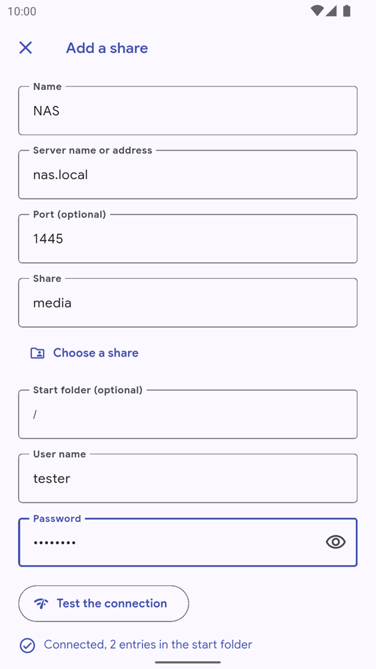

🌐 <b>Svenska</b> · Andra språk (88)
<a href="../README.md">English</a> · <a href="README.af.md">Afrikaans</a> · <a href="README.ar.md">العربية</a> · <a href="README.az.md">Azərbaycanca</a> · <a href="README.be.md">Беларуская</a> · <a href="README.bg.md">Български</a> · <a href="README.bi.md">Bislama</a> · <a href="README.bn.md">বাংলা</a> · <a href="README.br.md">Brezhoneg</a> · <a href="README.bs.md">Bosanski</a> · <a href="README.ca.md">Català</a> · <a href="README.cs.md">Čeština</a> · <a href="README.cv.md">Чӑвашла</a> · <a href="README.da.md">Dansk</a> · <a href="README.de.md">Deutsch</a> · <a href="README.de_CH.md">Deutsch (Schweiz)</a> · <a href="README.el.md">Ελληνικά</a> · <a href="README.en_GB.md">English (UK)</a> · <a href="README.eo.md">Esperanto</a> · <a href="README.es.md">Español</a> · <a href="README.et.md">Eesti</a> · <a href="README.eu.md">Euskara</a> · <a href="README.fa.md">فارسی</a> · <a href="README.fi.md">Suomi</a> · <a href="README.fil.md">Filipino</a> · <a href="README.fr.md">Français</a> · <a href="README.ga.md">Gaeilge</a> · <a href="README.gl.md">Galego</a> · <a href="README.gsw.md">Alemannisch</a> · <a href="README.gu.md">ગુજરાતી</a> · <a href="README.he.md">עברית</a> · <a href="README.hi.md">हिन्दी</a> · <a href="README.hr.md">Hrvatski</a> · <a href="README.hu.md">Magyar</a> · <a href="README.hy.md">Հայերեն</a> · <a href="README.id.md">Bahasa Indonesia</a> · <a href="README.is.md">Íslenska</a> · <a href="README.it.md">Italiano</a> · <a href="README.ja.md">日本語</a> · <a href="README.ka.md">ქართული</a> · <a href="README.kab.md">Taqbaylit</a> · <a href="README.kk.md">Қазақша</a> · <a href="README.km.md">ខ្មែរ</a> · <a href="README.kmr.md">Kurmancî</a> · <a href="README.kn.md">ಕನ್ನಡ</a> · <a href="README.ko.md">한국어</a> · <a href="README.kxm.md">ภาษาเขมรถิ่นไทย</a> · <a href="README.lb.md">Lëtzebuergesch</a> · <a href="README.lmo.md">Lombard</a> · <a href="README.lt.md">Lietuvių</a> · <a href="README.lv.md">Latviešu</a> · <a href="README.mfa.md">Bahasa Melayu Kelantan</a> · <a href="README.mi.md">Te reo Māori</a> · <a href="README.mk.md">Македонски</a> · <a href="README.ml.md">മലയാളം</a> · <a href="README.mn.md">Монгол</a> · <a href="README.mr.md">मराठी</a> · <a href="README.ms.md">Bahasa Melayu</a> · <a href="README.nb_NO.md">Norsk bokmål</a> · <a href="README.ne.md">नेपाली</a> · <a href="README.nl.md">Nederlands</a> · <a href="README.nn.md">Norsk nynorsk</a> · <a href="README.pa.md">ਪੰਜਾਬੀ</a> · <a href="README.pl.md">Polski</a> · <a href="README.pt.md">Português</a> · <a href="README.pt_BR.md">Português (Brasil)</a> · <a href="README.ro.md">Română</a> · <a href="README.ru.md">Русский</a> · <a href="README.si.md">සිංහල</a> · <a href="README.sk.md">Slovenčina</a> · <a href="README.sl.md">Slovenščina</a> · <a href="README.sq.md">Shqip</a> · <a href="README.sr_Cyrl.md">Српски</a> · <a href="README.sr_Latn.md">Srpski</a> · <a href="README.sw.md">Kiswahili</a> · <a href="README.swg.md">Schwäbisch</a> · <a href="README.ta.md">தமிழ்</a> · <a href="README.te.md">తెలుగు</a> · <a href="README.th.md">ไทย</a> · <a href="README.tl.md">Tagalog</a> · <a href="README.tr.md">Türkçe</a> · <a href="README.uk.md">Українська</a> · <a href="README.ur.md">اردو</a> · <a href="README.uz.md">Oʻzbekcha</a> · <a href="README.vi.md">Tiếng Việt</a> · <a href="README.yue_Hant.md">粵語</a> · <a href="README.zh_Hans.md">简体中文</a> · <a href="README.zh_Hant.md">繁體中文</a>

  

# Immuch360

**Ditt innehåll. Alla skärmar. Varje perspektiv.**

🌐 <a href="https://immuch360.com/sv/"><b>immuch360.com</b></a>

Platta foton och videor, 360° och 3D, från din enhet, din NAS, din Immich-server, dina kameror och din drönare. Inget konto behövs. Immuch360 är en fri app med öppen källkod som läser dina foton och videor där de ligger och spelar upp var och en i den visare som passar: platt, som en sfär du ser dig omkring i, i 3D, eller runt omkring dig i ett headset. Den körs på telefoner, surfplattor, TV-apparater, Meta Quest-headset och datorer. Dess webbplats, [immuch360.com](https://immuch360.com/sv/), visar vad den gör på varje skärm, på 89 språk.

**Nytt i build 53 och desktop build 34, version 3.4.8.** På datorer ger [Spatial 2.5D](#see-your-3d-photos-and-videos-in-depth-on-your-computer) dina 3D-foton djup på den platta skärmen, på Windows, Linux och macOS, och dina 3D-videor på Windows och macOS: vyn rör sig när du rör huvudet, följt av webbkameran när du har sagt ja, eller med musen, och webbkamerans bilder stannar i datorns minne och sparas eller skickas aldrig; inte provat med en webbkamera av projektet än. Hjulet [zoomar in i ett foto runt pekaren](#zoom-into-a-photo-with-the-wheel) och en dragning flyttar det. [Förbättra (AI)](#make-a-photo-sharper-on-your-computer-ai) tar fotona från dina resurser, från DLNA, Plex, Jellyfin och Emby och från din Immich-server, förbättrar 360°- och 3D-foton utan att bryta deras söm eller deras två ögon, och erbjuder Skärpa på en Mac med Apple-chip (inte provat på en Mac än). Från telefonen öppnar ["Spela upp på…"](#show-your-photos-and-videos-on-the-tv-from-your-phone) ett 360°-objekt i skärmens 360°-vy, spelar ett urval eller ett album som bildspel, loggar in en skärm på din server och skickar foton och videor som bara finns på telefonen; provat mellan Android-emulatorer, inte på en riktig telefon eller TV än. I en Meta Quest [övertonar eller glider](#browse-your-photos-on-the-big-screen-of-the-quest) bildspelet på den stora skärmen mellan foton, över en svart, suddig eller passthrough-bakgrund som du väljer, inte provat i ett headset av projektet än.

**Nytt i build 33 till 52.** [Filmer fortsätter där du slutade](#pick-up-a-film-where-you-stopped). De startar tidigare, och från en långsam server [fortsätter de spela i stället för att stanna](#when-a-video-waits-or-will-not-play). Tidslinjen [zoomar ut till månader och år](#find-a-month-or-a-year-in-a-long-timeline) på telefoner och datorer. På en Android-telefon eller en Meta Quest öppnar ["Bläddra i en mapp"](#browse-a-folder-of-your-phone-or-headset) en mapp på enheten som en resurs, och TIFF-foton visas. Android TV [söker på datum med fjärrkontrollen](#on-android-tv-and-google-tv), en Meta Quest 3 eller 3S [öppnar gaussiska splattar](#explore-gaussian-splats-in-a-meta-quest-3-or-3s), som vrids med höger styrspak, SPZ version 4 inräknad, och en dator [gör 3D-versioner av fotona på din NAS](#turn-one-photo-into-3d-a-scene-a-panorama). På en bärbar Windows-dator med två grafikchip [kör appen nu på det snabba](#when-a-video-waits-or-will-not-play), så att 8K-filmer spelas upp jämnt. Gaussiska splattar [öppnas nu på datorer och på Android-telefoner och surfplattor](#explore-gaussian-splats-on-your-phone-tablet-or-computer), en Windows-dator [gör splatscener av dina foton eller en video](#make-a-splat-scene-from-your-photos-or-a-video-ai) med AI, din Immich-server [förvarar dem inuti foton](#keep-a-splat-scene-on-your-immich-server) som öppnas från din tidslinje, och datorer [spelar AV2-videor](#play-av2-videos-on-your-computer). Från build 42 [spelas de råa videorna från Insta360-, GoPro MAX- och DJI Osmo 360-kameror, från ditt Immich-bibliotek, en delning eller en mapp, stabiliserade med kamerans gyroskop](#stabilise-your-360-videos-with-the-cameras-gyroscope) på Android-telefoner, surfplattor och TV-apparater, splatskaparen i desktop build 22 [erbjuder kvaliteten Detaljerad](#make-a-splat-scene-from-your-photos-or-a-video-ai) för scener du tittar på nära håll, och ett 360°-panorama [startar med 3.5 GiB ledigt på grafikkortet](#turn-one-photo-into-3d-a-scene-a-panorama). iPhone- och iPad-appen finns [på App Store](https://apps.apple.com/us/app/immuch360-360-3d-player/id6817655965), version 3.4.3. Från build 43 öppnar appens uppdateringsmeddelande Google Play eller App Store på telefoner och surfplattor; dess webbplats, [immuch360.com](https://immuch360.com/sv/), öppnade den 7 november. Från build 44 och desktop build 24 [visar en Meta Quest 3 eller 3S splattar med upp till 300,000 gaussianer](#explore-gaussian-splats-in-a-meta-quest-3-or-3s), datorer [markerar flera foton och videor med Ctrl och Shift](#use-your-computer-as-the-media-player), en TV vars avkodare vägrar en video [spelar serverns andra fil](#when-a-video-waits-or-will-not-play) av sig själv, panoramor körs på det valda grafikkortet i en bärbar dator som har två, och uppdateringsmeddelandet på Quest och datorerna öppnar deras butikssida eller nedladdningssida, med många rättelser. Från build 45 och desktop build 25, version 3.4.0 på alla plattformar, följer appen Immich 3.4.0-appen med 11 senare rättelser från Immich, visar [JPEG XL-fotona från Immich 3.4-servrar](#keep-your-immich-library-with-more), öppnar [dina Plex-filmer efter år](#watch-your-plex-films) med en sida för varje film, nedladdning till enheten och uppspelning på TV:n från telefonen, kan be om ett betyg i butiksbyggena, och hämtar på datorer sina videokomponenter från [deras egna öppna repositorier](#licences-and-credits). Från build 46 och desktop build 26, version 3.4.1, [spelas även råa videor från 360°-kameror stabiliserade](#stabilise-your-360-videos-with-the-cameras-gyroscope) på iPhone och iPad, i en Meta Quest och på Windows, en Meta Quest [spelar med libmpv de Plex-filmer som dess egen spelare inte kan avkoda](#watch-your-plex-films), en telefon [skickar en sådan film till en Chromecast eller en Google TV](#watch-your-plex-films), och AI-djupet i ett 3D-foto [får den styrka du väljer](#turn-one-photo-into-3d-a-scene-a-panorama); en ny server kan också läggas till genom att logga in med ditt Plex-konto, och appen [sparar sina inställningar i en fil](#keep-your-settings-in-a-file). Från build 47 och desktop build 27, version 3.4.2, [spelar en Plex-film ett ljudspår som enheten avkodar](#watch-your-plex-films) och säger vilket, öppnar den version som passar skärmen och erbjuder en lättare på en långsam anslutning, Windows och macOS spelar dess Dolby TrueHD-ljud, Android [visar dess nedladdning i en avisering](#watch-your-plex-films) och Android TV laddar också ner filmer, och [Tapo-batterikameror visas live](#watch-your-home-cameras-on-the-big-screen); att återställa en inställningsfil med dess konton loggar nu in dig på din Immich-server. Från build 48 och desktop build 28, version 3.4.3, [spelar en Windows-dator dina videor i ett PC VR-headset](#watch-your-videos-in-a-pc-vr-headset-from-windows) via SteamVR, Meta Horizon Link eller en annan OpenXR-runtime (inte provat i ett headset av projektet än), [kameror av andra märken visas live](#cameras-of-other-brands-over-onvif-or-rtsp), hittade via ONVIF eller tillagda med sin RTSP-länk (kontrollerat mot en simulerad kamera, ännu ingen riktig kamera av ett annat märke provad), de råa videorna från [DJI Osmo 360 II och GoPro MAX 2 spelas stabiliserade](#open-the-raw-files-of-360-cameras), Plex-filmer [kommer inte längre fram för långsamt på telefoner](#when-a-video-waits-or-will-not-play), LG- och Samsung-TV [vrider en video som ligger på sidan](#on-a-samsung-tv-tizen) med en knapp (inte provat på en LG-TV än; Samsung-tv:n från issue 17 vägrade vridningen), och "Serveruppdatering är tillgänglig" visas inte längre för en server som är uppdaterad. Från build 49 och desktop build 29, version 3.4.4, [läser appen dina Jellyfin- och Emby-servrar](#watch-your-jellyfin-and-emby-libraries) själv (inte provat på en enhet än), hittade på ditt nätverk och med inloggning via Quick Connect på en TV eller i ett headset, och spelar deras originalfiler så att en 360°-video förblir 360°; på den stora skärmen i en Meta Quest [behåller foton den storlek och plats du ställt in medan du bläddrar i dem, och spelas som bildspel](#browse-your-photos-on-the-big-screen-of-the-quest) (inte provat i ett headset av projektet än); 360°-videospelaren på telefoner och surfplattor [får 360°-fotonas kontroller](#360-videos-on-your-phone-with-the-controls-of-360-photos), en gyroskopknapp, nyp för att zooma och dragning rakt upp eller ned (provat av en användare på en Samsung Galaxy S25 Ultra, inte på en iPhone än); en dator [gör om dina 2D-videor till 3D-videor](#turn-your-2d-videos-into-3d-on-your-computer) med AI (inte provat på en 3D-skärm eller i ett headset än); och Samsung-TV [lämnar en video som behöver vridas till Samsungs egen spelare](#on-a-samsung-tv-tizen), som TV:n i issue 17 spelar men vägrar att vrida. Från build 50 och desktop build 30, version 3.4.5, medan en video spelas i 2D-fönstret på en Meta Quest, [ritas fönstret om i skärmens takt](#step-inside-your-photos-and-videos-with-a-meta-quest) i stället för ungefär 10 gånger per sekund som i build 48 och 49 (uppmätt på en Meta Quest 3), Android TV [zoomar in i ett foto med fjärrkontrollen](#on-android-tv-and-google-tv) och flyttar det med pilarna (nytt, inte provat på en TV än), och tre rättelser kommer från Android TV-forken av mlc70: ett snabbt svep visar inte längre detaljerna för fotot som lämnats bakom, ett animerat foto frigör sitt minne, och filtret Plats erbjuder städerna i det nya landet. Från build 51 och desktop build 31, version 3.4.6, gör [Förbättra (AI)](#make-a-photo-sharper-on-your-computer-ai) en skarpare kopia av ett oskarpt foto bredvid originalet på Windows och Linux, i tre nivåer, var och en körd en gång på en dator med ett RTX 4060, Naturlig erbjuds också på en Mac med Apple-chip (ännu inte provad på en Mac), en dator [gör om en 360°-video till en 360° 3D-video](#a-360-video-turned-into-a-360-3d-video) med AI, djupet i 3D-videorna uppskattas av grafikkortet på Windows, AI-funktionerna tar videorna från din server och från en resurs direkt, inställningsfilen har [sitt eget kort i Biblioteket](#keep-your-settings-in-a-file), en TV sparar den på en nätverksresurs, Escape går ett steg tillbaka på datorer, butikens build ber om ett betyg [mer sällan och varsammare](#privacy), Linux visar TIFF-foton, splatscener och 3D-videor med ett öga, och två krascher är åtgärdade. Från build 52 och desktop build 32, version 3.4.7, skickar ["Spela upp på…"](#show-your-photos-and-videos-on-the-tv-from-your-phone) foton och videor från ditt Immich-bibliotek, från dina resurser och från Jellyfin och Emby från telefonen till en TV, en Meta Quest, en dator eller en Chromecast, namnen på dina foton och videor [förblir läsbara över miniatyrerna](#play-the-files-of-a-nas-a-computer-a-media-server-or-plex), AI-komponenterna på en dator [uppdateras med ett klick](#update-the-ai-components-in-one-click), Linux får [en AppImage](#linux), och iPhone- och iPad-appen är byggd med Xcode 27. Desktop build 33 åtgärdade [Förbättra (AI)](#make-a-photo-sharper-on-your-computer-ai), som misslyckades på varje foto i desktop build 31 och 32 ([issue 23](https://github.com/freeKC/Immuch360/issues/23)).

  Inofficiell fork av Immich-mobilappen. Inte ansluten till Immich eller FUTO. Namnet låter som "I am much 360" på engelska.

<b>Innehåll</b>

- [Vem den är till för](#who-it-is-for)
- [Vilka skärmar](#which-screens), [vad de gör tillsammans](#use-cases) och [vad varje skärm gör](#what-each-screen-does)
- [Vad du kan göra](#what-you-can-do)
- [Skaffa den till din enhet](#get-it-on-your-device)
- [Så här gör du](#how-to)
  - [Titta på dina foton och videor, med eller utan server](#watch-your-photos-and-videos-with-or-without-a-server)
  - [Utforska panoramabilder, 360°, VR180 och 3D](#explore-panoramas-360-vr180-and-3d): [360°-videor på telefoner](#360-videos-on-your-phone-with-the-controls-of-360-photos)
  - [Gör om ett foto till 3D, en scen, ett panorama](#turn-one-photo-into-3d-a-scene-a-panorama): [AI-komponenter uppdaterade med ett klick](#update-the-ai-components-in-one-click)
  - [Gör om dina 2D-videor till 3D på din dator](#turn-your-2d-videos-into-3d-on-your-computer): [360°-videor till 360° 3D](#a-360-video-turned-into-a-360-3d-video)
  - [Gör ett foto skarpare på din dator (AI)](#make-a-photo-sharper-on-your-computer-ai)
  - [Titta på TV:n med fjärrkontrollen](#watch-on-the-tv-with-the-remote): [Android TV och Google TV](#on-android-tv-and-google-tv), [LG](#on-an-lg-tv-webos), [Samsung](#on-a-samsung-tv-tizen)
  - [Logga in en TV, ett headset eller en dator med telefonen](#sign-in-a-tv-a-headset-or-a-computer-with-your-phone)
  - [Visa dina foton och videor på TV:n från telefonen](#show-your-photos-and-videos-on-the-tv-from-your-phone)
  - [Kliv in i dina foton och videor med en Meta Quest](#step-inside-your-photos-and-videos-with-a-meta-quest): [den stora skärmen](#browse-your-photos-on-the-big-screen-of-the-quest), [kioskläge](#kiosk-mode-for-an-exhibition-or-a-shop)
  - [Utforska gaussiska splattar i en Meta Quest 3 eller 3S](#explore-gaussian-splats-in-a-meta-quest-3-or-3s)
  - [Utforska gaussiska splattar på din telefon, surfplatta eller dator](#explore-gaussian-splats-on-your-phone-tablet-or-computer)
  - [Skapa en splatscen från dina foton eller en video (AI)](#make-a-splat-scene-from-your-photos-or-a-video-ai)
  - [Förvara en splatscen på din Immich-server](#keep-a-splat-scene-on-your-immich-server)
  - [Spela upp filerna på en NAS, en dator, en mediaserver eller Plex](#play-the-files-of-a-nas-a-computer-a-media-server-or-plex): [dina filmer efter år](#watch-your-plex-films), [Jellyfin och Emby](#watch-your-jellyfin-and-emby-libraries)
  - [Bläddra i en mapp på telefonen eller headsetet](#browse-a-folder-of-your-phone-or-headset)
  - [Fortsätt en film där du slutade](#pick-up-a-film-where-you-stopped)
  - [När en video väntar eller inte vill spelas](#when-a-video-waits-or-will-not-play)
  - [Behåll ditt Immich-bibliotek, med mer](#keep-your-immich-library-with-more)
  - [Hitta en månad eller ett år i en lång tidslinje](#find-a-month-or-a-year-in-a-long-timeline)
  - [Titta på dina hemkameror på den stora skärmen](#watch-your-home-cameras-on-the-big-screen): [andra märken](#cameras-of-other-brands-over-onvif-or-rtsp)
  - [Din DJI-drönare](#your-dji-drone): [livevideo](#see-what-your-drone-sees-on-your-phone), [i en Quest eller på en Android TV](#watch-it-in-a-meta-quest-or-on-an-android-tv), [import](#bring-a-drones-or-a-camera-cards-photos-and-videos-to-immich)
  - [Öppna råfilerna från 360°-kameror](#open-the-raw-files-of-360-cameras)
  - [Stabilisera dina 360°-videor med kamerans gyroskop](#stabilise-your-360-videos-with-the-cameras-gyroscope)
  - [Vrid ett foto med en tangent](#turn-a-photo-with-one-key)
  - [Använd datorn som mediaspelare](#use-your-computer-as-the-media-player): [zooma med hjulet](#zoom-into-a-photo-with-the-wheel)
  - [Se dina 3D-foton och videor med djup på datorn](#see-your-3d-photos-and-videos-in-depth-on-your-computer)
  - [Titta på dina videor i ett PC VR-headset, från Windows](#watch-your-videos-in-a-pc-vr-headset-from-windows)
  - [Spela AV2-videor på din dator](#play-av2-videos-on-your-computer)
  - [Spara dina inställningar i en fil](#keep-your-settings-in-a-file)
- [Jämfört med Immich](#compared-with-immich)
- [Integritet](#privacy)
- [Licenser och erkännanden](#licences-and-credits)
- [Färdplan](#roadmap)
- [Dokumentation](#documentation)

## Vem den är till för

- **Du fotograferar i 360° eller 3D** och vill se dig omkring i dina bilder, inte se dem platta, dubbla eller utdragna, och vrida dina 360°-videor på telefonen som dess foton: [360°, VR180 och 3D](#explore-panoramas-360-vr180-and-3d), [360°-videor på telefoner](#360-videos-on-your-phone-with-the-controls-of-360-photos).
- **Du filmar med en 360°-kamera i handen, på cykeln eller på en hjälm** och vill att de råa videorna från din Insta360-, GoPro MAX- eller MAX 2-, DJI Osmo 360- eller Osmo 360 II-kamera, förvarade i Immich, på en delning eller i en mapp, spelas upp raka och stadiga på din telefon, din TV, din Meta Quest eller din Windows-dator: [stabiliserade med kamerans gyroskop](#stabilise-your-360-videos-with-the-cameras-gyroscope).
- **Dina foton och filmer ligger på en NAS, en dator, Plex eller Immich** och du vill se dem på TV:n utan att kopiera något: [på TV:n](#watch-on-the-tv-with-the-remote), [NAS, resurser och Plex](#play-the-files-of-a-nas-a-computer-a-media-server-or-plex).
- **Du har dina filmer på en Plex-server** och vill välja en efter år, se vad den är innan den börjar, ta med den på en resa, starta den på TV:n eller en Chromecast från telefonen, och spela även de filmer som din Android-telefon, TV eller Meta Quest inte kan avkoda: [dina filmer, efter år](#watch-your-plex-films).
- **Du har dina filmer på en Jellyfin- eller Emby-server** och vill ha dem i din Meta Quest, på TV:n eller telefonen, 360° och 3D som de är, och med din position sparad på servern (inte provat på en enhet än): [Jellyfin och Emby](#watch-your-jellyfin-and-emby-libraries).
- **Du har en Meta Quest** och vill kliva in i dina egna foton och videor: [i headsetet](#step-inside-your-photos-and-videos-with-a-meta-quest), och bläddra i dina foton på en stor skärm i den storlek och på den plats du ställer in, även som bildspel (inte provat i ett headset av projektet än): [den stora skärmen](#browse-your-photos-on-the-big-screen-of-the-quest).
- **Du har ett PC VR-headset på en Windows-dator** och vill ha dina 360°-videor runt omkring dig och dina filmer på en stor skärm i det (inte provat i ett headset av projektet än): [i ett PC VR-headset](#watch-your-videos-in-a-pc-vr-headset-from-windows).
- **Dina foton är platta** och du vill ha dem i 3D, som en scen att luta dig in i med ett headset, eller inuti ett 360°-panorama, utan en 3D-kamera: [gör om ett foto till 3D, en scen, ett panorama](#turn-one-photo-into-3d-a-scene-a-panorama), nytt, skapat av AI på din egen dator.
- **Dina videor är platta**, även telefonens klipp, och du vill ha dem i 3D för ett headset eller en 3D-skärm, och dina 360°-videor i 360° 3D, gjorda på din egen dator (inte provat på en 3D-skärm eller i ett headset än): [2D-videor till 3D](#turn-your-2d-videos-into-3d-on-your-computer), [360° till 360° 3D](#a-360-video-turned-into-a-360-3d-video).
- **Dina foton är oskarpa**, lite ur fokus eller tagna i dåligt ljus, och du vill ha en skarpare kopia bredvid originalet, gjord på din egen dator, även från dina resurser och servrar, med de påhittade detaljerna tydligt angivna: [Förbättra (AI)](#make-a-photo-sharper-on-your-computer-ai).
- **Du har 3D-foton eller -videor och en dator** och vill se dem med djup på dess platta skärm, med vyn som rör sig när du rör huvudet, följt av webbkameran, eller med musen (inte provat med en webbkamera av projektet än): [Spatial 2.5D på datorn](#see-your-3d-photos-and-videos-in-depth-on-your-computer).
- **Du kör Immich** och vill ha dess app, plus de immersiva visarna och de stora skärmarna som du loggar in från telefonen: [ditt Immich-bibliotek](#keep-your-immich-library-with-more), [jämfört med Immich](#compared-with-immich).
- **Du bevakar hemmet med Tapo-kameror**, även batteridrivna, eller med kameror av andra märken via ONVIF eller RTSP, och vill ha dem bredvid dina foton, även på TV:n (kontrollerat mot en simulerad kamera): [hemkameror](#watch-your-home-cameras-on-the-big-screen).
- **Du flyger en DJI-drönare** och vill ha dess livebild på telefonen utan DJI Fly, och i en Meta Quest eller på en Android TV för dem som är med dig: [din drönare](#see-what-your-drone-sees-on-your-phone).
- **Du fångar platser och föremål i 3D, som gaussiska splattar,** eller vill skapa dem från dina egna foton, och vill gå genom dem på telefonen, datorn eller i ett headset: [på en telefon, surfplatta eller dator](#explore-gaussian-splats-on-your-phone-tablet-or-computer), [skapade från dina foton](#make-a-splat-scene-from-your-photos-or-a-video-ai), [förvarade i Immich](#keep-a-splat-scene-on-your-immich-server).
- **Du har AV2-videor**, formatet som följer efter AV1, och vill titta på dem på din dator: [AV2 på din dator](#play-av2-videos-on-your-computer).
- **Du har flera skärmar hemma** och vill att de ska fungera tillsammans: [vad dina skärmar gör tillsammans](#use-cases).

Det finns inget Immuch360-konto att skapa, och ingenting går till oss: appen pratar bara med dina enheter och med de servrar du väljer, från build 45 med Wikipedia för en films sida, från build 46 med plex.tv när du loggar in med det, och laddar ner en AI-komponent eller AV2-avkodaren bara när du ber om det.

## Vilka skärmar

| Plattform | Var du hämtar den | Status i november 2026 |
|---|---|---|
|  **Android** telefoner och surfplattor | [Google Play](https://play.google.com/store/apps/details?id=com.aprogsys.immuch360) · [APK](https://github.com/freeKC/Immuch360/releases) | på Google Play (build 47 publicerad den 16 november; build 51 i granskning hos Google sedan den 24 november; build 53 följer), build 53 på GitHub, där [råa 360°-videor spelas stabiliserade](#stabilise-your-360-videos-with-the-cameras-gyroscope), [filmer fortsätter där du slutade](#pick-up-a-film-where-you-stopped), ["Bläddra i en mapp"](#browse-a-folder-of-your-phone-or-headset) öppnar en mapp på telefonen och [gaussiska splattar öppnas](#explore-gaussian-splats-on-your-phone-tablet-or-computer), från en resurs eller [från din Immich-tidslinje](#keep-a-splat-scene-on-your-immich-server), [inställningarna sparade i en fil](#keep-your-settings-in-a-file), [nedladdningen av en film visad i en avisering](#watch-your-plex-films), från build 48 [kameror av andra märken, live](#cameras-of-other-brands-over-onvif-or-rtsp) (kontrollerat mot en simulerad kamera) och, från build 49, [Jellyfin- och Emby-servrar](#watch-your-jellyfin-and-emby-libraries) (inte provat på en enhet än) och [360°-fotonas kontroller i 360°-videospelaren](#360-videos-on-your-phone-with-the-controls-of-360-photos) (provat av en användare på en Samsung Galaxy S25 Ultra), och från build 51 [inställningsfilens kort i Biblioteket](#keep-your-settings-in-a-file), med filen sparad på en nätverksresurs också, och från build 52 [dina foton och videor skickade till en TV eller en Chromecast](#show-your-photos-and-videos-on-the-tv-from-your-phone) med "Spela upp på…" (inte provat på en enhet än), och från build 53 [360°-objekt, ett urval eller ett album och foton och videor som finns på själva telefonen](#show-your-photos-and-videos-on-the-tv-from-your-phone) skickade på samma sätt (provat mellan Android-emulatorer) |
|  **iPhone och iPad** | [App Store](https://apps.apple.com/us/app/immuch360-360-3d-player/id6817655965) | version 3.4.7 på App Store sedan den 26 november, med [månader och år i tidslinjen](#find-a-month-or-a-year-in-a-long-timeline), [filmer som fortsätter där du slutade](#pick-up-a-film-where-you-stopped), [inloggningen av en TV, ett headset eller en dator](#sign-in-a-tv-a-headset-or-a-computer-with-your-phone) från telefonen, splatscenerna som förvaras i Immich visade som sitt foto, rättelserna i Immich 3.4.0 och dess JPEG XL-foton, [råa 360°-videor stabiliserade](#stabilise-your-360-videos-with-the-cameras-gyroscope), [inställningarna sparade i en fil](#keep-your-settings-in-a-file), [livevisningen av Tapo-batterikameror](#watch-your-home-cameras-on-the-big-screen) och [livevisningen av kameror av andra märken](#cameras-of-other-brands-over-onvif-or-rtsp) (kontrollerat mot en simulerad kamera), och från version 3.4.4 [Jellyfin- och Emby-servrar](#watch-your-jellyfin-and-emby-libraries) (inte provat på en enhet än) och [360°-fotonas kontroller i 360°-videospelaren](#360-videos-on-your-phone-with-the-controls-of-360-photos) (inte provat på en iPhone än), och från version 3.4.6 [inställningsfilens kort](#keep-your-settings-in-a-file) och återställning från en nätverksresurs, och från version 3.4.7, byggd med Xcode 27, ["Spela upp på…" för foton och videor](#show-your-photos-and-videos-on-the-tv-from-your-phone) (inte provat på en iPhone än); version 3.4.8, iPhone- och iPad-versionen av build 53, följer; eller [bygg den själv](../docs/immuch360/build.md) |
|  **Android TV och Google TV** | [Google Play](https://play.google.com/store/apps/details?id=com.aprogsys.immuch360) · [APK](#android-tv-and-google-tv) | på Google Play, som erbjuder appen på Android TV och Google TV, och build 53 på GitHub: [råa 360°-videor stabiliserade](#stabilise-your-360-videos-with-the-cameras-gyroscope), [sök på datum med fjärrkontrollen](#on-android-tv-and-google-tv), [logga in med telefonen](#sign-in-a-tv-a-headset-or-a-computer-with-your-phone) genom att skanna en QR-kod, en förloppslinje, ljud och undertexter för fjärrkontrollen i videospelaren, och [en drönares livevideo](#watch-it-in-a-meta-quest-or-on-an-android-tv) som en telefon vidarebefordrar, [filmer nedladdade till TV:n](#watch-your-plex-films) och, från build 49, [Jellyfin- och Emby-servrar](#watch-your-jellyfin-and-emby-libraries) med inloggning via Quick Connect (inte provat på en enhet än) och, från build 50, [foton zoomade med fjärrkontrollen](#on-android-tv-and-google-tv) (sett fungera i en Android TV-emulator, inte provat på en TV än), och från build 51 [inställningsfilen sparad och återställd på en nätverksresurs](#keep-your-settings-in-a-file) (sett fungera i en Android TV-emulator), och från build 52 [foton och videor som en telefon skickar med "Spela upp på…"](#show-your-photos-and-videos-on-the-tv-from-your-phone) (inte provat på en TV än), och från build 53 de 360°-foton som en telefon skickar öppnade i sin 360°-vy, en inloggning från telefonens ark och foton och videor som finns på själva telefonen (sett fungera i en Android TV-emulator) |
| **LG-TV** med webOS 5.0 och senare | [.ipk, version 1.0.5](https://github.com/freeKC/Immuch360/releases/tag/webos-v1.0.5) · LG Content Store (under granskning) | version 1.0.0, inskickad till LG Content Store den 24 oktober, under LG:s tester sedan den 26 oktober; version 1.0.1, på GitHub sedan den 27 oktober, zoomar ett foto med pilarna och säger när ett foto fortfarande laddas, och version 1.0.2, på GitHub med build 46, skriver "logga in" som ログイン på japanska, version 1.0.3, med build 47, säger när en mapp på en DLNA-server innehåller live-tv-kanaler, som den inte kan spela upp än, och version 1.0.4, med build 48, [vrider en video som ligger på sidan](#on-an-lg-tv-webos) med en knapp (inte provat på en LG-TV än), och version 1.0.5, med build 49, nämner Jellyfin med sitt DLNA-plugin bland DLNA-servrarna; tills LG publicerar appen installeras den i [Developer Mode](#lg-tvs-webos). Version 1.0.0 har körts på webOS 25-TV i LG:s Cloud Test Lab |
| **Samsung-TV** med Tizen 5.5 och senare | [.wgt, version 0.3.6](https://github.com/freeKC/Immuch360/releases/tag/tizen-v0.3.6) | version 0.3.6 av samma TV-app, att signera med ditt eget Samsung-certifikat och installera i [Developer mode](#samsung-tvs-tizen); 0.1.0 kördes på en testares Samsung-TV, 0.2.0 innehåller rättelserna från den körningen, 0.3.0 lägger till fotozoomen och Laddar-etiketten från LG version 1.0.1, och 0.3.1 den japanska formuleringen från LG version 1.0.2, 0.3.2 spelar en video som filmats stående med en telefon åt rätt håll ([issue 17](https://github.com/freeKC/Immuch360/issues/17)), och 0.3.3 och 0.3.4 [vrider den på en TV som rapporterar den som stående](#on-a-samsung-tv-tizen) och lägger till en knapp som vrider den för hand, och 0.3.5 och 0.3.6 lämnar en sådan video till Samsungs egen spelare; på rapportörens TV lämnade 0.3.4 och 0.3.5 bilden på sidan, eftersom TV:n vägrar vridningen, och lösningen där är en video som din Immich-server transkodar och lagrar upprätt; finns inte i Samsungs butik |
|  **Meta Quest** 2, Pro, 3 och 3S | [Horizon Store](https://www.meta.com/experiences/immuch360/1384208401440714/) · [APK](#meta-quest) | på Horizon Store (build 50, vars 2D-fönster ritas om i skärmens takt medan en video spelas, publicerad den 25 november; build 52 i granskning hos Meta sedan den 25 november; build 53 följer), build 53 på GitHub, med ett [kioskläge](#kiosk-mode-for-an-exhibition-or-a-shop), [råa 360°-videor stabiliserade](#stabilise-your-360-videos-with-the-cameras-gyroscope) i den immersiva vyn, [filmerna den inte kan avkoda spelade av libmpv](#watch-your-plex-films) och, på Quest 3 och 3S, [gaussiska splattar](#explore-gaussian-splats-in-a-meta-quest-3-or-3s) och [AI-djup](#turn-one-photo-into-3d-a-scene-a-panorama) för ett platt foto, och från build 49 [foton bläddrade på den stora skärmen](#browse-your-photos-on-the-big-screen-of-the-quest) i den storlek du ställer in, även som bildspel (inte provat i ett headset av projektet än), och [Jellyfin- och Emby-servrar](#watch-your-jellyfin-and-emby-libraries) med inloggning via Quick Connect (inte provat på en enhet än), och från build 51 ber ett headset vars Horizon OS är för gammalt för den uppslukande visningen om en uppdatering i stället för att stänga appen (inte provat på ett sådant headset), och från build 53 [en övertoning eller en glidning mellan fotona på den stora skärmen, över en svart, suddig eller passthrough-bakgrund](#browse-your-photos-on-the-big-screen-of-the-quest) (inte provat i ett headset av projektet än) |
|  **Windows** | [Installationsprogram eller ZIP](https://github.com/freeKC/Immuch360/releases/tag/desktop-v3.4.8-34) | desktop build 34, signerad: foton, platta och 360°-videor, resurser, Plex, kameror (kontrollerat mot en simulerad kamera), inloggning med telefonen, foton vridna med en tangent, gränssnittet på 89 språk, och [3D-foton, 3D-scener och 360°-panoramor gjorda av dina foton](#turn-one-photo-into-3d-a-scene-a-panorama) med AI, även från fotona på din NAS; [gaussiska splattar](#explore-gaussian-splats-on-your-phone-tablet-or-computer) öppnade, [skapade från dina foton eller en video](#make-a-splat-scene-from-your-photos-or-a-video-ai) och [förvarade i Immich](#keep-a-splat-scene-on-your-immich-server), [AV2-videor](#play-av2-videos-on-your-computer), från desktop build 22 ett [kvalitetsval för splatscenerna](#make-a-splat-scene-from-your-photos-or-a-video-ai) och [360°-panoramor från 3.5 GiB ledigt grafikminne](#turn-one-photo-into-3d-a-scene-a-panorama), och från desktop build 26 [råa 360°-videor stabiliserade](#stabilise-your-360-videos-with-the-cameras-gyroscope) och [3D-foton med en djupstyrka och skarpare kanter](#turn-one-photo-into-3d-a-scene-a-panorama), från desktop build 27 [filmernas Dolby TrueHD-ljud och Blu-ray-undertexter](#watch-your-plex-films), från desktop build 28 [dina videor i ett PC VR-headset](#watch-your-videos-in-a-pc-vr-headset-from-windows) (inte provat i ett headset av projektet än), och från desktop build 29 [3D-videor gjorda av AI från dina 2D-videor](#turn-your-2d-videos-into-3d-on-your-computer) (inte provat på en 3D-skärm eller i ett headset än), och från desktop build 31 [skarpare kopior av dina foton](#make-a-photo-sharper-on-your-computer-ai) med AI och [360°-videor omgjorda till 360° 3D-videor](#a-360-video-turned-into-a-360-3d-video) med AI, djupet uppskattat av grafikkortet, videorna från din server och från en resurs tagna direkt, och Escape för att gå ett steg tillbaka, från desktop build 32 [AI-komponenterna uppdaterade med ett klick](#update-the-ai-components-in-one-click), från desktop build 33 [Förbättra (AI)](#make-a-photo-sharper-on-your-computer-ai) som fungerar igen, och från desktop build 34 [hjulzoomen för foton](#zoom-into-a-photo-with-the-wheel), [Spatial 2.5D för 3D-foton och videor](#see-your-3d-photos-and-videos-in-depth-on-your-computer), med webbkameran eller musen (inte provat med en webbkamera av projektet än), och Förbättra (AI) på fotona från resurser och servrar, även 360°- och 3D-foton |
|   **macOS och Linux** | [.deb, .rpm, AppImage, DMG](https://github.com/freeKC/Immuch360/releases/tag/desktop-v3.4.8-34) | desktop build 34: foton, 360°-foton och platta videor (360°-videor spelas platt), en Immich-server och nätverksresurser, och [3D-foton och 3D-scener](#turn-one-photo-into-3d-a-scene-a-panorama) gjorda av AI från dina foton, med 360°-panoramor på Linux med ett grafikkort på 8 GB, från 3.5 GiB ledigt på det, och [gaussiska splattar](#explore-gaussian-splats-on-your-phone-tablet-or-computer) och [AV2-videor](#play-av2-videos-on-your-computer) (inte provat på en Mac än); desktop build 11 provad den 26 oktober i en Ubuntu 24.04-container och på en Mac; från desktop build 27 filmernas Dolby TrueHD-ljud på macOS; från desktop build 29, på Linux och på en Mac med Apple-chip, [3D-videor gjorda av AI från dina 2D-videor](#turn-your-2d-videos-into-3d-on-your-computer) (inte provat på en 3D-skärm eller i ett headset än); från desktop build 31, på Linux, [skarpare kopior av dina foton](#make-a-photo-sharper-on-your-computer-ai) med AI, TIFF-foton, mappar som visar sina nya filer av sig själva, splatscener gjorda av dina foton på ett grafikkort på 4 GB och 3D-videor visade platt med ett öga, och på en Mac med Apple-chip nivån Naturlig i Förbättra (AI) (inte provat på en Mac än); från desktop build 32 [en AppImage](#linux) för de andra Linux-distributionerna, kontrollerad av CI på Arch Linux och openSUSE; från desktop build 34 hjulzoomen, [Spatial 2.5D](#see-your-3d-photos-and-videos-in-depth-on-your-computer) för 3D-foton på Linux och macOS och för 3D-videor på macOS (inte provat på en Mac eller med en webbkamera än), och på en Mac med Apple-chip nivån Skärpa i Förbättra (AI) (inte provat på en Mac än); osignerad på macOS |

*Statusarna uppdateras vid varje utgåva; vad varje butik har, vad som är under dess granskning och varje build finns i [Utgåvestatus](../docs/immuch360/release-status.md). Webbplatsen [immuch360.com](https://immuch360.com/sv/) visar vad varje skärm gör, en guide för varje funktion och länkarna till butikerna, på 89 språk.*

  

### Vad dina skärmar gör tillsammans

Installera Immuch360 på varje skärm du tittar på: var och en läser dina källor själv, och vissa lämnar över en bild, en fil eller en inloggning till en annan. På varje bild markerar Immuch360-ikonen de enheter som kör appen.

#### Din NAS på varje skärm

  

**Du behöver:** en NAS med en SMB- eller WebDAV-delning, och Immuch360 på varje skärm du tittar på.

Lägg till delningen på varje skärm, så spelar var och en upp foton och videor där de ligger, utan att något kopieras: telefoner, surfplattor, Android TV, en Meta Quest, Windows-, Linux- och macOS-datorer, och LG-TV-apparater inloggade på din Immich-server (SMB från webOS 22). Ett 360°-foto vrids som en sfär på telefonen och TV:n, och omger dig i headsetet. Så här gör du: [Spela upp filerna på en NAS, en dator, en mediaserver eller Plex](#play-the-files-of-a-nas-a-computer-a-media-server-or-plex).

#### Din Immich-server på varje skärm, inloggad från telefonen

  

**Du behöver:** en Immich-server, Immuch360 på din Android-telefon, och Immuch360 på skärmarna du loggar in: Android TV, en Meta Quest, en Windows-, Linux- eller macOS-dator.

På telefonen behåller Immuch360 hela Immichs mobilapp, lägger till sina 360°-, VR180- och 3D-visare, och installeras bredvid den officiella appen. Inloggad på din server loggar den in de stora skärmarna: den skannar QR-koden på TV:n eller datorn, eller så skriver du på den in koden som headsetet visar, och ditt lösenord stannar på telefonen. Så här gör du: [Logga in en TV, ett headset eller en dator med telefonen](#sign-in-a-tv-a-headset-or-a-computer-with-your-phone).

#### Dina platta foton i 3D, från datorn till headsetet

  

**Du behöver:** Immuch360 på en Windows-, Linux- eller macOS-dator och i en Meta Quest, med din NAS mellan dem, eller din Immich-server med "Säkerhetskopiera även AI-versioner" påslaget.

Datorn själv gör om dina foton till 3D-foton och 3D-scener, och till 360°-panoramor med ett grafikkort på 8 GB på Windows eller Linux, och sparar dem bredvid originalen. Headsetet visar ett 3D-foto i äkta 3D, placerar en scen i ditt rum och ett panorama runt omkring dig; telefoner och TV-apparater öppnar panoramorna i sin 360°-visare. Så här gör du: [Gör om ett foto till 3D, en scen, ett panorama](#turn-one-photo-into-3d-a-scene-a-panorama).

#### Drönarens livebild i ett headset eller på TV:n

  

**Du behöver:** en DJI-drönare och dess DJI RC-N3-fjärrkontroll, Immuch360 på Android-telefonen som är ansluten till fjärrkontrollen, och Immuch360 i en Meta Quest eller på en Android TV.

Telefonen visar drönarens livevideo och vidarebefordrar den, via ditt Wi-Fi eller sin egen hotspot, så att de som är med dig ser flygningen i headsetet eller på TV:n. Bara mottagning: inget kommando skickas någonsin till fjärrkontrollen eller drönaren, och fjärrkontrollen behåller full kontroll. Så här gör du: [Titta på den i en Meta Quest eller på en Android TV](#watch-it-in-a-meta-quest-or-on-an-android-tv).

#### Din 360°-kameras råfiler, ihopsydda där du tittar på dem

  

**Du behöver:** en Insta360-, GoPro MAX- eller MAX 2-, DJI Osmo 360- eller Osmo 360 II-kamera, din NAS, och Immuch360 på skärmarna: telefoner, surfplattor, Android TV, en Meta Quest, Windows.

Kopiera .insp-, .insv-, .360- eller .osv-filerna från kamerans kort till en SMB- eller WebDAV-delning på din NAS, som de är; en Immich-server tar även Insta360-filerna. Varje skärm syr ihop dem medan de spelas upp, med kalibreringen som står i varje fil, och inget exporteras först i kamerans app. Så här gör du: [Öppna råfilerna från 360°-kameror](#open-the-raw-files-of-360-cameras).

#### Dina Plex- och DLNA-servrar på TV:n och i headsetet

  

**Du behöver:** en Plex Media Server, en Jellyfin- eller Emby-server, eller en DLNA-server som minidlna, och Immuch360 på varje skärm: Android TV, en Meta Quest, telefoner, surfplattor, Windows.

Plex ger originalfilerna i dina bibliotek, så en 360°-video förblir 360°, runt omkring dig i headsetet, hemma och via din portvidarebefordran när du är borta; DLNA-servrar hittas på ditt hemnätverk. LG-TV-apparater inloggade på din Immich-server spelar också upp dem. Från build 45 öppnar telefoner, surfplattor, Android TV, Quest och datorer ett Plex-filmbibliotek med alla filmer efter år, varje film med sin sida, och en film som väljs på telefonen spelas på Android TV, Quest eller en dator, med fjärrkontrollen som styr. Från build 46 spelar Quest med libmpv de filmer som dess egen spelare inte kan avkoda, din Plex-server konverterar de som ingen spelare på en Android-enhet avkodar, och en telefon skickar en film till en Chromecast eller en Google TV. Från build 47 spelar en film ett ljudspår som enheten avkodar och säger vilket, öppnar den version som passar skärmen och spelar sitt Dolby TrueHD-ljud på Windows och macOS, och en mapp med live-tv-kanaler på en DLNA-server säger att de inte kan spelas upp än. Från build 49 har även en Jellyfin- eller Emby-server sin egen typ, hittad av sig själv, med inloggning via Quick Connect på en TV eller i headsetet, dess originalfiler spelade så att 360° förblir 360° och din position sparad på servern (inte provat på en enhet än). Så här gör du: [Spela upp filerna på en NAS, en dator, en mediaserver eller Plex](#play-the-files-of-a-nas-a-computer-a-media-server-or-plex), [Titta på dina Plex-filmer](#watch-your-plex-films) och [Titta på dina Jellyfin- och Emby-bibliotek](#watch-your-jellyfin-and-emby-libraries).

#### Din telefon eller din Windows-dator, öppnad i headsetet

  

**Du behöver:** Immuch360 på en Android-telefon, en iPhone eller en Windows-dator, och i en Meta Quest, på samma Wi-Fi hemma.

Slå på "Dela den här telefonen i nätverket" på telefonen, eller "Dela den här datorn i nätverket" på datorn, så spelar headsetet upp dess foton och videor, 360°-filerna runt omkring dig: ingen server, ingen NAS, ingen uppladdning. På en iPhone körs delningen medan appen är på skärmen. Så här gör du: [Dela den här telefonen i nätverket](../docs/immuch360/user-guide.md#share-this-phone-on-the-network).

#### Dina Tapo-kameror på TV:n och i headsetet

  

**Du behöver:** Tapo-kameror på ditt hemnätverk, och Immuch360 på en Android-telefon, en Android TV, en Meta Quest eller en Windows-dator.

Varje skärm visar en kamera live och spelar upp inspelningarna på dess minneskort dag för dag, bredvid dina foton, och telefonen skickar ett klipp till din Immich-server. Appen pratar med kamerorna bara på ditt nätverk, aldrig via TP-Links servrar. Från build 47 visas även batterikameror live, via sin medieport, på telefoner, surfplattor, Android TV och Quest. Från build 48 visas kameror av andra märken live bredvid dem, hittade via ONVIF eller tillagda med sin RTSP-länk. Kontrollerat mot en simulerad kamera. Så här gör du: [Titta på dina hemkameror på den stora skärmen](#watch-your-home-cameras-on-the-big-screen).

#### Gaussiska splattar i ditt rum, i en Meta Quest 3 eller 3S

  

**Du behöver:** en splat gjord med Polycam, Scaniverse, Luma eller ett annat verktyg, som en .spz- eller binär .ply-fil på din NAS eller i headsetet, och Immuch360 i en Meta Quest 3 eller 3S.

Headsetet placerar platsen eller objektet i dess storlek, framför dig eller runt omkring dig: gå runt det, glid genom det med vänster styrspak, vrid med den högra. Gaussiska splattar använder en del av Meta Spatial SDK som Meta varken stöder eller garanterar: varje fel är Immuch360s eget. Så här gör du: [Utforska gaussiska splattar i en Meta Quest 3 eller 3S](#explore-gaussian-splats-in-a-meta-quest-3-or-3s).

#### En Meta Quest för dina besökare

  

**Du behöver:** en Meta Quest med Immuch360, och ett 360°-foto eller en 360°-video i headsetet, på din NAS eller på din Immich-server.

I kioskläge öppnar headsetet ditt 360°-foto eller din 360°-video av sig självt, från början, varje gång en besökare tar på sig det, och en film slutar på ett kort med din text. Besökarna trycker inte på något; du håller in B eller Y i en sekund för att lämna. Så här gör du: [Kioskläge, för en utställning eller en butik](#kiosk-mode-for-an-exhibition-or-a-shop).

### Vad varje skärm gör

En kodbas för telefonerna, surfplattorna, Android TV, Meta Quest och datorerna, och en separat TV-app för LG-TV, även paketerad för Samsung-TV, att installera själv. Vad var och en har idag:

| Funktion | Android | iPhone, iPad | Android TV | LG webOS | Samsung Tizen | Quest |
|---|:---:|:---:|:---:|:---:|:---:|:---:|
| Galleri, album, sökning med en Immich-server | ✅ | ✅ | ✅ visare | ✅ visare | ✅ visare | ✅ |
| Tidslinje efter månader och år | ✅ | ✅ | ❌ | ❌ | ❌ | ❌ |
| Logga in med telefonen (QR-kod) | ✅ skannar koden | ✅ skannar koden | ✅ | ✅ i telefonens webbläsare | ❌ skrivs in på TV:n | ✅ kod inskriven på telefonen |
| Utan server: enhetens eget innehåll | ✅ | ✅ | endast resurser | ❌ | ❌ | ✅ |
| En mapp på enheten, öppnad som en resurs | ✅ en mapp du väljer | ❌ | ❌ | ❌ | ❌ | ✅ |
| Platta foton och videor | ✅ | ✅ | ✅ | ✅ | ✅ | ✅ |
| TIFF-foton | ✅ | ✅ systemavkodare | ✅ | ✅ från servern | ✅ från servern | ✅ även i den uppslukande vyn |
| JPEG XL-miniatyrer och förhandsvisningar (Immich 3.4) | ✅ | ✅ från 3.4.0, Immichs avkodare, inte provat på en iPhone än | ✅ | ❌ "Förhandsvisning inte tillgänglig" | ❌ "Förhandsvisning inte tillgänglig" | ✅ även immersivt |
| Vrid ett foto med en tangent | ✅ | ✅ | ✅ färgknappar | ✅ färgknappar | ✅ | ✅ fönster |
| 360°-foton som en sfär | ✅ | ✅ | ✅ | ✅ | ✅ | ✅ immersivt |
| 360°-videor | ✅ | ✅ ingen förloppslinje | ✅ meddelande om den inte kan avkodas | endast platt | endast platt | ✅ immersivt |
| 360°-videor: gyroskopknapp, nyp, dra rakt upp och ned | ✅ från build 49, provat av en användare på en Samsung Galaxy S25 Ultra | ✅ från version 3.4.4, inte provat på en iPhone än | ❌ | ❌ | ❌ | ❌ |
| Filmer fortsätter där du slutade | ✅ | ✅ | ✅ | ❌ | ❌ | ✅ även i den uppslukande vyn |
| Videokälla: filen som den här enheten avkodar | ✅ | ✅ | ✅ | ❌ | ❌ | ✅ |
| Långsam server: hur länge en video väntar, och varför | ✅ | egen väntregel | ✅ | ❌ | ❌ | ✅ |
| AV2-videor | ❌ | ❌ | ❌ | ❌ | ❌ | ❌ |
| 3D och VR180 | ✅ ett öga | ✅ ett öga | ✅ ett öga | foton ett öga, videor platta | foton ett öga, videor platta | ✅ äkta 3D |
| Platt 3D enligt filnamn, skarpare skärmar som du flyttar | ❌ | ❌ | ❌ | ❌ | ❌ | ✅ |
| Foton på den stora skärmen: bläddra, bildspel, storlek och plats behålls | ❌ | ❌ | ❌ | ❌ | ❌ | ✅ från build 49, inte provat i ett headset än |
| Bildspelet på den stora skärmen: övertoning eller glidning, en svart, suddig eller passthrough-bakgrund | ❌ | ❌ | ❌ | ❌ | ❌ | ✅ från build 53, inte provat i ett headset än |
| Kioskläge för besökare | ❌ | ❌ | ❌ | ❌ | ❌ | ✅ |
| Spatial 2.5D (huvudspårning) | ✅ | ✅ | ❌ | ❌ | ❌ | ❌ |
| Apple-spatiala foton | ✅ ett öga | ✅ ett öga | ✅ ett öga | ❌ | ❌ | ✅ 3D |
| Gaussiska splattar, .spz och .ply | ✅ | ❌ | ❌ | ❌ | ❌ | ✅ Quest 3 och 3S |
| Splatscener förvarade som foton i Immich | ✅ | fotot | fotot | fotot | fotot | ✅ Quest 3 och 3S, inte provat i ett headset än |
| 3D-foto från ett 2D-foto (AI) | ✅ läser det, sida vid sida | ✅ läser det, sida vid sida | ✅ läser det, sida vid sida | ✅ läser det, sida vid sida | ✅ läser det, sida vid sida | ✅ AI-djup i headsetet (Quest 3 och 3S), visat i 3D, Subtil, Normal eller Stark |
| 3D-scen från ett 2D-foto (AI) | ✅ läser den, som sitt foto | ✅ läser den, som sitt foto | ✅ läser den, som sitt foto | ✅ läser den, som sitt foto | ✅ läser den, som sitt foto | ✅ utforskas i 3D |
| 360°-panorama från ett 2D-foto (AI) | ✅ läser det, med sin AI-etikett | ✅ läser det som ett 360°-foto, etikett 🔜 | ✅ läser det, med sin AI-etikett | ✅ läser det som ett 360°-foto, etikett 🔜 | ✅ läser det som ett 360°-foto, etikett 🔜 | ✅ läser det runt omkring dig, med sin AI-etikett |
| 3D-versioner bredvid fotona i en resurs (AI) | ✅ läses | ✅ läses | ✅ läses | ✅ läses | ❌ | ✅ läses |
| Splatscen från foton eller en video (AI) | ✅ läser den | ❌ | ❌ | ❌ | ❌ | ✅ läser den, Quest 3 och 3S, inte provat i ett headset än |
| 3D-video från en 2D-video (AI) | ✅ spelar den, sida vid sida | ✅ spelar den, sida vid sida | ✅ spelar den, sida vid sida | platt video, sida vid sida | platt video, sida vid sida | ✅ i 3D på en stor skärm, inte provat i ett headset än |
| Råa Insta360-, GoPro- och DJI-filer | ✅ | ✅ | ✅ | ❌ | ❌ | ✅ |
| Råa 360°-videor stabiliserade med kamerans gyroskop | ✅ Insta360, GoPro MAX och MAX 2, DJI Osmo 360 och Osmo 360 II, från ditt bibliotek, delningar och mappar | ✅ från version 3.4.1, inte provat på en iPhone än | ✅ Insta360, GoPro MAX och MAX 2, DJI Osmo 360 och Osmo 360 II, från ditt bibliotek och delningar | ❌ | ❌ | ✅ i den immersiva vyn, inte provat i ett headset än |
| SMB-, WebDAV- och DLNA-resurser | ✅ | ✅ | ✅ | ✅ SMB från webOS 22 | ❌ | ✅ |
| Plex Media Server | ✅ | ✅ | ✅ | ✅ | ❌ | ✅ |
| Logga in med ditt Plex-konto (plex.tv) | ✅ i webbläsaren | ✅ i webbläsaren | ✅ kod på plex.tv/link | ✅ kod på plex.tv/link | ❌ | ✅ kod på plex.tv/link |
| Plex-filmer som den här enheten inte kan avkoda | ✅ konverterade av din Plex-server | ❌ | ✅ konverterade av din Plex-server | ❌ | ❌ | ✅ libmpv, annars konverterade av din Plex-server |
| En Plex-film skickad till en Chromecast eller en Google TV | ✅ | ✅ medan appen är öppen | ❌ | ❌ | ❌ | ❌ |
| Dina Immich-foton och -videor, och de från en resurs, skickade till en TV eller en Chromecast med "Spela upp på…" (från build 52, inte provat på en enhet än) | ✅ skickar dem, till en Chromecast också | samma kod, inte provat på en iPhone än | ✅ visar dem | ❌ | ❌ | ✅ visar dem i sitt fönster |
| "Spela upp på…" från build 53: ett 360°-objekt i skärmens 360°-vy, ett urval eller ett album som bildspel, en skärm inloggad från telefonen, foton och videor som finns på själva telefonen | ✅ skickar dem, provat i en emulator | samma kod, inte provat på en iPhone än | ✅ visar dem, provat i en emulator | ❌ | ❌ | ✅ visar dem, 360° i headsetet eller i fönstret |
| En Plex-film i flera versioner: den som passar skärmen, ditt val sparat | ✅ | ✅ | ✅ | ❌ | ❌ | ✅ |
| Ett ljudspår i en Plex-film som den här enheten inte kan avkoda: ett annat spår, med ett meddelande | ✅ | ✅ | ✅ | ❌ | ❌ | ✅ |
| Jellyfin- och Emby-servrar | ✅ | ✅ från version 3.4.4 | ✅ Quick Connect först | ❌ via DLNA, med dess plugin | ❌ | ✅ Quick Connect först |
| Tapo-kameror: inspelningar | ✅ | ✅ | ✅ | 🔜 inte före december 2026 | ❌ | ✅ |
| Tapo-kameror: livevisning | ✅ | ✅ inte provat på en iPhone än | ✅ | ✅ endast video | ❌ | ✅ |
| Tapo-batterikameror: livevisning | ✅ bara video | ✅ med ljud, inte provat på en iPhone än | ✅ bara video | ❌ | ❌ | ✅ bara video |
| Kameror av andra märken, ONVIF eller RTSP: livevisning | ✅ H.264, H.265, MPEG-4 | ✅ H.264, från version 3.4.3, tillagda med adress eller länk | ✅ | ❌ | ❌ | ✅ |
| Dela denna enhet på nätverket | ✅ | ✅ | ❌ | ❌ | ❌ | ❌ |
| Ladda upp till Immich från resurser och enheten | ✅ | ✅ | ❌ | ❌ | ❌ | ✅ |
| Inställningar sparade i en fil och återställda | ✅ | ✅ via Filer och Dela, inte provat på en iPhone än | ✅ med en filväljare eller, från build 51, en nätverksresurs | ❌ | ❌ | ✅ |
| Import från en DJI-drönare eller ett kort via USB | ✅ | ❌ | ❌ | ❌ | ❌ | ❌ |
| DJI-drönarens livevideo | ✅ med en RC-N3 | ❌ | ✅ vidarebefordrad av en telefon | ❌ | ❌ | ✅ vidarebefordrad av en telefon |
| Mörkt tema | som systemet | som systemet | ✅ som standard | ✅ enda temat | ✅ enda temat | som systemet |
| Inmatning | touch, gyroskop | touch, gyroskop | fjärrkontroll; Vänster och Höger även under en video och på dess förloppslinje, Menu för detaljerna | fjärrkontroll, Magic Remote | fjärrkontroll | handkontroller, händer |
| Var du hämtar den | Google Play, APK | App Store | Google Play, APK | .ipk, LG Content Store (under granskning) | .wgt, signerat av dig | Horizon Store, APK |

| Funktion | Windows | Linux | macOS |
|---|:---:|:---:|:---:|
| Galleri, album, sökning med en Immich-server | ✅ | ✅ | ✅ |
| Tidslinje efter månader och år | ✅ Ctrl och hjulet | ✅ Ctrl och hjulet | ✅ Command och hjulet |
| Inloggning med telefonen (QR-kod) | ✅ | ✅ (dess webbsida provad; listad under Ange en kod där Avahi körs) | ✅ (vilket sätt är inte antecknat) |
| Utan server: enhetens eget innehåll | ✅ mappar | ✅ mappar | ✅ mappar |
| En mapp på enheten, öppnad som en resurs | ✅ mappar | ✅ mappar | ✅ mappar |
| Nya filer i en mapp visas utan Uppdatera | ✅ | ✅ från desktop build 31 (mycket stora träd: de djupaste mapparna vid nästa omskanning) | ✅ inte kontrollerat på en Mac än |
| Platta foton och videor | ✅ | ✅ | ✅ |
| TIFF-foton | ✅ systemavkodare | ✅ från desktop build 31, appens avkodare (DNG och andra råfiler undantagna) | ✅ systemavkodare |
| JPEG XL-miniatyrer och förhandsvisningar (Immich 3.4) | ✅ | ✅ | ✅ |
| Vrid ett foto med en tangent | ✅ | ✅ | ✅ |
| Ett foto zoomat med hjulet runt pekaren och flyttat med en dragning (från desktop build 34, kontrollerat av projektets tester) | ✅ | ✅ | ✅ |
| 360°-foton som en sfär | ✅ | ✅ | ✅ |
| 360°-videor | ✅ | endast platt | endast platt |
| Filmer fortsätter där du slutade | ✅ | ✅ | ✅ |
| Videokälla: filen som den här enheten avkodar | ✅ | ✅ | ✅ |
| Långsam server: hur länge en video väntar, och varför | ✅ | ✅ | ✅ |
| AV2-videor | ✅ | ✅ | ✅ kontrollerat av CI |
| 3D och VR180 | ✅ ett öga | foton ett öga, videor ett öga, platt, från desktop build 31 | foton ett öga, videor ett öga, platt, från desktop build 31, byggt av CI |
| Platt 3D enligt filnamn, skarpare skärmar som du flyttar | ❌ | ❌ | ❌ |
| Kioskläge för besökare | ❌ | ❌ | ❌ |
| Ett PC VR-headset: 360°-, 180°- och platta videor | ✅ från desktop build 28, inte provat i ett headset än | ❌ | ❌ |
| Spatial 2.5D: djup på skärmen för 3D-foton och videor, med webbkameran eller musen | ✅ från desktop build 34, inte provat med en webbkamera än | ✅ 3D-foton från desktop build 34, inte provat med en webbkamera än; 3D-videor 🔜 | ✅ 3D-foton och videor från desktop build 34, byggt av CI, inte provat på en Mac än |
| Apple-spatiala foton | ✅ ett öga | ✅ ett öga, från en server | ✅ ett öga |
| Gaussiska splattar, .spz och .ply | ✅ | ✅ | ✅ byggt av CI |
| Splatscener förvarade som foton i Immich | ✅ | ✅ | ✅ byggt av CI |
| 3D-foto från ett 2D-foto (AI) | ✅ tre styrkor, skarpare kanter | ✅ tre styrkor, skarpare kanter | ✅ byggt av CI, tre styrkor, skarpare kanter |
| 3D-scen från ett 2D-foto (AI) | ✅ | ✅ | ✅ byggt av CI |
| 360°-panorama från ett 2D-foto (AI) | ✅ grafikkort på 8 GB | ✅ grafikkort på 8 GB, kört i liten storlek på Intel-grafik | 🔜 på färdplanen |
| 3D-versioner bredvid fotona i en resurs (AI) | ✅ | ✅ | ✅ 3D-foton och scener |
| Splatscen från foton eller en video (AI) | ✅ grafikkort på 4 GB | ✅ från desktop build 31, grafikkort på 4 GB, kört av CI på processorn, inte provat på en Linux-dator med grafikkort än | ✅ läser den, byggt av CI |
| 3D-video från en 2D-video (AI) | ✅ på grafikkortet från desktop build 31, annars processorn | ✅ på processorn | ✅ Core ML på ett Apple-chip, processorn på en Intel-Mac, kört av CI, inte provat på en Mac än |
| 360° 3D-video från en 360°-video (AI) | ✅ från desktop build 31, på grafikkortet | ✅ från desktop build 31, på processorn, kört av CI | ✅ från desktop build 31, byggt av CI, inte kört på en Mac |
| Förbättra ett foto (AI): Skärpa, Återskapa detaljer, Naturlig | ✅ från desktop build 31: Skärpa och Återskapa detaljer på ett grafikkort (Återskapa detaljer: ett dedikerat kort på 6 GB), Naturlig på processorn (16 GB) | ✅ samma, byggt av CI, inte provat på en Linux-dator med grafikkort | Naturlig på ett Apple-chip, och Skärpa från desktop build 34 (inte provat på en Mac än); Återskapa detaljer inte än |
| Förbättra (AI) på fotona från resurser, DLNA, Plex, Jellyfin, Emby och Immich-servern, med 360°- och 3D-foton bevarade som sådana (från desktop build 34) | ✅ | ✅ byggt av CI | ✅ byggt av CI, inte provat på en Mac än |
| Råa Insta360-, GoPro- och DJI-filer | ✅ | ✅ foton, videor platta | ✅ foton, videor platta |
| Råa 360°-videor stabiliserade med kamerans gyroskop | ✅ i 360°-spelaren, inte provat på en kamerafil än | ❌ | ❌ |
| SMB-, WebDAV- och DLNA-resurser | ✅ | ✅ | ✅ |
| Plex Media Server | ✅ | 🔧 CI | 🔧 CI |
| Logga in med ditt Plex-konto (plex.tv) | ✅ i webbläsaren | 🔧 CI | 🔧 CI |
| En Plex-film i flera versioner: den som passar skärmen, ditt val sparat | ✅ | 🔧 CI | 🔧 CI |
| Jellyfin- och Emby-servrar | ✅ | 🔧 CI | 🔧 CI |
| Foton och videor som en telefon skickar med "Spela upp på…" (från desktop build 32, inte provat än) | ✅ | 🔧 CI | 🔧 CI |
| AI-komponenter uppdaterade med ett klick (från desktop build 32) | ✅ | ✅ | ✅ byggt av CI |
| Filmers Dolby TrueHD-ljud och Blu-ray-undertexter (PGS) | ✅ från desktop build 27 | ✅ systemets libmpv | ✅ TrueHD från desktop build 27, byggd av CI |
| Tapo-kameror: inspelningar | ✅ | 🔧 CI | 🔧 CI |
| Tapo-kameror: livevisning | ✅ | 🔧 CI | 🔧 CI |
| Tapo-batterikameror: livevisning | 🔜 en senare version | 🔜 | 🔜 |
| Kameror av andra märken, ONVIF eller RTSP: livevisning | ✅ | 🔧 CI | 🔧 CI |
| Dela denna enhet på nätverket | ✅ | ❌ | ❌ |
| Ladda upp till Immich från resurser och enheten | ✅ | ✅ | ✅ |
| Inställningar sparade i en fil och återställda | ✅ | ✅ | ✅ |
| Markera flera foton med Ctrl+klick, Shift+klick och Ctrl+A, åtgärder med ett högerklick | ✅ | ✅ | ✅ med Command, inte provat på en Mac än |
| Import från en DJI-drönare eller ett kort via USB | ❌ | ❌ | ❌ |
| DJI-drönarens livevideo | ❌ | ❌ | ❌ |
| Mörkt tema | som systemet | som systemet | som systemet |
| Inmatning | mus, tangentbord, Escape för att gå tillbaka | mus, tangentbord, Escape för att gå tillbaka | mus, tangentbord, styrplatta, Escape för att gå tillbaka |
| Var du hittar den | installationsprogram eller ZIP (signerat) | .deb, .rpm, AppImage | DMG eller ZIP (osignerat) |

*Linux och macOS: desktop build 11, provad den 26 oktober 2026 på Ubuntu 24.04, i en container med en test-Immich-server och testresurser, och av författaren på en Mac. AI-raderna, med byggen av koden i desktop build 13 gjorda för dessa kontroller, från den 27 till den 29 oktober 2026: 3D-foton gjorda av Linux-appen i en container på en Linux-dator, scener av Windows-appen på en bärbar dator med ett RTX 4060 och av motorn på den Linux-datorn, 360°-panoramor på den bärbara datorn. Raderna för build 33 till 39: månads- och årsvyerna på en Windows-dator med desktop build 14, 3D-versionerna skrivna till en Samba-resurs och en WebDAV-resurs på projektets byggmaskin, "Bläddra i en mapp" på en Android 16-emulator, starten av strömmade videor på en Android-emulator bakom bromsade länkar, kioskläget och de skarpare platta skärmarna i en Quest 3 med build 35, splatfilerna från build 39 i splatmodulen i en Quest 3 den 31 oktober, och filmer och videokälla av testerna i projektets CI och byggmaskin. Raderna för build 41 och desktop build 21: splattarna på en Galaxy S24+, i Windows-appen på en bärbar dator med ett RTX 4060 och på Linux i CI:s containrar, splatscenerna gjorda av den bärbara datorn, splatfotona mot Immich-testservrar 3.3.0 och 3.2.4, och AV2 på den bärbara datorn, i Ubuntu 22.04- och 24.04-containrar och, utan skärm, på CI:s Mac. Raderna för build 42 och desktop build 22: stabiliseringen genom testerna i projektets CI och byggvärd på rörelsespåren i exempelfiler från kamerorna Insta360 X3, X4 och X5, GoPro MAX och DJI Osmo 360, kvalitetsvalet genom dess tester och en mätning av dess träning på den bärbara datorn med ett RTX 4060, och kolumnen för iPhone och iPad från version 3.3.2 på App Store. Raderna och cellerna för build 46 och desktop build 26: stabiliseringen, djupstyrkan och de skarpare kanterna, inloggningen med ditt Plex-konto, Plex-filmerna som en enhet inte kan avkoda, Chromecast och inställningsfilen genom testerna i projektets CI och byggvärd, ingen på en enhet än. Raderna och cellerna för build 47 och desktop build 27: versionerna och ljudspåret i en Plex-film, Dolby TrueHD och Blu-ray-undertexterna, och Tapo-batterikamerorna genom testerna i projektets CI och byggvärd, ingen på en enhet än. Raderna och cellerna för build 48 och desktop build 28: kameror av andra märken genom testerna i projektets CI och mot en lokal RTSP-server, vyn i PC VR-headset genom testerna i projektets CI på Windows, utan headset, och GoPro MAX 2 och DJI Osmo 360 II genom projektets tester på offentliga exempelfiler, ingen på en enhet än. Raderna och cellerna för build 49 och desktop build 29: Jellyfin- och Emby-servrarna mot Jellyfin 12.4, Jellyfin 10.10 och Emby 4.10 i Docker på projektets byggvärd, 360°-videokontrollerna genom projektets tester på Android och iOS, den stora skärmen i Quest genom projektets tester och en emulator i dess CI, och 3D-videorna på projektets byggvärd och i dess CI med det riktiga FFmpeg-programmet och modellen, ingen på en enhet än, och ingen 3D-video sedd på en 3D-skärm eller i ett headset.*

✅ i appen på den plattformen · ❌ erbjuds inte där · 🔜 planerat · 🔧 CI i källkoden, byggt och startat av projektets CI på det systemet · endast platt: videon spelas platt, med ett meddelande, eftersom datorernas 360°-videorenderare bara finns på Windows; på LG-TV återstår det att mäta om webOS lämnar över videobildrutor till sfären; på en testares Samsung-TV gav webbläsaren svarta videobildrutor till 3D-vyn. "Ett öga" betyder att en 3D-fil visar sitt vänstra öga på en platt skärm. Kolumnerna LG och Samsung är en och samma separata TV-app: LG version 1.0.0, vars resurser och Plex har kontrollerats mot riktiga servrar och dess kameror mot en simulerad kamera på projektets byggvärd, och Samsung version 0.3.6. Vad som har kontrollerats var, och vad som återstår att bekräfta, finns i [Funktioner](../docs/immuch360/features.md), [Plattformsstöd](../docs/immuch360/platform-support.md) och [Kompatibilitet](../docs/immuch360/compatibility.md).

I AI-raderna betyder "läser det" att enheten öppnar det en dator har gjort, och inte gör något själv: ett 3D-foto visar sina två ögon sida vid sida, en scen visas som sitt foto med ett litet 3D SCENE-märke, ett panorama öppnas i 360°-visaren. Dess AI-etikett är märket "360° AI", meningen "Genererat av AI bortom fotots kanter" och ramen runt originalfotot, som färdplanen ger apparna för iPhone, iPad, LG och Samsung. Bara datorerna och Quest gör något. Det som har kontrollerats för de här raderna står i [instruktionen](#turn-one-photo-into-3d-a-scene-a-panorama).

- **Android-telefoner och surfplattor**: den kompletta appen, touch och gyroskop, alla källor; från build 32 öppnar de 360°-panoramor gjorda på en dator med sin AI-etikett; från build 38 bläddrar de i mappar på enheten, visar TIFF-foton, fortsätter en film där du slutade, och från build 39 startar en strömmad video så snart anslutningen tillåter det och säger varför den väntar. Från build 41 öppnar de gaussiska splattar, och splatscenerna som förvaras i Immich. Från build 42 stabiliserar 360°-spelaren de råa videorna från Insta360-, GoPro MAX- och DJI Osmo 360-kameror med kamerans gyroskop, från ditt Immich-bibliotek, en delning eller en mapp på enheten. Från build 46 kan en Plex-film som den här enheten inte kan avkoda konverteras av din Plex-server, en Plex-film spelas på en Chromecast eller en Google TV från telefonen, inställningarna sparas i en fil, och den stabiliserade vyn startar rak och vrids mot kamerans riktning inom ungefär en sekund. Från build 47 spelar en Plex-film ett ljudspår som enheten avkodar och säger vilket, öppnar den version som passar skärmen, säger varför din Plex-server konverterar den och erbjuder, på en långsam anslutning, en lättare version eller en konvertering till det anslutningen levererar; nedladdningen av en film visar sitt förlopp i en avisering, och Tapo-batterikameror visas live, bara video. Från build 48 visas kameror av andra märken live, hittade via ONVIF eller tillagda med sin RTSP-länk, de råa videorna från en DJI Osmo 360 II eller en GoPro MAX 2 spelas också stabiliserade, och en Plex-film kommer inte längre fram för långsamt: en Galaxy S24 med en kandidat till build 48 tog emot 32 till 40 Mbit/s där build 47 fick 4 till 8. Från build 49 har Jellyfin- och Emby-servrar sin egen typ, och 360°-videospelaren följer enhetens rotation i stället för att tvinga fram liggande läge, med en gyroskopknapp delad med 360°-fotona och avstängd som standard, zoom med nyp och dubbeltryck, och dragning som når rakt upp och rakt ned; provat av en användare på en Samsung Galaxy S25 Ultra.
- **iPhone och iPad**: den kompletta appen; 360°-videospelaren har kontrollerna från 360°-foton från version 3.4.4 (inte provat på en iPhone än) och DLNA-sökningen skickar unicast-förfrågningar tills Apple beviljar multicast-behörigheten. Version 3.3.2, publicerad den 6 november 2026, förde med sig telefonsidan av inloggningen med telefonen, tidslinjens månader och år, filmerna som fortsätter där du slutade, videokällan och Tapo-livevisningen, inte provad på en iPhone än. Version 3.3.3, publicerad den 9 november 2026, förde med sig ett uppdateringsmeddelande som öppnar App Store. Version 3.3.4, publicerad den 10 november 2026, hade innehållet i 3.3.3 plus rättelserna i build 44. Version 3.4.0, publicerad den 12 november 2026, gav rättelserna i Immich 3.4.0, JPEG XL-fotona från Immich 3.4-servrar, uppdateringsmeddelandet vid ett glapp i huvudversion, Plex-filmerna efter år, deras sida, deras nedladdning medan appen är öppen och "Spela upp på…" till en TV eller en dator, samt App Stores egen fråga om att betygsätta appen; Plex-menyerna för ljud och undertexter finns inte på iPhone och iPad än. Version 3.4.1, publicerad den 12 november 2026, stabiliserar de råa 360°-videorna från Insta360-, GoPro MAX- och DJI Osmo 360-kameror med kamerans gyroskop, skickar en Plex-film till en Chromecast eller en Google TV medan appen är öppen, lägger till en Plex-server genom inloggning med ditt Plex-konto och sparar inställningarna i en fil via Filer och Dela; inget av det har provats på en iPhone än. Version 3.4.2, versionen av build 47, på App Store sedan den 14 november 2026, gav livevisningen av Tapo-batterikameror med deras ljud, versionerna av en Plex-film, en avisering när dess nedladdning är klar, och en inställningsfil återställd med sina konton som loggar in dig på din server; inte heller provad på en iPhone än. Version 3.4.3, versionen av build 48, på App Store sedan den 16 november 2026, gav: livevisningen av kameror av andra märken i H.264, tillagda med sin adress eller sin RTSP-länk, eftersom sökningen i nätverket kräver Apples multicast-behörighet, de råa videorna från en DJI Osmo 360 II eller en GoPro MAX 2 stabiliserade, och slutet på meddelandet "Serveruppdatering är tillgänglig" för en server som är uppdaterad; inte provat på en iPhone än. Version 3.4.4, versionen av build 49, på App Store sedan den 20 november 2026, gav Jellyfin- och Emby-servrar, och i 360°-videospelaren en nypning från 15° till 115°, ett dubbeltryck, dragning rakt upp och rakt ned och en gyroskopknapp delad med 360°-fotona och avstängd som standard; inte provat på en iPhone än. Version 3.4.5, versionen av build 50, publicerades den 22 november 2026. Version 3.4.6, versionen av build 51, publicerad den 25 november 2026, gav inställningsfilens kort och återställning från en nätverksresurs. Version 3.4.7, versionen av build 52, på App Store sedan den 26 november 2026, är byggd med Xcode 27 och ger "Spela upp på…" för foton och videor, inte provat på en iPhone än; version 3.4.8, versionen av build 53, följer.
- **Android TV och Google TV**: samma APK, styrd av fjärrkontrollen, mörk som standard; en visare: säkerhetskopiering, uppladdningar och redigeraren är dolda och detaljerna är skrivskyddade, men ett foto vrids fortfarande med en tangent. Alla sökfilter fungerar med fjärrkontrollen: Plats och Kamera öppnar sina val i en lista, datumfiltret visar alla sina val, och alternativpanelerna Taggar, Plats, Datum, Medietyp, Stjärnbetyg och Visningsalternativ placerar Rensa och Verkställ bredvid valen, ett steg åt Höger bort, på större delen av skärmhöjden. Fotorutnätet använder mindre bildminne, och en nedhållen pil flyttar det högst cirka 10 rader per sekund. Från build 28 loggas den in från en telefon, med sin QR-kod eller sin korta kod (provat mellan två emulatorer med koden inskriven). Från build 29 tar en videos förloppslinje emot fjärrkontrollens fokus, filmer får menyer för ljud och undertexter, och nästa fil på en resurs öppnas med egna kontroller. Kontrollerat i Google TV-emulatorn; build 28 kördes på en riktig Android TV den 23 oktober, och videoproblemen som hittades där är det som build 29 rättar, kontrollerat i emulatorn. Från build 30 visar dess ruta Drone livevideon från en DJI-drönare som en telefon vidarebefordrar, med drönarens värden och hinderringen: parkopplingen och bilden provades på en TCL Android TV den 25 oktober, med hack och en grön färgton i den tidigare vidarebefordringen; den 26 oktober, med build 30, höll den stabila strömmen som löser detta bilden igång på den TV:n under flygningen, med 7 frysningar. Från build 33 fungerar sökningen och dess datumintervall med fjärrkontrollen, ett foto visar sitt datum nere till vänster, och snabba tryck på förloppslinjen hoppar längre; från build 38 fortsätter filmer där du slutade, och TIFF-foton visas. Från build 42 stabiliserar 360°-spelaren de råa videorna från Insta360-, GoPro MAX- och DJI Osmo 360-kameror med kamerans gyroskop, från ditt Immich-bibliotek eller en delning. Från build 46 kan en Plex-film som TV:n inte kan avkoda konverteras av din Plex-server, och en Plex-server läggs till med en kod på plex.tv/link. Från build 47 laddas en Plex-film ner till TV:n, som först visar filmens storlek och det lediga utrymmet. Från build 48 visas kameror av andra märken live, och de råa videorna från en DJI Osmo 360 II eller en GoPro MAX 2 spelas också stabiliserade. Från build 49 läggs en Jellyfin- eller Emby-server till med Quick Connect, vars kod visas först så att du inte skriver något med fjärrkontrollen; 360°-spelaren behåller sina pilar. Från build 53 öppnas ett 360°-foto som en telefon skickar i TV:ns 360°-visare, en TV som inte är inloggad på någon server loggas in från telefonens ark, och foton och videor som finns på själva telefonen spelas där, sett i en Android TV-emulator.
- **LG-TV med webOS 5.0 och senare**: en separat app för fjärrkontrollen och Magic Remote, byggd på [immich-tv-webos](https://github.com/Seeky91/immich-tv-webos): en Immich-visare med 360°-fotona på en sfär, ett foto som vrids med en tangent, ett mörkt tema och appens 89 språk (de få texterna i själva TV-appen på engelska tills vidare); nätverksresurserna, Plex och livevisningen från Tapo-kameror, via en egen tjänst på TV:n (SMB från webOS 22); 360°-videor platta. Version 1.0.0, inskickad till LG Content Store den 24 oktober, kördes på webOS 25-TV av tre modeller i LG:s Cloud Test Lab: inloggning, sidan för inloggning med telefonen, foton, album, en video, 360°-vyn, bildspelet, en sökning och Bakåt från varje sida. Version 0.1.0 kördes på en testares LG-TV (webOS 22). Resurserna och Plex har kontrollerats mot riktiga servrar och kamerorna mot en simulerad kamera på projektets byggvärd. Version 1.0.2, på GitHub med build 46, skriver "logga in" som ログイン på japanska, som Immich-apparna gör. Version 1.0.3, på GitHub med build 47, säger när en mapp på en DLNA-server innehåller live-tv-kanaler, som den inte kan spela upp än. Version 1.0.4, på GitHub med build 48, lägger till "Vrid bilden" och "Anpassa bilden" i det övre fältet på en video, för en video som ligger på sidan; på en LG-TV lämnar appen vridningen av en video till TV:ns spelare och vrider den när du ber om det, inte provat på en LG-TV än. Version 1.0.5, på GitHub med build 49, kallar DLNA-typen "DLNA-mediaserver (Jellyfin med sitt DLNA-plugin, NAS, TV-box)", eftersom en Jellyfin-server inte har någon DLNA utan det pluginet sedan Jellyfin 10.9; TV-appen har ingen egen Jellyfin-typ.
- **Samsung-TV med Tizen 5.5 och senare**: LG-TV-appen paketerad för Samsung-TV, version 0.3.6, att signera och installera själv: en Immich-visare för fjärrkontrollen, inloggad genom att skriva (serveradressen, sedan en e-postadress och ett lösenord eller en API-nyckel), med bildspelet, 360°-fotona på en sfär, ett foto som vrids med en tangent och en Om-sida som berättar vad TV:n stöder; inloggningen med en telefon, resurserna, Plex och kamerorna finns på dess färdplan; 360°-videor platt, med ett meddelande. Version 0.1.0 kördes på en testares Samsung-TV med Tizen 9: foton och videor upp till 4K spelades upp, inget över 4K avkodades, och TV:ns webbläsare gav svarta videobildrutor till 3D-vyn. Version 0.2.0 innehåller rättelserna från den körningen (ett meddelande för en video över TV:ns avkodare eller en som stannar, 360°-videor platta med ett meddelande) och har kontrollerats av projektets CI i webbläsare som tar TV:ns plats. Version 0.3.0 lägger till fotozoomen och Laddar-etiketten från LG version 1.0.1, och 0.3.1 den japanska formuleringen från LG version 1.0.2. Version 0.3.2 spelar en video som filmats stående med en telefon åt rätt håll, där Samsungs spelare lämnade den på sidan ([issue 17](https://github.com/freeKC/Immuch360/issues/17)). Version 0.3.3 vrider den också på en TV som rapporterar den som stående medan den ritar den på sidan, fallet i issuen, och lägger till "Vrid bilden" och "Anpassa bilden" i det övre fältet på en video; 0.3.4 har deras texter på de 89 språken. På rapportörens TV, en GQ65S90C med Tizen 9.0, låg bilden fortfarande på sidan med 0.3.4. Version 0.3.5, publicerad den 16 november, lämnar en video som behöver vridas till Samsungs egen spelare, AVPlay, med standardspelaren som reserv ("Samsungs videospelare kunde inte spela upp den här videon: standardspelaren spelar upp den."); på rapportörens TV spelade den videon men TV:n vägrade vridningen, så lösningen där är att låta din Immich-server transkoda videon, som den lagrar upprätt. Version 0.3.6, med build 49, är 0.3.5 med det meddelandet på de 89 språken. Ingen annan Samsung-TV har kört 0.3.5 eller 0.3.6 än.
- **Meta Quest 2, Pro, 3 och 3S**: appen som ett fönster, plus den immersiva vyn och, från build 30, en ruta Drone som visar livevideon från en DJI-drönare vidarebefordrad av en telefon, testad första gången med build 30; HEVC är den säkra kodeken, H.264 stoppar runt 4096x2304 på Quest 3; appen är kontrollerad på Quest 3. Från build 32, på en Quest 3 eller 3S, visar AI-djup ett platt foto i 3D, beräknat i headsetet, och 3D-foton, scener och panoramor gjorda på en dator öppnas i 3D. Från build 33 platta 3D-skärmar som du flyttar och ett kioskläge; från build 38 filmer som fortsätter och TIFF-foton i den uppslukande vyn; från build 39 gaussiska splattar på Quest 3 och 3S. Från build 46 spelas de råa 360°-videorna från Insta360-, GoPro MAX- och DJI Osmo 360-kameror stabiliserade i den immersiva vyn och Plex-filmerna som headsetet inte kan avkoda spelas med libmpv eller genom din Plex-servers konvertering, och det första djupet bör visas på omkring 4 s i stället för omkring 7, med den styrka du väljer. Från build 47 spelar en Plex-film vars ljudspår headsetet inte kan avkoda, till exempel Dolby TrueHD, ett annat spår och säger vilket, en Dolby Vision profil 5-film som spelas av mpv varnar för att dess färger kan bli fel, och Tapo-batterikameror visas live, bara video. Från build 48 visas kameror av andra märken live, och de råa videorna från en DJI Osmo 360 II eller en GoPro MAX 2 spelas stabiliserade i den immersiva vyn. Från build 49 behåller foton som öppnats på en stor skärm den storlek och plats du ställt in medan du bläddrar med vänster styrspak eller panelen, och spelas som bildspel; ett foto som dragits närmare krymper inte längre, fotot som visar "Djup: Normal" ändrar styrkan på ett AI-djup, och en suddig kopia av fotot kan fylla ramen bakom det, allt inte provat i ett headset av projektet än; en Jellyfin- eller Emby-server läggs till med Quick Connect. Från build 53 övertonar eller glider bildspelet på den stora skärmen mellan foton, över en svart, suddig eller passthrough-bakgrund som väljs på panelen, och ett 360°-objekt som en telefon skickar öppnas i headsetet eller i fönstret, som du väljer; inte provat i ett headset av projektet än.
- **Windows 10 och 11**: appen med mappar istället för ett galleri, en egen videospelare (libmpv) för vanliga och 360°-videor, råa filer sammanfogade på grafikchippet, filer och mappar öppnade med programmet eller släppta på fönstret, ett installationsprogram eller en ZIP, signerade av APROGSYS; från desktop build 13 gör "Skapa 3D (AI)" om dina foton till 3D-foton och 3D-scener på processorn, och till 360°-panoramor på ett grafikkort på 8 GB. Från desktop build 16 fungerar "Skapa 3D (AI)" även på fotona i en nätverksresurs, från desktop build 17 spelas en video upp från den fil som den här datorn avkodar, från desktop build 18 fortsätter filmer där du slutade, och från desktop build 19 fortsätter en film från en långsam server att spela och säger varför den väntar. Från desktop build 20 stängs fönstret direkt, även medan en film väntar på en nätverksresurs: öppna filmer behåller stället där de stannade, och sessionens loggar skrivs. Från desktop build 21 kör appen på det snabba grafikchippet i en bärbar dator som har två, och videodetaljerna säger hur en film avkodas. Samma build öppnar gaussiska splattar, skapar splatscener från dina foton eller en video på ett grafikkort på 4 GB, och spelar AV2-videor. Från desktop build 22 startar ett 360°-panorama med 3.5 GiB ledigt på grafikkortet, och splatscenerna finns i tre kvaliteter, Headset, Detaljerad och Maximal. Från desktop build 26 stabiliserar 360°-spelaren de råa 360°-videorna från Insta360-, GoPro MAX- och DJI Osmo 360-kameror med kamerans gyroskop och 3D-foton får en djupstyrka och skarpare kanter, och inställningarna sparas i en fil. Från desktop build 27 spelar filmer sitt Dolby TrueHD-ljud och sina Blu-ray-undertexter (PGS), en Plex-film erbjuder sina versioner, och en Dolby Vision profil 5-film varnar för att dess färger kan bli fel. Från desktop build 28 visar "Visa i headset" dina 360°- och 180°-videor runt omkring dig och dina filmer på en stor skärm i ett PC VR-headset, via SteamVR, Meta Horizon Link, Virtual Desktop eller en annan OpenXR-runtime (inte provat i ett headset av projektet än), kameror av andra märken visas live, och raden App Version i profilmenyn anger desktop-bygget. Från desktop build 29 gör "Skapa 3D (AI)" om en 2D-video till en 3D-video sida vid sida på processorn, ungefär 10 till 30 minuters arbete per minut video enligt en första uppskattning, med paus och återupptagning (inte provat på en 3D-skärm eller i ett headset än), och Jellyfin- och Emby-servrar har sin egen typ. Från desktop build 31 gör "Förbättra (AI)" skarpare kopior av dina foton, en 360°-video blir en 360° 3D-video, djupet i 3D-videorna uppskattas av grafikkortet via DirectML, videorna från din server och från en resurs tas direkt, och Escape går ett steg tillbaka. Från desktop build 34 zoomar hjulet ett foto runt pekaren och en dragning flyttar det, Spatial 2.5D ger 3D-foton och videor djup på skärmen, med vyn som följer ditt huvud genom webbkameran, eller musen (inte provat med en webbkamera av projektet än), och "Förbättra (AI)" tar fotona från resurser och servrar och bevarar 360°- och 3D-foton som sådana.
- **Linux**: en .deb och en .rpm byggda av projektets CI, installerade och kontrollerade på Ubuntu 22.04 och 24.04, Debian 12 och Fedora 40 och 44; foton, 360°-foton och platta videor via systemets libmpv (360°-, 3D- och råa videor spelas platt med ett meddelande), ritade via hårdvaruvägen även i X11-sessioner från desktop build 7; SMB-resurser från Ubuntu 22.04 och Debian 12; utan nyckelring (GNOME Keyring eller KWallet) fryser appen inte längre i 25 s vid första starten: den behåller lösenorden bara för sessionen och säger det i sina inställningar; från desktop build 13 gör "Skapa 3D (AI)" 3D-foton och scener på processorn, och 360°-panoramor på ett grafikkort på 8 GB (bara provat i liten storlek, på Intel-grafik); kontrollerat under WSLg och i containrar. Från desktop build 16 fungerar "Skapa 3D (AI)" även på fotona i en nätverksresurs, från desktop build 17 spelas en video upp från den fil som den här datorn avkodar, från desktop build 18 fortsätter filmer där du slutade, och från desktop build 19 fortsätter en film från en långsam server att spela och säger varför den väntar. Från desktop build 20 stängs fönstret direkt, även medan en film väntar på en nätverksresurs: öppna filmer behåller stället där de stannade, och sessionens loggar skrivs. Från desktop build 21 öppnar den gaussiska splattar och spelar AV2-videor. Från desktop build 22 startar ett 360°-panorama med 3.5 GiB ledigt på grafikkortet. Från desktop build 26 får 3D-foton en djupstyrka och skarpare kanter, och inställningarna sparas i en fil. Från desktop build 27 erbjuder en Plex-film sina versioner, och en Dolby Vision profil 5-film varnar för att dess färger kan bli fel. Från desktop build 28 spelas kameror av andra märken live via systemets libmpv, kontrollerat av CI, och raden App Version i profilmenyn anger desktop-bygget. Från desktop build 29 gör "Skapa 3D (AI)" om en 2D-video till en 3D-video sida vid sida på processorn (inte provat på en 3D-skärm eller i ett headset än), och Jellyfin- och Emby-servrar har sin egen typ, kontrollerat av CI. Från desktop build 31 visas TIFF-foton (DNG och andra råfiler undantagna), nya filer i mapparna dyker upp utan Uppdatera, splatscener görs på ett grafikkort på 4 GB, 3D-videor spelas platt med ett öga, "Förbättra (AI)" gör skarpare kopior av dina foton, skrivbordsposten begär det snabba grafikchippet i en bärbar dator som har två, och på Fedora med egen FFmpeg berättar appen hur man installerar den från RPM Fusion; TIFF-fotona och Avahi-annonseringen har setts fungera med .deb-paketet i Ubuntu 24.04-containrar. Från desktop build 32 körs en AppImage också på de andra distributionerna, kontrollerad av CI i containrar med Arch Linux, openSUSE Tumbleweed, Ubuntu 22.04, Debian 12 och Fedora 44, och den säger vilka paket ett system saknar, med kommandot som installerar dem. Från desktop build 34 samma zoom, Spatial 2.5D för 3D-foton med webbkameran via V4L2, eller musen (3D-videor i 2.5D kommer i en senare version), och "Förbättra (AI)" från resurser och servrar.
- **macOS**: en DMG och en ZIP byggda av projektets CI, universella, osignerade (Gatekeeper frågar en gång); appen startar, öppnar filerna och mapparna den får, även från Finder, förvarar sina hemligheter i inloggningsnyckelringen och spelar platta videor med sin egen libmpv, först kontrollerat på projektets CI-Mac; den 26 oktober 2026 provade författaren desktop build 11 på en Mac, och den fungerade. Från desktop build 13 gör Mac-appen som byggs av projektets CI också 3D-foton och scener på processorn, och 360°-panoramor på en Mac finns på färdplanen. Från desktop build 16 fungerar "Skapa 3D (AI)" även på fotona i en nätverksresurs, från desktop build 17 spelas en video upp från den fil som den här datorn avkodar, från desktop build 18 fortsätter filmer där du slutade, och från desktop build 19 fortsätter en film från en långsam server att spela och säger varför den väntar. Från desktop build 20 stängs fönstret direkt, även medan en film väntar på en nätverksresurs: öppna filmer behåller stället där de stannade, och sessionens loggar skrivs. Från desktop build 21 öppnar även Mac-appen, byggd av projektets CI, gaussiska splattar och spelar AV2-videor, inte provad på en Mac än. Från desktop build 26 får dess 3D-foton en djupstyrka och skarpare kanter, och inställningarna sparas i en fil. Från desktop build 27 spelar filmer sitt Dolby TrueHD-ljud, en Plex-film erbjuder sina versioner, och en Dolby Vision profil 5-film varnar för att dess färger kan bli fel. Från desktop build 28 spelas kameror av andra märken live, kontrollerat av CI, och raden App Version i profilmenyn anger desktop-bygget. Från desktop build 29, på en Mac med Apple-chip, gör "Skapa 3D (AI)" om en 2D-video till en 3D-video sida vid sida, byggt av projektets CI och inte provat på en Mac än, och Jellyfin- och Emby-servrar har sin egen typ. Från desktop build 31 kör 3D-videorna sin djupmodell via Core ML på ett Apple-chip och erbjuds även på en Intel-Mac, långsamt, nivån Naturlig i "Förbättra (AI)" gör skarpare kopior av dina foton på ett Apple-chip, och projektets CI kör skrivbordstesterna på en Mac; inget av detta har provats på en Mac än. Från desktop build 34 samma zoom, Spatial 2.5D för 3D-foton och videor via Metal, med webbkameran när macOS tillåter det, eller musen, och nivån Skärpa i "Förbättra (AI)" via en Metal-motor på ett Apple-chip, körd av projektets CI på en virtuell Mac hos GitHub; inget av detta har provats på en Mac än.

## Vad du kan göra

Varje rad öppnar sin guide nedan. Den fullständiga guiden, med alla alternativ, meddelanden och begränsningar, finns i [användarguiden](../docs/immuch360/user-guide.md).

1. [Titta på dina foton och videor, med eller utan server](#watch-your-photos-and-videos-with-or-without-a-server): ett galleri och en spelare, på enheten ensam eller med din Immich-server.
2. [Se dig omkring i 360°-foton och videor, panoramabilder, VR180 och 3D](#explore-panoramas-360-vr180-and-3d): en sfär du vrider med ett finger, telefonen eller fjärrkontrollen, och från build 49 [360°-videor på telefoner](#360-videos-on-your-phone-with-the-controls-of-360-photos) med fotonas kontroller (provat av en användare på en Samsung Galaxy S25 Ultra, inte på en iPhone än).
3. [Gör om ett foto till ett 3D-foto, en 3D-scen eller ett 360°-panorama](#turn-one-photo-into-3d-a-scene-a-panorama): skapat av AI på din dator, sett i 3D i en Meta Quest, som också ger vilket platt foto som helst djup, med den styrka du väljer. *Nytt.*
4. [Titta på TV:n med fjärrkontrollen](#watch-on-the-tv-with-the-remote): Android TV och Google TV, LG-TV, och Samsung-TV, där du installerar den själv.
5. [Logga in en TV, ett headset eller en dator med telefonen](#sign-in-a-tv-a-headset-or-a-computer-with-your-phone): skanna dess QR-kod, bekräfta, titta.
6. [Kliv in i dina foton och videor med en Meta Quest](#step-inside-your-photos-and-videos-with-a-meta-quest): 360° runt omkring dig, 3D i äkta 3D, och från build 49 [foton bläddrade på en stor skärm](#browse-your-photos-on-the-big-screen-of-the-quest) i den storlek du ställer in, även som bildspel, från build 53 med en övertoning eller en glidning över den bakgrund du väljer (inte provat i ett headset av projektet än).
7. [Utforska gaussiska splattar i en Meta Quest 3 eller 3S](#explore-gaussian-splats-in-a-meta-quest-3-or-3s): 3D-inspelningar från Polycam, Scaniverse eller Luma, i ditt rum.
8. [Utforska gaussiska splattar på din telefon, surfplatta eller dator](#explore-gaussian-splats-on-your-phone-tablet-or-computer): på en Android-telefon eller surfplatta, eller på Windows, Linux och macOS, och du går genom scenen.
9. [Skapa en splatscen från dina foton eller en video (AI)](#make-a-splat-scene-from-your-photos-or-a-video-ai): en plats eller ett föremål återskapat på en Windows-dator, att gå genom.
10. [Förvara en splatscen på din Immich-server](#keep-a-splat-scene-on-your-immich-server): inuti ett foto av den, öppnad från din tidslinje.
11. [Spela upp filerna på en NAS, en dator, en mediaserver eller Plex](#play-the-files-of-a-nas-a-computer-a-media-server-or-plex): där de ligger, inget kopieras; och [dina Plex-filmer](#watch-your-plex-films), efter år, var och en med sin sida, nedladdade för en resa, uppspelade på TV:n eller en Chromecast från telefonen, och uppspelade även när din Android-enhet eller ditt headset inte kan avkoda dem, med ett ljudspår som enheten spelar.
12. [Bläddra i en mapp på telefonen eller headsetet](#browse-a-folder-of-your-phone-or-headset): en mapp på enheten öppnad som en resurs, med TIFF-fotona i den.
13. [Fortsätt en film där du slutade](#pick-up-a-film-where-you-stopped): en stapel på miniatyren, och den fortsätter där du lämnade den.
14. [När en video väntar eller inte vill spelas](#when-a-video-waits-or-will-not-play): filen som den här enheten avkodar, hur lång tid till start, och varför.
15. [Behåll ditt Immich-bibliotek, med mer](#keep-your-immich-library-with-more): Immichs mobilapp, plus de immersiva visarna och de stora skärmarna.
16. [Hitta en månad eller ett år i en lång tidslinje](#find-a-month-or-a-year-in-a-long-timeline): månader, sedan år, ett tryck för att öppna.
17. [Titta på dina Tapo-kameror](#watch-your-home-cameras-on-the-big-screen): live, även batterikameror, och inspelningarna på deras minneskort, och från build 48 [kameror av andra märken](#cameras-of-other-brands-over-onvif-or-rtsp), live, via ONVIF eller RTSP; kontrollerat mot en simulerad kamera, ingen riktig kamera av ett annat märke provad än.
18. [Se din DJI-drönares livevideo på telefonen](#see-what-your-drone-sees-on-your-phone), och [i en Meta Quest eller på en Android TV](#watch-it-in-a-meta-quest-or-on-an-android-tv): via en DJI RC-N3-fjärrkontroll, endast mottagning.
19. [För över en drönares eller ett kamerakorts foton och videor till Immich](#bring-a-drones-or-a-camera-cards-photos-and-videos-to-immich): via USB, från en Android-telefon.
20. [Öppna råfilerna från 360°-kameror](#open-the-raw-files-of-360-cameras): Insta360, GoPro MAX och MAX 2, DJI Osmo 360 och Osmo 360 II, sammanfogade av appen.
21. [Stabilisera dina 360°-videor med kamerans gyroskop](#stabilise-your-360-videos-with-the-cameras-gyroscope): horisonten rak och skakningarna borta, på Android-telefoner, surfplattor och TV-apparater, iPhone och iPad, i en Meta Quest och på Windows.
22. [Vrid ett foto med en tangent](#turn-a-photo-with-one-key): en knapp, en tangent på tangentbordet eller en färgknapp på fjärrkontrollen.
23. [Använd datorn som mediaspelare](#use-your-computer-as-the-media-player): dina mappar, Öppna med, en fil som släpps på fönstret, flera foton markerade med Ctrl, Shift och Ctrl+A, Escape för att gå ett steg tillbaka, och från desktop build 34 [hjulzoomen](#zoom-into-a-photo-with-the-wheel) för foton.
24. [Spela AV2-videor på din dator](#play-av2-videos-on-your-computer): avkodade av processorn, så snabbt som din dator tillåter.
25. [Spara dina inställningar i en fil](#keep-your-settings-in-a-file), från kortet i Biblioteket: dina servrar, resurser, inställningar och backupalbum sparade och sedan återställda efter en ominstallation, på en annan enhet eller när du byter mellan butikens build och GitHubs build, även på en nätverksresurs.
26. [Titta på dina videor i ett PC VR-headset, från Windows](#watch-your-videos-in-a-pc-vr-headset-from-windows): 360°-videor runt omkring dig, platta och 3D-filmer på en stor skärm, via SteamVR, Meta Horizon Link eller en annan OpenXR-runtime. *Inte provat i ett headset av projektet än.*
27. [Gör om dina 2D-videor till 3D på din dator](#turn-your-2d-videos-into-3d-on-your-computer): en 3D-video sida vid sida gjord av AI från en video på din dator, din server eller en resurs, och [en 360° 3D-video från en 360°-video](#a-360-video-turned-into-a-360-3d-video), djupet uppskattat av grafikkortet på Windows, för ett headset eller en 3D-skärm, på Windows, Linux och en Mac med Apple-chip. *Inte provat på en 3D-skärm eller i ett headset än.*
28. [Titta på dina Jellyfin- och Emby-bibliotek](#watch-your-jellyfin-and-emby-libraries): filmer och serier med sina sidor, originalfilerna som behåller 360° som 360°, Quick Connect på en TV eller i ett headset, och din position sparad på servern. *Inte provat på en enhet än.*
29. [Gör ett foto skarpare på din dator](#make-a-photo-sharper-on-your-computer-ai): en skarpare kopia bredvid originalet, i tre nivåer från trogen till slående, gjord av AI på Windows och Linux, Naturlig och, från desktop build 34, Skärpa även på en Mac med Apple-chip, från dina resurser och servrar och på 360°- och 3D-foton, med de påhittade detaljerna tydligt angivna.
30. [Visa dina foton och videor på TV:n från telefonen](#show-your-photos-and-videos-on-the-tv-from-your-phone): "Spela upp på…" skickar dem från ditt Immich-bibliotek, en resurs, Jellyfin eller Emby till Immuch360 på en TV, en Quest eller en dator, eller till en Chromecast, med ett bildspel som du styr från telefonen, och från build 53 ett 360°-objekt i skärmens 360°-vy, ett urval eller ett album som bildspel, och foton och videor som finns på själva telefonen. *Provat mellan Android-emulatorer, inte på en riktig enhet än.*
31. [Uppdatera AI-komponenterna med ett klick](#update-the-ai-components-in-one-click): på en dator uppdateras komponenterna du har installerat när en senare build har nyare, utan att något nytt laddas ned. *Nytt.*
32. [Se dina 3D-foton och videor med djup på datorn](#see-your-3d-photos-and-videos-in-depth-on-your-computer): Spatial 2.5D på Windows, Linux och macOS, med vyn som rör sig med ditt huvud genom webbkameran, eller med musen. *Nytt, inte provat med en webbkamera av projektet än.*
33. [Zooma in i ett foto med hjulet](#zoom-into-a-photo-with-the-wheel): på en dator, runt pekaren, och en dragning flyttar det zoomade fotot. *Nytt.*

## Skaffa den till din enhet

Hämta appen från din enhets butik där den är publicerad, eller från sidan [Releases](https://github.com/freeKC/Immuch360/releases) så länge. [Webbplatsens nedladdningssida](https://immuch360.com/sv/download/) samlar samma länkar.

### Android-telefoner och surfplattor

1. [Google Play](https://play.google.com/store/apps/details?id=com.aprogsys.immuch360), eller APK-filen från sidan [Releases](https://github.com/freeKC/Immuch360/releases): `Immuch360-v<version>-arm64-v8a-release.apk` för en telefon; den universella `Immuch360-v<version>-release.apk` fungerar överallt.
2. Appen installeras bredvid den officiella Immich-appen. APK-filen från GitHub uppdaterar sig inte själv: bevaka sidan Releases; när du har installerat appen från en butik, ta uppdateringarna från den butiken. Från build 43 öppnar knappen i appens uppdateringsmeddelande, i profilmenyn, appens sida på Google Play, eller på App Store på iPhone och iPad. Från build 45 visas "Appuppdatering är tillgänglig" när din Immich-server ligger en hel huvudversion före (Immich 4), och inte längre för en nyare 3.x-server eller en testversion av samma utgåva. Google Play-builden och APK-filen från GitHub är signerade med olika nycklar: för att byta från den ena till den andra, avinstallera appen först, och från build 46 [spara dina inställningar i en fil](#keep-your-settings-in-a-file) innan.

### iPhone och iPad

1. [App Store](https://apps.apple.com/us/app/immuch360-360-3d-player/id6817655965): version 3.4.7, publicerad den 26 november 2026, iPhone- och iPad-versionen av build 52; version 3.4.8, iPhone- och iPad-versionen av build 53, följer. Eller bygg appen med Xcode på en Mac, se [Bygg den själv](../docs/immuch360/build.md).
2. Tryck på "Använd utan server", eller "Anslut till en Immich-server" för att logga in med din server; båda finns på välkomstsidan från build 24.

### Android TV och Google TV

1. Google Play erbjuder appen på Android TV och Google TV: sök efter Immuch360 i Google Play på TV:n. Utan Google Play, hämta den universella `Immuch360-v<version>-release.apk` från sidan [Releases](https://github.com/freeKC/Immuch360/releases).
2. På tv:n slår du på utvecklaralternativen och USB-felsökning (på en Google TV: Inställningar, System, Om, markera "Android TV OS build" sju gånger, sedan Inställningar, System, Utvecklaralternativ; namnen varierar mellan tv-apparater).
3. Från en dator i samma nätverk, med adb (Android SDK Platform Tools): `adb connect <address of the TV>`, godkänn frågan på tv:n, sedan `adb install -r Immuch360-v<version>-release.apk`.
4. Appen visas bland tv:ns appar, med sin banderoll. Installera nästa version på samma sätt: `-r` behåller inloggningen och inställningarna.

### LG-TV (webOS)

1. Version 1.0.0 är under LG:s granskning. Tills den finns i LG Content Store installeras den i Developer Mode: du behöver en LG-TV med webOS 5.0 eller senare, en dator i samma nätverk och ett kostnadsfritt LG-utvecklarkonto. På TV:n, installera Developer Mode från LG Content Store, logga in, slå på Dev Mode Status och låt TV:n starta om; anteckna dess IP-adress och lösenfrasen som appen visar.
2. På datorn, installera webOS CLI (Node.js 18 eller senare): `npm install -g @webos-tools/cli`, registrera sedan TV:n med `ares-setup-device` (dess IP-adress, port 9922, användare `prisoner`) och `ares-novacom --device <name> --getkey`, som frågar efter lösenfrasen.
3. Från [webOS 1.0.5-utgåvan](https://github.com/freeKC/Immuch360/releases/tag/webos-v1.0.5), ladda ner `Immuch360-webOS-1.0.5.ipk` för en UHD-TV, eller `Immuch360-webOS-1.0.5-1280x720.ipk` för en Full HD-TV, som LG ger appar i 1280x720. Kontrollera den mot `SHA256SUMS.txt`, sedan `ares-install --device <name> Immuch360-webOS-1.0.5.ipk`. [webOS Dev Manager](https://github.com/webosbrew/dev-manager-desktop) från webosbrew gör samma sak utan kommandoraden.
4. En Developer Mode-session varar i 1000 timmar och knappen EXTEND i Developer Mode-appen förnyar den; när den går ut tar TV:n bort de appar som installerats på det här sättet. Detaljerna finns i [webos/README.md](../webos/README.md#install-on-a-tv-in-developer-mode).
5. När appen finns i LG Content Store, ta bort kopian i Developer Mode och installera den från butiken.

### Samsung-TV (Tizen)

1. Version 0.3.6 finns inte i Samsungs butik: du installerar det själv. Du behöver en Samsung-TV med Tizen 5.5 eller senare (modeller från 2020 och senare), en dator i samma nätverk och ett Samsung-konto. På TV:n: Appar, Appinställningar, skriv 12345, slå på Developer mode, ange datorns IP-adress och starta sedan om TV:n.
2. Ladda ner `Immuch360-Tizen-0.3.6.wgt` från [Tizen 0.3.6-utgåvan](https://github.com/freeKC/Immuch360/releases/tag/tizen-v0.3.6) och kontrollera den mot `SHA256SUMS.txt`. En Samsung-TV installerar bara en app som är signerad för den, så paketet måste signeras om med ett Samsung-certifikat som anger din TV:s DUID: [Apps2Samsung](https://github.com/Apps2Samsung/Apps2Samsung), ett verktyg från communityn, läser DUID, signerar paketet med ditt Samsung-konto och installerar det; Tizen Studio med Samsung Certificate Extension gör samma sak för hand.
3. Öppna appen och logga in genom att skriva din serveradress, sedan din e-postadress och ditt lösenord eller en API-nyckel. Om den här TV:n visar vad TV:n stöder, som text och som en QR-kod: den texten, publicerad i [Issues](https://github.com/freeKC/Immuch360/issues) eller [Discussions](https://github.com/freeKC/Immuch360/discussions) tillsammans med det som inte fungerar, hjälper mest.

### Meta Quest

1. Från [Horizon Store](https://www.meta.com/experiences/immuch360/1384208401440714/): butiksversionen, uppdaterad i takt med att Meta granskar varje inskickad version.
2. Eller sideloada filen `-quest-release.apk` från en [utgåva](https://github.com/freeKC/Immuch360/releases) i utvecklarläge med adb eller SideQuest: `adb install -r Immuch360-v<version>-quest-release.apk`, öppna sedan Biblioteket i headsetet, "Okända källor".
3. Butiksversionen och APK-filen från GitHub är signerade med olika nycklar: för att byta från den ena till den andra måste du först avinstallera appen, vilket gör att du förlorar inloggningen, inställningarna och listan över nätverksresurser; från build 46, [spara dina inställningar i en fil](#keep-your-settings-in-a-file) först och återställ dem efteråt. Från build 44 öppnar appens uppdateringsmeddelande, i profilmenyn, sidan på Horizon Store i butiksversionen, och sidan Releases i APK-filen från GitHub.

### Windows

1. Ladda ner `Immuch360-Desktop-3.4.8-desktop.34-windows-x64-setup.exe` från [desktop-utgåvan](https://github.com/freeKC/Immuch360/releases/tag/desktop-v3.4.8-34) (med `SHA256SUMS.txt` för att kontrollera den) och öppna den. Installationsprogrammet och ZIP-filen är signerade; Windows visar APROGSYS som utgivare. Så länge utgivaren är ny för SmartScreen kan den ändå fråga en gång: "Mer information", sedan "Kör ändå".
2. Välj "Installera endast för mig" (inga administratörsrättigheter) eller "Installera för alla användare", och sedan installationsprogrammets språk, där Windows språk redan är förvalt.
3. Starta Immuch360 Desktop från Start-menyn. Foton och videor hittar den i "Öppna med" (högerklicka på en fil, Öppna med); den gör sig aldrig till deras standardprogram. Den första starten av en ny build kan ta upp till en minut medan Windows skannar filerna.
4. Windows 10 eller 11, 64 bitar. För att uppdatera, öppna installationsprogrammet för nästa build: din inloggning, dina mappar och dina inställningar bevaras. Från desktop build 24 öppnar uppdateringsmeddelandet i profilmenyn webbplatsens [nedladdningssida](https://immuch360.com/sv/download/). ZIP-filen för samma utgåva är samma program som en mapp, att packa upp var som helst och starta `immuch360.exe` från den. På en dator där desktop build 4 till 8 stannade vid starten på "duplicate column name: group_date" öppnar build 9 den databasen och behåller dina data.

### Linux

På Ubuntu 22.04 eller senare och Debian 12 eller senare: `sudo apt install ./Immuch360-Desktop-3.4.8-desktop.34-linux-amd64.deb`; på Fedora 40 eller senare: `sudo dnf install ./Immuch360-Desktop-3.4.8-desktop.34-linux-x86_64.rpm`, båda från [desktop-utgåvan](https://github.com/freeKC/Immuch360/releases/tag/desktop-v3.4.8-34). Starta sedan Immuch360 Desktop från dina program. Den visar datorns mappar, foton och 360°-foton som en sfär, och platta videor via systemets libmpv, som paketet installerar (360°-, 3D- och råa videor spelas platt, med ett meddelande); SMB-resurser fungerar från Ubuntu 22.04 och Debian 12. På Fedora behöver kameravideor FFmpeg från RPM Fusion. Utan GNOME Keyring eller KWallet sparas lösenorden bara för sessionen, och appens inställningar säger det.

På alla andra distributioner, Arch Linux och openSUSE bland dem, körs AppImage-filen från samma utgåva, från desktop build 32, utan installation: gör den körbar med `chmod +x Immuch360-Desktop-3.4.8-desktop.34-linux-x86_64.AppImage` och starta den sedan. Den tar GTK 3, WebKitGTK 4.1, libsecret och libmpv från ditt system, och när en av dem saknas nämner den paketen och ger kommandot för din distribution, i terminalen eller i ett fönster: på Arch Linux till exempel `sudo pacman -S --needed gtk3 libepoxy webkit2gtk-4.1 libsoup3 mpv` på ett grundsystem, `sudo dnf install` på Fedora, `sudo apt install` på Debian och Ubuntu, `sudo zypper install` på openSUSE. Utan FUSE lägger du till `--appimage-extract-and-run`. Den uppdaterar inte sig själv än: hämta nästa från utgåvorna. CI har kontrollerat den i rena containrar med Arch Linux, openSUSE Tumbleweed, Ubuntu 22.04, Debian 12 och Fedora 44, där den spelade upp en video; inte provat på ett Linux-skrivbord än.

### macOS

Öppna `Immuch360-Desktop-3.4.8-desktop.34-macos.dmg` från [desktop-utgåvan](https://github.com/freeKC/Immuch360/releases/tag/desktop-v3.4.8-34) och dra appen till Program (Apple silicon och Intel, macOS 12 eller senare). Den är osignerad, så macOS frågar dig en gång: Ctrl-klicka på den och välj Öppna på macOS 14 och tidigare, eller välj "Öppna ändå" i Systeminställningar, Integritet och säkerhet på macOS 15 och senare. Författaren provade desktop build 11 på en Mac den 26 oktober 2026, och den fungerade; rapporter från andra Mac-datorer och macOS-versioner är välkomna.

## Så här gör du

Varje avsnitt säger vad du får, sedan stegen, sedan begränsningarna. [Användarguiden](../docs/immuch360/user-guide.md) har alla alternativ och meddelanden.

### Titta på dina foton och videor, med eller utan server

Immuch360 är först och främst ett galleri och en spelare för vanliga foton och videor, och behöver varken ett konto eller en server. "Använd utan server" öppnar appen på enhetens foton och videor, med alla visare, 360°-listan och nätverkskällorna, och ingenting lämnar enheten. Med en Immich-server kommer tidslinjen, albumen, favoriterna, minnena och sökningen från den. Videor spelas upp i en inbyggd spelare med ljud, spolning, en buffringsindikator och ett val av ljudspår, i 360°-, Spatial- och datorspelarna och, från build 29, i Android-appens platta spelare, som även visar undertexter.

1. Öppna appen. Välkomstsidan visar "Ditt innehåll. Alla skärmar. Varje perspektiv." och tre val: tryck på det första, "Använd utan server". En server kan anslutas senare, från Inställningar eller fliken Bibliotek.
2. Ge åtkomst till dina foton och videor. Om du nekar säger appen "Appen kan inte se fotona på den här enheten", med "Ge åtkomst" och "Öppna inställningar".
3. Fliken Foton visar enhetens tidslinje; Sök och Album förblir nedtonade, eftersom de kommer från servern. Fliken Bibliotek har 360° överst, sedan På enheten (enhetens album) och Nätverksresurser. Menyn uppe till höger säger "Endast denna enhet": ingenting skickas någonstans.
4. Tryck på ett foto eller en video för att öppna det; svep åt vänster och höger för att gå till nästa, nyp eller dubbeltryck för att zooma. Svep uppåt på en video för dess detaljer: kodek, storlek, bildfrekvens, bithastighet, och om den här enheten kan avkoda den.
5. På Android-telefoner, surfplattor och TV-apparater, från build 29, har en film med flera ljudspråk eller med undertexter en ljudknapp och en undertextknapp bland kontrollerna: det ljudspråk du väljer behålls för nästa filmer, och undertexterna är avstängda tills du väljer dem, utom tvingade undertexter. Immich-appens Android-spelare har ingetdera.

På en dator spelar de mappar du väljer rollen av galleriet; på en TV, som inte har några egna foton, gör nätverkskällorna det.

Mer: [utan server eller konto](../docs/immuch360/user-guide.md#without-a-server-or-an-account), [visarna och videospelaren](../docs/immuch360/user-guide.md#watch-your-photos-and-videos), [videodetaljer och avkodare](../docs/immuch360/user-guide.md#video-details-decoders-and-why-a-video-stutters).

### Utforska panoramabilder, 360°, VR180 och 3D

Immuch360 känner igen platta foton och videor, panoramabilder, 360°-foton och videor, VR180, stereoskopisk 3D, Apples spatiala foton och DJI-drönarnas 360°-sfärer, och öppnar var och en i den visare som passar. Ett 360°-foto öppnas som en sfär du vrider med ett finger eller genom att röra på telefonen; en 360°-video spelas upp i en sfärisk spelare med ljud; VR180-filer ritas på en halvsfär; stereoskopiska 3D-filer visar ett öga på en platt skärm och båda ögonen i ett headset. Partiella panoramabilder behåller sin beskärning, och bilden börjar med den vy kameran spelade in. En fil som servern inte märker som 360° kan visas som 360° med ett tryck.

  
  

1. Öppna fotot eller videon. 360°-filer har en 360°-märkning på sin miniatyrbild, och fliken Bibliotek har en 360°-lista som samlar dem, med filter efter period, källa, typ och kamera.
2. Tryck på 360° i det övre fältet. Dra för att se dig omkring, nyp för att zooma, tryck på gyroskopknappen för att se dig omkring genom att vrida på telefonen.
3. 3D-knappen växlar mellan "Mono (inte 3D)", "3D, topp och botten" och "3D, sida vid sida"; 360°/180°-knappen växlar mellan hela sfären och VR180:s halvsfär.
4. För en fil som visas platt trots att den är en 360°-fil: ⋮ längst upp till höger, sedan "Visa som 360°".

På telefoner och surfplattor kan en stereoskopisk video även få djup på den platta skärmen: Spatial 2.5D-spelaren använder framkameran för att följa ditt huvud och visar vyn mitt emellan de två ögonen. Apple-spatiala foton tagna med en iPhone känns igen och visas i 3D i en Meta Quest.

#### 360°-videor på din telefon, med 360°-fotonas kontroller

Du ser dig omkring i en 360°-video på din telefon och vill att den ska stå upprätt, bara följa ditt finger, zooma, och titta rakt upp och rakt ned. Från build 49 på Android, och från version 3.4.4 på iPhone och iPad, har 360°-videospelaren 360°-fotonas kontroller: TheBatAss provade dem på en Samsung Galaxy S25 Ultra, och de är inte provade på en iPhone än. TheBatAss bad om det i [issue 20](https://github.com/freeKC/Immuch360/issues/20).

1. Öppna en 360°-video, även en rå Insta360-, GoPro- eller DJI-fil, och tryck på 360°. Spelaren följer telefonens rotation, stående eller liggande, som resten av appen; om telefonens rotation är låst stannar den som den är.
2. Kompassen i högra hörnet av det övre fältet är 360°-fotonas gyroskopknapp, ett enda val för båda, avstängd som standard. Avstängd rör sig ingenting när telefonen rör sig och vyn följer ditt finger; påslagen vrider vyn sig när telefonen vrids, och dragningen läggs till. Valet behålls för nästa foton och videor.
3. Nyp för att zooma, från 15° till 115° synfält, eller dubbeltryck för att zooma till 45° och tillbaka till 90°, under uppspelning eller pausad.
4. Dra nedåt för att titta rakt upp, och uppåt för att titta rakt ned: vyn når zenit och nadir och förblir rak, med horisonten plan. En VR180-video stannar där skärmens kant når toppen eller botten av dess halvklot.

Stabiliseringen med kamerans gyroskop och sömmarna för råa videor fungerar som förut. Android TV behåller sina pilar, och Quest sin immersiva vy. Ett enkelt tryck visar nu kontrollerna efter ett ögonblick, tiden att skilja det från ett dubbeltryck. Kontrollerat av projektets tester på Android och iOS, mot Media3:s vy och 360°-fotonas fall; provat av TheBatAss på en Samsung Galaxy S25 Ultra, inte på en iPhone än.

Mer: [360°-videospelaren](../docs/immuch360/user-guide.md#the-controls-of-360-photos-in-the-360-video-player-from-build-49) i användarguiden, och anteckningarna för [build 49](https://github.com/freeKC/Immuch360/releases/tag/v3.4.4-49).

Mer: [360°-foton och videor](../docs/immuch360/user-guide.md#360-photos-and-videos-as-a-sphere), [3D och VR180](../docs/immuch360/user-guide.md#3d-and-vr180-photos-and-videos), [Spatial 2.5D](../docs/immuch360/user-guide.md#depth-on-a-flat-screen-spatial-25d), [Apple-spatiala foton och videor](../docs/immuch360/user-guide.md#apple-spatial-photos-and-videos), [360°-listan](../docs/immuch360/user-guide.md#find-your-360-shots-the-360-list).

### Gör om ett foto till 3D, en scen, ett panorama

De flesta av dina foton är platta, och du kan inte gå tillbaka och ta om dem i 3D. Immuch360 ger dem djup. På din dator blir ett foto ett **3D-foto**, en **3D-scen** som du lutar dig in i med ett headset, eller ett **360°-panorama** som föreställer sig resten av platsen runt dig. En Quest 3 eller 3S gör djupet själv, för vilket platt foto som helst. Allt körs på din egen dator och ditt eget headset: inget moln, inget konto, dina original ändras aldrig. Nytt i build 32 och desktop build 13, påslaget som standard. Immich-appen har inget liknande.

  

Ett verkligt resultat från appen av ett CC0-foto från Poly Haven, förminskat, inte retuscherat: ett 3D-foto, dess två ögon om vartannat.

**På din dator**, med desktop build 13 på Windows, Linux eller macOS:

1. Markera ett eller flera foton i biblioteket, i en mapp eller i en nätverksresurs, sedan "Skapa 3D (AI)".
2. Välj vad du vill ha: "3D-foto", "3D-scen", "360°-panorama", eller "3D-version av ett 360°-foto" för dina egna 360°-bilder. Rutan säger vad AI kommer att uppskatta eller hitta på ("Ungefär 96 % av det här panoramat kommer att hittas på av AI"), ungefär hur lång tid det tar på den här datorn, och vart filen hamnar: "Bredvid originalet" eller "En mapp som jag väljer". En typ som den här datorn inte klarar förblir gråmarkerad, med sitt skäl, som "Inte än på Mac" eller "Grafikkortet har 6.0 GiB minne, 360°-panoramor kräver 7.5 GiB". Från desktop build 15 tar "3D-version av ett 360°-foto" även emot ett foto i 2:1-format utan 360°-märkning, listat för sig så att du kontrollerar det först.
3. Första gången erbjuder rutan komponenterna för den typen: Ladda ner, en gång. De körs på den här datorn och fungerar offline efteråt.
4. Konvertera. Jobben köar på två spår, processorn och grafikkortet, med sina steg och den tid som återstår; Avbryt stoppar ett jobb när som helst, och appen frågar först innan den avslutas.
5. Öppna resultatet. Ett 3D-foto visas som "Vänster öga", "Sida vid sida", "Vickning" (animationen ovan) eller "Rött och cyan" för glasögon; en scen har "Förhandsvisa i 3D", som du vrider med musen eller styrplattan, och "Exportera för andra 3D-appar (.glb)"; ett panorama öppnas i 360°-visaren.

**Djupstyrka och djupkvalitet**, från desktop build 26: för ett 3D-foto erbjuder rutan "Djupstyrka", hur långt närliggande föremål sticker ut från bakgrunden: Subtil, Normal, djupet från tidigare build, eller Stark, mer slående, som kan trötta ögonen tidigare. Varje styrka gör en egen version, och detaljerna för ett 3D-foto säger vilken som gjorde det ("Djup: Stark"). I Inställningar, "AI och 3D", erbjuder "Djupkvalitet för 3D-foton" "v2, bättre kanter", vald som standard: dess djup följer fotots kanter, så att ett föremål inte längre drar med sig en gloria av bakgrund, och när komponenterna för 360°-panoramorna är installerade fyller MI-GAN de områden som det nya ögat avslöjar. "v1, snabb" är djupet från tidigare build, och det som Quest gör. Uppmätt på ett foto på 10 Mpx på en bärbar dator med 24 trådar: v2 tog omkring 0.25 s mer, och MI-GAN-utfyllnaden omkring 7 s mer.

  
  

  

Ett foto på fyra sätt: verkliga resultat från appen av ett CC0-foto från Poly Haven, förminskade, inte retuscherade, med appens märken tillagda för den här sidan, de två scenvyerna ritade från scenfilen. Allt utanför panoramats ram är påhittat av AI.

| | 3D-foto | 3D-scen | 360°-panorama |
|---|---|---|---|
| Vad du får | `<name>_3D_LRF_Full_SBS.jpg`, ett 3D-foto sida vid sida: ditt foto för vänster öga, ett beräknat höger öga | `<name>_scene3D.jpg`, ett foto som bär scenen, i lager | `<name>_360.jpg`, 6144 x 3072, och med "Skapa även 3D-versionen", `<name>_360_3D.jpg` |
| Vad AI gör | uppskattar fotots djup (Depth Anything V2 Small) | uppskattar platsens form (MoGe-2) och fyller i det som fotot döljer (LaMa), för en scen i lager | hittar på allt bortom fotots kanter (FLUX.2 klein 4B och en 360°-LoRA); dina egna pixlar stannar där de var |
| Hur lång tid | några sekunder per foto | 15 till 45 sekunder per foto | ungefär 5 minuter på en bärbar dator med ett RTX 4060, 30 sekunder till för dess 3D-version |
| Det körs på | processorn i en Windows-, Linux- eller macOS-dator | processorn i en Windows-, Linux- eller macOS-dator | ett grafikkort med Vulkan och 8 GB eget minne, i en Windows- eller Linux-dator med 16 GB minne; kontrollerat med ett NVIDIA-kort, med AMD- och Intel-kort och Mac på färdplanen |
| Laddas ner en gång, när du ber om det | ungefär 110 MB | 349 MB till | ungefär 5.4 GB till |
| Var du ser det | i 3D i en Meta Quest; "Vickning" eller "Rött och cyan" på en dator | i en Meta Quest, där du lutar dig in i den; "Förhandsvisa i 3D" på datorn | runt omkring dig i en Meta Quest, och i alla 360°-visare |

Varje ny fil hamnar bredvid sitt original, aldrig över det, eller i en mapp du väljer när originalets mapp inte tar emot nya filer; i en nätverksmapp, först när du säger ja för den mappen ("Immuch360 skriver nya filer där, aldrig originalen"). Biblioteket kopplar varje version till sitt original med sitt märke, "3D AI", "3D-scen" eller "360° AI", i albumet "Immuch360 AI-versioner", som hålls utanför din Immich-säkerhetskopia om du inte slår på "Säkerhetskopiera även AI-versioner"; se upp, "Välj alla" i säkerhetskopieringens album väljer också det här albumet och slår på den inställningen. För att se en fil i Quest, spara den på din NAS, säkerhetskopiera den till din Immich-server eller, på Windows, slå på "Dela den här datorn".

**Foton från en nätverksresurs**, från desktop build 16: markera dem i resursen eller öppna ett och använd dess ⋮-meny. Appen kopierar först varje foto till datorn, med förloppet, och skriver sedan 3D-versionen bredvid originalet på en SMB- eller WebDAV-resurs efter att du svarat "Ja, för den här nätverksmappen", aldrig över en fil. DLNA och Plex tar inte emot filer, så versionen hamnar i en mapp som du väljer. Sidan för ett foto i en resurs får Versioner, som listar 3D-versionerna som hittats bredvid det. Kontrollerat på projektets byggmaskin med en Samba-server och en WebDAV-server.

**I en Meta Quest**, med build 32:

- **AI-djup**: öppna vilket platt foto som helst, från ditt bibliotek eller en resurs, och tryck på "AI-djup" i det övre fältet: headsetet uppskattar djupet själv och visar fotot i 3D, "Djup uppskattat av AI". Modellen, 99.5 MB, laddas ner första gången du trycker, och djupen sparas i en cache. "Öppna AI-djup i 2.5D", i Inställningar, Avancerat, "AI och 3D", får närliggande föremål att röra sig framför bakgrunden när du rör huvudet. På en Quest 2 eller en Quest Pro förblir knappen gråmarkerad, "Inte testat på det här headsetet än", tills du slår på "AI-djup på Quest 2 och Quest Pro (otestat)" där. Från build 46 erbjuder "Djupstyrka", i samma inställningar, Subtil, Normal eller Stark, och ett foto som visas med en annan styrka beräknar sitt djup på nytt, omkring 2 s på en Quest 3. Det första djupet i ett headset bör nu visas på omkring 4 s i stället för omkring 7, och dess grafikkrets kontrolleras efteråt, en gång per systemuppdatering: uppmätt på en Quest 3 den 30 oktober 2026 tar djupsteget under en sekund på grafikkretsen, ett helt djup omkring 2 s, och ett foto som kommer tillbaka 0.2 s; inte sett i ett headset med build 46 än. "Stoppa djupet" behåller en karta som höll på att slutföras, och ett foto med en 2:1-bild får sitt djup om inte dess metadata säger att det är ett 360°-foto.
- **3D-foton och scener från datorn**: "Visa i 3D" visar ett 3D-foto i äkta 3D. "Visa 3D-scenen" på originalet, eller "Utforska 3D-scenen" på scenen, placerar scenen i ditt rum: luta dig in, eller glid med vänster styrspak inuti det återskapade området ("Utrymme att röra sig: ungefär 0.5 m åt varje håll" för rummet som visas ovan); lagren planas ut och mörknar vid dess kant, Återställ, i panelen som A, X eller greppknappen visar, placerar scenen framför dig igen, och B eller Y går tillbaka.
- **Panoramor**: ett genererat panorama öppnas runt omkring dig, vänt mot ditt foto, med "Genererat av AI bortom fotots kanter" och en tunn ram runt originalfotot, som tonar bort efter några sekunder; dess 3D-version är i äkta 3D.

**På telefoner, surfplattor och TV-apparater** öppnas filerna som en dator gjort som de är, och ingenting genereras där. Ett panorama öppnas i 360°-visaren med märket "360° AI", meningen och ramen på Android-telefoner, surfplattor och Android TV; på iPhone, iPad, LG- och Samsung-TV öppnas det tills vidare som ett vanligt 360°-foto. En scen visas som sitt foto, med ett litet 3D SCENE-märke i hörnet; på Android lägger detaljerna till "Öppna det på en Meta Quest för att utforska det". Ett 3D-foto visar sina två ögon sida vid sida.

**Vad som är verkligt och vad som inte är det, alltid sagt.** Det är själva poängen, inte det finstilta. Djupet i ett 3D-foto uppskattas från ett enda foto, och det som fotot döljer fylls i och är inte verkligt. En scen är "Rekonstruerad från ett foto, utforska inom dess gränser". Ett panorama behåller dina verkliga pixlar där de var och hittar på resten, ungefär 90 % av sfären för ett typiskt foto, och rutan säger hur mycket innan du börjar. Appen säger det där du tittar, med "Djup uppskattat av AI", "Genererat av AI bortom fotots kanter" och märkena, och filerna säger det också: i vår XMP, och för scenerna och panoramorna i IPTC:s digitala källtyp för en bild gjord med AI, så att andra appar kan skilja ett genererat panorama från ett riktigt 360°-foto. Dina original ändras aldrig, och ingenting lämnar din dator eller ditt headset. Som rutan säger: "En slutförd konvertering garanterar inte ett bra resultat."

**Vad som har kontrollerats**, fram till den 29 oktober 2026, med byggen av den här koden gjorda för dessa kontroller: 3D-foton av Linux-appen i en container på en Linux-dator, även offline; scener av Windows-appen på en bärbar dator med en RTX 4060 Laptop GPU (tio på 2 min 39 s) och av motorn på Linux-datorn; på den bärbara datorn, fyra panoramor på 4 min 16 s till 4 min 44 s vardera, deras 3D-versioner på ungefär 30 s, med Avbryt, en dödad app, ett annat program som höll grafikkortet, och ingen nätverksanslutning från appen under testerna.

Begränsningar: 360°-panoramor kräver en Windows- eller Linux-dator med ett lämpligt grafikkort, och rutan säger annars varför ("Inte än på Mac", "Inget grafikkort med Vulkan hittades", "Integrerad grafik delar datorns minne: för långsamt för panoramor", med "Prova med integrerad grafik (otestat)" för att prova ändå); från desktop build 21, innan ett panorama startar, frigör appen det grafikminne den själv håller, pausade videor och cachade bilder, och från desktop build 22 begär den sedan 3.5 GiB ledigt på kortet (under ungefär 5.6 GiB körs genereringen i delar, långsammare, med samma bild, och tar upp till 8 GB av datorns minne), och väntar annars, och säger vad som är ledigt ([vad varje kort klarar](../docs/immuch360/user-guide.md#360-panoramas-and-the-graphics-card-memory)); inuti ett panorama kan kanten på ditt foto synas som ett skarpt hopp i ton; de flesta scener säger "Synfältet gissades: formerna kan bli fel"; en scen behöver ungefär 2 GB ledigt minne ("Inte tillräckligt med minne" annars); med AI-versioner säkerhetskopierade parar Immichs dubblettsökare ihop varje foto med dess scen och föreslår ofta att behålla scenen, den tyngre filen: behåll originalet. Telefoner och TV-apparater gör ingenting, och headsetet gör bara djup; en scen kommer från ett foto, och från flera foton eller en video [skapar en Windows-dator en splatscen](#make-a-splat-scene-from-your-photos-or-a-video-ai).

**Komponenterna**: på datorn listar Inställningar, "AI och 3D" komponenterna för varje funktion med sin storlek, Ladda ner och Ta bort, sedan "Ta bort alla AI-komponenter" och "Flytta AI-komponenterna" till en annan enhet; med "AI-funktioner" avslaget döljs alla AI-knappar och ingenting laddas ner. Varje fil kontrolleras med sin SHA-256. På Windows ligger de i `%LOCALAPPDATA%\com.aprogsys\Immuch360 Desktop\ai-components`, som avinstallationsprogrammet tar bort (inte en mapp du har flyttat dem till); på Linux i `~/.local/share/immuch360/ai-components` på de flesta system, och på en Mac i `~/Library/Application Support/com.aprogsys.immuch360.desktop/ai-components`. I Quest finns "AI och 3D" i Inställningar, Avancerat, med djupcachen.

Mer: anteckningarna för [build 32](https://github.com/freeKC/Immuch360/releases/tag/v3.3.0-rc.0-32), [desktop build 13](https://github.com/freeKC/Immuch360/releases/tag/desktop-v3.3.0-rc.0-13), [desktop build 15](https://github.com/freeKC/Immuch360/releases/tag/desktop-v3.3.0-rc.0-15), [desktop build 16](https://github.com/freeKC/Immuch360/releases/tag/desktop-v3.3.0-rc.0-16), [desktop build 21](https://github.com/freeKC/Immuch360/releases/tag/desktop-v3.3.0-rc.0-21) , [desktop build 22](https://github.com/freeKC/Immuch360/releases/tag/desktop-v3.3.0-rc.0-22), [build 46](https://github.com/freeKC/Immuch360/releases/tag/v3.4.1-46) och [desktop build 26](https://github.com/freeKC/Immuch360/releases/tag/desktop-v3.4.1-26), och [modellerna, deras licenser, deras källor och deras kontrollsummor](https://github.com/freeKC/Immuch360/blob/immuch360/licenses/ai-components/MODEL-LICENSES.md).

#### Uppdatera AI-komponenterna med ett klick

En senare build av appen kan ha med en nyare version av en modell eller en motor du har installerat. Från desktop build 32 säger appen det och uppdaterar dem med ett klick, på Windows, Linux och macOS: bara komponenterna du har installerat, inget nytt nedladdat, och varje installerad version behålls tills dess uppdatering har laddats ned och kontrollerats.

1. En uppdateringsikon med ett antal visas i det övre fältet, bredvid konverteringarna, och ett märke på "Den här datorn" i Inställningar. "AI och 3D" öppnas på raden "2 AI-komponenter kan uppdateras", med storleken att ladda ned.
2. "Uppdatera alla", eller "Uppdatera" på en komponent. Paus stoppar nedladdningen och behåller det som har kommit; Återuppta fortsätter därifrån och frågar igen om anslutningen har blivit en anslutning med datapriser under tiden.
3. "Uppdatera AI-komponenter automatiskt", påslaget som standard, gör det av sig självt efter starten, aldrig på en anslutning med datapriser, och frågar först över 1 GiB. En misslyckad uppdatering lämnar den installerade versionen som den var.
4. "Filer som inte längre används" listar det som en äldre version har lämnat kvar, med storleken: Ta bort visar listan och frågar först, eftersom en annan version av Immuch360 på den här datorn fortfarande kan använda dem.

Build 52 och 53 ändrar ingen av de komponenter som en dator redan kan ha (53 lägger till Metal-motorn för Skärpa på en Mac med Apple-chip, en ny nedladdning), så meddelandet visas för första gången när en senare build har med en nyare version av någon av dem. Kontrollerat av projektets tester och dess CI på de tre systemen; anslutningen med datapriser på macOS och Linux har inte lästs på en riktig dator än.

### Gör om dina 2D-videor till 3D på din dator

Dina videor är platta: klipp från telefonen, en kamera eller en resa. På din dator gör Immuch360 Desktop en 3D-video sida vid sida av en av dem, att titta på i ett headset eller på en 3D-skärm: djupet i varje bildruta uppskattas av AI, stabilt från en bildruta till nästa, med originalets ljud, datum och plats. Allt körs på din egen dator, på dess processor eller, från desktop build 31 på Windows, på dess grafikkort, originalet ändras aldrig, och ett stoppat jobb fortsätter där det slutade. Från desktop build 29, påslaget med AI-funktionerna, inte provat på en 3D-skärm eller i ett headset än. Immich-appen gör ingenting i 3D.

**Du behöver:** Immuch360 Desktop build 29 på Windows, Linux eller en Mac med Apple-chip, en video från datorn eller, från desktop build 31, från din Immich-server eller en resurs, ledigt utrymme på dess disk (rutan säger hur mycket), och tid: datorn arbetar ungefär 10 till 30 minuter per minut video, en första uppskattning från projektets mätningar.

1. Markera en platt video i en mapp på datorn, på din server eller i en resurs, eller öppna den, sedan "Skapa 3D (AI)" och "3D-video".
2. Första gången erbjuder rutan 3D-videornas två komponenter med sin storlek och licens: projektets FFmpeg-program, LGPL 2.1 eller senare, 8 till 15 MB beroende på systemet, och modellen Video Depth Anything Small, Apache 2.0, ungefär 111 MB. Ladda ner, en gång; de fungerar offline efteråt.
3. Rutan läser videon och säger vad den gör med den ("HDR tonmappas till SDR", "Alla ljudspår behålls"), kodaren ("H.264, med den här datorns kodare"), ungefär hur lång tid det kan ta, en första gissning, och vilket minne och lediga utrymme den behöver. Kvalitet: Snabb, Standard (standard) eller Fin (16 GB minne eller mer); Djupstyrka: Subtil (standard för videor), Normal eller Stark; Full sida vid sida (standard) eller Halv sida vid sida. Konvertera.
4. Panelen visar färdiga bildrutor, hastighet och återstående tid, med Pausa och Stoppa. Pausa behåller arbetet ("Arbetet som gjorts behålls: Återuppta fortsätter där den slutade"), och en video som lämnats ofärdig av att du avslutat eller startat om erbjuds att återupptas vid nästa start. Datorn hålls vaken medan den arbetar.
5. Filen `<name>_3D_LRF_Full_SBS.mp4`, eller `_Half_SBS`, hamnar bredvid originalet eller i en mapp du väljer, och "Öppna 3D-videon" spelar den. I en Meta Quest visar "Visa i 3D" den i 3D på en stor skärm (inte provat i ett headset av projektet än); en telefon eller en TV spelar den som en platt video, med sina två ögon sida vid sida.

#### En 360°-video omgjord till en 360° 3D-video

Från desktop build 31 blir en 360°-video en 360° 3D-video: djupet i hela sfären uppskattas av AI på sex vyer runt omkring dig, vänster öga överst, filen märkt som 360° 3D så att headset och 360°-spelare visar den runt omkring dig i 3D. Djupet tonar ut till ingenting högst upp och längst ned i sfären, och förblir milt.

1. Markera 360°-videon i biblioteket, en mapp, din Immich-server eller en resurs, sedan "Skapa 3D (AI)" och "3D-video". En 2:1-video utan 360°-märkning frågar dig: "Ja, en 360°-video: gör den till en 360° 3D-video" eller "Nej, en platt video: gör den till en 3D-video sida vid sida".
2. Under "360° 3D-video", behåll 3072 x 3072, 3072 x 1536 för varje öga: "Spelas på de flesta headset, telefoner och datorer upp till 30 bildrutor per sekund (H.264 nivå 5.2)". 2048 x 2048 är lättare, och 4096 x 4096 skarpare för en spelare vars avkodare klarar det. Konvertera.
3. Filen `<name>_360_3D.mp4` hamnar bredvid originalet eller i en mapp du väljer, med originalets rumsliga ljud när det har ett. En video på din server eller i en resurs laddas ned till 3D-videons disk innan arbetet börjar, med förlopp, paus och återupptagning, och kopian raderas när 3D-videon är klar.

**Grafikkortet**: från desktop build 31, på Windows, körs djupmodellen för 3D-videorna, platta och 360°, på grafikkortet via DirectML, kortet Windows använder för spel, kontrollerat mot processorn innan det används; processorn tar över om kortet fallerar. Inställningar, Den här datorn, AI, "Djup för 3D-videorna" erbjuder "Grafikkort, väljs automatiskt", ett kort med dess namn, eller "Endast processorn". På en Mac med Apple-chip körs den via Core ML, inte provat på en Mac än; på Linux, på processorn. Mätt på en Windows 11-dator med ett RTX 4060 Laptop GPU, på en 360°-video på 12 s (362 bildrutor) i 3072 x 3072: ungefär 3.1 s per bildruta på processorn, och 1.1 s per bildruta på grafikkortet, 6 min 37 s totalt. De två ögonen i den filen skiljer sig med 1 pixel i bakgrunden och 3 till 10 pixlar på nära saker: ett milt djup, inte tittat på i ett headset än.

**Avvisas, med vad rutan säger**: VR180-videor, råfilerna från 360°-kameror (exportera dem som en 360°-video från kamerans app), videor som redan är i 3D, interlaced videor, Dolby Vision profil 5, en vridning som inte är ett kvarts varv, en fil som FFmpeg-programmet inte kan läsa. Undertexter, dataspår och omslagsbilder behålls inte. Där modellens fönster på 32 bildrutor möts kan ett svagt flimmer synas på texturerade ytor ungefär var 0.7 s.

**Mätt på projektets byggvärd, inte sett på en 3D-skärm eller i ett headset än.** På en i5-1145G7 med 8 trådar, med Standardkvalitet: ungefär 0.9 s per bildruta, alltså ungefär 26 minuters arbete per minut film med 25 eller 30 bildrutor per sekund; en snabbare dator borde ta kortare tid, inte uppmätt än. På tre testklipp följer djupet i varje bildruta modellens eget program till ungefär en tusendel av dess omfång, ett jobb som pausats och återupptagits ger samma fil ner till byten, och resultatet lästes tillbaka av FFmpeg och av appens egen 3D-kontroll. Ingenting har setts på en 3D-skärm eller i ett headset: berätta hur det ser ut i [Issues](https://github.com/freeKC/Immuch360/issues).

Mer: [3D-videor](../docs/immuch360/user-guide.md#3d-videos-from-your-2d-videos-from-desktop-build-29) i användarguiden, anteckningarna för [desktop build 29](https://github.com/freeKC/Immuch360/releases/tag/desktop-v3.4.4-29), och [modellerna, deras licenser och deras checksummor](https://github.com/freeKC/Immuch360/blob/immuch360/licenses/ai-components/MODEL-LICENSES.md).

### Gör ett foto skarpare på din dator (AI)

Ett foto lite ur fokus, taget i dåligt ljus eller för litet: på din dator gör "Förbättra (AI)" en skarpare kopia av det, `<name>_enhanced.jpg`, bredvid originalet, som aldrig ändras. Tre nivåer, från trogen till slående, och appen säger tydligt att detaljerna den lägger till är påhittade. Från desktop build 31, påslaget med AI-funktionerna: de tre nivåerna på Windows och Linux, och på en Mac med Apple-chip Naturlig och, från desktop build 34, Skärpa. Immich-appen förbättrar inte foton.

  

Riktiga resultat från appen, inte retuscherade, från ett CC0-foto från Poly Haven som gjorts oskarpt med avsikt: detaljerna som Återskapa detaljer ritar i bokstäverna är påhittade.

**Du behöver:** Immuch360 Desktop build 33 eller senare (Förbättra misslyckas i desktop build 31 och 32, [issue 23](https://github.com/freeKC/Immuch360/issues/23)), build 34 för resurserna, 360°- och 3D-fotona och Skärpa på en Mac; för Skärpa, ett grafikkort med Vulkan och 2 GB eget minne, även ett integrerat chip; för Återskapa detaljer, ett dedikerat grafikkort på 6 GB; för Naturlig, 16 GB minne, på Windows, Linux eller en Mac med Apple-chip; på en Mac med Apple-chip körs Skärpa på dess grafik.

1. Markera ett eller flera foton i biblioteket, i en mapp på datorn, på din Immich-server eller, från desktop build 34, i en resurs på din NAS, i DLNA, Plex, Jellyfin eller Emby, eller öppna ett, sedan "Förbättra (AI)", bredvid "Skapa 3D (AI)".
2. Välj nivå. Skärpa: "Skarpare kanter och fina detaljer, på grafikkortet. Bäst för mjuka eller lite ofokuserade foton." Återskapa detaljer: "Reparerar oskärpa genom att hitta på trovärdiga detaljer, på grafikkortet. Den mest slående, och den minst trogna." Naturlig: "Den mest trogna: en måttlig förbättring, färger och komposition behålls. Körs på processorn, långsamt." En nivå som den här datorn inte kan köra förblir gråtonad, med sitt skäl.
3. Styrkan avgör hur mycket av resultatet som ersätter fotot, resten förblir originalet: 60 % för Skärpa, 70 % för Återskapa detaljer och 100 % för Naturlig som standard. Rutan säger ungefär hur lång tid det tar på den här datorn, och första gången erbjuder den nivåns filer, att ladda ned en gång: ungefär 100 MB för Skärpa, 4 GB för Återskapa detaljer och 2 GB för Naturlig.
4. Förbättra. Varje foto är ett jobb i konverteringspanelen, med sina steg, paus, återupptagning och avbryt, och "Pausa förbättringen" för en hel omgång. När det är klart öppnar "Jämför" "Före och efter": en avdelare över de två bilderna, som flyttas med musen eller med Vänster och Höger, och "100 %" för att se pixlarna en till en.
5. Kopian hamnar bredvid originalet, eller i en mapp du väljer för fotona på din server, och visas under Versioner som "Förbättrat foto (AI)". Den behåller originalets datum, plats och färgprofil, och dess metadata säger att AI förbättrade den, så att andra appar kan se det.

**Det som är påhittat, tydligt sagt.** "Detaljerna hittas på av AI: ansikten, text och små föremål kan avvika från verkligheten." För Återskapa detaljer: "Ansikten kan bli någon annans och siffror kan ändras: inte för dokument, bevis eller identifiering." Och "Kraftig kameraskakning repareras inte." Foton över 50 megapixlar hoppas över tills vidare, och likaså VR180-, Apple spatial- och råa 360°-foton.

**Från resurser och servrar, 360°- och 3D-foton** (från desktop build 34). Ett foto från en resurs kopieras till datorn en gång, med förlopp och Avbryt, och förbättras sedan. Resultatet hamnar bredvid originalet på en SMB- eller WebDAV-resurs, som `<name>_enhanced.jpg`, aldrig över en annan fil, efter att du har sagt ja en gång för den nätverksmappen, och i en mapp du väljer för DLNA, Plex, Jellyfin och Emby, som inte tar emot nya filer. "Jämför" fungerar för dessa resultat och för dem från din server. Ett 360°-foto får sin söm och sina poler förbättrade var för sig, så att de fortfarande möts, och behåller sina 360°-taggar; ett 3D-foto får båda ögonen förbättrade likadant, så att det fortfarande visas i 3D. Återskapa detaljer erbjuds inte på 3D-foton: "nivån skulle hitta på olika detaljer i varje öga, och de två ögonen skulle inte längre stämma överens". Kontrollerat av projektets tester, på en resurs i minnet; inte kört genom en riktig resurs än.

**På en Mac** (från desktop build 34): på ett Apple-chip, M1 eller senare, körs Skärpa via en Metal-motor och Naturlig via Core ML; Återskapa detaljer hålls tillbaka ("Inte på Mac i den här versionen än: nivån har hittills inte körts på ett Apple-chip."), och en Intel-Mac säger varför den inte kan. Projektets CI körde Skärpa via Metal på en virtuell Mac hos GitHub; inte provat på en Mac än, och tiderna som en Mac visar mättes på en bärbar Windows-dator.

**Mätt en gång, på en dator.** Med appens egen motor, på en Windows 11-dator med ett RTX 4060 Laptop GPU och ett foto på 3 megapixlar: Skärpa 32 s och Återskapa detaljer 38 s på grafikkortet, och Naturlig ungefär 4 min 40 s på processorns 24 trådar, kört av Linux-builden under WSL på samma dator eftersom Windows hade för lite ledigt minne den kvällen. Inget har körts på en Linux-dator med grafikkort eller på en Mac än. Modellerna: Real-ESRGAN x4plus, SeedVR2 3B via stable-diffusion.cpp, och VOSR 2.0 via ONNX Runtime, alla öppna ([deras licenser och kontrollsummor](https://github.com/freeKC/Immuch360/blob/immuch360/licenses/ai-components/MODEL-LICENSES.md)). Desktop build 31 och 32 misslyckades på varje foto innan någon modell öppnades, vilket homeadmin1 rapporterade i [issue 23](https://github.com/freeKC/Immuch360/issues/23); desktop build 33 åtgärdade det, och testerna kör nu varje konvertering på samma sätt som appen.

Mer: [Förbättra (AI)](../docs/immuch360/user-guide.md#enhance-a-photo-from-desktop-build-31) i användarguiden, och anteckningarna för [desktop build 31](https://github.com/freeKC/Immuch360/releases/tag/desktop-v3.4.6-31) och [desktop build 34](https://github.com/freeKC/Immuch360/releases/tag/desktop-v3.4.8-34).

### Titta på TV:n med fjärrkontrollen

Dina foton på den stora skärmen, med fjärrkontrollen. TV-apparna fungerar alla på samma sätt: pilarna flyttar ramen, OK öppnar, Bakåt går tillbaka, och i ett 360°-foto ser pilarna sig omkring. En TV har inga egna foton, så den visar din Immich-server och, på Android TV och LG-TV, dina nätverksresurser, din Plex-server och dina kameror.

- **Android TV och Google TV**: själva Android-appen, på Google Play för Android TV och Google TV, och build 49 på GitHub.
- **LG-TV med webOS 5.0 och senare**: en egen TV-app, version 1.0.0, under LG:s granskning för LG Content Store, och version 1.0.5 på GitHub.
- **Samsung-TV med Tizen 5.5 och senare**: samma TV-app som på LG-TV, version 0.3.6, som du signerar och installerar själv.

  

#### På Android TV och Google TV

Samma Android-app, i ett mörkt tema från första starten, med fjärrkontrollen som enda inmatning. I visaren går Vänster och Höger till föregående eller nästa foto eller video, även medan en video spelas, och i ett 360°-foto eller en 360°-video ser pilarna sig omkring.

  

1. Installera appen från Google Play på TV:n, eller APK-filen med adb, se [Installera](#android-tv-and-google-tv). På välkomstsidan väljer du "Lägg till en nätverksresurs eller en mediaserver" för en resurs, en Plex-server eller en kamera, "Använd utan server", eller "Anslut till en Immich-server", vars sida loggar in TV:n när du skannar dess QR-kod med telefonen (se [Logga in med telefonen](#sign-in-a-tv-a-headset-or-a-computer-with-your-phone)).
2. I en visare fungerar fjärrkontrollens knappar för uppspelning och paus, snabbspolning bakåt och framåt, samt föregående och nästa. OK under en video visar kontrollerna med uppspelning och paus markerat, och ett andra OK pausar; därefter följer knapparna -10 s och +10 s, sedan ljud- och undertextknapparna när filmen har sådana. Från build 29 når Ned från uppspelningsknappen förloppslinjen: Vänster och Höger flyttar 10 s per tryck, snabbare när de hålls ned, och OK spelar upp eller pausar. Kontrollerna och datumet döljs 5 s efter den senaste knapptryckningen, och Vänster och Höger går då till föregående eller nästa fil; på en resurs öppnas den filen på en egen sida, med kontroller som styr den. Videor upprepas inte längre på en TV, om du inte slår på Inställningar, Tillgångsvisare, Videor, Loopar.
3. Menu-knappen, Info-knappen eller ett nedhållet OK öppnar detaljerna för fotot eller videon, skrivskyddade: datum, plats, kamera, kodek, storlek och bithastighet. Från build 45 visar de ett fotos taggar, som i Immich 3.4.0: Down når varje tagg, och OK öppnar fotona med den taggen. En video som TV:n inte kan avkoda säger det, med sin kodek, sin storlek och gränsen för TV:ns avkodare, i stället för att laddas i all evighet; en 360°-video som överskrider avkodarna frågar innan 360°-spelaren öppnas, och orsaken skrivs på sidan Loggar i profilmenyn.
4. Sökning med fjärrkontrollen: Back från resultaten går tillbaka till Sök med fokus på sökfältet, och i Datum väljer ett anpassat intervall först startåret och slutåret, sedan månad och dag. I Album står Rensa bredvid sökfältet. Det här är Michael Cloutiers arbete ([mlc70](https://github.com/mlc70/Immuch-Android-TV)), med hans commits.
5. Ett foto visar sitt datum och sin tid nere till vänster medan dess kontroller syns ("Visa fotots datum och tid", i Inställningar, Objektvisare). På en videos förloppslinje hoppar en snabb serie tryck på Left eller Right 10 s, sedan 30 s, sedan 60 s per tryck, och varje tryck räknas. Ett album öppnas på sitt första foto, med sitt namn i övre fältet.
6. Från build 50 zoomar ett foto med fjärrkontrollen: fjärrkontrollens zoom- eller kanalknappar, eller den runda knappen "Zooma in" till höger om Rotera (Down, sedan Right), zoomar in ett steg i taget; pilarna flyttar sedan fotot, OK visar fortfarande kontrollerna, och Back visar hela fotot igen. Sett fungera i en Android TV-emulator den 23 november 2026, inte provat på en TV än. Det kommer från Android TV-forken av Michael Cloutier ([mlc70](https://github.com/mlc70/Immuch-Android-TV)).

  
  

Build 28 kördes på en riktig Android TV den 23 oktober; videorättelserna i build 29 kom från den körningen, och build 29 till 35 kontrollerades i Google TV-emulatorn, där serierna av snabba tryck med build 35 landade på rätt tid 13 gånger av 13.

#### På en LG-TV (webOS)

Immichs egna appar går inte att installera på en LG-TV. Immuch360 har en egen TV-app för LG-TV med webOS 5.0 och senare (TV-apparater från 2020 och framåt), styrd med fjärrkontrollen och Magic Remote: den visar din Immich-server, dina nätverksresurser, din Plex-server och dina Tapo-kameror, och lägger dina 360°-foton på en sfär som du vrider med pilarna. Den bygger på [immich-tv-webos](https://github.com/Seeky91/immich-tv-webos) av Seeky91, som stod för tidslinjen, albumen, personer, platser, sökningen, bildspelet och inloggningen med en telefon; tack till Seeky91. Version 1.0.0 skickades in till LG Content Store den 24 oktober och kördes på webOS 25-TV i LG:s Cloud Test Lab; tills LG godkänner den installeras den i Developer Mode, och varje rapport i [Issues](https://github.com/freeKC/Immuch360/issues) hjälper.

1. Installera den på en TV i Developer Mode, se [Installera](#lg-tvs-webos). Den har ett eget app-id, så den installeras bredvid Immich TV av Seeky91.
2. Logga in med din telefon (skanna QR-koden), med din e-postadress och ditt lösenord, eller med en API-nyckel.
3. Bläddra med pilarna och OK. I visaren går Vänster och Höger till föregående eller nästa foto eller video, även medan en video spelas; kontrollerna döljs 5 s efter den senaste knapptryckningen; Info öppnar detaljerna; kanalknapparna zoomar; Magic Remote-pekaren och hjulet fungerar. Från version 1.0.1, på GitHub, zoomar Upp in ett foto direkt, pilarna flyttar det sedan och Tillbaka zoomar ut, och en Laddar-etikett visas medan ett foto fortfarande är på väg.
4. Ett 360°-foto öppnas på en sfär: varje tryck på en pil vrider den ett steg, och en nedhållen knapp fortsätter att vrida den. "Visa som 360°" täcker ett 2:1-foto som servern inte markerar; ett VR180-foto visas på en halvsfär och ett 3D-foto med ett öga. De gula och blå knapparna vrider ett platt foto.
5. När du är inloggad, "Nätverksresurser" i appens sidofält: lägg till en SMB-, WebDAV- eller DLNA-resurs, en Plex-server (inloggad med en kod på plex.tv/link) eller en Tapo-kamera. Deras foton öppnas i samma visare, 360°-foton på sfären.
6. En video som ligger på sidan (från version 1.0.4): tryck Upp i videon, sedan OK på "Vrid bilden", som på [Samsung-TV](#on-a-samsung-tv-tizen); den gula och den blå knappen vrider den ett kvarts varv medan den spelas, och valet sparas för den videon. På en LG-TV lämnar appen vridningen av en video till TV:ns spelare och vrider den när du ber om det; inte provat på en LG-TV än.

Version 1.0.0 är gjord för LG Content Store: Bakåt lämnar appen från Foton eller välkomstsidan på det sätt varje webOS-version förväntar sig, och stänger först en öppen popup; en server som inte svarar inom 15 s avslutas med ett meddelande som förklarar varför och en knapp Försök igen; integritetspolicyn öppnas i appen, med en QR-kod för att läsa [dess avsnitt om LG-TV](../PRIVACY.md#lg-tvs-webos) på en telefon; TV:n använder sitt bildläge Galleri, som LG kräver av fotoappar; och ett andra paket passar de Full HD-TV som LG ger appar i 1280x720.

Begränsningar: SMB kräver webOS 22 (TV-apparater från 2022) eller senare. Resurserna, Plex och kamerorna går via appens egen tjänst på TV:n, som läser dem åt appen, och har kontrollerats mot riktiga servrar och en simulerad kamera på projektets byggvärd. Livevisningen från en kamera är endast video. Kommer senare: kamerornas inspelningar (inte före december 2026) och deras ljud, 360°-videor på sfären (de spelas platt, med ett meddelande), uppladdningar. På webOS före 25 måste den omvända proxyn framför Immich skicka CORS-huvuden; appen förklarar dem när den stöter på problemet. Appen kördes på webOS 22 och 25, och webOS 26 finns på färdplanen.

#### På en Samsung-TV (Tizen)

Samsung-TV med Tizen 5.5 och senare (TV-apparater från 2020 och framåt) får samma TV-app som version 0.3.6, som inte finns i Samsungs butik: inloggning genom att skriva, tidslinjen, album, visaren och bildspelet, 360°-foton på sfären och ett foto som vrids med en tangent. På färdplanen: inloggning med en telefon, resurserna, Plex och kamerorna, som på LG-TV körs i en bakgrundstjänst.

1. Signera paketet för din TV och installera det i Developer mode, se [Installera](#samsung-tvs-tizen).
2. Logga in genom att skriva din serveradress, sedan din e-postadress och ditt lösenord eller en API-nyckel.
3. Bläddra med pilarna och OK. Ett 360°-foto öppnas på sfären; en 360°-video spelas platt, med ett meddelande första gången, eftersom TV:ns webbläsare på en testares TV gav svarta videobildrutor till 3D-vyn.
4. En video som överskrider vad TV:ns avkodare klarar säger det, med den storlek TV:n kan spela upp och filens storlek, i stället för att laddas i all evighet. En video som stannar visar ett meddelande med sin bithastighet och vägen ut: låt Immich omkoda tunga filer, eller använd en snabbare anslutning. Om den här TV:n anger TV:ns videotak.

Version 0.1.0 kördes på en testares Samsung-TV med Tizen 9, och 0.2.0 innehåller rättelserna från den körningen, kontrollerade av projektets CI i webbläsare som tar TV:ns plats. Från version 0.3.0 zoomar Upp in ett foto direkt, pilarna flyttar det sedan och Tillbaka zoomar ut, och en Laddar-etikett visas medan ett foto fortfarande är på väg, som på LG-TV från version 1.0.1; CI:ns test från början till slut kontrollerar zoomen, och ingen Samsung-TV har kört 0.3.0 än. Version 0.3.1 ändrar den japanska formuleringen, inget annat. Version 0.3.2 spelar en video som filmats stående med en telefon åt rätt håll: Samsungs spelare struntade i vridningen som lagrats i filen, så bilden låg på sidan ([issue 17](https://github.com/freeKC/Immuch360/issues/17)). På rapportörens TV låg den fortfarande på sidan: TV:n rapporterade videon som stående medan den ritade den lagrade bilden på sidan, så version 0.3.3 vrider den även i det fallet och lägger till knapparna nedan, och 0.3.4 har deras texter på de 89 språken. På rapportörens TV, en GQ65S90C med Tizen 9.0, gjorde 0.3.4 bilden bredare eller smalare men vred den aldrig: TV:n tog den storlek appen bad om och ignorerade vridningen. Om en video fortfarande ligger på sidan på din TV, publicera raden "Video turn" från About this TV i issuen, tack. Texten på Om-sidan, publicerad i [Discussions](https://github.com/freeKC/Immuch360/discussions) eller [Issues](https://github.com/freeKC/Immuch360/issues) efter en körning, hjälper mest.

**Vrid bilden** (från version 0.3.3, och på LG-TV från version 1.0.4): tryck Upp i en video: videons övre fält visas med "Vrid bilden" markerat, och varje OK vrider bilden ett kvarts varv medurs; den gula och den blå knappen vrider den ett kvarts varv åt endera hållet medan den spelas. Där storleken som TV:n rapporterar och filens storlek har olika form når Höger "Anpassa bilden", som växlar mellan två anpassningar av den vridna bilden. Det övre fältet säger sedan "Vriden för hand: 90°, sparas för den här videon", och valet kommer tillbaka nästa gång du öppnar den videon. Ned eller Bakåt går tillbaka till videon, och nästa Bakåt stänger den. På rapportörens Samsung-TV ändrade den bildens form utan att vrida den, och den är inte provad på en LG-TV än: en TV kan strunta i en vridning som appen ber om, och raden "Video turn" i About this TV säger vad som tillämpades. Mer: [en video på sidan](../docs/immuch360/user-guide.md#a-video-on-its-side-on-an-lg-or-samsung-tv).

**Samsungs egen spelare** (från [version 0.3.5](https://github.com/freeKC/Immuch360/releases/tag/tizen-v0.3.5), publicerad den 16 november, och 0.3.6 med build 49): på en Samsung-TV spelas en video som behöver vridas, på grund av sin fil eller "Vrid bilden", genom AVPlay, videospelaren i Samsung-TV med en egen vridning, i stället för spelaren i TV:ns webbläsare, och "Vrid bilden" på en video i standardspelaren för den dit vid den punkt den nått. När AVPlay inte kan spela en video tar standardspelaren över vid samma punkt ("Samsungs videospelare kunde inte spela upp den här videon: standardspelaren spelar upp den.") resten av sessionen, och raden "Video turn" i About this TV anger spelaren och vad TV:n svarade. På rapportörens TV, en GQ65S90C med Tizen 9.0, spelade AVPlay videon men TV:n vägrade vridningen (`PLAYER_DISPLAY_ROTATION_90 NotSupportedError`), så bilden låg kvar på sidan; ingen annan Samsung-TV har kört den än. LG-TV behåller sin spelare.

**När din TV vägrar vridningen**, låt din Immich-server vrida videon: i dess webbapp, Administration, Settings, Video Transcoding Settings, sätt "Transcode policy" till "Videos higher than target resolution or not in an accepted format" (eller "All videos"), välj en "Target resolution" (1080p är en bra början: en 4K-konvertering är tung för servern), prova först med "Hardware Acceleration" avstängd, eftersom den kan behålla vridningen som en flagga, och kör sedan "Transcode videos" på "Missing" i Administration, Jobs. En konverterad video lagras upprätt, och TV-appen spelar den som den är.

Mer: [titta på din TV](../docs/immuch360/user-guide.md#watch-on-your-tv-android-tv-and-google-tv), [webOS-appen: installation, fjärrkontrollens knappar, CORS-huvuden](../webos/README.md), [plattformsstöd](../docs/immuch360/platform-support.md).

### Logga in en TV, ett headset eller en dator med telefonen

**Skanna. Logga in. Titta.** Att skriva en serveradress, en e-postadress och ett lösenord med en TV-fjärrkontroll, eller i ett headset, tar flera minuter. Med Immuch360 på telefonen, inloggad på din Immich-server, loggas en TV, en Meta Quest eller en dator in på några sekunder: den stora skärmen visar en QR-kod, telefonen skannar den, du bekräftar, och skärmen öppnas på ditt bibliotek. Med telefonappen stannar ditt lösenord på telefonen. Immich-appen har inget liknande.

  

1. På den stora skärmen (Android TV och Google TV, Meta Quest-fönstret, Windows, Linux eller macOS), välj "Anslut till en Immich-server": inloggningssidan visar "Logga in med telefonen", en QR-kod och en kod på 10 tecken, bredvid serverformuläret.
2. På telefonen, inloggad på din server: Inställningar, "Anslut en TV eller dator", sedan "Skanna koden". I en Meta Quest, vars skärm en telefon inte kan skanna, välj "Ange en kod i stället" och skriv in koden som headsetet visar.
3. Telefonen frågar "Logga in (skärmen)?" och visar ett sexsiffrigt nummer: kontrollera att skärmen visar samma nummer, tryck sedan på Logga in. Skärmen öppnas på din tidslinje.

Så förblir det säkert: telefonen och skärmen måste vara på samma hemnätverk, och koden gäller i högst två minuter och fungerar en gång. Telefonen ber din server om en ny session för den skärmen, namngiven efter den ("Immuch360 på TV:n i vardagsrummet"), och skickar den krypterad till skärmen, så att ditt lösenord aldrig lämnar telefonen. "Anslut en TV eller dator" listar skärmarna som den här telefonen har loggat in, var och en med Logga ut, och Immich listar dem i Kontoinställningar, Auktoriserade enheter, där du också kan återkalla dem. När telefonen loggas ut loggas även de ut.

Telefonsidan fungerar på Android, och på iPhone och iPad från version 3.3.2. Utan Immuch360 på telefonen, skanna koden med telefonens kamera: en sida som skärmen tillhandahåller öppnas i webbläsaren, för din e-postadress och ditt lösenord, krypterade och använda en gång. LG-TV loggar in med en egen QR-kod, i telefonens webbläsare; från build 28 känner telefonappens skanner igen den och öppnar den sidan. Samsung-TV loggas in genom att skriva tills vidare.

Mer: [logga in med telefonen](../docs/immuch360/user-guide.md#sign-in-a-tv-a-headset-or-a-computer-with-your-phone), [vad skärmarna skickar och sparar](../docs/immuch360/technical-details.md#sign-in-with-your-phone).

### Visa dina foton och videor på TV:n från telefonen

Du vill att familjen ska se fotona från en resa på TV:n, utan att logga in TV:n på något nytt eller kopiera en fil. Från build 52 skickar "Spela upp på…" i telefonens visare fotot eller videon du tittar på till Immuch360 på en TV, en Meta Quest eller en dator, eller till en Chromecast eller en Google TV, och telefonen styr den: svep till nästa foto eller starta ett bildspel. Det fungerar för foton och videor från ditt Immich-bibliotek, från dina SMB-, WebDAV- och DLNA-resurser och från Jellyfin och Emby, som det gjorde för Plex-filmer. Från build 53 öppnar den också ett 360°-objekt i skärmens 360°-vy, spelar ett urval eller ett album som bildspel, loggar in en skärm på din server och skickar foton och videor som bara finns på telefonen.

**Du behöver:** Immuch360 build 52 på telefonen och på skärmen, build 53 på båda för det som kom med den, båda i samma hemnätverk, och skärmen kopplad till telefonen en gång: när du [loggar in skärmen med telefonen](#sign-in-a-tv-a-headset-or-a-computer-with-your-phone), låt "Låt också den här telefonen spela upp filmer, foton och videor på den" vara på, eller öppna Inställningar, "Spela upp från en telefon", "Koppla ihop en telefon" på skärmen. En Chromecast, en Google TV eller en TV med inbyggd Cast behöver inget installerat.

1. Öppna ett foto eller en video på telefonen, sedan "Spela upp på…" i dess meny, eller Cast-ikonen. Arket listar dina skärmar och Cast-enheterna i ditt Wi-Fi, och var och en säger om den kan visa det.
2. Tryck på TV:n. En skärm som kör Immuch360 öppnar objektet i sin vanliga visare med sitt eget Immich-konto, så inget lösenord och ingen session lämnar telefonen; fältet längst ned på telefonen säger "Visas på" TV:n, med Föregående, Bildspel, Nästa och Stopp.
3. Svep på telefonen: nästa foto visas på TV:n. Bildspelet går vidare var 6:e sekund, spelar en video till slutet innan det går vidare och väntar medan en är pausad. Stopp stänger det på TV:n, och TV:ns fjärrkontroll fungerar fortfarande.
4. En Cast-enhet får serverns JPEG av ett foto, HEIC och RAW inräknade, och den version av en video som den kan spela: den som din Immich-server har konverterat när originalet inte skulle spelas där ("Spelar upp versionen som din Immich-server har konverterat"). Telefonen vidarebefordrar den, så håll Immuch360 öppen på telefonen under tiden; din session lämnar aldrig telefonen, och vidarebefordringen svarar bara den enheten.
5. En video från en resurs eller från Jellyfin och Emby öppnas på en skärm som har samma resurs eller server; annars säger arket att du ska lägga till den där.
6. Från build 53 öppnas ett 360°-foto i 360°-visaren på TV:n eller datorn, och en 360°-video i dess 360°-spelare; en Meta Quest frågar en gång "I headsetet" eller "I fönstret". Nästa och Föregående på telefonen stänger den vyn och visar nästa objekt.
7. "Bildspel på…", bland åtgärderna för ett urval eller i fältet för ett album, skickar dem ett efter ett, med telefonens klocka som går vidare var 6 s: håll telefonen vaken med appen öppen.
8. En skärm som inte är inloggad på någon server visar "Inte inloggad på (server)", med "Logga in (skärm) på (server)": båda enheterna visar samma sex siffror, skärmen frågar "Logga in på (server) med (telefon)?" och nämner kontot, och när du godkänner på båda får den en egen session och visar objektet. En skärm som redan är inloggad loggas aldrig ut på det här sättet.
9. Ett foto eller en video som bara finns på telefonen, inte uppladdad, skickas från själva telefonen ("Bara på den här telefonen: Immuch360 skickar det till skärmen härifrån"), och "Skicka från den här telefonen" skickar ett objekt som skärmen inte kan öppna med sitt eget konto eller sin egen resurs. Under tiden visar Android "Skickar till (skärm)" med Stoppa; på iPhone och iPad håller du Immuch360 öppen.

Ett foto från den låsta mappen skickas aldrig till en kopplad skärm, och en Cast-enhet får ett efter att du har bekräftat; ett arkiverat foto frågar först. En skärm som är inloggad på ett annat konto eller en annan server, eller inte inloggad, säger varför. För en skärm som fortfarande har build 51 ber arket på telefonen dig att uppdatera Immuch360 på den skärmen, som fortfarande spelar filmer.

**Inte än**: ett bildspel styrt av skärmens klocka; en 360°-vy vriden från telefonen, och ett 360°-objekt som skickas från själva telefonen öppnas platt, där skärmens 360°-knapp visar det; ett foto från den låsta mappen skickat från telefonen; Cast av foton och videor som bara finns på telefonen; LG- och Samsung-TV-apparna. På iPhone och iPad körs samma kod, inte provat på en iPhone än; bildspelet och Cast kräver att appen är i förgrunden.

**Provat mellan Android-emulatorer, inte på en riktig telefon, TV eller Cast-enhet än.** Med build 53, i en Android-telefonemulator och en Google TV-emulator: ett foto från Immich-biblioteket, ett 360°-foto som öppnades i TV:ns 360°-visare, en video som spelades till slutet, en TV inloggad från telefonens ark, och ett foto och en video från själva telefonen skickade därifrån, medan telefonen sov. Build 52 stannade på det första fotot när en svepning nådde en video, vilket build 53 åtgärdar. Telefonen och skärmen har också provats mot varandra i testerna, och Cast-vägen mot en simulerad enhet. En rapport i [Issues](https://github.com/freeKC/Immuch360/issues), med en skärmbild av arket, hjälper mest.

Mer: [spela upp en film på din TV från telefonen](../docs/immuch360/user-guide.md#play-a-film-on-your-tv-from-your-phone), och anteckningarna för [build 52](https://github.com/freeKC/Immuch360/releases/tag/v3.4.7-52) och [build 53](https://github.com/freeKC/Immuch360/releases/tag/v3.4.8-53).

### Kliv in i dina foton och videor med en Meta Quest

På en Meta Quest körs samma app som ett fönster med hela ditt bibliotek, och dess 360°-knapp öppnar en immersiv vy där fotot eller videon finns runt omkring dig: du ser dig omkring genom att vrida på huvudet, stereoskopiska filer är i äkta 3D, ett Apple-spatialt foto flyter framför dig i 3D, och handkontrollerna eller dina händer styr förloppslinjen, föregående och nästa, och Vänd-knappen som tar fram det som är bakom dig utan att du behöver vrida på stolen. Innehållet kommer från din server, headsetet självt, en NAS, en mediaserver, en telefon eller en Plex-server, och spelas upp direkt.

  
  
  

1. Installera appen från [Horizon Store](https://www.meta.com/experiences/immuch360/1384208401440714/), eller sideloada APK-filen för ett nyare bygge, se [Installera](#meta-quest).
2. På välkomstsidan tryck på "Använd utan server" för headsetets egna foton och videor, eller "Anslut till en Immich-server": skriv in koden som headsetet visar i Immuch360 på din telefon ([logga in med telefonen](#sign-in-a-tv-a-headset-or-a-computer-with-your-phone)), eller logga in med din serveradress, e-postadress och ditt lösenord.
3. Öppna ett 360°-foto eller en 360°-video och tryck på 360°: den immersiva vyn öppnas. B eller Y, eller Bakåt-knappen i informationspanelen, tar tillbaka fönstret.
4. I den immersiva vyn, för den högra styrspaken åt vänster eller höger för att vrida vyn 30° åt det hållet. Från build 29 vrids den åt det håll du för spaken, som i de flesta headset-appar; build 17 till 28 vred den åt andra hållet, och Inställningar, Tillgångsvisare, Videor, "Omvänd vridning med styrspaken" ger tillbaka den riktningen.
5. I fönstret skjuter du en styrspak åt höger för nästa foto eller video, åt vänster för föregående, från Gaurav Mukherjees commits ([gmfun](https://github.com/gmfun/Immuch360)).
6. "Visa på en stor skärm" lägger ett foto eller en video på en stor platt skärm framför dig: håll en greppknapp för att flytta den, skjut styrspaken för att dra den närmare eller längre bort, och håll båda greppknapparna för att ändra storleken. En video med ett namn som `Movie_SBS.mp4`, `Film.Half-OU.mkv` eller `clip_LR.mp4` får "Visa i 3D" och spelas i 3D på den sortens skärm ("3D enligt filnamn"), och alternativet skarpare platta skärmar ritar de skärmarna med headsetets egen supersampling och skärpning; båda finns i Inställningar, Avancerat.
7. När avkodaren stoppar en video mitt i spelar visaren den igen efter den missade delen och säger det. En film fortsätter där du slutade, och TIFF-foton visas även i den uppslukande vyn.

#### Bläddra i dina foton på Questens stora skärm

Du placerar ett foto på den stora skärmen i den storlek och på den plats du vill ha det, och vill att nästa kommer dit också, ett i taget eller som bildspel, utan att placera vart och ett igen. Från build 49 behåller foton som öppnats med "Visa på en stor skärm", i 3D eller med "AI-djup" den storlek och plats du ställt in medan du bläddrar i dem, och spelas som bildspel i samma ram, inte provat i ett headset av projektet än. LiquidXCode bad om det i [issue 19](https://github.com/freeKC/Immuch360/issues/19), och bad också, inför build 53, om en övertoning och ett val av övergång och bakgrund.

1. Öppna ett foto i ett album eller i tidslinjen, sedan "Visa på en stor skärm", "Visa i 3D" eller "AI-djup". Håll en greppknapp på skärmen för att flytta den, skjut styrspaken för att dra den närmare eller längre bort, håll båda greppknapparna för att ändra storlek. Ett foto som dragits närmare behåller nu sin storlek och krymper inte längre, och ett 3D-foto säger "Gör den mindre först: ett 3D-foto så här nära tröttar ögonen" innan det kommer för nära.
2. Skjut vänster styrspak åt höger eller vänster, eller tryck på Nästa och Föregående på panelen: nästa foton i albumet kommer i samma storlek och på samma plats, och videor och 360°-media hoppas över. "Behåll storlek och plats", på panelen och påslaget som standard, behåller den ramen även nästa gång du öppnar visaren; avstängt öppnas "Varje foto öppnas framför dig".
3. Tryck på Spela på panelen, eller avtryckaren när panelen är dold: ett bildspel i samma ram, varje foto under appens bildspelstid, och fotot som visas behålls tills nästa är klart, så att ingen svart blinkning kommer emellan. En greppknapp som hålls pausar det, och "Slut på bildspelet" kommer efter det sista fotot.
4. På ett AI-djup växlar fotot som visar "Djup: Normal" på panelen mellan Subtil, Normal och Stark och behåller det som din inställning. Att bläddra från ett djup gör om varje foto till ett djup när det kommer, och vyn du valt, 3D, 2.5D eller "2D (originalet)", stannar medan du bläddrar: ett foto som bläddras i 2D beräknas först när du trycker på 3D.

Från build 53 har panelen för ett foto på den stora skärmen "Bakgrund: Suddigt foto" och "Övergång: Övertoning": varje tryck går till nästa val, Svart, Suddigt foto eller Ditt rum, som visar vad headsetets kameror ser, och Ingen, Övertoning eller Glidning, och appen behåller dem till nästa gång. Samma val finns i Inställningar, Avancerat, "Bakgrund för fotona i headsetet" och "Övergång mellan fotona i headsetet", i stället för reglaget "Frostad bakgrund bakom foton" från build 49. Övergången spelas medan "Skarpare platta skärmar" är på, som standard; annars byts fotot direkt. Inte i den här builden: en batchkonvertering av en hel mapp, planerad till en senare build, videor i den här bläddringen, upprepning eller blandning i bildspelet, och foton från en resurs, som öppnas ett och ett. Kontrollerat av projektets tester; inte provat i ett headset av projektet än.

Mer: [den stora skärmen](../docs/immuch360/user-guide.md#photos-on-the-big-screen-browse-slideshow-size-and-place-from-build-49) i användarguiden, och anteckningarna för [build 49](https://github.com/freeKC/Immuch360/releases/tag/v3.4.4-49) och [build 53](https://github.com/freeKC/Immuch360/releases/tag/v3.4.8-53).

#### Kioskläge, för en utställning eller en butik

Ge headsetet till besökare, så öppnar det ditt 360°-foto eller din 360°-video, från början, varje gång någon tar på det. Idén kommer från demobyggena av [ppawelstachh-sys](https://github.com/ppawelstachh-sys/Immuch360), omskrivna på vår kod.

1. I Inställningar, Avancerat, Kioskläge: välj kioskmedia, ett 360°-foto eller en 360°-video, och om du vill, en text till slutkortet.
2. Vid nästa start visar headsetet namnet på kioskmediet i några sekunder, med Avbryt, och öppnar det sedan.
3. Filmen börjar om varje gång någon tar på headsetet och slutar på kortet. Kiosken ignorerar tryck: håll B eller Y i en sekund för att avsluta.

Kontrollerat på en Quest 3 den 30 oktober med build 35: ett sida-vid-sida-stereofoto på en skarpare platt skärm, en 3D-scen och kiosken två gånger, var och en stängd, med appfönstret tillbaka.

Mer: [i Meta Quest-headsetet](../docs/immuch360/user-guide.md#in-the-meta-quest-3-headset), [headsetet: kodekar, butik och behörigheter](../docs/immuch360/platform-support.md#meta-quest).

### Utforska gaussiska splattar i en Meta Quest 3 eller 3S

En gaussisk splat är en 3D-inspelning av en plats eller ett föremål, gjord med Polycam, Scaniverse, Postshot, Luma och andra verktyg. På en Meta Quest 3 eller 3S placerar Immuch360 den framför dig eller runt dig, i naturlig storlek, och du går runt den eller glider genom den. Den är påslagen som standard.

1. Lägg dina .spz- eller .ply-splattar på en SMB- eller WebDAV-resurs, eller i en mapp på headsetet ("Bläddra i en mapp", eller öppna en splatfil från +-menyn i Nätverksresurser). De visas efter fotona och videorna, med en 3D-splat-märkning och antalet gaussianer.
2. Öppna en, och utforska splatscenen. Ett föremål står framför dig i ögonhöjd, en plats öppnar sig runt dig. Vänster styrspak glider genom den, och höger styrspak vrider vyn 30° runt dig och behåller platsen du nått ("Omvänd vridning med styrspaken" vrider åt andra hållet). Återställ, i panelen som A, X eller greppknappen visar, placerar den på nytt från där du står, och knappen Räta upp vrider ett föremål som kommer liggande eller upp och ned, och det kommer ihåg för den filen.
3. En splat visar högst 300,000 gaussianer, och en större visar sina 300,000 starkaste ("Reducerad till 300,000 av 452,451 gaussianer"); alternativet stora splattar, i Inställningar, Avancerat, tillåter upp till 1,000,000.
4. Headsetet läser binära .ply-filer och SPZ i version 1 till 4, version 4 från build 40.

Gaussiska splattar använder en del av Meta Spatial SDK som Meta varken stöder eller garanterar: varje fel är Immuch360s eget. På en Quest 2 eller Quest Pro listas splattarna, och Utforska splatscenen säger att den kräver en Meta Quest 3 eller 3S. Filer att prova: CC0-exemplen på [splatvisarsidan hos InnerScene](https://www.innerscene.com/tools/gaussian-splat-viewer).

Kontrollerat på en Quest 3 den 31 oktober: filerna som koden i build 39 förbereder från de exemplen öppnas i splatmodulen i Meta Spatial SDK, den som appen använder, och var och en visas och står upprätt. Inför build 40 kontrollerade projektets tester och CI vridningen och SPZ version 4: styrspaksrörelserna som spelats in på en Quest 3 med build 39, uppspelade igen, vrider vyn 30° per tryck och återställer den aldrig, en vridning behåller platsen du glidit till, och testernas filer i version 4 förbereds för headsetet byte för byte som deras källor i version 3.

Mer: anteckningarna för [build 36](https://github.com/freeKC/Immuch360/releases/tag/v3.3.0-rc.0-36), [build 39](https://github.com/freeKC/Immuch360/releases/tag/v3.3.0-rc.0-39) och [build 40](https://github.com/freeKC/Immuch360/releases/tag/v3.3.0-rc.0-40).

### Utforska gaussiska splattar på din telefon, surfplatta eller dator

En splat gjord med Polycam, Scaniverse, Postshot, Luma eller ett annat verktyg, eller en som din dator har gjort från dina foton, öppnas på en Android-telefon eller surfplatta och på Windows, Linux och macOS, och du går genom den som i ett headset. Den är påslagen som standard. Immich-appen öppnar ingen splat.

  

1. Lägg dina .spz- eller .ply-splattar på en SMB- eller WebDAV-resurs eller i en mapp på telefonen ("Bläddra i en mapp"), eller välj en med "Öppna en splatfil" i +-menyn i Nätverksresurser; på en dator öppnas en splatfil direkt när den öppnas med programmet eller släpps på dess fönster. Splattar visas efter fotona och videorna, med märkningen "3D-splat" och sitt antal gaussianer.
2. Öppna en: en plats öppnar sig runt dig, ett föremål framför dig. På en dator drar du för att titta runt, går med W, A, S, D (Z, Q, S, D på AZERTY) eller piltangenterna, framåt och bakåt med mushjulet, upp och ned med E och Q, och trycker R för att återställa och Esc för att gå tillbaka; "Gå runt" vrider runt ett föremål i stället för att gå. På en telefon går du med vänster tumme, ett drag tittar runt, en nypning går framåt och bakåt, två fingrar glider och ett dubbeltryck återställer; gyroskopknappen tittar runt när du vrider telefonen.
3. Återställ placerar scenen på nytt, "Räta upp" vrider en som kommer liggande eller upp och ned, vilket sparas för den filen på den här enheten, och informationsbladet säger hur många gaussianer som visas och hur snabbt de ritas.

Hur många gaussianer som visas beror på enheten. En telefon eller surfplatta visar högst 150,000, de starkaste ("Minskad till 150,000 av 452,451 gaussianer"), eller 500,000 med "Stora splattar" i Inställningar, Avancerat. En dator med ett eget grafikkort visar en splat hel, upp till vad dess minne rymmer (ungefär 10 miljoner gaussianer på en bärbar dator med 16 GB minne och ett kort på 8 GB), och säger "För stor för den här datorn" därutöver. Med ett grafikchip som delar datorns minne visar den högst 1,000,000, om inte "Behåll alla gaussianer", i Inställningar, Avancerat, begär alla. När en splat som visas hel ritas för långsamt erbjuder visaren en lättare kopia eller att behålla alla, och kommer ihåg ditt svar för den filen. På Windows ritar "Splattar på det kraftfullare grafikkortet", påslaget som standard, dem på det dedikerade kortet i en bärbar dator som har två.

Kontrollerat på en Galaxy S24+, där testernas splattar visades nästan direkt och rörde sig jämnt; i Windows-appen på en bärbar dator med ett RTX 4060, som ritade var och en med omkring 120 bilder per sekund, ett rum på 637,401 gaussianer inräknat; och på Ubuntu, Debian och Fedora av projektets CI. iPhone, iPad och TV-apparaterna öppnar inte splattar, och på en Mac byggs visaren av projektets CI, inte provad än. På Linux med ett NVIDIA-kort, när visaren inte ritar något, starta Immuch360 med `WEBKIT_DISABLE_DMABUF_RENDERER=1`, som appen säger.

Mer: anteckningarna för [build 41](https://github.com/freeKC/Immuch360/releases/tag/v3.3.0-rc.0-41) och [desktop build 21](https://github.com/freeKC/Immuch360/releases/tag/desktop-v3.3.0-rc.0-21), och [visarens kod och licenser](../licenses/splat-viewer/README.md).

### Skapa en splatscen från dina foton eller en video (AI)

Du filmade ett rum, en trädgård eller en staty och vill stå i det igen. På en Windows-dator återskapar Immuch360 Desktop det från dina foton eller en video som en gaussisk splat, som du går genom i en Meta Quest 3 eller 3S eller i splatvisaren ovan. Allt körs på din dator: inget moln, inget konto. Den är påslagen som standard. Immich-appen har inget liknande.

  

Du behöver en Windows-dator med ett eget grafikkort, med Vulkan och 4 GB minne eller mer, 8 GB minne i datorn, och 20 till 200 foton av platsen eller föremålet, eller en video av det, från 10 sekunder till 5 minuter.

1. Filma långsamt, eller ta ett foto vid varje steg, där vart och ett ser det mesta av vad det föregående såg. För en plats, gå längs väggarna och titta tvärs över den, sedan genom mitten; för ett föremål, gå runt det två gånger, i dess höjd och sedan från lite ovanför. Jämnt ljus, ingen zoom, inget som rör sig; undvik speglar, fönster i motljus och blanka ytor.
2. Markera fotona eller videon, i biblioteket eller en mapp, sedan "Skapa en splat-scen (AI)", och säg vad du filmade: "En plats: ett rum, en gata, en trädgård" eller "Ett föremål, som du gick runt". Rutan säger vilka foton den utelämnar och varför, vad headsetet får (upp till 150,000 gaussianer), ungefär hur lång tid det tar på den här datorn, och vart filen hamnar: bredvid fotona, eller i en mapp du väljer. "Spara även en .ply för andra 3D-appar" behåller samma gaussianer även som en .ply.
3. Rutan erbjuder sina två komponenter, att ladda ner en gång: [COLMAP](../licenses/colmap/README.md) 4.2.1 (BSD 3 Clause), omkring 10 MB, som placerar fotona i 3D på processorn, och [Brush](../licenses/brush/README.md) 0.3.0 (Apache 2.0), omkring 16 MB, som tränar splatten på grafikkortet. Båda byggs av projektets CI från sina källor, signeras av APROGSYS och kontrolleras med sin SHA-256; sedan fungerar de offline.
4. "Skapa scenen". Panelen visar varje steg, uttaget av bildrutorna, placeringen av fotona i 3D, träningen av splatten, med den tid som återstår, och Avbryt stoppar det. På en bärbar dator med ett RTX 4060 tar det omkring 12 minuter för 150 foton av ett rum, och 8 för en video på en minut av ett föremål.
5. Scenen, `<name>_splat.spz`, hamnar bredvid fotona eller i din mapp. Öppna den i headsetet från din NAS eller från dess Download-mapp, där den visas hel, eller i splatvisaren på en dator, en telefon eller en surfplatta, där "Spara i Immich" förvarar den på din server. Ett föremål beskärs runt sig för headsetet, så att det öppnas framför dig; .ply-filen behåller hela scenen.

**Kvalitet**, från desktop build 22: under "Vad filmade du?" erbjuder rutan tre rader, var och en med de enheter den är gjord för, med tiden det skulle ta på den här datorn och storleken på dess fil ("Ungefär 13 min på den här datorn, en fil på ungefär 3.4 MiB"). "Headset (Meta Quest, telefon, surfplatta, PC)" är vald varje gång rutan öppnas.

- "Headset (Meta Quest, telefon, surfplatta, PC)": scenen från stegen ovan, upp till 150,000 gaussianer, 5 till 6 minuters träning på den bärbara datorn med ett RTX 4060.
- "Detaljerad (PC, nyare telefon; headsetet får en förminskad kopia)": fotona och bildrutorna förberedda och tränade i 1,920 pixlar, upp till en miljon gaussianer, så att fin text, ett galler eller en skruv blir skarpa där Headset gör dem suddiga. På den bärbara datorn 27 till 31 minuters träning, och en fil på 3 MB för ett föremål, 19 till 20 MB för en plats.
- "Maximal (PC med grafikkort; headset och telefon får en förminskad kopia)": Detaljerad i full storlek på dina foton eller din video, så långt den här datorns minne räcker; raden säger "Samma som Detaljerad på den här datorn" när det inte räcker, som för en 1080p-video.

Med Detaljerad och Maximal innehåller `<name>_splat.spz` hela scenen, för datorer och telefoner, och `<name>_splat.headset.spz` bredvid, dess 300,000 starkaste gaussianer, är kopian att öppna i headsetet. Siffrorna och valet beskrivs i detalj i [användarguiden](../docs/immuch360/user-guide.md#splat-scenes-the-quality-choice).

Bara det som fotona såg återskapas: platser som inget foto såg förblir tomma eller suddiga. När för få foton kan placeras i 3D säger appen varför och vad du ska filma igen. Splatscener skapas på Windows med ett eget grafikkort: integrerad grafik, 360°-foton och 360°-videor används inte ännu.

Kontrollerat på författarens bärbara dator med ett RTX 4060 Laptop GPU: ett rum från 150 foton på 12 min 18 s, och hans egen video på en minut av ett föremål, filmad med en telefon, 129 av 130 bildrutor placerade och föremålet rätat upp, på 7 min 47 s. De tre kvaliteterna mättes på den bärbara datorn med enbart träningsprogrammet, på det föremålet, en plats filmad i 8K och ett rum med 150 foton, och rutan, filerna och headsetkopian genom projektets tester; ingen Detaljerad eller Maximal scen har gjorts i själva appen än, och ingen scen från skaparen har öppnats i ett headset än.

Mer: anteckningarna för [desktop build 21](https://github.com/freeKC/Immuch360/releases/tag/desktop-v3.3.0-rc.0-21) och [desktop build 22](https://github.com/freeKC/Immuch360/releases/tag/desktop-v3.3.0-rc.0-22), och [komponenterna och deras kontrollsummor](https://github.com/freeKC/Immuch360/releases/tag/ai-components-4).

### Förvara en splatscen på din Immich-server

En Immich-server tar inte emot .spz- eller .ply-filer. Immuch360 sparar en splatscen inuti ett foto av den, `<name>_splat.jpg`, som vilken Immich-server som helst behåller som vilket annat foto som helst: det visas i tidslinjen på alla dina enheter, och Immuch360 öppnar scenen från det. Den är påslagen som standard, utan något att ändra på servern.

  

1. I splatvisaren på en dator, en Android-telefon eller en surfplatta, gå till en vy du gillar, sedan "Spara i Immich": vyn du ser blir dess foto, i din tidslinje på scenens datum och i albumet "Splatscener". Flera splattar i en resurs eller en mapp: markera dem, sedan "Ladda upp till Immich". En .ply sparas som en SPZ, komprimerad med en liten förlust.
2. Öppna fotot i din tidslinje, sedan "Utforska splatscenen": på en dator, en Android-telefon eller surfplatta, eller en Meta Quest 3 eller 3S med GitHub-bygget. Varje enhet laddar ner scenen en gång (på mobildata frågar den före en stor), och öppnar den sedan direkt, även offline.
3. Fotot bär en liten 3D-markering i ett hörn, så att du skiljer ut det i Immich och andra appar; "Markera fotona av sparade splatscener", i Inställningar, Avancerat, utelämnar den på de följande.

Redigeraren och vridningen med en tangent är avstängda för de här fotona: en splatscen vrids i sin visare, med "Räta upp". Android TV, iPhone och iPad visar fotot och säger var du kan utforska den; LG- och Samsung-TV-apparater och Immich-apparna visar fotot. Ett foto som redigerats i Immich behåller sin scen, som öppnas från originalet; en kopia som sparats igen av ett annat program, som en meddelandeapp gör när den komprimerar foton, förlorar den.

Kontrollerat mot testservrar med Immich 3.3.0 och 3.2.4: scener på 38,884 till 1,000,000 gaussianer sparade på 2 till 7 sekunder och lästa tillbaka byte för byte, även via en proxy som tar bort range-förfrågningar, en andra sparning av samma scen fann den redan där, och fotot visat med sin markering av Immichs webbapp. Inget splatfoto har öppnats i ett headset än.

Mer: anteckningarna för [build 41](https://github.com/freeKC/Immuch360/releases/tag/v3.3.0-rc.0-41) och [desktop build 21](https://github.com/freeKC/Immuch360/releases/tag/desktop-v3.3.0-rc.0-21).

### Spela upp filerna på en NAS, en dator, en mediaserver eller Plex

Dina videor ligger på en NAS, en dator, en mediaserver eller Plex. Immuch360 hittar servrarna i ditt nätverk på egen hand, bläddrar i dem och spelar upp deras foton och videor direkt, i alla visare i appen, utan att kopiera något: SMB (Samba, Windows-resurser), WebDAV (Nextcloud, Synology med flera) och DLNA-mediaservrar (minidlna, Gerbera, en NAS, en TV-box, eller Jellyfin och Emby med sitt DLNA-plugin), och från build 49 [Jellyfin- och Emby-servrar](#watch-your-jellyfin-and-emby-libraries) som en egen typ. En telefon kan också dela sitt eget galleri på Wi-Fi för ett headset eller någon WebDAV-klient, och det kan en Windows-dator också.

  
  

1. Öppna fliken Bibliotek, sedan Nätverksresurser, sedan + och "En nätverksresurs (NAS, dator, mediaserver)". Från build 24 öppnar "Lägg till en nätverksresurs eller en mediaserver" på välkomstsidan Nätverksresurser direkt, utan server.
2. Tryck på en server under "Hittade i nätverket", eller fyll i formuläret för hand: typ, servernamn eller adress, resurs eller sökväg, startmapp, användarnamn och lösenord.
3. Tryck på "Testa anslutningen", sedan Spara. Tryck på resursen för att bläddra i den: mappar först, sedan foton och videor, med 360°-märkningen på filerna som känns igen som 360°.
4. För en Plex-server: i Nätverksresurser, + och "En Plex Media Server", tryck sedan på din server under "Hittade i nätverket", klistra in en token en gång ("Hur du får den" på sidan säger var du hittar den), eller från build 46 tryck på "Logga in med Plex" (nedan), sedan "Testa anslutningen" och Spara.
5. Med en Immich-server ansluten, markera filer i en mapp och tryck på "Ladda upp till Immich" för att skicka dem till din server.

Spelarna läser de byte de behöver genom en brygga i appen, med byteintervall, så spolning fungerar och ingenting lagras på enheten; en SMB-video läses över upp till sex parallella anslutningar för jämn uppspelning. Från build 29 spelas filmer inspelade som M2TS (Blu-ray, AVCHD-videokameror, TV-inspelare) upp i Android-appen från SMB- och WebDAV-resurser och från DLNA-servrar som listar dem som transportströmmar, och en DLNA-server som anger storleken 0 ger inte längre en tom video. Från build 52 och desktop build 32 stannar namnet på varje foto och video över miniatyren när bilden visas, på ett mörkt band, med slutet bevarat när det är långt ("PXL_2026…0815.jpg"), och märkena 3D, AV2 och 360° och längderna sitter på ett mörkt piller, läsbara mot en vit himmel som i ett mörkt rum; tidslinjens månader och minnenas titlar likaså. Inte sett på en enhet än.

En DLNA-mediaserver listar bara de filer den har indexerat: råfilerna från 360°-kameror (.insv, .360, .osv) och splatfilerna (.ply, .spz) visas oftast inte där, så öppna dem från en SMB- eller WebDAV-resurs eller en mapp på enheten. Från build 47 och desktop build 27, och på LG-TV från version 1.0.3, säger en mapp med live-tv-kanaler, till exempel tv-kanalerna på en Freebox, "Live-tv-kanaler kan inte spelas upp här än" i stället för att öppnas tom.

**Plex Media Server, plex.tv valfritt**: appen parkopplar sig direkt med din server, med en token du klistrar in en gång, och läser originalfilerna i dina bibliotek live, så att 360° förblir 360°, både hemma och, via din portvidarebefordran, utanför hemmet. Från build 46 är "Logga in med Plex" på samma sida det andra sättet: en kod som bekräftas på plex.tv fyller i din server och dess token, och sedan pratar appen bara med din server. En telefon, en surfplatta eller en dator öppnar plex.tv i webbläsaren; en TV eller en Quest visar en kod på 4 tecken och en QR-kod för plex.tv/link. Inte provat med ett riktigt Plex-konto än. På en LG-TV loggas Plex in med en kod på plex.tv/link.

Mer: [nätverksresurser](../docs/immuch360/user-guide.md#network-shares-a-nas-a-computer-or-a-media-server), [dela denna telefon på nätverket](../docs/immuch360/user-guide.md#share-this-phone-on-the-network), [DLNA-mediaservrar](../docs/immuch360/user-guide.md#dlna-media-servers), [Plex Media Server](../docs/immuch360/user-guide.md#plex-media-server-without-plextv), [Logga in med Plex](../docs/immuch360/user-guide.md#add-a-plex-server), [Jellyfin- och Emby-servrar](../docs/immuch360/user-guide.md#jellyfin-and-emby-servers-from-build-49).

#### Titta på dina Plex-filmer

Du har dina filmer på en Plex-server och vill se dem alla, de nyaste överst, veta vad en film är innan den börjar, ta med en på en resa eller starta den på TV:n med telefonen. Från build 45 och desktop build 25 öppnas ett Plex-filmbibliotek på sin filmsida, varje film har en egen sida, och en film laddas ner till enheten eller spelas på TV:n från telefonen. Från build 46 spelar en Meta Quest med libmpv de filmer som dess egen spelare inte kan avkoda, din Plex-server konverterar de som ingen spelare på en Android-enhet avkodar, och telefonen skickar en film till en Chromecast eller en Google TV. Från build 47 och desktop build 27 spelar en film ett ljudspår som enheten avkodar och säger vilket, visar sina versioner, säger varför din Plex-server konverterar den, och spelar sitt Dolby TrueHD-ljud på Windows och macOS. Den är påslagen som standard. Immich-appen har ingen Plex-klient, och Plex-apparna loggar in via plex.tv, medan Immuch360 pratar direkt med din server.

**Du behöver:** en Plex Media Server med ett filmbibliotek, tillagd i Nätverksresurser som ovan, och Immuch360 på skärmarna du tittar på: telefoner, surfplattor, Android TV, en Meta Quest eller en dator.

1. **Alla filmer efter år**: i Nätverksresurser, öppna din Plex-server, sedan dess filmbibliotek, eller tryck på Filmer i fliken Bibliotek. Alla filmer ligger i en lista från det nyaste året, under en rubrik per år med antalet, varje affisch med sin titel och sitt år, inlästa medan du skrollar; dra rullningslisten vid högra kanten till ett år. "Visa mapparna", i menyn, öppnar mappvyn, där varje film nu visar sin titel under sin bild.
2. **Sök**: skriv några bokstäver i "Sök efter en titel": filmerna vars titel innehåller dem visas, från build 47 utan hänsyn till accenter eller apostrofer ("ecris" hittar "J'écris ton nom"), med det som serverns egen sökning lägger till för en felstavad titel; × eller Back rensar den.
3. **Filter**: filterknappen behåller filmerna från ett år eller ett decennium, för en publik efter ålder ("Från 12 år", från Plex åldersgränser), eller som inte setts än. Ett filter, inte ett föräldralås.
4. **Filmsidan**: tryck på en affisch. Sidan visar vad din server har: affisch, bakgrund, år, längd, publik, genrer, handling, regissör, manusförfattare, rollista och filen, sedan Spela, eller "Återuppta vid 1:12:03" där du slutade här eller i en Plex-app. Under den visas början av filmens Wikipedia-artikel på appens språk, hittad med dess IMDb- eller TMDB-nummer; "Filmuppgifter från Wikipedia", i sidmenyn eller i Inställningar, Avancerat, stänger av den. Från build 47 visar en film i flera versioner, till exempel 1080p och 4K, dem under "Versioner": Spela öppnar den som passar skärmen och den här enhetens avkodare, och den du trycker på sparas till nästa gång.
5. **Ljud och undertexter**: i spelaren visar menyerna Ljud och Undertexter de namn som Plex ger spåren och listar undertextfilerna som Plex har bredvid filmen; filmen startar med spåren du valde i Plex, och ditt val sparas i Plex, det enda appen skriver till din Plex-server. På en dator sitter menyn Undertexter bredvid Ljud. Från build 47, när den här enheten inte kan avkoda filmens ljudspår, till exempel Dolby TrueHD i en Meta Quest, spelar appen ett annat, på samma språk när det finns ett, och säger vilket ("Ljud: Franska AC3 5.1 (TrueHD kan inte spelas upp på den här enheten)"); en film utan något ljud som den här enheten spelar säger det, och erbjuder på Android "Låt servern konvertera den".
6. **Nedladdning**: "Ladda ner till den här enheten", på filmsidan eller i en affischs långtrycksmeny, kopierar hela filmen, som den är på servern, till telefonen, surfplattan, Meta Quest eller datorn, till appens lagring och aldrig till galleriet (på en dator till appens nedladdningsmapp, Downloads/Immuch360 som standard). Den väntar på Wi-Fi som standard, med "Ladda ner via mobildata den här gången", fortsätter där den stannade efter en bruten anslutning och, på Android, med skärmen avstängd. Nätverksresurser, "Nedladdade filmer", spelar den utan servern, där du slutade. Från build 47 följer en avisering på Android kopieringen med förlopp, hastighet och återstående tid, med Pausa och Avbryt, och säger sedan "Nedladdad" eller varför den stannade, med Försök igen (Android 13 och senare ber om behörigheten vid första nedladdningen); Ladda ner frågar vilken version av en film som ska kopieras, och Android TV laddar också ner filmer och visar först deras storlek och det lediga utrymmet. På iPhone och iPad, håll appen öppen medan den laddar ner; en avisering talar om när den är klar.
7. **På TV:n från telefonen**: när du [loggar in TV:n med telefonen](#sign-in-a-tv-a-headset-or-a-computer-with-your-phone), låt "Låt också den här telefonen spela upp filmer, foton och videor på den" vara på, eller öppna på TV:n Inställningar, "Spela upp från en telefon", "Koppla ihop en telefon". Med Immuch360 öppet på TV:n, öppna en film på telefonen, sedan "Spela upp på…": TV:n, Quest-fönstret eller en dator spelar den i sin vanliga spelare vid telefonens position, med fjärrkontrollen som styr, och telefonen blir en fjärrkontroll med positionen, Ljud, Undertexter, "Stoppa på skärmen" och "Fortsätt på den här telefonen". Telefonen skickar vilken film, aldrig din Plex-token; en TV utan din Plex-server erbjuder "Lägg till (server) på (skärm)", efter samma sex siffror på båda.
8. **En film som den här enheten inte kan avkoda**: från build 46 väljer appen spelaren innan filmen börjar. En Meta Quest spelar med libmpv det som dess egen spelare inte klarar (DTS-ljud, DivX 3, WMA och WMV, 10-bitars H.264), med hårdvaruavkodningen av video kvar. På varje Android-enhet konverteras en film som ingen spelare på enheten avkodar, till exempel med TrueHD-ljud, av din Plex-server med dess processor eller grafikkort: "Låt Plex-servern konvertera det som den här enheten inte kan spela upp", i Inställningar, Avancerat, är påslagen som standard. När enhetens spelare misslyckas byter appen själv och säger det ("Den här enheten kunde inte spela upp filmen: mpv tar över"). På Quest väljer "Spelare: Automatisk" i menyn på videosidan, och "Filmspelare" i Inställningar, Avancerat, mellan Automatisk, Enhet eller mpv. Från build 47, när din Plex-server konverterar en film, säger appen varför i några sekunder ("Konverterad av Plex-servern: den här enheten kan inte spela upp DTS"), spelarens konverteringsikon säger det igen vid ett tryck, och filmsidan talar om det före Spela. En Dolby Vision profil 5-film, vars färger libmpv och vissa Android-enheter inte kan visa, säger "Dolby Vision profil 5: färgerna kan bli fel på den här enheten", och erbjuder på Android "Låt servern konvertera den".
9. **På en Chromecast eller en Google TV** (från build 46): samma ark "Spela upp på…" listar "Cast-enheter", Chromecast-enheterna, Google TV-enheterna och TV-apparaterna med inbyggd Cast på ditt Wi-Fi, utan Immuch360 på dem, var och en med "Bör kunna spela upp den här filmen", "Kan kanske inte spela upp den" eller "Kan inte spela upp den" och varför ("DTS-ljud", "AVI-fil"). Tryck på en: telefonen vidarebefordrar filmen med dess titel, år och affisch, och arket och ett fält på varje sida har kontrollerna. Håll Immuch360 öppet på telefonen medan filmen spelas; din Plex-token lämnar aldrig telefonen.

På en TV har filmsidan sju affischer per rad och TV:ns tangentbord för sökningen; från build 47 laddar Android TV också ner filmer. På en dator går Ctrl F, Command F eller / till sökningen, och Ctrl eller Command med hjulet ändrar antalet affischer per rad. iPhone och iPad har filmsidan, sidan för en film, nedladdningen och "Spela upp på…", utan spårmenyerna. Quest frågar innan en telefon spelar en film på den, och "Fråga innan en telefon spelar upp" gör samma sak på en TV eller en dator.

Begränsningar i build 46 och 47: filmsidan, ett årsfilter, sidan för en film och undertextfilerna bredvid en film har kontrollerats på en riktig Plex-server, och tre filmer som misslyckades i en Quest 3 med build 45 på den servern (en DivX 3-AVI, en Dolby Vision-MKV, en disk som gått offline) är de fall som build 46 svarar på. Den 13 november spelade en Galaxy S24 med spelaren i build 46 filmer från den servern: en med enhetens spelare, en DTS-film och en DivX 3-AVI genom serverns konvertering, med sitt ljud, en 2160p HEVC-film i tre minuter, och en nedladdning på 227 MB; det den visade ledde till rättelserna i build 47. "Spela upp på…" till en TV, libmpv, inloggningen med ett riktigt Plex-konto, en riktig Cast-enhet, och valet av ljudspår, versionerna, konverteringsmeddelandet och nedladdningsaviseringen i build 47 är inte provade på en enhet än, och Dolby TrueHD på Windows och macOS kontrollerades i libmpv-byggena, ännu inte med en film. Telefonen och skärmen måste vara på samma hemnätverk, med Immuch360 öppet på skärmen, och på Windows inte på ett nätverk som systemet markerar som offentligt. Undertextfilerna bredvid en film kopieras inte med den, undertexter som ritas som bilder (PGS, VobSub) utelämnas, och LG- och Samsung-TV-apparna har inte dessa funktioner än.

Mer: [alla filmer efter år](../docs/immuch360/user-guide.md#every-film-of-a-plex-library-by-year-from-build-45), [filmsidan, spåren och filtren](../docs/immuch360/user-guide.md#films-of-a-plex-library-from-build-45), [ladda ner en film](../docs/immuch360/user-guide.md#download-a-film-to-this-device), [spela en film på din TV från telefonen](../docs/immuch360/user-guide.md#play-a-film-on-your-tv-from-your-phone), [en film som den här enheten inte kan avkoda](../docs/immuch360/user-guide.md#a-film-this-device-cannot-decode-from-build-46), [när Plex-servern slutar svara](../docs/immuch360/user-guide.md#when-the-plex-server-stops-answering-from-build-46), och anteckningarna för [build 45](https://github.com/freeKC/Immuch360/releases/tag/v3.4.0-45), [desktop build 25](https://github.com/freeKC/Immuch360/releases/tag/desktop-v3.4.0-25), [build 46](https://github.com/freeKC/Immuch360/releases/tag/v3.4.1-46), [desktop build 26](https://github.com/freeKC/Immuch360/releases/tag/desktop-v3.4.1-26), [build 47](https://github.com/freeKC/Immuch360/releases/tag/v3.4.2-47) och [desktop build 27](https://github.com/freeKC/Immuch360/releases/tag/desktop-v3.4.2-27).

#### Titta på dina Jellyfin- och Emby-bibliotek

Dina filmer och serier finns på en Jellyfin- eller Emby-server, och du vill ha dem i headsetet, på TV:n eller telefonen, en 360°-video som en sfär och en 3D-film i 3D. En server har ingen DLNA sedan Jellyfin 10.9 om du inte lägger till dess plugin, så DLNA-typen hittar den inte. Från build 49 och desktop build 29 har en Jellyfin- eller Emby-server sin egen typ, påslagen som standard, inte provat på en enhet än: hittad av sig själv, inloggning med Quick Connect eller ett lösenord, dess bibliotek, filmer och serier bläddrade, originalfilerna spelade i alla visare i appen, och din position sparad på servern för dess andra appar. Immich-appen har ingen Jellyfin-klient.

**Du behöver:** en Jellyfin-server (Quick Connect är påslaget som standard i 10.10 och 12.4) eller en Emby-server på ditt nätverk, en användare på den servern, och Immuch360 på skärmarna du tittar på: en Android-telefon eller surfplatta, en iPhone eller iPad från version 3.4.4, Android TV, en Meta Quest, eller en dator med Windows, Linux eller macOS.

1. Bibliotek, Nätverksresurser, + och "En Jellyfin- eller Emby-server". Servrarna på ditt nätverk visas av sig själva, märkta Jellyfin eller Emby; tryck på din, eller skriv dess adress i "Serveradress" (`http://192.168.1.20:8096`, eller `https://media.example.org/jellyfin` bakom en omvänd proxy), sedan Anslut.
2. Logga in. "Quick Connect" visar en sexsiffrig kod och en QR-kod: på en telefon eller dator som redan är inloggad på servern, öppna din profil, sedan Quick Connect, och ange koden, eller skanna QR-koden. En TV och en Meta Quest visar Quick Connect först, så att du inte skriver något med en fjärrkontroll eller i ett headset. Annars "Användare och lösenord"; Emby har inget Quick Connect ("Emby har inget Quick Connect: logga in med användare och lösenord."). Spara: sessionen hålls i enhetens säkra lagring, och lösenordet finns ingenstans.
3. Öppna ett bibliotek. En film öppnar sin sida: affisch, år, längd, filens strömmar på en rad, "Återuppta" där du slutade, här eller i serverns appar, och "Spela från början". En serie visar sina säsonger och avsnitt med "Nästa avsnitt". Hemvideor och foton visas som servern listar dem.
4. Spela. Appen läser filen som den ligger på serverns disk, så en 360°-video öppnas som en sfär, en 3D-film spelas i 3D i Quest, och PC VR-vyn i Windows och Android TV spelar den som en fil på en NAS. En film som den här enheten inte kan avkoda spelas med libmpv i Quest och på datorer, eller via serverns konvertering på Android, som för Plex ("Låt mediaservern konvertera det som den här enheten inte kan spela upp", i Inställningar, Avancerat). Medan en film spelas berättar appen för servern var du är, varje minut och vid varje paus, så en film som stoppats i headsetet fortsätter på telefonen. Från build 52 skickar ["Spela upp på…"](#show-your-photos-and-videos-on-the-tv-from-your-phone) ett objekt till en skärm som har samma server, eller till en Cast-enhet.

**Inte än**: filmsidan efter år med sina filter och sin sökning, nedladdningar, ett val mellan versionerna av en film, ljud och undertexter skrivna tillbaka till servern, musik, live-tv, samlingar, spellistor och böcker, ett självsignerat https-certifikat, och LG- och Samsung-TV-apparna, som behåller DLNA-typen, Jellyfin med sitt DLNA-plugin. Jellyfin och Emby indexerar inte 360°-kamerornas råa filer: lägg till samma mapp som en SMB- eller WebDAV-resurs för dem.

**Kontrollerat mot riktiga servrar, inte provat på en enhet än.** Projektet körde appens kod mot Jellyfin 12.4, Jellyfin 10.10 och Emby 4.10 i Docker på sin byggvärd: sökningen, båda inloggningssätten, varje bibliotek, varje fil läst tillbaka till sista byten, 360°- och 3D-filer, positionen skriven och läst tillbaka, och konverteringen. Ingen telefon, TV, headset eller dator har spelat en Jellyfin-film än; en rapport i [Issues](https://github.com/freeKC/Immuch360/issues) med sidans rad "Diagnostik" hjälper mest. Immuch360 är inte knutet till Jellyfin-projektet eller Emby LLC.

Mer: [Jellyfin- och Emby-servrar](../docs/immuch360/user-guide.md#jellyfin-and-emby-servers-from-build-49) i användarguiden, [issue 18](https://github.com/freeKC/Immuch360/issues/18) där LiquidXCode bad om det, och anteckningarna för [build 49](https://github.com/freeKC/Immuch360/releases/tag/v3.4.4-49).

### Bläddra i en mapp på telefonen eller headsetet

På enheten listar enhetens album ett i taget, utan undermappar, så en filmmapp i Download/Quest eller en splatmapp syns inte som du ordnat den. "Bläddra i en mapp" öppnar en mapp på telefonen, surfplattan eller Meta Quest som en nätverksresurs, med alla undermappar, och behåller den i din lista.

  
  

1. Bibliotek, På enheten, "Bläddra i en mapp" (eller Nätverksresurser, +, "Bläddra i en mapp på den här enheten").
2. Androids mappväljare öppnas i Download: välj en mapp inuti, som Download/Quest, sedan "Use this folder" och "Allow". Android 11 och senare låter appar öppna en mapp i Download, inte Download självt, och foton som lagts direkt i Download stannar i albumet Download.
3. Mappen öppnas med sina undermappar, foton och videor med sina 360°- och 3D-märkningar, och på headsetet med sina gaussiska splattar. Den stannar överst i På enheten; "Kan inte läsas nu" betyder att den har flyttats eller kopplats från, och dess kryss tar bort den från listan, med Ångra, och lämnar filerna på enheten.
4. Ett långt tryck eller Välj, sedan skickar "Ladda upp till Immich" filerna till din Immich-server.

**TIFF-foton** visas nu, på telefoner, surfplattor, Android TV och Quest. Från din server visas en TIFF från JPEG-filen som din server gör ("Visas som serverns förhandsvisning: den här enheten avkodar inte TIFF"); från enheten eller en resurs avkodar appen den själv ("Avkodar TIFF-filen på den här enheten"), och nedladdningar behåller den ursprungliga TIFF-filen. Windows och macOS visar TIFF-foton med sina egna avkodare, och Linux ger en ersättningsminiatyr.

Kontrollerat på en Android 16-emulator: väljaren i Download, en mapp med undermappar, ett foto, en uppladdning, en omstart av appen, en flyttad mapp och borttagningen av den. TIFF-avkodaren ger tillbaka de 24 testfilerna exakta ned till pixeln.

Mer: anteckningarna för [build 38](https://github.com/freeKC/Immuch360/releases/tag/v3.3.0-rc.0-38).

### Fortsätt en film där du slutade

Du kommer tillbaka till en film dagen efter och vet inte var du var, eller vilka filmer du har sett klart. Immuch360 kommer ihåg det åt dig: miniatyren för en film visar hur mycket du har sett, och filmen fortsätter därifrån.

1. En video längre än 10 minuter räknas som en film. Dess miniatyr visar en stapel för det du har sett, och en markering när du har sett den till de sista 2 minuterna.
2. Öppna den igen: den fortsätter där du slutade, med "Återupptagen vid 42:10" i några sekunder. Ingen knapp, ingen popup, och svepningar och fjärrkontrollens tangenter fungerar som förut.
3. Visarens meny och detaljerna har "Spela från början" och "Markera som inte sedd", och detaljerna säger även "Sedd 42 %" eller "Stoppad vid 42:10 av 01:40:00". På en TV når fjärrkontrollen dem i detaljerna.
4. I Inställningar, Objektvisare, Videor stänger "Kom ihåg var jag slutade" av det, och dess reglage bestämmer hur lång en film är, från 0 (varje video) till 60 minuter. Filmer spelas inte längre i slinga; kortare videor gör det fortfarande.

Det fungerar i visaren för ditt Immich-bibliotek, i spelaren för nätverksresurser och mappar på enheten, i den uppslukande vyn på Meta Quest, och på datorerna; 360°-spelarna på telefoner och datorer startar en film från början. Det du har sett stannar i en databas på enheten och skickas aldrig till din server.

Kontrollerat av projektets CI och på dess byggvärd, med build 38 och desktop build 18: hela Dart-sviten gick igenom, med testerna skrivna för filmerna, från stapeln på en miniatyr till återupptagningen i Quests uppslukande vy.

Mer: anteckningarna för [build 38](https://github.com/freeKC/Immuch360/releases/tag/v3.3.0-rc.0-38) och [desktop build 18](https://github.com/freeKC/Immuch360/releases/tag/desktop-v3.3.0-rc.0-18).

### När en video väntar eller inte vill spelas

En film från din server eller din NAS spelas från filen som den här enheten avkodar, och när den måste vänta säger den varför, och hur länge.

- **Filen som kan avkodas spelas.** Immich behåller originalet av en video och, när den kodar om, en kopia. Appen spelar det som den här enheten avkodar: "Spelar upp originalet: serverns kopia (H.264 5760 x 2880) överskrider den här enhetens avkodare". När servern inte kan strömma det originalet laddar appen ned det först ("Laddar ned originalet för att spela upp det: 45 %"); när ingen av filerna kan avkodas säger den vad som ska ändras i Immich. Från build 44 på Android, när en avkodare vägrar en fil som enheten sa att den klarar (en TV:s HEVC-avkodare vid 5760 x 2880), spelar appen den andra filen en gång, säger det, och behåller det valet tills den stängs. Svep uppåt på en video: kortet "Videokälla" säger vilken fil som spelas och varför, och dess knapp spelar den andra.
- **En långsam anslutning.** Under laddningsindikatorn, "Läser in: 2 Mbit/s av de 8.1 Mbit/s som den här videon behöver" och "Startar om ungefär 37 s": appen väntar efter vad anslutningen levererar, och spelar sedan längre delar. "Servern skickar den här videon med 2 Mbit/s, den behöver 8.1 Mbit/s: den kommer att stanna då och då" kommer med lösningen: i Immich, Administration, Video transcoding, en lägre målupplösning eller maximal bithastighet. Från build 47 erbjuder rutan för en Plex-film också en lättare version av filmen när den har en ("Spela upp versionen 1080p HEVC, 3.0 GiB"), från samma ögonblick, och på Android "Låt servern konvertera den till 6.3 Mbit/s", ungefär 70 % av vad anslutningen levererar.
- **En server som har stannat.** "Servern slutade skicka den här videon. Den spelar vidare så snart servern svarar": filmen väntar på servern och fortsätter så snart den svarar. Samma sak för en resurs.
- **En Plex-server som slutar svara.** Från build 46, till exempel medan den startar om, säger sidan "Plex-servern slutade svara" med Försök igen, i stället för råden om fjärråtkomst; appen frågar den igen med några sekunders mellanrum, aldrig i skurar, och sidan kommer tillbaka av sig själv så snart den svarar. En film väntar upp till tre minuter på en server som är långsam med att skicka sin början ("Väntar på servern…", med Avbryt), en film vars fil servern inte kan läsa just nu, med disken offline efter en omstart av NAS:en, säger det i stället för "finns inte längre på servern", och ett uppspelningsfel visar serverns orsak i stället för "Response code: 500". Kontrollerat av projektets tester; inte provat med en server som verkligen stannar än.
- **En Plex-film som en telefon tar emot för långsamt.** Från build 48 läser en telefon en Plex-film skilt från den del av appen som ritar skärmen, och dess spelare rapporterar sin position tio gånger per sekund i stället för 125: den 14 november tog en Galaxy S24 med en kandidat till build 48 emot en film på 21 Mbit/s med 32 till 40 Mbit/s, där build 47 fick 4 till 8 och pausade med några sekunders mellanrum. Inget att ställa in. TV-apparaterna, Quest och datorerna läser Plex på samma sätt, inte uppmätt där än.
- **En Plex-film som den här enheten inte kan avkoda** spelas ändå från build 46: en Meta Quest lämnar den till libmpv, och din Plex-server kan konvertera den för vilken Android-enhet som helst, se [Titta på dina Plex-filmer](#watch-your-plex-films).
- **En bärbar dator med två grafikchip.** Från desktop build 21 kör Windows-appen på det snabba chippet: på författarens bärbara dator visar en 8K HEVC-film, som på det integrerade chippet visade 15 till 19 bilder per sekund, med svarta bilder emellan, nu omkring 30, utan en enda svart. I detaljerna för en film som spelas (tangenten I) nämner "Videoavkodning" grafikkortet och avkodaren ("Hårdvara, på NVIDIA GeForce RTX 4060 Laptop GPU • d3d11va"), och för en 4K- eller 8K-film, när Energisparläge i grafikinställningarna i Windows håller appen på det integrerade chippet, säger raden var du väljer Höga prestanda: Inställningar i Windows, System, Bildskärm, Grafik, och starta sedan om appen. På batteri håller Energisparläge där appen på det integrerade chippet och sparar ström, på bekostnad av uppspelning i 4K och 8K. På ett integrerat chip spelas 8K bättre än med desktop build 20, men inte jämnt: omkring 23 bilder per sekund, med några svarta bilder.

iPhone och iPad behåller sina systemavkodare och sin egen väntregel. Kontrollerat på en Android-emulator med en server och en resurs som bromsats till mellan 0.6 och 3 Mbit/s: filmer som build 38 gav upp efter 20 s spelas nu, och en film vars server tystnade i en minut spelade vidare 1.3 s efter att servern svarat.

Mer: anteckningarna för [build 37](https://github.com/freeKC/Immuch360/releases/tag/v3.3.0-rc.0-37), [desktop build 17](https://github.com/freeKC/Immuch360/releases/tag/desktop-v3.3.0-rc.0-17), [build 39](https://github.com/freeKC/Immuch360/releases/tag/v3.3.0-rc.0-39), [desktop build 19](https://github.com/freeKC/Immuch360/releases/tag/desktop-v3.3.0-rc.0-19) , [desktop build 21](https://github.com/freeKC/Immuch360/releases/tag/desktop-v3.3.0-rc.0-21), [build 46](https://github.com/freeKC/Immuch360/releases/tag/v3.4.1-46), [build 47](https://github.com/freeKC/Immuch360/releases/tag/v3.4.2-47) och [build 48](https://github.com/freeKC/Immuch360/releases/tag/v3.4.3-48), och [när Plex-servern slutar svara](../docs/immuch360/user-guide.md#when-the-plex-server-stops-answering-from-build-46).

### Behåll ditt Immich-bibliotek, med mer

Med en [Immich](https://github.com/immich-app/immich)-server är Immuch360 Immich-mobilappen, med samma server och samma konto som webbappen: säkerhetskopiering, tidslinje, album, sökning, personer, minnen, delning, partners, allt synkroniserat med din server. Den installeras bredvid den officiella appen. Utöver det: 360°-märkningen och -listan, alla immersiva visare, valet mellan originalfilen och serverns omkodade ström för varje video, de tekniska detaljerna för en video, och filerna från en resurs eller enheten som skickats till din server för hand.

1. På välkomstsidan tryck på "Anslut till en Immich-server", logga sedan in med din serveradress, din e-post och ditt lösenord, som i Immich-appen; Tillbaka återför dig till välkomstsidan. Fram till build 23 öppnas inloggningssidan direkt. Ditt bibliotek, dina album och dina säkerhetskopieringsinställningar är de för ditt konto.
2. I Inställningar, Tillgångsvisare, Videor, väljer "Videokälla" originalet när enheten avkodar det, alltid originalet, eller alltid den omkodade strömmen.
3. För att visa ett 360°-foto för någon som inte har appen, dela det med en delad Immich-länk: Immich-webbappen visar det som en sfär i deras webbläsare.
4. Om din server kör Immich 3.4 eller senare kan dess administratör välja JPEG XL i Administration, Inställningar, Bildinställningar, Format under Miniatyrbildsinställningar och under Inställningar för förhandsvisningar: mindre filer för samma bild. Från build 45 och desktop build 25 visar Immuch360 dem på Android-telefoner, surfplattor och TV-apparater, i Meta Quest (fönstret och den immersiva vyn), i hemskärmswidgeten, på Windows, Linux och macOS, och på iPhone och iPad från version 3.4.0, med Immichs egen avkodare. LG- och Samsung-TV-apparna kan inte visa JPEG XL: deras foton säger "Förhandsvisning inte tillgänglig", så behåll WebP eller JPEG om du tittar på de TV-apparaterna. Kontrollerat av CI:ns labb på en Android 14-emulator mot en testserver som svarar med JPEG XL, och av skrivbordstesterna på Windows och Linux; ännu inte mot en riktig Immich 3.4-server inställd på JPEG XL, inte heller i en Quest, på en TV-box eller på en dator för hand, och inte heller på en iPhone eller iPad.

Det aktuella bygget, build 49, version 3.4.4, följer Immich 3.4.0-appen med 11 senare rättelser från Immich, som build 45 till 48 gjorde, för Immich 3.3- och 3.4-servrar; CI:ns labb kör det mot en simulerad Immich 3.3.5-server, build 45 och 46 kördes på utvecklarens telefon med utvecklarens egen Immich-server från den 11 och 12 november, build 47 från den 14 november, och en kandidat till build 48 spelade Plex-filmer där den 14 november. Inloggningen med passkey i Immich 3.4.0 förblir avstängd i Immuch360. Från build 48 och desktop build 28 visas "Serveruppdatering är tillgänglig" inte längre när din server kör den senaste Immich-utgåvan och skiljer sig från appen i sista siffran, som en Immich 3.4.1-server med appen 3.4.2 i [issue 16](https://github.com/freeKC/Immuch360/issues/16); det visas när servern rapporterar en nyare Immich-utgåva, eller när den ligger en mindre eller större utgåva efter appen. Build 28 till 44 baserades på Immichs `main` från den 10 oktober 2026 (version 3.3.0-rc.0); build 28 testades mot en server byggd från samma Immich `main`, och build 27 även mot en Immich 3.2.4-server. Rapportera problem i [Issues](https://github.com/freeKC/Immuch360/issues), inte till Immich-projektet.

Vad som är detsamma och vad Immuch360 lägger till finns i [Jämfört med Immich](#compared-with-immich).

Mer: [allt annat är Immich](../docs/immuch360/user-guide.md#everything-else-is-immich), [jämfört med Immich-appen](../docs/immuch360/compatibility.md#compared-with-the-immich-app).

### Hitta en månad eller ett år i en lång tidslinje

Tio år av foton är lång skrollning. Nyp förbi de minsta miniatyrerna så visar tidslinjen ett block per månad, med några pyttesmå miniatyrer och ett antal, sedan ett block per år med dess tolv månader. Önskat av ChazyChaxxx i [Discussion 10](https://github.com/freeKC/Immuch360/discussions/10).

1. På en telefon eller surfplatta nyper du; på en dator håller du Ctrl och vrider mushjulet (Command på en Mac), eller nyper på styrplattan. "Månader", sedan "År" visas.
2. Tryck eller klicka på en månad eller ett år för att öppna den med din vanliga zoom; från månader och år går Back tillbaka till rutnätet.
3. Rullningslisten till höger visar året och månaden under ditt finger, och saktar ned när du håller den stilla.

Kontrollerat på författarens telefon och, i varje steg, på en Windows-dator med desktop build 14. Appen öppnas alltid på rutnätet, och TV-apparaterna och fönstret på Meta Quest behåller rutnätet.

Mer: anteckningarna för [build 33](https://github.com/freeKC/Immuch360/releases/tag/v3.3.0-rc.0-33) och [desktop build 14](https://github.com/freeKC/Immuch360/releases/tag/desktop-v3.3.0-rc.0-14).

### Titta på dina hemkameror på den stora skärmen

  

En illustration. Tapo-stödet har kontrollerats mot en simulerad kamera.

Dina Tapo-kameror från TP-Link, bredvid dina foton, utan Tapo-appen. Appen visar en kamera live (Android-telefoner och surfplattor, Android TV, Meta Quest, Windows och, endast video, LG-TV; iPhone och iPad från version 3.3.2, inte provat på dem än) och listar inspelningarna på dess minneskort dag för dag (telefoner, surfplattor, Android TV, Quest och datorer). Ett klipp hämtas från kameran, spelas upp som vilken video som helst och kan skickas till Immich. Appen pratar bara med kameran på ditt nätverk, aldrig med TP-Links servrar, och ändrar aldrig något på kameran. Från build 48 visas även kameror av andra märken live: se [Kameror av andra märken](#cameras-of-other-brands-over-onvif-or-rtsp).

**Kontrollerat mot en simulerad kamera.** Protokollet skrevs utifrån inspelad trafik från en C510W med firmware 1.3.4. En rapport med den modell och firmware som "Testa kameran" visar hjälper mycket.

1. Först i Tapo-appen: skapa kamerakontot (kamerans inställningar, Advanced Settings, Camera Account), som används för livevisningen av en nätdriven kamera, och slå på Third-Party Compatibility, under Me, sedan Tapo Lab.
2. I Immuch360: Bibliotek, Nätverksresurser, + och "En Tapo-kamera". Tryck på din kamera under "Hittade i nätverket", eller skriv in dess adress.
3. Skriv lösenordet till ditt TP-Link-konto för inspelningarna, kamerakontots för livevisningen, eller båda; sedan "Testa kameran", och Spara.
4. Tryck på kameran: dess livevisning finns överst på dess sida, med ljudet, SD eller HD och Helskärm; under den kommer dagarna med inspelningar. Tryck på ett klipp för att hämta och spela upp det; dess ⋮-meny har "Ladda upp till Immich".

**Batterikameror** (från build 47): en C400 till C460 har inget kamerakonto och ingen RTSP-ström, så dess livevisning kommer via kamerans medieport med lösenordet till ditt TP-Link-konto, som i Tapo-appen, på telefoner, surfplattor, Android TV och Quest, med ljud på iPhone och iPad, bara video på Android för tillfället. En sovande kamera får några försök; om den fortfarande inte svarar säger appen att du ska öppna dess livevisning i Tapo-appen för att väcka den, med Försök igen. På de skärmarna får en nätdriven kamera utan kamerakonto samma livevisning när TP-Link-lösenordet finns, och en C410 med firmware 1.3.5 loggar nu in på sin medieport, även för sina inspelningar. En livevisning som misslyckas säger varför, med Försök igen och en rad "Diagnostik:" att publicera i [Issues](https://github.com/freeKC/Immuch360/issues). Inte provat med en riktig kamera än; på datorer kommer den här livevisningen i en senare version, och en kamera parkopplad med en Tapo-hubb kan inte strömma genom den än.

**Från build 48** följer inloggningen det som pytapo, Home Assistant Tapo Control och python-kasa lärt sig fram till den 13 november 2026: en kamera som tappar sin session ungefär var tionde minut, till exempel en C100, C200 eller C220 med firmware 1.4, loggas in igen direkt, de nyare formerna av lösenordet som viss firmware begär förstås, ett avvisat lösenord provar nästa form innan det ger upp, och en kamera som låsts efter för många försök anges som det. Kontrollerat mot en simulerad kamera, inte med en riktig än.

Mer: [Tapo-kameror](../docs/immuch360/user-guide.md#tapo-cameras-live-view-and-the-recordings-of-the-memory-card), [batterikameror](../docs/immuch360/user-guide.md#battery-cameras-from-build-47), och anteckningarna för [build 47](https://github.com/freeKC/Immuch360/releases/tag/v3.4.2-47) och [build 48](https://github.com/freeKC/Immuch360/releases/tag/v3.4.3-48).

#### Kameror av andra märken, via ONVIF eller RTSP

Dina kameror av andra märken, Reolink, Hikvision, Dahua, Axis och andra, live bredvid dina foton, utan deras appar, från build 48 och desktop build 28. Appen hittar kamerorna som talar ONVIF på ditt nätverk, eller tar adressen du skriver eller en RTSP-länk du klistrar in, som de som UniFi Protect, Frigate eller go2rtc ger. Livevisningen, utan inspelningarna för tillfället, och inget skrivs till kameran. Immich-appen visar ingen kamera.

**Du behöver:** en kamera med ONVIF eller RTSP påslaget och ett eget konto, ofta en separat ONVIF- eller RTSP-användare, inte kontot i dess molnapp; och Immuch360 på en skärm i kamerans nätverk: en Android-telefon eller surfplatta, Android TV, en Meta Quest, en Windows-, Linux- eller macOS-dator, eller en iPhone eller iPad från version 3.4.3.

1. Slå på ONVIF eller RTSP, på kameran eller i dess app; sidan i Immuch360 anger var för varje märke: Reolink, Server Settings (ONVIF-port 8000); Hikvision, Integration Protocol, med en ONVIF-användare; Dahua och Amcrest, ONVIF-sidan under Network; Imou och Ezviz, deras säkerhets- eller verifieringskod som lösenord; Tapo, Camera Account (ONVIF-port 2020); Aqara G5 Pro, RTSP i Aqara-appen (port 8554); UniFi Protect, RTSP-reglaget för varje kamera, sedan dess länk.
2. I Immuch360: Bibliotek, Nätverksresurser, + och "En kamera av ett annat märke (ONVIF eller RTSP)". Inom ungefär 3 s visas kamerorna som svarar under "Kameror som hittats i nätverket (ONVIF)": tryck på din. Eller skriv dess adress i "Adress eller RTSP-länk" (192.168.1.40, eller 192.168.1.40:8000 för en annan ONVIF-port), eller klistra in en hel rtsp://- eller rtsps://-länk. På iPhone och iPad förblir listan tom, eftersom sökningen kräver Apples multicast-behörighet: skriv adressen eller klistra in länken.
3. Skriv in "Kamerakonto" om kameran har ett, sedan "Läs kameran": sidan anger modellen och dess firmware, huvud- och underströmmen ("Huvudström H.264 2304 x 1296, underström H.264 640 x 360") och om den här skärmen spelar upp dem, eller varför inte. Spara.
4. Tryck på kameran: dess livevisning startar på underströmmen på telefoner och TV-apparater, med HD för huvudströmmen, och på huvudströmmen i Quest.

| Skärm | Video | Ljud | Länkar |
|---|---|---|---|
| Android-telefoner och surfplattor, Android TV, Meta Quest | H.264, H.265 när enheten avkodar det, MPEG-4 | AAC, G.711 | rtsp://, och UniFi rtsps://-länkar via dess vanliga port 7447 |
| iPhone och iPad, från version 3.4.3 | H.264 | G.711; en AAC-ström spelas utan ljud | rtsp://, och UniFi rtsps://-länkar via 7447 |
| Windows, Linux och macOS | det som FFmpeg avkodar: H.264, H.265, MJPEG, MPEG-4 | AAC, G.711, G.726 | rtsp:// och rtsps:// |
| LG- och Samsung-TV | inte än | | |

En ström som den här skärmen inte kan spela upp säger det innan den startar ("Den här enheten spelar inte upp MJPEG från en kamera. Ställ om kameran till H.264, eller titta på den i datorappen."), och det gör även en kamera som inte går att nå, avvisar kontot eller inte är en ONVIF-kamera.

**Märkena.** Förväntas fungera, enligt deras dokumentation: Tapo på nätström (tillagd här visar en Tapo bara sin livevisning; tillagd som "En Tapo-kamera" behåller den även sina inspelningar), Reolinks trådbundna kameror och PoE-kameror, NVR:er och Home Hub, Hikvision och Ezviz med en ONVIF-användare, Dahua, Amcrest, Imou och Lorex, Axis, Vivotek och D-Link, och med en inklistrad länk Aqara G5 Pro, G100 och G350, UniFi Protect, restreams från Frigate, go2rtc och MediaMTX, och Eufy med RTSP på sin HomeBase. Ingen av dem har setts på en riktig enhet av projektet än: appen kontrollerades mot en simulerad ONVIF-kamera skriven utifrån märkenas dokumentation, och dess strömmar mot en lokal RTSP-server. Avvisade, som sidan säger: Ring, Nest, Blink, Arlo, Wyze och batteridrivna Reolink-kameror utan hubb, som bara strömmar via sitt moln; om Home Assistant eller Frigate redan visar dem, klistra in RTSP-länken som de ger.

**Kontot.** Inget konto skickas innan kameran frågar efter ett, och en kamera som bara tar Basic-autentisering, som skickar lösenordet i klartext, avvisas när den läses ("Kameran tar bara Basic-autentisering, som skickar lösenordet i klartext: det gör inte Immuch360."). Lösenordet och strömadressen, som kan innehålla en token, stannar i enhetens säkra lagring, och loggarna maskerar adresserna. En inställningsfil med sina konton bär med dem; återställd utan dem ber kamerasidan dig att läsa kameran igen.

Begränsningar: inga inspelningar (ONVIF Profile G), ingen bild på rutan, ingen PTZ; RTSP över TCP, aldrig UDP; MJPEG bara på datorer, och varken H.265 eller AAC-ljud på iPhone och iPad; inte på LG- och Samsung-TV än. En kamera på ett annat nätverk än skärmen får "Inget svarar på" sin adress. En webbserver på port 80 som frågar efter ett konto kan stoppa sökningen före ONVIF-porten: skriv adress:port.

Mer: [kameror av andra märken](../docs/immuch360/user-guide.md#cameras-of-other-brands-onvif-or-rtsp-from-build-48), och anteckningarna för [build 48](https://github.com/freeKC/Immuch360/releases/tag/v3.4.3-48).

### Din DJI-drönare

En ruta Drone i Bibliotek, på som standard, samlar det Immuch360 gör med en DJI-drönare: på en Android-telefon, drönarens livevideo via dess fjärrkontroll, och dess foton och videor överförda till Immich via USB; i en Meta Quest eller på en Android TV, den livevideon vidarebefordrad av telefonen, att titta på. Immuch360 är inte en DJI-produkt och är inte godkänd av DJI, och ingenting skickas till DJI.

#### Se det din drönare ser, på telefonen

  

Se det din DJI-drönare ser på din Android-telefon, utan DJI Fly och utan något konto: anslut en DJI RC-N3-fjärrkontroll till telefonen med dess kabel, så visar Immuch360 drönarens livevideo i helskärm i liggande läge, H.265 i 1080p, med flygvärdena lästa från kabeln. Fjärrkontrollen behåller full kontroll över drönaren. Det har provats med en RC-N3, en DJI Neo 2 och en Samsung Galaxy S24+: på marken med build 29, och i flygning med tidiga byggen av build 30 den 24 och 25 oktober, sedan med build 30 den 26 oktober.

**Vilka fjärrkontroller och drönare**, den 26 oktober 2026: livevideon kommer via en DJI-fjärrkontroll som håller telefonen på sin kabel. Har du provat ett annat par? Öppna Avancerat på liveskärmen, sedan Diagnostik, och berätta i [Issues](https://github.com/freeKC/Immuch360/issues) vilken drönare och fjärrkontroll du använde och vad Diagnostik visar.

- **Testat**: en DJI Neo 2 utrustad med sin Digital Transceiver, som den behöver för att flyga med någon fjärrkontroll alls, och en DJI RC-N3, med en Samsung Galaxy S24+; på marken den 23 oktober och i flygning, inomhus, från den 24 till den 26 oktober.
- **Väntas fungera**: RC-N3 med de andra drönare som DJI listar för den (Neo, Flip, Mini 4 Pro, Mini 5 Pro, Air 3, Air 3S, Lito 1, Lito X1, och Avata 360 enligt sin egen guide), och RC-N2, som håller telefonen på samma kabel, med samma drönare och Neo 2. Appen visar bara H.265-video, och flygvärdena är bevisade bara på Neo 2: med en annan drönare kan bilden eller värdena saknas.
- **Stöds inte**: fjärrkontroller med egen skärm (DJI RC, RC 2, RC Pro 2), och därmed Mavic 4 Pro, som DJI levererar med en av dem; DJI:s glasögon (goggles); RC-N1, RC-N1C och äldre fjärrkontroller; en drönare som flygs från telefonen över Wi-Fi, utan fjärrkontroll.

Den bara lyssnar. Inget kommando skickas någonsin till fjärrkontrollen eller drönaren: den enda byte som sidan skriver varje sekund, från 20 sekunder efter att fjärrkontrollen öppnats, visar bara om fjärrkontrollen tar emot data, och bär inget kommando.

På liveskärmen: drönarens batteri och motortiden och, i flygning, höjden över startpunkten, den vertikala hastigheten, hastigheten och avståndet under drönaren. Ett värde visas där först när våra egna flyginspelningar bevisar det: höjden, hastigheterna och avståndet under bevisades på inspelningarna från två inomhusflygningar den 25 oktober, upp till 1.8 m höjd och 1.5 m/s, ännu inte längre; att visa dem där är nytt i build 30 och testas första gången med det. Höjden visas cirka 1.5 s efter lyftet, när drönaren har lämnat marken eller handen, och förblir dold tills motorerna stannar om den någon gång hoppar på ett sätt som inget luftfartyg kan. Advanced lägger till batteriets spänning och temperatur, kursen (dess nolla inte kontrollerad mot norr) och motorerna, och Diagnostics varje tal som länken ger, batteriströmmen inräknad. Inga satelliter, ingen position och inget avstånd från hempunkten visas. Talen har ännu inte jämförts med DJI Fly: flyg inte efter dem.

**Hinderring**, på som standard: när drönarens sensorer ser något nära visas en genomskinlig cirkel runt bildens mitt, med en båge mot hindret, bärnstensgul som blir röd ju närmare det kommer, dess avstånd bredvid och ett kort tick som går allt snabbare; när inget är nära visas ingenting. Cirkeln och bågens riktning kontrollerades i flygning, inomhus, den 25 oktober, på ett bygge där riktningen var ett alternativ; visad som standard testas den första gången med build 30. I Advanced ställer du in avstånden ("Glow from", 3.0 m, och "Strong glow from", 1.0 m), väljer en ram vid bildens kanter i stället för cirkeln, eller stänger av ringen, dess ljud eller dess vibration. Den visar bara det drönarens sensorer rapporterar: ingenting i Sport-läge eller med hinderundvikning avstängd, och inget sken betyder inte att vägen är fri. Endast information: Immuch360 styr eller stoppar aldrig drönaren.

1. Rutan Drone finns i Bibliotek, och "DJI live video" på dess sida: "DJI live video", i Inställningar, Avancerat, är på som standard.
2. Slå på drönaren och fjärrkontrollen, stäng DJI Fly, öppna sedan "DJI live video" och läs säkerhetsmeddelandet.
3. Anslut fjärrkontrollen till telefonen med dess kabel. Om Android frågar vilken app som ska öppna den, välj Immuch360 utan "Alltid", vilket skulle ta fjärrkontrollen ifrån DJI Fly; om den frågar efter ett USB-läge, välj endast laddning. Därefter öppnar anslutningen av fjärrkontrollen den här skärmen av sig själv ("Open this screen when the remote is plugged in", på som standard i Advanced).
4. Remote, Drone och Picture tänds i tur och ordning, och bilden kommer i helskärm inom några sekunder. Tre knappar (lämna, "Send to a headset or a TV" och Advanced) och värdena sitter i de svarta fälten bredvid bilden. Anteckningarna, som "Live", tonar bort efter cirka fem sekunder; ett tryck var som helst tar tillbaka dem, och ingenting på bilden påverkar drönaren. Ett fel som ber dig agera ligger kvar.
5. Advanced har "Save a capture for a bug report", som skriver länkens inspelning till `Download/Immuch360/dji-link`, "Play a saved capture", för att spela upp en igen utan fjärrkontrollen, och Diagnostics, med varje tal som länken ger.

Drönarens foton och videor går inte att nå via fjärrkontrollen, som inte öppnar drönarens lagring: kopiera dem från själva drönaren via USB eller från dess kort, som [nedan](#bring-a-drones-or-a-camera-cards-photos-and-videos-to-immich). Behåll de sparade inspelningarna för dig själv, som sidan säger: de innehåller drönarens video och fjärrkontrollens och luftfartygets serienummer, och kan innehålla dess position; en rapport i [Issues](https://github.com/freeKC/Immuch360/issues) med det som Diagnostics visar hjälper, framför allt med andra DJI-fjärrkontroller.

#### Titta på den i en Meta Quest eller på en Android TV

Telefonen som är ansluten till fjärrkontrollen kan skicka drönarens bild och värden till Immuch360 i en Meta Quest eller på en Android TV eller Google TV i samma lokala nätverk, för dem som är med dig. Ett headset visar dem i ett fönster eller, större, i en flygvy framför dig, och en TV i helskärm, med samma värden och hinderring som telefonen. De tittar bara: ingenting som ett headset eller en TV gör når fjärrkontrollen eller drönaren. Deras anteckningar, som "Bara tittar", tonar bort efter några sekunder och kommer tillbaka med en tangent, ett tryck eller en knapp. Drönarens bild nådde en Quest 3 en gång, den 24 oktober, över ett Wi-Fi i hemmet; headsetfönstret och flygvyn med värdena och hinderringen testas första gången med build 30. Om cirkeln skulle dölja bildens mitt i headsetet håller "Ram vid kanterna" i dess meny mitten fri. På en TCL Android TV provades parkopplingen och bilden den 25 oktober, med hack och en grön färgton i den tidigare vidarebefordringen; den 26 oktober, med build 30, efter bytet till den stabila strömmen, fortsatte TV:n att visa bilden under en flygning där drönaren skickade 18 Mbit/s, med 7 frysningar, den längsta 1.7 s; hur bilden såg ut antecknades inte. Från build 31 behåller säkerhetsmeddelandet på TV:n fjärrkontrollens fokus (kontrollerat med widgettester); i build 30 kunde vyn under det ta fokus, så meddelandet kunde varken läsas eller godkännas, och den enda vägen ut var Tillbaka, som lämnar sidan. Att flyga medan du tittar i headsetet eller på TV:n kräver en observatör bredvid dig som håller drönaren inom synhåll (EU:s öppna kategori); utan en sådan, titta på drönaren.

1. På telefonen, på liveskärmen, tryck på "Send to a headset or a TV" och slå på det.
2. **Meta Quest**: öppna Immuch360, Bibliotek, Drone, och välj telefonen; skriv in koden som telefonen visar, en gång för den telefonen. Bilden öppnas i fönstret; "Open the flight view" gör den större, och B eller Y tar tillbaka fönstret.
3. **Android TV och Google TV**: öppna Immuch360, Bibliotek, Drone. Under "Let this TV watch" visar TV:n en kod och dess QR-kod: på telefonen, i samma panel, tryck på "Add a TV" och skanna den, eller skriv in den. Välj sedan telefonen på TV:n och tryck på OK: bilden kommer i helskärm; OK visar eller döljer talen, och Menu öppnar alternativen.
4. Telefonen och skärmen måste vara i samma lokala nätverk. Hemifrån, slå på telefonens surfzon, i 5 GHz-bandet om den erbjuder det, och anslut till den från headsetet eller TV:n.
5. För en felrapport har headsetets meny och TV:ns Options Diagnostics och "Save a reception record", som sparar det som skärmen tog emot.

**Kvalitet på vidaresändning**, nytt i build 30, under Avancerat på telefonen: i flygning skickar drönaren cirka 18 Mbit/s, och den 25 oktober bar en Wi-Fi-väg i hemmet från telefonen via routern till TV:n hela den strömmen bara en tredjedel av flygtiden; resten av tiden hackade TV:ns bild, bröts upp och fick en grön färgton. Med Automatiskt, standardvalet, får en skärm vars Wi-Fi inte hänger med en stabil bild som telefonen kodar om åt den, upp till 1080p med 30 bilder per sekund och med den hastighet dess Wi-Fi klarar, gjord för att förbli ren, med mindre detaljer, i stället för att brytas upp; den går tillbaka till drönarens egen bild vid nästa landning eller start, när dess Wi-Fi har burit den stabila bilden i 30 s utan avbrott; den 26 oktober klarade den TV:ns Wi-Fi aldrig det, och TV:n stannade på den stabila bilden, med 15 bilder per sekund under 44 av sina 59 sekunder. Full ström skickar alltid drönarens bild som den kommer, Jämn ström alltid telefonens. Den stabila bilden kördes första gången på en telefon den 26 oktober, med build 30: en Galaxy S24+, som kodade den i hårdvaru-HEVC med konstant bithastighet. En TV med Ethernet-kabel, eller en skärm ansluten till telefonens egen surfzon, lämnar ett Wi-Fi-hopp i stället för två.

Inte i detta bygge: drönaren på iPhone och iPad (inte påbörjat), vidarebefordringen till LG- och Samsung-TV, och beviset för värdena över 1.8 m och 1.5 m/s, sedan satelliterna och avståndet från hempunkten, som väntar på en utomhusflygning.

#### För över en drönares eller ett kamerakorts foton och videor till Immich

Importera foton och videor från en DJI-drönare via USB, direkt till din Immich-server: anslut drönaren eller en kortläsare till en Android-telefon, välj de nya filerna och skicka dem, med videorna placerade på kartan utifrån drönarens flygdata och drönarens 360°-sfärer visade som 360°. Immich-appen säkerhetskopierar bara det som redan finns i telefonens galleri, och Immich-servern kan ännu inte läsa platsen för en video från DJI Neo 2. Den här sidan finns bara på Android-telefoner och surfplattor, och har kontrollerats på en Android-emulator med testfiler; ett test med en riktig DJI Neo 2 finns på färdplanen.

  

1. Öppna rutan Drone i Bibliotek, sedan "Photos and videos from the drone". Dess inställning, "DJI drones" i Inställningar, Avancerat, är på som standard; stäng av den där för att dölja den sidan.
2. Anslut drönaren (en Neo 2 kan vara avstängd) eller en kortläsare till telefonen med en USB-C-datakabel; en DJI-fjärrkontroll utan skärm (RC-N1, RC-N2, RC-N3) innehåller inga foton. På sidan DJI-drönare, tryck på "Välj drönaren eller kortet", välj den i väljarens sidomeny, öppna dess DCIM-mapp eller behåll hela enheten, sedan "Använd den här mappen" och Tillåt.
3. Sidan listar foton och videor per dag, utan sidofilerna .LRF, .SRT, .THM och .m4a. Tryck på "Välj alla nya", sedan "Ladda upp till Immich"; filer som skickats tidigare har en molnmarkering och hoppas över. "Behåll på enheten" kopierar i stället filerna till telefonens galleri, i albumet "Immuch360 import".
4. För att en video ska hamna på kartan, slå på Video Subtitles i DJI Fly (videoläge, Settings, Camera) innan du flyger: drönaren skriver då en .SRT-fil bredvid varje video, appen läser platsen från den och sätter den på din server efter uppladdningen, när Immich inte hittade någon.

DJI-drönarnas 360°-sfärer (Mini, Air, Mavic och andra, igenkända utifrån sin kamera) visas som 360° i Immuch360 även utan 360°-taggar. Immich behöver de taggarna: uppladdningsalternativet "Tagga drönarsfärer som 360° för Immich", avstängt som standard, skickar fotot oförändrat med en liten .xmp-fil bredvid, så att även Immich visar det som en sfär. Neo 2 har inget sfär- eller panoramaläge: dess foton och videor är platta. När telefonen spelade in ljudet till ett Neo 2-klipp ligger ljudet i en separat .m4a-fil: sidan markerar klippet, och Immich tar emot det utan ljud (ladda ner det med DJI Fly för att behålla ljudet). Alla kamerakort med en DCIM-mapp fungerar på samma sätt i en kortläsare. Inget skickas till DJI.

Mer: [DJI-drönare via USB](../docs/immuch360/user-guide.md#dji-drones-photos-and-videos-over-usb), [DJI-länkdiagnostik](../docs/immuch360/user-guide.md#dji-link-diagnostics).

### Öppna råfilerna från 360°-kameror

De råa .insp-fotona och .insv-videorna från Insta360-kameror (en eller två linser, i ett spår, två spår eller två filer), .360-filerna från GoPro MAX och MAX 2 och .osv-filerna från DJI Osmo 360 och Osmo 360 II sammanfogas av appen medan de spelas upp, med kalibreringen skriven i filen, utan något att installera någonstans.

1. Lägg råfilerna där appen läser dem: en SMB- eller WebDAV-resurs, din Immich-server (den tar endast emot .insp och .insv), eller mapparna på en dator. Galleriet på en Android-telefon listar inte råfiler, så en råfil som kopierats till telefonen syns varken i dess galleri eller i appen.
2. Håll ihop de två filerna i en inspelning som består av två filer: appen letar efter den andra bredvid den första.
3. Öppna filen och tryck på 360°. Ett foto visar "Rå 360°-fil, sammanfogad av appen" med källan till dess kalibrering; en video sammanfogas medan den spelas upp. På Android-telefoner, surfplattor och TV-apparater, och från build 46 på iPhone och iPad, i en Meta Quest och på Windows, spelas en Insta360-, GoPro MAX- eller MAX 2-, DJI Osmo 360- eller Osmo 360 II-video också [stabiliserad med kamerans gyroskop](#stabilise-your-360-videos-with-the-cameras-gyroscope).

| Kamera | Råfiler | Sammanfogade | Stabiliserade | Kontrollerat på |
|---|---|---|---|---|
| Insta360 X3, X4 och X5 | .insp, .insv | ✅ | ✅ från build 42 | exempelfiler från varje kamera |
| Insta360 X6 och X4 Air | .insp, .insv | förväntat | förväntat | ingen fil hittad än: inte kontrollerat på en riktig fil |
| Insta360 ONE X2 | .insp, .insv i två filer | ✅ | ✅ från build 48, dess bildrutetider rätt lästa | ett offentligt videopar och ett foto från en kamera |
| Insta360 ONE RS 1-Inch 360 | .insp, .insv i två filer | ✅ upprätt från build 48, på sidan tidigare | ✅ från build 48 | offentliga filer från en kamera; linsmodulen ONE RS 360 får samma axlar, inte kontrollerat |
| GoPro MAX | .360 | ✅ | ✅ från build 42 | en fil |
| GoPro MAX 2 | .360 | ✅ | ✅ från build 48 | tre offentliga filer med firmware H24.02.01.09.71; dess 8-bitarsläge inte sett |
| DJI Osmo 360 | .osv | ✅ | ✅ från build 42 | exempelfiler |
| DJI Osmo 360 II | .osv | ✅ med sin egen kalibrering från build 48 | ✅ från build 48 | en offentlig fil med 25 bildrutor per sekund, firmware 01.01.02.10; dess lägen med 50 och 60 bildrutor inte sedda |

*Kontrollerat av projektets tester på offentliga exempelfiler: kalibreringen, rörelsespåret och, mot bilden, dess axlar och dess tidtagning; ingen körning av de här filerna på en enhet finns registrerad än. De nya raderna stabiliseras på de skärmar som redan stabiliserar: Android-telefoner, surfplattor och TV-apparater, iPhone och iPad, Quest och Windows.*

Linux och macOS spelar råa videor platt, och dubbla fisheye-.dng-filer visas platt tills vidare.

Mer: [råa 360°-kamerafiler](../docs/immuch360/user-guide.md#raw-360-camera-files-without-the-cameras-app).

### Stabilisera dina 360°-videor med kamerans gyroskop

En 360°-video filmad i handen, på cykeln eller på en hjälm skakar, och dess horisont lutar. Kamerorna spelar in sin egen rörelse i råfilen utan att stabilisera dess pixlar. Från build 42 läser 360°-spelaren på Android-telefoner, surfplattor och TV-apparater den rörelsen, inspelad av kamerans gyroskop, och vrider tillbaka varje bildruta: horisonten hålls rak, skakningarna försvinner och vyn följer vägen när du svänger. Från build 46 och desktop build 26 gör även 360°-spelaren på iPhone och iPad, den immersiva vyn i en Meta Quest och 360°-spelaren på Windows samma sak. Den är påslagen som standard. Immich-appen har inget liknande.

1. Lägg de råa videorna där appen läser dem: din Immich-server tar emot .insv-videorna från en Insta360 X3, X4 eller X5 som de är, och en nätverksresurs eller en mapp på enheten rymmer också videorna från GoPro MAX och MAX 2 (.360) och DJI Osmo 360 och Osmo 360 II (.osv), som en Immich-server inte tar emot. Håll ihop båda filerna i en inspelning som består av två filer, som i [Öppna råfilerna från 360°-kameror](#open-the-raw-files-of-360-cameras).
2. Öppna videon från din tidslinje, en delning eller ["Bläddra i en mapp"](#browse-a-folder-of-your-phone-or-headset) och tryck på 360°: den startar direkt, och "Stabiliserad med kamerans gyroskop" visas i några sekunder.
3. Stabiliseringsknappen, i spelarens övre fält bredvid knapparna för ljud, 360° och 3D, stänger av den för att se videon som den filmades, och slår på den igen. "Stabilisera med kamerans gyroskop", i Inställningar, Objektvisare, Videor, följer knappen och behåller ditt val för nästa videor. På iPhone och iPad finns knappen också i 360°-spelarens övre fält, på Windows högst upp i 360°-spelaren, och i en Meta Quest finns "Stabilisera med kamerans gyroskop" i panelen för den immersiva vyn.

En video från GoPro MAX har kontrollerats på en fil: horisonten och skakningarna korrigeras, utom när kameran pekar nästan rakt upp eller ner, där en del av skakningarna blir kvar. En video från DJI Osmo 360 går från den råa bilden till den stabiliserade under sina första 5 sekunder, eftersom kamerans registrering av de sekunderna kan luta upp till 20°. Från build 48 stabiliseras även en video från GoPro MAX 2, dess spår lästa med vyns axlar, och en video från DJI Osmo 360 II sammanfogas med sin egen kalibrering och stabiliseras, dess attityd läst från dess eget spår; [tabellen över kamerorna](#open-the-raw-files-of-360-cameras) anger på vilka filer. En fil som appen inte kan läsa på valfri position spelas som tidigare, utan knappen: en fil från en DLNA- eller Plex-server som inte anger dess storlek, en server som skickar hela filen när den ombeds om en del av den, en enhet som skickar varje fil från början. En video utan rörelsespår spelas som tidigare, utan knappen, och vyn kan starta vriden åt ena sidan, med horisonten rak. Linux och macOS spelar dessa videor platta, utan stabilisering. I en Meta Quest följer vyn kamerans riktning under omkring 2 sekunder, aldrig snabbare än 30 grader per sekund, eftersom en plötslig vridning av världen i ett headset är värre än skakningarna. Från build 46 på Android startar vyn rak med kamerans framsida och vrids mot dess riktning inom ungefär en sekund, där den tidigare kunde stå upp till 49 grader fel på en tur med en Insta360 X5, en pausad video visar den stabiliserade bildrutan direkt, och en spelare som Android stängde i bakgrunden kommer tillbaka stabiliserad.

Uppmätt på sex Insta360-filer: gyroskopet stämmer med rörelsen som syns i bilden inom 0.1 till 0.3° per bildruta, mot skakningar på 0.65 till 1.0° per bildruta på motorcykelturer. Kontrollerat med projektets tester och CI på rörelsespåren i exempelfiler från kamerorna Insta360 X3, X4 och X5, GoPro MAX (en fil) och DJI Osmo 360, lästa från Immich-biblioteket och från en delning. Spelarna på iPhone och iPad, på Quest och på Windows har kontrollerats med projektets tester och CI: Swift-testerna av Metal-sammanfogningen, vridningen i headsetets sammanfogning jämförd med telefonens på exempelfiler från varje kamera, och bildrutetiderna för Windows-spelaren på 18,052 ritningar, var och en inom en bildruta. Från build 48, mot bilden i offentliga exempelfiler: en Insta360 ONE X2 inom 0,25° per bildruta, en Insta360 ONE RS 1-Inch 360 inom 0,03° vid en liten rörelse, och en DJI Osmo 360 II inom 0,18 till 0,20°, mot 0,55° rörelse per bildruta i dess bild. Ingen körning av den stabiliserade bilden på en telefon, en TV, en iPhone, ett headset eller en dator finns registrerad än.

Mer: anteckningarna för [build 42](https://github.com/freeKC/Immuch360/releases/tag/v3.3.0-rc.0-42), [build 46](https://github.com/freeKC/Immuch360/releases/tag/v3.4.1-46), [desktop build 26](https://github.com/freeKC/Immuch360/releases/tag/desktop-v3.4.1-26) och [build 48](https://github.com/freeKC/Immuch360/releases/tag/v3.4.3-48), och [issue 14](https://github.com/freeKC/Immuch360/issues/14), där Aoaodacat bad om det.

### Vrid ett foto med en tangent

Rotera ett foto 90° med ett enda tryck, utan att öppna en redigerare: en knapp, en tangent på tangentbordet eller en färgknapp på TV:ns fjärrkontroll, på alla plattformar. Immich-appen vrider ett foto i sin redigerare; Immuch360 gör det med en tangent, och för dina egna foton på en Immich-server 2.6 eller senare går det via samma redigerare på servern, så att webbappen och dina andra enheter visar dem vridna. Alla andra foton vrids bara på den här enheten. 360°-, 180°- och 3D-foton vrids aldrig, så att de immersiva vyerna förblir i våg.

  

1. **Telefoner, surfplattor och Meta Quest-fönstret**: öppna fotot och tryck på Rotera i den nedre raden, före Redigera, för att vrida det medurs; ett långt tryck vrider det åt andra hållet. Med ett tangentbord, R och Shift+R.
2. **Android TV och Google TV**: fjärrkontrollens gula knapp vrider fotot medurs och den blå knappen moturs, var fokus än befinner sig i visaren. På en fjärrkontroll utan färgknappar, tryck Ned: fältet under fotot visas med Rotera markerat (ett steg åt Höger bort när fotot har en textknapp), och varje OK vrider fotot.
3. **LG-TV (webOS)**: gul och blå som på Android TV, R och Shift+R på ett tangentbord, eller vridknappen bland fotots kontroller. Samsung-TV vrider också ett foto med en tangent.
4. **Windows, Linux och macOS**: R vrider medurs, Shift+R moturs, eller rotationsknappen i det övre fältet, före helskärm.
5. **Foton från en nätverksresurs, Plex eller en kamera**: rotationsknappen först i det övre fältet, R och Shift+R, eller den gula och den blå knappen.

Var vridningen sparas: ett foto från ditt eget konto på Immich 2.6 eller senare vrids via serverns fotoredigerare, som behåller originalfilen och skapar en vriden bild (ett tunt fält visas medan den arbetar; fyra vridningar, eller en vridning tillbaka, återställer originalet). Enhetens foton, foton från en resurs, en partner eller ett delat album, och alla foton på en äldre server vrids bara på den här enheten, för just det fotot, och filen ändras aldrig; appen säger det en gång för ett Immich-foto. I Android-, iOS- och datorapparna syns en vridning som sparats på enheten i visaren, men ännu inte i miniatyrerna, bildspelet och minnena. Videor, den låsta mappen och alla 360°-, 180°- eller 3D-foton har ingen Rotera.

### Använd datorn som mediaspelare

På en Windows-dator läser Immuch360 Desktop de mappar du väljer utan någon server alls, spelar platta och 360°-videor i en egen spelare, bläddrar i samma resurser och servrar, och kan dela datorn med ett headset hemma. Linux och macOS har den också, med 360°-videor uppspelade platt.

  

1. Installera den, eller packa upp den och starta `immuch360.exe`, se [Installera](#windows). På välkomstsidan öppnar "Använd utan server" valet av dina mappar, och "Anslut till en Immich-server" inloggningssidan, med dess QR-kod för din telefon.
2. Ett foto, en video eller en mapp som öppnas med programmet, eller släpps på dess fönster, öppnas genast, en 360°-fil i sin 360°-vy; flera filer öppnas tillsammans på en sida. Foton och videor får det i "Öppna med"; det gör sig aldrig självt till deras standardprogram.
3. I en visare styr tangentbordet: Mellanslag spelar upp och pausar, J och L går bakåt och framåt, F är helskärm, och R och Shift+R vrider ett foto.
4. För att ladda upp, dela eller konvertera många foton och videor på en gång markerar du dem som i en filhanterare, från desktop build 24: i tidslinjen, ett album, en mapp på datorn eller i en resurs lägger Ctrl+klick till ett foto eller en video eller tar bort det, Shift+klick lägger till allt från det senast klickade, Ctrl+A markerar hela rutnätet och Esc rensar markeringen. Ett högerklick öppnar åtgärderna för hela markeringen, först "Ladda upp till Immich". Kontrollerat av projektets tester på Windows och Linux; på en Mac tar Command platsen för Ctrl, inte provat där än.
5. Från desktop build 31 går Escape ett steg tillbaka: den stänger en meny eller en dialog, lämnar ett textfält, rensar en markering, lämnar helskärm, stänger visningen, går sedan en sida tillbaka, och gör ingenting på huvudsidan. Alt+Left, Command+[ på en Mac och bakåtknappen på en mus går också tillbaka. En pågående 3D-konvertering fortsätter.

Mer: [på en Windows-dator](../docs/immuch360/user-guide.md#on-a-windows-computer-immuch360-desktop), [plattformsstöd](../docs/immuch360/platform-support.md).

#### Zooma in i ett foto med hjulet

Ett stort foto på datorns skärm, och du vill titta på en detalj. Från desktop build 34 zoomar hjulet in i ett foto runt pekaren och en dragning flyttar det zoomade fotot, i visaren för ditt bibliotek och dina mappar, i fotona från en resurs och i "Jämför" i Förbättra (AI), på Windows, Linux och macOS.

1. Vrid hjulet över detaljen: den stannar under pekaren, och nivån visas längst ned en stund. Vridet tillbaka stannar hjulet vid hela fotot.
2. Inzoomad drar du med vänster knapp för att flytta fotot, som stannar vid sina kanter; på en styrplatta nyper du för att zooma och flyttar det med två fingrar.
3. Ett dubbelklick visar 100 %, originalets pixlar, där du klickade, och ett till hela fotot. Plus- och minustangenterna zoomar, 1 visar 100 %, 0 hela fotot, pilarna flyttar ett zoomat foto, och Escape visar det helt innan den stänger visaren.
4. Inzoomad laddar visaren originalfotot, så att detaljerna förblir skarpa med "Ladda originalbilden" avstängt.

I hel storlek går pilarna och vinklarna fortfarande till nästa foto, och 360°-foton behåller sitt eget hjul och sin egen dragning. Kontrollerat av projektets tester och dess CI på de tre systemen; inte provat för hand på en dator än.

### Se dina 3D-foton och videor med djup på datorn

Du har 3D-foton, sida vid sida eller över och under, från en 3D-kamera eller gjorda med "Skapa 3D (AI)", och en dator med en platt skärm. Från desktop build 34 visar Spatial 2.5D dem med djup på den skärmen: appen mäter djupet från de två ögonen och ritar scenen från där du är, så att den rör sig som sedd genom ett fönster när du rör huvudet, följt av webbkameran, eller musen. Foton på Windows, Linux och macOS, från ditt bibliotek, en mapp eller en resurs, och 3D-videor på Windows och macOS, VR180 och 360° 3D inräknade.

**Du behöver:** Immuch360 Desktop build 34; en webbkamera för ditt huvud, inbyggd eller via USB, eller musen.

1. Öppna ett 3D-foto eller, på Windows och macOS, en 3D-video, sedan "Spatial 2.5D" i det översta fältet (en roterande 3D-ikon). Den finns där medan "Spatial 2.5D", i Inställningar, Objektvisare, Videor, är på, som den är som standard; ett foto i halv bredd från biblioteket visar den när du väljer dess visningsläge.
2. Första gången säger kortet "Följa ditt huvud med webbkameran?" vad det gör: "Använd webbkameran" öppnar den, "Använd musen" låter den vara stängd, och pekaren som flyttas över bilden flyttar vyn. På en Mac frågar macOS sedan om Immuch360 får använda kameran.
3. Medan webbkameran är på visas en kameraikon på sidan ("Webbkameran på: bilderna stannar i minnet, bara ditt ansiktes position används"). R centrerar vyn igen på där du sitter, D visar djupet, och "Flytta vyn med" väljer "Huvud (webbkamera)", "Mus", "Automatisk gungning" eller "Endast tangenter". Escape stänger sidan, och webbkameran med den.
4. En video spelas och pausas med blanksteg eller K, M stänger av ljudet och pilarna spolar; en 360° 3D- eller VR180-video vrids med en dragning och zoomas med hjulet.
5. I Inställningar, Objektvisare, Videor: "Använd webbkameran för huvudspårning" (avstängt flyttar musen vyn), webbkameran som ska användas, "Rörelsens styrka" och "Omvänd riktning".

**Webbkameran, tydligt sagt.** Den öppnas efter ditt ja, medan en Spatial 2.5D-sida visas på skärmen, och stängs när sidan stängs eller täcks, när fönstret minimeras och när datorn låses eller dess skärm går i viloläge. Dess bilder behandlas i datorns minne av en ansiktsdetektor inbyggd i appen ([libfacedetection](../licenses/libfacedetection/README.md)), som behåller ditt ansiktes position och inget annat: ingen bild skrivs till en fil, spelas in eller skickas någonstans. En annan app som håller webbkameran, en kameraåtkomst avstängd i systemet eller Center Stage på en Mac sägs med ord, och musen tar över. På Linux under Wayland kan ett minimerat fönster hålla webbkameran på tills sidan stängs.

**Inte än**: 3D-videor i 2.5D på Linux ("På Linux visar Spatial 2.5D 3D-foton: 3D-videor kommer i en senare version"), 360° 3D-foton och Apple spatial-foton i 2.5D, och på Linux en webbkamera som bara skickar komprimerade bilder.

**Kontrollerat av projektets tester och dess CI, inte provat med en webbkamera av projektet än.** Huvudspårningen följde ett inspelat huvud i CI på de tre systemen, och 3D-videornas pass kördes i en byggd app på Windows, på dess mjukvarurenderare, och på en virtuell Mac hos GitHub; inget har körts på ett riktigt grafikkort, en riktig Mac eller framför en person än. En rapport i [Issues](https://github.com/freeKC/Immuch360/issues) hjälper mest.

Mer: [Spatial 2.5D på en dator](../docs/immuch360/user-guide.md#on-a-computer-from-desktop-build-34) i användarguiden, och anteckningarna för [desktop build 34](https://github.com/freeKC/Immuch360/releases/tag/desktop-v3.4.8-34).

### Titta på dina videor i ett PC VR-headset, från Windows

Dina 360°- och 180°-videor runt omkring dig, och dina filmer på en stor skärm, i PC VR-headsetet till din Windows-dator: Immuch360 Desktop skickar videon den spelar till headsetet via OpenXR, standarden som SteamVR, Meta Horizon Link och Virtual Desktop talar, från ditt Immich-bibliotek, dina mappar, din NAS eller din Plex-server. Från desktop build 28, påslaget som standard, och **inte provat i ett headset av projektet än**. Fönstret behåller alla kontroller. Immich-appen har inget liknande.

**Du behöver:** Windows 10 eller 11 med ett grafikkort som klarar att driva ett PC VR-headset; en PC VR-runtime inställd som datorns OpenXR-runtime, till exempel SteamVR, Meta Horizon Link för en Meta Quest, eller Virtual Desktop; headsetet anslutet till den, med sin kabel, Air Link, Steam Link eller Virtual Desktop; och Immuch360 Desktop build 28 för Windows.

1. Gör runtimen till datorns OpenXR-runtime: i Meta Horizon Link, Settings, General, "OpenXR Runtime", "Set Meta Horizon Link as active"; i SteamVR, Settings, OpenXR, "Set SteamVR as OpenXR runtime". Anslut sedan headsetet.
2. I Immuch360, Inställningar, Asset Viewer, Videor: "PC VR-headset" är påslaget, och raden under det anger runtimen ("Runtime: SteamVR"); "Ingen PC VR-runtime hittades på den här datorn." betyder att ingen är inställd, och knappen förblir då dold. "Anpassa headsetet efter videon" begär 72 eller 120 Hz för en film i 24 fps när headsetet tillåter det, och "Pausa när headsetet tas av" gör det den säger. "Testbild med 24 bilder per sekund", och den med 30, visar en röd fläck för vänster öga, en blå för höger och en grå gradient, för att kontrollera varje öga och bildens steg.
3. Öppna en video från ditt bibliotek, en mapp, en resurs eller Plex, sedan "Visa i headset", bredvid knapparna för ljud och undertexter, eller tryck H. För en 360°-video "Runt omkring dig" eller "På en platt skärm"; för en platt film "På en platt skärm", "På en platt skärm, 3D sida vid sida" eller "På en platt skärm, 3D topp och botten", med det som filnamnet anger redan markerat (`Avatar.2009.3D.HOU.mkv` får 3D topp och botten). Sätt på dig headsetet: fönstret visar fortfarande filmen och behåller sina kontroller.
4. Med handkontrollerna: avtryckaren spelar och pausar; spaken hoppar 10 s, sedan 30 s åt gången när den hålls 2 s; att trycka på den centrerar om bilden framför dig, och att hålla den 1 s lägger bilden framför din blick, för att titta liggande; att hålla Menu 1 s avslutar. Handkontroller med styrplatta hoppar med plattan och centrerar om med greppet. En list under videon visar titeln, tiden, de här tipsen när den är pausad, och undertexterna. På tangentbordet centrerar Shift+H om, och knappens meny har "Centrera om", "Liggande" och "Stoppa headsetvyn".
5. Öppna nästa video i fönstret: headsetet visar den utan ny start, och tillbaka i biblioteket säger det "Välj en video i fönstret". H igen, eller "Stoppa headsetvyn", avslutar vyn. Att ta av headsetet pausar videon, och inget spelas vidare förrän du trycker på avtryckaren eller använder fönstret.

**Inte i headsetet än**: foton, AV2-videor, stabiliseringen och de råa 360°-filerna som appen ritar med två spelare, en per lins (menyn säger då "Inte tillgängligt för den här filen än"). Windows för tillfället: på Linux och macOS säger inställningen "Bara Windows för tillfället.". När runtimen stannar pausas videon i fönstret ("VR-runtimen stannade. Videon är pausad i fönstret."), och om en headsetvy stänger appen två gånger i rad stänger Visa i headset av sig självt tills du slår på det igen i samma inställning. Appen kommer från GitHub och webbplatsen, inte från Steam.

**Inte provat i ett headset av projektet än.** Headsetvyn kontrollerades av projektets tester och dess CI på Windows, utan headset och utan runtime: det varje öga får, den begärda uppdateringsfrekvensen, handkontrollerna och listen följer koden och OpenXR-standarden, inte det som ett headset visade. Varje vy skriver en logg i mappen som "Öppna mappen med headsetloggarna" öppnar, i samma inställning: runtimen, headsetet, uppdateringsfrekvenserna och varför vyn stannade, aldrig en adress, en sökväg, en token eller en titel. Den loggen och några rader om vad du såg, publicerade i [Issues](https://github.com/freeKC/Immuch360/issues), hjälper mest.

Mer: [ett PC VR-headset](../docs/immuch360/user-guide.md#a-pc-vr-headset-from-desktop-build-28) i användarguiden, och anteckningarna för [desktop build 28](https://github.com/freeKC/Immuch360/releases/tag/desktop-v3.4.3-28).

### Spela AV2-videor på din dator

AV2 är videoformatet som följer efter AV1, färdigställt av Alliance for Open Media år 2026, och ingen telefon, TV eller grafikkort som vi känner till avkodar det än. Immuch360 Desktop läser AV2-filer med mjukvaruavkodning: din dators processor avkodar dem med dav2d från VideoLAN, så snabbt som din dator tillåter. Immich spelar inte upp dem. Påslaget som standard, på Windows och Linux; på macOS bara kontrollerat av projektets CI, ingen Mac provad än.

  

1. Lägg dina AV2-filer i `.ivf` eller `.obu` i en mapp i ditt bibliotek, eller öppna resursen som innehåller dem, eller öppna en med Immuch360 Desktop från din filhanterare. Deras rutor bär en AV2-märkning.
2. Öppna en. En gång hämtar "Ladda ner och spela" AV2-avkodaren (omkring 1 MB, 1.7 MB på en Mac; den för Windows signerad av APROGSYS) och kontrollerar den med sin SHA-256; sedan fungerar den offline, och dina AV2-videor får sina miniatyrer. Från desktop build 25 kommer den från [av2-companion](https://github.com/immuch360/av2-companion), och en avkodare som installerats av ett tidigare build tas bort när appen startar, så nästa AV2-video erbjuder "Ladda ner och spela" igen.
3. "Videoavkodning", i videons detaljer (tangenten I), visar hur snabbt den här datorn avkodar den. På författarens bärbara dator, med en Intel Core i9-13980HX, spelas 8-bitarsvideor upp till 1080p jämnt, 10-bitars 1080p hänger precis med, och 4K hänger inte med, i 8 bitar som i 10 bitar: en sådan video pausar för att komma ikapp. En video som den här datorn avkodar för långsamt säger det innan den spelas, med "Spela ändå".

För att stänga av det: Inställningar, Objektvisare, "AV2-videor"; "Ta bort AV2-avkodaren" finns där också. Avkodningen använder varje kärna i processorn och värmer datorn. Telefonerna, TV:n och Questen spelar inte AV2 än, och Immich-servern tar inte emot `.ivf`- och `.obu`-filer.

Mer: anteckningarna för [desktop build 21](https://github.com/freeKC/Immuch360/releases/tag/desktop-v3.3.0-rc.0-21) och [desktop build 25](https://github.com/freeKC/Immuch360/releases/tag/desktop-v3.4.0-25), och [AV2-avkodaren, dess källkod och dess licenser](https://github.com/immuch360/av2-companion), utgåvan [v1.0.1](https://github.com/immuch360/av2-companion/releases/tag/v1.0.1) (MIT, Windows-programmet signerat av APROGSYS).

### Spara dina inställningar i en fil

Google Play-builden och APK-filen från GitHub är signerade med olika nycklar, så Android installerar den ena över den andra först efter en avinstallation, som raderar appens data; en ominstallation, "Restore the app" i en Quests butik eller en ny telefon gör detsamma. Från build 46 och desktop build 26 sparar appen sina servrar, resurser, Plex-servrar, kameror, inställningar och backupalbum i en fil och återställer dem från den. Önskat av gthrepwood i [issue 16](https://github.com/freeKC/Immuch360/issues/16). Immich-appen har ingen export av inställningar.

1. Kortet "Inställningsfil" i Biblioteket, från build 51, eller Inställningar, "Inställningsfil", sedan "Exportera inställningarna". Välj "Endast inställningar": serveradressen, källorna utan deras lösenord, inställningarna och backupalbumen, i en fil som alla som har den kan läsa. Eller välj "Inställningar, konton och lösenord": även sessionen för ditt Immich-konto, lösenorden till resurserna, Plex-token och kameralösenorden, hela filen krypterad med en lösenfras du skriver två gånger (AES-256-GCM, dess nyckel härledd med Argon2id). Utan lösenfrasen kan ingen öppna filen, och lösenfrasen kan inte återställas.
2. "Dela" den, till din molnlagring eller i ett mejl till dig själv (på iPhone och iPad, "Save to Files"), eller "Spara till en fil" på Android, Quest, TV-apparaterna och datorerna. Från build 51 skriver "Spara på en nätverksresurs" den till en SMB- eller WebDAV-resurs i appen: välj resursen, en mapp, sedan "Spara här"; på en TV utan filväljare är det sättet som erbjuds. Filen stannar på enheten tills du gör det.
3. På den nya installationen, "Återställ inställningar från en fil" på välkomstskärmen, eller kortet "Inställningsfil" i Biblioteket, eller Inställningar, "Inställningsfil": välj filen, eller från build 51 "Öppna från en nätverksresurs", som listar mapparna och inställningsfilerna i en resurs, (på iPhone och iPad, öppna den i appen Filer, tryck på Dela, sedan Immuch360), skriv lösenfrasen om den har en, och läs vad den innehåller innan något skrivs. "Sammanfoga" lägger till det filen innehåller och behåller källorna som redan finns; "Ersätt" tar först bort appens källor, inställningar och val av backupalbum. En rapport säger vad som återställdes, och varför något inte gjorde det.

Kontot kommer tillbaka till en app som inte är inloggad på någon server, som sessionen i appen som gjorde filen: om den appen fortfarande används loggar en utloggning i den ena ut den andra. Från build 47 loggar återställningen in dig på din Immich-server, där build 46 lämnade appen utloggad, och rapporten säger "Inloggad som" med ditt namn och din e-postadress; när servern inte längre godtar sessionen säger rapporten det och öppnar inloggningsformuläret med adressen ifylld, och när servern inte svarar behålls kontot och appen loggar in så snart den svarar. Aldrig i filen: Spela upp på-länkarna mellan din telefon och dina skärmar, DJI-reläkoderna, den här enhetens identitet för Plex, PIN-koden för den låsta mappen och de nedladdade filmerna; länka TV-apparaterna igen med en skanning. En TV utan filväljare säger det: återställ inställningarna på telefonen och logga sedan in TV:n med den.

Kontrollerat med projektets tester, krypteringen mot en annan implementation av Argon2id; från build 51 har kortet, sparandet på en WebDAV-resurs och återställningen därifrån setts fungera i en Android TV-emulator, ingen körning på en riktig enhet än, och återställningen på en iPhone via appen Filer är inte kontrollerad.

Mer: [spara dina inställningar i en fil](../docs/immuch360/user-guide.md#keep-your-settings-in-a-file-from-build-46), och anteckningarna för [build 46](https://github.com/freeKC/Immuch360/releases/tag/v3.4.1-46), [desktop build 26](https://github.com/freeKC/Immuch360/releases/tag/desktop-v3.4.1-26) och [build 47](https://github.com/freeKC/Immuch360/releases/tag/v3.4.2-47).

## Jämfört med Immich

Immuch360 behåller hela Immichs mobilapp och lägger till det som finns runt den. Kort sagt:

| | Immuch360, jämfört med Immich-appen |
|---|---|
| **Samma** | din Immich-server och ditt konto: säkerhetskopiering, tidslinje, album, sökning, personer, minnen, delning och partner, allt synkat med din server. Den installeras bredvid den officiella appen. |
| **Ingen server behövs** | den körs också utan server eller konto, på enhetens foton och videor, mapparna på en dator och nätverksresurser; Plex och kamerorna använder sin egen inloggning, aldrig ett Immuch360-konto. |
| **360° och immersivt** | 360°-foton och videor som en sfär, panoramabilder, VR180 och 3D, en immersiv vy i en Meta Quest, en 360°-märkning och en 360°-lista, och på telefoner, surfplattor, TV-apparater, Meta Quest och Windows de råa videorna från Insta360-, GoPro MAX- och MAX 2-, och DJI Osmo 360- och Osmo 360 II-kameror stabiliserade med kamerans gyroskop, och från desktop build 28 dina videor i ett PC VR-headset på Windows (inte provat i ett headset av projektet än), och från build 49 videor i 360° på telefoner med 360°-fotonas kontroller, och foton på den stora skärmen i Quest, bläddrade i den storlek du ställer in och spelade som bildspel (videorna i 360° provade av en användare på en Samsung Galaxy S25 Ultra, den stora skärmen inte provad i ett headset av projektet än). 360°-visning i Immichs mobilapp har efterfrågats sedan januari 2024 och finns inte än. |
| **3D från dina foton** | på en dator blir ett foto ett 3D-foto, en 3D-scen eller ett 360°-panorama, och i en Meta Quest 3 eller 3S får vilket platt foto som helst sitt djup, med den styrka du väljer: skapat av AI på din egen dator och ditt eget headset, märkt som sådant i appen och i filerna, originalet ändras aldrig; från desktop build 29 blir en 2D-video på datorn en 3D-video sida vid sida (inte provat på en 3D-skärm eller i ett headset än), och från desktop build 31 blir en 360°-video en 360° 3D-video. Immich-appen gör ingenting i 3D. |
| **Skarpare foton** | från desktop build 31 gör "Förbättra (AI)" en skarpare kopia av ett foto bredvid originalet, på din egen dator, i tre nivåer, med de påhittade detaljerna tydligt angivna, och från desktop build 34 på fotona från resurser och servrar och på 360°- och 3D-foton. Immich-appen förbättrar inte foton. |
| **Djup på en datorskärm** | från desktop build 34 visar Spatial 2.5D 3D-foton, och 3D-videor på Windows och macOS, med djup på datorns platta skärm, med vyn som rör sig med ditt huvud genom webbkameran, eller med musen (inte provat med en webbkamera av projektet än). Immich-appen har inget liknande. |
| **Gaussiska splattar** | öppnas på Android-telefoner och surfplattor, datorer och Meta Quest 3 och 3S, skapas från dina foton eller en video på en Windows-dator, och förvaras på din Immich-server inuti ett foto, eftersom servern inte tar emot någon .spz- eller .ply-fil. Immich-appen öppnar ingen splat. |
| **På TV:n** | samma app på Android TV och Google TV, och en TV-app för LG-TV, även paketerad för Samsung-TV, att installera själv. Immichs egna appar går inte att installera på en LG-TV. |
| **Logga in med telefonen** | en TV, ett headset eller en dator loggas in när din telefon skannar dess QR-kod, och ditt lösenord stannar på telefonen. Immich-appen har inget liknande. Från build 52 skickar "Spela upp på…" ett foto eller en video till den skärmen, som öppnar det med sitt eget konto, eller till en Chromecast via telefonen, med din session kvar på telefonen, där Cast i Immich-appen ger enheten en adress med en sessionsnyckel. Från build 53 loggar telefonen också in en skärm från det arket, och skickar foton och videor som bara finns på den. |
| **Resurser och Plex** | SMB-, WebDAV- och DLNA-resurser och Plex-servrar, uppspelade där de ligger, och deras filer skickade till din server för hand; från build 45 filmerna i ett Plex-bibliotek efter år, en sida för varje film, deras nedladdning till enheten och deras uppspelning på TV:n från telefonen; från build 46 inloggningen med ditt Plex-konto, filmerna som en enhet inte kan avkoda, spelade av libmpv i Quest eller konverterade av din Plex-server, och en film skickad till en Chromecast; från build 47 ett ljudspår som enheten spelar, versionerna av en film och, på Android, dess nedladdning visad i en avisering; från build 49 Jellyfin- och Emby-servrar som en egen typ, hittade av sig själva, med inloggning via Quick Connect, deras originalfiler spelade och din position sparad på servern (inte provat på en enhet än). Immich-appen har ingen Plex- eller Jellyfin-klient. |
| **Tapo-kameror** | livevisningen, även för batterikameror från build 47, och inspelningarna på minneskortet, bredvid dina foton; kontrollerat mot en simulerad kamera. |
| **Kameror av andra märken** | från build 48 livevisningen av ONVIF- och RTSP-kameror, hittade på ditt nätverk eller tillagda med sin länk, bredvid dina foton; kontrollerat mot en simulerad kamera. Immich-appen visar ingen kamera. |
| **Vridning med en tangent** | Immich-appen vrider ett foto i sin redigerare; Immuch360 vrider det med en tangent, och för dina egna foton på Immich 2.6 eller senare går det via samma redigerare på servern, så att webbappen och dina andra enheter visar dem vridna. |
| **Videor** | menyer för ljud och undertexter i Android-spelaren, som Immich-appens Android-spelare inte har; originalfilen eller den omkodade strömmen, vald per video; en videos tekniska detaljer; filmer som fortsätter där du slutade; filen som den här enheten avkodar, vald åt dig, och en långsam server skild från en server som har stannat; på datorer, AV2-videor avkodade av processorn, och från desktop build 27 filmernas Dolby TrueHD-ljud på Windows och macOS. |
| **Dina inställningar** | från build 46 sparade i en fil och återställda efter en ominstallation eller på en ny enhet, kontona och lösenorden krypterade med en lösenfras du väljer; Immich-appen har ingen export av inställningar. |
| **Din drönare** | en DJI-drönares foton och videor skickade via USB, med videorna placerade på kartan utifrån dess flygdata, där Immich-appen bara säkerhetskopierar det som redan finns i telefonens galleri; och drönarens livevideo via en RC-N3-fjärrkontroll, med flygvärdena och en hinderring, på telefonen och vidarebefordrad till en Meta Quest eller en Android TV. |
| **Var du rapporterar** | [Immuch360 Issues](https://github.com/freeKC/Immuch360/issues), inte till Immich-projektet. |

Jämförelsen funktion för funktion finns i [Jämfört med Immich-appen](../docs/immuch360/compatibility.md#compared-with-the-immich-app).

## Integritet

Ingenting går till utvecklaren: inget konto, ingen analys, ingen kraschrapporteringstjänst, ingen reklam. Från build 51 ber butiksbyggena om ett betyg mer sällan och varsammare, efter att appen öppnats fyra gånger under tre dagar och två visningar slutat väl, en av dem i 360°, i 3D eller uppslukande: Google Plays eget kort på Android-telefoner och surfplattor, App Stores egen fråga på iPhone och iPad, och i Horizon Store-versionen för Quest en rad som tonar bort av sig själv efter 8 sekunder, med "Betygsätt"; aldrig på en TV som styrs med fjärrkontroll, i GitHub-byggena eller på datorer, aldrig inom 24 timmar efter en uppdatering eller 3 dagar efter en krasch, högst tre gånger, med 60 dagars mellanrum, och aldrig igen efter "Betygsätt" eller "Nej tack". Inställningar har "Betygsätt Immuch360" i butiksbyggena, och "Fungerar något inte?", som öppnar projektets Issues, i alla byggen; räknarna bakom det stannar på enheten. Appen pratar bara med de servrar du väljer (din Immich-server, dina resurser, din Plex-server, dina kameror), från build 45 med Wikipedia när du öppnar sidan för en Plex-film, från build 46 med plex.tv under "Logga in med Plex" om du väljer det, och, utan en server, med ingenting alls. Lösenord och token stannar i enhetens säkra lagring; LG- och Samsung-TV saknar sådan för appen, så där stannar de i appens egen lagring, okrypterade. Från build 45 rensar utloggning även appens cookies, på telefoner, TV-apparater och datorer. Kameran används bara på enheten, av Spatial 2.5D-spelaren på telefoner och, från desktop build 34, av Spatial 2.5D på datorer när du har sagt ja, och för att skanna koden på en skärm som du loggar in; dess bilder lagras aldrig och skickas aldrig någonstans. En skärm som loggas in från din telefon får en egen session, skickad krypterad på ditt hemnätverk, aldrig ditt lösenord; en LG-TV loggas in via en sida i telefonens webbläsare, som skickar din e-postadress och ditt lösenord till TV:n okrypterade på ditt hemnätverk, och TV:n behåller bara sessionen. Inspelningarna och mottagningsloggarna från drönarsidorna stannar på enheten om du inte delar dem: de innehåller drönarens video och kan innehålla dess position, och en inspelning fjärrkontrollens och luftfartygets serienummer. Drönarens bild och värden går från telefonen bara till de headset och TV-apparater du parkopplar, på ditt lokala nätverk, okrypterade, som med en telefon som delas på Wi-Fi. Ingenting skickas till DJI, eller till TP-Link: från build 47 skickar livevisningen av en Tapo-batterikamera lösenordet till ditt TP-Link-konto till kameran själv, på ditt nätverk, som inspelningarna redan gör. Den fullständiga policyn finns i [PRIVACY.md](../PRIVACY.md), och detaljerna per källa i [användarguiden](../docs/immuch360/user-guide.md#privacy). Det du har sett av dina filmer stannar i en databas på enheten och skickas aldrig till din server.

**Plex-filmer och Wikipedia** (från build 45): sidan för en Plex-film frågar Wikidata och Wikipedia, som drivs av Wikimedia Foundation, efter artikeln om den filmen, och skickar filmens IMDb- eller TMDB-nummer och artikelns titel, aldrig din Plex-token, din servers adress eller något annat från ditt bibliotek; de artiklar som hittas sparas på enheten i 30 dagar, och "Filmuppgifter från Wikipedia", i Inställningar, Avancerat, stänger av det och raderar dem. Appen skriver en sak till din Plex-server: ljudspåret och undertexterna du väljer för en film. En film som skickas från din telefon till en TV går över en länk som skapats en gång med den sexsiffriga kontrollen, krypterad på ditt hemnätverk, och bär ingen token.

**Logga in med Plex, Chromecast och inställningsfilen** (från build 46): "Logga in med Plex" pratar med plex.tv en gång, när du väljer det på sidan för en ny server, för att hämta din token och listan över dina servrar; sedan pratar appen bara med din server. En film skickad till en Chromecast eller en Google TV går från din telefon över ditt hemnätverk, med titel, år och affisch: enheten laddar Googles standardmottagare för media, som för vilken Cast-app som helst, och din Plex-token stannar på telefonen. En inställningsfil stannar på enheten tills du delar eller sparar den; "Endast inställningar" innehåller inget lösenord, och "Inställningar, konton och lösenord" är krypterad med din lösenfras.

**Kameror av andra märken och PC VR-headsetet** (från build 48): appen pratar med en kamera på ditt nätverk, aldrig med tillverkarens servrar; den skickar inget konto innan kameran frågar efter ett, avvisar en kamera som bara tar Basic-autentisering, som skulle skicka lösenordet i klartext, och skriver inget till kameran. Lösenordet till en kamera och dess strömadress, som kan innehålla en token, stannar i enhetens säkra lagring, och loggarna maskerar adresserna. Headsetvyn körs mellan datorn, dess runtime och headsetet, och dess loggar innehåller ingen adress, sökväg, token eller titel.

**Jellyfin, Emby och 3D-videorna** (från build 49): appen pratar bara med din Jellyfin- eller Emby-server, håller dess session i enhetens säkra lagring och aldrig lösenordet, och berättar för servern var en film stannade, som serverns egna appar; en http-adress utanför ditt hemnätverk får en varning. En 3D-video görs på din dator och skickas ingenstans, och dess två komponenter laddas ner från projektets releaser när du ber om det, var och en kontrollerad mot sin SHA-256. Från build 52 skickar "Spela upp på…" till en kopplad skärm id:t för ett foto eller en video och en hash av din servers adress, aldrig ett lösenord, en session eller själva adressen; till en Cast-enhet vidarebefordrar telefonen bilden eller videon under en adress gjord för det objektet, som bara svarar den enheten. Uppdateringen av AI-komponenterna laddar ned de nyare versionerna av komponenterna du har installerat och inget annat, från samma releaser, var och en kontrollerad mot sin SHA-256. Från build 53 går ett foto eller en video som bara finns på telefonen från telefonen till skärmen under en adress gjord för den skärmen, bunden till dess nätverksadress och kontrollerad med en nyckel för kopplingen, som ingen annan enhet kan läsa; en skärm som loggas in från arket "Spela upp på…" får en egen session, som vid inloggning med telefonen.

**AI-funktionerna** fungerar bara på dina enheter. Fotot, dess djup, dess scen och dess panorama beräknas på din dator eller i ditt headset och skickas ingenstans. Appen ansluter bara för att ladda ner en komponent du bett om, från det här projektets utgåvor på GitHub eller, om det inte går, från modellens officiella sida när den har en, kontrollerar varje fil med dess SHA-256, och fungerar sedan offline. ONNX Runtime, som kör modellerna på en dator, skickar telemetri till Microsoft i sina officiella byggen; Immuch360 stänger av den. De nya filerna hamnar bredvid dina original, aldrig över dem, och når din Immich-server bara om du slår på "Säkerhetskopiera även AI-versioner" ("Välj alla" i säkerhetskopieringens album slår också på den).

**Spatial 2.5D på datorer** (från desktop build 34): webbkameran öppnas efter att du har sagt ja på dess kort, medan en Spatial 2.5D-sida visas på skärmen och fönstret syns, och stängs med sidan, när fönstret minimeras och när datorn låses; en kameraikon visas medan den är på. Dess bilder behandlas i datorns minne av ansiktsdetektorn inbyggd i appen, som behåller ditt ansiktes position: ingen bild sparas, spelas in eller skickas. "Använd webbkameran för huvudspårning", i Inställningar, Objektvisare, Videor, stänger av den.

## Licenser och erkännanden

Immuch360 är en inofficiell fork av [Immich](https://github.com/immich-app/immich)-mobilappen, under [GNU AGPL v3](../LICENSE), inte ansluten till, och inte godkänd av, Immich-teamet eller FUTO. Forken finns eftersom 360°-visning på mobilen har efterfrågats i Immich sedan januari 2024 och ännu inte finns i den officiella appen; den levererar det nu, samlar in verklig feedback från enheter, och kommer att erbjuda tillbaka till Immich, i små pull requests, vad underhållarna vill ha. Allt den officiella appen gör behålls; grenarna, byggkedjan och CI:n beskrivs i [Bygg den själv](../docs/immuch360/build.md).

360°-fotovisaren bygger på uppströms pull request [immich-app/immich#31169](https://github.com/immich-app/immich/pull/31169) av dmitry-brazhenko, som i sin tur bygger på prototypen av bencefr i [#30192](https://github.com/immich-app/immich/pull/30192); tack till båda. Fjärrkontrollsrättningarna i sökfiltren och albumsorteringen på TV utgick från arbetet av mlc70 i [mlc70/Immuch-Android-TV#1](https://github.com/mlc70/Immuch-Android-TV/pull/1), och åtgärdsfältet och filterpanelerna på 80 procent av skärmhöjden kommer från mlc70:s [mlc70/Immuch-Android-TV#3](https://github.com/mlc70/Immuch-Android-TV/pull/3), med bevarat författarskap; tack till mlc70. LG webOS-appen, som också paketeras för Samsung-TV, bygger på [immich-tv-webos](https://github.com/Seeky91/immich-tv-webos) av Seeky91, under MIT-licensen, bevarad i sin egen mapp; tack till Seeky91. Tapo-kamerorna skrevs utifrån vad [pytapo](https://github.com/JurajNyiri/pytapo), [Home Assistant Tapo Control](https://github.com/JurajNyiri/HomeAssistant-Tapo-Control) och [python-kasa](https://github.com/python-kasa/python-kasa) dokumenterar, och följdes igen fram till den 13 november 2026 för build 48; klienten för kameror av andra märken är projektets egen, skriven utifrån ONVIF-specifikationerna, och det är även klienten för Jellyfin- och Emby-servrar i build 49, skriven utifrån deras HTTP-API:er; Immuch360 är inte knutet till Jellyfin-projektet eller Emby LLC. Meta Quest-vyn bygger på Meta Spatial SDK, som inte är öppen källkod, så den stannar i denna fork. SMB-resurserna använder libsmb2, under LGPL 2.1 eller senare: från build 27 och desktop build 7 innehåller varje bygge dess meddelande, dess licenstexter och dess källkodsarkiv, `Immuch360-libsmb2-sources.tar.gz`, som också bifogas varje utgåva. Windows- och macOS-byggena innehåller libmpv (biblioteket från [mpv](https://mpv.io), med [FFmpeg](https://ffmpeg.org)) byggt av projektet i [libmpv-builds](https://github.com/immuch360/libmpv-builds), under LGPL, med dess licenser och källkod, listade på appens licenssida (Licenser, längst ned i profilmenyn); från desktop build 27 innehåller de FFmpegs avkodare för TrueHD, MLP och PGS, som också är LGPL-delar. Från desktop build 28 innehåller Windows-bygget OpenXR-laddaren från Khronos Group, `openxr_loader.dll`, under licensen Apache 2.0 eller MIT, med dess meddelande, för headsetvyn. Från desktop build 29 laddar 3D-videorna, när du ber om det, ned FFmpeg-programmet som projektet bygger utan dess GPL-delar i [libmpv-builds](https://github.com/immuch360/libmpv-builds), under LGPL 2.1 eller senare, med dess källkod. Från build 46 innehåller även Quest-APK:n libmpv, för de Plex-filmer som headsetet inte kan avkoda: builden av [libmpv-android-video-build](https://github.com/media-kit/libmpv-android-video-build) v1.1.7 från media-kit, under LGPL version 3 eller senare, ett dynamiskt bibliotek, med FFmpeg byggt utan sina GPL-delar, dess källkod publicerad i [libmpv-builds](https://github.com/immuch360/libmpv-builds) och dess licenser i [dess anteckningar](../licenses/libmpv-android/README.md). Från build 40 innehåller Quest-APK:n zstd-jni 1.5.7-3 (BSD 2-Clause), med zstd 1.5.7 under dess BSD-licens, för att läsa splattar i SPZ version 4, och appens licenssida visar dem under "zstd-jni". Från build 41 och desktop build 21 innehåller splatvisaren på datorerna, telefonerna och surfplattorna Spark 2.4.0 (MIT, World Labs), byggd av projektets CI från dess källor, och three.js 0.180.0 (MIT), listade i [dess anteckningar](../licenses/splat-viewer/README.md); AV2-avkodaren, som laddas ner bara när du ber om det från [av2-companion](https://github.com/immuch360/av2-companion) (MIT, från desktop build 25), bygger på dav2d från VideoLAN (BSD 2-Clause), under Alliance for Open Media Patent License 1.0 ([dess licenser](https://github.com/immuch360/av2-companion/tree/v1.0.1/licenses)). Detaljerna och varumärkena för plattformarna som nämns på denna sida finns i [Licens och varumärken](../docs/immuch360/platform-support.md#license-and-trademarks).

**Videokomponenterna är egna öppna projekt**, från desktop build 25: appen laddar ner sin AV2-avkodare från [av2-companion](https://github.com/immuch360/av2-companion) v1.0.1, tar libmpv för sina Windows- och macOS-byggen från [libmpv-builds](https://github.com/immuch360/libmpv-builds), och sina videospelarpaket med renderaren för 360°, VR180 och 3D från [media_kit_360](https://github.com/immuch360/media_kit_360), v1.1.0 från desktop build 26 för stabiliseringen av råa 360°-videor, v1.1.1 från desktop build 27 för Dolby TrueHD och Blu-ray-undertexterna (PGS) och, från desktop build 28, dess OpenXR-headsetvy, och v1.3.0 från desktop build 34 för Spatial 2.5D på Windows och macOS, repositorier i organisationen [immuch360](https://github.com/immuch360), under MIT-licensen för sin egen kod. De innehöll samma mpv, FFmpeg och renderare som tidigare när de flyttades dit, och andra appar kan använda dem; webbplatsens [komponentsida](https://immuch360.com/sv/components/) listar dem.

Build 33 för med sig Michael Cloutiers söknavigering ([mlc70](https://github.com/mlc70/Immuch-Android-TV)) med hans commits, commits och idéer från Gaurav Mukherjee ([gmfun](https://github.com/gmfun/Immuch360)), och idéer från demobyggena av [ppawelstachh-sys](https://github.com/ppawelstachh-sys/Immuch360), omskrivna på vår kod; månads- och årsvyerna svarar ChazyChaxxx i [Discussion 10](https://github.com/freeKC/Immuch360/discussions/10). Tack till dem. Build 42 svarar Aoaodacat, som bad om stabilisering av 360°-videor i [issue 14](https://github.com/freeKC/Immuch360/issues/14), och gthrepwood, vars rapporter i [issue 13](https://github.com/freeKC/Immuch360/issues/13) ledde till panoramaminnet i desktop build 22; tack till båda. Build 46 svarar gthrepwood igen, som i [issue 16](https://github.com/freeKC/Immuch360/issues/16) bad om ett sätt att behålla inställningarna vid en ominstallation, och för stabiliseringen från issue 14 till iPhone och iPad, Quest och Windows. Build 47 svarar DeltaTango69, vars rapport i [issue 17](https://github.com/freeKC/Immuch360/issues/17) visade stående videor som låg på sidan på en Samsung-TV; tack till DeltaTango69. Build 48 svarar gthrepwood igen, vars rapport i issue 16 visade ett meddelande "Serveruppdatering är tillgänglig" för en server som var uppdaterad, och DeltaTango69 igen, vars rad "Video turn" i issue 17 ledde till vridningen i Samsung-versionen 0.3.3; tack till båda. Build 49 svarar LiquidXCode, som bad om Jellyfin i [issue 18](https://github.com/freeKC/Immuch360/issues/18) och den stora skärmen i Quest i [issue 19](https://github.com/freeKC/Immuch360/issues/19), TheBatAss, som bad om 360°-fotonas kontroller i 360°-videospelaren i [issue 20](https://github.com/freeKC/Immuch360/issues/20), och DeltaTango69 igen, vars körningar av Samsung-versionerna 0.3.4 och 0.3.5 visade att hans TV vägrar vridningen; tack till dem alla.

Build 50 ger fyra överföringar från Android TV-forken av Michael Cloutier ([mlc70](https://github.com/mlc70/Immuch-Android-TV)), omskrivna på vår kod med mlc70 angiven som medförfattare till varje commit: zoom i ett foto med fjärrkontrollen, detaljerna för ett foto som lämnats bakom som inte längre visas efter ett sent svar, minnet för ett animerat foto som frigörs, och städerna i ett nytt land i filtret Plats. TheBatAss provade 360°-videokontrollerna i build 49 på en Samsung Galaxy S25 Ultra och berättade det för oss i issue 20. Tack till er båda. Build 52 svarar gthrepwood igen, som bad om en uppdatering av AI-komponenterna med ett klick i [issue 21](https://github.com/freeKC/Immuch360/issues/21), och PTALTS-LK, som bad om en AppImage i [issue 22](https://github.com/freeKC/Immuch360/issues/22); tack till er båda. Build 53 svarar LiquidXCode igen, som bad om ett val av övergång och bakgrund för Quests bildspel i [issue 19](https://github.com/freeKC/Immuch360/issues/19), och homeadmin1, vars rapport i [issue 23](https://github.com/freeKC/Immuch360/issues/23) ledde till åtgärden av Förbättra (AI) i desktop build 33; tack till er båda.

AI-funktionerna kör modeller och motorer gjorda av andra, nedladdade bara när du ber om det, från utgåvorna [ai-components-1](https://github.com/freeKC/Immuch360/releases/tag/ai-components-1), [ai-components-2](https://github.com/freeKC/Immuch360/releases/tag/ai-components-2), [ai-components-3](https://github.com/freeKC/Immuch360/releases/tag/ai-components-3) , [ai-components-4](https://github.com/freeKC/Immuch360/releases/tag/ai-components-4), från desktop build 29, [ai-components-5](https://github.com/freeKC/Immuch360/releases/tag/ai-components-5) och, från desktop build 31, [ai-components-6](https://github.com/freeKC/Immuch360/releases/tag/ai-components-6) och [ai-components-7](https://github.com/freeKC/Immuch360/releases/tag/ai-components-7) i det här förrådet; varje fil, dess källa, dess licens och dess SHA-256 finns i [MODEL-LICENSES.md](https://github.com/freeKC/Immuch360/blob/immuch360/licenses/ai-components/MODEL-LICENSES.md). Tack till deras upphovspersoner:

- **3D-foton**: Depth Anything V2 Small (Apache 2.0), körd av ONNX Runtime (MIT) på en dator och av LiteRT 2.3.0 (Apache 2.0), inuti Quest-APK:n, i headsetet.
- **3D-scener**: MoGe-2 ViT-S (MIT), exporterad till ONNX av projektet från dess MIT-vikter, och LaMa (Apache 2.0).
- **360°-panoramor**: FLUX.2 klein base 4B med sin VAE (Apache 2.0), Qwen3 4B (Apache 2.0), 360°-LoRA:n av nomadoor (Apache 2.0), MI-GAN (MIT) och Real-ESRGAN x4plus (BSD 3 Clause), körda av stable-diffusion.cpp och ggml (MIT), byggda av projektets CI och signerade på Windows.
- **Splatscener**: COLMAP 4.2.1 (BSD 3 Clause), byggd utan sina GPL-delar, och Brush 0.3.0 (Apache 2.0), båda byggda av projektets CI och signerade på Windows.
- **3D-videorna**: Video Depth Anything Small (Apache 2.0) körd av ONNX Runtime (MIT), och FFmpeg-programmet från [libmpv-builds](https://github.com/immuch360/libmpv-builds) (LGPL 2.1 eller senare), byggt av projektets CI.
- **Förbättra (AI)**, från desktop build 31: Real-ESRGAN x4plus (BSD 3 Clause) kört av stable-diffusion.cpp (MIT), SeedVR2 3B från ByteDance Seed (Apache 2.0) kört av stable-diffusion.cpp, och VOSR 2.0 1.4B (Apache 2.0) kört av ONNX Runtime, från desktop build 34 med en Metal-build av stable-diffusion.cpp för Skärpa på en Mac med Apple-chip, gjord av projektets CI; på Windows körs djupet i 3D-videorna via DirectML-builden av ONNX Runtime 1.24.4 (MIT) och DirectML i Windows.

360°-LoRA:n av nomadoor är Apache 2.0 enligt sitt modellkort och tränades på CC0-bilder och bilder i public domain, med en del under CC BY: attributionen för den delen kommer i en senare version av MODEL-LICENSES.md. Ingenting här har en icke-kommersiell licens, och ingenting kräver CUDA. ONNX Runtime och LiteRT har andra bibliotek inbyggda, listade i deras meddelanden, bland dem Eigen under MPL 2.0, en svag copyleft-licens.

**Huvudspårning** på datorer, från desktop build 34, hittar ditt ansikte med [libfacedetection](https://github.com/ShiqiYu/libfacedetection) av Shiqi Yu (BSD 3 Clause), med dess kod och vikter inbyggda i appen, inget nedladdat. Vikterna tränades på WIDER FACE-bilderna med landmärken från InsightFace, data som deras upphovspersoner reserverar för icke-kommersiell forskning; Immuch360 är en gratis app utan försäljning och utan reklam, och [dess anteckning](../licenses/libfacedetection/README.md) dokumenterar dessa fakta och projektets beslut att leverera den.

Skärmbilderna på den här sidan är riktiga skärmbilder av appen: telefonbilderna från Android-bygget i en emulator, Android TV-bilderna från Google TV-emulatorn, LG- och Samsung-bilderna i en webbläsare som står i för TV:n, Windows-bilderna på en Windows 11-dator och Meta Quest-fönstret i en Quest 3, alla med CC0-panoramabilder från [Poly Haven](https://polyhaven.com); headsetets immersiva bilder togs på en Quest 3 med upphovspersonens egna medier, och iPad-bilden i iPad-simulatorn, med ett CC0-panorama från Poly Haven. Bilderna av AI-skaparen är verkliga resultat från appen, gjorda av CC0-foton från Poly Haven, med två riktiga skärmbilder av Windows-appen. Öppningsbilden och bilderna av TV:n, inloggningen, vridningen, kamerorna och drönaren är illustrationer gjorda för projektet: de visar ingen skärm från appen, ingen logotyp från ett annat företag och inget ansikte. Användningsfallskorten placerar en sådan illustration ovanför en rad som ritats för projektet, med plattformarnas logotyper, appens ikon, riktiga skärmbilder av appen i två kort och CC0-foton från Poly Haven i två; förutom plattformarnas logotyper visar de ingen logotyp från ett annat företag och inget ansikte. De fyra guidekorten för splattarna och AV2 görs på samma sätt, utan någon skärmbild av appen; AV2-kortet visar en bildruta ur en CC0-film från Wikimedia Commons. Varje bild, med sin källa, sitt datum och sin licens, listas i [CAPTURES.md](../.github/readme/CAPTURES.md).

## Färdplan

Det som inte är klart än, det mest sannolika först. Inget här är ett löfte, och återkoppling i [ärendehanteraren](https://github.com/freeKC/Immuch360/issues) hjälper till att bestämma vad som kommer först.

- **Butikerna**: Google Play med build 51 (i granskning hos Google sedan den 24 november, build 47 publicerad den 16 november), sedan build 53, Meta Horizon Store med build 52 (i granskning hos Meta sedan den 25 november, build 50 publicerad den 25 november), sedan build 53, App Store med version 3.4.8 av build 53 (3.4.7 publicerad den 26 november), LG Content Store (version 1.0.0 under LG:s granskning sedan den 24 oktober, sedan version 1.0.5), och senare Samsungs butik.
- **AI-skaparen**: 3D-videorna och 360° 3D-videorna sedda på en 3D-skärm och i ett headset, sedan VR180 och råfilerna från 360°-kameror, med en fråga om batteriet; Återskapa detaljer i Förbättra (AI) på en Mac när den har körts på ett Apple-chip, Förbättra kört genom en riktig resurs, sedan VR180, Apple spatial-foton och videor; 360°-panoramor på en Mac; splatscener skapade på Linux, med integrerad grafik och från 360°-foton och videor; headsetkopian av splatscenerna Detaljerad och Maximal mätt i ett headset; AI-etiketterna i iOS-, LG- och Samsung-apparna; panoramor provade på en Linux-dator med ett grafikkort, och på AMD- och Intel-kort.
- **Drönare**: en utomhusflygning för att bevisa höjden och hastigheterna över 1.8 m och 1.5 m/s och hinderavstånden mot ett måttband, och sedan visa satelliterna och avståndet från hempunkten; vidarebefordringens stabila bild kontrollerad i ett headset; vidarebefordringen till LG- och Samsung-TV; drönaren på iPhone och iPad, inte påbörjat; ett test av importsidan med en riktig DJI Neo 2, sedan ljudet som telefonen spelar in sammanfogat med klippet. Inget som skickar ett kommando till en drönare planeras före de testerna.
- **TV-apparater**: build 29 på en riktig Android TV, dess videokontroller och inloggning med telefonen inräknade; LG-appens resurser, Plex och livevisning på en riktig LG-TV, och webOS 26; Samsung version 0.3.6 på fler Samsung-TV, vridningen i issue 17 inräknad, och en studie om att vrida bilden i själva appen för TV-apparater som vägrar vridningen, sedan inloggning med en telefon, resurserna, Plex och kamerorna på Samsung-TV; sedan 360°-videorna på sfären på LG-TV, kamerornas ljud och deras inspelningar (inte före december 2026).
- **Kameror**: Tapo-kamerorna kontrollerade med en riktig kamera, batterikameror inräknade; livevisningen av batterikameror på datorer, med ljud på Android, och via en Tapo-hubb; kameror av andra märken kontrollerade med riktiga kameror, deras inspelningar (ONVIF Profile G), MJPEG på telefoner och TV-apparater, H.265 och AAC-ljud på iPhone och iPad, och på LG- och Samsung-TV.
- **Datorer**: testet av varje funktion för hand på en Windows-dator, inloggning med telefonen inräknad; vyn i PC VR-headset provad i ett headset, via Meta Horizon Link och Steam Link, sedan foton, råfilerna med två linser och stabiliseringen i headsetet; Spatial 2.5D provat med en webbkamera på Windows, Linux och macOS, sedan dess 3D-videor på Linux, dess 360° 3D-foton och en lägre bildfrekvens för långsamma grafikkort; sedan 360°-videorenderaren på Linux och macOS, ett test på en riktig Linux-dator; sedan automatiska uppdateringar av appen, AppImage inräknad, en egen libmpv i AppImage och AUR-paketet för Arch Linux, och en signerad macOS-app; AV2 i MKV-, WebM- och MP4-filer, som en Immich-server tar emot; Dolby Vision profil 5 i sina egna färger, och Plex-serverns konvertering på datorer.
- **Telefoner och surfplattor**: 360°-fotonas kontroller i 360°-videospelaren provade på en iPhone; en förloppslinje i iOS 360°-videospelaren, föregående och nästa i 360°-spelarna på telefoner, menyer för ljudspår och undertexter i den platta iOS-spelaren; splatvisaren på iPhone och iPad; libmpv för filmerna på telefoner, surfplattor och TV-apparater, som i Quest, och Dolby TrueHD i Quests libmpv.
- **Immersivt innehåll**: dubbla fisheye-.dng-filer, stabilisering av de råa videorna på Linux och macOS, Insta360 X6 och Osmo 360 II med 50 och 60 bildrutor per sekund kontrollerade på riktiga filer, och en granskning av den på en iPhone, i en Quest och på Windows, spatiala videor i 3D på Quest om dess avkodare tillåter det, föregående och nästa mellan spatiala foton i headsetet; den stora skärmen i Quest och dess övergångar provade i ett headset, sedan en batchkonvertering av en mapp till AI-djup och foton från en resurs på den stora skärmen.
- **Källor**: Jellyfin och Emby provade med en riktig server på varje skärm, sedan deras filmsida efter år, deras nedladdningar och LG- och Samsung-TV-apparna; svepning mellan filerna i en resursmapp, Digest-autentisering för WebDAV, Logga in med Plex på en server som redan lagts till, "Spela upp på…" provat på en riktig telefon, TV och Cast-enhet, sedan 360°-vyn vriden från telefonen, den låsta mappen och Cast för foton som inte är uppladdade, och på LG- och Samsung-TV; IPv6 för Plex, H.265 Tapo-inspelningar, live-tv-kanalerna på en DLNA-server, kanaler på TV:ns hemskärm.
- **Uppströms**: små pull requests till Immich för de delar som utvecklarna vill ha, med början i 360°-fotovisaren.

Den fullständiga listan, med enhetskontrollerna som fortfarande väntar för varje funktion, finns i [Utgåvestatus](../docs/immuch360/release-status.md#roadmap).

## Dokumentation

- [Funktioner: den kompletta inventeringen och funktionsmatrisen per plattform](../docs/immuch360/features.md)
- [Användarguide: varje funktion, steg för steg, med dess alternativ och meddelanden](../docs/immuch360/user-guide.md)
- [Kompatibilitet: format, kodekar, avkodare, servrar och enheter som testats, begränsningar](../docs/immuch360/compatibility.md)
- [Plattformsstöd: vad varje system har, hur det installeras, vad som skiljer](../docs/immuch360/platform-support.md)
- [Kända problem](../docs/immuch360/known-issues.md) och [Felsökning](../docs/immuch360/troubleshooting.md), med loggarna att bifoga i en rapport
- [Tekniska detaljer: arkitektur, Flutter- och native-moduler, mediabryggan, sammanfogningspipelinen, avkodarna](../docs/immuch360/technical-details.md)
- [AI-komponenterna: varje modell, dess källa, dess licens, dess storlek och dess kontrollsumma](https://github.com/freeKC/Immuch360/blob/immuch360/licenses/ai-components/MODEL-LICENSES.md)
- [Skrivbordets 360°-videorenderare: libmpv, projektionspasset och mätningarna bakom det](../docs/immuch360/desktop-360-video-renderer.md)
- [Utgåvestatus: byggen, butiker och vad varje butik har](../docs/immuch360/release-status.md)
- [Bygg den själv: telefoner, headset, TV-apparater och datorer](../docs/immuch360/build.md)
- [Immuch360 för LG webOS-TV: installera i Developer Mode, fjärrkontrollens knappar, CORS-huvudena](../webos/README.md)

### Avancerade funktioner

Vad appen kan läsa och spela upp, för den läsare som vill ha hela omfattningen. Varje rad beskrivs i detalj i [användarguiden](../docs/immuch360/user-guide.md) och [kompatibilitetssidan](../docs/immuch360/compatibility.md).

<b>Format, källor, uppspelning och hårdvara, i detalj</b>

- **Format**: platta foton och videor (vad enheten avkodar: MP4, MOV, MKV med fler); equirektangulära 360°-foton och videor; partiella panoramabilder (GPano-beskärning); VR180; stereoskopisk 3D, topp och botten eller sida vid sida, läst från filen (st3d-boxen) eller gissad från bildrutan; Apple-spatiala foton (HEIC-stereopar) och spatiala videor (MV-HEVC, ett öga); råa Insta360 .insp och .insv, GoPro .360, DJI .osv; 10-bitars HLG- och PQ-källor tonmappade på sfären; TIFF avkodad av appen på Android (8 och 16 bitar, grå, RGB, palett och CMYK, okomprimerad eller komprimerad med LZW, Deflate, PackBits eller JPEG); JPEG XL-miniatyrer och förhandsvisningar från Immich 3.4-servrar, från build 45 och desktop build 25, avkodade av Immichs egen Rust-kärna (jxl-rs) på Android, Quest och, via dart:ffi, datorerna; gaussiska splattar i .spz version 1 till 4 och binär .ply, på Meta Quest 3 och 3S och, från build 41 och desktop build 21, på Android-telefoner och surfplattor och på datorer, och inuti `_splat.jpg`-fotona som appen sparar i Immich; AV2 i .ivf- och .obu-filer på datorer; från build 49 och desktop build 29 behåller en video sida vid sida med Full SBS i namnet två hela ögon oavsett sin ram, som 3D-videorna gjorda av stående telefonklipp.
- **Projektion och metadata**: GPano och sfärisk metadata läst från filen, med räckviddsförfrågningar mot en server eller en resurs; kamerans ursprungliga vy; DJI-drönarnas sfärer igenkända utifrån sin kamera, med en valfri .xmp-sidofil så att även Immich markerar dem; "Visa som 360°" ihågkommen på enheten; VR180 igenkänd från filen eller dess namn; platsen för en drönarvideo läst från dess .SRT-flyglogg; metadata bevarad intakt eftersom originalfilen spelas upp, aldrig en konverterad kopia; en kvarts vridning sparad via Immich-redigeraren eller behållen på enheten, aldrig på en immersiv fil.
- **Inbyggd uppspelning**: Media3 på Android och TV:n, SceneKit och AVFoundation på iOS, Meta Spatial SDK i headsetet, libmpv på Windows, från [libmpv-builds](https://github.com/immuch360/libmpv-builds) och paketen i [media_kit_360](https://github.com/immuch360/media_kit_360) från desktop build 25; libmpv i Quest från build 46 för de Plex-filmer som dess egna avkodare vägrar, med hårdvaruavkodningen kvar (mediacodec-copy) och FFmpeg per ström, och Plex-serverns HLS-konvertering spelad av Media3 när ingen spelare på enheten avkodar en film; från build 47 och desktop build 27 ett ljudspår som spelaren avkodar, valt innan ljudet startar eller när mpv rapporterar en avkodare som misslyckats eller är tyst i 8 s, versionen av en Plex-film vald utifrån skärmen och avkodarna, en långsam anslutning som besvaras med en lättare version eller en konvertering till 70 % av den uppmätta hastigheten, och FFmpegs avkodare för TrueHD, MLP och PGS i libmpv på Windows och macOS; från desktop build 28 på Windows, bildrutorna från 360°-renderaren i media_kit_360 ritade för varje öga i en OpenXR-session, 360°- och 180°-videor runt omkring dig och platta eller 3D-filmer på en skärm, headsetets uppdateringsfrekvens begärd som en multipel av videons bildfrekvens (inte provat i ett headset av projektet än); originalet eller den omkodade strömmen väljs utifrån vad enheten avkodar, och från build 44 på Android den andra när en avkodare vägrar den som spelas; en lista över enhetens videoavkodare i Inställningar, Avancerat; från build 49 styr 360°-videospelaren på Android-telefoner Media3:s vy själv, en longitud, en latitud upp till 90° åt båda håll och en zoom i ögonrymden, och på iOS vrider den sin kamera med samma telefonrotationshastighet, med gyroskopet avstängt som standard; valet av ljudspår, undertexter i Android-spelaren och en buffringsindikator, och från build 45 för en Plex-film de namn som Plex ger dess spår, undertextfilerna som Plex har bredvid den, levererade av mediebryggan, valet som skrivs tillbaka till servern, och en meny Undertexter på datorer; starten av en strömmad video efter vad anslutningen levererar mot vad videon behöver, och en video som det väntas på medan dess server är tyst; AV2 avkodad på processorn av dav2d från VideoLAN, i ett litet program från projektet, [av2-companion](https://github.com/immuch360/av2-companion) från desktop build 25, som levererar bildrutorna till libmpv, bara på datorn; gaussiska splattar på datorer, telefoner och surfplattor ritade av Spark 2.4.0 på three.js i systemets webbvy (WebView2, WebKitGTK, WKWebView, Android System WebView), levererade av appen bara på enheten.
- **Råa filer sammanfogade på enheten**: en Flutter-fragmentshader för foton; en GPU-effekt i spelaren för videor med ett enda spår; två hårdvaruavkodare samtidigt och en GPU-compositor för videor med en lins per spår eller fil (OpenGL ES 3 på Android och Quest, Metal på iOS, och på Windows, från skrivbordsversion 5, två libmpv-spelare vars bildrutor appen parar ihop på grafikchippet); kamerans egen kalibrering (modellerna Mei, V6 och equidistant) och accelerometerdata; enheten växlar till en lins, den omkodade strömmen, kamerans LRV-kopia eller den osammanfogade videon när den inte kan köra två avkodare. Från build 42 kamerans rörelsespår (Insta360-gyroskopet, GoPro MAX:s orientering och gravitation, DJI Osmo 360:s attityd, och från build 48 camd-spåret i Osmo 360 II, axlarna i GoPro MAX 2, bildrutetiderna i ONE X2 i millisekunder och IMU-axlarna i ONE RS) läst i filen och omvandlat till en rotation per bildruta, som 360°-spelaren på Android lämnar till Media3 med varje bildruta; från build 46 vrider Metal-sammanfogningen på iPhone och iPad varje bildruta vid dess kompositionstid, Quest vrider den inuti sin sammanfogning med en långsammare riktning, och från desktop build 26 vrider 360°-passet på Windows den vid bildrutans egen tid.
- **Källor**: enhetens galleri; mapparna på en dator; en drönare eller ett kamerakort via USB, genom systemets mappväljare (Android); en DJI RC-N3-fjärrkontroll via dess kabel för drönarens livevideo (Android), vidarebefordrad på det lokala nätverket till en Meta Quest eller en Android TV; en Immich-server; SMB 2 och 3, WebDAV, DLNA/UPnP, med dess live-tv-kanaler urskilda från build 47; Plex över HTTPS kontrollerad mot serverns eget certifikat, och från build 45 dess filmbibliotek efter år, i sidor om 100 med åren inlästa i förväg, en sida för varje film, kopian av en film till enheten med återupptagna byteintervall, och en film som skickas från en telefon till en TV över en länk som skapats en gång med en sexsiffrig kontroll, dess kommandon under AES-256-GCM; från build 46 PIN-inloggningen på plex.tv, och en Plex-film som telefonen vidarebefordrar till en Cast-enhet under en adress som skapats för den filmen, med token kvar på telefonen; Tapo-kameror över det lokala nätverket (HTTPS och RTSP), och från build 47 deras medieport, med livetströmmen från en batterikamera omgjord till en HLS-spellista på enheten; från build 48 kameror av andra märken, hittade med WS-Discovery och lästa med ONVIF Media 1-anrop som aldrig skriver (enheten, dess profiler, dess ström- och ögonblicksbildadresser), kontot besvarat med ONVIF UsernameToken-digest och HTTP Digest (MD5, SHA-256), aldrig Basic, och deras RTSP-ström över TCP uppspelad av Media3, av libmpv eller, på iPhone och iPad, via en HLS-spellista gjord på enheten; från build 49 Jellyfin 10.9 och senare och Emby-servrar hittade genom deras UDP-fråga på port 7359 och en skanning av port 8096, med inloggning via Quick Connect eller ett lösenord, lästa via deras HTTP-API, deras originalfiler strömmade med byteintervall, positionen rapporterad tillbaka under en uppspelningssession per visning, och deras HLS-konvertering läst med sessionen i en header, aldrig i dess adress; en telefon eller en dator delad på Wi-Fi som en WebDAV-server; servrar hittade med Bonjour/mDNS, en lokal nätverksskanning, SSDP, GDM och TP-Link-identifieringen, och följda när de byter adress; mapparna på en telefon, en surfplatta eller en Android Meta Quest via systemets mappväljare.
- **Läsning vid behov**: en lokal brygga försörjer spelarna med byte-intervall och en token per session; stora block, inläsning i förväg och upp till sex SMB-anslutningar parallellt; miniatyrbilder från en bildruta i varje video; ingenting kopieras till enheten.
- **Hårdvara**: hårdvaruavkodare används där de finns, med sina uppmätta gränser (Quest 3:s H.264-tak, högst två 2048x2048-linser för mjukvaruavkodare); på Windows ritas 360°-vyn av grafikchippet från varje avkodad bildruta, bildstorleken mäts på varje dator, det integrerade eller dedikerade chippet upptäcks, och från desktop build 21 begärs det dedikerade av drivrutinerna på en bärbar dator som har två; på en dator räknas en splats gaussianer mot minnet i datorn och i dess grafikkort.
- **Plattformsspecifikt**: gyroskopet, ett enda val för 360°-foton och från build 49 för 360°-videor, och Spatial 2.5D-spelaren på telefoner; den immersiva vyn, handkontrollerna och händerna på Quest; fjärrkontrollslayouten, tangentbordsdialogen och TV-banderollen på Android TV; på datorn mus och tangentbord, en markering med Ctrl+klick, Shift+klick och Ctrl+A från desktop build 24, helskärm, ett enda fönster, filer och mappar öppnade med programmet eller släppta på dess fönster, lästa som filerna i dina mappar, HEIC-, AVIF-, TIFF- och råa kamerafoton från mapparna när Windows har en avkodare för dem, och Windows-dataskyddet för lösenord och token.
- **AI-skaparen**: 3D-foton som JPEG sida vid sida i full bredd, vänster öga först, djupet från Depth Anything V2 Small via ONNX Runtime 1.31.0 på processorn (1.23.2 på en Intel-Mac), från desktop build 26 med en parallax på 1.5, 2 eller 3 % skriven i XMP, och med relief-v2 djupet uppskalat under ledning av fotots färger (joint bilateral) och de avslöjade områdena fyllda av MI-GAN när den är installerad; scener som en JPEG som bär en glTF-scen i lager skurna där djupet bryts, från MoGe-2 ViT-S och LaMa, med en .glb-export; 360°-panoramor på 6144 x 3072, genererade av FLUX.2 klein base 4B och en 360°-LoRA via stable-diffusion.cpp på Vulkan, skarven sammanfogad av MI-GAN, detaljerna förstärkta av Real-ESRGAN och de verkliga pixlarna tillbaksatta; 3D-versioner av 360°-foton, över och under; i varje fil vår XMP (typ, ursprung, originalets SHA-1, kvalitetsflaggor), och i scenerna och panoramorna IPTC:s digitala källtyp; Questens djup av LiteRT, på dess grafikchip eller dess processor, sparat i en cache, med samma tre styrkor från build 46, processorns karta visad direkt och grafikchipet kontrollerat mot den efteråt; på datorn, en kö på två spår och en spärr som läser grafikkortet via Vulkan, frigör appens egen del av det före ett panorama, begär 3.5 GiB ledigt på det från desktop build 22, med genereringen uppdelad i delar under ungefär 5.6 GiB, väntar medan andra program håller dess minne och, från desktop build 24, kör generatorn på det kortet, hittat via sitt namn i generatorns egen lista över kort; varje komponent kontrollerad med sin SHA-256, Windows-generatorn signerad; 3D-versionerna av fotona i en resurs, skrivna bredvid dem på SMB och WebDAV; splatscener från 20 till 200 foton eller en video, kamerorna placerade av COLMAP 4.2.1 på processorn och splatten tränad av Brush 0.3.0 på Vulkan, ett föremål rätat upp på ytan det står på, skrivna som en SPZ av version 2 med upp till 150,000 gaussianer eller, från desktop build 22, med Detaljerad och Maximal, hela scenen och en kopia av dess 300,000 starkaste gaussianer för headsetet, och, på begäran, en .ply; från desktop build 29 3D-videor gjorda av Video Depth Anything Small på processorn, 32 bildrutor åt gången, varje fönster justerat på de bildrutor det delar med det föregående och omstartat vid ett scenbyte, det högra ögat ritat som för 3D-fotona, bildrutorna avkodade och kodade av projektets FFmpeg-program, H.264 eller AV1 med datorns kodare, i bitar på ungefär 30 s som ett stoppat jobb återupptar, och sedan muxade med varje ljudspår och en st3d-box för en vänster-höger-video; från desktop build 31, 360° 3D-videor, djupet uppskattat på sex sidor av en kub och skrivet topp-botten med märkningen för en 360° 3D-video, djupmodellen för 3D-videorna på grafikkortet via DirectML på Windows och Core ML på en Mac, och förbättrade foton från Real-ESRGAN x4plus, SeedVR2 3B eller VOSR 2.0, i rutor, blandade med originalet, med vår XMP och IPTC-typen för digital källa.
- **Integritet från grunden**: inget konto, inget moln, ingen analys; lösenord och token i enhetens säkra lagring (på LG- och Samsung-TV, som saknar sådan för appen, i appens egen lagring, okrypterat); en skärm som loggas in från en telefon får en egen session, skickad krypterad på hemnätverket, aldrig lösenordet (en LG-TV får lösenordet från en sida i telefonens webbläsare, okrypterat på hemnätverket, och behåller bara sessionen); kameran i Spatial-spelaren och i kodskannern används bara på enheten; resurser, Plex och kameror nås bara på ditt nätverk; AI beräknas på enheten, dess komponenter laddas ner bara när du ber om det och kontrolleras med sin SHA-256, telemetrin i ONNX Runtime avstängd; det du har sett av dina filmer, sparat på enheten; från build 45 IMDb- eller TMDB-numret för en Plex-film och titeln på dess artikel skickade till Wikipedia för dess sida, ingenting från din server, och räknarna bakom betygsfrågan sparade på enheten också; från build 46 plex.tv tillfrågat en gång om en token när du väljer "Logga in med Plex", och en inställningsfil som innehåller konton och lösenord krypterade med AES-256-GCM under en nyckel härledd från din lösenfras med Argon2id; från build 48 lösenordet och strömadressen för en kamera av ett annat märke i den säkra lagringen, inget konto skickat innan kameran frågar, och loggarna för headsetvyn utan adress, sökväg, token eller titel; från build 49 sessionen för en Jellyfin- eller Emby-server i den säkra lagringen, aldrig dess lösenord, och 3D-videorna gjorda på datorn, skickade ingenstans.

