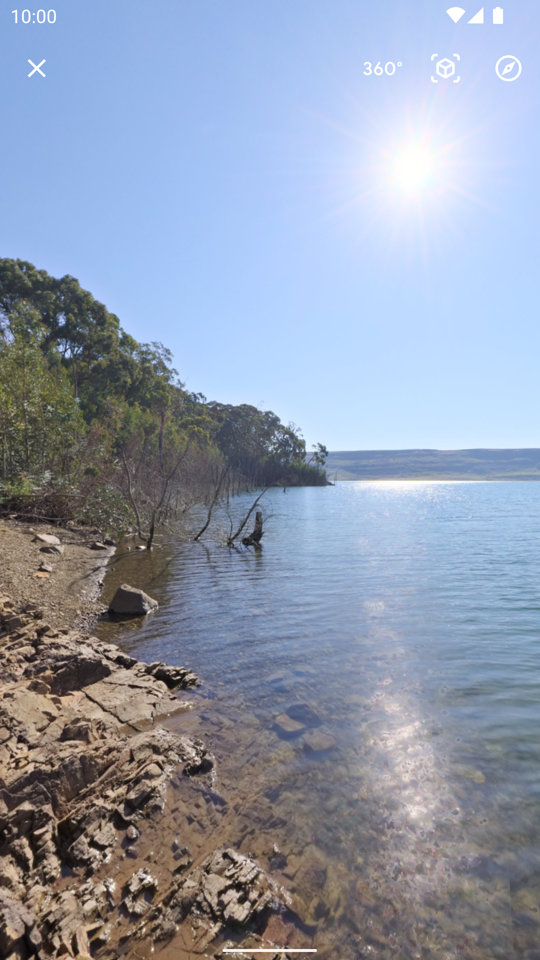

🌐 <b>తెలుగు</b> · ఇతర భాషలు (88)
<a href="../README.md">English</a> · <a href="README.af.md">Afrikaans</a> · <a href="README.ar.md">العربية</a> · <a href="README.az.md">Azərbaycanca</a> · <a href="README.be.md">Беларуская</a> · <a href="README.bg.md">Български</a> · <a href="README.bi.md">Bislama</a> · <a href="README.bn.md">বাংলা</a> · <a href="README.br.md">Brezhoneg</a> · <a href="README.bs.md">Bosanski</a> · <a href="README.ca.md">Català</a> · <a href="README.cs.md">Čeština</a> · <a href="README.cv.md">Чӑвашла</a> · <a href="README.da.md">Dansk</a> · <a href="README.de.md">Deutsch</a> · <a href="README.de_CH.md">Deutsch (Schweiz)</a> · <a href="README.el.md">Ελληνικά</a> · <a href="README.en_GB.md">English (UK)</a> · <a href="README.eo.md">Esperanto</a> · <a href="README.es.md">Español</a> · <a href="README.et.md">Eesti</a> · <a href="README.eu.md">Euskara</a> · <a href="README.fa.md">فارسی</a> · <a href="README.fi.md">Suomi</a> · <a href="README.fil.md">Filipino</a> · <a href="README.fr.md">Français</a> · <a href="README.ga.md">Gaeilge</a> · <a href="README.gl.md">Galego</a> · <a href="README.gsw.md">Alemannisch</a> · <a href="README.gu.md">ગુજરાતી</a> · <a href="README.he.md">עברית</a> · <a href="README.hi.md">हिन्दी</a> · <a href="README.hr.md">Hrvatski</a> · <a href="README.hu.md">Magyar</a> · <a href="README.hy.md">Հայերեն</a> · <a href="README.id.md">Bahasa Indonesia</a> · <a href="README.is.md">Íslenska</a> · <a href="README.it.md">Italiano</a> · <a href="README.ja.md">日本語</a> · <a href="README.ka.md">ქართული</a> · <a href="README.kab.md">Taqbaylit</a> · <a href="README.kk.md">Қазақша</a> · <a href="README.km.md">ខ្មែរ</a> · <a href="README.kmr.md">Kurmancî</a> · <a href="README.kn.md">ಕನ್ನಡ</a> · <a href="README.ko.md">한국어</a> · <a href="README.kxm.md">ภาษาเขมรถิ่นไทย</a> · <a href="README.lb.md">Lëtzebuergesch</a> · <a href="README.lmo.md">Lombard</a> · <a href="README.lt.md">Lietuvių</a> · <a href="README.lv.md">Latviešu</a> · <a href="README.mfa.md">Bahasa Melayu Kelantan</a> · <a href="README.mi.md">Te reo Māori</a> · <a href="README.mk.md">Македонски</a> · <a href="README.ml.md">മലയാളം</a> · <a href="README.mn.md">Монгол</a> · <a href="README.mr.md">मराठी</a> · <a href="README.ms.md">Bahasa Melayu</a> · <a href="README.nb_NO.md">Norsk bokmål</a> · <a href="README.ne.md">नेपाली</a> · <a href="README.nl.md">Nederlands</a> · <a href="README.nn.md">Norsk nynorsk</a> · <a href="README.pa.md">ਪੰਜਾਬੀ</a> · <a href="README.pl.md">Polski</a> · <a href="README.pt.md">Português</a> · <a href="README.pt_BR.md">Português (Brasil)</a> · <a href="README.ro.md">Română</a> · <a href="README.ru.md">Русский</a> · <a href="README.si.md">සිංහල</a> · <a href="README.sk.md">Slovenčina</a> · <a href="README.sl.md">Slovenščina</a> · <a href="README.sq.md">Shqip</a> · <a href="README.sr_Cyrl.md">Српски</a> · <a href="README.sr_Latn.md">Srpski</a> · <a href="README.sv.md">Svenska</a> · <a href="README.sw.md">Kiswahili</a> · <a href="README.swg.md">Schwäbisch</a> · <a href="README.ta.md">தமிழ்</a> · <a href="README.th.md">ไทย</a> · <a href="README.tl.md">Tagalog</a> · <a href="README.tr.md">Türkçe</a> · <a href="README.uk.md">Українська</a> · <a href="README.ur.md">اردو</a> · <a href="README.uz.md">Oʻzbekcha</a> · <a href="README.vi.md">Tiếng Việt</a> · <a href="README.yue_Hant.md">粵語</a> · <a href="README.zh_Hans.md">简体中文</a> · <a href="README.zh_Hant.md">繁體中文</a>

  

# Immuch360

**మీ మీడియా. ఏ స్క్రీన్ అయినా. ప్రతి దృక్కోణం.**

🌐 <a href="https://immuch360.com/te/"><b>immuch360.com</b></a>

మీ డివైస్, మీ NAS, మీ Immich సర్వర్, మీ కెమెరాలు మరియు మీ డ్రోన్ నుండి ఫ్లాట్, 360° మరియు 3D ఫోటోలు మరియు వీడియోలు. ఖాతా అవసరం లేదు. Immuch360 ఒక ఉచిత, ఓపెన్ సోర్స్ యాప్, ఇది మీ ఫోటోలు మరియు వీడియోలను అవి ఉన్న చోటే చదివి, ప్రతి దాన్నీ దానికి సరిపోయే వీక్షకంలో ప్లే చేస్తుంది: ఫ్లాట్‌గా, మీరు చుట్టూ చూసే గోళంగా, 3Dలో, లేదా హెడ్‌సెట్‌లో మీ చుట్టూ అంతటా. ఇది ఫోన్‌లు, టాబ్లెట్‌లు, TVలు, Meta Quest హెడ్‌సెట్‌లు మరియు కంప్యూటర్‌లలో పనిచేస్తుంది. దీని వెబ్‌సైట్, [immuch360.com](https://immuch360.com/te/), ప్రతి స్క్రీన్‌పై ఇది ఏమి చేస్తుందో 89 భాషలలో చూపిస్తుంది.

**build 52 మరియు desktop build 32లో కొత్తవి, వెర్షన్ 3.4.7.** మీ ఫోన్ నుండి, ["దీనిలో ప్లే చేయండి…"](#show-your-photos-and-videos-on-the-tv-from-your-phone) ఇప్పుడు మీ Immich లైబ్రరీ, మీ షేర్‌లు మరియు Jellyfin మరియు Emby యొక్క ఫోటోలు మరియు వీడియోలను ఒక TV, ఒక Meta Quest లేదా Immuch360 నడిచే కంప్యూటర్‌కు పంపుతుంది, అది వాటిని తన స్వంత ఖాతాతో తెరుస్తుంది, లేదా ఒక Chromecast లేదా Google TVకి పంపుతుంది, మరియు ఫోన్‌లోని మునుపటి, స్లైడ్‌షో మరియు తరువాత పెద్ద స్క్రీన్‌ను ముందుకు నడిపిస్తాయి; ఇంకా పరికరంపై లేదా నిజమైన Cast పరికరంతో ప్రయత్నించలేదు. మీ ఫోటోలు మరియు వీడియోల పేర్లు [వాటి థంబ్‌నెయిల్‌లపై చదవగలిగేలా ఉంటాయి](#play-the-files-of-a-nas-a-computer-a-media-server-or-plex), అలాగే బ్యాడ్జ్‌లు, వ్యవధులు మరియు టైమ్‌లైన్ నెలలు కూడా. కంప్యూటర్‌లలో, మీరు ఇన్‌స్టాల్ చేసిన AI భాగాలు తరువాతి build వాటిలో ఒకదాని కొత్త వెర్షన్‌ను తెచ్చినప్పుడు [ఒక్క క్లిక్‌లో నవీకరించబడతాయి](#update-the-ai-components-in-one-click), ఎప్పుడూ మీటర్ కనెక్షన్‌లో కాదు, మరియు ప్రతి ఇన్‌స్టాల్ చేసిన వెర్షన్ దాని నవీకరణ తనిఖీ అయ్యే వరకు ఉంచబడుతుంది. Linuxకు [ఒక AppImage](#linux) వస్తుంది, అది ఇన్‌స్టాల్ చేయకుండానే నడుస్తుంది మరియు, ఒక లైబ్రరీ లేనప్పుడు, దాన్ని ఇన్‌స్టాల్ చేసే మీ డిస్ట్రిబ్యూషన్ కమాండ్‌ను ఇస్తుంది, Arch Linux, openSUSE Tumbleweed, Ubuntu 22.04, Debian 12 మరియు Fedora 44పై CI తనిఖీ చేసింది. iPhone మరియు iPad యాప్ Xcode 27 మరియు iOS 27 SDKతో నిర్మించబడుతుంది.

**build 33 నుండి 51 వరకు కొత్తవి.** [మీరు ఆపిన చోటు నుండి సినిమాలు కొనసాగుతాయి](#pick-up-a-film-where-you-stopped). అవి ముందుగానే మొదలవుతాయి, మరియు నెమ్మదైన సర్వర్ నుండి అవి [ఆగిపోకుండా ప్లే అవుతూనే ఉంటాయి](#when-a-video-waits-or-will-not-play). ఫోన్‌లు మరియు కంప్యూటర్‌లలో టైమ్‌లైన్ [నెలలు మరియు సంవత్సరాల వరకు జూమ్ అవుట్ అవుతుంది](#find-a-month-or-a-year-in-a-long-timeline). Android ఫోన్ లేదా Meta Questలో, ["ఫోల్డర్‌ను బ్రౌజ్ చేయండి"](#browse-a-folder-of-your-phone-or-headset) పరికరంలోని ఫోల్డర్‌ను షేర్ లాగా తెరుస్తుంది, TIFF ఫోటోలు కనిపిస్తాయి. Android TV [రిమోట్‌తో తేదీ ప్రకారం వెతుకుతుంది](#on-android-tv-and-google-tv), Meta Quest 3 లేదా 3S [గాసియన్ స్ప్లాట్‌లను తెరుస్తుంది](#explore-gaussian-splats-in-a-meta-quest-3-or-3s), వాటిని కుడి థంబ్‌స్టిక్‌తో తిప్పవచ్చు, SPZ వెర్షన్ 4 తో సహా, ఒక కంప్యూటర్ [మీ NAS లోని ఫోటోల 3D వెర్షన్‌లను తయారు చేస్తుంది](#turn-one-photo-into-3d-a-scene-a-panorama). రెండు గ్రాఫిక్స్ చిప్‌లు ఉన్న Windows ల్యాప్‌టాప్‌లో యాప్ [ఇప్పుడు వేగవంతమైన చిప్‌పై నడుస్తుంది](#when-a-video-waits-or-will-not-play), కాబట్టి 8K సినిమాలు సాఫీగా ప్లే అవుతాయి. గాసియన్ స్ప్లాట్‌లు ఇప్పుడు [కంప్యూటర్‌లలో మరియు Android ఫోన్‌లు మరియు టాబ్లెట్‌లలో తెరుచుకుంటాయి](#explore-gaussian-splats-on-your-phone-tablet-or-computer), ఒక Windows కంప్యూటర్ AI ద్వారా [మీ ఫోటోలు లేదా ఒక వీడియో నుండి స్ప్లాట్ దృశ్యాలను తయారు చేస్తుంది](#make-a-splat-scene-from-your-photos-or-a-video-ai), మీ Immich సర్వర్ వాటిని మీ టైమ్‌లైన్ నుండి తెరుచుకునే [ఫోటోల లోపల ఉంచుతుంది](#keep-a-splat-scene-on-your-immich-server), మరియు కంప్యూటర్‌లు [AV2 వీడియోలను ప్లే చేస్తాయి](#play-av2-videos-on-your-computer). build 42 నుండి, Insta360, GoPro MAX మరియు DJI Osmo 360 కెమెరాల రా వీడియోలు, మీ Immich లైబ్రరీ, ఒక షేర్ లేదా ఒక ఫోల్డర్ నుండి, Android ఫోన్‌లు, టాబ్లెట్‌లు మరియు TVలలో [కెమెరా గైరోస్కోప్‌తో స్థిరీకరించబడి ప్లే అవుతాయి](#stabilise-your-360-videos-with-the-cameras-gyroscope), desktop build 22 స్ప్లాట్ మేకర్ మీరు దగ్గరగా చూసే దృశ్యాల కోసం [వివరమైన నాణ్యతను అందిస్తుంది](#make-a-splat-scene-from-your-photos-or-a-video-ai), మరియు ఒక 360° పనోరమా [గ్రాఫిక్స్ కార్డ్‌లో 3.5 GiB ఖాళీతో మొదలవుతుంది](#turn-one-photo-into-3d-a-scene-a-panorama). iPhone మరియు iPad యాప్ [App Storeలో ఉంది](https://apps.apple.com/us/app/immuch360-360-3d-player/id6817655965), వెర్షన్ 3.4.3. build 43 నుండి, యాప్ అప్‌డేట్ నోటీసు ఫోన్‌లు మరియు టాబ్లెట్‌లలో Google Play లేదా App Storeను తెరుస్తుంది; దీని వెబ్‌సైట్, [immuch360.com](https://immuch360.com/te/), 7 నవంబర్‌న ప్రారంభమైంది. build 44 మరియు desktop build 24 నుండి, Meta Quest 3 లేదా 3S [300,000 గాసియన్‌ల వరకు ఉన్న స్ప్లాట్‌లను చూపిస్తుంది](#explore-gaussian-splats-in-a-meta-quest-3-or-3s), కంప్యూటర్‌లు [Ctrl మరియు Shiftతో అనేక ఫోటోలు మరియు వీడియోలను ఎంచుకుంటాయి](#use-your-computer-as-the-media-player), డీకోడర్ ఒక వీడియోను తిరస్కరించే TV [సర్వర్ యొక్క మరో ఫైల్‌ను తనంతట తానే ప్లే చేస్తుంది](#when-a-video-waits-or-will-not-play), రెండు గ్రాఫిక్స్ కార్డ్‌లు ఉన్న ల్యాప్‌టాప్‌లో ఎంచుకున్న కార్డ్‌పై పనోరమాలు నడుస్తాయి, మరియు Quest మరియు కంప్యూటర్‌ల అప్‌డేట్ నోటీసు వాటి స్టోర్ లేదా డౌన్‌లోడ్ పేజీని తెరుస్తుంది, అనేక పరిష్కారాలతో. build 45 మరియు desktop build 25 నుండి, ప్రతి ప్లాట్‌ఫామ్‌లో వెర్షన్ 3.4.0, యాప్ Immich యొక్క 11 తదుపరి పరిష్కారాలతో Immich 3.4.0 యాప్‌ను అనుసరిస్తుంది, [Immich 3.4 సర్వర్‌ల JPEG XL ఫోటోలను](#keep-your-immich-library-with-more) చూపిస్తుంది, [మీ Plex సినిమాలను సంవత్సరం వారీగా](#watch-your-plex-films) తెరుస్తుంది, ప్రతి సినిమాకు ఒక పేజీ, పరికరానికి వాటి డౌన్‌లోడ్ మరియు ఫోన్ నుండి TVలో వాటి ప్లేబ్యాక్‌తో, స్టోర్ buildలలో రేటింగ్ అడగవచ్చు, మరియు కంప్యూటర్‌లలో దాని వీడియో భాగాలను [వాటి స్వంత ఓపెన్ రిపోజిటరీల నుండి](#licences-and-credits) తీసుకుంటుంది. build 46 మరియు desktop build 26 నుండి, వెర్షన్ 3.4.1, 360° కెమెరాల రా వీడియోలు iPhone మరియు iPadలో, Meta Questలో మరియు Windowsలో కూడా [స్థిరీకరించబడి ప్లే అవుతాయి](#stabilise-your-360-videos-with-the-cameras-gyroscope), Meta Quest [తన స్వంత ప్లేయర్ డీకోడ్ చేయలేని Plex సినిమాలను libmpvతో ప్లే చేస్తుంది](#watch-your-plex-films), ఒక ఫోన్ [అలాంటి సినిమాను Chromecast లేదా Google TVకి పంపుతుంది](#watch-your-plex-films), మరియు 3D ఫోటో యొక్క AI లోతు [మీరు ఎంచుకున్న బలాన్ని తీసుకుంటుంది](#turn-one-photo-into-3d-a-scene-a-panorama); మీ Plex ఖాతాతో సైన్ ఇన్ చేసి కూడా కొత్త సర్వర్‌ను జోడించవచ్చు, మరియు యాప్ [తన సెట్టింగ్‌లను ఒక ఫైల్‌లో ఉంచుతుంది](#keep-your-settings-in-a-file). build 47 మరియు desktop build 27 నుండి, వెర్షన్ 3.4.2, ఒక Plex సినిమా [పరికరం డీకోడ్ చేసే ఆడియో ట్రాక్‌ను ప్లే చేస్తుంది](#watch-your-plex-films) మరియు ఏదో చెబుతుంది, స్క్రీన్‌కు సరిపడే వెర్షన్‌ను తెరుస్తుంది మరియు నెమ్మదైన కనెక్షన్‌లో తేలికైన దాన్ని అందిస్తుంది, Windows మరియు macOS దాని Dolby TrueHD ధ్వనిని ప్లే చేస్తాయి, Android [దాని డౌన్‌లోడ్‌ను ఒక నోటిఫికేషన్‌లో చూపిస్తుంది](#watch-your-plex-films) మరియు Android TV కూడా సినిమాలను డౌన్‌లోడ్ చేస్తుంది, మరియు [బ్యాటరీ Tapo కెమెరాలు లైవ్‌గా చూపిస్తాయి](#watch-your-home-cameras-on-the-big-screen); ఖాతాలతో ఒక సెట్టింగ్‌ల ఫైల్‌ను పునరుద్ధరిస్తే ఇప్పుడు మీరు మీ Immich సర్వర్‌కు సైన్ ఇన్ అవుతారు. build 48 మరియు desktop build 28 నుండి, వెర్షన్ 3.4.3, ఒక Windows కంప్యూటర్ SteamVR, Meta Horizon Link లేదా మరో OpenXR రన్‌టైమ్ ద్వారా [మీ వీడియోలను ఒక PC VR హెడ్‌సెట్‌లో ప్లే చేస్తుంది](#watch-your-videos-in-a-pc-vr-headset-from-windows) (ప్రాజెక్ట్ ఇంకా హెడ్‌సెట్‌లో ప్రయత్నించలేదు), ONVIF ద్వారా కనుగొన్న లేదా వాటి RTSP లింక్‌తో జోడించిన [వేరే బ్రాండ్ కెమెరాలు లైవ్‌గా చూపిస్తాయి](#cameras-of-other-brands-over-onvif-or-rtsp) (అనుకరించిన కెమెరాతో తనిఖీ చేయబడింది, వేరే బ్రాండ్ నిజమైన కెమెరాను ఇంకా ప్రయత్నించలేదు), [DJI Osmo 360 II మరియు GoPro MAX 2 రా వీడియోలు స్థిరీకరించబడి ప్లే అవుతాయి](#open-the-raw-files-of-360-cameras), Plex సినిమాలు [ఇకపై ఫోన్‌లకు చాలా నెమ్మదిగా రావు](#when-a-video-waits-or-will-not-play), LG మరియు Samsung TVలు [పక్కకు పడుకున్న వీడియోను](#on-a-samsung-tv-tizen) ఒక్క బటన్‌తో తిప్పుతాయి (ఇంకా LG TVలో ప్రయత్నించలేదు; issue 17 లోని Samsung TV తిప్పడాన్ని నిరాకరించింది), మరియు అప్‌డేట్ చేసిన సర్వర్‌కు "Server update is available" ఇకపై కనిపించదు. build 49 మరియు desktop build 29 నుండి, వెర్షన్ 3.4.4, యాప్ [మీ Jellyfin మరియు Emby సర్వర్‌లను తానే చదువుతుంది](#watch-your-jellyfin-and-emby-libraries) (ఇంకా పరికరంపై ప్రయత్నించలేదు), మీ నెట్‌వర్క్‌లో కనుగొని TVలో లేదా హెడ్‌సెట్‌లో Quick Connectతో సైన్ ఇన్ చేస్తుంది, 360° వీడియో 360°గానే ఉండేలా వాటి అసలు ఫైళ్లను ప్లే చేస్తుంది; Meta Quest పెద్ద స్క్రీన్‌పై, ఫోటోలు [మీరు బ్రౌజ్ చేస్తున్నప్పుడు మీరు సెట్ చేసిన పరిమాణం మరియు స్థానాన్ని ఉంచుకుంటాయి, మరియు స్లైడ్‌షోగా ప్లే అవుతాయి](#browse-your-photos-on-the-big-screen-of-the-quest) (ప్రాజెక్ట్ ఇంకా హెడ్‌సెట్‌లో ప్రయత్నించలేదు); ఫోన్‌లు మరియు టాబ్లెట్‌ల 360° వీడియో ప్లేయర్ [360° ఫోటోల నియంత్రణలను పొందుతుంది](#360-videos-on-your-phone-with-the-controls-of-360-photos), ఒక గైరోస్కోప్ బటన్, జూమ్ చేయడానికి పించ్ మరియు నేరుగా పైకి లేదా కిందకు డ్రాగ్ (ఒక వినియోగదారు Samsung Galaxy S25 Ultraపై ప్రయత్నించారు, ఇంకా iPhoneలో కాదు); ఒక కంప్యూటర్ AIతో [మీ 2D వీడియోలను 3D వీడియోలుగా మారుస్తుంది](#turn-your-2d-videos-into-3d-on-your-computer) (ఇంకా 3D స్క్రీన్‌పై లేదా హెడ్‌సెట్‌లో ప్రయత్నించలేదు); మరియు Samsung TVలు [తిప్పాల్సిన వీడియోను Samsung స్వంత ప్లేయర్‌కు అప్పగిస్తాయి](#on-a-samsung-tv-tizen), దాన్ని issue 17 యొక్క TV ప్లే చేస్తుంది కానీ తిప్పడానికి నిరాకరిస్తుంది. build 50 మరియు desktop build 30 నుండి, వెర్షన్ 3.4.5, Meta Quest యొక్క 2D విండోలో వీడియో ప్లే అవుతున్నప్పుడు, విండో build 48 మరియు 49లో లాగా సెకనుకు సుమారు 10 సార్లకు బదులుగా [డిస్‌ప్లే రేటులో మళ్లీ గీయబడుతుంది](#step-inside-your-photos-and-videos-with-a-meta-quest) (Meta Quest 3పై కొలవబడింది), Android TV [రిమోట్‌తో ఫోటోను జూమ్ చేస్తుంది](#on-android-tv-and-google-tv) మరియు బాణాలతో దాన్ని కదుపుతుంది (కొత్తది, ఇంకా TVలో ప్రయత్నించలేదు), మరియు మూడు సవరణలు mlc70 యొక్క Android TV fork నుండి వస్తాయి: వేగవంతమైన స్వైప్ ఇకపై వెనుక వదిలిన ఫోటో వివరాలను చూపదు, యానిమేటెడ్ ఫోటో తన మెమరీని విడుదల చేస్తుంది, మరియు స్థానం ఫిల్టర్ కొత్త దేశం యొక్క నగరాలను అందిస్తుంది. build 51 మరియు desktop build 31 నుండి, వెర్షన్ 3.4.6, [మెరుగుపరచు (AI)](#make-a-photo-sharper-on-your-computer-ai) Windows మరియు Linuxలో మసకగా ఉన్న ఫోటో యొక్క మరింత పదునైన కాపీని అసలు పక్కన తయారు చేస్తుంది, మూడు స్థాయిలలో, ప్రతి ఒక్కటి RTX 4060 ఉన్న ఒక PCలో ఒకసారి నడిచింది, సహజం Apple చిప్ ఉన్న Macపై కూడా అందుబాటులో ఉంది (ఇంకా Macలో ప్రయత్నించలేదు), ఒక కంప్యూటర్ AIతో [360° వీడియోను 360° 3D వీడియోగా మారుస్తుంది](#a-360-video-turned-into-a-360-3d-video), Windowsలో 3D వీడియోల లోతును గ్రాఫిక్స్ కార్డ్ అంచనా వేస్తుంది, AI ఫీచర్‌లు మీ సర్వర్ మరియు ఒక షేర్ వీడియోలను నేరుగా తీసుకుంటాయి, సెట్టింగ్‌ల ఫైల్‌కు [లైబ్రరీలో దాని కార్డ్ ఉంది](#keep-your-settings-in-a-file), ఒక TV దాన్ని నెట్‌వర్క్ షేర్‌లో సేవ్ చేస్తుంది, కంప్యూటర్‌లలో Escape ఒక అడుగు వెనక్కి వెళ్తుంది, స్టోర్ buildలు రేటింగ్‌ను [తక్కువసార్లు మరియు మరింత మృదువుగా](#privacy) అడుగుతాయి, Linux TIFF ఫోటోలు, స్ప్లాట్ దృశ్యాలు మరియు ఒక కన్నుతో 3D వీడియోలను చూపిస్తుంది, మరియు రెండు క్రాష్‌లు సరిచేయబడ్డాయి.

  Immich మొబైల్ యాప్ యొక్క అనధికారిక ఫోర్క్. Immich లేదా FUTO తో సంబంధం లేదు. పేరు "I am much 360" అని చదవబడుతుంది.

<b>విషయసూచిక</b>

- [ఇది ఎవరి కోసం](#who-it-is-for)
- [ఏ స్క్రీన్‌లు](#which-screens), [అవి కలిసి ఏమి చేస్తాయి](#use-cases) మరియు [ప్రతి స్క్రీన్ ఏమి చేస్తుంది](#what-each-screen-does)
- [మీరు ఏమి చేయగలరు](#what-you-can-do)
- [మీ డివైస్‌లో పొందండి](#get-it-on-your-device)
- [ఎలా చేయాలి](#how-to)
  - [సర్వర్‌తో లేదా లేకుండా మీ ఫోటోలు మరియు వీడియోలను చూడండి](#watch-your-photos-and-videos-with-or-without-a-server)
  - [పనోరమాలు, 360°, VR180 మరియు 3D ను అన్వేషించండి](#explore-panoramas-360-vr180-and-3d): [ఫోన్‌లలో 360° వీడియోలు](#360-videos-on-your-phone-with-the-controls-of-360-photos)
  - [ఒక ఫోటోను 3D, ఒక దృశ్యం, ఒక పనోరమాగా మార్చండి](#turn-one-photo-into-3d-a-scene-a-panorama): [ఒక్క క్లిక్‌లో నవీకరించబడే AI భాగాలు](#update-the-ai-components-in-one-click)
  - [మీ కంప్యూటర్‌లో మీ 2D వీడియోలను 3Dగా మార్చండి](#turn-your-2d-videos-into-3d-on-your-computer): [360° వీడియోలను 360° 3Dకి](#a-360-video-turned-into-a-360-3d-video)
  - [మీ కంప్యూటర్‌లో ఒక ఫోటోను మరింత పదునుగా చేయండి (AI)](#make-a-photo-sharper-on-your-computer-ai)
  - [రిమోట్‌తో TVలో చూడండి](#watch-on-the-tv-with-the-remote): [Android TV మరియు Google TV](#on-android-tv-and-google-tv), [LG](#on-an-lg-tv-webos), [Samsung](#on-a-samsung-tv-tizen)
  - [మీ ఫోన్‌తో TV, హెడ్‌సెట్ లేదా కంప్యూటర్‌లో సైన్ ఇన్ చేయండి](#sign-in-a-tv-a-headset-or-a-computer-with-your-phone)
  - [మీ ఫోన్ నుండి మీ ఫోటోలు మరియు వీడియోలను TVలో చూపించండి](#show-your-photos-and-videos-on-the-tv-from-your-phone)
  - [Meta Questతో మీ ఫోటోలు మరియు వీడియోల లోపలికి అడుగుపెట్టండి](#step-inside-your-photos-and-videos-with-a-meta-quest): [పెద్ద స్క్రీన్](#browse-your-photos-on-the-big-screen-of-the-quest), [కియోస్క్ మోడ్](#kiosk-mode-for-an-exhibition-or-a-shop)
  - [Meta Quest 3 లేదా 3Sలో గాసియన్ స్ప్లాట్‌లను అన్వేషించండి](#explore-gaussian-splats-in-a-meta-quest-3-or-3s)
  - [మీ ఫోన్, టాబ్లెట్ లేదా కంప్యూటర్‌లో గాసియన్ స్ప్లాట్‌లను అన్వేషించండి](#explore-gaussian-splats-on-your-phone-tablet-or-computer)
  - [మీ ఫోటోలు లేదా ఒక వీడియో నుండి స్ప్లాట్ దృశ్యాన్ని తయారు చేయండి (AI)](#make-a-splat-scene-from-your-photos-or-a-video-ai)
  - [మీ Immich సర్వర్‌లో స్ప్లాట్ దృశ్యాన్ని ఉంచండి](#keep-a-splat-scene-on-your-immich-server)
  - [NAS, కంప్యూటర్, మీడియా సర్వర్ లేదా Plex ఫైళ్లను ప్లే చేయండి](#play-the-files-of-a-nas-a-computer-a-media-server-or-plex): [మీ సినిమాలు సంవత్సరం వారీగా](#watch-your-plex-films), [Jellyfin మరియు Emby](#watch-your-jellyfin-and-emby-libraries)
  - [మీ ఫోన్ లేదా హెడ్‌సెట్‌లోని ఫోల్డర్‌ను బ్రౌజ్ చేయండి](#browse-a-folder-of-your-phone-or-headset)
  - [మీరు ఆపిన చోటు నుండి సినిమాను కొనసాగించండి](#pick-up-a-film-where-you-stopped)
  - [వీడియో వేచి ఉన్నప్పుడు లేదా ప్లే కానప్పుడు](#when-a-video-waits-or-will-not-play)
  - [మీ Immich లైబ్రరీని ఉంచుకోండి, ఇంకా మరిన్నిటితో](#keep-your-immich-library-with-more)
  - [పొడవైన టైమ్‌లైన్‌లో ఒక నెల లేదా సంవత్సరాన్ని కనుగొనండి](#find-a-month-or-a-year-in-a-long-timeline)
  - [మీ ఇంటి కెమెరాలను పెద్ద స్క్రీన్‌పై చూడండి](#watch-your-home-cameras-on-the-big-screen): [వేరే బ్రాండ్‌లు](#cameras-of-other-brands-over-onvif-or-rtsp)
  - [మీ DJI డ్రోన్](#your-dji-drone): [లైవ్ వీడియో](#see-what-your-drone-sees-on-your-phone), [Questలో లేదా Android TVలో](#watch-it-in-a-meta-quest-or-on-an-android-tv), [ఇంపోర్ట్](#bring-a-drones-or-a-camera-cards-photos-and-videos-to-immich)
  - [360° కెమెరాల రా ఫైళ్లను తెరవండి](#open-the-raw-files-of-360-cameras)
  - [కెమెరా గైరోస్కోప్‌తో మీ 360° వీడియోలను స్థిరీకరించండి](#stabilise-your-360-videos-with-the-cameras-gyroscope)
  - [ఒక్క కీతో ఫోటోను తిప్పండి](#turn-a-photo-with-one-key)
  - [మీ కంప్యూటర్‌ను మీడియా ప్లేయర్‌గా ఉపయోగించండి](#use-your-computer-as-the-media-player)
  - [Windows నుండి, మీ వీడియోలను ఒక PC VR హెడ్‌సెట్‌లో చూడండి](#watch-your-videos-in-a-pc-vr-headset-from-windows)
  - [మీ కంప్యూటర్‌లో AV2 వీడియోలను ప్లే చేయండి](#play-av2-videos-on-your-computer)
  - [మీ సెట్టింగ్‌లను ఒక ఫైల్‌లో ఉంచండి](#keep-your-settings-in-a-file)
- [Immichతో పోలిక](#compared-with-immich)
- [గోప్యత](#privacy)
- [లైసెన్స్‌లు మరియు క్రెడిట్‌లు](#licences-and-credits)
- [రోడ్‌మ్యాప్](#roadmap)
- [డాక్యుమెంటేషన్](#documentation)

## ఇది ఎవరి కోసం

- **మీరు 360° లేదా 3Dలో చిత్రీకరిస్తారు** మరియు మీ షాట్‌లను ఫ్లాట్‌గా, రెట్టింపుగా లేదా సాగదీసినట్లుగా కాకుండా, వాటి లోపల చుట్టూ చూడాలనుకుంటారు, మరియు ఫోన్ ఫోటోలను తిప్పినట్లే మీ 360° వీడియోలను ఫోన్‌లో తిప్పాలనుకుంటారు: [360°, VR180 మరియు 3D](#explore-panoramas-360-vr180-and-3d), [ఫోన్‌లలో 360° వీడియోలు](#360-videos-on-your-phone-with-the-controls-of-360-photos).
- **మీరు 360° కెమెరాతో చేతిలో, బైక్‌పై లేదా హెల్మెట్‌పై చిత్రీకరిస్తారు** మరియు Immichలో, ఒక షేర్‌లో లేదా ఒక ఫోల్డర్‌లో ఉంచిన మీ Insta360, GoPro MAX లేదా MAX 2, DJI Osmo 360 లేదా Osmo 360 II కెమెరా రా వీడియోలు మీ ఫోన్‌లో, మీ TVలో, మీ Meta Questలో లేదా మీ Windows కంప్యూటర్‌లో సమంగా, స్థిరంగా ప్లే కావాలనుకుంటారు: [కెమెరా గైరోస్కోప్‌తో స్థిరీకరించబడినవి](#stabilise-your-360-videos-with-the-cameras-gyroscope).
- **మీ ఫోటోలు మరియు సినిమాలు NAS, కంప్యూటర్, Plex లేదా Immichలో ఉన్నాయి** మరియు ఏమీ కాపీ చేయకుండా వాటిని TVలో చూడాలనుకుంటారు: [TVలో](#watch-on-the-tv-with-the-remote), [NAS, షేర్‌లు మరియు Plex](#play-the-files-of-a-nas-a-computer-a-media-server-or-plex).
- **మీరు మీ సినిమాలను Plex సర్వర్‌లో ఉంచుతారు** మరియు సంవత్సరం వారీగా ఒకదాన్ని ఎంచుకోవాలని, అది మొదలయ్యే ముందు అది ఏమిటో చూడాలని, ప్రయాణానికి తీసుకెళ్లాలని, మీ ఫోన్ నుండి TVలో లేదా Chromecastలో ప్రారంభించాలని, మరియు మీ Android ఫోన్, TV లేదా Meta Quest డీకోడ్ చేయలేని సినిమాలను కూడా ప్లే చేయాలని అనుకుంటారు: [మీ సినిమాలు, సంవత్సరం వారీగా](#watch-your-plex-films).
- **మీరు మీ సినిమాలను Jellyfin లేదా Emby సర్వర్‌లో ఉంచుతారు** మరియు 360° మరియు 3D ఉన్నట్లే ఉంచి, మీ స్థానం సర్వర్‌లో ఉంచబడి, వాటిని మీ Meta Questలో, TVలో లేదా ఫోన్‌లో కావాలనుకుంటారు (ఇంకా పరికరంపై ప్రయత్నించలేదు): [Jellyfin మరియు Emby](#watch-your-jellyfin-and-emby-libraries).
- **మీ దగ్గర Meta Quest ఉంది** మరియు మీ స్వంత ఫోటోలు మరియు వీడియోల లోపలికి అడుగుపెట్టాలనుకుంటారు, మరియు మీరు సెట్ చేసిన పరిమాణం మరియు స్థానంలో ఒక పెద్ద స్క్రీన్‌పై, స్లైడ్‌షోగా కూడా, మీ ఫోటోలను బ్రౌజ్ చేయాలనుకుంటారు (ప్రాజెక్ట్ ఇంకా హెడ్‌సెట్‌లో ప్రయత్నించలేదు): [హెడ్‌సెట్‌లో](#step-inside-your-photos-and-videos-with-a-meta-quest), [పెద్ద స్క్రీన్](#browse-your-photos-on-the-big-screen-of-the-quest).
- **మీకు ఒక Windows కంప్యూటర్‌కు PC VR హెడ్‌సెట్ ఉంది** మరియు అందులో మీ చుట్టూ మీ 360° వీడియోలు, ఒక పెద్ద స్క్రీన్‌పై సినిమాలు కావాలనుకుంటారు (ప్రాజెక్ట్ ఇంకా హెడ్‌సెట్‌లో ప్రయత్నించలేదు): [ఒక PC VR హెడ్‌సెట్‌లో](#watch-your-videos-in-a-pc-vr-headset-from-windows).
- **మీ ఫోటోలు ఫ్లాట్‌గా ఉన్నాయి** మరియు మీకు అవి 3Dలో కావాలి, హెడ్‌సెట్‌లో లోపలికి వంగి చూసే దృశ్యంగా, లేదా ఒక 360° పనోరమా లోపల, 3D కెమెరా లేకుండా: [ఒక ఫోటోను 3D, ఒక దృశ్యం, ఒక పనోరమాగా మార్చండి](#turn-one-photo-into-3d-a-scene-a-panorama), కొత్తది, మీ స్వంత కంప్యూటర్‌లో AI తయారు చేస్తుంది.
- **మీ వీడియోలు ఫ్లాట్‌గా ఉన్నాయి**, మీ ఫోన్ క్లిప్‌లతో సహా, మరియు మీ స్వంత కంప్యూటర్‌లో తయారు చేసి, హెడ్‌సెట్ లేదా 3D స్క్రీన్ కోసం వాటిని 3Dలో, మరియు మీ 360° వీడియోలను 360° 3Dలో కావాలనుకుంటారు (ఇంకా 3D స్క్రీన్‌పై లేదా హెడ్‌సెట్‌లో ప్రయత్నించలేదు): [2D వీడియోలను 3Dకి](#turn-your-2d-videos-into-3d-on-your-computer), [360° నుండి 360° 3Dకి](#a-360-video-turned-into-a-360-3d-video).
- **మీ ఫోటోలు మసకగా ఉన్నాయి**, కొద్దిగా ఫోకస్ తప్పినవి లేదా తక్కువ వెలుతురులో తీసినవి, మరియు మీ స్వంత కంప్యూటర్‌లో తయారు చేసిన, అసలు పక్కన మరింత పదునైన కాపీ కావాలనుకుంటారు, కల్పించిన వివరాలు స్పష్టంగా చెప్పబడతాయి: [మెరుగుపరచు (AI)](#make-a-photo-sharper-on-your-computer-ai).
- **మీరు Immich నడుపుతారు** మరియు దాని యాప్‌తో పాటు ఇమ్మర్సివ్ వీక్షకాలు మరియు మీ ఫోన్ నుండి సైన్ ఇన్ చేసే పెద్ద స్క్రీన్‌లు కావాలనుకుంటారు: [మీ Immich లైబ్రరీ](#keep-your-immich-library-with-more), [Immichతో పోలిక](#compared-with-immich).
- **మీరు Tapo కెమెరాలతో మీ ఇంటిని గమనిస్తారు**, బ్యాటరీ కెమెరాలతో కూడా, లేదా ONVIF లేదా RTSP ద్వారా వేరే బ్రాండ్ కెమెరాలతో, మరియు వాటిని మీ ఫోటోల పక్కన, TVలో కూడా కావాలనుకుంటారు (ఒక సిమ్యులేటెడ్ కెమెరాకు వ్యతిరేకంగా తనిఖీ చేయబడింది): [ఇంటి కెమెరాలు](#watch-your-home-cameras-on-the-big-screen).
- **మీరు DJI డ్రోన్‌ను ఎగురవేస్తారు** మరియు DJI Fly లేకుండా దాని లైవ్ చిత్రాన్ని మీ ఫోన్‌లో, మరియు మీతో ఉన్నవారి కోసం Meta Questలో లేదా Android TVలో కావాలనుకుంటారు: [మీ డ్రోన్](#see-what-your-drone-sees-on-your-phone).
- **మీరు ప్రదేశాలను మరియు వస్తువులను 3Dలో, గాసియన్ స్ప్లాట్‌లుగా క్యాప్చర్ చేస్తారు,** లేదా వాటిని మీ స్వంత ఫోటోల నుండి తయారు చేయాలనుకుంటారు, మరియు మీ ఫోన్‌లో, మీ కంప్యూటర్‌లో లేదా హెడ్‌సెట్‌లో వాటి గుండా నడవాలనుకుంటారు: [ఫోన్, టాబ్లెట్ లేదా కంప్యూటర్‌లో](#explore-gaussian-splats-on-your-phone-tablet-or-computer), [మీ ఫోటోల నుండి తయారైనవి](#make-a-splat-scene-from-your-photos-or-a-video-ai), [Immichలో ఉంచినవి](#keep-a-splat-scene-on-your-immich-server).
- **మీ వద్ద AV2 వీడియోలు ఉన్నాయి**, AV1 తర్వాత వచ్చే ఫార్మాట్, మరియు వాటిని మీ కంప్యూటర్‌లో చూడాలనుకుంటారు: [మీ కంప్యూటర్‌లో AV2](#play-av2-videos-on-your-computer).
- **మీ ఇంట్లో అనేక స్క్రీన్‌లు ఉన్నాయి** మరియు అవి కలిసి పనిచేయాలని కోరుకుంటారు: [మీ స్క్రీన్‌లు కలిసి ఏమి చేస్తాయి](#use-cases).

సృష్టించాల్సిన Immuch360 ఖాతా ఏదీ లేదు, మరియు మా వద్దకు ఏమీ రాదు: యాప్ మీ డివైస్‌లతో మరియు మీరు ఎంచుకున్న సర్వర్‌లతో మాత్రమే మాట్లాడుతుంది, build 45 నుండి సినిమా పేజీ కోసం Wikipediaతో కూడా, build 46 నుండి మీరు plex.tvతో సైన్ ఇన్ చేసినప్పుడు దానితో, మరియు మీరు అడిగినప్పుడు మాత్రమే ఒక AI భాగాన్ని లేదా AV2 డీకోడర్‌ను డౌన్‌లోడ్ చేస్తుంది.

## ఏ స్క్రీన్‌లు

| ప్లాట్‌ఫారమ్ | ఎక్కడ పొందాలి | నవంబర్ 2026 నాటి స్థితి |
|---|---|---|
|  **Android** ఫోన్‌లు మరియు టాబ్లెట్‌లు | [Google Play](https://play.google.com/store/apps/details?id=com.aprogsys.immuch360) · [APK](https://github.com/freeKC/Immuch360/releases) | Google Playలో (build 47 16 నవంబర్‌న ప్రచురించబడింది; build 51 24 నవంబర్ నుండి Google సమీక్షలో ఉంది; తర్వాత build 52), build 52 GitHubలో, అక్కడ [రా 360° వీడియోలు స్థిరీకరించబడి ప్లే అవుతాయి](#stabilise-your-360-videos-with-the-cameras-gyroscope), [మీరు ఆపిన చోటు నుండి సినిమాలు కొనసాగుతాయి](#pick-up-a-film-where-you-stopped), ["ఫోల్డర్‌ను బ్రౌజ్ చేయండి"](#browse-a-folder-of-your-phone-or-headset) ఫోన్‌లోని ఫోల్డర్‌ను తెరుస్తుంది మరియు [గాసియన్ స్ప్లాట్‌లు తెరుచుకుంటాయి](#explore-gaussian-splats-on-your-phone-tablet-or-computer), ఒక షేర్ నుండి లేదా [మీ Immich టైమ్‌లైన్ నుండి](#keep-a-splat-scene-on-your-immich-server), [ఒక ఫైల్‌లో ఉంచిన సెట్టింగ్‌లు](#keep-your-settings-in-a-file), [ఒక నోటిఫికేషన్‌లో చూపిన సినిమా డౌన్‌లోడ్](#watch-your-plex-films), build 48 నుండి [లైవ్‌గా వేరే బ్రాండ్ కెమెరాలు](#cameras-of-other-brands-over-onvif-or-rtsp) (అనుకరించిన కెమెరాతో తనిఖీ చేయబడింది) మరియు, build 49 నుండి, [Jellyfin మరియు Emby సర్వర్‌లు](#watch-your-jellyfin-and-emby-libraries) (ఇంకా పరికరంపై ప్రయత్నించలేదు) మరియు [360° వీడియో ప్లేయర్‌లో 360° ఫోటోల నియంత్రణలు](#360-videos-on-your-phone-with-the-controls-of-360-photos) (ఒక వినియోగదారు Samsung Galaxy S25 Ultraపై ప్రయత్నించారు), మరియు build 51 నుండి [లైబ్రరీలో సెట్టింగ్‌ల ఫైల్ కార్డ్](#keep-your-settings-in-a-file), దాని ఫైల్ నెట్‌వర్క్ షేర్‌లో కూడా సేవ్ అవుతుంది, మరియు build 52 నుండి "దీనిలో ప్లే చేయండి…"తో [ఒక TV లేదా Chromecastకు పంపిన మీ ఫోటోలు మరియు వీడియోలు](#show-your-photos-and-videos-on-the-tv-from-your-phone) (ఇంకా పరికరంపై ప్రయత్నించలేదు) |
|  **iPhone మరియు iPad** | [App Store](https://apps.apple.com/us/app/immuch360-360-3d-player/id6817655965) | 22 నవంబర్ నుండి App Storeలో వెర్షన్ 3.4.5, [టైమ్‌లైన్‌లో నెలలు మరియు సంవత్సరాలు](#find-a-month-or-a-year-in-a-long-timeline), [మీరు ఆపిన చోటు నుండి కొనసాగే సినిమాలు](#pick-up-a-film-where-you-stopped), ఫోన్ నుండి [TV, హెడ్‌సెట్ లేదా కంప్యూటర్ సైన్ ఇన్](#sign-in-a-tv-a-headset-or-a-computer-with-your-phone), Immichలో ఉంచిన స్ప్లాట్ దృశ్యాలు వాటి ఫోటోగా చూపబడటం, Immich 3.4.0 పరిష్కారాలు మరియు దాని JPEG XL ఫోటోలు, [స్థిరీకరించిన రా 360° వీడియోలు](#stabilise-your-360-videos-with-the-cameras-gyroscope), [ఒక ఫైల్‌లో ఉంచిన సెట్టింగ్‌లు](#keep-your-settings-in-a-file), [బ్యాటరీ Tapo కెమెరాల లైవ్ వీక్షణం](#watch-your-home-cameras-on-the-big-screen) మరియు [వేరే బ్రాండ్ కెమెరాల లైవ్ వీక్షణం](#cameras-of-other-brands-over-onvif-or-rtsp)తో (అనుకరించిన కెమెరాతో తనిఖీ చేయబడింది), మరియు వెర్షన్ 3.4.4 నుండి [Jellyfin మరియు Emby సర్వర్‌లు](#watch-your-jellyfin-and-emby-libraries) (ఇంకా పరికరంపై ప్రయత్నించలేదు) మరియు [360° వీడియో ప్లేయర్‌లో 360° ఫోటోల నియంత్రణలు](#360-videos-on-your-phone-with-the-controls-of-360-photos)తో (ఇంకా iPhoneలో ప్రయత్నించలేదు); వెర్షన్ 3.4.6, Apple ఆమోదించిన build 51 యొక్క iPhone మరియు iPad వెర్షన్, [సెట్టింగ్‌ల ఫైల్ కార్డ్](#keep-your-settings-in-a-file) మరియు నెట్‌వర్క్ షేర్ నుండి దాని పునరుద్ధరణతో, తర్వాత వస్తుంది, ఆ తర్వాత Xcode 27తో నిర్మించిన వెర్షన్ 3.4.7, build 52 యొక్క iPhone మరియు iPad వెర్షన్; లేదా [దాన్ని మీరే నిర్మించండి](../docs/immuch360/build.md) |
|  **Android TV మరియు Google TV** | [Google Play](https://play.google.com/store/apps/details?id=com.aprogsys.immuch360) · [APK](#android-tv-and-google-tv) | Android TV మరియు Google TVలో యాప్‌ను అందించే Google Playలో, మరియు build 52 GitHubలో: [స్థిరీకరించిన రా 360° వీడియోలు](#stabilise-your-360-videos-with-the-cameras-gyroscope), [రిమోట్‌తో తేదీ ప్రకారం శోధన](#on-android-tv-and-google-tv), QR కోడ్‌ను స్కాన్ చేసి [మీ ఫోన్‌తో సైన్ ఇన్](#sign-in-a-tv-a-headset-or-a-computer-with-your-phone), వీడియో ప్లేయర్‌లో రిమోట్ కోసం టైమ్ బార్, ఆడియో మరియు సబ్‌టైటిల్‌లు, మరియు ఒక ఫోన్ రిలే చేసే [డ్రోన్ లైవ్ వీడియో](#watch-it-in-a-meta-quest-or-on-an-android-tv), [TVకి డౌన్‌లోడ్ చేసిన సినిమాలు](#watch-your-plex-films) మరియు, build 49 నుండి, Quick Connectతో సైన్ ఇన్ చేసే [Jellyfin మరియు Emby సర్వర్‌లు](#watch-your-jellyfin-and-emby-libraries) (ఇంకా పరికరంపై ప్రయత్నించలేదు) మరియు, build 50 నుండి, [రిమోట్‌తో జూమ్ చేసిన ఫోటోలు](#on-android-tv-and-google-tv) (Android TV ఎమ్యులేటర్‌పై పని చేస్తూ కనిపించింది, ఇంకా TVలో ప్రయత్నించలేదు), మరియు build 51 నుండి [నెట్‌వర్క్ షేర్‌లో సేవ్ చేసి దాని నుండి పునరుద్ధరించే సెట్టింగ్‌ల ఫైల్](#keep-your-settings-in-a-file) (Android TV ఎమ్యులేటర్‌పై పని చేస్తూ కనిపించింది), మరియు build 52 నుండి [ఒక ఫోన్ "దీనిలో ప్లే చేయండి…"తో పంపే ఫోటోలు మరియు వీడియోలు](#show-your-photos-and-videos-on-the-tv-from-your-phone) (ఇంకా TVలో ప్రయత్నించలేదు) |
| webOS 5.0 మరియు తరువాతి **LG TVలు** | [.ipk, వెర్షన్ 1.0.5](https://github.com/freeKC/Immuch360/releases/tag/webos-v1.0.5) · LG Content Store (సమీక్షలో) | వెర్షన్ 1.0.0, 24 అక్టోబర్‌న LG Content Storeకు సమర్పించబడింది, 26 అక్టోబర్ నుండి LG పరీక్షలలో ఉంది; వెర్షన్ 1.0.1, 27 అక్టోబర్ నుండి GitHubలో, బాణాలతో ఫోటోను జూమ్ చేస్తుంది మరియు ఫోటో ఇంకా లోడ్ అవుతున్నప్పుడు చెబుతుంది, మరియు వెర్షన్ 1.0.2, build 46తో GitHubలో, జపనీస్‌లో "సైన్ ఇన్"ను ログイン అని రాస్తుంది, వెర్షన్ 1.0.3, build 47తో, ఒక DLNA సర్వర్ ఫోల్డర్‌లో లైవ్ TV ఛానెల్‌లు ఉన్నప్పుడు చెబుతుంది, వాటిని అది ఇంకా ప్లే చేయలేదు, వెర్షన్ 1.0.4, build 48తో, [పక్కకు పడుకున్న వీడియోను](#on-an-lg-tv-webos) ఒక్క బటన్‌తో తిప్పుతుంది (ఇంకా LG TVలో ప్రయత్నించలేదు), మరియు వెర్షన్ 1.0.5, build 49తో, DLNA సర్వర్‌లలో దాని DLNA ప్లగిన్‌తో Jellyfin పేరును చూపిస్తుంది; LG యాప్‌ను ప్రచురించే వరకు, ఇది [Developer Mode](#lg-tvs-webos)లో ఇన్‌స్టాల్ అవుతుంది. వెర్షన్ 1.0.0 LG Cloud Test Labలోని webOS 25 TVలలో నడిచింది |
| Tizen 5.5 మరియు తరువాతి **Samsung TVలు** | [.wgt, వెర్షన్ 0.3.6](https://github.com/freeKC/Immuch360/releases/tag/tizen-v0.3.6) | అదే TV యాప్ యొక్క వెర్షన్ 0.3.6, మీ స్వంత Samsung సర్టిఫికేట్‌తో సైన్ చేసి [Developer mode](#samsung-tvs-tizen)లో ఇన్‌స్టాల్ చేయాలి; 0.1.0 ఒక టెస్టర్ Samsung TVలో నడిచింది, 0.2.0లో ఆ పరీక్ష నుండి వచ్చిన సవరణలు ఉన్నాయి, 0.3.0 LG వెర్షన్ 1.0.1 యొక్క ఫోటో జూమ్ మరియు లోడ్ అవుతోంది సూచికను జోడిస్తుంది, మరియు 0.3.1 LG వెర్షన్ 1.0.2 యొక్క జపనీస్ పదాలను, 0.3.2 ఫోన్‌లో నిలువుగా చిత్రీకరించిన వీడియోను సరైన దిశలో ప్లే చేస్తుంది ([issue 17](https://github.com/freeKC/Immuch360/issues/17)), మరియు 0.3.3 మరియు 0.3.4 [దాన్ని నిలువుగా నివేదించే TVలో తిప్పుతాయి](#on-a-samsung-tv-tizen) మరియు దాన్ని చేతితో తిప్పే ఒక బటన్‌ను జోడిస్తాయి, మరియు 0.3.5 మరియు 0.3.6 అలాంటి వీడియోను Samsung స్వంత ప్లేయర్‌కు అప్పగిస్తాయి; నివేదించిన వారి TVలో, 0.3.4 మరియు 0.3.5 చిత్రాన్ని పక్కకే వదిలేశాయి, TV భ్రమణాన్ని నిరాకరించింది, మరియు అక్కడ మార్గం మీ Immich సర్వర్ ట్రాన్స్‌కోడ్ చేసి, నిలువుగా నిల్వ చేసిన వీడియో; Samsung స్టోర్‌లో లేదు |
|  **Meta Quest** 2, Pro, 3 మరియు 3S | [Horizon Store](https://www.meta.com/experiences/immuch360/1384208401440714/) · [APK](#meta-quest) | Horizon Storeలో (వీడియో ప్లే అవుతున్నప్పుడు 2D విండో డిస్‌ప్లే రేటులో మళ్లీ గీయబడే build 50, 25 నవంబర్‌న ప్రచురించబడింది; తర్వాత build 52), build 52 GitHubలో, ఒక [కియోస్క్ మోడ్](#kiosk-mode-for-an-exhibition-or-a-shop)తో, ఇమ్మర్సివ్ వీక్షణంలో [స్థిరీకరించిన రా 360° వీడియోలు](#stabilise-your-360-videos-with-the-cameras-gyroscope), [అది డీకోడ్ చేయలేని సినిమాలను libmpv ప్లే చేయడం](#watch-your-plex-films)తో, Quest 3 మరియు 3Sలో [గాసియన్ స్ప్లాట్‌లు](#explore-gaussian-splats-in-a-meta-quest-3-or-3s) మరియు ఫ్లాట్ ఫోటోకు [AI లోతు](#turn-one-photo-into-3d-a-scene-a-panorama)తో, మరియు build 49 నుండి మీరు సెట్ చేసిన పరిమాణంలో [పెద్ద స్క్రీన్‌పై బ్రౌజ్ చేసే ఫోటోలు](#browse-your-photos-on-the-big-screen-of-the-quest), స్లైడ్‌షోగా కూడా (ప్రాజెక్ట్ ఇంకా హెడ్‌సెట్‌లో ప్రయత్నించలేదు), మరియు Quick Connectతో సైన్ ఇన్ చేసే [Jellyfin మరియు Emby సర్వర్‌లు](#watch-your-jellyfin-and-emby-libraries) (ఇంకా పరికరంపై ప్రయత్నించలేదు), మరియు build 51 నుండి ఇమ్మర్సివ్ వీక్షణానికి Horizon OS చాలా పాతదైన హెడ్‌సెట్ యాప్‌ను మూసివేయడానికి బదులుగా అప్‌డేట్ అడుగుతుంది (అలాంటి హెడ్‌సెట్‌పై ప్రయత్నించలేదు) |
|  **Windows** | [ఇన్‌స్టాలర్ లేదా ZIP](https://github.com/freeKC/Immuch360/releases/tag/desktop-v3.4.7-32) | desktop build 32, సైన్ చేయబడింది: ఫోటోలు, ఫ్లాట్ మరియు 360° వీడియోలు, షేర్‌లు, Plex, కెమెరాలు (అనుకరించిన కెమెరాతో తనిఖీ చేయబడింది), మీ ఫోన్‌తో సైన్ ఇన్, ఒక్క కీతో తిప్పే ఫోటోలు, 89 భాషలలో ఇంటర్‌ఫేస్, మరియు AI ద్వారా [మీ ఫోటోల నుండి తయారైన 3D ఫోటోలు, 3D దృశ్యాలు మరియు 360° పనోరమాలు](#turn-one-photo-into-3d-a-scene-a-panorama), మీ NAS ఫోటోలతో సహా; తెరిచిన, [మీ ఫోటోలు లేదా ఒక వీడియో నుండి తయారైన](#make-a-splat-scene-from-your-photos-or-a-video-ai) మరియు [Immichలో ఉంచిన](#keep-a-splat-scene-on-your-immich-server) [గాసియన్ స్ప్లాట్‌లు](#explore-gaussian-splats-on-your-phone-tablet-or-computer), [AV2 వీడియోలు](#play-av2-videos-on-your-computer), desktop build 22 నుండి [స్ప్లాట్ దృశ్యాల కోసం నాణ్యత ఎంపిక](#make-a-splat-scene-from-your-photos-or-a-video-ai) మరియు [3.5 GiB ఖాళీ గ్రాఫిక్స్ మెమరీ నుండి 360° పనోరమాలు](#turn-one-photo-into-3d-a-scene-a-panorama), మరియు desktop build 26 నుండి [స్థిరీకరించిన రా 360° వీడియోలు](#stabilise-your-360-videos-with-the-cameras-gyroscope) మరియు [లోతు బలం మరియు మరింత పదునైన అంచులతో 3D ఫోటోలు](#turn-one-photo-into-3d-a-scene-a-panorama), desktop build 27 నుండి [సినిమాల Dolby TrueHD ధ్వని మరియు Blu-ray సబ్‌టైటిల్‌లు](#watch-your-plex-films), desktop build 28 నుండి [ఒక PC VR హెడ్‌సెట్‌లో మీ వీడియోలు](#watch-your-videos-in-a-pc-vr-headset-from-windows) (ప్రాజెక్ట్ ఇంకా హెడ్‌సెట్‌లో ప్రయత్నించలేదు), మరియు desktop build 29 నుండి AIతో [మీ 2D వీడియోల నుండి తయారు చేసిన 3D వీడియోలు](#turn-your-2d-videos-into-3d-on-your-computer) (ఇంకా 3D స్క్రీన్‌పై లేదా హెడ్‌సెట్‌లో ప్రయత్నించలేదు), మరియు desktop build 31 నుండి AIతో [మీ ఫోటోల మరింత పదునైన కాపీలు](#make-a-photo-sharper-on-your-computer-ai) మరియు AIతో [360° 3D వీడియోలుగా మారిన 360° వీడియోలు](#a-360-video-turned-into-a-360-3d-video), గ్రాఫిక్స్ కార్డ్ అంచనా వేసే లోతు, నేరుగా తీసుకునే మీ సర్వర్ మరియు ఒక షేర్ వీడియోలు, మరియు ఒక అడుగు వెనక్కి వెళ్లడానికి Escape, మరియు desktop build 32 నుండి [ఒక్క క్లిక్‌లో నవీకరించబడే AI భాగాలు](#update-the-ai-components-in-one-click) |
|   **macOS మరియు Linux** | [.deb, .rpm, AppImage, DMG](https://github.com/freeKC/Immuch360/releases/tag/desktop-v3.4.7-32) | desktop build 32: ఫోటోలు, 360° ఫోటోలు మరియు ఫ్లాట్ వీడియోలు (360° వీడియోలు ఫ్లాట్‌గా ప్లే అవుతాయి), ఒక Immich సర్వర్ మరియు నెట్‌వర్క్ షేర్‌లు, మరియు మీ ఫోటోల నుండి AI తయారు చేసే [3D ఫోటోలు మరియు 3D దృశ్యాలు](#turn-one-photo-into-3d-a-scene-a-panorama), Linuxలో 8 GB గ్రాఫిక్స్ కార్డ్‌పై, దానిలో 3.5 GiB ఖాళీ నుండి, 360° పనోరమాలతో, మరియు [గాసియన్ స్ప్లాట్‌లు](#explore-gaussian-splats-on-your-phone-tablet-or-computer) మరియు [AV2 వీడియోలు](#play-av2-videos-on-your-computer) (ఇంకా Macలో ప్రయత్నించలేదు); desktop build 11 26 అక్టోబర్‌న ఒక Ubuntu 24.04 కంటైనర్‌లో మరియు ఒక Macలో ప్రయత్నించబడింది; desktop build 27 నుండి, macOSలో సినిమాల Dolby TrueHD ధ్వని; desktop build 29 నుండి, Linuxలో మరియు Apple చిప్ ఉన్న Macలో AIతో [మీ 2D వీడియోల నుండి తయారు చేసిన 3D వీడియోలు](#turn-your-2d-videos-into-3d-on-your-computer) (ఇంకా 3D స్క్రీన్‌పై లేదా హెడ్‌సెట్‌లో ప్రయత్నించలేదు); desktop build 31 నుండి, Linuxలో, AIతో [మీ ఫోటోల మరింత పదునైన కాపీలు](#make-a-photo-sharper-on-your-computer-ai), TIFF ఫోటోలు, తమ కొత్త ఫైళ్లను తామే చూపించే ఫోల్డర్‌లు, 4 GB గ్రాఫిక్స్ కార్డ్‌పై మీ ఫోటోల నుండి తయారైన స్ప్లాట్ దృశ్యాలు మరియు ఒక కన్నుతో ఫ్లాట్‌గా చూపించే 3D వీడియోలు, మరియు Apple చిప్ ఉన్న Macపై మెరుగుపరచు (AI) యొక్క సహజం స్థాయి (ఇంకా Macలో ప్రయత్నించలేదు); desktop build 32 నుండి, ఇతర Linux డిస్ట్రిబ్యూషన్‌ల కోసం [ఒక AppImage](#linux), Arch Linux మరియు openSUSEపై CI తనిఖీ చేసింది; macOSలో సైన్ చేయబడలేదు |

*స్థితులు ప్రతి రిలీజ్‌లో అప్‌డేట్ చేయబడతాయి; ప్రతి స్టోర్‌లో ఏముందో, దాని సమీక్షలో ఏముందో మరియు ప్రతి build [రిలీజ్ స్థితి](../docs/immuch360/release-status.md)లో ఉన్నాయి. [immuch360.com](https://immuch360.com/te/) వెబ్‌సైట్ ప్రతి స్క్రీన్ ఏమి చేస్తుందో, ప్రతి ఫంక్షన్‌కు ఎలా చేయాలి సూచనలను మరియు స్టోర్ లింక్‌లను 89 భాషలలో చూపిస్తుంది.*

  

### మీ స్క్రీన్‌లు కలిసి ఏమి చేస్తాయి

మీరు చూసే ప్రతి స్క్రీన్‌పై Immuch360ని ఇన్‌స్టాల్ చేయండి: ప్రతి ఒక్కటి మీ సోర్స్‌లను స్వయంగా చదువుతుంది, మరియు కొన్ని ఒక చిత్రాన్ని, ఒక ఫైల్‌ను లేదా సైన్ ఇన్‌ను మరొకదానికి అందిస్తాయి. ప్రతి చిత్రంలో, Immuch360 ఐకాన్ యాప్‌ను నడుపుతున్న పరికరాలను సూచిస్తుంది.

#### ప్రతి స్క్రీన్‌పై మీ NAS

  

**మీకు కావలసినవి:** SMB లేదా WebDAV షేర్ ఉన్న ఒక NAS, మరియు మీరు చూసే ప్రతి స్క్రీన్‌పై Immuch360.

ప్రతి స్క్రీన్‌పై షేర్‌ను జోడించండి, ప్రతి ఒక్కటి ఫోటోలు మరియు వీడియోలను అవి ఉన్న చోటి నుండే ప్లే చేస్తుంది, ఏదీ కాపీ చేయకుండా: ఫోన్‌లు, టాబ్లెట్‌లు, Android TV, ఒక Meta Quest, Windows, Linux మరియు macOS కంప్యూటర్‌లు, మరియు మీ Immich సర్వర్‌కు సైన్ ఇన్ అయిన LG TVలు (webOS 22 నుండి SMB). ఒక 360° ఫోటో ఫోన్ మరియు TVలో ఒక గోళంలా తిరుగుతుంది, మరియు హెడ్‌సెట్‌లో మిమ్మల్ని చుట్టుముడుతుంది. ఎలా చేయాలి: [NAS, కంప్యూటర్, మీడియా సర్వర్ లేదా Plex ఫైళ్లను ప్లే చేయండి](#play-the-files-of-a-nas-a-computer-a-media-server-or-plex).

#### ప్రతి స్క్రీన్‌పై మీ Immich సర్వర్, మీ ఫోన్ నుండి సైన్ ఇన్

  

**మీకు కావలసినవి:** ఒక Immich సర్వర్, మీ Android ఫోన్‌పై Immuch360, మరియు మీరు సైన్ ఇన్ చేసే స్క్రీన్‌లపై Immuch360: Android TV, ఒక Meta Quest, ఒక Windows, Linux లేదా macOS కంప్యూటర్.

ఫోన్‌పై, Immuch360 మొత్తం Immich మొబైల్ యాప్‌ను అలాగే ఉంచుతుంది, దాని 360°, VR180 మరియు 3D వ్యూయర్‌లను జోడిస్తుంది, మరియు అధికారిక యాప్ పక్కనే ఇన్‌స్టాల్ అవుతుంది. మీ సర్వర్‌కు సైన్ ఇన్ అయ్యాక, అది పెద్ద స్క్రీన్‌లను సైన్ ఇన్ చేస్తుంది: అది TV లేదా కంప్యూటర్ యొక్క QR కోడ్‌ను స్కాన్ చేస్తుంది, లేదా హెడ్‌సెట్ చూపించే కోడ్‌ను మీరు ఫోన్‌లో టైప్ చేస్తారు, మరియు మీ పాస్‌వర్డ్ ఫోన్‌లోనే ఉంటుంది. ఎలా చేయాలి: [మీ ఫోన్‌తో TV, హెడ్‌సెట్ లేదా కంప్యూటర్‌లో సైన్ ఇన్ చేయండి](#sign-in-a-tv-a-headset-or-a-computer-with-your-phone).

#### మీ చదునైన ఫోటోలు 3Dలో, మీ కంప్యూటర్ నుండి హెడ్‌సెట్ వరకు

  

**మీకు కావలసినవి:** ఒక Windows, Linux లేదా macOS కంప్యూటర్‌పై మరియు ఒక Meta Questలో Immuch360, వాటి మధ్య మీ NAS, లేదా "AI వెర్షన్‌లను కూడా బ్యాకప్ చేయి" ఆన్ చేసిన మీ Immich సర్వర్.

కంప్యూటర్ స్వయంగా మీ ఫోటోలను 3D ఫోటోలుగా మరియు 3D దృశ్యాలుగా, మరియు Windows లేదా Linuxలో 8 GB గ్రాఫిక్స్ కార్డ్‌తో 360° పనోరమాలుగా మారుస్తుంది, మరియు వాటిని అసలు ఫైళ్ల పక్కనే సేవ్ చేస్తుంది. హెడ్‌సెట్ ఒక 3D ఫోటోను నిజమైన 3Dలో చూపిస్తుంది, ఒక దృశ్యాన్ని మీ గదిలో మరియు ఒక పనోరమాను మీ చుట్టూ ఉంచుతుంది; ఫోన్‌లు మరియు TVలు పనోరమాలను వాటి 360° వ్యూయర్‌లో తెరుస్తాయి. ఎలా చేయాలి: [ఒక ఫోటోను 3D, ఒక దృశ్యం, ఒక పనోరమాగా మార్చండి](#turn-one-photo-into-3d-a-scene-a-panorama).

#### మీ డ్రోన్ లైవ్ వీక్షణం హెడ్‌సెట్‌లో లేదా TVలో

  

**మీకు కావలసినవి:** ఒక DJI డ్రోన్ మరియు దాని DJI RC-N3 రిమోట్ కంట్రోలర్, రిమోట్ కంట్రోలర్‌కు కనెక్ట్ చేసిన Android ఫోన్‌పై Immuch360, మరియు ఒక Meta Questలో లేదా Android TVలో Immuch360.

ఫోన్ డ్రోన్ లైవ్ వీడియోను చూపిస్తుంది మరియు దాన్ని మీ Wi-Fi ద్వారా లేదా దాని స్వంత హాట్‌స్పాట్ ద్వారా పంపుతుంది, తద్వారా మీతో ఉన్నవారు డ్రోన్ ఎగరడాన్ని హెడ్‌సెట్‌లో లేదా TVలో చూస్తారు. స్వీకరించడం మాత్రమే: రిమోట్ కంట్రోలర్‌కు లేదా డ్రోన్‌కు ఏ కమాండ్ ఎప్పుడూ పంపబడదు, మరియు రిమోట్ కంట్రోలర్ పూర్తి నియంత్రణను కలిగి ఉంటుంది. ఎలా చేయాలి: [దాన్ని Meta Questలో లేదా Android TVలో చూడండి](#watch-it-in-a-meta-quest-or-on-an-android-tv).

#### మీ 360° కెమెరా రా ఫైళ్లు, మీరు చూసే చోటే స్టిచ్ చేయబడతాయి

  

**మీకు కావలసినవి:** ఒక Insta360, GoPro MAX లేదా MAX 2, DJI Osmo 360 లేదా Osmo 360 II కెమెరా, మీ NAS, మరియు స్క్రీన్‌లపై Immuch360: ఫోన్‌లు, టాబ్లెట్‌లు, Android TV, ఒక Meta Quest, Windows.

కెమెరా కార్డ్ నుండి .insp, .insv, .360 లేదా .osv ఫైళ్లను ఉన్నవి ఉన్నట్లుగా మీ NAS యొక్క ఒక SMB లేదా WebDAV షేర్‌కు కాపీ చేయండి; ఒక Immich సర్వర్ Insta360 ఫైళ్లను కూడా తీసుకుంటుంది. ప్రతి స్క్రీన్ వాటిని ప్లే చేస్తూనే, ప్రతి ఫైల్‌లో వ్రాసిన కాలిబ్రేషన్‌తో స్టిచ్ చేస్తుంది, మరియు ముందుగా కెమెరా యాప్‌లో ఏదీ ఎగుమతి చేయబడదు. ఎలా చేయాలి: [360° కెమెరాల రా ఫైళ్లను తెరవండి](#open-the-raw-files-of-360-cameras).

#### మీ Plex మరియు DLNA సర్వర్‌లు TVలో మరియు హెడ్‌సెట్‌లో

  

**మీకు కావలసినవి:** ఒక Plex Media Server, ఒక Jellyfin లేదా Emby సర్వర్, లేదా minidlna వంటి ఒక DLNA సర్వర్, మరియు ప్రతి స్క్రీన్‌పై Immuch360: Android TV, ఒక Meta Quest, ఫోన్‌లు, టాబ్లెట్‌లు, Windows.

Plex మీ లైబ్రరీల అసలు ఫైళ్లను అందిస్తుంది, కాబట్టి ఒక 360° వీడియో 360°గానే ఉంటుంది, హెడ్‌సెట్‌లో మీ చుట్టూ, ఇంట్లో మరియు మీ పోర్ట్ ఫార్వార్డింగ్ ద్వారా ఇంటి బయట; DLNA సర్వర్‌లు మీ ఇంటి నెట్‌వర్క్‌లో కనుగొనబడతాయి. మీ Immich సర్వర్‌కు సైన్ ఇన్ అయిన LG TVలు కూడా వాటిని ప్లే చేస్తాయి. build 45 నుండి, ఫోన్‌లు, టాబ్లెట్‌లు, Android TV, Quest మరియు కంప్యూటర్‌లు ఒక Plex సినిమా లైబ్రరీని దాని ప్రతి సినిమాతో సంవత్సరం వారీగా తెరుస్తాయి, ప్రతి సినిమా దాని పేజీతో, మరియు ఫోన్‌లో ఎంచుకున్న సినిమా Android TV, Quest లేదా ఒక కంప్యూటర్‌లో ప్లే అవుతుంది, రిమోట్ నియంత్రణలో. build 46 నుండి, Quest తన స్వంత ప్లేయర్ డీకోడ్ చేయలేని సినిమాలను libmpvతో ప్లే చేస్తుంది, Android పరికరంలోని ఏ ప్లేయరూ డీకోడ్ చేయని వాటిని మీ Plex సర్వర్ మారుస్తుంది, మరియు ఫోన్ ఒక సినిమాను Chromecast లేదా Google TVకి పంపుతుంది. build 47 నుండి, ఒక సినిమా పరికరం డీకోడ్ చేసే ఆడియో ట్రాక్‌ను ప్లే చేసి ఏదో చెబుతుంది, స్క్రీన్‌కు సరిపడే వెర్షన్‌ను తెరుస్తుంది మరియు Windows మరియు macOSలో దాని Dolby TrueHD ధ్వనిని ప్లే చేస్తుంది, మరియు ఒక DLNA సర్వర్ లైవ్ TV ఛానెల్‌ల ఫోల్డర్ అవి ఇంకా ప్లే కావని చెబుతుంది. build 49 నుండి, ఒక Jellyfin లేదా Emby సర్వర్‌కు కూడా దాని స్వంత రకం ఉంది, తానే కనుగొనబడుతుంది, TVలో లేదా హెడ్‌సెట్‌లో Quick Connectతో సైన్ ఇన్ చేస్తుంది, 360° 360°గానే ఉండేలా దాని అసలు ఫైళ్లను ప్లే చేస్తుంది, మరియు మీ స్థానం సర్వర్‌లో ఉంచబడుతుంది (ఇంకా పరికరంపై ప్రయత్నించలేదు). ఎలా చేయాలి: [NAS, కంప్యూటర్, మీడియా సర్వర్ లేదా Plex ఫైళ్లను ప్లే చేయండి](#play-the-files-of-a-nas-a-computer-a-media-server-or-plex), [మీ Plex సినిమాలను చూడండి](#watch-your-plex-films) మరియు [మీ Jellyfin మరియు Emby లైబ్రరీలను చూడండి](#watch-your-jellyfin-and-emby-libraries).

#### మీ ఫోన్ లేదా మీ Windows కంప్యూటర్, హెడ్‌సెట్‌లో తెరవబడింది

  

**మీకు కావలసినవి:** ఒక Android ఫోన్, ఒక iPhone లేదా ఒక Windows కంప్యూటర్‌పై, మరియు ఒక Meta Questలో Immuch360, ఒకే ఇంటి Wi-Fiలో.

ఫోన్‌పై "ఈ ఫోన్‌ను నెట్‌వర్క్‌లో షేర్ చేయండి"ను, లేదా కంప్యూటర్‌పై "ఈ కంప్యూటర్‌ను నెట్‌వర్క్‌లో షేర్ చేయండి"ను ఆన్ చేయండి, హెడ్‌సెట్ దాని ఫోటోలు మరియు వీడియోలను ప్లే చేస్తుంది, 360° ఉన్నవి మీ చుట్టూ: సర్వర్ లేదు, NAS లేదు, అప్‌లోడ్ లేదు. iPhoneలో, యాప్ స్క్రీన్‌పై ఉన్నంత వరకు షేర్ నడుస్తుంది. ఎలా చేయాలి: [ఈ ఫోన్‌ను నెట్‌వర్క్‌లో షేర్ చేయండి](../docs/immuch360/user-guide.md#share-this-phone-on-the-network).

#### మీ Tapo కెమెరాలు TVలో మరియు హెడ్‌సెట్‌లో

  

**మీకు కావలసినవి:** మీ ఇంటి నెట్‌వర్క్‌లో Tapo కెమెరాలు, మరియు ఒక Android ఫోన్, ఒక Android TV, ఒక Meta Quest లేదా ఒక Windows కంప్యూటర్‌పై Immuch360.

ప్రతి స్క్రీన్ ఒక కెమెరాను లైవ్‌గా చూపిస్తుంది మరియు దాని మెమరీ కార్డ్ రికార్డింగ్‌లను రోజు వారీగా, మీ ఫోటోల పక్కన ప్లే చేస్తుంది, మరియు ఫోన్ ఒక క్లిప్‌ను మీ Immich సర్వర్‌కు పంపుతుంది. యాప్ కెమెరాలతో మీ నెట్‌వర్క్‌లో మాత్రమే మాట్లాడుతుంది, ఎప్పుడూ TP-Link సర్వర్‌ల ద్వారా కాదు. build 47 నుండి, బ్యాటరీ కెమెరాలు కూడా వాటి మీడియా పోర్ట్ ద్వారా ఫోన్‌లు, టాబ్లెట్‌లు, Android TV మరియు Questలో లైవ్‌గా చూపిస్తాయి. build 48 నుండి, ONVIF ద్వారా కనుగొన్న లేదా వాటి RTSP లింక్‌తో జోడించిన వేరే బ్రాండ్ కెమెరాలు కూడా వాటి పక్కన లైవ్‌గా చూపిస్తాయి. ఒక సిమ్యులేటెడ్ కెమెరాకు వ్యతిరేకంగా తనిఖీ చేయబడింది. ఎలా చేయాలి: [మీ ఇంటి కెమెరాలను పెద్ద స్క్రీన్‌పై చూడండి](#watch-your-home-cameras-on-the-big-screen).

#### మీ గదిలో గాసియన్ స్ప్లాట్‌లు, Meta Quest 3 లేదా 3Sలో

  

**మీకు కావలసినవి:** Polycam, Scaniverse, Luma లేదా మరొక సాధనంతో తయారు చేసిన ఒక స్ప్లాట్, మీ NASలో లేదా హెడ్‌సెట్‌లో .spz లేదా బైనరీ .ply ఫైల్‌గా, మరియు ఒక Meta Quest 3 లేదా 3Sలో Immuch360.

హెడ్‌సెట్ ఆ ప్రదేశాన్ని లేదా వస్తువును దాని పరిమాణంలో, మీ ముందు లేదా మీ చుట్టూ ఉంచుతుంది: దాని చుట్టూ నడవండి, ఎడమ థంబ్‌స్టిక్‌తో దాని గుండా జారండి, కుడిదానితో తిరగండి. గాసియన్ స్ప్లాట్‌లు Meta Spatial SDK యొక్క ఒక భాగాన్ని ఉపయోగిస్తాయి, దీనికి Meta మద్దతు ఇవ్వదు, హామీ కూడా ఇవ్వదు: ఏ లోపానికైనా బాధ్యత Immuch360 దే. ఎలా చేయాలి: [Meta Quest 3 లేదా 3Sలో గాసియన్ స్ప్లాట్‌లను అన్వేషించండి](#explore-gaussian-splats-in-a-meta-quest-3-or-3s).

#### మీ సందర్శకుల కోసం ఒక Meta Quest

  

**మీకు కావలసినవి:** Immuch360తో ఒక Meta Quest, మరియు హెడ్‌సెట్‌లో, మీ NASలో లేదా మీ Immich సర్వర్‌లో ఒక 360° ఫోటో లేదా వీడియో.

కియోస్క్ మోడ్‌లో, ఒక సందర్శకుడు హెడ్‌సెట్ ధరించిన ప్రతిసారీ, హెడ్‌సెట్ మీ 360° ఫోటో లేదా వీడియోను స్వయంగా, మొదటి నుండి తెరుస్తుంది, మరియు ఒక ఫిల్మ్ మీ టెక్స్ట్‌తో ఉన్న ఒక కార్డ్‌పై ముగుస్తుంది. సందర్శకులు ఏమీ నొక్కరు; బయటకు రావడానికి మీరు B లేదా Yని ఒక సెకను నొక్కి పట్టుకోండి. ఎలా చేయాలి: [కియోస్క్ మోడ్, ఒక ప్రదర్శన లేదా దుకాణం కోసం](#kiosk-mode-for-an-exhibition-or-a-shop).

### ప్రతి స్క్రీన్ ఏమి చేస్తుంది

ఫోన్‌లు, టాబ్లెట్‌లు, Android TV, Meta Quest మరియు కంప్యూటర్‌లకు ఒక కోడ్ బేస్, మరియు LG TVల కోసం ఒక ప్రత్యేక TV యాప్, ఇది Samsung TVల కోసం కూడా మీరే ఇన్‌స్టాల్ చేసుకునేలా ప్యాకేజ్ చేయబడింది. ప్రతి ఒక్కటి ఈరోజు ఏమి కలిగి ఉంది:

| సామర్థ్యం | Android | iPhone, iPad | Android TV | LG webOS | Samsung Tizen | Quest |
|---|:---:|:---:|:---:|:---:|:---:|:---:|
| Immich సర్వర్‌తో గ్యాలరీ, ఆల్బమ్‌లు, శోధన | ✅ | ✅ | ✅ వీక్షకం | ✅ వీక్షకం | ✅ వీక్షకం | ✅ |
| నెలలు మరియు సంవత్సరాల వారీగా టైమ్‌లైన్ | ✅ | ✅ | ❌ | ❌ | ❌ | ❌ |
| మీ ఫోన్‌తో సైన్ ఇన్ (QR కోడ్) | ✅ కోడ్‌ను స్కాన్ చేస్తుంది | ✅ కోడ్‌ను స్కాన్ చేస్తుంది | ✅ | ✅ ఫోన్ బ్రౌజర్‌లో | ❌ TVలో టైప్ చేయబడుతుంది | ✅ ఫోన్‌లో కోడ్ టైప్ చేయబడుతుంది |
| సర్వర్ లేకుండా: డివైస్ స్వంత మీడియా | ✅ | ✅ | షేర్‌లు మాత్రమే | ❌ | ❌ | ✅ |
| షేర్ లాగా తెరుచుకునే పరికరంలోని ఫోల్డర్ | ✅ మీరు ఎంచుకునే ఫోల్డర్ | ❌ | ❌ | ❌ | ❌ | ✅ |
| ఫ్లాట్ ఫోటోలు మరియు వీడియోలు | ✅ | ✅ | ✅ | ✅ | ✅ | ✅ |
| TIFF ఫోటోలు | ✅ | ✅ సిస్టమ్ డీకోడర్ | ✅ | ✅ సర్వర్ నుండి | ✅ సర్వర్ నుండి | ✅ ఇమ్మర్సివ్ వీక్షణలో కూడా |
| JPEG XL థంబ్‌నెయిల్‌లు మరియు ప్రివ్యూలు (Immich 3.4) | ✅ | ✅ 3.4.0 నుండి, Immich డీకోడర్, ఇంకా iPhoneలో ప్రయత్నించలేదు | ✅ | ❌ "ప్రివ్యూ అందుబాటులో లేదు" | ❌ "ప్రివ్యూ అందుబాటులో లేదు" | ✅ ఇమ్మర్సివ్ వీక్షణలో కూడా |
| ఒక్క కీతో ఫోటోను తిప్పడం | ✅ | ✅ | ✅ రంగు కీలు | ✅ రంగు కీలు | ✅ | ✅ విండో |
| గోళంగా 360° ఫోటోలు | ✅ | ✅ | ✅ | ✅ | ✅ | ✅ ఇమ్మర్సివ్ |
| 360° వీడియోలు | ✅ | ✅ టైమ్ బార్ లేదు | ✅ డీకోడ్ కాకపోతే సందేశం | ఫ్లాట్ మాత్రమే | ఫ్లాట్ మాత్రమే | ✅ ఇమ్మర్సివ్ |
| 360° వీడియోలు: గైరోస్కోప్ బటన్, పించ్, నేరుగా పైకి మరియు కిందకు డ్రాగ్ | ✅ build 49 నుండి, ఒక వినియోగదారు Samsung Galaxy S25 Ultraపై ప్రయత్నించారు | ✅ వెర్షన్ 3.4.4 నుండి, ఇంకా iPhoneలో ప్రయత్నించలేదు | ❌ | ❌ | ❌ | ❌ |
| మీరు ఆపిన చోటు నుండి కొనసాగే సినిమాలు | ✅ | ✅ | ✅ | ❌ | ❌ | ✅ ఇమ్మర్సివ్ వీక్షణలో కూడా |
| వీడియో మూలం: ఈ పరికరం డీకోడ్ చేసే ఫైల్ | ✅ | ✅ | ✅ | ❌ | ❌ | ✅ |
| నెమ్మదైన సర్వర్: వీడియో ఎంత సేపు వేచి ఉంటుంది, ఎందుకు | ✅ | సొంత నిరీక్షణ నియమం | ✅ | ❌ | ❌ | ✅ |
| AV2 వీడియోలు | ❌ | ❌ | ❌ | ❌ | ❌ | ❌ |
| 3D మరియు VR180 | ✅ ఒక కన్ను | ✅ ఒక కన్ను | ✅ ఒక కన్ను | ఫోటోలు ఒక కన్ను, వీడియోలు ఫ్లాట్ | ఫోటోలు ఒక కన్ను, వీడియోలు ఫ్లాట్ | ✅ నిజమైన 3D |
| ఫైల్ పేరు ప్రకారం ఫ్లాట్ 3D, మీరు కదిలించే మరింత స్పష్టమైన స్క్రీన్‌లు | ❌ | ❌ | ❌ | ❌ | ❌ | ✅ |
| పెద్ద స్క్రీన్‌పై ఫోటోలు: బ్రౌజ్, స్లైడ్‌షో, పరిమాణం మరియు స్థానం ఉంచబడతాయి | ❌ | ❌ | ❌ | ❌ | ❌ | ✅ build 49 నుండి, ఇంకా హెడ్‌సెట్‌లో ప్రయత్నించలేదు |
| సందర్శకుల కోసం కియోస్క్ మోడ్ | ❌ | ❌ | ❌ | ❌ | ❌ | ✅ |
| Spatial 2.5D (హెడ్ ట్రాకింగ్) | ✅ | ✅ | ❌ | ❌ | ❌ | ❌ |
| Apple spatial ఫోటోలు | ✅ ఒక కన్ను | ✅ ఒక కన్ను | ✅ ఒక కన్ను | ❌ | ❌ | ✅ 3D |
| గాసియన్ స్ప్లాట్‌లు, .spz మరియు .ply | ✅ | ❌ | ❌ | ❌ | ❌ | ✅ Quest 3 మరియు 3S |
| Immichలో ఫోటోలుగా ఉంచిన స్ప్లాట్ దృశ్యాలు | ✅ | ఫోటో | ఫోటో | ఫోటో | ఫోటో | ✅ Quest 3 మరియు 3S, ఇంకా హెడ్‌సెట్‌లో ప్రయత్నించలేదు |
| 2D ఫోటో నుండి 3D ఫోటో (AI) | ✅ చదువుతుంది, పక్కపక్కన | ✅ చదువుతుంది, పక్కపక్కన | ✅ చదువుతుంది, పక్కపక్కన | ✅ చదువుతుంది, పక్కపక్కన | ✅ చదువుతుంది, పక్కపక్కన | ✅ హెడ్‌సెట్‌లో AI లోతు (Quest 3 మరియు 3S), 3Dలో చూపబడుతుంది, స్వల్పం, సాధారణం లేదా బలమైనది |
| 2D ఫోటో నుండి 3D దృశ్యం (AI) | ✅ చదువుతుంది, దాని ఫోటోగా | ✅ చదువుతుంది, దాని ఫోటోగా | ✅ చదువుతుంది, దాని ఫోటోగా | ✅ చదువుతుంది, దాని ఫోటోగా | ✅ చదువుతుంది, దాని ఫోటోగా | ✅ 3Dలో అన్వేషించబడుతుంది |
| 2D ఫోటో నుండి 360° పనోరమా (AI) | ✅ చదువుతుంది, దాని AI లేబుల్‌తో | ✅ 360° ఫోటోగా చదువుతుంది, లేబుల్ 🔜 | ✅ చదువుతుంది, దాని AI లేబుల్‌తో | ✅ 360° ఫోటోగా చదువుతుంది, లేబుల్ 🔜 | ✅ 360° ఫోటోగా చదువుతుంది, లేబుల్ 🔜 | ✅ మీ చుట్టూ చదువుతుంది, దాని AI లేబుల్‌తో |
| షేర్‌లోని ఫోటోల పక్కన 3D వెర్షన్‌లు (AI) | ✅ చదవబడతాయి | ✅ చదవబడతాయి | ✅ చదవబడతాయి | ✅ చదవబడతాయి | ❌ | ✅ చదవబడతాయి |
| ఫోటోలు లేదా ఒక వీడియో నుండి స్ప్లాట్ దృశ్యం (AI) | ✅ చదువుతుంది | ❌ | ❌ | ❌ | ❌ | ✅ చదువుతుంది, Quest 3 మరియు 3S, ఇంకా హెడ్‌సెట్‌లో ప్రయత్నించలేదు |
| 2D వీడియో నుండి 3D వీడియో (AI) | ✅ దాన్ని చదువుతుంది, పక్కపక్కన | ✅ దాన్ని చదువుతుంది, పక్కపక్కన | ✅ దాన్ని చదువుతుంది, పక్కపక్కన | ఒక ఫ్లాట్ వీడియో, పక్కపక్కన | ఒక ఫ్లాట్ వీడియో, పక్కపక్కన | ✅ పెద్ద స్క్రీన్‌పై 3Dలో, ఇంకా హెడ్‌సెట్‌లో ప్రయత్నించలేదు |
| రా Insta360, GoPro మరియు DJI ఫైళ్లు | ✅ | ✅ | ✅ | ❌ | ❌ | ✅ |
| కెమెరా గైరోస్కోప్‌తో స్థిరీకరించిన రా 360° వీడియోలు | ✅ Insta360, GoPro MAX మరియు MAX 2, DJI Osmo 360 మరియు Osmo 360 II, మీ లైబ్రరీ, షేర్‌లు మరియు ఫోల్డర్‌ల నుండి | ✅ వెర్షన్ 3.4.1 నుండి, ఇంకా iPhoneలో ప్రయత్నించలేదు | ✅ Insta360, GoPro MAX మరియు MAX 2, DJI Osmo 360 మరియు Osmo 360 II, మీ లైబ్రరీ మరియు షేర్‌ల నుండి | ❌ | ❌ | ✅ ఇమ్మర్సివ్ వీక్షణంలో, ఇంకా హెడ్‌సెట్‌లో ప్రయత్నించలేదు |
| SMB, WebDAV, DLNA షేర్‌లు | ✅ | ✅ | ✅ | ✅ SMB webOS 22 నుండి | ❌ | ✅ |
| Plex Media Server | ✅ | ✅ | ✅ | ✅ | ❌ | ✅ |
| మీ Plex ఖాతాతో సైన్ ఇన్ (plex.tv) | ✅ బ్రౌజర్‌లో | ✅ బ్రౌజర్‌లో | ✅ plex.tv/linkలో కోడ్ | ✅ plex.tv/linkలో కోడ్ | ❌ | ✅ plex.tv/linkలో కోడ్ |
| ఈ పరికరం డీకోడ్ చేయలేని Plex సినిమాలు | ✅ మీ Plex సర్వర్ మారుస్తుంది | ❌ | ✅ మీ Plex సర్వర్ మారుస్తుంది | ❌ | ❌ | ✅ libmpv, లేకపోతే మీ Plex సర్వర్ మారుస్తుంది |
| Chromecast లేదా Google TVకి పంపిన Plex సినిమా | ✅ | ✅ యాప్ తెరిచి ఉన్నంతసేపు | ❌ | ❌ | ❌ | ❌ |
| మీ Immich ఫోటోలు మరియు వీడియోలు, ఒక షేర్‌లోనివి కూడా, "దీనిలో ప్లే చేయండి…"తో ఒక TV లేదా Chromecastకు పంపబడతాయి (build 52 నుండి, ఇంకా పరికరంపై ప్రయత్నించలేదు) | ✅ వాటిని పంపుతుంది, Chromecastకు కూడా | అదే కోడ్, ఇంకా iPhoneలో ప్రయత్నించలేదు | ✅ వాటిని చూపిస్తుంది | ❌ | ❌ | ✅ వాటిని తన విండోలో చూపిస్తుంది |
| అనేక వెర్షన్‌లలో ఒక Plex సినిమా: స్క్రీన్‌కు సరిపడేది, మీ ఎంపిక ఉంచబడుతుంది | ✅ | ✅ | ✅ | ❌ | ❌ | ✅ |
| ఈ పరికరం డీకోడ్ చేయలేని Plex సినిమా ఆడియో ట్రాక్: మరో ట్రాక్, ఒక నోటీసుతో | ✅ | ✅ | ✅ | ❌ | ❌ | ✅ |
| Jellyfin మరియు Emby సర్వర్‌లు | ✅ | ✅ వెర్షన్ 3.4.4 నుండి | ✅ ముందుగా Quick Connect | ❌ DLNA ద్వారా, దాని ప్లగిన్‌తో | ❌ | ✅ ముందుగా Quick Connect |
| Tapo కెమెరాలు: రికార్డింగ్‌లు | ✅ | ✅ | ✅ | 🔜 డిసెంబర్ 2026 కంటే ముందు కాదు | ❌ | ✅ |
| Tapo కెమెరాలు: లైవ్ వీక్షణం | ✅ | ✅ ఇంకా iPhoneలో ప్రయత్నించలేదు | ✅ | ✅ వీడియో మాత్రమే | ❌ | ✅ |
| Tapo బ్యాటరీ కెమెరాలు: లైవ్ వీక్షణం | ✅ వీడియో మాత్రమే | ✅ ధ్వనితో, ఇంకా iPhoneలో ప్రయత్నించలేదు | ✅ వీడియో మాత్రమే | ❌ | ❌ | ✅ వీడియో మాత్రమే |
| వేరే బ్రాండ్ కెమెరాలు, ONVIF లేదా RTSP: లైవ్ | ✅ H.264, H.265, MPEG-4 | ✅ H.264, వెర్షన్ 3.4.3 నుండి, చిరునామా లేదా లింక్‌తో జోడించినవి | ✅ | ❌ | ❌ | ✅ |
| ఈ డివైస్‌ను నెట్‌వర్క్‌లో షేర్ చేయండి | ✅ | ✅ | ❌ | ❌ | ❌ | ❌ |
| షేర్‌లు మరియు డివైస్ నుండి Immichకు అప్‌లోడ్ | ✅ | ✅ | ❌ | ❌ | ❌ | ✅ |
| ఫైల్‌లో సేవ్ చేసి పునరుద్ధరించిన సెట్టింగ్‌లు | ✅ | ✅ Files మరియు షేర్ ద్వారా, ఇంకా iPhoneలో ప్రయత్నించలేదు | ✅ ఫైల్ పికర్‌తో లేదా, build 51 నుండి, ఒక నెట్‌వర్క్ షేర్‌తో | ❌ | ❌ | ✅ |
| USB ద్వారా DJI డ్రోన్ లేదా కార్డ్ నుండి ఇంపోర్ట్ | ✅ | ❌ | ❌ | ❌ | ❌ | ❌ |
| DJI డ్రోన్ లైవ్ వీడియో | ✅ RC-N3తో | ❌ | ✅ ఫోన్ ద్వారా రిలే | ❌ | ❌ | ✅ ఫోన్ ద్వారా రిలే |
| డార్క్ థీమ్ | సిస్టమ్ ప్రకారం | సిస్టమ్ ప్రకారం | ✅ డిఫాల్ట్‌గా | ✅ ఏకైక థీమ్ | ✅ ఏకైక థీమ్ | సిస్టమ్ ప్రకారం |
| ఇన్‌పుట్ | టచ్, గైరోస్కోప్ | టచ్, గైరోస్కోప్ | రిమోట్; వీడియో సమయంలో మరియు దాని టైమ్ బార్‌పై కూడా ఎడమ మరియు కుడి, వివరాల కోసం Menu | రిమోట్, Magic Remote | రిమోట్ | కంట్రోలర్‌లు, చేతులు |
| ఎక్కడ పొందాలి | Google Play, APK | App Store | Google Play, APK | .ipk, LG Content Store (సమీక్షలో) | .wgt, మీరే సైన్ చేసినది | Horizon Store, APK |

| సామర్థ్యం | Windows | Linux | macOS |
|---|:---:|:---:|:---:|
| Immich సర్వర్‌తో గ్యాలరీ, ఆల్బమ్‌లు, శోధన | ✅ | ✅ | ✅ |
| నెలలు మరియు సంవత్సరాల వారీగా టైమ్‌లైన్ | ✅ Ctrl మరియు వీల్ | ✅ Ctrl మరియు వీల్ | ✅ Command మరియు వీల్ |
| మీ ఫోన్‌తో సైన్ ఇన్ (QR కోడ్) | ✅ | ✅ (దాని వెబ్ పేజీ ప్రయత్నించబడింది; Avahi నడిచే చోట కోడ్ నమోదు చేయి కింద జాబితాలో ఉంటుంది) | ✅ (ఏ విధంగా అనేది నమోదు చేయబడలేదు) |
| సర్వర్ లేకుండా: డివైస్ స్వంత మీడియా | ✅ ఫోల్డర్‌లు | ✅ ఫోల్డర్‌లు | ✅ ఫోల్డర్‌లు |
| షేర్ లాగా తెరుచుకునే పరికరంలోని ఫోల్డర్ | ✅ ఫోల్డర్‌లు | ✅ ఫోల్డర్‌లు | ✅ ఫోల్డర్‌లు |
| రిఫ్రెష్ లేకుండా చూపించే ఫోల్డర్ కొత్త ఫైళ్లు | ✅ | ✅ desktop build 31 నుండి (చాలా పెద్ద ట్రీలు: అత్యంత లోతైన ఫోల్డర్‌లు తదుపరి రీస్కాన్‌లో) | ✅ ఇంకా Macలో తనిఖీ చేయలేదు |
| ఫ్లాట్ ఫోటోలు మరియు వీడియోలు | ✅ | ✅ | ✅ |
| TIFF ఫోటోలు | ✅ సిస్టమ్ డీకోడర్ | ✅ desktop build 31 నుండి, యాప్ డీకోడర్ (DNG మరియు ఇతర రా ఫైళ్లు మినహా) | ✅ సిస్టమ్ డీకోడర్ |
| JPEG XL థంబ్‌నెయిల్‌లు మరియు ప్రివ్యూలు (Immich 3.4) | ✅ | ✅ | ✅ |
| ఒక్క కీతో ఫోటోను తిప్పడం | ✅ | ✅ | ✅ |
| గోళంగా 360° ఫోటోలు | ✅ | ✅ | ✅ |
| 360° వీడియోలు | ✅ | ఫ్లాట్ మాత్రమే | ఫ్లాట్ మాత్రమే |
| మీరు ఆపిన చోటు నుండి కొనసాగే సినిమాలు | ✅ | ✅ | ✅ |
| వీడియో మూలం: ఈ పరికరం డీకోడ్ చేసే ఫైల్ | ✅ | ✅ | ✅ |
| నెమ్మదైన సర్వర్: వీడియో ఎంత సేపు వేచి ఉంటుంది, ఎందుకు | ✅ | ✅ | ✅ |
| AV2 వీడియోలు | ✅ | ✅ | ✅ CI ద్వారా తనిఖీ చేయబడింది |
| 3D మరియు VR180 | ✅ ఒక కన్ను | ఫోటోలు ఒక కన్ను, వీడియోలు ఒక కన్ను, ఫ్లాట్, desktop build 31 నుండి | ఫోటోలు ఒక కన్ను, వీడియోలు ఒక కన్ను, ఫ్లాట్, desktop build 31 నుండి, CI నిర్మించింది |
| ఫైల్ పేరు ప్రకారం ఫ్లాట్ 3D, మీరు కదిలించే మరింత స్పష్టమైన స్క్రీన్‌లు | ❌ | ❌ | ❌ |
| సందర్శకుల కోసం కియోస్క్ మోడ్ | ❌ | ❌ | ❌ |
| ఒక PC VR హెడ్‌సెట్: 360°, 180° మరియు ఫ్లాట్ వీడియోలు | ✅ desktop build 28 నుండి, ఇంకా హెడ్‌సెట్‌లో ప్రయత్నించలేదు | ❌ | ❌ |
| Spatial 2.5D (హెడ్ ట్రాకింగ్) | 🔜 అభివృద్ధిలో | ❌ | ❌ |
| Apple spatial ఫోటోలు | ✅ ఒక కన్ను | ✅ ఒక కన్ను, సర్వర్ నుండి | ✅ ఒక కన్ను |
| గాసియన్ స్ప్లాట్‌లు, .spz మరియు .ply | ✅ | ✅ | ✅ CI ద్వారా బిల్డ్ చేయబడింది |
| Immichలో ఫోటోలుగా ఉంచిన స్ప్లాట్ దృశ్యాలు | ✅ | ✅ | ✅ CI ద్వారా బిల్డ్ చేయబడింది |
| 2D ఫోటో నుండి 3D ఫోటో (AI) | ✅ మూడు బలాలు, మరింత పదునైన అంచులు | ✅ మూడు బలాలు, మరింత పదునైన అంచులు | ✅ CI ద్వారా బిల్డ్ చేయబడింది, మూడు బలాలు, మరింత పదునైన అంచులు |
| 2D ఫోటో నుండి 3D దృశ్యం (AI) | ✅ | ✅ | ✅ CI ద్వారా బిల్డ్ చేయబడింది |
| 2D ఫోటో నుండి 360° పనోరమా (AI) | ✅ 8 GB గ్రాఫిక్స్ కార్డ్ | ✅ 8 GB గ్రాఫిక్స్ కార్డ్, Intel గ్రాఫిక్స్‌పై చిన్న పరిమాణంలో నడిచింది | 🔜 రోడ్‌మ్యాప్‌లో |
| షేర్‌లోని ఫోటోల పక్కన 3D వెర్షన్‌లు (AI) | ✅ | ✅ | ✅ 3D ఫోటోలు మరియు దృశ్యాలు |
| ఫోటోలు లేదా ఒక వీడియో నుండి స్ప్లాట్ దృశ్యం (AI) | ✅ 4 GB గ్రాఫిక్స్ కార్డ్ | ✅ desktop build 31 నుండి, 4 GB గ్రాఫిక్స్ కార్డ్, ప్రాసెసర్‌పై CI నడిపింది, ఇంకా గ్రాఫిక్స్ కార్డ్ ఉన్న Linux PCపై ప్రయత్నించలేదు | ✅ చదువుతుంది, CI ద్వారా బిల్డ్ చేయబడింది |
| 2D వీడియో నుండి 3D వీడియో (AI) | ✅ desktop build 31 నుండి గ్రాఫిక్స్ కార్డ్‌పై, లేకపోతే ప్రాసెసర్‌పై | ✅ ప్రాసెసర్‌పై | ✅ Apple చిప్‌పై Core ML, Intel Macపై ప్రాసెసర్, CI నడిపింది, ఇంకా Macలో ప్రయత్నించలేదు |
| 360° వీడియో నుండి 360° 3D వీడియో (AI) | ✅ desktop build 31 నుండి, గ్రాఫిక్స్ కార్డ్‌పై | ✅ desktop build 31 నుండి, ప్రాసెసర్‌పై, CI నడిపింది | ✅ desktop build 31 నుండి, CI నిర్మించింది, Macపై నడపలేదు |
| ఫోటోను మెరుగుపరచడం (AI): పదును పెట్టు, వివరాలను పునర్నిర్మించు, సహజం | ✅ desktop build 31 నుండి: పదును పెట్టు మరియు వివరాలను పునర్నిర్మించు గ్రాఫిక్స్ కార్డ్‌పై (వివరాలను పునర్నిర్మించు: 6 GB ప్రత్యేక కార్డ్), సహజం ప్రాసెసర్‌పై (16 GB) | ✅ అదే, CI నిర్మించింది, గ్రాఫిక్స్ కార్డ్ ఉన్న Linux PCపై ప్రయత్నించలేదు | Apple చిప్‌పై సహజం (ఇంకా Macలో ప్రయత్నించలేదు); పదును పెట్టు మరియు వివరాలను పునర్నిర్మించు ఇంకా లేవు |
| రా Insta360, GoPro మరియు DJI ఫైళ్లు | ✅ | ✅ ఫోటోలు, వీడియోలు ఫ్లాట్ | ✅ ఫోటోలు, వీడియోలు ఫ్లాట్ |
| కెమెరా గైరోస్కోప్‌తో స్థిరీకరించిన రా 360° వీడియోలు | ✅ 360° ప్లేయర్‌లో, ఇంకా కెమెరా ఫైల్‌పై ప్రయత్నించలేదు | ❌ | ❌ |
| SMB, WebDAV, DLNA షేర్‌లు | ✅ | ✅ | ✅ |
| Plex Media Server | ✅ | 🔧 CI | 🔧 CI |
| మీ Plex ఖాతాతో సైన్ ఇన్ (plex.tv) | ✅ బ్రౌజర్‌లో | 🔧 CI | 🔧 CI |
| అనేక వెర్షన్‌లలో ఒక Plex సినిమా: స్క్రీన్‌కు సరిపడేది, మీ ఎంపిక ఉంచబడుతుంది | ✅ | 🔧 CI | 🔧 CI |
| Jellyfin మరియు Emby సర్వర్‌లు | ✅ | 🔧 CI | 🔧 CI |
| ఒక ఫోన్ "దీనిలో ప్లే చేయండి…"తో పంపే ఫోటోలు మరియు వీడియోలు (desktop build 32 నుండి, ఇంకా ప్రయత్నించలేదు) | ✅ | 🔧 CI | 🔧 CI |
| ఒక్క క్లిక్‌లో నవీకరించబడే AI భాగాలు (desktop build 32 నుండి) | ✅ | ✅ | ✅ CI నిర్మించింది |
| సినిమాల Dolby TrueHD ధ్వని మరియు Blu-ray (PGS) సబ్‌టైటిల్‌లు | ✅ desktop build 27 నుండి | ✅ సిస్టమ్ libmpv | ✅ TrueHD desktop build 27 నుండి, CI బిల్డ్ చేసింది |
| Tapo కెమెరాలు: రికార్డింగ్‌లు | ✅ | 🔧 CI | 🔧 CI |
| Tapo కెమెరాలు: లైవ్ వీక్షణం | ✅ | 🔧 CI | 🔧 CI |
| Tapo బ్యాటరీ కెమెరాలు: లైవ్ వీక్షణం | 🔜 తరువాతి వెర్షన్ | 🔜 | 🔜 |
| వేరే బ్రాండ్ కెమెరాలు, ONVIF లేదా RTSP: లైవ్ | ✅ | 🔧 CI | 🔧 CI |
| ఈ డివైస్‌ను నెట్‌వర్క్‌లో షేర్ చేయండి | ✅ | ❌ | ❌ |
| షేర్‌లు మరియు డివైస్ నుండి Immichకు అప్‌లోడ్ | ✅ | ✅ | ✅ |
| ఫైల్‌లో సేవ్ చేసి పునరుద్ధరించిన సెట్టింగ్‌లు | ✅ | ✅ | ✅ |
| Ctrl+క్లిక్, Shift+క్లిక్ మరియు Ctrl+Aతో అనేక ఫోటోలను ఎంచుకోవడం, కుడి క్లిక్‌పై చర్యలు | ✅ | ✅ | ✅ Commandతో, ఇంకా Macలో ప్రయత్నించలేదు |
| USB ద్వారా DJI డ్రోన్ లేదా కార్డ్ నుండి ఇంపోర్ట్ | ❌ | ❌ | ❌ |
| DJI డ్రోన్ లైవ్ వీడియో | ❌ | ❌ | ❌ |
| డార్క్ థీమ్ | సిస్టమ్ ప్రకారం | సిస్టమ్ ప్రకారం | సిస్టమ్ ప్రకారం |
| ఇన్‌పుట్ | మౌస్, కీబోర్డ్, వెనక్కి వెళ్లడానికి Escape | మౌస్, కీబోర్డ్, వెనక్కి వెళ్లడానికి Escape | మౌస్, కీబోర్డ్, ట్రాక్‌ప్యాడ్, వెనక్కి వెళ్లడానికి Escape |
| ఎక్కడ పొందాలి | ఇన్‌స్టాలర్ లేదా ZIP (సైన్ చేయబడింది) | .deb, .rpm, AppImage | DMG లేదా ZIP (సైన్ చేయనిది) |

*Linux మరియు macOS: desktop build 11, 26 అక్టోబర్ 2026న Ubuntu 24.04లో, ఒక టెస్ట్ Immich సర్వర్ మరియు టెస్ట్ షేర్‌లతో ఒక కంటైనర్‌లో ప్రయత్నించబడింది, మరియు రచయిత ఒక Macలో ప్రయత్నించారు. AI వరుసలు, ఈ తనిఖీల కోసం తయారు చేసిన desktop build 13 కోడ్ యొక్క buildలతో, 27 నుండి 29 అక్టోబర్ 2026 వరకు: 3D ఫోటోలను ఒక Linux PCలోని కంటైనర్‌లో Linux యాప్ తయారు చేసింది, దృశ్యాలను RTX 4060 ఉన్న ల్యాప్‌టాప్‌పై Windows యాప్ మరియు ఆ Linux PCపై ఇంజిన్, 360° పనోరమాలను ఆ ల్యాప్‌టాప్‌పై. build 33 నుండి 39 వరకు వరుసలు: desktop build 14 ఉన్న Windows PCలో నెల మరియు సంవత్సర వీక్షణలు, ప్రాజెక్ట్ బిల్డ్ మెషీన్‌లో ఒక Samba షేర్ మరియు ఒక WebDAV షేర్‌కు రాసిన 3D వెర్షన్‌లు, Android 16 ఎమ్యులేటర్‌లో "ఫోల్డర్‌ను బ్రౌజ్ చేయండి", నెమ్మదించిన లింక్‌ల వెనుక ఉన్న Android ఎమ్యులేటర్‌లో స్ట్రీమ్ చేసే వీడియోల ప్రారంభం, build 35తో ఒక Quest 3లో కియోస్క్ మోడ్ మరియు మరింత స్పష్టమైన చదునైన స్క్రీన్‌లు, 31 అక్టోబర్‌న ఒక Quest 3 స్ప్లాట్ మాడ్యూల్‌లో build 39 స్ప్లాట్ ఫైల్‌లు, మరియు ప్రాజెక్ట్ CI మరియు బిల్డ్ మెషీన్ పరీక్షల ద్వారా సినిమాలు మరియు వీడియో మూలం. build 41 మరియు desktop build 21 వరుసలు: Galaxy S24+లో, RTX 4060 ఉన్న ల్యాప్‌టాప్‌లోని Windows యాప్‌లో మరియు CI కంటైనర్‌లలో Linuxలో స్ప్లాట్‌లు, ఆ ల్యాప్‌టాప్ తయారు చేసిన స్ప్లాట్ దృశ్యాలు, పరీక్ష Immich సర్వర్‌లు 3.3.0 మరియు 3.2.4పై స్ప్లాట్ ఫోటోలు, మరియు ఆ ల్యాప్‌టాప్‌లో, Ubuntu 22.04 మరియు 24.04 కంటైనర్‌లలో మరియు, స్క్రీన్ లేకుండా, CI యొక్క Macలో AV2. build 42 మరియు desktop build 22 వరుసలు: స్థిరీకరణ Insta360 X3, X4 మరియు X5, GoPro MAX మరియు DJI Osmo 360 కెమెరాల నమూనా ఫైళ్ల చలన ట్రాక్‌లపై ప్రాజెక్ట్ CI మరియు build హోస్ట్ పరీక్షల ద్వారా, నాణ్యత ఎంపిక దాని పరీక్షల ద్వారా మరియు RTX 4060 ఉన్న ల్యాప్‌టాప్‌పై దాని శిక్షణ కొలత ద్వారా, మరియు iPhone మరియు iPad కాలమ్ App Store వెర్షన్ 3.3.2 నుండి. build 46 మరియు desktop build 26 వరుసలు మరియు గడులు: స్థిరీకరణ, లోతు బలం మరియు మరింత పదునైన అంచులు, మీ Plex ఖాతాతో సైన్ ఇన్, ఒక పరికరం డీకోడ్ చేయలేని Plex సినిమాలు, Chromecast మరియు సెట్టింగ్‌ల ఫైల్ ప్రాజెక్ట్ CI మరియు build హోస్ట్ పరీక్షల ద్వారా, ఇంకా ఏదీ పరికరంపై కాదు. build 47 మరియు desktop build 27 వరుసలు మరియు గడులు: ఒక Plex సినిమా వెర్షన్‌లు మరియు ఆడియో ట్రాక్, Dolby TrueHD మరియు Blu-ray సబ్‌టైటిల్‌లు, మరియు బ్యాటరీ Tapo కెమెరాలు ప్రాజెక్ట్ CI మరియు build హోస్ట్ పరీక్షల ద్వారా, ఇంకా ఏదీ పరికరంపై కాదు. build 48 మరియు desktop build 28 వరుసలు మరియు గడులు: వేరే బ్రాండ్ కెమెరాలు ప్రాజెక్ట్ CI పరీక్షల ద్వారా మరియు ఒక లోకల్ RTSP సర్వర్‌కు వ్యతిరేకంగా, PC VR హెడ్‌సెట్ వీక్షణం Windowsలో ప్రాజెక్ట్ CI పరీక్షల ద్వారా, హెడ్‌సెట్ లేకుండా, మరియు GoPro MAX 2 మరియు DJI Osmo 360 II పబ్లిక్ నమూనా ఫైళ్లపై ప్రాజెక్ట్ పరీక్షల ద్వారా, ఇంకా ఏదీ పరికరంపై కాదు. build 49 మరియు desktop build 29 యొక్క వరుసలు మరియు గడులు: ప్రాజెక్ట్ build హోస్ట్‌పై Dockerలో Jellyfin 12.4, Jellyfin 10.10 మరియు Emby 4.10కు వ్యతిరేకంగా Jellyfin మరియు Emby సర్వర్‌లు, Android మరియు iOSలో ప్రాజెక్ట్ పరీక్షల ద్వారా 360° వీడియో నియంత్రణలు, ప్రాజెక్ట్ పరీక్షలు మరియు దాని CI యొక్క ఎమ్యులేటర్ ద్వారా Quest పెద్ద స్క్రీన్, మరియు నిజమైన FFmpeg ప్రోగ్రామ్ మరియు మోడల్‌తో ప్రాజెక్ట్ build హోస్ట్ మరియు CIపై 3D వీడియోలు, ఇంకా ఏదీ పరికరంపై కాదు, మరియు ఏ 3D వీడియో కూడా 3D స్క్రీన్‌పై లేదా హెడ్‌సెట్‌లో చూడబడలేదు.*

✅ ఆ ప్లాట్‌ఫామ్‌లో యాప్‌లో · ❌ అక్కడ లేదు · 🔜 ప్రణాళిక చేయబడింది · 🔧 CI సోర్స్ కోడ్‌లో ఉంది, ఆ సిస్టమ్‌లో ప్రాజెక్ట్ CI ద్వారా బిల్డ్ చేయబడి ప్రారంభించబడింది · ఫ్లాట్ మాత్రమే: కంప్యూటర్‌ల 360° వీడియో రెండరర్ Windowsలో మాత్రమే ఉన్నందున, వీడియో ఒక సందేశంతో ఫ్లాట్‌గా ప్లే అవుతుంది; LG TVలలో, webOS వీడియో ఫ్రేమ్‌లను గోళానికి అందిస్తుందో లేదో ఇంకా కొలవాల్సి ఉంది; ఒక టెస్టర్ Samsung TVలో, బ్రౌజర్ 3D వీక్షణానికి నల్లని వీడియో ఫ్రేమ్‌లను ఇచ్చింది. "ఒక కన్ను" అంటే ఒక 3D ఫైల్ ఫ్లాట్ స్క్రీన్‌పై తన ఎడమ కన్నును చూపిస్తుంది. LG మరియు Samsung కాలమ్‌లు ఒకే ప్రత్యేక TV యాప్: LG వెర్షన్ 1.0.0, దీని షేర్‌లు మరియు Plex నిజమైన సర్వర్‌లకు వ్యతిరేకంగా, కెమెరాలు ప్రాజెక్ట్ బిల్డ్ హోస్ట్‌లో ఒక సిమ్యులేటెడ్ కెమెరాకు వ్యతిరేకంగా తనిఖీ చేయబడ్డాయి, మరియు Samsung వెర్షన్ 0.3.6. ఎక్కడ ఏమి తనిఖీ చేయబడింది, మరియు ధృవీకరించడానికి ఏమి మిగిలి ఉంది, [ఫీచర్లు](../docs/immuch360/features.md), [ప్లాట్‌ఫామ్ సపోర్ట్](../docs/immuch360/platform-support.md) మరియు [కంపాటిబిలిటీ](../docs/immuch360/compatibility.md)లో ఉంది.

AI వరుసలలో, "చదువుతుంది" అంటే కంప్యూటర్ తయారు చేసినదాన్ని డివైస్ తెరుస్తుంది, తానే ఏదీ తయారు చేయదు: 3D ఫోటో దాని రెండు కళ్ళను పక్కపక్కన చూపిస్తుంది, దృశ్యం చిన్న 3D SCENE గుర్తుతో దాని ఫోటోగా కనిపిస్తుంది, పనోరమా 360° వీక్షకంలో తెరుచుకుంటుంది. దాని AI లేబుల్ అంటే "360° AI" బ్యాడ్జ్, "ఫోటో అంచులకు ఆవల AI రూపొందించింది" అనే వాక్యం మరియు అసలు ఫోటో చుట్టూ గీత; రోడ్‌మ్యాప్ వీటిని iPhone, iPad, LG మరియు Samsung యాప్‌లకు తీసుకువస్తుంది. కంప్యూటర్‌లు మరియు Quest మాత్రమే ఏదైనా తయారు చేస్తాయి. ఈ వరుసల కోసం తనిఖీ చేసినది [ఎలా చేయాలి విభాగంలో](#turn-one-photo-into-3d-a-scene-a-panorama) ఉంది.

- **Android ఫోన్‌లు మరియు టాబ్లెట్‌లు**: పూర్తి యాప్, టచ్ మరియు గైరోస్కోప్, ప్రతి మూలం; build 32 నుండి అవి కంప్యూటర్‌లో తయారైన 360° పనోరమాలను వాటి AI లేబుల్‌తో తెరుస్తాయి; build 38 నుండి అవి పరికర ఫోల్డర్‌లను బ్రౌజ్ చేస్తాయి, TIFF ఫోటోలను చూపిస్తాయి, మీరు ఆపిన చోటు నుండి సినిమాను కొనసాగిస్తాయి, build 39 నుండి స్ట్రీమ్ చేసే వీడియో కనెక్షన్ అనుమతించగానే మొదలై ఎందుకు వేచి ఉందో చెబుతుంది. build 41 నుండి అవి గాసియన్ స్ప్లాట్‌లను, మరియు Immichలో ఉంచిన స్ప్లాట్ దృశ్యాలను తెరుస్తాయి. build 42 నుండి, 360° ప్లేయర్ మీ Immich లైబ్రరీ, ఒక షేర్ లేదా పరికరంలోని ఒక ఫోల్డర్ నుండి Insta360, GoPro MAX మరియు DJI Osmo 360 కెమెరాల రా వీడియోలను కెమెరా గైరోస్కోప్‌తో స్థిరీకరిస్తుంది. build 46 నుండి, ఈ పరికరం డీకోడ్ చేయలేని Plex సినిమాను మీ Plex సర్వర్ మార్చగలదు, ఒక Plex సినిమా ఫోన్ నుండి Chromecast లేదా Google TVలో ప్లే అవుతుంది, సెట్టింగ్‌లు ఒక ఫైల్‌లో ఉంచబడతాయి, మరియు స్థిరీకరించిన దృశ్యం సమంగా మొదలై సుమారు ఒక సెకనులో కెమెరా దిశకు తిరుగుతుంది. build 47 నుండి, ఒక Plex సినిమా పరికరం డీకోడ్ చేసే ఆడియో ట్రాక్‌ను ప్లే చేసి ఏదో చెబుతుంది, స్క్రీన్‌కు సరిపడే వెర్షన్‌ను తెరుస్తుంది, మీ Plex సర్వర్ దాన్ని ఎందుకు మారుస్తుందో చెబుతుంది మరియు, నెమ్మదైన కనెక్షన్‌లో, తేలికైన వెర్షన్‌ను లేదా కనెక్షన్ మోసే దానికి మార్పిడిని అందిస్తుంది; ఒక సినిమా డౌన్‌లోడ్ దాని పురోగతిని ఒక నోటిఫికేషన్‌లో చూపిస్తుంది, మరియు బ్యాటరీ Tapo కెమెరాలు లైవ్‌గా చూపిస్తాయి, వీడియో మాత్రమే. build 48 నుండి, ONVIF ద్వారా కనుగొన్న లేదా వాటి RTSP లింక్‌తో జోడించిన వేరే బ్రాండ్ కెమెరాలు లైవ్‌గా చూపిస్తాయి, ఒక DJI Osmo 360 II లేదా ఒక GoPro MAX 2 రా వీడియోలు కూడా స్థిరీకరించబడి ప్లే అవుతాయి, మరియు ఒక Plex సినిమా ఇకపై చాలా నెమ్మదిగా రాదు: build 47 4 నుండి 8 Mbit/s పొందిన చోట, ఒక build 48 అభ్యర్థితో ఒక Galaxy S24 32 నుండి 40 Mbit/s పొందింది. build 49 నుండి, Jellyfin మరియు Emby సర్వర్‌లకు వాటి స్వంత రకం ఉంది, మరియు 360° వీడియో ప్లేయర్ ల్యాండ్‌స్కేప్‌ను బలవంతం చేయడానికి బదులుగా పరికర భ్రమణాన్ని అనుసరిస్తుంది, 360° ఫోటోలతో పంచుకునే మరియు డిఫాల్ట్‌గా ఆఫ్‌లో ఉండే గైరోస్కోప్ బటన్‌తో, జూమ్ కోసం పించ్ మరియు డబుల్ ట్యాప్‌తో, మరియు నేరుగా పైకి మరియు కిందకు చేరే డ్రాగ్‌తో; ఒక వినియోగదారు Samsung Galaxy S25 Ultraపై ప్రయత్నించారు.
- **iPhone మరియు iPad**: పూర్తి యాప్; 360° వీడియో ప్లేయర్‌కు వెర్షన్ 3.4.4 నుండి 360° ఫోటోల నియంత్రణలు ఉన్నాయి (ఇంకా iPhoneలో ప్రయత్నించలేదు), మరియు Apple multicast entitlement ఇచ్చే వరకు DLNA శోధన unicast రిక్వెస్ట్‌లను పంపుతుంది. 6 నవంబర్ 2026న ప్రచురించబడిన వెర్షన్ 3.3.2 తీసుకువచ్చినవి: ఫోన్‌తో సైన్ ఇన్ యొక్క ఫోన్ వైపు, టైమ్‌లైన్ నెలలు మరియు సంవత్సరాలు, మీరు ఆపిన చోటు నుండి కొనసాగే సినిమాలు, వీడియో మూలం మరియు Tapo లైవ్ వీక్షణం, ఇంకా iPhoneలో ప్రయత్నించలేదు. 9 నవంబర్ 2026న ప్రచురించబడిన వెర్షన్ 3.3.3, App Storeను తెరిచే అప్‌డేట్ నోటీసును తెచ్చింది. 10 నవంబర్ 2026న ప్రచురించబడిన వెర్షన్ 3.3.4లో 3.3.3 కంటెంట్ మరియు build 44 పరిష్కారాలు ఉండేవి. 12 నవంబర్ 2026న ప్రచురించబడిన వెర్షన్ 3.4.0 తెచ్చినవి: Immich 3.4.0 పరిష్కారాలు, Immich 3.4 సర్వర్‌ల JPEG XL ఫోటోలు, పెద్ద వెర్షన్ తేడా యొక్క అప్‌డేట్ నోటీసు, సంవత్సరం వారీగా Plex సినిమాలు, వాటి పేజీ, యాప్ తెరిచి ఉన్నంతసేపు వాటి డౌన్‌లోడ్ మరియు ఒక TV లేదా కంప్యూటర్‌కు "దీనిలో ప్లే చేయండి…", మరియు యాప్‌ను రేట్ చేయమని App Store యొక్క స్వంత అభ్యర్థన; Plex ఆడియో మరియు సబ్‌టైటిల్ మెనూలు ఇంకా iPhone మరియు iPadలో లేవు. 12 నవంబర్ 2026న ప్రచురించబడిన వెర్షన్ 3.4.1, Insta360, GoPro MAX మరియు DJI Osmo 360 కెమెరాల రా 360° వీడియోలను కెమెరా గైరోస్కోప్‌తో స్థిరీకరిస్తుంది, యాప్ తెరిచి ఉన్నంతసేపు ఒక Plex సినిమాను Chromecast లేదా Google TVకి పంపుతుంది, మీ Plex ఖాతాతో సైన్ ఇన్ చేసి ఒక Plex సర్వర్‌ను జోడిస్తుంది మరియు Files మరియు షేర్ ద్వారా సెట్టింగ్‌లను ఒక ఫైల్‌లో ఉంచుతుంది; ఇందులో ఏదీ ఇంకా iPhoneలో ప్రయత్నించలేదు. 14 నవంబర్ 2026 నుండి App Storeలో ఉన్న వెర్షన్ 3.4.2, build 47 యొక్క వెర్షన్, తెచ్చినవి: ధ్వనితో బ్యాటరీ Tapo కెమెరాల లైవ్ వీక్షణం, ఒక Plex సినిమా వెర్షన్‌లు, దాని డౌన్‌లోడ్ ముగింపులో ఒక నోటిఫికేషన్, మరియు మిమ్మల్ని మీ సర్వర్‌కు సైన్ ఇన్ చేసే, ఖాతాలతో పునరుద్ధరించిన సెట్టింగ్‌ల ఫైల్; ఇది కూడా ఇంకా iPhoneలో ప్రయత్నించలేదు. వెర్షన్ 3.4.3, build 48 యొక్క వెర్షన్, 16 నవంబర్ 2026 నుండి App Storeలో ఉంది, ఇది తెచ్చింది: వాటి చిరునామా లేదా వాటి RTSP లింక్‌తో జోడించిన వేరే బ్రాండ్ కెమెరాల H.264 లైవ్ వీక్షణం, ఎందుకంటే నెట్‌వర్క్ శోధనకు Apple multicast entitlement అవసరం, స్థిరీకరించిన ఒక DJI Osmo 360 II లేదా ఒక GoPro MAX 2 రా వీడియోలు, మరియు అప్‌డేట్ చేసిన సర్వర్‌కు "Server update is available" నోటీసు ముగింపు; ఇంకా iPhoneలో ప్రయత్నించలేదు. వెర్షన్ 3.4.4, build 49 యొక్క వెర్షన్, 20 నవంబర్ 2026 నుండి App Storeలో ఉంది, ఇది తెచ్చింది: Jellyfin మరియు Emby సర్వర్‌లు, మరియు 360° వీడియో ప్లేయర్‌లో 15° నుండి 115° వరకు పించ్, డబుల్ ట్యాప్, నేరుగా పైకి మరియు కిందకు డ్రాగ్ మరియు 360° ఫోటోలతో పంచుకునే, డిఫాల్ట్‌గా ఆఫ్‌లో ఉండే గైరోస్కోప్ బటన్; ఇంకా iPhoneలో ప్రయత్నించలేదు. వెర్షన్ 3.4.5, build 50 యొక్క వెర్షన్, 22 నవంబర్ 2026 నుండి App Storeలో ఉంది; వెర్షన్ 3.4.6, build 51 యొక్క వెర్షన్, సెట్టింగ్‌ల ఫైల్ కార్డ్ మరియు నెట్‌వర్క్ షేర్ నుండి దాని పునరుద్ధరణతో, తర్వాత వస్తుంది.
- **Android TV మరియు Google TV**: అదే APK, రిమోట్ ద్వారా నడిపించబడుతుంది, డిఫాల్ట్‌గా డార్క్; ఒక వీక్షకం: బ్యాకప్, అప్‌లోడ్‌లు మరియు ఎడిటర్ దాచబడ్డాయి, వివరాలు చదవడానికి మాత్రమే, కానీ ఫోటో ఇప్పటికీ ఒక్క కీతో తిరుగుతుంది. ప్రతి శోధన ఫిల్టర్ రిమోట్‌తో పనిచేస్తుంది: స్థానం మరియు కెమెరా తమ ఎంపికలను ఒక జాబితాలో తెరుస్తాయి, తేదీ ఫిల్టర్ తన అన్ని ఎంపికలను చూపిస్తుంది, మరియు ట్యాగ్‌లు, స్థానం, తేదీ, మీడియా రకం, స్టార్ రేటింగ్ మరియు ప్రదర్శన ఎంపికలు షీట్‌లు "ఖాళీ చేయి" మరియు "వర్తింపజేయి" బటన్‌లను ఎంపికల పక్కన, ఒకసారి కుడికి దూరంగా, స్క్రీన్ ఎత్తులో ఎక్కువ భాగంపై ఉంచుతాయి. ఫోటో గ్రిడ్ తక్కువ ఇమేజ్ మెమరీని ఉపయోగిస్తుంది, మరియు నొక్కి పట్టుకున్న బాణం దాన్ని సెకనుకు గరిష్టంగా సుమారు 10 వరుసలు కదిలిస్తుంది. build 28 నుండి ఇది ఫోన్ నుండి, తన QR కోడ్ లేదా తన చిన్న కోడ్ ద్వారా సైన్ ఇన్ అవుతుంది (టైప్ చేసిన కోడ్‌తో రెండు ఎమ్యులేటర్‌ల మధ్య ప్రయత్నించబడింది). build 29 నుండి వీడియో టైమ్ బార్ రిమోట్ ఫోకస్‌ను పొందుతుంది, సినిమాలకు ఆడియో మరియు సబ్‌టైటిల్ మెనూలు వస్తాయి, మరియు ఒక షేర్‌లోని తరువాతి ఫైల్ తన స్వంత నియంత్రణలతో తెరుచుకుంటుంది. Google TV ఎమ్యులేటర్‌లో తనిఖీ చేయబడింది; build 28 23 అక్టోబర్‌న నిజమైన Android TVలో నడిచింది, అక్కడ కనుగొన్న వీడియో సమస్యలే build 29 సవరణలు, అవి ఎమ్యులేటర్‌లో తనిఖీ చేయబడ్డాయి. build 30 నుండి, దాని Drone టైల్ ఒక ఫోన్ రిలే చేసే DJI డ్రోన్ లైవ్ వీడియోను, డ్రోన్ విలువలు మరియు అడ్డంకి రింగ్‌తో చూపిస్తుంది: జత చేయడం మరియు చిత్రం 25 అక్టోబర్‌న ఒక TCL Android TVలో ప్రయత్నించబడ్డాయి, మునుపటి రిలేలో తడబాటు మరియు ఆకుపచ్చ ఛాయతో; 26 అక్టోబర్‌న, build 30తో, వాటికి పరిష్కారమైన స్థిరమైన స్ట్రీమ్ ఎగురుతున్నప్పుడు ఆ TVలో చిత్రం వస్తూనే ఉండేలా చేసింది, 7 ఫ్రీజ్‌లతో. build 33 నుండి, శోధన మరియు దాని తేదీ పరిధి రిమోట్‌తో పనిచేస్తాయి, ఫోటో తన తేదీని కింద ఎడమవైపు చూపుతుంది, టైమ్ బార్‌పై వేగవంతమైన నొక్కులు మరింత దూరం దూకుతాయి; build 38 నుండి, మీరు ఆపిన చోటు నుండి సినిమాలు కొనసాగుతాయి, TIFF ఫోటోలు కనిపిస్తాయి. build 42 నుండి, 360° ప్లేయర్ మీ Immich లైబ్రరీ లేదా ఒక షేర్ నుండి Insta360, GoPro MAX మరియు DJI Osmo 360 కెమెరాల రా వీడియోలను కెమెరా గైరోస్కోప్‌తో స్థిరీకరిస్తుంది. build 46 నుండి, TV డీకోడ్ చేయలేని Plex సినిమాను మీ Plex సర్వర్ మార్చగలదు, మరియు ఒక Plex సర్వర్ plex.tv/linkలో ఒక కోడ్‌తో జోడించబడుతుంది. build 47 నుండి, ఒక Plex సినిమా TVకి డౌన్‌లోడ్ అవుతుంది, అది మొదట సినిమా పరిమాణం మరియు ఖాళీ స్థలాన్ని చూపిస్తుంది. build 48 నుండి, వేరే బ్రాండ్ కెమెరాలు లైవ్‌గా చూపిస్తాయి, మరియు ఒక DJI Osmo 360 II లేదా ఒక GoPro MAX 2 రా వీడియోలు కూడా స్థిరీకరించబడి ప్లే అవుతాయి. build 49 నుండి, ఒక Jellyfin లేదా Emby సర్వర్ Quick Connectతో జోడించబడుతుంది, దాని కోడ్ ముందుగా చూపబడుతుంది కాబట్టి రిమోట్ ఏదీ టైప్ చేయనవసరం లేదు; 360° ప్లేయర్ దాని బాణాలను ఉంచుకుంటుంది.
- **webOS 5.0 మరియు తరువాతి LG TVలు**: రిమోట్ మరియు Magic Remote కోసం ప్రత్యేక యాప్, [immich-tv-webos](https://github.com/Seeky91/immich-tv-webos) ఆధారంగా నిర్మించబడింది: గోళంపై 360° ఫోటోలు, ఒక్క కీతో తిరిగే ఫోటో, డార్క్ థీమ్ మరియు యాప్ యొక్క 89 భాషలతో ఒక Immich వీక్షకం (TV యాప్ స్వంత కొన్ని పాఠాలు ప్రస్తుతానికి ఇంగ్లీష్‌లో); TVలోని తన స్వంత సర్వీస్ ద్వారా నెట్‌వర్క్ షేర్‌లు, Plex మరియు Tapo కెమెరాల లైవ్ వీక్షణం (SMB webOS 22 నుండి); 360° వీడియోలు ఫ్లాట్. 24 అక్టోబర్‌న LG Content Storeకు సమర్పించబడిన వెర్షన్ 1.0.0, LG Cloud Test Labలో మూడు మోడళ్ల webOS 25 TVలలో నడిచింది: సైన్ ఇన్, ఫోన్ సైన్ ఇన్ పేజీ, ఫోటోలు, ఆల్బమ్‌లు, ఒక వీడియో, 360° వీక్షణం, స్లైడ్‌షో, ఒక శోధన మరియు ప్రతి పేజీ నుండి Back. వెర్షన్ 0.1.0 ఒక టెస్టర్ LG TVలో (webOS 22) నడిచింది. షేర్‌లు మరియు Plex నిజమైన సర్వర్‌లకు వ్యతిరేకంగా, కెమెరాలు ప్రాజెక్ట్ బిల్డ్ హోస్ట్‌లో ఒక సిమ్యులేటెడ్ కెమెరాకు వ్యతిరేకంగా తనిఖీ చేయబడ్డాయి. వెర్షన్ 1.0.2, build 46తో GitHubలో, Immich యాప్‌లలాగే జపనీస్‌లో "సైన్ ఇన్"ను ログイン అని రాస్తుంది. వెర్షన్ 1.0.3, build 47తో GitHubలో, ఒక DLNA సర్వర్ ఫోల్డర్‌లో లైవ్ TV ఛానెల్‌లు ఉన్నప్పుడు చెబుతుంది, వాటిని అది ఇంకా ప్లే చేయలేదు. వెర్షన్ 1.0.4, build 48తో GitHubలో, పక్కకు పడుకున్న వీడియో కోసం, ఒక వీడియో పై బార్‌కు "చిత్రాన్ని తిప్పు" మరియు "చిత్రాన్ని సరిపెట్టు"ను జోడిస్తుంది; ఒక LG TVలో యాప్ వీడియో భ్రమణాన్ని TV ప్లేయర్‌కు వదిలేసి, మీరు అడిగినప్పుడు దాన్ని తిప్పుతుంది, ఇంకా LG TVలో ప్రయత్నించలేదు. build 49తో GitHubలో ఉన్న వెర్షన్ 1.0.5, DLNA రకానికి "DLNA మీడియా సర్వర్ (దాని DLNA ప్లగిన్‌తో Jellyfin, NAS, టీవీ బాక్స్)" అని పేరు పెడుతుంది, ఎందుకంటే Jellyfin 10.9 నుండి ఆ ప్లగిన్ లేకుండా Jellyfin సర్వర్‌కు DLNA ఉండదు; TV యాప్‌కు దాని స్వంత Jellyfin రకం లేదు.
- **Tizen 5.5 మరియు తరువాతి Samsung TVలు**: Samsung TVల కోసం ప్యాకేజ్ చేయబడిన LG TV యాప్, వెర్షన్ 0.3.6, మీరే సైన్ చేసి ఇన్‌స్టాల్ చేయాలి: రిమోట్ కోసం ఒక Immich వీక్షకం, టైప్ చేసి సైన్ ఇన్ (సర్వర్ చిరునామా, తర్వాత ఇమెయిల్ మరియు పాస్‌వర్డ్ లేదా API కీ), స్లైడ్‌షో, గోళంపై 360° ఫోటోలు, ఒక్క కీతో తిప్పే ఫోటో మరియు TV ఏమి సపోర్ట్ చేస్తుందో చెప్పే ఒక ‘గురించి’ పేజీతో; ఫోన్‌తో సైన్ ఇన్, షేర్‌లు, Plex మరియు కెమెరాలు దాని రోడ్‌మ్యాప్‌లో ఉన్నాయి; 360° వీడియోలు ఒక నోటీసుతో ఫ్లాట్. వెర్షన్ 0.1.0 Tizen 9తో ఒక టెస్టర్ Samsung TVలో నడిచింది: 4K వరకు ఫోటోలు మరియు వీడియోలు ప్లే అయ్యాయి, 4K కంటే ఎక్కువ ఏదీ డీకోడ్ కాలేదు, మరియు TV బ్రౌజర్ 3D వీక్షణానికి నల్లని వీడియో ఫ్రేమ్‌లను ఇచ్చింది. వెర్షన్ 0.2.0లో ఆ పరీక్ష నుండి వచ్చిన సవరణలు ఉన్నాయి (TV డీకోడర్‌ల కంటే ఎక్కువ ఉన్న లేదా ఆగిపోయే వీడియో కోసం ఒక సందేశం, నోటీసుతో ఫ్లాట్‌గా 360° వీడియోలు) మరియు ఇది TVకి బదులుగా నిలిచే బ్రౌజర్‌లలో ప్రాజెక్ట్ CI ద్వారా తనిఖీ చేయబడింది. వెర్షన్ 0.3.0 LG వెర్షన్ 1.0.1 యొక్క ఫోటో జూమ్ మరియు లోడ్ అవుతోంది సూచికను జోడిస్తుంది, మరియు 0.3.1 LG వెర్షన్ 1.0.2 యొక్క జపనీస్ పదాలను. వెర్షన్ 0.3.2 ఫోన్‌లో నిలువుగా చిత్రీకరించిన వీడియోను సరైన దిశలో ప్లే చేస్తుంది, Samsung ప్లేయర్ దాన్ని పక్కకు పడుకోబెట్టిన చోట ([issue 17](https://github.com/freeKC/Immuch360/issues/17)). వెర్షన్ 0.3.3 దాన్ని పక్కకు గీస్తూనే నిలువుగా నివేదించే TVలో కూడా తిప్పుతుంది, ఇది issueలోని సందర్భం, మరియు ఒక వీడియో పై బార్‌కు "చిత్రాన్ని తిప్పు" మరియు "చిత్రాన్ని సరిపెట్టు"ను జోడిస్తుంది; 0.3.4లో వాటి పదాలు 89 భాషలలో ఉన్నాయి. నివేదించిన వారి TVలో, Tizen 9.0పై ఒక GQ65S90C, 0.3.4 ఇప్పటికీ చిత్రాన్ని పక్కకే వదిలేసింది. 16 నవంబర్‌న ప్రచురించబడిన వెర్షన్ 0.3.5, తిప్పాల్సిన వీడియోను Samsung స్వంత ప్లేయర్ AVPlayకు అప్పగిస్తుంది, ప్రామాణిక ప్లేయర్ దాని ప్రత్యామ్నాయంగా ("Samsung వీడియో ప్లేయర్ ఈ వీడియోను ప్లే చేయలేకపోయింది: ప్రామాణిక ప్లేయర్ దీన్ని ప్లే చేస్తోంది."); నివేదించిన వారి TVలో అది వీడియోను ప్లే చేసింది, కానీ TV భ్రమణాన్ని నిరాకరించింది, కాబట్టి అక్కడ మార్గం మీ Immich సర్వర్‌ను వీడియోను ట్రాన్స్‌కోడ్ చేయనివ్వడం, అది దాన్ని నిలువుగా నిల్వ చేస్తుంది. build 49తో వెర్షన్ 0.3.6, ఆ నోటీసు 89 భాషలలో ఉన్న 0.3.5. వేరే ఏ Samsung TV కూడా ఇంకా 0.3.5 లేదా 0.3.6 నడపలేదు.
- **Meta Quest 2, Pro, 3 మరియు 3S**: ఒక విండోగా యాప్, దానితో పాటు ఇమ్మర్సివ్ వీక్షణం మరియు, build 30 నుండి, ఒక ఫోన్ రిలే చేసే DJI డ్రోన్ లైవ్ వీడియోను చూపించే Drone టైల్, build 30తో మొదటిసారి పరీక్షించబడుతోంది; HEVC సురక్షితమైన codec, Quest 3లో H.264 సుమారు 4096x2304 వద్ద ఆగుతుంది; యాప్ Quest 3లో తనిఖీ చేయబడింది. build 32 నుండి, Quest 3 లేదా 3Sలో, AI లోతు ఒక ఫ్లాట్ ఫోటోను హెడ్‌సెట్‌లోనే లెక్కించి 3Dలో చూపిస్తుంది, మరియు కంప్యూటర్‌లో తయారైన 3D ఫోటోలు, దృశ్యాలు మరియు పనోరమాలు 3Dలో తెరుచుకుంటాయి. build 33 నుండి, మీరు కదిలించే ఫ్లాట్ 3D స్క్రీన్‌లు మరియు ఒక కియోస్క్ మోడ్; build 38 నుండి, ఇమ్మర్సివ్ వీక్షణలో కొనసాగే సినిమాలు మరియు TIFF ఫోటోలు; build 39 నుండి, Quest 3 మరియు 3Sలో గాసియన్ స్ప్లాట్‌లు. build 46 నుండి, Insta360, GoPro MAX మరియు DJI Osmo 360 కెమెరాల రా 360° వీడియోలు ఇమ్మర్సివ్ వీక్షణంలో స్థిరీకరించబడి ప్లే అవుతాయి మరియు హెడ్‌సెట్ డీకోడ్ చేయలేని Plex సినిమాలు libmpvతో లేదా మీ Plex సర్వర్ మార్పిడి ద్వారా ప్లే అవుతాయి, మరియు మొదటి లోతు సుమారు 7కి బదులుగా సుమారు 4 sలో, మీరు ఎంచుకున్న బలంతో కనిపించాలి. build 47 నుండి, హెడ్‌సెట్ ఆడియో ట్రాక్‌ను డీకోడ్ చేయలేని ఒక Plex సినిమా, ఉదాహరణకు Dolby TrueHD, మరో ట్రాక్‌ను ప్లే చేసి ఏదో చెబుతుంది, mpv ప్లే చేసే ఒక Dolby Vision ప్రొఫైల్ 5 సినిమా దాని రంగులు తప్పుగా ఉండవచ్చని హెచ్చరిస్తుంది, మరియు బ్యాటరీ Tapo కెమెరాలు లైవ్‌గా చూపిస్తాయి, వీడియో మాత్రమే. build 48 నుండి, వేరే బ్రాండ్ కెమెరాలు లైవ్‌గా చూపిస్తాయి, మరియు ఒక DJI Osmo 360 II లేదా ఒక GoPro MAX 2 రా వీడియోలు ఇమ్మర్సివ్ వీక్షణంలో స్థిరీకరించబడి ప్లే అవుతాయి. build 49 నుండి, పెద్ద స్క్రీన్‌పై తెరిచిన ఫోటోలు ఎడమ థంబ్‌స్టిక్ లేదా ప్యానెల్‌తో మీరు బ్రౌజ్ చేస్తున్నప్పుడు మీరు సెట్ చేసిన పరిమాణం మరియు స్థానాన్ని ఉంచుకుంటాయి, మరియు స్లైడ్‌షోగా ప్లే అవుతాయి; దగ్గరకు తెచ్చిన ఫోటో ఇకపై చిన్నదవదు, "లోతు: సాధారణం" చూపిన ఫోటోపై AI లోతు బలాన్ని మారుస్తుంది, మరియు ఫోటో యొక్క మసక కాపీ దాని వెనుక ఫ్రేమ్‌ను నింపగలదు, అన్నీ ప్రాజెక్ట్ ఇంకా హెడ్‌సెట్‌లో ప్రయత్నించలేదు; ఒక Jellyfin లేదా Emby సర్వర్ Quick Connectతో జోడించబడుతుంది.
- **Windows 10 మరియు 11**: యాప్, గ్యాలరీ కాకుండా ఫోల్డర్‌లతో, ఫ్లాట్ మరియు 360° వీడియోల కోసం దాని స్వంత వీడియో ప్లేయర్ (libmpv), గ్రాఫిక్స్ చిప్‌పై స్టిచ్ చేయబడిన రా ఫైళ్లు, ప్రోగ్రామ్‌తో తెరిచిన లేదా విండోపై డ్రాప్ చేసిన ఫైళ్లు మరియు ఫోల్డర్‌లు, APROGSYS ద్వారా సైన్ చేయబడిన ఒక ఇన్‌స్టాలర్ లేదా ఒక ZIP; desktop build 13 నుండి, "3D తయారు చేయి (AI)" మీ ఫోటోలను ప్రాసెసర్‌పై 3D ఫోటోలు మరియు 3D దృశ్యాలుగా, మరియు 8 GB గ్రాఫిక్స్ కార్డ్‌పై 360° పనోరమాలుగా మారుస్తుంది. desktop build 16 నుండి, "3D తయారు చేయి (AI)" నెట్‌వర్క్ షేర్‌లోని ఫోటోలపై కూడా పనిచేస్తుంది, desktop build 17 నుండి ఈ కంప్యూటర్ డీకోడ్ చేసే ఫైల్ నుండి వీడియో ప్లే అవుతుంది, desktop build 18 నుండి మీరు ఆపిన చోటు నుండి సినిమాలు కొనసాగుతాయి, మరియు desktop build 19 నుండి నెమ్మదైన సర్వర్ నుండి వచ్చే సినిమా ప్లే అవుతూనే ఉంటుంది, అది ఎందుకు వేచి ఉందో చెబుతుంది. desktop build 20 నుండి, ఒక సినిమా నెట్‌వర్క్ షేర్ కోసం వేచి ఉన్నప్పుడు కూడా విండో వెంటనే మూసుకుంటుంది: తెరిచి ఉన్న సినిమాలు అవి ఆగిన చోటును గుర్తుంచుకుంటాయి, సెషన్ లాగ్‌లు వ్రాయబడతాయి. desktop build 21 నుండి, రెండు చిప్‌లు ఉన్న ల్యాప్‌టాప్ యొక్క వేగవంతమైన గ్రాఫిక్స్ చిప్‌పై యాప్ నడుస్తుంది, మరియు ఒక సినిమా ఎలా డీకోడ్ అవుతుందో వీడియో వివరాలు చెబుతాయి. అదే build గాసియన్ స్ప్లాట్‌లను తెరుస్తుంది, 4 GB గ్రాఫిక్స్ కార్డ్‌పై మీ ఫోటోలు లేదా ఒక వీడియో నుండి స్ప్లాట్ దృశ్యాలను తయారు చేస్తుంది, మరియు AV2 వీడియోలను ప్లే చేస్తుంది. desktop build 22 నుండి, ఒక 360° పనోరమా గ్రాఫిక్స్ కార్డ్‌లో 3.5 GiB ఖాళీతో మొదలవుతుంది, మరియు స్ప్లాట్ దృశ్యాలు మూడు నాణ్యతలలో వస్తాయి, హెడ్‌సెట్, వివరమైన మరియు గరిష్ఠ. desktop build 26 నుండి, 360° ప్లేయర్ Insta360, GoPro MAX మరియు DJI Osmo 360 కెమెరాల రా 360° వీడియోలను కెమెరా గైరోస్కోప్‌తో స్థిరీకరిస్తుంది మరియు 3D ఫోటోలకు లోతు బలం మరియు మరింత పదునైన అంచులు వస్తాయి, మరియు సెట్టింగ్‌లు ఒక ఫైల్‌లో ఉంచబడతాయి. desktop build 27 నుండి, సినిమాలు వాటి Dolby TrueHD ధ్వనిని మరియు వాటి Blu-ray (PGS) సబ్‌టైటిల్‌లను ప్లే చేస్తాయి, ఒక Plex సినిమా దాని వెర్షన్‌లను అందిస్తుంది, మరియు ఒక Dolby Vision ప్రొఫైల్ 5 సినిమా దాని రంగులు తప్పుగా ఉండవచ్చని హెచ్చరిస్తుంది. desktop build 28 నుండి, "హెడ్‌సెట్‌లో చూడు" SteamVR, Meta Horizon Link, Virtual Desktop లేదా మరో OpenXR రన్‌టైమ్ ద్వారా ఒక PC VR హెడ్‌సెట్‌లో మీ చుట్టూ మీ 360° మరియు 180° వీడియోలను మరియు ఒక పెద్ద స్క్రీన్‌పై సినిమాలను చూపిస్తుంది (ప్రాజెక్ట్ ఇంకా హెడ్‌సెట్‌లో ప్రయత్నించలేదు), వేరే బ్రాండ్ కెమెరాలు లైవ్‌గా చూపిస్తాయి, మరియు ప్రొఫైల్ మెనూలోని App Version పంక్తి desktop buildను పేర్కొంటుంది. desktop build 29 నుండి, "3D తయారు చేయి (AI)" ఒక 2D వీడియోను ప్రాసెసర్‌పై పక్కపక్కన 3D వీడియోగా మారుస్తుంది, మొదటి అంచనా ప్రకారం వీడియో యొక్క ప్రతి నిమిషానికి సుమారు 10 నుండి 30 నిమిషాల పని, పాజ్ మరియు కొనసాగించుతో (ఇంకా 3D స్క్రీన్‌పై లేదా హెడ్‌సెట్‌లో ప్రయత్నించలేదు), మరియు Jellyfin మరియు Emby సర్వర్‌లకు వాటి స్వంత రకం ఉంది. desktop build 31 నుండి, "మెరుగుపరచు (AI)" మీ ఫోటోల మరింత పదునైన కాపీలను తయారు చేస్తుంది, ఒక 360° వీడియో 360° 3D వీడియో అవుతుంది, 3D వీడియోల లోతును DirectML ద్వారా గ్రాఫిక్స్ కార్డ్ అంచనా వేస్తుంది, మీ సర్వర్ మరియు ఒక షేర్ వీడియోలు నేరుగా తీసుకోబడతాయి, మరియు Escape ఒక అడుగు వెనక్కి వెళ్తుంది.
- **Linux**: ప్రాజెక్ట్ CI ద్వారా బిల్డ్ చేయబడిన ఒక .deb మరియు ఒక .rpm, Ubuntu 22.04 మరియు 24.04, Debian 12 మరియు Fedora 40 మరియు 44లో ఇన్‌స్టాల్ చేసి తనిఖీ చేయబడ్డాయి; సిస్టమ్ libmpv ద్వారా ఫోటోలు, 360° ఫోటోలు మరియు ఫ్లాట్ వీడియోలు (360°, 3D మరియు రా వీడియోలు ఒక సందేశంతో ఫ్లాట్‌గా ప్లే అవుతాయి), desktop build 7 నుండి X11 సెషన్‌లలో కూడా హార్డ్‌వేర్ మార్గంలో గీయబడతాయి; Ubuntu 22.04 మరియు Debian 12 నుండి SMB షేర్‌లు; కీరింగ్ లేకుండా (GNOME Keyring లేదా KWallet) యాప్ మొదటి ప్రారంభంలో ఇకపై 25 s స్తంభించదు: అది పాస్‌వర్డ్‌లను ఆ సెషన్ కోసం మాత్రమే ఉంచుతుంది మరియు ఆ విషయాన్ని తన సెట్టింగ్‌లలో చెబుతుంది; desktop build 13 నుండి, "3D తయారు చేయి (AI)" ప్రాసెసర్‌పై 3D ఫోటోలు మరియు దృశ్యాలను, మరియు 8 GB గ్రాఫిక్స్ కార్డ్‌పై 360° పనోరమాలను తయారు చేస్తుంది (చిన్న పరిమాణంలో మాత్రమే, Intel గ్రాఫిక్స్‌పై ప్రయత్నించబడింది); WSLg కింద మరియు కంటైనర్‌లలో తనిఖీ చేయబడింది. desktop build 16 నుండి, "3D తయారు చేయి (AI)" నెట్‌వర్క్ షేర్‌లోని ఫోటోలపై కూడా పనిచేస్తుంది, desktop build 17 నుండి ఈ కంప్యూటర్ డీకోడ్ చేసే ఫైల్ నుండి వీడియో ప్లే అవుతుంది, desktop build 18 నుండి మీరు ఆపిన చోటు నుండి సినిమాలు కొనసాగుతాయి, మరియు desktop build 19 నుండి నెమ్మదైన సర్వర్ నుండి వచ్చే సినిమా ప్లే అవుతూనే ఉంటుంది, అది ఎందుకు వేచి ఉందో చెబుతుంది. desktop build 20 నుండి, ఒక సినిమా నెట్‌వర్క్ షేర్ కోసం వేచి ఉన్నప్పుడు కూడా విండో వెంటనే మూసుకుంటుంది: తెరిచి ఉన్న సినిమాలు అవి ఆగిన చోటును గుర్తుంచుకుంటాయి, సెషన్ లాగ్‌లు వ్రాయబడతాయి. desktop build 21 నుండి, ఇది గాసియన్ స్ప్లాట్‌లను తెరుస్తుంది మరియు AV2 వీడియోలను ప్లే చేస్తుంది. desktop build 22 నుండి, ఒక 360° పనోరమా గ్రాఫిక్స్ కార్డ్‌లో 3.5 GiB ఖాళీతో మొదలవుతుంది. desktop build 26 నుండి, 3D ఫోటోలకు లోతు బలం మరియు మరింత పదునైన అంచులు వస్తాయి, మరియు సెట్టింగ్‌లు ఒక ఫైల్‌లో ఉంచబడతాయి. desktop build 27 నుండి, ఒక Plex సినిమా దాని వెర్షన్‌లను అందిస్తుంది, మరియు ఒక Dolby Vision ప్రొఫైల్ 5 సినిమా దాని రంగులు తప్పుగా ఉండవచ్చని హెచ్చరిస్తుంది. desktop build 28 నుండి, వేరే బ్రాండ్ కెమెరాలు సిస్టమ్ libmpv ద్వారా లైవ్‌గా ప్లే అవుతాయి, CI ద్వారా తనిఖీ చేయబడింది, మరియు ప్రొఫైల్ మెనూలోని App Version పంక్తి desktop buildను పేర్కొంటుంది. desktop build 29 నుండి, "3D తయారు చేయి (AI)" ఒక 2D వీడియోను ప్రాసెసర్‌పై పక్కపక్కన 3D వీడియోగా మారుస్తుంది (ఇంకా 3D స్క్రీన్‌పై లేదా హెడ్‌సెట్‌లో ప్రయత్నించలేదు), మరియు Jellyfin మరియు Emby సర్వర్‌లకు వాటి స్వంత రకం ఉంది, CI ద్వారా తనిఖీ చేయబడింది. desktop build 31 నుండి, TIFF ఫోటోలు చూపబడతాయి (DNG మరియు ఇతర రా ఫైళ్లు మినహా), ఫోల్డర్‌ల కొత్త ఫైళ్లు రిఫ్రెష్ లేకుండా కనిపిస్తాయి, స్ప్లాట్ దృశ్యాలు 4 GB గ్రాఫిక్స్ కార్డ్‌పై తయారవుతాయి, 3D వీడియోలు ఒక కన్నుతో ఫ్లాట్‌గా ప్లే అవుతాయి, "మెరుగుపరచు (AI)" మీ ఫోటోల మరింత పదునైన కాపీలను తయారు చేస్తుంది, రెండు గ్రాఫిక్స్ చిప్‌లు ఉన్న ల్యాప్‌టాప్ యొక్క వేగవంతమైన చిప్‌ను డెస్క్‌టాప్ ఎంట్రీ అడుగుతుంది, మరియు తన స్వంత FFmpeg ఉన్న Fedoraలో RPM Fusion దాన్ని ఎలా ఇన్‌స్టాల్ చేయాలో యాప్ చెబుతుంది; TIFF ఫోటోలు మరియు Avahi ప్రకటన Ubuntu 24.04 కంటైనర్‌లలో .debతో పని చేస్తూ కనిపించాయి. desktop build 32 నుండి, ఒక AppImage ఇతర డిస్ట్రిబ్యూషన్‌లలో కూడా నడుస్తుంది, Arch Linux, openSUSE Tumbleweed, Ubuntu 22.04, Debian 12 మరియు Fedora 44 కంటైనర్‌లలో CI తనిఖీ చేసింది, మరియు ఒక సిస్టమ్‌లో ఏ ప్యాకేజీలు లేవో వాటిని ఇన్‌స్టాల్ చేసే కమాండ్‌తో చెబుతుంది.
- **macOS**: ప్రాజెక్ట్ CI ద్వారా బిల్డ్ చేయబడిన ఒక DMG మరియు ఒక ZIP, యూనివర్సల్, సైన్ చేయబడలేదు (Gatekeeper ఒకసారి అడుగుతుంది); యాప్ ప్రారంభమవుతుంది, Finderతో సహా తనకు ఇచ్చిన ఫైళ్లు మరియు ఫోల్డర్‌లను తెరుస్తుంది, తన రహస్యాలను login keychainలో ఉంచుతుంది మరియు తన స్వంత libmpvతో ఫ్లాట్ వీడియోలను ప్లే చేస్తుంది, మొదట ప్రాజెక్ట్ CI Macలో తనిఖీ చేయబడింది; 26 అక్టోబర్ 2026న రచయిత desktop build 11ను ఒక Macలో ప్రయత్నించారు, అది పనిచేసింది. desktop build 13 నుండి, ప్రాజెక్ట్ CI ద్వారా బిల్డ్ చేయబడిన Mac యాప్ ప్రాసెసర్‌పై కూడా 3D ఫోటోలు మరియు దృశ్యాలను తయారు చేస్తుంది, మరియు Macలో 360° పనోరమాలు రోడ్‌మ్యాప్‌లో ఉన్నాయి. desktop build 16 నుండి, "3D తయారు చేయి (AI)" నెట్‌వర్క్ షేర్‌లోని ఫోటోలపై కూడా పనిచేస్తుంది, desktop build 17 నుండి ఈ కంప్యూటర్ డీకోడ్ చేసే ఫైల్ నుండి వీడియో ప్లే అవుతుంది, desktop build 18 నుండి మీరు ఆపిన చోటు నుండి సినిమాలు కొనసాగుతాయి, మరియు desktop build 19 నుండి నెమ్మదైన సర్వర్ నుండి వచ్చే సినిమా ప్లే అవుతూనే ఉంటుంది, అది ఎందుకు వేచి ఉందో చెబుతుంది. desktop build 20 నుండి, ఒక సినిమా నెట్‌వర్క్ షేర్ కోసం వేచి ఉన్నప్పుడు కూడా విండో వెంటనే మూసుకుంటుంది: తెరిచి ఉన్న సినిమాలు అవి ఆగిన చోటును గుర్తుంచుకుంటాయి, సెషన్ లాగ్‌లు వ్రాయబడతాయి. desktop build 21 నుండి, ప్రాజెక్ట్ CI బిల్డ్ చేసిన Mac యాప్ కూడా గాసియన్ స్ప్లాట్‌లను తెరుస్తుంది మరియు AV2 వీడియోలను ప్లే చేస్తుంది, ఇంకా Macలో ప్రయత్నించలేదు. desktop build 26 నుండి, దాని 3D ఫోటోలకు లోతు బలం మరియు మరింత పదునైన అంచులు వస్తాయి, మరియు సెట్టింగ్‌లు ఒక ఫైల్‌లో ఉంచబడతాయి. desktop build 27 నుండి, సినిమాలు వాటి Dolby TrueHD ధ్వనిని ప్లే చేస్తాయి, ఒక Plex సినిమా దాని వెర్షన్‌లను అందిస్తుంది, మరియు ఒక Dolby Vision ప్రొఫైల్ 5 సినిమా దాని రంగులు తప్పుగా ఉండవచ్చని హెచ్చరిస్తుంది. desktop build 28 నుండి, వేరే బ్రాండ్ కెమెరాలు లైవ్‌గా ప్లే అవుతాయి, CI ద్వారా తనిఖీ చేయబడింది, మరియు ప్రొఫైల్ మెనూలోని App Version పంక్తి desktop buildను పేర్కొంటుంది. desktop build 29 నుండి, Apple చిప్ ఉన్న Macలో, "3D తయారు చేయి (AI)" ఒక 2D వీడియోను పక్కపక్కన 3D వీడియోగా మారుస్తుంది, ప్రాజెక్ట్ CI నిర్మించింది మరియు ఇంకా Macలో ప్రయత్నించలేదు, మరియు Jellyfin మరియు Emby సర్వర్‌లకు వాటి స్వంత రకం ఉంది. desktop build 31 నుండి, 3D వీడియోలు తమ లోతు మోడల్‌ను Apple చిప్‌పై Core ML ద్వారా నడుపుతాయి మరియు Intel Macపై కూడా, నెమ్మదిగా, అందించబడతాయి, "మెరుగుపరచు (AI)" యొక్క సహజం స్థాయి Apple చిప్‌పై మీ ఫోటోల మరింత పదునైన కాపీలను తయారు చేస్తుంది, మరియు ప్రాజెక్ట్ CI డెస్క్‌టాప్ పరీక్షలను ఒక Macపై నడుపుతుంది; వీటిలో ఏదీ ఇంకా Macలో ప్రయత్నించలేదు.

## మీరు ఏమి చేయగలరు

ప్రతి వరుస దిగువ తన సూచనలను తెరుస్తుంది. ప్రతి ఎంపిక, సందేశం మరియు పరిమితితో పూర్తి గైడ్ [యూజర్ గైడ్](../docs/immuch360/user-guide.md)లో ఉంది.

1. [సర్వర్‌తో లేదా లేకుండా మీ ఫోటోలు మరియు వీడియోలను చూడండి](#watch-your-photos-and-videos-with-or-without-a-server): ఒక గ్యాలరీ మరియు ఒక ప్లేయర్, డివైస్‌లో మాత్రమే లేదా మీ Immich సర్వర్‌తో.
2. [360° ఫోటోలు మరియు వీడియోలు, పనోరమాలు, VR180 మరియు 3Dలో చుట్టూ చూడండి](#explore-panoramas-360-vr180-and-3d): వేలితో, ఫోన్‌తో లేదా రిమోట్‌తో మీరు తిప్పే ఒక గోళం, మరియు build 49 నుండి ఫోటోల నియంత్రణలతో [ఫోన్‌లలో 360° వీడియోలు](#360-videos-on-your-phone-with-the-controls-of-360-photos) (ఒక వినియోగదారు Samsung Galaxy S25 Ultraపై ప్రయత్నించారు, ఇంకా iPhoneలో కాదు).
3. [ఒక ఫోటోను 3D ఫోటో, 3D దృశ్యం లేదా 360° పనోరమాగా మార్చండి](#turn-one-photo-into-3d-a-scene-a-panorama): మీ కంప్యూటర్‌లో AI తయారు చేస్తుంది, Meta Questలో 3Dలో చూడవచ్చు, అది ఏ ఫ్లాట్ ఫోటోకైనా మీరు ఎంచుకున్న బలంతో లోతును కూడా ఇస్తుంది. *కొత్తది.*
4. [రిమోట్‌తో TVలో చూడండి](#watch-on-the-tv-with-the-remote): Android TV మరియు Google TV, LG TVలు, మరియు మీరే ఇన్‌స్టాల్ చేసుకునే Samsung TVలు.
5. [మీ ఫోన్‌తో TV, హెడ్‌సెట్ లేదా కంప్యూటర్‌లో సైన్ ఇన్ చేయండి](#sign-in-a-tv-a-headset-or-a-computer-with-your-phone): దాని QR కోడ్‌ను స్కాన్ చేయండి, నిర్ధారించండి, చూడండి.
6. [Meta Questతో మీ ఫోటోలు మరియు వీడియోల లోపలికి అడుగుపెట్టండి](#step-inside-your-photos-and-videos-with-a-meta-quest): మీ చుట్టూ అంతటా 360°, నిజమైన 3Dలో 3D, మరియు build 49 నుండి మీరు సెట్ చేసిన పరిమాణంలో [ఒక పెద్ద స్క్రీన్‌పై బ్రౌజ్ చేసే ఫోటోలు](#browse-your-photos-on-the-big-screen-of-the-quest), స్లైడ్‌షోగా కూడా (ప్రాజెక్ట్ ఇంకా హెడ్‌సెట్‌లో ప్రయత్నించలేదు).
7. [Meta Quest 3 లేదా 3Sలో గాసియన్ స్ప్లాట్‌లను అన్వేషించండి](#explore-gaussian-splats-in-a-meta-quest-3-or-3s): Polycam, Scaniverse లేదా Luma 3D క్యాప్చర్‌లు, మీ గదిలో.
8. [మీ ఫోన్, టాబ్లెట్ లేదా కంప్యూటర్‌లో గాసియన్ స్ప్లాట్‌లను అన్వేషించండి](#explore-gaussian-splats-on-your-phone-tablet-or-computer): Android ఫోన్ లేదా టాబ్లెట్‌లో, లేదా Windows, Linux మరియు macOSలో, మరియు మీరు దృశ్యం గుండా నడుస్తారు.
9. [మీ ఫోటోలు లేదా ఒక వీడియో నుండి స్ప్లాట్ దృశ్యాన్ని తయారు చేయండి (AI)](#make-a-splat-scene-from-your-photos-or-a-video-ai): Windows కంప్యూటర్‌లో పునర్నిర్మించిన ఒక ప్రదేశం లేదా వస్తువు, దాని గుండా నడవడానికి.
10. [మీ Immich సర్వర్‌లో స్ప్లాట్ దృశ్యాన్ని ఉంచండి](#keep-a-splat-scene-on-your-immich-server): దాని ఫోటో లోపల, మీ టైమ్‌లైన్ నుండి తెరవబడుతుంది.
11. [NAS, కంప్యూటర్, మీడియా సర్వర్ లేదా Plex ఫైళ్లను ప్లే చేయండి](#play-the-files-of-a-nas-a-computer-a-media-server-or-plex): అవి ఉన్న చోటే, ఏమీ కాపీ చేయకుండా; మరియు [మీ Plex సినిమాలు](#watch-your-plex-films), సంవత్సరం వారీగా, ప్రతి ఒక్కటి దాని పేజీతో, ప్రయాణం కోసం డౌన్‌లోడ్ చేయబడినవి, మీ ఫోన్ నుండి TVలో లేదా Chromecastలో ప్లే చేయబడినవి, మరియు మీ Android పరికరం లేదా హెడ్‌సెట్ వాటిని డీకోడ్ చేయలేనప్పుడు కూడా ప్లే చేయబడినవి, పరికరం ప్లే చేసే ఆడియో ట్రాక్‌తో.
12. [మీ ఫోన్ లేదా హెడ్‌సెట్‌లోని ఫోల్డర్‌ను బ్రౌజ్ చేయండి](#browse-a-folder-of-your-phone-or-headset): షేర్ లాగా తెరుచుకునే పరికరంలోని ఫోల్డర్, దాని TIFF ఫోటోలతో సహా.
13. [మీరు ఆపిన చోటు నుండి సినిమాను కొనసాగించండి](#pick-up-a-film-where-you-stopped): దాని థంబ్‌నెయిల్‌పై ఒక బార్, మీరు వదిలిన చోటు నుండి అది కొనసాగుతుంది.
14. [వీడియో వేచి ఉన్నప్పుడు లేదా ప్లే కానప్పుడు](#when-a-video-waits-or-will-not-play): ఈ పరికరం డీకోడ్ చేసే ఫైల్, మొదలవడానికి ఎంత సమయం, ఎందుకు.
15. [మీ Immich లైబ్రరీని ఉంచుకోండి, ఇంకా మరిన్నిటితో](#keep-your-immich-library-with-more): Immich మొబైల్ యాప్, దానితో పాటు ఇమ్మర్సివ్ వీక్షకాలు మరియు పెద్ద స్క్రీన్‌లు.
16. [పొడవైన టైమ్‌లైన్‌లో ఒక నెల లేదా సంవత్సరాన్ని కనుగొనండి](#find-a-month-or-a-year-in-a-long-timeline): నెలలు, తర్వాత సంవత్సరాలు, తెరవడానికి ఒక ట్యాప్.
17. [మీ Tapo కెమెరాలను చూడండి](#watch-your-home-cameras-on-the-big-screen): లైవ్‌గా, బ్యాటరీ కెమెరాలు కూడా, మరియు వాటి మెమరీ కార్డ్ రికార్డింగ్‌లు, మరియు build 48 నుండి ONVIF లేదా RTSP ద్వారా లైవ్‌గా [వేరే బ్రాండ్ కెమెరాలు](#cameras-of-other-brands-over-onvif-or-rtsp); ఒక సిమ్యులేటెడ్ కెమెరాకు వ్యతిరేకంగా తనిఖీ చేయబడింది, వేరే బ్రాండ్ యొక్క నిజమైన కెమెరా ఇంకా ఏదీ ప్రయత్నించలేదు.
18. [మీ DJI డ్రోన్ లైవ్ వీడియోను మీ ఫోన్‌లో చూడండి](#see-what-your-drone-sees-on-your-phone), మరియు [Meta Questలో లేదా Android TVలో](#watch-it-in-a-meta-quest-or-on-an-android-tv): DJI RC-N3 రిమోట్ కంట్రోలర్ ద్వారా, స్వీకరించడం మాత్రమే.
19. [డ్రోన్ లేదా కెమెరా కార్డ్ ఫోటోలు మరియు వీడియోలను Immichకు తీసుకురండి](#bring-a-drones-or-a-camera-cards-photos-and-videos-to-immich): USB ద్వారా, Android ఫోన్ నుండి.
20. [360° కెమెరాల రా ఫైళ్లను తెరవండి](#open-the-raw-files-of-360-cameras): Insta360, GoPro MAX మరియు MAX 2, DJI Osmo 360 మరియు Osmo 360 II, యాప్ ద్వారా స్టిచ్ చేయబడతాయి.
21. [కెమెరా గైరోస్కోప్‌తో మీ 360° వీడియోలను స్థిరీకరించండి](#stabilise-your-360-videos-with-the-cameras-gyroscope): క్షితిజం సమంగా, కుదుపు లేకుండా, Android ఫోన్‌లు, టాబ్లెట్‌లు మరియు TVలలో, iPhone మరియు iPadలో, Meta Questలో మరియు Windowsలో.
22. [ఒక్క కీతో ఫోటోను తిప్పండి](#turn-a-photo-with-one-key): ఒక బటన్, కీబోర్డ్‌లోని ఒక కీ లేదా రిమోట్‌లోని ఒక రంగు కీ.
23. [మీ కంప్యూటర్‌ను మీడియా ప్లేయర్‌గా ఉపయోగించండి](#use-your-computer-as-the-media-player): మీ ఫోల్డర్‌లు, Open with, విండోపై డ్రాప్ చేసిన ఒక ఫైల్, Ctrl, Shift మరియు Ctrl+Aతో ఎంచుకున్న అనేక ఫోటోలు, మరియు ఒక అడుగు వెనక్కి వెళ్లడానికి Escape.
24. [మీ కంప్యూటర్‌లో AV2 వీడియోలను ప్లే చేయండి](#play-av2-videos-on-your-computer): ప్రాసెసర్ డీకోడ్ చేస్తుంది, మీ కంప్యూటర్ అనుమతించినంత వేగంగా.
25. [మీ సెట్టింగ్‌లను ఒక ఫైల్‌లో ఉంచండి](#keep-your-settings-in-a-file), లైబ్రరీ కార్డ్ నుండి: మీ సర్వర్‌లు, షేర్‌లు, సెట్టింగ్‌లు మరియు బ్యాకప్ ఆల్బమ్‌లు సేవ్ చేయబడి, మళ్లీ ఇన్‌స్టాల్ చేసిన తర్వాత, మరొక పరికరంలో లేదా మీరు స్టోర్ మరియు GitHub buildల మధ్య మారినప్పుడు పునరుద్ధరించబడతాయి, నెట్‌వర్క్ షేర్‌లో కూడా.
26. [Windows నుండి, మీ వీడియోలను ఒక PC VR హెడ్‌సెట్‌లో చూడండి](#watch-your-videos-in-a-pc-vr-headset-from-windows): SteamVR, Meta Horizon Link లేదా మరో OpenXR రన్‌టైమ్ ద్వారా, మీ చుట్టూ 360° వీడియోలు, ఒక పెద్ద స్క్రీన్‌పై ఫ్లాట్ మరియు 3D సినిమాలు. *ప్రాజెక్ట్ ఇంకా హెడ్‌సెట్‌లో ప్రయత్నించలేదు.*
27. [మీ కంప్యూటర్‌లో మీ 2D వీడియోలను 3Dగా మార్చండి](#turn-your-2d-videos-into-3d-on-your-computer): మీ కంప్యూటర్, మీ సర్వర్ లేదా ఒక షేర్ వీడియో నుండి AI తయారు చేసే పక్కపక్కన 3D వీడియో, మరియు [360° వీడియో నుండి 360° 3D వీడియో](#a-360-video-turned-into-a-360-3d-video), Windowsలో లోతును గ్రాఫిక్స్ కార్డ్ అంచనా వేస్తుంది, హెడ్‌సెట్ లేదా 3D స్క్రీన్ కోసం, Windows, Linux మరియు Apple చిప్ ఉన్న Macపై. *ఇంకా 3D స్క్రీన్‌పై లేదా హెడ్‌సెట్‌లో ప్రయత్నించలేదు.*
28. [మీ Jellyfin మరియు Emby లైబ్రరీలను చూడండి](#watch-your-jellyfin-and-emby-libraries): వాటి పేజీలతో సినిమాలు మరియు సిరీస్‌లు, 360° 360°గానే ఉండేలా అసలు ఫైళ్లు, TVలో లేదా హెడ్‌సెట్‌లో Quick Connect, మరియు సర్వర్‌లో ఉంచబడే మీ స్థానం. *ఇంకా పరికరంపై ప్రయత్నించలేదు.*
29. [మీ కంప్యూటర్‌లో ఒక ఫోటోను మరింత పదునుగా చేయండి](#make-a-photo-sharper-on-your-computer-ai): అసలుకు దగ్గరగా నుండి ఆకట్టుకునే వరకు మూడు స్థాయిలలో, అసలు పక్కన మరింత పదునైన కాపీ, Windows మరియు Linuxలో AI తయారు చేస్తుంది, Apple చిప్ ఉన్న Macపై సహజం కూడా, కల్పించిన వివరాలు స్పష్టంగా చెప్పబడతాయి. *కొత్తది.*
30. [మీ ఫోన్ నుండి మీ ఫోటోలు మరియు వీడియోలను TVలో చూపించండి](#show-your-photos-and-videos-on-the-tv-from-your-phone): "దీనిలో ప్లే చేయండి…" వాటిని మీ Immich లైబ్రరీ, ఒక షేర్, Jellyfin లేదా Emby నుండి ఒక TV, ఒక Quest లేదా ఒక కంప్యూటర్‌లోని Immuch360కు, లేదా ఒక Chromecastకు పంపుతుంది, మీరు ఫోన్ నుండి నడిపించే స్లైడ్‌షోతో. *కొత్తది, ఇంకా పరికరంపై ప్రయత్నించలేదు.*
31. [AI భాగాలను ఒక్క క్లిక్‌లో నవీకరించండి](#update-the-ai-components-in-one-click): ఒక కంప్యూటర్‌లో, తరువాతి buildలో కొత్తవి ఉన్నప్పుడు మీరు ఇన్‌స్టాల్ చేసిన భాగాలు నవీకరించబడతాయి, కొత్తదేదీ డౌన్‌లోడ్ కాదు. *కొత్తది.*

## మీ డివైస్‌లో పొందండి

యాప్ ప్రచురించబడిన చోట మీ డివైస్ స్టోర్ నుండి, లేదా అంతవరకు [Releases](https://github.com/freeKC/Immuch360/releases) పేజీ నుండి పొందండి. [వెబ్‌సైట్ డౌన్‌లోడ్ పేజీ](https://immuch360.com/te/download/) అవే లింక్‌లను ఒకచోట చేర్చుతుంది.

### Android ఫోన్‌లు మరియు టాబ్లెట్‌లు

1. [Google Play](https://play.google.com/store/apps/details?id=com.aprogsys.immuch360), లేదా [Releases](https://github.com/freeKC/Immuch360/releases) పేజీ APK: ఫోన్ కోసం `Immuch360-v<version>-arm64-v8a-release.apk`; యూనివర్సల్ `Immuch360-v<version>-release.apk` ప్రతిచోటా పని చేస్తుంది.
2. యాప్ అధికారిక Immich యాప్ పక్కన ఇన్‌స్టాల్ అవుతుంది. GitHub APK స్వయంగా అప్‌డేట్ అవ్వదు: Releases పేజీని చూస్తూ ఉండండి; ఒక స్టోర్ నుండి యాప్‌ను ఇన్‌స్టాల్ చేసిన తరువాత, ఆ స్టోర్ నుండి అప్‌డేట్‌లను తీసుకోండి. build 43 నుండి, ప్రొఫైల్ మెనూలోని యాప్ అప్‌డేట్ నోటీసు బటన్ Google Playలో, లేదా iPhone మరియు iPadలో App Storeలో, యాప్ పేజీని తెరుస్తుంది. build 45 నుండి, మీ Immich సర్వర్ ఒక పూర్తి పెద్ద వెర్షన్ ముందు ఉన్నప్పుడు (Immich 4) "యాప్ అప్‌డేట్ అందుబాటులో ఉంది" కనిపిస్తుంది, ఇకపై కొత్త 3.x సర్వర్ కోసం లేదా అదే రిలీజ్ యొక్క టెస్ట్ వెర్షన్ కోసం కాదు. Google Play build మరియు GitHub APK వేర్వేరు కీలతో సైన్ చేయబడ్డాయి: ఒకటి నుండి మరొకదానికి మారడానికి, మొదట యాప్‌ను అన్‌ఇన్‌స్టాల్ చేయండి, మరియు build 46 నుండి దానికి ముందు [మీ సెట్టింగ్‌లను ఒక ఫైల్‌లో ఉంచండి](#keep-your-settings-in-a-file).

### iPhone మరియు iPad

1. [App Store](https://apps.apple.com/us/app/immuch360-360-3d-player/id6817655965): వెర్షన్ 3.4.5, 22 నవంబర్ 2026న ప్రచురించబడింది, build 50 యొక్క iPhone మరియు iPad వెర్షన్; వెర్షన్ 3.4.6, Apple ఆమోదించిన build 51 యొక్క iPhone మరియు iPad వెర్షన్, తర్వాత వస్తుంది, ఆ తర్వాత వెర్షన్ 3.4.7, build 52 యొక్క iPhone మరియు iPad వెర్షన్. లేదా Macలో Xcodeతో యాప్‌ను నిర్మించండి, [దాన్ని మీరే నిర్మించండి](../docs/immuch360/build.md) చూడండి.
2. "సర్వర్ లేకుండా ఉపయోగించండి" నొక్కండి, లేదా మీ సర్వర్‌తో లాగిన్ అవ్వడానికి "Immich సర్వర్‌కు కనెక్ట్ చేయండి" నొక్కండి; రెండూ build 24 నుండి స్వాగత పేజీలో ఉన్నాయి.

### Android TV మరియు Google TV

1. Google Play, Android TV మరియు Google TV లో యాప్‌ను అందిస్తుంది: TV లోని Google Play లో Immuch360 కోసం వెతకండి. Google Play లేకపోతే, [Releases](https://github.com/freeKC/Immuch360/releases) పేజీ యూనివర్సల్ `Immuch360-v<version>-release.apk`ను తీసుకోండి.
2. టీవీలో, డెవలపర్ ఎంపికలు మరియు USB డీబగ్గింగ్‌ను ఆన్ చేయండి (Google TV లో: సెట్టింగ్‌లు, సిస్టమ్, పరిచయం, "Android TV OS build" ను ఏడుసార్లు ఎంచుకోండి, తర్వాత సెట్టింగ్‌లు, సిస్టమ్, డెవలపర్ ఎంపికలు; పేర్లు టీవీని బట్టి మారుతాయి).
3. అదే నెట్‌వర్క్‌లోని కంప్యూటర్ నుండి, adb (Android SDK Platform Tools) తో: `adb connect <address of the TV>`, టీవీలో వచ్చే ప్రశ్నను అంగీకరించండి, తర్వాత `adb install -r Immuch360-v<version>-release.apk`.
4. యాప్ టీవీ యాప్‌లలో దాని బ్యానర్‌తో కనిపిస్తుంది. తదుపరి విడుదలను అదే విధంగా ఇన్‌స్టాల్ చేయండి: `-r` లాగిన్ మరియు సెట్టింగ్‌లను ఉంచుతుంది.

### LG TVలు (webOS)

1. వెర్షన్ 1.0.0 LG సమీక్షలో ఉంది. LG Content Storeలోకి వచ్చే వరకు, ఇది Developer Modeలో ఇన్‌స్టాల్ అవుతుంది: మీకు webOS 5.0 లేదా తరువాతి LG TV, అదే నెట్‌వర్క్‌లో ఒక కంప్యూటర్ మరియు ఉచిత LG డెవలపర్ ఖాతా అవసరం. TVలో, LG Content Store నుండి Developer Mode ఇన్‌స్టాల్ చేసి, సైన్ ఇన్ చేసి, Dev Mode Status ఆన్ చేసి, TVని రీస్టార్ట్ అవ్వనివ్వండి; దాని IP చిరునామా మరియు యాప్ చూపించే passphraseను నోట్ చేసుకోండి.
2. కంప్యూటర్‌లో webOS CLI ఇన్‌స్టాల్ చేయండి (Node.js 18 లేదా తరువాతిది): `npm install -g @webos-tools/cli`, తర్వాత `ares-setup-device`తో TVని నమోదు చేయండి (దాని IP చిరునామా, పోర్ట్ 9922, యూజర్ `prisoner`) మరియు `ares-novacom --device <name> --getkey`, ఇది passphrase అడుగుతుంది.
3. [webOS 1.0.5 రిలీజ్](https://github.com/freeKC/Immuch360/releases/tag/webos-v1.0.5) నుండి, UHD TV కోసం `Immuch360-webOS-1.0.5.ipk`ను, లేదా LG 1280x720 యాప్‌లను ఇచ్చే Full HD TV కోసం `Immuch360-webOS-1.0.5-1280x720.ipk`ను డౌన్‌లోడ్ చేయండి. దాన్ని `SHA256SUMS.txt`తో చెక్ చేసి, తర్వాత `ares-install --device <name> Immuch360-webOS-1.0.5.ipk`. webosbrew యొక్క [webOS Dev Manager](https://github.com/webosbrew/dev-manager-desktop) కమాండ్ లైన్ లేకుండా అదే పని చేస్తుంది.
4. ఒక Developer Mode సెషన్ 1000 గంటలు ఉంటుంది, Developer Mode యాప్ లోని EXTEND బటన్ దాన్ని పునరుద్ధరిస్తుంది; అది గడువు ముగిసినప్పుడు, ఈ విధంగా ఇన్‌స్టాల్ చేసిన యాప్‌లను TV తొలగిస్తుంది. వివరాలు [webos/README.md](../webos/README.md#install-on-a-tv-in-developer-mode)లో ఉన్నాయి.
5. యాప్ LG Content Storeలోకి వచ్చిన తర్వాత, Developer Mode కాపీని తీసివేసి స్టోర్ నుండి ఇన్‌స్టాల్ చేయండి.

### Samsung TVలు (Tizen)

1. వెర్షన్ 0.3.6 Samsung స్టోర్‌లో లేదు: మీరే ఇన్‌స్టాల్ చేయాలి. మీకు Tizen 5.5 లేదా తరువాతి Samsung TV (2020 మరియు తరువాతి మోడళ్లు), అదే నెట్‌వర్క్‌లో ఒక కంప్యూటర్ మరియు ఒక Samsung ఖాతా అవసరం. TVలో: Apps, App Settings, 12345 టైప్ చేయండి, Developer modeను ఆన్ చేయండి, కంప్యూటర్ IP చిరునామాను నమోదు చేయండి, తర్వాత TVని రీస్టార్ట్ చేయండి.
2. [Tizen 0.3.6 రిలీజ్](https://github.com/freeKC/Immuch360/releases/tag/tizen-v0.3.6) నుండి `Immuch360-Tizen-0.3.6.wgt`ను డౌన్‌లోడ్ చేసి `SHA256SUMS.txt`తో చెక్ చేయండి. Samsung TV తన కోసం సైన్ చేయబడిన యాప్‌ను మాత్రమే ఇన్‌స్టాల్ చేస్తుంది, కాబట్టి ప్యాకేజీని మీ TV యొక్క DUIDను జాబితా చేసే Samsung సర్టిఫికేట్‌తో మళ్లీ సైన్ చేయాలి: కమ్యూనిటీ టూల్ అయిన [Apps2Samsung](https://github.com/Apps2Samsung/Apps2Samsung) DUIDను చదివి, మీ Samsung ఖాతాతో ప్యాకేజీని సైన్ చేసి, దాన్ని ఇన్‌స్టాల్ చేస్తుంది; Samsung Certificate Extensionతో Tizen Studio అదే పనిని చేతితో చేస్తుంది.
3. యాప్‌ను తెరిచి, మీ సర్వర్ చిరునామాను, తర్వాత మీ ఇమెయిల్ మరియు పాస్‌వర్డ్ లేదా ఒక API కీని టైప్ చేసి సైన్ ఇన్ చేయండి. ‘ఈ TV గురించి’ పేజీ TV ఏమి సపోర్ట్ చేస్తుందో టెక్స్ట్‌గా మరియు QR కోడ్‌గా చూపిస్తుంది: ఏది పని చేయదో దానితో పాటు ఆ టెక్స్ట్‌ను [Issues](https://github.com/freeKC/Immuch360/issues) లేదా [Discussions](https://github.com/freeKC/Immuch360/discussions)లో పోస్ట్ చేయడం ఎక్కువగా సహాయపడుతుంది.

### Meta Quest

1. [Horizon Store](https://www.meta.com/experiences/immuch360/1384208401440714/) నుండి: Meta ప్రతి సబ్‌మిషన్‌ను సమీక్షిస్తున్నప్పుడు అప్‌డేట్ అయ్యే స్టోర్ వెర్షన్.
2. లేదా adb లేదా SideQuestతో డెవలపర్ మోడ్‌లో ఒక [release](https://github.com/freeKC/Immuch360/releases) `-quest-release.apk` ఫైల్‌ను sideload చేయండి: `adb install -r Immuch360-v<version>-quest-release.apk`, తరువాత హెడ్‌సెట్ Libraryను తెరవండి, "తెలియని మూలాలు".
3. స్టోర్ వెర్షన్ మరియు GitHub APK వేర్వేరు కీలతో సైన్ చేయబడ్డాయి: ఒకటి నుండి మరొకదానికి మారడానికి, మొదట యాప్‌ను అన్‌ఇన్‌స్టాల్ చేయండి, దీనివల్ల లాగిన్, సెట్టింగ్‌లు మరియు నెట్‌వర్క్ షేర్‌ల జాబితా పోతుంది; build 46 నుండి, మొదట [మీ సెట్టింగ్‌లను ఒక ఫైల్‌లో ఉంచండి](#keep-your-settings-in-a-file), తర్వాత వాటిని పునరుద్ధరించండి. build 44 నుండి, ప్రొఫైల్ మెనూలోని యాప్ అప్‌డేట్ నోటీసు స్టోర్ వెర్షన్‌లో Horizon Store పేజీని, GitHub APKలో Releases పేజీని తెరుస్తుంది.

### Windows

1. [డెస్క్‌టాప్ రిలీజ్](https://github.com/freeKC/Immuch360/releases/tag/desktop-v3.4.7-32) నుండి `Immuch360-Desktop-3.4.7-desktop.32-windows-x64-setup.exe`ను డౌన్‌లోడ్ చేసి (దాన్ని చెక్ చేయడానికి `SHA256SUMS.txt`తో) తెరవండి. ఇన్‌స్టాలర్ మరియు ZIP సైన్ చేయబడ్డాయి; Windows APROGSYSను పబ్లిషర్‌గా చూపిస్తుంది. పబ్లిషర్ SmartScreenకు కొత్తగా ఉన్నంత వరకు, అది ఇంకా ఒకసారి అడగవచ్చు: "More info", తర్వాత "Run anyway".
2. "Install for me only" (అడ్మినిస్ట్రేటర్ అధికారాలు అవసరం లేదు) లేదా "Install for all users" ఎంచుకోండి, తరువాత ఇన్‌స్టాలర్ భాష, ఇది అప్పటికే Windows భాషగా ఎంపిక చేయబడి ఉంటుంది.
3. Immuch360 Desktopను Start menu నుండి ప్రారంభించండి. ఫోటోలు మరియు వీడియోలు దీన్ని "Open with"లో పొందుతాయి (ఒక ఫైల్‌పై రైట్ క్లిక్ చేయండి, Open with); ఇది వాటి డిఫాల్ట్ ప్రోగ్రామ్‌గా తనను తాను ఎప్పుడూ చేసుకోదు. కొత్త బిల్డ్ మొదటి ప్రారంభం Windows ఫైళ్లను స్కాన్ చేస్తున్నప్పుడు ఒక నిమిషం వరకు పట్టవచ్చు.
4. Windows 10 లేదా 11, 64 bit. అప్‌డేట్ చేయడానికి, తరువాతి బిల్డ్ ఇన్‌స్టాలర్‌ను తెరవండి: మీ లాగిన్, ఫోల్డర్‌లు మరియు సెట్టింగ్‌లు అలాగే ఉంటాయి. desktop build 24 నుండి, ప్రొఫైల్ మెనూ అప్‌డేట్ నోటీసు వెబ్‌సైట్ యొక్క [డౌన్‌లోడ్ పేజీ](https://immuch360.com/te/download/)ని తెరుస్తుంది. అదే రిలీజ్ యొక్క ZIP అదే ప్రోగ్రామ్‌ను ఒక ఫోల్డర్‌గా కలిగి ఉంటుంది, దీన్ని ఎక్కడైనా అన్‌జిప్ చేసి అందులో నుండి `immuch360.exe`ను ప్రారంభించవచ్చు. desktop buildలు 4 నుండి 8 వరకు ప్రారంభంలో "duplicate column name: group_date" వద్ద ఆగిపోయిన కంప్యూటర్‌లో, build 9 ఆ డేటాబేస్‌ను తెరిచి మీ డేటాను ఉంచుతుంది.

### Linux

Ubuntu 22.04 లేదా తరువాతది మరియు Debian 12 లేదా తరువాతదానిలో: `sudo apt install ./Immuch360-Desktop-3.4.7-desktop.32-linux-amd64.deb`; Fedora 40 లేదా తరువాతదానిలో: `sudo dnf install ./Immuch360-Desktop-3.4.7-desktop.32-linux-x86_64.rpm`, రెండూ [డెస్క్‌టాప్ రిలీజ్](https://github.com/freeKC/Immuch360/releases/tag/desktop-v3.4.7-32) నుండి. తరువాత మీ అప్లికేషన్‌ల నుండి Immuch360 Desktopను ప్రారంభించండి. ఇది చూపిస్తుంది: కంప్యూటర్ ఫోల్డర్‌లు, ఫోటోలు మరియు 360° ఫోటోలు ఒక గోళంగా, మరియు ప్యాకేజీ ఇన్‌స్టాల్ చేసే సిస్టమ్ libmpv ద్వారా ఫ్లాట్ వీడియోలు (360°, 3D మరియు రా వీడియోలు ఒక సందేశంతో ఫ్లాట్‌గా ప్లే అవుతాయి); SMB షేర్‌లు Ubuntu 22.04 మరియు Debian 12 నుండి పనిచేస్తాయి. Fedoraలో, కెమెరా వీడియోలకు RPM Fusion FFmpeg అవసరం. GNOME Keyring లేదా KWallet లేకుండా, పాస్‌వర్డ్‌లు ఆ సెషన్ కోసం మాత్రమే ఉంచబడతాయి, మరియు యాప్ సెట్టింగ్‌లు ఆ విషయం చెబుతాయి.

ఏ ఇతర డిస్ట్రిబ్యూషన్‌లోనైనా, వాటిలో Arch Linux మరియు openSUSE, అదే రిలీజ్ యొక్క AppImage, desktop build 32 నుండి, ఇన్‌స్టాల్ చేయకుండానే నడుస్తుంది: `chmod +x Immuch360-Desktop-3.4.7-desktop.32-linux-x86_64.AppImage`తో దాన్ని ఎగ్జిక్యూటబుల్ చేయండి, తర్వాత ప్రారంభించండి. ఇది GTK 3, WebKitGTK 4.1, libsecret మరియు libmpvను మీ సిస్టమ్ నుండి తీసుకుంటుంది, మరియు ఒకటి లేనప్పుడు ప్యాకేజీల పేర్లు చెప్పి మీ డిస్ట్రిబ్యూషన్ కమాండ్‌ను ఇస్తుంది, టెర్మినల్‌లో లేదా ఒక విండోలో: ఉదాహరణకు Arch Linuxలో, ఖాళీ సిస్టమ్‌పై `sudo pacman -S --needed gtk3 libepoxy webkit2gtk-4.1 libsoup3 mpv`, Fedoraలో `sudo dnf install`, Debian మరియు Ubuntuలో `sudo apt install`, openSUSEలో `sudo zypper install`. FUSE లేకపోతే, `--appimage-extract-and-run` జోడించండి. ఇది ఇంకా తనంతట తాను నవీకరించుకోదు: తదుపరిదాన్ని రిలీజ్‌ల నుండి తీసుకోండి. CI దాన్ని Arch Linux, openSUSE Tumbleweed, Ubuntu 22.04, Debian 12 మరియు Fedora 44 యొక్క శుభ్రమైన కంటైనర్‌లలో తనిఖీ చేసింది, అక్కడ అది ఒక వీడియోను ప్లే చేసింది; ఇంకా Linux డెస్క్‌టాప్‌పై ప్రయత్నించలేదు.

### macOS

[డెస్క్‌టాప్ రిలీజ్](https://github.com/freeKC/Immuch360/releases/tag/desktop-v3.4.7-32) నుండి `Immuch360-Desktop-3.4.7-desktop.32-macos.dmg`ను తెరిచి యాప్‌ను Applicationsకు డ్రాగ్ చేయండి (Apple silicon మరియు Intel, macOS 12 లేదా తరువాతది). ఇది సైన్ చేయబడలేదు, కాబట్టి macOS మిమ్మల్ని ఒకసారి అడుగుతుంది: macOS 14 మరియు అంతకుముందు దాన్ని Control క్లిక్ చేసి Open ఎంచుకోండి, లేదా macOS 15 మరియు తరువాత System Settings, Privacy & Securityలో "Open Anyway" ఎంచుకోండి. రచయిత 26 అక్టోబర్ 2026న desktop build 11ను ఒక Macలో ప్రయత్నించారు, అది పనిచేసింది; ఇతర Macలు మరియు macOS వెర్షన్‌ల నుండి నివేదికలు ఆహ్వానించబడతాయి.

## ఎలా చేయాలి

ప్రతి భాగం మీకు ఏమి లభిస్తుందో, తర్వాత దశలను, తర్వాత పరిమితులను చెబుతుంది. [యూజర్ గైడ్](../docs/immuch360/user-guide.md)లో ప్రతి ఎంపిక మరియు సందేశం ఉంది.

### సర్వర్‌తో లేదా లేకుండా మీ ఫోటోలు మరియు వీడియోలను చూడండి

Immuch360 మొదటగా సాధారణ ఫోటోలు మరియు వీడియోల కోసం ఒక గ్యాలరీ మరియు ప్లేయర్, దీనికి ఖాతా గానీ సర్వర్ గానీ అవసరం లేదు. "సర్వర్ లేకుండా ఉపయోగించండి" యాప్‌ను డివైస్ ఫోటోలు మరియు వీడియోలపై తెరుస్తుంది, ప్రతి వీక్షకం, 360° జాబితా మరియు నెట్‌వర్క్ మూలాలతో, మరియు ఏదీ డివైస్‌ను వదిలి వెళ్లదు. Immich సర్వర్‌తో, టైమ్‌లైన్, ఆల్బమ్‌లు, ఫేవరెట్‌లు, మెమోరీలు మరియు శోధన దాని నుండి వస్తాయి. వీడియోలు ధ్వని, సీకింగ్, బఫరింగ్ ఇండికేటర్ మరియు ఆడియో ట్రాక్ ఎంపిక ఉన్న నేటివ్ ప్లేయర్‌లో ప్లే అవుతాయి: 360°, Spatial మరియు కంప్యూటర్ ప్లేయర్‌లలో మరియు, build 29 నుండి, Android యాప్ ఫ్లాట్ ప్లేయర్‌లో, అది సబ్‌టైటిల్‌లను కూడా చూపిస్తుంది.

1. యాప్‌ను తెరవండి. స్వాగత పేజీ "మీ మీడియా. ఏ స్క్రీన్ అయినా. ప్రతి దృక్కోణం." చూపిస్తుంది మరియు మూడు ఎంపికలు ఇస్తుంది: మొదటిదాన్ని నొక్కండి, "సర్వర్ లేకుండా ఉపయోగించండి". సర్వర్‌ను తర్వాత Settings నుండి లేదా లైబ్రరీ ట్యాబ్ నుండి కనెక్ట్ చేయవచ్చు.
2. మీ ఫోటోలు మరియు వీడియోలకు యాక్సెస్ అనుమతించండి. మీరు నిరాకరిస్తే, యాప్ "యాప్ ఈ పరికరంలోని ఫోటోలను చూడలేకపోతోంది" అని చెబుతుంది, "యాక్సెస్‌ను అనుమతించండి" మరియు "సెట్టింగ్‌లను తెరవండి" తో.
3. ఫోటోలు ట్యాబ్ డివైస్ టైమ్‌లైన్‌ను చూపుతుంది; వెతకండి మరియు ఆల్బమ్‌లు సర్వర్ నుండి వస్తాయి కాబట్టి బూడిద రంగులో ఉంటాయి. లైబ్రరీ ట్యాబ్‌లో పైన 360°, తర్వాత On this device (ఈ పరికరంలో) (డివైస్ ఆల్బమ్‌లు) మరియు నెట్‌వర్క్ షేర్లు ఉంటాయి. పై కుడి వైపు మెనూ "ఈ డివైస్ మాత్రమే" అని చెబుతుంది: ఏదీ ఎక్కడికీ పంపబడదు.
4. ఫోటో లేదా వీడియోను తెరవడానికి ట్యాప్ చేయండి; తరువాతి దానికి వెళ్లడానికి ఎడమ మరియు కుడికి స్వైప్ చేయండి, జూమ్ చేయడానికి పించ్ చేయండి లేదా డబుల్ ట్యాప్ చేయండి. వీడియో వివరాల కోసం దానిపై పైకి స్వైప్ చేయండి: కోడెక్, పరిమాణం, ఫ్రేమ్ రేట్, బిట్ రేట్, మరియు ఈ డివైస్ దాన్ని డీకోడ్ చేస్తుందో లేదో.
5. Android ఫోన్‌లు, టాబ్లెట్‌లు మరియు TVలలో, build 29 నుండి, అనేక ఆడియో భాషలు లేదా సబ్‌టైటిల్‌లు ఉన్న సినిమాకు దాని నియంత్రణలలో ఒక ఆడియో బటన్ మరియు ఒక సబ్‌టైటిల్ బటన్ ఉంటాయి: మీరు ఎంచుకున్న ఆడియో భాష తరువాతి సినిమాలకు కూడా ఉంచబడుతుంది, మరియు మీరు ఎంచుకునే వరకు సబ్‌టైటిల్‌లు ఆఫ్‌లో ఉంటాయి, తప్పనిసరి సబ్‌టైటిల్‌లు తప్ప. Immich యాప్ Android ప్లేయర్‌లో ఈ రెండూ లేవు.

కంప్యూటర్‌లో, మీరు ఎంచుకున్న ఫోల్డర్‌లు గ్యాలరీ పాత్రను పోషిస్తాయి; TVలో, దానికి స్వంత ఫోటోలు లేనందున, నెట్‌వర్క్ మూలాలు దానిని చేస్తాయి.

మరింత: [సర్వర్ లేదా ఖాతా లేకుండా](../docs/immuch360/user-guide.md#without-a-server-or-an-account), [వీక్షకాలు మరియు వీడియో ప్లేయర్](../docs/immuch360/user-guide.md#watch-your-photos-and-videos), [వీడియో వివరాలు మరియు డీకోడర్‌లు](../docs/immuch360/user-guide.md#video-details-decoders-and-why-a-video-stutters).

### పనోరమాలు, 360°, VR180 మరియు 3D ను అన్వేషించండి

Immuch360 ఫ్లాట్ ఫోటోలు మరియు వీడియోలు, పనోరమాలు, 360° ఫోటోలు మరియు వీడియోలు, VR180, స్టీరియోస్కోపిక్ 3D, Apple spatial ఫోటోలు మరియు DJI డ్రోన్‌ల 360° గోళాలను గుర్తించి, ప్రతి దాన్నీ దానికి సరిపోయే వీక్షకంలో తెరుస్తుంది. ఒక 360° ఫోటో మీరు వేలితో లేదా ఫోన్‌ను కదిలించడం ద్వారా తిప్పే గోళంగా తెరుచుకుంటుంది; ఒక 360° వీడియో ధ్వనితో గోళాకార ప్లేయర్‌లో ప్లే అవుతుంది; VR180 ఫైళ్లు సగం గోళంపై గీయబడతాయి; స్టీరియోస్కోపిక్ 3D ఫైళ్లు ఫ్లాట్ స్క్రీన్‌పై ఒక కన్ను మరియు హెడ్‌సెట్‌లో రెండు కళ్ళు చూపిస్తాయి. పాక్షిక పనోరమాలు తమ క్రాప్‌ను నిలుపుకుంటాయి, మరియు చిత్రం కెమెరా రికార్డ్ చేసిన వీక్షణ నుండి మొదలవుతుంది. సర్వర్ ఫ్లాగ్ చేయని ఫైల్‌ను ఒక ట్యాప్‌తో 360°గా చూడవచ్చు.

  
  

1. ఫోటో లేదా వీడియోను తెరవండి. 360° ఫైళ్లు వాటి థంబ్‌నెయిల్‌పై 360° బ్యాడ్జ్‌ను కలిగి ఉంటాయి, మరియు Library టాబ్ వాటిని వ్యవధి, మూలం, రకం మరియు కెమెరా ఫిల్టర్‌లతో సేకరించే 360° జాబితాను కలిగి ఉంది.
2. పైన ఉన్న బార్‌లో 360° ట్యాప్ చేయండి. చుట్టూ చూడటానికి డ్రాగ్ చేయండి, జూమ్ చేయడానికి పించ్ చేయండి, ఫోన్‌ను తిప్పడం ద్వారా చుట్టూ చూడటానికి గైరోస్కోప్ బటన్‌ను ట్యాప్ చేయండి.
3. 3D బటన్ "మోనో (3D కాదు)", "3D, పైన మరియు కింద" మరియు "3D, పక్కపక్కన" మధ్య మారుతుంది; 360°/180° బటన్ పూర్తి గోళం మరియు VR180 సగం గోళం మధ్య మారుతుంది.
4. ఫ్లాట్‌గా కనిపించే కానీ 360° అయిన ఫైల్ కోసం: ఎగువ కుడి వైపున ⋮, తరువాత "360° గా చూడండి".

ఫోన్‌లు మరియు టాబ్లెట్‌లలో, ఒక స్టీరియోస్కోపిక్ వీడియో ఫ్లాట్ స్క్రీన్‌పై డెప్త్‌ను కూడా పొందగలదు: Spatial 2.5D ప్లేయర్ మీ తలను అనుసరించడానికి ఫ్రంట్ కెమెరాను ఉపయోగిస్తుంది మరియు రెండు కళ్ళ మధ్య వీక్షణను చూపిస్తుంది. iPhoneతో తీసిన Apple spatial ఫోటోలు గుర్తించబడతాయి మరియు Meta Questలో 3Dలో చూపించబడతాయి.

#### మీ ఫోన్‌లో 360° వీడియోలు, 360° ఫోటోల నియంత్రణలతో

మీరు మీ ఫోన్‌లో ఒక 360° వీడియోలో చుట్టూ చూస్తారు మరియు అది పోర్ట్రెయిట్‌లోనే ఉండాలని, మీ వేలిని మాత్రమే అనుసరించాలని, జూమ్ చేయాలని, మరియు నేరుగా పైకి మరియు నేరుగా కిందకు చూడాలని అనుకుంటారు. Androidలో build 49 నుండి, మరియు iPhone మరియు iPadలో వెర్షన్ 3.4.4 నుండి, 360° వీడియో ప్లేయర్‌కు 360° ఫోటోల నియంత్రణలు ఉన్నాయి: TheBatAss వాటిని Samsung Galaxy S25 Ultraపై ప్రయత్నించారు, మరియు అవి ఇంకా iPhoneలో ప్రయత్నించబడలేదు. [issue 20](https://github.com/freeKC/Immuch360/issues/20)లో TheBatAss అడిగారు.

1. ఒక 360° వీడియోను తెరవండి, Insta360, GoPro లేదా DJI రా ఫైల్‌తో సహా, మరియు 360° ట్యాప్ చేయండి. యాప్‌లోని మిగతా భాగం లాగే, ప్లేయర్ ఫోన్ భ్రమణాన్ని అనుసరిస్తుంది, పోర్ట్రెయిట్ లేదా ల్యాండ్‌స్కేప్; ఫోన్ భ్రమణం లాక్ చేయబడితే, అది అలాగే ఉంటుంది.
2. పై బార్ కుడి చివరన ఉన్న దిక్సూచి 360° ఫోటోల గైరోస్కోప్ బటన్, రెండింటికీ ఒకే ఎంపిక, డిఫాల్ట్‌గా ఆఫ్. ఆఫ్‌లో, ఫోన్‌ను కదిలిస్తే ఏదీ కదలదు మరియు వీక్షణం మీ వేలిని అనుసరిస్తుంది; ఆన్‌లో, ఫోన్‌ను తిప్పితే వీక్షణం తిరుగుతుంది, మరియు ఒక డ్రాగ్ దానికి జోడించబడుతుంది. తదుపరి ఫోటోలు మరియు వీడియోల కోసం ఎంపిక ఉంచబడుతుంది.
3. జూమ్ చేయడానికి పించ్ చేయండి, వీక్షణం యొక్క 15° నుండి 115° వరకు, లేదా 45° వరకు జూమ్ ఇన్ చేసి తిరిగి 90°కి రావడానికి డబుల్ ట్యాప్ చేయండి, ప్లే అవుతున్నప్పుడు లేదా పాజ్‌లో.
4. నేరుగా పైకి చూడటానికి కిందకు డ్రాగ్ చేయండి, మరియు నేరుగా కిందకు చూడటానికి పైకి: వీక్షణం శిరోబిందువు మరియు అధోబిందువును చేరుతుంది మరియు నిటారుగా ఉంటుంది, క్షితిజం సమతలంగా. ఒక VR180 వీడియో స్క్రీన్ అంచు దాని అర్ధ గోళం పై భాగాన్ని లేదా కింది భాగాన్ని చేరే చోట ఆగుతుంది.

కెమెరా గైరోస్కోప్‌తో స్థిరీకరణ మరియు రా వీడియోల కుట్టడం మునుపటిలాగే ప్లే అవుతాయి. Android TV దాని బాణాలను ఉంచుకుంటుంది, మరియు Quest దాని ఇమ్మర్సివ్ వీక్షణాన్ని. ఒక్క ట్యాప్ ఇప్పుడు నియంత్రణలను ఒక క్షణం తర్వాత చూపిస్తుంది, డబుల్ ట్యాప్ నుండి వేరు చేయడానికి సమయం. Android మరియు iOSలో ప్రాజెక్ట్ పరీక్షల ద్వారా, Media3 వీక్షణానికి వ్యతిరేకంగా మరియు 360° ఫోటోల కేసులపై తనిఖీ చేయబడింది; TheBatAss Samsung Galaxy S25 Ultraపై ప్రయత్నించారు, ఇంకా iPhoneలో కాదు.

మరిన్ని: యూజర్ గైడ్‌లో [360° వీడియో ప్లేయర్](../docs/immuch360/user-guide.md#the-controls-of-360-photos-in-the-360-video-player-from-build-49), మరియు [build 49](https://github.com/freeKC/Immuch360/releases/tag/v3.4.4-49) నోట్స్.

మరింత: [360° ఫోటోలు మరియు వీడియోలు](../docs/immuch360/user-guide.md#360-photos-and-videos-as-a-sphere), [3D మరియు VR180](../docs/immuch360/user-guide.md#3d-and-vr180-photos-and-videos), [Spatial 2.5D](../docs/immuch360/user-guide.md#depth-on-a-flat-screen-spatial-25d), [Apple spatial ఫోటోలు మరియు వీడియోలు](../docs/immuch360/user-guide.md#apple-spatial-photos-and-videos), [360° జాబితా](../docs/immuch360/user-guide.md#find-your-360-shots-the-360-list).

### ఒక ఫోటోను 3D, ఒక దృశ్యం, ఒక పనోరమాగా మార్చండి

మీ ఫోటోలలో చాలావరకు ఫ్లాట్‌గా ఉంటాయి, మరియు మీరు వెనక్కి వెళ్లి వాటిని మళ్లీ 3Dలో తీయలేరు. Immuch360 వాటికి లోతును ఇస్తుంది. మీ కంప్యూటర్‌లో, ఒక ఫోటో ఒక **3D ఫోటో**, హెడ్‌సెట్‌లో మీరు లోపలికి వంగి చూసే ఒక **3D దృశ్యం**, లేదా మీ చుట్టూ ఉన్న ప్రదేశంలో మిగిలిన భాగాన్ని ఊహించే ఒక **360° పనోరమా** అవుతుంది. Quest 3 లేదా 3S ఏ ఫ్లాట్ ఫోటోకైనా లోతును తానే తయారు చేస్తుంది. అంతా మీ స్వంత కంప్యూటర్ మరియు హెడ్‌సెట్‌లో నడుస్తుంది: క్లౌడ్ లేదు, ఖాతా లేదు, మీ అసలు ఫైళ్లు ఎప్పుడూ మార్చబడవు. build 32 మరియు desktop build 13లో కొత్తది, డిఫాల్ట్‌గా ఆన్‌లో ఉంటుంది. Immich యాప్‌లో ఇలాంటిది ఏదీ లేదు.

  

Poly Haven యొక్క ఒక CC0 ఫోటో నుండి యాప్ యొక్క నిజమైన అవుట్‌పుట్, చిన్నది చేయబడింది, రీటచ్ చేయబడలేదు: ఒక 3D ఫోటో, దాని రెండు కళ్ళు వంతులవారీగా.

**మీ కంప్యూటర్‌లో**, Windows, Linux లేదా macOSలో desktop build 13తో:

1. లైబ్రరీలో, ఒక ఫోల్డర్‌లో లేదా ఒక నెట్‌వర్క్ షేర్‌లో ఒకటి లేదా అంతకంటే ఎక్కువ ఫోటోలను ఎంచుకోండి, ఆపై "3D తయారు చేయి (AI)".
2. మీకు కావలసినదాన్ని ఎంచుకోండి: "3D ఫోటో", "3D దృశ్యం", "360° పనోరమా", లేదా మీ స్వంత 360° ఫోటోల కోసం "360° ఫోటో యొక్క 3D వెర్షన్". AI ఏమి అంచనా వేస్తుందో లేదా కల్పిస్తుందో బాక్స్ చెబుతుంది ("ఈ పనోరమాలో సుమారు 96% ను AI కల్పిస్తుంది"), ఈ కంప్యూటర్‌లో సుమారు ఎంత సమయం పడుతుందో, మరియు ఫైల్ ఎక్కడికి వెళ్తుందో: "అసలు పక్కన" లేదా "నేను ఎంచుకునే ఫోల్డర్". ఈ కంప్యూటర్ చేయలేని రకం బూడిద రంగులో ఉంటుంది, దాని కారణంతో, ఉదాహరణకు "Mac లో ఇంకా లేదు" లేదా "గ్రాఫిక్స్ కార్డ్‌లో 6.0 GiB మెమరీ ఉంది, 360° పనోరమాలకు 7.5 GiB అవసరం". desktop build 15 నుండి, "360° ఫోటో యొక్క 3D వెర్షన్" 360° ట్యాగ్ లేని 2:1 ఫ్రేమ్ ఫోటోను కూడా అంగీకరిస్తుంది, మీరు ముందుగా తనిఖీ చేయడానికి దాన్ని విడిగా జాబితా చేస్తుంది.
3. మొదటిసారి, బాక్స్ ఆ రకానికి చెందిన భాగాలను అందిస్తుంది: డౌన్‌లోడ్ చేయి, ఒకసారి. అవి ఈ కంప్యూటర్‌లో నడుస్తాయి మరియు ఆ తర్వాత ఇంటర్నెట్ లేకుండా పని చేస్తాయి.
4. మార్చు. జాబ్‌లు రెండు లేన్‌లలో, ప్రాసెసర్ మరియు గ్రాఫిక్స్ కార్డ్, వాటి దశలు మరియు మిగిలిన సమయంతో వరుసలో నిలుస్తాయి; రద్దు చేయి ఏ క్షణంలోనైనా ఒక జాబ్‌ను ఆపుతుంది, మరియు యాప్ నుండి నిష్క్రమించే ముందు అది మొదట అడుగుతుంది.
5. ఫలితాన్ని తెరవండి. 3D ఫోటో "ఎడమ కన్ను", "పక్కపక్కన", "ఊగే చిత్రం" (పైన ఉన్న యానిమేషన్) లేదా కళ్లద్దాల కోసం "ఎరుపు మరియు సియాన్"గా కనిపిస్తుంది; దృశ్యానికి మౌస్ లేదా టచ్‌ప్యాడ్‌తో తిప్పే "3D లో ప్రివ్యూ", మరియు "ఇతర 3D యాప్‌ల కోసం ఎగుమతి చేయి (.glb)" ఉంటాయి; పనోరమా 360° వీక్షకంలో తెరుచుకుంటుంది.

**లోతు బలం మరియు నాణ్యత**, desktop build 26 నుండి: ఒక 3D ఫోటో కోసం, విండో "లోతు బలం"ను అందిస్తుంది, అంటే దగ్గరి వస్తువులు నేపథ్యం నుండి ఎంత ప్రత్యేకంగా కనిపిస్తాయి: స్వల్పం, సాధారణం, అంటే మునుపటి buildల లోతు, లేదా బలమైనది, మరింత ఆకట్టుకునేది, ఇది కళ్లను త్వరగా అలసిపోయేలా చేయవచ్చు. ప్రతి బలం తన స్వంత వెర్షన్‌ను తయారు చేస్తుంది, మరియు 3D ఫోటో వివరాలు దాన్ని ఏది తయారు చేసిందో చెబుతాయి ("లోతు: బలమైనది"). సెట్టింగ్‌లు, "AI మరియు 3D"లో, "3D ఫోటోల లోతు నాణ్యత" "v2, మెరుగైన అంచులు"ను అందిస్తుంది, ఇది డిఫాల్ట్‌గా ఎంచుకోబడుతుంది: దాని లోతు ఫోటో అంచులను అనుసరిస్తుంది, కాబట్టి ఒక వస్తువు ఇకపై నేపథ్యం యొక్క ప్రభావలయాన్ని తనతో లాగదు, మరియు 360° పనోరమాల భాగాలు ఇన్‌స్టాల్ అయి ఉన్నప్పుడు, కొత్త కన్ను బయటపెట్టే ప్రాంతాలను MI-GAN నింపుతుంది. "v1, వేగవంతం" మునుపటి buildల లోతు, మరియు Quest తయారు చేసేది అదే. 24 థ్రెడ్‌లు ఉన్న ల్యాప్‌టాప్‌లో 10 Mpx ఒక ఫోటోపై కొలవబడింది: v2 సుమారు 0.25 s ఎక్కువ తీసుకుంది, మరియు MI-GAN నింపడం సుమారు 7 s ఎక్కువ.

  
  

  

ఒక ఫోటో, నాలుగు విధాలుగా: Poly Haven యొక్క ఒక CC0 ఫోటో నుండి యాప్ యొక్క నిజమైన అవుట్‌పుట్‌లు, చిన్నవి చేయబడ్డాయి, రీటచ్ చేయబడలేదు, ఈ పేజీ కోసం యాప్ బ్యాడ్జ్‌లు జోడించబడ్డాయి, రెండు దృశ్య వీక్షణలు దృశ్య ఫైల్ నుండి గీయబడ్డాయి. పనోరమాలో గీత బయట ఉన్నదంతా AI కల్పించింది.

| | 3D ఫోటో | 3D దృశ్యం | 360° పనోరమా |
|---|---|---|---|
| మీకు లభించేది | `<name>_3D_LRF_Full_SBS.jpg`, పక్కపక్కన 3D ఫోటో: ఎడమ కంటికి మీ ఫోటో, లెక్కించిన కుడి కన్ను | `<name>_scene3D.jpg`, దృశ్యాన్ని పొరలుగా మోసే ఒక ఫోటో | `<name>_360.jpg`, 6144 x 3072, మరియు "3D వెర్షన్‌ను కూడా తయారు చేయి"తో, `<name>_360_3D.jpg` |
| AI ఏమి చేస్తుంది | ఫోటో లోతును అంచనా వేస్తుంది (Depth Anything V2 Small) | ప్రదేశం ఆకారాన్ని అంచనా వేస్తుంది (MoGe-2) మరియు ఫోటో దాచినదాన్ని నింపుతుంది (LaMa), పొరల దృశ్యం కోసం | ఫోటో అంచులకు ఆవల ఉన్నదంతా కల్పిస్తుంది (FLUX.2 klein 4B మరియు ఒక 360° LoRA); మీ స్వంత పిక్సెల్‌లు ఉన్నచోటే ఉంటాయి |
| ఎంత సమయం | ఒక్కో ఫోటోకు కొన్ని సెకన్లు | ఒక్కో ఫోటోకు 15 నుండి 45 సెకన్లు | RTX 4060 ఉన్న ల్యాప్‌టాప్‌పై సుమారు 5 నిమిషాలు, దాని 3D వెర్షన్‌కు మరో 30 సెకన్లు |
| ఇది నడిచేది | Windows, Linux లేదా macOS కంప్యూటర్ ప్రాసెసర్‌పై | Windows, Linux లేదా macOS కంప్యూటర్ ప్రాసెసర్‌పై | Vulkan మరియు 8 GB స్వంత మెమరీ ఉన్న గ్రాఫిక్స్ కార్డ్‌పై, 16 GB మెమరీ ఉన్న Windows లేదా Linux కంప్యూటర్‌లో; ఒక NVIDIA కార్డ్‌తో తనిఖీ చేయబడింది, AMD మరియు Intel కార్డ్‌లు మరియు Mac రోడ్‌మ్యాప్‌లో |
| మీరు అడిగినప్పుడు, ఒకసారి డౌన్‌లోడ్ అవుతుంది | సుమారు 110 MB | మరో 349 MB | మరో సుమారు 5.4 GB |
| ఎక్కడ చూడాలి | Meta Questలో 3Dలో; కంప్యూటర్‌పై "ఊగే చిత్రం" లేదా "ఎరుపు మరియు సియాన్" | Meta Questలో, మీరు దానిలోకి వంగి చూడవచ్చు; కంప్యూటర్‌పై "3D లో ప్రివ్యూ" | Meta Questలో మీ చుట్టూ, మరియు ప్రతి 360° వీక్షకంలో |

ప్రతి కొత్త ఫైల్ దాని అసలు పక్కన వెళ్తుంది, దానిపై ఎప్పుడూ కాదు, లేదా అసలు ఫోల్డర్ కొత్త ఫైల్‌ను తీసుకోనప్పుడు మీరు ఎంచుకున్న ఫోల్డర్‌లోకి; నెట్‌వర్క్ ఫోల్డర్‌లో, ఆ ఫోల్డర్ కోసం మీరు అవును అన్న తర్వాతే ("Immuch360 అక్కడ కొత్త ఫైల్‌లను మాత్రమే రాస్తుంది, అసలు ఫైల్‌లను ఎప్పుడూ కాదు"). లైబ్రరీ ప్రతి వెర్షన్‌ను దాని బ్యాడ్జ్‌తో దాని అసలుకు లింక్ చేస్తుంది, "3D AI", "3D దృశ్యం" లేదా "360° AI", "Immuch360 AI వెర్షన్‌లు" ఆల్బమ్‌లో, మీరు "AI వెర్షన్‌లను కూడా బ్యాకప్ చేయి"ని ఆన్ చేయకపోతే అది మీ Immich బ్యాకప్‌కు బయటే ఉంటుంది; జాగ్రత్త, బ్యాకప్ ఆల్బమ్‌లలో "అన్నీ ఎంచుకోండి" ఈ ఆల్బమ్‌ను కూడా ఎంచుకుని ఆ స్విచ్‌ను ఆన్ చేస్తుంది. ఒక ఫైల్‌ను Questలో చూడటానికి, దాన్ని మీ NASలో సేవ్ చేయండి, మీ Immich సర్వర్‌కు బ్యాకప్ చేయండి లేదా, Windowsలో, "ఈ కంప్యూటర్‌ను నెట్‌వర్క్‌లో షేర్ చేయండి"ని ఆన్ చేయండి.

**నెట్‌వర్క్ షేర్‌లోని ఫోటోలు**, desktop build 16 నుండి: వాటిని షేర్‌లో ఎంచుకోండి లేదా ఒకదాన్ని తెరిచి దాని ⋮ మెనూను ఉపయోగించండి. యాప్ ముందుగా ప్రతి ఫోటోను ప్రోగ్రెస్‌తో కంప్యూటర్‌కు కాపీ చేస్తుంది, తర్వాత మీరు "అవును, ఈ నెట్‌వర్క్ ఫోల్డర్ కోసం" అని సమాధానం ఇచ్చాక SMB లేదా WebDAV షేర్‌లో అసలు ఫైల్ పక్కన 3D వెర్షన్‌ను రాస్తుంది, ఎప్పుడూ ఒక ఫైల్‌పై కాదు. DLNA మరియు Plex ఫైల్‌లను అంగీకరించవు, కాబట్టి వెర్షన్ మీరు ఎంచుకునే ఫోల్డర్‌కు వెళ్తుంది. షేర్ ఫోటో పేజీకి వెర్షన్‌లు జోడించబడుతుంది, దాని పక్కన కనుగొన్న 3D వెర్షన్‌లను అది జాబితా చేస్తుంది. ప్రాజెక్ట్ బిల్డ్ మెషీన్‌లో ఒక Samba సర్వర్ మరియు ఒక WebDAV సర్వర్‌తో తనిఖీ చేయబడింది.

**Meta Questలో**, build 32తో:

- **AI లోతు**: మీ లైబ్రరీ నుండి లేదా ఒక షేర్ నుండి ఏ ఫ్లాట్ ఫోటోనైనా తెరిచి, పై బార్‌లో "AI లోతు" నొక్కండి: హెడ్‌సెట్ తానే లోతును అంచనా వేసి ఫోటోను 3Dలో చూపిస్తుంది, "లోతును AI అంచనా వేసింది". 99.5 MB మోడల్ మీరు మొదటిసారి నొక్కినప్పుడు డౌన్‌లోడ్ అవుతుంది, మరియు లోతులు ఒక క్యాష్‌లో ఉంచబడతాయి. సెట్టింగ్‌లు, ఉన్నతమైన, "AI మరియు 3D"లోని "AI లోతులను 2.5D లో తెరువు", మీరు తల కదిలించినప్పుడు దగ్గరి వస్తువులను నేపథ్యం ముందు కదిలేలా చేస్తుంది. Quest 2 లేదా Quest Proలో, మీరు అక్కడ "Quest 2 మరియు Quest Pro లో AI లోతు (పరీక్షించలేదు)"ని ఆన్ చేసే వరకు బటన్ బూడిద రంగులో ఉంటుంది, "ఈ హెడ్‌సెట్‌లో ఇంకా పరీక్షించలేదు". build 46 నుండి, అదే సెట్టింగ్‌లలోని "లోతు బలం" స్వల్పం, సాధారణం లేదా బలమైనదిని అందిస్తుంది, మరియు మరొక బలంతో చూపిన ఫోటో తన లోతును మళ్లీ లెక్కిస్తుంది, Quest 3లో సుమారు 2 s. హెడ్‌సెట్‌లో మొదటి లోతు ఇప్పుడు సుమారు 7కి బదులుగా సుమారు 4 sలో కనిపించాలి, దాని గ్రాఫిక్స్ చిప్ తర్వాత తనిఖీ చేయబడుతుంది, ప్రతి సిస్టమ్ అప్‌డేట్‌కు ఒకసారి: 30 అక్టోబర్ 2026న Quest 3లో కొలిచినప్పుడు, లోతు దశ గ్రాఫిక్స్ చిప్‌పై ఒక సెకను కంటే తక్కువ తీసుకుంటుంది, మొత్తం లోతు సుమారు 2 s, మరియు తిరిగి వచ్చే ఫోటో 0.2 s; build 46తో ఇంకా హెడ్‌సెట్‌లో చూడలేదు. "లోతును ఆపు" పూర్తవుతున్న మ్యాప్‌ను ఉంచుతుంది, మరియు 2:1 ఫ్రేమ్ ఉన్న ఫోటో దాని మెటాడేటా అది 360° ఫోటో అని చెప్పకపోతే తన లోతును పొందుతుంది.
- **కంప్యూటర్ నుండి 3D ఫోటోలు మరియు దృశ్యాలు**: "3D లో చూడండి" 3D ఫోటోను నిజమైన 3Dలో చూపిస్తుంది. అసలుపై "3D దృశ్యాన్ని చూడు", లేదా దృశ్యంపై "3D దృశ్యాన్ని అన్వేషించు", దృశ్యాన్ని మీ గదిలో ఉంచుతుంది: లోపలికి వంగండి, లేదా పునర్నిర్మించిన ప్రాంతం లోపల ఎడమ థంబ్‌స్టిక్‌తో జారండి (పైన చూపిన గదికి "కదలడానికి స్థలం: ప్రతి దిశలో సుమారు 0.5 m"); దాని అంచు వద్ద పొరలు చదునై చీకటిగా మారతాయి, A, X లేదా గ్రిప్ బటన్ చూపే ప్యానెల్‌లోని "రీసెట్" దృశ్యాన్ని మళ్లీ మీ ముందు ఉంచుతుంది, మరియు B లేదా Y వెనక్కి వెళ్తుంది.
- **పనోరమాలు**: రూపొందించిన పనోరమా మీ చుట్టూ తెరుచుకుంటుంది, మీ ఫోటో వైపు తిరిగి, "ఫోటో అంచులకు ఆవల AI రూపొందించింది" మరియు అసలు ఫోటో చుట్టూ సన్నని గీతతో, అవి కొన్ని సెకన్ల తర్వాత మసకబారతాయి; దాని 3D వెర్షన్ నిజమైన 3Dలో ఉంటుంది.

**ఫోన్‌లు, టాబ్లెట్‌లు మరియు TVలలో**, కంప్యూటర్ తయారు చేసిన ఫైళ్లు ఉన్నవి ఉన్నట్లుగా తెరుచుకుంటాయి, మరియు అక్కడ ఏదీ రూపొందించబడదు. Android ఫోన్‌లు, టాబ్లెట్‌లు మరియు Android TVలో పనోరమా "360° AI" బ్యాడ్జ్, వాక్యం మరియు గీతతో 360° వీక్షకంలో తెరుచుకుంటుంది; iPhone, iPad, LG మరియు Samsung TVలలో ప్రస్తుతానికి సాధారణ 360° ఫోటోగా తెరుచుకుంటుంది. దృశ్యం దాని మూలలో చిన్న 3D SCENE గుర్తుతో దాని ఫోటోగా కనిపిస్తుంది; Androidలో, దాని వివరాలు "అన్వేషించడానికి దీన్ని Meta Quest లో తెరవండి"ని జోడిస్తాయి. 3D ఫోటో దాని రెండు కళ్ళను పక్కపక్కన చూపిస్తుంది.

**ఏది నిజం, ఏది కాదు, ఎల్లప్పుడూ చెప్పబడుతుంది.** ఇదే అసలు ఉద్దేశం, చిన్న అక్షరాల్లో దాచినది కాదు. 3D ఫోటో లోతు ఒకే ఫోటో నుండి అంచనా వేయబడుతుంది, మరియు ఫోటో దాచినది నింపబడుతుంది, అది నిజం కాదు. దృశ్యం అంటే "ఒకే ఫోటో నుండి పునర్నిర్మించబడింది, దాని పరిమితులలోనే అన్వేషించండి". పనోరమా మీ నిజమైన పిక్సెల్‌లను అవి ఉన్నచోటే ఉంచి మిగిలినదాన్ని కల్పిస్తుంది, సాధారణ ఫోటోకు గోళంలో సుమారు 90%, మరియు మీరు ప్రారంభించే ముందే ఎంత అనేది బాక్స్ చెబుతుంది. మీరు చూసే చోటే యాప్ దాన్ని చెబుతుంది, "లోతును AI అంచనా వేసింది", "ఫోటో అంచులకు ఆవల AI రూపొందించింది" మరియు బ్యాడ్జ్‌లతో, మరియు ఫైళ్లు కూడా చెబుతాయి: మా XMPలో, మరియు దృశ్యాలు మరియు పనోరమాల కోసం AIతో తయారైన చిత్రం యొక్క IPTC డిజిటల్ సోర్స్ టైప్‌లో, తద్వారా ఇతర యాప్‌లు రూపొందించిన పనోరమాను నిజమైన 360° ఫోటో నుండి వేరు చేయగలవు. మీ అసలు ఫైళ్లు ఎప్పుడూ మార్చబడవు, మరియు ఏదీ మీ కంప్యూటర్ లేదా మీ హెడ్‌సెట్‌ను వదిలి వెళ్లదు. బాక్స్ చెప్పినట్లుగా: "మార్పిడి పూర్తయినంత మాత్రాన మంచి ఫలితం వస్తుందని హామీ లేదు."

**ఏమి తనిఖీ చేయబడింది**, 29 అక్టోబర్ 2026 వరకు, ఈ తనిఖీల కోసం తయారు చేసిన ఈ కోడ్ యొక్క buildలతో: Linux PCలోని కంటైనర్‌లో Linux యాప్ ద్వారా 3D ఫోటోలు, ఆఫ్‌లైన్‌లో కూడా; RTX 4060 Laptop GPU ఉన్న ల్యాప్‌టాప్‌పై Windows యాప్ ద్వారా దృశ్యాలు (2 min 39 sలో పది) మరియు Linux PCపై ఇంజిన్ ద్వారా; ఆ ల్యాప్‌టాప్‌పై, ఒక్కొక్కటి 4 min 16 s నుండి 4 min 44 sలో నాలుగు పనోరమాలు, వాటి 3D వెర్షన్‌లు సుమారు 30 sలో, రద్దు చేయి, బలవంతంగా మూసిన యాప్, గ్రాఫిక్స్ కార్డ్‌ను పట్టుకున్న మరో ప్రోగ్రామ్, మరియు పరీక్షల సమయంలో యాప్ యొక్క నెట్‌వర్క్ కనెక్షన్ ఏదీ లేకుండా.

పరిమితులు: 360° పనోరమాలకు తగిన గ్రాఫిక్స్ కార్డ్ ఉన్న Windows లేదా Linux కంప్యూటర్ అవసరం, లేకపోతే బాక్స్ ఎందుకో చెబుతుంది ("Mac లో ఇంకా లేదు", "Vulkan ఉన్న గ్రాఫిక్స్ కార్డ్ ఏదీ కనుగొనబడలేదు", "ఇంటిగ్రేటెడ్ గ్రాఫిక్స్ కంప్యూటర్ మెమరీని పంచుకుంటుంది: పనోరమాలకు చాలా నెమ్మదిగా ఉంటుంది", అయినా ప్రయత్నించడానికి "ఇంటిగ్రేటెడ్ గ్రాఫిక్స్‌పై ప్రయత్నించు (పరీక్షించలేదు)"తో); desktop build 21 నుండి, ఒక పనోరమా మొదలయ్యే ముందు, యాప్ తాను స్వయంగా పట్టుకున్న గ్రాఫిక్స్ మెమరీని, పాజ్ చేసిన వీడియోలు మరియు క్యాష్‌లో ఉన్న చిత్రాలను, విడుదల చేస్తుంది, మరియు desktop build 22 నుండి తర్వాత కార్డ్‌లో 3.5 GiB ఖాళీగా ఉండాలని అడుగుతుంది (సుమారు 5.6 GiB కంటే తక్కువైతే జనరేషన్ ముక్కలుగా, మరింత నెమ్మదిగా, అదే చిత్రంతో నడుస్తుంది, మరియు కంప్యూటర్ మెమరీలో 8 GB వరకు తీసుకుంటుంది), లేకపోతే ఏది ఖాళీగా ఉందో చెబుతూ వేచి ఉంటుంది ([ప్రతి కార్డ్ ఏమి చేయగలదు](../docs/immuch360/user-guide.md#360-panoramas-and-the-graphics-card-memory)); పనోరమా లోపల, మీ ఫోటో అంచు రంగులో పదునైన మెట్టుగా కనిపించవచ్చు; చాలా దృశ్యాలు "దృష్టి క్షేత్రం ఊహించబడింది: ఆకారాలు కొంచెం తప్పవచ్చు" అని చెబుతాయి; దృశ్యానికి సుమారు 2 GB ఖాళీ మెమరీ అవసరం (లేకపోతే "తగినంత మెమరీ లేదు"); AI వెర్షన్‌లు బ్యాకప్ అయి ఉంటే, Immich డూప్లికేట్ ఫైండర్ ప్రతి ఫోటోను దాని దృశ్యంతో జత చేసి, తరచుగా బరువైన ఫైల్ అయిన దృశ్యాన్ని ఉంచమని సూచిస్తుంది: అసలును ఉంచండి. ఫోన్‌లు మరియు TVలు ఏదీ తయారు చేయవు, మరియు హెడ్‌సెట్ లోతులను మాత్రమే తయారు చేస్తుంది; దృశ్యం ఒకే ఫోటో నుండి వస్తుంది, మరియు అనేక ఫోటోలు లేదా ఒక వీడియో నుండి ఒక Windows కంప్యూటర్ [స్ప్లాట్ దృశ్యాన్ని తయారు చేస్తుంది](#make-a-splat-scene-from-your-photos-or-a-video-ai).

**భాగాలు**: కంప్యూటర్‌లో, సెట్టింగ్‌లు, "AI మరియు 3D" ప్రతి ఫీచర్ యొక్క భాగాలను వాటి పరిమాణం, డౌన్‌లోడ్ చేయి మరియు తీసివేయితో జాబితా చేస్తుంది, ఆపై "అన్ని AI భాగాలను తీసివేయి" మరియు మరో డ్రైవ్‌కు "AI భాగాలను తరలించు"; "AI ఫీచర్‌లు" ఆఫ్ చేస్తే ప్రతి AI బటన్ దాగిపోతుంది మరియు ఏదీ డౌన్‌లోడ్ కాదు. ప్రతి ఫైల్ దాని SHA-256తో తనిఖీ చేయబడుతుంది. Windowsలో అవి `%LOCALAPPDATA%\com.aprogsys\Immuch360 Desktop\ai-components`లో ఉంటాయి, దాన్ని అన్‌ఇన్‌స్టాలర్ తొలగిస్తుంది (మీరు వాటిని తరలించిన ఫోల్డర్‌ను కాదు); Linuxలో చాలా సిస్టమ్‌లలో `~/.local/share/immuch360/ai-components`లో, మరియు Macలో `~/Library/Application Support/com.aprogsys.immuch360.desktop/ai-components`లో. Questలో, "AI మరియు 3D" సెట్టింగ్‌లు, ఉన్నతమైనలో, లోతు క్యాష్‌తో ఉంటుంది.

మరిన్ని: [build 32](https://github.com/freeKC/Immuch360/releases/tag/v3.3.0-rc.0-32), [desktop build 13](https://github.com/freeKC/Immuch360/releases/tag/desktop-v3.3.0-rc.0-13), [desktop build 15](https://github.com/freeKC/Immuch360/releases/tag/desktop-v3.3.0-rc.0-15), [desktop build 16](https://github.com/freeKC/Immuch360/releases/tag/desktop-v3.3.0-rc.0-16), [desktop build 21](https://github.com/freeKC/Immuch360/releases/tag/desktop-v3.3.0-rc.0-21), [desktop build 22](https://github.com/freeKC/Immuch360/releases/tag/desktop-v3.3.0-rc.0-22), [build 46](https://github.com/freeKC/Immuch360/releases/tag/v3.4.1-46) మరియు [desktop build 26](https://github.com/freeKC/Immuch360/releases/tag/desktop-v3.4.1-26) నోట్స్, మరియు [మోడల్‌లు, వాటి లైసెన్స్‌లు, వాటి మూలాలు మరియు వాటి చెక్‌సమ్‌లు](https://github.com/freeKC/Immuch360/blob/immuch360/licenses/ai-components/MODEL-LICENSES.md).

#### AI భాగాలను ఒక్క క్లిక్‌లో నవీకరించండి

యాప్ యొక్క తరువాతి build మీరు ఇన్‌స్టాల్ చేసిన మోడల్ లేదా ఇంజిన్ యొక్క కొత్త వెర్షన్‌ను తీసుకురావచ్చు. desktop build 32 నుండి, యాప్ ఆ విషయం చెప్పి వాటిని ఒక్క క్లిక్‌లో నవీకరిస్తుంది, Windows, Linux మరియు macOSలో: మీరు ఇన్‌స్టాల్ చేసిన భాగాలు మాత్రమే, కొత్తదేదీ డౌన్‌లోడ్ కాదు, మరియు ప్రతి ఇన్‌స్టాల్ చేసిన వెర్షన్ దాని నవీకరణ డౌన్‌లోడ్ అయి తనిఖీ అయ్యే వరకు ఉంచబడుతుంది.

1. పై బార్‌లో, మార్పిడుల పక్కన, ఒక సంఖ్యతో నవీకరణ ఐకాన్ కనిపిస్తుంది, మరియు సెట్టింగ్‌లలో "ఈ కంప్యూటర్"పై ఒక బ్యాడ్జ్. "AI మరియు 3D" "2 AI భాగాలను నవీకరించవచ్చు" పంక్తిపై తెరుచుకుంటుంది, డౌన్‌లోడ్ చేయాల్సిన పరిమాణంతో.
2. "అన్నీ నవీకరించు", లేదా ఒక భాగంపై "నవీకరించు". పాజ్ డౌన్‌లోడ్‌ను ఆపి వచ్చినదాన్ని ఉంచుతుంది; కొనసాగించు అక్కడి నుండి కొనసాగుతుంది, మరియు ఈలోగా కనెక్షన్ మీటర్‌గా మారితే మళ్లీ అడుగుతుంది.
3. "AI భాగాలను ఆటోమేటిక్‌గా నవీకరించు", డిఫాల్ట్‌గా ఆన్, ప్రారంభం తర్వాత దాన్ని తనంతట తానే చేస్తుంది, ఎప్పుడూ మీటర్ కనెక్షన్‌లో కాదు, మరియు 1 GiB కంటే ఎక్కువ అయితే ముందుగా అడుగుతుంది. విఫలమైన నవీకరణ ఇన్‌స్టాల్ చేసిన వెర్షన్‌ను ఉన్నట్లే వదిలేస్తుంది.
4. "ఇకపై ఉపయోగంలో లేని ఫైల్‌లు" పాత వెర్షన్ వదిలిన వాటిని వాటి పరిమాణంతో జాబితా చేస్తుంది: తొలగించు జాబితాను చూపించి ముందుగా అడుగుతుంది, ఎందుకంటే ఈ కంప్యూటర్‌లోని Immuch360 యొక్క మరో వెర్షన్ ఇంకా వాటిని ఉపయోగిస్తూ ఉండవచ్చు.

build 52లో ఏ భాగమూ మారదు, కాబట్టి తరువాతి build వాటిలో ఒకదాని కొత్త వెర్షన్‌ను తెచ్చినప్పుడు ఈ నోటీసు మొదటిసారి కనిపిస్తుంది. ప్రాజెక్ట్ పరీక్షలు మరియు దాని CI మూడు సిస్టమ్‌లపై తనిఖీ చేశాయి; macOS మరియు Linux యొక్క మీటర్ కనెక్షన్ ఇంకా నిజమైన కంప్యూటర్‌పై చదవబడలేదు.

### మీ కంప్యూటర్‌లో మీ 2D వీడియోలను 3Dగా మార్చండి

మీ వీడియోలు ఫ్లాట్‌గా ఉన్నాయి: మీ ఫోన్, ఒక కెమెరా లేదా ఒక ప్రయాణం యొక్క క్లిప్‌లు. మీ కంప్యూటర్‌లో, Immuch360 Desktop వాటిలో ఒకదాని నుండి హెడ్‌సెట్‌లో లేదా 3D స్క్రీన్‌పై చూడటానికి పక్కపక్కన 3D వీడియోను తయారు చేస్తుంది: ప్రతి ఫ్రేమ్ లోతును AI అంచనా వేస్తుంది, ఒక ఫ్రేమ్ నుండి తదుపరి దానికి స్థిరంగా, అసలు దాని ధ్వని, తేదీ మరియు స్థలంతో. అంతా మీ స్వంత కంప్యూటర్‌పై నడుస్తుంది, దాని ప్రాసెసర్‌పై లేదా, desktop build 31 నుండి Windowsలో, దాని గ్రాఫిక్స్ కార్డ్‌పై, అసలు ఎప్పుడూ మార్చబడదు, మరియు ఆగిన పని ఆగిన చోటు నుండి కొనసాగుతుంది. desktop build 29 నుండి, AI ఫీచర్‌లతో ఆన్, ఇంకా 3D స్క్రీన్‌పై లేదా హెడ్‌సెట్‌లో ప్రయత్నించలేదు. Immich యాప్ 3Dలో ఏదీ తయారు చేయదు.

**మీకు కావలసినవి:** Windows, Linux లేదా Apple చిప్ ఉన్న Macపై Immuch360 Desktop build 29, కంప్యూటర్‌లోని ఒక వీడియో, లేదా desktop build 31 నుండి మీ Immich సర్వర్ లేదా ఒక షేర్ వీడియో, దాని డ్రైవ్‌లో ఖాళీ స్థలం (ఎంత అనేది బాక్స్ చెబుతుంది), మరియు సమయం: కంప్యూటర్ వీడియో యొక్క ప్రతి నిమిషానికి సుమారు 10 నుండి 30 నిమిషాలు పని చేస్తుంది, ప్రాజెక్ట్ కొలతల నుండి మొదటి అంచనా.

1. కంప్యూటర్ ఫోల్డర్‌లో, మీ సర్వర్‌లో లేదా ఒక షేర్‌లో ఒక ఫ్లాట్ వీడియోను ఎంచుకోండి, లేదా దాన్ని తెరవండి, తర్వాత "3D తయారు చేయి (AI)" మరియు "3D వీడియో".
2. మొదటిసారి, బాక్స్ 3D వీడియోల రెండు భాగాలను వాటి పరిమాణం మరియు లైసెన్స్‌తో అందిస్తుంది: ప్రాజెక్ట్ FFmpeg ప్రోగ్రామ్, LGPL 2.1 లేదా తరువాతిది, సిస్టమ్‌ను బట్టి 8 నుండి 15 MB, మరియు Video Depth Anything Small మోడల్, Apache 2.0, సుమారు 111 MB. డౌన్‌లోడ్, ఒకసారి; తర్వాత అవి ఆఫ్‌లైన్‌లో పని చేస్తాయి.
3. బాక్స్ వీడియోను చదివి దానితో ఏమి చేస్తుందో చెబుతుంది ("HDR టోన్ మ్యాపింగ్‌తో SDR గా మార్చబడుతుంది", "అన్ని ఆడియో ట్రాక్‌లు ఉంచబడతాయి"), ఎన్‌కోడర్ ("H.264, ఈ కంప్యూటర్ ఎన్‌కోడర్‌తో"), సుమారు ఎంత సమయం పట్టవచ్చు, మొదటి అంచనా, మరియు దానికి కావలసిన మెమరీ మరియు ఖాళీ స్థలం. నాణ్యత: వేగం, ప్రామాణికం (డిఫాల్ట్) లేదా సూక్ష్మం (16 GB మెమరీ లేదా ఎక్కువ); లోతు బలం: స్వల్పం (వీడియోలకు డిఫాల్ట్), సాధారణం లేదా బలమైనది; పూర్తి పక్కపక్కన (డిఫాల్ట్) లేదా సగం పక్కపక్కన. మార్చు.
4. ప్యానెల్ పూర్తయిన ఫ్రేమ్‌లు, వేగం మరియు మిగిలిన సమయాన్ని పాజ్ మరియు ఆపుతో చూపిస్తుంది. పాజ్ పనిని ఉంచుతుంది ("చేసిన పని ఉంచబడుతుంది: కొనసాగించు ఆగిన చోటు నుండి కొనసాగుతుంది"), మరియు నిష్క్రమణ లేదా పునఃప్రారంభం వల్ల అసంపూర్తిగా మిగిలిన వీడియో తదుపరి ప్రారంభంలో కొనసాగించడానికి అందించబడుతుంది. కంప్యూటర్ పని చేస్తున్నంత సేపు మేల్కొని ఉంటుంది.
5. `<name>_3D_LRF_Full_SBS.mp4`, లేదా `_Half_SBS` ఫైల్ అసలు దాని పక్కన లేదా మీరు ఎంచుకున్న ఫోల్డర్‌లోకి వెళ్తుంది, మరియు "3D వీడియోను తెరువు" దాన్ని ప్లే చేస్తుంది. Meta Questలో, "3D లో చూడండి" దాన్ని పెద్ద స్క్రీన్‌పై 3Dలో చూపిస్తుంది (ప్రాజెక్ట్ ఇంకా హెడ్‌సెట్‌లో ప్రయత్నించలేదు); ఒక ఫోన్ లేదా TV దాన్ని ఫ్లాట్ వీడియోగా ప్లే చేస్తుంది, దాని రెండు కళ్లు పక్కపక్కన.

#### 360° 3D వీడియోగా మారిన 360° వీడియో

desktop build 31 నుండి, ఒక 360° వీడియో 360° 3D వీడియో అవుతుంది: మొత్తం గోళం యొక్క లోతును మీ చుట్టూ ఆరు వీక్షణలపై AI అంచనా వేస్తుంది, ఎడమ కన్ను పైన, హెడ్‌సెట్‌లు మరియు 360° ప్లేయర్‌లు దాన్ని మీ చుట్టూ 3Dలో చూపించేలా ఫైల్ 360° 3Dగా గుర్తించబడుతుంది. లోతు గోళం పైభాగం మరియు దిగువభాగం వద్ద ఏమీ లేనంతగా తగ్గిపోతుంది, మరియు మృదువుగా ఉంటుంది.

1. లైబ్రరీలో, ఒక ఫోల్డర్‌లో, మీ Immich సర్వర్‌లో లేదా ఒక షేర్‌లో 360° వీడియోను ఎంచుకోండి, తర్వాత "3D తయారు చేయి (AI)" మరియు "3D వీడియో". 360° గుర్తు లేని 2:1 వీడియో మిమ్మల్ని అడుగుతుంది: "అవును, 360° వీడియో: దీన్ని 360° 3D వీడియోగా చేయి" లేదా "కాదు, సాధారణ వీడియో: దీన్ని పక్కపక్కన 3D వీడియోగా చేయి".
2. "360° 3D వీడియో" కింద, 3072 x 3072ను ఉంచండి, ప్రతి కంటికి 3072 x 1536: "చాలా హెడ్‌సెట్‌లు, ఫోన్‌లు మరియు కంప్యూటర్లలో సెకనుకు 30 ఫ్రేమ్‌ల వరకు ప్లే అవుతుంది (H.264 స్థాయి 5.2)". 2048 x 2048 తేలికైనది, మరియు డీకోడర్ తీసుకోగల ప్లేయర్ కోసం 4096 x 4096 మరింత పదునైనది. మార్చు.
3. ఫైల్ `<name>_360_3D.mp4` అసలు పక్కన లేదా మీరు ఎంచుకున్న ఫోల్డర్‌లోకి వెళ్తుంది, అసలుకు ఉంటే దాని స్పేషియల్ ధ్వనితో. మీ సర్వర్ లేదా ఒక షేర్ వీడియో పని ప్రారంభమయ్యే ముందు దాని 3D వీడియో డ్రైవ్‌కు డౌన్‌లోడ్ అవుతుంది, దాని పురోగతి, పాజ్ మరియు కొనసాగించుతో, మరియు 3D వీడియో తయారైన తర్వాత కాపీ తొలగించబడుతుంది.

**గ్రాఫిక్స్ కార్డ్**: desktop build 31 నుండి, Windowsలో, 3D వీడియోల లోతు మోడల్, ఫ్లాట్ మరియు 360°, DirectML ద్వారా గ్రాఫిక్స్ కార్డ్‌పై నడుస్తుంది, Windows ఆటల కోసం ఉపయోగించే కార్డ్, ఉపయోగించే ముందు ప్రాసెసర్‌తో పోల్చి తనిఖీ చేయబడుతుంది; కార్డ్ విఫలమైతే ప్రాసెసర్ బాధ్యత తీసుకుంటుంది. సెట్టింగ్‌లు, ఈ కంప్యూటర్, AI, "3D వీడియోల లోతు" "గ్రాఫిక్స్ కార్డ్, స్వయంచాలకంగా ఎంచుకోబడుతుంది", పేరుతో ఒక కార్డ్, లేదా "ప్రాసెసర్ మాత్రమే" అందిస్తుంది. Apple చిప్ ఉన్న Macపై ఇది Core ML ద్వారా నడుస్తుంది, ఇంకా Macలో ప్రయత్నించలేదు; Linuxలో, ప్రాసెసర్‌పై. RTX 4060 Laptop GPU ఉన్న ఒక Windows 11 PCపై, 3072 x 3072లో 12 s (362 ఫ్రేమ్‌లు) 360° వీడియోపై కొలవబడింది: ప్రాసెసర్‌పై ఫ్రేమ్‌కు సుమారు 3.1 s, మరియు గ్రాఫిక్స్ కార్డ్‌పై ఫ్రేమ్‌కు 1.1 s, మొత్తం 6 min 37 s. ఆ ఫైల్ యొక్క రెండు కళ్లు నేపథ్యంలో 1 పిక్సెల్ మరియు దగ్గరి వస్తువులపై 3 నుండి 10 పిక్సెల్‌లు తేడా ఉంటాయి: మృదువైన లోతు, ఇంకా హెడ్‌సెట్‌లో చూడలేదు.

**బాక్స్ చెప్పినట్లు, నిరాకరించబడేవి**: VR180 వీడియోలు, 360° కెమెరాల రా ఫైళ్లు (కెమెరా యాప్ నుండి వాటిని 360° వీడియోగా ఎగుమతి చేయండి), ఇప్పటికే 3Dలో ఉన్న వీడియోలు, ఇంటర్‌లేస్డ్ వీడియోలు, Dolby Vision ప్రొఫైల్ 5, పావు వంతు కాని భ్రమణం, FFmpeg ప్రోగ్రామ్ చదవలేని ఫైల్. సబ్‌టైటిల్‌లు, డేటా ట్రాక్‌లు మరియు కవర్ చిత్రాలు ఉంచబడవు. మోడల్ యొక్క 32 ఫ్రేమ్‌ల విండోలు కలిసే చోట, ఆకృతి ఉన్న ప్రాంతాలపై సుమారు ప్రతి 0.7 sకు ఒక స్వల్ప మినుకు కనిపించవచ్చు.

**ప్రాజెక్ట్ build హోస్ట్‌పై కొలవబడింది, ఇంకా 3D స్క్రీన్‌పై లేదా హెడ్‌సెట్‌లో చూడలేదు.** 8 థ్రెడ్‌లతో ఒక i5-1145G7పై, ప్రామాణికం నాణ్యతలో: ప్రతి ఫ్రేమ్‌కు సుమారు 0.9 s, కాబట్టి సెకనుకు 25 లేదా 30 ఫ్రేమ్‌ల సినిమా యొక్క ప్రతి నిమిషానికి సుమారు 26 నిమిషాల పని; వేగవంతమైన కంప్యూటర్ తక్కువ సమయం తీసుకోవాలి, ఇంకా కొలవలేదు. ప్రతి ఫ్రేమ్ లోతు మూడు పరీక్ష క్లిప్‌లపై దాని పరిధిలో సుమారు వెయ్యో వంతు వరకు మోడల్ స్వంత ప్రోగ్రామ్‌ను అనుసరిస్తుంది, పాజ్ చేసి కొనసాగించిన పని బైట్ వరకు అదే ఫైల్‌ను ఇస్తుంది, మరియు అవుట్‌పుట్‌లను FFmpeg మరియు యాప్ స్వంత 3D ప్రోబ్ తిరిగి చదివాయి. 3D స్క్రీన్‌పై లేదా హెడ్‌సెట్‌లో ఏదీ చూడలేదు: అది ఎలా కనిపిస్తుందో [Issues](https://github.com/freeKC/Immuch360/issues)లో మాకు చెప్పండి.

మరిన్ని: యూజర్ గైడ్‌లో [3D వీడియోలు](../docs/immuch360/user-guide.md#3d-videos-from-your-2d-videos-from-desktop-build-29), [desktop build 29](https://github.com/freeKC/Immuch360/releases/tag/desktop-v3.4.4-29) నోట్స్, మరియు [మోడల్‌లు, వాటి లైసెన్స్‌లు మరియు వాటి చెక్‌సమ్‌లు](https://github.com/freeKC/Immuch360/blob/immuch360/licenses/ai-components/MODEL-LICENSES.md).

### మీ కంప్యూటర్‌లో ఒక ఫోటోను మరింత పదునుగా చేయండి (AI)

కొద్దిగా ఫోకస్ తప్పిన, తక్కువ వెలుతురులో తీసిన లేదా చాలా చిన్న ఫోటో: మీ కంప్యూటర్‌లో, "మెరుగుపరచు (AI)" దాని మరింత పదునైన కాపీ `<name>_enhanced.jpg`ను అసలు పక్కన తయారు చేస్తుంది, అసలు ఎప్పుడూ మార్చబడదు. అసలుకు దగ్గరగా నుండి ఆకట్టుకునే వరకు మూడు స్థాయిలు, మరియు అది జోడించే వివరాలు కల్పించినవని యాప్ స్పష్టంగా చెబుతుంది. desktop build 31 నుండి, AI ఫీచర్‌లతో ఆన్: Windows మరియు Linuxలో మూడు స్థాయిలు, Apple చిప్ ఉన్న Macపై సహజం. Immich యాప్ ఫోటోలను మెరుగుపరచదు.

  

యాప్ యొక్క నిజమైన ఫలితాలు, రీటచ్ చేయబడలేదు, ఉద్దేశపూర్వకంగా మసక చేసిన Poly Haven యొక్క CC0 ఫోటో నుండి: వివరాలను పునర్నిర్మించు అక్షరాల లోపల గీసిన వివరం కల్పించినది.

**మీకు కావలసినవి:** Immuch360 Desktop build 31; పదును పెట్టు కోసం, Vulkan మరియు దాని స్వంత 2 GB మెమరీ ఉన్న గ్రాఫిక్స్ కార్డ్, ఇంటిగ్రేటెడ్ చిప్ కూడా; వివరాలను పునర్నిర్మించు కోసం, 6 GB ప్రత్యేక గ్రాఫిక్స్ కార్డ్; సహజం కోసం, 16 GB మెమరీ, Windows, Linux లేదా Apple చిప్ ఉన్న Macపై.

1. లైబ్రరీలో, కంప్యూటర్ ఫోల్డర్‌లో లేదా మీ Immich సర్వర్‌లో ఒకటి లేదా అంతకంటే ఎక్కువ ఫోటోలను ఎంచుకోండి, లేదా ఒకదాన్ని తెరవండి, తర్వాత "3D తయారు చేయి (AI)" పక్కన ఉన్న "మెరుగుపరచు (AI)".
2. స్థాయిని ఎంచుకోండి. పదును పెట్టు: "మరింత పదునైన అంచులు మరియు సూక్ష్మ వివరాలు, గ్రాఫిక్స్ కార్డ్‌పై. కొద్దిగా మసకగా లేదా కొంచెం ఫోకస్ తప్పిన ఫోటోలకు ఉత్తమం." వివరాలను పునర్నిర్మించు: "వాస్తవంగా అనిపించే వివరాలను కల్పించి మసకను సరిచేస్తుంది, గ్రాఫిక్స్ కార్డ్‌పై. అత్యంత ఆకట్టుకునేది, అసలుకు అత్యంత దూరమైనది." సహజం: "అసలుకు అత్యంత దగ్గరగా: మితమైన మెరుగుదల, రంగులు మరియు అమరిక అలాగే ఉంటాయి. ప్రాసెసర్‌పై, నెమ్మదిగా నడుస్తుంది." ఈ కంప్యూటర్ నడపలేని స్థాయి దాని కారణంతో బూడిద రంగులో ఉంటుంది.
3. ఫలితం ఫోటోను ఎంత భర్తీ చేస్తుందో బలం నిర్ణయిస్తుంది, మిగిలినది అసలుగానే ఉంటుంది: డిఫాల్ట్‌గా పదును పెట్టుకు 60 %, వివరాలను పునర్నిర్మించుకు 70 % మరియు సహజంకు 100 %. ఈ కంప్యూటర్‌లో సుమారు ఎంత సమయం పడుతుందో బాక్స్ చెబుతుంది, మరియు మొదటిసారి ఆ స్థాయి ఫైళ్లను ఒకసారి డౌన్‌లోడ్ చేయడానికి అందిస్తుంది: పదును పెట్టుకు సుమారు 100 MB, వివరాలను పునర్నిర్మించుకు 4 GB మరియు సహజంకు 2 GB.
4. మెరుగుపరచు. ప్రతి ఫోటో మార్పిడుల ప్యానెల్‌లో ఒక పని, దాని దశలు, పాజ్, కొనసాగించు మరియు రద్దుతో, మరియు మొత్తం బ్యాచ్ కోసం "మెరుగుపరచడాన్ని పాజ్ చేయి". పూర్తయిన తర్వాత, "పోల్చు" "ముందు మరియు తర్వాత"ను తెరుస్తుంది: రెండు చిత్రాలపై ఒక విభాజకం, మౌస్‌తో లేదా ఎడమ మరియు కుడితో కదిలించబడుతుంది, మరియు పిక్సెల్‌లను ఒకటికి ఒకటిగా చూడటానికి "100 %".
5. కాపీ అసలు పక్కన, లేదా మీ సర్వర్ ఫోటోల కోసం మీరు ఎంచుకున్న ఫోల్డర్‌లోకి వెళ్తుంది, మరియు వెర్షన్‌ల కింద "మెరుగుపరచిన ఫోటో (AI)"గా కనిపిస్తుంది. ఇది అసలు యొక్క తేదీ, స్థలం మరియు రంగు ప్రొఫైల్‌ను ఉంచుతుంది, మరియు ఇతర యాప్‌లు గుర్తించగలిగేలా దాని మెటాడేటా AI దాన్ని మెరుగుపరచిందని చెబుతుంది.

**ఏది కల్పించబడిందో, స్పష్టంగా.** "వివరాలను AI కల్పిస్తుంది: ముఖాలు, వచనం మరియు చిన్న వస్తువులు వాస్తవంతో సరిపోలకపోవచ్చు." వివరాలను పునర్నిర్మించు కోసం: "ముఖాలు వేరొకరివిగా మారవచ్చు, అంకెలు మారవచ్చు: పత్రాలు, సాక్ష్యాలు లేదా గుర్తింపు కోసం కాదు." మరియు "కెమెరా బలంగా కదలడం వల్ల వచ్చిన మసక సరిచేయబడదు." 50 మెగాపిక్సెల్‌లకు పైగా ఉన్న ఫోటోలు, మరియు 360° మరియు 3D ఫోటోలు, ప్రస్తుతానికి వదిలివేయబడతాయి, మరియు ఒక షేర్ బ్రౌజర్‌కు ఇంకా "మెరుగుపరచు (AI)" లేదు.

**ఒకసారి కొలవబడింది, ఒక PCపై.** యాప్ స్వంత ఇంజిన్‌తో, RTX 4060 Laptop GPU ఉన్న Windows 11 PCపై మరియు 3 మెగాపిక్సెల్‌ల ఫోటోతో: గ్రాఫిక్స్ కార్డ్‌పై పదును పెట్టు 32 s మరియు వివరాలను పునర్నిర్మించు 38 s, మరియు ప్రాసెసర్ యొక్క 24 థ్రెడ్‌లపై సహజం సుమారు 4 min 40 s, ఆ సాయంత్రం Windowsకు చాలా తక్కువ ఖాళీ మెమరీ ఉన్నందున అదే PCపై WSL కింద Linux build నడిపింది. గ్రాఫిక్స్ కార్డ్ ఉన్న Linux PCపై లేదా Macపై ఇంకా ఏదీ నడపలేదు. మోడల్‌లు: Real-ESRGAN x4plus, stable-diffusion.cpp ద్వారా SeedVR2 3B, మరియు ONNX Runtime ద్వారా VOSR 2.0, అన్నీ ఓపెన్ ([వాటి లైసెన్స్‌లు మరియు చెక్‌సమ్‌లు](https://github.com/freeKC/Immuch360/blob/immuch360/licenses/ai-components/MODEL-LICENSES.md)).

మరింత: వినియోగదారు గైడ్‌లో [మెరుగుపరచు (AI)](../docs/immuch360/user-guide.md#enhance-a-photo-from-desktop-build-31), మరియు [desktop build 31](https://github.com/freeKC/Immuch360/releases/tag/desktop-v3.4.6-31) నోట్స్.

### రిమోట్‌తో TVలో చూడండి

పెద్ద స్క్రీన్‌పై మీ ఫోటోలు, రిమోట్‌తో. అన్ని TV యాప్‌లు ఒకే విధంగా పనిచేస్తాయి: బాణాలు ఫ్రేమ్‌ను కదిలిస్తాయి, OK తెరుస్తుంది, Back వెనక్కి వెళుతుంది, మరియు 360° ఫోటోలో బాణాలు చుట్టూ చూస్తాయి. TVకి స్వంత ఫోటోలు ఉండవు, కాబట్టి అది మీ Immich సర్వర్‌ను మరియు, Android TV మరియు LG TVలలో, మీ నెట్‌వర్క్ షేర్‌లు, మీ Plex సర్వర్ మరియు మీ కెమెరాలను చూపిస్తుంది.

- **Android TV మరియు Google TV**: Android యాప్ స్వయంగా, Android TV మరియు Google TV కోసం Google Playలో, మరియు build 49 GitHubలో.
- **webOS 5.0 మరియు తరువాతి LG TVలు**: తన స్వంత TV యాప్, వెర్షన్ 1.0.0, LG Content Store కోసం LG సమీక్షలో ఉంది, మరియు వెర్షన్ 1.0.5 GitHubలో.
- **Tizen 5.5 మరియు తరువాతి Samsung TVలు**: LG TVలలో ఉన్న అదే TV యాప్, వెర్షన్ 0.3.6, మీరే సైన్ చేసి ఇన్‌స్టాల్ చేసేది.

  

#### Android TV మరియు Google TVలో

అదే Android యాప్, మొదటి ప్రారంభం నుండే డార్క్ థీమ్‌లో, రిమోట్ మాత్రమే ఇన్‌పుట్‌గా. వీక్షకంలో, ఎడమ మరియు కుడి మునుపటి లేదా తరువాతి ఫోటో లేదా వీడియోకు వెళతాయి, వీడియో ప్లే అవుతున్నప్పుడు కూడా, మరియు 360° ఫోటో లేదా వీడియోలో బాణాలు చుట్టూ చూస్తాయి.

  

1. TVలో Google Play నుండి యాప్‌ను, లేదా adbతో APKను ఇన్‌స్టాల్ చేయండి, [ఇన్‌స్టాల్](#android-tv-and-google-tv) చూడండి. స్వాగత పేజీలో, షేర్, Plex సర్వర్ లేదా కెమెరా కోసం "నెట్‌వర్క్ షేర్ లేదా మీడియా సర్వర్‌ను జోడించండి" ఎంచుకోండి, "సర్వర్ లేకుండా ఉపయోగించండి", లేదా "Immich సర్వర్‌కు కనెక్ట్ చేయండి", దీని పేజీలోని QR కోడ్‌ను మీరు మీ ఫోన్‌తో స్కాన్ చేసినప్పుడు అది TVని సైన్ ఇన్ చేస్తుంది ([మీ ఫోన్‌తో సైన్ ఇన్](#sign-in-a-tv-a-headset-or-a-computer-with-your-phone) చూడండి).
2. ఒక వీక్షకంలో, రిమోట్ play మరియు pause, rewind, fast forward, మునుపటి మరియు తరువాతి కీలు పని చేస్తాయి. వీడియో సమయంలో OK నొక్కితే play మరియు pause ఎంచుకోబడిన స్థితిలో నియంత్రణలు కనిపిస్తాయి, రెండవ OK పాజ్ చేస్తుంది; వాటి తర్వాత -10 s మరియు +10 s బటన్‌లు, సినిమాలో ఉంటే తర్వాత ఆడియో మరియు సబ్‌టైటిల్ బటన్‌లు వస్తాయి. build 29 నుండి, play నుండి కిందికి నొక్కితే టైమ్ బార్ చేరుతుంది: ఎడమ మరియు కుడి ఒక్కో నొక్కుకు 10 s కదిలిస్తాయి, నొక్కి పట్టుకుంటే వేగంగా, మరియు OK ప్లే లేదా పాజ్ చేస్తుంది. చివరి కీ తర్వాత 5 s లో నియంత్రణలు మరియు తేదీ దాగిపోతాయి, అప్పుడు ఎడమ మరియు కుడి మునుపటి లేదా తరువాతి ఫైల్‌కు వెళతాయి; ఒక షేర్‌లో, ఆ ఫైల్ దాన్ని నడిపించే నియంత్రణలతో తన స్వంత పేజీలో తెరుచుకుంటుంది. Settings, Asset Viewer, Videos, Looping ఆన్ చేయకపోతే, TVలో వీడియోలు ఇకపై లూప్ అవ్వవు.
3. Menu కీ, Info కీ లేదా నొక్కి పట్టుకున్న OK ఫోటో లేదా వీడియో వివరాలను చదవడానికి మాత్రమే తెరుస్తుంది: తేదీ, స్థలం, కెమెరా, కోడెక్, పరిమాణం మరియు బిట్ రేట్. build 45 నుండి అవి ఫోటో యొక్క ట్యాగ్‌లను కూడా చూపిస్తాయి, Immich 3.4.0లో లాగా: Down ప్రతి ట్యాగ్‌కు చేరుకుంటుంది, మరియు OK ఆ ట్యాగ్ ఉన్న ఫోటోలను తెరుస్తుంది. TV డీకోడ్ చేయలేని వీడియో, ఎప్పటికీ లోడ్ అవుతూ ఉండటానికి బదులుగా, తన కోడెక్, పరిమాణం మరియు TV డీకోడర్‌ల పరిమితితో ఆ విషయం చెబుతుంది; డీకోడర్‌ల పరిమితిని మించిన 360° వీడియో 360° ప్లేయర్‌ను తెరవడానికి ముందు అడుగుతుంది, మరియు కారణం ప్రొఫైల్ మెనూలోని Logs పేజీలో వ్రాయబడుతుంది.
4. రిమోట్‌తో శోధన: ఫలితాల నుండి Back శోధన ఫీల్డ్‌పై ఫోకస్‌తో వెతకండి కి తిరిగి వెళ్తుంది, Dateలో, అనుకూల పరిధి ముందుగా ప్రారంభ సంవత్సరం మరియు ముగింపు సంవత్సరం, తర్వాత నెల మరియు రోజును ఎంచుకుంటుంది. ఆల్బమ్‌లులో, ఖాళీ చేయి శోధన ఫీల్డ్ పక్కన ఉంటుంది. ఇది Michael Cloutier ([mlc70](https://github.com/mlc70/Immuch-Android-TV)) పని, ఆయన commits తో.
5. ఫోటో నియంత్రణలు కనిపిస్తున్నప్పుడు అది తన తేదీ మరియు సమయాన్ని కింద ఎడమవైపు చూపుతుంది ("ఫోటో తేదీ మరియు సమయాన్ని చూపు", Settings, Asset Viewerలో). వీడియో టైమ్ బార్‌పై, Left లేదా Right వేగవంతమైన నొక్కుల వరుస ప్రతి నొక్కుకు 10 s, తర్వాత 30 s, తర్వాత 60 s దూకుతుంది, ప్రతి నొక్కు లెక్కించబడుతుంది. ఆల్బమ్ తన మొదటి ఫోటోపై, పై బార్‌లో తన పేరుతో తెరుచుకుంటుంది.
6. build 50 నుండి, ఫోటో రిమోట్‌తో జూమ్ అవుతుంది: రిమోట్ యొక్క జూమ్ లేదా ఛానెల్ కీలు, లేదా తిప్పు కుడివైపున ఉన్న గుండ్రని "జూమ్ ఇన్" బటన్ (Down, తర్వాత Right), ఒకసారికి ఒక అడుగు జూమ్ చేస్తాయి; తర్వాత బాణాలు ఫోటోను కదుపుతాయి, OK ఇప్పటికీ నియంత్రణలను చూపుతుంది, మరియు Back ఫోటోను మళ్లీ పూర్తిగా చూపుతుంది. 23 నవంబర్ 2026న ఒక Android TV ఎమ్యులేటర్‌పై పని చేస్తూ కనిపించింది, ఇంకా TVలో ప్రయత్నించలేదు. ఇది Michael Cloutier ([mlc70](https://github.com/mlc70/Immuch-Android-TV)) యొక్క Android TV fork నుండి వస్తుంది.

  
  

build 28 23 అక్టోబర్‌న నిజమైన Android TVలో నడిచింది; build 29 వీడియో సవరణలు ఆ పరీక్ష నుండి వచ్చాయి, build 29 నుండి 35 వరకు Google TV ఎమ్యులేటర్‌లో తనిఖీ చేయబడ్డాయి, అక్కడ build 35తో వేగవంతమైన నొక్కుల వరుసలు 13 లో 13 సార్లూ సరైన సమయానికి చేరాయి.

#### LG TVలో (webOS)

Immich స్వంత యాప్‌లు LG TVలో ఇన్‌స్టాల్ అవ్వవు. Immuch360కు webOS 5.0 మరియు తరువాతి LG TVల (2020 నుండి TVలు) కోసం తన స్వంత TV యాప్ ఉంది, రిమోట్ మరియు Magic Remoteతో నడిపించబడుతుంది: ఇది మీ Immich సర్వర్, మీ నెట్‌వర్క్ షేర్‌లు, మీ Plex సర్వర్ మరియు మీ Tapo కెమెరాలను చూపిస్తుంది, మరియు మీ 360° ఫోటోలను మీరు బాణాలతో తిప్పే గోళంపై ఉంచుతుంది. ఇది Seeky91 యొక్క [immich-tv-webos](https://github.com/Seeky91/immich-tv-webos) ఆధారంగా నిర్మించబడింది, అది టైమ్‌లైన్, ఆల్బమ్‌లు, వ్యక్తులు, స్థలాలు, శోధన, స్లైడ్‌షో మరియు ఫోన్‌తో సైన్ ఇన్‌ను తెచ్చింది; Seeky91కి కృతజ్ఞతలు. వెర్షన్ 1.0.0 24 అక్టోబర్‌న LG Content Storeకు సమర్పించబడింది మరియు LG Cloud Test Labలోని webOS 25 TVలలో నడిచింది; LG ఆమోదించే వరకు, ఇది Developer Modeలో ఇన్‌స్టాల్ అవుతుంది, మరియు [Issues](https://github.com/freeKC/Immuch360/issues)లో ప్రతి నివేదిక సహాయపడుతుంది.

1. Developer Modeలో ఉన్న TVలో దీన్ని ఇన్‌స్టాల్ చేయండి, [ఇన్‌స్టాల్](#lg-tvs-webos) చూడండి. దీనికి స్వంత app id ఉంది, కాబట్టి ఇది Seeky91 యొక్క Immich TV పక్కనే ఇన్‌స్టాల్ అవుతుంది.
2. మీ ఫోన్‌తో (QR కోడ్‌ను స్కాన్ చేయండి), మీ ఇమెయిల్ మరియు పాస్‌వర్డ్‌తో, లేదా API కీతో సైన్ ఇన్ చేయండి.
3. బాణాలు మరియు OKతో బ్రౌజ్ చేయండి. వీక్షకంలో, ఎడమ మరియు కుడి మునుపటి లేదా తరువాతి ఫోటో లేదా వీడియోకు వెళతాయి, వీడియో ప్లే అవుతున్నప్పుడు కూడా; చివరి కీ తర్వాత 5 s లో నియంత్రణలు దాగిపోతాయి; Info వివరాలను తెరుస్తుంది; ఛానెల్ కీలు జూమ్ చేస్తాయి; Magic Remote పాయింటర్ మరియు వీల్ పని చేస్తాయి. వెర్షన్ 1.0.1 నుండి, GitHubలో, పైకి కీ ఫోటోను వెంటనే జూమ్ చేస్తుంది, ఆపై బాణాలు దాన్ని కదిలిస్తాయి మరియు వెనుకకు కీ జూమ్ అవుట్ చేస్తుంది, మరియు ఫోటో ఇంకా వస్తుండగా లోడ్ అవుతోంది అనే చిన్న సూచిక కనిపిస్తుంది.
4. 360° ఫోటో ఒక గోళంపై తెరుచుకుంటుంది: బాణం యొక్క ప్రతి నొక్కు దాన్ని ఒక అడుగు తిప్పుతుంది, మరియు నొక్కి పట్టుకున్న కీ దాన్ని తిప్పుతూనే ఉంటుంది. సర్వర్ గుర్తించని 2:1 ఫోటోకు "360° గా చూడండి" పనిచేస్తుంది; VR180 ఫోటో అర్ధ గోళంపై, 3D ఫోటో ఒక కన్నుతో కనిపిస్తాయి. పసుపు మరియు నీలం కీలు ఫ్లాట్ ఫోటోను తిప్పుతాయి.
5. సైన్ ఇన్ అయిన తర్వాత, యాప్ సైడ్ రైల్‌లో "నెట్‌వర్క్ షేర్లు": ఒక SMB, WebDAV లేదా DLNA షేర్, ఒక Plex సర్వర్ (plex.tv/linkలో ఒక కోడ్‌తో సైన్ ఇన్ అయినది) లేదా ఒక Tapo కెమెరాను జోడించండి. వాటి ఫోటోలు అదే వీక్షకంలో తెరుచుకుంటాయి, 360° ఫోటోలు గోళంపై.
6. పక్కకు పడుకున్న వీడియో (వెర్షన్ 1.0.4 నుండి): వీడియోలో Up నొక్కి, తర్వాత "చిత్రాన్ని తిప్పు"పై OK నొక్కండి, [Samsung TVలలో](#on-a-samsung-tv-tizen) లాగే; ప్లే అవుతున్నప్పుడు పసుపు మరియు నీలం కీలు దాన్ని పావు వంతు తిప్పుతాయి, మరియు ఆ ఎంపిక ఆ వీడియో కోసం ఉంచబడుతుంది. ఒక LG TVలో యాప్ వీడియో భ్రమణాన్ని TV ప్లేయర్‌కు వదిలేసి, మీరు అడిగినప్పుడు దాన్ని తిప్పుతుంది; ఇంకా LG TVలో ప్రయత్నించలేదు.

వెర్షన్ 1.0.0 LG Content Store కోసం తయారు చేయబడింది: Photos పేజీ నుండి లేదా స్వాగత పేజీ నుండి Back ప్రతి webOS వెర్షన్ ఆశించే విధంగా యాప్ నుండి బయటకు వెళుతుంది, మరియు ముందుగా తెరిచి ఉన్న పాప్అప్‌ను మూసివేస్తుంది; 15 s లో సమాధానం ఇవ్వని సర్వర్ కారణం చెప్పే సందేశంతో మరియు "మళ్లీ ప్రయత్నించండి" బటన్‌తో ముగుస్తుంది; ప్రైవసీ పాలసీ యాప్‌లోనే తెరుచుకుంటుంది, [దాని LG TVల విభాగాన్ని](../PRIVACY.md#lg-tvs-webos) ఫోన్‌లో చదవడానికి ఒక QR కోడ్‌తో; ఫోటో యాప్‌ల నుండి LG కోరినట్లు TV తన Gallery పిక్చర్ మోడ్‌ను ఉపయోగిస్తుంది; మరియు LG 1280x720 యాప్‌లను ఇచ్చే Full HD TVలకు సరిపోయే రెండవ ప్యాకేజీ ఉంది.

పరిమితులు: SMBకు webOS 22 (2022 TVలు) లేదా తరువాతది అవసరం. షేర్‌లు, Plex మరియు కెమెరాలు TVలోని యాప్ స్వంత సర్వీస్ ద్వారా వస్తాయి, అది యాప్ కోసం వాటిని చదువుతుంది, మరియు అవి ప్రాజెక్ట్ బిల్డ్ హోస్ట్‌లో నిజమైన సర్వర్‌లు మరియు ఒక సిమ్యులేటెడ్ కెమెరాకు వ్యతిరేకంగా తనిఖీ చేయబడ్డాయి. కెమెరా లైవ్ వీక్షణం వీడియో మాత్రమే. రాబోయేవి: కెమెరాల రికార్డింగ్‌లు (డిసెంబర్ 2026 కంటే ముందు కాదు) మరియు వాటి ధ్వని, గోళంపై 360° వీడియోలు (అవి ఒక సందేశంతో ఫ్లాట్‌గా ప్లే అవుతాయి), అప్‌లోడ్‌లు. 25 కంటే ముందరి webOSలో, Immich ముందున్న reverse proxy CORS హెడర్‌లను పంపాలి; యాప్ ఆ సమస్యను ఎదుర్కొన్నప్పుడు వాటిని వివరిస్తుంది. యాప్ webOS 22 మరియు 25లో నడిచింది, మరియు webOS 26 రోడ్‌మ్యాప్‌లో ఉంది.

#### Samsung TVలో (Tizen)

Tizen 5.5 మరియు తరువాతి Samsung TVలు (2020 నుండి TVలు) అదే TV యాప్‌ను వెర్షన్ 0.3.6గా పొందుతాయి, ఇది Samsung స్టోర్‌లో లేదు: టైప్ చేసి సైన్ ఇన్, టైమ్‌లైన్, ఆల్బమ్‌లు, వీక్షకం మరియు స్లైడ్‌షో, గోళంపై 360° ఫోటోలు మరియు ఒక్క కీతో తిప్పే ఫోటో. రోడ్‌మ్యాప్‌లో: ఫోన్‌తో సైన్ ఇన్, షేర్‌లు, Plex మరియు కెమెరాలు, ఇవి LG TVలలో ఒక బ్యాక్‌గ్రౌండ్ సర్వీస్‌లో నడుస్తాయి.

1. మీ TV కోసం ప్యాకేజీని సైన్ చేసి Developer modeలో ఇన్‌స్టాల్ చేయండి, [ఇన్‌స్టాల్](#samsung-tvs-tizen) చూడండి.
2. మీ సర్వర్ చిరునామాను, తర్వాత మీ ఇమెయిల్ మరియు పాస్‌వర్డ్ లేదా ఒక API కీని టైప్ చేసి సైన్ ఇన్ చేయండి.
3. బాణాలు మరియు OKతో బ్రౌజ్ చేయండి. 360° ఫోటో గోళంపై తెరుచుకుంటుంది; 360° వీడియో మొదటిసారి ఒక నోటీసుతో ఫ్లాట్‌గా ప్లే అవుతుంది, ఎందుకంటే ఒక టెస్టర్ TVలో TV బ్రౌజర్ 3D వీక్షణానికి నల్లని వీడియో ఫ్రేమ్‌లను ఇచ్చింది.
4. TV డీకోడర్‌లు అంగీకరించే దానికంటే పెద్ద వీడియో, ఎప్పటికీ లోడ్ అవుతూ ఉండటానికి బదులుగా, TV ప్లే చేయగల పరిమాణం మరియు ఫైల్ పరిమాణంతో ఆ విషయం చెబుతుంది. ఆగిపోయే వీడియో తన బిట్ రేట్ మరియు పరిష్కార మార్గంతో ఒక నోటీసు చూపిస్తుంది: బరువైన ఫైళ్లను Immich ట్రాన్స్‌కోడ్ చేయనివ్వండి, లేదా వేగవంతమైన కనెక్షన్‌ను ఉపయోగించండి. ‘ఈ TV గురించి’ TV వీడియో గరిష్ట పరిమితిని ఇస్తుంది.

వెర్షన్ 0.1.0 Tizen 9తో ఒక టెస్టర్ Samsung TVలో నడిచింది, మరియు 0.2.0లో ఆ పరీక్ష నుండి వచ్చిన సవరణలు ఉన్నాయి, TVకి బదులుగా నిలిచే బ్రౌజర్‌లలో ప్రాజెక్ట్ CI ద్వారా తనిఖీ చేయబడ్డాయి. వెర్షన్ 0.3.0 నుండి, LG TVలలో వెర్షన్ 1.0.1 నుండి లాగానే, పైకి కీ ఫోటోను వెంటనే జూమ్ చేస్తుంది, ఆపై బాణాలు దాన్ని కదిలిస్తాయి మరియు వెనుకకు కీ జూమ్ అవుట్ చేస్తుంది, మరియు ఫోటో ఇంకా వస్తుండగా లోడ్ అవుతోంది అనే చిన్న సూచిక కనిపిస్తుంది; CI యొక్క ఎండ్ టు ఎండ్ పరీక్ష జూమ్‌ను తనిఖీ చేస్తుంది, మరియు ఇంకా ఏ Samsung TV 0.3.0ను నడపలేదు. వెర్షన్ 0.3.1 జపనీస్ పదాలను మాత్రమే మారుస్తుంది, ఇంకేమీ కాదు. వెర్షన్ 0.3.2 ఫోన్‌లో నిలువుగా చిత్రీకరించిన వీడియోను సరైన దిశలో ప్లే చేస్తుంది: Samsung ప్లేయర్ ఫైల్‌లో నిల్వ చేసిన భ్రమణాన్ని పట్టించుకోలేదు, కాబట్టి చిత్రం పక్కకు పడుకుని ఉంది ([issue 17](https://github.com/freeKC/Immuch360/issues/17)). నివేదించిన వారి TVలో అది ఇంకా పక్కకు పడుకునే ఉంది: నిల్వ చేసిన చిత్రాన్ని పక్కకు గీస్తూనే TV వీడియోను నిలువుగా నివేదించింది, కాబట్టి వెర్షన్ 0.3.3 ఆ సందర్భంలో కూడా దాన్ని తిప్పుతుంది మరియు కింది బటన్‌లను జోడిస్తుంది, మరియు 0.3.4లో వాటి పదాలు 89 భాషలలో ఉన్నాయి. నివేదించిన వారి TVలో, Tizen 9.0పై ఒక GQ65S90C, 0.3.4 చిత్రాన్ని వెడల్పుగా లేదా ఇరుకుగా చేసింది కానీ ఎప్పుడూ తిప్పలేదు: యాప్ అడిగిన పరిమాణాన్ని TV తీసుకుంది మరియు భ్రమణాన్ని పట్టించుకోలేదు. మీ TVలో ఒక వీడియో ఇంకా పక్కకు పడుకుని ఉంటే, దయచేసి About this TV లోని "Video turn" పంక్తిని issueలో పోస్ట్ చేయండి. ఒక పరీక్ష తర్వాత [Discussions](https://github.com/freeKC/Immuch360/discussions) లేదా [Issues](https://github.com/freeKC/Immuch360/issues)లో పోస్ట్ చేసిన ‘గురించి’ పేజీ టెక్స్ట్ ఎక్కువగా సహాయపడుతుంది.

**చిత్రాన్ని తిప్పు** (వెర్షన్ 0.3.3 నుండి, మరియు LG TVలలో వెర్షన్ 1.0.4 నుండి): ఒక వీడియోలో, Up నొక్కండి: "చిత్రాన్ని తిప్పు" ఎంచుకోబడి వీడియో పై బార్ కనిపిస్తుంది, మరియు ప్రతి OK చిత్రాన్ని సవ్యదిశలో పావు వంతు తిప్పుతుంది; ప్లే అవుతున్నప్పుడు పసుపు మరియు నీలం కీలు దాన్ని ఏ దిశలోనైనా పావు వంతు తిప్పుతాయి. TV నివేదించే పరిమాణం మరియు ఫైల్ పరిమాణం వేర్వేరు ఆకారాలలో ఉన్న చోట, Right "చిత్రాన్ని సరిపెట్టు"కు చేరుతుంది, ఇది తిప్పిన చిత్రానికి రెండు అమరికల మధ్య మారుస్తుంది. అప్పుడు పై బార్ "చేతితో తిప్పబడింది: 90°, ఈ వీడియో కోసం ఉంచబడింది" అని చెబుతుంది, మరియు మీరు ఆ వీడియోను తదుపరిసారి తెరిచినప్పుడు ఆ ఎంపిక తిరిగి వస్తుంది. Down లేదా Back వీడియోకు తిరిగి వెళ్తాయి, మరియు తదుపరి Back దాన్ని మూసివేస్తుంది. నివేదించిన వారి Samsung TVలో ఇది చిత్రాన్ని తిప్పకుండా దాని ఆకారాన్ని మార్చింది, మరియు ఇంకా LG TVలో ప్రయత్నించలేదు: యాప్ అడిగే భ్రమణాన్ని ఒక TV పట్టించుకోకపోవచ్చు, మరియు About this TV లోని "Video turn" పంక్తి ఏది వర్తించిందో చెబుతుంది. మరింత: [పక్కకు పడుకున్న వీడియో](../docs/immuch360/user-guide.md#a-video-on-its-side-on-an-lg-or-samsung-tv).

**Samsung స్వంత ప్లేయర్** (16 నవంబర్‌న ప్రచురించబడిన [వెర్షన్ 0.3.5](https://github.com/freeKC/Immuch360/releases/tag/tizen-v0.3.5) నుండి, మరియు build 49తో 0.3.6): Samsung TVలో, దాని ఫైల్ వల్ల లేదా "చిత్రాన్ని తిప్పు" ద్వారా తిప్పాల్సిన వీడియో, TV బ్రౌజర్ ప్లేయర్‌కు బదులుగా, దాని స్వంత భ్రమణం ఉన్న Samsung TVల వీడియో ప్లేయర్ AVPlay ద్వారా ప్లే అవుతుంది, మరియు ప్రామాణిక ప్లేయర్ వీడియోపై "చిత్రాన్ని తిప్పు" అది చేరిన సమయంలో దాన్ని అక్కడికి తరలిస్తుంది. AVPlay ఒక వీడియోను ప్లే చేయలేనప్పుడు, సెషన్ మిగిలిన కాలానికి ప్రామాణిక ప్లేయర్ అదే సమయంలో దాన్ని తీసుకుంటుంది ("Samsung వీడియో ప్లేయర్ ఈ వీడియోను ప్లే చేయలేకపోయింది: ప్రామాణిక ప్లేయర్ దీన్ని ప్లే చేస్తోంది."), మరియు About this TV లోని "Video turn" పంక్తి ప్లేయర్‌ను మరియు TV ఏమి సమాధానం ఇచ్చిందో చెబుతుంది. నివేదించిన వారి TVలో, Tizen 9.0పై ఒక GQ65S90C, AVPlay వీడియోను ప్లే చేసింది, కానీ TV భ్రమణాన్ని నిరాకరించింది (`PLAYER_DISPLAY_ROTATION_90 NotSupportedError`), కాబట్టి చిత్రం పక్కకే ఉండిపోయింది; వేరే ఏ Samsung TV కూడా ఇంకా దాన్ని నడపలేదు. LG TVలు వాటి ప్లేయర్‌ను ఉంచుకుంటాయి.

**మీ TV భ్రమణాన్ని నిరాకరించినప్పుడు**, మీ Immich సర్వర్‌ను వీడియోను తిప్పనివ్వండి: దాని వెబ్ యాప్‌లో, Administration, Settings, Video Transcoding Settings, "Transcode policy"ని "Videos higher than target resolution or not in an accepted format"కి (లేదా "All videos"కి) సెట్ చేయండి, ఒక "Target resolution" ఎంచుకోండి (1080p మంచి ప్రారంభం: 4K మార్పిడి సర్వర్‌కు భారం), ముందుగా "Hardware Acceleration" ఆఫ్‌తో ప్రయత్నించండి, ఎందుకంటే అది భ్రమణాన్ని ఒక ఫ్లాగ్‌గా ఉంచవచ్చు, తర్వాత Administration, Jobsలో, "Missing"పై "Transcode videos" నడపండి. మార్చిన వీడియో నిలువుగా నిల్వ చేయబడుతుంది, మరియు TV యాప్ దాన్ని ఉన్నట్లే ప్లే చేస్తుంది.

మరింత: [మీ TVలో చూడండి](../docs/immuch360/user-guide.md#watch-on-your-tv-android-tv-and-google-tv), [webOS యాప్: ఇన్‌స్టాల్, రిమోట్ కీలు, CORS హెడర్‌లు](../webos/README.md), [ప్లాట్‌ఫామ్ సపోర్ట్](../docs/immuch360/platform-support.md).

### మీ ఫోన్‌తో TV, హెడ్‌సెట్ లేదా కంప్యూటర్‌లో సైన్ ఇన్ చేయండి

**స్కాన్ చేయండి. సైన్ ఇన్ చేయండి. చూడండి.** TV రిమోట్‌తో, లేదా హెడ్‌సెట్‌లో, సర్వర్ చిరునామా, ఇమెయిల్ మరియు పాస్‌వర్డ్ టైప్ చేయడానికి నిమిషాలు పడుతుంది. మీ Immich సర్వర్‌లో సైన్ ఇన్ అయిన Immuch360 మీ ఫోన్‌లో ఉంటే, ఒక TV, Meta Quest లేదా కంప్యూటర్ కొన్ని సెకన్లలో సైన్ ఇన్ అవుతుంది: పెద్ద స్క్రీన్ ఒక QR కోడ్ చూపిస్తుంది, ఫోన్ దాన్ని స్కాన్ చేస్తుంది, మీరు నిర్ధారిస్తారు, స్క్రీన్ మీ లైబ్రరీలో తెరుచుకుంటుంది. ఫోన్ యాప్‌తో, మీ పాస్‌వర్డ్ ఫోన్‌లోనే ఉంటుంది. Immich యాప్‌లో ఇలాంటిది ఏదీ లేదు.

  

1. పెద్ద స్క్రీన్‌పై (Android TV మరియు Google TV, Meta Quest విండో, Windows, Linux లేదా macOS), "Immich సర్వర్‌కు కనెక్ట్ చేయండి" ఎంచుకోండి: సైన్ ఇన్ పేజీ సర్వర్ ఫారమ్ పక్కన "మీ ఫోన్‌తో సైన్ ఇన్ చేయండి", ఒక QR కోడ్ మరియు 10 అక్షరాల కోడ్‌ను చూపిస్తుంది.
2. మీ సర్వర్‌లో సైన్ ఇన్ అయిన ఫోన్‌లో: సెట్టింగ్‌లు, "TV లేదా కంప్యూటర్‌ను కనెక్ట్ చేయండి", తర్వాత "కోడ్‌ను స్కాన్ చేయండి". Meta Questలో, దాని స్క్రీన్‌ను ఫోన్ స్కాన్ చేయలేదు కాబట్టి, "బదులుగా కోడ్‌ను నమోదు చేయండి" ఎంచుకుని హెడ్‌సెట్ చూపించే కోడ్‌ను టైప్ చేయండి.
3. ఫోన్ "(స్క్రీన్)ను సైన్ ఇన్ చేయాలా?" అని అడిగి ఆరు అంకెల సంఖ్యను చూపిస్తుంది: స్క్రీన్ కూడా అదే సంఖ్యను చూపిస్తోందో లేదో తనిఖీ చేసి, తర్వాత సైన్ ఇన్ నొక్కండి. స్క్రీన్ మీ టైమ్‌లైన్‌లో తెరుచుకుంటుంది.

ఇది ఎలా సురక్షితంగా ఉంటుంది: ఫోన్ మరియు స్క్రీన్ ఒకే ఇంటి నెట్‌వర్క్‌లో ఉండాలి, మరియు కోడ్ గరిష్టంగా రెండు నిమిషాలు ఉంటుంది, ఒక్కసారి మాత్రమే పనిచేస్తుంది. ఫోన్ ఆ స్క్రీన్ కోసం మీ సర్వర్‌ను దాని పేరుతో ఒక కొత్త సెషన్ అడుగుతుంది ("లివింగ్ రూమ్ TVలో Immuch360"), మరియు దాన్ని ఎన్‌క్రిప్ట్ చేసి స్క్రీన్‌కు పంపుతుంది, కాబట్టి మీ పాస్‌వర్డ్ ఎప్పుడూ ఫోన్‌ను విడిచిపెట్టదు. "TV లేదా కంప్యూటర్‌ను కనెక్ట్ చేయండి" ఈ ఫోన్ సైన్ ఇన్ చేసిన స్క్రీన్‌లను, ప్రతి దానికి సైన్ అవుట్‌తో జాబితా చేస్తుంది, మరియు Immich వాటిని ఖాతా సెట్టింగ్‌లు, అనుమతించబడిన పరికరాలులో జాబితా చేస్తుంది, అక్కడ మీరు వాటిని రద్దు కూడా చేయవచ్చు. ఫోన్ సైన్ అవుట్ అయితే అవి కూడా సైన్ అవుట్ అవుతాయి.

ఫోన్ వైపు Androidలో పనిచేస్తుంది, మరియు iPhone మరియు iPadలో వెర్షన్ 3.3.2 నుండి పనిచేస్తుంది. ఫోన్‌లో Immuch360 లేకపోతే, ఫోన్ కెమెరాతో కోడ్‌ను స్కాన్ చేయండి: స్క్రీన్ అందించే ఒక పేజీ బ్రౌజర్‌లో తెరుచుకుంటుంది, మీ ఇమెయిల్ మరియు పాస్‌వర్డ్ కోసం, అవి ఎన్‌క్రిప్ట్ చేయబడి ఒక్కసారి మాత్రమే ఉపయోగించబడతాయి. LG TVలు ఫోన్ బ్రౌజర్‌లో, తమ స్వంత QR కోడ్‌తో సైన్ ఇన్ అవుతాయి; build 28 నుండి ఫోన్ యాప్ స్కానర్ దాన్ని గుర్తించి ఆ పేజీని తెరుస్తుంది. Samsung TVలు ప్రస్తుతానికి టైప్ చేసి సైన్ ఇన్ అవుతాయి.

మరింత: [మీ ఫోన్‌తో సైన్ ఇన్](../docs/immuch360/user-guide.md#sign-in-a-tv-a-headset-or-a-computer-with-your-phone), [స్క్రీన్‌లు ఏమి పంపుతాయి మరియు ఏమి ఉంచుకుంటాయి](../docs/immuch360/technical-details.md#sign-in-with-your-phone).

### మీ ఫోన్ నుండి మీ ఫోటోలు మరియు వీడియోలను TVలో చూపించండి

ఒక ప్రయాణం ఫోటోలను కుటుంబం TVలో చూడాలని మీరు కోరుకుంటారు, TVని కొత్తదానిలో సైన్ ఇన్ చేయకుండా లేదా ఫైల్‌ను కాపీ చేయకుండా. build 52 నుండి, ఫోన్ వీక్షకంలోని "దీనిలో ప్లే చేయండి…" మీరు చూస్తున్న ఫోటో లేదా వీడియోను ఒక TV, ఒక Meta Quest లేదా ఒక కంప్యూటర్‌లోని Immuch360కు, లేదా ఒక Chromecast లేదా Google TVకి పంపుతుంది, మరియు ఫోన్ దాన్ని నడిపిస్తుంది: తదుపరి ఫోటోకు స్వైప్ చేయండి, లేదా స్లైడ్‌షో ప్రారంభించండి. ఇది మీ Immich లైబ్రరీ, మీ SMB, WebDAV మరియు DLNA షేర్‌లు, మరియు Jellyfin మరియు Emby ఫోటోలు మరియు వీడియోల కోసం పనిచేస్తుంది, Plex సినిమాల కోసం చేసినట్లే.

**మీకు కావలసినవి:** ఫోన్‌పై మరియు స్క్రీన్‌పై Immuch360 build 52, రెండూ ఒకే ఇంటి నెట్‌వర్క్‌లో, మరియు స్క్రీన్ ఒకసారి ఫోన్‌తో లింక్ చేయబడి ఉండాలి: మీరు [మీ ఫోన్‌తో స్క్రీన్‌ను సైన్ ఇన్ చేసినప్పుడు](#sign-in-a-tv-a-headset-or-a-computer-with-your-phone), "ఈ ఫోన్ దానిపై సినిమాలు ప్లే చేయడానికి కూడా అనుమతించండి"ని ఆన్‌లో ఉంచండి, లేదా స్క్రీన్‌పై సెట్టింగ్‌లు, "ఫోన్ నుండి ప్లే చేయండి", "ఫోన్‌ను లింక్ చేయండి" తెరవండి. ఒక Chromecast, ఒక Google TV లేదా Cast అంతర్నిర్మితంగా ఉన్న TVకి ఏదీ ఇన్‌స్టాల్ చేయాల్సిన అవసరం లేదు.

1. ఫోన్‌లో, ఒక ఫోటో లేదా వీడియోను తెరిచి, దాని మెనూలో "దీనిలో ప్లే చేయండి…", లేదా Cast ఐకాన్. షీట్ మీ స్క్రీన్‌లను మరియు మీ Wi-Fi యొక్క Cast పరికరాలను జాబితా చేస్తుంది, ప్రతి ఒక్కటి దాన్ని చూపగలదో లేదో చెబుతుంది.
2. TVని నొక్కండి. Immuch360 నడిచే స్క్రీన్ ఆ అంశాన్ని తన సాధారణ వీక్షకంలో తన స్వంత Immich ఖాతాతో తెరుస్తుంది, కాబట్టి ఏ పాస్‌వర్డ్ లేదా సెషన్ ఫోన్ నుండి బయటకు వెళ్లదు; ఫోన్ కింది బార్ "TVలో చూపబడుతోంది" అని చెబుతుంది, మునుపటి, స్లైడ్‌షో, తరువాత మరియు ఆపు బటన్‌లతో.
3. ఫోన్‌పై స్వైప్ చేయండి: తదుపరి ఫోటో TVలో కనిపిస్తుంది. స్లైడ్‌షో ప్రతి 6 sకు ముందుకు వెళ్తుంది, ముందుకు వెళ్లే ముందు ఒక వీడియోను చివరి వరకు ప్లే చేస్తుంది మరియు ఒకటి పాజ్‌లో ఉన్నప్పుడు వేచి ఉంటుంది. ఆపు దాన్ని TVలో మూసివేస్తుంది, మరియు TV రిమోట్ ఇంకా పనిచేస్తుంది.
4. ఒక Cast పరికరం ఫోటో యొక్క సర్వర్ JPEGను పొందుతుంది, HEIC మరియు RAWతో సహా, మరియు అది ప్లే చేయగల వీడియో వెర్షన్‌ను: అసలు అక్కడ ప్లే కానప్పుడు మీ Immich సర్వర్ మార్చిన దాన్ని ("మీ Immich సర్వర్ మార్చిన వెర్షన్‌ను ప్లే చేస్తుంది"). ఫోన్ దాన్ని రిలే చేస్తుంది, కాబట్టి ఈలోగా ఫోన్‌లో Immuch360ని తెరిచి ఉంచండి; మీ సెషన్ ఎప్పుడూ ఫోన్ నుండి బయటకు వెళ్లదు, మరియు రిలే ఆ పరికరానికి మాత్రమే సమాధానం ఇస్తుంది.
5. ఒక షేర్ లేదా Jellyfin మరియు Emby వీడియో అదే షేర్ లేదా సర్వర్ ఉన్న స్క్రీన్‌పై తెరుచుకుంటుంది; లేకపోతే షీట్ దాన్ని అక్కడ జోడించమని చెబుతుంది.

లాక్ చేసిన ఫోల్డర్‌లోని ఫోటో ఎప్పుడూ లింక్ చేసిన స్క్రీన్‌కు వెళ్లదు, మరియు ఒక Cast పరికరం మీరు నిర్ధారించిన తర్వాత దాన్ని పొందుతుంది; ఆర్కైవ్ చేసిన ఫోటో ముందుగా అడుగుతుంది. వేరే ఖాతా లేదా సర్వర్‌లో సైన్ ఇన్ చేసిన, లేదా సైన్ ఇన్ చేయని స్క్రీన్ ఎందుకో చెబుతుంది. ఇంకా build 51లో ఉన్న స్క్రీన్ నవీకరణ అడుగుతుంది, మరియు ఇంకా సినిమాలను ప్లే చేస్తుంది.

**ఇంకా లేనివి**: ఈ ఫోన్‌లో మాత్రమే ఉన్న, అప్‌లోడ్ కాని ఫోటోలు మరియు వీడియోలు; ఒక ఎంపిక యొక్క స్లైడ్‌షో, లేదా స్క్రీన్ గడియారం నడిపించేది; ఫోన్ నుండి తిప్పే 360° వీక్షణం (ఒక Cast పరికరం 360° ఫోటోను ఫ్లాట్‌గా చూపిస్తుంది); LG మరియు Samsung TV యాప్‌లు. iPhone మరియు iPadలో అదే కోడ్ నడుస్తుంది, ఇంకా iPhoneలో ప్రయత్నించలేదు; స్లైడ్‌షో మరియు Castకు యాప్ ముందు ఉండాలి.

**ప్రాజెక్ట్ పరీక్షలు నిర్మించి తనిఖీ చేశాయి, ఇంకా పరికరంపై ప్రయత్నించలేదు.** ఫోన్ మరియు స్క్రీన్‌ను పరీక్షలలో ఒకదానితో ఒకటి ప్రయత్నించారు, ఒక కంప్యూటర్ లూప్‌బ్యాక్ ద్వారా, మరియు Cast మార్గాన్ని అనుకరించిన పరికరంతో; ఏ TV, హెడ్‌సెట్ లేదా నిజమైన Cast పరికరం కూడా ఈ విధంగా పంపిన ఫోటోను ఇంకా చూపించలేదు. [Issues](https://github.com/freeKC/Immuch360/issues)లో షీట్ స్క్రీన్‌షాట్‌తో ఒక నివేదిక ఎక్కువగా సహాయపడుతుంది.

మరింత: [మీ ఫోన్ నుండి మీ TVలో సినిమా ప్లే చేయండి](../docs/immuch360/user-guide.md#play-a-film-on-your-tv-from-your-phone), మరియు [build 52](https://github.com/freeKC/Immuch360/releases/tag/v3.4.7-52) నోట్స్.

### Meta Questతో మీ ఫోటోలు మరియు వీడియోల లోపలికి అడుగుపెట్టండి

ఒక Meta Questలో అదే యాప్ మీ పూర్తి లైబ్రరీతో ఒక విండోగా నడుస్తుంది, మరియు దాని 360° బటన్ ఒక ఇమ్మర్సివ్ వీక్షణాన్ని తెరుస్తుంది, అక్కడ ఫోటో లేదా వీడియో మీ చుట్టూ ఉంటుంది: మీ తలను తిప్పడం ద్వారా మీరు చుట్టూ చూస్తారు, స్టీరియోస్కోపిక్ ఫైళ్లు నిజమైన 3Dలో ఉంటాయి, ఒక Apple spatial ఫోటో మీ ముందు 3Dలో తేలుతుంది, మరియు కంట్రోలర్‌లు లేదా మీ చేతులు టైమ్ బార్, మునుపటి మరియు తరువాతి, మరియు మీ కుర్చీని తిప్పకుండా మీ వెనుక ఉన్నదాన్ని ముందుకు తీసుకువచ్చే Turn బటన్‌ను నడిపిస్తాయి. మీడియా మీ సర్వర్, హెడ్‌సెట్ స్వయంగా, ఒక NAS, ఒక మీడియా సర్వర్, ఒక ఫోన్ లేదా ఒక Plex సర్వర్ నుండి వస్తుంది, అక్కడే ప్లే అవుతుంది.

  
  
  

1. [Horizon Store](https://www.meta.com/experiences/immuch360/1384208401440714/) నుండి యాప్‌ను ఇన్‌స్టాల్ చేయండి, లేదా కొత్త బిల్డ్ APKను sideload చేయండి, [ఇన్‌స్టాల్](#meta-quest) చూడండి.
2. స్వాగత పేజీలో, హెడ్‌సెట్ స్వంత ఫోటోలు మరియు వీడియోల కోసం "సర్వర్ లేకుండా ఉపయోగించండి" నొక్కండి, లేదా "Immich సర్వర్‌కు కనెక్ట్ చేయండి" నొక్కండి: హెడ్‌సెట్ చూపించే కోడ్‌ను మీ ఫోన్‌లోని Immuch360లో టైప్ చేయండి ([మీ ఫోన్‌తో సైన్ ఇన్](#sign-in-a-tv-a-headset-or-a-computer-with-your-phone)), లేదా మీ సర్వర్ చిరునామా, ఇమెయిల్ మరియు పాస్‌వర్డ్‌తో లాగిన్ అవ్వండి.
3. ఒక 360° ఫోటో లేదా వీడియోను తెరిచి 360° నొక్కండి: ఇమ్మర్సివ్ వీక్షణం తెరుచుకుంటుంది. B లేదా Y, లేదా ఇన్ఫో పానెల్ Back బటన్, విండోను తిరిగి తెస్తుంది.
4. ఇమ్మర్సివ్ వీక్షణంలో, వీక్షణాన్ని ఆ దిశలో 30° తిప్పడానికి కుడి థంబ్‌స్టిక్‌ను ఎడమకు లేదా కుడికి నెట్టండి. build 29 నుండి, చాలా హెడ్‌సెట్ యాప్‌లలో లాగా, మీరు నెట్టిన దిశలోనే అది తిరుగుతుంది; buildలు 17 నుండి 28 వరకు దాన్ని వ్యతిరేక దిశలో తిప్పాయి, మరియు Settings, Asset Viewer, Videos, "Reverse thumbstick turn" ఆ దిశను తిరిగి తెస్తుంది.
5. విండోలో, తదుపరి ఫోటో లేదా వీడియో కోసం ఒక థంబ్‌స్టిక్‌ను కుడివైపుకు నెట్టండి, మునుపటి దానికి ఎడమవైపుకు, Gaurav Mukherjee ([gmfun](https://github.com/gmfun/Immuch360)) commits నుండి.
6. "పెద్ద స్క్రీన్‌పై చూడండి" ఒక ఫోటో లేదా వీడియోను మీ ముందు ఒక పెద్ద ఫ్లాట్ స్క్రీన్‌పై ఉంచుతుంది: కదిలించడానికి ఒక గ్రిప్ బటన్‌ను పట్టుకోండి, దగ్గరికి లేదా దూరానికి తీసుకెళ్లడానికి థంబ్‌స్టిక్‌ను నెట్టండి, పరిమాణం మార్చడానికి రెండు గ్రిప్ బటన్‌లనూ పట్టుకోండి. `Movie_SBS.mp4`, `Film.Half-OU.mkv` లేదా `clip_LR.mp4` వంటి పేరున్న వీడియోకు "3D లో చూడండి" వస్తుంది, అది ఆ రకమైన స్క్రీన్‌పై 3Dలో ప్లే అవుతుంది ("ఫైల్ పేరు ప్రకారం 3D"), మరింత స్పష్టమైన చదునైన స్క్రీన్‌లు ఎంపిక ఆ స్క్రీన్‌లను హెడ్‌సెట్ సొంత సూపర్‌శాంప్లింగ్ మరియు షార్పెనింగ్‌తో గీస్తుంది; రెండూ Settings, ఉన్నతమైనలో ఉన్నాయి.
7. డీకోడర్ వీడియోను మధ్యలో ఆపినప్పుడు, వీక్షకం తప్పిన భాగం తర్వాత దాన్ని మళ్లీ ప్లే చేసి ఆ విషయం చెబుతుంది. మీరు ఆపిన చోటు నుండి సినిమా కొనసాగుతుంది, TIFF ఫోటోలు ఇమ్మర్సివ్ వీక్షణలో కూడా కనిపిస్తాయి.

#### Quest పెద్ద స్క్రీన్‌పై మీ ఫోటోలను బ్రౌజ్ చేయండి

మీరు పెద్ద స్క్రీన్‌పై మీకు నచ్చిన పరిమాణం మరియు స్థానంలో ఒక ఫోటోను ఉంచుతారు, మరియు ప్రతిదాన్నీ మళ్లీ ఉంచకుండా, ఒక్కొక్కటిగా లేదా స్లైడ్‌షోగా, తదుపరివి కూడా అక్కడే ఉండాలని అనుకుంటారు. build 49 నుండి, "పెద్ద స్క్రీన్‌పై చూడండి", 3Dలో లేదా "AI లోతు"తో తెరిచిన ఫోటోలు మీరు బ్రౌజ్ చేస్తున్నప్పుడు మీరు సెట్ చేసిన పరిమాణం మరియు స్థానాన్ని ఉంచుకుంటాయి, మరియు ఆ ఫ్రేమ్‌లో స్లైడ్‌షోగా ప్లే అవుతాయి, ప్రాజెక్ట్ ఇంకా హెడ్‌సెట్‌లో ప్రయత్నించలేదు. [issue 19](https://github.com/freeKC/Immuch360/issues/19)లో LiquidXCode అడిగారు.

1. ఒక ఆల్బమ్ లేదా టైమ్‌లైన్ ఫోటోను తెరవండి, తర్వాత "పెద్ద స్క్రీన్‌పై చూడండి", "3D లో చూడండి" లేదా "AI లోతు". స్క్రీన్‌ను కదిలించడానికి దానిపై ఒక గ్రిప్ పట్టుకోండి, దగ్గరికి లేదా దూరానికి తీసుకెళ్లడానికి థంబ్‌స్టిక్‌ను నెట్టండి, పరిమాణం మార్చడానికి రెండు గ్రిప్‌లనూ పట్టుకోండి. దగ్గరకు తెచ్చిన ఫోటో ఇప్పుడు దాని పరిమాణాన్ని ఉంచుకుంటుంది మరియు ఇకపై చిన్నదవదు, మరియు ఒక 3D ఫోటో చాలా దగ్గరకు రాకముందే "ముందుగా దాన్ని చిన్నది చేయండి: ఇంత దగ్గరగా ఉన్న 3D ఫోటో కళ్లను అలసిపోయేలా చేస్తుంది" అని చెబుతుంది.
2. ఎడమ థంబ్‌స్టిక్‌ను కుడికి లేదా ఎడమకు నెట్టండి, లేదా ప్యానెల్‌పై తదుపరి మరియు మునుపటి నొక్కండి: ఆల్బమ్ తదుపరి ఫోటోలు అదే పరిమాణం మరియు స్థానంలో వస్తాయి, వీడియోలు మరియు 360° మీడియా దాటవేయబడతాయి. ప్యానెల్‌పై ఉండే మరియు డిఫాల్ట్‌గా ఆన్‌లో ఉండే "పరిమాణం, స్థానం ఉంచు", మీరు తదుపరిసారి వీక్షకాన్ని తెరిచినప్పటికీ ఆ ఫ్రేమ్‌ను ఉంచుతుంది; ఆఫ్ చేస్తే, "ప్రతి ఫోటో మీ ముందు తెరుచుకుంటుంది".
3. ప్యానెల్‌పై ప్లే నొక్కండి, లేదా ప్యానెల్ దాచి ఉన్నప్పుడు ట్రిగ్గర్: అదే ఫ్రేమ్‌లో ఒక స్లైడ్‌షో, ప్రతి ఫోటో యాప్ స్లైడ్‌షో వ్యవధి పాటు, తదుపరిది సిద్ధమయ్యే వరకు చూపిన ఫోటో ఉంచబడుతుంది, కాబట్టి వాటి మధ్య నల్లటి మెరుపు రాదు. ఒక గ్రిప్ పట్టుకుంటే అది పాజ్ అవుతుంది, మరియు చివరి ఫోటో తర్వాత "స్లైడ్‌షో ముగిసింది" వస్తుంది.
4. ఒక AI లోతుపై, ప్యానెల్‌పై "లోతు: సాధారణం" చూపిన ఫోటోపై స్వల్పం, సాధారణం మరియు బలమైనది మధ్య మారుస్తుంది మరియు దాన్ని మీ సెట్టింగ్‌గా ఉంచుతుంది. ఒక లోతు నుండి బ్రౌజ్ చేస్తే ప్రతి ఫోటో వచ్చినప్పుడు లోతుగా మారుతుంది, మరియు మీరు ఎంచుకున్న 3D, 2.5D లేదా "2D (అసలు)" వీక్షణం మీరు బ్రౌజ్ చేస్తున్నప్పుడు అలాగే ఉంటుంది: 2Dలో బ్రౌజ్ చేసిన ఫోటో మీరు 3D నొక్కినప్పుడు మాత్రమే లెక్కించబడుతుంది.

Settingsలో, Advancedలో ఉండే, డిఫాల్ట్‌గా ఆన్‌లో ఉండే "ఫోటోల వెనుక మంచు నేపథ్యం", ఒక ఫోటో చుట్టూ ఫ్రేమ్‌ను దాని మసక, ముదురు కాపీతో నింపుతుంది ("మంచు నేపథ్యం" ఒకసారి కనిపిస్తుంది); మసక ఎప్పుడైనా ఫోటోను కప్పితే దాన్ని ఆఫ్ చేయండి. ఈ buildలో లేనివి: మొత్తం ఫోల్డర్ బ్యాచ్ మార్పిడి, తరువాతి build కోసం ప్రణాళిక చేయబడింది, ఫోటోల మధ్య క్రాస్ ఫేడ్, ఈ బ్రౌజింగ్‌లో వీడియోలు, స్లైడ్‌షో పునరావృతం లేదా షఫుల్, మరియు ఒంటరిగా తెరుచుకునే ఒక షేర్ ఫోటోలు. ప్రాజెక్ట్ పరీక్షలు మరియు దాని CI ఎమ్యులేటర్ ద్వారా తనిఖీ చేయబడింది; ప్రాజెక్ట్ ఇంకా హెడ్‌సెట్‌లో ప్రయత్నించలేదు.

మరిన్ని: యూజర్ గైడ్‌లో [పెద్ద స్క్రీన్](../docs/immuch360/user-guide.md#photos-on-the-big-screen-browse-slideshow-size-and-place-from-build-49), మరియు [build 49](https://github.com/freeKC/Immuch360/releases/tag/v3.4.4-49) నోట్స్.

#### కియోస్క్ మోడ్, ఒక ప్రదర్శన లేదా దుకాణం కోసం

సందర్శకులకు హెడ్‌సెట్ ఇవ్వండి, ఎవరైనా దాన్ని ధరించిన ప్రతిసారీ అది మీ 360° ఫోటో లేదా వీడియోను మొదటి నుండి తెరుస్తుంది. ఈ ఆలోచన [ppawelstachh-sys](https://github.com/ppawelstachh-sys/Immuch360) డెమో బిల్డ్‌ల నుండి వచ్చింది, మా కోడ్‌పై మళ్లీ రాయబడింది.

1. Settings, ఉన్నతమైన, కియోస్క్ మోడ్లో: కియోస్క్ మీడియా, ఒక 360° ఫోటో లేదా వీడియో, కావాలంటే ముగింపు కార్డ్ వచనాన్ని ఎంచుకోండి.
2. తదుపరి ప్రారంభంలో, హెడ్‌సెట్ కియోస్క్ మీడియా పేరును కొన్ని సెకన్లు రద్దు చేయితో చూపించి, తర్వాత దాన్ని తెరుస్తుంది.
3. ఎవరైనా హెడ్‌సెట్ ధరించిన ప్రతిసారీ సినిమా మళ్లీ మొదలై కార్డ్‌పై ముగుస్తుంది. కియోస్క్ నొక్కులను పట్టించుకోదు: బయటకు రావడానికి B లేదా Yని ఒక సెకను పట్టుకోండి.

30 అక్టోబర్‌న build 35తో Quest 3లో తనిఖీ చేయబడింది: మరింత స్పష్టమైన ఫ్లాట్ స్క్రీన్‌పై సైడ్ బై సైడ్ స్టీరియో ఫోటో, ఒక 3D దృశ్యం మరియు కియోస్క్ రెండుసార్లు, ప్రతిదీ మూసివేయబడింది, యాప్ విండో తిరిగి వచ్చింది.

మరింత: [Meta Quest హెడ్‌సెట్‌లో](../docs/immuch360/user-guide.md#in-the-meta-quest-3-headset), [హెడ్‌సెట్: codecs, స్టోర్ మరియు అనుమతులు](../docs/immuch360/platform-support.md#meta-quest).

### Meta Quest 3 లేదా 3Sలో గాసియన్ స్ప్లాట్‌లను అన్వేషించండి

గాసియన్ స్ప్లాట్ అంటే Polycam, Scaniverse, Postshot, Luma మరియు ఇతర టూల్స్‌తో తయారు చేసిన ఒక ప్రదేశం లేదా వస్తువు యొక్క 3D క్యాప్చర్. Meta Quest 3 లేదా 3Sలో, Immuch360 దాన్ని మీ ముందు లేదా మీ చుట్టూ, నిజమైన పరిమాణంలో ఉంచుతుంది, మీరు దాని చుట్టూ నడుస్తారు లేదా దాని గుండా జారుకుంటారు. ఇది డిఫాల్ట్‌గా ఆన్‌లో ఉంటుంది.

1. మీ .spz లేదా .ply స్ప్లాట్‌లను SMB లేదా WebDAV షేర్‌లో, లేదా హెడ్‌సెట్ ఫోల్డర్‌లో ఉంచండి ("ఫోల్డర్‌ను బ్రౌజ్ చేయండి", లేదా నెట్‌వర్క్ షేర్లు + మెనూ నుండి స్ప్లాట్ ఫైల్‌ను తెరవండి). అవి ఫోటోలు మరియు వీడియోల తర్వాత, 3D స్ప్లాట్ బ్యాడ్జ్ మరియు వాటి గాసియన్‌ల సంఖ్యతో కనిపిస్తాయి.
2. ఒకదాన్ని తెరిచి, తర్వాత స్ప్లాట్ దృశ్యాన్ని అన్వేషించండి. ఒక వస్తువు మీ ముందు కంటి ఎత్తులో నిలుస్తుంది, ఒక ప్రదేశం మీ చుట్టూ తెరుచుకుంటుంది. ఎడమ థంబ్‌స్టిక్ దాని గుండా జారుస్తుంది, మరియు కుడి థంబ్‌స్టిక్ మీరు చేరిన చోటును నిలుపుకుంటూ వీక్షణను మీ చుట్టూ 30° తిప్పుతుంది (థంబ్‌స్టిక్ తిప్పే దిశను మార్చు సెట్టింగ్ దాన్ని వ్యతిరేక దిశలో తిప్పుతుంది). A, X లేదా గ్రిప్ బటన్ చూపే ప్యానెల్‌లో, "రీసెట్" మీరు నిలబడిన చోటు నుండి దాన్ని మళ్లీ ఉంచుతుంది, నిటారుగా చేయండి బటన్ పడుకుని లేదా తలకిందులుగా వచ్చే వస్తువును తిప్పుతుంది, అది ఆ ఫైల్ కోసం గుర్తుంచుకోబడుతుంది.
3. ఒక స్ప్లాట్ గరిష్టంగా 300,000 గాసియన్‌లను చూపిస్తుంది, పెద్దది తన బలమైన 300,000 చూపిస్తుంది ("452,451లో 300,000 గాసియన్‌లకు తగ్గించబడింది"); Settings, ఉన్నతమైనలోని పెద్ద స్ప్లాట్‌లు ఎంపిక 1,000,000 వరకు అనుమతిస్తుంది.
4. హెడ్‌సెట్ బైనరీ .ply ఫైల్‌లను మరియు వెర్షన్‌లు 1 నుండి 4 వరకు SPZను చదువుతుంది, వెర్షన్ 4 build 40 నుండి.

గాసియన్ స్ప్లాట్‌లు Meta Spatial SDK యొక్క ఒక భాగాన్ని ఉపయోగిస్తాయి, దీనికి Meta మద్దతు ఇవ్వదు, హామీ కూడా ఇవ్వదు: ఏ లోపానికైనా బాధ్యత Immuch360 దే. Quest 2 లేదా Quest Proలో స్ప్లాట్‌లు జాబితాలో కనిపిస్తాయి, స్ప్లాట్ దృశ్యాన్ని అన్వేషించడానికి Meta Quest 3 లేదా 3S అవసరమని చెబుతుంది. ప్రయత్నించడానికి ఫైల్‌లు: [InnerScene స్ప్లాట్ వీక్షక పేజీలోని](https://www.innerscene.com/tools/gaussian-splat-viewer) CC0 నమూనాలు.

31 అక్టోబర్‌న Quest 3లో తనిఖీ చేయబడింది: build 39 కోడ్ ఆ నమూనాల నుండి సిద్ధం చేసే ఫైల్‌లు యాప్ ఉపయోగించే Meta Spatial SDK స్ప్లాట్ మాడ్యూల్‌లో తెరుచుకుంటాయి, ప్రతిదీ కనిపించి నిటారుగా నిలుస్తుంది. build 40 కోసం, ప్రాజెక్ట్ పరీక్షలు మరియు CI తిప్పడాన్ని మరియు SPZ వెర్షన్ 4ను తనిఖీ చేశాయి: build 39తో ఒక Quest 3లో రికార్డ్ చేసిన థంబ్‌స్టిక్ కదలికలు, మళ్లీ ప్లే చేసినప్పుడు, ప్రతి నెట్టుకు వీక్షణను 30° తిప్పుతాయి మరియు దాన్ని ఎప్పుడూ రీసెట్ చేయవు, ఒక తిప్పు మీరు జారి చేరిన చోటును నిలుపుకుంటుంది, మరియు పరీక్షల వెర్షన్ 4 ఫైల్‌లు హెడ్‌సెట్ కోసం వాటి వెర్షన్ 3 మూలాల లాగే బైట్ బైట్‌గా సిద్ధం చేయబడతాయి.

మరిన్ని: [build 36](https://github.com/freeKC/Immuch360/releases/tag/v3.3.0-rc.0-36), [build 39](https://github.com/freeKC/Immuch360/releases/tag/v3.3.0-rc.0-39) మరియు [build 40](https://github.com/freeKC/Immuch360/releases/tag/v3.3.0-rc.0-40) నోట్స్.

### మీ ఫోన్, టాబ్లెట్ లేదా కంప్యూటర్‌లో గాసియన్ స్ప్లాట్‌లను అన్వేషించండి

Polycam, Scaniverse, Postshot, Luma లేదా మరొక టూల్‌తో తయారు చేసిన స్ప్లాట్, లేదా మీ కంప్యూటర్ మీ ఫోటోల నుండి తయారు చేసినది, Android ఫోన్ లేదా టాబ్లెట్‌లో మరియు Windows, Linux మరియు macOSలో తెరుచుకుంటుంది, మరియు మీరు హెడ్‌సెట్‌లో లాగానే దాని గుండా నడుస్తారు. ఇది డిఫాల్ట్‌గా ఆన్‌లో ఉంటుంది. Immich యాప్ ఏ స్ప్లాట్‌నూ తెరవదు.

  

1. మీ .spz లేదా .ply స్ప్లాట్‌లను SMB లేదా WebDAV షేర్‌లో లేదా ఫోన్ ఫోల్డర్‌లో ఉంచండి ("ఫోల్డర్‌ను బ్రౌజ్ చేయండి"), లేదా నెట్‌వర్క్ షేర్లు + మెనూలోని "స్ప్లాట్ ఫైల్‌ను తెరవండి"తో ఒకదాన్ని ఎంచుకోండి; కంప్యూటర్‌లో, ప్రోగ్రామ్‌తో తెరిచిన లేదా దాని విండోపై వదిలిన స్ప్లాట్ ఫైల్ వెంటనే తెరుచుకుంటుంది. స్ప్లాట్‌లు ఫోటోలు మరియు వీడియోల తర్వాత, "3D స్ప్లాట్" బ్యాడ్జ్ మరియు వాటి గాసియన్‌ల సంఖ్యతో కనిపిస్తాయి.
2. ఒకదాన్ని తెరవండి: ఒక ప్రదేశం మీ చుట్టూ తెరుచుకుంటుంది, ఒక వస్తువు మీ ముందు. కంప్యూటర్‌లో, చుట్టూ చూడటానికి డ్రాగ్ చేయండి, W, A, S, D (AZERTYలో Z, Q, S, D) లేదా బాణం కీలతో నడవండి, వీల్‌తో ముందుకు మరియు వెనక్కి, E మరియు Qతో పైకి మరియు కిందికి వెళ్లండి, రీసెట్ చేయడానికి R మరియు వెనక్కి వెళ్లడానికి Esc నొక్కండి; "చుట్టూ తిరగండి" నడవడానికి బదులుగా ఒక వస్తువు చుట్టూ తిరుగుతుంది. ఫోన్‌లో, మీ ఎడమ బొటనవేలు నడుస్తుంది, డ్రాగ్ చుట్టూ చూస్తుంది, పించ్ ముందుకు మరియు వెనక్కి వెళ్తుంది, రెండు వేళ్లు స్లైడ్ చేస్తాయి మరియు డబుల్ ట్యాప్ రీసెట్ చేస్తుంది; గైరోస్కోప్ బటన్ మీరు ఫోన్‌ను తిప్పుతుండగా చుట్టూ చూస్తుంది.
3. "రీసెట్" దృశ్యాన్ని మళ్లీ ఉంచుతుంది, "నిటారుగా చేయండి" పడుకుని లేదా తలకిందులుగా వచ్చే దాన్ని తిప్పుతుంది, అది ఈ పరికరంలో ఆ ఫైల్ కోసం గుర్తుంచుకోబడుతుంది, మరియు సమాచార షీట్ ఎన్ని గాసియన్‌లు చూపబడుతున్నాయో మరియు అవి ఎంత వేగంగా గీయబడుతున్నాయో చెబుతుంది.

ఎన్ని గాసియన్‌లు చూపబడతాయి అనేది పరికరంపై ఆధారపడి ఉంటుంది. ఫోన్ లేదా టాబ్లెట్ గరిష్టంగా 150,000 చూపిస్తుంది, అత్యంత బలమైనవి ("452,451 లో 150,000 గాసియన్‌లకు తగ్గించబడింది"), లేదా Settings, ఉన్నతమైనలోని "పెద్ద స్ప్లాట్‌లు"తో 500,000. సొంత గ్రాఫిక్స్ కార్డ్ ఉన్న కంప్యూటర్ దాని మెమరీ పట్టేంత వరకు స్ప్లాట్‌ను పూర్తిగా చూపిస్తుంది (16 GB మెమరీ మరియు 8 GB కార్డ్ ఉన్న ల్యాప్‌టాప్‌పై సుమారు 10 మిలియన్ గాసియన్‌లు), దాన్ని మించితే "ఈ కంప్యూటర్‌కు చాలా పెద్దది" అని చెబుతుంది. కంప్యూటర్ మెమరీని పంచుకునే గ్రాఫిక్స్ చిప్‌తో, అది గరిష్టంగా 1,000,000 చూపిస్తుంది, Settings, ఉన్నతమైనలోని "ప్రతి గాసియన్‌ను ఉంచు" అన్నింటినీ అడిగితే తప్ప. పూర్తిగా చూపిన స్ప్లాట్ చాలా నెమ్మదిగా గీయబడినప్పుడు, వీక్షకం తేలికైన కాపీని లేదా అన్నింటినీ ఉంచడాన్ని అందిస్తుంది, మరియు ఆ ఫైల్ కోసం మీ సమాధానాన్ని గుర్తుంచుకుంటుంది. Windowsలో, డిఫాల్ట్‌గా ఆన్‌లో ఉండే "మరింత శక్తివంతమైన గ్రాఫిక్స్ కార్డ్‌పై స్ప్లాట్‌లు", రెండు కార్డ్‌లు ఉన్న ల్యాప్‌టాప్‌లోని ప్రత్యేక కార్డ్‌పై వాటిని గీస్తుంది.

Galaxy S24+లో తనిఖీ చేయబడింది, అక్కడ పరీక్షల స్ప్లాట్‌లు దాదాపు వెంటనే కనిపించి సాఫీగా కదిలాయి; RTX 4060 ఉన్న ల్యాప్‌టాప్‌లోని Windows యాప్‌లో, అది వాటిలో ప్రతిదాన్ని సెకనుకు సుమారు 120 ఫ్రేమ్‌లతో గీసింది, 637,401 గాసియన్‌ల గదితో సహా; మరియు ప్రాజెక్ట్ CI ద్వారా Ubuntu, Debian మరియు Fedoraలో. iPhone, iPad మరియు TVలు స్ప్లాట్‌లను తెరవవు, మరియు Macలో వీక్షకాన్ని ప్రాజెక్ట్ CI బిల్డ్ చేస్తుంది, ఇంకా ప్రయత్నించలేదు. NVIDIA కార్డ్ ఉన్న Linuxలో, వీక్షకం ఏదీ గీయనప్పుడు, యాప్ చెప్పినట్లుగా Immuch360ను `WEBKIT_DISABLE_DMABUF_RENDERER=1`తో ప్రారంభించండి.

మరిన్ని: [build 41](https://github.com/freeKC/Immuch360/releases/tag/v3.3.0-rc.0-41) మరియు [desktop build 21](https://github.com/freeKC/Immuch360/releases/tag/desktop-v3.3.0-rc.0-21) నోట్స్, మరియు [వీక్షకం కోడ్ మరియు లైసెన్స్‌లు](../licenses/splat-viewer/README.md).

### మీ ఫోటోలు లేదా ఒక వీడియో నుండి స్ప్లాట్ దృశ్యాన్ని తయారు చేయండి (AI)

మీరు ఒక గదిని, తోటను లేదా విగ్రహాన్ని చిత్రీకరించారు మరియు మళ్లీ దానిలో నిలబడాలనుకుంటున్నారు. Windows కంప్యూటర్‌లో, Immuch360 Desktop మీ ఫోటోలు లేదా ఒక వీడియో నుండి దాన్ని గాసియన్ స్ప్లాట్‌గా పునర్నిర్మిస్తుంది, దాని గుండా మీరు Meta Quest 3 లేదా 3Sలో లేదా పైన ఉన్న స్ప్లాట్ వీక్షకంలో నడుస్తారు. అంతా మీ కంప్యూటర్‌లోనే నడుస్తుంది: క్లౌడ్ లేదు, ఖాతా లేదు. ఇది డిఫాల్ట్‌గా ఆన్‌లో ఉంటుంది. Immich యాప్‌లో ఇలాంటిది ఏదీ లేదు.

  

మీకు సొంత గ్రాఫిక్స్ కార్డ్ ఉన్న Windows కంప్యూటర్ అవసరం, Vulkan మరియు 4 GB లేదా అంతకంటే ఎక్కువ మెమరీతో, కంప్యూటర్‌లో 8 GB మెమరీ, మరియు ఆ ప్రదేశం లేదా వస్తువు యొక్క 20 నుండి 200 ఫోటోలు, లేదా దాని ఒక వీడియో, 10 సెకన్ల నుండి 5 నిమిషాల వరకు.

1. నెమ్మదిగా చిత్రీకరించండి, లేదా ప్రతి అడుగుకు ఒక ఫోటో తీయండి, ప్రతిదీ మునుపటిది చూసిన దానిలో చాలా భాగాన్ని చూసేలా. ఒక ప్రదేశం కోసం, గోడల వెంట దాని అవతలి వైపు చూస్తూ నడవండి, తర్వాత మధ్యలో నుండి; ఒక వస్తువు కోసం, దాని చుట్టూ రెండుసార్లు నడవండి, దాని ఎత్తులో, తర్వాత కొంచెం పై నుండి. సమానమైన కాంతి, జూమ్ లేదు, ఏదీ కదలకూడదు; అద్దాలు, కాంతికి ఎదురుగా ఉన్న కిటికీలు మరియు మెరిసే ఉపరితలాలను నివారించండి.
2. లైబ్రరీలో లేదా ఒక ఫోల్డర్‌లో ఫోటోలను లేదా వీడియోను ఎంచుకోండి, ఆపై "స్ప్లాట్ దృశ్యం తయారు చేయి (AI)", మరియు మీరు ఏమి చిత్రీకరించారో చెప్పండి: "ఒక ప్రదేశం: గది, వీధి, తోట" లేదా "ఒక వస్తువు, దాని చుట్టూ నడిచారు". బాక్స్ ఏ ఫోటోలను వదిలివేస్తుందో మరియు ఎందుకో, హెడ్‌సెట్‌కు ఏమి వస్తుందో (150,000 గాసియన్‌ల వరకు), ఈ కంప్యూటర్‌లో సుమారు ఎంత సమయం పడుతుందో, మరియు ఫైల్ ఎక్కడికి వెళ్తుందో చెబుతుంది: ఫోటోల పక్కన, లేదా మీరు ఎంచుకున్న ఫోల్డర్‌లో. "ఇతర 3D యాప్‌ల కోసం .ply కూడా సేవ్ చేయి" అవే గాసియన్‌లను .plyగా కూడా ఉంచుతుంది.
3. బాక్స్ ఒకసారి డౌన్‌లోడ్ చేయడానికి తన రెండు భాగాలను అందిస్తుంది: [COLMAP](../licenses/colmap/README.md) 4.2.1 (BSD 3 Clause), సుమారు 10 MB, ఇది ప్రాసెసర్‌పై ఫోటోలను 3Dలో ఉంచుతుంది, మరియు [Brush](../licenses/brush/README.md) 0.3.0 (Apache 2.0), సుమారు 16 MB, ఇది గ్రాఫిక్స్ కార్డ్‌పై స్ప్లాట్‌కు శిక్షణ ఇస్తుంది. రెండూ ప్రాజెక్ట్ CI ద్వారా వాటి సోర్స్‌ల నుండి బిల్డ్ చేయబడి, APROGSYS ద్వారా సైన్ చేయబడి, వాటి SHA-256తో తనిఖీ చేయబడతాయి; ఆ తర్వాత అవి ఇంటర్నెట్ లేకుండా పని చేస్తాయి.
4. "దృశ్యం తయారు చేయి". ప్యానెల్ ప్రతి దశను, ఫ్రేమ్‌లను తీయడం, ఫోటోలను 3Dలో ఉంచడం, స్ప్లాట్‌కు శిక్షణ ఇవ్వడం, మిగిలిన సమయంతో చూపిస్తుంది, మరియు రద్దు చేయి దాన్ని ఆపుతుంది. RTX 4060 ఉన్న ల్యాప్‌టాప్‌పై, ఒక గది యొక్క 150 ఫోటోలకు సుమారు 12 నిమిషాలు, మరియు ఒక వస్తువు యొక్క ఒక నిమిషం వీడియోకు 8.
5. దృశ్యం, `<name>_splat.spz`, ఫోటోల పక్కన లేదా మీ ఫోల్డర్‌లోకి వెళ్తుంది. దాన్ని హెడ్‌సెట్‌లో మీ NAS నుండి లేదా దాని Download ఫోల్డర్ నుండి తెరవండి, అక్కడ అది పూర్తిగా కనిపిస్తుంది, లేదా కంప్యూటర్, ఫోన్ లేదా టాబ్లెట్ యొక్క స్ప్లాట్ వీక్షకంలో, అక్కడ "Immich లో సేవ్ చేయండి" దాన్ని మీ సర్వర్‌లో ఉంచుతుంది. హెడ్‌సెట్ కోసం ఒక వస్తువు దాని చుట్టూ కత్తిరించబడుతుంది, తద్వారా అది మీ ముందు తెరుచుకుంటుంది; .ply పూర్తి దృశ్యాన్ని ఉంచుతుంది.

**నాణ్యత**, desktop build 22 నుండి: "మీరు దేనిని చిత్రీకరించారు?" కింద, బాక్స్ మూడు లైన్లను అందిస్తుంది, ప్రతిదీ అది తయారు చేయబడిన పరికరాల పేర్లతో, ఈ కంప్యూటర్‌లో అది పట్టే సమయంతో మరియు దాని ఫైల్ పరిమాణంతో ("ఈ కంప్యూటర్‌లో సుమారు 13 నిమిషాలు, సుమారు 3.4 MiB ఫైల్"). బాక్స్ తెరిచిన ప్రతిసారీ "హెడ్‌సెట్ (Meta Quest, ఫోన్, టాబ్లెట్, PC)" ఎంచుకోబడుతుంది.

- "హెడ్‌సెట్ (Meta Quest, ఫోన్, టాబ్లెట్, PC)": పై దశల దృశ్యం, 150,000 గాసియన్‌ల వరకు, RTX 4060 ఉన్న ల్యాప్‌టాప్‌పై 5 నుండి 6 నిమిషాల శిక్షణ.
- "వివరమైన (PC, కొత్త ఫోన్; హెడ్‌సెట్‌కు చిన్న కాపీ)": ఫోటోలు మరియు ఫ్రేమ్‌లు 1,920 పిక్సెల్‌ల వద్ద సిద్ధం చేయబడి శిక్షణ పొందుతాయి, ఒక మిలియన్ గాసియన్‌ల వరకు, తద్వారా హెడ్‌సెట్ మసకబార్చే చోట సన్నని అక్షరాలు, గ్రిడ్ లేదా స్క్రూ పదునుగా వస్తాయి. ఆ ల్యాప్‌టాప్‌పై, 27 నుండి 31 నిమిషాల శిక్షణ, మరియు ఒక వస్తువుకు 3 MB ఫైల్, ఒక ప్రదేశానికి 19 నుండి 20 MB.
- "గరిష్ఠ (గ్రాఫిక్స్ కార్డ్ ఉన్న PC; హెడ్‌సెట్‌కు, ఫోన్‌కు చిన్న కాపీ)": మీ ఫోటోలు లేదా వీడియో పూర్తి పరిమాణంలో వివరమైన, ఈ కంప్యూటర్ మెమరీ దాన్ని పట్టగలిగినంత వరకు; పట్టలేనప్పుడు, 1080p వీడియోకు లాగా, లైన్ "ఈ కంప్యూటర్‌లో వివరమైనదానిలాగే" అని చెబుతుంది.

వివరమైన మరియు గరిష్ఠతో, `<name>_splat.spz` కంప్యూటర్‌లు మరియు ఫోన్‌ల కోసం పూర్తి దృశ్యాన్ని ఉంచుతుంది, మరియు దాని పక్కన ఉన్న `<name>_splat.headset.spz`, దాని 300,000 బలమైన గాసియన్‌లు, హెడ్‌సెట్‌లో తెరవాల్సిన కాపీ. సంఖ్యలు మరియు ఎంపిక [యూజర్ గైడ్](../docs/immuch360/user-guide.md#splat-scenes-the-quality-choice)లో వివరించబడ్డాయి.

ఫోటోలు చూసినది మాత్రమే పునర్నిర్మించబడుతుంది: ఏ ఫోటో చూడని ప్రదేశాలు ఖాళీగా లేదా అస్పష్టంగా ఉంటాయి. చాలా తక్కువ ఫోటోలను 3Dలో ఉంచగలిగినప్పుడు, యాప్ ఎందుకో మరియు మళ్లీ ఏమి చిత్రీకరించాలో చెబుతుంది. స్ప్లాట్ దృశ్యాలు సొంత గ్రాఫిక్స్ కార్డ్ ఉన్న Windowsలో తయారవుతాయి: ఇంటిగ్రేటెడ్ గ్రాఫిక్స్, 360° ఫోటోలు మరియు 360° వీడియోలకు ఇంకా మద్దతు లేదు.

రచయిత యొక్క RTX 4060 Laptop GPU ఉన్న ల్యాప్‌టాప్‌పై తనిఖీ చేయబడింది: 150 ఫోటోల నుండి ఒక గది 12 నిమిషాల 18 సెకన్లలో, మరియు ఫోన్‌తో చిత్రీకరించిన ఒక వస్తువు యొక్క తన స్వంత ఒక నిమిషం వీడియో, 130 ఫ్రేమ్‌లలో 129 ఉంచబడి వస్తువు నిటారుగా నిలపబడింది, 7 నిమిషాల 47 సెకన్లలో. మూడు నాణ్యతలు ఆ ల్యాప్‌టాప్‌పై శిక్షణ ప్రోగ్రామ్‌తో మాత్రమే కొలవబడ్డాయి, ఆ వస్తువుపై, 8Kలో చిత్రీకరించిన ఒక ప్రదేశంపై మరియు 150 ఫోటోల గదిపై, మరియు బాక్స్, ఫైళ్లు మరియు హెడ్‌సెట్ కాపీ ప్రాజెక్ట్ పరీక్షల ద్వారా; యాప్‌లోనే ఇంకా వివరమైన లేదా గరిష్ఠ దృశ్యం ఏదీ తయారు చేయబడలేదు, మరియు మేకర్ దృశ్యం ఏదీ ఇంకా హెడ్‌సెట్‌లో తెరవబడలేదు.

మరిన్ని: [desktop build 21](https://github.com/freeKC/Immuch360/releases/tag/desktop-v3.3.0-rc.0-21) మరియు [desktop build 22](https://github.com/freeKC/Immuch360/releases/tag/desktop-v3.3.0-rc.0-22) నోట్స్, మరియు [భాగాలు మరియు వాటి చెక్‌సమ్‌లు](https://github.com/freeKC/Immuch360/releases/tag/ai-components-4).

### మీ Immich సర్వర్‌లో స్ప్లాట్ దృశ్యాన్ని ఉంచండి

Immich సర్వర్ .spz లేదా .ply ఫైల్‌లను తీసుకోదు. Immuch360 స్ప్లాట్ దృశ్యాన్ని దాని ఫోటో లోపల, `<name>_splat.jpg`, సేవ్ చేస్తుంది, దాన్ని ఏ Immich సర్వర్ అయినా ఇతర ఏ ఫోటో లాగానే ఉంచుతుంది: అది మీ అన్ని పరికరాల టైమ్‌లైన్‌లో కనిపిస్తుంది, మరియు Immuch360 దాని నుండి దృశ్యాన్ని తెరుస్తుంది. ఇది డిఫాల్ట్‌గా ఆన్‌లో ఉంటుంది, సర్వర్‌లో ఏమీ మార్చాల్సిన అవసరం లేదు.

  

1. కంప్యూటర్, Android ఫోన్ లేదా టాబ్లెట్ యొక్క స్ప్లాట్ వీక్షకంలో, మీకు నచ్చిన వీక్షణ వరకు నడవండి, ఆపై "Immich లో సేవ్ చేయండి": మీరు చూసే వీక్షణ దాని ఫోటో అవుతుంది, దృశ్యం తేదీన మీ టైమ్‌లైన్‌లో మరియు "స్ప్లాట్ దృశ్యాలు" ఆల్బమ్‌లో. ఒక షేర్ లేదా ఫోల్డర్ యొక్క అనేక స్ప్లాట్‌లు: వాటిని ఎంచుకోండి, ఆపై "Immichకు అప్‌లోడ్ చేయండి". .ply ఒక SPZగా సేవ్ చేయబడుతుంది, కొద్దిపాటి నష్టంతో కంప్రెస్ చేయబడి.
2. మీ టైమ్‌లైన్‌లో ఫోటోను తెరవండి, ఆపై "స్ప్లాట్ దృశ్యాన్ని అన్వేషించండి": కంప్యూటర్, Android ఫోన్ లేదా టాబ్లెట్‌లో, లేదా GitHub buildతో Meta Quest 3 లేదా 3Sలో. ప్రతి పరికరం దృశ్యాన్ని ఒకసారి డౌన్‌లోడ్ చేస్తుంది (మొబైల్ డేటాపై, పెద్దదానికి ముందు అడుగుతుంది), ఆపై దాన్ని వెంటనే తెరుస్తుంది, ఇంటర్నెట్ లేకుండా కూడా.
3. ఫోటో ఒక మూలలో చిన్న 3D గుర్తును కలిగి ఉంటుంది, తద్వారా మీరు దాన్ని Immichలో మరియు ఇతర యాప్‌లలో వేరుగా గుర్తించగలరు; Settings, ఉన్నతమైనలోని "సేవ్ చేసిన స్ప్లాట్ దృశ్యాల ఫోటోలను గుర్తించండి" తదుపరి వాటి నుండి దాన్ని తీసివేస్తుంది.

ఈ ఫోటోలపై ఎడిటర్ మరియు ఒక్క కీతో తిప్పడం ఆఫ్‌లో ఉంటాయి: స్ప్లాట్ దృశ్యం తన వీక్షకంలో "నిటారుగా చేయండి"తో తిరుగుతుంది. Android TV, iPhone మరియు iPad ఫోటోను చూపించి దాన్ని ఎక్కడ అన్వేషించాలో చెబుతాయి; LG మరియు Samsung TVలు మరియు Immich యాప్‌లు ఫోటోను చూపిస్తాయి. Immichలో సవరించిన ఫోటో తన దృశ్యాన్ని ఉంచుకుంటుంది, అది అసలు నుండి తెరుచుకుంటుంది; మరొక ప్రోగ్రామ్ మళ్లీ సేవ్ చేసిన కాపీ, ఒక మెసేజింగ్ యాప్ ఫోటోలను కంప్రెస్ చేసినప్పుడు చేసినట్లుగా, దాన్ని కోల్పోతుంది.

Immich 3.3.0 మరియు 3.2.4 పరీక్ష సర్వర్‌లపై తనిఖీ చేయబడింది: 38,884 నుండి 1,000,000 గాసియన్‌ల దృశ్యాలు 2 నుండి 7 సెకన్లలో సేవ్ చేయబడి బైట్ బైట్‌గా తిరిగి చదవబడ్డాయి, రేంజ్ అభ్యర్థనలను వదిలేసే ప్రాక్సీ ద్వారా కూడా, అదే దృశ్యాన్ని రెండోసారి సేవ్ చేసినప్పుడు అది ఇప్పటికే అక్కడ ఉందని కనుగొంది, మరియు Immich వెబ్ యాప్ ఫోటోను దాని గుర్తుతో చూపించింది. ఇంకా ఏ స్ప్లాట్ ఫోటో హెడ్‌సెట్‌లో తెరవబడలేదు.

మరిన్ని: [build 41](https://github.com/freeKC/Immuch360/releases/tag/v3.3.0-rc.0-41) మరియు [desktop build 21](https://github.com/freeKC/Immuch360/releases/tag/desktop-v3.3.0-rc.0-21) నోట్స్.

### NAS, కంప్యూటర్, మీడియా సర్వర్ లేదా Plex ఫైళ్లను ప్లే చేయండి

మీ వీడియోలు ఒక NAS, కంప్యూటర్, మీడియా సర్వర్ లేదా Plexలో ఉంటాయి. Immuch360 మీ నెట్‌వర్క్ సర్వర్‌లను స్వయంగా కనుగొంటుంది, వాటిని బ్రౌజ్ చేస్తుంది మరియు వాటి ఫోటోలు మరియు వీడియోలను యాప్ ప్రతి వీక్షకంలో, ఏమీ కాపీ చేయకుండా, అక్కడే ప్లే చేస్తుంది: SMB (Samba, Windows షేర్‌లు), WebDAV (Nextcloud, Synology మరియు ఇతరులు) మరియు DLNA మీడియా సర్వర్‌లు (minidlna, Gerbera, ఒక NAS, ఒక TV box, లేదా వాటి DLNA ప్లగిన్‌తో Jellyfin మరియు Emby), మరియు build 49 నుండి వాటి స్వంత రకంగా [Jellyfin మరియు Emby సర్వర్‌లు](#watch-your-jellyfin-and-emby-libraries). ఒక ఫోన్ హెడ్‌సెట్ లేదా ఏదైనా WebDAV క్లయింట్ కోసం Wi-Fiలో తన స్వంత గ్యాలరీని కూడా షేర్ చేయగలదు, మరియు ఒక Windows కంప్యూటర్ కూడా అలా చేయగలదు.

  
  

1. Library టాబ్‌ను తెరవండి, తరువాత నెట్‌వర్క్ షేర్‌లు, తరువాత + మరియు "ఒక నెట్‌వర్క్ షేర్ (NAS, కంప్యూటర్, మీడియా సర్వర్)". build 24 నుండి, స్వాగత పేజీలో "నెట్‌వర్క్ షేర్ లేదా మీడియా సర్వర్‌ను జోడించండి" సర్వర్ లేకుండా నేరుగా నెట్‌వర్క్ షేర్‌లను తెరుస్తుంది.
2. "నెట్‌వర్క్‌లో కనుగొనబడినవి" కింద ఒక సర్వర్‌ను ట్యాప్ చేయండి, లేదా ఫారమ్‌ను చేతితో పూరించండి: రకం, సర్వర్ పేరు లేదా చిరునామా, షేర్ లేదా పాత్, ప్రారంభ ఫోల్డర్, యూజర్ పేరు మరియు పాస్‌వర్డ్.
3. "కనెక్షన్‌ను పరీక్షించండి" ట్యాప్ చేయండి, తరువాత Save. షేర్‌ను బ్రౌజ్ చేయడానికి ట్యాప్ చేయండి: మొదట ఫోల్డర్‌లు, తరువాత ఫోటోలు మరియు వీడియోలు, 360°గా గుర్తించబడిన ఫైళ్లపై 360° బ్యాడ్జ్‌తో.
4. Plex సర్వర్ కోసం: నెట్‌వర్క్ షేర్లలో, + మరియు "ఒక Plex Media Server", తర్వాత "నెట్‌వర్క్‌లో కనుగొనబడింది" కింద మీ సర్వర్‌ను ట్యాప్ చేయండి, ఒక టోకెన్‌ను ఒకసారి పేస్ట్ చేయండి (దాన్ని ఎక్కడ కనుగొనాలో పేజీలోని "దాన్ని ఎలా పొందాలి" చెబుతుంది), లేదా build 46 నుండి "Plex తో సైన్ ఇన్ చేయండి" ట్యాప్ చేయండి (కింద), తర్వాత "కనెక్షన్‌ను పరీక్షించండి" మరియు సేవ్ చేయండి.
5. ఒక Immich సర్వర్ కనెక్ట్ అయి ఉన్నప్పుడు, ఒక ఫోల్డర్‌లో ఫైళ్లను ఎంచుకుని వాటిని మీ సర్వర్‌కు పంపడానికి "Immichకు అప్‌లోడ్ చేయండి" ట్యాప్ చేయండి.

ప్లేయర్‌లు యాప్ లోపలి ఒక బ్రిడ్జ్ ద్వారా తమకు కావలసిన బైట్‌లను బైట్ రేంజ్‌లతో చదువుతాయి, దీనివల్ల సీకింగ్ పని చేస్తుంది మరియు డివైస్‌లో ఏమీ నిల్వ చేయబడదు; ఒక SMB వీడియో సున్నితమైన ప్లేబ్యాక్ కోసం ఒకేసారి ఆరు వరకు కనెక్షన్‌లపై చదవబడుతుంది. build 29 నుండి, M2TS గా రికార్డ్ చేయబడిన సినిమాలు (Blu-ray, AVCHD క్యామ్‌కార్డర్‌లు, TV రికార్డర్‌లు) Android యాప్‌లో SMB మరియు WebDAV షేర్‌ల నుండి మరియు వాటిని ట్రాన్స్‌పోర్ట్ స్ట్రీమ్‌లుగా జాబితా చేసే DLNA సర్వర్‌ల నుండి ప్లే అవుతాయి, మరియు 0 పరిమాణాన్ని జాబితా చేసే DLNA సర్వర్ ఇకపై ఖాళీ వీడియోను ఇవ్వదు. build 52 మరియు desktop build 32 నుండి, ప్రతి ఫోటో మరియు వీడియో పేరు చిత్రం కనిపించగానే దాని థంబ్‌నెయిల్‌పై ఉంటుంది, ఒక చీకటి పట్టీపై, పొడవుగా ఉంటే దాని చివరి భాగం ఉంచబడుతుంది ("PXL_2026…0815.jpg"), మరియు 3D, AV2 మరియు 360° బ్యాడ్జ్‌లు మరియు వ్యవధులు ఒక చీకటి పిల్‌పై ఉంటాయి, తెల్లని ఆకాశంపై కూడా చీకటి గదిలో లాగానే చదవగలిగేలా; టైమ్‌లైన్ నెలలు మరియు జ్ఞాపకాల శీర్షికలు కూడా. ఇంకా పరికరంపై చూడలేదు.

ఒక DLNA మీడియా సర్వర్ తాను ఇండెక్స్ చేసిన ఫైళ్లను మాత్రమే జాబితా చేస్తుంది: 360° కెమెరాల రా ఫైళ్లు (.insv, .360, .osv) మరియు స్ప్లాట్ ఫైళ్లు (.ply, .spz) సాధారణంగా అక్కడ కనిపించవు, కాబట్టి వాటిని SMB లేదా WebDAV షేర్ నుండి లేదా పరికరంలోని ఫోల్డర్ నుండి తెరవండి. build 47 మరియు desktop build 27 నుండి, మరియు LG TVలలో వెర్షన్ 1.0.3 నుండి, Freebox TV ఛానెల్‌ల వంటి లైవ్ TV ఛానెల్‌ల ఫోల్డర్ ఖాళీగా తెరుచుకునే బదులు "లైవ్ టీవీ ఛానెల్‌లను ఇక్కడ ఇంకా ప్లే చేయలేరు" అని చెబుతుంది.

**Plex Media Server, plex.tv ఐచ్ఛికం**: యాప్ నేరుగా మీ సర్వర్‌తో జత అవుతుంది, మీరు ఒకసారి పేస్ట్ చేసే టోకెన్‌తో, మరియు మీ లైబ్రరీల అసలు ఫైళ్లను లైవ్‌గా చదువుతుంది, దీనివల్ల 360° 360°గానే ఉంటుంది, ఇంట్లో మరియు మీ port forwarding ద్వారా, ఇంటి బయట కూడా. build 46 నుండి, అదే పేజీలోని "Plex తో సైన్ ఇన్ చేయండి" మరొక మార్గం: plex.tvలో ధృవీకరించిన ఒక కోడ్ మీ సర్వర్ మరియు దాని టోకెన్‌ను నింపుతుంది, తర్వాత యాప్ మీ సర్వర్‌తో మాత్రమే మాట్లాడుతుంది. ఒక ఫోన్, టాబ్లెట్ లేదా కంప్యూటర్ బ్రౌజర్‌లో plex.tvను తెరుస్తుంది; ఒక TV లేదా Quest plex.tv/link కోసం 4 అక్షరాల కోడ్ మరియు ఒక QR కోడ్‌ను చూపిస్తుంది. ఇంకా నిజమైన Plex ఖాతాతో ప్రయత్నించలేదు. LG TVలో, Plex plex.tv/linkలో ఒక కోడ్‌తో సైన్ ఇన్ అవుతుంది.

మరింత: [నెట్‌వర్క్ షేర్‌లు](../docs/immuch360/user-guide.md#network-shares-a-nas-a-computer-or-a-media-server), [ఈ ఫోన్‌ను నెట్‌వర్క్‌లో షేర్ చేయండి](../docs/immuch360/user-guide.md#share-this-phone-on-the-network), [DLNA మీడియా సర్వర్‌లు](../docs/immuch360/user-guide.md#dlna-media-servers), [Plex Media Server](../docs/immuch360/user-guide.md#plex-media-server-without-plextv), [Plex తో సైన్ ఇన్ చేయండి](../docs/immuch360/user-guide.md#add-a-plex-server), [Jellyfin మరియు Emby సర్వర్‌లు](../docs/immuch360/user-guide.md#jellyfin-and-emby-servers-from-build-49).

#### మీ Plex సినిమాలను చూడండి

మీరు మీ సినిమాలను Plex సర్వర్‌లో ఉంచుతారు మరియు వాటన్నింటినీ చూడాలని, కొత్తవి పైన, ఒక సినిమా మొదలయ్యే ముందు అది ఏమిటో తెలుసుకోవాలని, ఒకదాన్ని ప్రయాణానికి తీసుకెళ్లాలని, లేదా మీ ఫోన్‌తో దాన్ని TVలో ప్రారంభించాలని అనుకుంటారు. build 45 మరియు desktop build 25 నుండి, ఒక Plex సినిమా లైబ్రరీ దాని సినిమాల పేజీలో తెరుచుకుంటుంది, ప్రతి సినిమాకు దాని స్వంత పేజీ ఉంటుంది, మరియు ఒక సినిమా పరికరానికి డౌన్‌లోడ్ అవుతుంది లేదా ఫోన్ నుండి TVలో ప్లే అవుతుంది. build 46 నుండి, Meta Quest తన స్వంత ప్లేయర్ డీకోడ్ చేయలేని సినిమాలను libmpvతో ప్లే చేస్తుంది, Android పరికరంలోని ఏ ప్లేయరూ డీకోడ్ చేయని వాటిని మీ Plex సర్వర్ మారుస్తుంది, మరియు ఫోన్ ఒక సినిమాను Chromecast లేదా Google TVకి పంపుతుంది. build 47 మరియు desktop build 27 నుండి, ఒక సినిమా పరికరం డీకోడ్ చేసే ఆడియో ట్రాక్‌ను ప్లే చేసి ఏదో చెబుతుంది, దాని వెర్షన్‌లను చూపిస్తుంది, మీ Plex సర్వర్ దాన్ని ఎందుకు మారుస్తుందో చెబుతుంది, మరియు Windows మరియు macOSలో దాని Dolby TrueHD ధ్వనిని ప్లే చేస్తుంది. ఇది డిఫాల్ట్‌గా ఆన్‌లో ఉంటుంది. Immich యాప్‌కు Plex క్లయింట్ లేదు, మరియు Plex యాప్‌లు plex.tv ద్వారా సైన్ ఇన్ అవుతాయి, అయితే Immuch360 మీ సర్వర్‌తో నేరుగా మాట్లాడుతుంది.

**మీకు కావలసినవి:** ఒక సినిమా లైబ్రరీ ఉన్న ఒక Plex Media Server, పైన చెప్పినట్లు నెట్‌వర్క్ షేర్లలో జోడించబడింది, మరియు మీరు చూసే స్క్రీన్‌లపై Immuch360: ఫోన్‌లు, టాబ్లెట్‌లు, Android TV, ఒక Meta Quest లేదా ఒక కంప్యూటర్.

1. **సంవత్సరం వారీగా ప్రతి సినిమా**: నెట్‌వర్క్ షేర్లలో, మీ Plex సర్వర్‌ను తెరవండి, తర్వాత దాని సినిమా లైబ్రరీని, లేదా Library టాబ్‌లో సినిమాలు ట్యాప్ చేయండి. ప్రతి సినిమా కొత్త సంవత్సరం నుండి ఒకే జాబితాలో ఉంటుంది, ప్రతి సంవత్సరానికి దాని సంఖ్యతో ఒక శీర్షిక కింద, ప్రతి పోస్టర్ దాని శీర్షిక మరియు సంవత్సరంతో, మీరు స్క్రోల్ చేస్తున్నప్పుడు లోడ్ అవుతుంది; కుడి అంచున ఉన్న స్క్రబ్బర్‌ను ఒక సంవత్సరానికి లాగండి. మెనూలోని "ఫోల్డర్‌లను చూపించు" ఫోల్డర్ వీక్షణను తెరుస్తుంది, అక్కడ ప్రతి సినిమా ఇప్పుడు దాని చిత్రం కింద దాని శీర్షికను చూపిస్తుంది.
2. **శోధన**: "శీర్షికను వెతకండి"లో కొన్ని అక్షరాలు టైప్ చేయండి: శీర్షికలో అవి ఉన్న సినిమాలు కనిపిస్తాయి, build 47 నుండి యాక్సెంట్‌లు లేదా అపాస్ట్రఫీలను పట్టించుకోకుండా ("ecris" "J'écris ton nom"ను కనుగొంటుంది), తప్పుగా వ్రాసిన శీర్షిక కోసం మీ సర్వర్ స్వంత శోధన జోడించే వాటితో; × లేదా Back దాన్ని క్లియర్ చేస్తుంది.
3. **ఫిల్టర్‌లు**: ఫిల్టర్ బటన్ ఒక సంవత్సరం లేదా ఒక దశాబ్దం సినిమాలను, వయస్సు ప్రకారం ఒక ప్రేక్షక వర్గం సినిమాలను ("12 ఏళ్లు మరియు పైన", Plex రేటింగ్‌ల నుండి), లేదా ఇంకా చూడని వాటిని ఉంచుతుంది. ఇది ఒక ఫిల్టర్, పేరెంటల్ లాక్ కాదు.
4. **సినిమా పేజీ**: ఒక పోస్టర్‌ను ట్యాప్ చేయండి. పేజీ మీ సర్వర్‌లో ఉన్నదాన్ని చూపిస్తుంది: పోస్టర్, నేపథ్యం, సంవత్సరం, నిడివి, ప్రేక్షకులు, జానర్‌లు, సారాంశం, దర్శకుడు, రచయితలు, నటీనటులు మరియు ఫైల్, తర్వాత ప్లే, లేదా మీరు ఇక్కడ లేదా ఒక Plex యాప్‌లో ఆపిన చోట "1:12:03 నుండి కొనసాగించండి". దాని కింద, సినిమా Wikipedia వ్యాసం ప్రారంభం యాప్ భాషలో, దాని IMDb లేదా TMDB నంబర్ ద్వారా కనుగొనబడింది; పేజీ మెనూలో లేదా Settings, ఉన్నతమైనలో "వికీపీడియా నుండి సినిమా వివరాలు" దాన్ని ఆఫ్ చేస్తుంది. build 47 నుండి, అనేక వెర్షన్‌లలో ఉన్న ఒక సినిమా, ఉదాహరణకు 1080p మరియు 4K, వాటిని "వెర్షన్‌లు" కింద చూపిస్తుంది: ప్లే స్క్రీన్‌కు మరియు ఈ పరికరం డీకోడర్‌లకు సరిపడేదాన్ని తెరుస్తుంది, మరియు మీరు ట్యాప్ చేసింది తదుపరి సారి కోసం ఉంచబడుతుంది.
5. **ఆడియో మరియు ఉపశీర్షికలు**: ప్లేయర్‌లో, ఆడియో మరియు ఉపశీర్షికలు మెనూలు Plex ట్రాక్‌లకు ఇచ్చే పేర్లను చూపిస్తాయి మరియు Plex సినిమా పక్కన ఉంచే ఉపశీర్షిక ఫైళ్లను జాబితా చేస్తాయి; మీరు Plexలో ఎంచుకున్న ట్రాక్‌లతో సినిమా మొదలవుతుంది, మరియు మీ ఎంపిక Plexలో సేవ్ చేయబడుతుంది, యాప్ మీ Plex సర్వర్‌కు వ్రాసే ఏకైక విషయం అదే. కంప్యూటర్‌లో ఉపశీర్షికలు మెనూ ఆడియో పక్కన ఉంటుంది. build 47 నుండి, ఈ పరికరం సినిమా ఆడియో ట్రాక్‌ను డీకోడ్ చేయలేనప్పుడు, ఉదాహరణకు Meta Questలో Dolby TrueHD, యాప్ మరొకదాన్ని ప్లే చేస్తుంది, ఉంటే అదే భాషలో, మరియు ఏదో చెబుతుంది ("ఆడియో: ఫ్రెంచ్ AC3 5.1 (TrueHD ఈ పరికరంలో ప్లే కాదు)"); ఈ పరికరం ప్లే చేయగల ధ్వని లేని సినిమా అలా చెబుతుంది, మరియు Androidలో "సర్వర్ దాన్ని మార్చనివ్వండి" అని అందిస్తుంది.
6. **డౌన్‌లోడ్**: సినిమా పేజీలో లేదా ఒక పోస్టర్ లాంగ్ ప్రెస్ మెనూలో "ఈ పరికరానికి డౌన్‌లోడ్ చేయండి" సినిమాను పూర్తిగా, సర్వర్‌లో ఉన్నట్లుగానే, ఫోన్, టాబ్లెట్, Meta Quest లేదా కంప్యూటర్‌కు కాపీ చేస్తుంది, యాప్ స్టోరేజీలోకి మరియు ఎప్పుడూ గ్యాలరీలోకి కాదు (కంప్యూటర్‌లో, యాప్ డౌన్‌లోడ్ ఫోల్డర్, డిఫాల్ట్‌గా Downloads/Immuch360). డిఫాల్ట్‌గా అది Wi-Fi కోసం వేచి ఉంటుంది, "ఈసారి మొబైల్ డేటాతో డౌన్‌లోడ్ చేయండి"తో, కనెక్షన్ పోయిన తర్వాత ఆగిన చోటు నుండి కొనసాగుతుంది మరియు, Androidలో, స్క్రీన్ ఆఫ్‌లో ఉన్నా కూడా. నెట్‌వర్క్ షేర్లు, "డౌన్‌లోడ్ చేసిన సినిమాలు", దాన్ని సర్వర్ లేకుండా, మీరు ఆపిన చోటు నుండి ప్లే చేస్తుంది. build 47 నుండి, Androidలో ఒక నోటిఫికేషన్ కాపీని దాని పురోగతి, వేగం మరియు మిగిలిన సమయంతో అనుసరిస్తుంది, పాజ్ చేయండి మరియు రద్దు చేయితో, తర్వాత "డౌన్‌లోడ్ అయింది" లేదా అది ఎందుకు ఆగిందో చెబుతుంది, మళ్లీ ప్రయత్నించండితో (Android 13 మరియు తరువాతివి మొదటి డౌన్‌లోడ్‌లో అనుమతి అడుగుతాయి); డౌన్‌లోడ్ ఒక సినిమా యొక్క ఏ వెర్షన్‌ను కాపీ చేయాలో అడుగుతుంది, మరియు Android TV కూడా సినిమాలను డౌన్‌లోడ్ చేస్తుంది, మొదట వాటి పరిమాణం మరియు ఖాళీ స్థలాన్ని చూపిస్తూ. iPhone మరియు iPadలో, అది డౌన్‌లోడ్ అవుతున్నప్పుడు యాప్‌ను తెరిచి ఉంచండి; ముగింపును ఒక నోటిఫికేషన్ తెలియజేస్తుంది.
7. **మీ ఫోన్ నుండి TVలో**: మీరు [మీ ఫోన్‌తో TVలో సైన్ ఇన్ చేసినప్పుడు](#sign-in-a-tv-a-headset-or-a-computer-with-your-phone), "ఈ ఫోన్ దానిపై సినిమాలు ప్లే చేయడానికి కూడా అనుమతించండి"ను ఆన్‌లో ఉంచండి, లేదా TVలో Settings, "ఫోన్ నుండి ప్లే చేయండి", "ఫోన్‌ను లింక్ చేయండి" తెరవండి. TVలో Immuch360 తెరిచి ఉన్నప్పుడు, ఫోన్‌లో ఒక సినిమాను తెరవండి, తర్వాత "దీనిలో ప్లే చేయండి…": TV, Quest విండో లేదా ఒక కంప్యూటర్ దాన్ని తన సాధారణ ప్లేయర్‌లో ఫోన్ స్థానం నుండి ప్లే చేస్తుంది, రిమోట్ నియంత్రణలో, మరియు ఫోన్ స్థానం, ఆడియో, ఉపశీర్షికలు, "స్క్రీన్‌పై ఆపండి" మరియు "ఈ ఫోన్‌లో కొనసాగించండి"తో ఒక రిమోట్‌గా మారుతుంది. ఫోన్ ఏ సినిమానో పంపుతుంది, మీ Plex టోకెన్ ఎప్పుడూ కాదు; మీ Plex సర్వర్ లేని TV రెండింటిపై అవే ఆరు అంకెల తర్వాత "(సర్వర్)ను (స్క్రీన్)కు జోడించండి" అందిస్తుంది.
8. **ఈ పరికరం డీకోడ్ చేయలేని సినిమా**: build 46 నుండి సినిమా మొదలయ్యే ముందే యాప్ ప్లేయర్‌ను ఎంచుకుంటుంది. Meta Quest తన స్వంత ప్లేయర్ చేయలేనిదాన్ని (DTS ధ్వని, DivX 3, WMA మరియు WMV, 10 bit H.264) libmpvతో ప్లే చేస్తుంది, దాని హార్డ్‌వేర్ వీడియో డీకోడింగ్‌ను అలాగే ఉంచి. ప్రతి Android పరికరంలో, పరికరంలోని ఏ ప్లేయరూ డీకోడ్ చేయని సినిమాను, ఉదాహరణకు TrueHD ధ్వని, మీ Plex సర్వర్ తన ప్రాసెసర్ లేదా గ్రాఫిక్స్ కార్డ్‌తో మారుస్తుంది: సెట్టింగ్‌లు, ఉన్నతమైనలోని "ఈ పరికరం ప్లే చేయలేని వాటిని Plex సర్వర్ మార్చనివ్వండి" డిఫాల్ట్‌గా ఆన్‌లో ఉంటుంది. పరికరం ప్లేయర్ విఫలమైనప్పుడు, యాప్ తనంతట తానే మారి అలా చెబుతుంది ("ఈ పరికరం సినిమాను ప్లే చేయలేకపోయింది: mpv చేపడుతోంది"). Questలో, వీడియో పేజీ మెనూలోని "ప్లేయర్: ఆటోమేటిక్", మరియు సెట్టింగ్‌లు, ఉన్నతమైనలోని "సినిమా ప్లేయర్", ఆటోమేటిక్, పరికరం లేదా mpvను ఎంచుకుంటాయి. build 47 నుండి, మీ Plex సర్వర్ ఒక సినిమాను మార్చినప్పుడు, యాప్ కొన్ని సెకన్ల పాటు కారణం చెబుతుంది ("Plex సర్వర్ మార్చింది: ఈ పరికరం DTS ప్లే చేయలేదు"), ప్లేయర్ మార్పిడి ఐకాన్ ఒక ట్యాప్‌తో దాన్ని మళ్లీ చెబుతుంది, మరియు సినిమా పేజీ ప్లేకు ముందు దాన్ని చెబుతుంది. libmpv మరియు కొన్ని Android పరికరాలు రంగులను చూపించలేని ఒక Dolby Vision ప్రొఫైల్ 5 సినిమా "Dolby Vision ప్రొఫైల్ 5: ఈ పరికరంలో రంగులు తప్పుగా ఉండవచ్చు" అని చెబుతుంది, మరియు Androidలో "సర్వర్ దాన్ని మార్చనివ్వండి" అని అందిస్తుంది.
9. **Chromecast లేదా Google TVలో** (build 46 నుండి): అదే "దీనిలో ప్లే చేయండి…" షీట్ "Cast పరికరాలు"ను చూపిస్తుంది, మీ Wi-Fiలోని Chromecastలు, Google TVలు మరియు Cast అంతర్నిర్మితంగా ఉన్న TVలు, వాటిపై Immuch360 లేకుండా, ప్రతి ఒక్కటి "ఈ సినిమాను ప్లే చేస్తుందని ఆశించవచ్చు", "ప్లే చేయలేకపోవచ్చు" లేదా "ప్లే చేయలేదు" మరియు కారణంతో ("DTS ధ్వని", "AVI ఫైల్"). ఒకదాన్ని ట్యాప్ చేయండి: ఫోన్ సినిమాను దాని శీర్షిక, సంవత్సరం మరియు పోస్టర్‌తో రిలే చేస్తుంది, మరియు షీట్ మరియు ప్రతి పేజీలోని ఒక బార్ నియంత్రణలను ఉంచుతాయి. సినిమా ప్లే అవుతున్నంతసేపు ఫోన్‌లో Immuch360ను తెరిచి ఉంచండి; మీ Plex టోకెన్ ఎప్పుడూ ఫోన్‌ను వదలదు.

TVలో, సినిమాల పేజీలో ఒక వరుసకు ఏడు పోస్టర్‌లు మరియు శోధన కోసం TV కీబోర్డ్ ఉంటాయి; build 47 నుండి, Android TV కూడా సినిమాలను డౌన్‌లోడ్ చేస్తుంది. కంప్యూటర్‌లో, Ctrl F, Command F లేదా / శోధనకు వెళతాయి, మరియు వీల్‌తో Ctrl లేదా Command ఒక వరుసలోని పోస్టర్‌ల సంఖ్యను మారుస్తాయి. iPhone మరియు iPadలో సినిమాల పేజీ, సినిమా పేజీ, డౌన్‌లోడ్ మరియు "దీనిలో ప్లే చేయండి…" ఉన్నాయి, ట్రాక్ మెనూలు లేకుండా. ఒక ఫోన్ Questలో సినిమాను ప్లే చేసే ముందు Quest అడుగుతుంది, మరియు "ఫోన్ ప్లే చేసే ముందు అడగండి" TV లేదా కంప్యూటర్‌లో అదే చేస్తుంది.

build 46 మరియు 47 పరిమితులు: సినిమాల పేజీ, ఒక సంవత్సర ఫిల్టర్, సినిమా పేజీ మరియు సినిమా పక్కన ఉన్న ఉపశీర్షిక ఫైళ్లు ఒక నిజమైన Plex సర్వర్‌పై తనిఖీ చేయబడ్డాయి, మరియు ఆ సర్వర్‌పై build 45తో Quest 3లో విఫలమైన మూడు సినిమాలు (ఒక DivX 3 AVI, ఒక Dolby Vision MKV, ఆఫ్‌లైన్ అయిన ఒక డిస్క్) build 46 సమాధానం ఇచ్చే సందర్భాలు. 13 నవంబర్‌న, build 46 ప్లేయర్‌తో ఒక Galaxy S24 ఆ సర్వర్ సినిమాలను ప్లే చేసింది: ఒకటి పరికరం ప్లేయర్‌తో, ఒక DTS సినిమా మరియు ఒక DivX 3 AVI సర్వర్ మార్పిడి ద్వారా, వాటి ధ్వనితో, ఒక 2160p HEVC సినిమా మూడు నిమిషాలు, మరియు 227 MB యొక్క ఒక డౌన్‌లోడ్; అది చూపించింది build 47 పరిష్కారాలకు దారితీసింది. ఒక టీవీకి "దీనిలో ప్లే చేయండి…", libmpv, నిజమైన Plex ఖాతాతో సైన్ ఇన్, నిజమైన Cast పరికరం, మరియు build 47 యొక్క ఆడియో ట్రాక్ ఎంపిక, వెర్షన్‌లు, మార్పిడి నోటీసు మరియు డౌన్‌లోడ్ నోటిఫికేషన్ ఇంకా పరికరంపై ప్రయత్నించలేదు, మరియు Windows మరియు macOSలో Dolby TrueHD libmpv buildలలో తనిఖీ చేయబడింది, ఇంకా ఒక సినిమాతో కాదు. ఫోన్ మరియు స్క్రీన్ ఒకే ఇంటి నెట్‌వర్క్‌లో ఉండాలి, స్క్రీన్‌పై Immuch360 తెరిచి ఉండాలి, మరియు Windowsలో సిస్టమ్ పబ్లిక్‌గా గుర్తించే నెట్‌వర్క్‌లో ఉండకూడదు. సినిమా పక్కన ఉన్న ఉపశీర్షిక ఫైళ్లు దానితో కాపీ కావు, చిత్రాలుగా గీసిన ఉపశీర్షికలు (PGS, VobSub) వదిలివేయబడతాయి, మరియు LG మరియు Samsung TV యాప్‌లకు ఇంకా ఈ ఫంక్షన్‌లు లేవు.

మరిన్ని: [సంవత్సరం వారీగా ప్రతి సినిమా](../docs/immuch360/user-guide.md#every-film-of-a-plex-library-by-year-from-build-45), [సినిమా పేజీ, ట్రాక్‌లు మరియు ఫిల్టర్‌లు](../docs/immuch360/user-guide.md#films-of-a-plex-library-from-build-45), [ఒక సినిమాను డౌన్‌లోడ్ చేయండి](../docs/immuch360/user-guide.md#download-a-film-to-this-device), [మీ ఫోన్ నుండి మీ TVలో ఒక సినిమాను ప్లే చేయండి](../docs/immuch360/user-guide.md#play-a-film-on-your-tv-from-your-phone), [ఈ పరికరం డీకోడ్ చేయలేని సినిమా](../docs/immuch360/user-guide.md#a-film-this-device-cannot-decode-from-build-46), [Plex సర్వర్ స్పందించడం ఆపివేసినప్పుడు](../docs/immuch360/user-guide.md#when-the-plex-server-stops-answering-from-build-46), మరియు [build 45](https://github.com/freeKC/Immuch360/releases/tag/v3.4.0-45), [desktop build 25](https://github.com/freeKC/Immuch360/releases/tag/desktop-v3.4.0-25), [build 46](https://github.com/freeKC/Immuch360/releases/tag/v3.4.1-46), [desktop build 26](https://github.com/freeKC/Immuch360/releases/tag/desktop-v3.4.1-26), [build 47](https://github.com/freeKC/Immuch360/releases/tag/v3.4.2-47) మరియు [desktop build 27](https://github.com/freeKC/Immuch360/releases/tag/desktop-v3.4.2-27) నోట్స్.

#### మీ Jellyfin మరియు Emby లైబ్రరీలను చూడండి

మీ సినిమాలు మరియు సిరీస్‌లు Jellyfin లేదా Emby సర్వర్‌లో ఉన్నాయి, మరియు వాటిని హెడ్‌సెట్‌లో, TVలో లేదా ఫోన్‌లో, 360° వీడియోను గోళంగా మరియు 3D సినిమాను 3Dలో కావాలనుకుంటారు. Jellyfin 10.9 నుండి దాని ప్లగిన్ జోడించకపోతే సర్వర్‌కు DLNA ఉండదు, కాబట్టి DLNA రకం దాన్ని కనుగొనదు. build 49 మరియు desktop build 29 నుండి, ఒక Jellyfin లేదా Emby సర్వర్‌కు దాని స్వంత రకం ఉంది, డిఫాల్ట్‌గా ఆన్, ఇంకా పరికరంపై ప్రయత్నించలేదు: తానే కనుగొనబడుతుంది, Quick Connect లేదా పాస్‌వర్డ్‌తో సైన్ ఇన్, దాని లైబ్రరీలు, సినిమాలు మరియు సిరీస్‌లు బ్రౌజ్ చేయబడతాయి, అసలు ఫైళ్లు యాప్ యొక్క ప్రతి వీక్షకంలో ప్లే అవుతాయి, మరియు దాని ఇతర యాప్‌ల కోసం మీ స్థానం సర్వర్‌లో ఉంచబడుతుంది. Immich యాప్‌కు Jellyfin క్లయింట్ లేదు.

**మీకు కావలసినవి:** మీ నెట్‌వర్క్‌లో ఒక Jellyfin సర్వర్ (10.10 మరియు 12.4లో Quick Connect డిఫాల్ట్‌గా ఆన్) లేదా ఒక Emby సర్వర్, ఆ సర్వర్ యొక్క ఒక వినియోగదారి, మరియు మీరు చూసే స్క్రీన్‌లపై Immuch360: ఒక Android ఫోన్ లేదా టాబ్లెట్, వెర్షన్ 3.4.4 నుండి ఒక iPhone లేదా iPad, Android TV, ఒక Meta Quest, లేదా ఒక Windows, Linux లేదా macOS కంప్యూటర్.

1. లైబ్రరీ, నెట్‌వర్క్ షేర్లు, + మరియు "ఒక Jellyfin లేదా Emby సర్వర్". మీ నెట్‌వర్క్ సర్వర్‌లు Jellyfin లేదా Emby ట్యాగ్‌తో తామే కనిపిస్తాయి; మీదాన్ని ట్యాప్ చేయండి, లేదా దాని చిరునామాను "సర్వర్ చిరునామా"లో టైప్ చేయండి (`http://192.168.1.20:8096`, లేదా ఒక reverse proxy వెనుక `https://media.example.org/jellyfin`), తర్వాత "కనెక్ట్ చేయి".
2. సైన్ ఇన్ చేయండి. "Quick Connect" ఆరు అంకెల కోడ్ మరియు ఒక QR కోడ్‌ను చూపిస్తుంది: సర్వర్‌కు ఇప్పటికే సైన్ ఇన్ చేసిన ఫోన్ లేదా కంప్యూటర్‌లో, మీ ప్రొఫైల్‌ను తెరవండి, తర్వాత Quick Connect, మరియు కోడ్‌ను నమోదు చేయండి, లేదా QR కోడ్‌ను స్కాన్ చేయండి. ఒక TV మరియు Meta Quest ముందుగా Quick Connect చూపిస్తాయి, కాబట్టి రిమోట్‌తో లేదా హెడ్‌సెట్‌లో ఏదీ టైప్ చేయనవసరం లేదు. లేదా "వినియోగదారి మరియు పాస్‌వర్డ్"; Emby లో Quick Connect లేదు ("Emby లో Quick Connect లేదు: వినియోగదారి మరియు పాస్‌వర్డ్‌తో సైన్ ఇన్ చేయండి."). సేవ్: సెషన్ పరికరం యొక్క సురక్షిత స్టోరేజీలో ఉంచబడుతుంది, మరియు పాస్‌వర్డ్ ఎక్కడా ఉంచబడదు.
3. ఒక లైబ్రరీని తెరవండి. ఒక సినిమా దాని పేజీని తెరుస్తుంది: దాని పోస్టర్, దాని సంవత్సరం, దాని నిడివి, ఒక పంక్తిలో దాని ఫైల్ స్ట్రీమ్‌లు, మీరు ఇక్కడ లేదా సర్వర్ యాప్‌లలో వదిలిన చోట "నుండి కొనసాగించు", మరియు "మొదటి నుండి ప్లే". ఒక సిరీస్ "తదుపరి ఎపిసోడ్"తో దాని సీజన్‌లు మరియు ఎపిసోడ్‌లను చూపిస్తుంది. ఇంటి వీడియోలు మరియు ఫోటోలు సర్వర్ జాబితా చేసినట్లుగా కనిపిస్తాయి.
4. ప్లే చేయండి. యాప్ ఫైల్‌ను సర్వర్ డిస్క్‌పై ఉన్నట్లే చదువుతుంది, కాబట్టి 360° వీడియో గోళంగా తెరుచుకుంటుంది, 3D సినిమా Questలో 3Dలో ప్లే అవుతుంది, మరియు Windows యొక్క PC VR వీక్షణం మరియు Android TV దాన్ని ఒక NAS ఫైల్ లాగా ప్లే చేస్తాయి. ఈ పరికరం డీకోడ్ చేయలేని సినిమా Questలో మరియు కంప్యూటర్‌లపై libmpvతో లేదా, Androidలో, సర్వర్ మార్పిడి ద్వారా ప్లే అవుతుంది, Plex కోసం లాగే (Settingsలో, Advancedలో "ఈ పరికరం ప్లే చేయలేని వాటిని మీడియా సర్వర్ మార్చనివ్వండి"). ఒక సినిమా ప్లే అవుతున్నప్పుడు, యాప్ ప్రతి నిమిషం మరియు ప్రతి పాజ్ వద్ద మీరు ఎక్కడ ఉన్నారో సర్వర్‌కు చెబుతుంది, కాబట్టి హెడ్‌సెట్‌లో ఆపిన సినిమా ఫోన్‌లో కొనసాగుతుంది. build 52 నుండి, ["దీనిలో ప్లే చేయండి…"](#show-your-photos-and-videos-on-the-tv-from-your-phone) ఒక అంశాన్ని అదే సర్వర్ ఉన్న స్క్రీన్‌కు, లేదా ఒక Cast పరికరానికి పంపుతుంది.

**ఇంకా లేనివి**: దాని ఫిల్టర్‌లు మరియు శోధనతో సంవత్సరం వారీ సినిమాల పేజీ, డౌన్‌లోడ్‌లు, ఒక సినిమా వెర్షన్‌ల మధ్య ఎంపిక, సర్వర్‌కు తిరిగి వ్రాసే ఆడియో మరియు సబ్‌టైటిల్‌లు, సంగీతం, లైవ్ TV, కలెక్షన్‌లు, ప్లేలిస్ట్‌లు మరియు పుస్తకాలు, స్వీయ సంతకం చేసిన https సర్టిఫికెట్, మరియు DLNA రకాన్ని, అంటే దాని DLNA ప్లగిన్‌తో Jellyfinను, ఉంచుకునే LG మరియు Samsung TV యాప్‌లు. Jellyfin మరియు Emby 360° కెమెరాల రా ఫైళ్లను ఇండెక్స్ చేయవు: వాటి కోసం అదే ఫోల్డర్‌ను SMB లేదా WebDAV షేర్‌గా జోడించండి.

**నిజమైన సర్వర్‌లకు వ్యతిరేకంగా తనిఖీ చేయబడింది, ఇంకా పరికరంపై ప్రయత్నించలేదు.** ప్రాజెక్ట్ తన build హోస్ట్‌పై Dockerలో Jellyfin 12.4, Jellyfin 10.10 మరియు Emby 4.10కు వ్యతిరేకంగా యాప్ కోడ్‌ను నడిపింది: కనుగొనడం, సైన్ ఇన్ చేసే రెండు మార్గాలు, ప్రతి లైబ్రరీ, చివరి బైట్ వరకు తిరిగి చదివిన ప్రతి ఫైల్, 360° మరియు 3D ఫైళ్లు, వ్రాసి తిరిగి చదివిన స్థానం, మరియు మార్పిడి. ఏ ఫోన్, TV, హెడ్‌సెట్ లేదా కంప్యూటర్ కూడా ఇంకా Jellyfin సినిమాను ప్లే చేయలేదు; పేజీ యొక్క "డయాగ్నస్టిక్స్" పంక్తితో [Issues](https://github.com/freeKC/Immuch360/issues)లో ఒక నివేదిక అత్యంత సహాయపడుతుంది. Immuch360కు Jellyfin ప్రాజెక్ట్‌తో లేదా Emby LLCతో సంబంధం లేదు.

మరిన్ని: యూజర్ గైడ్‌లో [Jellyfin మరియు Emby సర్వర్‌లు](../docs/immuch360/user-guide.md#jellyfin-and-emby-servers-from-build-49), LiquidXCode దాన్ని అడిగిన [issue 18](https://github.com/freeKC/Immuch360/issues/18), మరియు [build 49](https://github.com/freeKC/Immuch360/releases/tag/v3.4.4-49) నోట్స్.

### మీ ఫోన్ లేదా హెడ్‌సెట్‌లోని ఫోల్డర్‌ను బ్రౌజ్ చేయండి

On this device పరికరం ఆల్బమ్‌లను ఒక్కొక్కటిగా, సబ్‌ఫోల్డర్‌లు లేకుండా జాబితా చేస్తుంది, కాబట్టి Download/Questలోని సినిమాల ఫోల్డర్ లేదా స్ప్లాట్ ఫోల్డర్ మీరు అమర్చినట్లు కనిపించదు. "ఫోల్డర్‌ను బ్రౌజ్ చేయండి" ఫోన్, టాబ్లెట్ లేదా Meta Quest ఫోల్డర్‌ను దాని అన్ని సబ్‌ఫోల్డర్‌లతో నెట్‌వర్క్ షేర్ లాగా తెరిచి, మీ జాబితాలో ఉంచుతుంది.

  
  

1. గ్రంధాలయం, On this device, "ఫోల్డర్‌ను బ్రౌజ్ చేయండి" (లేదా నెట్‌వర్క్ షేర్లు, +, "ఈ పరికరంలోని ఫోల్డర్‌ను బ్రౌజ్ చేయండి").
2. Android ఫోల్డర్ పికర్ Downloadలో తెరుచుకుంటుంది: Download/Quest వంటి లోపలి ఫోల్డర్‌ను ఎంచుకుని, తర్వాత "Use this folder" మరియు "Allow". Android 11 మరియు కొత్తవి యాప్‌లను Download లోపలి ఫోల్డర్‌ను తెరవనిస్తాయి, Downloadను కాదు, నేరుగా Downloadలో ఉంచిన ఫోటోలు Download ఆల్బమ్‌లోనే ఉంటాయి.
3. ఫోల్డర్ దాని సబ్‌ఫోల్డర్‌లు, ఫోటోలు మరియు వీడియోలతో వాటి 360° మరియు 3D బ్యాడ్జ్‌లతో తెరుచుకుంటుంది, హెడ్‌సెట్‌లో దాని గాసియన్ స్ప్లాట్‌లతో కూడా. అది On this device పైభాగంలో ఉంటుంది; "ఇప్పుడు చదవలేము" అంటే అది తరలించబడింది లేదా అన్‌ప్లగ్ చేయబడింది, దాని క్రాస్ Undoతో దాన్ని జాబితా నుండి తొలగిస్తుంది, ఫైల్‌లను పరికరంలోనే వదిలేస్తుంది.
4. ఎక్కువసేపు నొక్కడం లేదా ఎంచుకోండి, తర్వాత "Immichకు అప్‌లోడ్ చేయండి" ఫైల్‌లను మీ Immich సర్వర్‌కు పంపుతుంది.

**TIFF ఫోటోలు** ఇప్పుడు ఫోన్‌లు, టాబ్లెట్‌లు, Android TV మరియు Questలో కనిపిస్తాయి. మీ సర్వర్ నుండి, TIFF మీ సర్వర్ తయారు చేసే JPEG నుండి కనిపిస్తుంది ("సర్వర్ ప్రివ్యూగా చూపబడింది: ఈ పరికరం TIFFను డీకోడ్ చేయదు"); పరికరం లేదా షేర్ నుండి, యాప్ స్వయంగా దాన్ని డీకోడ్ చేస్తుంది ("ఈ పరికరంలో TIFF డీకోడ్ అవుతోంది"), డౌన్‌లోడ్‌లు అసలు TIFFను ఉంచుతాయి. Windows మరియు macOS తమ సొంత డీకోడర్‌లతో TIFF ఫోటోలను చూపిస్తాయి, Linux ప్రత్యామ్నాయ థంబ్‌నెయిల్ ఇస్తుంది.

Android 16 ఎమ్యులేటర్‌లో తనిఖీ చేయబడింది: Downloadలో పికర్, సబ్‌ఫోల్డర్‌లతో ఒక ఫోల్డర్, ఒక ఫోటో, ఒక అప్‌లోడ్, యాప్ పునఃప్రారంభం, తరలించిన ఫోల్డర్ మరియు దాని తొలగింపు. TIFF డీకోడర్ 24 పరీక్ష ఫైల్‌లను పిక్సెల్ వరకు ఖచ్చితంగా తిరిగి ఇస్తుంది.

మరిన్ని: [build 38](https://github.com/freeKC/Immuch360/releases/tag/v3.3.0-rc.0-38) నోట్స్.

### మీరు ఆపిన చోటు నుండి సినిమాను కొనసాగించండి

మరుసటి రోజు మీరు ఒక సినిమాకు తిరిగి వస్తారు, మీరు ఎక్కడ ఉన్నారో, లేదా ఏ సినిమాలు పూర్తిగా చూశారో మీకు తెలియదు. Immuch360 మీ కోసం దాన్ని గుర్తుంచుకుంటుంది: సినిమా థంబ్‌నెయిల్ మీరు ఎంత చూశారో చూపిస్తుంది, సినిమా అక్కడి నుండి కొనసాగుతుంది.

1. 10 నిమిషాల కంటే పొడవైన వీడియో సినిమాగా లెక్కించబడుతుంది. దాని థంబ్‌నెయిల్ మీరు చూసిన దాని బార్‌ను, దాని చివరి 2 నిమిషాల వరకు చూస్తే ఒక గుర్తును చూపిస్తుంది.
2. దాన్ని మళ్లీ తెరవండి: అది మీరు ఆపిన చోటు నుండి, కొన్ని సెకన్లు "42:10 నుండి కొనసాగించబడింది"తో కొనసాగుతుంది. బటన్ లేదు, పాప్అప్ లేదు, స్వైప్‌లు మరియు రిమోట్ కీలు మునుపటిలాగే పనిచేస్తాయి.
3. వీక్షకం మెనూ మరియు వివరాలలో "మొదటి నుండి ప్లే చేయి" మరియు "చూడనిదిగా గుర్తించు" ఉన్నాయి, వివరాలు "42 % చూశారు" లేదా "01:40:00 లో 42:10 వద్ద ఆపబడింది" అని కూడా చెబుతాయి. TVలో, రిమోట్ వివరాలలో వాటిని చేరుకుంటుంది.
4. Settings, Asset Viewer, వీడియోలులో, "నేను ఎక్కడ ఆపానో గుర్తుంచుకో" దీన్ని ఆపివేస్తుంది, దాని స్లైడర్ సినిమా ఎంత పొడవో నిర్ణయిస్తుంది, 0 (ప్రతి వీడియో) నుండి 60 నిమిషాల వరకు. సినిమాలు ఇక లూప్‌లో ప్లే కావు; చిన్న వీడియోలు ఇంకా లూప్ అవుతాయి.

ఇది మీ Immich లైబ్రరీ వీక్షకంలో, నెట్‌వర్క్ షేర్‌లు మరియు పరికర ఫోల్డర్‌ల ప్లేయర్‌లో, Meta Quest ఇమ్మర్సివ్ వీక్షణలో, మరియు కంప్యూటర్‌లలో పనిచేస్తుంది; ఫోన్‌లు మరియు కంప్యూటర్‌ల 360° ప్లేయర్‌లు సినిమాను మొదటి నుండి మొదలుపెడతాయి. మీరు చూసింది పరికరంలోని డేటాబేస్‌లో ఉంటుంది, ఎప్పుడూ మీ సర్వర్‌కు పంపబడదు.

ప్రాజెక్ట్ CI ద్వారా మరియు దాని బిల్డ్ హోస్ట్‌లో, build 38 మరియు desktop build 18తో తనిఖీ చేయబడింది: సినిమాల కోసం రాసిన పరీక్షలతో, థంబ్‌నెయిల్‌పై బార్ నుండి Quest ఇమ్మర్సివ్ వీక్షణలో కొనసాగింపు వరకు, మొత్తం Dart సూట్ పాస్ అయింది.

మరిన్ని: [build 38](https://github.com/freeKC/Immuch360/releases/tag/v3.3.0-rc.0-38) మరియు [desktop build 18](https://github.com/freeKC/Immuch360/releases/tag/desktop-v3.3.0-rc.0-18) నోట్స్.

### వీడియో వేచి ఉన్నప్పుడు లేదా ప్లే కానప్పుడు

మీ సర్వర్ లేదా NAS నుండి వచ్చే సినిమా ఈ పరికరం డీకోడ్ చేసే ఫైల్ నుండి ప్లే అవుతుంది, వేచి ఉండాల్సి వచ్చినప్పుడు ఎందుకు, ఎంత సేపు అని చెబుతుంది.

- **డీకోడ్ చేయగల ఫైల్ ప్లే అవుతుంది.** Immich వీడియో అసలు ఫైల్‌ను, ట్రాన్స్‌కోడ్ చేసినప్పుడు ఒక కాపీని ఉంచుతుంది. ఈ పరికరం డీకోడ్ చేసే దాన్ని యాప్ ప్లే చేస్తుంది: "అసలు ఫైల్ ప్లే అవుతోంది: సర్వర్ కాపీ (H.264 5760 x 2880) ఈ పరికరం డీకోడర్ పరిధిని మించింది". సర్వర్ ఆ అసలు ఫైల్‌ను స్ట్రీమ్ చేయలేనప్పుడు, యాప్ ముందుగా దాన్ని డౌన్‌లోడ్ చేస్తుంది ("ప్లే చేయడానికి అసలు ఫైల్ డౌన్‌లోడ్ అవుతోంది: 45 %"); ఏ ఫైల్‌నూ డీకోడ్ చేయలేనప్పుడు, Immichలో ఏమి మార్చాలో చెబుతుంది. build 44 నుండి Androidలో, పరికరం తీసుకుంటానని చెప్పిన ఫైల్‌ను ఒక డీకోడర్ తిరస్కరించినప్పుడు (5760 x 2880 వద్ద TV యొక్క HEVC డీకోడర్), యాప్ మరో ఫైల్‌ను ఒకసారి ప్లే చేస్తుంది, ఆ విషయం చెబుతుంది, మరియు అది మూసే వరకు ఆ ఎంపికను ఉంచుతుంది. వీడియోపై పైకి స్వైప్ చేయండి: "వీడియో మూలం" కార్డ్ ఏ ఫైల్ ప్లే అవుతోంది, ఎందుకు అని చెబుతుంది, దాని బటన్ మరొకదాన్ని ప్లే చేస్తుంది.
- **నెమ్మదైన కనెక్షన్.** లోడింగ్ సూచిక కింద, "లోడ్ అవుతోంది: ఈ వీడియోకు కావలసిన 8.1 Mbit/s లో 2 Mbit/s" మరియు "సుమారు 37 సెకన్లలో మొదలవుతుంది": కనెక్షన్ తెచ్చే దాని ప్రకారం యాప్ వేచి ఉంటుంది, తర్వాత పొడవైన భాగాలను ప్లే చేస్తుంది. "సర్వర్ ఈ వీడియోను 2 Mbit/s వద్ద పంపుతోంది, దీనికి 8.1 Mbit/s కావాలి: ఇది అప్పుడప్పుడు ఆగుతుంది" పరిష్కారంతో వస్తుంది: Immichలో, Administration, Video transcoding, తక్కువ లక్ష్య రిజల్యూషన్ లేదా గరిష్ట బిట్‌రేట్. build 47 నుండి, ఒక Plex సినిమా కోసం, ఆ పెట్టె సినిమాకు తేలికైన వెర్షన్ ఉన్నప్పుడు దాన్ని కూడా అందిస్తుంది ("1080p HEVC, 3.0 GiB వెర్షన్‌ను ప్లే చేయండి"), అదే క్షణం నుండి, మరియు Androidలో "సర్వర్ దాన్ని 6.3 Mbit/s కు మార్చనివ్వండి", కనెక్షన్ మోసే దానిలో సుమారు 70 %.
- **ఆగిపోయిన సర్వర్.** "సర్వర్ ఈ వీడియోను పంపడం ఆపివేసింది. సర్వర్ స్పందించగానే ఇది కొనసాగుతుంది": సినిమా సర్వర్ కోసం వేచి ఉండి, అది స్పందించగానే కొనసాగుతుంది. షేర్‌కు కూడా అంతే.
- **స్పందించడం ఆపివేసే Plex సర్వర్.** build 46 నుండి, ఉదాహరణకు అది రీస్టార్ట్ అవుతున్నప్పుడు, పేజీ రిమోట్ యాక్సెస్ సలహాకు బదులుగా "Plex సర్వర్ స్పందించడం ఆపివేసింది"ను “మళ్లీ ప్రయత్నించు”తో చూపిస్తుంది; యాప్ దాన్ని ప్రతి కొన్ని సెకన్లకు మళ్లీ అడుగుతుంది, ఎప్పుడూ గుంపులుగా కాదు, మరియు అది స్పందించగానే పేజీ తనంతట తానే తిరిగి వస్తుంది. తన ప్రారంభాన్ని నెమ్మదిగా పంపే సర్వర్ కోసం ఒక సినిమా మూడు నిమిషాల వరకు వేచి ఉంటుంది ("సర్వర్ కోసం వేచి ఉంది…", రద్దు చేయితో), NAS రీస్టార్ట్ తర్వాత దాని డిస్క్ ఆఫ్‌లైన్‌లో ఉండి సర్వర్ ఇప్పుడు ఫైల్‌ను చదవలేని సినిమా "ఇకపై సర్వర్‌లో లేదు"కి బదులుగా అలా చెబుతుంది, మరియు ఒక ప్లేబ్యాక్ లోపం "Response code: 500"కి బదులుగా సర్వర్ కారణాన్ని చూపిస్తుంది. ప్రాజెక్ట్ పరీక్షల ద్వారా తనిఖీ చేయబడింది; నిజంగా ఆగిపోయే సర్వర్‌తో ఇంకా ప్రయత్నించలేదు.
- **ఒక ఫోన్ చాలా నెమ్మదిగా అందుకునే Plex సినిమా.** build 48 నుండి, ఒక ఫోన్ స్క్రీన్‌ను గీసే యాప్ భాగం నుండి వేరుగా ఒక Plex సినిమాను చదువుతుంది, మరియు దాని ప్లేయర్ తన స్థానాన్ని సెకనుకు 125 సార్లకు బదులుగా పది సార్లు నివేదిస్తుంది: 14 నవంబర్‌న, ఒక build 48 అభ్యర్థితో ఒక Galaxy S24 ఒక 21 Mbit/s సినిమాను 32 నుండి 40 Mbit/s వద్ద అందుకుంది, అక్కడ build 47 4 నుండి 8 అందుకుని ప్రతి కొన్ని సెకన్లకు ఆగేది. సెట్ చేయాల్సింది ఏమీ లేదు. TVలు, Quest మరియు కంప్యూటర్‌లు Plexను అదే విధంగా చదువుతాయి, అక్కడ ఇంకా కొలవలేదు.
- **ఈ పరికరం డీకోడ్ చేయలేని Plex సినిమా** build 46 నుండి అయినా ప్లే అవుతుంది: Meta Quest దాన్ని libmpvకి అప్పగిస్తుంది, మరియు మీ Plex సర్వర్ దాన్ని ఏ Android పరికరం కోసమైనా మార్చగలదు, [మీ Plex సినిమాలను చూడండి](#watch-your-plex-films) చూడండి.
- **రెండు గ్రాఫిక్స్ చిప్‌లు ఉన్న ల్యాప్‌టాప్.** desktop build 21 నుండి, Windows యాప్ వేగవంతమైన చిప్‌పై నడుస్తుంది: రచయిత ల్యాప్‌టాప్‌లో, ఇంటిగ్రేటెడ్ చిప్‌పై సెకనుకు 15 నుండి 19 ఫ్రేమ్‌లను నల్ల ఫ్రేమ్‌లతో చూపిన ఒక 8K HEVC సినిమా ఇప్పుడు సుమారు 30 చూపిస్తుంది, ఒక్క నల్ల ఫ్రేమ్ కూడా లేకుండా. ప్లే అవుతున్న సినిమా వివరాల్లో (I కీ), "వీడియో డీకోడింగ్" గ్రాఫిక్స్ కార్డ్ మరియు డీకోడర్ పేరు చెబుతుంది ("హార్డ్‌వేర్, NVIDIA GeForce RTX 4060 Laptop GPU పై • d3d11va"), మరియు 4K లేదా 8K సినిమాకు, Windows గ్రాఫిక్స్ సెట్టింగ్‌లలోని పవర్ సేవింగ్ యాప్‌ను ఇంటిగ్రేటెడ్ చిప్‌పై ఉంచినప్పుడు, అధిక పనితీరు ఎక్కడ ఎంచుకోవాలో ఈ వరుస చెబుతుంది: Windows సెట్టింగ్‌లు, సిస్టమ్, డిస్‌ప్లే, గ్రాఫిక్స్, తర్వాత యాప్‌ను మళ్లీ ప్రారంభించండి. బ్యాటరీపై, అక్కడి పవర్ సేవింగ్ యాప్‌ను ఇంటిగ్రేటెడ్ చిప్‌పై ఉంచి శక్తిని ఆదా చేస్తుంది, 4K మరియు 8K ప్లేబ్యాక్ ఖర్చుతో. ఇంటిగ్రేటెడ్ చిప్‌పై 8K desktop build 20 కంటే బాగా ప్లే అవుతుంది, కానీ సాఫీగా కాదు: సెకనుకు సుమారు 23 ఫ్రేమ్‌లు, కొన్ని నల్ల ఫ్రేమ్‌లతో.

iPhone మరియు iPad తమ సిస్టమ్ డీకోడర్‌లను మరియు సొంత నిరీక్షణ నియమాన్ని ఉంచుకుంటాయి. 0.6 నుండి 3 Mbit/s వరకు నెమ్మదించిన సర్వర్ మరియు షేర్‌తో Android ఎమ్యులేటర్‌లో తనిఖీ చేయబడింది: build 38 20 s తర్వాత వదిలేసిన సినిమాలు ఇప్పుడు ప్లే అవుతాయి, మరియు సర్వర్ ఒక నిమిషం నిశ్శబ్దంగా ఉన్న ఒక సినిమా, సర్వర్ స్పందించిన 1.3 s తర్వాత ప్లే అవుతూనే ఉంది.

మరిన్ని: [build 37](https://github.com/freeKC/Immuch360/releases/tag/v3.3.0-rc.0-37), [desktop build 17](https://github.com/freeKC/Immuch360/releases/tag/desktop-v3.3.0-rc.0-17), [build 39](https://github.com/freeKC/Immuch360/releases/tag/v3.3.0-rc.0-39), [desktop build 19](https://github.com/freeKC/Immuch360/releases/tag/desktop-v3.3.0-rc.0-19), [desktop build 21](https://github.com/freeKC/Immuch360/releases/tag/desktop-v3.3.0-rc.0-21), [build 46](https://github.com/freeKC/Immuch360/releases/tag/v3.4.1-46), [build 47](https://github.com/freeKC/Immuch360/releases/tag/v3.4.2-47) మరియు [build 48](https://github.com/freeKC/Immuch360/releases/tag/v3.4.3-48) నోట్స్, మరియు [Plex సర్వర్ స్పందించడం ఆపివేసినప్పుడు](../docs/immuch360/user-guide.md#when-the-plex-server-stops-answering-from-build-46).

### మీ Immich లైబ్రరీని ఉంచుకోండి, ఇంకా మరిన్నిటితో

ఒక [Immich](https://github.com/immich-app/immich) సర్వర్‌తో, Immuch360 అనేది Immich మొబైల్ యాప్, వెబ్ యాప్ అదే సర్వర్ మరియు అదే ఖాతాతో: బ్యాకప్, టైమ్‌లైన్, ఆల్బమ్‌లు, శోధన, వ్యక్తులు, మెమోరీలు, షేరింగ్, భాగస్వాములు, అన్నీ మీ సర్వర్‌తో సింక్ అవుతాయి. ఇది అధికారిక యాప్ పక్కన ఇన్‌స్టాల్ అవుతుంది. దానిపై: 360° బ్యాడ్జ్ మరియు జాబితా, ప్రతి ఇమ్మర్సివ్ వీక్షకం, ప్రతి వీడియో కోసం అసలు ఫైల్ మరియు సర్వర్ ట్రాన్స్‌కోడ్ చేసిన స్ట్రీమ్ మధ్య ఎంపిక, ఒక వీడియో సాంకేతిక వివరాలు, మరియు చేతితో మీ సర్వర్‌కు పంపిన షేర్ లేదా డివైస్ ఫైళ్లు.

1. స్వాగత పేజీలో, "Immich సర్వర్‌కు కనెక్ట్ చేయండి" నొక్కండి, తరువాత Immich యాప్‌లో లాగే మీ సర్వర్ అడ్రస్, మీ ఇమెయిల్ మరియు మీ పాస్‌వర్డ్‌తో లాగిన్ అవ్వండి; Back స్వాగత పేజీకి తిరిగి తీసుకువెళుతుంది. build 23 వరకు లాగిన్ పేజీ నేరుగా తెరుచుకునేది. మీ లైబ్రరీ, ఆల్బమ్‌లు మరియు బ్యాకప్ సెట్టింగ్‌లు మీ ఖాతాకు చెందినవి.
2. Settingsలో, Asset Viewer, Videos, "వీడియో మూలం" ఈ డివైస్ దానిని డీకోడ్ చేసినప్పుడు అసలు ఫైల్‌ను, ఎల్లప్పుడూ అసలు ఫైల్‌ను, లేదా ఎల్లప్పుడూ ట్రాన్స్‌కోడ్ చేసిన స్ట్రీమ్‌ను ఎంచుకుంటుంది.
3. యాప్ లేని ఎవరికైనా ఒక 360° ఫోటోను చూపించడానికి, దానిని Immich షేర్డ్ లింక్‌తో షేర్ చేయండి: Immich వెబ్ యాప్ దానిని వారి బ్రౌజర్‌లో గోళంగా చూపిస్తుంది.
4. మీ సర్వర్ Immich 3.4 లేదా తరువాతది నడుపుతుంటే, దాని అడ్మిన్ పరిపాలన, Settings, చిత్రం సెట్టింగ్‌లులో థంబ్‌నెయిల్ సెట్టింగ్‌లు మరియు అమరికల ప్రివ్యూ యొక్క ఫార్మాట్‌లో JPEG XL ఎంచుకోవచ్చు: అదే చిత్రానికి చిన్న ఫైళ్లు. build 45 మరియు desktop build 25 నుండి, Immuch360 వాటిని Android ఫోన్‌లు, టాబ్లెట్‌లు మరియు TVలలో, Meta Questలో (విండో మరియు ఇమ్మర్సివ్ వీక్షణ), హోమ్ స్క్రీన్ విడ్జెట్‌లో, Windows, Linux మరియు macOSలో, మరియు iPhone మరియు iPadలో వెర్షన్ 3.4.0 నుండి, Immich స్వంత డీకోడర్‌తో చూపిస్తుంది. LG మరియు Samsung TV యాప్‌లు JPEG XL చూపించలేవు: వాటి ఫోటోలు "ప్రివ్యూ అందుబాటులో లేదు" అని చెబుతాయి, కాబట్టి మీరు ఆ TVలలో చూస్తే WebP లేదా JPEG ఉంచండి. CI ల్యాబ్ ద్వారా Android 14 ఎమ్యులేటర్‌పై JPEG XL జవాబిచ్చే పరీక్షా సర్వర్‌కు వ్యతిరేకంగా, మరియు Windows మరియు Linuxలో డెస్క్‌టాప్ పరీక్షల ద్వారా తనిఖీ చేయబడింది; ఇంకా JPEG XLకు సెట్ చేసిన నిజమైన Immich 3.4 సర్వర్‌కు వ్యతిరేకంగా కాదు, Questలో, TV బాక్స్‌పై లేదా కంప్యూటర్‌పై చేతితో కూడా కాదు, iPhone లేదా iPadలో కూడా కాదు.

ప్రస్తుత బిల్డ్, build 49, వెర్షన్ 3.4.4, build 45 నుండి 48 లాగే Immich యొక్క 11 తదుపరి పరిష్కారాలతో Immich 3.4.0 యాప్‌ను అనుసరిస్తుంది, Immich 3.3 మరియు 3.4 సర్వర్‌ల కోసం; CI ల్యాబ్ దాన్ని అనుకరించిన Immich 3.3.5 సర్వర్‌కు వ్యతిరేకంగా నడుపుతుంది, build 45 మరియు 46 రచయిత ఫోన్‌లో రచయిత స్వంత Immich సర్వర్‌తో 11 మరియు 12 నవంబర్ నుండి నడిచాయి, build 47 14 నవంబర్ నుండి నడుస్తోంది, మరియు ఒక build 48 అభ్యర్థి 14 నవంబర్‌న అక్కడ Plex సినిమాలను ప్లే చేసింది. Immich 3.4.0 యొక్క పాస్‌కీ సైన్ ఇన్ Immuch360లో ఆఫ్‌లోనే ఉంటుంది. build 48 మరియు desktop build 28 నుండి, మీ సర్వర్ తాజా Immich వెర్షన్‌ను నడుపుతూ యాప్ నుండి చివరి అంకెలో మాత్రమే భిన్నంగా ఉన్నప్పుడు, [issue 16](https://github.com/freeKC/Immuch360/issues/16)లోని 3.4.2 యాప్‌తో ఒక Immich 3.4.1 సర్వర్ లాగా, "Server update is available" ఇకపై కనిపించదు; సర్వర్ కొత్త Immich వెర్షన్‌ను నివేదించినప్పుడు, లేదా అది ఒక మైనర్ లేదా మేజర్ వెర్షన్‌తో యాప్ కంటే వెనుకబడినప్పుడు అది కనిపిస్తుంది. build 28 నుండి 44 వరకు 10 అక్టోబర్ 2026 నాటి Immich `main` (వెర్షన్ 3.3.0-rc.0) ఆధారంగా ఉన్నాయి; build 28 అదే Immich `main` నుండి బిల్డ్ చేయబడిన సర్వర్‌కు వ్యతిరేకంగా పరీక్షించబడింది, మరియు build 27 ఒక Immich 3.2.4 సర్వర్‌కు వ్యతిరేకంగా కూడా. దయచేసి సమస్యలను [Issues](https://github.com/freeKC/Immuch360/issues)లో నివేదించండి, Immich ప్రాజెక్ట్‌కు కాదు.

ఏది అలాగే ఉంది మరియు Immuch360 ఏమి జోడిస్తుంది అనేది [Immichతో పోలిక](#compared-with-immich)లో ఉంది.

మరింత: [మిగతావన్నీ Immich](../docs/immuch360/user-guide.md#everything-else-is-immich), [Immich యాప్‌తో పోలిక](../docs/immuch360/compatibility.md#compared-with-the-immich-app).

### పొడవైన టైమ్‌లైన్‌లో ఒక నెల లేదా సంవత్సరాన్ని కనుగొనండి

పది సంవత్సరాల ఫోటోలు ఒక పొడవైన స్క్రోల్. అతి చిన్న థంబ్‌నెయిల్‌లను దాటి పించ్ చేయండి, టైమ్‌లైన్ ప్రతి నెలకు కొన్ని చిన్న థంబ్‌నెయిల్‌లు మరియు ఒక లెక్కతో ఒక బ్లాక్‌ను, తర్వాత ప్రతి సంవత్సరానికి దాని పన్నెండు నెలలతో ఒక బ్లాక్‌ను చూపిస్తుంది. [Discussion 10](https://github.com/freeKC/Immuch360/discussions/10)లో ChazyChaxxx అడిగారు.

1. ఫోన్ లేదా టాబ్లెట్‌లో, పించ్ చేయండి; కంప్యూటర్‌లో, Ctrl పట్టుకుని మౌస్ వీల్ తిప్పండి (Macలో Command), లేదా టచ్‌ప్యాడ్‌పై పించ్ చేయండి. "నెలలు", తర్వాత "సంవత్సరాలు" కనిపిస్తాయి.
2. మీ సాధారణ జూమ్‌లో తెరవడానికి ఒక నెల లేదా సంవత్సరాన్ని ట్యాప్ చేయండి లేదా క్లిక్ చేయండి; నెలలు మరియు సంవత్సరాల నుండి, Back గ్రిడ్‌కు తిరిగి వెళ్తుంది.
3. కుడివైపు స్క్రోల్ బార్ మీ వేలి కింద ఉన్న సంవత్సరం మరియు నెలను చూపిస్తుంది, మీరు దాన్ని కదలకుండా పట్టుకున్నప్పుడు నెమ్మదిస్తుంది.

రచయిత ఫోన్‌లో మరియు, ప్రతి దశలో, desktop build 14 ఉన్న Windows PCలో తనిఖీ చేయబడింది. యాప్ ఎప్పుడూ గ్రిడ్‌పై తెరుచుకుంటుంది, TVలు మరియు Meta Quest విండో గ్రిడ్‌నే ఉంచుతాయి.

మరిన్ని: [build 33](https://github.com/freeKC/Immuch360/releases/tag/v3.3.0-rc.0-33) మరియు [desktop build 14](https://github.com/freeKC/Immuch360/releases/tag/desktop-v3.3.0-rc.0-14) నోట్స్.

### మీ ఇంటి కెమెరాలను పెద్ద స్క్రీన్‌పై చూడండి

  

ఒక చిత్రణ. Tapo సపోర్ట్ ఒక సిమ్యులేటెడ్ కెమెరాకు వ్యతిరేకంగా తనిఖీ చేయబడింది.

TP-Link యొక్క మీ Tapo కెమెరాలు, మీ ఫోటోల పక్కన, Tapo యాప్ లేకుండా. యాప్ ఒక కెమెరాను లైవ్‌గా చూపిస్తుంది (Android ఫోన్‌లు మరియు టాబ్లెట్‌లు, Android TV, Meta Quest, Windows మరియు, వీడియో మాత్రమే, LG TVలు; వెర్షన్ 3.3.2 నుండి iPhone మరియు iPad, వాటిపై ఇంకా ప్రయత్నించలేదు) మరియు దాని మెమరీ కార్డ్ రికార్డింగ్‌లను రోజు రోజుకు జాబితా చేస్తుంది (ఫోన్‌లు, టాబ్లెట్‌లు, Android TV, Quest మరియు కంప్యూటర్‌లు). ఒక క్లిప్ కెమెరా నుండి పొందబడుతుంది, ఏ వీడియోలాగే ప్లే అవుతుంది మరియు Immichకు పంపవచ్చు. యాప్ కెమెరాతో మీ నెట్‌వర్క్‌లో మాత్రమే మాట్లాడుతుంది, TP-Link సర్వర్‌లతో ఎప్పుడూ కాదు, మరియు కెమెరాలో ఎప్పుడూ ఏమీ మార్చదు. build 48 నుండి, వేరే బ్రాండ్ కెమెరాలు కూడా లైవ్‌గా చూపిస్తాయి: [వేరే బ్రాండ్ కెమెరాలు](#cameras-of-other-brands-over-onvif-or-rtsp) చూడండి.

**ఒక సిమ్యులేటెడ్ కెమెరాకు వ్యతిరేకంగా తనిఖీ చేయబడింది.** ప్రోటోకాల్ firmware 1.3.4 ఉన్న ఒక C510W క్యాప్చర్‌ల నుండి వ్రాయబడింది. "కెమెరాను పరీక్షించండి" చూపించే మోడల్ మరియు firmwareతో ఒక నివేదిక చాలా సహాయపడుతుంది.

1. మొదట Tapo యాప్‌లో: కెమెరా ఖాతాను సృష్టించండి (కెమెరా సెట్టింగ్‌లు, Advanced Settings, Camera Account), ఇది మెయిన్స్ పవర్‌పై నడిచే కెమెరా లైవ్ వీక్షణం కోసం ఉపయోగించబడుతుంది, మరియు Me, తర్వాత Tapo Lab కింద Third-Party Compatibilityని ఆన్ చేయండి.
2. Immuch360లో: లైబ్రరీ, నెట్‌వర్క్ షేర్లు, + మరియు "ఒక Tapo కెమెరా". "నెట్‌వర్క్‌లో కనుగొనబడింది" కింద మీ కెమెరాను ట్యాప్ చేయండి, లేదా దాని చిరునామాను టైప్ చేయండి.
3. రికార్డింగ్‌ల కోసం మీ TP-Link ఖాతా పాస్‌వర్డ్‌ను, లైవ్ వీక్షణం కోసం కెమెరా ఖాతా పాస్‌వర్డ్‌ను, లేదా రెండింటినీ టైప్ చేయండి; తర్వాత "కెమెరాను పరీక్షించండి", మరియు సేవ్ చేయండి.
4. కెమెరాను ట్యాప్ చేయండి: దాని లైవ్ వీక్షణం దాని పేజీ పైభాగంలో ఉంటుంది, ధ్వని, SD లేదా HD మరియు ఫుల్ స్క్రీన్‌తో; దాని కింద రికార్డింగ్‌లు ఉన్న రోజులు వస్తాయి. ఒక క్లిప్‌ను పొంది ప్లే చేయడానికి దాన్ని ట్యాప్ చేయండి; దాని ⋮ మెనూలో "Immichకు అప్‌లోడ్ చేయండి" ఉంది.

**బ్యాటరీ కెమెరాలు** (build 47 నుండి): C400 నుండి C460 వరకు కెమెరాలకు కెమెరా ఖాతా మరియు RTSP స్ట్రీమ్ ఉండవు, కాబట్టి దాని లైవ్ వీక్షణం కెమెరా మీడియా పోర్ట్ ద్వారా మీ TP-Link ఖాతా పాస్‌వర్డ్‌తో వస్తుంది, Tapo యాప్‌లో లాగానే, ఫోన్‌లు, టాబ్లెట్‌లు, Android TV మరియు Questలో, iPhone మరియు iPadలో ధ్వనితో, Androidలో ప్రస్తుతానికి వీడియో మాత్రమే. నిద్రిస్తున్న కెమెరాకు కొన్ని ప్రయత్నాలు ఇవ్వబడతాయి; అది ఇంకా స్పందించకపోతే, దాన్ని మేల్కొల్పడానికి Tapo యాప్‌లో దాని లైవ్ వీక్షణాన్ని తెరవమని యాప్ చెబుతుంది, మళ్లీ ప్రయత్నించండితో. ఆ స్క్రీన్‌లలో, కెమెరా ఖాతా లేని మెయిన్స్ పవర్ కెమెరాకు TP-Link పాస్‌వర్డ్ ఉన్నప్పుడు అదే లైవ్ వీక్షణం వస్తుంది, మరియు firmware 1.3.5 పై ఒక C410 ఇప్పుడు దాని మీడియా పోర్ట్‌కు లాగిన్ అవుతుంది, దాని రికార్డింగ్‌ల కోసం కూడా. విఫలమైన లైవ్ వీక్షణం కారణం చెబుతుంది, మళ్లీ ప్రయత్నించండి మరియు [Issues](https://github.com/freeKC/Immuch360/issues)లో పోస్ట్ చేయడానికి ఒక "డయాగ్నస్టిక్స్:" పంక్తితో. ఇంకా నిజమైన కెమెరాతో ప్రయత్నించలేదు; కంప్యూటర్‌లలో ఈ లైవ్ వీక్షణం తరువాతి వెర్షన్‌లో వస్తుంది, మరియు Tapo హబ్‌తో జత చేసిన కెమెరా ఇంకా దాని ద్వారా స్ట్రీమ్ చేయలేదు.

**build 48 నుండి**, కనెక్షన్ 13 నవంబర్ 2026 వరకు pytapo, Home Assistant Tapo Control మరియు python-kasa నేర్చుకున్న దాన్ని అనుసరిస్తుంది: సుమారు ప్రతి పది నిమిషాలకు తన సెషన్‌ను కోల్పోయే కెమెరా, ఉదాహరణకు firmware 1.4తో ఒక C100, C200 లేదా C220, వెంటనే మళ్లీ కనెక్ట్ చేయబడుతుంది, కొన్ని firmware అడిగే కొత్త పాస్‌వర్డ్ రూపాలు అర్థం చేసుకోబడతాయి, తిరస్కరించిన పాస్‌వర్డ్ ఆగే ముందు తదుపరి రూపాన్ని ప్రయత్నిస్తుంది, మరియు చాలా ప్రయత్నాల తర్వాత లాక్ అయిన కెమెరా అలాగే నివేదించబడుతుంది. ఒక సిమ్యులేటెడ్ కెమెరాకు వ్యతిరేకంగా తనిఖీ చేయబడింది, ఇంకా నిజమైన కెమెరాతో కాదు.

మరింత: [Tapo కెమెరాలు](../docs/immuch360/user-guide.md#tapo-cameras-live-view-and-the-recordings-of-the-memory-card), [బ్యాటరీ కెమెరాలు](../docs/immuch360/user-guide.md#battery-cameras-from-build-47), మరియు [build 47](https://github.com/freeKC/Immuch360/releases/tag/v3.4.2-47) మరియు [build 48](https://github.com/freeKC/Immuch360/releases/tag/v3.4.3-48) నోట్స్.

#### ONVIF లేదా RTSP ద్వారా వేరే బ్రాండ్ కెమెరాలు

మీ వేరే బ్రాండ్ కెమెరాలు, Reolink, Hikvision, Dahua, Axis మరియు ఇతరాలు, మీ ఫోటోల పక్కన లైవ్‌గా, వాటి యాప్‌లు లేకుండా, build 48 మరియు desktop build 28 నుండి. యాప్ మీ నెట్‌వర్క్‌లో ONVIF మాట్లాడే కెమెరాలను కనుగొంటుంది, లేదా మీరు టైప్ చేసే చిరునామాను లేదా UniFi Protect, Frigate లేదా go2rtc ఇచ్చే వాటి వంటి మీరు పేస్ట్ చేసే RTSP లింక్‌ను తీసుకుంటుంది. లైవ్ వీక్షణం మాత్రమే, ప్రస్తుతానికి రికార్డింగ్‌లు లేవు, మరియు కెమెరాలో ఏమీ రాయబడదు. Immich యాప్ ఏ కెమెరానూ చూపించదు.

**మీకు కావలసినవి:** ONVIF లేదా RTSP ఆన్ చేసి, తన స్వంత ఖాతా ఉన్న ఒక కెమెరా, తరచుగా దాని క్లౌడ్ యాప్ ఖాతా కాకుండా వేరే ONVIF లేదా RTSP యూజర్; మరియు కెమెరా నెట్‌వర్క్‌లోని ఒక స్క్రీన్‌పై Immuch360: ఒక Android ఫోన్ లేదా టాబ్లెట్, Android TV, ఒక Meta Quest, ఒక Windows, Linux లేదా macOS కంప్యూటర్, లేదా వెర్షన్ 3.4.3 నుండి ఒక iPhone లేదా iPad.

1. కెమెరాలో లేదా దాని యాప్‌లో ONVIF లేదా RTSPను ఆన్ చేయండి; Immuch360 పేజీ ఎక్కడో ప్రతి బ్రాండ్‌కు చెబుతుంది: Reolink, Server Settings (ONVIF పోర్ట్ 8000); Hikvision, Integration Protocol, ఒక ONVIF యూజర్‌తో; Dahua మరియు Amcrest, Networkలోని ONVIF పేజీ; Imou మరియు Ezviz, వాటి సేఫ్టీ లేదా వెరిఫికేషన్ కోడ్ పాస్‌వర్డ్‌గా; Tapo, Camera Account (ONVIF పోర్ట్ 2020); Aqara G5 Pro, Aqara యాప్‌లో RTSP (పోర్ట్ 8554); UniFi Protect, ప్రతి కెమెరా RTSP స్విచ్, తర్వాత దాని లింక్.
2. Immuch360లో: లైబ్రరీ, నెట్‌వర్క్ షేర్లు, + మరియు "వేరే బ్రాండ్ కెమెరా (ONVIF లేదా RTSP)". సుమారు 3 సెకన్లలో, స్పందించే కెమెరాలు "నెట్‌వర్క్‌లో కనుగొన్న కెమెరాలు (ONVIF)" కింద కనిపిస్తాయి: మీదాన్ని ట్యాప్ చేయండి. లేదా "చిరునామా లేదా RTSP లింక్"లో దాని చిరునామాను టైప్ చేయండి (192.168.1.40, లేదా వేరే ONVIF పోర్ట్ కోసం 192.168.1.40:8000), లేదా పూర్తి rtsp:// లేదా rtsps:// లింక్‌ను పేస్ట్ చేయండి. iPhone మరియు iPadలో జాబితా ఖాళీగా ఉంటుంది, ఎందుకంటే శోధనకు Apple multicast entitlement అవసరం: చిరునామాను టైప్ చేయండి లేదా లింక్‌ను పేస్ట్ చేయండి.
3. కెమెరాకు ఉంటే "కెమెరా ఖాతా"ను టైప్ చేసి, తర్వాత "కెమెరాను చదువు": పేజీ దాని మోడల్ మరియు firmware, దాని ప్రధాన మరియు ఉప స్ట్రీమ్‌లను ("ప్రధాన స్ట్రీమ్ H.264 2304 x 1296, ఉప స్ట్రీమ్ H.264 640 x 360"), మరియు ఈ స్క్రీన్ వాటిని ప్లే చేస్తుందా లేదా ఎందుకు చేయదో పేర్కొంటుంది. సేవ్ చేయండి.
4. కెమెరాను ట్యాప్ చేయండి: దాని లైవ్ వీక్షణం ఫోన్‌లు మరియు TVలలో ఉప స్ట్రీమ్‌పై, ప్రధాన స్ట్రీమ్ కోసం HDతో, మరియు Questలో ప్రధాన స్ట్రీమ్‌పై ప్రారంభమవుతుంది.

| స్క్రీన్ | వీడియో | ధ్వని | లింక్‌లు |
|---|---|---|---|
| Android ఫోన్‌లు మరియు టాబ్లెట్‌లు, Android TV, Meta Quest | H.264, పరికరం డీకోడ్ చేసినప్పుడు H.265, MPEG-4 | AAC, G.711 | rtsp://, మరియు దాని సాధారణ పోర్ట్ 7447 ద్వారా UniFi rtsps:// లింక్‌లు |
| iPhone మరియు iPad, వెర్షన్ 3.4.3 నుండి | H.264 | G.711; ఒక AAC స్ట్రీమ్ ధ్వని లేకుండా ప్లే అవుతుంది | rtsp://, మరియు 7447 ద్వారా UniFi rtsps:// లింక్‌లు |
| Windows, Linux మరియు macOS | FFmpeg డీకోడ్ చేసేది: H.264, H.265, MJPEG, MPEG-4 | AAC, G.711, G.726 | rtsp:// మరియు rtsps:// |
| LG మరియు Samsung TVలు | ఇంకా లేదు | | |

ఈ స్క్రీన్ ప్లే చేయలేని ఒక స్ట్రీమ్ అది ప్రారంభం కావడానికి ముందే ఆ విషయం చెబుతుంది ("ఈ పరికరం కెమెరా నుండి వచ్చే MJPEG ను ప్లే చేయదు. కెమెరాను H.264 కు మార్చండి, లేదా కంప్యూటర్ యాప్‌లో చూడండి."), చేరుకోలేని, ఖాతాను తిరస్కరించే లేదా ONVIF కెమెరా కాని కెమెరా కూడా అలాగే.

**బ్రాండ్‌లు.** వాటి డాక్యుమెంటేషన్ ప్రకారం పనిచేయాలి: ప్లగ్ ఇన్ చేసిన Tapo (ఇక్కడ జోడిస్తే, ఒక Tapo తన లైవ్ వీక్షణాన్ని మాత్రమే చూపిస్తుంది; "ఒక Tapo కెమెరా"గా జోడిస్తే, అది తన రికార్డింగ్‌లను కూడా ఉంచుతుంది), వైర్డ్ మరియు PoE Reolink కెమెరాలు, NVRలు మరియు Home Hub, ఒక ONVIF యూజర్‌తో Hikvision మరియు Ezviz, Dahua, Amcrest, Imou మరియు Lorex, Axis, Vivotek మరియు D-Link, మరియు పేస్ట్ చేసిన లింక్ ద్వారా Aqara G5 Pro, G100 మరియు G350, UniFi Protect, Frigate, go2rtc మరియు MediaMTX రీస్ట్రీమ్‌లు, మరియు తన HomeBaseపై RTSPతో Eufy. వీటిలో దేనినీ ప్రాజెక్ట్ ఇంకా నిజమైన పరికరంపై చూడలేదు: బ్రాండ్‌ల డాక్యుమెంటేషన్ నుండి వ్రాసిన ఒక సిమ్యులేటెడ్ ONVIF కెమెరాకు వ్యతిరేకంగా యాప్ తనిఖీ చేయబడింది, మరియు దాని స్ట్రీమ్‌లు ఒక లోకల్ RTSP సర్వర్‌కు వ్యతిరేకంగా. పేజీ చెప్పినట్లు తిరస్కరించబడినవి: Ring, Nest, Blink, Arlo, Wyze మరియు హబ్ లేని బ్యాటరీ Reolink కెమెరాలు, ఇవి తమ క్లౌడ్ ద్వారా మాత్రమే స్ట్రీమ్ చేస్తాయి; Home Assistant లేదా Frigate ఇప్పటికే వాటిని చూపిస్తే, అవి ఇచ్చే RTSP లింక్‌ను పేస్ట్ చేయండి.

**ఖాతా.** ఒక కెమెరా అడిగే ముందు ఏ ఖాతా పంపబడదు, మరియు పాస్‌వర్డ్‌ను ఎన్‌క్రిప్షన్ లేకుండా పంపే Basic ప్రమాణీకరణను మాత్రమే అంగీకరించే కెమెరా చదివినప్పుడు తిరస్కరించబడుతుంది ("కెమెరా పాస్‌వర్డ్‌ను ఎన్‌క్రిప్షన్ లేకుండా పంపే Basic ప్రమాణీకరణను మాత్రమే అంగీకరిస్తుంది: Immuch360 అలా చేయదు."). పాస్‌వర్డ్ మరియు ఒక టోకెన్ ఉండగల స్ట్రీమ్ చిరునామా డివైస్ సురక్షిత స్టోరేజీలో ఉంటాయి, మరియు లాగ్‌లు చిరునామాలను మాస్క్ చేస్తాయి. ఖాతాలతో ఒక సెట్టింగ్‌ల ఫైల్ వాటిని తీసుకువెళ్తుంది; అవి లేకుండా పునరుద్ధరిస్తే, కెమెరా పేజీ కెమెరాను మళ్లీ చదవమని మిమ్మల్ని అడుగుతుంది.

పరిమితులు: రికార్డింగ్‌లు లేవు (ONVIF Profile G), టైల్ చిత్రం లేదు, PTZ లేదు; TCP ద్వారా RTSP, ఎప్పుడూ UDP కాదు; MJPEG కంప్యూటర్‌లలో మాత్రమే, మరియు iPhone మరియు iPadలో H.265 లేదా AAC ధ్వని లేదు; LG మరియు Samsung TVలలో ఇంకా లేదు. స్క్రీన్ కంటే వేరే నెట్‌వర్క్‌లోని కెమెరా తన చిరునామా వద్ద "ఏదీ స్పందించడం లేదు" అని పొందుతుంది. ఖాతా అడిగే పోర్ట్ 80పై ఒక వెబ్ సర్వర్ ONVIF పోర్ట్‌కు ముందే శోధనను ఆపవచ్చు: చిరునామా:పోర్ట్ టైప్ చేయండి.

మరింత: [వేరే బ్రాండ్ కెమెరాలు](../docs/immuch360/user-guide.md#cameras-of-other-brands-onvif-or-rtsp-from-build-48) మరియు [build 48](https://github.com/freeKC/Immuch360/releases/tag/v3.4.3-48) నోట్స్.

### మీ DJI డ్రోన్

లైబ్రరీలోని ఒక Drone టైల్, డిఫాల్ట్‌గా ఆన్, Immuch360 ఒక DJI డ్రోన్‌తో చేసేదాన్ని ఒకచోట చేరుస్తుంది: Android ఫోన్‌లో, దాని రిమోట్ కంట్రోలర్ ద్వారా డ్రోన్ లైవ్ వీడియో, మరియు USB ద్వారా Immichకు తీసుకువచ్చే దాని ఫోటోలు మరియు వీడియోలు; Meta Questలో లేదా Android TVలో, ఫోన్ రిలే చేసే ఆ లైవ్ వీడియో, చూడటానికి. Immuch360 DJI ఉత్పత్తి కాదు మరియు DJI ఆమోదించినది కాదు, మరియు DJIకి ఏమీ పంపబడదు.

#### మీ డ్రోన్ చూసేదాన్ని, మీ ఫోన్‌లో చూడండి

  

మీ DJI డ్రోన్ చూసేదాన్ని మీ Android ఫోన్‌లో, DJI Fly లేకుండా మరియు ఏ ఖాతా లేకుండా చూడండి: ఒక DJI RC-N3 రిమోట్ కంట్రోలర్‌ను దాని కేబుల్‌తో ఫోన్‌కు ప్లగ్ చేయండి, Immuch360 డ్రోన్ లైవ్ వీడియోను ల్యాండ్‌స్కేప్‌లో ఫుల్ స్క్రీన్‌గా, 1080pలో H.265, కేబుల్ నుండి చదివిన ఫ్లైట్ విలువలతో చూపిస్తుంది. రిమోట్ కంట్రోలర్ డ్రోన్‌పై పూర్తి నియంత్రణను ఉంచుకుంటుంది. ఇది ఒక RC-N3, ఒక DJI Neo 2 మరియు ఒక Samsung Galaxy S24+తో ప్రయత్నించబడింది: build 29తో నేలపై, 24 మరియు 25 అక్టోబర్‌న build 30 యొక్క ప్రారంభ buildలతో ఎగురుతున్నప్పుడు, తర్వాత 26 అక్టోబర్‌న build 30తో.

**ఏ రిమోట్ కంట్రోలర్‌లు మరియు డ్రోన్‌లు**, 26 అక్టోబర్ 2026 నాటికి: లైవ్ వీడియో, ఫోన్‌ను తన కేబుల్‌తో పట్టుకుని ఉంచే ఒక DJI రిమోట్ కంట్రోలర్ ద్వారా వస్తుంది. వేరే జతను ప్రయత్నించారా? లైవ్ స్క్రీన్‌లో అధునాతనం, తర్వాత డయాగ్నస్టిక్స్ తెరిచి, మీరు ఉపయోగించిన డ్రోన్ మరియు రిమోట్ కంట్రోలర్ ఏవో, డయాగ్నస్టిక్స్ ఏమి చూపిస్తుందో [Issues](https://github.com/freeKC/Immuch360/issues)లో మాకు తెలియజేయండి.

- **పరీక్షించబడింది**: ఏ రిమోట్ కంట్రోలర్‌తోనైనా ఎగరడానికి దానికి అవసరమైన Digital Transceiver అమర్చిన ఒక DJI Neo 2, మరియు ఒక DJI RC-N3, ఒక Samsung Galaxy S24+తో; 23 అక్టోబర్‌న నేలపై, 24 నుండి 26 అక్టోబర్ వరకు ఇంటి లోపల ఎగురుతున్నప్పుడు.
- **పనిచేస్తాయని ఆశించబడింది**: DJI దాని కోసం జాబితా చేసే ఇతర డ్రోన్‌లతో RC-N3 (Neo, Flip, Mini 4 Pro, Mini 5 Pro, Air 3, Air 3S, Lito 1, Lito X1, మరియు దాని స్వంత గైడ్ ప్రకారం Avata 360), మరియు అదే కేబుల్‌తో ఫోన్‌ను పట్టుకునే RC-N2, అవే డ్రోన్‌లతో మరియు Neo 2తో. యాప్ H.265 వీడియోను మాత్రమే చూపిస్తుంది, మరియు ఫ్లైట్ విలువలు Neo 2లో మాత్రమే నిరూపించబడ్డాయి: వేరే డ్రోన్‌తో చిత్రం లేదా విలువలు లేకపోవచ్చు.
- **సపోర్ట్ లేదు**: తమ స్వంత స్క్రీన్ ఉన్న రిమోట్ కంట్రోలర్‌లు (DJI RC, RC 2, RC Pro 2), అందువల్ల వాటిలో ఒకదానితో DJI విక్రయించే Mavic 4 Pro; DJI గాగుల్స్; RC-N1, RC-N1C మరియు పాత రిమోట్ కంట్రోలర్‌లు; రిమోట్ కంట్రోలర్ లేకుండా, Wi-Fi ద్వారా ఫోన్ నుండి ఎగురవేసే డ్రోన్.

ఇది వినడం మాత్రమే చేస్తుంది. రిమోట్ కంట్రోలర్‌కు లేదా డ్రోన్‌కు ఏ కమాండ్ ఎప్పుడూ పంపబడదు: రిమోట్ కంట్రోలర్ తెరుచుకున్న 20 సెకన్ల తర్వాత నుండి, పేజీ ప్రతి సెకను రాసే ఒక్క బైట్, రిమోట్ కంట్రోలర్ డేటాను స్వీకరిస్తుందో లేదో మాత్రమే చెబుతుంది, మరియు ఏ కమాండ్‌ను మోయదు.

లైవ్ స్క్రీన్‌పై: డ్రోన్ బ్యాటరీ మరియు మోటార్ సమయం మరియు, ఎగురుతున్నప్పుడు, టేకాఫ్ పాయింట్ పైన ఎత్తు, నిలువు వేగం, వేగం మరియు డ్రోన్ కింద దూరం. మా స్వంత ఫ్లైట్ క్యాప్చర్‌లు నిరూపించిన తర్వాతే ఒక విలువ అక్కడికి వస్తుంది: ఎత్తు, వేగాలు మరియు కింది దూరం 25 అక్టోబర్‌న రెండు ఇండోర్ ఫ్లైట్‌ల క్యాప్చర్‌లపై, 1.8 m ఎత్తు మరియు 1.5 m/s వరకు నిరూపించబడ్డాయి, ఇంకా అంతకు మించి కాదు; వాటిని అక్కడ చూపించడం build 30లో కొత్తది మరియు దానితో మొదటిసారి పరీక్షించబడుతోంది. లిఫ్ట్ ఆఫ్ తర్వాత సుమారు 1.5 s కు, డ్రోన్ నేలను లేదా చేతిని వదిలిన తర్వాత ఎత్తు కనిపిస్తుంది, మరియు ఏ విమానమూ చేయలేని విధంగా అది ఎప్పుడైనా దూకితే మోటార్లు ఆగే వరకు దాగి ఉంటుంది. Advanced బ్యాటరీ వోల్టేజ్ మరియు ఉష్ణోగ్రత, దిశ (దాని సున్నా ఉత్తరానికి వ్యతిరేకంగా తనిఖీ చేయబడలేదు) మరియు మోటార్లను జోడిస్తుంది, మరియు Diagnostics లింక్ ఇచ్చే ప్రతి సంఖ్యను, బ్యాటరీ కరెంట్‌తో సహా. ఉపగ్రహాలు, స్థానం లేదా హోమ్ నుండి దూరం చూపబడవు. సంఖ్యలు ఇంకా DJI Flyతో పోల్చబడలేదు: వాటిని నమ్మి ఎగరవద్దు.

**అడ్డంకి రింగ్**, డిఫాల్ట్‌గా ఆన్: డ్రోన్ సెన్సార్లు దగ్గరగా ఏదైనా చూసినప్పుడు, చిత్రం మధ్య చుట్టూ ఒక పారదర్శక వృత్తం కనిపిస్తుంది, అడ్డంకి వైపు ఒక వంపుతో, అది దగ్గరయ్యే కొద్దీ కాషాయం నుండి ఎరుపుగా మారుతుంది, దాని పక్కన దాని దూరం మరియు వేగం పెరిగే ఒక చిన్న టిక్ శబ్దం; దగ్గరగా ఏమీ లేకపోతే, ఏమీ కనిపించదు. వృత్తం మరియు వంపు దిశ 25 అక్టోబర్‌న ఇండోర్‌లో ఎగురుతున్నప్పుడు, దిశ ఒక ఎంపికగా ఉన్న buildపై తనిఖీ చేయబడ్డాయి; డిఫాల్ట్‌గా చూపబడే రూపంలో, ఇది build 30తో మొదటిసారి పరీక్షించబడుతోంది. Advancedలో మీరు దూరాలను సెట్ చేస్తారు ("Glow from", 3.0 m, మరియు "Strong glow from", 1.0 m), వృత్తానికి బదులుగా చిత్రం అంచుల వద్ద ఒక ఫ్రేమ్‌ను ఎంచుకుంటారు, లేదా రింగ్‌ను, దాని శబ్దాన్ని లేదా దాని వైబ్రేషన్‌ను ఆఫ్ చేస్తారు. ఇది డ్రోన్ సెన్సార్లు నివేదించేదాన్ని మాత్రమే చూపిస్తుంది: Sport మోడ్‌లో లేదా అడ్డంకి నివారణ ఆఫ్‌లో ఉన్నప్పుడు ఏమీ ఉండదు, మరియు మెరుపు లేకపోవడం అంటే దారి ఖాళీగా ఉందని కాదు. సమాచారం మాత్రమే: Immuch360 ఎప్పుడూ డ్రోన్‌ను నడపదు లేదా ఆపదు.

1. Drone టైల్ లైబ్రరీలో ఉంది, మరియు దాని పేజీలో "DJI live video": Settings, Advancedలోని "DJI live video" డిఫాల్ట్‌గా ఆన్‌లో ఉంటుంది.
2. డ్రోన్ మరియు రిమోట్ కంట్రోలర్‌ను ఆన్ చేయండి, DJI Flyని మూసివేయండి, తర్వాత "DJI live video"ను తెరిచి భద్రతా నోటీసును చదవండి.
3. రిమోట్ కంట్రోలర్‌ను దాని కేబుల్‌తో ఫోన్‌కు ప్లగ్ చేయండి. దాన్ని ఏ యాప్ తెరవాలని Android అడిగితే, "ఎల్లప్పుడూ" లేకుండా Immuch360ని ఎంచుకోండి, ఎందుకంటే అది రిమోట్ కంట్రోలర్‌ను DJI Fly నుండి తీసివేస్తుంది; USB మోడ్ అడిగితే, ఛార్జింగ్ మాత్రమే ఎంచుకోండి. ఆ తర్వాత, రిమోట్ కంట్రోలర్‌ను ప్లగ్ చేస్తే ఈ స్క్రీన్ దానంతట అదే తెరుచుకుంటుంది ("Open this screen when the remote is plugged in", Advancedలో డిఫాల్ట్‌గా ఆన్).
4. Remote, Drone మరియు Picture వరుసగా వెలుగుతాయి, మరియు కొన్ని సెకన్లలో చిత్రం ఫుల్ స్క్రీన్‌లో వస్తుంది. మూడు బటన్‌లు (నిష్క్రమణ, "Send to a headset or a TV" మరియు Advanced) మరియు విలువలు చిత్రం పక్కన ఉన్న నల్లని పట్టీలలో ఉంటాయి. "Live" వంటి గమనికలు సుమారు ఐదు సెకన్ల తర్వాత మసకబారుతాయి; ఎక్కడైనా ఒక ట్యాప్ వాటిని తిరిగి తెస్తుంది, మరియు చిత్రంపై ఏదీ డ్రోన్‌పై పనిచేయదు. మీరు చర్య తీసుకోవాలని అడిగే లోపం అలాగే ఉంటుంది.
5. Advancedలో "Save a capture for a bug report" ఉంది, అది లింక్ క్యాప్చర్‌ను `Download/Immuch360/dji-link`లో వ్రాస్తుంది, "Play a saved capture", రిమోట్ కంట్రోలర్ లేకుండా దాన్ని మళ్లీ ప్లే చేయడానికి, మరియు Diagnostics, లింక్ ఇచ్చే ప్రతి సంఖ్యతో.

డ్రోన్ ఫోటోలు మరియు వీడియోలను రిమోట్ కంట్రోలర్ ద్వారా చేరుకోలేరు, అది డ్రోన్ స్టోరేజీని తెరవదు: [దిగువన](#bring-a-drones-or-a-camera-cards-photos-and-videos-to-immich) లాగా, వాటిని డ్రోన్ నుండే USB ద్వారా లేదా దాని కార్డ్ నుండి కాపీ చేయండి. పేజీ చెప్పినట్లు, సేవ్ చేసిన క్యాప్చర్‌లను మీ దగ్గరే ఉంచుకోండి: వాటిలో డ్రోన్ వీడియో మరియు రిమోట్ కంట్రోలర్ మరియు విమానం యొక్క సీరియల్ నంబర్‌లు ఉంటాయి, మరియు దాని స్థానం కూడా ఉండవచ్చు; Diagnostics చూపించేదానితో [Issues](https://github.com/freeKC/Immuch360/issues)లో ఒక నివేదిక సహాయపడుతుంది, ముఖ్యంగా ఇతర DJI రిమోట్ కంట్రోలర్‌లతో.

#### దాన్ని Meta Questలో లేదా Android TVలో చూడండి

రిమోట్ కంట్రోలర్‌కు ప్లగ్ చేసిన ఫోన్ డ్రోన్ చిత్రం మరియు విలువలను అదే లోకల్ నెట్‌వర్క్‌లోని Meta Questలో లేదా Android TV లేదా Google TVలో ఉన్న Immuch360కు, మీతో ఉన్నవారి కోసం పంపగలదు. ఒక హెడ్‌సెట్ వాటిని ఒక విండోలో లేదా, పెద్దగా, మీ ముందు ఒక ఫ్లైట్ వీక్షణంలో చూపిస్తుంది, మరియు ఒక TV ఫుల్ స్క్రీన్‌లో, ఫోన్‌లో ఉన్న అవే విలువలు మరియు అడ్డంకి రింగ్‌తో. అవి చూడటం మాత్రమే: హెడ్‌సెట్ లేదా TV చేసే ఏదీ రిమోట్ కంట్రోలర్‌ను లేదా డ్రోన్‌ను చేరదు. "చూడటం మాత్రమే" వంటి వాటి గమనికలు కొన్ని సెకన్ల తర్వాత మసకబారి, ఒక కీ, ఒక ట్యాప్ లేదా ఒక బటన్‌తో తిరిగి వస్తాయి. డ్రోన్ చిత్రం 24 అక్టోబర్‌న ఇంటి Wi-Fi ద్వారా ఒక Quest 3ను ఒకసారి చేరింది; హెడ్‌సెట్ విండో మరియు విలువలు మరియు అడ్డంకి రింగ్‌తో ఫ్లైట్ వీక్షణం build 30తో మొదటిసారి పరీక్షించబడుతున్నాయి. హెడ్‌సెట్‌లో వృత్తం చిత్రం మధ్యను దాచితే, దాని మెనూలోని "అంచుల వద్ద ఫ్రేమ్" మధ్యను ఖాళీగా ఉంచుతుంది. ఒక TCL Android TVలో, జత చేయడం మరియు చిత్రం 25 అక్టోబర్‌న ప్రయత్నించబడ్డాయి, మునుపటి రిలేలో తడబాటు మరియు ఆకుపచ్చ ఛాయతో; 26 అక్టోబర్‌న, build 30తో, స్థిరమైన స్ట్రీమ్‌కు మారిన తర్వాత, డ్రోన్ 18 Mbit/s పంపిన ఒక ఫ్లైట్ అంతటా TV చిత్రాన్ని చూపిస్తూనే ఉంది, 7 ఫ్రీజ్‌లతో, అతి పొడవైనది 1.7 s; చిత్రం ఎలా కనిపించిందో నమోదు చేయబడలేదు. build 31 నుండి TVలోని భద్రతా నోటీసు రిమోట్ ఫోకస్‌ను నిలుపుకుంటుంది (widget పరీక్షలతో తనిఖీ చేయబడింది); build 30లో దాని కింద ఉన్న వీక్షణం ఫోకస్‌ను తీసుకోగలిగేది, కాబట్టి నోటీసును చదవడం గానీ అంగీకరించడం గానీ సాధ్యం కాలేదు, మరియు బయటకు వెళ్లే ఏకైక మార్గం పేజీని వదిలివేసే Back మాత్రమే. హెడ్‌సెట్ లేదా TVని చూస్తూ ఎగరడానికి, డ్రోన్‌ను కంటికి కనిపించేలా ఉంచే ఒక పరిశీలకుడు మీ పక్కన అవసరం (EU ఓపెన్ కేటగిరీ); అలాంటివారు లేకపోతే, డ్రోన్‌నే చూడండి.

1. ఫోన్‌లో, లైవ్ స్క్రీన్‌పై, "Send to a headset or a TV" ట్యాప్ చేసి దాన్ని ఆన్ చేయండి.
2. **Meta Quest**: Immuch360, లైబ్రరీ, Droneను తెరిచి, ఫోన్‌ను ఎంచుకోండి; ఫోన్ చూపించే కోడ్‌ను, ఆ ఫోన్ కోసం ఒకసారి, టైప్ చేయండి. చిత్రం విండోలో తెరుచుకుంటుంది; "Open the flight view" దాన్ని పెద్దదిగా చేస్తుంది, మరియు B లేదా Y విండోను తిరిగి తెస్తుంది.
3. **Android TV మరియు Google TV**: Immuch360, లైబ్రరీ, Droneను తెరవండి. "Let this TV watch" కింద, TV ఒక కోడ్ మరియు దాని QR కోడ్‌ను చూపిస్తుంది: ఫోన్‌లో, అదే ప్యానెల్‌లో, "Add a TV" ట్యాప్ చేసి దాన్ని స్కాన్ చేయండి, లేదా టైప్ చేయండి. తర్వాత TVలో ఫోన్‌ను ఎంచుకుని OK నొక్కండి: చిత్రం ఫుల్ స్క్రీన్‌లో వస్తుంది; OK సంఖ్యలను చూపిస్తుంది లేదా దాచిపెడుతుంది, మరియు Menu ఎంపికలను తెరుస్తుంది.
4. ఫోన్ మరియు స్క్రీన్ అదే లోకల్ నెట్‌వర్క్‌లో ఉండాలి. ఇంటి బయట, ఫోన్ హాట్‌స్పాట్‌ను ఆన్ చేయండి, అందుబాటులో ఉంటే 5 GHz బ్యాండ్‌లో, మరియు హెడ్‌సెట్ లేదా TV నుండి దానికి కనెక్ట్ అవ్వండి.
5. బగ్ నివేదిక కోసం, హెడ్‌సెట్ మెనూ మరియు TV Optionsలో Diagnostics మరియు "Save a reception record" ఉన్నాయి, అది ఆ స్క్రీన్ స్వీకరించినదాన్ని ఉంచుతుంది.

**రిలే నాణ్యత**, build 30లో కొత్తది, ఫోన్‌లోని అధునాతనంలో: ఎగురుతున్నప్పుడు డ్రోన్ సుమారు 18 Mbit/s పంపుతుంది, మరియు 25 అక్టోబర్‌న ఫోన్ నుండి రౌటర్ ద్వారా TV వరకు ఉన్న ఇంటి Wi-Fi మార్గం ఆ పూర్తి స్ట్రీమ్‌ను ఫ్లైట్ సమయంలో మూడింట ఒక వంతు మాత్రమే మోసుకెళ్లింది; మిగిలిన సమయంలో TV చిత్రం తడబడింది, విరిగిపోయింది మరియు ఆకుపచ్చ ఛాయను పొందింది. డిఫాల్ట్ అయిన ఆటోమేటిక్‌తో, Wi-Fi తట్టుకోలేని స్క్రీన్ ఫోన్ దాని కోసం మళ్లీ ఎన్‌కోడ్ చేసే స్థిరమైన చిత్రాన్ని పొందుతుంది, సెకనుకు 30 చిత్రాలతో 1080p వరకు మరియు దాని Wi-Fi మోయగల రేటులో, విరిగిపోవడానికి బదులుగా తక్కువ వివరాలతో శుభ్రంగా ఉండేలా తయారు చేయబడింది; దాని Wi-Fi స్థిరమైన చిత్రాన్ని ఆగకుండా 30 s మోసుకెళ్లిన తర్వాత, తదుపరి ల్యాండింగ్ లేదా టేకాఫ్ వద్ద అది డ్రోన్ స్వంత చిత్రానికి తిరిగి వెళుతుంది; 26 అక్టోబర్‌న ఆ TV యొక్క Wi-Fi ఎప్పుడూ అలా చేయలేదు, మరియు TV స్థిరమైన చిత్రంలోనే ఉండిపోయింది, దాని 59 సెకన్లలో 44 సెకన్లు సెకనుకు 15 చిత్రాలతో. పూర్తి స్ట్రీమ్ ఎల్లప్పుడూ డ్రోన్ చిత్రాన్ని వచ్చినట్లే పంపుతుంది, స్థిరమైన స్ట్రీమ్ ఎల్లప్పుడూ ఫోన్ చిత్రాన్ని. స్థిరమైన చిత్రం 26 అక్టోబర్‌న, build 30తో, మొదటిసారి ఒక ఫోన్‌లో నడిచింది: ఒక Galaxy S24+, దాన్ని స్థిరమైన బిట్ రేట్‌లో హార్డ్‌వేర్ HEVCలో ఎన్‌కోడ్ చేస్తూ. Ethernet కేబుల్‌పై ఉన్న TV, లేదా ఫోన్ స్వంత హాట్‌స్పాట్‌కు కనెక్ట్ అయిన స్క్రీన్, రెండుకు బదులుగా ఒకే Wi-Fi హాప్‌ను ఉంచుతుంది.

ఈ buildలో లేనివి: iPhone మరియు iPadలో డ్రోన్ (ప్రారంభించబడలేదు), LG మరియు Samsung TVలకు రిలే, మరియు 1.8 m మరియు 1.5 m/s పైన విలువల నిరూపణ, తర్వాత ఉపగ్రహాలు మరియు హోమ్ నుండి దూరం, ఇవి ఒక అవుట్‌డోర్ ఫ్లైట్ కోసం వేచి ఉన్నాయి.

#### డ్రోన్ లేదా కెమెరా కార్డ్ ఫోటోలు మరియు వీడియోలను Immichకు తీసుకురండి

DJI డ్రోన్ ఫోటోలు మరియు వీడియోలను USB ద్వారా నేరుగా మీ Immich సర్వర్‌కు ఇంపోర్ట్ చేయండి: డ్రోన్ లేదా ఒక కార్డ్ రీడర్‌ను Android ఫోన్‌కు కనెక్ట్ చేసి, కొత్త ఫైళ్లను ఎంచుకుని పంపండి; వీడియోలు డ్రోన్ ఫ్లైట్ డేటా ఆధారంగా మ్యాప్‌పై ఉంచబడతాయి, డ్రోన్ 360° గోళాలు 360°గా చూపబడతాయి. Immich యాప్ ఫోన్ గ్యాలరీలో ఇప్పటికే ఉన్నదాన్ని మాత్రమే బ్యాకప్ చేస్తుంది, మరియు Immich సర్వర్ ఇంకా DJI Neo 2 వీడియో స్థలాన్ని చదవలేదు. ఈ పేజీ Android ఫోన్‌లు మరియు టాబ్లెట్‌లలో మాత్రమే ఉంది, మరియు పరీక్ష ఫైల్‌లతో Android ఎమ్యులేటర్‌లో తనిఖీ చేయబడింది; నిజమైన DJI Neo 2తో ఒక పరీక్ష రోడ్‌మ్యాప్‌లో ఉంది.

  

1. లైబ్రరీలోని Drone టైల్‌ను తెరిచి, తర్వాత "Photos and videos from the drone". దాని సెట్టింగ్, Settings, Advancedలోని "DJI drones", డిఫాల్ట్‌గా ఆన్‌లో ఉంటుంది; ఆ పేజీని దాచడానికి అక్కడ దాన్ని ఆఫ్ చేయండి.
2. డ్రోన్ (Neo 2 ఆఫ్‌లోనే ఉండవచ్చు) లేదా ఒక కార్డ్ రీడర్‌ను USB-C డేటా కేబుల్‌తో ఫోన్‌కు కనెక్ట్ చేయండి; స్క్రీన్ లేని DJI రిమోట్ కంట్రోలర్ (RC-N1, RC-N2, RC-N3)లో ఫోటోలు ఉండవు. DJI డ్రోన్ పేజీలో, "డ్రోన్ లేదా కార్డ్‌ను ఎంచుకోండి" నొక్కి, పికర్ సైడ్ మెనూలో దాన్ని ఎంచుకుని, దాని DCIM ఫోల్డర్‌ను తెరవండి లేదా మొత్తం డ్రైవ్‌ను ఉంచండి, తర్వాత "ఈ ఫోల్డర్‌ను ఉపయోగించండి" మరియు "అనుమతించండి".
3. పేజీ ఫోటోలు మరియు వీడియోలను రోజు వారీగా జాబితా చేస్తుంది, .LRF, .SRT, .THM మరియు .m4a సహాయక ఫైళ్లు లేకుండా. "కొత్తవన్నీ ఎంచుకోండి", తర్వాత "Immichకు అప్‌లోడ్ చేయండి" నొక్కండి; ముందు పంపిన ఫైళ్లకు క్లౌడ్ గుర్తు ఉంటుంది మరియు అవి దాటవేయబడతాయి. "డివైస్‌లోనే ఉంచండి" బదులుగా ఫైళ్లను ఫోన్ గ్యాలరీలోకి, "Immuch360 import" ఆల్బమ్‌లోకి కాపీ చేస్తుంది.
4. వీడియో మ్యాప్‌పై రావాలంటే, ఎగరడానికి ముందు DJI Flyలో Video Subtitles ఆన్ చేయండి (వీడియో మోడ్, Settings, Camera): అప్పుడు డ్రోన్ ప్రతి వీడియో పక్కన ఒక .SRT ఫైల్ వ్రాస్తుంది, యాప్ దాని నుండి స్థలాన్ని చదివి, Immich ఏదీ కనుగొనలేనప్పుడు, అప్‌లోడ్ తర్వాత దాన్ని మీ సర్వర్‌లో సెట్ చేస్తుంది.

DJI డ్రోన్‌ల 360° గోళాలు (Mini, Air, Mavic మరియు ఇతరాలు, వాటి కెమెరా ద్వారా గుర్తించబడతాయి) 360° ట్యాగ్‌లు లేకపోయినా Immuch360లో 360°గా కనిపిస్తాయి. Immichకు ఆ ట్యాగ్‌లు అవసరం: డిఫాల్ట్‌గా ఆఫ్‌లో ఉండే "Immich కోసం డ్రోన్ గోళాలను 360°గా ట్యాగ్ చేయండి" అప్‌లోడ్ ఎంపిక, ఫోటోను మార్చకుండా దాని పక్కన ఒక చిన్న .xmp ఫైల్‌తో పంపుతుంది, తద్వారా Immich కూడా దాన్ని గోళంగా చూపిస్తుంది. Neo 2కు గోళ లేదా పనోరమా మోడ్ లేదు: దాని ఫోటోలు మరియు వీడియోలు ఫ్లాట్. ఫోన్ ఒక Neo 2 క్లిప్ ధ్వనిని రికార్డ్ చేసినప్పుడు, ఆ ధ్వని ప్రత్యేక .m4a ఫైల్‌లో ఉంటుంది: పేజీ ఆ క్లిప్‌ను గుర్తిస్తుంది, మరియు Immich దాన్ని ధ్వని లేకుండా స్వీకరిస్తుంది (ధ్వనిని ఉంచుకోవడానికి దాన్ని DJI Flyతో డౌన్‌లోడ్ చేయండి). DCIM ఫోల్డర్ ఉన్న ఏ కెమెరా కార్డ్ అయినా కార్డ్ రీడర్‌లో అదే విధంగా పనిచేస్తుంది. DJIకి ఏదీ పంపబడదు.

మరింత: [USB ద్వారా DJI డ్రోన్‌లు](../docs/immuch360/user-guide.md#dji-drones-photos-and-videos-over-usb), [DJI లింక్ డయాగ్నోస్టిక్స్](../docs/immuch360/user-guide.md#dji-link-diagnostics).

### 360° కెమెరాల రా ఫైళ్లను తెరవండి

Insta360 కెమెరాల (ఒక లేదా రెండు లెన్స్‌లు, ఒక ట్రాక్‌లో, రెండు ట్రాక్‌లలో లేదా రెండు ఫైల్‌లలో) రా .insp ఫోటోలు మరియు .insv వీడియోలు, GoPro MAX మరియు MAX 2 యొక్క .360 ఫైల్‌లు మరియు DJI Osmo 360 మరియు Osmo 360 II యొక్క .osv ఫైల్‌లు, అవి ప్లే అయ్యేటప్పుడు యాప్ ద్వారా స్టిచ్ చేయబడతాయి, ఫైల్‌లో రాయబడిన కాలిబ్రేషన్‌తో, ఎక్కడైనా ఏదైనా ఇన్‌స్టాల్ చేయాల్సిన అవసరం లేకుండా.

1. యాప్ చదివే చోట రా ఫైళ్లను ఉంచండి: ఒక SMB లేదా WebDAV షేర్, మీ Immich సర్వర్ (అది .insp మరియు .insv మాత్రమే తీసుకుంటుంది), లేదా ఒక కంప్యూటర్ ఫోల్డర్‌లు. Android ఫోన్ గ్యాలరీ రా ఫైళ్లను లిస్ట్ చేయదు, కాబట్టి ఫోన్‌కు కాపీ చేసిన రా ఫైల్ దాని గ్యాలరీలో గానీ యాప్‌లో గానీ కనిపించదు.
2. రెండు ఫైళ్లతో కూడిన రికార్డింగ్ యొక్క రెండు ఫైళ్లను కలిపి ఉంచండి: యాప్ మొదటిదాని పక్కన రెండవదాని కోసం వెతుకుతుంది.
3. ఫైల్‌ను తెరిచి 360° ట్యాప్ చేయండి. ఒక ఫోటో తన కాలిబ్రేషన్ మూలంతో "రా 360° ఫైల్, యాప్ ద్వారా స్టిచ్ చేయబడింది" అని చూపిస్తుంది; ఒక వీడియో ప్లే అవుతున్నప్పుడు స్టిచ్ చేయబడుతుంది. Android ఫోన్‌లు, టాబ్లెట్‌లు మరియు TVలలో, మరియు build 46 నుండి iPhone మరియు iPadలో, Meta Questలో మరియు Windowsలో, Insta360, GoPro MAX లేదా MAX 2, DJI Osmo 360 లేదా Osmo 360 II వీడియో [కెమెరా గైరోస్కోప్‌తో స్థిరీకరించబడి](#stabilise-your-360-videos-with-the-cameras-gyroscope) కూడా ప్లే అవుతుంది.

| కెమెరా | రా ఫైళ్లు | స్టిచ్ చేయబడింది | స్థిరీకరించబడింది | తనిఖీ చేసినది |
|---|---|---|---|---|
| Insta360 X3, X4 మరియు X5 | .insp, .insv | ✅ | ✅ build 42 నుండి | ప్రతి కెమెరా నుండి నమూనా ఫైళ్లు |
| Insta360 X6 మరియు X4 Air | .insp, .insv | అంచనా | అంచనా | ఇంకా ఏ ఫైల్ దొరకలేదు: నిజమైన ఫైల్‌పై తనిఖీ చేయలేదు |
| Insta360 ONE X2 | .insp, .insv రెండు ఫైళ్లలో | ✅ | ✅ build 48 నుండి, ఫ్రేమ్ సమయాలు సరిగ్గా చదవబడతాయి | ఒక కెమెరా నుండి ఒక పబ్లిక్ వీడియో జత మరియు ఒక ఫోటో |
| Insta360 ONE RS 1-Inch 360 | .insp, .insv రెండు ఫైళ్లలో | ✅ build 48 నుండి నిలువుగా, ఇంతకుముందు పక్కకు | ✅ build 48 నుండి | ఒక కెమెరా నుండి పబ్లిక్ ఫైళ్లు; ONE RS 360 లెన్స్ మాడ్యూల్‌కు అవే అక్షాలు వస్తాయి, తనిఖీ చేయలేదు |
| GoPro MAX | .360 | ✅ | ✅ build 42 నుండి | ఒక ఫైల్ |
| GoPro MAX 2 | .360 | ✅ | ✅ build 48 నుండి | firmware H24.02.01.09.71తో మూడు పబ్లిక్ ఫైళ్లు; దాని 8-బిట్ మోడ్ చూడలేదు |
| DJI Osmo 360 | .osv | ✅ | ✅ build 42 నుండి | నమూనా ఫైళ్లు |
| DJI Osmo 360 II | .osv | ✅ build 48 నుండి దాని స్వంత కాలిబ్రేషన్‌తో | ✅ build 48 నుండి | సెకనుకు 25 ఫ్రేమ్‌ల వద్ద ఒక పబ్లిక్ ఫైల్, firmware 01.01.02.10; దాని 50 మరియు 60 ఫ్రేమ్ మోడ్‌లు చూడలేదు |

*పబ్లిక్ నమూనా ఫైళ్లపై ప్రాజెక్ట్ పరీక్షల ద్వారా తనిఖీ చేయబడింది: కాలిబ్రేషన్, చలన ట్రాక్ మరియు, చిత్రంతో పోల్చి, దాని అక్షాలు మరియు సమయం; పరికరంపై ఈ ఫైళ్లను ప్లే చేసిన రికార్డు ఇంకా లేదు. కొత్త వరుసలు ఇప్పటికే స్థిరీకరించే స్క్రీన్‌లపై స్థిరీకరించబడతాయి: Android ఫోన్‌లు, టాబ్లెట్‌లు మరియు TVలు, iPhone మరియు iPad, Quest మరియు Windows.*

Linux మరియు macOS రా వీడియోలను ఫ్లాట్‌గా ప్లే చేస్తాయి, మరియు డ్యూయల్ fisheye .dng ఫైళ్లు ప్రస్తుతానికి ఫ్లాట్‌గా కనిపిస్తాయి.

మరింత: [360° కెమెరా రా ఫైళ్లు](../docs/immuch360/user-guide.md#raw-360-camera-files-without-the-cameras-app).

### కెమెరా గైరోస్కోప్‌తో మీ 360° వీడియోలను స్థిరీకరించండి

చేతిలో, బైక్‌పై లేదా హెల్మెట్‌పై చిత్రీకరించిన 360° వీడియో కుదుపుతుంది, దాని క్షితిజం వంగుతుంది. కెమెరాలు దాని పిక్సెల్‌లను స్థిరీకరించకుండానే తమ స్వంత చలనాన్ని రా ఫైల్‌లో రికార్డ్ చేస్తాయి. build 42 నుండి, Android ఫోన్‌లు, టాబ్లెట్‌లు మరియు TVల 360° ప్లేయర్ కెమెరా గైరోస్కోప్ రికార్డ్ చేసిన ఆ చలనాన్ని చదివి, ప్రతి ఫ్రేమ్‌ను తిరిగి తిప్పుతుంది: క్షితిజం సమంగా ఉంటుంది, కుదుపు పోతుంది, మరియు మీరు తిరిగినప్పుడు దృశ్యం రోడ్డును అనుసరిస్తుంది. build 46 మరియు desktop build 26 నుండి, iPhone మరియు iPad 360° ప్లేయర్, Meta Quest ఇమ్మర్సివ్ వీక్షణం మరియు Windows 360° ప్లేయర్ కూడా అలాగే చేస్తాయి. ఇది డిఫాల్ట్‌గా ఆన్‌లో ఉంటుంది. Immich యాప్‌లో ఇలాంటిది ఏదీ లేదు.

1. రా వీడియోలను యాప్ చదివే చోట ఉంచండి: మీ Immich సర్వర్ Insta360 X3, X4 లేదా X5 యొక్క .insv వీడియోలను ఉన్నవి ఉన్నట్లుగా తీసుకుంటుంది, మరియు ఒక నెట్‌వర్క్ షేర్ లేదా పరికరంలోని ఒక ఫోల్డర్, Immich సర్వర్ తీసుకోని GoPro MAX మరియు MAX 2 (.360) మరియు DJI Osmo 360 మరియు Osmo 360 II (.osv) వీడియోలను కూడా ఉంచుతుంది. [360° కెమెరాల రా ఫైళ్లను తెరవండి](#open-the-raw-files-of-360-cameras)లో లాగా, రెండు ఫైళ్లతో కూడిన రికార్డింగ్ యొక్క రెండు ఫైళ్లను కలిపి ఉంచండి.
2. మీ టైమ్‌లైన్, ఒక షేర్ లేదా ["ఫోల్డర్‌ను బ్రౌజ్ చేయండి"](#browse-a-folder-of-your-phone-or-headset) నుండి వీడియోను తెరిచి 360° ట్యాప్ చేయండి: అది వెంటనే మొదలవుతుంది, మరియు "కెమెరా గైరోస్కోప్‌తో స్థిరీకరించబడింది" కొన్ని సెకన్ల పాటు కనిపిస్తుంది.
3. ప్లేయర్ పై బార్‌లో ఆడియో, 360° మరియు 3D బటన్‌ల పక్కన ఉన్న స్థిరీకరణ బటన్, వీడియోను చిత్రీకరించినట్లుగా చూడటానికి దాన్ని ఆపివేస్తుంది, మళ్లీ ఆన్ చేస్తుంది. Settings, Asset Viewer, వీడియోలులో "కెమెరా గైరోస్కోప్‌తో స్థిరీకరించు" బటన్‌ను అనుసరిస్తుంది మరియు తదుపరి వీడియోల కోసం మీ ఎంపికను ఉంచుతుంది. iPhone మరియు iPadలో బటన్ 360° ప్లేయర్ పై బార్‌లో కూడా ఉంటుంది, Windowsలో 360° ప్లేయర్ పైభాగంలో, మరియు Meta Questలో "కెమెరా గైరోస్కోప్‌తో స్థిరీకరించు" ఇమ్మర్సివ్ వీక్షణం ప్యానెల్‌లో ఉంటుంది.

ఒక GoPro MAX వీడియో ఒక ఫైల్‌పై తనిఖీ చేయబడింది: క్షితిజం మరియు కుదుపు సరిచేయబడతాయి, కెమెరా దాదాపు నేరుగా పైకి లేదా కిందికి చూస్తున్నప్పుడు తప్ప, అక్కడ కుదుపులో కొంత భాగం మిగిలిపోతుంది. ఒక DJI Osmo 360 వీడియో తన మొదటి 5 సెకన్లలో రా చిత్రం నుండి స్థిరీకరించిన చిత్రానికి మారుతుంది, ఎందుకంటే ఆ సెకన్ల కెమెరా రికార్డు 20° వరకు వంగి ఉండవచ్చు. build 48 నుండి, ఒక GoPro MAX 2 వీడియో కూడా స్థిరీకరించబడుతుంది, దాని ట్రాక్‌లు వీక్షణ అక్షాలతో చదవబడతాయి, మరియు ఒక DJI Osmo 360 II వీడియో దాని స్వంత కాలిబ్రేషన్‌తో స్టిచ్ చేయబడి స్థిరీకరించబడుతుంది, దాని యాటిట్యూడ్ దాని స్వంత ట్రాక్ నుండి చదవబడుతుంది; ఏ ఫైళ్లపై అనేది [కెమెరా పట్టిక](#open-the-raw-files-of-360-cameras) చెబుతుంది. యాప్ ఏ స్థానం నుండైనా చదవలేని ఫైల్ ముందులాగే, బటన్ లేకుండా ప్లే అవుతుంది: తన పరిమాణాన్ని చెప్పని DLNA లేదా Plex సర్వర్ ఫైల్, ఒక భాగం అడిగితే మొత్తం ఫైల్‌ను పంపే సర్వర్, ప్రతి ఫైల్‌ను మొదటి నుండి పంపే పరికరం. చలన ట్రాక్ లేని వీడియో ముందులాగే, బటన్ లేకుండా ప్లే అవుతుంది, మరియు దృశ్యం ఒక వైపుకు తిరిగి మొదలుకావచ్చు, క్షితిజం సమంగా. Linux మరియు macOS ఈ వీడియోలను స్థిరీకరణ లేకుండా, ఫ్లాట్‌గా ప్లే చేస్తాయి. Meta Questలో దృశ్యం సుమారు 2 సెకన్లలో కెమెరా దిశను అనుసరిస్తుంది, ఎప్పుడూ సెకనుకు 30 డిగ్రీల కంటే వేగంగా కాదు, ఎందుకంటే హెడ్‌సెట్‌లో ప్రపంచం అకస్మాత్తుగా తిరగడం కుదుపు కంటే దారుణం. build 46 నుండి Androidలో, దృశ్యం కెమెరా ముందు భాగంతో సమంగా మొదలై సుమారు ఒక సెకనులో దాని దిశకు తిరుగుతుంది, ఇంతకుముందు Insta360 X5 రైడ్‌లో అది 49 డిగ్రీల వరకు పక్కకు ఉండిపోగలిగేది, పాజ్ చేసిన వీడియో స్థిరీకరించిన ఫ్రేమ్‌ను వెంటనే చూపిస్తుంది, మరియు Android బ్యాక్‌గ్రౌండ్‌లో మూసివేసిన ప్లేయర్ స్థిరీకరించబడి తిరిగి వస్తుంది.

ఆరు Insta360 ఫైళ్లపై కొలవబడింది: మోటార్‌బైక్ రైడ్‌లలో ఫ్రేమ్‌కు 0.65 నుండి 1.0° కుదుపుతో పోలిస్తే, గైరోస్కోప్ చిత్రంలో కనిపించే చలనంతో ఫ్రేమ్‌కు 0.1 నుండి 0.3° లోపు సరిపోతుంది. Insta360 X3, X4 మరియు X5, GoPro MAX (ఒక ఫైల్) మరియు DJI Osmo 360 కెమెరాల నమూనా ఫైళ్ల చలన ట్రాక్‌లపై, Immich లైబ్రరీ మరియు ఒక షేర్ నుండి చదివి, ప్రాజెక్ట్ పరీక్షలు మరియు CI ద్వారా తనిఖీ చేయబడింది. iPhone మరియు iPad, Quest మరియు Windows ప్లేయర్‌లు ప్రాజెక్ట్ పరీక్షలు మరియు CI ద్వారా తనిఖీ చేయబడ్డాయి: Metal స్టిచ్ యొక్క Swift పరీక్షలు, ప్రతి కెమెరా నమూనా ఫైళ్లపై ఫోన్ స్టిచ్‌తో పోల్చిన హెడ్‌సెట్ స్టిచ్ భ్రమణం, మరియు 18,052 డ్రాలపై Windows ప్లేయర్ ఫ్రేమ్ సమయాలు, ప్రతి ఒక్కటి ఒక ఫ్రేమ్ లోపల. build 48 నుండి, పబ్లిక్ నమూనా ఫైళ్ల చిత్రంతో పోల్చి: ఒక Insta360 ONE X2 ఫ్రేమ్‌కు 0.25° లోపల, ఒక Insta360 ONE RS 1-Inch 360 చిన్న చలనంపై 0.03° లోపల, మరియు ఒక DJI Osmo 360 II 0.18 నుండి 0.20° లోపల, దాని చిత్రంలో ఫ్రేమ్‌కు 0.55° చలనంతో పోల్చి. ఫోన్, TV, iPhone, హెడ్‌సెట్ లేదా కంప్యూటర్‌లో స్థిరీకరించిన చిత్రాన్ని ప్లే చేసిన రికార్డు ఇంకా లేదు.

మరిన్ని: [build 42](https://github.com/freeKC/Immuch360/releases/tag/v3.3.0-rc.0-42), [build 46](https://github.com/freeKC/Immuch360/releases/tag/v3.4.1-46), [desktop build 26](https://github.com/freeKC/Immuch360/releases/tag/desktop-v3.4.1-26) మరియు [build 48](https://github.com/freeKC/Immuch360/releases/tag/v3.4.3-48) నోట్స్, మరియు [issue 14](https://github.com/freeKC/Immuch360/issues/14), అక్కడ Aoaodacat దీన్ని అడిగారు.

### ఒక్క కీతో ఫోటోను తిప్పండి

ఎడిటర్ తెరవకుండా, ఒక్క నొక్కుతో ఫోటోను 90° తిప్పండి: ఒక బటన్, కీబోర్డ్‌లోని ఒక కీ లేదా TV రిమోట్‌లోని ఒక రంగు కీ, ప్రతి ప్లాట్‌ఫారమ్‌లో. Immich యాప్ ఫోటోను తన ఎడిటర్‌లో తిప్పుతుంది; Immuch360 దాన్ని ఒక్క కీతో చేస్తుంది, మరియు Immich 2.6 లేదా తరువాతి సర్వర్‌లోని మీ స్వంత ఫోటోల కోసం అదే సర్వర్ ఎడిటర్ ద్వారా వెళుతుంది, కాబట్టి వెబ్ యాప్ మరియు మీ ఇతర డివైస్‌లు వాటిని తిప్పిన విధంగానే చూపిస్తాయి. ఇతర ఏ ఫోటో అయినా ఈ డివైస్‌లో మాత్రమే తిప్పబడుతుంది. 360°, 180° మరియు 3D ఫోటోలు ఎప్పుడూ తిరగవు, కాబట్టి ఇమ్మర్సివ్ వీక్షణలు సమతలంగా ఉంటాయి.

  

1. **ఫోన్‌లు, టాబ్లెట్‌లు మరియు Meta Quest విండో**: ఫోటోను తెరిచి, కింది వరుసలో "సవరించు" కంటే ముందు ఉన్న "తిప్పు" నొక్కి దాన్ని సవ్యదిశలో తిప్పండి; దీర్ఘంగా నొక్కితే అది వ్యతిరేక దిశలో తిరుగుతుంది. కీబోర్డ్‌తో, R మరియు Shift+R.
2. **Android TV మరియు Google TV**: వీక్షకంలో ఫోకస్ ఎక్కడ ఉన్నా, రిమోట్ పసుపు కీ ఫోటోను సవ్యదిశలో మరియు నీలం కీ అపసవ్యదిశలో తిప్పుతుంది. రంగు కీలు లేని రిమోట్‌లో, కింది బాణం నొక్కండి: ఫోటో కింద ఉన్న బార్ "తిప్పు" ఎంచుకోబడిన స్థితిలో కనిపిస్తుంది (ఫోటోకు టెక్స్ట్ బటన్ ఉంటే ఒకసారి కుడికి దూరంగా), మరియు ప్రతి OK ఫోటోను తిప్పుతుంది.
3. **LG TVలు (webOS)**: Android TVలో లాగానే పసుపు మరియు నీలం, కీబోర్డ్‌లో R మరియు Shift+R, లేదా ఫోటో నియంత్రణలలోని తిప్పు బటన్. Samsung TVలు కూడా ఒక్క కీతో ఫోటోను తిప్పుతాయి.
4. **Windows, Linux మరియు macOS**: R సవ్యదిశలో తిప్పుతుంది, Shift+R అపసవ్యదిశలో, లేదా పై బార్‌లో ఫుల్ స్క్రీన్‌కు ముందు ఉన్న తిప్పు బటన్.
5. **నెట్‌వర్క్ షేర్, Plex లేదా కెమెరా ఫోటోలు**: పై బార్‌లో మొదట ఉన్న తిప్పు బటన్, R మరియు Shift+R, లేదా పసుపు మరియు నీలం కీలు.

తిప్పడం ఎక్కడ సేవ్ అవుతుంది: Immich 2.6 లేదా తరువాతిదానిలో మీ స్వంత ఖాతాలోని ఫోటో సర్వర్ ఫోటో ఎడిటర్ ద్వారా తిప్పబడుతుంది, అది అసలు ఫైల్‌ను ఉంచుకుని తిప్పిన చిత్రాన్ని తయారు చేస్తుంది (అది పనిచేస్తున్నప్పుడు ఒక సన్నని బార్ కనిపిస్తుంది; నాలుగు సార్లు తిప్పడం, లేదా ఒకసారి వెనక్కి తిప్పడం, అసలుదాన్ని తిరిగి తెస్తుంది). డివైస్ ఫోటోలు, ఒక షేర్, భాగస్వామి లేదా షేర్ చేసిన ఆల్బమ్ ఫోటోలు, మరియు పాత సర్వర్‌లోని ప్రతి ఫోటో ఈ డివైస్‌లో మాత్రమే, ఆ ఫోటో కోసం మాత్రమే తిప్పబడతాయి, ఫైల్ ఎప్పుడూ మారదు; Immich ఫోటో కోసం యాప్ ఈ విషయాన్ని ఒకసారి చెబుతుంది. Android, iOS మరియు కంప్యూటర్ యాప్‌లలో, డివైస్‌లో ఉంచిన తిప్పడం వీక్షకంలో కనిపిస్తుంది, కానీ థంబ్‌నెయిల్‌లు, స్లైడ్‌షో మరియు జ్ఞాపకాలలో ఇంకా కాదు. వీడియోలు, లాక్ చేసిన ఫోల్డర్ మరియు ప్రతి 360°, 180° లేదా 3D ఫోటోకు "తిప్పు" ఉండదు.

### మీ కంప్యూటర్‌ను మీడియా ప్లేయర్‌గా ఉపయోగించండి

Windows కంప్యూటర్‌లో, Immuch360 Desktop ఏ సర్వర్ లేకుండా మీరు ఎంచుకున్న ఫోల్డర్‌లను చదువుతుంది, ఫ్లాట్ మరియు 360° వీడియోలను తన స్వంత ప్లేయర్‌లో ప్లే చేస్తుంది, అవే షేర్‌లు మరియు సర్వర్‌లను బ్రౌజ్ చేస్తుంది, మరియు ఇంట్లో ఒక హెడ్‌సెట్‌తో కంప్యూటర్‌ను షేర్ చేయగలదు. Linux మరియు macOSలో కూడా ఇది ఉంది, 360° వీడియోలు ఫ్లాట్‌గా ప్లే అవుతాయి.

  

1. దాన్ని ఇన్‌స్టాల్ చేయండి, లేదా దాన్ని అన్‌జిప్ చేసి `immuch360.exe`ను ప్రారంభించండి, [ఇన్‌స్టాల్](#windows) చూడండి. స్వాగత పేజీలో, "సర్వర్ లేకుండా ఉపయోగించండి" మీ ఫోల్డర్‌ల ఎంపికను తెరుస్తుంది, మరియు "Immich సర్వర్‌కు కనెక్ట్ చేయండి" మీ ఫోన్ కోసం QR కోడ్‌తో లాగిన్ పేజీని తెరుస్తుంది.
2. ప్రోగ్రామ్‌తో తెరిచిన లేదా దాని విండోపై డ్రాప్ చేసిన ఒక ఫోటో, వీడియో లేదా ఫోల్డర్ వెంటనే తెరుచుకుంటుంది, ఒక 360° ఫైల్ దాని 360° వీక్షణంలో; అనేక ఫైళ్లు ఒకే పేజీలో కలిసి తెరుచుకుంటాయి. ఫోటోలు మరియు వీడియోలు దీన్ని "Open with"లో పొందుతాయి; ఇది ఎప్పుడూ తనను తాను వాటి డిఫాల్ట్ ప్రోగ్రామ్‌గా చేసుకోదు.
3. ఒక వీక్షకంలో, కీబోర్డ్ దాన్ని నడిపిస్తుంది: Space ప్లే మరియు పాజ్ చేస్తుంది, J మరియు L వెనక్కి మరియు ముందుకు వెళతాయి, F ఫుల్ స్క్రీన్, మరియు R మరియు Shift+R ఒక ఫోటోను తిప్పుతాయి.
4. అనేక ఫోటోలు మరియు వీడియోలను ఒకేసారి అప్‌లోడ్, షేర్ లేదా కన్వర్ట్ చేయడానికి, desktop build 24 నుండి, వాటిని ఫైల్ మేనేజర్‌లో లాగా ఎంచుకోండి: టైమ్‌లైన్‌లో, ఆల్బమ్‌లో, కంప్యూటర్ లేదా షేర్ ఫోల్డర్‌లో, Ctrl+క్లిక్ ఒక ఫోటో లేదా వీడియోను జోడిస్తుంది లేదా తీసివేస్తుంది, Shift+క్లిక్ చివరగా క్లిక్ చేసిన దాని నుండి అన్నింటినీ జోడిస్తుంది, Ctrl+A మొత్తం గ్రిడ్‌ను ఎంచుకుంటుంది మరియు Esc ఎంపికను క్లియర్ చేస్తుంది. కుడి క్లిక్ మొత్తం ఎంపిక యొక్క చర్యలను తెరుస్తుంది, "Immichకు అప్‌లోడ్ చేయండి"తో మొదలుకొని. Windows మరియు Linuxలో ప్రాజెక్ట్ పరీక్షలు తనిఖీ చేశాయి; Macలో, Ctrl స్థానంలో Command వస్తుంది, అక్కడ ఇంకా ప్రయత్నించలేదు.
5. desktop build 31 నుండి, Escape ఒక అడుగు వెనక్కి వెళ్తుంది: అది ఒక మెనూ లేదా డైలాగ్‌ను మూసివేస్తుంది, టెక్స్ట్ ఫీల్డ్‌ను వదిలివేస్తుంది, ఎంపికను క్లియర్ చేస్తుంది, పూర్తి స్క్రీన్ నుండి బయటకు వస్తుంది, వ్యూయర్‌ను మూసివేస్తుంది, తర్వాత ఒక పేజీ వెనక్కి వెళ్తుంది, మరియు ప్రధాన పేజీలో ఏమీ చేయదు. Alt+Left, Macపై Command+[, మరియు మౌస్ యొక్క వెనుక బటన్ కూడా వెనక్కి వెళ్తాయి. జరుగుతున్న 3D మార్పిడి కొనసాగుతుంది.

మరింత: [Windows కంప్యూటర్‌లో](../docs/immuch360/user-guide.md#on-a-windows-computer-immuch360-desktop), [ప్లాట్‌ఫామ్ సపోర్ట్](../docs/immuch360/platform-support.md).

### Windows నుండి, మీ వీడియోలను ఒక PC VR హెడ్‌సెట్‌లో చూడండి

మీ చుట్టూ మీ 360° మరియు 180° వీడియోలు, మరియు ఒక పెద్ద స్క్రీన్‌పై సినిమాలు, మీ Windows కంప్యూటర్ యొక్క PC VR హెడ్‌సెట్‌లో: Immuch360 Desktop తాను ప్లే చేసే వీడియోను OpenXR ద్వారా హెడ్‌సెట్‌కు పంపుతుంది, ఇది SteamVR, Meta Horizon Link మరియు Virtual Desktop మాట్లాడే ప్రమాణం, మీ Immich లైబ్రరీ, మీ ఫోల్డర్‌లు, మీ NAS లేదా మీ Plex సర్వర్ నుండి. desktop build 28 నుండి, డిఫాల్ట్‌గా ఆన్, మరియు **ప్రాజెక్ట్ ఇంకా హెడ్‌సెట్‌లో ప్రయత్నించలేదు**. విండో తన అన్ని నియంత్రణలను ఉంచుకుంటుంది. Immich యాప్‌లో ఇలాంటిది ఏదీ లేదు.

**మీకు కావలసినవి:** ఒక PC VR హెడ్‌సెట్‌ను నడపగల గ్రాఫిక్స్ కార్డ్‌తో Windows 10 లేదా 11; కంప్యూటర్ OpenXR రన్‌టైమ్‌గా సెట్ చేసిన ఒక PC VR రన్‌టైమ్, SteamVR, ఒక Meta Quest కోసం Meta Horizon Link లేదా Virtual Desktop వంటివి; దానికి కనెక్ట్ చేసిన హెడ్‌సెట్, దాని కేబుల్, Air Link, Steam Link లేదా Virtual Desktop ద్వారా; మరియు Windows కోసం Immuch360 Desktop build 28.

1. రన్‌టైమ్‌ను కంప్యూటర్ OpenXR రన్‌టైమ్‌గా చేయండి: Meta Horizon Linkలో, Settings, General, "OpenXR Runtime", "Set Meta Horizon Link as active"; SteamVRలో, Settings, OpenXR, "Set SteamVR as OpenXR runtime". తర్వాత హెడ్‌సెట్‌ను కనెక్ట్ చేయండి.
2. Immuch360లో, సెట్టింగ్‌లు, Asset Viewer, వీడియోలు: "PC VR హెడ్‌సెట్" ఆన్‌లో ఉంది, మరియు దాని కింది పంక్తి రన్‌టైమ్‌ను పేర్కొంటుంది ("రన్‌టైమ్: SteamVR"); "ఈ కంప్యూటర్‌లో PC VR రన్‌టైమ్ ఏదీ కనుగొనబడలేదు." అంటే ఏదీ సెట్ చేయబడలేదు, మరియు అప్పుడు బటన్ దాగి ఉంటుంది. "హెడ్‌సెట్‌ను వీడియోకు సరిపోల్చు" హెడ్‌సెట్ అనుమతించినప్పుడు 24 fps సినిమా కోసం 72 లేదా 120 Hz అడుగుతుంది, మరియు "హెడ్‌సెట్ తీసినప్పుడు పాజ్ చేయి" అది చెప్పేది చేస్తుంది. "సెకనుకు 24 ఫ్రేమ్‌లతో పరీక్ష నమూనా", మరియు 30 వద్దది, ప్రతి కన్ను మరియు చిత్ర దశలను తనిఖీ చేయడానికి, ఎడమ కంటికి ఎరుపు మచ్చ, కుడి కంటికి నీలం మచ్చ మరియు ఒక బూడిద గ్రేడియంట్ చూపిస్తుంది.
3. లైబ్రరీ, ఒక ఫోల్డర్, ఒక షేర్ లేదా Plex నుండి ఒక వీడియోను తెరిచి, తర్వాత ఆడియో మరియు సబ్‌టైటిల్ బటన్‌ల పక్కన ఉన్న "హెడ్‌సెట్‌లో చూడు", లేదా H నొక్కండి. 360° వీడియో కోసం, "మీ చుట్టూ" లేదా "చదునైన స్క్రీన్‌పై"; ఫ్లాట్ సినిమా కోసం, "చదునైన స్క్రీన్‌పై", "చదునైన స్క్రీన్‌పై, 3D పక్కపక్కన" లేదా "చదునైన స్క్రీన్‌పై, 3D పైన మరియు కింద", ఫైల్ పేరు సూచించేది ఇప్పటికే గుర్తించబడి ఉంటుంది (`Avatar.2009.3D.HOU.mkv`కు 3D పైన మరియు కింద వస్తుంది). హెడ్‌సెట్ ధరించండి: విండో ఇంకా సినిమాను చూపిస్తుంది మరియు తన నియంత్రణలను ఉంచుకుంటుంది.
4. కంట్రోలర్‌లతో: ట్రిగ్గర్ ప్లే మరియు పాజ్ చేస్తుంది; స్టిక్ 10 సెకన్లు దూకుతుంది, తర్వాత 2 సెకన్లు పట్టుకుంటే 30 సెకన్ల చొప్పున; దాన్ని నొక్కితే చిత్రం మీ ముందు మళ్లీ మధ్యలోకి వస్తుంది, మరియు 1 సెకను పట్టుకుంటే, పడుకుని చూడటానికి, చిత్రం మీ చూపు ముందు ఉంచబడుతుంది; Menuను 1 సెకను పట్టుకుంటే బయటకు వస్తుంది. ట్రాక్‌ప్యాడ్ కంట్రోలర్‌లు ప్యాడ్‌తో దూకుతాయి మరియు గ్రిప్‌తో మళ్లీ మధ్యలో ఉంచుతాయి. వీడియో కింద ఒక పట్టీ శీర్షిక, సమయం, పాజ్‌లో ఉన్నప్పుడు ఈ సూచనలు మరియు సబ్‌టైటిల్‌లను చూపిస్తుంది. కీబోర్డ్‌పై, Shift+H మళ్లీ మధ్యలో ఉంచుతుంది, మరియు బటన్ మెనూలో "మళ్ళీ మధ్యలో ఉంచు", "పడుకుని" మరియు "హెడ్‌సెట్ వీక్షణను ఆపు" ఉన్నాయి.
5. విండోలో తదుపరి వీడియోను తెరవండి: హెడ్‌సెట్ కొత్త ప్రారంభం లేకుండా దాన్ని చూపిస్తుంది, మరియు లైబ్రరీకి తిరిగి వెళ్తే అది "విండోలో ఒక వీడియోను ఎంచుకోండి" అని చెబుతుంది. మళ్లీ H, లేదా "హెడ్‌సెట్ వీక్షణను ఆపు", వీక్షణను ముగిస్తుంది. హెడ్‌సెట్ తీస్తే వీడియో పాజ్ అవుతుంది, మరియు మీరు ట్రిగ్గర్ నొక్కే వరకు లేదా విండోను ఉపయోగించే వరకు ఏదీ ప్లే అవుతూ ఉండదు.

**హెడ్‌సెట్‌లో ఇంకా లేనివి**: ఫోటోలు, AV2 వీడియోలు, స్థిరీకరణ మరియు యాప్ రెండు ప్లేయర్‌లతో, ఒక్కో లెన్స్‌కు ఒకటి, గీసే రా 360° ఫైళ్లు (అప్పుడు మెనూ "ఈ ఫైల్‌కు ఇంకా అందుబాటులో లేదు" అని చెబుతుంది). ప్రస్తుతానికి Windows మాత్రమే: Linux మరియు macOSలో సెట్టింగ్ "ప్రస్తుతానికి Windows మాత్రమే." అని చెబుతుంది. రన్‌టైమ్ ఆగిపోయినప్పుడు, వీడియో విండోలో పాజ్ అవుతుంది ("VR రన్‌టైమ్ ఆగిపోయింది. వీడియో విండోలో పాజ్ చేయబడింది."), మరియు ఒక హెడ్‌సెట్ వీక్షణం యాప్‌ను వరుసగా రెండుసార్లు మూసివేస్తే, మీరు అదే సెట్టింగ్‌లో దాన్ని మళ్లీ ఆన్ చేసే వరకు హెడ్‌సెట్ వీక్షణం తనంతట తానే ఆఫ్ అవుతుంది. యాప్ GitHub మరియు వెబ్‌సైట్ నుండి వస్తుంది, Steam నుండి కాదు.

**ప్రాజెక్ట్ ఇంకా హెడ్‌సెట్‌లో ప్రయత్నించలేదు.** హెడ్‌సెట్ వీక్షణం Windowsలో ప్రాజెక్ట్ పరీక్షలు మరియు దాని CI ద్వారా, హెడ్‌సెట్ మరియు రన్‌టైమ్ లేకుండా తనిఖీ చేయబడింది: ప్రతి కన్ను పొందేది, అడిగిన రిఫ్రెష్ రేట్, కంట్రోలర్‌లు మరియు పట్టీ కోడ్ మరియు OpenXR ప్రమాణాన్ని అనుసరిస్తాయి, ఒక హెడ్‌సెట్ చూపించిన దాన్ని కాదు. ప్రతి వీక్షణం అదే సెట్టింగ్‌లోని "హెడ్‌సెట్ లాగ్‌ల ఫోల్డర్‌ను తెరువు" తెరిచే ఫోల్డర్‌లో ఒక లాగ్‌ను రాస్తుంది: రన్‌టైమ్, హెడ్‌సెట్, రిఫ్రెష్ రేట్‌లు మరియు వీక్షణం ఎందుకు ఆగిందో, ఎప్పుడూ ఒక చిరునామా, మార్గం, టోకెన్ లేదా శీర్షిక కాదు. ఆ లాగ్ మరియు మీరు చూసిన దాని గురించి కొన్ని పంక్తులు, [Issues](https://github.com/freeKC/Immuch360/issues)లో పోస్ట్ చేస్తే, ఎక్కువగా సహాయపడతాయి.

మరింత: వినియోగదారు గైడ్‌లో [ఒక PC VR హెడ్‌సెట్](../docs/immuch360/user-guide.md#a-pc-vr-headset-from-desktop-build-28) మరియు [desktop build 28](https://github.com/freeKC/Immuch360/releases/tag/desktop-v3.4.3-28) నోట్స్.

### మీ కంప్యూటర్‌లో AV2 వీడియోలను ప్లే చేయండి

AV2 అనేది AV1 తర్వాత వచ్చే వీడియో ఫార్మాట్, 2026లో Alliance for Open Media ఖరారు చేసింది, మరియు మాకు తెలిసిన ఏ ఫోన్, TV లేదా గ్రాఫిక్స్ కార్డ్ ఇంకా దాన్ని డీకోడ్ చేయదు. Immuch360 Desktop AV2 ఫైల్‌లను సాఫ్ట్‌వేర్ డీకోడింగ్‌తో చదువుతుంది: మీ కంప్యూటర్ ప్రాసెసర్ వాటిని VideoLAN యొక్క dav2dతో డీకోడ్ చేస్తుంది, మీ కంప్యూటర్ అనుమతించినంత వేగంగా. Immich వాటిని ప్లే చేయదు. ఇది Windows మరియు Linuxలో డిఫాల్ట్‌గా ఆన్‌లో ఉంటుంది; macOSలో, ప్రాజెక్ట్ CI ద్వారా మాత్రమే తనిఖీ చేయబడింది, ఇంకా ఏ Macలోనూ ప్రయత్నించలేదు.

  

1. మీ `.ivf` లేదా `.obu` AV2 ఫైల్‌లను మీ లైబ్రరీలోని ఒక ఫోల్డర్‌లో ఉంచండి, లేదా వాటిని కలిగి ఉన్న షేర్‌ను తెరవండి, లేదా మీ ఫైల్ మేనేజర్ నుండి Immuch360 Desktopతో ఒకదాన్ని తెరవండి. వాటి టైల్‌లు AV2 బ్యాడ్జ్‌ను కలిగి ఉంటాయి.
2. ఒకదాన్ని తెరవండి. ఒకసారి, "డౌన్‌లోడ్ చేసి ప్లే చేయి" AV2 డీకోడర్‌ను తెస్తుంది (సుమారు 1 MB, Macలో 1.7 MB; Windows డీకోడర్ APROGSYS ద్వారా సైన్ చేయబడింది) మరియు దాని SHA-256తో దాన్ని తనిఖీ చేస్తుంది; ఆ తర్వాత అది ఇంటర్నెట్ లేకుండా పని చేస్తుంది, మరియు మీ AV2 వీడియోలకు వాటి థంబ్‌నెయిల్‌లు వస్తాయి. desktop build 25 నుండి అది [av2-companion](https://github.com/immuch360/av2-companion) నుండి వస్తుంది, మరియు ఒక మునుపటి build ఇన్‌స్టాల్ చేసిన డీకోడర్ యాప్ ప్రారంభమైనప్పుడు తీసివేయబడుతుంది, కాబట్టి తదుపరి AV2 వీడియో మళ్లీ "డౌన్‌లోడ్ చేసి ప్లే చేయి" అందిస్తుంది.
3. వీడియో వివరాల్లోని (I కీ) "వీడియో డీకోడింగ్", ఈ కంప్యూటర్ దాన్ని ఎంత వేగంగా డీకోడ్ చేస్తుందో చూపిస్తుంది. రచయిత ల్యాప్‌టాప్‌లో, Intel Core i9-13980HXతో, 1080p వరకు 8 bit వీడియోలు సాఫీగా ప్లే అవుతాయి, 10 bit 1080p కేవలం వేగాన్ని అందుకుంటుంది, మరియు 4K అందుకోదు, 8 bitలో లాగే 10 bitలో కూడా: అలాంటి వీడియో అందుకోవడానికి ఆగుతుంది. ఈ కంప్యూటర్ చాలా నెమ్మదిగా డీకోడ్ చేసే వీడియో ప్లే అయ్యే ముందు ఆ విషయం చెబుతుంది, "అయినా ప్లే చేయి"తో.

దీన్ని ఆపివేయడానికి: Settings, Asset Viewer, "AV2 వీడియోలు"; "AV2 డీకోడర్‌ను తీసివేయి" కూడా అక్కడే ఉంది. డీకోడింగ్ ప్రాసెసర్ యొక్క ప్రతి కోర్‌ను ఉపయోగిస్తుంది మరియు కంప్యూటర్‌ను వేడెక్కిస్తుంది. ఫోన్‌లు, TV మరియు Quest ఇంకా AV2ను ప్లే చేయవు, మరియు Immich సర్వర్ `.ivf` మరియు `.obu` ఫైల్‌లను తీసుకోదు.

మరిన్ని: [desktop build 21](https://github.com/freeKC/Immuch360/releases/tag/desktop-v3.3.0-rc.0-21) మరియు [desktop build 25](https://github.com/freeKC/Immuch360/releases/tag/desktop-v3.4.0-25) నోట్స్, మరియు [AV2 డీకోడర్, దాని సోర్స్ మరియు దాని లైసెన్స్‌లు](https://github.com/immuch360/av2-companion), రిలీజ్ [v1.0.1](https://github.com/immuch360/av2-companion/releases/tag/v1.0.1) (MIT, Windows ప్రోగ్రామ్ APROGSYS ద్వారా సైన్ చేయబడింది).

### మీ సెట్టింగ్‌లను ఒక ఫైల్‌లో ఉంచండి

Google Play build మరియు GitHub APK వేర్వేరు కీలతో సైన్ చేయబడ్డాయి, కాబట్టి Android ఒకదానిపై మరొకదాన్ని అన్‌ఇన్‌స్టాల్ తర్వాత మాత్రమే ఇన్‌స్టాల్ చేస్తుంది, ఇది యాప్ డేటాను తొలగిస్తుంది; మళ్లీ ఇన్‌స్టాల్ చేయడం, Quest స్టోర్‌లోని "Restore the app" లేదా కొత్త ఫోన్ కూడా అదే చేస్తాయి. build 46 మరియు desktop build 26 నుండి, యాప్ తన సర్వర్‌లు, షేర్‌లు, Plex సర్వర్‌లు, కెమెరాలు, సెట్టింగ్‌లు మరియు బ్యాకప్ ఆల్బమ్‌లను ఒక ఫైల్‌లో సేవ్ చేసి, దాని నుండి వాటిని పునరుద్ధరిస్తుంది. [issue 16](https://github.com/freeKC/Immuch360/issues/16)లో gthrepwood అడిగారు. Immich యాప్‌లో సెట్టింగ్‌ల ఎగుమతి లేదు.

1. build 51 నుండి లైబ్రరీలోని "సెట్టింగ్‌ల ఫైల్" కార్డ్, లేదా సెట్టింగ్‌లు, "సెట్టింగ్‌ల ఫైల్", తర్వాత "సెట్టింగ్‌లను ఎగుమతి చేయండి". "సెట్టింగ్‌లు మాత్రమే" ఎంచుకోండి: సర్వర్ చిరునామా, పాస్‌వర్డ్‌లు లేని మూలాలు, సెట్టింగ్‌లు మరియు బ్యాకప్ ఆల్బమ్‌లు, అది ఉన్న ఎవరైనా చదవగలిగే ఫైల్‌లో. లేదా "సెట్టింగ్‌లు, ఖాతాలు మరియు పాస్‌వర్డ్‌లు" ఎంచుకోండి: మీ Immich ఖాతా సెషన్, షేర్‌ల పాస్‌వర్డ్‌లు, Plex టోకెన్‌లు మరియు కెమెరా పాస్‌వర్డ్‌లు కూడా, మొత్తం ఫైల్ మీరు రెండుసార్లు టైప్ చేసే పాస్‌ఫ్రేజ్‌తో ఎన్‌క్రిప్ట్ చేయబడుతుంది (AES-256-GCM, దాని కీ Argon2idతో పొందబడుతుంది). పాస్‌ఫ్రేజ్ లేకుండా ఎవరూ ఫైల్‌ను తెరవలేరు, మరియు పాస్‌ఫ్రేజ్‌ను తిరిగి పొందలేరు.
2. దాన్ని "షేర్ చేయి", మీ క్లౌడ్ డ్రైవ్‌కు లేదా మీకే ఒక ఇమెయిల్‌గా (iPhone మరియు iPadలో, "Save to Files"), లేదా Android, Quest, TVలు మరియు కంప్యూటర్‌లలో "ఫైల్‌లో సేవ్ చేయి". build 51 నుండి, "నెట్‌వర్క్ షేర్‌లో సేవ్ చేయి" దాన్ని యాప్ యొక్క SMB లేదా WebDAV షేర్‌లో రాస్తుంది: షేర్, ఒక ఫోల్డర్, తర్వాత "ఇక్కడ సేవ్ చేయి" ఎంచుకోండి; ఫైల్ పికర్ లేని TVలో అందించబడే మార్గం ఇదే. మీరు అలా చేసే వరకు ఫైల్ పరికరంలోనే ఉంటుంది.
3. కొత్త ఇన్‌స్టాల్‌లో, స్వాగత స్క్రీన్‌లోని "ఫైల్ నుండి సెట్టింగ్‌లను పునరుద్ధరించండి", లేదా లైబ్రరీలోని "సెట్టింగ్‌ల ఫైల్" కార్డ్, లేదా సెట్టింగ్‌లు, "సెట్టింగ్‌ల ఫైల్": ఫైల్‌ను ఎంచుకోండి, లేదా build 51 నుండి ఒక షేర్ యొక్క ఫోల్డర్‌లు మరియు సెట్టింగ్‌ల ఫైళ్లను జాబితా చేసే "నెట్‌వర్క్ షేర్ నుండి తెరువు", (iPhone మరియు iPadలో, దాన్ని Files యాప్‌లో తెరిచి, షేర్ ట్యాప్ చేసి, తర్వాత Immuch360), పాస్‌ఫ్రేజ్ ఉంటే టైప్ చేయండి, మరియు ఏదైనా రాయబడే ముందు అందులో ఏముందో చదవండి. "విలీనం" ఫైల్‌లో ఉన్నదాన్ని జోడించి ఇప్పటికే ఉన్న మూలాలను ఉంచుతుంది; "భర్తీ చేయి" మొదట యాప్ మూలాలు, సెట్టింగ్‌లు మరియు బ్యాకప్ ఆల్బమ్ ఎంపికలను తొలగిస్తుంది. ఏమి పునరుద్ధరించబడిందో, మరియు ఏదైనా ఎందుకు కాలేదో ఒక నివేదిక చెబుతుంది.

ఏ సర్వర్‌కూ సైన్ ఇన్ కాని యాప్‌లోకి ఖాతా తిరిగి వస్తుంది, ఫైల్‌ను తయారు చేసిన యాప్ సెషన్‌గా: ఆ యాప్ ఇంకా వాడుకలో ఉంటే, ఒకదానిలో సైన్ అవుట్ చేస్తే మరొకదాని నుండి కూడా సైన్ అవుట్ అవుతుంది. build 47 నుండి పునరుద్ధరణ మిమ్మల్ని మీ Immich సర్వర్‌కు సైన్ ఇన్ చేస్తుంది, build 46 యాప్‌ను సైన్ అవుట్ స్థితిలో వదిలిన చోట, మరియు నివేదిక మీ పేరు మరియు ఇమెయిల్‌తో "గా సైన్ ఇన్ అయింది" అని చెబుతుంది; సర్వర్ ఇక సెషన్‌ను అంగీకరించనప్పుడు, నివేదిక అలా చెప్పి చిరునామా నింపిన సైన్ ఇన్ ఫారమ్‌ను తెరుస్తుంది, మరియు సర్వర్ స్పందించనప్పుడు, ఖాతా ఉంచబడుతుంది మరియు అది స్పందించగానే యాప్ సైన్ ఇన్ అవుతుంది. ఫైల్‌లో ఎప్పుడూ ఉండనివి: మీ ఫోన్ మరియు మీ స్క్రీన్‌ల మధ్య "దీనిలో ప్లే చేయండి" లింక్‌లు, DJI రిలే కోడ్‌లు, Plex కోసం ఈ పరికరం గుర్తింపు, లాక్ చేసిన ఫోల్డర్ PIN మరియు డౌన్‌లోడ్ చేసిన సినిమాలు; TVలను ఒక్క స్కాన్‌తో మళ్లీ లింక్ చేయండి. ఫైల్ పికర్ లేని TV అలా చెబుతుంది: ఫోన్‌లో సెట్టింగ్‌లను పునరుద్ధరించి, తర్వాత దానితో TVలో సైన్ ఇన్ చేయండి.

ప్రాజెక్ట్ పరీక్షల ద్వారా తనిఖీ చేయబడింది, ఎన్‌క్రిప్షన్ Argon2id యొక్క మరొక అమలుతో పోల్చబడింది; build 51 నుండి కార్డ్, WebDAV షేర్‌లో సేవ్ మరియు దాని నుండి పునరుద్ధరణ ఒక Android TV ఎమ్యులేటర్‌పై పని చేస్తూ కనిపించాయి, ఇంకా నిజమైన పరికరంపై నడపలేదు, మరియు Files యాప్ ద్వారా iPhoneలో పునరుద్ధరణ తనిఖీ చేయబడలేదు.

మరిన్ని: [మీ సెట్టింగ్‌లను ఒక ఫైల్‌లో ఉంచండి](../docs/immuch360/user-guide.md#keep-your-settings-in-a-file-from-build-46), మరియు [build 46](https://github.com/freeKC/Immuch360/releases/tag/v3.4.1-46), [desktop build 26](https://github.com/freeKC/Immuch360/releases/tag/desktop-v3.4.1-26) మరియు [build 47](https://github.com/freeKC/Immuch360/releases/tag/v3.4.2-47) నోట్స్.

## Immichతో పోలిక

Immuch360 మొత్తం Immich మొబైల్ యాప్‌ను ఉంచుకుని దాని చుట్టూ ఉన్నదాన్ని జోడిస్తుంది. సంక్షిప్తంగా:

| | Immuch360, Immich యాప్‌తో పోల్చినప్పుడు |
|---|---|
| **అదే** | మీ Immich సర్వర్ మరియు ఖాతా: బ్యాకప్, టైమ్‌లైన్, ఆల్బమ్‌లు, శోధన, వ్యక్తులు, మెమోరీలు, షేరింగ్ మరియు భాగస్వాములు, అన్నీ మీ సర్వర్‌తో సింక్ చేయబడ్డాయి. ఇది అధికారిక యాప్ పక్కనే ఇన్‌స్టాల్ అవుతుంది. |
| **సర్వర్ అవసరం లేదు** | ఇది సర్వర్ లేదా ఖాతా లేకుండా కూడా నడుస్తుంది, డివైస్ ఫోటోలు మరియు వీడియోలు, కంప్యూటర్ ఫోల్డర్‌లు మరియు నెట్‌వర్క్ షేర్‌లపై; Plex మరియు కెమెరాలు తమ స్వంత సైన్ ఇన్‌ను ఉపయోగిస్తాయి, ఎప్పుడూ Immuch360 ఖాతాను కాదు. |
| **360° మరియు ఇమ్మర్సివ్** | గోళంగా 360° ఫోటోలు మరియు వీడియోలు, పనోరమాలు, VR180 మరియు 3D, Meta Questలో ఇమ్మర్సివ్ వీక్షణం, 360° బ్యాడ్జ్ మరియు 360° జాబితా, మరియు ఫోన్‌లు, టాబ్లెట్‌లు, TVలు, Meta Quest మరియు Windowsలో కెమెరా గైరోస్కోప్‌తో స్థిరీకరించిన Insta360, GoPro MAX మరియు MAX 2, మరియు DJI Osmo 360 మరియు Osmo 360 II కెమెరాల రా వీడియోలు, మరియు desktop build 28 నుండి Windowsలో ఒక PC VR హెడ్‌సెట్‌లో మీ వీడియోలు (ప్రాజెక్ట్ ఇంకా హెడ్‌సెట్‌లో ప్రయత్నించలేదు), మరియు build 49 నుండి 360° ఫోటోల నియంత్రణలతో ఫోన్‌ల 360° వీడియోలు, మరియు Questలో మీరు సెట్ చేసిన పరిమాణంలో బ్రౌజ్ చేసి స్లైడ్‌షోగా ప్లే చేసే పెద్ద స్క్రీన్ ఫోటోలు (360° వీడియోలను ఒక వినియోగదారు Samsung Galaxy S25 Ultraపై ప్రయత్నించారు, పెద్ద స్క్రీన్‌ను ప్రాజెక్ట్ ఇంకా హెడ్‌సెట్‌లో ప్రయత్నించలేదు). Immich మొబైల్ యాప్‌లో 360° వీక్షణం జనవరి 2024 నుండి అభ్యర్థించబడుతోంది మరియు ఇంకా రాలేదు. |
| **మీ ఫోటోల నుండి 3D** | కంప్యూటర్‌లో, ఒక ఫోటో 3D ఫోటో, 3D దృశ్యం లేదా 360° పనోరమా అవుతుంది, మరియు Meta Quest 3 లేదా 3Sలో ఏ ఫ్లాట్ ఫోటో అయినా మీరు ఎంచుకున్న బలంతో తన లోతును పొందుతుంది: మీ స్వంత కంప్యూటర్ మరియు హెడ్‌సెట్‌లో AI తయారు చేస్తుంది, యాప్‌లో మరియు ఫైళ్లలో అలాగే లేబుల్ చేయబడుతుంది, అసలు ఎప్పుడూ మార్చబడదు; desktop build 29 నుండి, కంప్యూటర్‌పై ఒక 2D వీడియో పక్కపక్కన 3D వీడియో అవుతుంది (ఇంకా 3D స్క్రీన్‌పై లేదా హెడ్‌సెట్‌లో ప్రయత్నించలేదు), మరియు desktop build 31 నుండి ఒక 360° వీడియో 360° 3D వీడియో అవుతుంది. Immich యాప్ 3Dలో ఏదీ తయారు చేయదు. |
| **మరింత పదునైన ఫోటోలు** | desktop build 31 నుండి, "మెరుగుపరచు (AI)" మీ స్వంత కంప్యూటర్‌లో, మూడు స్థాయిలలో, ఒక ఫోటో యొక్క మరింత పదునైన కాపీని అసలు పక్కన తయారు చేస్తుంది, కల్పించిన వివరాలు స్పష్టంగా చెప్పబడతాయి. Immich యాప్ ఫోటోలను మెరుగుపరచదు. |
| **గాసియన్ స్ప్లాట్‌లు** | Android ఫోన్‌లు మరియు టాబ్లెట్‌లు, కంప్యూటర్‌లు మరియు Meta Quest 3 మరియు 3Sలో తెరవబడతాయి, Windows కంప్యూటర్‌లో మీ ఫోటోలు లేదా ఒక వీడియో నుండి తయారు చేయబడతాయి, మరియు మీ Immich సర్వర్‌లో ఒక ఫోటో లోపల ఉంచబడతాయి, ఎందుకంటే సర్వర్ ఏ .spz లేదా .ply ఫైల్‌నూ తీసుకోదు. Immich యాప్ ఏ స్ప్లాట్‌నూ తెరవదు. |
| **TVలో** | Android TV మరియు Google TVలో అదే యాప్, మరియు LG TVల కోసం ఒక TV యాప్, Samsung TVల కోసం కూడా మీరే ఇన్‌స్టాల్ చేసుకునేలా ప్యాకేజ్ చేయబడింది. Immich స్వంత యాప్‌లు LG TVలో ఇన్‌స్టాల్ అవ్వవు. |
| **మీ ఫోన్‌తో సైన్ ఇన్** | మీ ఫోన్ ఒక TV, హెడ్‌సెట్ లేదా కంప్యూటర్ QR కోడ్‌ను స్కాన్ చేసినప్పుడు అది సైన్ ఇన్ అవుతుంది, మరియు మీ పాస్‌వర్డ్ ఫోన్‌లోనే ఉంటుంది. Immich యాప్‌లో ఇలాంటిది ఏదీ లేదు. build 52 నుండి, "దీనిలో ప్లే చేయండి…" ఒక ఫోటో లేదా వీడియోను ఆ స్క్రీన్‌కు పంపుతుంది, అది దాన్ని తన స్వంత ఖాతాతో తెరుస్తుంది, లేదా ఫోన్ ద్వారా ఒక Chromecastకు, మీ సెషన్ ఫోన్‌లోనే ఉంటుంది, అయితే Immich యాప్ యొక్క Cast పరికరానికి సెషన్ కీతో ఒక చిరునామాను ఇస్తుంది. |
| **షేర్‌లు మరియు Plex** | SMB, WebDAV మరియు DLNA షేర్‌లు మరియు Plex సర్వర్‌లు, అవి ఉన్న చోటే ప్లే చేయబడతాయి, మరియు వాటి ఫైళ్లు చేతితో మీ సర్వర్‌కు పంపబడతాయి; build 45 నుండి, ఒక Plex లైబ్రరీ సినిమాలు సంవత్సరం వారీగా, ప్రతి సినిమాకు ఒక పేజీ, పరికరానికి వాటి డౌన్‌లోడ్ మరియు ఫోన్ నుండి TVలో వాటి ప్లేబ్యాక్; build 46 నుండి, మీ Plex ఖాతాతో సైన్ ఇన్, ఒక పరికరం డీకోడ్ చేయలేని సినిమాలు, Questలో libmpv ప్లే చేసినవి లేదా మీ Plex సర్వర్ మార్చినవి, మరియు Chromecastకు పంపిన సినిమా; build 47 నుండి, పరికరం ప్లే చేసే ఆడియో ట్రాక్, ఒక సినిమా వెర్షన్‌లు మరియు, Androidలో, ఒక నోటిఫికేషన్‌లో చూపిన దాని డౌన్‌లోడ్; build 49 నుండి, వాటి స్వంత రకంగా Jellyfin మరియు Emby సర్వర్‌లు, తామే కనుగొనబడతాయి, Quick Connectతో సైన్ ఇన్ చేస్తాయి, వాటి అసలు ఫైళ్లు ప్లే అవుతాయి మరియు మీ స్థానం సర్వర్‌లో ఉంచబడుతుంది (ఇంకా పరికరంపై ప్రయత్నించలేదు). Immich యాప్‌కు Plex లేదా Jellyfin క్లయింట్ లేదు. |
| **Tapo కెమెరాలు** | లైవ్ వీక్షణం, build 47 నుండి బ్యాటరీ కెమెరాలది కూడా, మరియు మెమరీ కార్డ్ రికార్డింగ్‌లు, మీ ఫోటోల పక్కన; ఒక సిమ్యులేటెడ్ కెమెరాకు వ్యతిరేకంగా తనిఖీ చేయబడింది. |
| **వేరే బ్రాండ్ కెమెరాలు** | build 48 నుండి, మీ నెట్‌వర్క్‌లో కనుగొన్న లేదా వాటి లింక్‌తో జోడించిన ONVIF మరియు RTSP కెమెరాల లైవ్ వీక్షణం, మీ ఫోటోల పక్కన; ఒక సిమ్యులేటెడ్ కెమెరాకు వ్యతిరేకంగా తనిఖీ చేయబడింది. Immich యాప్ ఏ కెమెరానూ చూపించదు. |
| **ఒక్క కీతో తిప్పడం** | Immich యాప్ ఫోటోను తన ఎడిటర్‌లో తిప్పుతుంది; Immuch360 దాన్ని ఒక్క కీతో తిప్పుతుంది, మరియు Immich 2.6 లేదా తరువాతి దానిలోని మీ స్వంత ఫోటోల కోసం అదే సర్వర్ ఎడిటర్ ద్వారా వెళుతుంది, కాబట్టి వెబ్ యాప్ మరియు మీ ఇతర డివైస్‌లు వాటిని తిప్పిన విధంగానే చూపిస్తాయి. |
| **వీడియోలు** | Android ప్లేయర్‌లో ఆడియో మరియు సబ్‌టైటిల్ మెనూలు, Immich యాప్ Android ప్లేయర్‌లో ఇవి లేవు; అసలు ఫైల్ లేదా ట్రాన్స్‌కోడ్ చేసిన స్ట్రీమ్, ప్రతి వీడియోకు ఎంచుకోబడుతుంది; ఒక వీడియో సాంకేతిక వివరాలు; మీరు ఆపిన చోటు నుండి కొనసాగే సినిమాలు; మీ కోసం ఎంచుకున్న, ఈ పరికరం డీకోడ్ చేసే ఫైల్, ఆగిపోయిన సర్వర్ నుండి వేరు చేసిన నెమ్మదైన సర్వర్; కంప్యూటర్‌లలో, ప్రాసెసర్ డీకోడ్ చేసే AV2 వీడియోలు, మరియు desktop build 27 నుండి Windows మరియు macOSలో సినిమాల Dolby TrueHD ధ్వని. |
| **మీ సెట్టింగ్‌లు** | build 46 నుండి, ఒక ఫైల్‌లో సేవ్ చేయబడి మళ్లీ ఇన్‌స్టాల్ చేసిన తర్వాత లేదా కొత్త పరికరంలో పునరుద్ధరించబడతాయి, ఖాతాలు మరియు పాస్‌వర్డ్‌లు మీరు ఎంచుకున్న పాస్‌ఫ్రేజ్‌తో ఎన్‌క్రిప్ట్ చేయబడతాయి; Immich యాప్‌లో సెట్టింగ్‌ల ఎగుమతి లేదు. |
| **మీ డ్రోన్** | USB ద్వారా పంపబడిన DJI డ్రోన్ ఫోటోలు మరియు వీడియోలు, దాని ఫ్లైట్ డేటా నుండి వీడియోలు మ్యాప్‌పై ఉంచబడతాయి, Immich యాప్ ఫోన్ గ్యాలరీలో ఇప్పటికే ఉన్నదాన్ని మాత్రమే బ్యాకప్ చేసే చోట; మరియు RC-N3 రిమోట్ కంట్రోలర్ ద్వారా డ్రోన్ లైవ్ వీడియో, దాని ఫ్లైట్ విలువలు మరియు అడ్డంకి రింగ్‌తో, ఫోన్‌లో మరియు Meta Quest లేదా Android TVకి రిలే చేయబడి. |
| **ఎక్కడ నివేదించాలి** | [Immuch360 Issues](https://github.com/freeKC/Immuch360/issues), Immich ప్రాజెక్ట్‌కు కాదు. |

ఫంక్షన్ వారీగా పోలిక [Immich యాప్‌తో పోలిక](../docs/immuch360/compatibility.md#compared-with-the-immich-app)లో ఉంది.

## గోప్యత

డెవలపర్‌కు ఏమీ వెళ్లదు: ఖాతా లేదు, అనలిటిక్స్ లేదు, క్రాష్ నివేదిక సేవ లేదు, ప్రకటనలు లేవు. build 51 నుండి స్టోర్ buildలు తక్కువసార్లు మరియు మరింత మృదువుగా రేటింగ్ అడుగుతాయి, యాప్ మూడు రోజులలో నాలుగుసార్లు తెరవబడి, రెండు వీక్షణలు బాగా ముగిసిన తర్వాత, వాటిలో ఒకటి 360°లో, 3Dలో లేదా ఇమ్మర్సివ్‌గా: Android ఫోన్‌లు మరియు టాబ్లెట్‌లలో Google Play స్వంత కార్డ్, iPhone మరియు iPadలో App Store స్వంత అభ్యర్థన, మరియు Quest యొక్క Horizon Store వెర్షన్‌లో 8 సెకన్ల తర్వాత తనంతట తానే మసకబారే ఒక పంక్తి, "రేట్ చేయండి"తో; రిమోట్‌తో నడిచే TVలో, GitHub buildలలో లేదా కంప్యూటర్‌లలో ఎప్పుడూ కాదు, అప్‌డేట్ తర్వాత 24 గంటలలోపు లేదా క్రాష్ తర్వాత 3 రోజులలోపు ఎప్పుడూ కాదు, గరిష్ఠంగా మూడుసార్లు, 60 రోజుల తేడాతో, మరియు "రేట్ చేయండి" లేదా "వద్దు, ధన్యవాదాలు" తర్వాత మళ్లీ ఎప్పుడూ కాదు. సెట్టింగ్‌లలో స్టోర్ buildలలో "Immuch360 ను రేట్ చేయండి", మరియు ప్రతి buildలో ప్రాజెక్ట్ Issuesను తెరిచే "ఏదైనా పని చేయడం లేదా?" ఉన్నాయి; దాని వెనుక ఉన్న లెక్కలు పరికరంలోనే ఉంటాయి. యాప్ మీరు ఎంచుకున్న సర్వర్‌లతో మాత్రమే మాట్లాడుతుంది (మీ Immich సర్వర్, మీ షేర్‌లు, మీ Plex సర్వర్, మీ కెమెరాలు), build 45 నుండి మీరు ఒక Plex సినిమా పేజీని తెరిచినప్పుడు Wikipediaతో, build 46 నుండి మీరు ఎంచుకుంటే "Plex తో సైన్ ఇన్ చేయండి" సమయంలో plex.tvతో, మరియు, సర్వర్ లేకుండా, ఎవరితోనూ కాదు. పాస్‌వర్డ్‌లు మరియు టోకెన్‌లు డివైస్ సురక్షిత స్టోరేజీలో ఉంటాయి; LG మరియు Samsung TVలలో యాప్ కోసం అలాంటిది లేదు, కాబట్టి అక్కడ అవి యాప్ స్వంత స్టోరేజీలో, ఎన్‌క్రిప్ట్ చేయకుండా ఉంటాయి. build 45 నుండి, సైన్ అవుట్ చేయడం ఫోన్‌లు, TVలు మరియు కంప్యూటర్‌లలో యాప్ కుకీలను కూడా క్లియర్ చేస్తుంది. కెమెరా డివైస్‌లో మాత్రమే ఉపయోగించబడుతుంది, Spatial 2.5D ప్లేయర్ ద్వారా మరియు మీరు సైన్ ఇన్ చేసే స్క్రీన్ కోడ్‌ను స్కాన్ చేయడానికి; దాని చిత్రాలు ఎప్పుడూ నిల్వ చేయబడవు మరియు ఎప్పుడూ ఎక్కడికీ పంపబడవు. మీ ఫోన్ నుండి సైన్ ఇన్ చేయబడిన స్క్రీన్ తన స్వంత సెషన్‌ను పొందుతుంది, అది మీ ఇంటి నెట్‌వర్క్‌లో ఎన్‌క్రిప్ట్ చేసి పంపబడుతుంది, మీ పాస్‌వర్డ్ ఎప్పుడూ కాదు; LG TV ఫోన్ బ్రౌజర్‌లోని ఒక పేజీ ద్వారా సైన్ ఇన్ అవుతుంది, అది మీ ఇమెయిల్ మరియు పాస్‌వర్డ్‌ను మీ ఇంటి నెట్‌వర్క్‌లో ఎన్‌క్రిప్ట్ చేయకుండా TVకి పంపుతుంది, మరియు TV సెషన్‌ను మాత్రమే ఉంచుకుంటుంది. డ్రోన్ పేజీల క్యాప్చర్‌లు మరియు రిసెప్షన్ రికార్డ్‌లు మీరు షేర్ చేయనంత వరకు డివైస్‌లోనే ఉంటాయి: వాటిలో డ్రోన్ వీడియో ఉంటుంది మరియు దాని స్థానం కూడా ఉండవచ్చు, మరియు ఒక క్యాప్చర్‌లో రిమోట్ కంట్రోలర్ మరియు విమానం యొక్క సీరియల్ నంబర్‌లు ఉంటాయి. డ్రోన్ చిత్రం మరియు విలువలు ఫోన్ నుండి మీరు జత చేసే హెడ్‌సెట్‌లు మరియు TVలకు మాత్రమే, మీ లోకల్ నెట్‌వర్క్‌లో, ఎన్‌క్రిప్ట్ చేయకుండా వెళతాయి, Wi-Fiలో షేర్ చేసిన ఫోన్ లాగానే. DJIకి గానీ TP-Linkకు గానీ ఏమీ పంపబడదు: build 47 నుండి, ఒక బ్యాటరీ Tapo కెమెరా లైవ్ వీక్షణం మీ TP-Link ఖాతా పాస్‌వర్డ్‌ను కెమెరాకే, మీ నెట్‌వర్క్‌లో, పంపుతుంది, రికార్డింగ్‌లు ఇప్పటికే చేస్తున్నట్లుగా. పూర్తి పాలసీ [PRIVACY.md](../PRIVACY.md)లో ఉంది, మరియు ప్రతి మూలం కోసం వివరాలు [యూజర్ గైడ్](../docs/immuch360/user-guide.md#privacy)లో ఉన్నాయి. మీ సినిమాలలో మీరు చూసింది పరికరంలోని డేటాబేస్‌లో ఉంటుంది, ఎప్పుడూ మీ సర్వర్‌కు పంపబడదు.

**Plex సినిమాలు మరియు Wikipedia** (build 45 నుండి): ఒక Plex సినిమా పేజీ Wikimedia Foundation నడిపే Wikidata మరియు Wikipediaను ఆ సినిమా గురించిన వ్యాసం కోసం అడుగుతుంది, సినిమా IMDb లేదా TMDB నంబర్ మరియు వ్యాసం శీర్షికను పంపుతుంది, మీ Plex టోకెన్, మీ సర్వర్ చిరునామా లేదా మీ లైబ్రరీలోని ఇంకేదీ ఎప్పుడూ కాదు; కనుగొన్న వ్యాసాలు పరికరంలో 30 రోజులు ఉంచబడతాయి, మరియు Settings, ఉన్నతమైనలో "వికీపీడియా నుండి సినిమా వివరాలు" దాన్ని ఆఫ్ చేసి వాటిని తొలగిస్తుంది. యాప్ మీ Plex సర్వర్‌కు ఒక విషయం వ్రాస్తుంది: మీరు ఒక సినిమా కోసం ఎంచుకునే ఆడియో ట్రాక్ మరియు ఉపశీర్షికలు. మీ ఫోన్ నుండి TVకి పంపిన సినిమా ఆరు అంకెల తనిఖీతో ఒకసారి చేసిన లింక్ ద్వారా వెళుతుంది, మీ ఇంటి నెట్‌వర్క్‌లో ఎన్‌క్రిప్ట్ చేయబడి, మరియు ఏ టోకెన్‌ను మోసుకెళ్లదు.

**Plex తో సైన్ ఇన్ చేయండి, Chromecast మరియు సెట్టింగ్‌ల ఫైల్** (build 46 నుండి): "Plex తో సైన్ ఇన్ చేయండి" మీరు కొత్త సర్వర్ పేజీలో దాన్ని ఎంచుకున్నప్పుడు, మీ టోకెన్ మరియు మీ సర్వర్‌ల జాబితాను పొందడానికి plex.tvతో ఒకసారి మాట్లాడుతుంది; తర్వాత యాప్ మీ సర్వర్‌తో మాత్రమే మాట్లాడుతుంది. Chromecast లేదా Google TVకి పంపిన సినిమా మీ ఫోన్ నుండి మీ ఇంటి నెట్‌వర్క్ ద్వారా, దాని శీర్షిక, సంవత్సరం మరియు పోస్టర్‌తో వెళ్తుంది: ఏ Cast యాప్ కోసమైనా లాగే పరికరం Google డిఫాల్ట్ మీడియా రిసీవర్‌ను లోడ్ చేస్తుంది, మరియు మీ Plex టోకెన్ ఫోన్‌లోనే ఉంటుంది. మీరు షేర్ చేసే వరకు లేదా సేవ్ చేసే వరకు సెట్టింగ్‌ల ఫైల్ పరికరంలోనే ఉంటుంది; "సెట్టింగ్‌లు మాత్రమే"లో ఏ పాస్‌వర్డ్ ఉండదు, మరియు "సెట్టింగ్‌లు, ఖాతాలు మరియు పాస్‌వర్డ్‌లు" మీ పాస్‌ఫ్రేజ్‌తో ఎన్‌క్రిప్ట్ చేయబడుతుంది.

**వేరే బ్రాండ్ కెమెరాలు మరియు PC VR హెడ్‌సెట్** (build 48 నుండి): యాప్ మీ నెట్‌వర్క్‌లోని కెమెరాతో మాట్లాడుతుంది, ఎప్పుడూ దాని తయారీదారు సర్వర్‌లతో కాదు; ఒక కెమెరా అడిగే ముందు ఏ ఖాతానూ పంపదు, పాస్‌వర్డ్‌ను ఎన్‌క్రిప్షన్ లేకుండా పంపే Basic ప్రమాణీకరణను మాత్రమే అంగీకరించే కెమెరాను తిరస్కరిస్తుంది, మరియు కెమెరాలో ఏమీ రాయదు. ఒక కెమెరా పాస్‌వర్డ్ మరియు ఒక టోకెన్ ఉండగల దాని స్ట్రీమ్ చిరునామా డివైస్ సురక్షిత స్టోరేజీలో ఉంటాయి, మరియు లాగ్‌లు చిరునామాలను మాస్క్ చేస్తాయి. హెడ్‌సెట్ వీక్షణం కంప్యూటర్, దాని రన్‌టైమ్ మరియు హెడ్‌సెట్ మధ్య నడుస్తుంది, మరియు దాని లాగ్‌లలో ఏ చిరునామా, మార్గం, టోకెన్ లేదా శీర్షిక ఉండదు.

**Jellyfin, Emby మరియు 3D వీడియోలు** (build 49 నుండి): యాప్ మీ Jellyfin లేదా Emby సర్వర్‌తో మాత్రమే మాట్లాడుతుంది, దాని సెషన్‌ను పరికరం యొక్క సురక్షిత స్టోరేజీలో ఉంచుతుంది మరియు ఎప్పుడూ పాస్‌వర్డ్‌ను కాదు, మరియు ఒక సినిమా ఎక్కడ ఆగిందో సర్వర్‌కు చెబుతుంది, దాని స్వంత యాప్‌లు చేసినట్లే; మీ ఇంటి నెట్‌వర్క్ వెలుపల ఒక http చిరునామాకు హెచ్చరిక వస్తుంది. ఒక 3D వీడియో మీ కంప్యూటర్‌లో తయారు చేయబడుతుంది మరియు ఎక్కడికీ పంపబడదు, మరియు దాని రెండు భాగాలు మీరు అడిగినప్పుడు ప్రాజెక్ట్ రిలీజ్‌ల నుండి డౌన్‌లోడ్ అవుతాయి, ప్రతిదీ దాని SHA-256తో తనిఖీ చేయబడుతుంది. build 52 నుండి, "దీనిలో ప్లే చేయండి…" లింక్ చేసిన స్క్రీన్‌కు ఒక ఫోటో లేదా వీడియో యొక్క id మరియు మీ సర్వర్ చిరునామా యొక్క హాష్‌ను పంపుతుంది, ఎప్పుడూ పాస్‌వర్డ్, సెషన్ లేదా చిరునామాను కాదు; ఒక Cast పరికరానికి ఫోన్ చిత్రాన్ని లేదా వీడియోను ఆ అంశం కోసం తయారు చేసిన చిరునామా కింద రిలే చేస్తుంది, అది ఆ పరికరానికి మాత్రమే సమాధానం ఇస్తుంది. AI భాగాల నవీకరణ మీరు ఇన్‌స్టాల్ చేసిన భాగాల కొత్త వెర్షన్‌లను మాత్రమే డౌన్‌లోడ్ చేస్తుంది, ఇంకేమీ కాదు, అవే రిలీజ్‌ల నుండి, ప్రతిదీ దాని SHA-256తో తనిఖీ చేయబడుతుంది.

**AI ఫీచర్‌లు** మీ డివైస్‌లలో మాత్రమే పని చేస్తాయి. ఫోటో, దాని లోతు, దాని దృశ్యం మరియు దాని పనోరమా మీ కంప్యూటర్‌లో లేదా మీ హెడ్‌సెట్‌లో లెక్కించబడతాయి మరియు ఎక్కడికీ పంపబడవు. మీరు అడిగిన భాగాన్ని డౌన్‌లోడ్ చేయడానికి మాత్రమే యాప్ కనెక్ట్ అవుతుంది, GitHubలోని ఈ ప్రాజెక్ట్ రిలీజ్‌ల నుండి లేదా, అది విఫలమైతే, మోడల్‌కు అధికారిక పేజీ ఉంటే దాని నుండి, ప్రతి ఫైల్‌ను దాని SHA-256తో తనిఖీ చేస్తుంది, ఆపై ఆఫ్‌లైన్‌లో పని చేస్తుంది. కంప్యూటర్‌పై మోడల్‌లను నడిపే ONNX Runtime, తన అధికారిక buildలలో Microsoftకు టెలిమెట్రీని పంపుతుంది; Immuch360 దాన్ని ఆఫ్ చేస్తుంది. కొత్త ఫైళ్లు మీ అసలు ఫైళ్ల పక్కన వెళ్తాయి, వాటిపై ఎప్పుడూ కాదు, మరియు మీరు "AI వెర్షన్‌లను కూడా బ్యాకప్ చేయి"ని ఆన్ చేస్తేనే మీ Immich సర్వర్‌కు చేరతాయి (బ్యాకప్ ఆల్బమ్‌లలో "అన్నీ ఎంచుకోండి" కూడా దాన్ని ఆన్ చేస్తుంది).

## లైసెన్స్‌లు మరియు క్రెడిట్‌లు

Immuch360 అనేది [GNU AGPL v3](../LICENSE) కింద, Immich బృందం లేదా FUTOతో సంబంధం లేని లేదా ఆమోదించబడని, [Immich](https://github.com/immich-app/immich) మొబైల్ యాప్ యొక్క ఒక అనధికారిక ఫోర్క్. మొబైల్‌లో 360° వీక్షణం జనవరి 2024 నుండి Immichలో అడగబడింది మరియు ఇంకా అధికారిక యాప్‌లో లేనందున ఈ ఫోర్క్ ఉంది; ఇది ఇప్పుడు దానిని షిప్ చేస్తుంది, నిజమైన డివైస్ ఫీడ్‌బ్యాక్‌ను సేకరిస్తుంది, మరియు మెయింటైనర్‌లు కోరుకున్నదాన్ని చిన్న pull requestలలో Immichకు తిరిగి అందిస్తుంది. అధికారిక యాప్ చేసే అన్నింటినీ నిలుపుకుంది; బ్రాంచ్‌లు, బిల్డ్ చైన్ మరియు CI [దాన్ని మీరే నిర్మించండి](../docs/immuch360/build.md)లో వివరించబడ్డాయి.

360° ఫోటో వీక్షకం dmitry-brazhenko upstream pull request [immich-app/immich#31169](https://github.com/immich-app/immich/pull/31169) ఆధారంగా ఉంది, అది స్వయంగా [#30192](https://github.com/immich-app/immich/pull/30192)లో bencefr prototype ఆధారంగా ఉంది; ఇద్దరికీ కృతజ్ఞతలు. శోధన ఫిల్టర్‌లలో రిమోట్ కంట్రోల్ సవరణలు మరియు TVలలో ఆల్బమ్ క్రమీకరణ [mlc70/Immuch-Android-TV#1](https://github.com/mlc70/Immuch-Android-TV/pull/1)లో mlc70 చేసిన పని నుండి మొదలయ్యాయి, మరియు యాక్షన్ రైల్ మరియు స్క్రీన్ ఎత్తులో 80 శాతం ఉన్న ఫిల్టర్ షీట్‌లు mlc70 యొక్క [mlc70/Immuch-Android-TV#3](https://github.com/mlc70/Immuch-Android-TV/pull/3) నుండి వచ్చాయి, వారి కర్తృత్వం నిలుపుకోబడింది; mlc70కి కృతజ్ఞతలు. Samsung TVల కోసం కూడా ప్యాకేజ్ చేయబడే LG webOS యాప్ Seeky91 యొక్క [immich-tv-webos](https://github.com/Seeky91/immich-tv-webos) ఆధారంగా నిర్మించబడింది, ఇది MIT లైసెన్స్ కింద, దాని స్వంత ఫోల్డర్‌లో ఉంచబడింది; Seeky91కి కృతజ్ఞతలు. Tapo కెమెరాలు [pytapo](https://github.com/JurajNyiri/pytapo), [Home Assistant Tapo Control](https://github.com/JurajNyiri/HomeAssistant-Tapo-Control) మరియు [python-kasa](https://github.com/python-kasa/python-kasa) డాక్యుమెంట్ చేసిన దాని నుండి వ్రాయబడ్డాయి, మరియు build 48 కోసం 13 నవంబర్ 2026 వరకు మళ్లీ అనుసరించబడ్డాయి; వేరే బ్రాండ్ కెమెరాల క్లయింట్ ప్రాజెక్ట్ స్వంతది, ONVIF స్పెసిఫికేషన్‌ల నుండి వ్రాయబడింది, అలాగే build 49 యొక్క Jellyfin మరియు Emby సర్వర్‌ల క్లయింట్ కూడా, వాటి HTTP API నుండి వ్రాయబడింది; Immuch360కు Jellyfin ప్రాజెక్ట్‌తో లేదా Emby LLCతో సంబంధం లేదు. Meta Quest వీక్షణం Meta Spatial SDKపై ఆధారపడింది, ఇది ఓపెన్ సోర్స్ కాదు, కాబట్టి ఇది ఈ ఫోర్క్‌లోనే ఉంటుంది. SMB షేర్‌లు LGPL 2.1 లేదా తరువాతి లైసెన్స్ కింద libsmb2ను ఉపయోగిస్తాయి: build 27 మరియు desktop build 7 నుండి, ప్రతి build దాని నోటీసు, దాని లైసెన్స్ పాఠాలు మరియు దాని సోర్స్ ఆర్కైవ్ `Immuch360-libsmb2-sources.tar.gz`ను కలిగి ఉంటుంది, అది ప్రతి రిలీజ్‌కు కూడా జోడించబడుతుంది. Windows మరియు macOS buildలు [libmpv-builds](https://github.com/immuch360/libmpv-builds)లో ప్రాజెక్ట్ ద్వారా నిర్మించబడిన libmpv ([mpv](https://mpv.io) లైబ్రరీ, [FFmpeg](https://ffmpeg.org)తో) LGPL కింద, దాని లైసెన్స్‌లు మరియు సోర్స్‌లతో కలిగి ఉంటాయి, అవి యాప్ లైసెన్స్ పేజీలో (Licenses, ప్రొఫైల్ మెనూ దిగువన) జాబితా చేయబడ్డాయి; desktop build 27 నుండి వాటిలో FFmpeg యొక్క TrueHD, MLP మరియు PGS డీకోడర్‌లు ఉన్నాయి, అవి కూడా LGPL భాగాలే. desktop build 28 నుండి, హెడ్‌సెట్ వీక్షణం కోసం Windows buildలో Khronos Group యొక్క OpenXR లోడర్, `openxr_loader.dll`, Apache 2.0 లేదా MIT లైసెన్స్ కింద, దాని నోటీసుతో ఉంది. desktop build 29 నుండి, 3D వీడియోలు, మీరు అడిగినప్పుడు, ప్రాజెక్ట్ [libmpv-builds](https://github.com/immuch360/libmpv-builds)లో దాని GPL భాగాలు లేకుండా నిర్మించిన FFmpeg ప్రోగ్రామ్‌ను LGPL 2.1 లేదా తరువాతి లైసెన్స్ కింద, దాని సోర్స్‌లతో డౌన్‌లోడ్ చేస్తాయి. build 46 నుండి, హెడ్‌సెట్ డీకోడ్ చేయలేని Plex సినిమాల కోసం Quest APK libmpvను కూడా కలిగి ఉంటుంది: media-kit యొక్క [libmpv-android-video-build](https://github.com/media-kit/libmpv-android-video-build) v1.1.7 build, LGPL వెర్షన్ 3 లేదా తరువాతి కింద, ఒక డైనమిక్ లైబ్రరీ, దాని GPL భాగాలు లేకుండా నిర్మించిన FFmpegతో, దాని సోర్స్‌లు [libmpv-builds](https://github.com/immuch360/libmpv-builds)లో ప్రచురించబడ్డాయి మరియు దాని లైసెన్స్‌లు [దాని నోట్స్‌లో](../licenses/libmpv-android/README.md). build 40 నుండి, Quest APK zstd-jni 1.5.7-3 (BSD 2-Clause)ను కలిగి ఉంటుంది, దాని BSD లైసెన్స్ కింద zstd 1.5.7తో, SPZ వెర్షన్ 4 స్ప్లాట్‌లను చదవడానికి, మరియు యాప్ లైసెన్స్ పేజీ వాటిని "zstd-jni" కింద చూపిస్తుంది. build 41 మరియు desktop build 21 నుండి, కంప్యూటర్‌లు, ఫోన్‌లు మరియు టాబ్లెట్‌ల స్ప్లాట్ వీక్షకం ప్రాజెక్ట్ CI ద్వారా దాని సోర్స్‌ల నుండి బిల్డ్ చేయబడిన Spark 2.4.0 (MIT, World Labs)ను, మరియు three.js 0.180.0 (MIT)ను కలిగి ఉంటుంది, అవి [దాని నోట్స్](../licenses/splat-viewer/README.md)లో జాబితా చేయబడ్డాయి; మీరు అడిగినప్పుడు మాత్రమే [av2-companion](https://github.com/immuch360/av2-companion) (MIT, desktop build 25 నుండి) నుండి డౌన్‌లోడ్ అయ్యే AV2 డీకోడర్, VideoLAN యొక్క dav2d (BSD 2-Clause)పై, Alliance for Open Media Patent License 1.0 కింద నిర్మించబడింది ([దాని లైసెన్స్‌లు](https://github.com/immuch360/av2-companion/tree/v1.0.1/licenses)). ఈ పేజీలో పేరు పెట్టబడిన ప్లాట్‌ఫామ్‌ల వివరాలు మరియు ట్రేడ్‌మార్క్‌లు [లైసెన్స్ మరియు ట్రేడ్‌మార్క్‌లు](../docs/immuch360/platform-support.md#license-and-trademarks)లో ఉన్నాయి.

**వీడియో భాగాలు వాటి స్వంత ఓపెన్ ప్రాజెక్ట్‌లు**, desktop build 25 నుండి: యాప్ తన AV2 డీకోడర్‌ను [av2-companion](https://github.com/immuch360/av2-companion) v1.0.1 నుండి డౌన్‌లోడ్ చేస్తుంది, తన Windows మరియు macOS buildల libmpvను [libmpv-builds](https://github.com/immuch360/libmpv-builds) నుండి తీసుకుంటుంది, మరియు 360°, VR180 మరియు 3D రెండరర్‌తో తన వీడియో ప్లేయర్ ప్యాకేజీలను [media_kit_360](https://github.com/immuch360/media_kit_360) నుండి, రా 360° వీడియోల స్థిరీకరణ కోసం v1.1.0 desktop build 26 నుండి మరియు Dolby TrueHD మరియు Blu-ray (PGS) సబ్‌టైటిల్‌ల కోసం v1.1.1 desktop build 27 నుండి, మరియు దాని OpenXR హెడ్‌సెట్ వీక్షణం desktop build 28 నుండి, ఇవి [immuch360](https://github.com/immuch360) సంస్థ యొక్క రిపోజిటరీలు, వాటి స్వంత కోడ్ కోసం MIT లైసెన్స్ కింద. అవి అక్కడికి మారినప్పుడు వాటిలో మునుపటి లాగానే అదే mpv, FFmpeg మరియు రెండరర్ ఉన్నాయి, మరియు ఇతర యాప్‌లు వాటిని ఉపయోగించవచ్చు; వెబ్‌సైట్ [భాగాల పేజీ](https://immuch360.com/te/components/) వాటిని జాబితా చేస్తుంది.

build 33 Michael Cloutier ([mlc70](https://github.com/mlc70/Immuch-Android-TV)) శోధన నావిగేషన్‌ను ఆయన commits తో, Gaurav Mukherjee ([gmfun](https://github.com/gmfun/Immuch360)) commits మరియు ఆలోచనలను, మరియు [ppawelstachh-sys](https://github.com/ppawelstachh-sys/Immuch360) డెమో బిల్డ్‌ల ఆలోచనలను మా కోడ్‌పై మళ్లీ రాసి తీసుకువస్తుంది; నెల మరియు సంవత్సర వీక్షణలు [Discussion 10](https://github.com/freeKC/Immuch360/discussions/10)లో ChazyChaxxx కు సమాధానం. వారికి ధన్యవాదాలు. build 42 Aoaodacat కు సమాధానం ఇస్తుంది, వారు [issue 14](https://github.com/freeKC/Immuch360/issues/14)లో 360° వీడియోల స్థిరీకరణను అడిగారు, మరియు gthrepwood కు, వారి [issue 13](https://github.com/freeKC/Immuch360/issues/13)లోని నివేదికలు desktop build 22 పనోరమా మెమరీకి దారితీశాయి; ఇద్దరికీ ధన్యవాదాలు. build 46 మళ్లీ gthrepwoodకు సమాధానం ఇస్తుంది, వారు [issue 16](https://github.com/freeKC/Immuch360/issues/16)లో మళ్లీ ఇన్‌స్టాల్ చేసినా సెట్టింగ్‌లను ఉంచే మార్గం అడిగారు, మరియు issue 14 స్థిరీకరణను iPhone మరియు iPad, Quest మరియు Windowsకు తెస్తుంది. build 47 DeltaTango69కు సమాధానం ఇస్తుంది, వారి [issue 17](https://github.com/freeKC/Immuch360/issues/17) నివేదిక ఒక Samsung TVలో నిలువు వీడియోలు పక్కకు పడుకుని ఉన్నట్లు చూపించింది; DeltaTango69కు ధన్యవాదాలు. build 48 మళ్లీ gthrepwoodకు సమాధానం ఇస్తుంది, వారి issue 16 నివేదిక అప్‌డేట్ చేసిన సర్వర్‌కు ఒక "Server update is available" నోటీసును చూపించింది, మరియు మళ్లీ DeltaTango69కు, వారి issue 17 లోని "Video turn" పంక్తి Samsung వెర్షన్ 0.3.3 భ్రమణానికి దారితీసింది; ఇద్దరికీ ధన్యవాదాలు. build 49 LiquidXCodeకు సమాధానం ఇస్తుంది, వారు [issue 18](https://github.com/freeKC/Immuch360/issues/18)లో Jellyfinను మరియు [issue 19](https://github.com/freeKC/Immuch360/issues/19)లో Quest పెద్ద స్క్రీన్‌ను అడిగారు, TheBatAssకు, వారు [issue 20](https://github.com/freeKC/Immuch360/issues/20)లో 360° వీడియో ప్లేయర్‌లో 360° ఫోటోల నియంత్రణలను అడిగారు, మరియు మళ్లీ DeltaTango69కు, Samsung వెర్షన్‌లు 0.3.4 మరియు 0.3.5 యొక్క వారి పరీక్షలు వారి TV భ్రమణాన్ని నిరాకరిస్తుందని చూపించాయి; వారికి ధన్యవాదాలు.

build 50, Michael Cloutier ([mlc70](https://github.com/mlc70/Immuch-Android-TV)) యొక్క Android TV fork నుండి నాలుగు పోర్ట్‌లను తెస్తుంది, ప్రతి commitకు mlc70ను సహ రచయితగా పేర్కొంటూ మా కోడ్‌పై మళ్లీ రాయబడ్డాయి: రిమోట్‌తో ఫోటో జూమ్, ఆలస్యమైన జవాబు తర్వాత ఇకపై చూపబడని వెనుక వదిలిన ఫోటో వివరాలు, విడుదల చేయబడిన యానిమేటెడ్ ఫోటో మెమరీ, మరియు స్థానం ఫిల్టర్‌లో కొత్త దేశం యొక్క నగరాలు. TheBatAss build 49 యొక్క 360° వీడియో నియంత్రణలను Samsung Galaxy S25 Ultraపై ప్రయత్నించి issue 20లో మాకు చెప్పారు. ఇద్దరికీ ధన్యవాదాలు. build 52 మళ్లీ gthrepwoodకు సమాధానం ఇస్తుంది, వారు [issue 21](https://github.com/freeKC/Immuch360/issues/21)లో AI భాగాల ఒక్క క్లిక్ నవీకరణను అడిగారు, మరియు PTALTS-LKకు, వారు [issue 22](https://github.com/freeKC/Immuch360/issues/22)లో ఒక AppImage అడిగారు; ఇద్దరికీ ధన్యవాదాలు.

AI ఫీచర్‌లు ఇతరులు తయారు చేసిన మోడల్‌లు మరియు ఇంజిన్‌లను నడుపుతాయి, అవి మీరు అడిగినప్పుడు మాత్రమే, ఈ రిపోజిటరీ యొక్క [ai-components-1](https://github.com/freeKC/Immuch360/releases/tag/ai-components-1), [ai-components-2](https://github.com/freeKC/Immuch360/releases/tag/ai-components-2), [ai-components-3](https://github.com/freeKC/Immuch360/releases/tag/ai-components-3), [ai-components-4](https://github.com/freeKC/Immuch360/releases/tag/ai-components-4), desktop build 29 నుండి, [ai-components-5](https://github.com/freeKC/Immuch360/releases/tag/ai-components-5) మరియు, desktop build 31 నుండి, [ai-components-6](https://github.com/freeKC/Immuch360/releases/tag/ai-components-6) మరియు [ai-components-7](https://github.com/freeKC/Immuch360/releases/tag/ai-components-7) రిలీజ్‌ల నుండి డౌన్‌లోడ్ అవుతాయి; ప్రతి ఫైల్, దాని మూలం, దాని లైసెన్స్ మరియు దాని SHA-256 [MODEL-LICENSES.md](https://github.com/freeKC/Immuch360/blob/immuch360/licenses/ai-components/MODEL-LICENSES.md)లో ఉన్నాయి. వాటి రచయితలకు ధన్యవాదాలు:

- **3D ఫోటోలు**: Depth Anything V2 Small (Apache 2.0), కంప్యూటర్‌పై ONNX Runtime (MIT) ద్వారా మరియు హెడ్‌సెట్‌లో Quest APK లోపలి LiteRT 2.3.0 (Apache 2.0) ద్వారా నడుస్తుంది.
- **3D దృశ్యాలు**: MoGe-2 ViT-S (MIT), దాని MIT వెయిట్‌ల నుండి ప్రాజెక్ట్ ONNXకు ఎగుమతి చేసింది, మరియు LaMa (Apache 2.0).
- **360° పనోరమాలు**: దాని VAEతో FLUX.2 klein base 4B (Apache 2.0), Qwen3 4B (Apache 2.0), nomadoor యొక్క 360° LoRA (Apache 2.0), MI-GAN (MIT) మరియు Real-ESRGAN x4plus (BSD 3 Clause), stable-diffusion.cpp మరియు ggml (MIT) ద్వారా నడుస్తాయి, ప్రాజెక్ట్ CI ద్వారా బిల్డ్ చేయబడి Windowsలో సైన్ చేయబడ్డాయి.
- **స్ప్లాట్ దృశ్యాలు**: దాని GPL భాగాలు లేకుండా బిల్డ్ చేసిన COLMAP 4.2.1 (BSD 3 Clause), మరియు Brush 0.3.0 (Apache 2.0), రెండూ ప్రాజెక్ట్ CI ద్వారా బిల్డ్ చేయబడి Windowsలో సైన్ చేయబడ్డాయి.
- **3D వీడియోలు**: ONNX Runtime (MIT) నడిపే Video Depth Anything Small (Apache 2.0), మరియు ప్రాజెక్ట్ CI నిర్మించిన [libmpv-builds](https://github.com/immuch360/libmpv-builds) యొక్క FFmpeg ప్రోగ్రామ్ (LGPL 2.1 లేదా తరువాతిది).
- **మెరుగుపరచు (AI)**, desktop build 31 నుండి: stable-diffusion.cpp (MIT) నడిపే Real-ESRGAN x4plus (BSD 3 Clause), stable-diffusion.cpp నడిపే ByteDance Seed యొక్క SeedVR2 3B (Apache 2.0), మరియు ONNX Runtime నడిపే VOSR 2.0 1.4B (Apache 2.0); Windowsలో, 3D వీడియోల లోతు ONNX Runtime 1.24.4 (MIT) యొక్క DirectML build మరియు Windows యొక్క DirectML ద్వారా నడుస్తుంది.

nomadoor యొక్క 360° LoRA దాని కార్డ్ ప్రకారం Apache 2.0, మరియు CC0 మరియు పబ్లిక్ డొమైన్ చిత్రాలపై శిక్షణ పొందింది, ఒక భాగం CC BY కింద: ఆ భాగం యొక్క అట్రిబ్యూషన్ MODEL-LICENSES.md యొక్క తరువాతి వెర్షన్‌లో వస్తుంది. ఇక్కడ ఏదీ వాణిజ్యేతర లైసెన్స్ కింద లేదు, మరియు దేనికీ CUDA అవసరం లేదు. ONNX Runtime మరియు LiteRTలో ఇతర లైబ్రరీలు అంతర్నిర్మితంగా ఉన్నాయి, వాటి నోటీసులలో జాబితా చేయబడ్డాయి, వాటిలో MPL 2.0 కింద Eigen, ఒక బలహీనమైన copyleft లైసెన్స్.

ఈ పేజీలోని స్క్రీన్‌షాట్‌లు యాప్ యొక్క నిజమైన స్క్రీన్‌షాట్‌లు: ఫోన్ వాటిని ఒక ఎమ్యులేటర్‌లోని Android buildపై, Android TV వాటిని Google TV ఎమ్యులేటర్‌పై, LG మరియు Samsung వాటిని TVకి బదులుగా నిలిచే ఒక బ్రౌజర్‌లో, Windows వాటిని ఒక Windows 11 PCపై మరియు Meta Quest విండోను ఒక Quest 3లో, అన్నీ [Poly Haven](https://polyhaven.com) నుండి CC0 పనోరమాలతో; హెడ్‌సెట్ ఇమ్మర్సివ్ స్క్రీన్‌షాట్‌లు రచయిత స్వంత మీడియాతో ఒక Quest 3పై తీయబడ్డాయి, మరియు iPad దాన్ని iPad సిమ్యులేటర్‌లో, ఒక CC0 Poly Haven పనోరమాతో. AI క్రియేటర్ చిత్రాలు యాప్ యొక్క నిజమైన అవుట్‌పుట్‌లు, Poly Haven యొక్క CC0 ఫోటోల నుండి తయారు చేయబడ్డాయి, Windows యాప్ యొక్క రెండు నిజమైన స్క్రీన్‌షాట్‌లతో. ప్రారంభ చిత్రం మరియు TV, సైన్ ఇన్, తిప్పడం, కెమెరాలు మరియు డ్రోన్ చిత్రాలు ప్రాజెక్ట్ కోసం తయారు చేసిన చిత్రణలు: అవి యాప్ యొక్క ఏ స్క్రీన్‌ను, మరొక కంపెనీ యొక్క ఏ లోగోను మరియు ఏ ముఖాన్నీ చూపించవు. యూజ్ కేస్ కార్డ్‌లు అలాంటి ఒక చిత్రణను ప్రాజెక్ట్ కోసం గీసిన ఒక వరుస పైన ఉంచుతాయి, ప్లాట్‌ఫామ్ లోగోలు, యాప్ ఐకాన్, రెండు కార్డ్‌లలో యాప్ యొక్క నిజమైన స్క్రీన్‌షాట్‌లు మరియు మరో రెండింటిలో Poly Haven యొక్క CC0 ఫోటోలతో; ప్లాట్‌ఫామ్ లోగోలు కాకుండా, అవి మరొక కంపెనీ యొక్క ఏ లోగోను మరియు ఏ ముఖాన్నీ చూపించవు. స్ప్లాట్‌లు మరియు AV2 గురించిన నాలుగు సూచనల కార్డ్‌లు కూడా అదే విధంగా, యాప్ యొక్క ఏ స్క్రీన్‌షాట్ లేకుండా తయారు చేయబడ్డాయి; AV2 కార్డ్ Wikimedia Commons యొక్క ఒక CC0 సినిమా నుండి ఒక ఫ్రేమ్‌ను చూపిస్తుంది. ప్రతి చిత్రం, దాని మూలం, తేదీ మరియు లైసెన్స్‌తో, [CAPTURES.md](../.github/readme/CAPTURES.md)లో జాబితా చేయబడింది.

## రోడ్‌మ్యాప్

ఇంకా పూర్తి కానివి, ముందు వచ్చే అవకాశం ఉన్నవి ముందు. ఇక్కడ ఏదీ వాగ్దానం కాదు, [ఇష్యూ ట్రాకర్](https://github.com/freeKC/Immuch360/issues) లో అభిప్రాయాలు ఏది ముందు రావాలో నిర్ణయించడంలో సహాయపడతాయి.

- **స్టోర్‌లు**: build 51తో Google Play (24 నవంబర్ నుండి Google సమీక్షలో, build 47 16 నవంబర్‌న ప్రచురించబడింది), తర్వాత build 52, build 52తో Meta Horizon Store (build 50 25 నవంబర్‌న ప్రచురించబడింది), build 51 యొక్క వెర్షన్ 3.4.6తో App Store (Apple ఆమోదించింది, 3.4.5 22 నవంబర్‌న ప్రచురించబడింది), తర్వాత build 52 యొక్క వెర్షన్ 3.4.7, LG Content Store (వెర్షన్ 1.0.0 24 అక్టోబర్ నుండి LG సమీక్షలో, తర్వాత వెర్షన్ 1.0.5), మరియు తర్వాత Samsung స్టోర్.
- **AI క్రియేటర్**: 3D స్క్రీన్‌పై మరియు హెడ్‌సెట్‌లో చూసిన 3D వీడియోలు మరియు 360° 3D వీడియోలు, తర్వాత VR180 మరియు 360° కెమెరాల రా ఫైళ్లు, బ్యాటరీ గురించి ఒక ప్రశ్నతో; 360° మరియు 3D ఫోటోల కోసం, ఒక షేర్ ఫోటోలపై మెరుగుపరచు (AI), Macపై పదును పెట్టు మరియు వివరాలను పునర్నిర్మించు, తర్వాత వీడియోల కోసం; Macలో 360° పనోరమాలు; Linuxలో, ఇంటిగ్రేటెడ్ గ్రాఫిక్స్‌తో మరియు 360° ఫోటోలు మరియు వీడియోల నుండి తయారు చేసే స్ప్లాట్ దృశ్యాలు; హెడ్‌సెట్‌లో కొలిచే వివరమైన మరియు గరిష్ఠ స్ప్లాట్ దృశ్యాల హెడ్‌సెట్ కాపీ; iOS, LG మరియు Samsung యాప్‌లలో AI లేబుల్‌లు; గ్రాఫిక్స్ కార్డ్ ఉన్న Linux PCపై, మరియు AMD మరియు Intel కార్డ్‌లపై ప్రయత్నించే పనోరమాలు.
- **డ్రోన్‌లు**: 1.8 m మరియు 1.5 m/s పైన ఎత్తు మరియు వేగాలను, మరియు ఒక కొలత టేప్‌కు వ్యతిరేకంగా అడ్డంకి దూరాలను నిరూపించడానికి ఒక అవుట్‌డోర్ ఫ్లైట్, తర్వాత ఉపగ్రహాలు మరియు హోమ్ నుండి దూరాన్ని చూపించడం; రిలే యొక్క స్థిరమైన చిత్రం ఒక హెడ్‌సెట్‌లో తనిఖీ చేయబడటం; LG మరియు Samsung TVలకు రిలే; iPhone మరియు iPadలో డ్రోన్, ప్రారంభించబడలేదు; నిజమైన DJI Neo 2తో ఇంపోర్ట్ పేజీ పరీక్ష, తర్వాత ఫోన్ రికార్డ్ చేసిన ధ్వనిని దాని క్లిప్‌లో కలపడం. ఆ పరీక్షలకు ముందు డ్రోన్‌కు కమాండ్ పంపే ఏదీ ప్రణాళికలో లేదు.
- **TVలు**: నిజమైన Android TVలో build 29, దాని వీడియో నియంత్రణలు మరియు ఫోన్‌తో సైన్ ఇన్ సహా; నిజమైన LG TVలో LG యాప్ యొక్క షేర్‌లు, Plex మరియు లైవ్ వీక్షణం, మరియు webOS 26; issue 17 భ్రమణంతో సహా, మరిన్ని Samsung TVలలో Samsung వెర్షన్ 0.3.6, మరియు భ్రమణాన్ని నిరాకరించే TVల కోసం యాప్ లోపల చిత్రాన్ని తిప్పడంపై ఒక అధ్యయనం, తర్వాత Samsung TVలలో ఫోన్‌తో సైన్ ఇన్, షేర్‌లు, Plex మరియు కెమెరాలు; తరువాత LG TVల గోళంపై 360° వీడియోలు, కెమెరాల ధ్వని మరియు వాటి రికార్డింగ్‌లు (డిసెంబర్ 2026 కంటే ముందు కాదు).
- **కెమెరాలు**: Tapo కెమెరాలు నిజమైన కెమెరాతో తనిఖీ చేయబడటం, బ్యాటరీ కెమెరాలతో సహా; కంప్యూటర్‌లలో బ్యాటరీ కెమెరాల లైవ్ వీక్షణం, Androidలో దాని ధ్వనితో, మరియు ఒక Tapo హబ్ ద్వారా; నిజమైన కెమెరాలతో తనిఖీ చేసిన వేరే బ్రాండ్ కెమెరాలు, వాటి రికార్డింగ్‌లు (ONVIF Profile G), ఫోన్‌లు మరియు TVలలో MJPEG, iPhone మరియు iPadలో H.265 మరియు AAC ధ్వని, మరియు LG మరియు Samsung TVలలో.
- **కంప్యూటర్‌లు**: Windows PCలో చేతితో ప్రతి ఫంక్షన్ పరీక్ష, ఫోన్‌తో సైన్ ఇన్ సహా; Meta Horizon Link మరియు Steam Link ద్వారా ఒక హెడ్‌సెట్‌లో ప్రయత్నించిన PC VR హెడ్‌సెట్ వీక్షణం, తర్వాత హెడ్‌సెట్‌లో ఫోటోలు, రెండు లెన్స్‌ల రా ఫైళ్లు మరియు స్థిరీకరణ; Windowsలో webcamతో Spatial 2.5D, నవంబర్ 2026 కోసం అభివృద్ధిలో; తరువాత Linux మరియు macOSలో 360° వీడియో రెండరర్, ఒక నిజమైన Linux PCలో పరీక్ష; తరువాత యాప్ ఆటోమాటిక్ అప్‌డేట్‌లు, AppImageతో సహా, AppImageలో దాని స్వంత libmpv మరియు Arch Linux యొక్క AUR ప్యాకేజీ, మరియు సైన్ చేయబడిన macOS యాప్; Immich సర్వర్ తీసుకునే MKV, WebM మరియు MP4 ఫైల్‌లలో AV2; దాని స్వంత రంగులలో Dolby Vision ప్రొఫైల్ 5, మరియు కంప్యూటర్‌లలో Plex సర్వర్ మార్పిడి.
- **ఫోన్‌లు మరియు టాబ్లెట్‌లు**: 360° వీడియో ప్లేయర్‌లో 360° ఫోటోల నియంత్రణలను ఒక iPhoneలో ప్రయత్నించడం; iOS 360° వీడియో ప్లేయర్‌లో ఒక టైమ్ బార్, ఫోన్‌ల 360° ప్లేయర్‌లలో మునుపటి మరియు తరువాతి, iOS ఫ్లాట్ ప్లేయర్‌లో ఆడియో ట్రాక్ మరియు సబ్‌టైటిల్ మెనూలు; iPhone మరియు iPadలో స్ప్లాట్ వీక్షకం; Questలో లాగే ఫోన్‌లు, టాబ్లెట్‌లు మరియు TVల సినిమాల కోసం libmpv, మరియు Quest libmpvలో Dolby TrueHD.
- **ఇమ్మర్సివ్ మీడియా**: డ్యువల్ fisheye .dng, Linux మరియు macOSలో రా వీడియోల స్థిరీకరణ, నిజమైన ఫైళ్లపై తనిఖీ చేసిన సెకనుకు 50 మరియు 60 ఫ్రేమ్‌ల వద్ద Insta360 X6 మరియు Osmo 360 II, మరియు iPhoneలో, Questలో మరియు Windowsలో దాన్ని పరిశీలించడం, Quest డీకోడర్‌లు అనుమతిస్తే 3Dలో spatial వీడియోలు, హెడ్‌సెట్‌లో spatial ఫోటోల మధ్య మునుపటి మరియు తరువాతి; Quest పెద్ద స్క్రీన్‌ను హెడ్‌సెట్‌లో ప్రయత్నించడం, తర్వాత ఒక ఫోల్డర్‌ను AI లోతులుగా బ్యాచ్ మార్పిడి మరియు ఫోటోల మధ్య ఒక క్రాస్ ఫేడ్.
- **మూలాలు**: ప్రతి స్క్రీన్‌పై నిజమైన సర్వర్‌తో Jellyfin మరియు Emby ప్రయత్నించడం, తర్వాత వాటి సంవత్సరం వారీ సినిమాల పేజీ, వాటి డౌన్‌లోడ్‌లు మరియు LG మరియు Samsung TV యాప్‌లు; ఒక షేర్ ఫోల్డర్ ఫైళ్ల మధ్య స్వైపింగ్, WebDAV కోసం Digest authentication, ఇప్పటికే జోడించిన సర్వర్‌పై Plex తో సైన్ ఇన్, ఒక TVలో మరియు నిజమైన Cast పరికరంతో ప్రయత్నించిన "దీనిలో ప్లే చేయండి…", తర్వాత అప్‌లోడ్ కాని ఫోటోలు మరియు వీడియోలు, ఒక ఎంపిక మరియు 360° వీక్షణం కోసం, మరియు LG మరియు Samsung TVలలో; Plex కోసం IPv6, H.265 Tapo రికార్డింగ్‌లు, ఒక DLNA సర్వర్ లైవ్ TV ఛానెల్‌లు, TV home screenలో ఛానెల్‌లు.
- **అప్‌స్ట్రీమ్**: నిర్వాహకులు కోరుకునే భాగాల కోసం Immichకు చిన్న pull request లు, 360° ఫోటో వ్యూయర్‌తో ప్రారంభించి.

ప్రతి ఫీచర్‌కు ఇంకా మిగిలి ఉన్న డివైస్ పరీక్షలతో పూర్తి జాబితా [రిలీజ్ స్థితి](../docs/immuch360/release-status.md#roadmap)లో ఉంది.

## డాక్యుమెంటేషన్

- [ఫీచర్లు: పూర్తి జాబితా మరియు ప్లాట్‌ఫామ్ ప్రతి ఫీచర్ మ్యాట్రిక్స్](../docs/immuch360/features.md)
- [యూజర్ గైడ్: ప్రతి ఫంక్షన్, దశ దశగా, దాని ఎంపికలు మరియు సందేశాలతో](../docs/immuch360/user-guide.md)
- [కంపాటిబిలిటీ: ఫార్మాట్‌లు, codecs, డీకోడర్‌లు, సర్వర్‌లు మరియు డివైస్‌లు పరీక్షించబడినవి, పరిమితులు](../docs/immuch360/compatibility.md)
- [ప్లాట్‌ఫామ్ సపోర్ట్: ప్రతి సిస్టమ్ ఏమి కలిగి ఉంది, అది ఎలా ఇన్‌స్టాల్ చేయబడింది, ఏమి వేరుగా ఉంది](../docs/immuch360/platform-support.md)
- [తెలిసిన సమస్యలు](../docs/immuch360/known-issues.md) మరియు [ట్రబుల్‌షూటింగ్](../docs/immuch360/troubleshooting.md), నివేదికకు జతచేయవలసిన లాగ్‌లతో
- [సాంకేతిక వివరాలు: ఆర్కిటెక్చర్, Flutter మరియు నేటివ్ మాడ్యూల్‌లు, మీడియా బ్రిడ్జ్, స్టిచింగ్ పైప్‌లైన్, డీకోడర్‌లు](../docs/immuch360/technical-details.md)
- [AI భాగాలు: ప్రతి మోడల్, దాని మూలం, దాని లైసెన్స్, దాని పరిమాణం మరియు దాని చెక్‌సమ్](https://github.com/freeKC/Immuch360/blob/immuch360/licenses/ai-components/MODEL-LICENSES.md)
- [desktop 360° వీడియో రెండరర్: libmpv, ప్రొజెక్షన్ పాస్ మరియు దాని వెనుక ఉన్న కొలతలు](../docs/immuch360/desktop-360-video-renderer.md)
- [రిలీజ్ స్థితి: builds, స్టోర్‌లు మరియు ప్రతి స్టోర్ ఏమి కలిగి ఉంది](../docs/immuch360/release-status.md)
- [దాన్ని మీరే నిర్మించండి: ఫోన్‌లు, హెడ్‌సెట్‌లు, TVలు మరియు కంప్యూటర్‌లు](../docs/immuch360/build.md)
- [LG webOS TVల కోసం Immuch360: Developer Modeలో ఇన్‌స్టాల్, రిమోట్ కంట్రోల్ కీలు, CORS headers](../webos/README.md)

### అధునాతన ఫీచర్లు

యాప్ ఏమి చదవగలదో మరియు ప్లే చేయగలదో, పూర్తి వివరం కావాలనుకునే పాఠకుడి కోసం. ప్రతి లైన్ [యూజర్ గైడ్](../docs/immuch360/user-guide.md) మరియు [కంపాటిబిలిటీ పేజీ](../docs/immuch360/compatibility.md)లో వివరించబడింది.

<b>ఫార్మాట్‌లు, మూలాలు, ప్లేబ్యాక్ మరియు హార్డ్‌వేర్, వివరంగా</b>

- **ఫార్మాట్‌లు**: ఫ్లాట్ ఫోటోలు మరియు వీడియోలు (డివైస్ డీకోడ్ చేసేవి: MP4, MOV, MKV మరియు ఇతరులు); equirectangular 360° ఫోటోలు మరియు వీడియోలు; పాక్షిక పనోరమాలు (GPano క్రాప్); VR180; స్టీరియోస్కోపిక్ 3D, పైన మరియు కింద లేదా పక్కపక్కన, ఫైల్ నుండి చదవబడింది (st3d box) లేదా ఫ్రేమ్ నుండి అంచనా వేయబడింది; Apple spatial ఫోటోలు (HEIC స్టీరియో జతలు) మరియు spatial వీడియోలు (MV-HEVC, ఒక కన్ను); రా Insta360 .insp మరియు .insv, GoPro .360, DJI .osv; 10 bit HLG మరియు PQ మూలాలు గోళంపై tone mapped; Androidలో యాప్ డీకోడ్ చేసే TIFF (8 మరియు 16 బిట్, గ్రే, RGB, ప్యాలెట్ మరియు CMYK, కంప్రెస్ చేయనిది లేదా LZW, Deflate, PackBits లేదా JPEGతో కంప్రెస్ చేసినది); Immich 3.4 సర్వర్‌ల JPEG XL థంబ్‌నెయిల్‌లు మరియు ప్రివ్యూలు, build 45 మరియు desktop build 25 నుండి, Android, Quest మరియు, dart:ffi ద్వారా, కంప్యూటర్‌లలో Immich స్వంత Rust కోర్ (jxl-rs) ద్వారా డీకోడ్ చేయబడతాయి; Meta Quest 3 మరియు 3Sలో మరియు, build 41 మరియు desktop build 21 నుండి, Android ఫోన్‌లు మరియు టాబ్లెట్‌లలో మరియు కంప్యూటర్‌లలో, మరియు యాప్ Immichకు సేవ్ చేసే `_splat.jpg` ఫోటోల లోపల, వెర్షన్‌లు 1 నుండి 4 వరకు .spz మరియు బైనరీ .plyలో గాసియన్ స్ప్లాట్‌లు; కంప్యూటర్‌లలో .ivf మరియు .obu ఫైల్‌లలో AV2; build 49 మరియు desktop build 29 నుండి, పేరులో Full SBS అని ఉన్న పక్కపక్కన వీడియో దాని ఫ్రేమ్ ఏదైనా రెండు పూర్తి కళ్లను ఉంచుకుంటుంది, నిలువు ఫోన్ క్లిప్‌ల నుండి తయారు చేసిన 3D వీడియోల లాగే.
- **ప్రొజెక్షన్ మరియు మెటాడేటా**: GPano మరియు గోళాకార మెటాడేటా ఫైల్ నుండి చదవబడుతుంది, సర్వర్ లేదా షేర్‌పై రేంజ్ రిక్వెస్ట్‌లతో; కెమెరా ప్రారంభ వీక్షణం; DJI డ్రోన్‌ల గోళాలు వాటి కెమెరా ద్వారా గుర్తించబడతాయి, Immich కూడా వాటిని గుర్తించేలా ఐచ్ఛిక .xmp సైడ్‌కార్‌తో; "360° గా చూడండి" డివైస్‌లో గుర్తుంచుకోబడుతుంది; VR180 ఫైల్ లేదా దాని పేరు నుండి గుర్తించబడుతుంది; డ్రోన్ వీడియో స్థలం దాని .SRT ఫ్లైట్ లాగ్ నుండి చదవబడుతుంది; అసలు ఫైల్‌నే ప్లే చేయడం వల్ల మెటాడేటా చెక్కుచెదరకుండా ఉంటుంది, మార్చబడిన కాపీ ఎప్పుడూ కాదు; పావు వంతు తిప్పడం Immich ఎడిటర్ ద్వారా సేవ్ అవుతుంది లేదా డివైస్‌లో ఉంచబడుతుంది, ఇమ్మర్సివ్ ఫైల్‌పై ఎప్పుడూ కాదు.
- **నేటివ్ ప్లేబ్యాక్**: Android మరియు TVలో Media3, iOSలో SceneKit మరియు AVFoundation, హెడ్‌సెట్‌లో Meta Spatial SDK, Windowsలో [libmpv-builds](https://github.com/immuch360/libmpv-builds) నుండి libmpv మరియు desktop build 25 నుండి [media_kit_360](https://github.com/immuch360/media_kit_360) ప్యాకేజీలు; build 46 నుండి Questలో దాని స్వంత డీకోడర్‌లు తిరస్కరించే Plex సినిమాల కోసం libmpv, దాని హార్డ్‌వేర్ డీకోడింగ్ అలాగే ఉంచి (mediacodec-copy) మరియు ప్రతి స్ట్రీమ్‌కు FFmpeg, మరియు పరికరంలోని ఏ ప్లేయరూ సినిమాను డీకోడ్ చేయనప్పుడు Media3 ప్లే చేసే Plex సర్వర్ HLS మార్పిడి; build 47 మరియు desktop build 27 నుండి, ధ్వని మొదలయ్యే ముందు, లేదా mpv విఫలమైన డీకోడర్‌ను నివేదించినప్పుడు లేదా 8 s నిశ్శబ్దంగా ఉన్నప్పుడు ఎంచుకున్న, ప్లేయర్ డీకోడ్ చేసే ఆడియో ట్రాక్, స్క్రీన్ మరియు డీకోడర్‌ల నుండి ఎంచుకున్న Plex సినిమా వెర్షన్, తేలికైన వెర్షన్‌తో లేదా కొలిచిన రేటులో 70 % వద్ద మార్పిడితో సమాధానం ఇచ్చిన నెమ్మదైన కనెక్షన్, మరియు Windows మరియు macOS libmpvలో FFmpeg యొక్క TrueHD, MLP మరియు PGS డీకోడర్‌లు; Windowsలో desktop build 28 నుండి, ఒక OpenXR సెషన్‌లో ప్రతి కంటికి గీసిన media_kit_360 యొక్క 360° రెండరర్ ఫ్రేమ్‌లు, మీ చుట్టూ 360° మరియు 180° వీడియోలు మరియు ఒక స్క్రీన్‌పై ఫ్లాట్ లేదా 3D సినిమాలు, వీడియో ఫ్రేమ్ రేట్ యొక్క గుణకంగా అడిగిన హెడ్‌సెట్ రిఫ్రెష్ రేట్ (ప్రాజెక్ట్ ఇంకా హెడ్‌సెట్‌లో ప్రయత్నించలేదు); డివైస్ డీకోడ్ చేసేదాని ఆధారంగా అసలు ఫైల్ లేదా ట్రాన్స్‌కోడ్ చేసిన స్ట్రీమ్ ఎంచుకోబడుతుంది, మరియు build 44 నుండి Androidలో ప్లే అవుతున్నదాన్ని డీకోడర్ తిరస్కరించినప్పుడు మరొకటి; Settingsలో, Advancedలో డివైస్ వీడియో డీకోడర్‌ల జాబితా; build 49 నుండి, Android ఫోన్‌ల 360° వీడియో ప్లేయర్ Media3 వీక్షణాన్ని తానే నడిపిస్తుంది, ఒక రేఖాంశం, రెండు వైపులా 90° వరకు ఒక అక్షాంశం మరియు కంటి స్థలంలో ఒక జూమ్, మరియు iOS ప్లేయర్ ఫోన్ భ్రమణ రేటు నుండి దాని కెమెరాను తిప్పుతుంది, గైరోస్కోప్ డిఫాల్ట్‌గా ఆఫ్; ఆడియో ట్రాక్ ఎంపిక, Android ప్లేయర్‌లో సబ్‌టైటిల్‌లు మరియు బఫరింగ్ ఇండికేటర్, మరియు build 45 నుండి ఒక Plex సినిమా కోసం Plex దాని ట్రాక్‌లకు ఇచ్చే పేర్లు, Plex దాని పక్కన ఉంచే ఉపశీర్షిక ఫైళ్లు, మీడియా బ్రిడ్జ్ ద్వారా అందించబడతాయి, సర్వర్‌కు తిరిగి వ్రాయబడే ఎంపిక, మరియు కంప్యూటర్‌లలో ఉపశీర్షికలు మెనూ; కనెక్షన్ తెచ్చేది మరియు వీడియోకు కావలసినది ప్రకారం స్ట్రీమ్ చేసే వీడియో ప్రారంభం, దాని సర్వర్ నిశ్శబ్దంగా ఉన్నప్పుడు వేచి ఉండే వీడియో; VideoLAN యొక్క dav2d ద్వారా ప్రాసెసర్‌పై డీకోడ్ చేయబడే AV2, కంప్యూటర్‌లో మాత్రమే libmpvకు ఫ్రేమ్‌లను అందించే ప్రాజెక్ట్ యొక్క ఒక చిన్న ప్రోగ్రామ్‌లో, desktop build 25 నుండి [av2-companion](https://github.com/immuch360/av2-companion); కంప్యూటర్‌లు, ఫోన్‌లు మరియు టాబ్లెట్‌లలో సిస్టమ్ వెబ్ వ్యూలో (WebView2, WebKitGTK, WKWebView, Android System WebView) three.jsపై Spark 2.4.0 గీసే గాసియన్ స్ప్లాట్‌లు, వాటిని యాప్ పరికరంలో మాత్రమే అందిస్తుంది.
- **డివైస్‌పై స్టిచ్ చేయబడిన రా ఫైళ్లు**: ఫోటోల కోసం Flutter ఫ్రాగ్మెంట్ షేడర్; సింగిల్ ట్రాక్ వీడియోల కోసం ప్లేయర్‌లో GPU ఎఫెక్ట్; ట్రాక్‌కు లేదా ఫైల్‌కు ఒక లెన్స్ ఉన్న వీడియోల కోసం ఒకేసారి రెండు హార్డ్‌వేర్ డీకోడర్‌లు మరియు ఒక GPU కంపోజిటర్ (Android మరియు Questలో OpenGL ES 3, iOSలో Metal, మరియు Windowsలో, desktop బిల్డ్ 5 నుండి, రెండు libmpv ప్లేయర్‌లు, వాటి ఫ్రేమ్‌లను యాప్ గ్రాఫిక్స్ చిప్‌పై జత చేస్తుంది); కెమెరా యొక్క స్వంత కాలిబ్రేషన్ (Mei, V6 మరియు equidistant మోడల్‌లు) మరియు యాక్సిలరోమీటర్ రికార్డ్; డివైస్ రెండు డీకోడర్‌లను రన్ చేయలేనప్పుడు, అది ఒక లెన్స్‌కి, ట్రాన్స్‌కోడ్ చేసిన స్ట్రీమ్‌కి, కెమెరా LRV కాపీకి లేదా స్టిచ్ చేయని వీడియోకి మారుతుంది. build 42 నుండి, ఫైల్‌లో చదివిన కెమెరా చలన ట్రాక్ (Insta360 గైరోస్కోప్, GoPro MAX ఓరియంటేషన్ మరియు గ్రావిటీ, DJI Osmo 360 యాటిట్యూడ్, మరియు build 48 నుండి Osmo 360 II camd ట్రాక్, GoPro MAX 2 అక్షాలు, మిల్లీసెకన్లలో ONE X2 ఫ్రేమ్ సమయాలు మరియు ONE RS IMU అక్షాలు) ఫ్రేమ్‌కు ఒక భ్రమణంగా మార్చబడుతుంది, దాన్ని Android 360° ప్లేయర్ ప్రతి ఫ్రేమ్‌తో Media3కు అందిస్తుంది; build 46 నుండి iPhone మరియు iPad Metal స్టిచ్ ప్రతి ఫ్రేమ్‌ను దాని కంపోజిషన్ సమయంలో తిప్పుతుంది, Quest దాన్ని తన స్టిచ్ లోపల నెమ్మదైన దిశతో తిప్పుతుంది, మరియు desktop build 26 నుండి Windows 360° పాస్ దాన్ని ఫ్రేమ్ స్వంత సమయంలో తిప్పుతుంది.
- **మూలాలు**: డివైస్ గ్యాలరీ; కంప్యూటర్ ఫోల్డర్‌లు; సిస్టమ్ ఫోల్డర్ పికర్ ద్వారా USBలో ఒక డ్రోన్ లేదా ఒక కెమెరా కార్డ్ (Android); డ్రోన్ లైవ్ వీడియో కోసం దాని కేబుల్ ద్వారా ఒక DJI RC-N3 రిమోట్ కంట్రోలర్ (Android), లోకల్ నెట్‌వర్క్‌లో Meta Quest లేదా Android TVకి రిలే చేయబడుతుంది; ఒక Immich సర్వర్; SMB 2 మరియు 3, WebDAV, DLNA/UPnP, build 47 నుండి దాని లైవ్ TV ఛానెల్‌లు వేరుగా గుర్తించబడతాయి; సర్వర్ స్వంత సర్టిఫికేట్‌కు వ్యతిరేకంగా పరీక్షించబడిన HTTPS ద్వారా Plex, మరియు build 45 నుండి దాని సినిమా లైబ్రరీలు సంవత్సరం వారీగా, ముందుగా చదివిన సంవత్సరాలతో 100 చొప్పున పేజీలలో, ప్రతి సినిమాకు ఒక పేజీ, కొనసాగించబడే బైట్ పరిధులతో పరికరానికి సినిమా కాపీ, మరియు ఆరు అంకెల తనిఖీతో ఒకసారి చేసిన లింక్ ద్వారా ఫోన్ నుండి TVకి పంపిన సినిమా, దాని ఆదేశాలు AES-256-GCM కింద; build 46 నుండి, plex.tv PIN సైన్ ఇన్, మరియు ఆ సినిమా కోసం చేసిన చిరునామా కింద ఫోన్ ఒక Cast పరికరానికి రిలే చేసే Plex సినిమా, టోకెన్ ఫోన్‌లోనే ఉంచబడుతుంది; లోకల్ నెట్‌వర్క్ ద్వారా Tapo కెమెరాలు (HTTPS మరియు RTSP), మరియు build 47 నుండి వాటి మీడియా పోర్ట్, పరికరంలో ఒక HLS ప్లేలిస్ట్‌గా మార్చబడిన బ్యాటరీ కెమెరా లైవ్ స్ట్రీమ్; build 48 నుండి, WS-Discovery ద్వారా కనుగొనబడి ఎప్పుడూ రాయని ONVIF Media 1 కాల్‌ల ద్వారా చదవబడిన వేరే బ్రాండ్ కెమెరాలు (పరికరం, దాని ప్రొఫైల్‌లు, దాని స్ట్రీమ్ మరియు స్నాప్‌షాట్ చిరునామాలు), ONVIF UsernameToken డైజెస్ట్ మరియు HTTP Digest (MD5, SHA-256) ద్వారా సమాధానం ఇచ్చిన ఖాతా, ఎప్పుడూ Basic కాదు, మరియు Media3, libmpv లేదా, iPhone మరియు iPadలో, పరికరంలో తయారు చేసిన ఒక HLS ప్లేలిస్ట్ ప్లే చేసే TCP ద్వారా వాటి RTSP స్ట్రీమ్; build 49 నుండి, పోర్ట్ 7359పై వాటి UDP ప్రశ్న మరియు పోర్ట్ 8096 స్కాన్ ద్వారా కనుగొనబడే Jellyfin 10.9 మరియు తరువాతి మరియు Emby సర్వర్‌లు, Quick Connect లేదా పాస్‌వర్డ్‌తో సైన్ ఇన్, వాటి HTTP API ద్వారా చదవబడతాయి, వాటి అసలు ఫైళ్లు బైట్ పరిధులతో స్ట్రీమ్ అవుతాయి, ప్రతి వీక్షణకు ఒక ప్లే సెషన్ కింద స్థానం తిరిగి నివేదించబడుతుంది, మరియు వాటి HLS మార్పిడి హెడర్‌లో సెషన్‌తో చదవబడుతుంది, ఎప్పుడూ దాని చిరునామాలో కాదు; Wi-Fiలో WebDAV సర్వర్‌గా షేర్ చేయబడిన ఒక ఫోన్ లేదా కంప్యూటర్; Bonjour/mDNS, లోకల్ నెట్‌వర్క్ స్కాన్, SSDP, GDM మరియు TP-Link discovery ద్వారా కనుగొనబడిన సర్వర్‌లు, అవి చిరునామా మారినప్పుడు అనుసరించబడతాయి; సిస్టమ్ ఫోల్డర్ పికర్ ద్వారా ఫోన్, టాబ్లెట్ లేదా Android Meta Quest ఫోల్డర్‌లు.
- **అవసరమైనప్పుడు చదవడం**: ఒక లోకల్ బ్రిడ్జ్ బైట్ రేంజ్‌లు మరియు ప్రతి సెషన్‌కు ఒక టోకెన్‌తో ప్లేయర్‌లకు సేవ చేస్తుంది; పెద్ద బ్లాక్‌లు, ముందుగా చదవడం మరియు ఆరు వరకు సమాంతర SMB కనెక్షన్‌లు; ప్రతి వీడియో ఒక ఫ్రేమ్ నుండి థంబ్‌నెయిల్‌లు; డివైస్‌కు ఏమీ కాపీ చేయబడదు.
- **హార్డ్‌వేర్**: హార్డ్‌వేర్ డీకోడర్‌లు ఉన్న ప్రతిచోటా ఉపయోగించబడతాయి, వాటి కొలవబడిన పరిమితులతో (Quest 3 H.264 పరిమితి, సాఫ్ట్‌వేర్ డీకోడర్‌ల కోసం గరిష్టంగా రెండు 2048x2048 లెన్స్‌లు); Windowsలో 360° వీక్షణాన్ని ప్రతి డీకోడ్ చేసిన ఫ్రేమ్ నుండి గ్రాఫిక్స్ చిప్ గీస్తుంది, ప్రతి కంప్యూటర్‌లో ఫ్రేమ్ పరిమాణం కొలవబడుతుంది, ఇంటిగ్రేటెడ్ లేదా డెడికేటెడ్ చిప్ గుర్తించబడుతుంది, మరియు desktop build 21 నుండి రెండు చిప్‌లు ఉన్న ల్యాప్‌టాప్‌లో డ్రైవర్‌ల నుండి డెడికేటెడ్ చిప్ అడగబడుతుంది; కంప్యూటర్‌లో, స్ప్లాట్ యొక్క గాసియన్‌లు కంప్యూటర్ మరియు దాని గ్రాఫిక్స్ కార్డ్ మెమరీతో పోల్చి లెక్కించబడతాయి.
- **ప్లాట్‌ఫామ్ ప్రత్యేకతలు**: ఫోన్‌లలో గైరోస్కోప్, 360° ఫోటోలకు మరియు build 49 నుండి 360° వీడియోలకు ఒకే ఎంపిక, మరియు Spatial 2.5D ప్లేయర్; Questలో ఇమ్మర్సివ్ వీక్షణం, కంట్రోలర్‌లు మరియు చేతులు; Android TVలో రిమోట్ లేఅవుట్, కీబోర్డ్ డైలాగ్ మరియు TV బ్యానర్; కంప్యూటర్‌లో, మౌస్ మరియు కీబోర్డ్, desktop build 24 నుండి Ctrl+క్లిక్, Shift+క్లిక్ మరియు Ctrl+Aతో ఎంపిక, ఫుల్ స్క్రీన్, ఒకే విండో, ప్రోగ్రామ్‌తో తెరిచిన లేదా దాని విండోపై డ్రాప్ చేసిన ఫైళ్లు మరియు ఫోల్డర్‌లు, మీ ఫోల్డర్‌ల ఫైళ్లలాగే చదవబడతాయి, Windowsకు వాటి కోసం డీకోడర్ ఉన్నప్పుడు HEIC, AVIF, TIFF మరియు ఫోల్డర్‌ల కెమెరా రా ఫోటోలు, మరియు పాస్‌వర్డ్‌లు మరియు టోకెన్‌ల కోసం Windows డేటా ప్రొటెక్షన్.
- **AI క్రియేటర్**: పూర్తి వెడల్పు పక్కపక్కన JPEGలుగా 3D ఫోటోలు, ఎడమ కన్ను ముందు, ప్రాసెసర్‌పై ONNX Runtime 1.31.0 ద్వారా Depth Anything V2 Small నుండి లోతు (Intel Macపై 1.23.2), desktop build 26 నుండి XMPలో రాసిన 1.5, 2 లేదా 3 % పారలాక్స్‌తో, మరియు relief-v2తో ఫోటో రంగుల మార్గదర్శకత్వంలో అప్‌సాంపుల్ చేసిన లోతు (joint bilateral) మరియు MI-GAN ఇన్‌స్టాల్ అయి ఉన్నప్పుడు అది నింపిన బయటపడిన ప్రాంతాలు; లోతు విరిగే చోట కత్తిరించిన పొరలలో glTF దృశ్యాన్ని మోసే JPEGగా దృశ్యాలు, MoGe-2 ViT-S మరియు LaMa నుండి, .glb ఎగుమతితో; 6144 x 3072 పరిమాణంలో 360° పనోరమాలు, Vulkanపై stable-diffusion.cpp ద్వారా FLUX.2 klein base 4B మరియు ఒక 360° LoRA రూపొందించినవి, అతుకును MI-GAN కలుపుతుంది, వివరాలను Real-ESRGAN పెంచుతుంది మరియు నిజమైన పిక్సెల్‌లు తిరిగి ఉంచబడతాయి; 360° ఫోటోల 3D వెర్షన్‌లు, పైన మరియు కింద; ప్రతి ఫైల్‌లో మా XMP (రకం, మూలం, అసలు ఫైల్ యొక్క SHA-1, నాణ్యత ఫ్లాగ్‌లు), మరియు దృశ్యాలు మరియు పనోరమాలలో IPTC డిజిటల్ సోర్స్ టైప్; LiteRT ద్వారా Quest లోతు, దాని గ్రాఫిక్స్ చిప్ లేదా దాని ప్రాసెసర్‌పై, క్యాష్‌లో ఉంచబడుతుంది, build 46 నుండి అవే మూడు బలాలతో, ప్రాసెసర్ మ్యాప్ వెంటనే చూపబడి తర్వాత దానితో గ్రాఫిక్స్ చిప్ తనిఖీ చేయబడుతుంది; కంప్యూటర్‌లో, రెండు లేన్‌లపై ఒక క్యూ మరియు Vulkan ద్వారా గ్రాఫిక్స్ కార్డ్‌ను చదివి, పనోరమాకు ముందు దానిలో యాప్ యొక్క స్వంత వాటాను విడుదల చేసి, desktop build 22 నుండి దానిలో 3.5 GiB ఖాళీగా ఉండాలని అడిగి, సుమారు 5.6 GiB కంటే తక్కువైతే జనరేషన్‌ను ముక్కలుగా విభజించి, ఇతర ప్రోగ్రామ్‌లు దాని మెమరీని పట్టుకున్నప్పుడు వేచి ఉండి, desktop build 24 నుండి జనరేటర్ స్వంత కార్డ్‌ల జాబితాలో దాని పేరుతో కనుగొన్న ఆ కార్డ్‌పై జనరేటర్‌ను నడిపే ఒక గేట్; ప్రతి భాగం దాని SHA-256తో తనిఖీ చేయబడుతుంది, Windows జనరేటర్ సైన్ చేయబడింది; షేర్‌లోని ఫోటోల 3D వెర్షన్‌లు SMB మరియు WebDAVలో వాటి పక్కన రాయబడతాయి; 20 నుండి 200 ఫోటోలు లేదా ఒక వీడియో నుండి స్ప్లాట్ దృశ్యాలు, కెమెరాలను ప్రాసెసర్‌పై COLMAP 4.2.1 ఉంచుతుంది మరియు స్ప్లాట్‌కు Vulkanపై Brush 0.3.0 శిక్షణ ఇస్తుంది, ఒక వస్తువు అది నిలిచిన ఉపరితలంపై నిటారుగా ఉంచబడుతుంది, 150,000 గాసియన్‌ల వరకు వెర్షన్ 2 SPZగా రాయబడుతుంది, లేదా desktop build 22 నుండి, వివరమైన మరియు గరిష్ఠతో, పూర్తి దృశ్యం మరియు హెడ్‌సెట్ కోసం దాని 300,000 బలమైన గాసియన్‌ల కాపీ, మరియు, అడిగినప్పుడు, ఒక .ply; desktop build 29 నుండి, Video Depth Anything Small ప్రాసెసర్‌పై తయారు చేసే 3D వీడియోలు, ఒకేసారి 32 ఫ్రేమ్‌లు, ప్రతి విండో ముందుదానితో పంచుకునే ఫ్రేమ్‌లపై సమలేఖనం చేయబడి, సీన్ కట్ వద్ద మళ్లీ ప్రారంభమవుతుంది, కుడి కన్ను 3D ఫోటోల లాగే గీయబడుతుంది, ఫ్రేమ్‌లను ప్రాజెక్ట్ FFmpeg ప్రోగ్రామ్ డీకోడ్ మరియు ఎన్‌కోడ్ చేస్తుంది, కంప్యూటర్ ఎన్‌కోడర్‌తో H.264 లేదా లేకపోతే AV1, ఆగిన పని కొనసాగే సుమారు 30 s విభాగాలలో, తర్వాత ప్రతి ఆడియో ట్రాక్ మరియు ఎడమ కుడి వీడియో యొక్క st3d బాక్స్‌తో మక్స్ చేయబడతాయి; desktop build 31 నుండి, 360° 3D వీడియోలు, లోతు ఒక క్యూబ్ యొక్క ఆరు ముఖాలపై అంచనా వేయబడి 360° 3D వీడియో గుర్తులతో పైన కింద రాయబడుతుంది, 3D వీడియోల లోతు మోడల్ Windowsలో DirectML మరియు Macపై Core ML ద్వారా గ్రాఫిక్స్ కార్డ్‌పై, మరియు Real-ESRGAN x4plus, SeedVR2 3B లేదా VOSR 2.0తో, టైల్స్‌లో, అసలుతో కలిపి, మా XMP మరియు IPTC డిజిటల్ సోర్స్ రకంతో మెరుగుపరచిన ఫోటోలు.
- **డిజైన్ ద్వారానే ప్రైవసీ**: ఖాతా లేదు, క్లౌడ్ లేదు, అనలిటిక్స్ లేదు; పాస్‌వర్డ్‌లు మరియు టోకెన్‌లు డివైస్ సురక్షిత స్టోరేజీలో (యాప్ కోసం అది లేని LG మరియు Samsung TVలలో, యాప్ స్వంత స్టోరేజీలో, ఎన్‌క్రిప్ట్ చేయకుండా); ఫోన్ నుండి సైన్ ఇన్ చేయబడిన స్క్రీన్ తన స్వంత సెషన్‌ను పొందుతుంది, అది ఇంటి నెట్‌వర్క్‌లో ఎన్‌క్రిప్ట్ చేసి పంపబడుతుంది, పాస్‌వర్డ్ ఎప్పుడూ కాదు (LG TV ఫోన్ బ్రౌజర్‌లోని ఒక పేజీ నుండి పాస్‌వర్డ్‌ను ఇంటి నెట్‌వర్క్‌లో ఎన్‌క్రిప్ట్ చేయకుండా పొందుతుంది, మరియు సెషన్‌ను మాత్రమే ఉంచుకుంటుంది); Spatial ప్లేయర్ మరియు కోడ్ స్కానర్ కెమెరా డివైస్‌లో మాత్రమే ఉపయోగించబడుతుంది; షేర్‌లు, Plex మరియు కెమెరాలు మీ నెట్‌వర్క్‌లో మాత్రమే చేరుకోబడతాయి; AI డివైస్‌లోనే లెక్కించబడుతుంది, దాని భాగాలు మీరు అడిగినప్పుడు మాత్రమే డౌన్‌లోడ్ అయి వాటి SHA-256తో తనిఖీ చేయబడతాయి, ONNX Runtime టెలిమెట్రీ ఆఫ్ చేయబడింది; మీ సినిమాలలో మీరు చూసింది, పరికరంలో ఉంచబడుతుంది; build 45 నుండి, ఒక Plex సినిమా IMDb లేదా TMDB నంబర్ మరియు దాని వ్యాసం శీర్షిక దాని పేజీ కోసం Wikipediaకు పంపబడతాయి, మీ సర్వర్ గురించి ఏమీ కాదు, మరియు రేటింగ్ ఆహ్వానం వెనుక ఉన్న లెక్కలు కూడా పరికరంలో ఉంచబడతాయి; build 46 నుండి, మీరు "Plex తో సైన్ ఇన్ చేయండి" ఎంచుకున్నప్పుడు plex.tvను ఒకసారి టోకెన్ అడుగుతారు, మరియు ఖాతాలు మరియు పాస్‌వర్డ్‌లు ఉన్న సెట్టింగ్‌ల ఫైల్ మీ పాస్‌ఫ్రేజ్ నుండి Argon2idతో పొందిన కీ కింద AES-256-GCMతో ఎన్‌క్రిప్ట్ చేయబడుతుంది; build 48 నుండి, సురక్షిత స్టోరేజీలో ఒక వేరే బ్రాండ్ కెమెరా పాస్‌వర్డ్ మరియు స్ట్రీమ్ చిరునామా, ఒక కెమెరా అడిగే ముందు ఏ ఖాతా పంపబడదు, మరియు చిరునామా, మార్గం, టోకెన్ లేదా శీర్షిక లేని హెడ్‌సెట్ వీక్షణం లాగ్‌లు; build 49 నుండి, సురక్షిత స్టోరేజీలో ఒక Jellyfin లేదా Emby సర్వర్ సెషన్, ఎప్పుడూ దాని పాస్‌వర్డ్ కాదు, మరియు కంప్యూటర్‌పై తయారు చేసిన 3D వీడియోలు, ఎక్కడికీ పంపబడవు.

