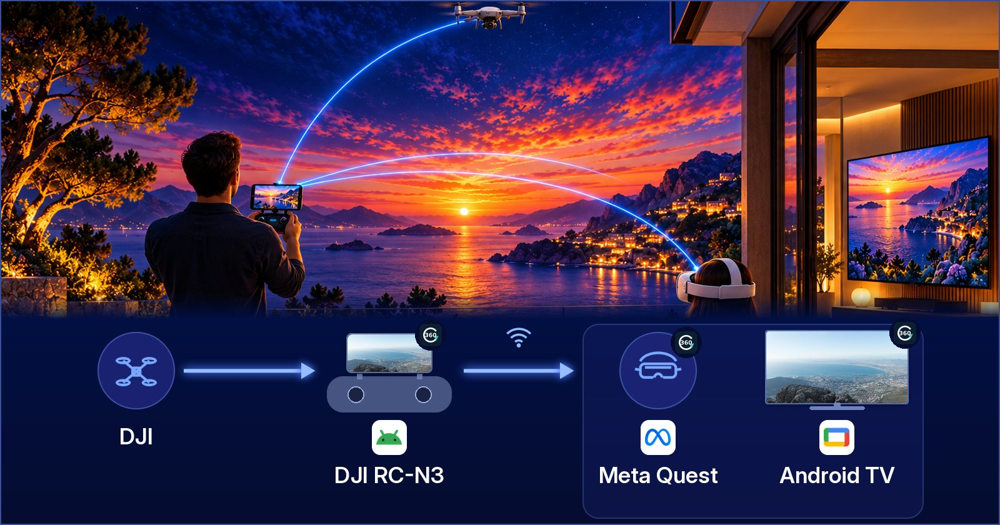
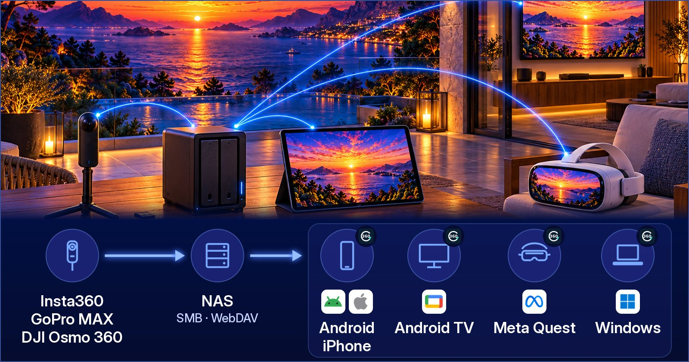
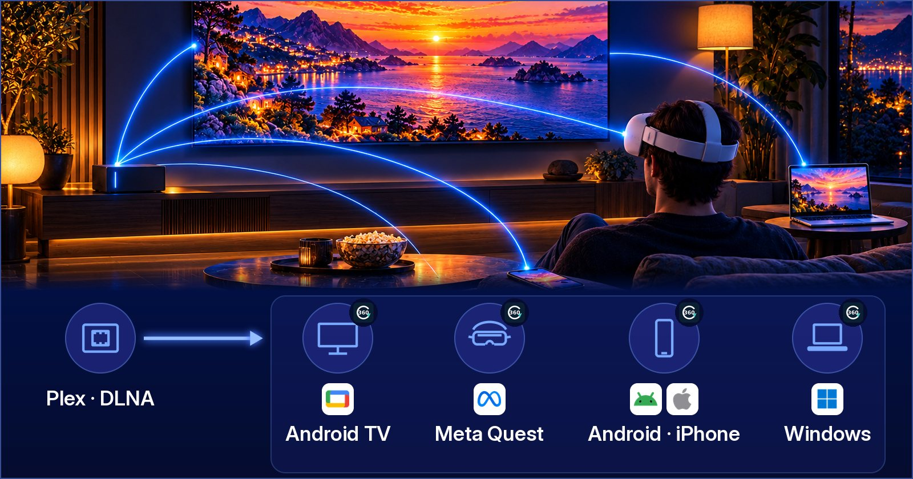
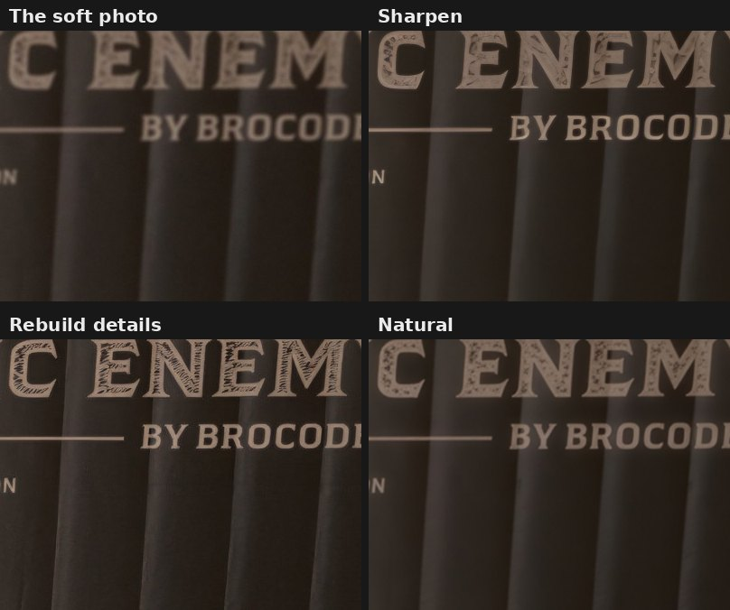

🌐 <b>Oʻzbekcha</b> · Boshqa tillar (88)
<a href="../README.md">English</a> · <a href="README.af.md">Afrikaans</a> · <a href="README.ar.md">العربية</a> · <a href="README.az.md">Azərbaycanca</a> · <a href="README.be.md">Беларуская</a> · <a href="README.bg.md">Български</a> · <a href="README.bi.md">Bislama</a> · <a href="README.bn.md">বাংলা</a> · <a href="README.br.md">Brezhoneg</a> · <a href="README.bs.md">Bosanski</a> · <a href="README.ca.md">Català</a> · <a href="README.cs.md">Čeština</a> · <a href="README.cv.md">Чӑвашла</a> · <a href="README.da.md">Dansk</a> · <a href="README.de.md">Deutsch</a> · <a href="README.de_CH.md">Deutsch (Schweiz)</a> · <a href="README.el.md">Ελληνικά</a> · <a href="README.en_GB.md">English (UK)</a> · <a href="README.eo.md">Esperanto</a> · <a href="README.es.md">Español</a> · <a href="README.et.md">Eesti</a> · <a href="README.eu.md">Euskara</a> · <a href="README.fa.md">فارسی</a> · <a href="README.fi.md">Suomi</a> · <a href="README.fil.md">Filipino</a> · <a href="README.fr.md">Français</a> · <a href="README.ga.md">Gaeilge</a> · <a href="README.gl.md">Galego</a> · <a href="README.gsw.md">Alemannisch</a> · <a href="README.gu.md">ગુજરાતી</a> · <a href="README.he.md">עברית</a> · <a href="README.hi.md">हिन्दी</a> · <a href="README.hr.md">Hrvatski</a> · <a href="README.hu.md">Magyar</a> · <a href="README.hy.md">Հայերեն</a> · <a href="README.id.md">Bahasa Indonesia</a> · <a href="README.is.md">Íslenska</a> · <a href="README.it.md">Italiano</a> · <a href="README.ja.md">日本語</a> · <a href="README.ka.md">ქართული</a> · <a href="README.kab.md">Taqbaylit</a> · <a href="README.kk.md">Қазақша</a> · <a href="README.km.md">ខ្មែរ</a> · <a href="README.kmr.md">Kurmancî</a> · <a href="README.kn.md">ಕನ್ನಡ</a> · <a href="README.ko.md">한국어</a> · <a href="README.kxm.md">ภาษาเขมรถิ่นไทย</a> · <a href="README.lb.md">Lëtzebuergesch</a> · <a href="README.lmo.md">Lombard</a> · <a href="README.lt.md">Lietuvių</a> · <a href="README.lv.md">Latviešu</a> · <a href="README.mfa.md">Bahasa Melayu Kelantan</a> · <a href="README.mi.md">Te reo Māori</a> · <a href="README.mk.md">Македонски</a> · <a href="README.ml.md">മലയാളം</a> · <a href="README.mn.md">Монгол</a> · <a href="README.mr.md">मराठी</a> · <a href="README.ms.md">Bahasa Melayu</a> · <a href="README.nb_NO.md">Norsk bokmål</a> · <a href="README.ne.md">नेपाली</a> · <a href="README.nl.md">Nederlands</a> · <a href="README.nn.md">Norsk nynorsk</a> · <a href="README.pa.md">ਪੰਜਾਬੀ</a> · <a href="README.pl.md">Polski</a> · <a href="README.pt.md">Português</a> · <a href="README.pt_BR.md">Português (Brasil)</a> · <a href="README.ro.md">Română</a> · <a href="README.ru.md">Русский</a> · <a href="README.si.md">සිංහල</a> · <a href="README.sk.md">Slovenčina</a> · <a href="README.sl.md">Slovenščina</a> · <a href="README.sq.md">Shqip</a> · <a href="README.sr_Cyrl.md">Српски</a> · <a href="README.sr_Latn.md">Srpski</a> · <a href="README.sv.md">Svenska</a> · <a href="README.sw.md">Kiswahili</a> · <a href="README.swg.md">Schwäbisch</a> · <a href="README.ta.md">தமிழ்</a> · <a href="README.te.md">తెలుగు</a> · <a href="README.th.md">ไทย</a> · <a href="README.tl.md">Tagalog</a> · <a href="README.tr.md">Türkçe</a> · <a href="README.uk.md">Українська</a> · <a href="README.ur.md">اردو</a> · <a href="README.vi.md">Tiếng Việt</a> · <a href="README.yue_Hant.md">粵語</a> · <a href="README.zh_Hans.md">简体中文</a> · <a href="README.zh_Hant.md">繁體中文</a>

  

# Immuch360

**Sizning mediangiz. Istalgan ekran. Har qanday burchak.**

🌐 <a href="https://immuch360.com/uz/"><b>immuch360.com</b></a>

Qurilmangizdan, NAS'ingizdan, Immich serveringizdan, kameralaringizdan va droningizdan tekis, 360° va 3D fotosuratlar va videolar. Hisob kerak emas. Immuch360 bepul va ochiq kodli ilova bo‘lib, fotosurat va videolaringizni turgan joyidan o‘qiydi va har birini o‘ziga mos ko‘ruvchida ijro etadi: tekis, ichida atrofga qaraladigan sfera sifatida, 3D'da yoki shlemda atrofingizni o‘rab. U telefonlar, planshetlar, televizorlar, Meta Quest shlemlari va kompyuterlarda ishlaydi. Uning veb-sayti, [immuch360.com](https://immuch360.com/uz/), ilova har bir ekranda nima qilishini 89 tilda ko‘rsatadi.

**Build 53 va ish stoli uchun build 34 dagi yangiliklar, 3.4.8 versiyasi.** Kompyuterlarda [Spatial 2.5D](#see-your-3d-photos-and-videos-in-depth-on-your-computer) 3D fotosuratlaringizga tekis ekranda chuqurlik beradi, Windows, Linux va macOS'da, 3D videolaringizga esa Windows va macOS'da: ko‘rinish boshingizni qimirlatganingizda siljiydi, rozilik berganingizdan keyin uni veb-kamera kuzatadi, yoki sichqoncha bilan, veb-kamera tasvirlari esa kompyuter xotirasida qoladi, hech qachon saqlanmaydi va yuborilmaydi; loyiha tomonidan veb-kamera bilan hali sinab ko‘rilmagan. G‘ildirak [fotosuratni ko‘rsatkich atrofida yaqinlashtiradi](#zoom-into-a-photo-with-the-wheel), surish esa uni siljitadi. [Yaxshilash (SI)](#make-a-photo-sharper-on-your-computer-ai) ulashmalaringiz, DLNA, Plex, Jellyfin va Emby hamda Immich serveringiz fotosuratlarini oladi, 360° va 3D fotosuratlarni ularning chokini yoki ikki ko‘zini buzmasdan yaxshilaydi va Apple chipli Mac'da Aniqlashtirishni taklif etadi (Mac'da hali sinab ko‘rilmagan). Telefondan ["Qayerda ijro etish…"](#show-your-photos-and-videos-on-the-tv-from-your-phone) 360° elementni ekranning 360° ko‘rinishida ochadi, tanlov yoki albomni slayd-shou sifatida ijro etadi, ekranni serveringizga kiritadi va faqat telefonda bo‘lgan fotosurat va videolarni yuboradi; Android emulyatorlari orasida sinab ko‘rilgan, haqiqiy telefon yoki televizorda hali emas. Meta Quest'da katta ekran slayd-shousi fotosuratlar orasida [silliq o‘tadi yoki suriladi](#browse-your-photos-on-the-big-screen-of-the-quest), siz tanlagan qora, xiralashtirilgan yoki passthrough fon ustida, loyiha tomonidan shlemda hali sinab ko‘rilmagan.

**Build 33 dan 52 gacha yangiliklar.** [Filmlar siz to‘xtagan joydan davom etadi](#pick-up-a-film-where-you-stopped). Ular ertaroq boshlanadi, sekin serverdan esa [to‘xtash o‘rniga ijro etishda davom etadi](#when-a-video-waits-or-will-not-play). Telefonlar va kompyuterlarda vaqt chizig‘i [oylar va yillargacha kichrayadi](#find-a-month-or-a-year-in-a-long-timeline). Android telefonda yoki Meta Quest'da ["Jildni ko'rib chiqish"](#browse-a-folder-of-your-phone-or-headset) qurilma jildini ulashma kabi ochadi va TIFF fotosuratlar ko‘rinadi. Android TV [pult bilan sana bo‘yicha qidiradi](#on-android-tv-and-google-tv), Meta Quest 3 yoki 3S [Gauss splatlarini ochadi](#explore-gaussian-splats-in-a-meta-quest-3-or-3s), ular o‘ng joystik bilan buriladi, SPZ 4-versiyasi ham kiritilgan, kompyuter esa [NAS'ingizdagi fotosuratlarning 3D versiyalarini yaratadi](#turn-one-photo-into-3d-a-scene-a-panorama). Ikki grafik chipli Windows noutbukida ilova [endi tezkor chipda ishlaydi](#when-a-video-waits-or-will-not-play), shuning uchun 8K filmlar silliq ijro etiladi. Gauss splatlari endi [kompyuterlarda hamda Android telefonlar va planshetlarda ochiladi](#explore-gaussian-splats-on-your-phone-tablet-or-computer), Windows kompyuter SI yordamida [fotosuratlaringiz yoki videodan splat sahnalarini yaratadi](#make-a-splat-scene-from-your-photos-or-a-video-ai), Immich serveringiz [ularni vaqt chizig‘ingizdan ochiladigan fotosuratlar ichida saqlaydi](#keep-a-splat-scene-on-your-immich-server), kompyuterlar esa [AV2 videolarini ijro etadi](#play-av2-videos-on-your-computer). Build 42 dan boshlab Insta360, GoPro MAX va DJI Osmo 360 kameralarining xom videolari, Immich kutubxonangiz, ulashma yoki jilddan, Android telefonlar, planshetlar va televizorlarda [kamera giroskopi bilan barqarorlashtirilib ijro etiladi](#stabilise-your-360-videos-with-the-cameras-gyroscope), ish stoli uchun build 22 dagi splat yaratuvchisi yaqindan ko‘radigan sahnalaringiz uchun [Batafsil sifatini taklif qiladi](#make-a-splat-scene-from-your-photos-or-a-video-ai), 360° panorama esa [videokartada 3.5 GiB bo‘sh joy bo‘lganda boshlanadi](#turn-one-photo-into-3d-a-scene-a-panorama). iPhone va iPad ilovasi [App Store'da](https://apps.apple.com/us/app/immuch360-360-3d-player/id6817655965), 3.4.3 versiyasi. Build 43 dan boshlab ilovaning yangilanish bildirishnomasi telefonlar va planshetlarda Google Play yoki App Store'ni ochadi; uning veb-sayti, [immuch360.com](https://immuch360.com/uz/), 7-noyabrda ochildi. Build 44 va ish stoli uchun build 24 dan boshlab Meta Quest 3 yoki 3S [300,000 gaussgacha bo‘lgan splatlarni ko‘rsatadi](#explore-gaussian-splats-in-a-meta-quest-3-or-3s), kompyuterlar [Ctrl va Shift bilan bir nechta fotosurat va videoni tanlaydi](#use-your-computer-as-the-media-player), dekoderi videoni rad etgan televizor o‘zi [serverning boshqa faylini ijro etadi](#when-a-video-waits-or-will-not-play), panoramalar ikki videokartali noutbukning tanlangan videokartasida ishlaydi, Quest va kompyuterlarning yangilanish bildirishnomasi esa ularning do‘konini yoki yuklab olish sahifasini ochadi, ko‘plab tuzatishlar bilan. Build 45 va ish stoli uchun build 25 dan boshlab, barcha platformalarda 3.4.0 versiyasi, ilova Immich 3.4.0 ilovasiga Immich'ning keyingi 11 ta tuzatishi bilan ergashadi, [Immich 3.4 serverlarining JPEG XL fotosuratlarini](#keep-your-immich-library-with-more) ko‘rsatadi, [Plex filmlaringizni yillar bo‘yicha](#watch-your-plex-films) har bir film uchun sahifa, ularni qurilmaga yuklab olish va telefondan televizorda ijro etish bilan ochadi, do‘kon build'larida baho so‘rashi mumkin va kompyuterlarda video komponentlarini [ularning o‘z ochiq repozitoriylaridan](#licences-and-credits) oladi. Build 46 va ish stoli uchun build 26 dan boshlab, 3.4.1 versiyasi, 360° kameralarning xom videolari iPhone va iPad'da, Meta Quest'da va Windows'da ham [barqarorlashtirilib ijro etiladi](#stabilise-your-360-videos-with-the-cameras-gyroscope), Meta Quest [o‘z pleeri dekodlay olmaydigan Plex filmlarini libmpv bilan ijro etadi](#watch-your-plex-films), telefon [bunday filmni Chromecast yoki Google TV'ga yuboradi](#watch-your-plex-films), 3D fotosuratning SI chuqurligi esa [siz tanlagan kuchni oladi](#turn-one-photo-into-3d-a-scene-a-panorama); yangi serverni Plex hisobingiz bilan kirib ham qo‘shish mumkin, ilova esa [sozlamalarini faylda saqlaydi](#keep-your-settings-in-a-file). Build 47 va ish stoli uchun build 27 dan boshlab, 3.4.2 versiyasi, Plex filmi [qurilma dekodlaydigan audio yo‘lakni ijro etadi](#watch-your-plex-films) va qaysi ekanini aytadi, ekranga mos versiyani ochadi va sekin ulanishda yengilrog‘ini taklif qiladi, Windows va macOS uning Dolby TrueHD ovozini ijro etadi, Android [uning yuklab olinishini bildirishnomada ko‘rsatadi](#watch-your-plex-films) va Android TV ham filmlarni yuklab oladi, [batareyali Tapo kameralari esa jonli ko‘rsatadi](#watch-your-home-cameras-on-the-big-screen); hisoblari bilan sozlamalar faylini tiklash endi sizni Immich serveringizga kiritadi. Build 48 va ish stoli uchun build 28 dan boshlab, 3.4.3 versiyasi, Windows kompyuteri SteamVR, Meta Horizon Link yoki boshqa OpenXR ish muhiti orqali [videolaringizni PC VR shlemda ijro etadi](#watch-your-videos-in-a-pc-vr-headset-from-windows) (loyiha tomonidan shlemda hali sinab ko‘rilmagan), ONVIF orqali topilgan yoki RTSP havolasi bilan qo‘shilgan [boshqa brend kameralari jonli ko‘rsatadi](#cameras-of-other-brands-over-onvif-or-rtsp) (simulyatsiya qilingan kamera bilan tekshirilgan, boshqa brendning haqiqiy kamerasi hali sinab ko‘rilmagan), [DJI Osmo 360 II va GoPro MAX 2 ning xom videolari barqarorlashtirilib ijro etiladi](#open-the-raw-files-of-360-cameras), Plex filmlari [telefonlarga endi juda sekin kelmaydi](#when-a-video-waits-or-will-not-play), LG va Samsung televizorlari [yonboshlab yotgan videoni](#on-a-samsung-tv-tizen) bitta tugma bilan buradi (LG televizorida hali sinab ko‘rilmagan; issue 17 dagi Samsung televizori burishni rad etdi), "Server update is available" esa yangilangan server uchun endi chiqmaydi. Build 49 va ish stoli uchun build 29 dan boshlab, 3.4.4 versiyasi, ilova [Jellyfin va Emby serverlaringizni o‘zi o‘qiydi](#watch-your-jellyfin-and-emby-libraries) (qurilmada hali sinab ko‘rilmagan), ularni tarmog‘ingizda topadi va televizorda yoki shlemda Quick Connect bilan kiradi, asl fayllarini esa 360° video 360° bo‘lib qolishi uchun ijro etadi; Meta Quest katta ekranida fotosuratlar [siz ularni varaqlayotganingizda siz belgilagan o‘lcham va joyni saqlaydi hamda slayd-shou sifatida ijro etiladi](#browse-your-photos-on-the-big-screen-of-the-quest) (loyiha tomonidan shlemda hali sinab ko‘rilmagan); telefon va planshetlarning 360° video pleeri [360° fotosuratlarning boshqaruvlarini oladi](#360-videos-on-your-phone-with-the-controls-of-360-photos), giroskop tugmasi, kattalashtirish uchun siqish va to‘g‘ri yuqoriga yoki pastga surish (bir foydalanuvchi Samsung Galaxy S25 Ultra'da sinab ko‘rgan, iPhone'da hali emas); kompyuter SI yordamida [2D videolaringizdan 3D videolar yaratadi](#turn-your-2d-videos-into-3d-on-your-computer) (3D ekranda yoki shlemda hali sinab ko‘rilmagan); Samsung televizorlari esa [burilishi kerak bo‘lgan videoni Samsung'ning o‘z pleeriga topshiradi](#on-a-samsung-tv-tizen), issue 17 dagi televizor uni ijro etadi, lekin burishni rad etadi. Build 50 va ish stoli uchun build 30 dan boshlab, 3.4.5 versiyasi, Meta Quest'ning 2D oynasida video ijro etilayotganda oyna build 48 va 49 dagidek soniyasiga taxminan 10 marta o‘rniga [displey chastotasida qayta chiziladi](#step-inside-your-photos-and-videos-with-a-meta-quest) (Meta Quest 3 da o‘lchangan), Android TV [pult bilan fotosuratni yaqinlashtiradi](#on-android-tv-and-google-tv) va uni strelkalar bilan suradi (yangi, televizorda hali sinab ko‘rilmagan), uchta tuzatish esa mlc70 ning Android TV fork'idan keladi: tez surish endi ortda qolgan fotosurat tafsilotlarini ko‘rsatmaydi, animatsiyali fotosurat o‘z xotirasini bo‘shatadi, Joylashuv filtri esa yangi mamlakat shaharlarini taklif qiladi. Build 51 va ish stoli uchun build 31 dan boshlab, 3.4.6 versiyasi, [Yaxshilash (SI)](#make-a-photo-sharper-on-your-computer-ai) Windows va Linux'da xira fotosuratning keskinroq nusxasini asl fayl yonida yaratadi, uch darajada, har biri RTX 4060 o‘rnatilgan bitta kompyuterda bir marta ishga tushirilgan, Tabiiy darajasi Apple chipli Mac'da ham taklif etiladi (Mac'da hali sinab ko‘rilmagan), kompyuter SI yordamida [360° videoni 360° 3D videoga aylantiradi](#a-360-video-turned-into-a-360-3d-video), Windows'da 3D videolar chuqurligini videokarta baholaydi, SI funksiyalari serveringiz va ulashma videolarini to‘g‘ridan-to‘g‘ri oladi, sozlamalar faylining [Kutubxonada o‘z kartasi bor](#keep-your-settings-in-a-file), televizor uni tarmoq ulashmasiga saqlaydi, kompyuterlarda Escape bir qadam orqaga qaytaradi, do‘kon build'lari bahoni [kamroq va yumshoqroq](#privacy) so‘raydi, Linux TIFF fotosuratlar, splat sahnalari va 3D videolarni bitta ko‘z bilan ko‘rsatadi, ikkita ishdan chiqish tuzatilgan. Build 52 va ish stoli uchun build 32 dan boshlab, 3.4.7 versiyasi, ["Qayerda ijro etish…"](#show-your-photos-and-videos-on-the-tv-from-your-phone) Immich kutubxonangiz, ulashmalaringiz hamda Jellyfin va Emby fotosurat va videolarini telefondan televizor, Meta Quest, kompyuter yoki Chromecast'ga yuboradi, fotosurat va videolaringiz nomlari [eskizlari ustida o‘qiladigan bo‘lib qoladi](#play-the-files-of-a-nas-a-computer-a-media-server-or-plex), kompyuterning SI komponentlari [bir bosishda yangilanadi](#update-the-ai-components-in-one-click), Linux [AppImage](#linux) oladi, iPhone va iPad ilovasi esa Xcode 27 bilan yig‘iladi. Ish stoli uchun build 33 [Yaxshilash (SI)](#make-a-photo-sharper-on-your-computer-ai) ni tuzatdi, u ish stoli uchun build 31 va 32 da har bir fotosuratda ishlamay qolardi ([issue 23](https://github.com/freeKC/Immuch360/issues/23)).

  Immich mobil ilovasining norasmiy fork'i. Immich yoki FUTO bilan bog‘liq emas. Nomi inglizcha "I am much 360" iborasi kabi o‘qiladi.

<b>Mundarija</b>

- [Kim uchun](#who-it-is-for)
- [Qaysi ekranlar](#which-screens), [ular birgalikda nima qiladi](#use-cases) va [har bir ekran nima qiladi](#what-each-screen-does)
- [Nima qila olasiz](#what-you-can-do)
- [Qurilmangizga o‘rnating](#get-it-on-your-device)
- [Qanday qilinadi](#how-to)
  - [Fotosurat va videolaringizni tomosha qiling, server bilan yoki serversiz](#watch-your-photos-and-videos-with-or-without-a-server)
  - [Panoramalar, 360°, VR180 va 3D'ni o‘rganing](#explore-panoramas-360-vr180-and-3d): [telefonlarda 360° videolar](#360-videos-on-your-phone-with-the-controls-of-360-photos)
  - [Bitta fotosuratni 3D, sahna, panoramaga aylantiring](#turn-one-photo-into-3d-a-scene-a-panorama): [bir bosishda yangilanadigan SI komponentlari](#update-the-ai-components-in-one-click)
  - [2D videolaringizni kompyuteringizda 3D ga aylantiring](#turn-your-2d-videos-into-3d-on-your-computer): [360° videolardan 360° 3D](#a-360-video-turned-into-a-360-3d-video)
  - [Kompyuteringizda fotosuratni keskinroq qiling (SI)](#make-a-photo-sharper-on-your-computer-ai)
  - [Televizorda pult bilan tomosha qiling](#watch-on-the-tv-with-the-remote): [Android TV va Google TV](#on-android-tv-and-google-tv), [LG](#on-an-lg-tv-webos), [Samsung](#on-a-samsung-tv-tizen)
  - [Televizor, shlem yoki kompyuterga telefoningiz orqali kiring](#sign-in-a-tv-a-headset-or-a-computer-with-your-phone)
  - [Fotosurat va videolaringizni telefondan televizorda ko‘rsating](#show-your-photos-and-videos-on-the-tv-from-your-phone)
  - [Meta Quest bilan fotosurat va videolaringiz ichiga kiring](#step-inside-your-photos-and-videos-with-a-meta-quest): [katta ekran](#browse-your-photos-on-the-big-screen-of-the-quest), [kiosk rejimi](#kiosk-mode-for-an-exhibition-or-a-shop)
  - [Meta Quest 3 yoki 3S'da Gauss splatlarini o‘rganing](#explore-gaussian-splats-in-a-meta-quest-3-or-3s)
  - [Telefoningiz, planshetingiz yoki kompyuteringizda Gauss splatlarini o‘rganing](#explore-gaussian-splats-on-your-phone-tablet-or-computer)
  - [Fotosuratlaringiz yoki videodan splat sahnasi yarating (SI)](#make-a-splat-scene-from-your-photos-or-a-video-ai)
  - [Splat sahnasini Immich serveringizda saqlang](#keep-a-splat-scene-on-your-immich-server)
  - [NAS, kompyuter, media server yoki Plex fayllarini ijro eting](#play-the-files-of-a-nas-a-computer-a-media-server-or-plex): [yillar bo‘yicha filmlaringiz](#watch-your-plex-films), [Jellyfin va Emby](#watch-your-jellyfin-and-emby-libraries)
  - [Telefoningiz yoki shlemingiz jildini ko‘rib chiqing](#browse-a-folder-of-your-phone-or-headset)
  - [Filmni to‘xtagan joyingizdan davom ettiring](#pick-up-a-film-where-you-stopped)
  - [Video kutganda yoki ijro etilmaganda](#when-a-video-waits-or-will-not-play)
  - [Immich kutubxonangizni saqlang, yana ko‘prog‘i bilan](#keep-your-immich-library-with-more)
  - [Uzun vaqt chizig‘ida oy yoki yilni toping](#find-a-month-or-a-year-in-a-long-timeline)
  - [Uy kameralaringizni katta ekranda tomosha qiling](#watch-your-home-cameras-on-the-big-screen): [boshqa brendlar](#cameras-of-other-brands-over-onvif-or-rtsp)
  - [DJI droningiz](#your-dji-drone): [jonli video](#see-what-your-drone-sees-on-your-phone), [Quest'da yoki Android TV'da](#watch-it-in-a-meta-quest-or-on-an-android-tv), [import](#bring-a-drones-or-a-camera-cards-photos-and-videos-to-immich)
  - [360° kameralarning xom fayllarini oching](#open-the-raw-files-of-360-cameras)
  - [360° videolaringizni kamera giroskopi bilan barqarorlashtiring](#stabilise-your-360-videos-with-the-cameras-gyroscope)
  - [Fotosuratni bitta tugma bilan burish](#turn-a-photo-with-one-key)
  - [Kompyuteringizdan media pleer sifatida foydalaning](#use-your-computer-as-the-media-player): [g‘ildirak bilan yaqinlashtirish](#zoom-into-a-photo-with-the-wheel)
  - [3D fotosurat va videolaringizni kompyuteringizda chuqurlik bilan ko‘ring](#see-your-3d-photos-and-videos-in-depth-on-your-computer)
  - [Videolaringizni Windows'dan PC VR shlemda tomosha qiling](#watch-your-videos-in-a-pc-vr-headset-from-windows)
  - [Kompyuteringizda AV2 videolarini ijro eting](#play-av2-videos-on-your-computer)
  - [Sozlamalaringizni faylda saqlang](#keep-your-settings-in-a-file)
- [Immich bilan taqqoslash](#compared-with-immich)
- [Maxfiylik](#privacy)
- [Litsenziyalar va minnatdorchiliklar](#licences-and-credits)
- [Yoʻl xaritasi](#roadmap)
- [Hujjatlar](#documentation)

## Kim uchun

- **Siz 360° yoki 3D suratga olasiz** va suratlaringizni tekis, ikkilangan yoki cho‘zilgan holda emas, ichida atrofga qarab ko‘rishni, telefondagi 360° videolaringizni esa uning fotosuratlarini burgandek burishni xohlaysiz: [360°, VR180 va 3D](#explore-panoramas-360-vr180-and-3d), [telefonlarda 360° videolar](#360-videos-on-your-phone-with-the-controls-of-360-photos).
- **Siz 360° kamera bilan qo‘lda, velosipedda yoki dubulg‘ada suratga olasiz** va Immich'da, ulashmada yoki jildda saqlangan Insta360, GoPro MAX yoki MAX 2, DJI Osmo 360 yoki Osmo 360 II kamerangizning xom videolari telefoningiz, televizoringiz, Meta Quest'ingiz yoki Windows kompyuteringizda ufqi tekis va titramasdan ijro etilishini xohlaysiz: [kamera giroskopi bilan barqarorlashtirilgan](#stabilise-your-360-videos-with-the-cameras-gyroscope).
- **Fotosurat va filmlaringiz NAS, kompyuter, Plex yoki Immich'da turadi** va ularni hech narsani nusxalamasdan televizorda ko‘rishni xohlaysiz: [televizorda](#watch-on-the-tv-with-the-remote), [NAS, ulashmalar va Plex](#play-the-files-of-a-nas-a-computer-a-media-server-or-plex).
- **Filmlaringizni Plex serverda saqlaysiz** va ulardan birini yil bo‘yicha tanlash, boshlanishidan oldin nima ekanini ko‘rish, safarga olib ketish, telefoningizdan televizorda yoki Chromecast'da boshlash va Android telefoningiz, televizoringiz yoki Meta Quest'ingiz dekodlay olmaydigan filmlarni ham ijro etishni xohlaysiz: [filmlaringiz, yillar bo‘yicha](#watch-your-plex-films).
- **Filmlaringizni Jellyfin yoki Emby serverida saqlaysiz** va ularni Meta Quest'da, televizorda yoki telefonda, 360° va 3D o‘z holicha saqlangan, joyingiz serverda saqlangan holda xohlaysiz (qurilmada hali sinab ko‘rilmagan): [Jellyfin va Emby](#watch-your-jellyfin-and-emby-libraries).
- **Sizda Meta Quest bor** va o‘z fotosurat va videolaringiz ichiga kirishni, fotosuratlaringizni esa katta ekranda siz belgilagan o‘lcham va joyda, slayd-shou sifatida ham, varaqlashni xohlaysiz (loyiha tomonidan shlemda hali sinab ko‘rilmagan): [shlemda](#step-inside-your-photos-and-videos-with-a-meta-quest), [katta ekran](#browse-your-photos-on-the-big-screen-of-the-quest).
- **Windows kompyuteringizga ulangan PC VR shlemingiz bor** va unda 360° videolaringizni atrofingizda, filmlarni esa katta ekranda ko‘rishni xohlaysiz (loyiha tomonidan shlemda hali sinab ko‘rilmagan): [PC VR shlemda](#watch-your-videos-in-a-pc-vr-headset-from-windows).
- **Fotosuratlaringiz tekis** va siz ularni 3D kamerasiz 3D'da, shlemda egilib qaraladigan sahna sifatida yoki 360° panorama ichida ko‘rishni xohlaysiz: [bitta fotosuratni 3D, sahna, panoramaga aylantiring](#turn-one-photo-into-3d-a-scene-a-panorama), yangi, o‘z kompyuteringizda SI yordamida yaratiladi.
- **Videolaringiz tekis**, telefoningiz kliplari ham, va ularni shlem yoki 3D ekran uchun o‘z kompyuteringizda yaratilgan 3D ko‘rinishda, 360° videolaringizni esa 360° 3D ko‘rinishda xohlaysiz (3D ekranda yoki shlemda hali sinab ko‘rilmagan): [2D videolardan 3D](#turn-your-2d-videos-into-3d-on-your-computer), [360° dan 360° 3D](#a-360-video-turned-into-a-360-3d-video).
- **Fotosuratlaringiz xira**, biroz fokusdan chiqqan yoki yomon yorug‘likda olingan, va siz asl faylning yonida o‘z kompyuteringizda, ulashmalaringiz va serverlaringizdan ham, yaratilgan keskinroq nusxani xohlaysiz, to‘qib chiqarilgan tafsilotlar ochiq aytilgan holda: [Yaxshilash (SI)](#make-a-photo-sharper-on-your-computer-ai).
- **Sizda 3D fotosuratlar yoki videolar va kompyuter bor** va ularni uning tekis ekranida chuqurlik bilan xohlaysiz, ko‘rinish boshingizni qimirlatganingizda siljiydi, uni veb-kamera kuzatadi, yoki sichqoncha bilan (loyiha tomonidan veb-kamera bilan hali sinab ko‘rilmagan): [kompyuteringizda Spatial 2.5D](#see-your-3d-photos-and-videos-in-depth-on-your-computer).
- **Siz Immich ishlatasiz** va uning ilovasini, shuningdek immersiv ko‘ruvchilarni va telefoningizdan tizimga kiritadigan katta ekranlarni xohlaysiz: [Immich kutubxonangiz](#keep-your-immich-library-with-more), [Immich bilan taqqoslash](#compared-with-immich).
- **Uyingizni Tapo kameralari bilan kuzatasiz**, batareyalilarini ham, yoki ONVIF yoki RTSP orqali boshqa brend kameralari bilan, va ularni fotosuratlaringiz yonida, televizorda ham ko‘rishni xohlaysiz (simulyatsiya qilingan kamera bilan tekshirilgan): [uy kameralari](#watch-your-home-cameras-on-the-big-screen).
- **Siz DJI dronini uchirasiz** va uning jonli tasvirini DJI Fly'siz telefoningizda, yoningizdagilar uchun esa Meta Quest'da yoki Android TV'da ko‘rishni xohlaysiz: [droningiz](#see-what-your-drone-sees-on-your-phone).
- **Siz joylar va narsalarni 3D'da, Gauss splatlari sifatida yozib olasiz,** yoki ularni o‘z fotosuratlaringizdan yaratmoqchisiz va ularning ichida telefoningizda, kompyuteringizda yoki shlemda yurishni xohlaysiz: [telefon, planshet yoki kompyuterda](#explore-gaussian-splats-on-your-phone-tablet-or-computer), [fotosuratlaringizdan yaratilgan](#make-a-splat-scene-from-your-photos-or-a-video-ai), [Immich'da saqlangan](#keep-a-splat-scene-on-your-immich-server).
- **Sizda AV2 videolari bor**, AV1 dan keyingi format, va ularni kompyuteringizda ko‘rishni xohlaysiz: [kompyuteringizda AV2](#play-av2-videos-on-your-computer).
- **Uyingizda bir nechta ekran bor** va ular birgalikda ishlashini xohlaysiz: [ekranlaringiz birgalikda nima qiladi](#use-cases).

Yaratiladigan Immuch360 hisobi yo‘q va bizga hech narsa kelmaydi: ilova faqat qurilmalaringiz va siz tanlagan serverlar bilan, build 45 dan boshlab film sahifasi uchun Wikipedia bilan ham, build 46 dan boshlab u orqali kirganingizda plex.tv bilan ham gaplashadi va SI komponentini yoki AV2 dekoderini faqat siz so‘raganingizda yuklab oladi.

## Qaysi ekranlar

| Platforma | Qayerdan olish mumkin | 2026-yil noyabr holatiga ko‘ra |
|---|---|---|
|  **Android** telefonlar va planshetlar | [Google Play](https://play.google.com/store/apps/details?id=com.aprogsys.immuch360) · [APK](https://github.com/freeKC/Immuch360/releases) | Google Play'da (build 47 16-noyabrda e‘lon qilingan; build 51 24-noyabrdan beri Google ko‘rib chiqishida; keyin build 53), GitHub'da build 53, unda [xom 360° videolar barqarorlashtirilib ijro etiladi](#stabilise-your-360-videos-with-the-cameras-gyroscope), [filmlar siz to‘xtagan joydan davom etadi](#pick-up-a-film-where-you-stopped), ["Jildni ko'rib chiqish"](#browse-a-folder-of-your-phone-or-headset) telefon jildini ochadi va [Gauss splatlari ochiladi](#explore-gaussian-splats-on-your-phone-tablet-or-computer), ulashmadan yoki [Immich vaqt chizig‘ingizdan](#keep-a-splat-scene-on-your-immich-server), [faylda saqlangan sozlamalar](#keep-your-settings-in-a-file), [bildirishnomada ko‘rsatiladigan film yuklab olinishi](#watch-your-plex-films), build 48 dan boshlab [jonli boshqa brend kameralari](#cameras-of-other-brands-over-onvif-or-rtsp) (simulyatsiya qilingan kamera bilan tekshirilgan) hamda build 49 dan boshlab [Jellyfin va Emby serverlari](#watch-your-jellyfin-and-emby-libraries) (qurilmada hali sinab ko‘rilmagan) va [360° video pleerida 360° fotosuratlar boshqaruvlari](#360-videos-on-your-phone-with-the-controls-of-360-photos) (bir foydalanuvchi Samsung Galaxy S25 Ultra'da sinab ko‘rgan), build 51 dan boshlab esa [Kutubxonadagi sozlamalar fayli kartasi](#keep-your-settings-in-a-file), uning fayli tarmoq ulashmasiga ham saqlanadi, build 52 dan boshlab esa "Qayerda ijro etish…" bilan [televizor yoki Chromecast'ga yuborilgan fotosurat va videolaringiz](#show-your-photos-and-videos-on-the-tv-from-your-phone) (qurilmada hali sinab ko‘rilmagan), build 53 dan boshlab esa xuddi shu tarzda yuboriladigan [360° elementlar, tanlov yoki albom hamda telefonning o‘zidagi fotosurat va videolar](#show-your-photos-and-videos-on-the-tv-from-your-phone) (Android emulyatorlari orasida sinab ko‘rilgan) |
|  **iPhone va iPad** | [App Store](https://apps.apple.com/us/app/immuch360-360-3d-player/id6817655965) | 26-noyabrdan beri App Store'da 3.4.7 versiyasi, [vaqt chizig‘idagi oylar va yillar](#find-a-month-or-a-year-in-a-long-timeline), [siz to‘xtagan joydan davom etadigan filmlar](#pick-up-a-film-where-you-stopped), telefondan [televizor, shlem yoki kompyuterni tizimga kiritish](#sign-in-a-tv-a-headset-or-a-computer-with-your-phone), o‘z fotosurati sifatida ko‘rsatiladigan, Immich'da saqlangan splat sahnalari, Immich 3.4.0 tuzatishlari va uning JPEG XL fotosuratlari, [barqarorlashtirilgan xom 360° videolar](#stabilise-your-360-videos-with-the-cameras-gyroscope), [faylda saqlangan sozlamalar](#keep-your-settings-in-a-file), [batareyali Tapo kameralarining jonli ko‘rinishi](#watch-your-home-cameras-on-the-big-screen) va [boshqa brend kameralarining jonli ko‘rinishi](#cameras-of-other-brands-over-onvif-or-rtsp) bilan (simulyatsiya qilingan kamera bilan tekshirilgan), 3.4.4 versiyasidan boshlab esa [Jellyfin va Emby serverlari](#watch-your-jellyfin-and-emby-libraries) (qurilmada hali sinab ko‘rilmagan) va [360° video pleerida 360° fotosuratlar boshqaruvlari](#360-videos-on-your-phone-with-the-controls-of-360-photos) bilan (iPhone'da hali sinab ko‘rilmagan), 3.4.6 versiyasidan boshlab esa [sozlamalar fayli kartasi](#keep-your-settings-in-a-file) va uni tarmoq ulashmasidan tiklash bilan, Xcode 27 bilan yig‘ilgan 3.4.7 versiyasidan boshlab esa [fotosurat va videolar uchun "Qayerda ijro etish…"](#show-your-photos-and-videos-on-the-tv-from-your-phone) bilan (iPhone'da hali sinab ko‘rilmagan); 3.4.8 versiyasi, build 53 ning iPhone va iPad versiyasi, keyin keladi; yoki [o‘zingiz yig‘ib oling](../docs/immuch360/build.md) |
|  **Android TV va Google TV** | [Google Play](https://play.google.com/store/apps/details?id=com.aprogsys.immuch360) · [APK](#android-tv-and-google-tv) | ilovani Android TV va Google TV qurilmalarida taklif etadigan Google Play'da hamda GitHub'da build 53: [barqarorlashtirilgan xom 360° videolar](#stabilise-your-360-videos-with-the-cameras-gyroscope), [pult bilan sana bo‘yicha qidiruv](#on-android-tv-and-google-tv), QR kodni skanerlab [telefoningiz orqali kirish](#sign-in-a-tv-a-headset-or-a-computer-with-your-phone), video pleerda pult uchun vaqt chizig‘i, audio va subtitrlar hamda telefon uzatadigan [dronning jonli videosi](#watch-it-in-a-meta-quest-or-on-an-android-tv), [televizorga yuklab olingan filmlar](#watch-your-plex-films) hamda build 49 dan boshlab Quick Connect bilan kiriladigan [Jellyfin va Emby serverlari](#watch-your-jellyfin-and-emby-libraries) (qurilmada hali sinab ko‘rilmagan) va build 50 dan boshlab [pult bilan yaqinlashtirilgan fotosuratlar](#on-android-tv-and-google-tv) (Android TV emulyatorida ishlayotgani ko‘rilgan, televizorda hali sinab ko‘rilmagan), build 51 dan boshlab esa [tarmoq ulashmasiga saqlanadigan va undan tiklanadigan sozlamalar fayli](#keep-your-settings-in-a-file) (Android TV emulyatorida ishlayotgani ko‘rilgan), build 52 dan boshlab esa [telefon "Qayerda ijro etish…" bilan yuboradigan fotosurat va videolar](#show-your-photos-and-videos-on-the-tv-from-your-phone) (televizorda hali sinab ko‘rilmagan), build 53 dan boshlab esa telefon yuboradigan va o‘z 360° ko‘rinishida ochiladigan 360° fotosuratlar, telefon ro‘yxatidan kirish hamda telefonning o‘zidagi fotosurat va videolar (Android TV emulyatorida ishlayotgani ko‘rilgan) |
| webOS 5.0 va undan keyingi **LG televizorlari** | [.ipk, 1.0.5 versiyasi](https://github.com/freeKC/Immuch360/releases/tag/webos-v1.0.5) · LG Content Store (ko‘rib chiqilmoqda) | 1.0.0 versiyasi, 24-oktabrda LG Content Store'ga yuborilgan, 26-oktabrdan beri LG sinovlarida; 27-oktabrdan beri GitHub'dagi 1.0.1 versiyasi fotosuratni o‘qlar bilan kattalashtiradi va fotosurat hali yuklanayotganini aytadi, build 46 bilan GitHub'dagi 1.0.2 versiyasi esa yapon tilida "kirish"ni ログイン deb yozadi, build 47 bilan 1.0.3 versiyasi DLNA serverining jildida jonli TV kanallari borligini aytadi, ularni hali ijro eta olmaydi, build 48 bilan 1.0.4 versiyasi [yonboshlab yotgan videoni](#on-an-lg-tv-webos) bitta tugma bilan buradi (LG televizorida hali sinab ko‘rilmagan), build 49 bilan 1.0.5 versiyasi esa DLNA serverlari orasida DLNA plagini bilan Jellyfin'ni nomlaydi; LG ilovani nashr etgunga qadar u [Developer Mode](#lg-tvs-webos)da o‘rnatiladi. 1.0.0 versiyasi LG Cloud Test Lab'idagi webOS 25 televizorlarida ishladi |
| Tizen 5.5 va undan keyingi **Samsung televizorlari** | [.wgt, 0.3.6 versiyasi](https://github.com/freeKC/Immuch360/releases/tag/tizen-v0.3.6) | xuddi shu TV ilovasining 0.3.6 versiyasi, o‘z Samsung sertifikatingiz bilan imzolab, [Developer mode](#samsung-tvs-tizen)da o‘rnatish uchun; 0.1.0 bir sinovchining Samsung televizorida ishladi, 0.2.0 o‘sha sinov tuzatishlarini o‘z ichiga oladi, 0.3.0 LG 1.0.1 versiyasidagi fotosuratni kattalashtirish va Loading yorlig‘ini qo‘shadi, 0.3.1 esa LG 1.0.2 versiyasidagi yaponcha so‘zlarni, 0.3.2 telefonda tik holatda suratga olingan videoni to‘g‘ri holatda ijro etadi ([issue 17](https://github.com/freeKC/Immuch360/issues/17)), 0.3.3 va 0.3.4 [uni tik deb xabar beradigan televizorda buradi](#on-a-samsung-tv-tizen) va uni qo‘lda buradigan tugma qo‘shadi, 0.3.5 va 0.3.6 esa bunday videoni Samsung'ning o‘z pleeriga topshiradi; xabar bergan foydalanuvchining televizorida 0.3.4 va 0.3.5 tasvirni yonboshlab qoldirdi, chunki televizor burishni rad etdi, u yerda yechim esa Immich serveringiz transkodlagan, tik holatda saqlangan video; Samsung do‘konida yo‘q |
|  **Meta Quest** 2, Pro, 3 va 3S | [Horizon Store](https://www.meta.com/experiences/immuch360/1384208401440714/) · [APK](#meta-quest) | Horizon Store'da (video ijro etilayotganda 2D oynasi displey chastotasida qayta chiziladigan build 50 25-noyabrda e‘lon qilingan; build 52 25-noyabrdan beri Meta ko‘rib chiqishida; keyin build 53), GitHub'da build 53, [kiosk rejimi](#kiosk-mode-for-an-exhibition-or-a-shop), immersiv ko‘rinishda [barqarorlashtirilgan xom 360° videolar](#stabilise-your-360-videos-with-the-cameras-gyroscope) va [u dekodlay olmaydigan, libmpv ijro etadigan filmlar](#watch-your-plex-films) bilan, Quest 3 va 3S'da esa [Gauss splatlari](#explore-gaussian-splats-in-a-meta-quest-3-or-3s) va tekis fotosuratning [SI chuqurligi](#turn-one-photo-into-3d-a-scene-a-panorama) bilan, build 49 dan boshlab esa siz belgilagan o‘lchamda [katta ekranda varaqlanadigan fotosuratlar](#browse-your-photos-on-the-big-screen-of-the-quest), slayd-shou sifatida ham (loyiha tomonidan shlemda hali sinab ko‘rilmagan), hamda Quick Connect bilan kiriladigan [Jellyfin va Emby serverlari](#watch-your-jellyfin-and-emby-libraries) (qurilmada hali sinab ko‘rilmagan), build 51 dan boshlab esa Horizon OS'i immersiv ko‘rinish uchun juda eski bo‘lgan shlem ilovani yopish o‘rniga yangilanishni so‘raydi (bunday shlemda sinab ko‘rilmagan), build 53 dan boshlab esa [katta ekran fotosuratlari orasida qora, xiralashtirilgan yoki passthrough fon ustida silliq o‘tish yoki surilish](#browse-your-photos-on-the-big-screen-of-the-quest) (loyiha tomonidan shlemda hali sinab ko‘rilmagan) |
|  **Windows** | [O‘rnatuvchi yoki ZIP](https://github.com/freeKC/Immuch360/releases/tag/desktop-v3.4.8-34) | ish stoli uchun build 34, imzolangan: fotosuratlar, tekis va 360° videolar, ulashmalar, Plex, kameralar (simulyatsiya qilingan kamera bilan tekshirilgan), telefon orqali kirish, bitta tugma bilan buriladigan fotosuratlar, 89 tildagi interfeys va SI yordamida [fotosuratlaringizdan yaratilgan 3D fotosuratlar, 3D sahnalar va 360° panoramalar](#turn-one-photo-into-3d-a-scene-a-panorama), NAS'ingizdagi fotosuratlardan ham; ochiladigan, [fotosuratlaringiz yoki videodan yaratiladigan](#make-a-splat-scene-from-your-photos-or-a-video-ai) va [Immich'da saqlanadigan](#keep-a-splat-scene-on-your-immich-server) [Gauss splatlari](#explore-gaussian-splats-on-your-phone-tablet-or-computer), [AV2 videolari](#play-av2-videos-on-your-computer), ish stoli uchun build 22 dan boshlab [splat sahnalari uchun sifat tanlovi](#make-a-splat-scene-from-your-photos-or-a-video-ai) va [3.5 GiB bo‘sh grafika xotirasidan boshlanadigan 360° panoramalar](#turn-one-photo-into-3d-a-scene-a-panorama) hamda ish stoli uchun build 26 dan boshlab [barqarorlashtirilgan xom 360° videolar](#stabilise-your-360-videos-with-the-cameras-gyroscope) va [chuqurlik kuchi va aniqroq qirralarga ega 3D fotosuratlar](#turn-one-photo-into-3d-a-scene-a-panorama), ish stoli uchun build 27 dan boshlab [filmlarning Dolby TrueHD ovozi va Blu-ray subtitrlari](#watch-your-plex-films), ish stoli uchun build 28 dan boshlab [videolaringiz PC VR shlemda](#watch-your-videos-in-a-pc-vr-headset-from-windows) (loyiha tomonidan shlemda hali sinab ko‘rilmagan) hamda ish stoli uchun build 29 dan boshlab SI yordamida [2D videolaringizdan yaratilgan 3D videolar](#turn-your-2d-videos-into-3d-on-your-computer) (3D ekranda yoki shlemda hali sinab ko‘rilmagan), ish stoli uchun build 31 dan boshlab esa SI yordamida [fotosuratlaringizning keskinroq nusxalari](#make-a-photo-sharper-on-your-computer-ai) va SI yordamida [360° 3D videoga aylantirilgan 360° videolar](#a-360-video-turned-into-a-360-3d-video), videokarta baholaydigan chuqurlik, to‘g‘ridan-to‘g‘ri olinadigan serveringiz va ulashma videolari hamda bir qadam orqaga qaytish uchun Escape, ish stoli uchun build 32 dan boshlab [bir bosishda yangilanadigan SI komponentlari](#update-the-ai-components-in-one-click), ish stoli uchun build 33 dan boshlab yana ishlaydigan [Yaxshilash (SI)](#make-a-photo-sharper-on-your-computer-ai), ish stoli uchun build 34 dan boshlab esa [fotosuratlarni g‘ildirak bilan yaqinlashtirish](#zoom-into-a-photo-with-the-wheel), veb-kamera yoki sichqoncha bilan [3D fotosurat va videolar uchun Spatial 2.5D](#see-your-3d-photos-and-videos-in-depth-on-your-computer) (loyiha tomonidan veb-kamera bilan hali sinab ko‘rilmagan) hamda ulashma va serverlar fotosuratlarida, 360° va 3D fotosuratlarda ham Yaxshilash (SI) |
|   **macOS va Linux** | [.deb, .rpm, AppImage, DMG](https://github.com/freeKC/Immuch360/releases/tag/desktop-v3.4.8-34) | ish stoli uchun build 34: fotosuratlar, 360° fotosuratlar va tekis videolar (360° videolar tekis ijro etiladi), Immich server va tarmoq ulashmalari va fotosuratlaringizdan SI yaratgan [3D fotosuratlar va 3D sahnalar](#turn-one-photo-into-3d-a-scene-a-panorama), Linux'da esa 8 GB videokartada, uning 3.5 GiB bo‘sh joyidan boshlab, 360° panoramalar ham, shuningdek [Gauss splatlari](#explore-gaussian-splats-on-your-phone-tablet-or-computer) va [AV2 videolari](#play-av2-videos-on-your-computer) (Mac'da hali sinab ko‘rilmagan); ish stoli uchun build 11 26-oktabrda Ubuntu 24.04 konteynerida va Mac'da sinab ko‘rildi; ish stoli uchun build 27 dan boshlab macOS'da filmlarning Dolby TrueHD ovozi; ish stoli uchun build 29 dan boshlab Linux'da va Apple chipli Mac'da SI yordamida [2D videolaringizdan yaratilgan 3D videolar](#turn-your-2d-videos-into-3d-on-your-computer) (3D ekranda yoki shlemda hali sinab ko‘rilmagan); ish stoli uchun build 31 dan boshlab Linux'da SI yordamida [fotosuratlaringizning keskinroq nusxalari](#make-a-photo-sharper-on-your-computer-ai), TIFF fotosuratlar, yangi fayllarini o‘zi ko‘rsatadigan jildlar, 4 GB videokartada fotosuratlaringizdan yaratilgan splat sahnalari va bitta ko‘z bilan tekis ko‘rsatiladigan 3D videolar, Apple chipli Mac'da esa Yaxshilash (SI) ning Tabiiy darajasi (Mac'da hali sinab ko‘rilmagan); ish stoli uchun build 32 dan boshlab boshqa Linux distributivlari uchun [AppImage](#linux), Arch Linux va openSUSE da CI tomonidan tekshirilgan; ish stoli uchun build 34 dan boshlab g‘ildirak bilan yaqinlashtirish, Linux va macOS'da 3D fotosuratlar uchun va macOS'da 3D videolar uchun [Spatial 2.5D](#see-your-3d-photos-and-videos-in-depth-on-your-computer) (Mac'da yoki veb-kamera bilan hali sinab ko‘rilmagan), Apple chipli Mac'da esa Yaxshilash (SI) ning Aniqlashtirish darajasi (Mac'da hali sinab ko‘rilmagan); macOS'da imzosiz |

*Holatlar har bir chiqarilishda yangilanadi; har bir do‘konda nima borligi, nima ko‘rib chiqilayotgani va har bir build [Chiqarilish holati](../docs/immuch360/release-status.md) sahifasida. [immuch360.com](https://immuch360.com/uz/) veb-sayti har bir ekran nima qilishini, har bir funksiya uchun qo‘llanmani va do‘kon havolalarini 89 tilda ko‘rsatadi.*

  

### Ekranlaringiz birgalikda nima qiladi

Immuch360'ni tomosha qiladigan har bir ekraningizga o‘rnating: har biri manbalaringizni o‘zi o‘qiydi, ba’zilari esa boshqasiga tasvir, fayl yoki kirishni uzatadi. Har bir rasmda Immuch360 belgisi ilova ishlayotgan qurilmalarni belgilaydi.

#### NAS'ingiz har bir ekranda

  

**Sizga kerak:** SMB yoki WebDAV ulashmasi bor NAS va tomosha qiladigan har bir ekraningizda Immuch360.

Ulashmani har bir ekranga qo‘shing, shunda har biri fotosurat va videolarni ular turgan joyidan ijro etadi, hech narsa nusxalanmaydi: telefonlar, planshetlar, Android TV, Meta Quest, Windows, Linux va macOS kompyuterlari hamda Immich serveringizga kirgan LG televizorlari (webOS 22 dan SMB). 360° fotosurat telefon va televizorda sfera sifatida aylanadi, shlemda esa atrofingizni o‘raydi. Qanday qilinadi: [NAS, kompyuter, media server yoki Plex fayllarini ijro eting](#play-the-files-of-a-nas-a-computer-a-media-server-or-plex).

#### Immich serveringiz har bir ekranda, telefoningizdan kirilgan

  

**Sizga kerak:** Immich server, Android telefoningizda Immuch360 va siz kiritadigan ekranlarda Immuch360: Android TV, Meta Quest, Windows, Linux yoki macOS kompyuter.

Telefonda Immuch360 Immich mobil ilovasini to‘liq saqlaydi, o‘zining 360°, VR180 va 3D ko‘ruvchilarini qo‘shadi va rasmiy ilova bilan yonma-yon o‘rnatiladi. Serveringizga kirgan holda u katta ekranlarni kiritadi: televizor yoki kompyuterning QR kodini skanerlaydi yoki shlem ko‘rsatgan kodni siz unda terasiz, parolingiz esa telefonda qoladi. Qanday qilinadi: [Televizor, shlem yoki kompyuterga telefoningiz orqali kiring](#sign-in-a-tv-a-headset-or-a-computer-with-your-phone).

#### Tekis fotosuratlaringiz 3D'da, kompyuteringizdan shlemgacha

  

**Sizga kerak:** Windows, Linux yoki macOS kompyuterda va Meta Quest'da Immuch360, ular orasida NAS'ingiz, yoki "SI versiyalarining ham zaxira nusxasini olish" yoqilgan Immich serveringiz.

Kompyuterning o‘zi fotosuratlaringizni 3D fotosuratlar va 3D sahnalarga, Windows yoki Linux'da 8 GB videokarta bilan esa 360° panoramalarga aylantiradi va ularni asl fayllar yoniga saqlaydi. Shlem 3D fotosuratni haqiqiy 3D'da ko‘rsatadi, sahnani xonangizga, panoramani esa atrofingizga joylaydi; telefonlar va televizorlar panoramalarni o‘zlarining 360° ko‘ruvchisida ochadi. Qanday qilinadi: [Bitta fotosuratni 3D, sahna, panoramaga aylantiring](#turn-one-photo-into-3d-a-scene-a-panorama).

#### Droningizning jonli ko‘rinishi shlemda yoki televizorda

  

**Sizga kerak:** DJI dron va uning DJI RC-N3 pulti, pultga ulangan Android telefonda Immuch360 hamda Meta Quest'da yoki Android TV'da Immuch360.

Telefon dronning jonli videosini ko‘rsatadi va uni Wi-Fi'ingiz yoki o‘z hotspot'i orqali uzatadi, shunda yoningizdagilar parvozni shlemda yoki televizorda tomosha qiladi. Faqat qabul qilish: pultga yoki dronga hech qachon buyruq yuborilmaydi, pult esa to‘liq boshqaruvni saqlab qoladi. Qanday qilinadi: [Meta Quest'da yoki Android TV'da tomosha qiling](#watch-it-in-a-meta-quest-or-on-an-android-tv).

#### 360° kamerangizning xom fayllari, tomosha qiladigan joyingizda birlashtiriladi

  

**Sizga kerak:** Insta360, GoPro MAX yoki MAX 2, DJI Osmo 360 yoki Osmo 360 II kamerasi, NAS'ingiz va ekranlarda Immuch360: telefonlar, planshetlar, Android TV, Meta Quest, Windows.

.insp, .insv, .360 yoki .osv fayllarni kamera kartasidan NAS'ingizning SMB yoki WebDAV ulashmasiga qanday bo‘lsa shundayligicha nusxalang; Immich server Insta360 fayllarini ham qabul qiladi. Har bir ekran ularni ijro etayotganda har bir faylga yozilgan kalibrlash bilan birlashtiradi, kamera ilovasida oldindan hech narsa eksport qilinmaydi. Qanday qilinadi: [360° kameralarning xom fayllarini oching](#open-the-raw-files-of-360-cameras).

#### Plex va DLNA serverlaringiz televizorda va shlemda

  

**Sizga kerak:** Plex Media Server, Jellyfin yoki Emby server yoki minidlna kabi DLNA server va har bir ekranda Immuch360: Android TV, Meta Quest, telefonlar, planshetlar, Windows.

Plex kutubxonalaringizning asl fayllarini beradi, shunday qilib 360° video 360° bo‘lib qoladi, shlemda atrofingizni o‘rab, uyda ham, portlarni yo‘naltirish orqali uydan tashqarida ham; DLNA serverlar uy tarmog‘ingizda topiladi. Immich serveringizga kirgan LG televizorlari ham ularni ijro etadi. Build 45 dan boshlab telefonlar, planshetlar, Android TV, Quest va kompyuterlar Plex film kutubxonasini barcha filmlari yillar bo‘yicha, har bir filmi o‘z sahifasi bilan ochadi, telefonda tanlangan film esa Android TV, Quest yoki kompyuterda ijro etiladi, boshqaruv pultda bo‘ladi. Build 46 dan boshlab Quest o‘z pleeri dekodlay olmaydigan filmlarni libmpv bilan ijro etadi, Plex serveringiz Android qurilmaning hech bir pleeri dekodlamaydigan filmlarni konvertatsiya qiladi, telefon esa filmni Chromecast yoki Google TV'ga yuboradi. Build 47 dan boshlab film qurilma dekodlaydigan audio yo‘lakni ijro etadi va qaysi ekanini aytadi, ekranga mos versiyani ochadi va Windows hamda macOS'da Dolby TrueHD ovozini ijro etadi, DLNA serverining jonli TV kanallari jildi esa ularni hali ijro etib bo‘lmasligini aytadi. Build 49 dan boshlab Jellyfin yoki Emby serverining ham o‘z turi bor, u o‘zi topiladi, televizorda yoki shlemda Quick Connect bilan kiradi, asl fayllari 360° 360° bo‘lib qolishi uchun ijro etiladi, joyingiz esa serverda saqlanadi (qurilmada hali sinab ko‘rilmagan). Qanday qilinadi: [NAS, kompyuter, media server yoki Plex fayllarini ijro eting](#play-the-files-of-a-nas-a-computer-a-media-server-or-plex), [Plex filmlaringizni tomosha qiling](#watch-your-plex-films) va [Jellyfin va Emby kutubxonalaringizni tomosha qiling](#watch-your-jellyfin-and-emby-libraries).

#### Telefoningiz yoki Windows kompyuteringiz, shlemda ochilgan

  

**Sizga kerak:** Android telefon, iPhone yoki Windows kompyuterda va Meta Quest'da Immuch360, bitta uy Wi-Fi tarmog‘ida.

Telefonda "Bu telefonni tarmoqda ulashish" yoki kompyuterda "Bu kompyuterni tarmoqda ulashish" ni yoqing, shlem esa uning fotosurat va videolarini ijro etadi, 360° larini atrofingizda: server yo‘q, NAS yo‘q, yuklash yo‘q. iPhone'da ulashish ilova ekranda turganda ishlaydi. Qanday qilinadi: [Bu telefonni tarmoqda ulashish](../docs/immuch360/user-guide.md#share-this-phone-on-the-network).

#### Tapo kameralaringiz televizorda va shlemda

  

**Sizga kerak:** uy tarmog‘ingizdagi Tapo kameralari va Android telefon, Android TV, Meta Quest yoki Windows kompyuterda Immuch360.

Har bir ekran kamerani jonli ko‘rsatadi va uning xotira kartasidagi yozuvlarni kunma-kun, fotosuratlaringiz yonida ijro etadi, telefon esa Immich serveringizga klip yuboradi. Ilova kameralar bilan faqat tarmog‘ingizda gaplashadi, hech qachon TP-Link serverlari orqali emas. Build 47 dan boshlab batareyali kameralar ham o‘z media porti orqali telefonlar, planshetlar, Android TV va Quest'da jonli ko‘rsatadi. Build 48 dan boshlab ularning yonida ONVIF orqali topilgan yoki RTSP havolasi bilan qo‘shilgan boshqa brend kameralari ham jonli ko‘rsatadi. Simulyatsiya qilingan kamera bilan tekshirilgan. Qanday qilinadi: [Uy kameralaringizni katta ekranda tomosha qiling](#watch-your-home-cameras-on-the-big-screen).

#### Xonangizdagi Gauss splatlari, Meta Quest 3 yoki 3S'da

  

**Sizga kerak:** Polycam, Scaniverse, Luma yoki boshqa vosita bilan yaratilgan splat, NAS'ingizda yoki shlemda .spz yoki binar .ply fayl sifatida, va Meta Quest 3 yoki 3S'da Immuch360.

Shlem joy yoki obyektni o‘z o‘lchamida, oldingizga yoki atrofingizga joylaydi: uning atrofida yuring, chap joystik bilan uning ichidan suzib o‘ting, o‘ng joystik bilan buriling. Gauss splatlari Meta Spatial SDK ning bir qismidan foydalanadi, Meta uni qo'llab-quvvatlamaydi va kafolatlamaydi: har qanday nuqson uchun faqat Immuch360 javob beradi. Qanday qilinadi: [Meta Quest 3 yoki 3S'da Gauss splatlarini o‘rganing](#explore-gaussian-splats-in-a-meta-quest-3-or-3s).

#### Tashrif buyuruvchilaringiz uchun Meta Quest

  

**Sizga kerak:** Immuch360 o‘rnatilgan Meta Quest va shlemda, NAS'ingizda yoki Immich serveringizda 360° fotosurat yoki video.

Kiosk rejimida shlem har safar tashrif buyuruvchi uni kiyganda 360° fotosurat yoki videongizni o‘zi boshidan ochadi, film esa matningiz yozilgan karta bilan tugaydi. Tashrif buyuruvchilar hech narsani bosmaydi; chiqish uchun siz B yoki Y ni bir soniya bosib turasiz. Qanday qilinadi: [Kiosk rejimi, ko‘rgazma yoki do‘kon uchun](#kiosk-mode-for-an-exhibition-or-a-shop).

### Har bir ekran nima qiladi

Telefonlar, planshetlar, Android TV, Meta Quest va kompyuterlar uchun bitta kod bazasi va LG televizorlari uchun alohida TV ilovasi, u Samsung televizorlari uchun ham o‘zingiz o‘rnatishingiz uchun qadoqlangan. Har birida bugun nima borligi:

| Imkoniyat | Android | iPhone, iPad | Android TV | LG webOS | Samsung Tizen | Quest |
|---|:---:|:---:|:---:|:---:|:---:|:---:|
| Immich server bilan galereya, albomlar, qidiruv | ✅ | ✅ | ✅ ko‘ruvchi | ✅ ko‘ruvchi | ✅ ko‘ruvchi | ✅ |
| Oylar va yillar bo‘yicha vaqt chizig‘i | ✅ | ✅ | ❌ | ❌ | ❌ | ❌ |
| Telefon orqali kirish (QR kod) | ✅ kodni skanerlaydi | ✅ kodni skanerlaydi | ✅ | ✅ telefon brauzerida | ❌ televizorda teriladi | ✅ kod telefonda teriladi |
| Serversiz: qurilmaning o‘z mediasi | ✅ | ✅ | faqat ulashmalar | ❌ | ❌ | ✅ |
| Ulashma kabi ochiladigan qurilma jildi | ✅ siz tanlagan jild | ❌ | ❌ | ❌ | ❌ | ✅ |
| Tekis fotosuratlar va videolar | ✅ | ✅ | ✅ | ✅ | ✅ | ✅ |
| TIFF fotosuratlar | ✅ | ✅ tizim dekoderi | ✅ | ✅ serverdan | ✅ serverdan | ✅ immersiv ko‘rinishda ham |
| JPEG XL eskizlari va oldindan ko‘rishlar (Immich 3.4) | ✅ | ✅ 3.4.0 versiyasidan boshlab, Immich dekoderi, iPhone'da hali sinab ko‘rilmagan | ✅ | ❌ "Oldindan ko'rish mavjud emas" | ❌ "Oldindan ko'rish mavjud emas" | ✅ immersiv ko‘rinishda ham |
| Fotosuratni bitta tugma bilan burish | ✅ | ✅ | ✅ rangli tugmalar | ✅ rangli tugmalar | ✅ | ✅ oyna |
| 360° fotosuratlar sfera sifatida | ✅ | ✅ | ✅ | ✅ | ✅ | ✅ immersiv |
| 360° videolar | ✅ | ✅ vaqt chizig‘isiz | ✅ dekodlanmasa xabar | faqat tekis | faqat tekis | ✅ immersiv |
| 360° videolar: giroskop tugmasi, siqish, to‘g‘ri yuqoriga va pastga surish | ✅ build 49 dan boshlab, bir foydalanuvchi Samsung Galaxy S25 Ultra'da sinab ko‘rgan | ✅ 3.4.4 versiyasidan boshlab, iPhone'da hali sinab ko‘rilmagan | ❌ | ❌ | ❌ | ❌ |
| Siz to‘xtagan joydan davom etadigan filmlar | ✅ | ✅ | ✅ | ❌ | ❌ | ✅ immersiv ko‘rinishda ham |
| Video manbasi: ushbu qurilma dekodlaydigan fayl | ✅ | ✅ | ✅ | ❌ | ❌ | ✅ |
| Sekin server: video qancha kutadi va nima uchun | ✅ | o‘z kutish qoidasi | ✅ | ❌ | ❌ | ✅ |
| AV2 videolari | ❌ | ❌ | ❌ | ❌ | ❌ | ❌ |
| 3D va VR180 | ✅ bitta ko‘z | ✅ bitta ko‘z | ✅ bitta ko‘z | fotosuratlar bitta ko‘z, videolar tekis | fotosuratlar bitta ko‘z, videolar tekis | ✅ haqiqiy 3D |
| Fayl nomiga ko‘ra tekis 3D, siz suradigan aniqroq ekranlar | ❌ | ❌ | ❌ | ❌ | ❌ | ✅ |
| Katta ekrandagi fotosuratlar: varaqlash, slayd-shou, o‘lcham va joy saqlanadi | ❌ | ❌ | ❌ | ❌ | ❌ | ✅ build 49 dan boshlab, shlemda hali sinab ko‘rilmagan |
| Katta ekran slayd-shousi: silliq o‘tish yoki surilish, qora, xiralashtirilgan yoki passthrough fon | ❌ | ❌ | ❌ | ❌ | ❌ | ✅ build 53 dan boshlab, shlemda hali sinab ko‘rilmagan |
| Tashrif buyuruvchilar uchun kiosk rejimi | ❌ | ❌ | ❌ | ❌ | ❌ | ✅ |
| Spatial 2.5D (bosh kuzatuvi) | ✅ | ✅ | ❌ | ❌ | ❌ | ❌ |
| Apple fazoviy fotosuratlari | ✅ bitta ko‘z | ✅ bitta ko‘z | ✅ bitta ko‘z | ❌ | ❌ | ✅ 3D |
| Gauss splatlari, .spz va .ply | ✅ | ❌ | ❌ | ❌ | ❌ | ✅ Quest 3 va 3S |
| Immich'da fotosurat sifatida saqlangan splat sahnalari | ✅ | fotosurat | fotosurat | fotosurat | fotosurat | ✅ Quest 3 va 3S, shlemda hali sinab ko‘rilmagan |
| 2D fotosuratdan 3D fotosurat (SI) | ✅ o‘qiydi, yonma-yon | ✅ o‘qiydi, yonma-yon | ✅ o‘qiydi, yonma-yon | ✅ o‘qiydi, yonma-yon | ✅ o‘qiydi, yonma-yon | ✅ shlemda SI chuqurligi (Quest 3 va 3S), 3D'da ko‘rsatiladi, Yengil, O'rtacha yoki Kuchli |
| 2D fotosuratdan 3D sahna (SI) | ✅ o‘qiydi, o‘z fotosurati sifatida | ✅ o‘qiydi, o‘z fotosurati sifatida | ✅ o‘qiydi, o‘z fotosurati sifatida | ✅ o‘qiydi, o‘z fotosurati sifatida | ✅ o‘qiydi, o‘z fotosurati sifatida | ✅ 3D'da o‘rganiladi |
| 2D fotosuratdan 360° panorama (SI) | ✅ o‘qiydi, SI belgisi bilan | ✅ 360° fotosurat sifatida o‘qiydi, belgi 🔜 | ✅ o‘qiydi, SI belgisi bilan | ✅ 360° fotosurat sifatida o‘qiydi, belgi 🔜 | ✅ 360° fotosurat sifatida o‘qiydi, belgi 🔜 | ✅ butunlay atrofingizda o‘qiydi, SI belgisi bilan |
| Ulashma fotosuratlari yonidagi 3D versiyalar (SI) | ✅ o‘qiladi | ✅ o‘qiladi | ✅ o‘qiladi | ✅ o‘qiladi | ❌ | ✅ o‘qiladi |
| Fotosuratlar yoki videodan splat sahnasi (SI) | ✅ o‘qiydi | ❌ | ❌ | ❌ | ❌ | ✅ o‘qiydi, Quest 3 va 3S, shlemda hali sinab ko‘rilmagan |
| 2D videodan 3D video (SI) | ✅ o‘qiydi, yonma-yon | ✅ o‘qiydi, yonma-yon | ✅ o‘qiydi, yonma-yon | tekis video, yonma-yon | tekis video, yonma-yon | ✅ katta ekranda 3D'da, shlemda hali sinab ko‘rilmagan |
| Xom Insta360, GoPro va DJI fayllari | ✅ | ✅ | ✅ | ❌ | ❌ | ✅ |
| Kamera giroskopi bilan barqarorlashtirilgan xom 360° videolar | ✅ Insta360, GoPro MAX va MAX 2, DJI Osmo 360 va Osmo 360 II, kutubxonangiz, ulashmalar va jildlardan | ✅ 3.4.1 versiyasidan boshlab, iPhone'da hali sinab ko‘rilmagan | ✅ Insta360, GoPro MAX va MAX 2, DJI Osmo 360 va Osmo 360 II, kutubxonangiz va ulashmalardan | ❌ | ❌ | ✅ immersiv ko‘rinishda, shlemda hali sinab ko‘rilmagan |
| SMB, WebDAV, DLNA ulashmalari | ✅ | ✅ | ✅ | ✅ SMB webOS 22 dan | ❌ | ✅ |
| Plex Media Server | ✅ | ✅ | ✅ | ✅ | ❌ | ✅ |
| Plex hisobingiz bilan kirish (plex.tv) | ✅ brauzerda | ✅ brauzerda | ✅ plex.tv/link'da kod | ✅ plex.tv/link'da kod | ❌ | ✅ plex.tv/link'da kod |
| Bu qurilma dekodlay olmaydigan Plex filmlari | ✅ Plex serveringiz konvertatsiya qiladi | ❌ | ✅ Plex serveringiz konvertatsiya qiladi | ❌ | ❌ | ✅ libmpv, aks holda Plex serveringiz konvertatsiya qiladi |
| Chromecast yoki Google TV'ga yuborilgan Plex filmi | ✅ | ✅ ilova ochiq turganda | ❌ | ❌ | ❌ | ❌ |
| Immich fotosurat va videolaringiz hamda ulashmadagilar, "Qayerda ijro etish…" bilan televizor yoki Chromecast'ga yuboriladi (build 52 dan boshlab, qurilmada hali sinab ko‘rilmagan) | ✅ ularni yuboradi, Chromecast'ga ham | xuddi shu kod, iPhone'da hali sinab ko‘rilmagan | ✅ ularni ko‘rsatadi | ❌ | ❌ | ✅ ularni o‘z oynasida ko‘rsatadi |
| Build 53 dan boshlab "Qayerda ijro etish…": ekranning 360° ko‘rinishida 360° element, slayd-shou sifatida tanlov yoki albom, telefondan kiritilgan ekran, telefonning o‘zidagi fotosurat va videolar | ✅ ularni yuboradi, emulyatorda sinab ko‘rilgan | xuddi shu kod, iPhone'da hali sinab ko‘rilmagan | ✅ ularni ko‘rsatadi, emulyatorda sinab ko‘rilgan | ❌ | ❌ | ✅ ularni ko‘rsatadi, 360° shlemda yoki oynada |
| Bir nechta versiyali Plex filmi: ekranga mosi, tanlovingiz saqlanadi | ✅ | ✅ | ✅ | ❌ | ❌ | ✅ |
| Bu qurilma dekodlay olmaydigan Plex filmi audio yo‘lagi: boshqa yo‘lak, ogohlantirish bilan | ✅ | ✅ | ✅ | ❌ | ❌ | ✅ |
| Jellyfin va Emby serverlari | ✅ | ✅ 3.4.4 versiyasidan boshlab | ✅ avval Quick Connect | ❌ DLNA orqali, plagini bilan | ❌ | ✅ avval Quick Connect |
| Tapo kameralari: yozuvlar | ✅ | ✅ | ✅ | 🔜 2026-yil dekabridan oldin emas | ❌ | ✅ |
| Tapo kameralari: jonli ko‘rinish | ✅ | ✅ iPhone'da hali sinab ko‘rilmagan | ✅ | ✅ faqat video | ❌ | ✅ |
| Batareyali Tapo kameralari: jonli ko‘rinish | ✅ faqat video | ✅ ovoz bilan, iPhone'da hali sinab ko‘rilmagan | ✅ faqat video | ❌ | ❌ | ✅ faqat video |
| Boshqa brend kameralari, ONVIF yoki RTSP: jonli ko‘rinish | ✅ H.264, H.265, MPEG-4 | ✅ H.264, 3.4.3 versiyasidan boshlab, manzil yoki havola bilan qo‘shiladi | ✅ | ❌ | ❌ | ✅ |
| Bu qurilmani tarmoqda ulashish | ✅ | ✅ | ❌ | ❌ | ❌ | ❌ |
| Ulashmalar va qurilmadan Immich'ga yuklash | ✅ | ✅ | ❌ | ❌ | ❌ | ✅ |
| Faylga saqlangan va tiklangan sozlamalar | ✅ | ✅ Files va Ulashish orqali, iPhone'da hali sinab ko‘rilmagan | ✅ fayl tanlagich bilan yoki, build 51 dan boshlab, tarmoq ulashmasida | ❌ | ❌ | ✅ |
| DJI dronidan yoki kartadan USB orqali import | ✅ | ❌ | ❌ | ❌ | ❌ | ❌ |
| DJI dronining jonli videosi | ✅ RC-N3 bilan | ❌ | ✅ telefon orqali uzatiladi | ❌ | ❌ | ✅ telefon orqali uzatiladi |
| Qorong‘i mavzu | tizimga ko‘ra | tizimga ko‘ra | ✅ sukut bo‘yicha | ✅ yagona mavzu | ✅ yagona mavzu | tizimga ko‘ra |
| Kiritish | teginish, giroskop | teginish, giroskop | pult; Chap va O‘ng video paytida va uning vaqt chizig‘ida ham, tafsilotlar uchun Menu | pult, Magic Remote | pult | qo‘l boshqaruvchilari, qo‘llar |
| Qayerdan olish mumkin | Google Play, APK | App Store | Google Play, APK | .ipk, LG Content Store (ko‘rib chiqilmoqda) | .wgt, siz imzolaysiz | Horizon Store, APK |

| Imkoniyat | Windows | Linux | macOS |
|---|:---:|:---:|:---:|
| Immich server bilan galereya, albomlar, qidiruv | ✅ | ✅ | ✅ |
| Oylar va yillar bo‘yicha vaqt chizig‘i | ✅ Ctrl va g‘ildirak | ✅ Ctrl va g‘ildirak | ✅ Command va g‘ildirak |
| Telefon orqali kirish (QR kod) | ✅ | ✅ (uning veb sahifasi sinab ko‘rilgan; Avahi ishlaydigan joyda "O'rniga kodni kiritish" ostida ko‘rsatiladi) | ✅ (qaysi usulda ekani qayd etilmagan) |
| Serversiz: qurilmaning o‘z mediasi | ✅ papkalar | ✅ papkalar | ✅ papkalar |
| Ulashma kabi ochiladigan qurilma jildi | ✅ papkalar | ✅ papkalar | ✅ papkalar |
| Jildning yangi fayllari Yangilashsiz ko‘rsatiladi | ✅ | ✅ ish stoli uchun build 31 dan boshlab (juda katta daraxtlar: eng chuqur jildlar keyingi qayta skanerlashda) | ✅ Mac'da hali tekshirilmagan |
| Tekis fotosuratlar va videolar | ✅ | ✅ | ✅ |
| TIFF fotosuratlar | ✅ tizim dekoderi | ✅ ish stoli uchun build 31 dan boshlab, ilovaning o‘z dekoderi (DNG va boshqa xom fayllardan tashqari) | ✅ tizim dekoderi |
| JPEG XL eskizlari va oldindan ko‘rishlar (Immich 3.4) | ✅ | ✅ | ✅ |
| Fotosuratni bitta tugma bilan burish | ✅ | ✅ | ✅ |
| G‘ildirak bilan ko‘rsatkich atrofida yaqinlashtirilgan va surish bilan siljitilgan fotosurat (ish stoli uchun build 34 dan boshlab, loyiha testlari bilan tekshirilgan) | ✅ | ✅ | ✅ |
| 360° fotosuratlar sfera sifatida | ✅ | ✅ | ✅ |
| 360° videolar | ✅ | faqat tekis | faqat tekis |
| Siz to‘xtagan joydan davom etadigan filmlar | ✅ | ✅ | ✅ |
| Video manbasi: ushbu qurilma dekodlaydigan fayl | ✅ | ✅ | ✅ |
| Sekin server: video qancha kutadi va nima uchun | ✅ | ✅ | ✅ |
| AV2 videolari | ✅ | ✅ | ✅ CI tomonidan tekshirilgan |
| 3D va VR180 | ✅ bitta ko‘z | fotosuratlar bitta ko‘z, videolar bitta ko‘z, tekis, ish stoli uchun build 31 dan boshlab | fotosuratlar bitta ko‘z, videolar bitta ko‘z, tekis, ish stoli uchun build 31 dan boshlab, CI tomonidan yig‘ilgan |
| Fayl nomiga ko‘ra tekis 3D, siz suradigan aniqroq ekranlar | ❌ | ❌ | ❌ |
| Tashrif buyuruvchilar uchun kiosk rejimi | ❌ | ❌ | ❌ |
| PC VR shlem: 360°, 180° va tekis videolar | ✅ ish stoli uchun build 28 dan boshlab, shlemda hali sinab ko‘rilmagan | ❌ | ❌ |
| Spatial 2.5D: 3D fotosurat va videolar uchun ekranda chuqurlik, veb-kamera yoki sichqoncha bilan | ✅ ish stoli uchun build 34 dan boshlab, veb-kamera bilan hali sinab ko‘rilmagan | ✅ ish stoli uchun build 34 dan boshlab 3D fotosuratlar, veb-kamera bilan hali sinab ko‘rilmagan; 3D videolar 🔜 | ✅ ish stoli uchun build 34 dan boshlab 3D fotosurat va videolar, CI tomonidan yig‘ilgan, Mac'da hali sinab ko‘rilmagan |
| Apple fazoviy fotosuratlari | ✅ bitta ko‘z | ✅ bitta ko‘z, serverdan | ✅ bitta ko‘z |
| Gauss splatlari, .spz va .ply | ✅ | ✅ | ✅ CI tomonidan yig‘ilgan |
| Immich'da fotosurat sifatida saqlangan splat sahnalari | ✅ | ✅ | ✅ CI tomonidan yig‘ilgan |
| 2D fotosuratdan 3D fotosurat (SI) | ✅ uch xil kuch, aniqroq qirralar | ✅ uch xil kuch, aniqroq qirralar | ✅ CI tomonidan yig‘ilgan, uch xil kuch, aniqroq qirralar |
| 2D fotosuratdan 3D sahna (SI) | ✅ | ✅ | ✅ CI tomonidan yig‘ilgan |
| 2D fotosuratdan 360° panorama (SI) | ✅ 8 GB videokarta | ✅ 8 GB videokarta, Intel grafikasida kichik o‘lchamda ishga tushirilgan | 🔜 yo‘l xaritasida |
| Ulashma fotosuratlari yonidagi 3D versiyalar (SI) | ✅ | ✅ | ✅ 3D fotosuratlar va sahnalar |
| Fotosuratlar yoki videodan splat sahnasi (SI) | ✅ 4 GB videokarta | ✅ ish stoli uchun build 31 dan boshlab, 4 GB videokarta, CI tomonidan protsessorda ishga tushirilgan, videokartali Linux kompyuterda hali sinab ko‘rilmagan | ✅ o‘qiydi, CI tomonidan yig‘ilgan |
| 2D videodan 3D video (SI) | ✅ ish stoli uchun build 31 dan boshlab videokartada, aks holda protsessorda | ✅ protsessorda | ✅ Apple chipda Core ML, Intel Mac'da protsessor, CI tomonidan ishga tushirilgan, Mac'da hali sinab ko‘rilmagan |
| 360° videodan 360° 3D video (SI) | ✅ ish stoli uchun build 31 dan boshlab, videokartada | ✅ ish stoli uchun build 31 dan boshlab, protsessorda, CI tomonidan ishga tushirilgan | ✅ ish stoli uchun build 31 dan boshlab, CI tomonidan yig‘ilgan, Mac'da ishga tushirilmagan |
| Fotosuratni yaxshilash (SI): Aniqlashtirish, Tafsilotlarni tiklash, Tabiiy | ✅ ish stoli uchun build 31 dan boshlab: Aniqlashtirish va Tafsilotlarni tiklash videokartada (Tafsilotlarni tiklash: 6 GB alohida videokarta), Tabiiy protsessorda (16 GB) | ✅ xuddi shunday, CI tomonidan yig‘ilgan, videokartali Linux kompyuterda sinab ko‘rilmagan | Apple chipda Tabiiy, ish stoli uchun build 34 dan boshlab Aniqlashtirish ham (Mac'da hali sinab ko‘rilmagan); Tafsilotlarni tiklash hali yo‘q |
| Ulashmalar, DLNA, Plex, Jellyfin, Emby va Immich server fotosuratlarida Yaxshilash (SI), 360° va 3D fotosuratlar o‘z holicha saqlanadi (ish stoli uchun build 34 dan boshlab) | ✅ | ✅ CI tomonidan yig‘ilgan | ✅ CI tomonidan yig‘ilgan, Mac'da hali sinab ko‘rilmagan |
| Xom Insta360, GoPro va DJI fayllari | ✅ | ✅ fotosuratlar, videolar tekis | ✅ fotosuratlar, videolar tekis |
| Kamera giroskopi bilan barqarorlashtirilgan xom 360° videolar | ✅ 360° pleerda, kamera faylida hali sinab ko‘rilmagan | ❌ | ❌ |
| SMB, WebDAV, DLNA ulashmalari | ✅ | ✅ | ✅ |
| Plex Media Server | ✅ | 🔧 CI | 🔧 CI |
| Plex hisobingiz bilan kirish (plex.tv) | ✅ brauzerda | 🔧 CI | 🔧 CI |
| Bir nechta versiyali Plex filmi: ekranga mosi, tanlovingiz saqlanadi | ✅ | 🔧 CI | 🔧 CI |
| Jellyfin va Emby serverlari | ✅ | 🔧 CI | 🔧 CI |
| Telefon "Qayerda ijro etish…" bilan yuboradigan fotosurat va videolar (ish stoli uchun build 32 dan boshlab, hali sinab ko‘rilmagan) | ✅ | 🔧 CI | 🔧 CI |
| Bir bosishda yangilanadigan SI komponentlari (ish stoli uchun build 32 dan boshlab) | ✅ | ✅ | ✅ CI tomonidan yig‘ilgan |
| Filmlarning Dolby TrueHD ovozi va Blu-ray (PGS) subtitrlari | ✅ ish stoli uchun build 27 dan boshlab | ✅ tizimning libmpv'si | ✅ TrueHD ish stoli uchun build 27 dan boshlab, CI yig‘gan |
| Tapo kameralari: yozuvlar | ✅ | 🔧 CI | 🔧 CI |
| Tapo kameralari: jonli ko‘rinish | ✅ | 🔧 CI | 🔧 CI |
| Batareyali Tapo kameralari: jonli ko‘rinish | 🔜 keyingi versiya | 🔜 | 🔜 |
| Boshqa brend kameralari, ONVIF yoki RTSP: jonli ko‘rinish | ✅ | 🔧 CI | 🔧 CI |
| Bu qurilmani tarmoqda ulashish | ✅ | ❌ | ❌ |
| Ulashmalar va qurilmadan Immich'ga yuklash | ✅ | ✅ | ✅ |
| Faylga saqlangan va tiklangan sozlamalar | ✅ | ✅ | ✅ |
| Ctrl+bosish, Shift+bosish va Ctrl+A bilan bir nechta fotosuratni tanlash, o‘ng tugma bosilganda amallar | ✅ | ✅ | ✅ Command bilan, Mac'da hali sinab ko‘rilmagan |
| DJI dronidan yoki kartadan USB orqali import | ❌ | ❌ | ❌ |
| DJI dronining jonli videosi | ❌ | ❌ | ❌ |
| Qorong‘i mavzu | tizimga ko‘ra | tizimga ko‘ra | tizimga ko‘ra |
| Kiritish | sichqoncha, klaviatura, orqaga qaytish uchun Escape | sichqoncha, klaviatura, orqaga qaytish uchun Escape | sichqoncha, klaviatura, trekpad, orqaga qaytish uchun Escape |
| Qayerdan olish mumkin | o‘rnatuvchi yoki ZIP (imzolangan) | .deb, .rpm, AppImage | DMG yoki ZIP (imzosiz) |

*Linux va macOS: ish stoli uchun build 11, 2026-yil 26-oktabrda Ubuntu 24.04'da, test Immich serveri va test ulashmalari bo‘lgan konteynerda, shuningdek muallif tomonidan Mac'da sinab ko‘rilgan. SI qatorlari, ish stoli uchun build 13 kodining shu tekshiruvlar uchun yaratilgan build'lari bilan, 2026-yil 27-oktabrdan 29-oktabrgacha: 3D fotosuratlar Linux kompyuterdagi konteynerda Linux ilovasi tomonidan, sahnalar RTX 4060 li noutbukda Windows ilovasi va o‘sha Linux kompyuterda dvigatel tomonidan, 360° panoramalar o‘sha noutbukda yaratildi. Build 33 dan 39 gacha bo‘lgan qatorlar: oy va yil ko‘rinishlari ish stoli uchun build 14 o‘rnatilgan Windows kompyuterda, 3D versiyalar loyihaning qurish mashinasidagi Samba va WebDAV ulashmalariga yozilgan, "Jildni ko'rib chiqish" Android 16 emulyatorida, oqimli videolarning boshlanishi sekinlashtirilgan ulanishlar ortidagi Android emulyatorida, kiosk va aniqroq tekis ekranlar build 35 bilan Quest 3'da, build 39 ning splat fayllari 31-oktabrda Quest 3'ning splat modulida, filmlar va video manbasi esa loyihaning CI tizimi va qurish mashinasi testlari orqali. Build 41 va ish stoli uchun build 21 qatorlari: splatlar Galaxy S24+'da, RTX 4060 o‘rnatilgan noutbukdagi Windows ilovasida va CI konteynerlaridagi Linux'da, o‘sha noutbuk yaratgan splat sahnalari, splat fotosuratlari Immich 3.3.0 va 3.2.4 sinov serverlarida, AV2 esa o‘sha noutbukda, Ubuntu 22.04 va 24.04 konteynerlarida va ekransiz holda CI'ning Mac'ida. Build 42 va ish stoli uchun build 22 qatorlari: barqarorlashtirish loyihaning CI va build xosti testlari bilan Insta360 X3, X4 va X5, GoPro MAX va DJI Osmo 360 kameralarining namuna fayllaridagi harakat treklarida, sifat tanlovi uning testlari va RTX 4060 o‘rnatilgan noutbukda o‘qitilishining o‘lchovi bilan, iPhone va iPad ustuni esa App Store'dagi 3.3.2 versiyasi bilan. Build 46 va ish stoli uchun build 26 qatorlari va kataklari: barqarorlashtirish, chuqurlik kuchi va aniqroq qirralar, Plex hisobingiz bilan kirish, qurilma dekodlay olmaydigan Plex filmlari, Chromecast va sozlamalar fayli loyihaning CI va build xosti testlari bilan, hali hech biri qurilmada emas. Build 47 va ish stoli uchun build 27 qatorlari va kataklari: Plex filmining versiyalari va audio yo‘lagi, Dolby TrueHD va Blu-ray subtitrlari hamda batareyali Tapo kameralari loyihaning CI va build xosti testlari bilan, hali hech biri qurilmada emas. Build 48 va ish stoli uchun build 28 qatorlari va kataklari: boshqa brend kameralari loyihaning CI testlari bilan va lokal RTSP serverga qarshi, PC VR shlemdagi ko‘rinish Windows'da loyihaning CI testlari bilan, shlemsiz, GoPro MAX 2 va DJI Osmo 360 II esa ommaviy namuna fayllarida loyiha testlari bilan, hali hech biri qurilmada emas. Build 49 va ish stoli uchun build 29 qatorlari va kataklari: Jellyfin va Emby serverlari loyihaning build xostida Docker'da Jellyfin 12.4, Jellyfin 10.10 va Emby 4.10 ga qarshi, 360° video boshqaruvlari Android va iOS'da loyiha testlari bilan, Quest katta ekrani loyiha testlari va uning CI emulyatori bilan, 3D videolar esa loyihaning build xosti va CI'sida haqiqiy FFmpeg dasturi va modeli bilan, hali hech biri qurilmada emas, hech qanday 3D video 3D ekranda yoki shlemda ko‘rilmagan.*

✅ bu platformada ilovada mavjud · ❌ u yerda taklif etilmaydi · 🔜 rejalashtirilgan · 🔧 CI manba kodida bor, loyihaning CI tizimi uni shu tizimda yig‘ib ishga tushirgan · faqat tekis: video xabar bilan tekis ijro etiladi, chunki kompyuterlarning 360° video renderlash moduli faqat Windows'da bor; LG televizorlarida webOS video kadrlarini sferaga uzatadimi yoki yo‘qmi, hali o‘lchanishi kerak; bir sinovchining Samsung televizorida brauzer 3D ko‘rinishga qora video kadrlarini berdi. "Bitta ko‘z" degani, 3D fayl tekis ekranda chap ko‘zini ko‘rsatadi. LG va Samsung ustunlari bitta alohida TV ilovasidir: ulashmalari va Plex'i haqiqiy serverlar bilan, kameralari esa loyihaning build xostidagi simulyatsiya qilingan kamera bilan tekshirilgan LG 1.0.0 versiyasi va Samsung 0.3.6 versiyasi. Qayerda nima tekshirilgani va yana nimani tasdiqlash kerakligi [Imkoniyatlar](../docs/immuch360/features.md), [Platforma qo‘llovi](../docs/immuch360/platform-support.md) va [Muvofiqlik](../docs/immuch360/compatibility.md) sahifalarida berilgan.

SI qatorlarida "o‘qiydi" qurilma kompyuter yaratgan narsani ochishini va o‘zi hech narsa yaratmasligini anglatadi: 3D fotosurat ikki ko‘zini yonma-yon ko‘rsatadi, sahna kichik 3D SAHNA belgisi bilan o‘z fotosurati sifatida ko‘rinadi, panorama 360° ko‘ruvchida ochiladi. Uning SI belgisi "360° SI" nishoni, "Surat chetlaridan tashqarisi SI tomonidan yaratilgan" jumlasi va asl fotosurat chegarasidan iborat; yo‘l xaritasi ularni iPhone, iPad, LG va Samsung ilovalariga olib keladi. Faqat kompyuterlar va Quest nimadir yaratadi. Bu qatorlar uchun nima tekshirilgani [qo‘llanmada](#turn-one-photo-into-3d-a-scene-a-panorama) yozilgan.

- **Android telefonlar va planshetlar**: to‘liq ilova, teginish va giroskop, barcha manbalar; build 32 dan boshlab ular kompyuterda yaratilgan 360° panoramalarni SI belgisi bilan ochadi; build 38 dan boshlab ular qurilma jildlarini ko‘rib chiqadi, TIFF fotosuratlarni ko‘rsatadi, filmni siz to‘xtagan joydan davom ettiradi, build 39 dan boshlab esa oqimli video ulanish imkon berishi bilan boshlanadi va nima uchun kutayotganini aytadi. Build 41 dan boshlab ular Gauss splatlarini va Immich'da saqlangan splat sahnalarini ochadi. Build 42 dan boshlab 360° pleer Immich kutubxonangiz, ulashma yoki qurilma jildidan Insta360, GoPro MAX va DJI Osmo 360 kameralarining xom videolarini kamera giroskopi bilan barqarorlashtiradi. Build 46 dan boshlab bu qurilma dekodlay olmaydigan Plex filmini Plex serveringiz konvertatsiya qilishi mumkin, Plex filmi telefondan Chromecast yoki Google TV'da ijro etiladi, sozlamalar faylda saqlanadi, barqarorlashtirilgan ko‘rinish esa tekis boshlanadi va taxminan bir soniya ichida kamera yo‘nalishiga buriladi. Build 47 dan boshlab Plex filmi qurilma dekodlaydigan audio yo‘lakni ijro etadi va qaysi ekanini aytadi, ekranga mos versiyani ochadi, Plex serveringiz uni nima uchun konvertatsiya qilishini aytadi va sekin ulanishda yengilroq versiya yoki ulanish olib keladigan tezlikka konvertatsiyani taklif qiladi; film yuklab olinishi o‘z jarayonini bildirishnomada ko‘rsatadi, batareyali Tapo kameralari esa jonli ko‘rsatadi, faqat video. Build 48 dan boshlab ONVIF orqali topilgan yoki RTSP havolasi bilan qo‘shilgan boshqa brend kameralari jonli ko‘rsatadi, DJI Osmo 360 II yoki GoPro MAX 2 ning xom videolari ham barqarorlashtirilib ijro etiladi, Plex filmi esa endi juda sekin kelmaydi: build 48 nomzodi o‘rnatilgan Galaxy S24 build 47 4 dan 8 gacha olgan joyda 32 dan 40 Mbit/s gacha oldi. Build 49 dan boshlab Jellyfin va Emby serverlarining o‘z turi bor, 360° video pleeri esa landshaftni majburlash o‘rniga qurilma aylanishiga ergashadi, 360° fotosuratlar bilan umumiy va sukut bo‘yicha o‘chiq giroskop tugmasi, kattalashtirish uchun siqish va ikki marta bosish, to‘g‘ri yuqoriga va pastga yetadigan surish bilan; bir foydalanuvchi Samsung Galaxy S25 Ultra'da sinab ko‘rgan.
- **iPhone va iPad**: to‘liq ilova; 360° video pleerida 3.4.4 versiyasidan boshlab 360° suratlar boshqaruvlari bor (iPhone'da hali sinab ko‘rilmagan), DLNA qidiruvi esa Apple multicast ruxsatini bermaguncha unicast so‘rovlarini yuboradi. 2026-yil 6-noyabrda e‘lon qilingan 3.3.2 versiyasi telefon orqali kirishning telefon tomonini, vaqt chizig‘ining oylari va yillarini, siz to‘xtagan joydan davom etadigan filmlarni, video manbasini va iPhone'da hali sinab ko‘rilmagan Tapo jonli ko‘rinishini olib keldi. 2026-yil 9-noyabrda e‘lon qilingan 3.3.3 versiyasi App Store'ni ochadigan yangilanish bildirishnomasini olib keldi. 2026-yil 10-noyabrda e‘lon qilingan 3.3.4 versiyasida 3.3.3 mazmuni va build 44 tuzatishlari bor edi. 2026-yil 12-noyabrda e‘lon qilingan 3.4.0 versiyasi Immich 3.4.0 tuzatishlarini, Immich 3.4 serverlarining JPEG XL fotosuratlarini, katta versiya farqi uchun yangilanish bildirishnomasini, yillar bo‘yicha Plex filmlarini, ularning sahifasini, ilova ochiq turganda ularni yuklab olishni va televizor yoki kompyuterga "Qayerda ijro etish…" hamda ilovani baholash uchun App Store'ning o‘z taklifini olib keldi; Plex audio va subtitr menyulari iPhone va iPad'da hali yo‘q. 2026-yil 12-noyabrda e‘lon qilingan 3.4.1 versiyasi Insta360, GoPro MAX va DJI Osmo 360 kameralarining xom 360° videolarini kamera giroskopi bilan barqarorlashtiradi, ilova ochiq turganda Plex filmini Chromecast yoki Google TV'ga yuboradi, Plex hisobingiz bilan kirib Plex serverini qo‘shadi va Files hamda Ulashish orqali sozlamalarni faylda saqlaydi; bularning hech biri iPhone'da hali sinab ko‘rilmagan. Build 47 versiyasi bo‘lgan, 2026-yil 14-noyabrdan beri App Store'dagi 3.4.2 versiyasi olib keldi: batareyali Tapo kameralarining ovozi bilan jonli ko‘rinishi, Plex filmining versiyalari, yuklab olish tugaganda bildirishnoma va hisoblari bilan tiklangan, sizni serveringizga kirituvchi sozlamalar fayli; bu ham iPhone'da hali sinab ko‘rilmagan. 2026-yil 16-noyabrdan beri App Store'da bo‘lgan build 48 versiyasi, 3.4.3 versiyasi, quyidagilarni olib keldi: manzili yoki RTSP havolasi bilan qo‘shilgan boshqa brend kameralarining H.264 dagi jonli ko‘rinishi, chunki tarmoqda qidirish Apple multicast ruxsatini talab qiladi, DJI Osmo 360 II yoki GoPro MAX 2 ning barqarorlashtirilgan xom videolari va yangilangan server uchun "Server update is available" bildirishnomasining tugashi; iPhone'da hali sinab ko‘rilmagan. Build 49 versiyasi bo‘lgan, 2026-yil 20-noyabrdan beri App Store'dagi 3.4.4 versiyasi quyidagilarni olib keldi: Jellyfin va Emby serverlari, 360° video pleerida esa 15° dan 115° gacha siqish, ikki marta bosish, to‘g‘ri yuqoriga va pastga surish hamda 360° fotosuratlar bilan umumiy, sukut bo‘yicha o‘chiq giroskop tugmasi; iPhone'da hali sinab ko‘rilmagan. Build 50 versiyasi bo‘lgan 3.4.5 versiyasi 2026-yil 22-noyabrda e‘lon qilingan. Build 51 versiyasi bo‘lgan 3.4.6 versiyasi 2026-yil 25-noyabrda e‘lon qilingan va sozlamalar fayli kartasi hamda uni tarmoq ulashmasidan tiklashni olib keldi. Build 52 versiyasi bo‘lgan 3.4.7 versiyasi 2026-yil 26-noyabrdan beri App Store'da, Xcode 27 bilan yig‘ilgan va fotosurat va videolar uchun "Qayerda ijro etish…" ni olib keladi, iPhone'da hali sinab ko‘rilmagan; build 53 versiyasi bo‘lgan 3.4.8 versiyasi keyin keladi.
- **Android TV va Google TV**: pult bilan boshqariladigan bir xil APK, sukut bo‘yicha qorong‘i; faqat ko‘ruvchi: zaxira nusxalash, yuklash va muharrir yashiringan, tafsilotlar faqat o‘qish uchun, lekin fotosurat baribir bitta tugma bilan buriladi. Har bir qidiruv filtri pult bilan ishlaydi: Joylashuv va Kamera o‘z variantlarini ro‘yxatda ochadi, sana filtri barcha variantlarini ko‘rsatadi, Teglar, Joylashuv, Sana, Media turi, Yulduzcha reytingi va Ko‘rsatish parametrlari oynalari esa Tozalash va Qo‘llash tugmalarini variantlar yoniga, bir marta O‘ngga bosish narida, ekran balandligining katta qismida joylashtiradi. Fotosurat to‘ri kamroq tasvir xotirasidan foydalanadi, bosib turilgan o‘q esa uni soniyasiga ko‘pi bilan taxminan 10 qator suradi. Build 28 dan boshlab u telefon orqali, QR kodi yoki qisqa kodi bilan tizimga kiradi (ikki emulyator orasida kodni terib sinalgan). Build 29 dan boshlab videoning vaqt chizig‘i pult fokusini oladi, filmlarda audio va subtitrlar menyulari paydo bo‘ladi, ulashmaning keyingi fayli esa o‘z boshqaruvlari bilan ochiladi. Google TV emulyatorida tekshirilgan; 23-oktabrda build 28 haqiqiy Android TV'da ishladi va u yerda topilgan video muammolari build 29 dagi tuzatishlardir, ular emulyatorda tekshirilgan. Build 30 dan boshlab uning Drone kartasi telefon uzatadigan DJI dronining jonli videosini dron ko‘rsatkichlari va to‘siq halqasi bilan ko‘rsatadi: ulanish va tasvir 25-oktabrda TCL Android TV'da sinalgan, oldingi uzatishda qotishlar va yashil tus bilan; 26-oktabrda build 30 bilan ularni hal qiladigan barqaror oqim parvoz davomida o‘sha televizorga tasvirni yetkazib turdi, 7 marta qotish bilan. Build 33 dan boshlab qidiruv va uning sana oralig‘i pult bilan ishlaydi, fotosurat o‘z sanasini pastki chap burchakda ko‘rsatadi, vaqt chizig‘idagi tez bosishlar esa uzoqroqqa sakraydi; build 38 dan boshlab filmlar siz to‘xtagan joydan davom etadi va TIFF fotosuratlar ko‘rinadi. Build 42 dan boshlab 360° pleer Immich kutubxonangiz yoki ulashmadan Insta360, GoPro MAX va DJI Osmo 360 kameralarining xom videolarini kamera giroskopi bilan barqarorlashtiradi. Build 46 dan boshlab televizor dekodlay olmaydigan Plex filmini Plex serveringiz konvertatsiya qilishi mumkin, Plex server esa plex.tv/link'dagi kod bilan qo‘shiladi. Build 47 dan boshlab Plex filmi televizorga yuklab olinadi, u avval film hajmi va bo‘sh joyni ko‘rsatadi. Build 48 dan boshlab boshqa brend kameralari jonli ko‘rsatadi, DJI Osmo 360 II yoki GoPro MAX 2 ning xom videolari ham barqarorlashtirilib ijro etiladi. Build 49 dan boshlab Jellyfin yoki Emby serveri Quick Connect bilan qo‘shiladi, uning kodi avval ko‘rsatiladi, shuning uchun pult hech narsa yozmaydi; 360° pleer o‘z strelkalarini saqlaydi. Build 53 dan boshlab telefon yuborgan 360° fotosurat televizorning 360° ko‘ruvchisida ochiladi, hech bir serverga kirmagan televizor telefon ro‘yxatidan kiritiladi, telefonning o‘zidagi fotosurat va videolar esa unda ijro etiladi, Android TV emulyatorida ko‘rilgan.
- **webOS 5.0 va undan keyingi LG televizorlari**: pult va Magic Remote uchun alohida ilova, [immich-tv-webos](https://github.com/Seeky91/immich-tv-webos) asosida qurilgan: sferadagi 360° fotosuratlar bilan Immich ko‘ruvchisi, bitta tugma bilan buriladigan fotosurat, qorong‘i mavzu va ilovaning 89 tili (TV ilovasining o‘ziga xos bir nechta matni hozircha ingliz tilida); televizordagi o‘z xizmati orqali tarmoq ulashmalari, Plex va Tapo kameralarining jonli ko‘rinishi (SMB webOS 22 dan); 360° videolar tekis. 24-oktabrda LG Content Store'ga yuborilgan 1.0.0 versiyasi LG Cloud Test Lab'ida uchta modelning webOS 25 televizorlarida ishladi: kirish, telefon orqali kirish sahifasi, fotosuratlar, albomlar, video, 360° ko‘rinish, slayd-shou, qidiruv va har bir sahifadan Orqaga. 0.1.0 versiyasi bir sinovchining LG televizorida ishladi (webOS 22). Ulashmalar va Plex haqiqiy serverlar bilan, kameralar esa loyihaning build xostidagi simulyatsiya qilingan kamera bilan tekshirilgan. Build 46 bilan GitHub'dagi 1.0.2 versiyasi yapon tilida "kirish"ni ログイン deb yozadi, xuddi Immich ilovalari kabi. Build 47 bilan GitHub'dagi 1.0.3 versiyasi DLNA serverining jildida jonli TV kanallari borligini aytadi, ularni hali ijro eta olmaydi. Build 48 bilan GitHub'dagi 1.0.4 versiyasi yonboshlab yotgan video uchun videoning yuqori paneliga "Tasvirni burish" va "Tasvirni moslash" ni qo‘shadi; LG televizorida ilova videoni burishni televizor pleeriga qoldiradi va siz so‘raganingizda uni buradi, LG televizorida hali sinab ko‘rilmagan. GitHub'da build 49 bilan chiqqan 1.0.5 versiyasi DLNA turini "DLNA media server (DLNA plagini bilan Jellyfin, NAS, TV pristavka)" deb ataydi, chunki Jellyfin 10.9 dan boshlab bu plaginsiz Jellyfin serverida DLNA yo‘q; TV ilovasida o‘z Jellyfin turi yo‘q.
- **Tizen 5.5 va undan keyingi Samsung televizorlari**: Samsung televizorlari uchun qadoqlangan LG TV ilovasi, 0.3.6 versiyasi, uni o‘zingiz imzolab o‘rnatasiz: pult uchun Immich ko‘ruvchisi, qo‘lda terib kirish (server manzili, so‘ngra elektron pochta va parol yoki API kaliti), slayd-shou, sferadagi 360° fotosuratlar, bitta tugma bilan buriladigan fotosurat va televizor nimani qo‘llab-quvvatlashini aytadigan "Haqida" sahifasi; telefon orqali kirish, ulashmalar, Plex va kameralar uning yo‘l xaritasida; 360° videolar ogohlantirish bilan tekis. 0.1.0 versiyasi bir sinovchining Tizen 9'li Samsung televizorida ishladi: 4K gacha fotosurat va videolar ijro etildi, 4K dan yuqorisi dekodlanmadi va televizor brauzeri 3D ko‘rinishga qora video kadrlarini berdi. 0.2.0 versiyasi o‘sha sinov tuzatishlarini o‘z ichiga oladi (televizor dekoderlaridan oshadigan yoki qotib qoladigan video uchun xabar, ogohlantirish bilan tekis 360° videolar) va loyihaning CI tizimi tomonidan televizor o‘rnini bosuvchi brauzerlarda tekshirilgan. 0.3.0 versiyasi LG 1.0.1 versiyasidagi fotosuratni kattalashtirish va Loading yorlig‘ini qo‘shadi, 0.3.1 esa LG 1.0.2 versiyasidagi yaponcha so‘zlarni. 0.3.2 versiyasi telefonda tik holatda suratga olingan videoni to‘g‘ri holatda ijro etadi, Samsung pleeri esa uni yonboshlab qoldirardi ([issue 17](https://github.com/freeKC/Immuch360/issues/17)). 0.3.3 versiyasi uni yonboshlab chizayotganda tik deb xabar beradigan televizorda ham buradi, bu issue'dagi holat, hamda videoning yuqori paneliga "Tasvirni burish" va "Tasvirni moslash" ni qo‘shadi; 0.3.4 da ularning matnlari 89 tilda bor. Xabar bergan foydalanuvchining televizorida, Tizen 9.0 dagi GQ65S90C'da, 0.3.4 tasvirni hali ham yonboshlab qoldirdi. 16-noyabrda e‘lon qilingan 0.3.5 versiyasi burilishi kerak bo‘lgan videoni Samsung'ning o‘z pleeri AVPlay'ga topshiradi, standart pleer esa zaxira sifatida ("Samsung video pleyeri bu videoni ijro eta olmadi: uni standart pleyer ijro etmoqda."); xabar bergan foydalanuvchining televizorida u videoni ijro etdi, lekin televizor burishni rad etdi, shuning uchun u yerda yechim Immich serveringizga videoni transkodlashga ruxsat berish, u esa uni tik holatda saqlaydi. Build 49 bilan 0.3.6 versiyasi bu bildirishnoma 89 tilda bo‘lgan 0.3.5 dir. Boshqa hech bir Samsung televizori hali 0.3.5 yoki 0.3.6 ni ishga tushirmagan.
- **Meta Quest 2, Pro, 3 va 3S**: ilova oyna sifatida, shuningdek immersiv ko‘rinish va build 30 dan boshlab telefon uzatadigan DJI dronining jonli videosini ko‘rsatadigan Drone kartasi, u build 30 bilan birinchi marta sinovdan o‘tkazilgan; HEVC ishonchli kodek, H.264 esa Quest 3'da taxminan 4096x2304'da to‘xtaydi; ilova Quest 3'da tekshirilgan. Build 32 dan boshlab Quest 3 yoki 3S'da SI chuqurligi tekis fotosuratni 3D'da ko‘rsatadi, u shlemning o‘zida hisoblanadi, kompyuterda yaratilgan 3D fotosuratlar, sahnalar va panoramalar esa 3D'da ochiladi. Build 33 dan boshlab siz suradigan tekis 3D ekranlar va kiosk rejimi; build 38 dan boshlab immersiv ko‘rinishda davom etadigan filmlar va TIFF fotosuratlar; build 39 dan boshlab Quest 3 va 3S'da Gauss splatlari. Build 46 dan boshlab Insta360, GoPro MAX va DJI Osmo 360 kameralarining xom 360° videolari immersiv ko‘rinishda barqarorlashtirilib ijro etiladi va shlem dekodlay olmaydigan Plex filmlari libmpv bilan yoki Plex serveringiz konvertatsiyasi orqali ijro etiladi, birinchi chuqurlik esa taxminan 7 o‘rniga taxminan 4 s da, siz tanlagan kuchda ko‘rinishi kerak. Build 47 dan boshlab audio yo‘lagini shlem dekodlay olmaydigan Plex filmi, masalan Dolby TrueHD, boshqa yo‘lakni ijro etadi va qaysi ekanini aytadi, mpv ijro etadigan Dolby Vision profil 5 filmi ranglari noto‘g‘ri bo‘lishi mumkinligi haqida ogohlantiradi, batareyali Tapo kameralari esa jonli ko‘rsatadi, faqat video. Build 48 dan boshlab boshqa brend kameralari jonli ko‘rsatadi, DJI Osmo 360 II yoki GoPro MAX 2 ning xom videolari esa immersiv ko‘rinishda barqarorlashtirilib ijro etiladi. Build 49 dan boshlab katta ekranda ochilgan fotosuratlar ularni chap joystik yoki panel bilan varaqlayotganingizda siz belgilagan o‘lcham va joyni saqlaydi hamda slayd-shou sifatida ijro etiladi; yaqinlashtirilgan fotosurat endi kichraymaydi, "Chuqurlik: O'rtacha" ko‘rsatilgan fotosuratdagi SI chuqurligining kuchini o‘zgartiradi, fotosuratning xiralashtirilgan nusxasi esa uning ortidagi ramkani to‘ldirishi mumkin, hammasi loyiha tomonidan shlemda hali sinab ko‘rilmagan; Jellyfin yoki Emby serveri Quick Connect bilan qo‘shiladi. Build 53 dan boshlab katta ekran slayd-shousi fotosuratlar orasida panelda tanlangan qora, xiralashtirilgan yoki passthrough fon ustida silliq o‘tadi yoki suriladi, telefon yuboradigan 360° element esa siz tanlaganingizdek shlemda yoki oynada ochiladi; loyiha tomonidan shlemda hali sinab ko‘rilmagan.
- **Windows 10 va 11**: ilova, galereya o‘rniga papkalar bilan, tekis va 360° videolar uchun o‘z video pleeri (libmpv), grafika chipida birlashtiriladigan xom fayllar, dastur bilan ochilgan yoki oynaga tashlangan fayllar va papkalar, APROGSYS tomonidan imzolangan o‘rnatuvchi yoki ZIP; ish stoli uchun build 13 dan boshlab "3D qilish (SI)" fotosuratlaringizni protsessorda 3D fotosuratlar va 3D sahnalarga, 8 GB videokartada esa 360° panoramalarga aylantiradi. Ish stoli uchun build 16 dan boshlab "3D qilish (SI)" tarmoq ulashmasidagi fotosuratlarda ham ishlaydi, ish stoli uchun build 17 dan boshlab video ushbu kompyuter dekodlaydigan fayldan ijro etiladi, ish stoli uchun build 18 dan boshlab filmlar siz to‘xtagan joydan davom etadi, ish stoli uchun build 19 dan boshlab esa sekin serverdagi film ijro etishda davom etadi va nima uchun kutayotganini aytadi. Ish stoli uchun build 20 dan boshlab oyna, film ulashmani kutayotgan paytda ham, darhol yopiladi: ochiq filmlar to‘xtagan joyini saqlaydi va seans jurnallari yoziladi. Ish stoli uchun build 21 dan boshlab ilova ikki grafik chipli noutbukning tezkor grafik chipida ishlaydi, video tafsilotlari esa film qanday dekodlanishini aytadi. Shu build Gauss splatlarini ochadi, 4 GB videokartada fotosuratlaringiz yoki videodan splat sahnalarini yaratadi va AV2 videolarini ijro etadi. Ish stoli uchun build 22 dan boshlab 360° panorama videokartada 3.5 GiB bo‘sh joy bo‘lganda boshlanadi, splat sahnalari esa uch xil sifatda keladi: Garnitura, Batafsil va Maksimal. Ish stoli uchun build 26 dan boshlab 360° pleer Insta360, GoPro MAX va DJI Osmo 360 kameralarining xom 360° videolarini kamera giroskopi bilan barqarorlashtiradi va 3D fotosuratlar chuqurlik kuchi va aniqroq qirralarni oladi, sozlamalar esa faylda saqlanadi. Ish stoli uchun build 27 dan boshlab filmlar Dolby TrueHD ovozini va Blu-ray (PGS) subtitrlarini ijro etadi, Plex filmi o‘z versiyalarini taklif qiladi, Dolby Vision profil 5 filmi esa ranglari noto‘g‘ri bo‘lishi mumkinligi haqida ogohlantiradi. Ish stoli uchun build 28 dan boshlab "Shlemda koʻrish" SteamVR, Meta Horizon Link, Virtual Desktop yoki boshqa OpenXR ish muhiti orqali PC VR shlemda 360° va 180° videolaringizni atrofingizda, filmlarni esa katta ekranda ko‘rsatadi (loyiha tomonidan shlemda hali sinab ko‘rilmagan), boshqa brend kameralari jonli ko‘rsatadi, profil menyusidagi App Version qatori esa ish stoli build'ini nomlaydi. Ish stoli uchun build 29 dan boshlab "3D qilish (SI)" 2D videoni protsessorda yonma-yon 3D videoga aylantiradi, birinchi taxminga ko‘ra video har bir daqiqasiga taxminan 10 dan 30 daqiqagacha ish, Pauza va Davom ettirish bilan (3D ekranda yoki shlemda hali sinab ko‘rilmagan), Jellyfin va Emby serverlarining esa o‘z turi bor. Ish stoli uchun build 31 dan boshlab "Yaxshilash (SI)" fotosuratlaringizning keskinroq nusxalarini yaratadi, 360° video 360° 3D videoga aylanadi, 3D videolar chuqurligini DirectML orqali videokarta baholaydi, serveringiz va ulashma videolari to‘g‘ridan-to‘g‘ri olinadi, Escape esa bir qadam orqaga qaytaradi. Ish stoli uchun build 34 dan boshlab g‘ildirak fotosuratni ko‘rsatkich atrofida yaqinlashtiradi, surish esa uni siljitadi, Spatial 2.5D 3D fotosurat va videolarga ekranda chuqurlik beradi, ko‘rinish veb-kamera orqali boshingizni kuzatadi, yoki sichqoncha (loyiha tomonidan veb-kamera bilan hali sinab ko‘rilmagan), "Yaxshilash (SI)" esa ulashma va serverlar fotosuratlarini oladi hamda 360° va 3D fotosuratlarni o‘z holicha saqlaydi.
- **Linux**: loyihaning CI tizimida yig‘ilgan .deb va .rpm paketlari, Ubuntu 22.04 va 24.04, Debian 12 hamda Fedora 40 va 44'da o‘rnatilib tekshirilgan; tizimning libmpv'si orqali fotosuratlar, 360° fotosuratlar va tekis videolar (360°, 3D va xom videolar xabar bilan tekis ijro etiladi), ish stoli uchun build 7 dan boshlab X11 seanslarida ham apparat yo‘li orqali chiziladi; Ubuntu 22.04 va Debian 12'dan boshlab SMB ulashmalari; kalitlar to‘plamisiz (GNOME Keyring yoki KWallet) ilova endi birinchi ishga tushishda 25 s qotib qolmaydi: parollarni faqat seans davomida saqlaydi va buni sozlamalarida aytadi; ish stoli uchun build 13 dan boshlab "3D qilish (SI)" protsessorda 3D fotosuratlar va sahnalar, 8 GB videokartada esa 360° panoramalar yaratadi (faqat kichik o‘lchamda, Intel grafikasida sinab ko‘rilgan); WSLg ostida va konteynerlarda tekshirilgan. Ish stoli uchun build 16 dan boshlab "3D qilish (SI)" tarmoq ulashmasidagi fotosuratlarda ham ishlaydi, ish stoli uchun build 17 dan boshlab video ushbu kompyuter dekodlaydigan fayldan ijro etiladi, ish stoli uchun build 18 dan boshlab filmlar siz to‘xtagan joydan davom etadi, ish stoli uchun build 19 dan boshlab esa sekin serverdagi film ijro etishda davom etadi va nima uchun kutayotganini aytadi. Ish stoli uchun build 20 dan boshlab oyna, film ulashmani kutayotgan paytda ham, darhol yopiladi: ochiq filmlar to‘xtagan joyini saqlaydi va seans jurnallari yoziladi. Ish stoli uchun build 21 dan boshlab u Gauss splatlarini ochadi va AV2 videolarini ijro etadi. Ish stoli uchun build 22 dan boshlab 360° panorama videokartada 3.5 GiB bo‘sh joy bo‘lganda boshlanadi. Ish stoli uchun build 26 dan boshlab 3D fotosuratlar chuqurlik kuchi va aniqroq qirralarni oladi, sozlamalar esa faylda saqlanadi. Ish stoli uchun build 27 dan boshlab Plex filmi o‘z versiyalarini taklif qiladi, Dolby Vision profil 5 filmi esa ranglari noto‘g‘ri bo‘lishi mumkinligi haqida ogohlantiradi. Ish stoli uchun build 28 dan boshlab boshqa brend kameralari tizimning libmpv'si orqali jonli ijro etiladi, CI tomonidan tekshirilgan, profil menyusidagi App Version qatori esa ish stoli build'ini nomlaydi. Ish stoli uchun build 29 dan boshlab "3D qilish (SI)" 2D videoni protsessorda yonma-yon 3D videoga aylantiradi (3D ekranda yoki shlemda hali sinab ko‘rilmagan), Jellyfin va Emby serverlarining esa o‘z turi bor, CI tomonidan tekshirilgan. Ish stoli uchun build 31 dan boshlab TIFF fotosuratlar ko‘rsatiladi (DNG va boshqa xom fayllardan tashqari), jildlarning yangi fayllari Yangilashsiz paydo bo‘ladi, splat sahnalari 4 GB videokartada yaratiladi, 3D videolar bitta ko‘z bilan tekis ijro etiladi, "Yaxshilash (SI)" fotosuratlaringizning keskinroq nusxalarini yaratadi, ish stoli yorlig‘i ikkita grafik chipi bor noutbukning tez chipini so‘raydi, Fedora'da o‘z FFmpeg'i bilan esa ilova RPM Fusion'nikini qanday o‘rnatishni aytadi; TIFF fotosuratlar va Avahi e‘loni Ubuntu 24.04 konteynerlarida .deb bilan ishlayotgani ko‘rildi. Ish stoli uchun build 32 dan boshlab AppImage boshqa distributivlarda ham ishlaydi, Arch Linux, openSUSE Tumbleweed, Ubuntu 22.04, Debian 12 va Fedora 44 konteynerlarida CI tomonidan tekshirilgan, va tizimda qaysi paketlar yetishmasligini ularni o‘rnatadigan buyruq bilan aytadi. Ish stoli uchun build 34 dan boshlab xuddi shu yaqinlashtirish, V4L2 orqali veb-kamera bilan yoki sichqoncha bilan 3D fotosuratlar uchun Spatial 2.5D (2.5D'dagi 3D videolar keyingi versiyada keladi) hamda ulashma va serverlardan "Yaxshilash (SI)".
- **macOS**: loyihaning CI tizimida yig‘ilgan DMG va ZIP, universal, imzosiz (Gatekeeper bir marta so‘raydi); ilova ishga tushadi, unga berilgan fayl va papkalarni, jumladan Finder'dan berilganlarini ochadi, maxfiy ma’lumotlarini login kalitlar to‘plamida (keychain) saqlaydi va tekis videolarni o‘zining libmpv'si bilan ijro etadi, bu dastlab loyihaning CI Mac'ida tekshirilgan; 2026-yil 26-oktabrda muallif ish stoli uchun build 11 ni Mac'da sinab ko‘rdi va u ishladi. Ish stoli uchun build 13 dan boshlab loyihaning CI tizimida yig‘ilgan Mac ilovasi 3D fotosuratlar va sahnalarni ham protsessorda yaratadi, Mac'da 360° panoramalar esa yo‘l xaritasida. Ish stoli uchun build 16 dan boshlab "3D qilish (SI)" tarmoq ulashmasidagi fotosuratlarda ham ishlaydi, ish stoli uchun build 17 dan boshlab video ushbu kompyuter dekodlaydigan fayldan ijro etiladi, ish stoli uchun build 18 dan boshlab filmlar siz to‘xtagan joydan davom etadi, ish stoli uchun build 19 dan boshlab esa sekin serverdagi film ijro etishda davom etadi va nima uchun kutayotganini aytadi. Ish stoli uchun build 20 dan boshlab oyna, film ulashmani kutayotgan paytda ham, darhol yopiladi: ochiq filmlar to‘xtagan joyini saqlaydi va seans jurnallari yoziladi. Ish stoli uchun build 21 dan boshlab loyihaning CI tizimida yig‘ilgan Mac ilovasi ham Gauss splatlarini ochadi va AV2 videolarini ijro etadi, Mac'da hali sinab ko‘rilmagan. Ish stoli uchun build 26 dan boshlab uning 3D fotosuratlari chuqurlik kuchi va aniqroq qirralarni oladi, sozlamalar esa faylda saqlanadi. Ish stoli uchun build 27 dan boshlab filmlar Dolby TrueHD ovozini ijro etadi, Plex filmi o‘z versiyalarini taklif qiladi, Dolby Vision profil 5 filmi esa ranglari noto‘g‘ri bo‘lishi mumkinligi haqida ogohlantiradi. Ish stoli uchun build 28 dan boshlab boshqa brend kameralari jonli ijro etiladi, CI tomonidan tekshirilgan, profil menyusidagi App Version qatori esa ish stoli build'ini nomlaydi. Ish stoli uchun build 29 dan boshlab Apple chipli Mac'da "3D qilish (SI)" 2D videoni yonma-yon 3D videoga aylantiradi, loyiha CI'si tomonidan yig‘ilgan va Mac'da hali sinab ko‘rilmagan, Jellyfin va Emby serverlarining esa o‘z turi bor. Ish stoli uchun build 31 dan boshlab 3D videolar chuqurlik modelini Apple chipda Core ML orqali ishga tushiradi va Intel Mac'da ham, sekin, taklif etiladi, "Yaxshilash (SI)" ning Tabiiy darajasi Apple chipda fotosuratlaringizning keskinroq nusxalarini yaratadi, loyihaning CI'si esa ish stoli testlarini Mac'da ishga tushiradi; bularning hech biri Mac'da hali sinab ko‘rilmagan. Ish stoli uchun build 34 dan boshlab xuddi shu yaqinlashtirish, Metal orqali 3D fotosurat va videolar uchun Spatial 2.5D, macOS ruxsat berganda veb-kamera bilan, yoki sichqoncha bilan, hamda Apple chipda Metal dvigateli orqali "Yaxshilash (SI)" ning Aniqlashtirish darajasi, loyihaning CI'si uni GitHub'ning virtual Mac'ida ishga tushirgan; bularning hech biri Mac'da hali sinab ko‘rilmagan.

## Nima qila olasiz

Har bir qator quyidagi tegishli yo‘riqnomani ochadi. Barcha sozlamalar, xabarlar va cheklovlar bilan to‘liq qo‘llanma [foydalanuvchi qo‘llanmasi](../docs/immuch360/user-guide.md)da berilgan.

1. [Fotosurat va videolaringizni tomosha qiling, server bilan yoki serversiz](#watch-your-photos-and-videos-with-or-without-a-server): galereya va pleer, faqat qurilmada yoki Immich serveringiz bilan.
2. [360° fotosurat va videolarda, panoramalarda, VR180 va 3D'da atrofga qarang](#explore-panoramas-360-vr180-and-3d): barmoq, telefon yoki pult bilan aylantiradigan sfera, build 49 dan boshlab esa fotosuratlar boshqaruvlari bilan [telefonlarda 360° videolar](#360-videos-on-your-phone-with-the-controls-of-360-photos) (bir foydalanuvchi Samsung Galaxy S25 Ultra'da sinab ko‘rgan, iPhone'da hali emas).
3. [Bitta fotosuratni 3D fotosurat, 3D sahna yoki 360° panoramaga aylantiring](#turn-one-photo-into-3d-a-scene-a-panorama): kompyuteringizda SI yordamida yaratiladi, Meta Quest'da 3D'da ko‘riladi, u istalgan tekis fotosuratga ham siz tanlagan kuchda chuqurlik beradi. *Yangi.*
4. [Televizorda pult bilan tomosha qiling](#watch-on-the-tv-with-the-remote): Android TV va Google TV, LG televizorlari va o‘zingiz o‘rnatadigan Samsung televizorlari.
5. [Televizor, shlem yoki kompyuterga telefoningiz orqali kiring](#sign-in-a-tv-a-headset-or-a-computer-with-your-phone): uning QR kodini skanerlang, tasdiqlang, tomosha qiling.
6. [Meta Quest bilan fotosurat va videolaringiz ichiga kiring](#step-inside-your-photos-and-videos-with-a-meta-quest): atrofingizda 360°, haqiqiy 3D'da 3D, build 49 dan boshlab esa siz belgilagan o‘lchamda [katta ekranda varaqlanadigan fotosuratlar](#browse-your-photos-on-the-big-screen-of-the-quest), slayd-shou sifatida ham, build 53 dan boshlab siz tanlagan fon ustida silliq o‘tish yoki surilish bilan (loyiha tomonidan shlemda hali sinab ko‘rilmagan).
7. [Meta Quest 3 yoki 3S'da Gauss splatlarini o‘rganing](#explore-gaussian-splats-in-a-meta-quest-3-or-3s): Polycam, Scaniverse yoki Luma 3D yozuvlari, xonangizda.
8. [Telefoningiz, planshetingiz yoki kompyuteringizda Gauss splatlarini o‘rganing](#explore-gaussian-splats-on-your-phone-tablet-or-computer): Android telefon yoki planshetda yoxud Windows, Linux va macOS'da, siz esa sahna ichida yurasiz.
9. [Fotosuratlaringiz yoki videodan splat sahnasi yarating (SI)](#make-a-splat-scene-from-your-photos-or-a-video-ai): Windows kompyuterda qayta qurilgan joy yoki narsa, ichida yurish uchun.
10. [Splat sahnasini Immich serveringizda saqlang](#keep-a-splat-scene-on-your-immich-server): uning fotosurati ichida, vaqt chizig‘ingizdan ochiladi.
11. [NAS, kompyuter, media server yoki Plex fayllarini ijro eting](#play-the-files-of-a-nas-a-computer-a-media-server-or-plex): turgan joyida, hech narsa nusxalanmaydi; hamda [Plex filmlaringiz](#watch-your-plex-films), yillar bo‘yicha, har biri o‘z sahifasi bilan, safar uchun yuklab olingan, telefoningizdan televizorda yoki Chromecast'da ijro etilgan va Android qurilmangiz yoki shlemingiz ularni dekodlay olmaganda ham ijro etilgan, qurilma ijro etadigan audio yo‘lak bilan.
12. [Telefoningiz yoki shlemingiz jildini ko‘rib chiqing](#browse-a-folder-of-your-phone-or-headset): ulashma kabi ochiladigan qurilma jildi, uning TIFF fotosuratlari bilan birga.
13. [Filmni to‘xtagan joyingizdan davom ettiring](#pick-up-a-film-where-you-stopped): eskizida chiziq, va u siz qoldirgan joydan davom etadi.
14. [Video kutganda yoki ijro etilmaganda](#when-a-video-waits-or-will-not-play): ushbu qurilma dekodlaydigan fayl, boshlanishigacha qancha vaqt va nima uchun.
15. [Immich kutubxonangizni saqlang, yana ko‘prog‘i bilan](#keep-your-immich-library-with-more): Immich mobil ilovasi, shuningdek immersiv ko‘ruvchilar va katta ekranlar.
16. [Uzun vaqt chizig‘ida oy yoki yilni toping](#find-a-month-or-a-year-in-a-long-timeline): oylar, keyin yillar, ochish uchun bitta bosish.
17. [Tapo kameralaringizni tomosha qiling](#watch-your-home-cameras-on-the-big-screen): jonli, batareyali kameralar ham, va xotira kartasidagi yozuvlar, build 48 dan boshlab esa ONVIF yoki RTSP orqali jonli [boshqa brend kameralari](#cameras-of-other-brands-over-onvif-or-rtsp); simulyatsiya qilingan kamera bilan tekshirilgan, boshqa brendning haqiqiy kamerasi hali sinab ko‘rilmagan.
18. [DJI droningizning jonli videosini telefoningizda ko‘ring](#see-what-your-drone-sees-on-your-phone), shuningdek [Meta Quest'da yoki Android TV'da](#watch-it-in-a-meta-quest-or-on-an-android-tv): DJI RC-N3 pulti orqali, faqat qabul qilish.
19. [Dron yoki kamera kartasidagi fotosurat va videolarni Immich'ga olib o‘ting](#bring-a-drones-or-a-camera-cards-photos-and-videos-to-immich): USB orqali, Android telefondan.
20. [360° kameralarning xom fayllarini oching](#open-the-raw-files-of-360-cameras): Insta360, GoPro MAX va MAX 2, DJI Osmo 360 va Osmo 360 II, ilova tomonidan birlashtiriladi.
21. [360° videolaringizni kamera giroskopi bilan barqarorlashtiring](#stabilise-your-360-videos-with-the-cameras-gyroscope): ufq tekis, titrash esa yo‘q, Android telefonlar, planshetlar va televizorlarda, iPhone va iPad'da, Meta Quest'da va Windows'da.
22. [Fotosuratni bitta tugma bilan burish](#turn-a-photo-with-one-key): tugma, klaviatura tugmasi yoki pultning rangli tugmasi.
23. [Kompyuteringizdan media pleer sifatida foydalaning](#use-your-computer-as-the-media-player): papkalaringiz, "Open with", oynaga tashlangan fayl, Ctrl, Shift va Ctrl+A bilan tanlangan bir nechta fotosurat, bir qadam orqaga qaytish uchun Escape, ish stoli uchun build 34 dan boshlab esa fotosuratlarni [g‘ildirak bilan yaqinlashtirish](#zoom-into-a-photo-with-the-wheel).
24. [Kompyuteringizda AV2 videolarini ijro eting](#play-av2-videos-on-your-computer): protsessor dekodlaydi, kompyuteringiz imkon bergancha tez.
25. [Sozlamalaringizni faylda saqlang](#keep-your-settings-in-a-file), Kutubxona kartasidan: serverlaringiz, ulashmalaringiz, sozlamalaringiz va zaxira albomlaringiz saqlanadi, keyin qayta o‘rnatishdan so‘ng, boshqa qurilmada yoki do‘kon va GitHub build'lari o‘rtasida o‘tganingizda tiklanadi, tarmoq ulashmasida ham.
26. [Videolaringizni Windows'dan PC VR shlemda tomosha qiling](#watch-your-videos-in-a-pc-vr-headset-from-windows): atrofingizda 360° videolar, katta ekranda tekis va 3D filmlar, SteamVR, Meta Horizon Link yoki boshqa OpenXR ish muhiti orqali. *Loyiha tomonidan shlemda hali sinab ko‘rilmagan.*
27. [2D videolaringizni kompyuteringizda 3D ga aylantiring](#turn-your-2d-videos-into-3d-on-your-computer): kompyuteringiz, serveringiz yoki ulashmadagi videodan SI yaratgan yonma-yon 3D video va [360° videodan 360° 3D video](#a-360-video-turned-into-a-360-3d-video), Windows'da chuqurlikni videokarta baholaydi, shlem yoki 3D ekran uchun, Windows, Linux va Apple chipli Mac'da. *3D ekranda yoki shlemda hali sinab ko‘rilmagan.*
28. [Jellyfin va Emby kutubxonalaringizni tomosha qiling](#watch-your-jellyfin-and-emby-libraries): sahifalari bilan filmlar va seriallar, 360° 360° bo‘lib qolishi uchun asl fayllar, televizorda yoki shlemda Quick Connect, joyingiz esa serverda saqlanadi. *Qurilmada hali sinab ko‘rilmagan.*
29. [Kompyuteringizda fotosuratni keskinroq qiling](#make-a-photo-sharper-on-your-computer-ai): asl faylning yonida keskinroq nusxa, sodiqdan ta‘sirligacha uch darajada, Windows va Linux'da SI yordamida yaratiladi, Tabiiy va ish stoli uchun build 34 dan boshlab Aniqlashtirish Apple chipli Mac'da ham, ulashmalaringiz va serverlaringizdan hamda 360° va 3D fotosuratlarda, to‘qib chiqarilgan tafsilotlar ochiq aytiladi.
30. [Fotosurat va videolaringizni telefondan televizorda ko‘rsating](#show-your-photos-and-videos-on-the-tv-from-your-phone): "Qayerda ijro etish…" ularni Immich kutubxonangiz, ulashma, Jellyfin yoki Emby'dan televizor, Quest yoki kompyuterdagi Immuch360'ga yoki Chromecast'ga, telefondan boshqariladigan slayd-shou bilan yuboradi, build 53 dan boshlab esa ekranning 360° ko‘rinishida 360° element, slayd-shou sifatida tanlov yoki albom hamda telefonning o‘zidagi fotosurat va videolarni ham. *Android emulyatorlari orasida sinab ko‘rilgan, haqiqiy qurilmada hali emas.*
31. [SI komponentlarini bir bosishda yangilang](#update-the-ai-components-in-one-click): kompyuterda siz o‘rnatgan komponentlar keyingi build'da yangilari bo‘lganda yangilanadi, yangi hech narsa yuklab olinmaydi. *Yangi.*
32. [3D fotosurat va videolaringizni kompyuteringizda chuqurlik bilan ko‘ring](#see-your-3d-photos-and-videos-in-depth-on-your-computer): Windows, Linux va macOS'da Spatial 2.5D, ko‘rinish veb-kamera orqali boshingiz bilan siljiydi, yoki sichqoncha bilan. *Yangi, loyiha tomonidan veb-kamera bilan hali sinab ko‘rilmagan.*
33. [Fotosuratni g‘ildirak bilan yaqinlashtiring](#zoom-into-a-photo-with-the-wheel): kompyuterda, ko‘rsatkich atrofida, surish esa yaqinlashtirilgan fotosuratni siljitadi. *Yangi.*

## Qurilmangizga o‘rnating

Ilovani qurilmangiz do‘konidan, u yerda e’lon qilingan bo‘lsa, yoki shu orada [Releases](https://github.com/freeKC/Immuch360/releases) sahifasidan oling. [Veb-saytning yuklab olish sahifasi](https://immuch360.com/uz/download/) xuddi shu havolalarni jamlaydi.

### Android telefonlar va planshetlar

1. [Google Play](https://play.google.com/store/apps/details?id=com.aprogsys.immuch360), yoki [Releases](https://github.com/freeKC/Immuch360/releases) sahifasidagi APK: telefon uchun `Immuch360-v<version>-arm64-v8a-release.apk`; universal `Immuch360-v<version>-release.apk` esa hamma joyda ishlaydi.
2. Ilova rasmiy Immich ilovasi bilan yonma-yon o‘rnatiladi. GitHub'dan olingan APK o‘zini-o‘zi yangilamaydi: Releases sahifasini kuzatib boring; ilovani do‘kondan o‘rnatganingizdan so‘ng, yangilanishlarni ham shu do‘kondan oling. Build 43 dan boshlab profil menyusidagi ilova yangilanish bildirishnomasining tugmasi ilovaning Google Play'dagi, iPhone va iPad'da esa App Store'dagi sahifasini ochadi. Build 45 dan boshlab "Ilova yangilanishi mavjud" Immich serveringiz butun bir asosiy versiya oldinda bo‘lganda (Immich 4) ko‘rinadi, yangiroq 3.x server yoki xuddi shu relizning sinov versiyasi uchun esa endi ko‘rinmaydi. Google Play build'i va GitHub APK'si turli kalitlar bilan imzolangan: biridan ikkinchisiga o‘tish uchun avval ilovani o‘chiring, build 46 dan boshlab esa undan oldin [sozlamalaringizni faylda saqlang](#keep-your-settings-in-a-file).

### iPhone va iPad

1. [App Store](https://apps.apple.com/us/app/immuch360-360-3d-player/id6817655965): 3.4.7 versiyasi, 2026-yil 26-noyabrda e‘lon qilingan, build 52 ning iPhone va iPad versiyasi; 3.4.8 versiyasi, build 53 ning iPhone va iPad versiyasi, keyin keladi. Yoki ilovani Mac'da Xcode yordamida yig‘ing, qarang: [O‘zingiz yig‘ib oling](../docs/immuch360/build.md).
2. "Serversiz foydalanish"ni, yoki serveringiz bilan kirish uchun "Immich serveriga ulanish"ni bosing; ikkisi ham build 24'dan boshlab xush kelibsiz sahifasida.

### Android TV va Google TV

1. Google Play ilovani Android TV va Google TV qurilmalarida taklif etadi: televizordagi Google Play'da Immuch360 ni qidiring. Google Play boʻlmasa, [Releases](https://github.com/freeKC/Immuch360/releases) sahifasidagi universal `Immuch360-v<version>-release.apk` faylini oling.
2. Televizorda dasturchi parametrlari va USB orqali nosozliklarni tuzatishni yoqing (Google TV da: Settings, System, About, "Android TV OS build" (Android TV OS yigʻmasi) bandini yetti marta tanlang, keyin Settings, System, Developer options; nomlar televizorga qarab farq qiladi).
3. Oʻsha tarmoqdagi kompyuterdan, adb (Android SDK Platform Tools) bilan: `adb connect <address of the TV>`, televizordagi soʻrovni qabul qiling, keyin `adb install -r Immuch360-v<version>-release.apk`.
4. Ilova televizor ilovalari orasida oʻz banneri bilan koʻrinadi. Keyingi relizni ham xuddi shunday oʻrnating: `-r` kirish va sozlamalarni saqlaydi.

### LG televizorlari (webOS)

1. 1.0.0 versiyasi LG ko‘rib chiqishida. U LG Content Store'da paydo bo‘lguncha Developer Mode'da o‘rnatiladi: sizga webOS 5.0 yoki undan keyingi versiyali LG televizori, shu tarmoqdagi kompyuter va bepul LG dasturchi hisobi kerak. Televizorda LG Content Store'dan Developer Mode ilovasini o‘rnating, tizimga kiring, Dev Mode Status'ni yoqing va televizorning qayta ishga tushishini kuting; uning IP manzilini va ilova ko‘rsatgan parol iborasini (passphrase) yozib oling.
2. Kompyuterda webOS CLI'ni o‘rnating (Node.js 18 yoki undan keyingi): `npm install -g @webos-tools/cli`, so‘ngra televizorni `ares-setup-device` (uning IP manzili, 9922-port, foydalanuvchi `prisoner`) va parol iborasini so‘raydigan `ares-novacom --device <name> --getkey` bilan ro‘yxatdan o‘tkazing.
3. [webOS 1.0.5 relizi](https://github.com/freeKC/Immuch360/releases/tag/webos-v1.0.5)dan UHD televizor uchun `Immuch360-webOS-1.0.5.ipk` faylini yoki LG 1280x720 ilovalar beradigan Full HD televizor uchun `Immuch360-webOS-1.0.5-1280x720.ipk` faylini yuklab oling. Uni `SHA256SUMS.txt` bilan tekshiring, so‘ngra `ares-install --device <name> Immuch360-webOS-1.0.5.ipk` buyrug‘ini ishga tushiring. webosbrew'ning [webOS Dev Manager](https://github.com/webosbrew/dev-manager-desktop) dasturi buni buyruq satrisiz bajaradi.
4. Developer Mode seansi 1000 soat davom etadi va Developer Mode ilovasining EXTEND tugmasi uni uzaytiradi; muddati tugaganda televizor shu tarzda o‘rnatilgan ilovalarni o‘chirib tashlaydi. Tafsilotlar [webos/README.md](../webos/README.md#install-on-a-tv-in-developer-mode) faylida.
5. Ilova LG Content Store'da paydo bo‘lgach, Developer Mode nusxasini o‘chirib, uni do‘kondan o‘rnating.

### Samsung televizorlari (Tizen)

1. 0.3.6 versiyasi Samsung do‘konida yo‘q: uni o‘zingiz o‘rnatasiz. Sizga Tizen 5.5 yoki undan keyingi versiyali Samsung televizori (2020-yil va undan keyingi modellar), shu tarmoqdagi kompyuter va Samsung hisobi kerak. Televizorda: Apps, App Settings, 12345 ni tering, Developer mode'ni yoqing, kompyuterning IP manzilini kiriting, so‘ngra televizorni qayta ishga tushiring.
2. `Immuch360-Tizen-0.3.6.wgt` faylini [Tizen 0.3.6 relizi](https://github.com/freeKC/Immuch360/releases/tag/tizen-v0.3.6)dan yuklab oling va uni `SHA256SUMS.txt` bilan tekshiring. Samsung televizori faqat o‘zi uchun imzolangan ilovani o‘rnatadi, shuning uchun paketni televizoringiz DUID'sini o‘z ichiga olgan Samsung sertifikati bilan qayta imzolash kerak: hamjamiyat vositasi [Apps2Samsung](https://github.com/Apps2Samsung/Apps2Samsung) DUID'ni o‘qiydi, paketni Samsung hisobingiz bilan imzolaydi va o‘rnatadi; Samsung Certificate Extension'li Tizen Studio xuddi shuni qo‘lda bajaradi.
3. Ilovani oching va server manzilingizni, so‘ngra elektron pochtangiz va parolingizni yoki API kalitini terib kiring. "Bu televizor haqida" televizor nimani qo‘llab-quvvatlashini matn va QR kod sifatida ko‘rsatadi: bu matnni nima ishlamayotgani bilan birga [Issues](https://github.com/freeKC/Immuch360/issues) yoki [Discussions](https://github.com/freeKC/Immuch360/discussions) sahifasiga joylash eng ko‘p yordam beradi.

### Meta Quest

1. [Horizon Store](https://www.meta.com/experiences/immuch360/1384208401440714/)dan: Meta har bir topshiriqni ko‘rib chiqgani sayin yangilanadigan do‘kon versiyasi.
2. Yoki [release](https://github.com/freeKC/Immuch360/releases)ning `-quest-release.apk` faylini dasturchi rejimida adb yoki SideQuest orqali qo‘lda o‘rnating: `adb install -r Immuch360-v<version>-quest-release.apk`, so‘ngra shlemning Kutubxonasini, "Noma‘lum manbalar"ni oching.
3. Do‘kon versiyasi va GitHub APK'si turli kalitlar bilan imzolangan: biridan ikkinchisiga o‘tish uchun avval ilovani o‘chiring, bu esa kirish, sozlamalar va tarmoq ulashmalari ro‘yxatini yo‘qotadi; build 46 dan boshlab avval [sozlamalaringizni faylda saqlang](#keep-your-settings-in-a-file), keyin ularni tiklang. Build 44 dan boshlab profil menyusidagi ilova yangilanish bildirishnomasi do‘kon versiyasida Horizon Store sahifasini, GitHub APK'sida esa Releases sahifasini ochadi.

### Windows

1. `Immuch360-Desktop-3.4.8-desktop.34-windows-x64-setup.exe` faylini [ish stoli uchun reliz](https://github.com/freeKC/Immuch360/releases/tag/desktop-v3.4.8-34)dan yuklab oling (tekshirish uchun `SHA256SUMS.txt` bilan) va uni oching. O‘rnatuvchi va ZIP imzolangan; Windows nashriyotchi sifatida APROGSYS'ni ko‘rsatadi. Nashriyotchi SmartScreen uchun yangi bo‘lgan paytda, u baribir bir marta so‘rashi mumkin: "More info", so‘ngra "Run anyway".
2. "Install for me only" (administrator huquqlarisiz) yoki "Install for all users"ni tanlang, so‘ngra o‘rnatuvchining tilini, aynan Windows'da allaqachon tanlangan tilni.
3. Immuch360 Desktop'ni Boshlash menyusidan ishga tushiring. Fotosuratlar va videolar uni "Bilan ochish" ichida topadi (faylni sichqonchaning o‘ng tugmasi bilan bosing, Bilan ochish); u hech qachon o‘zini ularning sukut bo‘yicha dasturiga aylantirmaydi. Yangi build'ning birinchi ishga tushishi Windows fayllarni skanerlashi davomida bir daqiqagacha vaqt olishi mumkin.
4. Windows 10 yoki 11, 64 bitli. Yangilash uchun keyingi build'ning o‘rnatuvchisini oching: kirishingiz, papkalaringiz va sozlamalaringiz saqlanib qoladi. Ish stoli uchun build 24 dan boshlab profil menyusidagi yangilanish bildirishnomasi veb-saytning [yuklab olish sahifasini](https://immuch360.com/uz/download/) ochadi. Bir xil relizning ZIP'i papka ko‘rinishidagi xuddi shu dastur bo‘lib, uni istalgan joyda unzip qilib, undan `immuch360.exe`ni ishga tushirish mumkin. Ish stoli uchun build 4 dan 8 gacha ishga tushishda "duplicate column name: group_date" xatosida to‘xtab qolgan kompyuterda build 9 o‘sha ma‘lumotlar bazasini ochadi va ma‘lumotlaringizni saqlab qoladi.

### Linux

Ubuntu 22.04 yoki undan keyingi versiyada va Debian 12 yoki undan keyingi versiyada: `sudo apt install ./Immuch360-Desktop-3.4.8-desktop.34-linux-amd64.deb`; Fedora 40 yoki undan keyingi versiyada: `sudo dnf install ./Immuch360-Desktop-3.4.8-desktop.34-linux-x86_64.rpm`, ikkalasi ham [ish stoli uchun reliz](https://github.com/freeKC/Immuch360/releases/tag/desktop-v3.4.8-34)da. So‘ngra Immuch360 Desktop'ni ilovalaringizdan ishga tushiring. U ko‘rsatadi: kompyuterning papkalari, fotosuratlar va 360° fotosuratlar sfera sifatida, hamda paket o‘rnatadigan tizim libmpv'si orqali tekis videolar (360°, 3D va xom videolar xabar bilan tekis ijro etiladi); SMB ulashmalari Ubuntu 22.04 va Debian 12'dan boshlab ishlaydi. Fedora'da kamera videolari uchun RPM Fusion'ning FFmpeg'i kerak. GNOME Keyring yoki KWallet bo‘lmasa, parollar faqat seans davomida saqlanadi va ilova sozlamalari buni aytadi.

Boshqa har qanday distributivda, jumladan Arch Linux va openSUSE da, ish stoli uchun build 32 dan boshlab o‘sha relizning AppImage'i o‘rnatmasdan ishlaydi: uni `chmod +x Immuch360-Desktop-3.4.8-desktop.34-linux-x86_64.AppImage` bilan bajariladigan qiling, so‘ngra ishga tushiring. U GTK 3, WebKitGTK 4.1, libsecret va libmpv'ni tizimingizdan oladi, biri yetishmasa, paketlarni nomlaydi va distributivingiz buyrug‘ini terminalda yoki oynada beradi: masalan, Arch Linux da toza tizimda `sudo pacman -S --needed gtk3 libepoxy webkit2gtk-4.1 libsoup3 mpv`, Fedora'da `sudo dnf install`, Debian va Ubuntu'da `sudo apt install`, openSUSE da `sudo zypper install`. FUSE bo‘lmasa, `--appimage-extract-and-run` ni qo‘shing. U hali o‘zini yangilamaydi: keyingisini relizlardan oling. CI uni Arch Linux, openSUSE Tumbleweed, Ubuntu 22.04, Debian 12 va Fedora 44 ning toza konteynerlarida tekshirgan, u yerda u video ijro etgan; Linux ish stolida hali sinab ko‘rilmagan.

### macOS

`Immuch360-Desktop-3.4.8-desktop.34-macos.dmg`ni [ish stoli uchun reliz](https://github.com/freeKC/Immuch360/releases/tag/desktop-v3.4.8-34)dan oching va ilovani Applications'ga torting (Apple silicon va Intel, macOS 12 yoki undan keyingi versiya). U imzosiz, shuning uchun macOS bir marta so‘raydi: macOS 14 va undan oldingi versiyalarda uni Control tugmasi bilan bosib, "Open"ni tanlang, yoki macOS 15 va undan keyingi versiyalarda System Settings, Privacy & Security ichida "Open Anyway"ni tanlang. Muallif 2026-yil 26-oktabrda ish stoli uchun build 11 ni Mac'da sinab ko‘rdi va u ishladi; boshqa Mac'lar va macOS versiyalaridan hisobotlar xush kelibsiz.

## Qanday qilinadi

Har bir bo‘lim avval nima olishingizni, keyin qadamlarni, keyin cheklovlarni aytadi. [Foydalanuvchi qo‘llanmasi](../docs/immuch360/user-guide.md)da barcha sozlamalar va xabarlar bor.

### Fotosurat va videolaringizni tomosha qiling, server bilan yoki serversiz

Immuch360, avvalo, oddiy fotosuratlar va videolar uchun galereya va pleer bo‘lib, unga na hisob, na server kerak. "Serversiz foydalanish" ilovani barcha ko‘ruvchilar, 360° ro‘yxati va tarmoq manbalari bilan qurilmaning fotosurat va videolarida ochadi, hech narsa qurilmadan chiqmaydi. Immich server bilan vaqt chizig‘i, albomlar, sevimlilar, xotiralar va qidiruv undan keladi. Videolar tovush, orqaga-oldinga surish va yuklanish ko‘rsatkichi bilan tabiiy pleerda ijro etiladi; audio yo‘laklarni tanlash 360°, Spatial va kompyuter pleerlarida, build 29 dan boshlab esa Android ilovasining tekis pleerida ham bor, bu pleer subtitrlarni ham ko‘rsatadi.

1. Ilovani oching. Xush kelibsiz sahifasi "Sizning mediangiz. Istalgan ekran. Har qanday burchak." degan matnni va uch variantni ko‘rsatadi: birinchisini, "Serversiz foydalanish"ni bosing. Serverni keyinroq Sozlamalar yoki Kutubxona yorlig‘idan ulash mumkin.
2. Suratlar va videolaringizga kirishga ruxsat bering. Rad etsangiz, ilova "Ilova shu qurilmadagi rasmlarni ko'ra olmaydi" deydi, "Kirishga ruxsat berish" va "Sozlamalarni ochish" tugmalari bilan.
3. Photos (Suratlar) yorlig‘i qurilmaning vaqt chizig‘ini ko‘rsatadi; Search (Qidiruv) va Albums (Albomlar) xira bo‘lib qoladi, chunki ular serverdan keladi. Kutubxona yorlig‘ida eng yuqorida 360°, keyin On this device (Shu qurilmada, qurilma albomlari) va Tarmoq ulashmalari bor. Yuqori o‘ngdagi menyu "Faqat shu qurilma" deydi: hech narsa hech qayerga yuborilmaydi.
4. Ochish uchun fotosurat yoki videoni bosing; keyingisiga o‘tish uchun chapga yoki o‘ngga suring, kattalashtirish uchun ikki barmoqni siqing yoki ikki marta bosing. Tafsilotlarni ko‘rish uchun videoda yuqoriga suring: kodek, o‘lcham, kadr tezligi, bitreyt va bu qurilma uni dekodlay oladimi.
5. Android telefonlari, planshetlari va televizorlarida, build 29 dan boshlab, bir nechta audio tili yoki subtitrlari bor filmning boshqaruvlarida audio tugmasi va subtitrlar tugmasi bo‘ladi: siz tanlagan audio tili keyingi filmlar uchun saqlanadi, subtitrlar esa majburiylaridan tashqari, siz tanlamaguningizcha o‘chiq qoladi. Immich ilovasining Android pleerida ularning hech biri yo‘q.

Kompyuterda tanlagan papkalaringiz galereya vazifasini bajaradi; o‘z fotosuratlari bo‘lmagan televizorda esa bu vazifani tarmoq manbalari bajaradi.

Batafsil: [serversiz va hisobsiz](../docs/immuch360/user-guide.md#without-a-server-or-an-account), [ko‘ruvchilar va video pleer](../docs/immuch360/user-guide.md#watch-your-photos-and-videos), [video tafsilotlari va dekoderlar](../docs/immuch360/user-guide.md#video-details-decoders-and-why-a-video-stutters).

### Panoramalar, 360°, VR180 va 3D'ni o‘rganing

Immuch360 tekis fotosurat va videolarni, panoramalarni, 360° fotosurat va videolarni, VR180, stereoskopik 3D, Apple fazoviy fotosuratlari va DJI dronlarining 360° sferalarini taniydi va har birini o‘ziga mos ko‘ruvchida ochadi. 360° fotosurat barmoq bilan yoki telefonni harakatlantirib aylantiriladigan sfera sifatida ochiladi; 360° video tovush bilan sferik pleerda ijro etiladi; VR180 fayllari yarim sferada tasvirlanadi; stereoskopik 3D fayllar tekis ekranda bitta ko‘z uchun, shlemda esa ikkala ko‘z uchun ko‘rsatiladi. Qisman panoramalar o‘z kesimini saqlab qoladi va tasvir kamera qayd etgan ko‘rinishdan boshlanadi. Server belgilamagan faylni ham bitta bosish bilan 360° sifatida ko‘rish mumkin.

  
  

1. Fotosurat yoki videoni oching. 360° fayllar eskizida 360° belgisini olib yuradi, Kutubxona bo‘limida esa ularni davr, manba, tur va kamera bo‘yicha filtrlar bilan to‘playdigan 360° ro‘yxati mavjud.
2. Yuqori panelda 360°ni bosing. Atrofga qarash uchun suring, kattalashtirish uchun siqing, telefonni aylantirib atrofga qarash uchun giroskop tugmasini bosing.
3. 3D tugmasi "Mono (3D emas)", "3D, yuqori va pastki" va "3D, yonma-yon" rejimlari orasida almashadi; 360°/180° tugmasi esa to‘liq sfera va VR180'ning yarim sferasi orasida almashtiradi.
4. 360° bo‘lgani holda tekis ko‘rsatiladigan fayl uchun: yuqori o‘ngdagi ⋮, so‘ngra "360° sifatida ko‘rish".

Telefon va planshetlarda stereoskopik video tekis ekranda ham chuqurlik olishi mumkin: Spatial 2.5D pleeri old kamera orqali boshingiz harakatini kuzatib, ikki ko‘z orasidagi ko‘rinishni ko‘rsatadi. iPhone'da olingan Apple fazoviy fotosuratlari aniqlanadi va Meta Quest'da 3D holda ko‘rsatiladi.

#### Telefoningizda 360° videolar, 360° fotosuratlar boshqaruvlari bilan

Telefoningizda 360° videoda atrofga qaraysiz va u tik holatda qolishini, faqat barmog‘ingizga ergashishini, kattalashishini, to‘g‘ri yuqoriga va to‘g‘ri pastga qarashni xohlaysiz. Android'da build 49 dan va iPhone hamda iPad'da 3.4.4 versiyasidan boshlab 360° video pleerida 360° fotosuratlarning boshqaruvlari bor: TheBatAss ularni Samsung Galaxy S25 Ultra'da sinab ko‘rgan, iPhone'da esa ular hali sinab ko‘rilmagan. TheBatAss [issue 20](https://github.com/freeKC/Immuch360/issues/20) da so‘ragan.

1. 360° videoni oching, Insta360, GoPro yoki DJI xom fayli ham, va 360° ni bosing. Pleer ilovaning qolgan qismi kabi telefon aylanishiga ergashadi, tik yoki yotiq; telefon aylanishi qulflangan bo‘lsa, u o‘z holicha qoladi.
2. Yuqori panelning o‘ng chetidagi kompas 360° fotosuratlarning giroskop tugmasi, ikkalasi uchun bitta tanlov, sukut bo‘yicha o‘chiq. O‘chiq holatda telefonni qimirlatish hech narsani qimirlatmaydi va ko‘rinish barmog‘ingizga ergashadi; yoqilganda telefonni burish ko‘rinishni buradi, surish esa unga qo‘shiladi. Tanlov keyingi fotosuratlar va videolar uchun saqlanadi.
3. Kattalashtirish uchun siqing, ko‘rinishning 15° dan 115° gacha, yoki 45° gacha kattalashtirish va 90° ga qaytish uchun ikki marta bosing, ijro paytida yoki pauzada.
4. To‘g‘ri yuqoriga qarash uchun pastga, to‘g‘ri pastga qarash uchun esa yuqoriga suring: ko‘rinish zenit va nadirga yetadi va tik qoladi, ufq tekis. VR180 video ekran cheti uning yarim sferasining tepasiga yoki pastiga yetgan joyda to‘xtaydi.

Kamera giroskopi bilan barqarorlashtirish va xom videolarni tikish avvalgidek ijro etiladi. Android TV o‘z strelkalarini, Quest esa immersiv ko‘rinishini saqlaydi. Bitta bosish endi boshqaruvlarni bir lahzadan keyin ko‘rsatadi, uni ikki marta bosishdan ajratish uchun vaqt. Android va iOS'da loyiha testlari bilan, Media3 ko‘rinishiga qarshi va 360° fotosuratlar holatlarida tekshirilgan; TheBatAss Samsung Galaxy S25 Ultra'da sinab ko‘rgan, iPhone'da hali emas.

Batafsil: foydalanuvchi qo‘llanmasidagi [360° video pleer](../docs/immuch360/user-guide.md#the-controls-of-360-photos-in-the-360-video-player-from-build-49) hamda [build 49](https://github.com/freeKC/Immuch360/releases/tag/v3.4.4-49) eslatmalari.

Batafsil: [360° fotosuratlar va videolar](../docs/immuch360/user-guide.md#360-photos-and-videos-as-a-sphere), [3D va VR180](../docs/immuch360/user-guide.md#3d-and-vr180-photos-and-videos), [Spatial 2.5D](../docs/immuch360/user-guide.md#depth-on-a-flat-screen-spatial-25d), [Apple fazoviy fotosuratlari va videolari](../docs/immuch360/user-guide.md#apple-spatial-photos-and-videos), [360° ro‘yxati](../docs/immuch360/user-guide.md#find-your-360-shots-the-360-list).

### Bitta fotosuratni 3D, sahna, panoramaga aylantiring

Fotosuratlaringizning ko‘pi tekis, ularni 3D'da qaytadan suratga olish uchun ortga qaytolmaysiz. Immuch360 ularga chuqurlik beradi. Kompyuteringizda bitta fotosurat **3D fotosurat**, shlemda egilib qaraladigan **3D sahna** yoki atrofingizdagi joyning qolgan qismini tasavvur qiladigan **360° panorama**ga aylanadi. Quest 3 yoki 3S istalgan tekis fotosurat uchun chuqurlikni o‘zi yaratadi. Hammasi o‘z kompyuteringiz va shlemingizda ishlaydi: bulut yo‘q, hisob yo‘q, asl fayllaringiz hech qachon o‘zgarmaydi. Build 32 va ish stoli uchun build 13 da yangi va sukut bo‘yicha yoqilgan. Immich ilovasida bunga o‘xshash narsa yo‘q.

  

Poly Haven'ning CC0 fotosuratidan ilovaning haqiqiy natijasi, kichraytirilgan, retush qilinmagan: 3D fotosurat, ikki ko‘zi navbatma-navbat.

**Kompyuteringizda**, Windows, Linux yoki macOS'da ish stoli uchun build 13 bilan:

1. Kutubxonada, papkada yoki tarmoq ulashmasida bitta yoki bir nechta fotosuratni tanlang, so‘ngra "3D qilish (SI)".
2. Keraklisini tanlang: "3D surat", "3D sahna", "360° panorama" yoki o‘z 360° suratlaringiz uchun "360° suratning 3D versiyasi". Oyna SI nimani baholashi yoki to‘qib chiqarishini ("Bu panoramaning taxminan 96% qismini SI o'zi to'qib chiqaradi"), bu kompyuterda taxminan qancha vaqt olishini va fayl qayerga borishini aytadi: "Asl fayl yonida" yoki "O'zim tanlagan jild". Bu kompyuter bajara olmaydigan tur sababi bilan kulrang bo‘lib qoladi, masalan "Mac'da hali yo'q" yoki "Videokartada 6.0 GiB xotira bor, 360° panoramalar uchun 7.5 GiB kerak". Ish stoli uchun build 15 dan boshlab "360° fotosuratning 3D versiyasi" 360° belgisi bo‘lmagan 2:1 kadrli fotosuratni ham qabul qiladi, uni avval tekshirishingiz uchun alohida ro‘yxatga kiritadi.
3. Birinchi marta oyna shu tur komponentlarini taklif qiladi: "Yuklab olish", bir marta. Ular shu kompyuterda ishlaydi va keyin internetsiz ham ishlaydi.
4. "O'zgartirish". Vazifalar ikki yo‘lakda, protsessor va videokartada, bosqichlari va qolgan vaqti bilan navbatga turadi; Cancel istalgan paytda birini to‘xtatadi, ilovadan chiqishda esa avval so‘raladi.
5. Natijani oching. 3D fotosurat "Chap ko'z", "Yonma-yon", "Tebranish" (yuqoridagi animatsiya) yoki ko‘zoynak uchun "Qizil va moviy" sifatida ko‘rinadi; sahnada sichqoncha yoki sensorli panel bilan aylantiriladigan "3D da oldindan ko'rish" va "Boshqa 3D ilovalar uchun eksport qilish (.glb)" bor; panorama 360° ko‘ruvchida ochiladi.

**Chuqurlik kuchi va sifati**, ish stoli uchun build 26 dan boshlab: 3D fotosurat uchun oyna "Chuqurlik kuchi"ni taklif qiladi, ya'ni yaqin narsalar fondan qanchalik ajralib chiqishini: Yengil, O'rtacha, oldingi build'lar chuqurligi, yoki Kuchli, yanada ta'sirli, ko‘zni tezroq charchatishi mumkin. Har bir kuch o‘z versiyasini yaratadi, 3D fotosurat tafsilotlari esa uni qaysi biri yaratganini aytadi ("Chuqurlik: Kuchli"). Sozlamalar, "SI va 3D" bo‘limida "3D suratlarning chuqurlik sifati" sukut bo‘yicha tanlangan "v2, aniqroq qirralar"ni taklif qiladi: uning chuqurligi fotosurat qirralariga ergashadi, shunda narsa endi o‘zi bilan fon gardishini sudramaydi, 360° panoramalar komponentlari o‘rnatilgan bo‘lsa, yangi ko‘z ochadigan joylarni MI-GAN to‘ldiradi. "v1, tez" oldingi build'lar chuqurligi va Quest yaratadigani. 24 oqimli noutbukda 10 Mpx li bitta fotosuratda o‘lchangan: v2 taxminan 0.25 s ko‘proq, MI-GAN bilan to‘ldirish esa taxminan 7 s ko‘proq vaqt oldi.

  
  

  

Bitta fotosurat to‘rt xil: Poly Haven'ning CC0 fotosuratidan ilovaning haqiqiy natijalari, kichraytirilgan, retush qilinmagan, ilova nishonlari shu sahifa uchun qo‘shilgan, ikkala sahna ko‘rinishi sahna faylidan chizilgan. Panorama chegarasi tashqarisidagi hamma narsani SI to‘qib chiqargan.

| | 3D fotosurat | 3D sahna | 360° panorama |
|---|---|---|---|
| Nima olasiz | `<name>_3D_LRF_Full_SBS.jpg`, yonma-yon 3D fotosurat: chap ko‘z uchun sizning fotosuratingiz, hisoblangan o‘ng ko‘z | `<name>_scene3D.jpg`, sahnani qatlamlarda saqlaydigan fotosurat | `<name>_360.jpg`, 6144 x 3072, "3D versiyasini ham yaratish" bilan esa `<name>_360_3D.jpg` ham |
| SI nima qiladi | fotosuratning chuqurligini baholaydi (Depth Anything V2 Small) | qatlamli sahna uchun joyning shaklini baholaydi (MoGe-2) va fotosurat yashirgan narsani to‘ldiradi (LaMa) | fotosurat chetlaridan tashqaridagi hamma narsani to‘qib chiqaradi (FLUX.2 klein 4B va 360° LoRA); sizning piksellaringiz o‘z joyida qoladi |
| Qancha vaqt | har bir fotosurat uchun bir necha soniya | har bir fotosurat uchun 15 dan 45 soniyagacha | RTX 4060 li noutbukda taxminan 5 daqiqa, 3D versiyasi uchun yana 30 soniya |
| Qayerda ishlaydi | Windows, Linux yoki macOS kompyuterining protsessorida | Windows, Linux yoki macOS kompyuterining protsessorida | 16 GB xotirali Windows yoki Linux kompyuterdagi Vulkan va o‘zining 8 GB xotirasi bor videokartada; NVIDIA kartasi bilan tekshirilgan, AMD va Intel kartalari hamda Mac yo‘l xaritasida |
| Bir marta, so‘raganingizda yuklab olinadi | taxminan 110 MB | yana 349 MB | yana taxminan 5.4 GB |
| Qayerda ko‘rish mumkin | Meta Quest'da 3D'da; kompyuterda "Tebranish" yoki "Qizil va moviy" | Meta Quest'da, unga egilib qaraysiz; kompyuterda "3D da oldindan ko'rish" | Meta Quest'da butunlay atrofingizda va har qanday 360° ko‘ruvchida |

Har bir yangi fayl asl faylining yoniga tushadi, hech qachon uning ustiga emas, asl faylning papkasi yangi fayl qabul qilmasa esa siz tanlagan papkaga; tarmoq papkasida faqat siz shu papka uchun rozilik berganingizdan keyin ("Immuch360 u yerga yangi fayllar yozadi, asl fayllarga hech qachon tegmaydi"). Kutubxona har bir versiyani "3D SI", "3D sahna" yoki "360° SI" nishoni bilan asl fayliga bog‘laydi va "Immuch360 SI versiyalari" albomiga qo‘yadi; bu albom siz "SI versiyalarining ham zaxira nusxasini olish"ni yoqmaguningizcha Immich zaxira nusxangizga kirmaydi; ehtiyot bo‘ling, zaxira albomlaridagi "Select all" bu albomni ham tanlaydi va o‘sha kalitni yoqadi. Faylni Quest'da ko‘rish uchun uni NAS'ingizga saqlang, Immich serveringizga zaxiralang yoki Windows'da "Bu kompyuterni tarmoqda ulashish"ni yoqing.

**Tarmoq ulashmasidagi fotosuratlar**, ish stoli uchun build 16 dan boshlab: ularni ulashmada tanlang yoki bittasini ochib, uning ⋮ menyusidan foydalaning. Ilova avval har bir fotosuratni jarayon ko‘rsatkichi bilan kompyuterga nusxalaydi, so‘ngra siz "Ha, ushbu tarmoq jildi uchun" deb javob berganingizdan keyin 3D versiyani SMB yoki WebDAV ulashmasida asl faylning yoniga yozadi, hech qachon fayl ustiga emas. DLNA va Plex fayllarni qabul qilmaydi, shuning uchun versiya siz tanlagan jildga tushadi. Ulashma fotosuratining sahifasiga Versiyalar qo‘shiladi, unda yonida topilgan 3D versiyalar ro‘yxati bor. Loyihaning qurish mashinasida Samba va WebDAV serveri bilan tekshirilgan.

**Meta Quest'da**, build 32 bilan:

- **SI chuqurligi**: kutubxonangizdan yoki ulashmadan istalgan tekis fotosuratni oching va yuqori paneldagi "SI chuqurligi"ni bosing: shlem chuqurlikni o‘zi baholaydi va fotosuratni 3D'da ko‘rsatadi, "Chuqurlik SI tomonidan baholangan". 99.5 MB li model birinchi bosganingizda yuklab olinadi, chuqurliklar esa keshda saqlanadi. Settings, Advanced, "SI va 3D" ichidagi "SI chuqurligini 2.5D da ochish" boshingizni qimirlatganingizda yaqin narsalarni fon oldida harakatlantiradi. Quest 2 yoki Quest Pro'da tugma "Bu shlemda hali sinovdan o'tmagan" yozuvi bilan kulrang bo‘lib qoladi, toki siz o‘sha yerda "Quest 2 va Quest Pro'da SI chuqurligi (sinovdan o'tmagan)"ni yoqmaguningizcha. Build 46 dan boshlab o‘sha sozlamalardagi "Chuqurlik kuchi" Yengil, O'rtacha yoki Kuchli ni taklif qiladi, boshqa kuchda ko‘rsatilgan fotosurat esa chuqurligini qayta hisoblaydi, Quest 3 da taxminan 2 s. Shlemdagi birinchi chuqurlik endi taxminan 7 o‘rniga taxminan 4 s da ko‘rinishi kerak, grafika chipi esa keyinroq, har bir tizim yangilanishida bir marta tekshiriladi: 2026-yil 30-oktabrda Quest 3 da o‘lchangan, chuqurlik bosqichi grafika chipida bir soniyadan kam, butun chuqurlik taxminan 2 s, qaytib kelgan fotosurat esa 0.2 s oladi; build 46 bilan shlemda hali ko‘rilmagan. "Chuqurlikni to'xtatish" tugallanayotgan xaritani saqlab qoladi, 2:1 kadrli fotosurat esa metama'lumotlari uni 360° fotosurat deb aytmasa, chuqurlik oladi.
- **Kompyuterdan 3D fotosuratlar va sahnalar**: "3D ko'rinishida ko'rish" 3D fotosuratni haqiqiy 3D'da ko‘rsatadi. Asl faylda "3D sahnani ko'rish" yoki sahnada "3D sahnani o'rganish" sahnani xonangizga joylaydi: egiling yoki qayta qurilgan hudud ichida chap joystik bilan suzing (yuqorida ko‘rsatilgan xona uchun "Harakat uchun joy: har tomonga taxminan 0.5 m"); uning chetida qatlamlar yassilanadi va qorayadi, A, X yoki ushlash tugmasi ko‘rsatadigan paneldagi "Tiklash" sahnani yana oldingizga joylaydi, B yoki Y esa orqaga qaytaradi.
- **Panoramalar**: yaratilgan panorama fotosuratingizga qaragan holda atrofingizda ochiladi, "Surat chetlaridan tashqarisi SI tomonidan yaratilgan" yozuvi va asl fotosuratning ingichka chegarasi bilan, ular bir necha soniyadan keyin so‘nadi; uning 3D versiyasi haqiqiy 3D'da.

**Telefonlar, planshetlar va televizorlarda** kompyuter yaratgan fayllar qanday bo‘lsa shunday ochiladi va u yerda hech narsa yaratilmaydi. Android telefonlar, planshetlar va Android TV'da panorama 360° ko‘ruvchida "360° SI" nishoni, jumla va chegara bilan ochiladi; iPhone, iPad, LG va Samsung televizorlarida u hozircha oddiy 360° fotosurat sifatida ochiladi. Sahna burchagida kichik 3D SAHNA belgisi bilan o‘z fotosurati sifatida ko‘rinadi; Android'da uning tafsilotlariga "O'rganish uchun uni Meta Quest'da oching" qo‘shiladi. 3D fotosurat ikki ko‘zini yonma-yon ko‘rsatadi.

**Nima haqiqiy, nima emas, doim aytiladi.** Gap shunda, mayda harflarda emas. 3D fotosuratning chuqurligi bitta fotosuratdan baholanadi, fotosurat yashirgan narsa esa to‘ldiriladi va haqiqiy emas. Sahnada "Bitta suratdan qayta qurilgan, uning chegaralari ichida o'rganing" deyiladi. Panorama haqiqiy piksellaringizni o‘z joyida qoldiradi va qolganini to‘qib chiqaradi, odatiy fotosurat uchun sferaning taxminan 90% qismini, oyna esa boshlashdan oldin qanchaligini aytadi. Ilova buni siz qaragan joyda, "Chuqurlik SI tomonidan baholangan", "Surat chetlaridan tashqarisi SI tomonidan yaratilgan" va nishonlar bilan aytadi, fayllar ham aytadi: bizning XMP'imizda, sahnalar va panoramalar uchun esa SI yordamida yaratilgan tasvirning IPTC raqamli manba turida, shunda boshqa ilovalar yaratilgan panoramani haqiqiy 360° fotosuratdan ajrata oladi. Asl fayllaringiz hech qachon o‘zgarmaydi va hech narsa kompyuteringiz yoki shlemingizdan chiqmaydi. Oyna aytganidek: "Tugallangan o'zgartirish yaxshi natijani kafolatlamaydi."

**Nima tekshirildi**, 2026-yil 29-oktabrgacha, shu kodning shu tekshiruvlar uchun yaratilgan build'lari bilan: 3D fotosuratlar Linux kompyuterdagi konteynerda Linux ilovasi tomonidan, internetsiz ham; sahnalar RTX 4060 Laptop GPU li noutbukda Windows ilovasi tomonidan (o‘ntasi 2 min 39 s da) va Linux kompyuterda dvigatel tomonidan; o‘sha noutbukda to‘rtta panorama, har biri 4 min 16 s dan 4 min 44 s gacha, ularning 3D versiyalari taxminan 30 s da, Cancel, majburan yopilgan ilova, videokartani band qilgan boshqa dastur bilan va sinovlar davomida ilovaning hech qanday tarmoq ulanishisiz.

Cheklovlar: 360° panoramalar uchun mos videokartali Windows yoki Linux kompyuter kerak, aks holda oyna sababini aytadi ("Mac'da hali yo'q", "Vulkan qo'llab-quvvatlaydigan videokarta topilmadi", "O'rnatilgan grafika kompyuter xotirasidan birga foydalanadi: panoramalar uchun juda sekin", baribir sinab ko‘rish uchun "O'rnatilgan grafikada sinab ko'rish (sinovdan o'tmagan)" bilan); ish stoli uchun build 21 dan boshlab panorama boshlanishidan oldin ilova o‘zi band qilgan grafika xotirasini, ya'ni pauzadagi videolar va keshdagi rasmlarni bo‘shatadi, ish stoli uchun build 22 dan boshlab esa so‘ng kartadan 3.5 GiB bo‘sh joy so‘raydi (taxminan 5.6 GiB dan kam bo‘lsa, yaratish xuddi shu rasm bilan qismlarga bo‘linib, sekinroq bajariladi va kompyuter xotirasidan 8 GB gacha oladi), aks holda nima bo‘sh ekanini aytib kutadi ([har bir karta nima qila oladi](../docs/immuch360/user-guide.md#360-panoramas-and-the-graphics-card-memory)); panorama ichida fotosuratingiz cheti ohangda keskin pog‘ona bo‘lib ko‘rinishi mumkin; ko‘pchilik sahnalar "Ko'rish burchagi taxmin qilindi: shakllar buzilgan bo'lishi mumkin" deydi; sahnaga taxminan 2 GB bo‘sh xotira kerak (aks holda "Xotira yetarli emas"); SI versiyalari zaxiralansa, Immich'ning dublikat qidiruvchisi har bir fotosuratni sahnasi bilan juftlaydi va ko‘pincha og‘irroq fayl bo‘lgan sahnani qoldirishni taklif qiladi: asl faylni qoldiring. Telefonlar va televizorlar hech narsa yaratmaydi, shlem esa faqat chuqurlik yaratadi; sahna bitta fotosuratdan olinadi, bir nechta fotosurat yoki videodan esa Windows kompyuter [splat sahnasini yaratadi](#make-a-splat-scene-from-your-photos-or-a-video-ai).

**Komponentlar**: kompyuterda Settings, "SI va 3D" har bir funksiya komponentlarini o‘lchami, "Yuklab olish" va "Olib tashlash" bilan ko‘rsatadi, keyin "Barcha SI komponentlarini olib tashlash" va boshqa diskka "SI komponentlarini ko'chirish"; "SI funksiyalari" o‘chirilsa, har bir SI tugmasi yashiriladi va hech narsa yuklab olinmaydi. Har bir fayl SHA-256 orqali tekshiriladi. Windows'da ular `%LOCALAPPDATA%\com.aprogsys\Immuch360 Desktop\ai-components` ichida turadi, o‘chirish dasturi uni o‘chiradi (ularni ko‘chirgan papkangizni emas); Linux'da ko‘pchilik tizimlarda `~/.local/share/immuch360/ai-components` ichida, Mac'da esa `~/Library/Application Support/com.aprogsys.immuch360.desktop/ai-components` ichida. Quest'da "SI va 3D" chuqurlik keshi bilan birga Settings, Advanced ichida.

Batafsil: [build 32](https://github.com/freeKC/Immuch360/releases/tag/v3.3.0-rc.0-32), [ish stoli uchun build 13](https://github.com/freeKC/Immuch360/releases/tag/desktop-v3.3.0-rc.0-13), [ish stoli uchun build 15](https://github.com/freeKC/Immuch360/releases/tag/desktop-v3.3.0-rc.0-15), [ish stoli uchun build 16](https://github.com/freeKC/Immuch360/releases/tag/desktop-v3.3.0-rc.0-16), [ish stoli uchun build 21](https://github.com/freeKC/Immuch360/releases/tag/desktop-v3.3.0-rc.0-21), [ish stoli uchun build 22](https://github.com/freeKC/Immuch360/releases/tag/desktop-v3.3.0-rc.0-22), [build 46](https://github.com/freeKC/Immuch360/releases/tag/v3.4.1-46) va [ish stoli uchun build 26](https://github.com/freeKC/Immuch360/releases/tag/desktop-v3.4.1-26) eslatmalari hamda [modellar, ularning litsenziyalari, manbalari va nazorat yig‘indilari](https://github.com/freeKC/Immuch360/blob/immuch360/licenses/ai-components/MODEL-LICENSES.md).

#### SI komponentlarini bir bosishda yangilang

Ilovaning keyingi build'i siz o‘rnatgan model yoki dvigatelning yangi versiyasini olib kelishi mumkin. Ish stoli uchun build 32 dan boshlab ilova buni aytadi va ularni bir bosishda yangilaydi, Windows, Linux va macOS'da: faqat siz o‘rnatgan komponentlar, yangi hech narsa yuklab olinmaydi, har bir o‘rnatilgan versiya esa uning yangilanishi yuklab olinib tekshirilguncha saqlanadi.

1. Yuqori panelda, konvertatsiyalar yonida son bilan yangilanish belgisi, Sozlamalarda "Bu kompyuter" ustida esa belgi paydo bo‘ladi. "SI va 3D" "2 ta SI komponentini yangilash mumkin" qatorida, yuklab olinadigan hajm bilan ochiladi.
2. "Hammasini yangilash" yoki bitta komponentda "Yangilash". Pauza yuklab olishni to‘xtatadi va kelgan qismini saqlaydi; Davom ettirish o‘sha yerdan davom etadi va ulanish shu orada trafik hisoblanadigan bo‘lib qolgan bo‘lsa, yana so‘raydi.
3. "SI komponentlarini avtomatik yangilash", sukut bo‘yicha yoqilgan, buni ishga tushirishdan keyin o‘zi qiladi, hech qachon trafik hisoblanadigan ulanishda emas, 1 GiB dan oshsa avval so‘raydi. Muvaffaqiyatsiz yangilanish o‘rnatilgan versiyani qanday bo‘lsa shunday qoldiradi.
4. "Endi ishlatilmaydigan fayllar" eski versiya qoldirgan narsalarni hajmi bilan ro‘yxatlaydi: O‘chirish ro‘yxatni ko‘rsatadi va avval so‘raydi, chunki bu kompyuterdagi Immuch360 ning boshqa versiyasi ularni hali ishlatishi mumkin.

Build 52 va 53 kompyuterda allaqachon bo‘lishi mumkin bo‘lgan komponentlarning hech birini o‘zgartirmaydi (53 Apple chipli Mac uchun Aniqlashtirishning Metal dvigatelini qo‘shadi, yangi yuklab olish), shuning uchun bildirishnoma keyingi build ulardan birining yangi versiyasini olib kelganda birinchi marta ko‘rinadi. Loyiha testlari va uning CI tizimi tomonidan uchala tizimda tekshirilgan; macOS va Linux'dagi trafik hisoblanadigan ulanish hali haqiqiy kompyuterda o‘qilmagan.

### 2D videolaringizni kompyuteringizda 3D ga aylantiring

Videolaringiz tekis: telefoningiz, kamera yoki sayohat kliplari. Kompyuteringizda Immuch360 Desktop ulardan biridan shlemda yoki 3D ekranda tomosha qilish uchun yonma-yon 3D video yaratadi: har bir kadr chuqurligini SI baholaydi, bir kadrdan keyingisiga barqaror, asl faylning ovozi, sanasi va joyi bilan. Hammasi o‘z kompyuteringizda, uning protsessorida yoki ish stoli uchun build 31 dan boshlab Windows'da uning videokartasida ishlaydi, asl fayl hech qachon o‘zgarmaydi, to‘xtatilgan ish esa to‘xtagan joyidan davom etadi. Ish stoli uchun build 29 dan boshlab, SI funksiyalari bilan birga yoqilgan, 3D ekranda yoki shlemda hali sinab ko‘rilmagan. Immich ilovasi 3D'da hech narsa yaratmaydi.

**Sizga kerak:** Windows, Linux yoki Apple chipli Mac'da Immuch360 Desktop build 29, kompyuterdagi yoki ish stoli uchun build 31 dan boshlab Immich serveringiz yoki ulashmadagi video, uning diskida bo‘sh joy (qancha ekanini oyna aytadi) va vaqt: kompyuter video har bir daqiqasiga taxminan 10 dan 30 daqiqagacha ishlaydi, loyiha o‘lchovlaridan birinchi taxmin.

1. Kompyuter jildida, serveringizda yoki ulashmada tekis videoni tanlang yoki uni oching, keyin "3D qilish (SI)" va "3D video".
2. Birinchi marta oyna 3D videolarning ikki komponentini o‘lchami va litsenziyasi bilan taklif qiladi: loyihaning FFmpeg dasturi, LGPL 2.1 yoki undan keyingisi, tizimga qarab 8 dan 15 MB gacha, va Video Depth Anything Small modeli, Apache 2.0, taxminan 111 MB. Yuklab olish, bir marta; keyin ular oflayn ishlaydi.
3. Oyna videoni o‘qiydi va u bilan nima qilishini aytadi ("HDR ohang xaritalash bilan SDR ga aylantiriladi", "Barcha audio yo'laklar saqlanadi"), enkoderni ("H.264, shu kompyuterning enkoderi bilan"), taxminan qancha vaqt olishi mumkinligini, birinchi taxmin, hamda kerakli xotira va bo‘sh joyni. Sifat: Tez, Standart (sukut bo‘yicha) yoki Nozik (16 GB xotira yoki ko‘proq); Chuqurlik kuchi: Yengil (videolar uchun sukut bo‘yicha), O'rtacha yoki Kuchli; To'liq yonma-yon (sukut bo‘yicha) yoki Yarim yonma-yon. O'zgartirish.
4. Panel bajarilgan kadrlarni, tezlikni va qolgan vaqtni Pauza va To'xtatish bilan ko‘rsatadi. Pauza ishni saqlaydi ("Bajarilgan ish saqlanadi: Davom ettirish to'xtagan joydan davom etadi"), chiqish yoki qayta ishga tushirish tufayli tugallanmay qolgan video esa keyingi ishga tushirishda davom ettirish uchun taklif qilinadi. Kompyuter ishlayotganda uyg‘oq qoladi.
5. `<name>_3D_LRF_Full_SBS.mp4` yoki `_Half_SBS` fayli asl fayl yoniga yoki siz tanlagan jildga tushadi, "3D videoni ochish" esa uni ijro etadi. Meta Quest'da "3D ko'rinishida ko'rish" uni katta ekranda 3D'da ko‘rsatadi (loyiha tomonidan shlemda hali sinab ko‘rilmagan); telefon yoki televizor uni tekis video sifatida ijro etadi, ikki ko‘zi yonma-yon.

#### 360° videodan yaratilgan 360° 3D video

Ish stoli uchun build 31 dan boshlab 360° video 360° 3D videoga aylanadi: butun sferaning chuqurligi atrofingizdagi oltita ko‘rinishda SI tomonidan baholanadi, chap ko‘z yuqorida, fayl 360° 3D deb belgilanadi, shunda shlemlar va 360° pleerlar uni atrofingizda 3D ko‘rinishda ko‘rsatadi. Chuqurlik sferaning yuqori va pastki qismida yo‘qqa chiqadi va yumshoq qoladi.

1. Kutubxonada, jildda, Immich serveringizda yoki ulashmada 360° videoni tanlang, keyin "3D qilish (SI)" va "3D video". 360° belgisi bo‘lmagan 2:1 video so‘raydi: "Ha, 360° video: undan 360° 3D video yaratish" yoki "Yo'q, tekis video: undan yonma-yon 3D video yaratish".
2. "360° 3D video" ostida 3072 x 3072, har bir ko‘z uchun 3072 x 1536 ni qoldiring: "Ko'pchilik shlemlar, telefonlar va kompyuterlarda soniyasiga 30 kadrgacha ijro etiladi (H.264, daraja 5.2)". 2048 x 2048 yengilroq, 4096 x 4096 esa dekoderi uni ko‘tara oladigan pleer uchun keskinroq. O'zgartirish.
3. `<name>_360_3D.mp4` fayli asl faylning yoniga yoki siz tanlagan jildga tushadi, asl faylda fazoviy ovoz bo‘lsa, u bilan birga. Serveringiz yoki ulashmadagi video ish boshlanishidan oldin o‘z 3D videosining diskiga yuklab olinadi, jarayoni, Pauza va Davom ettirish bilan, 3D video tayyor bo‘lgach esa nusxa o‘chiriladi.

**Videokarta**: ish stoli uchun build 31 dan boshlab Windows'da 3D videolarning, tekis va 360°, chuqurlik modeli DirectML orqali videokartada, Windows o‘yinlar uchun ishlatadigan kartada ishlaydi, ishlatishdan oldin protsessorga nisbatan tekshiriladi; karta ishlamay qolsa, protsessor o‘z zimmasiga oladi. Sozlamalar, Bu kompyuter, SI, "3D videolar chuqurligi" "Videokarta, avtomatik tanlanadi", nomi bo‘yicha karta yoki "Faqat protsessor"ni taklif qiladi. Apple chipli Mac'da u Core ML orqali ishlaydi, Mac'da hali sinab ko‘rilmagan; Linux'da protsessorda. RTX 4060 Laptop GPU li bitta Windows 11 kompyuterda, 3072 x 3072 o‘lchamdagi 12 s lik (362 kadr) 360° videoda o‘lchangan: protsessorda kadr uchun taxminan 3.1 s, videokartada kadr uchun 1.1 s, jami 6 min 37 s. O‘sha faylning ikki ko‘zi fonda 1 pikselga, yaqin narsalarda esa 3 dan 10 pikselgacha farq qiladi: yumshoq chuqurlik, shlemda hali ko‘rilmagan.

**Oyna aytganidek rad etiladi**: VR180 videolar, 360° kameralarining xom fayllari (ularni kamera ilovasidan 360° video sifatida eksport qiling), allaqachon 3D'dagi videolar, interleys videolar, Dolby Vision profil 5, chorak aylana bo‘lmagan burilish, FFmpeg dasturi o‘qiy olmaydigan fayl. Subtitrlar, ma'lumot yo‘laklari va muqova rasmlari saqlanmaydi. Teksturali joylarda, modelning 32 kadrli oynalari uchrashadigan joyda, taxminan har 0.7 s da yengil miltillash ko‘rinishi mumkin.

**Loyihaning build xostida o‘lchangan, 3D ekranda yoki shlemda hali ko‘rilmagan.** 8 oqimli i5-1145G7 da, Standart sifatda: kadrga taxminan 0.9 s, demak soniyasiga 25 yoki 30 kadrli filmning har bir daqiqasiga taxminan 26 daqiqa ish; tezroq kompyuter kamroq vaqt olishi kerak, hali o‘lchanmagan. Har bir kadr chuqurligi uchta test klipida modelning o‘z dasturiga uning diapazonining taxminan mingdan bir qismigacha ergashadi, pauza qilingan va davom ettirilgan ish baytigacha bir xil faylni beradi, natijalar esa FFmpeg va ilovaning o‘z 3D tekshiruvi tomonidan qayta o‘qilgan. 3D ekranda yoki shlemda hech narsa ko‘rilmagan: qanday ko‘rinishini [Issues](https://github.com/freeKC/Immuch360/issues) da bizga ayting.

Batafsil: foydalanuvchi qo‘llanmasidagi [3D videolar](../docs/immuch360/user-guide.md#3d-videos-from-your-2d-videos-from-desktop-build-29), [ish stoli uchun build 29](https://github.com/freeKC/Immuch360/releases/tag/desktop-v3.4.4-29) eslatmalari hamda [modellar, ularning litsenziyalari va nazorat yig‘indilari](https://github.com/freeKC/Immuch360/blob/immuch360/licenses/ai-components/MODEL-LICENSES.md).

### Kompyuteringizda fotosuratni keskinroq qiling (SI)

Biroz fokusdan chiqqan, yomon yorug‘likda olingan yoki juda kichik fotosurat: kompyuteringizda "Yaxshilash (SI)" uning keskinroq nusxasini, `<name>_enhanced.jpg`, hech qachon o‘zgartirilmaydigan asl faylning yonida yaratadi. Sodiqdan ta‘sirligacha uch daraja, ilova esa qo‘shgan tafsilotlari to‘qib chiqarilganini ochiq aytadi. Ish stoli uchun build 31 dan boshlab, SI funksiyalari bilan birga yoqilgan: Windows va Linux'da uchala daraja, Apple chipli Mac'da esa Tabiiy va ish stoli uchun build 34 dan boshlab Aniqlashtirish. Immich ilovasi fotosuratlarni yaxshilamaydi.

  

Ilovaning haqiqiy natijalari, retushsiz, ataylab xiralashtirilgan Poly Haven'ning CC0 fotosuratidan: Tafsilotlarni tiklash harflar ichida chizgan tafsilot to‘qib chiqarilgan.

**Sizga kerak:** Immuch360 Desktop build 33 yoki undan keyingisi (Yaxshilash ish stoli uchun build 31 va 32 da ishlamaydi, [issue 23](https://github.com/freeKC/Immuch360/issues/23)), ulashmalar, 360° va 3D fotosuratlar hamda Mac'da Aniqlashtirish uchun build 34; Aniqlashtirish uchun Vulkan va 2 GB o‘z xotirasi bo‘lgan videokarta, o‘rnatilgan chip ham bo‘ladi; Tafsilotlarni tiklash uchun 6 GB alohida videokarta; Tabiiy uchun 16 GB xotira, Windows, Linux yoki Apple chipli Mac'da; Apple chipli Mac'da Aniqlashtirish uning grafikasida ishlaydi.

1. Kutubxonada, kompyuter jildida, Immich serveringizda yoki, ish stoli uchun build 34 dan boshlab, NAS'ingiz, DLNA, Plex, Jellyfin yoki Emby ulashmasida bitta yoki bir nechta fotosuratni tanlang yoki bittasini oching, keyin "3D qilish (SI)" yonidagi "Yaxshilash (SI)".
2. Darajani tanlang. Aniqlashtirish: "Keskinroq qirralar va nozik tafsilotlar, videokartada. Biroz xira yoki fokusdan sal chiqqan suratlar uchun eng yaxshisi." Tafsilotlarni tiklash: "Ishonarli tafsilotlarni to'qib chiqarib, xiralikni tuzatadi, videokartada. Eng ta'sirli, ammo asliga eng kam sodiq." Tabiiy: "Asliga eng sodiq: o'rtacha yaxshilanish, ranglar va kompozitsiya saqlanadi. Protsessorda sekin ishlaydi." Bu kompyuter ishga tushira olmaydigan daraja sababi bilan kulrang bo‘lib qoladi.
3. Kuch natijaning qancha qismi fotosuratni almashtirishini belgilaydi, qolgani asl fayl bo‘lib qoladi: sukut bo‘yicha Aniqlashtirish uchun 60 %, Tafsilotlarni tiklash uchun 70 % va Tabiiy uchun 100 %. Oyna bu kompyuterda taxminan qancha vaqt olishini aytadi, birinchi marta esa darajaning fayllarini bir marta yuklab olishni taklif qiladi: Aniqlashtirish uchun taxminan 100 MB, Tafsilotlarni tiklash uchun 4 GB va Tabiiy uchun 2 GB.
4. Yaxshilash. Har bir fotosurat konvertatsiyalar panelidagi ish bo‘ladi, o‘z bosqichlari, Pauza, Davom ettirish va Bekor qilish bilan, butun to‘plam uchun esa "Yaxshilashni pauza qilish". Tugagach, "Solishtirish" "Oldin va keyin"ni ochadi: ikki rasm ustidagi ajratgich, sichqoncha yoki Chap va O‘ng bilan suriladi, piksellarni birga bir ko‘rish uchun esa "100 %".
5. Nusxa asl faylning yoniga yoki serveringiz fotosuratlari uchun siz tanlagan jildga tushadi va Versiyalar ostida "Yaxshilangan surat (SI)" sifatida ko‘rinadi. U asl faylning sanasi, joyi va rang profilini saqlaydi, uning metama‘lumotlari esa uni SI yaxshilaganini aytadi, shunda boshqa ilovalar buni bilishi mumkin.

**Nima to‘qib chiqarilgani, ochiq aytilgan.** "Tafsilotlarni SI to'qib chiqaradi: yuzlar, matn va mayda narsalar haqiqatga mos kelmasligi mumkin." Tafsilotlarni tiklash uchun: "Yuzlar boshqa odamnikiga aylanishi va raqamlar o'zgarishi mumkin: hujjatlar, dalillar yoki shaxsni aniqlash uchun emas." Va "Kameraning kuchli silkinishi tuzatilmaydi." 50 megapikseldan katta fotosuratlar hozircha o‘tkazib yuboriladi, VR180 fotosuratlar, Apple fazoviy fotosuratlari va xom 360° fotosuratlar ham.

**Ulashma va serverlardan, 360° va 3D fotosuratlar** (ish stoli uchun build 34 dan boshlab). Ulashmadagi fotosurat kompyuterga bir marta, jarayoni va Bekor qilish bilan, nusxalanadi, keyin yaxshilanadi. Natija SMB yoki WebDAV ulashmasida asl faylning yoniga, `<name>_enhanced.jpg` sifatida, hech qachon boshqa fayl ustiga emas, o‘sha tarmoq jildi uchun bir marta rozilik berganingizdan keyin, yangi fayl qabul qilmaydigan DLNA, Plex, Jellyfin va Emby uchun esa siz tanlagan jildga tushadi. "Solishtirish" bu natijalar va serveringiz natijalari uchun ishlaydi. 360° fotosuratning choki va qutblari alohida yaxshilanadi, shunda ular baribir tutashadi, va u o‘z 360° teglarini saqlaydi; 3D fotosuratning ikkala ko‘zi bir xil yaxshilanadi, shunda u baribir 3D'da ko‘rinadi. Tafsilotlarni tiklash 3D fotosuratlarda taklif etilmaydi: "bu daraja har bir ko'zda boshqa-boshqa tafsilotlarni to'qib chiqarardi va ikki ko'z endi bir-biriga mos kelmasdi". Loyiha testlari bilan, xotirada saqlangan ulashmada tekshirilgan; haqiqiy ulashma orqali hali ishga tushirilmagan.

**Mac'da** (ish stoli uchun build 34 dan boshlab): Apple chipda, M1 yoki undan keyingisida, Aniqlashtirish Metal dvigateli orqali, Tabiiy esa Core ML orqali ishlaydi; Tafsilotlarni tiklash ushlab turiladi ("Bu versiyada Mac'da hali yo'q: bu daraja hozircha Apple chipida ishlatib ko'rilmagan."), Intel Mac esa nima uchun qila olmasligini aytadi. Loyihaning CI'si Aniqlashtirishni Metal orqali GitHub'ning virtual Mac'ida ishga tushirgan; Mac'da hali sinab ko‘rilmagan, Mac ko‘rsatadigan vaqtlar esa Windows noutbukida o‘lchangan.

**Bir marta, bitta kompyuterda o‘lchangan.** Ilovaning o‘z dvigateli bilan, RTX 4060 Laptop GPU li Windows 11 kompyuterda va 3 megapiksellik fotosuratda: videokartada Aniqlashtirish 32 s va Tafsilotlarni tiklash 38 s, protsessorning 24 oqimida esa Tabiiy taxminan 4 min 40 s, o‘sha kompyuterdagi WSL ostida Linux build'i bilan ishga tushirilgan, chunki o‘sha kechqurun Windows'da bo‘sh xotira juda kam edi. Videokartali Linux kompyuterda yoki Mac'da hali hech narsa ishga tushirilmagan. Modellar: Real-ESRGAN x4plus, stable-diffusion.cpp orqali SeedVR2 3B va ONNX Runtime orqali VOSR 2.0, hammasi ochiq ([ularning litsenziyalari va nazorat yig‘indilari](https://github.com/freeKC/Immuch360/blob/immuch360/licenses/ai-components/MODEL-LICENSES.md)). Ish stoli uchun build 31 va 32 hech bir model ochilishidan oldin har bir fotosuratda ishlamay qolardi, buni homeadmin1 [issue 23](https://github.com/freeKC/Immuch360/issues/23) da xabar qilgan; ish stoli uchun build 33 uni tuzatdi, testlar esa endi har bir konvertatsiyani ilova uni qanday ishga tushirsa, shunday ishga tushiradi.

Batafsil: foydalanuvchi qo‘llanmasida [Yaxshilash (SI)](../docs/immuch360/user-guide.md#enhance-a-photo-from-desktop-build-31) hamda [ish stoli uchun build 31](https://github.com/freeKC/Immuch360/releases/tag/desktop-v3.4.6-31) va [ish stoli uchun build 34](https://github.com/freeKC/Immuch360/releases/tag/desktop-v3.4.8-34) eslatmalari.

### Televizorda pult bilan tomosha qiling

Fotosuratlaringiz katta ekranda, pult bilan. TV ilovalarining barchasi bir xil ishlaydi: o‘qlar ramkani siljitadi, OK ochadi, Orqaga qaytaradi, 360° fotosuratda esa o‘qlar bilan atrofga qaraladi. Televizorning o‘z fotosuratlari yo‘q, shuning uchun u Immich serveringizni, Android TV va LG televizorlarida esa tarmoq ulashmalaringiz, Plex serveringiz va kameralaringizni ham ko‘rsatadi.

- **Android TV va Google TV**: Android ilovasining o‘zi, Android TV va Google TV uchun Google Play'da hamda GitHub'da build 49.
- **webOS 5.0 va undan keyingi LG televizorlari**: o‘ziga xos TV ilovasi, 1.0.0 versiyasi LG Content Store uchun LG ko‘rib chiqishida, 1.0.5 versiyasi esa GitHub'da.
- **Tizen 5.5 va undan keyingi Samsung televizorlari**: LG televizorlaridagi bilan bir xil TV ilovasi, 0.3.6 versiyasi, uni o‘zingiz imzolab o‘rnatasiz.

  

#### Android TV va Google TV'da

Xuddi shu Android ilovasi, birinchi ishga tushirishdan qorong‘i mavzuda, yagona kiritish vositasi pult. Ko‘ruvchida Chap va O‘ng, hatto video ijro etilayotganda ham, oldingi yoki keyingi fotosurat yoki videoga o‘tadi, 360° fotosurat yoki videoda esa o‘qlar bilan atrofga qaraladi.

  

1. Ilovani televizordagi Google Play'dan yoki APK'ni adb bilan o‘rnating, qarang: [O‘rnatish](#android-tv-and-google-tv). Xush kelibsiz sahifasida ulashma, Plex server yoki kamera uchun "Tarmoq ulashmasi yoki media server qo‘shish"ni, "Serversiz foydalanish"ni, yoki "Immich serveriga ulanish"ni tanlang; oxirgisining sahifasi uning QR kodini telefoningiz bilan skanerlaganingizda televizorni tizimga kiritadi (qarang: [Telefoningiz orqali kirish](#sign-in-a-tv-a-headset-or-a-computer-with-your-phone)).
2. Ko‘ruvchida pultning ijro va pauza, orqaga va oldinga surish, oldingi va keyingi tugmalari ishlaydi. Video paytida OK boshqaruvlarni ijro va pauza tanlangan holda ko‘rsatadi, ikkinchi OK esa pauza qiladi; keyin -10 s va +10 s tugmalari, film ularga ega bo‘lsa, audio va subtitrlar tugmalari keladi. Build 29 dan boshlab ijro tugmasidan Pastga bosilsa vaqt chizig‘iga o‘tiladi: Chap va O‘ng har bosishda 10 s suradi, bosib turilsa tezroq, OK esa ijro etadi yoki pauza qiladi. Boshqaruvlar va sana oxirgi tugmadan 5 s o‘tib yashirinadi, so‘ng Chap va O‘ng oldingi yoki keyingi faylga o‘tadi; ulashmada bu fayl o‘z sahifasida, uni boshqaradigan boshqaruvlar bilan ochiladi. Sozlamalar, Fayl ko‘ruvchi, Videolar, Takrorlash yoqilmagan bo‘lsa, televizorda videolar endi takrorlanmaydi.
3. Menu tugmasi, Info tugmasi yoki bosib turilgan OK fotosurat yoki video tafsilotlarini faqat o‘qish uchun ochadi: sana, joy, kamera, kodek, o‘lcham va bitreyt. Build 45 dan boshlab ular fotosuratning teglarini ko‘rsatadi, Immich 3.4.0 dagi kabi: Down har bir tegga yetadi, OK esa shu tegli fotosuratlarni ochadi. Televizor dekodlay olmaydigan video cheksiz yuklanish o‘rniga buni kodeki, o‘lchami va televizor dekoderlarining chegarasi bilan aytadi; dekoderlar imkoniyatidan oshadigan 360° video 360° pleerni ochishdan oldin so‘raydi, sababi esa profil menyusining Jurnallar sahifasiga yoziladi.
4. Pult bilan qidiruv: natijalardan Back qidiruv maydoniga fokus bilan Search'ga qaytadi, Date'da esa maxsus oraliq avval boshlanish va tugash yilini, keyin oy va kunni tanlaydi. Albums'da Clear qidiruv maydoni yonida turadi. Bu Michael Cloutier ([mlc70](https://github.com/mlc70/Immuch-Android-TV)) ishi, uning commit'lari bilan.
5. Fotosurat boshqaruv elementlari ko‘rinib turganda o‘z sanasi va vaqtini pastki chap burchakda ko‘rsatadi ("Suratning sanasi va vaqtini ko'rsatish", Settings, Asset Viewer ichida). Videoning vaqt chizig‘ida Left yoki Right'ni tez-tez ketma-ket bosish har bosishda 10 s, keyin 30 s, keyin 60 s sakraydi va har bir bosish hisoblanadi. Albom o‘zining birinchi fotosuratida, yuqori panelda nomi bilan ochiladi.
6. Build 50 dan boshlab fotosurat pult bilan yaqinlashtiriladi: pultning zoom yoki kanal tugmalari yoki Burish'ning o‘ng tomonidagi yumaloq "Yaqinlashtirish" tugmasi (Down, keyin Right) har safar bir qadam yaqinlashtiradi; keyin strelkalar fotosuratni suradi, OK hamon boshqaruvlarni ko‘rsatadi, Back esa fotosuratni yana to‘liq ko‘rsatadi. 2026-yil 23-noyabrda Android TV emulyatorida ishlayotgani ko‘rildi, televizorda hali sinab ko‘rilmagan. Bu Michael Cloutier ([mlc70](https://github.com/mlc70/Immuch-Android-TV)) ning Android TV fork'idan keladi.

  
  

23-oktabrda build 28 haqiqiy Android TV'da ishladi; build 29 dagi video tuzatishlari o‘sha sinovdan kelib chiqqan, build 29 dan 35 gacha esa Google TV emulyatorida tekshirilgan, u yerda build 35 bilan tez bosishlar ketma-ketligi 13 martadan 13 marta to‘g‘ri vaqtga tushdi.

#### LG televizorida (webOS)

Immich'ning o‘z ilovalari LG televizoriga o‘rnatilmaydi. Immuch360'ning webOS 5.0 va undan keyingi versiyali LG televizorlari (2020-yil televizorlaridan boshlab) uchun o‘z TV ilovasi bor, u pult va Magic Remote bilan boshqariladi: Immich serveringizni, tarmoq ulashmalaringizni, Plex serveringizni va Tapo kameralaringizni ko‘rsatadi, 360° fotosuratlaringizni esa o‘qlar bilan aylantiradigan sferaga joylashtiradi. U Seeky91'ning [immich-tv-webos](https://github.com/Seeky91/immich-tv-webos) loyihasi asosida qurilgan, vaqt chizig‘i, albomlar, odamlar, joylar, qidiruv, slayd-shou va telefon orqali kirish aynan undan kelgan; Seeky91'ga rahmat. 1.0.0 versiyasi 24-oktabrda LG Content Store'ga yuborildi va LG Cloud Test Lab'idagi webOS 25 televizorlarida ishladi; LG uni tasdiqlaguncha u Developer Mode'da o‘rnatiladi va [Issues](https://github.com/freeKC/Immuch360/issues) sahifasidagi har bir xabar yordam beradi.

1. Uni Developer Mode'dagi televizorga o‘rnating, qarang: [O‘rnatish](#lg-tvs-webos). Uning o‘z ilova identifikatori bor, shuning uchun u Seeky91'ning Immich TV ilovasi yoniga o‘rnatiladi.
2. Telefoningiz bilan (QR kodni skanerlang), elektron pochta va parolingiz bilan yoki API kaliti bilan kiring.
3. O‘qlar va OK bilan ko‘zdan kechiring. Ko‘ruvchida Chap va O‘ng, video ijro etilayotganda ham, oldingi yoki keyingi fotosurat yoki videoga o‘tadi; boshqaruvlar oxirgi tugmadan 5 s o‘tib yashirinadi; Info tafsilotlarni ochadi; kanal tugmalari kattalashtiradi; Magic Remote ko‘rsatkichi va g‘ildiragi ishlaydi. GitHub'dagi 1.0.1 versiyasidan boshlab Yuqoriga tugmasi fotosuratni darhol kattalashtiradi, keyin o‘qlar uni suradi, Orqaga esa kichraytiradi, fotosurat hali kelayotganda Loading yorlig‘i ko‘rinadi.
4. 360° fotosurat sferada ochiladi: o‘qni har bosish uni bir qadam aylantiradi, bosib turilgan tugma esa aylantirishda davom etadi. "360° sifatida ko‘rish" server belgilamagan 2:1 fotosuratni ham qamraydi; VR180 fotosurat yarim sferada, 3D fotosurat esa bitta ko‘z bilan ko‘rsatiladi. Sariq va ko‘k tugmalar tekis fotosuratni buradi.
5. Tizimga kirgandan so‘ng ilovaning yon panelidagi "Tarmoq ulashmalari": SMB, WebDAV yoki DLNA ulashmasini, Plex serverini (plex.tv/link'da kod bilan kiriladi) yoki Tapo kamerasini qo‘shing. Ularning fotosuratlari xuddi shu ko‘ruvchida ochiladi, 360° fotosuratlar sferada.
6. Yonboshlab yotgan video (1.0.4 versiyasidan boshlab): videoda Yuqori tugmasini bosing, so‘ngra "Tasvirni burish" ustida OK ni bosing, xuddi [Samsung televizorlaridagi](#on-a-samsung-tv-tizen) kabi; ijro etilayotganda sariq va ko‘k tugmalar uni chorak aylanaga buradi, tanlov esa shu video uchun saqlanadi. LG televizorida ilova videoni burishni televizor pleeriga qoldiradi va siz so‘raganingizda uni buradi; LG televizorida hali sinab ko‘rilmagan.

1.0.0 versiyasi LG Content Store uchun tayyorlangan: Orqaga Fotosuratlar yoki xush kelibsiz sahifasidan ilovadan har bir webOS versiyasi kutganidek chiqadi va avval ochiq qalqib chiquvchi oynani yopadi; 15 s ichida javob bermagan server sababini aytadigan xabar va Qayta urinish tugmasi bilan tugaydi; maxfiylik siyosati ilova ichida QR kod bilan ochiladi, shunda [uning LG televizorlari bo‘limini](../PRIVACY.md#lg-tvs-webos) telefonda o‘qish mumkin; televizor LG fotosurat ilovalaridan talab qilganidek o‘zining Galereya rasm rejimidan foydalanadi; ikkinchi paket esa LG 1280x720 ilovalar beradigan Full HD televizorlarga mos keladi.

Cheklovlar: SMB uchun webOS 22 (2022-yil televizorlari) yoki undan keyingisi kerak. Ulashmalar, Plex va kameralar ilovaning televizordagi o‘z xizmati orqali keladi, u ularni ilova uchun o‘qiydi, va ular loyihaning build xostida haqiqiy serverlar va simulyatsiya qilingan kamera bilan tekshirilgan. Kameraning jonli ko‘rinishi faqat video. Kelajakda: kameralarning yozuvlari (2026-yil dekabridan oldin emas) va ularning ovozi, sferadagi 360° videolar (ular xabar bilan tekis ijro etiladi), yuklashlar. 25 dan oldingi webOS'da Immich oldidagi teskari proksi CORS sarlavhalarini yuborishi kerak; ilova muammoga duch kelganda ularni tushuntiradi. Ilova webOS 22 va 25 da ishladi, webOS 26 esa yo‘l xaritasida.

#### Samsung televizorida (Tizen)

Tizen 5.5 va undan keyingi Samsung televizorlari (2020-yil televizorlaridan boshlab) xuddi shu TV ilovasini Samsung do‘konida bo‘lmagan 0.3.6 versiyasi sifatida oladi: qo‘lda terib kirish, vaqt chizig‘i, albomlar, ko‘ruvchi va slayd-shou, sferada 360° fotosuratlar va bitta tugma bilan buriladigan fotosurat. Yo‘l xaritasida: telefon orqali kirish, ulashmalar, Plex va kameralar, ular LG televizorlarida fon xizmatida ishlaydi.

1. Paketni televizoringiz uchun imzolang va uni Developer mode'da o‘rnating, qarang: [O‘rnatish](#samsung-tvs-tizen).
2. Server manzilingizni, so‘ngra elektron pochtangiz va parolingizni yoki API kalitini terib kiring.
3. O‘qlar va OK bilan ko‘zdan kechiring. 360° fotosurat sferada ochiladi; 360° video tekis ijro etiladi, birinchi marta ogohlantirish bilan, chunki bir sinovchining televizorida televizor brauzeri 3D ko‘rinishga qora video kadrlarini berdi.
4. Televizor dekoderlari qabul qiladiganidan oshadigan video cheksiz yuklanish o‘rniga buni televizor ijro eta oladigan o‘lcham va fayl o‘lchami bilan aytadi. Qotib qoladigan video bitreyti va yechim yo‘li bilan ogohlantirish ko‘rsatadi: og‘ir fayllarni Immich'ga transkod qildiring yoki tezroq ulanishdan foydalaning. "Bu televizor haqida" televizorning video chegarasini beradi.

0.1.0 versiyasi bir sinovchining Tizen 9'li Samsung televizorida ishladi, 0.2.0 esa o‘sha sinov tuzatishlarini o‘z ichiga oladi; ular loyihaning CI tizimi tomonidan televizor o‘rnini bosuvchi brauzerlarda tekshirilgan. 0.3.0 versiyasidan boshlab Yuqoriga tugmasi fotosuratni darhol kattalashtiradi, keyin o‘qlar uni suradi, Orqaga esa kichraytiradi, fotosurat hali kelayotganda Loading yorlig‘i ko‘rinadi, xuddi 1.0.1 versiyasidan beri LG televizorlaridagi kabi; CI'ning boshidan oxirigacha testi kattalashtirishni tekshiradi, va hali hech bir Samsung televizori 0.3.0 ni ishga tushirmagan. 0.3.1 versiyasi faqat yaponcha so‘zlarni o‘zgartiradi, boshqa hech narsani. 0.3.2 versiyasi telefonda tik holatda suratga olingan videoni to‘g‘ri holatda ijro etadi: Samsung pleeri faylda saqlangan burilishni e‘tiborsiz qoldirardi, shuning uchun tasvir yonboshlab yotardi ([issue 17](https://github.com/freeKC/Immuch360/issues/17)). Hisobot muallifining televizorida u hali ham yonboshlab yotardi: televizor saqlangan tasvirni yonboshlab chizayotib videoni tik deb xabar berardi, shuning uchun 0.3.3 versiyasi uni bu holatda ham buradi va quyidagi tugmalarni qo‘shadi, 0.3.4 da esa ularning matnlari 89 tilda bor. Xabar bergan foydalanuvchining televizorida, Tizen 9.0 dagi GQ65S90C'da, 0.3.4 tasvirni kengroq yoki torroq qildi, lekin hech qachon burmadi: televizor ilova so‘ragan o‘lchamni oldi va burishni e‘tiborsiz qoldirdi. Agar televizoringizda video hali ham yonboshlab yotsa, iltimos, "Haqida" sahifasidagi "Video turn" qatorini issue'ga joylang. Sinovdan keyin [Discussions](https://github.com/freeKC/Immuch360/discussions) yoki [Issues](https://github.com/freeKC/Immuch360/issues) sahifasiga joylangan "Haqida" sahifasining matni eng ko‘p yordam beradi.

**Tasvirni burish** (0.3.3 versiyasidan boshlab, LG televizorlarida esa 1.0.4 versiyasidan boshlab): videoda Yuqori tugmasini bosing: videoning yuqori paneli "Tasvirni burish" tanlangan holda chiqadi, har bir OK esa tasvirni soat mili yo‘nalishida chorak aylanaga buradi; ijro etilayotganda sariq va ko‘k tugmalar uni ikkala yo‘nalishda chorak aylanaga buradi. Televizor xabar bergan o‘lcham va fayl o‘lchami turli shaklda bo‘lgan joyda O‘ng tugmasi "Tasvirni moslash" ga yetadi, u burilgan tasvirning ikki joylashuvi orasida almashtiradi. Shunda yuqori panel "Qoʻlda burildi: 90°, bu video uchun saqlanadi" deydi, tanlov esa shu videoni keyingi safar ochganingizda qaytadi. Pastki yoki Orqaga tugmasi videoga qaytaradi, keyingi Orqaga esa uni yopadi. Xabar bergan foydalanuvchining Samsung televizorida u tasvirni burmasdan uning shaklini o‘zgartirdi, LG televizorida esa hali sinab ko‘rilmagan: televizor ilova so‘ragan burishni e‘tiborsiz qoldirishi mumkin, "Haqida" sahifasidagi "Video turn" qatori esa nima qo‘llanganini aytadi. Batafsil: [yonboshlab yotgan video](../docs/immuch360/user-guide.md#a-video-on-its-side-on-an-lg-or-samsung-tv).

**Samsung'ning o‘z pleeri** (16-noyabrda e‘lon qilingan [0.3.5 versiyasi](https://github.com/freeKC/Immuch360/releases/tag/tizen-v0.3.5) dan va build 49 bilan 0.3.6 dan boshlab): Samsung televizorida fayli tufayli yoki "Tasvirni burish" orqali burilishi kerak bo‘lgan video televizor brauzeri pleeri o‘rniga o‘z aylanishiga ega Samsung televizorlari video pleeri AVPlay orqali ijro etiladi, standart pleer videosidagi "Tasvirni burish" esa uni yetib kelgan vaqtida o‘sha yerga o‘tkazadi. AVPlay videoni ijro eta olmasa, standart pleer uni o‘sha vaqtning o‘zida sessiya oxirigacha qabul qiladi ("Samsung video pleyeri bu videoni ijro eta olmadi: uni standart pleyer ijro etmoqda."), "Haqida" sahifasidagi "Video turn" qatori esa pleerni va televizor nima javob berganini nomlaydi. Xabar bergan foydalanuvchining televizorida, Tizen 9.0 dagi GQ65S90C'da, AVPlay videoni ijro etdi, lekin televizor burishni rad etdi (`PLAYER_DISPLAY_ROTATION_90 NotSupportedError`), shuning uchun tasvir yonboshlab qoldi; boshqa hech bir Samsung televizori uni hali ishga tushirmagan. LG televizorlari o‘z pleerini saqlaydi.

**Televizoringiz burishni rad etsa**, Immich serveringizga videoni burishga ruxsat bering: uning veb ilovasida Administration, Settings, Video Transcoding Settings da "Transcode policy" ni "Videos higher than target resolution or not in an accepted format" (yoki "All videos") ga qo‘ying, "Target resolution" ni tanlang (1080p yaxshi boshlanish: 4K konvertatsiya server uchun og‘ir), avval "Hardware Acceleration" o‘chiq holda sinab ko‘ring, chunki u burishni bayroq sifatida saqlab qolishi mumkin, keyin Administration, Jobs da "Missing" bo‘yicha "Transcode videos" ni ishga tushiring. Konvertatsiya qilingan video tik holatda saqlanadi, TV ilovasi esa uni o‘z holicha ijro etadi.

Batafsil: [televizoringizda tomosha qiling](../docs/immuch360/user-guide.md#watch-on-your-tv-android-tv-and-google-tv), [webOS ilovasi: o‘rnatish, pult tugmalari, CORS sarlavhalari](../webos/README.md), [platforma qo‘llovi](../docs/immuch360/platform-support.md).

### Televizor, shlem yoki kompyuterga telefoningiz orqali kiring

**Skanerlang. Kiring. Tomosha qiling.** Server manzili, elektron pochta va parolni televizor pulti bilan yoki shlem ichida terish bir necha daqiqa oladi. Telefoningizda Immich serveringizga kirgan Immuch360 bo‘lsa, televizor, Meta Quest yoki kompyuter bir necha soniyada tizimga kiradi: katta ekran QR kodni ko‘rsatadi, telefon uni skanerlaydi, siz tasdiqlaysiz va ekran kutubxonangizda ochiladi. Telefon ilovasi bilan parolingiz telefonda qoladi. Immich ilovasida bunga o‘xshash narsa yo‘q.

  

1. Katta ekranda (Android TV va Google TV, Meta Quest oynasi, Windows, Linux yoki macOS) "Immich serveriga ulanish"ni tanlang: kirish sahifasi server formasi yonida "Telefoningiz orqali kiring", QR kod va 10 belgili kodni ko‘rsatadi.
2. Serveringizga kirgan telefonda: Sozlamalar, "Televizor yoki kompyuterni ulash", so‘ngra "Kodni skanerlash". Ekranini telefon skanerlay olmaydigan Meta Quest'da "Uning o‘rniga kod kiritish"ni tanlang va shlem ko‘rsatgan kodni tering.
3. Telefon "(ekran) tizimga kiritilsinmi?" deb so‘raydi va olti xonali raqamni ko‘rsatadi: ekran xuddi shu raqamni ko‘rsatayotganini tekshiring, so‘ngra Kirish'ni bosing. Ekran vaqt chizig‘ingizda ochiladi.

Xavfsizlik qanday ta’minlanadi: telefon va ekran bitta uy tarmog‘ida bo‘lishi kerak, kod ko‘pi bilan ikki daqiqa amal qiladi va faqat bir marta ishlaydi. Telefon serveringizdan o‘sha ekran uchun uning nomi bilan atalgan yangi seans so‘raydi ("Immuch360 on Mehmonxona televizori") va uni ekranga shifrlangan holda yuboradi, shuning uchun parolingiz hech qachon telefondan chiqmaydi. "Televizor yoki kompyuterni ulash" bu telefon kiritgan ekranlarni ro‘yxatlaydi, har birining yonida Chiqish tugmasi bor, Immich esa ularni Hisob sozlamalari, Ruxsat berilgan qurilmalar bo‘limida ko‘rsatadi, u yerda ularni bekor qilishingiz ham mumkin. Telefondan chiqish ularni ham tizimdan chiqaradi.

Telefon tomoni Android'da ishlaydi, iPhone va iPad'da esa 3.3.2 versiyasidan boshlab. Telefonda Immuch360 bo‘lmasa, kodni telefon kamerasi bilan skanerlang: brauzerda ekran taqdim etgan sahifa ochiladi, elektron pochtangiz va parolingiz uchun, shifrlangan va bir marta ishlatiladigan. LG televizorlari o‘z QR kodi bilan, telefon brauzerida tizimga kiradi; build 28 dan boshlab telefon ilovasining skaneri uni taniydi va o‘sha sahifani ochadi. Samsung televizorlariga hozircha qo‘lda terib kiriladi.

Batafsil: [telefoningiz orqali kirish](../docs/immuch360/user-guide.md#sign-in-a-tv-a-headset-or-a-computer-with-your-phone), [ekranlar nimani yuboradi va saqlaydi](../docs/immuch360/technical-details.md#sign-in-with-your-phone).

### Fotosurat va videolaringizni telefondan televizorda ko‘rsating

Oilangiz sayohat fotosuratlarini televizorda ko‘rishini xohlaysiz, televizorni yangi biror narsaga kiritmasdan va fayl nusxalamasdan. Build 52 dan boshlab telefon ko‘ruvchisidagi "Qayerda ijro etish…" siz ko‘rayotgan fotosurat yoki videoni televizor, Meta Quest yoki kompyuterdagi Immuch360'ga yoxud Chromecast yoki Google TV'ga yuboradi, telefon esa boshqaradi: keyingi fotosuratga suring yoki slayd-shouni boshlang. Bu Immich kutubxonangiz, SMB, WebDAV va DLNA ulashmalaringiz hamda Jellyfin va Emby fotosurat va videolari uchun ishlaydi, Plex filmlari uchun ishlagani kabi. Build 53 dan boshlab u yana 360° elementni ekranning 360° ko‘rinishida ochadi, tanlov yoki albomni slayd-shou sifatida ijro etadi, ekranni serveringizga kiritadi va faqat telefonda bo‘lgan fotosurat va videolarni yuboradi.

**Sizga kerak:** telefonda va ekranda Immuch360 build 52, u bilan kelgan narsalar uchun ikkalasida build 53, ikkalasi bir uy tarmog‘ida, ekran esa telefon bilan bir marta bog‘langan: [ekranni telefoningiz bilan kiritganingizda](#sign-in-a-tv-a-headset-or-a-computer-with-your-phone) "Bu telefonga unda film, surat va videolarni ijro etishga ham ruxsat berish" ni yoqilgan holda qoldiring yoki ekranda Sozlamalar, "Telefondan ijro etish", "Telefonni bog'lash" ni oching. Chromecast, Google TV yoki ichki Cast'li televizorga hech narsa o‘rnatish shart emas.

1. Telefonda fotosurat yoki videoni oching, so‘ngra uning menyusidagi "Qayerda ijro etish…" ni yoki Cast belgisini tanlang. Ro‘yxat ekranlaringizni va Wi-Fi tarmog‘ingizdagi Cast qurilmalarini ko‘rsatadi, har biri uni ko‘rsata olish-olmasligini aytadi.
2. Televizorni bosing. Immuch360 ishlayotgan ekran elementni o‘zining odatiy ko‘ruvchisida o‘z Immich hisobi bilan ochadi, shuning uchun hech qanday parol yoki sessiya telefonni tark etmaydi; telefon pastidagi panelda "televizor da ko'rsatilmoqda" yozuvi Oldingi, Slayd-shou, Keyingi va To‘xtatish bilan chiqadi.
3. Telefonda suring: televizorda keyingi fotosurat ko‘rinadi. Slayd-shou har 6 s da oldinga o‘tadi, oldinga o‘tishdan oldin videoni oxirigacha ijro etadi va video pauzada bo‘lsa kutadi. To‘xtatish uni televizorda yopadi, televizor pulti esa ishlashda davom etadi.
4. Cast qurilmasi fotosuratning server JPEG'ini, HEIC va RAW ham, va videoning u ijro eta oladigan versiyasini oladi: asl fayl u yerda ijro etilmaganda Immich serveringiz konvertatsiya qilgan versiyani ("Immich serveringiz konvertatsiya qilgan versiyani ijro etadi"). Telefon uni uzatadi, shuning uchun shu vaqt davomida telefonda Immuch360'ni ochiq tuting; sessiyangiz hech qachon telefonni tark etmaydi, uzatish esa faqat o‘sha qurilmaga javob beradi.
5. Ulashma yoki Jellyfin va Emby videosi xuddi shu ulashma yoki serverga ega ekranda ochiladi; aks holda ro‘yxat uni u yerga qo‘shishni aytadi.
6. Build 53 dan boshlab 360° fotosurat televizor yoki kompyuterning 360° ko‘ruvchisida, 360° video esa uning 360° pleerida ochiladi; Meta Quest bir marta "Shlemda" yoki "Oynada" deb so‘raydi. Telefondagi Keyingi va Oldingi o‘sha ko‘rinishni yopadi va keyingi elementni ko‘rsatadi.
7. Tanlov amallari orasidagi yoki albom panelidagi "Slayd-shou qayerda…" ularni birin-ketin yuboradi, telefon soati har 6 s da oldinga yuradi: ilova ochiq holda telefonni uyg‘oq saqlang.
8. Hech bir serverga kirmagan ekran "(server) ga kirilmagan" deydi, "(ekran) ni (server) ga kiritish" bilan: ikkala qurilma bir xil olti raqamni ko‘rsatadi, ekran "(telefon) orqali (server) ga kirilsinmi?" deb so‘raydi va hisobni nomlaydi, ikkalasida qabul qilganingizdan keyin esa u o‘z sessiyasini oladi va elementni ko‘rsatadi. Allaqachon kirgan ekran bu tarzda hech qachon chiqarilmaydi.
9. Faqat telefonda bo‘lgan, yuklanmagan fotosurat yoki video telefonning o‘zidan ketadi ("Faqat shu telefonda: Immuch360 uni ekranga shu yerdan yuboradi"), "Shu telefondan yuborish" esa ekran o‘z hisobi yoki ulashmasi bilan ocha olmaydigan elementni yuboradi. Bu vaqtda Android To‘xtatish bilan "(ekran) ga yuborilmoqda" ni ko‘rsatadi; iPhone va iPad'da Immuch360 ni ochiq saqlang.

Qulflangan papkadagi fotosurat hech qachon bog‘langan ekranga bormaydi, Cast qurilmasi esa uni siz tasdiqlaganingizdan keyin oladi; arxivlangan fotosurat avval so‘raydi. Boshqa hisob yoki serverga kirgan yoki kirmagan ekran sababini aytadi. Hali build 51 dagi ekran uchun telefondagi ro‘yxat sizdan o‘sha ekranda Immuch360 ni yangilashni so‘raydi, u ekran filmlarni ijro etishda davom etadi.

**Hali yo‘q**: ekran soati boshqaradigan slayd-shou; telefondan buriladigan 360° ko‘rinish, telefonning o‘zidan yuborilgan 360° element esa tekis ochiladi, uni ekranning 360° tugmasi ko‘rsatadi; telefondan yuborilgan qulflangan jild fotosurati; faqat telefonda bo‘lgan fotosurat va videolarning Cast'i; LG va Samsung TV ilovalari. iPhone va iPad'da xuddi shu kod ishlaydi, iPhone'da hali sinab ko‘rilmagan; slayd-shou va Cast uchun ilova oldingi planda bo‘lishi kerak.

**Android emulyatorlari orasida sinab ko‘rilgan, haqiqiy telefon, televizor yoki Cast qurilmasida hali emas.** Build 53 bilan, Android telefon emulyatori va Google TV emulyatorida: Immich kutubxonasidan fotosurat, televizorning 360° ko‘ruvchisida ochilgan 360° fotosurat, oxirigacha ijro etilgan video, telefon ro‘yxatidan kiritilgan televizor hamda telefonning o‘zidan yuborilgan fotosurat va video, bu vaqtda telefon uyquda edi. Build 52 surish videoga yetganda birinchi fotosuratda qolib ketardi, buni build 53 tuzatadi. Telefon va ekran testlarda ham bir-biriga qarshi sinab ko‘rilgan, Cast yo‘li esa simulyatsiya qilingan qurilmaga qarshi. [Issues](https://github.com/freeKC/Immuch360/issues) sahifasidagi ro‘yxat skrinshoti bilan hisobot eng ko‘p yordam beradi.

Batafsil: [telefondan televizorda film ijro eting](../docs/immuch360/user-guide.md#play-a-film-on-your-tv-from-your-phone) hamda [build 52](https://github.com/freeKC/Immuch360/releases/tag/v3.4.7-52) va [build 53](https://github.com/freeKC/Immuch360/releases/tag/v3.4.8-53) eslatmalari.

### Meta Quest bilan fotosurat va videolaringiz ichiga kiring

Meta Quest'da bir xil ilova butun kutubxonangiz bilan oyna sifatida ishlaydi, uning 360° tugmasi esa fotosurat yoki video atrofingizni o‘rab turadigan immersiv ko‘rinishni ochadi: boshingizni burab atrofga qaraysiz, stereoskopik fayllar haqiqiy 3D'da bo‘ladi, Apple fazoviy fotosurati oldingizda 3D holda suzib turadi, vaqt chizig‘ini, oldingi va keyingisini esa qo‘l boshqaruvchilari yoki qo‘llaringiz boshqaradi, shuningdek stulingizni burmasdan orqangizdagini oldingizga keltiruvchi Burish tugmasi ham bor. Medialar serveringizdan, shlemning o‘zidan, NASdan, media serverdan, telefondan yoki Plex serveridan kelib, turgan joyida ijro etiladi.

  
  
  

1. Ilovani [Horizon Store](https://www.meta.com/experiences/immuch360/1384208401440714/)dan o‘rnating, yoki yangiroq build'ning APK faylini qo‘lda o‘rnating, qarang: [O‘rnatish](#meta-quest).
2. Xush kelibsiz sahifasida, shlemning o‘z fotosuratlari va videolari uchun "Serversiz foydalanish"ni yoki "Immich serveriga ulanish"ni bosing: shlem ko‘rsatgan kodni telefoningizdagi Immuch360'ga tering ([telefoningiz orqali kirish](#sign-in-a-tv-a-headset-or-a-computer-with-your-phone)) yoki server manzilingiz, elektron pochtangiz va parolingiz bilan kiring.
3. 360° fotosurat yoki videoni ochib, 360°ni bosing: immersiv ko‘rinish ochiladi. B yoki Y, yoki ma‘lumot panelidagi Orqaga tugmasi oynani qaytaradi.
4. Immersiv ko‘rinishda ko‘rinishni o‘sha tomonga 30° burish uchun o‘ng stikni chapga yoki o‘ngga suring. Build 29 dan boshlab u ko‘pchilik shlem ilovalaridagi kabi siz surgan tomonga buriladi; build 17 dan 28 gacha uni teskari tomonga burardi, Sozlamalar, Fayl ko‘ruvchi, Videolar, "Stik burilishini teskari qilish" esa o‘sha yo‘nalishni qaytaradi.
5. Oynada keyingi fotosurat yoki video uchun joystikni o‘ngga, oldingisi uchun chapga suring, Gaurav Mukherjee ([gmfun](https://github.com/gmfun/Immuch360)) commit'laridan.
6. "Katta ekranda ko‘rish" fotosurat yoki videoni oldingizdagi katta tekis ekranga joylashtiradi: surish uchun ushlash tugmasini bosib turing, yaqinlashtirish yoki uzoqlashtirish uchun joystikni suring, o‘lchamini o‘zgartirish uchun ikkala ushlash tugmasini bosib turing. `Movie_SBS.mp4`, `Film.Half-OU.mkv` yoki `clip_LR.mp4` kabi nomli video "3D ko'rinishida ko'rish" ni oladi va shu turdagi ekranda 3D'da ijro etiladi ("Fayl nomiga ko‘ra 3D"), aniqroq tekis ekranlar opsiyasi esa bu ekranlarni shlemning o‘z supersemplingi va aniqlashtirishi bilan chizadi; ikkalasi ham Settings, Advanced ichida.
7. Dekoder videoni o‘rtasida to‘xtatsa, ko‘ruvchi uni o‘tkazib yuborilgan qismdan keyin qayta ijro etadi va buni aytadi. Film siz to‘xtagan joydan davom etadi, TIFF fotosuratlar esa immersiv ko‘rinishda ham ko‘rinadi.

#### Quest katta ekranida fotosuratlaringizni varaqlang

Katta ekranda fotosuratni o‘zingizga yoqqan o‘lcham va joyga qo‘yasiz va keyingilari ham, birma-bir yoki slayd-shou sifatida, har birini qayta joylashtirmasdan, o‘sha yerda bo‘lishini xohlaysiz. Build 49 dan boshlab "Katta ekranda ko‘rish", 3D'da yoki "SI chuqurligi" bilan ochilgan fotosuratlar ularni varaqlayotganingizda siz belgilagan o‘lcham va joyni saqlaydi hamda o‘sha ramkada slayd-shou sifatida ijro etiladi, loyiha tomonidan shlemda hali sinab ko‘rilmagan. LiquidXCode [issue 19](https://github.com/freeKC/Immuch360/issues/19) da so‘ragan, u build 53 uchun silliq o‘tish hamda o‘tish va fonni tanlashni ham so‘ragan.

1. Albom yoki vaqt chizig‘idagi fotosuratni oching, keyin "Katta ekranda ko‘rish", "3D ko'rinishida ko'rish" yoki "SI chuqurligi". Ekranni surish uchun undagi ushlash tugmasini bosib turing, yaqinlashtirish yoki uzoqlashtirish uchun joystikni suring, o‘lchamini o‘zgartirish uchun ikkala ushlash tugmasini bosib turing. Yaqinlashtirilgan fotosurat endi o‘z o‘lchamini saqlaydi va kichraymaydi, 3D fotosurat esa juda yaqin kelishidan oldin "Avval kichraytiring: bunchalik yaqin 3D surat ko'zni charchatadi" deydi.
2. Chap joystikni o‘ngga yoki chapga suring yoki paneldagi Keyingi va Oldingi tugmalarini bosing: albomning keyingi fotosuratlari xuddi shu o‘lcham va joyda keladi, videolar va 360° media o‘tkazib yuboriladi. Paneldagi, sukut bo‘yicha yoqilgan "O'lcham va joyni saqlash" bu ramkani ko‘ruvchini keyingi safar ochganingizda ham saqlaydi; o‘chirilganda "Har bir surat oldingizda ochiladi".
3. Paneldagi Ijro etish tugmasini yoki panel yashirin bo‘lganda trigerni bosing: xuddi shu ramkada slayd-shou, har bir fotosurat ilova slayd-shousi davomiyligida, ko‘rsatilgan fotosurat keyingisi tayyor bo‘lguncha saqlanadi, shuning uchun ular orasida qora chaqnash bo‘lmaydi. Ushlash tugmasini bosib turish uni pauza qiladi, oxirgi fotosuratdan keyin esa "Slayd-shou tugadi" keladi.
4. SI chuqurligida paneldagi "Chuqurlik: O'rtacha" ko‘rsatilgan fotosuratda Yengil, O'rtacha va Kuchli o‘rtasida almashtiradi va buni sozlamangiz sifatida saqlaydi. Chuqurlikdan varaqlash har bir fotosuratni kelganda chuqurlikka aylantiradi, siz tanlagan 3D, 2.5D yoki "2D (asl)" ko‘rinish varaqlayotganingizda saqlanib qoladi: 2D'da varaqlangan fotosurat faqat 3D ni bosganingizda hisoblanadi.

Build 53 dan boshlab katta ekrandagi fotosurat panelida "Fon: Xiralashtirilgan surat" va "O'tish: Silliq o'tish" bor: har bir bosish keyingi tanlovga o‘tadi, Qora, Xiralashtirilgan surat yoki Xonangiz, u shlem kameralari ko‘rgan narsani ko‘rsatadi, hamda Yo'q, Silliq o'tish yoki Surilish, ilova esa ularni keyingi safar uchun saqlaydi. Xuddi shu tanlovlar Sozlamalar, Advanced bo‘limida, "Shlemdagi suratlar foni" va "Shlemda suratlar orasidagi o'tish" da, build 49 dagi "Suratlar ortida xira fon" kaliti o‘rnida. O‘tish "Aniqroq tekis ekranlar" yoqilgan paytda ijro etiladi, sukut bo‘yicha shunday; aks holda fotosurat darhol almashadi. Bu build'da yo‘q: butun jildni ommaviy aylantirish, keyingi build uchun rejalashtirilgan, bu varaqlashda videolar, slayd-shouni takrorlash yoki aralashtirish hamda alohida ochiladigan ulashma fotosuratlari. Loyiha testlari bilan tekshirilgan; loyiha tomonidan shlemda hali sinab ko‘rilmagan.

Batafsil: foydalanuvchi qo‘llanmasidagi [katta ekran](../docs/immuch360/user-guide.md#photos-on-the-big-screen-browse-slideshow-size-and-place-from-build-49) hamda [build 49](https://github.com/freeKC/Immuch360/releases/tag/v3.4.4-49) va [build 53](https://github.com/freeKC/Immuch360/releases/tag/v3.4.8-53) eslatmalari.

#### Kiosk rejimi, ko‘rgazma yoki do‘kon uchun

Shlemni tashrif buyuruvchilarga bering, kimdir uni kiygan har safar u 360° fotosurat yoki videongizni boshidan ochadi. G‘oya [ppawelstachh-sys](https://github.com/ppawelstachh-sys/Immuch360) demo build'laridan olingan va bizning kodimiz asosida qayta yozilgan.

1. Settings, Advanced, Kiosk rejimi ichida: kiosk mediasini, 360° fotosurat yoki videoni, xohlasangiz yakuniy karta matnini tanlang.
2. Keyingi ishga tushishda shlem kiosk mediasining nomini bir necha soniya Cancel bilan ko‘rsatadi, so‘ngra uni ochadi.
3. Kimdir shlemni kiygan har safar film qaytadan boshlanadi va kartada tugaydi. Kiosk bosishlarni e'tiborsiz qoldiradi: chiqish uchun B yoki Y'ni bir soniya bosib turing.

30-oktabrda build 35 bilan Quest 3'da tekshirilgan: aniqroq tekis ekranda yonma-yon stereo fotosurat, 3D sahna va kiosk ikki marta, har biri yopildi va ilova oynasi qaytib keldi.

Batafsil: [Meta Quest shlemida](../docs/immuch360/user-guide.md#in-the-meta-quest-3-headset), [shlem: kodeklar, do‘kon va ruxsatlar](../docs/immuch360/platform-support.md#meta-quest).

### Meta Quest 3 yoki 3S'da Gauss splatlarini o‘rganing

Gauss splat bu Polycam, Scaniverse, Postshot, Luma va boshqa vositalar bilan yaratilgan joy yoki narsaning 3D yozuvi. Meta Quest 3 yoki 3S'da Immuch360 uni oldingizga yoki atrofingizga, haqiqiy o‘lchamda joylashtiradi, siz esa uning atrofida yurasiz yoki ichidan sirpanib o‘tasiz. Bu sukut bo‘yicha yoqilgan.

1. .spz yoki .ply splatlaringizni SMB yoki WebDAV ulashmasiga yoki shlem jildiga qo‘ying ("Jildni ko'rib chiqish" yoki Tarmoq ulashmalari + menyusidan splat faylini ochish). Ular fotosurat va videolardan keyin, 3D splat nishoni va gausslar soni bilan ko‘rinadi.
2. Bittasini oching, keyin splat sahnasini o‘rganing. Narsa oldingizda ko‘z balandligida turadi, joy atrofingizda ochiladi. Chap joystik uning ichidan sirpantiradi, o‘ng joystik esa yetib kelgan joyingizni saqlagan holda ko‘rinishni atrofingizda 30° buradi ("Stik burilishini teskari qilish" uni boshqa tomonga buradi). A, X yoki ushlash tugmasi ko‘rsatadigan paneldagi "Tiklash" uni siz turgan joydan qayta joylashtiradi, To'g'rilash tugmasi esa yotgan yoki teskari kelgan narsani buradi va bu o‘sha fayl uchun eslab qolinadi.
3. Splat ko‘pi bilan 300,000 gaussni ko‘rsatadi, kattarog‘i esa o‘zining eng kuchli 300,000 tasini ko‘rsatadi ("452,451 tadan 300,000 gaussgacha qisqartirildi"); Settings, Advanced ichidagi katta splatlar opsiyasi 1,000,000 ga ruxsat beradi.
4. Shlem ikkilik .ply fayllarni va 1-versiyadan 4-versiyagacha SPZ fayllarni o‘qiydi; 4-versiyani build 40 dan boshlab o‘qiydi.

Gauss splatlari Meta Spatial SDK ning bir qismidan foydalanadi, Meta uni qo'llab-quvvatlamaydi va kafolatlamaydi: har qanday nuqson uchun faqat Immuch360 javob beradi. Quest 2 yoki Quest Pro'da splatlar ro‘yxatda ko‘rinadi, splat sahnasini o‘rganish esa Meta Quest 3 yoki 3S kerakligini aytadi. Sinash uchun fayllar: [InnerScene splat ko‘ruvchi sahifasidagi](https://www.innerscene.com/tools/gaussian-splat-viewer) CC0 namunalar.

31-oktabrda Quest 3'da tekshirilgan: build 39 kodi o‘sha namunalardan tayyorlaydigan fayllar ilova foydalanadigan Meta Spatial SDK splat modulida ochiladi va har biri ko‘rinadi hamda tik turadi. Build 40 uchun loyihaning testlari va CI tizimi burilishni va SPZ 4-versiyasini tekshirdi: build 39 o‘rnatilgan Quest 3'da yozib olingan joystik harakatlari testlarda qayta ijro etilganda ko‘rinishni har bir surishda 30° buradi va uni hech qachon tiklamaydi, burilish sirpanib yetib kelgan joyingizni saqlaydi, testlarning 4-versiyadagi fayllari esa shlem uchun o‘zlarining 3-versiyadagi manbalari kabi baytma-bayt tayyorlanadi.

Batafsil: [build 36](https://github.com/freeKC/Immuch360/releases/tag/v3.3.0-rc.0-36), [build 39](https://github.com/freeKC/Immuch360/releases/tag/v3.3.0-rc.0-39) va [build 40](https://github.com/freeKC/Immuch360/releases/tag/v3.3.0-rc.0-40) eslatmalari.

### Telefoningiz, planshetingiz yoki kompyuteringizda Gauss splatlarini o‘rganing

Polycam, Scaniverse, Postshot, Luma yoki boshqa vosita bilan yaratilgan splat yoki kompyuteringiz fotosuratlaringizdan yaratgan splat Android telefon yoki planshetda hamda Windows, Linux va macOS'da ochiladi, siz esa uning ichida xuddi shlemdagidek yurasiz. Bu sukut bo‘yicha yoqilgan. Immich ilovasi hech qanday splatni ochmaydi.

  

1. .spz yoki .ply splatlaringizni SMB yoki WebDAV ulashmasiga yoki telefon jildiga qo‘ying ("Jildni ko'rib chiqish") yoki Tarmoq ulashmalari + menyusidagi "Splat faylini ochish" bilan birini tanlang; kompyuterda dastur bilan ochilgan yoki uning oynasiga tashlangan splat fayli darhol ochiladi. Splatlar fotosurat va videolardan keyin, "3D splat" nishoni va gausslar soni bilan ko‘rinadi.
2. Birini oching: joy atrofingizda, narsa esa oldingizda ochiladi. Kompyuterda atrofga qarash uchun torting, W, A, S, D (AZERTY'da Z, Q, S, D) yoki strelka tugmalari bilan yuring, g‘ildirak bilan oldinga va orqaga, E va Q bilan yuqoriga va pastga harakatlaning, tiklash uchun R ni, ortga qaytish uchun Esc ni bosing; "Atrofida aylanish" yurish o‘rniga narsa atrofida aylantiradi. Telefonda chap bosh barmog‘ingiz bilan yurasiz, surish atrofga qaratadi, chimchilash oldinga va orqaga olib boradi, ikki barmoq siljitadi va ikki marta bosish tiklaydi; giroskop tugmasi telefonni burganingizda atrofga qaratadi.
3. "Tiklash" sahnani qayta joylashtiradi, "To'g'rilash" yotgan yoki teskari kelgan sahnani buradi va bu o‘sha fayl uchun shu qurilmada eslab qolinadi, ma'lumot oynasi esa nechta gauss ko‘rsatilayotganini va ular qanchalik tez chizilayotganini aytadi.

Nechta gauss ko‘rsatilishi qurilmaga bog‘liq. Telefon yoki planshet ko‘pi bilan 150,000 tasini, eng kuchlilarini ko‘rsatadi ("452,451 gaussdan 150,000 tagacha kamaytirildi"), Settings, Advanced ichidagi "Katta splatlar" bilan esa 500,000 tasini. O‘z videokartasi bor kompyuter splatni xotirasi sig‘dira olgancha to‘liq ko‘rsatadi (16 GB xotirali va 8 GB kartali noutbukda taxminan 10 million gauss), undan ortig‘ida esa "Bu kompyuter uchun juda katta" deydi. Kompyuter xotirasidan birga foydalanadigan grafik chipda u ko‘pi bilan 1,000,000 tasini ko‘rsatadi, agar Settings, Advanced ichidagi "Har bir gaussni saqlash" hammasini so‘ramasa. To‘liq ko‘rsatilgan splat juda sekin chizilganda, ko‘ruvchi yengilroq nusxani yoki hammasini saqlashni taklif qiladi va javobingizni o‘sha fayl uchun eslab qoladi. Windows'da sukut bo‘yicha yoqilgan "Splatlar kuchliroq videokartada" ularni ikkita kartasi bor noutbukning alohida kartasida chizadi.

Galaxy S24+'da tekshirilgan, u yerda testlarning splatlari deyarli darhol ko‘rindi va silliq harakatlandi; RTX 4060 o‘rnatilgan noutbukdagi Windows ilovasida, u ularning har birini soniyasiga taxminan 120 kadrda chizdi, 637,401 gaussli xona ham shu jumladan; Ubuntu, Debian va Fedora'da esa loyihaning CI tizimi tomonidan. iPhone, iPad va televizorlar splatlarni ochmaydi, Mac'da esa ko‘ruvchi loyihaning CI tizimida yig‘ilgan, hali sinab ko‘rilmagan. NVIDIA kartali Linux'da ko‘ruvchi hech narsa chizmasa, ilova aytganidek Immuch360'ni `WEBKIT_DISABLE_DMABUF_RENDERER=1` bilan ishga tushiring.

Batafsil: [build 41](https://github.com/freeKC/Immuch360/releases/tag/v3.3.0-rc.0-41) va [ish stoli uchun build 21](https://github.com/freeKC/Immuch360/releases/tag/desktop-v3.3.0-rc.0-21) eslatmalari hamda [ko‘ruvchi kodi va litsenziyalari](../licenses/splat-viewer/README.md).

### Fotosuratlaringiz yoki videodan splat sahnasi yarating (SI)

Siz xona, bog‘ yoki haykalni suratga oldingiz va yana uning ichida turishni xohlaysiz. Windows kompyuterda Immuch360 Desktop uni fotosuratlaringiz yoki videodan Gauss splati sifatida qayta quradi, siz esa uning ichida Meta Quest 3 yoki 3S'da yoki yuqoridagi splat ko‘ruvchisida yurasiz. Hammasi kompyuteringizda ishlaydi: bulutsiz, hisobsiz. Bu sukut bo‘yicha yoqilgan. Immich ilovasida bunga o‘xshash narsa yo‘q.

  

Sizga Vulkan va 4 GB yoki undan ko‘p xotirasi bo‘lgan o‘z videokartasi bor Windows kompyuter, kompyuterda 8 GB xotira, hamda joy yoki narsaning 20 dan 200 tagacha fotosurati yoki uning 10 soniyadan 5 daqiqagacha bo‘lgan bitta videosi kerak.

1. Sekin suratga oling yoki har qadamda fotosurat oling, har biri oldingisi ko‘rgan narsaning ko‘p qismini ko‘rsin. Joy uchun devorlar bo‘ylab uning narigi tomoniga qarab yuring, keyin o‘rtasidan o‘ting; narsa uchun uning atrofida ikki marta aylaning, avval uning balandligida, keyin biroz yuqoridan. Bir tekis yorug‘lik, zoomsiz, hech narsa harakatlanmasin; ko‘zgular, yorug‘likka qarshi derazalar va yaltiroq sirtlardan qoching.
2. Kutubxonada yoki jildda fotosuratlarni yoki videoni tanlang, so‘ngra "Splat sahnasi yaratish (SI)" va nimani suratga olganingizni ayting: "Joy: xona, ko'cha, bog'" yoki "Atrofida aylanib olingan buyum". Oyna qaysi fotosuratlarni chetda qoldirishini va nima uchunligini, shlem nima olishini (150,000 gaussgacha), bu kompyuterda taxminan qancha vaqt olishini va fayl qayerga borishini aytadi: fotosuratlar yoniga yoki siz tanlagan jildga. "Boshqa 3D ilovalar uchun .ply ni ham saqlash" xuddi shu gausslarni .ply sifatida ham saqlaydi.
3. Oyna bir marta yuklab olinadigan ikki komponentini taklif qiladi: fotosuratlarni protsessorda 3D'da joylashtiradigan, taxminan 10 MB hajmli [COLMAP](../licenses/colmap/README.md) 4.2.1 (BSD 3 Clause) va splatni videokartada o‘qitadigan, taxminan 16 MB hajmli [Brush](../licenses/brush/README.md) 0.3.0 (Apache 2.0). Ikkalasi ham loyihaning CI tizimida o‘z manbalaridan yig‘ilgan, APROGSYS tomonidan imzolangan va SHA-256 orqali tekshiriladi; keyin ular internetsiz ishlaydi.
4. "Sahnani yaratish". Panel har bir bosqichni, kadrlarni olish, fotosuratlarni 3D'da joylashtirish, splatni o‘qitishni qolgan vaqt bilan ko‘rsatadi, Cancel esa uni to‘xtatadi. RTX 4060 o‘rnatilgan noutbukda xonaning 150 ta fotosurati uchun taxminan 12 daqiqa, narsaning bir daqiqalik videosi uchun esa 8 daqiqa.
5. Sahna, `<name>_splat.spz`, fotosuratlar yoniga yoki jildingizga tushadi. Uni shlemda NAS'ingizdan yoki uning Download jildidan oching, u yerda u to‘liq ko‘rinadi, yoki kompyuter, telefon yoki planshetning splat ko‘ruvchisida oching, u yerda "Immich'ga saqlash" uni serveringizda saqlaydi. Narsa shlem uchun uning atrofidan kesiladi, shunda u oldingizda ochiladi; .ply esa butun sahnani saqlaydi.

**Sifat**, ish stoli uchun build 22 dan boshlab: "Nimani suratga oldingiz?" ostida oyna uchta qator taklif qiladi, ularning har biri o‘zi mo‘ljallangan qurilmalarni, bu kompyuterda qancha vaqt olishini va fayli hajmini aytadi ("Bu kompyuterda taxminan 13 daqiqa, taxminan 3.4 MiB hajmli fayl"). Oyna har safar ochilganda "Garnitura (Meta Quest, telefon, planshet, PC)" tanlangan bo‘ladi.

- "Garnitura (Meta Quest, telefon, planshet, PC)": yuqoridagi bosqichlar sahnasi, 150,000 gaussgacha, RTX 4060 o‘rnatilgan noutbukda 5 dan 6 daqiqagacha o‘qitish.
- "Batafsil (PC, yangi telefon; garnitura kichraytirilgan nusxa oladi)": fotosuratlar va kadrlar 1,920 pikselda tayyorlanadi va o‘qitiladi, bir milliongacha gauss, shunda mayda matn, panjara yoki vint Garnitura xiralashtiradigan joyda aniq chiqadi. O‘sha noutbukda 27 dan 31 daqiqagacha o‘qitish, fayl esa narsa uchun 3 MB, joy uchun 19 dan 20 MB gacha.
- "Maksimal (videokartali PC; garnitura va telefon kichraytirilgan nusxa oladi)": fotosuratlaringiz yoki videongizning to‘liq o‘lchamidagi Batafsil, bu kompyuter xotirasi ko‘tara olgan darajada; ko‘tara olmasa, masalan 1080p video uchun, qator "Bu kompyuterda Batafsil bilan bir xil" deydi.

Batafsil va Maksimal bilan `<name>_splat.spz` kompyuterlar va telefonlar uchun butun sahnani saqlaydi, uning yonidagi `<name>_splat.headset.spz` esa, uning eng kuchli 300,000 gaussi, shlemda ochiladigan nusxadir. Raqamlar va tanlov [foydalanuvchi qo‘llanmasida](../docs/immuch360/user-guide.md#splat-scenes-the-quality-choice) batafsil yoritilgan.

Faqat fotosuratlar ko‘rgan narsa qayta quriladi: hech bir fotosurat ko‘rmagan joylar bo‘sh yoki xira qoladi. Juda kam fotosuratni 3D'da joylashtirish mumkin bo‘lsa, ilova sababini va nimani qayta suratga olish kerakligini aytadi. Splat sahnalari o‘z videokartasi bor Windows kompyuterda yaratiladi: o‘rnatilgan grafika, 360° fotosuratlar va 360° videolar hali qo‘llab-quvvatlanmaydi.

Muallifning RTX 4060 Laptop GPU o‘rnatilgan noutbukida tekshirilgan: 150 ta fotosuratdan xona 12 daqiqa 18 soniyada, uning o‘zi telefon bilan suratga olgan narsaning bir daqiqalik videosi esa, 130 kadrdan 129 tasi joylashtirilib va narsa tik qo‘yilib, 7 daqiqa 47 soniyada. Uchta sifat o‘sha noutbukda faqat o‘qitish dasturi bilan, o‘sha narsada, 8K'da suratga olingan joyda va 150 ta fotosuratli xonada o‘lchandi, oyna, fayllar va shlem nusxasi esa loyiha testlari bilan; ilovaning o‘zida hali Batafsil yoki Maksimal sahna yaratilmagan va yaratuvchining birorta sahnasi hali shlemda ochilmagan.

Batafsil: [ish stoli uchun build 21](https://github.com/freeKC/Immuch360/releases/tag/desktop-v3.3.0-rc.0-21) va [ish stoli uchun build 22](https://github.com/freeKC/Immuch360/releases/tag/desktop-v3.3.0-rc.0-22) eslatmalari hamda [komponentlar va ularning nazorat yig‘indilari](https://github.com/freeKC/Immuch360/releases/tag/ai-components-4).

### Splat sahnasini Immich serveringizda saqlang

Immich serveri .spz yoki .ply fayllarini qabul qilmaydi. Immuch360 splat sahnasini uning fotosurati ichida, `<name>_splat.jpg` sifatida saqlaydi, uni istalgan Immich serveri boshqa har qanday fotosurat kabi saqlaydi: u barcha qurilmalaringizning vaqt chizig‘ida ko‘rinadi va Immuch360 sahnani undan ochadi. Bu sukut bo‘yicha yoqilgan, serverda hech narsani o‘zgartirish shart emas.

  

1. Kompyuter, Android telefon yoki planshetning splat ko‘ruvchisida o‘zingizga yoqqan ko‘rinishgacha yuring, so‘ngra "Immich'ga saqlash": siz ko‘rayotgan ko‘rinish uning fotosuratiga aylanadi, vaqt chizig‘ingizda sahna sanasida va "Splat sahnalari" albomida. Ulashma yoki jilddagi bir nechta splat: ularni tanlang, so‘ngra "Immich'ga yuklash". .ply fayli biroz yo‘qotish bilan siqilgan SPZ sifatida saqlanadi.
2. Fotosuratni vaqt chizig‘ingizda oching, so‘ngra "Splat sahnasini o'rganish": kompyuterda, Android telefon yoki planshetda yoxud GitHub build'i o‘rnatilgan Meta Quest 3 yoki 3S'da. Har bir qurilma sahnani bir marta yuklab oladi (mobil internetda kattasidan oldin so‘raydi), keyin uni darhol, internetsiz ham ochadi.
3. Fotosurat burchagida kichik 3D belgisi bo‘ladi, shunda uni Immich va boshqa ilovalarda ajrata olasiz; Settings, Advanced ichidagi "Saqlangan splat sahnalarining rasmlarini belgilash" keyingilarida uni qo‘ymaydi.

Bu fotosuratlarda muharrir va bitta tugma bilan burish o‘chirilgan: splat sahnasi o‘z ko‘ruvchisida "To'g'rilash" bilan buriladi. Android TV, iPhone va iPad fotosuratni ko‘rsatadi va uni qayerda o‘rganish mumkinligini aytadi; LG va Samsung televizorlari hamda Immich ilovalari fotosuratni ko‘rsatadi. Immich'da tahrirlangan fotosurat o‘z sahnasini saqlaydi, u asl fayldan ochiladi; boshqa dastur qayta saqlagan nusxa, messenjer fotosuratlarni siqqanda qilganidek, uni yo‘qotadi.

Immich 3.3.0 va 3.2.4 sinov serverlarida tekshirilgan: 38,884 dan 1,000,000 gaussgacha bo‘lgan sahnalar 2 dan 7 soniyagacha saqlandi va baytma-bayt qayta o‘qildi, diapazon so‘rovlarini tashlab yuboradigan proksi orqali ham, xuddi shu sahnani ikkinchi marta saqlashda u allaqachon borligi aniqlandi, fotosurat esa Immich veb-ilovasida o‘z belgisi bilan ko‘rsatildi. Hech bir splat fotosurati hali shlemda ochilmagan.

Batafsil: [build 41](https://github.com/freeKC/Immuch360/releases/tag/v3.3.0-rc.0-41) va [ish stoli uchun build 21](https://github.com/freeKC/Immuch360/releases/tag/desktop-v3.3.0-rc.0-21) eslatmalari.

### NAS, kompyuter, media server yoki Plex fayllarini ijro eting

Videolaringiz NAS, kompyuter, media server yoki Plex'da turadi. Immuch360 tarmog‘ingizdagi serverlarni o‘zi topadi, ularni ko‘zdan kechiradi va fotosurat va videolarni hech narsani nusxalamasdan, ilovaning barcha ko‘ruvchilarida, turgan joyida ijro etadi: SMB (Samba, Windows ulashmalari), WebDAV (Nextcloud, Synology va boshqalar) va DLNA media serverlari (minidlna, Gerbera, NAS, TV box yoki DLNA plagini bilan Jellyfin va Emby), build 49 dan boshlab esa o‘z turi sifatida [Jellyfin va Emby serverlari](#watch-your-jellyfin-and-emby-libraries). Telefon ham o‘z galereyasini Wi-Fi orqali shlem yoki istalgan WebDAV mijoziga ulashishi mumkin, xuddi shunday Windows kompyuteri ham.

  
  

1. Kutubxona yorlig‘ini oching, so‘ngra Tarmoq ulashmalarini, so‘ngra + va "Tarmoq ulashmasi (NAS, kompyuter, media server)"ni. Build 24'dan boshlab, xush kelibsiz sahifasidagi "Tarmoq ulashmasi yoki media server qoʻshish" Tarmoq ulashmalarini serversiz, to‘g‘ridan-to‘g‘ri ochadi.
2. "Tarmoqda topildi" ostidagi bir serverni bosing, yoki shaklni qo‘lda to‘ldiring: turi, server nomi yoki manzili, ulashma yoki yo‘l, boshlang‘ich papka, foydalanuvchi nomi va parol.
3. "Ulanishni tekshirish"ni bosing, so‘ngra Saqlash. Ulashmani ko‘zdan kechirish uchun uni bosing: avval papkalar, so‘ngra fotosurat va videolar, 360° deb aniqlangan fayllarda 360° belgisi bilan.
4. Plex server uchun: Tarmoq ulashmalari ichida + va "Plex Media Server", so‘ngra "Tarmoqda topildi" ostida serveringizni bosing, tokenni bir marta joylashtiring (sahifadagi "Uni qanday olish mumkin" uni qayerdan topishni aytadi) yoki build 46 dan boshlab "Plex bilan kirish" tugmasini bosing (quyida), so‘ngra "Ulanishni tekshirish" va "Saqlash".
5. Immich server ulangan bo‘lsa, papkadagi fayllarni tanlang va ularni serveringizga yuborish uchun "Immich'ga yuklash"ni bosing.

Pleerlar kerakli baytlarni ilova ichidagi ko‘prik orqali, bayt diapazonlari yordamida o‘qiydi, shuning uchun orqaga-oldinga surish ishlaydi va qurilmada hech narsa saqlanmaydi; silliq ijro uchun SMB video bir vaqtda oltigacha ulanish orqali o‘qiladi. Build 29 dan boshlab M2TS formatida yozilgan filmlar (Blu-ray, AVCHD videokameralar, TV yozuvchi qurilmalar) Android ilovasida SMB va WebDAV ulashmalaridan hamda ularni transport oqimlari sifatida ko‘rsatadigan DLNA serverlaridan ijro etiladi, hajmni 0 deb ko‘rsatadigan DLNA server esa endi bo‘sh video bermaydi. Build 52 va ish stoli uchun build 32 dan boshlab har bir fotosurat va video nomi tasvir ko‘ringanidan keyin uning eskizi ustida, qora tasmada qoladi, uzun bo‘lsa oxiri saqlanadi ("PXL_2026…0815.jpg"), 3D, AV2 va 360° belgilari hamda davomiyliklar qora tabletkada turadi, oq osmonda ham, qorong‘i xonada ham o‘qiladi; vaqt chizig‘idagi oylar va xotiralar sarlavhalari ham. Qurilmada hali ko‘rilmagan.

DLNA media server faqat o‘zi indekslagan fayllarni ko‘rsatadi: 360° kameralarning xom fayllari (.insv, .360, .osv) va splat fayllari (.ply, .spz) odatda u yerda ko‘rinmaydi, shuning uchun ularni SMB yoki WebDAV ulashmasidan yoki qurilma jildidan oching. Build 47 va ish stoli uchun build 27 dan boshlab, LG televizorlarida esa 1.0.3 versiyasidan boshlab jonli TV kanallari jildi, masalan Freebox TV kanallari, bo‘sh ochilish o‘rniga "Jonli TV kanallarini bu yerda hali ijro etib bo'lmaydi" deydi.

**Plex Media Server, plex.tv ixtiyoriy**: ilova serveringiz bilan to‘g‘ridan-to‘g‘ri, bir marta joylashtiradigan token yordamida ulanadi va kutubxonalaringizning asl fayllarini jonli o‘qiydi, shunday qilib 360° doim 360° bo‘lib qoladi, uyda ham, portlarni yo‘naltirish orqali uydan tashqarida ham. Build 46 dan boshlab o‘sha sahifadagi "Plex bilan kirish" boshqa yo‘l: plex.tv'da tasdiqlangan kod serveringiz va uning tokenini to‘ldiradi, keyin ilova faqat serveringiz bilan gaplashadi. Telefon, planshet yoki kompyuter plex.tv'ni brauzerda ochadi; televizor yoki Quest plex.tv/link uchun 4 belgili kod va QR kodni ko‘rsatadi. Haqiqiy Plex hisobi bilan hali sinab ko‘rilmagan. LG televizorida Plex'ga plex.tv/link'da kod bilan kiriladi.

Batafsil: [tarmoq ulashmalari](../docs/immuch360/user-guide.md#network-shares-a-nas-a-computer-or-a-media-server), [bu telefonni tarmoqda ulashish](../docs/immuch360/user-guide.md#share-this-phone-on-the-network), [DLNA media serverlari](../docs/immuch360/user-guide.md#dlna-media-servers), [Plex Media Server](../docs/immuch360/user-guide.md#plex-media-server-without-plextv), [Plex bilan kirish](../docs/immuch360/user-guide.md#add-a-plex-server), [Jellyfin va Emby serverlari](../docs/immuch360/user-guide.md#jellyfin-and-emby-servers-from-build-49).

#### Plex filmlaringizni tomosha qiling

Filmlaringizni Plex serverda saqlaysiz va ularning hammasini, eng yangisini tepada ko‘rishni, film boshlanishidan oldin u nima ekanini bilishni, birini safarga olib ketishni yoki telefoningiz bilan uni televizorda boshlashni xohlaysiz. Build 45 va ish stoli uchun build 25 dan boshlab Plex film kutubxonasi o‘zining filmlar sahifasida ochiladi, har bir filmning o‘z sahifasi bor, film esa qurilmaga yuklab olinadi yoki telefondan televizorda ijro etiladi. Build 46 dan boshlab Meta Quest o‘z pleeri dekodlay olmaydigan filmlarni libmpv bilan ijro etadi, Plex serveringiz Android qurilmaning hech bir pleeri dekodlamaydigan filmlarni konvertatsiya qiladi, telefon esa filmni Chromecast yoki Google TV'ga yuboradi. Build 47 va ish stoli uchun build 27 dan boshlab film qurilma dekodlaydigan audio yo‘lakni ijro etadi va qaysi ekanini aytadi, o‘z versiyalarini ko‘rsatadi, Plex serveringiz uni nima uchun konvertatsiya qilishini aytadi va Windows hamda macOS'da Dolby TrueHD ovozini ijro etadi. Bu sukut bo‘yicha yoqilgan. Immich ilovasida Plex mijozi yo‘q, Plex ilovalari esa plex.tv orqali kiradi, Immuch360 esa serveringiz bilan to‘g‘ridan-to‘g‘ri gaplashadi.

**Sizga kerak:** film kutubxonasi bor, yuqoridagidek Tarmoq ulashmalariga qo‘shilgan Plex Media Server va siz tomosha qiladigan ekranlarda Immuch360: telefonlar, planshetlar, Android TV, Meta Quest yoki kompyuter.

1. **Har bir film yillar bo‘yicha**: Tarmoq ulashmalarida Plex serveringizni, so‘ngra uning film kutubxonasini oching yoki Kutubxona yorlig‘ida Filmlar tugmasini bosing. Barcha filmlar eng yangi yildan boshlab bitta ro‘yxatda, har bir yil uchun soni ko‘rsatilgan sarlavha ostida, har bir poster nomi va yili bilan, aylantirganingiz sari yuklanadi; o‘ng chetdagi siljitgichni biror yilga torting. Menyudagi "Jildlarni ko'rsatish" jild ko‘rinishini ochadi, u yerda har bir film endi rasmi ostida nomini ko‘rsatadi.
2. **Qidiruv**: "Nom bo'yicha qidirish" maydoniga bir nechta harf yozing: nomida ular bor filmlar ko‘rinadi, build 47 dan boshlab urg‘u belgilari yoki apostroflarga qaramasdan ("ecris" "J'écris ton nom"ni topadi), xato yozilgan nom uchun serveringizning o‘z qidiruvi qo‘shadigan natijalar bilan; × yoki Back uni tozalaydi.
3. **Filtrlar**: filtr tugmasi biror yil yoki o‘n yillik filmlarini, yosh bo‘yicha tomoshabinlar filmlarini ("12 yoshdan boshlab", Plex reytinglaridan) yoki hali ko‘rilmaganlarni qoldiradi. Bu filtr, ota-ona qulfi emas.
4. **Film sahifasi**: posterni bosing. Sahifa serveringizda bor narsalarni ko‘rsatadi: poster, fon, yil, davomiylik, tomoshabinlar, janrlar, qisqacha mazmun, rejissyor, ssenariynavislar, aktyorlar va fayl, so‘ngra Ijro etish yoki shu yerda yoki Plex ilovasida to‘xtagan joyingizdan "1:12:03 dan davom ettirish". Uning ostida film haqidagi Wikipedia maqolasining boshlanishi ilova tilida, IMDb yoki TMDB raqami orqali topilgan; sahifa menyusidagi yoki Sozlamalar, Advanced ichidagi "Vikipediyadan film tafsilotlari" uni o‘chiradi. Build 47 dan boshlab bir nechta versiyali film, masalan 1080p va 4K, ularni "Versiyalar" ostida ko‘rsatadi: Ijro etish ekran va bu qurilma dekoderlariga mosini ochadi, siz bosganingiz esa keyingi safar uchun saqlanadi.
5. **Audio va subtitrlar**: pleerda Audio va Subtitrlar menyulari Plex yo‘laklarga beradigan nomlarni ko‘rsatadi va Plex film yonida saqlaydigan subtitr fayllarini sanab beradi; film siz Plex'da tanlagan yo‘laklar bilan boshlanadi, tanlovingiz esa Plex'ga saqlanadi, bu ilova Plex serveringizga yozadigan yagona narsa. Kompyuterda Subtitrlar menyusi Audio yonida turadi. Build 47 dan boshlab bu qurilma filmning audio yo‘lagini dekodlay olmasa, masalan Meta Quest'da Dolby TrueHD, ilova boshqasini, bor bo‘lsa shu tildagisini ijro etadi va qaysi ekanini aytadi ("Ovoz: Fransuzcha AC3 5.1 (TrueHD bu qurilmada ijro etilmaydi)"); bu qurilma ijro eta oladigan ovozi bo‘lmagan film buni aytadi va Android'da "Server konvertatsiya qilsin"ni taklif qiladi.
6. **Yuklab olish**: film sahifasidagi yoki posterning uzoq bosish menyusidagi "Bu qurilmaga yuklab olish" filmni serverdagi holicha butunlay telefonga, planshetga, Meta Quest'ga yoki kompyuterga, ilova xotirasiga nusxalaydi, hech qachon galereyaga emas (kompyuterda ilovaning yuklab olish jildiga, sukut bo‘yicha Downloads/Immuch360). U sukut bo‘yicha Wi-Fi'ni kutadi, "Bu safar mobil internet orqali yuklab olish" bilan, aloqa uzilgandan keyin to‘xtagan joyidan davom etadi va Android'da ekran o‘chiq bo‘lganda ham. Tarmoq ulashmalari, "Yuklab olingan filmlar" uni serversiz, siz to‘xtagan joydan ijro etadi. Build 47 dan boshlab Android'da bildirishnoma nusxalashni jarayoni, tezligi va qolgan vaqti bilan, Pauza va Bekor qilish bilan kuzatib boradi, so‘ngra "Yuklab olingan" yoki nima uchun to‘xtaganini Qayta urinish bilan aytadi (Android 13 va undan keyingilar birinchi yuklab olishda ruxsat so‘raydi); Yuklab olish filmning qaysi versiyasini nusxalashni so‘raydi, Android TV ham filmlarni yuklab oladi, avval ularning hajmi va bo‘sh joyni ko‘rsatib. iPhone va iPad'da yuklab olish davomida ilovani ochiq qoldiring; tugaganini bildirishnoma aytadi.
7. **Telefoningizdan televizorda**: [televizorni telefoningiz orqali tizimga kiritganingizda](#sign-in-a-tv-a-headset-or-a-computer-with-your-phone) "Bu telefonga unda film, surat va videolarni ijro etishga ham ruxsat berish" yoqilgan holda qoldiring yoki televizorda Sozlamalar, "Telefondan ijro etish", "Telefonni bog'lash"ni oching. Televizorda Immuch360 ochiq turganda telefonda filmni oching, so‘ngra "Qayerda ijro etish…": televizor, Quest oynasi yoki kompyuter uni odatiy pleerida telefondagi joydan ijro etadi, boshqaruv pultda bo‘ladi, telefon esa joy, Audio, Subtitrlar, "Ekranda to'xtatish" va "Shu telefonda davom ettirish" bilan pultga aylanadi. Telefon qaysi film ekanini yuboradi, hech qachon Plex tokeningizni emas; Plex serveringiz bo‘lmagan televizor ikkalasida ham bir xil olti raqamdan keyin "(server) ni (ekran) ga qo'shish"ni taklif qiladi.
8. **Bu qurilma dekodlay olmaydigan film**: build 46 dan boshlab ilova film boshlanishidan oldin pleerni tanlaydi. Meta Quest o‘z pleeri qila olmaydiganini libmpv bilan ijro etadi (DTS ovozi, DivX 3, WMA va WMV, 10 bit H.264), apparat video dekodlash saqlanib qoladi. Har bir Android qurilmada qurilmaning hech bir pleeri dekodlamaydigan filmni, masalan TrueHD ovozini, Plex serveringiz o‘z protsessori yoki videokartasi bilan konvertatsiya qiladi: Sozlamalar, Advanced bo‘limidagi "Bu qurilma ijro eta olmaydiganini Plex serveriga konvertatsiya qilishga ruxsat berish" sukut bo‘yicha yoqilgan. Qurilma pleeri ishlamay qolsa, ilova o‘zi almashadi va buni aytadi ("Bu qurilma filmni ijro eta olmadi: ijroni mpv o'z zimmasiga oladi"). Quest'da video sahifasi menyusidagi "Pleyer: Avtomatik" va Sozlamalar, Advanced bo‘limidagi "Film pleyeri" Avtomatik, Qurilma yoki mpv ni tanlaydi. Build 47 dan boshlab Plex serveringiz filmni konvertatsiya qilganda ilova bir necha soniya sababini aytadi ("Plex serveri konvertatsiya qilgan: bu qurilma DTS ijro eta olmaydi"), pleerning konvertatsiya belgisi bosilganda buni yana aytadi, film sahifasi esa Ijro etishdan oldin aytadi. Ranglarini libmpv va ba‘zi Android qurilmalari ko‘rsata olmaydigan Dolby Vision profil 5 filmi "Dolby Vision profil 5: bu qurilmada ranglar noto'g'ri bo'lishi mumkin" deydi va Android'da "Server konvertatsiya qilsin"ni taklif qiladi.
9. **Chromecast yoki Google TV'da** (build 46 dan boshlab): o‘sha "Qayerda ijro etish…" oynasi "Cast qurilmalari"ni, ya'ni Wi-Fi tarmog‘ingizdagi, ularda Immuch360 bo‘lmagan Chromecast, Google TV va ichiga Cast o‘rnatilgan televizorlarni sanab beradi, har biri "Bu filmni ijro eta olishi kerak", "Ijro eta olmasligi mumkin" yoki "Ijro eta olmaydi" va sababi ("DTS ovozi", "AVI fayli") bilan. Birini bosing: telefon filmni nomi, yili va posteri bilan uzatadi, oyna va har bir sahifadagi panel boshqaruvni ushlab turadi. Film ijro etilayotganda telefonda Immuch360'ni ochiq tuting; Plex tokeningiz hech qachon telefondan chiqmaydi.

Televizorda filmlar sahifasida bir qatorda yettita poster va qidiruv uchun televizor klaviaturasi bor; build 47 dan boshlab Android TV ham filmlarni yuklab oladi. Kompyuterda Ctrl F, Command F yoki / qidiruvga o‘tadi, Ctrl yoki Command g‘ildirak bilan bir qatordagi posterlar sonini o‘zgartiradi. iPhone va iPad'da filmlar sahifasi, film sahifasi, yuklab olish va "Qayerda ijro etish…" bor, yo‘lak menyularisiz. Quest telefon unda film ijro etishidan oldin so‘raydi, "Telefon film ijro etishidan oldin so'rash" esa televizor yoki kompyuterda xuddi shunday qiladi.

Build 46 va 47 cheklovlari: filmlar sahifasi, yil bo‘yicha filtr, film sahifasi va film yonidagi subtitr fayllari haqiqiy Plex serverda tekshirilgan, o‘sha serverda build 45 bilan Quest 3 da ishlamagan uchta film (DivX 3 AVI, Dolby Vision MKV, oflayn bo‘lib qolgan disk) build 46 javob beradigan holatlardir. 13-noyabrda build 46 pleeri bilan Galaxy S24 o‘sha serverning filmlarini ijro etdi: birini qurilma pleeri bilan, DTS filmi va DivX 3 AVI'ni server konvertatsiyasi orqali ovozi bilan, 2160p HEVC filmini uch daqiqa davomida va 227 MB yuklab olishni; u ko‘rsatgan narsa build 47 tuzatishlariga olib keldi. Televizorga "Qayerda ijro etish…", libmpv, haqiqiy Plex hisobi bilan kirish, haqiqiy Cast qurilmasi hamda build 47 ning audio yo‘lak tanlovi, versiyalari, konvertatsiya ogohlantirishi va yuklab olish bildirishnomasi hali qurilmada sinab ko‘rilmagan, Windows va macOS'dagi Dolby TrueHD esa libmpv build'larida tekshirilgan, hali film bilan emas. Telefon va ekran bir xil uy tarmog‘ida bo‘lishi, ekranda Immuch360 ochiq bo‘lishi, Windows'da esa tizim ommaviy deb belgilagan tarmoqda bo‘lmasligi kerak. Film yonidagi subtitr fayllari u bilan birga nusxalanmaydi, rasm sifatida chizilgan subtitrlar (PGS, VobSub) chiqarib tashlanadi, LG va Samsung televizor ilovalarida esa bu funksiyalar hali yo‘q.

Batafsil: [har bir film yillar bo‘yicha](../docs/immuch360/user-guide.md#every-film-of-a-plex-library-by-year-from-build-45), [film sahifasi, yo‘laklar va filtrlar](../docs/immuch360/user-guide.md#films-of-a-plex-library-from-build-45), [filmni yuklab olish](../docs/immuch360/user-guide.md#download-a-film-to-this-device), [telefoningizdan televizorda filmni ijro etish](../docs/immuch360/user-guide.md#play-a-film-on-your-tv-from-your-phone), [bu qurilma dekodlay olmaydigan film](../docs/immuch360/user-guide.md#a-film-this-device-cannot-decode-from-build-46), [Plex server javob bermay qo‘yganda](../docs/immuch360/user-guide.md#when-the-plex-server-stops-answering-from-build-46) hamda [build 45](https://github.com/freeKC/Immuch360/releases/tag/v3.4.0-45), [ish stoli uchun build 25](https://github.com/freeKC/Immuch360/releases/tag/desktop-v3.4.0-25), [build 46](https://github.com/freeKC/Immuch360/releases/tag/v3.4.1-46), [ish stoli uchun build 26](https://github.com/freeKC/Immuch360/releases/tag/desktop-v3.4.1-26), [build 47](https://github.com/freeKC/Immuch360/releases/tag/v3.4.2-47) va [ish stoli uchun build 27](https://github.com/freeKC/Immuch360/releases/tag/desktop-v3.4.2-27) eslatmalari.

#### Jellyfin va Emby kutubxonalaringizni tomosha qiling

Filmlaringiz va seriallaringiz Jellyfin yoki Emby serverida turadi va ularni shlemda, televizorda yoki telefonda, 360° videoni sfera sifatida va 3D filmni 3D'da xohlaysiz. Jellyfin 10.9 dan boshlab plaginini qo‘shmasangiz serverda DLNA yo‘q, shuning uchun DLNA turi uni topmaydi. Build 49 va ish stoli uchun build 29 dan boshlab Jellyfin yoki Emby serverining o‘z turi bor, sukut bo‘yicha yoqilgan, qurilmada hali sinab ko‘rilmagan: o‘zi topiladi, Quick Connect yoki parol bilan kiradi, uning kutubxonalari, filmlari va seriallari varaqlanadi, asl fayllar ilovaning har bir ko‘ruvchisida ijro etiladi, joyingiz esa uning boshqa ilovalari uchun serverda saqlanadi. Immich ilovasida Jellyfin mijozi yo‘q.

**Sizga kerak:** tarmog‘ingizda Jellyfin serveri (10.10 va 12.4 da Quick Connect sukut bo‘yicha yoqilgan) yoki Emby serveri, o‘sha serverning foydalanuvchisi va tomosha qiladigan ekranlaringizda Immuch360: Android telefon yoki planshet, 3.4.4 versiyasidan boshlab iPhone yoki iPad, Android TV, Meta Quest yoki Windows, Linux yoki macOS kompyuter.

1. Kutubxona, Tarmoq ulashmalari, + va "Jellyfin yoki Emby serveri". Tarmog‘ingiz serverlari Jellyfin yoki Emby belgisi bilan o‘zi ko‘rinadi; o‘zingiznikini bosing yoki uning manzilini "Server manzili" ga yozing (`http://192.168.1.20:8096` yoki reverse proxy ortida `https://media.example.org/jellyfin`), keyin "Ulanish".
2. Kiring. "Quick Connect" olti xonali kod va QR kodni ko‘rsatadi: serverga allaqachon kirgan telefon yoki kompyuterda profilingizni oching, keyin Quick Connect, va kodni kiriting yoki QR kodni skanerlang. Televizor va Meta Quest avval Quick Connect'ni ko‘rsatadi, shuning uchun pult bilan yoki shlemda hech narsa yozilmaydi. Yoki "Foydalanuvchi va parol"; Emby'da Quick Connect yo‘q ("Emby da Quick Connect yo'q: foydalanuvchi va parol bilan kiring."). Saqlash: sessiya qurilmaning xavfsiz xotirasida saqlanadi, parol esa hech qayerda.
3. Kutubxonani oching. Film o‘z sahifasini ochadi: posteri, yili, davomiyligi, faylining oqimlari bitta qatorda, shu yerda yoki server ilovalarida to‘xtagan joyingizdan "dan davom ettirish" va "Boshidan ijro etish". Serial o‘z mavsumlari va qismlarini "Keyingi qism" bilan ko‘rsatadi. Uy videolari va fotosuratlari server ro‘yxatlaganidek ko‘rinadi.
4. Ijro eting. Ilova faylni server diskida qanday bo‘lsa shunday o‘qiydi, shuning uchun 360° video sfera sifatida ochiladi, 3D film Quest'da 3D'da ijro etiladi, Windows'ning PC VR ko‘rinishi va Android TV esa uni NAS fayli kabi ijro etadi. Bu qurilma dekodlay olmaydigan film Quest'da va kompyuterlarda libmpv bilan yoki Android'da server konvertatsiyasi orqali, Plex uchun bo‘lgani kabi ijro etiladi (Sozlamalar, Advanced bo‘limidagi "Bu qurilma ijro eta olmaydiganini media serverga konvertatsiya qilishga ruxsat berish"). Film ijro etilayotganda ilova serverga qayerdaligingizni har daqiqada va har bir pauzada aytadi, shuning uchun shlemda to‘xtatilgan film telefonda davom etadi. Build 52 dan boshlab ["Qayerda ijro etish…"](#show-your-photos-and-videos-on-the-tv-from-your-phone) elementni xuddi shu serverga ega ekranga yoki Cast qurilmasiga yuboradi.

**Hali yo‘q**: filtrlari va qidiruvi bilan yillar bo‘yicha filmlar sahifasi, yuklab olishlar, film versiyalari orasida tanlov, serverga qayta yoziladigan audio va subtitrlar, musiqa, jonli TV, to‘plamlar, pleylistlar va kitoblar, o‘zi imzolagan https sertifikati hamda DLNA turini, ya'ni DLNA plagini bilan Jellyfin'ni saqlaydigan LG va Samsung TV ilovalari. Jellyfin va Emby 360° kameralarning xom fayllarini indekslamaydi: ular uchun o‘sha jildni SMB yoki WebDAV ulashmasi sifatida qo‘shing.

**Haqiqiy serverlarga qarshi tekshirilgan, qurilmada hali sinab ko‘rilmagan.** Loyiha ilova kodini o‘z build xostida Docker'da Jellyfin 12.4, Jellyfin 10.10 va Emby 4.10 ga qarshi ishga tushirdi: topish, kirishning ikkala usuli, har bir kutubxona, oxirgi baytigacha qayta o‘qilgan har bir fayl, 360° va 3D fayllar, yozilgan va qayta o‘qilgan joy hamda konvertatsiya. Hech bir telefon, televizor, shlem yoki kompyuter hali Jellyfin filmini ijro etmagan; sahifadagi "Diagnostika" qatori bilan [Issues](https://github.com/freeKC/Immuch360/issues) dagi hisobot eng ko‘p yordam beradi. Immuch360 Jellyfin loyihasi yoki Emby LLC bilan bog‘liq emas.

Batafsil: foydalanuvchi qo‘llanmasidagi [Jellyfin va Emby serverlari](../docs/immuch360/user-guide.md#jellyfin-and-emby-servers-from-build-49), LiquidXCode buni so‘ragan [issue 18](https://github.com/freeKC/Immuch360/issues/18) hamda [build 49](https://github.com/freeKC/Immuch360/releases/tag/v3.4.4-49) eslatmalari.

### Telefoningiz yoki shlemingiz jildini ko‘rib chiqing

On this device qurilma albomlarini birma-bir, ichki jildlarsiz ro‘yxatlaydi, shuning uchun Download/Quest'dagi film jildi yoki splat jildi siz tartiblagandek ko‘rinmaydi. "Jildni ko'rib chiqish" telefon, planshet yoki Meta Quest jildini barcha ichki jildlari bilan tarmoq ulashmasi kabi ochadi va uni ro‘yxatingizda saqlaydi.

  
  

1. Kutubxona, On this device, "Jildni ko'rib chiqish" (yoki Tarmoq ulashmalari, +, "Ushbu qurilma jildini ko'rib chiqish").
2. Android jild tanlagichi Download'da ochiladi: ichkaridagi jildni tanlang, masalan Download/Quest, keyin "Use this folder" va "Allow". Android 11 va undan yangilari ilovalarga Download'ning o‘zini emas, ichidagi jildni ochishga ruxsat beradi, to‘g‘ridan to‘g‘ri Download'ga qo‘yilgan fotosuratlar esa Download albomida qoladi.
3. Jild ichki jildlari, fotosuratlari va videolari bilan, ularning 360° va 3D nishonlari bilan, shlemda esa Gauss splatlari bilan ochiladi. U On this device ning yuqorisida turadi; "Hozir o'qib bo'lmaydi" uning ko‘chirilgani yoki uzilganini bildiradi, xochi esa uni Undo bilan ro‘yxatdan olib tashlaydi va fayllarni qurilmada qoldiradi.
4. Uzoq bosish yoki Select, keyin "Immich'ga yuklash" fayllarni Immich serveringizga yuboradi.

**TIFF fotosuratlar** endi telefonlar, planshetlar, Android TV va Quest'da ko‘rinadi. Serveringizdan TIFF serveringiz yaratadigan JPEG'dan ko‘rsatiladi ("Server oldindan ko'rishi sifatida ko'rsatilgan: bu qurilma TIFF dekodlamaydi"); qurilmadan yoki ulashmadan esa ilovaning o‘zi uni dekodlaydi ("TIFF ushbu qurilmada dekodlanmoqda"), yuklab olishlar esa asl TIFF'ni saqlaydi. Windows va macOS TIFF fotosuratlarni o‘z dekoderlari bilan ko‘rsatadi, Linux esa zaxira eskiz beradi.

Android 16 emulyatorida tekshirilgan: Download'dagi tanlagich, ichki jildli jild, fotosurat, yuklash, ilovani qayta ishga tushirish, ko‘chirilgan jild va uni olib tashlash. TIFF dekoderi 24 ta test faylini piksel aniqligida qaytaradi.

Batafsil: [build 38](https://github.com/freeKC/Immuch360/releases/tag/v3.3.0-rc.0-38) eslatmalari.

### Filmni to‘xtagan joyingizdan davom ettiring

Ertasi kuni filmga qaytasiz va qayerda bo‘lganingizni yoki qaysi filmlarni oxirigacha ko‘rganingizni bilmaysiz. Immuch360 buni siz uchun eslab qoladi: film eskizi qancha ko‘rganingizni ko‘rsatadi va film o‘sha yerdan davom etadi.

1. 10 daqiqadan uzun video film hisoblanadi. Uning eskizi siz ko‘rgan qismning chizig‘ini va oxirgi 2 daqiqasigacha ko‘rganingizda belgini ko‘rsatadi.
2. Uni qayta oching: u bir necha soniya "42:10 dan davom ettirildi" yozuvi bilan siz to‘xtagan joydan davom etadi. Tugma yo‘q, qalqib chiquvchi oyna yo‘q, surishlar va pult tugmalari avvalgidek ishlaydi.
3. Ko‘ruvchi menyusi va tafsilotlarda "Boshidan ijro etish" va "Ko‘rilmagan deb belgilash" bor, tafsilotlar esa "42 % ko‘rilgan" yoki "01:40:00 dan 42:10 da to‘xtatildi" deb ham aytadi. Televizorda pult ularga tafsilotlarda yetib boradi.
4. Settings, Asset Viewer, Videos ichida "Qayerda to‘xtaganimni eslab qol" buni o‘chiradi, uning slayderi esa film qancha uzun ekanini belgilaydi, 0 (har bir video) dan 60 daqiqagacha. Filmlar endi takrorlanib ijro etilmaydi; qisqaroq videolar hali ham takrorlanadi.

Bu Immich kutubxonangiz ko‘ruvchisida, tarmoq ulashmalari va qurilma jildlari pleerida, Meta Quest immersiv ko‘rinishida va kompyuterlarda ishlaydi; telefonlar va kompyuterlarning 360° pleerlari filmni boshidan boshlaydi. Siz ko‘rgan narsa qurilmadagi ma'lumotlar bazasida qoladi va hech qachon serveringizga yuborilmaydi.

Loyihaning CI tizimi tomonidan va uning qurish mashinasida, build 38 va ish stoli uchun build 18 bilan tekshirilgan: Dart testlarining butun to‘plami o‘tdi, jumladan filmlar uchun yozilgan testlar, eskizdagi chiziqdan Quest'ning immersiv ko‘rinishida davom etishgacha.

Batafsil: [build 38](https://github.com/freeKC/Immuch360/releases/tag/v3.3.0-rc.0-38) va [ish stoli uchun build 18](https://github.com/freeKC/Immuch360/releases/tag/desktop-v3.3.0-rc.0-18) eslatmalari.

### Video kutganda yoki ijro etilmaganda

Serveringiz yoki NAS'ingizdagi film ushbu qurilma dekodlaydigan fayldan ijro etiladi, kutishga to‘g‘ri kelganda esa nima uchun va qancha vaqt ekanini aytadi.

- **Dekodlash mumkin bo‘lgan fayl ijro etiladi.** Immich videoning aslini va qayta kodlaganda nusxasini saqlaydi. Ilova ushbu qurilma dekodlaydigan narsani ijro etadi: "Asl fayl ijro etilmoqda: server nusxasi (H.264 5760 x 2880) shu qurilma dekoderining chegarasidan oshadi". Server o‘sha aslini oqim bilan uzata olmasa, ilova uni avval yuklab oladi ("Ijro etish uchun asl fayl yuklab olinmoqda: 45 %"); fayllarning hech biri dekodlanmasa, Immich'da nimani o‘zgartirish kerakligini aytadi. Build 44 dan boshlab Android'da, dekoder qurilma qabul qilaman degan faylni rad etsa (televizorning HEVC dekoderi 5760 x 2880 da), ilova boshqa faylni bir marta ijro etadi, buni aytadi va yopilguncha shu tanlovni saqlaydi. Videoda yuqoriga suring: "Video manbasi" kartasi qaysi fayl ijro etilayotgani va nima uchun ekanini aytadi, uning tugmasi esa boshqasini ijro etadi.
- **Sekin ulanish.** Yuklash ko‘rsatkichi ostida "Yuklanmoqda: bu videoga kerak boʻlgan 8.1 Mbit/s dan 2 Mbit/s" va "Taxminan 37 s dan keyin boshlanadi": ilova ulanish olib keladigan narsaga qarab kutadi, keyin uzunroq qismlarni ijro etadi. "Server bu videoni 2 Mbit/s tezlikda yubormoqda, unga 8.1 Mbit/s kerak: u vaqti vaqti bilan toʻxtaydi" yechim bilan keladi: Immich'da Administration, Video transcoding ichida pastroq maqsadli o‘lcham yoki maksimal bitreyt. Build 47 dan boshlab Plex filmi uchun oyna filmning yengilroq versiyasi bo‘lsa uni ham taklif qiladi ("1080p HEVC, 3.0 GiB versiyasini ijro etish"), xuddi o‘sha paytdan, Android'da esa "Server 6.3 Mbit/s tezlikka konvertatsiya qilsin", ulanish olib keladiganining taxminan 70 %.
- **To‘xtagan server.** "Server bu videoni yuborishni toʻxtatdi. Server javob berishi bilan davom etadi": film serverni kutadi va u javob berishi bilan davom etadi. Ulashma uchun ham xuddi shunday.
- **Javob bermay qo‘ygan Plex server.** Build 46 dan boshlab, masalan u qayta ishga tushayotganda, sahifa masofaviy kirish bo‘yicha maslahat o‘rniga "Qayta urinish" bilan "Plex serveri javob bermay qo'ydi" deydi; ilova uni bir necha soniyada bir qayta so‘raydi, hech qachon to‘da-to‘da emas, server javob berishi bilan sahifa o‘zi qaytadi. Boshini yuborishda sekin serverni film uch daqiqagacha kutadi ("Server kutilmoqda…", Cancel bilan), fayli NAS qayta ishga tushgandan keyin disk oflayn bo‘lgani uchun server hozir o‘qiy olmaydigan film "endi serverda yo‘q" o‘rniga aynan shuni aytadi, ijro xatosi esa "Response code: 500" o‘rniga server sababini ko‘rsatadi. Loyiha testlari bilan tekshirilgan; haqiqatan to‘xtaydigan server bilan hali sinab ko‘rilmagan.
- **Telefon juda sekin oladigan Plex filmi.** Build 48 dan boshlab telefon Plex filmini ilovaning ekranni chizadigan qismidan alohida o‘qiydi, pleeri esa o‘z holatini soniyasiga 125 marta o‘rniga o‘n marta xabar qiladi: 14-noyabrda build 48 nomzodi o‘rnatilgan Galaxy S24 21 Mbit/s li filmni 32 dan 40 Mbit/s gacha tezlikda oldi, build 47 esa u yerda 4 dan 8 gacha olib, har bir necha soniyada to‘xtardi. Hech narsani sozlash shart emas. Televizorlar, Quest va kompyuterlar Plex'ni xuddi shunday o‘qiydi, u yerda hali o‘lchanmagan.
- **Bu qurilma dekodlay olmaydigan Plex filmi** build 46 dan boshlab baribir ijro etiladi: Meta Quest uni libmpv'ga topshiradi, Plex serveringiz esa uni istalgan Android qurilma uchun konvertatsiya qilishi mumkin, qarang: [Plex filmlaringizni tomosha qiling](#watch-your-plex-films).
- **Ikki grafik chipli noutbuk.** Ish stoli uchun build 21 dan boshlab Windows ilovasi tezkor chipda ishlaydi: muallifning noutbukida o‘rnatilgan chipda soniyasiga 15 dan 19 gacha kadr ko‘rsatgan, orasida qora kadrlar bo‘lgan 8K HEVC film endi taxminan 30 kadr ko‘rsatadi, birorta ham qora kadrsiz. Ijro etilayotgan film tafsilotlarida (I tugmasi) "Videoni dekodlash" grafik karta va dekoderni nomlaydi ("Apparat, NVIDIA GeForce RTX 4060 Laptop GPU da • d3d11va"), 4K yoki 8K film uchun esa, Windows grafika sozlamalaridagi Quvvatni tejash ilovani o‘rnatilgan chipda ushlab turganda, qator Yuqori unumdorlikni qayerda tanlashni aytadi: Windows Sozlamalar, Tizim, Displey, Grafika, so‘ng ilovani qayta ishga tushiring. Batareyada u yerdagi Quvvatni tejash ilovani o‘rnatilgan chipda ushlab turadi va quvvatni tejaydi, 4K va 8K ijrosi hisobiga. O‘rnatilgan chipda 8K ish stoli uchun build 20 dagidan yaxshiroq ijro etiladi, lekin silliq emas: soniyasiga taxminan 23 kadr, bir nechta qora kadr bilan.

iPhone va iPad o‘z tizim dekoderlari va o‘z kutish qoidasini saqlaydi. 0.6 dan 3 Mbit/s gacha sekinlashtirilgan server va ulashma bilan Android emulyatorida tekshirilgan: build 38 20 s dan keyin voz kechgan filmlar endi ijro etiladi, serveri bir daqiqa jim turgan film esa server javob bergandan 1.3 s keyin ijro etishda davom etdi.

Batafsil: [build 37](https://github.com/freeKC/Immuch360/releases/tag/v3.3.0-rc.0-37), [ish stoli uchun build 17](https://github.com/freeKC/Immuch360/releases/tag/desktop-v3.3.0-rc.0-17), [build 39](https://github.com/freeKC/Immuch360/releases/tag/v3.3.0-rc.0-39), [ish stoli uchun build 19](https://github.com/freeKC/Immuch360/releases/tag/desktop-v3.3.0-rc.0-19), [ish stoli uchun build 21](https://github.com/freeKC/Immuch360/releases/tag/desktop-v3.3.0-rc.0-21), [build 46](https://github.com/freeKC/Immuch360/releases/tag/v3.4.1-46), [build 47](https://github.com/freeKC/Immuch360/releases/tag/v3.4.2-47) va [build 48](https://github.com/freeKC/Immuch360/releases/tag/v3.4.3-48) eslatmalari hamda [Plex server javob bermay qo‘yganda](../docs/immuch360/user-guide.md#when-the-plex-server-stops-answering-from-build-46).

### Immich kutubxonangizni saqlang, yana ko‘prog‘i bilan

[Immich](https://github.com/immich-app/immich) serveri bilan Immuch360 veb-ilova bilan bir xil server va bir xil hisobga ega Immich mobil ilovasidir: zaxira nusxalash, vaqt chizig‘i, albomlar, qidiruv, odamlar, xotiralar, ulashish, hamkorlar, barchasi serveringiz bilan sinxronlashgan. U rasmiy ilova bilan yonma-yon o‘rnatiladi. Buning ustiga: 360° belgisi va ro‘yxati, har qanday immersiv ko‘ruvchi, har bir video uchun asl fayl va serverning transkodlangan oqimi orasida tanlov, video texnik tafsilotlari va qo‘lda serveringizga yuborilgan ulashma yoki qurilma fayllari.

1. Xush kelibsiz sahifasida "Immich serveriga ulanish"ni bosing, so‘ngra Immich ilovasidagidek server manzilingiz, elektron pochtangiz va parolingiz bilan kiring; Orqaga xush kelibsiz sahifasiga qaytaradi. Build 23'gacha kirish sahifasi to‘g‘ridan-to‘g‘ri ochilardi. Kutubxonangiz, albomlaringiz va zaxira nusxalash sozlamalari hisobingizga tegishli.
2. Sozlamalar, Asset Viewer, Videos bo‘limida "Video manbasi" qurilma uni dekodlay olsa asl faylni, doim asl faylni yoki doim transkodlangan oqimni tanlaydi.
3. Ilovasi bo‘lmagan kishiga 360° fotosuratni ko‘rsatish uchun uni Immich ulashilgan havolasi orqali ulashing: Immich veb-ilovasi uni ularning brauzerida sfera sifatida ko‘rsatadi.
4. Agar serveringizda Immich 3.4 yoki undan keyingi versiya ishlasa, uning administratori Boshqaruv, Sozlamalar, Rasm sozlamalari ichida Eskiz sozlamalari va Oldindan ko'rish sozlamalari Formati sifatida JPEG XL'ni tanlashi mumkin: bir xil rasm uchun kichikroq fayllar. Build 45 va ish stoli uchun build 25 dan boshlab Immuch360 ularni Android telefonlar, planshetlar va televizorlarda, Meta Quest'da (oyna va immersiv ko‘rinish), bosh ekran vidjetida, Windows, Linux va macOS'da hamda 3.4.0 versiyasidan boshlab iPhone va iPad'da Immich'ning o‘z dekoderi bilan ko‘rsatadi. LG va Samsung televizor ilovalari JPEG XL'ni ko‘rsata olmaydi: ularning fotosuratlarida "Oldindan ko'rish mavjud emas" yoziladi, shuning uchun o‘sha televizorlarda tomosha qilsangiz, WebP yoki JPEG'ni qoldiring. CI laboratoriyasida Android 14 emulyatorida JPEG XL bilan javob beradigan test serverga qarshi hamda Windows va Linux'dagi ish stoli testlari bilan tekshirilgan; hali JPEG XL'ga sozlangan haqiqiy Immich 3.4 serverda, Quest'da, televizor pristavkasida yoki kompyuterda qo‘lda, shuningdek iPhone yoki iPad'da emas.

Hozirgi build, build 49, 3.4.4 versiyasi, Immich 3.3 va 3.4 serverlari uchun Immich 3.4.0 ilovasiga Immich'ning keyingi 11 ta tuzatishi bilan ergashadi, xuddi build 45 dan 48 gacha kabi; CI laboratoriyasi uni simulyatsiya qilingan Immich 3.3.5 serverga qarshi ishga tushiradi, build 45 va 46 11 va 12-noyabrdan boshlab muallifning telefonida muallifning o‘z Immich serveri bilan ishladi, build 47 14-noyabrdan beri, build 48 nomzodi esa 14-noyabrda u yerda Plex filmlarini ijro etdi. Immich 3.4.0 ning passkey bilan kirishi Immuch360'da o‘chiq qoladi. Build 48 va ish stoli uchun build 28 dan boshlab, serveringiz Immich'ning eng so‘nggi versiyasida ishlab, ilovadan faqat oxirgi raqam bilan farq qilganda, [issue 16](https://github.com/freeKC/Immuch360/issues/16) dagi 3.4.2 ilovali Immich 3.4.1 serveri kabi, "Server update is available" endi chiqmaydi; server Immich'ning yangiroq versiyasini xabar qilganda yoki ilovadan kichik yoki katta versiya bilan orqada qolganda u chiqadi. Build 28 dan 44 gacha 2026-yil 10-oktabrdagi Immich `main`'iga (3.3.0-rc.0 versiyasi) asoslangan edi; build 28 o‘sha Immich `main`'idan yig‘ilgan server bilan, build 27 esa Immich 3.2.4 serveri bilan ham sinovdan o‘tkazilgan. Muammolarni Immich loyihasiga emas, [Issues](https://github.com/freeKC/Immuch360/issues) sahifasiga yuboring.

Nima bir xil va Immuch360 nima qo‘shishi [Immich bilan taqqoslash](#compared-with-immich) bo‘limida.

Batafsil: [qolgan hammasi Immich](../docs/immuch360/user-guide.md#everything-else-is-immich), [Immich ilovasi bilan taqqoslash](../docs/immuch360/compatibility.md#compared-with-the-immich-app).

### Uzun vaqt chizig‘ida oy yoki yilni toping

O‘n yillik fotosuratlar uzun aylantirishdir. Eng kichik eskizlardan nariga chimchilang va vaqt chizig‘i har oy uchun bir nechta mitti eskiz va son bilan blokni, keyin har yil uchun o‘n ikki oyi bilan blokni ko‘rsatadi. ChazyChaxxx [Discussion 10](https://github.com/freeKC/Immuch360/discussions/10) da so‘ragan.

1. Telefon yoki planshetda chimchilang; kompyuterda Ctrl'ni bosib turib sichqoncha g‘ildiragini aylantiring (Mac'da Command) yoki sensorli panelda chimchilang. "Oylar", keyin "Yillar" paydo bo‘ladi.
2. Oy yoki yilni odatiy kattalashtirishda ochish uchun bosing yoki cherting; oylar va yillardan Back to‘rga qaytaradi.
3. O‘ngdagi aylantirish chizig‘i barmog‘ingiz ostidagi yil va oyni ko‘rsatadi va uni qimirlatmay ushlab turganingizda sekinlashadi.

Muallifning telefonida va har bir qadamda ish stoli uchun build 14 o‘rnatilgan Windows kompyuterda tekshirilgan. Ilova har doim to‘rda ochiladi, televizorlar va Meta Quest oynasi to‘rni saqlaydi.

Batafsil: [build 33](https://github.com/freeKC/Immuch360/releases/tag/v3.3.0-rc.0-33) va [ish stoli uchun build 14](https://github.com/freeKC/Immuch360/releases/tag/desktop-v3.3.0-rc.0-14) eslatmalari.

### Uy kameralaringizni katta ekranda tomosha qiling

  

Rasm. Tapo qo‘llovi simulyatsiya qilingan kamera bilan tekshirilgan.

TP-Link'ning Tapo kameralaringiz, fotosuratlaringiz yonida, Tapo ilovasisiz. Ilova kamerani jonli ko‘rsatadi (Android telefonlari va planshetlari, Android TV, Meta Quest, Windows va, faqat video, LG televizorlari; 3.3.2 versiyasidan boshlab iPhone va iPad, ularda hali sinab ko‘rilmagan) va xotira kartasidagi yozuvlarni kundan-kunga ro‘yxatlaydi (telefonlar, planshetlar, Android TV, Quest va kompyuterlar). Klip kameradan olinadi, oddiy video kabi ijro etiladi va Immich'ga yuborilishi mumkin. Ilova kamera bilan faqat tarmog‘ingiz ichida gaplashadi, TP-Link serverlari bilan hech qachon emas, va kamerada hech narsani o‘zgartirmaydi. Build 48 dan boshlab boshqa brend kameralari ham jonli ko‘rsatadi: [Boshqa brend kameralari](#cameras-of-other-brands-over-onvif-or-rtsp) ga qarang.

**Simulyatsiya qilingan kamera bilan tekshirilgan.** Protokol 1.3.4 dasturiy ta’minotli C510W yozuvlaridan yozilgan. "Kamerani tekshirish" ko‘rsatgan model va dasturiy ta’minot bilan yuborilgan hisobot juda yordam beradi.

1. Avval Tapo ilovasida: elektr tarmog‘idan ishlaydigan kameraning jonli ko‘rinishi uchun ishlatiladigan kamera hisobini yarating (kamera sozlamalari, Advanced Settings, Camera Account) va Me, so‘ngra Tapo Lab ostida Third-Party Compatibility'ni yoqing.
2. Immuch360'da: Kutubxona, Tarmoq ulashmalari, + va "Tapo kamerasi". "Tarmoqda topildi" ostida kamerangizni bosing yoki uning manzilini tering.
3. Yozuvlar uchun TP-Link hisobingiz parolini, jonli ko‘rinish uchun kamera hisobini yoki ikkalasini tering; so‘ngra "Kamerani tekshirish" va "Saqlash".
4. Kamerani bosing: uning jonli ko‘rinishi sahifaning yuqorisida, tovush, SD yoki HD va To‘liq ekran bilan; uning ostida yozuvlari bor kunlar keladi. Klipni olish va ijro etish uchun uni bosing; uning ⋮ menyusida "Immich'ga yuklash" bor.

**Batareyali kameralar** (build 47 dan boshlab): C400 dan C460 gacha kamerada kamera hisobi ham, RTSP oqimi ham yo‘q, shuning uchun uning jonli ko‘rinishi kameraning media porti orqali TP-Link hisobingiz paroli bilan keladi, xuddi Tapo ilovasidagi kabi, telefonlar, planshetlar, Android TV va Quest'da, iPhone va iPad'da ovozi bilan, Android'da hozircha faqat video. Uxlayotgan kameraga bir necha urinish beriladi; agar u baribir javob bermasa, ilova uni uyg‘otish uchun Tapo ilovasida jonli ko‘rinishini ochishni aytadi, Qayta urinish bilan. O‘sha ekranlarda kamera hisobisiz, elektr tarmog‘idan ishlaydigan kamera ham TP-Link paroli kiritilgan bo‘lsa xuddi shu jonli ko‘rinishni oladi, 1.3.5 proshivkali C410 esa endi o‘z media portiga kiradi, yozuvlari uchun ham. Ishlamagan jonli ko‘rinish sababini aytadi, Qayta urinish va [Issues](https://github.com/freeKC/Immuch360/issues) sahifasiga joylash uchun "Diagnostika:" qatori bilan. Haqiqiy kamera bilan hali sinab ko‘rilmagan; kompyuterlarda bu jonli ko‘rinish keyingi versiyada keladi, Tapo hub bilan bog‘langan kamera esa hali u orqali oqim uzata olmaydi.

**Build 48 dan boshlab** ulanish pytapo, Home Assistant Tapo Control va python-kasa 2026-yil 13-noyabrgacha o‘rgangan narsalarga ergashadi: sessiyasini taxminan har o‘n daqiqada yo‘qotadigan kamera, masalan 1.4 proshivkali C100, C200 yoki C220, darhol qayta ulanadi, ba‘zi proshivkalar talab qiladigan parolning yangi shakllari tushuniladi, rad etilgan parol to‘xtashdan oldin keyingi shaklni sinab ko‘radi, juda ko‘p urinishdan keyin bloklangan kamera esa shunday deb xabar qilinadi. Simulyatsiya qilingan kamera bilan tekshirilgan, haqiqiy kamera bilan hali emas.

Batafsil: [Tapo kameralari](../docs/immuch360/user-guide.md#tapo-cameras-live-view-and-the-recordings-of-the-memory-card), [batareyali kameralar](../docs/immuch360/user-guide.md#battery-cameras-from-build-47) hamda [build 47](https://github.com/freeKC/Immuch360/releases/tag/v3.4.2-47) va [build 48](https://github.com/freeKC/Immuch360/releases/tag/v3.4.3-48) eslatmalari.

#### Boshqa brend kameralari, ONVIF yoki RTSP orqali

Boshqa brendlardagi kameralaringiz, Reolink, Hikvision, Dahua, Axis va boshqalar, fotosuratlaringiz yonida jonli, ularning ilovalarisiz, build 48 va ish stoli uchun build 28 dan boshlab. Ilova tarmog‘ingizda ONVIF tilida gaplashadigan kameralarni topadi yoki siz tergan manzilni yoxud UniFi Protect, Frigate yoki go2rtc beradigan kabi siz joylagan RTSP havolasini oladi. Faqat jonli ko‘rinish, hozircha yozuvlarsiz, kameraga esa hech narsa yozilmaydi. Immich ilovasi hech qanday kamerani ko‘rsatmaydi.

**Sizga kerak:** ONVIF yoki RTSP yoqilgan va o‘z hisobiga ega kamera, ko‘pincha uning bulutli ilovasining hisobi emas, alohida ONVIF yoki RTSP foydalanuvchisi; hamda kamera tarmog‘idagi ekranda Immuch360: Android telefon yoki planshet, Android TV, Meta Quest, Windows, Linux yoki macOS kompyuteri, yoki 3.4.3 versiyasidan boshlab iPhone yoki iPad.

1. ONVIF yoki RTSP ni kamerada yoki uning ilovasida yoqing; Immuch360 dagi sahifa har bir brend uchun qayerdaligini aytadi: Reolink, Server Settings (ONVIF porti 8000); Hikvision, Integration Protocol, ONVIF foydalanuvchisi bilan; Dahua va Amcrest, Network ichidagi ONVIF sahifasi; Imou va Ezviz, parol sifatida ularning xavfsizlik yoki tasdiqlash kodi; Tapo, Camera Account (ONVIF porti 2020); Aqara G5 Pro, Aqara ilovasida RTSP (port 8554); UniFi Protect, har bir kameraning RTSP kalitini, so‘ngra uning havolasi.
2. Immuch360 da: Kutubxona, Tarmoq ulashmalari, + va "Boshqa brend kamerasi (ONVIF yoki RTSP)". Taxminan 3 soniyada javob bergan kameralar "Tarmoqda topilgan kameralar (ONVIF)" ostida chiqadi: o‘zingiznikini bosing. Yoki uning manzilini "Manzil yoki RTSP havolasi" ga tering (192.168.1.40, yoki boshqa ONVIF porti uchun 192.168.1.40:8000), yoki to‘liq rtsp:// yoki rtsps:// havolasini joylang. iPhone va iPad'da ro‘yxat bo‘sh qoladi, chunki qidirish Apple multicast ruxsatini talab qiladi: manzilni tering yoki havolani joylang.
3. Kamerada hisob bo‘lsa, "Kamera hisobi" ni tering, so‘ngra "Kamerani oʻqish": sahifa uning modeli va proshivkasini, asosiy va qo‘shimcha oqimlarini ("Asosiy oqim H.264 2304 x 1296, qoʻshimcha oqim H.264 640 x 360") hamda bu ekran ularni ijro etadimi yoki nega yo‘qligini nomlaydi. Saqlang.
4. Kamerani bosing: uning jonli ko‘rinishi telefonlar va televizorlarda qo‘shimcha oqimda, asosiy oqim uchun HD bilan, Quest'da esa asosiy oqimda boshlanadi.

| Ekran | Video | Ovoz | Havolalar |
|---|---|---|---|
| Android telefonlari va planshetlari, Android TV, Meta Quest | H.264, qurilma dekodlay olsa H.265, MPEG-4 | AAC, G.711 | rtsp://, hamda oddiy 7447 porti orqali UniFi rtsps:// havolalari |
| iPhone va iPad, 3.4.3 versiyasidan boshlab | H.264 | G.711; AAC oqimi ovozsiz ijro etiladi | rtsp://, hamda 7447 orqali UniFi rtsps:// havolalari |
| Windows, Linux va macOS | FFmpeg dekodlaydigan narsa: H.264, H.265, MJPEG, MPEG-4 | AAC, G.711, G.726 | rtsp:// va rtsps:// |
| LG va Samsung televizorlari | hali yo‘q | | |

Bu ekran ijro eta olmaydigan oqim boshlanishidan oldin buni aytadi ("Bu qurilma kameradan MJPEG ijro etmaydi. Kamerani H.264 ga oʻtkazing yoki uni kompyuter ilovasida koʻring."), ulanib bo‘lmaydigan, hisobni rad etadigan yoki ONVIF kamerasi bo‘lmagan kamera ham shunday.

**Brendlar.** Ularning hujjatlariga ko‘ra ishlashi kerak: rozetkaga ulangan Tapo (bu yerda qo‘shilsa, Tapo faqat jonli ko‘rinishini ko‘rsatadi; "Tapo kamerasi" sifatida qo‘shilsa, yozuvlarini ham saqlaydi), simli va PoE Reolink kameralari, NVR'lar va Home Hub, ONVIF foydalanuvchisi bilan Hikvision va Ezviz, Dahua, Amcrest, Imou va Lorex, Axis, Vivotek va D-Link, joylangan havola orqali esa Aqara G5 Pro, G100 va G350, UniFi Protect, Frigate, go2rtc va MediaMTX qayta uzatishlari, hamda HomeBase'ida RTSP bo‘lgan Eufy. Ularning hech birini loyiha hali haqiqiy qurilmada ko‘rmagan: ilova brendlar hujjatlari asosida yozilgan simulyatsiya qilingan ONVIF kamerasi bilan, oqimlari esa lokal RTSP server bilan tekshirilgan. Sahifa aytganidek rad etiladi: Ring, Nest, Blink, Arlo, Wyze va hubsiz batareyali Reolink kameralari, ular faqat o‘z bulutlari orqali uzatadi; agar Home Assistant yoki Frigate ularni allaqachon ko‘rsatsa, ular beradigan RTSP havolasini joylang.

**Hisob.** Kamera so‘ramaguncha hech qanday hisob yuborilmaydi, parolni ochiq holda yuboradigan faqat Basic autentifikatsiyani qabul qiladigan kamera esa o‘qilganda rad etiladi ("Kamera faqat Basic autentifikatsiyani qabul qiladi, u parolni ochiq holda yuboradi: Immuch360 bunday qilmaydi."). Parol va token bo‘lishi mumkin bo‘lgan oqim manzili qurilmaning xavfsiz xotirasida qoladi, jurnallar esa manzillarni yashiradi. Hisoblari bilan sozlamalar fayli ularni olib yuradi; ularsiz tiklansa, kamera sahifasi sizdan kamerani qayta o‘qishni so‘raydi.

Cheklovlar: yozuvlar yo‘q (ONVIF Profile G), plitkada tasvir yo‘q, PTZ yo‘q; RTSP TCP orqali, hech qachon UDP emas; MJPEG faqat kompyuterlarda, iPhone va iPad'da esa na H.265, na AAC ovozi; LG va Samsung televizorlarida hali yo‘q. Ekrandan boshqa tarmoqdagi kamera o‘z manzili uchun "hech narsa javob bermayapti" xabarini oladi. Hisob so‘raydigan 80-portdagi veb-server qidiruvni ONVIF portidan oldin to‘xtatib qo‘yishi mumkin: manzil:port ni tering.

Batafsil: [boshqa brend kameralari](../docs/immuch360/user-guide.md#cameras-of-other-brands-onvif-or-rtsp-from-build-48) va [build 48](https://github.com/freeKC/Immuch360/releases/tag/v3.4.3-48) eslatmalari.

### DJI droningiz

Kutubxonadagi Drone kartasi, sukut bo‘yicha yoqilgan, Immuch360 DJI droni bilan qiladigan hamma narsani jamlaydi: Android telefonda pult orqali dronning jonli videosi va uning fotosurat va videolarini USB orqali Immich'ga olib o‘tish; Meta Quest'da yoki Android TV'da telefon uzatadigan o‘sha jonli videoni tomosha qilish. Immuch360 DJI mahsuloti emas va DJI tomonidan tasdiqlanmagan, DJI'ga hech narsa yuborilmaydi.

#### Droningiz ko‘rayotganini telefoningizda ko‘ring

  

DJI droningiz ko‘rayotgan narsani Android telefoningizda DJI Fly'siz va hech qanday hisobsiz ko‘ring: DJI RC-N3 pultini kabeli bilan telefonga ulang, Immuch360 esa dronning jonli videosini gorizontal holatda to‘liq ekranda, 1080p'da H.265 formatida, kabeldan o‘qilgan parvoz ko‘rsatkichlari bilan ko‘rsatadi. Pult dronni to‘liq boshqarishda davom etadi. RC-N3, DJI Neo 2 va Samsung Galaxy S24+ bilan sinab ko‘rilgan: build 29 bilan yerda, 24 va 25-oktabrda build 30 ning dastlabki build'lari bilan parvozda, so‘ngra 26-oktabrda build 30 bilan.

**Qaysi pultlar va dronlar**, 2026-yil 26-oktabr holatiga ko‘ra: jonli video telefonni ushlab turadigan va unga o‘z kabeli bilan ulangan DJI pulti orqali keladi. Boshqa juftlikni sinab ko‘rdingizmi? Jonli ekranda "Kengaytirilgan", so‘ngra "Diagnostika"ni oching va [Issues](https://github.com/freeKC/Immuch360/issues) sahifasida qaysi dron va pultdan foydalanganingizni hamda "Diagnostika" nimani ko‘rsatishini bizga yozing.

- **Sinab ko‘rilgan**: Digital Transceiver o‘rnatilgan DJI Neo 2 (har qanday pult bilan uchishi uchun unga shu kerak) va DJI RC-N3, Samsung Galaxy S24+ bilan; 23-oktabrda yerda va 24-oktabrdan 26-oktabrgacha bino ichida parvozda.
- **Ishlashi kutilmoqda**: DJI u uchun sanab o‘tgan boshqa dronlar bilan RC-N3 (Neo, Flip, Mini 4 Pro, Mini 5 Pro, Air 3, Air 3S, Lito 1, Lito X1, hamda o‘z qo‘llanmasiga ko‘ra Avata 360) va telefonni xuddi shu kabel bilan ushlab turadigan RC-N2, xuddi shu dronlar va Neo 2 bilan. Ilova faqat H.265 videoni ko‘rsatadi, parvoz ko‘rsatkichlari esa faqat Neo 2 da isbotlangan: boshqa dron bilan tasvir yoki ko‘rsatkichlar bo‘lmasligi mumkin.
- **Qo‘llab-quvvatlanmaydi**: o‘z ekrani bor pultlar (DJI RC, RC 2, RC Pro 2) va shuning uchun DJI ulardan biri bilan sotadigan Mavic 4 Pro; DJI ko‘zoynaklari; RC-N1, RC-N1C va eskiroq pultlar; pultsiz, telefondan Wi-Fi orqali boshqariladigan dron.

U faqat tinglaydi. Pultga yoki dronga hech qachon buyruq yuborilmaydi: pult ochilganidan 20 soniya o‘tgach boshlab sahifa har soniyada yozadigan bitta bayt faqat pult ma’lumot qabul qilayotganini bildiradi va hech qanday buyruq tashimaydi.

Jonli ekranda: dron batareyasi va motor vaqti, parvozda esa uchish nuqtasidan balandlik, vertikal tezlik, tezlik va dron ostidagi masofa. Qiymat u yerga faqat o‘z parvoz yozuvlarimiz uni isbotlagandan keyin chiqadi: balandlik, tezliklar va ostidagi masofa 25-oktabrdagi ikkita yopiq joydagi parvoz yozuvlarida 1.8 m balandlik va 1.5 m/s gacha isbotlangan, hali undan yuqorisi emas; ularni u yerda ko‘rsatish build 30 da yangi va u bilan birinchi marta sinovdan o‘tkazilmoqda. Balandlik uchishdan taxminan 1.5 s keyin, dron yerdan yoki qo‘ldan ajralganda ko‘rinadi, va agar u biror uchish apparati qila olmaydigan tarzda sakrasa, motorlar to‘xtaguncha yashirin qoladi. Advanced batareya kuchlanishi va haroratini, yo‘nalishni (uning noli shimolga nisbatan tekshirilmagan) va motorlarni qo‘shadi, Diagnostics esa aloqa beradigan har bir raqamni, batareya toki bilan birga. Sun’iy yo‘ldoshlar, joylashuv yoki uydan masofa ko‘rsatilmaydi. Raqamlar hali DJI Fly bilan solishtirilmagan: parvozda ularga tayanmang.

**To‘siq halqasi**, sukut bo‘yicha yoqilgan: dron sensorlari yaqinda biror narsani ko‘rganda tasvir markazi atrofida yarim shaffof doira paydo bo‘ladi, to‘siq tomon yoy bilan, u yaqinlashgan sari sarg‘ishdan qizilga o‘tadi, yonida masofasi va tezlashib boradigan qisqa chiqillash; yaqinda hech narsa bo‘lmasa, hech narsa ko‘rinmaydi. Doira va yoy yo‘nalishi 25-oktabrda yopiq joyda parvozda, yo‘nalish sozlama bo‘lgan build'da tekshirilgan; sukut bo‘yicha ko‘rsatilishi build 30 bilan birinchi marta sinovdan o‘tkazilmoqda. Advanced'da masofalarni o‘rnatasiz ("Glow from", 3.0 m va "Strong glow from", 1.0 m), doira o‘rniga tasvir chetlaridagi ramkani tanlaysiz yoki halqani, uning ovozini yoki tebranishini o‘chirasiz. U faqat dron sensorlari xabar berganini ko‘rsatadi: Sport rejimida yoki to‘siqlardan qochish o‘chiq bo‘lganda hech narsa yo‘q, nur yo‘qligi esa yo‘l ochiq degani emas. Faqat ma’lumot uchun: Immuch360 hech qachon dronni boshqarmaydi va to‘xtatmaydi.

1. Drone kartasi Kutubxonada, uning sahifasida esa "DJI live video" bor: Sozlamalar, Kengaytirilgan bo‘limidagi "DJI live video" sukut bo‘yicha yoqilgan.
2. Dron va pultni yoqing, DJI Fly'ni yoping, so‘ngra "DJI live video"ni oching va xavfsizlik ogohlantirishini o‘qing.
3. Pultni kabeli bilan telefonga ulang. Android qaysi ilova ochishi kerakligini so‘rasa, "Har doim"ni tanlamasdan Immuch360'ni tanlang, aks holda pult DJI Fly'dan tortib olinadi; USB rejimini so‘rasa, faqat quvvatlashni tanlang. Shundan keyin pultni ulash bu ekranni o‘zi ochadi ("Open this screen when the remote is plugged in", Advanced'da sukut bo‘yicha yoqilgan).
4. Remote, Drone va Picture navbat bilan yonadi, tasvir esa bir necha soniyada to‘liq ekranga chiqadi. Uchta tugma (chiqish, "Send to a headset or a TV" va Advanced) va ko‘rsatkichlar tasvir yonidagi qora chiziqlarda turadi. "Live" kabi eslatmalar taxminan besh soniyadan keyin so‘nadi; istalgan joyga bosish ularni qaytaradi, tasvirdagi hech narsa dronga ta’sir qilmaydi. Sizdan harakat talab qiladigan xato ekranda qoladi.
5. Advanced'da aloqa yozuvini `Download/Immuch360/dji-link` ichiga yozadigan "Save a capture for a bug report", yozuvni pultsiz qayta ijro etish uchun "Play a saved capture" va aloqa beradigan har bir raqam bilan Diagnostics bor.

Dronning fotosurat va videolariga pult orqali yetib bo‘lmaydi, chunki pult dron xotirasini ochmaydi: ularni [quyida](#bring-a-drones-or-a-camera-cards-photos-and-videos-to-immich) aytilganidek dronning o‘zidan USB orqali yoki uning kartasidan nusxalang. Saqlangan yozuvlarni sahifa aytganidek o‘zingizda saqlang: ularda dron videosi va pult hamda uchish apparatining seriya raqamlari bor, joylashuvi ham bo‘lishi mumkin; Diagnostics ko‘rsatgan narsalar bilan [Issues](https://github.com/freeKC/Immuch360/issues) sahifasidagi hisobot, ayniqsa boshqa DJI pultlari bilan, yordam beradi.

#### Meta Quest'da yoki Android TV'da tomosha qiling

Pultga ulangan telefon dron tasviri va ko‘rsatkichlarini yoningizdagilar uchun xuddi shu lokal tarmoqdagi Meta Quest'dagi yoki Android TV yoki Google TV'dagi Immuch360'ga yuborishi mumkin. Shlem ularni oynada yoki kattaroq qilib oldingizdagi parvoz ko‘rinishida, televizor esa to‘liq ekranda, telefondagi kabi ko‘rsatkichlar va to‘siq halqasi bilan ko‘rsatadi. Ular faqat tomosha qiladi: shlem yoki televizor qiladigan hech narsa pult yoki dronga yetib bormaydi. Ularning "Faqat ko‘rish" kabi eslatmalari bir necha soniyadan keyin so‘nadi va pult tugmasi, teginish yoki tugma bilan qaytadi. Dron tasviri 24-oktabrda bir marta, uy Wi-Fi'i orqali Quest 3'ga yetib bordi; ko‘rsatkichlar va to‘siq halqasi bilan shlem oynasi va parvoz ko‘rinishi build 30 bilan birinchi marta sinovdan o‘tkazilmoqda. Agar shlemda doira tasvir markazini yopsa, uning menyusidagi "Chetlarda ramka" markazni ochiq qoldiradi. TCL Android TV'da ulanish va tasvir 25-oktabrda sinalgan, oldingi uzatishda qotishlar va yashil tus bilan; 26-oktabrda build 30 bilan, barqaror oqimga o‘tilgandan keyin, televizor dron 18 Mbit/s yuborgan butun parvoz davomida tasvirni ko‘rsatib turdi, 7 marta qotish bilan, eng uzuni 1.7 s; tasvir qanday ko‘ringani qayd etilmagan. Build 31 dan boshlab televizordagi xavfsizlik ogohlantirishi pult fokusini ushlab turadi (vidjet testlari bilan tekshirilgan); build 30 da uning ostidagi ko‘rinish fokusni olib qo‘yishi mumkin edi, shuning uchun ogohlantirishni na o‘qib, na qabul qilib bo‘lardi va yagona chiqish yo‘li sahifani tark etadigan Orqaga edi. Shlem yoki televizorni tomosha qilib uchish uchun yoningizda dronni ko‘zdan qochirmaydigan kuzatuvchi kerak (EI ochiq toifasi); u bo‘lmasa, dronga qarang.

1. Telefonda, jonli ekranda "Send to a headset or a TV"ni bosing va uni yoqing.
2. **Meta Quest**: Immuch360'ni oching, Kutubxona, Drone va telefonni tanlang; telefon ko‘rsatgan kodni o‘sha telefon uchun bir marta tering. Tasvir oynada ochiladi; "Open the flight view" uni kattalashtiradi, B yoki Y esa oynani qaytaradi.
3. **Android TV va Google TV**: Immuch360'ni oching, Kutubxona, Drone. "Let this TV watch" ostida televizor kod va uning QR kodini ko‘rsatadi: telefonda, xuddi shu panelda "Add a TV"ni bosing va uni skanerlang yoki tering. So‘ngra televizorda telefonni tanlang va OK'ni bosing: tasvir to‘liq ekranga chiqadi; OK raqamlarni ko‘rsatadi yoki yashiradi, Menu esa sozlamalarni ochadi.
4. Telefon va ekran bir xil lokal tarmoqda bo‘lishi kerak. Uydan tashqarida telefonning hotspot'ini, agar taklif etsa 5 GHz diapazonida yoqing va unga shlem yoki televizordan ulaning.
5. Xato hisoboti uchun shlem menyusida va televizorning Options bo‘limida Diagnostics va o‘sha ekran qabul qilgan narsani saqlaydigan "Save a reception record" bor.

**Uzatish sifati**, build 30 da yangi, telefonda "Kengaytirilgan" ichida: parvozda dron taxminan 18 Mbit/s yuboradi va 25-oktabrda telefondan router orqali televizorgacha bo‘lgan uy Wi-Fi yo‘li bu to‘liq oqimni parvoz vaqtining faqat uchdan birida o‘tkazdi; qolgan vaqtda televizor tasviri qotdi, buzildi va yashil tusga kirdi. Sukut bo‘yicha "Avtomatik" bilan Wi-Fi'i ulgurmaydigan ekran telefon u uchun qayta kodlaydigan barqaror tasvirni oladi, soniyasiga 30 kadr bilan 1080p gacha va uning Wi-Fi'i ko‘tara oladigan tezlikda, buzilish o‘rniga kamroq tafsilot bilan toza qolishi uchun; uning Wi-Fi'i barqaror tasvirni 30 s davomida to‘xtovsiz o‘tkazgach, keyingi qo‘nish yoki uchishda u dronning o‘z tasviriga qaytadi; 26-oktabrda o‘sha televizorning Wi-Fi'i buni hech qachon uddalamadi va televizor barqaror tasvirda qoldi, 59 soniyasidan 44 tasida soniyasiga 15 kadr bilan. "To‘liq oqim" har doim dron tasvirini qanday kelsa shunday yuboradi, "Barqaror oqim" esa har doim telefonnikini. Barqaror tasvir telefonda birinchi marta 26-oktabrda build 30 bilan ishladi: Galaxy S24+ uni apparat HEVC'da doimiy bitreyt bilan kodlaydi. Ethernet kabelidagi televizor yoki telefonning o‘z hotspot'iga ulangan ekran ikkita o‘rniga bitta Wi-Fi o‘tishini qoldiradi.

Bu build'da yo‘q: iPhone va iPad'da dron (boshlanmagan), LG va Samsung televizorlariga uzatish va 1.8 m va 1.5 m/s dan yuqori qiymatlarning isboti, so‘ngra sun’iy yo‘ldoshlar va uydan masofa, ular ochiq havodagi parvozni kutmoqda.

#### Dron yoki kamera kartasidagi fotosurat va videolarni Immich'ga olib o‘ting

DJI dronining fotosurat va videolarini USB orqali to‘g‘ridan-to‘g‘ri Immich serveringizga import qiling: dron yoki karta o‘quvchini Android telefonga ulang, yangi fayllarni tanlang va yuboring; videolar dronning parvoz ma‘lumotlari bo‘yicha xaritaga joylashtiriladi, dronning 360° sferalari esa 360° sifatida ko‘rsatiladi. Immich ilovasi faqat telefon galereyasida allaqachon bor narsalarning zaxira nusxasini oladi, Immich server esa hali DJI Neo 2 videosining joyini o‘qiy olmaydi. Bu sahifa faqat Android telefon va planshetlarida mavjud va Android emulyatorida test fayllari bilan tekshirilgan; haqiqiy DJI Neo 2 bilan sinov yo‘l xaritasida.

  

1. Kutubxonada Drone kartasini, so‘ngra "Photos and videos from the drone"ni oching. Uning sozlamasi, Sozlamalar, Kengaytirilgan bo‘limidagi "DJI drones", sukut bo‘yicha yoqilgan; o‘sha sahifani yashirish uchun uni o‘sha yerda o‘chiring.
2. Dronni (Neo 2 o‘chiq qolishi mumkin) yoki karta o‘quvchini USB-C ma‘lumot kabeli bilan telefonga ulang; ekransiz DJI pulti (RC-N1, RC-N2, RC-N3) fotosurat saqlamaydi. DJI droni sahifasida "Dron yoki kartani tanlang" tugmasiga teging, tanlash oynasining yon menyusida uni tanlang, uning DCIM papkasini oching yoki butun diskni qoldiring, so‘ngra "Shu papkadan foydalanish" va Ruxsat berish.
3. Sahifa fotosurat va videolarni kunlar bo‘yicha, .LRF, .SRT, .THM va .m4a yordamchi fayllarisiz ko‘rsatadi. "Barcha yangilarini tanlash", so‘ngra "Immich'ga yuklash" tugmasiga teging; avval yuborilgan fayllarda bulut belgisi bo‘ladi va ular o‘tkazib yuboriladi. "Qurilmada saqlash" esa fayllarni telefon galereyasidagi "Immuch360 import" albomiga nusxalaydi.
4. Video xaritaga tushishi uchun parvozdan oldin DJI Fly'da (video rejimi, Settings, Camera) Video Subtitles'ni yoqing: shunda dron har bir video yoniga .SRT fayl yozadi, ilova joyni undan o‘qiydi va Immich joy topmagan bo‘lsa, yuklashdan keyin uni serveringizda o‘rnatadi.

DJI dronlarining 360° sferalari (Mini, Air, Mavic va boshqalar, kamerasi bo‘yicha aniqlanadi) Immuch360'da 360° teglarisiz ham 360° sifatida ko‘rsatiladi. Immich'ga esa bu teglar kerak: sukut bo‘yicha o‘chiq turadigan "Dron sferalarini Immich uchun 360° deb belgilash" yuklash parametri fotosuratni o‘zgartirmasdan, yonida kichik .xmp fayl bilan yuboradi, shunda Immich ham uni sfera sifatida ko‘rsatadi. Neo 2'da sfera yoki panorama rejimi yo‘q: uning fotosurat va videolari tekis. Neo 2 klipining ovozini telefon yozib olgan bo‘lsa, bu ovoz alohida .m4a faylda bo‘ladi: sahifa klipni belgilaydi, Immich esa uni ovozsiz qabul qiladi (ovozni saqlash uchun uni DJI Fly orqali yuklab oling). DCIM papkasi bor har qanday kamera kartasi karta o‘quvchida xuddi shunday ishlaydi. DJI'ga hech narsa yuborilmaydi.

Batafsil: [USB orqali DJI dronlari](../docs/immuch360/user-guide.md#dji-drones-photos-and-videos-over-usb), [DJI aloqasi diagnostikasi](../docs/immuch360/user-guide.md#dji-link-diagnostics).

### 360° kameralarning xom fayllarini oching

Insta360 kameralarining (bir yoki ikki linza, bitta yo‘lakda, ikki yo‘lakda yoki ikki faylda) xom .insp fotosuratlari va .insv videolari, GoPro MAX va MAX 2 ning .360 fayllari va DJI Osmo 360 va Osmo 360 II ning .osv fayllari, faylga yozilgan kalibrlash bilan birga, hech qayerga hech narsa o‘rnatmasdan, ijro etilayotganda ilova tomonidan birlashtiriladi.

1. Xom fayllarni ilova o‘qiydigan joyga qo‘ying: SMB yoki WebDAV ulashmasi, Immich serveringiz (u faqat .insp va .insv'ni qabul qiladi) yoki kompyuter papkalari. Android telefonining galereyasi xom fayllarni ro‘yxatlamaydi, shuning uchun telefonga nusxalangan xom fayl na galereyada, na ilovada ko‘rinadi.
2. Ikki fayldan iborat yozuvning ikkala faylini birga saqlang: ilova ikkinchisini birinchisining yonidan qidiradi.
3. Faylni oching va 360°'ni bosing. Fotosurat kalibrlash manbai bilan "Raw 360° file, stitched by the app" ni ko‘rsatadi; video ijro etilayotganda birlashtiriladi. Android telefonlar, planshetlar va televizorlarda, build 46 dan boshlab esa iPhone va iPad'da, Meta Quest'da va Windows'da Insta360, GoPro MAX yoki MAX 2, DJI Osmo 360 yoki Osmo 360 II videosi, shuningdek, [kamera giroskopi bilan barqarorlashtirilib](#stabilise-your-360-videos-with-the-cameras-gyroscope) ijro etiladi.

| Kamera | Xom fayllar | Birlashtirilgan | Barqarorlashtirilgan | Tekshirilgan |
|---|---|---|---|---|
| Insta360 X3, X4 va X5 | .insp, .insv | ✅ | ✅ build 42 dan boshlab | har bir kameradan namuna fayllar |
| Insta360 X6 va X4 Air | .insp, .insv | kutilmoqda | kutilmoqda | hali hech qanday fayl topilmadi: haqiqiy faylda tekshirilmagan |
| Insta360 ONE X2 | .insp, .insv ikki faylda | ✅ | ✅ build 48 dan boshlab, kadr vaqtlari to‘g‘ri o‘qiladi | bitta kameradan ommaviy video juftligi va fotosurat |
| Insta360 ONE RS 1-Inch 360 | .insp, .insv ikki faylda | ✅ build 48 dan boshlab tik, ilgari yonboshlab | ✅ build 48 dan boshlab | bitta kameradan ommaviy fayllar; ONE RS 360 linza moduli xuddi shu o‘qlarni oladi, tekshirilmagan |
| GoPro MAX | .360 | ✅ | ✅ build 42 dan boshlab | bitta fayl |
| GoPro MAX 2 | .360 | ✅ | ✅ build 48 dan boshlab | H24.02.01.09.71 proshivkali uchta ommaviy fayl; uning 8 bitli rejimi ko‘rilmagan |
| DJI Osmo 360 | .osv | ✅ | ✅ build 42 dan boshlab | namuna fayllar |
| DJI Osmo 360 II | .osv | ✅ build 48 dan boshlab o‘z kalibrlashi bilan | ✅ build 48 dan boshlab | soniyasiga 25 kadrli bitta ommaviy fayl, proshivka 01.01.02.10; uning 50 va 60 kadrli rejimlari ko‘rilmagan |

*Ommaviy namuna fayllarida loyiha testlari bilan tekshirilgan: kalibrlash, harakat treki va tasvirga nisbatan uning o‘qlari va vaqti; bu fayllarni qurilmada ijro etish hali qayd etilmagan. Yangi qatorlar allaqachon barqarorlashtiradigan ekranlarda barqarorlashtiriladi: Android telefonlari, planshetlari va televizorlari, iPhone va iPad, Quest va Windows.*

Linux va macOS xom videolarni tekis ijro etadi, ikki fisheye .dng fayllari esa hozircha tekis ko‘rsatiladi.

Batafsil: [xom 360° kamera fayllari](../docs/immuch360/user-guide.md#raw-360-camera-files-without-the-cameras-app).

### 360° videolaringizni kamera giroskopi bilan barqarorlashtiring

Qo‘lda, velosipedda yoki dubulg‘ada suratga olingan 360° video titraydi, uning ufqi esa qiyshayadi. Kameralar xom faylga o‘z harakatini yozadi, lekin uning piksellarini barqarorlashtirmaydi. Build 42 dan boshlab Android telefonlar, planshetlar va televizorlarning 360° pleeri kamera giroskopi yozgan shu harakatni o‘qiydi va har bir kadrni orqaga buradi: ufq tekis qoladi, titrash yo‘qoladi va siz burilganingizda ko‘rinish yo‘lni kuzatib boradi. Build 46 va ish stoli uchun build 26 dan boshlab iPhone va iPad'ning 360° pleeri, Meta Quest'ning immersiv ko‘rinishi va Windows'ning 360° pleeri ham shunday qiladi. Bu sukut bo‘yicha yoqilgan. Immich ilovasida bunga o‘xshash narsa yo‘q.

1. Xom videolarni ilova o‘qiydigan joyga qo‘ying: Immich serveringiz Insta360 X3, X4 yoki X5 ning .insv videolarini boricha qabul qiladi, tarmoq ulashmasi yoki qurilma jildi esa Immich serveri qabul qilmaydigan GoPro MAX va MAX 2 (.360) hamda DJI Osmo 360 va Osmo 360 II (.osv) videolarini ham saqlaydi. Ikki fayldan iborat yozuvning ikkala faylini birga saqlang, [360° kameralarning xom fayllarini oching](#open-the-raw-files-of-360-cameras) bo‘limidagidek.
2. Videoni vaqt chizig‘ingiz, ulashma yoki ["Jildni ko'rib chiqish"](#browse-a-folder-of-your-phone-or-headset) orqali oching va 360°'ni bosing: u darhol boshlanadi va bir necha soniya "Kamera giroskopi bilan barqarorlashtirildi" ko‘rinadi.
3. Pleerning yuqori panelida audio, 360° va 3D tugmalari yonidagi barqarorlashtirish tugmasi videoni suratga olingandek ko‘rish uchun uni o‘chiradi va yana yoqadi. Settings, Asset Viewer, Videos ichidagi "Kamera giroskopi bilan barqarorlashtirish" tugmaga ergashadi va tanlovingizni keyingi videolar uchun saqlaydi. iPhone va iPad'da tugma 360° pleerning yuqori panelida ham bor, Windows'da 360° pleerning tepasida, Meta Quest'da esa "Kamera giroskopi bilan barqarorlashtirish" immersiv ko‘rinish panelida joylashgan.

GoPro MAX videosi bitta faylda tekshirildi: ufq va titrash tuzatiladi, kamera deyarli to‘g‘ri yuqoriga yoki pastga qaragan paytlar bundan mustasno, u yerda titrashning bir qismi qoladi. DJI Osmo 360 videosi birinchi 5 soniyasida xom tasvirdan barqarorlashtirilgan tasvirga o‘tadi, chunki kameraning o‘sha soniyalar uchun yozuvi 20° gacha qiyshaygan bo‘lishi mumkin. Build 48 dan boshlab GoPro MAX 2 videosi ham barqarorlashtiriladi, uning treklari ko‘rinish o‘qlari bilan o‘qiladi, DJI Osmo 360 II videosi esa o‘z kalibrlashi bilan birlashtiriladi va barqarorlashtiriladi, holati o‘z trekidan o‘qiladi; qaysi fayllarda ekanini [kameralar jadvali](#open-the-raw-files-of-360-cameras) aytadi. Ilova istalgan joydan o‘qiy olmaydigan fayl avvalgidek, tugmasiz ijro etiladi: o‘z hajmini aytmaydigan DLNA yoki Plex serveri fayli, bir qism so‘ralganda butun faylni yuboradigan server, har bir faylni boshidan yuboradigan qurilma. Harakat treki bo‘lmagan video avvalgidek, tugmasiz ijro etiladi, ko‘rinish esa bir tomonga burilgan holda, ufqi tekis, boshlanishi mumkin. Linux va macOS bu videolarni tekis, barqarorlashtirishsiz ijro etadi. Meta Quest'da ko‘rinish kamera yo‘nalishini taxminan 2 soniya davomida kuzatadi, hech qachon soniyasiga 30 darajadan tezroq emas, chunki shlemda dunyoning to‘satdan burilishi titrashdan ham yomonroq. Build 46 dan boshlab Android'da ko‘rinish kameraning old tomoni bilan tekis boshlanadi va taxminan bir soniya ichida uning yo‘nalishiga buriladi, holbuki ilgari Insta360 X5 sayohatida 49 darajagacha og‘ib qolishi mumkin edi, pauzadagi video barqarorlashtirilgan kadrni darhol ko‘rsatadi, Android fonda yopgan pleer esa barqarorlashtirilgan holda qaytadi.

Oltita Insta360 faylida o‘lchandi: giroskop tasvirda ko‘rinadigan harakatga kadr boshiga 0.1 dan 0.3° gacha aniqlikda mos keladi, mototsikl sayohatlaridagi kadr boshiga 0.65 dan 1.0° gacha titrashga nisbatan. Loyiha testlari va CI tomonidan Insta360 X3, X4 va X5, GoPro MAX (bitta fayl) va DJI Osmo 360 kameralarining namuna fayllaridagi harakat treklarida, Immich kutubxonasi va ulashmadan o‘qilib, tekshirilgan. iPhone va iPad, Quest va Windows pleerlari loyihaning testlari va CI tomonidan tekshirilgan: Metal birlashtirishning Swift testlari, har bir kameraning namuna fayllarida shlem birlashtirishining telefon birlashtirishiga nisbatan burilishi va Windows pleerining 18,052 ta chizishdagi kadr vaqtlari, har biri bitta kadr ichida. Build 48 dan boshlab, ommaviy namuna fayllarining tasviriga nisbatan: Insta360 ONE X2 kadr uchun 0.25° ichida, Insta360 ONE RS 1-Inch 360 kichik harakatda 0.03° ichida va DJI Osmo 360 II 0.18 dan 0.20° gacha ichida, uning tasviridagi kadr uchun 0.55° harakatga nisbatan. Barqarorlashtirilgan tasvirni telefon, televizor, iPhone, shlem yoki kompyuterda ijro etish hali qayd etilmagan.

Batafsil: [build 42](https://github.com/freeKC/Immuch360/releases/tag/v3.3.0-rc.0-42), [build 46](https://github.com/freeKC/Immuch360/releases/tag/v3.4.1-46), [ish stoli uchun build 26](https://github.com/freeKC/Immuch360/releases/tag/desktop-v3.4.1-26) va [build 48](https://github.com/freeKC/Immuch360/releases/tag/v3.4.3-48) eslatmalari va buni Aoaodacat so‘ragan [issue 14](https://github.com/freeKC/Immuch360/issues/14).

### Fotosuratni bitta tugma bilan burish

Fotosuratni muharrirni ochmasdan, bir bosishda 90° ga buring: har bir platformada tugma, klaviatura tugmasi yoki televizor pultining rangli tugmasi bilan. Immich ilovasi fotosuratni o‘z muharririda buradi; Immuch360 buni bitta tugma bilan qiladi, Immich 2.6 yoki undan keyingi serverdagi o‘z fotosuratlaringiz uchun esa burish o‘sha server muharriri orqali o‘tadi, shuning uchun veb-ilova va boshqa qurilmalaringiz ham ularni burilgan holda ko‘rsatadi. Boshqa har qanday fotosurat faqat shu qurilmada buriladi. 360°, 180° va 3D fotosuratlar hech qachon burilmaydi, shunda immersiv ko‘rinishlar tekis turadi.

  

1. **Telefonlar, planshetlar va Meta Quest oynasi**: fotosuratni oching va uni soat yo‘nalishida burish uchun pastki qatorda Tahrirlash'dan oldingi Burish tugmasiga teging; uzoq bosish uni teskari tomonga buradi. Klaviatura bilan R va Shift+R.
2. **Android TV va Google TV**: ko‘ruvchida fokus qayerda bo‘lishidan qat‘i nazar, pultning sariq tugmasi fotosuratni soat yo‘nalishida, ko‘k tugmasi esa soat yo‘nalishiga teskari buradi. Rangli tugmalari bo‘lmagan pultda Pastga bosing: fotosurat ostidagi panel Burish tanlangan holda chiqadi (fotosuratda matnli tugma bo‘lsa, bir marta O‘ngga bosish narida), va har bir OK fotosuratni buradi.
3. **LG televizorlari (webOS)**: Android TV'dagi kabi sariq va ko‘k, klaviaturada R va Shift+R yoki fotosurat boshqaruvlaridagi burish tugmasi. Samsung televizorlari ham fotosuratni bitta tugma bilan buradi.
4. **Windows, Linux va macOS**: R soat yo‘nalishida, Shift+R teskari yo‘nalishda buradi, yoki yuqori paneldagi to‘liq ekrandan oldingi burish tugmasi.
5. **Tarmoq ulashmasi, Plex yoki kamera fotosuratlari**: yuqori paneldagi birinchi burish tugmasi, R va Shift+R yoki sariq va ko‘k tugmalar.

Burish qayerda saqlanadi: Immich 2.6 yoki undan keyingi versiyadagi o‘z hisobingizga tegishli fotosurat serverning fotosurat muharriri orqali buriladi, u asl faylni saqlab qoladi va burilgan rasm yaratadi (u ishlayotganda ingichka chiziq ko‘rinadi; to‘rt marta burish yoki bir marta orqaga burish aslini qaytaradi). Qurilmaning, ulashmaning, hamkorning yoki umumiy albomning fotosuratlari va eskiroq serverdagi har bir fotosurat faqat shu qurilmada, o‘sha fotosurat uchun buriladi, fayl esa hech qachon o‘zgartirilmaydi; ilova buni Immich fotosurati uchun bir marta aytadi. Android, iOS va kompyuter ilovalarida qurilmada saqlangan burish ko‘ruvchida ko‘rinadi, lekin hali eskizlarda, slayd-shouda va xotiralarda ko‘rinmaydi. Videolar, qulflangan papka va har bir 360°, 180° yoki 3D fotosuratda Burish yo‘q.

### Kompyuteringizdan media pleer sifatida foydalaning

Windows kompyuterida Immuch360 Desktop siz tanlagan papkalarni hech qanday serversiz o‘qiydi, tekis va 360° videolarni o‘z pleerida ijro etadi, xuddi shu ulashmalar va serverlarni ko‘zdan kechiradi va kompyuterni uyda shlem bilan ulasha oladi. Linux va macOS'da u ham mavjud, 360° videolar tekis ijro etiladi.

  

1. Uni o‘rnating yoki uni unzip qilib `immuch360.exe`ni ishga tushiring, qarang: [O‘rnatish](#windows). Xush kelibsiz sahifasida "Serversiz foydalanish" papkalaringizni tanlashni ochadi, "Immich serveriga ulanish" esa telefoningiz uchun QR kodi bo‘lgan kirish sahifasini ochadi.
2. Dastur bilan ochilgan yoki uning oynasiga tashlangan fotosurat, video yoki papka darhol ochiladi, 360° bo‘lgani esa o‘z 360° ko‘rinishida ochiladi; bir nechta fayl bitta sahifada birga ochiladi. Fotosurat va videolar uchun u "Open with" ro‘yxatida bo‘ladi; u hech qachon o‘zini ularning sukut bo‘yicha dasturi qilib qo‘ymaydi.
3. Ko‘ruvchida uni klaviatura boshqaradi: Space ijro etadi va pauza qiladi, J va L orqaga va oldinga suradi, F to‘liq ekran, R va Shift+R esa fotosuratni buradi.
4. Ko‘plab fotosurat va videolarni birdaniga yuklash, ulashish yoki o‘zgartirish uchun ularni fayl menejeridagidek tanlang, ish stoli uchun build 24 dan boshlab: vaqt chizig‘ida, albomda, kompyuter yoki ulashma jildida Ctrl+bosish fotosurat yoki videoni qo‘shadi yoki olib tashlaydi, Shift+bosish oxirgi bosilganidan boshlab hammasini qo‘shadi, Ctrl+A butun to‘rni tanlaydi, Esc esa tanlovni tozalaydi. O‘ng tugma bosilganda butun tanlov uchun amallar ochiladi, "Immich'ga yuklash"dan boshlab. Loyiha testlari bilan Windows va Linux'da tekshirilgan; Mac'da Ctrl o‘rnini Command egallaydi, u yerda hali sinab ko‘rilmagan.
5. Ish stoli uchun build 31 dan boshlab Escape bir qadam orqaga qaytaradi: menyu yoki dialogni yopadi, matn maydonini qo‘yib yuboradi, tanlovni tozalaydi, to‘liq ekrandan chiqadi, ko‘ruvchini yopadi, keyin bir sahifa orqaga qaytadi va bosh sahifada hech narsa qilmaydi. Alt+Left, Mac'da Command+[ va sichqonchaning orqaga tugmasi ham orqaga qaytaradi. Davom etayotgan 3D konvertatsiya davom etaveradi.

Batafsil: [Windows kompyuterida](../docs/immuch360/user-guide.md#on-a-windows-computer-immuch360-desktop), [platforma qo‘llovi](../docs/immuch360/platform-support.md).

#### Fotosuratni g‘ildirak bilan yaqinlashtiring

Kompyuter ekranida katta fotosurat, siz esa bir tafsilotni ko‘rmoqchisiz. Ish stoli uchun build 34 dan boshlab g‘ildirak fotosuratni ko‘rsatkich atrofida yaqinlashtiradi, surish esa yaqinlashtirilgan fotosuratni siljitadi, kutubxonangiz va jildlaringiz ko‘ruvchisida, ulashma fotosuratlarida va Yaxshilash (SI) ning "Solishtirish" ida, Windows, Linux va macOS'da.

1. G‘ildirakni tafsilot ustida aylantiring: u ko‘rsatkich ostida qoladi, daraja esa bir lahza pastda ko‘rinadi. Orqaga aylantirilganda g‘ildirak butun fotosuratda to‘xtaydi.
2. Yaqinlashtirilgan holda fotosuratni siljitish uchun chap tugma bilan suring, u chetlarida to‘xtaydi; sensorli panelda yaqinlashtirish uchun barmoqlarni yoying va uni ikki barmoq bilan siljiting.
3. Ikki marta bosish 100 % ni, asl faylning piksellarini, siz bosgan joyda ko‘rsatadi, yana biri esa butun fotosuratni. Plyus va minus tugmalari yaqinlashtiradi, 1 tugmasi 100 % ni, 0 butun fotosuratni ko‘rsatadi, strelkalar yaqinlashtirilgan fotosuratni siljitadi, Escape esa ko‘ruvchini yopishdan oldin uni butun ko‘rsatadi.
4. Yaqinlashtirilgan holda ko‘ruvchi asl fotosuratni yuklaydi, shuning uchun "Asl rasmni yuklash" o‘chiq bo‘lsa ham tafsilotlar aniq qoladi.

To‘liq o‘lchamda strelkalar va burchak belgilari baribir keyingi fotosuratga o‘tadi, 360° fotosuratlar esa o‘z g‘ildiragi va surishini saqlaydi. Loyiha testlari va uning CI tizimi tomonidan uchala tizimda tekshirilgan; kompyuterda qo‘lda hali sinab ko‘rilmagan.

### 3D fotosurat va videolaringizni kompyuteringizda chuqurlik bilan ko‘ring

Sizda yonma-yon yoki ustma-ust, 3D kameradan yoki "3D qilish (SI)" bilan yaratilgan 3D fotosuratlar va tekis ekranli kompyuter bor. Ish stoli uchun build 34 dan boshlab Spatial 2.5D ularni o‘sha ekranda chuqurlik bilan ko‘rsatadi: ilova chuqurlikni ikki ko‘zdan o‘lchaydi va sahnani siz turgan joydan chizadi, shuning uchun boshingizni qimirlatganingizda u go‘yo derazadan ko‘rilgandek siljiydi, uni veb-kamera kuzatadi, yoki sichqoncha. Fotosuratlar Windows, Linux va macOS'da, kutubxonangiz, jild yoki ulashmadan, 3D videolar esa Windows va macOS'da, VR180 va 360° 3D ham.

**Sizga kerak:** Immuch360 Desktop build 34; boshingiz uchun veb-kamera, o‘rnatilgan yoki USB orqali, yoki sichqoncha.

1. 3D fotosuratni yoki, Windows va macOS'da, 3D videoni oching, keyin yuqori paneldagi "Spatial 2.5D" (aylanadigan 3D belgisi). U Sozlamalar, Asset Viewer, Videos bo‘limidagi "Spatial 2.5D" yoqilgan ekan, sukut bo‘yicha shunday, mavjud; kutubxonadagi yarim kenglikdagi fotosurat uning ko‘rinish rejimini tanlaganingizdan keyin uni ko‘rsatadi.
2. Birinchi marta "Boshingiz veb-kamera bilan kuzatilsinmi?" kartasi nima qilishini aytadi: "Veb-kameradan foydalanish" uni ochadi, "Sichqonchadan foydalanish" uni yopiq qoldiradi, tasvir ustida siljitilgan ko‘rsatkich esa ko‘rinishni siljitadi. Mac'da keyin macOS Immuch360 kameradan foydalanishi mumkinmi deb so‘raydi.
3. Veb-kamera yoqilgan paytda sahifada kamera belgisi ko‘rinadi ("Veb-kamera yoqilgan: uning tasvirlari xotirada qoladi, faqat yuzingiz holati ishlatiladi"). R ko‘rinishni siz o‘tirgan joyga qayta markazlashtiradi, D chuqurlikni ko‘rsatadi, "Ko'rinishni nima siljitadi" esa "Bosh (veb-kamera)", "Sichqoncha", "Avtomatik tebranish" yoki "Faqat tugmalar" ni tanlaydi. Escape sahifani yopadi, u bilan birga veb-kamerani ham.
4. Video Space yoki K bilan ijro etiladi va pauza qilinadi, M ovozini o‘chiradi, strelkalar esa o‘tkazadi; 360° 3D yoki VR180 video surish bilan buriladi va g‘ildirak bilan yaqinlashtiriladi.
5. Sozlamalar, Asset Viewer, Videos bo‘limida: "Boshni kuzatish uchun veb-kameradan foydalanish" (o‘chirilsa, ko‘rinishni sichqoncha siljitadi), ishlatiladigan veb-kamera, "Harakat kuchi" va "Yo'nalishni teskari qilish".

**Veb-kamera, ochiq aytilgan.** U sizning roziligingizdan keyin, Spatial 2.5D sahifasi ekranda ekan, ochiladi va sahifa yopilganda yoki to‘silganda, oyna kichraytirilganda hamda kompyuter qulflanganda yoki ekrani uyquga ketganda yopiladi. Uning tasvirlari kompyuter xotirasida ilovaga o‘rnatilgan yuz detektori ([libfacedetection](../licenses/libfacedetection/README.md)) tomonidan qayta ishlanadi, u yuzingiz holatini saqlaydi va boshqa hech narsani: hech bir tasvir faylga yozilmaydi, yozib olinmaydi va hech qayerga yuborilmaydi. Veb-kamerani band qilgan boshqa ilova, tizimda o‘chirilgan kameraga kirish yoki Mac'dagi Center Stage so‘z bilan aytiladi, sichqoncha esa o‘rnini egallaydi. Linux'da Wayland ostida kichraytirilgan oyna veb-kamerani sahifa yopilguncha yoqiq qoldirishi mumkin.

**Hali yo‘q**: Linux'da 2.5D'dagi 3D videolar ("Linux'da Spatial 2.5D 3D suratlarni ko'rsatadi: 3D videolar keyingi versiyada keladi"), 2.5D'dagi 360° 3D fotosuratlar va Apple fazoviy fotosuratlari, hamda Linux'da faqat siqilgan tasvirlar yuboradigan veb-kamera.

**Loyiha testlari va uning CI tizimi bilan tekshirilgan, loyiha tomonidan veb-kamera bilan hali sinab ko‘rilmagan.** Bosh kuzatuvi uchala tizim CI'sida yozib olingan boshni kuzatdi, 3D videolar bosqichlari esa Windows'da yig‘ilgan ilovada, uning dasturiy rendererida, va GitHub'ning virtual Mac'ida ishladi; haqiqiy videokartada, haqiqiy Mac'da yoki odam oldida hali hech narsa ishlamagan. [Issues](https://github.com/freeKC/Immuch360/issues) sahifasidagi hisobot eng ko‘p yordam beradi.

Batafsil: foydalanuvchi qo‘llanmasidagi [kompyuterda Spatial 2.5D](../docs/immuch360/user-guide.md#on-a-computer-from-desktop-build-34) hamda [ish stoli uchun build 34](https://github.com/freeKC/Immuch360/releases/tag/desktop-v3.4.8-34) eslatmalari.

### Videolaringizni Windows'dan PC VR shlemda tomosha qiling

360° va 180° videolaringiz atrofingizda, filmlar esa katta ekranda, Windows kompyuteringizning PC VR shlemida: Immuch360 Desktop o‘zi ijro etayotgan videoni OpenXR orqali shlemga yuboradi, bu SteamVR, Meta Horizon Link va Virtual Desktop gaplashadigan standart, Immich kutubxonangizdan, jildlaringizdan, NAS'ingizdan yoki Plex serveringizdan. Ish stoli uchun build 28 dan boshlab, sukut bo‘yicha yoqilgan, hamda **loyiha tomonidan shlemda hali sinab ko‘rilmagan**. Oyna barcha boshqaruvlarini saqlaydi. Immich ilovasida bunga o‘xshash narsa yo‘q.

**Sizga kerak:** PC VR shlemni ishlata oladigan videokartali Windows 10 yoki 11; kompyuterning OpenXR ish muhiti sifatida o‘rnatilgan PC VR ish muhiti, masalan SteamVR, Meta Quest uchun Meta Horizon Link yoki Virtual Desktop; unga kabeli, Air Link, Steam Link yoki Virtual Desktop orqali ulangan shlem; hamda Windows uchun Immuch360 Desktop build 28.

1. Ish muhitini kompyuterning OpenXR ish muhitiga aylantiring: Meta Horizon Link'da Settings, General, "OpenXR Runtime", "Set Meta Horizon Link as active"; SteamVR'da Settings, OpenXR, "Set SteamVR as OpenXR runtime". So‘ngra shlemni ulang.
2. Immuch360 da Sozlamalar, Asset Viewer, Videolar: "PC VR shlem" yoqilgan, uning ostidagi qator ish muhitini nomlaydi ("Ish muhiti: SteamVR"); "Bu kompyuterda PC VR ish muhiti topilmadi." hech biri o‘rnatilmaganini bildiradi, shunda tugma yashirin qoladi. "Shlemni videoga moslash" shlem ruxsat bersa 24 fps li film uchun 72 yoki 120 Hz so‘raydi, "Shlem yechilganda pauza qilish" esa aytganini qiladi. "Soniyasiga 24 kadrli test tasvir" va 30 lisi har bir ko‘zni va tasvir bosqichlarini tekshirish uchun chap ko‘zga qizil dog‘, o‘ng ko‘zga ko‘k dog‘ va kulrang gradientni ko‘rsatadi.
3. Kutubxonadan, jilddan, ulashmadan yoki Plex'dan videoni oching, so‘ngra audio va subtitr tugmalari yonidagi "Shlemda koʻrish" ni tanlang yoki H ni bosing. 360° video uchun "Atrofingizda" yoki "Tekis ekranda"; tekis film uchun "Tekis ekranda", "Tekis ekranda, 3D yonma-yon" yoki "Tekis ekranda, 3D yuqori va pastki", fayl nomi ko‘rsatgani allaqachon belgilangan bo‘ladi (`Avatar.2009.3D.HOU.mkv` 3D yuqori va pastki ni oladi). Shlemni kiying: oyna filmni ko‘rsatishda davom etadi va boshqaruvlarini saqlaydi.
4. Kontrollerlar bilan: tetik ijro etadi va pauza qiladi; tayoqcha 10 soniyaga, 2 soniya ushlab turilsa 30 soniyadan sakraydi; uni bosish tasvirni oldingizda qayta markazlaydi, 1 soniya ushlab turish esa yotib tomosha qilish uchun tasvirni nigohingiz oldiga qo‘yadi; Menu ni 1 soniya ushlab turish chiqaradi. Trekpadli kontrollerlar pad bilan sakraydi va grip bilan qayta markazlaydi. Video ostidagi tasma sarlavha, vaqt, pauzada bu ko‘rsatmalar va subtitrlarni ko‘rsatadi. Klaviaturada Shift+H qayta markazlaydi, tugma menyusida esa "Qayta markazlash", "Yotgan holda" va "Shlemdagi koʻrinishni toʻxtatish" bor.
5. Oynada keyingi videoni oching: shlem uni yangi ishga tushirishsiz ko‘rsatadi, kutubxonaga qaytganda esa "Oynada video tanlang" deydi. Yana H yoki "Shlemdagi koʻrinishni toʻxtatish" ko‘rinishni tugatadi. Shlemni yechish videoni pauza qiladi, tetikni bosmaguningizcha yoki oynadan foydalanmaguningizcha hech narsa ijro etilmaydi.

**Shlemda hali yo‘q**: fotosuratlar, AV2 videolar, barqarorlashtirish va ilova har bir linza uchun bittadan ikki pleer bilan chizadigan xom 360° fayllar (shunda menyu "Bu fayl uchun hali mavjud emas" deydi). Hozircha faqat Windows: Linux va macOS'da sozlama "Hozircha faqat Windows." deydi. Ish muhiti to‘xtaganda video oynada pauza qilinadi ("VR ish muhiti toʻxtadi. Video oynada pauzada."), agar shlemdagi ko‘rinish ilovani ketma-ket ikki marta yopsa, shlemda ko‘rish uni shu sozlamada qayta yoqmaguningizcha o‘z-o‘zidan o‘chadi. Ilova GitHub va veb-saytdan keladi, Steam'dan emas.

**Loyiha tomonidan shlemda hali sinab ko‘rilmagan.** Shlemdagi ko‘rinish loyiha testlari va uning Windows'dagi CI'si bilan, shlemsiz va ish muhitisiz tekshirilgan: har bir ko‘z nima olishi, so‘ralgan yangilanish chastotasi, kontrollerlar va tasma shlem ko‘rsatgan narsaga emas, kodga va OpenXR standartiga amal qiladi. Har bir ko‘rinish shu sozlamadagi "Shlem jurnallari jildini ochish" ochadigan jildga jurnal yozadi: ish muhiti, shlem, yangilanish chastotalari va ko‘rinish nega to‘xtagani, hech qachon manzil, yo‘l, token yoki sarlavha emas. O‘sha jurnal va ko‘rganlaringiz haqida bir necha qator, [Issues](https://github.com/freeKC/Immuch360/issues) ga joylansa, eng ko‘p yordam beradi.

Batafsil: foydalanuvchi qo‘llanmasida [PC VR shlem](../docs/immuch360/user-guide.md#a-pc-vr-headset-from-desktop-build-28) va [ish stoli uchun build 28](https://github.com/freeKC/Immuch360/releases/tag/desktop-v3.4.3-28) eslatmalari.

### Kompyuteringizda AV2 videolarini ijro eting

AV2 bu AV1 dan keyingi video formati, uni Alliance for Open Media 2026-yilda yakunlagan va biz biladigan hech bir telefon, televizor yoki videokarta uni hali dekodlamaydi. Immuch360 Desktop AV2 fayllarini dasturiy dekodlash bilan o‘qiydi: kompyuteringiz protsessori ularni VideoLAN'ning dav2d'si bilan, kompyuteringiz imkon bergancha tez dekodlaydi. Immich ularni ijro etmaydi. Bu Windows va Linux'da sukut bo‘yicha yoqilgan; macOS'da faqat loyihaning CI tizimi tomonidan tekshirilgan, hali hech bir Mac'da sinab ko‘rilmagan.

  

1. `.ivf` yoki `.obu` AV2 fayllaringizni kutubxonangizdagi jildga qo‘ying yoki ularni saqlaydigan ulashmani oching yoki birini fayl menejeringizdan Immuch360 Desktop bilan oching. Ularning plitkalarida AV2 nishoni bo‘ladi.
2. Birini oching. Bir marta "Yuklab olib ijro etish" AV2 dekoderini yuklab oladi (taxminan 1 MB, Mac'da 1.7 MB; Windows uchun dekoder APROGSYS tomonidan imzolangan) va uni SHA-256 orqali tekshiradi; keyin u internetsiz ishlaydi va AV2 videolaringiz o‘z eskizlarini oladi. Ish stoli uchun build 25 dan boshlab u [av2-companion](https://github.com/immuch360/av2-companion)dan keladi, oldingi build o‘rnatgan dekoder esa ilova ishga tushganda olib tashlanadi, shuning uchun keyingi AV2 video yana "Yuklab olib ijro etish"ni taklif qiladi.
3. Video tafsilotlaridagi (I tugmasi) "Videoni dekodlash" bu kompyuter uni qanchalik tez dekodlashini ko‘rsatadi. Muallifning Intel Core i9-13980HX o‘rnatilgan noutbukida 1080p gacha bo‘lgan 8 bitli videolar silliq ijro etiladi, 10 bitli 1080p zo‘rg‘a ulguradi, 4K esa 8 bitda ham, 10 bitda ham ulgurmaydi: bunday video yetib olish uchun to‘xtab turadi. Bu kompyuter juda sekin dekodlaydigan video buni ijro etilishidan oldin "Baribir ijro etish" bilan aytadi.

O‘chirish uchun: Settings, Asset Viewer, "AV2 videolari"; "AV2 dekoderini olib tashlash" ham shu yerda. Dekodlash protsessorning har bir yadrosidan foydalanadi va kompyuterni qizdiradi. Telefonlar, televizor va Quest hali AV2 ni ijro etmaydi, Immich serveri esa `.ivf` va `.obu` fayllarini qabul qilmaydi.

Batafsil: [ish stoli uchun build 21](https://github.com/freeKC/Immuch360/releases/tag/desktop-v3.3.0-rc.0-21) va [ish stoli uchun build 25](https://github.com/freeKC/Immuch360/releases/tag/desktop-v3.4.0-25) eslatmalari hamda [AV2 dekoderi, uning manba kodi va litsenziyalari](https://github.com/immuch360/av2-companion), [v1.0.1](https://github.com/immuch360/av2-companion/releases/tag/v1.0.1) relizi (MIT, Windows dasturi APROGSYS tomonidan imzolangan).

### Sozlamalaringizni faylda saqlang

Google Play build'i va GitHub APK'si turli kalitlar bilan imzolangan, shuning uchun Android birini ikkinchisi ustiga faqat o‘chirishdan keyin o‘rnatadi, bu esa ilova ma'lumotlarini o‘chiradi; qayta o‘rnatish, Quest do‘konidagi "Restore the app" yoki yangi telefon ham xuddi shunday qiladi. Build 46 va ish stoli uchun build 26 dan boshlab ilova o‘z serverlari, ulashmalari, Plex serverlari, kameralari, sozlamalari va zaxira albomlarini faylga saqlaydi va ularni undan tiklaydi. Buni gthrepwood [issue 16](https://github.com/freeKC/Immuch360/issues/16) da so‘ragan. Immich ilovasida sozlamalarni eksport qilish yo‘q.

1. Build 51 dan boshlab Kutubxonadagi "Sozlamalar fayli" kartasi yoki Sozlamalar, "Sozlamalar fayli", keyin "Sozlamalarni eksport qilish". "Faqat sozlamalar"ni tanlang: server manzili, parollarisiz manbalar, sozlamalar va zaxira albomlari, uni olgan har kim o‘qiy oladigan faylda. Yoki "Sozlamalar, hisoblar va parollar"ni tanlang: Immich hisobingiz seansi, ulashmalar parollari, Plex tokenlari va kamera parollari ham, butun fayl siz ikki marta kiritadigan parol iborasi bilan shifrlanadi (AES-256-GCM, kaliti Argon2id bilan hosil qilinadi). Parol iborasisiz faylni hech kim ocha olmaydi, parol iborasini esa tiklab bo‘lmaydi.
2. Uni bulutli diskingizga yoki o‘zingizga elektron pochta orqali "Ulashish" (iPhone va iPad'da "Save to Files"), yoki Android, Quest, televizorlar va kompyuterlarda "Faylga saqlash". Build 51 dan boshlab "Tarmoqdagi umumiy jildga saqlash" uni ilovaning SMB yoki WebDAV ulashmasiga yozadi: ulashmani, jildni tanlang, keyin "Shu yerga saqlash"; fayl tanlagichi yo‘q televizorda taklif etiladigan yo‘l shu. Siz buni qilmaguningizcha fayl qurilmada qoladi.
3. Yangi o‘rnatishda xush kelibsiz sahifasidagi "Sozlamalarni fayldan tiklash" yoki Kutubxonadagi "Sozlamalar fayli" kartasi, yoki Sozlamalar, "Sozlamalar fayli": faylni tanlang yoki build 51 dan boshlab ulashmaning jildlari va sozlamalar fayllarini ro‘yxatlaydigan "Tarmoqdagi umumiy jilddan ochish"ni tanlang (iPhone va iPad'da uni Files ilovasida oching, Ulashish'ni bosing, so‘ngra Immuch360), parol iborasi bo‘lsa uni kiriting va biror narsa yozilishidan oldin unda nima borligini o‘qing. "Birlashtirish" fayldagi narsalarni qo‘shadi va mavjud manbalarni saqlaydi; "Almashtirish" avval ilovaning manbalari, sozlamalari va zaxira albomi tanlovlarini olib tashlaydi. Hisobot nima tiklanganini va nima uchun biror narsa tiklanmaganini aytadi.

Hisob hech bir serverga kirmagan ilovaga faylni yaratgan ilovaning seansi sifatida qaytadi: agar o‘sha ilova hali ishlatilayotgan bo‘lsa, birida chiqish ikkinchisidan ham chiqaradi. Build 47 dan boshlab tiklash sizni Immich serveringizga kiritadi, build 46 esa ilovani tizimdan chiqqan holda qoldirardi, hisobot esa ismingiz va elektron pochtangiz bilan "sifatida tizimga kirilgan" deydi; server seansni endi qabul qilmasa, hisobot buni aytadi va manzili to‘ldirilgan kirish shaklini ochadi, server javob bermasa esa hisob saqlanadi va ilova server javob berishi bilan kiradi. Faylda hech qachon bo‘lmaydi: telefoningiz va ekranlaringiz orasidagi "Qayerda ijro etish" bog‘lanishlari, DJI uzatish kodlari, bu qurilmaning Plex uchun identifikatori, qulflangan jild PIN kodi va yuklab olingan filmlar; televizorlarni bitta skanerlash bilan qayta bog‘lang. Fayl tanlagichi bo‘lmagan televizor buni aytadi: sozlamalarni telefonda tiklang, keyin u bilan televizorni tizimga kiriting.

Loyihaning testlari bilan tekshirilgan, shifrlash Argon2id ning boshqa amalga oshirilishiga nisbatan; build 51 dan boshlab karta, WebDAV ulashmasiga saqlash va undan tiklash Android TV emulyatorida ishlayotgani ko‘rildi, haqiqiy qurilmada hali ishga tushirilmagan, iPhone'da Files ilovasi orqali tiklash esa tekshirilmagan.

Batafsil: [sozlamalaringizni faylda saqlang](../docs/immuch360/user-guide.md#keep-your-settings-in-a-file-from-build-46) hamda [build 46](https://github.com/freeKC/Immuch360/releases/tag/v3.4.1-46), [ish stoli uchun build 26](https://github.com/freeKC/Immuch360/releases/tag/desktop-v3.4.1-26) va [build 47](https://github.com/freeKC/Immuch360/releases/tag/v3.4.2-47) eslatmalari.

## Immich bilan taqqoslash

Immuch360 butun Immich mobil ilovasini saqlab qoladi va uning atrofidagilarni qo‘shadi. Qisqasi:

| | Immuch360, Immich ilovasiga nisbatan |
|---|---|
| **Bir xil** | Immich serveringiz va hisobingiz: zaxira nusxalash, vaqt chizig‘i, albomlar, qidiruv, odamlar, xotiralar, ulashish va hamkorlar, hammasi serveringiz bilan sinxronlanadi. U rasmiy ilova yoniga o‘rnatiladi. |
| **Server kerak emas** | u server yoki hisobsiz ham ishlaydi: qurilmaning fotosurat va videolari, kompyuter papkalari va tarmoq ulashmalarida; Plex va kameralar o‘z kirishidan foydalanadi, hech qachon Immuch360 hisobidan emas. |
| **360° va immersiv** | 360° fotosurat va videolar sfera sifatida, panoramalar, VR180 va 3D, Meta Quest'da immersiv ko‘rinish, 360° belgisi va 360° ro‘yxati, telefonlar, planshetlar, televizorlar, Meta Quest va Windows'da esa kamera giroskopi bilan barqarorlashtirilgan Insta360, GoPro MAX va MAX 2, hamda DJI Osmo 360 va Osmo 360 II kameralarining xom videolari, ish stoli uchun build 28 dan boshlab esa Windows'da PC VR shlemda videolaringiz (loyiha tomonidan shlemda hali sinab ko‘rilmagan), build 49 dan boshlab esa 360° fotosuratlar boshqaruvlari bilan telefonlarning 360° videolari, Quest'da esa siz belgilagan o‘lchamda varaqlanadigan va slayd-shou sifatida ijro etiladigan katta ekran fotosuratlari (360° videolarni bir foydalanuvchi Samsung Galaxy S25 Ultra'da sinab ko‘rgan, katta ekran loyiha tomonidan shlemda hali sinab ko‘rilmagan). Immich mobil ilovasida 360° ko‘rish 2024-yil yanvaridan beri so‘ralmoqda va hali yo‘q. |
| **Fotosuratlaringizdan 3D** | kompyuterda bitta fotosurat 3D fotosurat, 3D sahna yoki 360° panoramaga aylanadi, Meta Quest 3 yoki 3S'da esa istalgan tekis fotosurat siz tanlagan kuchda chuqurlik oladi: o‘z kompyuteringiz va shlemingizda SI yordamida yaratiladi, ilovada va fayllarda shunday deb belgilanadi, asl fayl hech qachon o‘zgarmaydi; ish stoli uchun build 29 dan boshlab kompyuterda 2D video yonma-yon 3D videoga aylanadi (3D ekranda yoki shlemda hali sinab ko‘rilmagan), ish stoli uchun build 31 dan boshlab esa 360° video 360° 3D videoga aylanadi. Immich ilovasi 3D'da hech narsa yaratmaydi. |
| **Keskinroq fotosuratlar** | ish stoli uchun build 31 dan boshlab "Yaxshilash (SI)" fotosuratning keskinroq nusxasini asl faylning yonida, o‘z kompyuteringizda, uch darajada yaratadi, to‘qib chiqarilgan tafsilotlar ochiq aytiladi, ish stoli uchun build 34 dan boshlab esa ulashma va serverlar fotosuratlarida hamda 360° va 3D fotosuratlarda. Immich ilovasi fotosuratlarni yaxshilamaydi. |
| **Kompyuter ekranida chuqurlik** | ish stoli uchun build 34 dan boshlab Spatial 2.5D 3D fotosuratlarni, Windows va macOS'da esa 3D videolarni ham kompyuterning tekis ekranida chuqurlik bilan ko‘rsatadi, ko‘rinish veb-kamera orqali boshingiz bilan siljiydi, yoki sichqoncha bilan (loyiha tomonidan veb-kamera bilan hali sinab ko‘rilmagan). Immich ilovasida bunga o‘xshash narsa yo‘q. |
| **Gauss splatlari** | Android telefonlar va planshetlarda, kompyuterlarda va Meta Quest 3 va 3S'da ochiladi, Windows kompyuterda fotosuratlaringiz yoki videodan yaratiladi va Immich serveringizda fotosurat ichida saqlanadi, chunki server hech qanday .spz yoki .ply faylini qabul qilmaydi. Immich ilovasi hech qanday splatni ochmaydi. |
| **Televizorda** | Android TV va Google TV'da xuddi shu ilova va LG televizorlari uchun TV ilovasi, u Samsung televizorlari uchun ham o‘zingiz o‘rnatishingiz uchun qadoqlangan. Immich'ning o‘z ilovalari LG televizoriga o‘rnatilmaydi. |
| **Telefon orqali kirish** | telefoningiz televizor, shlem yoki kompyuterning QR kodini skanerlaganda u tizimga kiradi, parolingiz esa telefonda qoladi. Immich ilovasida bunga o‘xshash narsa yo‘q. Build 52 dan boshlab "Qayerda ijro etish…" fotosurat yoki videoni o‘sha ekranga yuboradi, u uni o‘z hisobi bilan ochadi, yoki telefon orqali Chromecast'ga, sessiyangiz telefonda qoladi, Immich ilovasining Cast'i esa qurilmaga sessiya kaliti bilan manzil beradi. Build 53 dan boshlab telefon o‘sha ro‘yxatdan ekranni ham kiritadi va faqat o‘zida bo‘lgan fotosurat va videolarni yuboradi. |
| **Ulashmalar va Plex** | SMB, WebDAV va DLNA ulashmalari va Plex serverlari, turgan joyida ijro etiladi, fayllari esa serveringizga qo‘lda yuboriladi; build 45 dan boshlab Plex kutubxonasi filmlari yillar bo‘yicha, har bir film uchun sahifa, ularni qurilmaga yuklab olish va telefondan televizorda ijro etish; build 46 dan boshlab Plex hisobingiz bilan kirish, qurilma dekodlay olmaydigan, Quest'da libmpv ijro etadigan yoki Plex serveringiz konvertatsiya qiladigan filmlar va Chromecast'ga yuborilgan film; build 47 dan boshlab qurilma ijro etadigan audio yo‘lak, film versiyalari va Android'da bildirishnomada ko‘rsatiladigan uning yuklab olinishi; build 49 dan boshlab o‘z turi sifatida Jellyfin va Emby serverlari, ular o‘zi topiladi, Quick Connect bilan kiradi, asl fayllari ijro etiladi va joyingiz serverda saqlanadi (qurilmada hali sinab ko‘rilmagan). Immich ilovasida Plex yoki Jellyfin mijozi yo‘q. |
| **Tapo kameralari** | jonli ko‘rinish, build 47 dan boshlab batareyali kameralarniki ham, va xotira kartasidagi yozuvlar, fotosuratlaringiz yonida; simulyatsiya qilingan kamera bilan tekshirilgan. |
| **Boshqa brend kameralari** | build 48 dan boshlab tarmog‘ingizda topilgan yoki havolasi bilan qo‘shilgan ONVIF va RTSP kameralarining jonli ko‘rinishi, fotosuratlaringiz yonida; simulyatsiya qilingan kamera bilan tekshirilgan. Immich ilovasi hech qanday kamerani ko‘rsatmaydi. |
| **Bitta tugma bilan burish** | Immich ilovasi fotosuratni o‘z muharririda buradi; Immuch360 uni bitta tugma bilan buradi, Immich 2.6 yoki undan keyingisidagi o‘z fotosuratlaringiz uchun esa burish o‘sha server muharriri orqali o‘tadi, shuning uchun veb-ilova va boshqa qurilmalaringiz ham ularni burilgan holda ko‘rsatadi. |
| **Videolar** | Android pleerida audio va subtitrlar menyulari, ular Immich ilovasining Android pleerida yo‘q; asl fayl yoki transkod qilingan oqim, har bir video uchun tanlanadi; videoning texnik tafsilotlari; siz to‘xtagan joydan davom etadigan filmlar; siz uchun tanlangan, ushbu qurilma dekodlaydigan fayl va to‘xtagan serverdan ajratiladigan sekin server; kompyuterlarda protsessor dekodlaydigan AV2 videolari, ish stoli uchun build 27 dan boshlab esa Windows va macOS'da filmlarning Dolby TrueHD ovozi. |
| **Sozlamalaringiz** | build 46 dan boshlab faylga saqlanadi va qayta o‘rnatishdan keyin yoki yangi qurilmada tiklanadi, hisoblar va parollar siz tanlagan parol iborasi bilan shifrlanadi; Immich ilovasida sozlamalarni eksport qilish yo‘q. |
| **Droningiz** | DJI dronining fotosurat va videolari USB orqali yuboriladi, videolar uning parvoz ma’lumotlaridan xaritaga joylashtiriladi, Immich ilovasi esa faqat telefon galereyasida allaqachon bor narsani zaxiralaydi; va RC-N3 pulti orqali dronning jonli videosi, parvoz ko‘rsatkichlari va to‘siq halqasi bilan, telefonda va Meta Quest'ga yoki Android TV'ga uzatilgan holda. |
| **Qayerga xabar berish** | [Immuch360 Issues](https://github.com/freeKC/Immuch360/issues), Immich loyihasiga emas. |

Har bir funksiya bo‘yicha taqqoslash [Immich ilovasi bilan taqqoslash](../docs/immuch360/compatibility.md#compared-with-the-immich-app) sahifasida.

## Maxfiylik

Dasturchiga hech narsa yuborilmaydi: hisob yo‘q, analitika yo‘q, nosozlik hisobotlari xizmati yo‘q, reklama yo‘q. Build 51 dan boshlab do‘kon build'lari bahoni kamroq va yumshoqroq so‘raydi, ilova uch kun ichida to‘rt marta ochilgandan va ikki tomosha yaxshi tugagandan keyin, ulardan biri 360°, 3D yoki immersiv: Android telefonlar va planshetlarda Google Play'ning o‘z kartasi, iPhone va iPad'da App Store'ning o‘z taklifi, Quest'ning Horizon Store versiyasida esa 8 soniyadan keyin o‘zi yo‘qoladigan, "Baholash" bilan bitta qator; hech qachon pult bilan boshqariladigan televizorda, GitHub build'larida yoki kompyuterlarda emas, hech qachon yangilanishdan keyin 24 soat yoki nosozlikdan keyin 3 kun ichida emas, ko‘pi bilan uch marta, 60 kun oraliq bilan, "Baholash" yoki "Yo'q, rahmat"dan keyin esa boshqa hech qachon. Sozlamalarda do‘kon build'larida "Immuch360 ni baholash", har bir build'da esa loyihaning Issues sahifasini ochadigan "Nimadir ishlamayaptimi?" bor; buning ortidagi hisoblagichlar qurilmada qoladi. Ilova faqat siz tanlagan serverlar bilan (Immich serveringiz, ulashmalaringiz, Plex serveringiz, kameralaringiz), build 45 dan boshlab Plex film sahifasini ochganingizda Wikipedia bilan, build 46 dan boshlab, agar tanlasangiz, "Plex bilan kirish" vaqtida plex.tv bilan gaplashadi, server bo‘lmasa esa, hech kim bilan gaplashmaydi. Parollar va tokenlar qurilmaning xavfsiz xotirasida qoladi; LG va Samsung televizorlarida ilova uchun bunday xotira yo‘q, shuning uchun u yerda ular ilovaning o‘z xotirasida, shifrlanmagan holda saqlanadi. Build 45 dan boshlab tizimdan chiqish telefonlar, televizorlar va kompyuterlarda ilovaning cookie fayllarini ham tozalaydi. Kamera faqat qurilmada, telefonlardagi Spatial 2.5D pleer tomonidan va, ish stoli uchun build 34 dan boshlab, rozilik berganingizdan keyin kompyuterlardagi Spatial 2.5D tomonidan, hamda siz tizimga kiritayotgan ekranning kodini skanerlash uchun ishlatiladi; uning tasvirlari hech qachon saqlanmaydi va hech qayerga yuborilmaydi. Telefoningiz orqali kiritilgan ekran uy tarmog‘ingizda shifrlangan holda yuborilgan o‘z seansini oladi, hech qachon parolingizni emas; LG televizori esa telefon brauzeridagi sahifa orqali tizimga kiritiladi, u sahifa elektron pochtangiz va parolingizni uy tarmog‘ingizda shifrlanmagan holda televizorga yuboradi, televizor esa faqat seansni saqlaydi. Dron sahifalarining yozuvlari va qabul qaydlari siz ularni ulashmaguningizcha qurilmada qoladi: ularda dron videosi bor va uning joylashuvi bo‘lishi mumkin, yozuvda esa pult va uchish apparatining seriya raqamlari ham bor. Dron tasviri va ko‘rsatkichlari telefondan faqat siz bog‘lagan shlemlar va televizorlarga, lokal tarmog‘ingiz orqali, shifrlanmagan holda boradi, xuddi Wi-Fi'da ulashilgan telefondagi kabi. DJI'ga ham, TP-Link'ka ham hech narsa yuborilmaydi: build 47 dan boshlab batareyali Tapo kamerasining jonli ko‘rinishi TP-Link hisobingiz parolini kameraning o‘ziga, tarmog‘ingiz orqali yuboradi, xuddi yozuvlar allaqachon qilganidek. To‘liq siyosat [PRIVACY.md](../PRIVACY.md)da, har bir manba bo‘yicha tafsilotlar esa [foydalanuvchi qo‘llanmasi](../docs/immuch360/user-guide.md#privacy)da berilgan. Filmlaringizdan siz ko‘rgan narsa qurilmadagi ma'lumotlar bazasida qoladi va hech qachon serveringizga yuborilmaydi.

**Plex filmlari va Wikipedia** (build 45 dan boshlab): Plex film sahifasi Wikimedia Foundation boshqaradigan Wikidata va Wikipedia'dan o‘sha film haqidagi maqolani so‘raydi, filmning IMDb yoki TMDB raqamini va maqola nomini yuborib, hech qachon Plex tokeningizni, serveringiz manzilini yoki kutubxonangizdan boshqa biror narsani emas; topilgan maqolalar qurilmada 30 kun saqlanadi, Sozlamalar, Advanced ichidagi "Vikipediyadan film tafsilotlari" esa uni o‘chiradi va ularni yo‘q qiladi. Ilova Plex serveringizga bitta narsani yozadi: film uchun siz tanlagan audio yo‘lak va subtitrlar. Telefoningizdan televizorga yuborilgan film olti raqamli tekshiruv bilan bir marta o‘rnatilgan aloqa orqali, uy tarmog‘ingizda shifrlangan holda o‘tadi va hech qanday token olib yurmaydi.

**Plex bilan kirish, Chromecast va sozlamalar fayli** (build 46 dan boshlab): "Plex bilan kirish" tokeningizni va serverlaringiz ro‘yxatini olish uchun, siz uni yangi server sahifasida tanlaganingizda, plex.tv bilan bir marta gaplashadi; keyin ilova faqat serveringiz bilan gaplashadi. Chromecast yoki Google TV'ga yuborilgan film telefoningizdan uy tarmog‘ingiz orqali nomi, yili va posteri bilan boradi: qurilma har qanday Cast ilovasidagi kabi Google'ning standart media qabul qiluvchisini yuklaydi, Plex tokeningiz esa telefonda qoladi. Sozlamalar fayli siz uni ulashmaguningizcha yoki saqlamaguningizcha qurilmada qoladi; "Faqat sozlamalar"da parol yo‘q, "Sozlamalar, hisoblar va parollar" esa parol iborangiz bilan shifrlangan.

**Boshqa brend kameralari va PC VR shlem** (build 48 dan boshlab): ilova tarmog‘ingizdagi kamera bilan gaplashadi, hech qachon uning ishlab chiqaruvchisi serverlari bilan emas; kamera so‘ramaguncha hech qanday hisob yubormaydi, parolni ochiq holda yuboradigan faqat Basic autentifikatsiyani qabul qiladigan kamerani rad etadi va kameraga hech narsa yozmaydi. Kamera paroli va token bo‘lishi mumkin bo‘lgan oqim manzili qurilmaning xavfsiz xotirasida qoladi, jurnallar esa manzillarni yashiradi. Shlemdagi ko‘rinish kompyuter, uning ish muhiti va shlem o‘rtasida ishlaydi, uning jurnallarida esa hech qanday manzil, yo‘l, token yoki sarlavha yo‘q.

**Jellyfin, Emby va 3D videolar** (build 49 dan boshlab): ilova faqat Jellyfin yoki Emby serveringiz bilan gaplashadi, uning sessiyasini qurilmaning xavfsiz xotirasida saqlaydi va hech qachon parolni emas, film qayerda to‘xtaganini serverga aytadi, uning o‘z ilovalari qilganidek; uy tarmog‘ingizdan tashqaridagi http manzil ogohlantirish oladi. 3D video kompyuteringizda yaratiladi va hech qayerga yuborilmaydi, uning ikki komponenti esa siz so‘raganingizda loyiha relizlaridan yuklab olinadi, har biri o‘z SHA-256'i bilan tekshiriladi. Build 52 dan boshlab "Qayerda ijro etish…" bog‘langan ekranga fotosurat yoki video id'sini va server manzilingiz xeshini yuboradi, hech qachon parol, sessiya yoki manzilning o‘zini emas; Cast qurilmasiga telefon tasvir yoki videoni o‘sha element uchun yaratilgan manzil orqali uzatadi, u faqat o‘sha qurilmaga javob beradi. SI komponentlari yangilanishi siz o‘rnatgan komponentlarning yangi versiyalarini va boshqa hech narsani yuklab olmaydi, xuddi shu relizlardan, har biri o‘z SHA-256'i bilan tekshiriladi. Build 53 dan boshlab faqat telefonda bo‘lgan fotosurat yoki video telefondan ekranga o‘sha ekran uchun yaratilgan, uning tarmoq manziliga bog‘langan va havola kaliti bilan tekshiriladigan manzil orqali boradi, uni boshqa hech bir qurilma o‘qiy olmaydi; "Qayerda ijro etish…" ro‘yxatidan kiritilgan ekran telefoningiz orqali kirishdagi kabi o‘z sessiyasini oladi.

**SI funksiyalari** faqat qurilmalaringizda ishlaydi. Fotosurat, uning chuqurligi, sahnasi va panoramasi kompyuteringiz yoki shlemingizda hisoblanadi va hech qayerga yuborilmaydi. Ilova faqat siz so‘ragan komponentni yuklab olish uchun ulanadi: shu loyihaning GitHub'dagi relizlaridan yoki, bo‘lmasa, modelning rasmiy sahifasidan, agar u bo‘lsa; har bir faylni SHA-256 orqali tekshiradi va keyin internetsiz ishlaydi. Kompyuterda modellarni ishga tushiradigan ONNX Runtime rasmiy yig‘malarida Microsoft'ga telemetriya yuboradi; Immuch360 uni o‘chiradi. Yangi fayllar asl fayllaringiz yoniga tushadi, hech qachon ularning ustiga emas, va Immich serveringizga faqat siz "SI versiyalarining ham zaxira nusxasini olish"ni yoqsangiz yetib boradi (zaxira albomlaridagi "Select all" ham uni yoqadi).

**Kompyuterlarda Spatial 2.5D** (ish stoli uchun build 34 dan boshlab): veb-kamera uning kartasida rozilik berganingizdan keyin, Spatial 2.5D sahifasi ekranda va oyna ko‘rinib turgan ekan, ochiladi va sahifa bilan, oyna kichraytirilganda va kompyuter qulflanganda yopiladi; u yoqilgan paytda kamera belgisi ko‘rinadi. Uning tasvirlari kompyuter xotirasida ilovaga o‘rnatilgan yuz detektori tomonidan qayta ishlanadi, u yuzingiz holatini saqlaydi: hech bir tasvir saqlanmaydi, yozib olinmaydi yoki yuborilmaydi. Sozlamalar, Asset Viewer, Videos bo‘limidagi "Boshni kuzatish uchun veb-kameradan foydalanish" uni o‘chiradi.

## Litsenziyalar va minnatdorchiliklar

Immuch360 [Immich](https://github.com/immich-app/immich) mobil ilovasining [GNU AGPL v3](../LICENSE) ostidagi norasmiy fork'i, Immich jamoasi yoki FUTO bilan bog‘liq emas va ular tomonidan qo‘llab-quvvatlanmaydi. Fork mavjudligining sababi, mobilada 360° ko‘rish Immich'da 2024-yil yanvaridan beri so‘ralgan, ammo hali rasmiy ilovada yo‘q; bu fork uni hozir taqdim etadi, haqiqiy qurilmalardan fikr-mulohaza to‘playdi va mas‘ullar nimani istasa, shuni kichik pull request'lar orqali Immich'ga qaytarib taklif qiladi. Rasmiy ilova qiladigan hamma narsa saqlanadi; tarmoqchalar, yig‘ish zanjiri va CI [O‘zingiz yig‘ib oling](../docs/immuch360/build.md) sahifasida tasvirlangan.

360° fotosurat ko‘ruvchisi dmitry-brazhenko'ning asl loyihadagi [immich-app/immich#31169](https://github.com/immich-app/immich/pull/31169) pull request'iga asoslangan, bu esa o‘z navbatida bencefr'ning [#30192](https://github.com/immich-app/immich/pull/30192)dagi prototipiga qurilgan; ikkisiga ham rahmat. Qidiruv filtrlarini pult bilan boshqarishdagi tuzatishlar va televizorlarda albomlarni saralash mlc70'ning [mlc70/Immuch-Android-TV#1](https://github.com/mlc70/Immuch-Android-TV/pull/1)dagi ishidan boshlangan, amallar paneli va ekran balandligining 80 foizini egallaydigan filtr oynalari esa mlc70'ning [mlc70/Immuch-Android-TV#3](https://github.com/mlc70/Immuch-Android-TV/pull/3) hissasidan, mualliflik saqlangan holda olingan; mlc70'ga rahmat. Samsung televizorlari uchun ham qadoqlanadigan LG webOS ilovasi Seeky91'ning MIT litsenziyasi ostidagi [immich-tv-webos](https://github.com/Seeky91/immich-tv-webos) loyihasi asosida qurilgan va o‘z papkasida saqlanadi; Seeky91'ga rahmat. Tapo kameralari [pytapo](https://github.com/JurajNyiri/pytapo), [Home Assistant Tapo Control](https://github.com/JurajNyiri/HomeAssistant-Tapo-Control) va [python-kasa](https://github.com/python-kasa/python-kasa) hujjatlashtirgan narsalar asosida yozilgan va build 48 uchun 2026-yil 13-noyabrgacha qayta kuzatilgan; boshqa brend kameralari mijozi loyihaning o‘z kodi bo‘lib, ONVIF spetsifikatsiyalari asosida yozilgan, build 49 dagi Jellyfin va Emby serverlari mijozi ham shunday, ularning HTTP API asosida yozilgan; Immuch360 Jellyfin loyihasi yoki Emby LLC bilan bog‘liq emas. Meta Quest ko‘rinishi ochiq manbali bo‘lmagan Meta Spatial SDK'ga tayanadi, shuning uchun u shu fork'da qoladi. SMB ulashmalari LGPL 2.1 yoki undan keyingi litsenziya ostidagi libsmb2'dan foydalanadi: build 27 va ish stoli uchun build 7 dan boshlab har bir build uning bildirishnomasi, litsenziya matnlari va har bir relizga ham biriktiriladigan `Immuch360-libsmb2-sources.tar.gz` manba arxivini o‘z ichiga oladi. Windows va macOS build'lari loyiha tomonidan [libmpv-builds](https://github.com/immuch360/libmpv-builds)da LGPL ostida yig‘ilgan libmpv'ni ([mpv](https://mpv.io) kutubxonasi, [FFmpeg](https://ffmpeg.org) bilan) o‘z litsenziyalari va manba kodlari bilan birga olib yuradi, ular ilovaning litsenziyalar sahifasida (profil menyusining pastidagi Litsenziyalar) sanab o‘tilgan; ish stoli uchun build 27 dan boshlab ularda FFmpeg'ning TrueHD, MLP va PGS dekoderlari bor, ular ham LGPL qismlaridir. Ish stoli uchun build 28 dan boshlab Windows build'i shlemdagi ko‘rinish uchun Khronos Group'ning OpenXR yuklovchisi `openxr_loader.dll` ni Apache 2.0 yoki MIT litsenziyasi ostida, o‘z eslatmasi bilan o‘z ichiga oladi. Ish stoli uchun build 29 dan boshlab 3D videolar, siz so‘raganingizda, loyiha [libmpv-builds](https://github.com/immuch360/libmpv-builds) da GPL qismlarisiz yig‘gan FFmpeg dasturini LGPL 2.1 yoki undan keyingi litsenziya ostida, manbalari bilan yuklab oladi. Build 46 dan boshlab Quest APK'si ham shlem dekodlay olmaydigan Plex filmlari uchun libmpv'ni olib yuradi: media-kit'ning [libmpv-android-video-build](https://github.com/media-kit/libmpv-android-video-build) v1.1.7 build'i, LGPL 3 versiyasi yoki undan keyingi litsenziya ostida, dinamik kutubxona, GPL qismlarisiz yig‘ilgan FFmpeg bilan, manbalari [libmpv-builds](https://github.com/immuch360/libmpv-builds) da e‘lon qilingan, litsenziyalari esa [uning eslatmalarida](../licenses/libmpv-android/README.md). Build 40 dan boshlab Quest APK'si SPZ 4-versiyadagi splatlarni o‘qish uchun zstd-jni 1.5.7-3 (BSD 2-Clause) kutubxonasini o‘z BSD litsenziyasi ostidagi zstd 1.5.7 bilan birga olib yuradi va ilovaning litsenziyalar sahifasi ularni "zstd-jni" nomi ostida ko‘rsatadi. Build 41 va ish stoli uchun build 21 dan boshlab kompyuterlar, telefonlar va planshetlarning splat ko‘ruvchisi loyihaning CI tizimida o‘z manbalaridan yig‘ilgan Spark 2.4.0 (MIT, World Labs) va three.js 0.180.0 (MIT) kutubxonalarini olib yuradi, ular [uning eslatmalarida](../licenses/splat-viewer/README.md) sanab o‘tilgan; faqat siz so‘raganingizda [av2-companion](https://github.com/immuch360/av2-companion)dan (MIT, ish stoli uchun build 25 dan boshlab) yuklab olinadigan AV2 dekoderi VideoLAN'ning dav2d (BSD 2-Clause) kutubxonasi asosida qurilgan va Alliance for Open Media Patent License 1.0 ostida tarqatiladi ([uning litsenziyalari](https://github.com/immuch360/av2-companion/tree/v1.0.1/licenses)). Shu sahifada nomlangan platformalarning tafsilotlari va savdo belgilari [Litsenziya va savdo belgilari](../docs/immuch360/platform-support.md#license-and-trademarks) sahifasida berilgan.

**Video komponentlari alohida ochiq loyihalardir**, ish stoli uchun build 25 dan boshlab: ilova AV2 dekoderini [av2-companion](https://github.com/immuch360/av2-companion) v1.0.1 dan yuklab oladi, Windows va macOS build'lari uchun libmpv'ni [libmpv-builds](https://github.com/immuch360/libmpv-builds)dan oladi, 360°, VR180 va 3D renderer bilan video pleer paketlarini esa [media_kit_360](https://github.com/immuch360/media_kit_360) dan, xom 360° videolarni barqarorlashtirish uchun ish stoli uchun build 26 dan boshlab v1.1.0 dan va Dolby TrueHD hamda Blu-ray (PGS) subtitrlari uchun ish stoli uchun build 27 dan boshlab v1.1.1 dan, ish stoli uchun build 28 dan boshlab uning OpenXR shlem ko‘rinishini, ish stoli uchun build 34 dan boshlab esa Windows va macOS'dagi Spatial 2.5D uchun v1.3.0 ni oladi, bular [immuch360](https://github.com/immuch360) tashkilotining repozitoriylari bo‘lib, o‘z kodlari uchun MIT litsenziyasi ostida. U yerga ko‘chirilganda ularda avvalgidek bir xil mpv, FFmpeg va renderer bor edi, boshqa ilovalar ham ulardan foydalanishi mumkin; veb-saytning [komponentlar sahifasi](https://immuch360.com/uz/components/) ularni sanab beradi.

Build 33 Michael Cloutier ([mlc70](https://github.com/mlc70/Immuch-Android-TV)) qidiruv navigatsiyasini uning commit'lari bilan, Gaurav Mukherjee ([gmfun](https://github.com/gmfun/Immuch360)) commit'lari va g‘oyalarini, [ppawelstachh-sys](https://github.com/ppawelstachh-sys/Immuch360) demo build'larining g‘oyalarini esa bizning kodimiz asosida qayta yozib olib keladi; oy va yil ko‘rinishlari [Discussion 10](https://github.com/freeKC/Immuch360/discussions/10) dagi ChazyChaxxx'ga javobdir. Ularga rahmat. Build 42 [issue 14](https://github.com/freeKC/Immuch360/issues/14) da 360° videolarni barqarorlashtirishni so‘ragan Aoaodacat'ga va [issue 13](https://github.com/freeKC/Immuch360/issues/13) dagi hisobotlari ish stoli uchun build 22 ning panorama xotirasiga olib kelgan gthrepwood'ga javobdir; ikkalasiga ham rahmat. Build 46 qayta o‘rnatishdan keyin ham sozlamalarni saqlash yo‘lini [issue 16](https://github.com/freeKC/Immuch360/issues/16) da so‘ragan gthrepwood'ga yana javob beradi va issue 14 dagi barqarorlashtirishni iPhone va iPad, Quest va Windows'ga olib keladi. Build 47 DeltaTango69'ga javob beradi, uning [issue 17](https://github.com/freeKC/Immuch360/issues/17) dagi hisoboti Samsung televizorida tik videolar yonboshlab yotganini ko‘rsatdi; DeltaTango69'ga rahmat. Build 48 yana gthrepwood'ga javob beradi, uning issue 16 dagi hisoboti yangilangan server uchun "Server update is available" bildirishnomasini ko‘rsatdi, yana DeltaTango69'ga ham, uning issue 17 dagi "Video turn" qatori Samsung 0.3.3 versiyasidagi burishga olib keldi; ikkalasiga ham rahmat. Build 49 LiquidXCode'ga javob beradi, u [issue 18](https://github.com/freeKC/Immuch360/issues/18) da Jellyfin'ni va [issue 19](https://github.com/freeKC/Immuch360/issues/19) da Quest katta ekranini so‘ragan, TheBatAss'ga, u [issue 20](https://github.com/freeKC/Immuch360/issues/20) da 360° video pleerida 360° fotosuratlar boshqaruvlarini so‘ragan, yana DeltaTango69'ga ham, uning Samsung 0.3.4 va 0.3.5 versiyalarini ishga tushirishi televizori burishni rad etishini ko‘rsatdi; ularga rahmat.

Build 50 Michael Cloutier ([mlc70](https://github.com/mlc70/Immuch-Android-TV)) ning Android TV fork'idan to‘rtta ko‘chirmani olib keladi, ular bizning kodimizda qayta yozilgan va har bir commit'da mlc70 hammuallif sifatida ko‘rsatilgan: fotosuratni pult bilan yaqinlashtirish, kechikkan javobdan keyin endi ko‘rsatilmaydigan ortda qolgan fotosurat tafsilotlari, animatsiyali fotosuratning bo‘shatilgan xotirasi va Joylashuv filtrida yangi mamlakat shaharlari. TheBatAss build 49 ning 360° video boshqaruvlarini Samsung Galaxy S25 Ultra'da sinab ko‘rdi va bizga issue 20 da aytdi. Ikkalasiga ham rahmat. Build 52 yana gthrepwood'ga javob beradi, u [issue 21](https://github.com/freeKC/Immuch360/issues/21) da SI komponentlarini bir bosishda yangilashni so‘ragan, hamda PTALTS-LK'ga, u [issue 22](https://github.com/freeKC/Immuch360/issues/22) da AppImage so‘ragan; ikkalasiga ham rahmat. Build 53 yana LiquidXCode'ga javob beradi, u [issue 19](https://github.com/freeKC/Immuch360/issues/19) da Quest slayd-shousi uchun o‘tish va fonni tanlashni so‘ragan, hamda homeadmin1'ga, uning [issue 23](https://github.com/freeKC/Immuch360/issues/23) dagi hisoboti ish stoli uchun build 33 da Yaxshilash (SI) ning tuzatilishiga olib keldi; ikkalasiga ham rahmat.

SI funksiyalari boshqalar yaratgan modellar va dvigatellarni ishga tushiradi, ular faqat siz so‘raganingizda shu repozitoriyning [ai-components-1](https://github.com/freeKC/Immuch360/releases/tag/ai-components-1), [ai-components-2](https://github.com/freeKC/Immuch360/releases/tag/ai-components-2), [ai-components-3](https://github.com/freeKC/Immuch360/releases/tag/ai-components-3), [ai-components-4](https://github.com/freeKC/Immuch360/releases/tag/ai-components-4), ish stoli uchun build 29 dan boshlab [ai-components-5](https://github.com/freeKC/Immuch360/releases/tag/ai-components-5) va ish stoli uchun build 31 dan boshlab [ai-components-6](https://github.com/freeKC/Immuch360/releases/tag/ai-components-6) va [ai-components-7](https://github.com/freeKC/Immuch360/releases/tag/ai-components-7) relizlaridan yuklab olinadi; har bir fayl, uning manbai, litsenziyasi va SHA-256'i [MODEL-LICENSES.md](https://github.com/freeKC/Immuch360/blob/immuch360/licenses/ai-components/MODEL-LICENSES.md) faylida. Ularning mualliflariga rahmat:

- **3D fotosuratlar**: Depth Anything V2 Small (Apache 2.0), uni kompyuterda ONNX Runtime (MIT), shlemda esa Quest APK ichidagi LiteRT 2.3.0 (Apache 2.0) ishga tushiradi.
- **3D sahnalar**: MoGe-2 ViT-S (MIT), loyiha tomonidan uning MIT og‘irliklaridan ONNX'ga eksport qilingan, va LaMa (Apache 2.0).
- **360° panoramalar**: VAE'si bilan FLUX.2 klein base 4B (Apache 2.0), Qwen3 4B (Apache 2.0), nomadoor'ning 360° LoRA'si (Apache 2.0), MI-GAN (MIT) va Real-ESRGAN x4plus (BSD 3 Clause), ularni stable-diffusion.cpp va ggml (MIT) ishga tushiradi, ular loyihaning CI tizimida yig‘ilgan va Windows'da imzolangan.
- **Splat sahnalari**: GPL qismlarisiz yig‘ilgan COLMAP 4.2.1 (BSD 3 Clause) va Brush 0.3.0 (Apache 2.0), ikkalasi ham loyihaning CI tizimida yig‘ilgan va Windows'da imzolangan.
- **3D videolar**: ONNX Runtime (MIT) ishga tushiradigan Video Depth Anything Small (Apache 2.0) hamda loyiha CI'si yig‘gan [libmpv-builds](https://github.com/immuch360/libmpv-builds) ning FFmpeg dasturi (LGPL 2.1 yoki undan keyingisi).
- **Yaxshilash (SI)**, ish stoli uchun build 31 dan boshlab: stable-diffusion.cpp (MIT) ishga tushiradigan Real-ESRGAN x4plus (BSD 3 Clause), stable-diffusion.cpp ishga tushiradigan ByteDance Seed'ning SeedVR2 3B (Apache 2.0) modeli va ONNX Runtime ishga tushiradigan VOSR 2.0 1.4B (Apache 2.0), ish stoli uchun build 34 dan boshlab Apple chipli Mac'da Aniqlashtirish uchun loyihaning CI'si yaratgan stable-diffusion.cpp ning Metal build'i bilan; Windows'da 3D videolar chuqurligi ONNX Runtime 1.24.4 ning DirectML build'i (MIT) va Windows'ning DirectML'i orqali ishlaydi.

nomadoor'ning 360° LoRA'si o‘z kartasida Apache 2.0 va CC0 hamda jamoat mulki tasvirlarida o‘qitilgan, ularning bir qismi CC BY ostida: o‘sha qismning mualliflik ko‘rsatmasi MODEL-LICENSES.md'ning keyingi versiyasida keladi. Bu yerda hech narsa notijorat litsenziya ostida emas va hech narsa CUDA talab qilmaydi. ONNX Runtime va LiteRT ichida ularning bildirishnomalarida sanab o‘tilgan boshqa kutubxonalar ham bor, jumladan zaif copyleft litsenziyasi bo‘lgan MPL 2.0 ostidagi Eigen.

**Bosh kuzatuvi** kompyuterlarda, ish stoli uchun build 34 dan boshlab, yuzingizni Shiqi Yu ning [libfacedetection](https://github.com/ShiqiYu/libfacedetection) (BSD 3 Clause) kutubxonasi bilan topadi, uning kodi va og‘irliklari ilovaga o‘rnatilgan, hech narsa yuklab olinmaydi. Uning og‘irliklari InsightFace belgi nuqtalari bilan WIDER FACE tasvirlarida o‘qitilgan, bu ma‘lumotlarni mualliflari notijorat tadqiqotlar uchun ajratgan; Immuch360 sotuvsiz va reklamasiz bepul ilova, [uning eslatmasi](../licenses/libfacedetection/README.md) esa bu faktlarni va loyihaning uni yetkazib berish qarorini qayd etadi.

Bu sahifadagi suratlar ilovaning haqiqiy suratlari: telefon suratlari emulyatordagi Android build'ida, Android TV suratlari Google TV emulyatorida, LG va Samsung suratlari televizor o‘rnini bosuvchi brauzerda, Windows suratlari Windows 11 kompyuterida, Meta Quest oynasi esa Quest 3'da olingan, hammasi [Poly Haven](https://polyhaven.com)dan olingan CC0 panoramalar bilan; shlemning immersiv suratlari Quest 3'da muallifning o‘z mediasi bilan, iPad surati esa iPad simulyatorida, CC0 Poly Haven panoramasi bilan olingan. SI yaratuvchisining rasmlari Poly Haven'ning CC0 fotosuratlaridan yaratilgan ilovaning haqiqiy natijalari, Windows ilovasining ikkita haqiqiy surati bilan. Ochilish tasviri va televizor, kirish, burish, kameralar va dron rasmlari loyiha uchun chizilgan rasmlar: ularda ilovaning hech bir ekrani, boshqa kompaniyaning hech bir logotipi va hech bir yuz yo‘q. Foydalanish holatlari kartalari shunday rasmni loyiha uchun chizilgan qator ustiga joylaydi, platforma logotiplari, ilova belgisi, ikkita kartada ilovaning haqiqiy suratlari va ikkitasida Poly Haven'ning CC0 fotosuratlari bilan; platforma logotiplaridan tashqari ularda boshqa kompaniyaning hech bir logotipi va hech bir yuz yo‘q. Splatlar va AV2 bo‘yicha to‘rtta qo‘llanma kartasi ham xuddi shunday, ilovaning hech bir suratisiz yaratilgan; AV2 kartasi Wikimedia Commons'dagi CC0 filmdan bir kadrni ko‘rsatadi. Har bir tasvir manbai, sanasi va litsenziyasi bilan [CAPTURES.md](../.github/readme/CAPTURES.md) faylida keltirilgan.

## Yoʻl xaritasi

Hali qilinmagan ishlar, eng ehtimoliylari birinchi. Bu yerdagi hech narsa vaʼda emas, [muammolar kuzatuvchisi](https://github.com/freeKC/Immuch360/issues) dagi fikrlar esa nima birinchi kelishini hal qilishga yordam beradi.

- **Do‘konlar**: build 51 bilan Google Play (24-noyabrdan beri Google ko‘rib chiqishida, build 47 16-noyabrda e‘lon qilingan), keyin build 53, build 52 bilan Meta Horizon Store (25-noyabrdan beri Meta ko‘rib chiqishida, build 50 25-noyabrda e‘lon qilingan), keyin build 53, build 53 ning 3.4.8 versiyasi bilan App Store (3.4.7 26-noyabrda e‘lon qilingan), LG Content Store (1.0.0 versiyasi 24-oktabrdan beri LG ko‘rib chiqishida, keyin 1.0.5 versiyasi) va keyinroq Samsung do‘koni.
- **SI yaratuvchisi**: 3D ekranda va shlemda ko‘rilgan 3D videolar va 360° 3D videolar, keyin VR180 va 360° kameralarining xom fayllari, batareya haqida savol bilan; Apple chipda ishlagandan keyin Mac'da Yaxshilash (SI) ning Tafsilotlarni tiklash darajasi, haqiqiy ulashma orqali ishga tushirilgan Yaxshilash, keyin VR180, Apple fazoviy fotosuratlari va videolar; Mac'da 360° panoramalar; Linux'da, o‘rnatilgan grafikada hamda 360° fotosuratlar va videolardan yaratiladigan splat sahnalari; shlemda o‘lchangan Batafsil va Maksimal splat sahnalarining shlem nusxasi; iOS, LG va Samsung ilovalarida SI belgilari; videokartali Linux kompyuterda hamda AMD va Intel kartalarida sinab ko‘rilgan panoramalar.
- **Dronlar**: 1.8 m va 1.5 m/s dan yuqori balandlik va tezliklarni hamda to‘siq masofalarini o‘lchov lentasi bilan isbotlash, so‘ngra sun’iy yo‘ldoshlar va uydan masofani ko‘rsatish uchun ochiq havodagi parvoz; uzatishning barqaror tasvirini shlemda tekshirish; LG va Samsung televizorlariga uzatish; iPhone va iPad'da dron, boshlanmagan; import sahifasini haqiqiy DJI Neo 2 bilan sinash, so‘ngra telefon yozgan ovozni uning klipiga qo‘shish. Bu sinovlardan oldin dronga buyruq yuboradigan hech narsa rejalashtirilmagan.
- **Televizorlar**: build 29 ni haqiqiy Android TV'da sinash, jumladan uning video boshqaruvlari va telefon orqali kirishni; LG ilovasining ulashmalari, Plex va jonli ko‘rinishini haqiqiy LG televizorida sinash, hamda webOS 26; Samsung 0.3.6 versiyasini ko‘proq Samsung televizorlarida sinash, jumladan issue 17 dagi burishni, burishni rad etadigan televizorlar uchun esa tasvirni ilova ichida burishni o‘rganish, so‘ngra Samsung televizorlarida telefon orqali kirish, ulashmalar, Plex va kameralar; so‘ngra LG televizorlari sferasida 360° videolar, kameralarning ovozi va yozuvlari (2026-yil dekabridan oldin emas).
- **Kameralar**: Tapo kameralarini haqiqiy kamera bilan tekshirish, batareyalilari ham; kompyuterlarda batareyali kameralarning jonli ko‘rinishi, Android'da ovozi bilan, hamda Tapo hub orqali; boshqa brend kameralarini haqiqiy kameralar bilan tekshirish, ularning yozuvlari (ONVIF Profile G), telefonlar va televizorlarda MJPEG, iPhone va iPad'da H.265 va AAC ovozi, hamda LG va Samsung televizorlarida.
- **Kompyuterlar**: Windows kompyuterida har bir funksiyani, jumladan telefon orqali kirishni, qo‘lda sinash; PC VR shlemdagi ko‘rinishni Meta Horizon Link va Steam Link orqali shlemda sinash, so‘ngra shlemda fotosuratlar, ikki linzali xom fayllar va barqarorlashtirish; Windows, Linux va macOS'da veb-kamera bilan sinab ko‘rilgan Spatial 2.5D, keyin uning Linux'dagi 3D videolari, 360° 3D fotosuratlari va sekin videokartalar uchun pastroq kadr chastotasi; keyin Linux va macOS'da 360° video renderlash moduli, haqiqiy Linux kompyuterida sinov; keyin ilovaning avtomatik yangilanishlari, AppImage ham, AppImage'dagi o‘z libmpv'si va Arch Linux uchun AUR paketi, hamda imzolangan macOS ilovasi; Immich serveri qabul qiladigan MKV, WebM va MP4 fayllaridagi AV2; Dolby Vision profil 5 o‘z ranglarida va kompyuterlarda Plex serverining konvertatsiyasi.
- **Telefonlar va planshetlar**: 360° video pleerida 360° fotosuratlar boshqaruvlarini iPhone'da sinash; iOS 360° video pleerida vaqt chizig‘i, telefonlarning 360° pleerlarida oldingi va keyingi, iOS tekis pleerida audio yo‘lak va subtitrlar menyulari; iPhone va iPad'da splat ko‘ruvchisi; Quest'dagi kabi telefonlar, planshetlar va televizorlar filmlari uchun libmpv hamda Quest libmpv'sida Dolby TrueHD.
- **Immersiv media**: ikkilangan fisheye .dng, xom videolarni Linux va macOS'da barqarorlashtirish, soniyasiga 50 va 60 kadrli Insta360 X6 va Osmo 360 II ni haqiqiy fayllarda tekshirish, hamda uni iPhone'da, Quest'da va Windows'da ko‘rib chiqish, dekoderlari ruxsat bersa Quest'da fazoviy videolarni 3D'da ko‘rsatish, shlemda fazoviy fotosuratlar orasida oldingi va keyingi; Quest katta ekrani va uning o‘tishlarini shlemda sinash, keyin jildni SI chuqurliklariga ommaviy aylantirish va katta ekranda ulashma fotosuratlari.
- **Manbalar**: Jellyfin va Emby'ni har bir ekranda haqiqiy server bilan sinash, keyin ularning yillar bo‘yicha filmlar sahifasi, yuklab olishlari hamda LG va Samsung TV ilovalari; ulashma papkasidagi fayllar orasida surish, WebDAV uchun Digest autentifikatsiyasi, allaqachon qo‘shilgan serverda Plex bilan kirish, "Qayerda ijro etish…" ni haqiqiy telefon, televizor va Cast qurilmasida sinash, keyin telefondan buriladigan 360° ko‘rinish, qulflangan jild va yuklanmagan fotosuratlar uchun Cast, hamda LG va Samsung televizorlarida; Plex uchun IPv6, H.265 Tapo yozuvlari, DLNA serverining jonli TV kanallari, TV bosh ekranidagi kanallar.
- **Upstream**: texnik xizmat koʻrsatuvchilar xohlagan qismlar uchun Immich ga kichik pull requestlar, 360° surat koʻruvchisidan boshlab.

Har bir imkoniyat uchun hali kutilayotgan qurilma tekshiruvlari bilan to‘liq ro‘yxat [Chiqarilish holati](../docs/immuch360/release-status.md#roadmap) sahifasida berilgan.

## Hujjatlar

- [Imkoniyatlar: to‘liq ro‘yxat va platforma bo‘yicha imkoniyatlar jadvali](../docs/immuch360/features.md)
- [Foydalanuvchi qo‘llanmasi: har bir funksiya, bosqichma-bosqich, sozlamalari va xabarlari bilan](../docs/immuch360/user-guide.md)
- [Muvofiqlik: tekshirilgan formatlar, kodeklar, dekoderlar, serverlar va qurilmalar, cheklovlar](../docs/immuch360/compatibility.md)
- [Platforma qo‘llovi: har bir tizimda nima bor, qanday o‘rnatiladi, nimasi farq qiladi](../docs/immuch360/platform-support.md)
- [Ma‘lum muammolar](../docs/immuch360/known-issues.md) va [Nosozliklarni bartaraf etish](../docs/immuch360/troubleshooting.md), hisobotga biriktiriladigan loglar bilan
- [Texnik tafsilotlar: arxitektura, Flutter va tabiiy modullar, media ko‘prigi, birlashtirish jarayoni, dekoderlar](../docs/immuch360/technical-details.md)
- [SI komponentlari: har bir model, uning manbai, litsenziyasi, o‘lchami va nazorat yig‘indisi](https://github.com/freeKC/Immuch360/blob/immuch360/licenses/ai-components/MODEL-LICENSES.md)
- [Desktop 360° video render qiluvchisi: libmpv, proyeksiya bosqichi va undagi o‘lchovlar](../docs/immuch360/desktop-360-video-renderer.md)
- [Chiqarilish holati: build'lar, do‘konlar va har bir do‘konda nima borligi](../docs/immuch360/release-status.md)
- [O‘zingiz yig‘ib oling: telefonlar, shlemlar, televizorlar va kompyuterlar](../docs/immuch360/build.md)
- [LG webOS televizorlari uchun Immuch360: Developer Mode'da o‘rnatish, pult tugmalari, CORS sarlavhalari](../webos/README.md)

### Qo‘shimcha imkoniyatlar

To‘liq hajmini bilishni istagan o‘quvchi uchun, ilova nimani o‘qiy va ijro eta olishi. Har bir qator [foydalanuvchi qo‘llanmasi](../docs/immuch360/user-guide.md) va [muvofiqlik sahifasi](../docs/immuch360/compatibility.md)da batafsil tushuntirilgan.

<b>Formatlar, manbalar, ijro va apparat ta’minoti, batafsil</b>

- **Formatlar**: tekis fotosuratlar va videolar (qurilma dekodlay oladigan narsalar: MP4, MOV, MKV va boshqalar); ekvirektangulyar 360° fotosuratlar va videolar; qisman panoramalar (GPano kesimi); VR180; stereoskopik 3D, yuqori-pastki yoki yonma-yon, fayldan o‘qiladigan (st3d bloki) yoki kadrdan taxmin qilinadigan; Apple fazoviy fotosuratlari (HEIC stereo juftliklari) va fazoviy videolar (MV-HEVC, bitta ko‘z); xom Insta360 .insp va .insv, GoPro .360, DJI .osv; 10 bitli HLG va PQ manbalari sferada ton xaritalanadi; Android'da ilova dekodlaydigan TIFF (8 va 16 bit, kulrang, RGB, palitra va CMYK, siqilmagan yoki LZW, Deflate, PackBits yoki JPEG bilan siqilgan); build 45 va ish stoli uchun build 25 dan boshlab Android'da, Quest'da va dart:ffi orqali kompyuterlarda Immich'ning o‘z Rust yadrosi (jxl-rs) dekodlaydigan Immich 3.4 serverlarining JPEG XL eskizlari va oldindan ko‘rishlari; Meta Quest 3 va 3S'da hamda, build 41 va ish stoli uchun build 21 dan boshlab, Android telefonlar va planshetlarda, kompyuterlarda va ilova Immich'ga saqlaydigan `_splat.jpg` fotosuratlari ichida 1-versiyadan 4-versiyagacha .spz va ikkilik .ply'dagi Gauss splatlari; kompyuterlarda .ivf va .obu fayllaridagi AV2; build 49 va ish stoli uchun build 29 dan boshlab nomida Full SBS deyilgan yonma-yon video ramkasi qanday bo‘lishidan qat'i nazar ikkita to‘liq ko‘zni saqlaydi, tik telefon kliplaridan yaratilgan 3D videolar kabi.
- **Proyeksiya va metama‘lumotlar**: serverda yoki ulashmada diapazon so‘rovlari bilan fayldan o‘qiladigan GPano va sferik metama‘lumotlar; kameraning boshlang‘ich ko‘rinishi; kamerasi bo‘yicha aniqlanadigan DJI dron sferalari, Immich ham ularni belgilashi uchun ixtiyoriy .xmp yordamchi fayl bilan; qurilmada eslab qolinadigan "360° sifatida ko‘rish"; fayldan yoki uning nomidan aniqlanadigan VR180; .SRT parvoz jurnalidan o‘qiladigan dron videosining joyi; asl fayl ijro etilgani uchun metama‘lumotlar o‘zgarmagan holda saqlanadi, hech qachon o‘girilgan nusxa emas; Immich muharriri orqali saqlanadigan yoki qurilmada qoladigan chorak burilish, hech qachon immersiv faylda emas.
- **Tabiiy ijro**: Android va televizorda Media3, iOS'da SceneKit va AVFoundation, shlemda Meta Spatial SDK, Windows'da libmpv, ish stoli uchun build 25 dan boshlab [libmpv-builds](https://github.com/immuch360/libmpv-builds)dan va [media_kit_360](https://github.com/immuch360/media_kit_360) paketlari bilan; build 46 dan boshlab Quest'da o‘z dekoderlari rad etadigan Plex filmlari uchun libmpv, apparat dekodlash saqlangan holda (mediacodec-copy) va har bir oqim uchun FFmpeg, hamda qurilmaning hech bir pleeri filmni dekodlamaganda Media3 ijro etadigan Plex serverining HLS konvertatsiyasi; build 47 va ish stoli uchun build 27 dan boshlab ovoz boshlanishidan oldin, yoki mpv ishlamay qolgan yoki 8 s jim turgan dekoder haqida xabar berganda, pleer dekodlaydigan audio yo‘lak tanlanadi, Plex filmining versiyasi ekran va dekoderlarga qarab tanlanadi, sekin ulanishga yengilroq versiya yoki o‘lchangan tezlikning 70 % ga konvertatsiya bilan javob beriladi, Windows va macOS libmpv'sida esa FFmpeg'ning TrueHD, MLP va PGS dekoderlari; ish stoli uchun build 28 dan boshlab Windows'da OpenXR sessiyasida har bir ko‘z uchun chiziladigan media_kit_360 ning 360° renderer kadrlari, atrofingizda 360° va 180° videolar hamda ekranda tekis yoki 3D filmlar, video kadr chastotasining karralisi sifatida so‘raladigan shlem yangilanish chastotasi (loyiha tomonidan shlemda hali sinab ko‘rilmagan); qurilma dekodlay olishiga qarab asl fayl yoki transkodlangan oqim tanlanadi, build 44 dan boshlab Android'da esa dekoder ijro etilayotganini rad etsa, boshqasi; Sozlamalar, Advanced bo‘limida qurilmaning video dekoderlari ro‘yxati; build 49 dan boshlab Android telefonlarining 360° video pleeri Media3 ko‘rinishini o‘zi boshqaradi, uzunlik, ikki tomonga 90° gacha kenglik va ko‘z fazosida kattalashtirish, iOS pleeri esa kamerasini telefon aylanish tezligiga qarab buradi, giroskop sukut bo‘yicha o‘chiq; audio yo‘lak tanlovi, Android pleerida subtitrlar va yuklanish ko‘rsatkichi, build 45 dan boshlab esa Plex filmi uchun Plex uning yo‘laklariga beradigan nomlar, Plex uning yonida saqlaydigan, media ko‘prik uzatadigan subtitr fayllari, serverga qayta yoziladigan tanlov va kompyuterlarda Subtitrlar menyusi; ulanish olib keladigan narsa va videoga kerak bo‘lgan narsaga qarab oqimli videoning boshlanishi hamda serveri jim turganda kutiladigan video; loyihaning faqat kompyuterning o‘zida libmpv'ga kadrlarni uzatadigan kichik dasturida, ish stoli uchun build 25 dan boshlab [av2-companion](https://github.com/immuch360/av2-companion)da, VideoLAN'ning dav2d'si protsessorda dekodlaydigan AV2; kompyuterlar, telefonlar va planshetlarda tizimning veb-ko‘rinishida (WebView2, WebKitGTK, WKWebView, Android System WebView) three.js ustida Spark 2.4.0 chizadigan, ilova faqat qurilmaning o‘zida uzatadigan Gauss splatlari.
- **Qurilmada birlashtiriladigan xom fayllar**: fotosuratlar uchun Flutter fragment shader; bitta yo'lakli videolar uchun pleerda GPU effekti; har bir yo'lakda yoki har bir faylda bitta linzasi bo'lgan videolar uchun bir vaqtning o'zida ikkita apparat dekoderi va bitta GPU birlashtiruvchisi (Android va Quest'da OpenGL ES 3, iOS'da Metal, Windows'da esa, ish stoli uchun build 5'dan boshlab, kadrlarini ilova grafika chipida juftlashtiradigan ikkita libmpv pleeri); kameraning o'z kalibrlashi (Mei, V6 va ekvidistant modellar) va akselerometr yozuvi; qurilma ikkita dekoderni ishga tushira olmaganda bitta linzaga, transkodlangan oqimga, kameraning LRV nusxasiga yoki birlashtirilmagan videoga o'tish. Build 42 dan boshlab faylda o'qilib, har bir kadr uchun bitta burilishga aylantiriladigan kameraning harakat treki (Insta360 giroskopi, GoPro MAX yo'nalishi va gravitatsiyasi, DJI Osmo 360 holati, build 48 dan boshlab esa Osmo 360 II ning camd treki, GoPro MAX 2 o‘qlari, ONE X2 ning millisekundlardagi kadr vaqtlari va ONE RS ning IMU o‘qlari), uni Android'ning 360° pleeri har bir kadr bilan Media3'ga uzatadi; build 46 dan boshlab iPhone va iPad'ning Metal birlashtirishi har bir kadrni uning kompozitsiya vaqtida buradi, Quest uni o‘z birlashtirishi ichida sekinroq yo‘nalish bilan buradi, ish stoli uchun build 26 dan boshlab esa Windows'ning 360° bosqichi uni kadrning o‘z vaqtida buradi.
- **Manbalar**: qurilmaning galereyasi; kompyuter papkalari; tizimning papka tanlash oynasi orqali USB bilan ulangan dron yoki kamera kartasi (Android); dronning jonli videosi uchun kabeli orqali ulangan DJI RC-N3 pulti (Android), lokal tarmoq orqali Meta Quest'ga yoki Android TV'ga uzatiladi; Immich server; SMB 2 va 3, WebDAV, DLNA/UPnP, build 47 dan boshlab uning jonli TV kanallari ajratiladi; serverning o‘z sertifikatiga tekshirilgan HTTPS orqali Plex, build 45 dan boshlab esa uning film kutubxonalari yillar bo‘yicha, yillari oldindan o‘qilgan 100 talik sahifalarda, har bir film uchun sahifa, davom ettiriladigan bayt oraliqlari bilan filmning qurilmaga nusxasi hamda olti raqamli tekshiruv bilan bir marta o‘rnatilgan aloqa orqali telefondan televizorga yuborilgan film, uning buyruqlari AES-256-GCM ostida; build 46 dan boshlab plex.tv'ning PIN orqali kirishi hamda telefon Cast qurilmasiga o‘sha film uchun yaratilgan manzil ostida uzatadigan Plex filmi, token telefonda qolgan holda; lokal tarmoq orqali Tapo kameralari (HTTPS va RTSP), build 47 dan boshlab esa ularning media porti, batareyali kameraning jonli oqimi qurilmada HLS pleylistiga aylantiriladi; build 48 dan boshlab WS-Discovery orqali topilgan va hech qachon yozmaydigan ONVIF Media 1 chaqiruvlari bilan o‘qiladigan boshqa brend kameralari (qurilma, uning profillari, oqim va snapshot manzillari), ONVIF UsernameToken digest va HTTP Digest (MD5, SHA-256) orqali javob beriladigan hisob, hech qachon Basic emas, hamda Media3, libmpv yoki iPhone va iPad'da qurilmada tayyorlangan HLS pleylisti ijro etadigan TCP orqali RTSP oqimi; build 49 dan boshlab 7359 portidagi UDP so‘rovi va 8096 portini skanerlash orqali topiladigan Jellyfin 10.9 va undan yangi hamda Emby serverlari, Quick Connect yoki parol bilan kiriladi, HTTP API orqali o‘qiladi, asl fayllari bayt diapazonlari bilan oqim qilinadi, joy har bir ko‘rish uchun bitta ijro sessiyasi ostida qaytariladi, HLS konvertatsiyasi esa sessiya sarlavhada, hech qachon manzilda emas, holda o‘qiladi; Wi-Fi'da WebDAV server sifatida ulashilgan telefon yoki kompyuter; Bonjour/mDNS, lokal tarmoq skaneri, SSDP, GDM va TP-Link qidiruvi orqali topilgan va manzilini o‘zgartirganda ham kuzatib boriladigan serverlar; tizim jild tanlagichi orqali telefon, planshet yoki Android Meta Quest jildlari.
- **Talab bo‘yicha o‘qish**: lokal ko‘prik pleerlarga bayt diapazonlari va har bir sessiya uchun token bilan xizmat qiladi; katta bloklar, oldindan o‘qish va bir vaqtda oltigacha SMB ulanishi; har bir videoning bir kadridan olingan eskizlar; qurilmaga hech narsa nusxalanmaydi.
- **Apparat ta‘minoti**: apparat dekoderlari mavjud bo‘lgan joyda, o‘lchangan cheklovlari bilan ishlatiladi (Quest 3'ning H.264 chegarasi, dastur dekoderlari uchun eng ko‘pi bilan ikkita 2048x2048 linza); Windows'da 360° ko‘rinish har bir dekodlangan kadrdan grafika chipi tomonidan chiziladi, kadr o‘lchami har bir kompyuterda o‘lchanadi, integratsiyalangan yoki alohida chip aniqlanadi, ish stoli uchun build 21 dan boshlab esa ikkita chipi bor noutbukda drayverlardan alohida chip so‘raladi; kompyuterda splat gausslari kompyuter va uning videokartasi xotirasiga nisbatan hisoblanadi.
- **Platformaga xos xususiyatlar**: telefonlarda giroskop, 360° fotosuratlar va build 49 dan boshlab 360° videolar uchun bitta tanlov, hamda Spatial 2.5D pleeri; Quest'da immersiv ko‘rinish, qo‘l boshqaruvchilari va qo‘llar; Android TV'da pult uchun joylashuv, klaviatura dialogi va televizor banneri; kompyuterda sichqoncha va klaviatura, ish stoli uchun build 24 dan boshlab Ctrl+bosish, Shift+bosish va Ctrl+A bilan tanlash, to‘liq ekran, bitta oyna, dastur bilan ochilgan yoki uning oynasiga tashlangan fayllar va papkalar, papkalaringizdagi fayllar kabi o‘qiladi, Windows ularning dekoderiga ega bo‘lganda HEIC, AVIF, TIFF va papkalardagi kameraning xom fotosuratlari, hamda parollar va tokenlar uchun Windows ma‘lumotlar himoyasi.
- **SI yaratuvchisi**: 3D fotosuratlar to‘liq kenglikdagi yonma-yon JPEG sifatida, avval chap ko‘z, chuqurlik protsessorda ONNX Runtime 1.31.0 orqali Depth Anything V2 Small'dan (Intel Mac'da 1.23.2), ish stoli uchun build 26 dan boshlab XMP'ga yozilgan 1.5, 2 yoki 3 % parallaksda, relief-v2 bilan esa chuqurlik fotosurat ranglari yo‘l-yo‘rig‘ida kattalashtiriladi (joint bilateral) va ochilgan joylar MI-GAN o‘rnatilgan bo‘lsa u bilan to‘ldiriladi; sahnalar chuqurlik uzilgan joylardan kesilgan qatlamlardagi glTF sahnani saqlaydigan JPEG sifatida, MoGe-2 ViT-S va LaMa'dan, .glb eksporti bilan; 6144 x 3072 o‘lchamli 360° panoramalar, Vulkan'da stable-diffusion.cpp orqali FLUX.2 klein base 4B va 360° LoRA tomonidan yaratiladi, chok MI-GAN bilan ulanadi, tafsilot Real-ESRGAN bilan oshiriladi va haqiqiy piksellar joyiga qaytariladi; 360° fotosuratlarning yuqori va pastki 3D versiyalari; har bir faylda bizning XMP (turi, kelib chiqishi, asl faylning SHA-1'i, sifat bayroqlari), sahnalar va panoramalarda esa IPTC raqamli manba turi; Quest chuqurligi LiteRT orqali, uning grafika chipida yoki protsessorida, keshda saqlanadi, build 46 dan boshlab o‘sha uch xil kuchda, protsessor xaritasi darhol ko‘rsatiladi va grafika chipi keyinroq unga nisbatan tekshiriladi; kompyuterda ikki yo‘lakli navbat va videokartani Vulkan orqali o‘qiydigan, panoramadan oldin ilovaning o‘zi band qilgan qismini bo‘shatadigan, ish stoli uchun build 22 dan boshlab undan 3.5 GiB bo‘sh joy so‘raydigan, taxminan 5.6 GiB dan kam bo‘lganda yaratishni qismlarga bo‘ladigan, boshqa dasturlar uning xotirasini band qilganda kutadigan va ish stoli uchun build 24 dan boshlab generatorni generatorning o‘z kartalar ro‘yxatida nomi bo‘yicha topilgan o‘sha kartada ishga tushiradigan darvoza; har bir komponent SHA-256 orqali tekshiriladi, Windows generatori imzolangan; ulashma fotosuratlarining 3D versiyalari SMB va WebDAV'da ularning yoniga yoziladi; 20 dan 200 tagacha fotosurat yoki videodan splat sahnalari, kameralarni protsessorda COLMAP 4.2.1 joylashtiradi, splatni Vulkan'da Brush 0.3.0 o‘qitadi, narsa o‘zi turgan sirtga tik qo‘yiladi, 150,000 gaussgacha bo‘lgan 2-versiyadagi SPZ sifatida yoki ish stoli uchun build 22 dan boshlab, Batafsil va Maksimal bilan, butun sahna va shlem uchun uning eng kuchli 300,000 gaussining nusxasi sifatida va so‘ralganda .ply sifatida yoziladi; ish stoli uchun build 29 dan boshlab Video Depth Anything Small protsessorda yaratadigan 3D videolar, bir vaqtda 32 kadr, har bir oyna oldingisi bilan umumiy kadrlar bo‘yicha tekislanadi va sahna kesimida qayta boshlanadi, o‘ng ko‘z 3D fotosuratlardagi kabi chiziladi, kadrlar loyihaning FFmpeg dasturi tomonidan dekodlanadi va kodlanadi, kompyuter enkoderi bilan H.264 yoki aks holda AV1, to‘xtatilgan ish davom etadigan taxminan 30 s lik segmentlarda, keyin har bir audio yo‘lak va chap o‘ng videoning st3d qutisi bilan birlashtiriladi; ish stoli uchun build 31 dan boshlab 360° 3D videolar, chuqurlik kubning oltita yog‘ida baholanadi va 360° 3D video belgilari bilan yuqori-past yoziladi, 3D videolarning chuqurlik modeli Windows'da DirectML va Mac'da Core ML orqali videokartada, hamda Real-ESRGAN x4plus, SeedVR2 3B yoki VOSR 2.0 yordamida yaxshilangan fotosuratlar, plitkalarda, asl fayl bilan aralashtirilgan, bizning XMP va IPTC raqamli manba turi bilan.
- **Tabiatan maxfiylik**: hisob yo‘q, bulut yo‘q, analitika yo‘q; parollar va tokenlar qurilmaning xavfsiz xotirasida (ilova uchun bunday xotirasi bo‘lmagan LG va Samsung televizorlarida ilovaning o‘z xotirasida, shifrlanmagan holda); telefon orqali kiritilgan ekran uy tarmog‘ida shifrlangan holda yuborilgan o‘z seansini oladi, hech qachon parolni emas (LG televizori parolni telefon brauzeridagi sahifadan, uy tarmog‘ida shifrlanmagan holda oladi va faqat seansni saqlaydi); Spatial pleer va kod skanerining kamerasi faqat qurilmada ishlatiladi; ulashmalar, Plex va kameralarga faqat tarmog‘ingiz ichida kirish mumkin; SI qurilmada hisoblanadi, uning komponentlari faqat siz so‘raganingizda yuklab olinadi va SHA-256 orqali tekshiriladi, ONNX Runtime telemetriyasi o‘chirilgan; filmlaringizdan siz ko‘rgan narsa, qurilmada saqlanadi; build 45 dan boshlab Plex filmining IMDb yoki TMDB raqami va uning maqolasi nomi sahifasi uchun Wikipedia'ga yuboriladi, serveringizdan hech narsa yuborilmaydi, baho taklifi ortidagi hisoblagichlar ham qurilmada saqlanadi; build 46 dan boshlab "Plex bilan kirish" ni tanlaganingizda plex.tv'dan bir marta token so‘raladi, hisoblar va parollarni saqlaydigan sozlamalar fayli esa parol iborangizdan Argon2id orqali hosil qilingan kalit bilan AES-256-GCM yordamida shifrlanadi; build 48 dan boshlab boshqa brend kamerasining paroli va oqim manzili xavfsiz xotirada, kamera so‘ramaguncha hech qanday hisob yuborilmaydi, shlemdagi ko‘rinish jurnallari esa manzil, yo‘l, token yoki sarlavhasiz; build 49 dan boshlab Jellyfin yoki Emby serverining sessiyasi xavfsiz xotirada, hech qachon uning paroli emas, kompyuterda yaratilgan 3D videolar esa hech qayerga yuborilmaydi.

