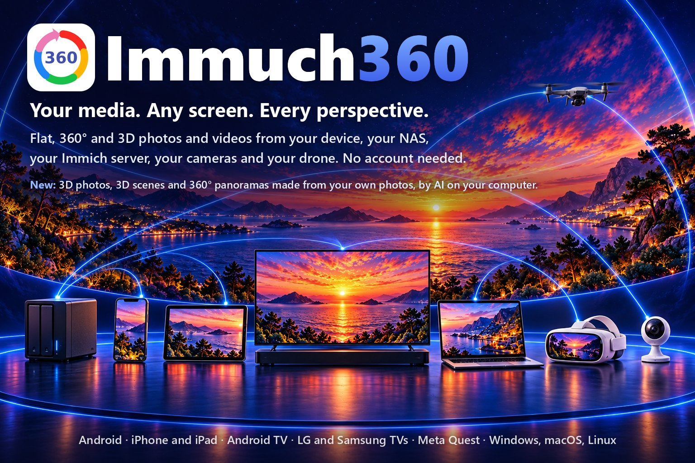
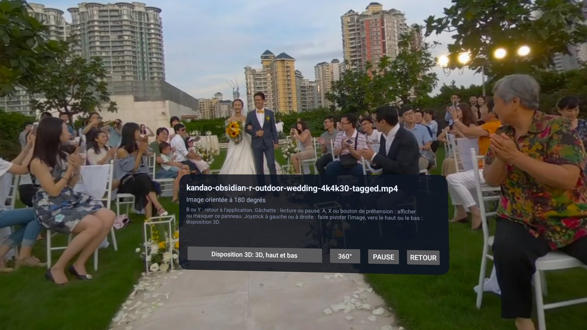
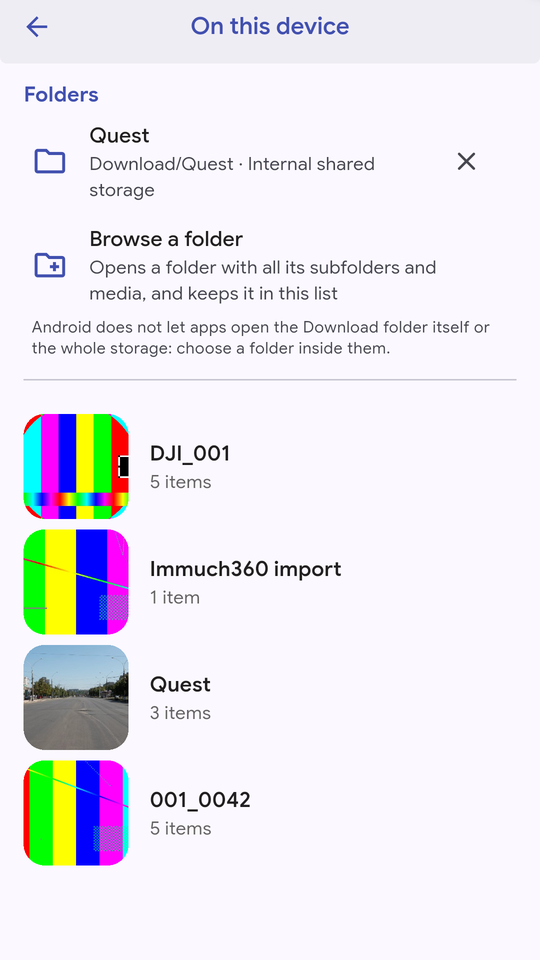

🌐 <b>粵語</b> · 其他語言 (88)
<a href="../README.md">English</a> · <a href="README.af.md">Afrikaans</a> · <a href="README.ar.md">العربية</a> · <a href="README.az.md">Azərbaycanca</a> · <a href="README.be.md">Беларуская</a> · <a href="README.bg.md">Български</a> · <a href="README.bi.md">Bislama</a> · <a href="README.bn.md">বাংলা</a> · <a href="README.br.md">Brezhoneg</a> · <a href="README.bs.md">Bosanski</a> · <a href="README.ca.md">Català</a> · <a href="README.cs.md">Čeština</a> · <a href="README.cv.md">Чӑвашла</a> · <a href="README.da.md">Dansk</a> · <a href="README.de.md">Deutsch</a> · <a href="README.de_CH.md">Deutsch (Schweiz)</a> · <a href="README.el.md">Ελληνικά</a> · <a href="README.en_GB.md">English (UK)</a> · <a href="README.eo.md">Esperanto</a> · <a href="README.es.md">Español</a> · <a href="README.et.md">Eesti</a> · <a href="README.eu.md">Euskara</a> · <a href="README.fa.md">فارسی</a> · <a href="README.fi.md">Suomi</a> · <a href="README.fil.md">Filipino</a> · <a href="README.fr.md">Français</a> · <a href="README.ga.md">Gaeilge</a> · <a href="README.gl.md">Galego</a> · <a href="README.gsw.md">Alemannisch</a> · <a href="README.gu.md">ગુજરાતી</a> · <a href="README.he.md">עברית</a> · <a href="README.hi.md">हिन्दी</a> · <a href="README.hr.md">Hrvatski</a> · <a href="README.hu.md">Magyar</a> · <a href="README.hy.md">Հայերեն</a> · <a href="README.id.md">Bahasa Indonesia</a> · <a href="README.is.md">Íslenska</a> · <a href="README.it.md">Italiano</a> · <a href="README.ja.md">日本語</a> · <a href="README.ka.md">ქართული</a> · <a href="README.kab.md">Taqbaylit</a> · <a href="README.kk.md">Қазақша</a> · <a href="README.km.md">ខ្មែរ</a> · <a href="README.kmr.md">Kurmancî</a> · <a href="README.kn.md">ಕನ್ನಡ</a> · <a href="README.ko.md">한국어</a> · <a href="README.kxm.md">ภาษาเขมรถิ่นไทย</a> · <a href="README.lb.md">Lëtzebuergesch</a> · <a href="README.lmo.md">Lombard</a> · <a href="README.lt.md">Lietuvių</a> · <a href="README.lv.md">Latviešu</a> · <a href="README.mfa.md">Bahasa Melayu Kelantan</a> · <a href="README.mi.md">Te reo Māori</a> · <a href="README.mk.md">Македонски</a> · <a href="README.ml.md">മലയാളം</a> · <a href="README.mn.md">Монгол</a> · <a href="README.mr.md">मराठी</a> · <a href="README.ms.md">Bahasa Melayu</a> · <a href="README.nb_NO.md">Norsk bokmål</a> · <a href="README.ne.md">नेपाली</a> · <a href="README.nl.md">Nederlands</a> · <a href="README.nn.md">Norsk nynorsk</a> · <a href="README.pa.md">ਪੰਜਾਬੀ</a> · <a href="README.pl.md">Polski</a> · <a href="README.pt.md">Português</a> · <a href="README.pt_BR.md">Português (Brasil)</a> · <a href="README.ro.md">Română</a> · <a href="README.ru.md">Русский</a> · <a href="README.si.md">සිංහල</a> · <a href="README.sk.md">Slovenčina</a> · <a href="README.sl.md">Slovenščina</a> · <a href="README.sq.md">Shqip</a> · <a href="README.sr_Cyrl.md">Српски</a> · <a href="README.sr_Latn.md">Srpski</a> · <a href="README.sv.md">Svenska</a> · <a href="README.sw.md">Kiswahili</a> · <a href="README.swg.md">Schwäbisch</a> · <a href="README.ta.md">தமிழ்</a> · <a href="README.te.md">తెలుగు</a> · <a href="README.th.md">ไทย</a> · <a href="README.tl.md">Tagalog</a> · <a href="README.tr.md">Türkçe</a> · <a href="README.uk.md">Українська</a> · <a href="README.ur.md">اردو</a> · <a href="README.uz.md">Oʻzbekcha</a> · <a href="README.vi.md">Tiếng Việt</a> · <a href="README.zh_Hans.md">简体中文</a> · <a href="README.zh_Hant.md">繁體中文</a>

  

# Immuch360

**你嘅媒體。乜畫面都得。睇盡每個角度。**

🌐 <a href="https://immuch360.com/yue-hant/"><b>immuch360.com</b></a>

平面、360° 同 3D 嘅相片同影片，嚟自你部裝置、你嘅 NAS、你嘅 Immich 伺服器、你嘅相機同你部無人機。唔使開帳戶。Immuch360 係一個免費、開放原始碼嘅 app，喺你啲相片同影片所在嘅地方直接讀取，再用最啱嘅檢視器播放每一個：平面、變成一個可以四圍睇嘅球體、3D，或者喺頭戴裝置入面包圍住你。佢可以喺電話、平板、電視、Meta Quest 頭戴裝置同電腦上面行。佢嘅網站 [immuch360.com](https://immuch360.com/yue-hant/) 用 89 種語言介紹佢喺每個螢幕上面可以做乜。

**build 53 同桌面版 build 34（3.4.8 版本）嘅新嘢。** 喺電腦上面，[Spatial 2.5D](#see-your-3d-photos-and-videos-in-depth-on-your-computer) 會喺平面螢幕上面為你嘅 3D 相片加深度，Windows、Linux 同 macOS 都得，3D 影片就喺 Windows 同 macOS：你郁個頭，畫面就會跟住郁，你同意之後由網絡攝影機跟住你個頭，或者用滑鼠，而網絡攝影機嘅影像只會留喺電腦嘅記憶體，永遠唔會儲存或者傳送；專案仲未用網絡攝影機試過。滾輪會[圍住指標放大相片](#zoom-into-a-photo-with-the-wheel)，拖動就會移動佢。[增強（AI）](#make-a-photo-sharper-on-your-computer-ai)可以攞你嘅共享、DLNA、Plex、Jellyfin 同 Emby，同埋你 Immich 伺服器嘅相片，增強 360° 同 3D 相片而唔會整爛佢哋嘅接縫或者兩隻眼，仲喺有 Apple 晶片嘅 Mac 上面提供銳化（未喺 Mac 上面試過）。由電話，[「播放到…」](#show-your-photos-and-videos-on-the-tv-from-your-phone)會喺螢幕嘅 360° 畫面打開 360° 項目，將揀選咗嘅項目或者相簿當幻燈片播，幫螢幕登入你嘅伺服器，同埋傳送淨係喺電話度嘅相片同影片；喺 Android 模擬器之間試過，仲未喺真電話或者電視上面試過。喺 Meta Quest 入面，大螢幕嘅幻燈片會喺相片之間[交叉淡化或者滑動](#browse-your-photos-on-the-big-screen-of-the-quest)，背景可以揀黑色、模糊或者 passthrough，專案仲未喺頭戴裝置上面試過。

**build 33 至 52 嘅新功能。**[電影會由你停低嘅地方繼續播](#pick-up-a-film-where-you-stopped)。電影會早啲開始，喺慢伺服器上面都會[繼續播，唔會停](#when-a-video-waits-or-will-not-play)。喺電話同電腦上面，時間軸[可以縮到月同年](#find-a-month-or-a-year-in-a-long-timeline)。喺 Android 電話或者 Meta Quest 上面，[「瀏覽資料夾」](#browse-a-folder-of-your-phone-or-headset)可以好似共享咁打開裝置嘅資料夾，TIFF 相片亦會顯示。Android TV [可以用遙控器按日期搜尋](#on-android-tv-and-google-tv)，Meta Quest 3 或者 3S [可以打開高斯潑濺](#explore-gaussian-splats-in-a-meta-quest-3-or-3s)，可以用右搖桿轉，仲支援 SPZ 第 4 版，電腦就可以[為你 NAS 上面嘅相片整 3D 版本](#turn-one-photo-into-3d-a-scene-a-panorama)。喺有兩粒圖形晶片嘅 Windows 手提電腦上面，app [而家會喺快嗰粒度行](#when-a-video-waits-or-will-not-play)，所以 8K 電影播得好順。高斯潑濺而家[可以喺電腦同 Android 電話同平板上面打開](#explore-gaussian-splats-on-your-phone-tablet-or-computer)，Windows 電腦可以由 AI [用你嘅相片或者一段影片整潑濺場景](#make-a-splat-scene-from-your-photos-or-a-video-ai)，你嘅 Immich 伺服器[將佢哋保存喺相片入面](#keep-a-splat-scene-on-your-immich-server)，可以由你嘅時間軸打開，而電腦[可以播 AV2 影片](#play-av2-videos-on-your-computer)。由 build 42 起，嚟自你 Immich 媒體庫、共享或者資料夾嘅 Insta360、GoPro MAX 同 DJI Osmo 360 相機原始影片喺 Android 電話、平板同電視上面[會用相機嘅陀螺儀防震播放](#stabilise-your-360-videos-with-the-cameras-gyroscope)，桌面版 build 22 整潑濺場景嘅功能[提供詳細質素](#make-a-splat-scene-from-your-photos-or-a-video-ai)，畀你近距離睇嘅場景用，而 360° 全景圖[喺顯示卡有 3.5 GiB 空閒就會開始](#turn-one-photo-into-3d-a-scene-a-panorama)。iPhone 同 iPad app [已經上咗 App Store](https://apps.apple.com/us/app/immuch360-360-3d-player/id6817655965)，3.4.3 版本。由 build 43 起，app 嘅更新通知喺電話同平板上面會打開 Google Play 或者 App Store；佢嘅網站 [immuch360.com](https://immuch360.com/yue-hant/) 喺 11 月 7 日開咗。由 build 44 同桌面版 build 24 起，Meta Quest 3 或者 3S [可以顯示最多 300,000 個高斯嘅潑濺](#explore-gaussian-splats-in-a-meta-quest-3-or-3s)，電腦[可以用 Ctrl 同 Shift 揀幾張相同幾段影片](#use-your-computer-as-the-media-player)，解碼器唔肯播某段影片嘅電視會自己[播伺服器嘅另一個檔案](#when-a-video-waits-or-will-not-play)，有兩張顯示卡嘅手提電腦會喺揀咗嗰張卡度行全景圖，而 Quest 同電腦嘅更新通知會打開佢哋嘅商店或者下載頁，仲有好多修正。由 build 45 同桌面版 build 25 起，所有平台都係 3.4.0 版本，個 app 跟上 Immich 3.4.0 app，再加 Immich 之後嘅 11 個修正，顯示 [Immich 3.4 伺服器嘅 JPEG XL 相片](#keep-your-immich-library-with-more)，按年份打開[你嘅 Plex 電影](#watch-your-plex-films)，每套電影有自己一頁，可以下載到裝置，亦可以由電話喺電視播放，商店版 build 可能會邀請你評分，而喺電腦上面，影片組件就嚟自[佢哋自己嘅開源儲存庫](#licences-and-credits)。由 build 46 同桌面版 build 26 起，即係 3.4.1 版本，360° 相機嘅原始影片喺 iPhone 同 iPad、Meta Quest 入面同 Windows 上面都會[防震播放](#stabilise-your-360-videos-with-the-cameras-gyroscope)，Meta Quest [會用 libmpv 播佢自己播放器解碼唔到嘅 Plex 電影](#watch-your-plex-films)，電話[會將呢類電影傳去 Chromecast 或者 Google TV](#watch-your-plex-films)，3D 相片嘅 AI 立體感[會用你揀嘅強度](#turn-one-photo-into-3d-a-scene-a-panorama)；新伺服器亦都可以用你嘅 Plex 帳戶登入嚟加，而 app [會將設定存喺一個檔案](#keep-your-settings-in-a-file)。由 build 47 同桌面版 build 27 起，即係 3.4.2 版本，Plex 電影[會播裝置解碼到嘅音軌](#watch-your-plex-films)並講明係邊條，會打開啱螢幕嘅版本，喺慢嘅連線上面仲會提供一個輕啲嘅版本，Windows 同 macOS 會播佢嘅 Dolby TrueHD 聲音，Android [會喺通知顯示佢嘅下載](#watch-your-plex-films)，Android TV 都可以下載電影，而[用電池嘅 Tapo 相機可以直播](#watch-your-home-cameras-on-the-big-screen)；還原一個連帳戶嘅設定檔而家會幫你登入你嘅 Immich 伺服器。由 build 48 同桌面版 build 28 起，即係 3.4.3 版本，[Windows 電腦可以喺 PC VR 頭戴裝置播你嘅影片](#watch-your-videos-in-a-pc-vr-headset-from-windows)，經 SteamVR、Meta Horizon Link 或者其他 OpenXR 執行環境（專案仲未喺頭戴裝置上面試過），[其他品牌嘅相機可以直播](#cameras-of-other-brands-over-onvif-or-rtsp)，用 ONVIF 搵到或者用佢哋嘅 RTSP 連結加入（已經用模擬相機測試過，仲未試過其他品牌嘅真相機），[DJI Osmo 360 II 同 GoPro MAX 2 嘅原始影片會防震播放](#open-the-raw-files-of-360-cameras)，[電話收 Plex 電影唔會再慢到停](#when-a-video-waits-or-will-not-play)，[LG 同 Samsung 電視可以一個掣轉正打側嘅影片](#on-a-samsung-tv-tizen)（仲未喺 LG 電視上面試過；issue 17 嗰部 Samsung 電視拒絕轉動），而伺服器已經係最新嘅話，唔會再顯示「又有伺服器更新啦」。由 build 49 同桌面版 build 29 起，3.4.4 版本，app [會自己讀你嘅 Jellyfin 同 Emby 伺服器](#watch-your-jellyfin-and-emby-libraries)（仲未喺裝置上面試過），喺你網絡入面搵到，喺電視或者頭戴裝置用 Quick Connect 登入，播佢哋嘅原始檔案，令 360° 影片保持 360°；喺 Meta Quest 嘅大螢幕上面，[相片喺你瀏覽嗰陣會保持你設定嘅大小同位置，仲可以播幻燈片](#browse-your-photos-on-the-big-screen-of-the-quest)（專案仲未喺頭戴裝置上面試過）；電話同平板嘅 360° 影片播放器[有 360° 相片嘅控制方式](#360-videos-on-your-phone-with-the-controls-of-360-photos)，即係陀螺儀按鈕、兩指縮放同直上直落拖動（有用戶喺 Samsung Galaxy S25 Ultra 上面試過，仲未喺 iPhone 上面試過）；電腦會用 AI [將你嘅 2D 影片變成 3D 影片](#turn-your-2d-videos-into-3d-on-your-computer)（仲未喺 3D 螢幕或者頭戴裝置上面試過）；而 Samsung 電視會[將要轉嘅影片交畀 Samsung 自己嘅播放器](#on-a-samsung-tv-tizen)，issue 17 嗰部電視播到但拒絕轉動。由 build 50 同桌面版 build 30 起，即係 3.4.5 版本，影片喺 Meta Quest 嘅 2D 視窗播放嗰陣，視窗會[跟螢幕嘅更新率重畫](#step-inside-your-photos-and-videos-with-a-meta-quest)，唔再好似 build 48 同 49 咁每秒大約 10 次（喺 Meta Quest 3 上面量度），Android TV 會[用遙控器放大相片](#on-android-tv-and-google-tv)，再用方向鍵移動（新功能，仲未喺電視上面試過），仲有三個修正來自 mlc70 嘅 Android TV fork：快速掃過唔會再顯示留喺後面嗰張相嘅詳細資料，動態相片會釋放佢嘅記憶體，而位置篩選器會提供新國家嘅城市。由 build 51 同桌面版 build 31（3.4.6 版本）起，[增強（AI）](#make-a-photo-sharper-on-your-computer-ai)喺 Windows 同 Linux 上面會喺原相旁邊整一張朦相嘅更清晰副本，有三個級別，每個都喺一部有 RTX 4060 嘅電腦上面行過一次，自然喺有 Apple 晶片嘅 Mac 上面都有提供（未喺 Mac 上面試過），電腦用 AI [將 360° 影片變成 360° 3D 影片](#a-360-video-turned-into-a-360-3d-video)，喺 Windows 上面 3D 影片嘅深度由顯示卡估算，AI 功能直接攞你伺服器同共享入面嘅影片，設定檔喺[媒體庫有自己嘅卡](#keep-your-settings-in-a-file)，電視可以將佢儲存到網絡共用資料夾，喺電腦上面 Escape 會返回上一步，商店版 build [邀請評分會少啲、溫和啲](#privacy)，Linux 會顯示 TIFF 相片、潑濺場景同一邊眼嘅 3D 影片，仲修正咗兩個當機。由 build 52 同桌面版 build 32（3.4.7 版本）起，[「播放到…」](#show-your-photos-and-videos-on-the-tv-from-your-phone)會由電話將你 Immich 媒體庫、你嘅共享同 Jellyfin 同 Emby 嘅相片同影片傳去電視、Meta Quest、電腦或者 Chromecast，你相片同影片嘅名[喺縮圖上面保持清楚易讀](#play-the-files-of-a-nas-a-computer-a-media-server-or-plex)，電腦嘅 AI 組件[一㩒就更新](#update-the-ai-components-in-one-click)，Linux 有咗 [AppImage](#linux)，而 iPhone 同 iPad app 用 Xcode 27 建置。桌面版 build 33 修正咗[增強（AI）](#make-a-photo-sharper-on-your-computer-ai)，佢喺桌面版 build 31 同 32 每張相都失敗（[issue 23](https://github.com/freeKC/Immuch360/issues/23)）。

  Immich 手機 app 嘅非官方 fork。同 Immich 或者 FUTO 冇關係。呢個名嘅讀音好似英文「I am much 360」噉。

<b>目錄</b>

- [適合邊個](#who-it-is-for)
- [邊啲螢幕](#which-screens)，[佢哋一齊做到乜](#use-cases)同埋[每種螢幕做到乜](#what-each-screen-does)
- [你可以做乜](#what-you-can-do)
- [裝落你部裝置](#get-it-on-your-device)
- [點樣用](#how-to)
  - [睇你嘅相片同影片，有冇伺服器都得](#watch-your-photos-and-videos-with-or-without-a-server)
  - [探索全景、360°、VR180 同 3D](#explore-panoramas-360-vr180-and-3d)：[電話上面嘅 360° 影片](#360-videos-on-your-phone-with-the-controls-of-360-photos)
  - [將一張相變成 3D、場景、全景圖](#turn-one-photo-into-3d-a-scene-a-panorama)：[一㩒就更新嘅 AI 組件](#update-the-ai-components-in-one-click)
  - [喺你部電腦將你嘅 2D 影片變成 3D](#turn-your-2d-videos-into-3d-on-your-computer)：[360° 影片變 360° 3D](#a-360-video-turned-into-a-360-3d-video)
  - [喺你部電腦令相片更清晰（AI）](#make-a-photo-sharper-on-your-computer-ai)
  - [喺電視用遙控器睇](#watch-on-the-tv-with-the-remote)：[Android TV 同 Google TV](#on-android-tv-and-google-tv)、[LG](#on-an-lg-tv-webos)、[Samsung](#on-a-samsung-tv-tizen)
  - [用電話登入電視、頭戴裝置或者電腦](#sign-in-a-tv-a-headset-or-a-computer-with-your-phone)
  - [由電話將你嘅相片同影片喺電視上面顯示](#show-your-photos-and-videos-on-the-tv-from-your-phone)
  - [用 Meta Quest 走入你嘅相片同影片](#step-inside-your-photos-and-videos-with-a-meta-quest): [大螢幕](#browse-your-photos-on-the-big-screen-of-the-quest)、[展示台模式](#kiosk-mode-for-an-exhibition-or-a-shop)
  - [喺 Meta Quest 3 或者 3S 探索高斯潑濺](#explore-gaussian-splats-in-a-meta-quest-3-or-3s)
  - [喺你嘅電話、平板或者電腦探索高斯潑濺](#explore-gaussian-splats-on-your-phone-tablet-or-computer)
  - [用你嘅相片或者一段影片整潑濺場景（AI）](#make-a-splat-scene-from-your-photos-or-a-video-ai)
  - [將潑濺場景保存喺你嘅 Immich 伺服器](#keep-a-splat-scene-on-your-immich-server)
  - [播放 NAS、電腦、媒體伺服器或者 Plex 嘅檔案](#play-the-files-of-a-nas-a-computer-a-media-server-or-plex)：[按年份睇你嘅電影](#watch-your-plex-films)、[Jellyfin 同 Emby](#watch-your-jellyfin-and-emby-libraries)
  - [瀏覽電話或者頭戴裝置嘅資料夾](#browse-a-folder-of-your-phone-or-headset)
  - [由你停低嘅地方繼續睇電影](#pick-up-a-film-where-you-stopped)
  - [影片要等或者播唔到嘅時候](#when-a-video-waits-or-will-not-play)
  - [保留你嘅 Immich 媒體庫，仲有更多](#keep-your-immich-library-with-more)
  - [喺好長嘅時間軸入面搵某個月或者某一年](#find-a-month-or-a-year-in-a-long-timeline)
  - [喺大螢幕睇你屋企嘅相機](#watch-your-home-cameras-on-the-big-screen)：[其他品牌](#cameras-of-other-brands-over-onvif-or-rtsp)
  - [你部 DJI 無人機](#your-dji-drone)：[直播影像](#see-what-your-drone-sees-on-your-phone)、[喺 Quest 或者 Android TV 睇](#watch-it-in-a-meta-quest-or-on-an-android-tv)、[匯入](#bring-a-drones-or-a-camera-cards-photos-and-videos-to-immich)
  - [打開 360° 相機嘅原始檔案](#open-the-raw-files-of-360-cameras)
  - [用相機嘅陀螺儀為你嘅 360° 影片防震](#stabilise-your-360-videos-with-the-cameras-gyroscope)
  - [一個掣轉相](#turn-a-photo-with-one-key)
  - [將你部電腦當媒體播放器用](#use-your-computer-as-the-media-player)：[用滾輪放大](#zoom-into-a-photo-with-the-wheel)
  - [喺電腦上面睇有深度嘅 3D 相片同影片](#see-your-3d-photos-and-videos-in-depth-on-your-computer)
  - [喺 PC VR 頭戴裝置睇你嘅影片，由 Windows 播](#watch-your-videos-in-a-pc-vr-headset-from-windows)
  - [喺你部電腦播 AV2 影片](#play-av2-videos-on-your-computer)
  - [將你嘅設定存喺檔案](#keep-your-settings-in-a-file)
- [同 Immich 比較](#compared-with-immich)
- [私隱](#privacy)
- [授權同鳴謝](#licences-and-credits)
- [路線圖](#roadmap)
- [文件](#documentation)

## 適合邊個

- **你影 360° 或者 3D** 想喺你影嘅嘢入面四圍睇，而唔係睇到佢哋變平、變雙或者被拉闊，仲想喺電話上面好似轉相咁轉你嘅 360° 影片：[360°、VR180 同 3D](#explore-panoramas-360-vr180-and-3d)、[電話上面嘅 360° 影片](#360-videos-on-your-phone-with-the-controls-of-360-photos)。
- **你用 360° 相機手持、喺單車上面或者頭盔上面拍片** 想存喺 Immich、共享或者資料夾嘅 Insta360、GoPro MAX 或者 MAX 2、DJI Osmo 360 或者 Osmo 360 II 相機原始影片喺你嘅電話、電視、Meta Quest 或者 Windows 電腦上面播得水平又穩定：[用相機嘅陀螺儀防震](#stabilise-your-360-videos-with-the-cameras-gyroscope)。
- **你啲相同影片放喺 NAS、電腦、Plex 或者 Immich** 想唔使複製任何嘢就喺電視睇：[喺電視](#watch-on-the-tv-with-the-remote)、[NAS、共享同 Plex](#play-the-files-of-a-nas-a-computer-a-media-server-or-plex)。
- **你將電影放喺 Plex 伺服器** 想按年份揀一套、開始之前睇吓係乜嘢、帶去旅行、由電話喺電視或者 Chromecast 開始播，連你嘅 Android 電話、電視或者 Meta Quest 解碼唔到嘅電影都播到：[你嘅電影，按年份](#watch-your-plex-films)。
- **你將電影放喺 Jellyfin 或者 Emby 伺服器**，想喺你嘅 Meta Quest、電視或者電話睇，360° 同 3D 保持原樣，你睇到邊度亦都記喺伺服器（仲未喺裝置上面試過）：[Jellyfin 同 Emby](#watch-your-jellyfin-and-emby-libraries)。
- **你有 Meta Quest** 想走入你自己嘅相片同影片入面：[喺頭戴裝置](#step-inside-your-photos-and-videos-with-a-meta-quest)，仲想用你設定嘅大小同位置喺大螢幕瀏覽你嘅相片，幻燈片都得（專案仲未喺頭戴裝置上面試過）：[大螢幕](#browse-your-photos-on-the-big-screen-of-the-quest)。
- **你部 Windows 電腦有 PC VR 頭戴裝置**，想喺入面將你嘅 360° 影片顯示喺你周圍，電影就喺一塊大螢幕上面（專案仲未喺頭戴裝置上面試過）：[喺 PC VR 頭戴裝置](#watch-your-videos-in-a-pc-vr-headset-from-windows)。
- **你啲相係平面嘅**，而你想冇 3D 相機都可以用 3D 睇，變成喺頭戴裝置入面可以湊近去睇嘅場景，或者置身喺 360° 全景圖入面：[將一張相變成 3D、場景、全景圖](#turn-one-photo-into-3d-a-scene-a-panorama)，新功能，由 AI 喺你自己部電腦上面整。
- **你嘅影片係平面嘅**，連電話影嘅片段都係，你想佢哋變成 3D，畀頭戴裝置或者 3D 螢幕用，你嘅 360° 影片就變成 360° 3D，喺你自己部電腦整（仲未喺 3D 螢幕或者頭戴裝置上面試過）：[2D 影片變 3D](#turn-your-2d-videos-into-3d-on-your-computer)、[360° 變 360° 3D](#a-360-video-turned-into-a-360-3d-video)。
- **你嘅相有啲朦**，有少少失焦或者喺光線唔夠嘅地方影，你想喺原相旁邊有一張更清晰嘅副本，喺你自己部電腦整，共享同伺服器嘅相都得，而虛構咗嘅細節會講清楚：[增強（AI）](#make-a-photo-sharper-on-your-computer-ai)。
- **你有 3D 相片或者影片同一部電腦**，想喺佢嘅平面螢幕上面有深度咁睇，你郁個頭畫面就跟住郁，由網絡攝影機跟住，或者用滑鼠（專案仲未用網絡攝影機試過）：[喺你部電腦用 Spatial 2.5D](#see-your-3d-photos-and-videos-in-depth-on-your-computer)。
- **你有行 Immich** 想要佢個 app，再加沉浸式檢視器，同埋用電話就登入到嘅大螢幕：[你嘅 Immich 媒體庫](#keep-your-immich-library-with-more)、[同 Immich 比較](#compared-with-immich)。
- **你用 Tapo 相機睇住屋企**，用電池嘅都得，或者用 ONVIF 或 RTSP 嘅其他品牌相機，想佢哋同你啲相放埋一齊，喺電視都睇到（已經對住一部模擬相機測試過）：[家居相機](#watch-your-home-cameras-on-the-big-screen)。
- **你飛 DJI 無人機** 想唔使 DJI Fly 就喺電話睇到佢嘅直播畫面，仲可以喺 Meta Quest 或者 Android TV 畀身邊嘅人睇：[你部無人機](#see-what-your-drone-sees-on-your-phone)。
- **你用 3D 掃描地方同物件，做成高斯潑濺**，或者想用你自己嘅相片整出嚟，仲想喺你部電話、你部電腦或者頭戴裝置度喺佢哋入面行：[喺電話、平板或者電腦](#explore-gaussian-splats-on-your-phone-tablet-or-computer)、[用你嘅相片整](#make-a-splat-scene-from-your-photos-or-a-video-ai)、[保存喺 Immich](#keep-a-splat-scene-on-your-immich-server)。
- **你有 AV2 影片**，即係接替 AV1 嘅格式，想喺你部電腦睇：[你部電腦上面嘅 AV2](#play-av2-videos-on-your-computer)。
- **你屋企有幾部螢幕** 想佢哋一齊運作：[你啲螢幕一齊做到乜](#use-cases)。

唔使開任何 Immuch360 帳戶，亦冇任何嘢會傳去我哋度：個 app 淨係同你嘅裝置同你揀嘅伺服器溝通，由 build 45 起亦會為電影頁面同 Wikipedia 溝通，由 build 46 起，你用 plex.tv 登入嗰陣亦會同 plex.tv 溝通，而且淨係喺你要求嗰陣先會下載 AI 組件或者 AV2 解碼器。

## 邊啲螢幕

| 平台 | 喺邊度攞 | 2026 年 11 月狀態 |
|---|---|---|
|  **Android** 電話同平板 | [Google Play](https://play.google.com/store/apps/details?id=com.aprogsys.immuch360) · [APK](https://github.com/freeKC/Immuch360/releases) | 喺 Google Play 上面（build 47 喺 11 月 16 日發布；build 51 由 11 月 24 日起喺 Google 審核緊；跟住係 build 53），build 53 上咗 GitHub，[原始 360° 影片會防震播放](#stabilise-your-360-videos-with-the-cameras-gyroscope)，[電影會由你停低嘅地方繼續播](#pick-up-a-film-where-you-stopped)，[「瀏覽資料夾」](#browse-a-folder-of-your-phone-or-headset)可以打開電話嘅資料夾，而且[高斯潑濺打得開](#explore-gaussian-splats-on-your-phone-tablet-or-computer)，可以喺共享或者[喺你嘅 Immich 時間軸](#keep-a-splat-scene-on-your-immich-server)打開，仲有[存喺檔案嘅設定](#keep-your-settings-in-a-file)、[喺通知顯示嘅電影下載](#watch-your-plex-films)、由 build 48 起[其他品牌嘅相機直播](#cameras-of-other-brands-over-onvif-or-rtsp)（已經用模擬相機測試過），同埋由 build 49 起[Jellyfin 同 Emby 伺服器](#watch-your-jellyfin-and-emby-libraries)（仲未喺裝置上面試過）同 [360° 影片播放器入面 360° 相片嘅控制方式](#360-videos-on-your-phone-with-the-controls-of-360-photos)（有用戶喺 Samsung Galaxy S25 Ultra 上面試過），仲有由 build 51 起[媒體庫入面嘅設定檔卡](#keep-your-settings-in-a-file)，個檔案都可以儲存到網絡共用資料夾，仲有由 build 52 起用「播放到…」[將你嘅相片同影片傳去電視或者 Chromecast](#show-your-photos-and-videos-on-the-tv-from-your-phone)（仲未喺裝置上面試過），仲有由 build 53 起用同一個方法傳送嘅 [360° 項目、揀選咗嘅項目或者相簿，同電話本身嘅相片同影片](#show-your-photos-and-videos-on-the-tv-from-your-phone)（喺 Android 模擬器之間試過） |
|  **iPhone 同 iPad** | [App Store](https://apps.apple.com/us/app/immuch360-360-3d-player/id6817655965) | 3.4.7 版本由 11 月 26 日起上咗 App Store，有[時間軸入面嘅月同年](#find-a-month-or-a-year-in-a-long-timeline)、[由你停低嘅地方繼續播嘅電影](#pick-up-a-film-where-you-stopped)、由電話[登入電視、頭戴裝置或者電腦](#sign-in-a-tv-a-headset-or-a-computer-with-your-phone)、存喺 Immich 嘅潑濺場景會以佢哋嘅相片顯示、Immich 3.4.0 嘅修正同佢嘅 JPEG XL 相片、[防震嘅原始 360° 影片](#stabilise-your-360-videos-with-the-cameras-gyroscope)、[存喺檔案嘅設定](#keep-your-settings-in-a-file)、[用電池嘅 Tapo 相機直播畫面](#watch-your-home-cameras-on-the-big-screen)同[其他品牌嘅相機嘅直播畫面](#cameras-of-other-brands-over-onvif-or-rtsp)（已經用模擬相機測試過），仲有由 3.4.4 版本起嘅[Jellyfin 同 Emby 伺服器](#watch-your-jellyfin-and-emby-libraries)（仲未喺裝置上面試過）同 [360° 影片播放器入面 360° 相片嘅控制方式](#360-videos-on-your-phone-with-the-controls-of-360-photos)（仲未喺 iPhone 上面試過），仲有由 3.4.6 版本起嘅[設定檔卡](#keep-your-settings-in-a-file)同由網絡共用資料夾還原，仲有由 3.4.7 版本起，用 Xcode 27 建置，[相片同影片嘅「播放到…」](#show-your-photos-and-videos-on-the-tv-from-your-phone)（仲未喺 iPhone 上面試過）；3.4.8 版本，即係 build 53 嘅 iPhone 同 iPad 版本，跟住就到；或者[自己編譯](../docs/immuch360/build.md) |
|  **Android TV 同 Google TV** | [Google Play](https://play.google.com/store/apps/details?id=com.aprogsys.immuch360) · [APK](#android-tv-and-google-tv) | 喺 Google Play 上面，佢喺 Android TV 同 Google TV 提供呢個 app，同埋 build 53 上咗 GitHub：[原始 360° 影片防震](#stabilise-your-360-videos-with-the-cameras-gyroscope)，[用遙控器按日期搜尋](#on-android-tv-and-google-tv)，掃 QR code 就可以[用電話登入](#sign-in-a-tv-a-headset-or-a-computer-with-your-phone)，影片播放器有畀遙控器用嘅時間軸、音訊同字幕，仲有由電話轉播嘅[無人機直播影像](#watch-it-in-a-meta-quest-or-on-an-android-tv)、[下載到電視嘅電影](#watch-your-plex-films)，仲有由 build 49 起用 Quick Connect 登入嘅[Jellyfin 同 Emby 伺服器](#watch-your-jellyfin-and-emby-libraries)（仲未喺裝置上面試過），仲有由 build 50 起[用遙控器放大嘅相片](#on-android-tv-and-google-tv)（喺 Android TV 模擬器上面見到用得，仲未喺電視上面試過），仲有由 build 51 起[儲存到網絡共用資料夾再由嗰度還原嘅設定檔](#keep-your-settings-in-a-file)（喺 Android TV 模擬器上面見到用得），仲有由 build 52 起[電話用「播放到…」傳過嚟嘅相片同影片](#show-your-photos-and-videos-on-the-tv-from-your-phone)（仲未喺電視上面試過），仲有由 build 53 起，電話傳過嚟嘅 360° 相片會喺佢哋嘅 360° 畫面打開，可以由電話嘅清單登入，同埋電話本身嘅相片同影片（喺 Android TV 模擬器上面見到用得） |
| 行 webOS 5.0 或以上嘅 **LG 電視** | [.ipk，1.0.5 版本](https://github.com/freeKC/Immuch360/releases/tag/webos-v1.0.5) · LG Content Store（審核中） | 1.0.0 版本，10 月 24 日提交咗去 LG Content Store，由 10 月 26 日起 LG 測試緊；1.0.1 版本由 10 月 27 日起上咗 GitHub，可以用方向鍵放大相片，仲會喺相片未載入完嗰陣話你知，而 1.0.2 版本同 build 46 一齊上咗 GitHub，日文嘅「登入」會寫做 ログイン，1.0.3 版本同 build 47 一齊，會喺 DLNA 伺服器嘅資料夾有電視直播頻道嗰陣話你知，佢暫時仲播唔到，而 [1.0.4 版本同 build 48 一齊，可以一個掣轉正打側嘅影片](#on-an-lg-tv-webos)（仲未喺 LG 電視上面試過），而 1.0.5 版本同 build 49 一齊，會喺 DLNA 伺服器之中列出加咗 DLNA 插件嘅 Jellyfin；LG 未發布個 app 之前，要喺 [Developer Mode](#lg-tvs-webos) 安裝。1.0.0 版本喺 LG Cloud Test Lab 嘅 webOS 25 電視上面行過 |
| 行 Tizen 5.5 或以上嘅 **Samsung 電視** | [.wgt，0.3.6 版本](https://github.com/freeKC/Immuch360/releases/tag/tizen-v0.3.6) | 同一個電視 app 嘅 0.3.6 版本，要用你自己嘅 Samsung 憑證簽署，再喺 [Developer mode](#samsung-tvs-tizen) 安裝；0.1.0 喺一位測試者嘅 Samsung 電視上面行過，0.2.0 包含咗嗰次測試之後嘅修正，0.3.0 加入咗 LG 1.0.1 版本嘅相片縮放同 Loading 提示，0.3.1 加入咗 LG 1.0.2 版本嘅日文字眼，0.3.2 會將用電話直影嘅影片正向播放（[issue 17](https://github.com/freeKC/Immuch360/issues/17)），[0.3.3 同 0.3.4 喺話影片係直嘅電視上面都會轉正佢](#on-a-samsung-tv-tizen)，仲加咗一個手動轉嘅掣，而 0.3.5 同 0.3.6 會將呢類影片交畀 Samsung 自己嘅播放器；喺報告者部電視上面，0.3.4 同 0.3.5 都令畫面保持打側，因為電視拒絕轉動，嗰度嘅解決方法係由你嘅 Immich 伺服器轉碼、直住儲存嘅影片；唔喺 Samsung 嘅商店 |
|  **Meta Quest** 2、Pro、3 同 3S | [Horizon Store](https://www.meta.com/experiences/immuch360/1384208401440714/) · [APK](#meta-quest) | 喺 Horizon Store 上面（播影片嗰陣 2D 視窗跟螢幕更新率重畫嘅 build 50 喺 11 月 25 日發布；build 52 由 11 月 25 日起喺 Meta 審核緊；跟住係 build 53），build 53 上咗 GitHub，有[展示台模式](#kiosk-mode-for-an-exhibition-or-a-shop)、沉浸式畫面入面[防震嘅原始 360° 影片](#stabilise-your-360-videos-with-the-cameras-gyroscope)、[由 libmpv 播放佢解碼唔到嘅電影](#watch-your-plex-films)，喺 Quest 3 同 3S 仲有[高斯潑濺](#explore-gaussian-splats-in-a-meta-quest-3-or-3s)同為平面相加嘅 [AI 立體感](#turn-one-photo-into-3d-a-scene-a-panorama)，仲有由 build 49 起用你設定嘅大小[喺大螢幕瀏覽嘅相片](#browse-your-photos-on-the-big-screen-of-the-quest)，幻燈片都得（專案仲未喺頭戴裝置上面試過），同用 Quick Connect 登入嘅[Jellyfin 同 Emby 伺服器](#watch-your-jellyfin-and-emby-libraries)（仲未喺裝置上面試過），仲有由 build 51 起，Horizon OS 太舊、用唔到沉浸式畫面嘅頭戴裝置會要求更新，唔會再關閉 app（未喺呢類頭戴裝置上面試過），仲有由 build 53 起[大螢幕相片之間嘅交叉淡化或者滑動，背景係黑色、模糊或者 passthrough](#browse-your-photos-on-the-big-screen-of-the-quest)（專案仲未喺頭戴裝置上面試過） |
|  **Windows** | [安裝程式或者 ZIP](https://github.com/freeKC/Immuch360/releases/tag/desktop-v3.4.8-34) | 桌面版 build 34，已簽署：相片、平面同 360° 影片、共享、Plex、相機（已經用模擬相機測試過）、用電話登入、一個掣轉相、89 種語言嘅介面，仲有由 AI [用你嘅相片整 3D 相片、3D 場景同 360° 全景圖](#turn-one-photo-into-3d-a-scene-a-panorama)，包括你 NAS 上面嘅相片；[高斯潑濺](#explore-gaussian-splats-on-your-phone-tablet-or-computer)：打開、[用你嘅相片或者一段影片整](#make-a-splat-scene-from-your-photos-or-a-video-ai)同[保存喺 Immich](#keep-a-splat-scene-on-your-immich-server)、[AV2 影片](#play-av2-videos-on-your-computer)、由桌面版 build 22 起嘅[潑濺場景質素選擇](#make-a-splat-scene-from-your-photos-or-a-video-ai)同[顯示記憶體有 3.5 GiB 空閒就可以整嘅 360° 全景圖](#turn-one-photo-into-3d-a-scene-a-panorama)，仲有由桌面版 build 26 起[防震嘅原始 360° 影片](#stabilise-your-360-videos-with-the-cameras-gyroscope)同[有立體感強度同更清晰邊緣嘅 3D 相片](#turn-one-photo-into-3d-a-scene-a-panorama)，由桌面版 build 27 起[電影嘅 Dolby TrueHD 聲音同 Blu-ray 字幕](#watch-your-plex-films)、由桌面版 build 28 起[喺 PC VR 頭戴裝置睇你嘅影片](#watch-your-videos-in-a-pc-vr-headset-from-windows)（專案仲未喺頭戴裝置上面試過），仲有由桌面版 build 29 起由 AI [用你嘅 2D 影片整嘅 3D 影片](#turn-your-2d-videos-into-3d-on-your-computer)（仲未喺 3D 螢幕或者頭戴裝置上面試過），仲有由桌面版 build 31 起由 AI 整嘅[你相片嘅更清晰副本](#make-a-photo-sharper-on-your-computer-ai)同由 AI [變成 360° 3D 影片嘅 360° 影片](#a-360-video-turned-into-a-360-3d-video)，深度由顯示卡估算，直接攞你伺服器同共享入面嘅影片，同埋用 Escape 返回上一步，由桌面版 build 32 起[一㩒就更新嘅 AI 組件](#update-the-ai-components-in-one-click)，由桌面版 build 33 起[增強（AI）](#make-a-photo-sharper-on-your-computer-ai)重新用得，仲有由桌面版 build 34 起[用滾輪放大相片](#zoom-into-a-photo-with-the-wheel)、[3D 相片同影片嘅 Spatial 2.5D](#see-your-3d-photos-and-videos-in-depth-on-your-computer)，用網絡攝影機或者滑鼠（專案仲未用網絡攝影機試過），同埋共享同伺服器嘅相片都用得嘅增強（AI），360° 同 3D 相片都得 |
|   **macOS 同 Linux** | [.deb, .rpm, AppImage, DMG](https://github.com/freeKC/Immuch360/releases/tag/desktop-v3.4.8-34) | 桌面版 build 34：相片、360° 相片同平面影片（360° 影片會以平面播放）、Immich 伺服器同網絡共享，仲有由 AI 用你嘅相片整嘅 [3D 相片同 3D 場景](#turn-one-photo-into-3d-a-scene-a-panorama)，Linux 配 8 GB 顯示卡仲可以整 360° 全景圖，佢有 3.5 GiB 空閒就得，仲有[高斯潑濺](#explore-gaussian-splats-on-your-phone-tablet-or-computer)同 [AV2 影片](#play-av2-videos-on-your-computer)（未喺 Mac 上面試過）；桌面版 build 11 喺 10 月 26 日喺一個 Ubuntu 24.04 容器入面同一部 Mac 上面試過；由桌面版 build 27 起，macOS 上面有電影嘅 Dolby TrueHD 聲音；由桌面版 build 29 起，喺 Linux 同有 Apple 晶片嘅 Mac 上面，由 AI [用你嘅 2D 影片整嘅 3D 影片](#turn-your-2d-videos-into-3d-on-your-computer)（仲未喺 3D 螢幕或者頭戴裝置上面試過）；由桌面版 build 31 起，喺 Linux 上面有由 AI 整嘅[你相片嘅更清晰副本](#make-a-photo-sharper-on-your-computer-ai)、TIFF 相片、會自己顯示新檔案嘅資料夾、喺 4 GB 顯示卡上面用你嘅相片整嘅潑濺場景，同以平面一邊眼顯示嘅 3D 影片，而喺有 Apple 晶片嘅 Mac 上面有增強（AI）嘅自然級別（未喺 Mac 上面試過）；由桌面版 build 32 起，有畀其他 Linux 發行版用嘅 [AppImage](#linux)，已經由 CI 喺 Arch Linux 同 openSUSE 上面檢查過；由桌面版 build 34 起，用滾輪放大，Linux 同 macOS 上面 3D 相片嘅 [Spatial 2.5D](#see-your-3d-photos-and-videos-in-depth-on-your-computer)，同 macOS 上面嘅 3D 影片（仲未喺 Mac 上面或者用網絡攝影機試過），而喺有 Apple 晶片嘅 Mac 上面有增強（AI）嘅銳化級別（未喺 Mac 上面試過）；macOS 版未簽署 |

*每次發布都會更新呢啲狀態；每個商店有乜、佢審核緊乜同每個 build 都喺[發布狀態](../docs/immuch360/release-status.md)入面。網站 [immuch360.com](https://immuch360.com/yue-hant/) 用 89 種語言介紹每個螢幕做乜、每個功能嘅點樣用，同埋各商店嘅連結。*

  

### 你啲螢幕一齊做到乜

喺你用嚟睇嘅每部螢幕都裝 Immuch360：每部都會自己讀你嘅來源，有啲會將一張圖、一個檔案或者登入交畀另一部。每張圖入面，Immuch360 圖示標示住行緊呢個 app 嘅裝置。

#### 你部 NAS 喺每部螢幕上

  

**你需要：** 一部有 SMB 或者 WebDAV 共享嘅 NAS，同埋喺你用嚟睇嘅每部螢幕裝 Immuch360。

喺每部螢幕加入呢個共享，每部都會喺相片同影片原本嘅位置直接播放，乜都唔使複製：電話、平板、Android TV、Meta Quest、Windows、Linux 同 macOS 電腦，仲有登入咗你 Immich 伺服器嘅 LG 電視（webOS 22 起用 SMB）。360° 相片喺電話同電視上面會好似球體咁轉，喺頭戴裝置就會包圍住你。點樣用：[播放 NAS、電腦、媒體伺服器或者 Plex 嘅檔案](#play-the-files-of-a-nas-a-computer-a-media-server-or-plex)。

#### 你嘅 Immich 伺服器喺每部螢幕上，用電話登入

  

**你需要：** 一部 Immich 伺服器、喺你部 Android 電話裝 Immuch360，同埋喺你要登入嘅螢幕裝 Immuch360：Android TV、Meta Quest、Windows、Linux 或者 macOS 電腦。

喺電話上面，Immuch360 保留成個 Immich 手機 app，加埋佢自己嘅 360°、VR180 同 3D 檢視器，而且可以同官方 app 並排安裝。登入咗你嘅伺服器之後，佢就幫大螢幕登入：佢會掃描電視或者電腦嘅 QR 碼，或者你喺電話輸入頭戴裝置顯示嘅代碼，你嘅密碼會留喺電話入面。點樣用：[用電話登入電視、頭戴裝置或者電腦](#sign-in-a-tv-a-headset-or-a-computer-with-your-phone)。

#### 你啲平面相變成 3D，由電腦去到頭戴裝置

  

**你需要：** 喺 Windows、Linux 或者 macOS 電腦同 Meta Quest 裝 Immuch360，兩者之間用你部 NAS，或者開咗「同時備份 AI 版本」嘅 Immich 伺服器。

電腦自己會將你啲相變成 3D 相同 3D 場景，喺 Windows 或者 Linux 配 8 GB 顯示卡仲可以變成 360° 全景圖，然後儲存喺原檔隔籬。頭戴裝置會用真正嘅 3D 顯示 3D 相，將場景擺喺你間房入面，將全景圖圍住你；電話同電視會喺佢哋嘅 360° 檢視器打開全景圖。點樣用：[將一張相變成 3D、場景、全景圖](#turn-one-photo-into-3d-a-scene-a-panorama)。

#### 你部無人機嘅直播畫面，喺頭戴裝置或者電視上

  

**你需要：** 一部 DJI 無人機同佢嘅 DJI RC-N3 遙控器、喺插住遙控器嘅 Android 電話裝 Immuch360，同埋喺 Meta Quest 或者 Android TV 裝 Immuch360。

電話會顯示無人機嘅直播影片，再經你嘅 Wi-Fi 或者佢自己嘅熱點轉送出去，等身邊嘅人可以喺頭戴裝置或者電視睇住飛行。只係接收：永遠唔會有任何指令送去遙控器或者無人機，遙控器保留全部控制權。點樣用：[喺 Meta Quest 或者 Android TV 睇](#watch-it-in-a-meta-quest-or-on-an-android-tv)。

#### 你部 360° 相機嘅原始檔案，喺你睇嘅地方拼接

  

**你需要：** 一部 Insta360、GoPro MAX 或者 MAX 2、DJI Osmo 360 或者 Osmo 360 II 相機、你部 NAS，同埋喺各部螢幕裝 Immuch360：電話、平板、Android TV、Meta Quest、Windows。

將相機記憶卡入面嘅 .insp、.insv、.360 或者 .osv 檔案原封不動咁複製去你 NAS 嘅 SMB 或者 WebDAV 共享；Immich 伺服器都收 Insta360 嘅檔案。每部螢幕會一路播放一路用每個檔案入面寫住嘅校準資料拼接，唔會預先喺相機 app 匯出任何嘢。點樣用：[打開 360° 相機嘅原始檔案](#open-the-raw-files-of-360-cameras)。

#### 你嘅 Plex 同 DLNA 伺服器，喺電視同頭戴裝置上

  

**你需要：** 一部 Plex Media Server、一部 Jellyfin 或者 Emby 伺服器，或者一部 DLNA 伺服器，例如 minidlna，同埋喺每部螢幕裝 Immuch360：Android TV、Meta Quest、電話、平板、Windows。

Plex 會提供你媒體庫嘅原始檔案，所以 360° 影片會保持 360°，喺頭戴裝置圍住你，喺屋企得，經你嘅連接埠轉送喺出面都得；DLNA 伺服器喺你屋企網絡上就搵到。登入咗你 Immich 伺服器嘅 LG 電視都可以播放。由 build 45 起，電話、平板、Android TV、Quest 同電腦會按年份打開 Plex 電影庫嘅所有電影，每套電影有自己一頁，喺電話揀嘅電影可以喺 Android TV、Quest 或者電腦播放，由遙控器話事。由 build 46 起，Quest 會用 libmpv 播佢自己播放器解碼唔到嘅電影，你嘅 Plex 伺服器會轉換 Android 裝置所有播放器都解碼唔到嘅電影，而電話可以將電影傳去 Chromecast 或者 Google TV。由 build 47 起，電影會播裝置解碼到嘅音軌並講明係邊條，會打開啱螢幕嘅版本，喺 Windows 同 macOS 上面播佢嘅 Dolby TrueHD 聲音，而 DLNA 伺服器嘅電視直播頻道資料夾會講明暫時仲播唔到。由 build 49 起，Jellyfin 或者 Emby 伺服器都有自己嘅類型，會自己搵到，喺電視或者頭戴裝置用 Quick Connect 登入，播佢嘅原始檔案令 360° 保持 360°，你睇到邊度亦都記喺伺服器（仲未喺裝置上面試過）。點樣用：[播放 NAS、電腦、媒體伺服器或者 Plex 嘅檔案](#play-the-files-of-a-nas-a-computer-a-media-server-or-plex)、[睇你嘅 Plex 電影](#watch-your-plex-films)同[睇你嘅 Jellyfin 同 Emby 媒體庫](#watch-your-jellyfin-and-emby-libraries)。

#### 你部電話或者 Windows 電腦，喺頭戴裝置打開

  

**你需要：** 喺 Android 電話、iPhone 或者 Windows 電腦，同埋 Meta Quest 裝 Immuch360，連住同一個屋企 Wi-Fi。

喺電話開啟「喺網絡上分享呢部電話」，或者喺電腦開啟「喺網絡上分享呢部電腦」，頭戴裝置就會播放佢嘅相片同影片，360° 嘅就圍住你：唔使伺服器、唔使 NAS、唔使上載。喺 iPhone 上面，app 喺螢幕上面顯示緊期間，分享會運作。點樣用：[喺網絡上分享呢部電話](../docs/immuch360/user-guide.md#share-this-phone-on-the-network)。

#### 你啲 Tapo 相機，喺電視同頭戴裝置上

  

**你需要：** 你屋企網絡上嘅 Tapo 相機，同埋喺 Android 電話、Android TV、Meta Quest 或者 Windows 電腦裝 Immuch360。

每部螢幕都可以直播一部相機，並且逐日播放佢記憶卡入面嘅錄影，就喺你啲相隔籬；電話仲可以將一段片段送去你嘅 Immich 伺服器。app 只會喺你嘅網絡入面同相機溝通，永遠唔經 TP-Link 嘅伺服器。由 build 47 起，用電池嘅相機都可以經佢哋嘅媒體連接埠直播，喺電話、平板、Android TV 同 Quest 上面。由 build 48 起，其他品牌嘅相機都可以喺佢哋隔籬直播，用 ONVIF 搵到或者用佢哋嘅 RTSP 連結加入。已經對住一部模擬相機測試過。點樣用：[喺大螢幕睇你屋企嘅相機](#watch-your-home-cameras-on-the-big-screen)。

#### 你房入面嘅高斯潑濺，喺 Meta Quest 3 或者 3S

  

**你需要：** 一個用 Polycam、Scaniverse、Luma 或者其他工具整嘅潑濺，以 .spz 或者二進位 .ply 檔案擺喺你部 NAS 或者頭戴裝置入面，同埋喺 Meta Quest 3 或者 3S 裝 Immuch360。

頭戴裝置會按原本大小，將嗰個地方或者物件擺喺你面前或者你周圍：你可以圍住佢行，用左邊搖桿穿過佢滑行，用右邊搖桿轉身。高斯潑濺用咗 Meta Spatial SDK 入面 Meta 唔支援亦唔保證嘅一部分：任何缺陷都由 Immuch360 自己負責。點樣用：[喺 Meta Quest 3 或者 3S 探索高斯潑濺](#explore-gaussian-splats-in-a-meta-quest-3-or-3s)。

#### 畀你啲訪客用嘅 Meta Quest

  

**你需要：** 一部裝咗 Immuch360 嘅 Meta Quest，同埋一張 360° 相片或者影片，擺喺頭戴裝置、你部 NAS 或者你嘅 Immich 伺服器。

喺展示台模式，每次有訪客戴上頭戴裝置，佢都會自動由頭打開你嘅 360° 相片或者影片，而影片會喺一張有你文字嘅結尾卡完結。訪客乜都唔使撳；你撳住 B 或者 Y 一秒就可以離開。點樣用：[展示台模式，畀展覽或者店舖用](#kiosk-mode-for-an-exhibition-or-a-shop)。

### 每種螢幕做到乜

電話、平板、Android TV、Meta Quest 同電腦共用一個程式碼庫，另外有一個獨立嘅 LG 電視 app，亦都打包咗畀 Samsung 電視用，要你自己安裝。每一種而家有嘅功能：

| 功能 | Android | iPhone、iPad | Android TV | LG webOS | Samsung Tizen | Quest |
|---|:---:|:---:|:---:|:---:|:---:|:---:|
| 圖庫、相簿、搜尋，連接 Immich 伺服器 | ✅ | ✅ | ✅ 檢視器 | ✅ 檢視器 | ✅ 檢視器 | ✅ |
| 按月同年顯示嘅時間軸 | ✅ | ✅ | ❌ | ❌ | ❌ | ❌ |
| 用電話登入（QR code） | ✅ 掃描代碼 | ✅ 掃描代碼 | ✅ | ✅ 喺電話嘅瀏覽器 | ❌ 喺電視度打字 | ✅ 喺電話輸入代碼 |
| 唔使伺服器：裝置本身嘅媒體 | ✅ | ✅ | 淨係共享 | ❌ | ❌ | ✅ |
| 好似共享咁打開嘅裝置資料夾 | ✅ 你揀嘅資料夾 | ❌ | ❌ | ❌ | ❌ | ✅ |
| 平面相片同影片 | ✅ | ✅ | ✅ | ✅ | ✅ | ✅ |
| TIFF 相片 | ✅ | ✅ 系統解碼器 | ✅ | ✅ 由伺服器 | ✅ 由伺服器 | ✅ 沉浸式畫面都得 |
| JPEG XL 縮圖同預覽（Immich 3.4） | ✅ | ✅ 由 3.4.0 起，Immich 嘅解碼器，未喺 iPhone 上面試過 | ✅ | ❌ 「預覽用唔到」 | ❌ 「預覽用唔到」 | ✅ 沉浸式畫面都得 |
| 一個掣轉相 | ✅ | ✅ | ✅ 彩色鍵 | ✅ 彩色鍵 | ✅ | ✅ 視窗 |
| 360° 相片，以球體顯示 | ✅ | ✅ | ✅ | ✅ | ✅ | ✅ 沉浸式 |
| 360° 影片 | ✅ | ✅ 冇時間軸 | ✅ 解碼唔到會有訊息 | 淨係平面 | 淨係平面 | ✅ 沉浸式 |
| 360° 影片：陀螺儀按鈕、兩指縮放、直上直落拖動 | ✅ 由 build 49 起，有用戶喺 Samsung Galaxy S25 Ultra 上面試過 | ✅ 由 3.4.4 版本起，仲未喺 iPhone 上面試過 | ❌ | ❌ | ❌ | ❌ |
| 由你停低嘅地方繼續播嘅電影 | ✅ | ✅ | ✅ | ❌ | ❌ | ✅ 沉浸式畫面都得 |
| 影片來源：呢部裝置解碼嘅檔案 | ✅ | ✅ | ✅ | ❌ | ❌ | ✅ |
| 慢伺服器：影片要等幾耐，同埋點解 | ✅ | 自己嘅等待規則 | ✅ | ❌ | ❌ | ✅ |
| AV2 影片 | ❌ | ❌ | ❌ | ❌ | ❌ | ❌ |
| 3D 同 VR180 | ✅ 一邊眼 | ✅ 一邊眼 | ✅ 一邊眼 | 相片一邊眼，影片平面 | 相片一邊眼，影片平面 | ✅ 真 3D |
| 按檔案名判斷嘅平面 3D、你可以移動嘅更清晰螢幕 | ❌ | ❌ | ❌ | ❌ | ❌ | ✅ |
| 大螢幕上面嘅相片：瀏覽、幻燈片、保持大小同位置 | ❌ | ❌ | ❌ | ❌ | ❌ | ✅ 由 build 49 起，仲未喺頭戴裝置上面試過 |
| 大螢幕嘅幻燈片：交叉淡化或者滑動，黑色、模糊或者 passthrough 背景 | ❌ | ❌ | ❌ | ❌ | ❌ | ✅ 由 build 53 起，仲未喺頭戴裝置上面試過 |
| 畀訪客用嘅展示台模式 | ❌ | ❌ | ❌ | ❌ | ❌ | ✅ |
| 空間 2.5D（頭部追蹤） | ✅ | ✅ | ❌ | ❌ | ❌ | ❌ |
| Apple 空間相片 | ✅ 一邊眼 | ✅ 一邊眼 | ✅ 一邊眼 | ❌ | ❌ | ✅ 3D |
| 高斯潑濺，.spz 同 .ply | ✅ | ❌ | ❌ | ❌ | ❌ | ✅ Quest 3 同 3S |
| 喺 Immich 以相片保存嘅潑濺場景 | ✅ | 相片 | 相片 | 相片 | 相片 | ✅ Quest 3 同 3S，未喺頭戴裝置上面試過 |
| 由 2D 相整嘅 3D 相片（AI） | ✅ 讀到，左右並排 | ✅ 讀到，左右並排 | ✅ 讀到，左右並排 | ✅ 讀到，左右並排 | ✅ 讀到，左右並排 | ✅ 喺頭戴裝置入面整 AI 立體感（Quest 3 同 3S），用 3D 顯示，輕微、標準或者強 |
| 由 2D 相整嘅 3D 場景（AI） | ✅ 讀到，顯示做佢嘅相 | ✅ 讀到，顯示做佢嘅相 | ✅ 讀到，顯示做佢嘅相 | ✅ 讀到，顯示做佢嘅相 | ✅ 讀到，顯示做佢嘅相 | ✅ 用 3D 探索 |
| 由 2D 相整嘅 360° 全景圖（AI） | ✅ 讀到，有 AI 標示 | ✅ 當 360° 相讀，標示 🔜 | ✅ 讀到，有 AI 標示 | ✅ 當 360° 相讀，標示 🔜 | ✅ 當 360° 相讀，標示 🔜 | ✅ 喺你四周完整讀到，有 AI 標示 |
| 共享相片旁邊嘅 3D 版本（AI） | ✅ 讀取 | ✅ 讀取 | ✅ 讀取 | ✅ 讀取 | ❌ | ✅ 讀取 |
| 由相片或者一段影片整嘅潑濺場景（AI） | ✅ 讀到 | ❌ | ❌ | ❌ | ❌ | ✅ 讀到，Quest 3 同 3S，未喺頭戴裝置上面試過 |
| 由 2D 影片整嘅 3D 影片（AI） | ✅ 播得，左右並排 | ✅ 播得，左右並排 | ✅ 播得，左右並排 | 平面影片，左右並排 | 平面影片，左右並排 | ✅ 喺大螢幕上面用 3D 睇，仲未喺頭戴裝置上面試過 |
| Insta360、GoPro 同 DJI 嘅原始檔案 | ✅ | ✅ | ✅ | ❌ | ❌ | ✅ |
| 用相機嘅陀螺儀防震嘅原始 360° 影片 | ✅ Insta360、GoPro MAX 同 MAX 2、DJI Osmo 360 同 Osmo 360 II，嚟自你嘅媒體庫、共享同資料夾 | ✅ 由 3.4.1 版本起，未喺 iPhone 上面試過 | ✅ Insta360、GoPro MAX 同 MAX 2、DJI Osmo 360 同 Osmo 360 II，嚟自你嘅媒體庫同共享 | ❌ | ❌ | ✅ 喺沉浸式畫面入面，未喺頭戴裝置入面試過 |
| SMB、WebDAV、DLNA 共享 | ✅ | ✅ | ✅ | ✅ SMB 由 webOS 22 起 | ❌ | ✅ |
| Plex Media Server | ✅ | ✅ | ✅ | ✅ | ❌ | ✅ |
| 用你嘅 Plex 帳戶登入（plex.tv） | ✅ 喺瀏覽器入面 | ✅ 喺瀏覽器入面 | ✅ 喺 plex.tv/link 輸入代碼 | ✅ 喺 plex.tv/link 輸入代碼 | ❌ | ✅ 喺 plex.tv/link 輸入代碼 |
| 呢部裝置解碼唔到嘅 Plex 電影 | ✅ 由你嘅 Plex 伺服器轉換 | ❌ | ✅ 由你嘅 Plex 伺服器轉換 | ❌ | ❌ | ✅ libmpv，否則由你嘅 Plex 伺服器轉換 |
| 傳去 Chromecast 或者 Google TV 嘅 Plex 電影 | ✅ | ✅ app 保持開住期間 | ❌ | ❌ | ❌ | ❌ |
| 用「播放到…」將你嘅 Immich 相片同影片，同共享入面嘅相片同影片，傳去電視或者 Chromecast（由 build 52 起，仲未喺裝置上面試過） | ✅ 傳送，Chromecast 都得 | 同一套程式碼，仲未喺 iPhone 上面試過 | ✅ 顯示 | ❌ | ❌ | ✅ 喺佢嘅視窗顯示 |
| 由 build 53 起嘅「播放到…」：喺螢幕嘅 360° 畫面打開 360° 項目、將揀選咗嘅項目或者相簿當幻燈片、由電話登入嘅螢幕、電話本身嘅相片同影片 | ✅ 傳送，喺模擬器上面試過 | 同一套程式碼，仲未喺 iPhone 上面試過 | ✅ 顯示，喺模擬器上面試過 | ❌ | ❌ | ✅ 顯示，360° 喺頭戴裝置或者視窗入面 |
| 有幾個版本嘅 Plex 電影：揀啱螢幕嘅版本，記住你嘅選擇 | ✅ | ✅ | ✅ | ❌ | ❌ | ✅ |
| 呢部裝置解碼唔到嘅 Plex 電影音軌：改播另一條音軌，並有提示 | ✅ | ✅ | ✅ | ❌ | ❌ | ✅ |
| Jellyfin 同 Emby 伺服器 | ✅ | ✅ 由 3.4.4 版本起 | ✅ 先用 Quick Connect | ❌ 經 DLNA，用佢嘅插件 | ❌ | ✅ 先用 Quick Connect |
| Tapo 相機：錄影 | ✅ | ✅ | ✅ | 🔜 2026 年 12 月之前唔會有 | ❌ | ✅ |
| Tapo 相機：直播畫面 | ✅ | ✅ 未喺 iPhone 上面試過 | ✅ | ✅ 淨係影像 | ❌ | ✅ |
| 用電池嘅 Tapo 相機：直播 | ✅ 淨係影像 | ✅ 有聲，未喺 iPhone 上面試過 | ✅ 淨係影像 | ❌ | ❌ | ✅ 淨係影像 |
| 其他品牌嘅相機，ONVIF 或 RTSP：直播畫面 | ✅ H.264、H.265、MPEG-4 | ✅ H.264，由 3.4.3 版本起，用地址或者連結加入 | ✅ | ❌ | ❌ | ✅ |
| 將呢部裝置分享喺網絡上 | ✅ | ✅ | ❌ | ❌ | ❌ | ❌ |
| 由共享同裝置上傳去 Immich | ✅ | ✅ | ❌ | ❌ | ❌ | ✅ |
| 設定存入檔案再還原 | ✅ | ✅ 經「檔案」同「分享」，未喺 iPhone 上面試過 | ✅ 用檔案選擇器，或者由 build 51 起用網絡共用資料夾 | ❌ | ❌ | ✅ |
| 用 USB 由 DJI 無人機或者記憶卡匯入 | ✅ | ❌ | ❌ | ❌ | ❌ | ❌ |
| DJI 無人機嘅直播影像 | ✅ 配 RC-N3 | ❌ | ✅ 由電話轉播 | ❌ | ❌ | ✅ 由電話轉播 |
| 深色主題 | 跟系統 | 跟系統 | ✅ 預設 | ✅ 唯一主題 | ✅ 唯一主題 | 跟系統 |
| 輸入方式 | 觸控、陀螺儀 | 觸控、陀螺儀 | 遙控器；播緊影片同喺時間軸上面都可以用左右鍵，Menu 睇詳情 | 遙控器、Magic Remote | 遙控器 | 控制器、手勢 |
| 喺邊度攞 | Google Play、APK | App Store | Google Play、APK | .ipk、LG Content Store（審核中） | .wgt，由你簽署 | Horizon Store、APK |

| 功能 | Windows | Linux | macOS |
|---|:---:|:---:|:---:|
| 圖庫、相簿、搜尋，連接 Immich 伺服器 | ✅ | ✅ | ✅ |
| 按月同年顯示嘅時間軸 | ✅ Ctrl 加滾輪 | ✅ Ctrl 加滾輪 | ✅ Command 加滾輪 |
| 用電話登入（QR code） | ✅ | ✅（試過佢嘅網頁；有 Avahi 運行嘅地方會列喺「輸入代碼」下面） | ✅（冇記低用咗邊個方法） |
| 唔使伺服器：裝置本身嘅媒體 | ✅ 資料夾 | ✅ 資料夾 | ✅ 資料夾 |
| 好似共享咁打開嘅裝置資料夾 | ✅ 資料夾 | ✅ 資料夾 | ✅ 資料夾 |
| 唔使重新整理就顯示資料夾嘅新檔案 | ✅ | ✅ 由桌面版 build 31 起（好大嘅資料夾樹：最深嘅資料夾要等下次重新掃描） | ✅ 未喺 Mac 上面檢查過 |
| 平面相片同影片 | ✅ | ✅ | ✅ |
| TIFF 相片 | ✅ 系統解碼器 | ✅ 由桌面版 build 31 起，用 app 嘅解碼器（DNG 同其他原始檔案除外） | ✅ 系統解碼器 |
| JPEG XL 縮圖同預覽（Immich 3.4） | ✅ | ✅ | ✅ |
| 一個掣轉相 | ✅ | ✅ | ✅ |
| 用滾輪圍住指標放大，再拖動移動嘅相片（由桌面版 build 34 起，由專案嘅測試檢查過） | ✅ | ✅ | ✅ |
| 360° 相片，以球體顯示 | ✅ | ✅ | ✅ |
| 360° 影片 | ✅ | 淨係平面 | 淨係平面 |
| 由你停低嘅地方繼續播嘅電影 | ✅ | ✅ | ✅ |
| 影片來源：呢部裝置解碼嘅檔案 | ✅ | ✅ | ✅ |
| 慢伺服器：影片要等幾耐，同埋點解 | ✅ | ✅ | ✅ |
| AV2 影片 | ✅ | ✅ | ✅ 由 CI 檢查 |
| 3D 同 VR180 | ✅ 一邊眼 | 相片一邊眼，影片一邊眼、平面，由桌面版 build 31 起 | 相片一邊眼，影片一邊眼、平面，由桌面版 build 31 起，由 CI 建置 |
| 按檔案名判斷嘅平面 3D、你可以移動嘅更清晰螢幕 | ❌ | ❌ | ❌ |
| 畀訪客用嘅展示台模式 | ❌ | ❌ | ❌ |
| PC VR 頭戴裝置：360°、180° 同平面影片 | ✅ 由桌面版 build 28 起，未喺頭戴裝置上面試過 | ❌ | ❌ |
| Spatial 2.5D：3D 相片同影片喺螢幕上面嘅深度，用網絡攝影機或者滑鼠 | ✅ 由桌面版 build 34 起，仲未用網絡攝影機試過 | ✅ 3D 相片由桌面版 build 34 起，仲未用網絡攝影機試過；3D 影片 🔜 | ✅ 3D 相片同影片由桌面版 build 34 起，由 CI 建置，仲未喺 Mac 上面試過 |
| Apple 空間相片 | ✅ 一邊眼 | ✅ 一邊眼，來自伺服器 | ✅ 一邊眼 |
| 高斯潑濺，.spz 同 .ply | ✅ | ✅ | ✅ 由 CI 建置 |
| 喺 Immich 以相片保存嘅潑濺場景 | ✅ | ✅ | ✅ 由 CI 建置 |
| 由 2D 相整嘅 3D 相片（AI） | ✅ 三種強度，邊緣更清晰 | ✅ 三種強度，邊緣更清晰 | ✅ 由 CI 建置，三種強度，邊緣更清晰 |
| 由 2D 相整嘅 3D 場景（AI） | ✅ | ✅ | ✅ 由 CI 建置 |
| 由 2D 相整嘅 360° 全景圖（AI） | ✅ 8 GB 顯示卡 | ✅ 8 GB 顯示卡，喺 Intel 顯示晶片上面用細尺寸行過 | 🔜 喺路線圖上面 |
| 共享相片旁邊嘅 3D 版本（AI） | ✅ | ✅ | ✅ 3D 相片同場景 |
| 由相片或者一段影片整嘅潑濺場景（AI） | ✅ 4 GB 顯示卡 | ✅ 由桌面版 build 31 起，4 GB 顯示卡，由 CI 喺處理器上面行過，未喺有顯示卡嘅 Linux 電腦上面試過 | ✅ 讀到，由 CI 建置 |
| 由 2D 影片整嘅 3D 影片（AI） | ✅ 由桌面版 build 31 起喺顯示卡上面，否則喺處理器上面 | ✅ 喺處理器上面 | ✅ Apple 晶片上面用 Core ML，Intel Mac 上面用處理器，由 CI 行過，未喺 Mac 上面試過 |
| 由 360° 影片整嘅 360° 3D 影片（AI） | ✅ 由桌面版 build 31 起，喺顯示卡上面 | ✅ 由桌面版 build 31 起，喺處理器上面，由 CI 行過 | ✅ 由桌面版 build 31 起，由 CI 建置，未喺 Mac 上面行過 |
| 增強相片（AI）：銳化、重建細節、自然 | ✅ 由桌面版 build 31 起：銳化同重建細節喺顯示卡上面（重建細節：6 GB 獨立顯示卡），自然喺處理器上面（16 GB） | ✅ 一樣，由 CI 建置，未喺有顯示卡嘅 Linux 電腦上面試過 | 自然喺 Apple 晶片上面，銳化由桌面版 build 34 起（未喺 Mac 上面試過）；重建細節仲未有 |
| 共享、DLNA、Plex、Jellyfin、Emby 同 Immich 伺服器嘅相片都用得嘅增強（AI），360° 同 3D 相片保持原樣（由桌面版 build 34 起） | ✅ | ✅ 由 CI 建置 | ✅ 由 CI 建置，仲未喺 Mac 上面試過 |
| Insta360、GoPro 同 DJI 嘅原始檔案 | ✅ | ✅ 相片，影片平面 | ✅ 相片，影片平面 |
| 用相機嘅陀螺儀防震嘅原始 360° 影片 | ✅ 喺 360° 播放器入面，未喺相機檔案上面試過 | ❌ | ❌ |
| SMB、WebDAV、DLNA 共享 | ✅ | ✅ | ✅ |
| Plex Media Server | ✅ | 🔧 CI | 🔧 CI |
| 用你嘅 Plex 帳戶登入（plex.tv） | ✅ 喺瀏覽器入面 | 🔧 CI | 🔧 CI |
| 有幾個版本嘅 Plex 電影：揀啱螢幕嘅版本，記住你嘅選擇 | ✅ | 🔧 CI | 🔧 CI |
| Jellyfin 同 Emby 伺服器 | ✅ | 🔧 CI | 🔧 CI |
| 電話用「播放到…」傳過嚟嘅相片同影片（由桌面版 build 32 起，仲未試過） | ✅ | 🔧 CI | 🔧 CI |
| 一㩒就更新嘅 AI 組件（由桌面版 build 32 起） | ✅ | ✅ | ✅ 由 CI 建置 |
| 電影嘅 Dolby TrueHD 聲音同 Blu-ray（PGS）字幕 | ✅ 由桌面版 build 27 起 | ✅ 系統嘅 libmpv | ✅ TrueHD 由桌面版 build 27 起，由 CI 建置 |
| Tapo 相機：錄影 | ✅ | 🔧 CI | 🔧 CI |
| Tapo 相機：直播畫面 | ✅ | 🔧 CI | 🔧 CI |
| 用電池嘅 Tapo 相機：直播 | 🔜 之後嘅版本 | 🔜 | 🔜 |
| 其他品牌嘅相機，ONVIF 或 RTSP：直播畫面 | ✅ | 🔧 CI | 🔧 CI |
| 將呢部裝置分享喺網絡上 | ✅ | ❌ | ❌ |
| 由共享同裝置上傳去 Immich | ✅ | ✅ | ✅ |
| 設定存入檔案再還原 | ✅ | ✅ | ✅ |
| 用 Ctrl+撳、Shift+撳同 Ctrl+A 揀幾張相，右撳有操作 | ✅ | ✅ | ✅ 用 Command，未喺 Mac 上面試過 |
| 用 USB 由 DJI 無人機或者記憶卡匯入 | ❌ | ❌ | ❌ |
| DJI 無人機嘅直播影像 | ❌ | ❌ | ❌ |
| 深色主題 | 跟系統 | 跟系統 | 跟系統 |
| 輸入方式 | 滑鼠、鍵盤、用 Escape 返回 | 滑鼠、鍵盤、用 Escape 返回 | 滑鼠、鍵盤、觸控板、用 Escape 返回 |
| 喺邊度攞 | 安裝程式或者 ZIP（已簽署） | .deb、.rpm、AppImage | DMG 或者 ZIP（未簽署） |

*Linux 同 macOS：桌面版 build 11，2026 年 10 月 26 日喺 Ubuntu 24.04 上面、喺一個有測試 Immich 伺服器同測試共享嘅容器入面試過，作者亦喺一部 Mac 上面試過。AI 嗰幾行用為呢啲檢查而整嘅桌面版 build 13 程式碼 build，喺 2026 年 10 月 27 至 29 日做：3D 相片由 Linux app 喺一部 Linux 電腦上面嘅容器入面整，場景由 Windows app 喺一部有 RTX 4060 嘅手提電腦上面整，亦由引擎喺嗰部 Linux 電腦上面整，360° 全景圖喺嗰部手提電腦上面整。build 33 至 39 嗰幾行：月同年畫面喺一部用桌面版 build 14 嘅 Windows 電腦上面試過，3D 版本喺專案嘅建置機器上面寫入一個 Samba 共享同一個 WebDAV 共享，「瀏覽資料夾」喺一部 Android 16 模擬器上面試過，串流影片嘅開始喺減慢咗嘅連線後面嘅 Android 模擬器上面試過，展示台模式同更清晰嘅平面螢幕喺一部用 build 35 嘅 Quest 3 入面試過，build 39 嘅潑濺檔案喺 10 月 31 日喺一部 Quest 3 嘅潑濺模組入面試過，電影同影片來源就由專案嘅 CI 同建置機器上面嘅測試檢查。build 41 同桌面版 build 21 嗰幾行：潑濺喺一部 Galaxy S24+ 上面、喺一部有 RTX 4060 嘅手提電腦嘅 Windows app 入面，同埋喺 CI 容器入面嘅 Linux 上面試過，潑濺場景由嗰部手提電腦整，潑濺相片對住 3.3.0 同 3.2.4 嘅 Immich 測試伺服器試過，AV2 就喺嗰部手提電腦、Ubuntu 22.04 同 24.04 容器入面，同埋喺冇螢幕嘅情況下喺 CI 嘅 Mac 上面試過。build 42 同桌面版 build 22 嗰幾行：防震由專案嘅 CI 同建置機器上面，對住 Insta360 X3、X4 同 X5、GoPro MAX 同 DJI Osmo 360 相機樣本檔案嘅動態軌道嘅測試檢查，質素選擇由佢嘅測試同埋喺嗰部有 RTX 4060 嘅手提電腦上面量度佢嘅訓練檢查，iPhone 同 iPad 嗰欄就由 App Store 嘅 3.3.2 版本檢查。build 46 同桌面版 build 26 嘅行同格：防震、立體感強度同更清晰嘅邊緣、用你嘅 Plex 帳戶登入、裝置解碼唔到嘅 Plex 電影、Chromecast 同設定檔，由專案嘅 CI 同建置機器上面嘅測試檢查，暫時一個都未喺裝置上面試過。build 47 同桌面版 build 27 嘅行同格：Plex 電影嘅版本同音軌、Dolby TrueHD 同 Blu-ray 字幕，同埋用電池嘅 Tapo 相機，由專案嘅 CI 同建置機器上面嘅測試檢查，暫時一個都未喺裝置上面試過。build 48 同桌面版 build 28 嘅行同格：其他品牌嘅相機由專案嘅 CI 測試同對住一部本地 RTSP 伺服器檢查，PC VR 頭戴裝置畫面由專案喺 Windows 上面嘅 CI 測試檢查，冇用頭戴裝置，GoPro MAX 2 同 DJI Osmo 360 II 由專案喺公開樣本檔案上面嘅測試檢查，暫時一個都未喺裝置上面試過。build 49 同桌面版 build 29 嘅行同格：Jellyfin 同 Emby 伺服器喺專案嘅建置主機上面用 Docker 對住 Jellyfin 12.4、Jellyfin 10.10 同 Emby 4.10 檢查，360° 影片控制由專案喺 Android 同 iOS 上面嘅測試檢查，Quest 嘅大螢幕由專案嘅測試同佢 CI 入面嘅模擬器檢查，3D 影片喺專案嘅建置主機同 CI 上面用真嘅 FFmpeg 程式同模型檢查，暫時一個都未喺裝置上面試過，亦冇 3D 影片喺 3D 螢幕或者頭戴裝置上面睇過。*

✅ 代表喺嗰個平台嘅 app 入面有 · ❌ 代表嗰度未提供 · 🔜 代表計劃中 · 🔧 CI 代表已經喺原始碼入面，由專案嘅 CI 喺嗰個系統上建置同啟動過 · 淨係平面：影片會以平面播放，並顯示一個訊息，因為電腦嘅 360° 影片渲染器淨係 Windows 有；喺 LG 電視上面，webOS 會唔會將影片畫面交畀球體仲有待量度；喺一位測試者嘅 Samsung 電視上面，瀏覽器畀 3D 畫面嘅係黑色嘅影片畫面。「一邊眼」即係話一個 3D 檔案淨係會喺平面螢幕上面顯示左眼嗰邊嘅畫面。LG 同 Samsung 呢兩欄係同一個獨立嘅電視 app：LG 1.0.0 版本，佢嘅共享同 Plex 已經對住真實伺服器測試過，相機就喺專案嘅建置主機上面對住一部模擬相機測試過，以及 Samsung 0.3.6 版本。邊樣喺邊度測試過、仲有乜要確認，可以睇[功能](../docs/immuch360/features.md)、[平台支援](../docs/immuch360/platform-support.md)同[相容性](../docs/immuch360/compatibility.md)。

喺 AI 嗰幾行入面，「讀到」即係部裝置打開電腦整好嘅嘢，自己乜都唔整：3D 相片會將兩隻眼左右並排顯示，場景會顯示做佢嘅相，有個細細嘅 3D 場景記號，全景圖會喺 360° 檢視器入面打開。佢嘅 AI 標示包括「AI 360°」標記、「相片邊緣以外嘅部分由 AI 生成」呢句同原相嘅圈線，路線圖會將佢哋帶去 iPhone、iPad、LG 同 Samsung 嘅 app。淨係電腦同 Quest 會整嘢。呢幾行驗證過啲乜，寫咗喺[使用說明](#turn-one-photo-into-3d-a-scene-a-panorama)入面。

- **Android 電話同平板**：完整嘅 app，支援觸控同陀螺儀，所有來源都得；由 build 32 起，可以打開喺電腦上面整嘅 360° 全景圖，連埋佢哋嘅 AI 標示；由 build 38 起佢哋可以瀏覽裝置資料夾、顯示 TIFF 相片、由你停低嘅地方繼續播電影，由 build 39 起串流影片一等連線許可就會開始，並講出點解要等。由 build 41 起佢哋可以打開高斯潑濺，同埋保存喺 Immich 嘅潑濺場景。由 build 42 起，360° 播放器會用相機嘅陀螺儀，為嚟自你 Immich 媒體庫、共享或者裝置資料夾嘅 Insta360、GoPro MAX 同 DJI Osmo 360 相機原始影片防震。由 build 46 起，呢部裝置解碼唔到嘅 Plex 電影可以由你嘅 Plex 伺服器轉換，Plex 電影可以由電話喺 Chromecast 或者 Google TV 播，設定會存喺檔案，而防震畫面會水平開始，喺大約一秒內轉去相機嘅方向。由 build 47 起，Plex 電影會播裝置解碼到嘅音軌並講明係邊條，會打開啱螢幕嘅版本，講明點解你嘅 Plex 伺服器要轉換佢，喺慢嘅連線上面仲會提供一個輕啲嘅版本，或者按連線帶得嚟幾多嚟轉換；電影下載會喺通知顯示進度，而用電池嘅 Tapo 相機可以直播，淨係影像。由 build 48 起，其他品牌嘅相機可以直播，用 ONVIF 搵到或者用佢哋嘅 RTSP 連結加入，DJI Osmo 360 II 或者 GoPro MAX 2 嘅原始影片都會防震播放，而 Plex 電影唔會再慢到停：一部裝咗 build 48 候選版本嘅 Galaxy S24 收到 32 至 40 Mbit/s，build 47 就淨係得 4 至 8。由 build 49 起，Jellyfin 同 Emby 伺服器有自己嘅類型，而 360° 影片播放器會跟住裝置嘅轉向，唔再強制打橫，有同 360° 相片共用、預設關閉嘅陀螺儀按鈕、兩指同㩒兩下縮放，同埋可以直上直落嘅拖動；有用戶喺 Samsung Galaxy S25 Ultra 上面試過。
- **iPhone 同 iPad**：完整嘅 app；360° 影片播放器由 3.4.4 版本起有 360° 相片嘅控制（仲未喺 iPhone 上面試過），DLNA 搜尋會發送單播請求，直到 Apple 批准多播權限為止。3.3.2 版本喺 2026 年 11 月 6 日發布，帶咗用電話登入嘅電話嗰邊、時間軸嘅月同年、由你停低嘅地方繼續播嘅電影、影片來源同 Tapo 直播畫面，未喺 iPhone 上面試過。3.3.3 版本喺 2026 年 11 月 9 日發布，帶咗一個會打開 App Store 嘅更新通知。3.3.4 版本喺 2026 年 11 月 10 日發布，有 3.3.3 嘅內容加 build 44 嘅修正。3.4.0 版本喺 2026 年 11 月 12 日發布，帶咗 Immich 3.4.0 嘅修正、Immich 3.4 伺服器嘅 JPEG XL 相片、主要版本相差時嘅更新通知、按年份排嘅 Plex 電影、佢哋嘅頁面、喺 app 保持開住期間下載，同埋「播放到…」電視或者電腦，仲有 App Store 自己嘅評分邀請；Plex 嘅音訊同字幕選單暫時未有 iPhone 同 iPad 版。3.4.1 版本喺 2026 年 11 月 12 日發布，會用相機嘅陀螺儀為 Insta360、GoPro MAX 同 DJI Osmo 360 相機嘅原始 360° 影片防震，喺 app 保持開住期間將 Plex 電影傳去 Chromecast 或者 Google TV，用你嘅 Plex 帳戶登入嚟加 Plex 伺服器，並經「檔案」同「分享」將設定存喺檔案；以上全部都未喺 iPhone 上面試過。3.4.2 版本，即係 build 47 嘅版本，由 2026 年 11 月 14 日起上咗 App Store，帶咗：用電池嘅 Tapo 相機有聲直播畫面、Plex 電影嘅版本、下載完成時嘅通知，同埋連帳戶還原、會幫你登入伺服器嘅設定檔；呢啲都仲未喺 iPhone 上面試過。3.4.3 版本，即係 build 48 嘅版本，由 2026 年 11 月 16 日起上咗 App Store，帶咗：H.264 嘅其他品牌嘅相機直播畫面，用佢哋嘅地址或者 RTSP 連結加入，因為網絡搜尋需要 Apple 嘅 multicast entitlement；DJI Osmo 360 II 或者 GoPro MAX 2 嘅原始影片防震；同埋伺服器已經係最新嘅話唔會再顯示「又有伺服器更新啦」；仲未喺 iPhone 上面試過。3.4.4 版本，即係 build 49 嘅版本，由 2026 年 11 月 20 日起上咗 App Store，帶嚟咗：Jellyfin 同 Emby 伺服器，同埋 360° 影片播放器入面由 15° 到 115° 嘅兩指縮放、㩒兩下、直上直落嘅拖動，同一個同 360° 相片共用、預設關閉嘅陀螺儀按鈕；仲未喺 iPhone 上面試過。3.4.5 版本，即係 build 50 嘅版本，喺 2026 年 11 月 22 日發布。3.4.6 版本，即係 build 51 嘅版本，喺 2026 年 11 月 25 日發布，帶嚟設定檔卡同由網絡共用資料夾還原。3.4.7 版本，即係 build 52 嘅版本，由 2026 年 11 月 26 日起上咗 App Store，用 Xcode 27 建置，帶嚟相片同影片嘅「播放到…」，仲未喺 iPhone 上面試過；3.4.8 版本，即係 build 53 嘅版本，跟住就到。
- **Android TV 同 Google TV**：同一個 APK，用遙控器操作，預設深色主題；屬於檢視器模式：備份、上傳同編輯器都隱藏咗，詳情淨係睇唔改得，不過相片照樣可以一個掣轉。所有搜尋篩選器都可以用遙控器操作：「位置」同「相機」會喺一個清單入面打開佢哋嘅選項，日期篩選器會顯示晒所有選項，而「標籤」、「位置」、「日期」、「媒體類型」、「評分」同「顯示選項」面板會將「清空」同「套用」放喺選項旁邊，㩒一下向右就去到，面板佔咗螢幕大部分高度。相片格仔用少咗圖像記憶體，㩒住方向鍵嗰陣每秒最多移動大約 10 行。由 build 28 開始，佢可以由電話登入，用佢嘅 QR code 或者短代碼（喺兩個模擬器之間用打字輸入代碼試過）。由 build 29 開始，影片嘅時間軸可以攞到遙控器嘅焦點，電影有音訊同字幕選單，共享入面嘅下一個檔案會連埋自己嘅控制項打開。已經喺 Google TV 模擬器上面測試過；build 28 喺 10 月 23 日喺一部真嘅 Android TV 上面行過，喺嗰度發現嘅影片問題就係 build 29 嘅修正，已經喺模擬器上面測試過。由 build 30 開始，佢嘅「Drone」卡會顯示由電話轉播嘅 DJI 無人機直播影像，連埋無人機嘅數值同障礙環：配對同畫面喺 10 月 25 日喺一部 TCL Android TV 上面試過，之前嘅轉播會窒同偏綠；10 月 26 日用 build 30，針對呢啲問題嘅穩定串流令嗰部電視喺飛行期間一直收到畫面，凍咗 7 次。由 build 33 起，搜尋同佢嘅日期範圍可以用遙控器操作，相片會喺左下角顯示日期，時間軸上面快速連㩒會跳得更遠；由 build 38 起，電影會由你停低嘅地方繼續播，TIFF 相片亦會顯示。由 build 42 起，360° 播放器會用相機嘅陀螺儀，為嚟自你 Immich 媒體庫或者共享嘅 Insta360、GoPro MAX 同 DJI Osmo 360 相機原始影片防震。由 build 46 起，電視解碼唔到嘅 Plex 電影可以由你嘅 Plex 伺服器轉換，而 Plex 伺服器可以喺 plex.tv/link 輸入代碼嚟加。由 build 47 起，Plex 電影可以下載到電視，電視會先顯示電影嘅大小同剩餘空間。由 build 48 起，其他品牌嘅相機可以直播，DJI Osmo 360 II 或者 GoPro MAX 2 嘅原始影片都會防震播放。由 build 49 起，Jellyfin 或者 Emby 伺服器用 Quick Connect 加入，會先顯示代碼，咁遙控器就唔使打字；360° 播放器保留佢嘅方向鍵。由 build 53 起，電話傳過嚟嘅 360° 相片會喺電視嘅 360° 檢視器打開，未登入任何伺服器嘅電視可以由電話嘅清單登入，而電話本身嘅相片同影片可以喺嗰度播，喺 Android TV 模擬器上面見過。
- **行 webOS 5.0 或以上嘅 LG 電視**：一個獨立嘅 app，畀遙控器同 Magic Remote 用，基於 [immich-tv-webos](https://github.com/Seeky91/immich-tv-webos) 整：一個 Immich 檢視器，360° 相片以球體顯示，相片可以一個掣轉，深色主題，仲有 app 嘅 89 種語言（電視 app 本身嘅少量文字暫時仲係英文）；網絡共享、Plex 同 Tapo 相機嘅直播畫面，經過佢喺電視上面自己嘅服務（SMB 由 webOS 22 起）；360° 影片以平面播放。1.0.0 版本喺 10 月 24 日提交咗去 LG Content Store，喺 LG Cloud Test Lab 三個型號嘅 webOS 25 電視上面行過：登入、電話登入頁面、相片、相簿、一段影片、360° 畫面、幻燈片、一次搜尋，同埋喺每一頁㩒返回。0.1.0 版本喺一位測試者嘅 LG 電視（webOS 22）上面行過。共享同 Plex 已經對住真實伺服器測試過，相機就喺專案嘅建置主機上面對住一部模擬相機測試過。1.0.2 版本同 build 46 一齊上咗 GitHub，日文嘅「登入」會寫做 ログイン，同 Immich 嘅 app 一樣。1.0.3 版本同 build 47 一齊上咗 GitHub，會喺 DLNA 伺服器嘅資料夾有電視直播頻道嗰陣話你知，佢暫時仲播唔到。1.0.4 版本同 build 48 一齊上咗 GitHub，喺影片嘅頂部列加入「轉動畫面」同「調整畫面」，畀打側嘅影片用；喺 LG 電視上面，app 會將影片嘅旋轉交畀電視嘅播放器，你要求嗰陣先轉，仲未喺 LG 電視上面試過。1.0.5 版本同 build 49 一齊上咗 GitHub，將 DLNA 類型叫做「DLNA 媒體伺服器（Jellyfin 加 DLNA 插件、NAS、電視盒）」，因為由 Jellyfin 10.9 起，冇嗰個插件嘅 Jellyfin 伺服器冇 DLNA；電視 app 冇自己嘅 Jellyfin 類型。
- **行 Tizen 5.5 或以上嘅 Samsung 電視**：為 Samsung 電視打包嘅 LG 電視 app，0.3.6 版本，要自己簽署同安裝：一個畀遙控器用嘅 Immich 檢視器，用打字登入（伺服器地址，然後電郵同密碼或者 API 金鑰），有幻燈片、球體上面嘅 360° 相片、一個掣轉相，同埋一個講明電視支援乜嘢嘅「關於」頁面；用電話登入、共享、Plex 同相機喺佢嘅路線圖上面；360° 影片以平面播放，並有提示。0.1.0 版本喺一位測試者行 Tizen 9 嘅 Samsung 電視上面行過：4K 以內嘅相片同影片播到，4K 以上嘅解碼唔到，而電視嘅瀏覽器畀 3D 畫面嘅係黑色嘅影片畫面。0.2.0 版本包含咗嗰次測試之後嘅修正（超出電視解碼器能力或者卡住嘅影片會有訊息，360° 影片以平面播放並有提示），由專案嘅 CI 喺代替電視嘅瀏覽器入面測試過。0.3.0 版本加入咗 LG 1.0.1 版本嘅相片縮放同 Loading 提示，0.3.1 加入咗 LG 1.0.2 版本嘅日文字眼。0.3.2 版本會將用電話直影嘅影片正向播放，以前 Samsung 嘅播放器會將佢打側擺（[issue 17](https://github.com/freeKC/Immuch360/issues/17)）。0.3.3 版本喺話影片係直、但畫成打側嘅電視上面，即係個 issue 嘅情況，都會轉正佢，仲喺影片嘅頂部列加入「轉動畫面」同「調整畫面」；0.3.4 有佢哋 89 種語言嘅文字。喺報告者部電視，一部行 Tizen 9.0 嘅 GQ65S90C 上面，0.3.4 嘅畫面仲係打側。11 月 16 日發布嘅 0.3.5 版本會將要轉嘅影片交畀 Samsung 自己嘅播放器 AVPlay，標準播放器做後備（「Samsung 嘅影片播放器播唔到呢段影片：改用標準播放器播放。」）；喺報告者部電視上面佢播到影片，但電視拒絕轉動，所以嗰度嘅解決方法係畀你嘅 Immich 伺服器轉碼影片，伺服器會直住儲存。同 build 49 一齊嘅 0.3.6 版本，就係有呢個提示 89 種語言版本嘅 0.3.5。暫時冇其他 Samsung 電視行過 0.3.5 或者 0.3.6。
- **Meta Quest 2、Pro、3 同 3S**：app 以視窗形式運行，加上沉浸式畫面，由 build 30 開始仲有一張「Drone」卡，顯示由電話轉播嘅 DJI 無人機直播影像，喺 build 30 第一次測試咗；HEVC 係穩陣嘅編碼格式，H.264 喺 Quest 3 上面大約去到 4096x2304 就停；app 已經喺 Quest 3 上面測試過。由 build 32 起，喺 Quest 3 或者 3S 上面，AI 立體感可以將平面相用 3D 顯示，喺頭戴裝置入面計算；喺電腦上面整嘅 3D 相片、場景同全景圖亦會用 3D 打開。由 build 33 起，有你可以移動嘅平面 3D 螢幕同展示台模式；由 build 38 起，沉浸式畫面入面有會繼續播嘅電影同 TIFF 相片；由 build 39 起，Quest 3 同 3S 有高斯潑濺。由 build 46 起，Insta360、GoPro MAX 同 DJI Osmo 360 相機嘅原始 360° 影片喺沉浸式畫面入面防震播放，而且頭戴裝置解碼唔到嘅 Plex 電影會用 libmpv 或者經你 Plex 伺服器嘅轉換播放，而第一次嘅立體感應該由大約 7 s 縮短到大約 4 s 就出，用你揀嘅強度。由 build 47 起，如果 Plex 電影嘅音軌頭戴裝置解碼唔到，例如 Dolby TrueHD，就會改播另一條音軌並講明係邊條，用 mpv 播嘅 Dolby Vision 設定檔 5 電影會提示顏色可能唔啱，而用電池嘅 Tapo 相機可以直播，淨係影像。由 build 48 起，其他品牌嘅相機可以直播，DJI Osmo 360 II 或者 GoPro MAX 2 嘅原始影片喺沉浸式畫面入面都會防震播放。由 build 49 起，喺大螢幕打開嘅相片，你用左搖桿或者面板瀏覽嗰陣會保持你設定嘅大小同位置，仲可以播幻燈片；拉近咗嘅相唔會再縮細，顯示「立體感：標準」嘅相會改變 AI 立體感嘅強度，相片嘅模糊副本可以填滿佢後面嘅框，以上全部專案仲未喺頭戴裝置上面試過；Jellyfin 或者 Emby 伺服器用 Quick Connect 加入。由 build 53 起，大螢幕嘅幻燈片會喺相片之間交叉淡化或者滑動，背景可以喺面板揀黑色、模糊或者 passthrough，而電話傳過嚟嘅 360° 項目會喺頭戴裝置或者視窗入面打開，由你揀；專案仲未喺頭戴裝置上面試過。
- **Windows 10 同 11**：呢個 app 用資料夾代替圖庫，有自己嘅影片播放器（libmpv）播放平面同 360° 影片，原始檔案用顯示卡拼接，檔案同資料夾可以用程式開啟，或者拖去視窗，仲有安裝程式或者 ZIP，由 APROGSYS 簽署；由桌面版 build 13 起，「整 3D（AI）」可以喺處理器上面將你啲相變成 3D 相片同 3D 場景，喺 8 GB 顯示卡上面變成 360° 全景圖。由桌面版 build 16 起，「整 3D（AI）」亦可以用喺網絡共享嘅相片，由桌面版 build 17 起，影片會用呢部電腦解碼嘅檔案嚟播，由桌面版 build 18 起，電影會由你停低嘅地方繼續播，由桌面版 build 19 起，慢伺服器嘅電影會繼續播，仲會講點解要等。由桌面版 build 20 起，就算有電影等緊網絡共享，視窗都會即刻閂：開咗嘅電影會記住停喺邊度，今次 session 嘅記錄檔亦都會寫低。由桌面版 build 21 起，喺有兩粒圖形晶片嘅手提電腦上面，app 會喺快嗰粒圖形晶片度行，影片詳情亦會講電影點樣解碼。同一個 build 可以打開高斯潑濺，喺 4 GB 顯示卡上面用你嘅相片或者一段影片整潑濺場景，仲可以播 AV2 影片。由桌面版 build 22 起，顯示卡有 3.5 GiB 空閒，360° 全景圖就會開始，而潑濺場景有三種質素：頭戴裝置、詳細同最高。由桌面版 build 26 起，360° 播放器會用相機嘅陀螺儀為 Insta360、GoPro MAX 同 DJI Osmo 360 相機嘅原始 360° 影片防震，而且 3D 相片可以揀立體感強度同有更清晰嘅邊緣，設定亦都會存喺檔案。由桌面版 build 27 起，電影會播佢哋嘅 Dolby TrueHD 聲音同 Blu-ray（PGS）字幕，Plex 電影會提供佢嘅版本，而 Dolby Vision 設定檔 5 電影會提示顏色可能唔啱。由桌面版 build 28 起，「用頭戴裝置睇」會喺 PC VR 頭戴裝置將你嘅 360° 同 180° 影片顯示喺你周圍，電影就喺一塊大螢幕上面，經 SteamVR、Meta Horizon Link、Virtual Desktop 或者其他 OpenXR 執行環境（專案仲未喺頭戴裝置上面試過），其他品牌嘅相機可以直播，而個人檔案選單嘅 App Version 一行會寫出桌面版 build。由桌面版 build 29 起，「整 3D（AI）」會喺處理器上面將 2D 影片變成左右並排嘅 3D 影片，按初步估計，影片每分鐘大約要做 10 至 30 分鐘，可以暫停同繼續（仲未喺 3D 螢幕或者頭戴裝置上面試過），而 Jellyfin 同 Emby 伺服器有自己嘅類型。由桌面版 build 31 起，「增強（AI）」會整你相片嘅更清晰副本，360° 影片可以變成 360° 3D 影片，3D 影片嘅深度由顯示卡經 DirectML 估算，會直接攞你伺服器同共享入面嘅影片，而 Escape 會返回上一步。由桌面版 build 34 起，滾輪會圍住指標放大相片，拖動就會移動佢，Spatial 2.5D 會喺螢幕上面為 3D 相片同影片加深度，畫面經網絡攝影機跟住你個頭，或者跟住滑鼠（專案仲未用網絡攝影機試過），而「增強（AI）」會攞共享同伺服器嘅相片，並保持 360° 同 3D 相片原樣。
- **Linux**：由專案嘅 CI 建置嘅 .deb 同 .rpm，喺 Ubuntu 22.04 同 24.04、Debian 12，仲有 Fedora 40 同 44 上面安裝同測試過；透過系統嘅 libmpv 顯示相片、360° 相片同播放平面影片（360°、3D 同原始影片會以平面播放，並顯示訊息），由桌面版 build 7 起喺 X11 session 入面都用硬件路徑繪畫；SMB 共享由 Ubuntu 22.04 同 Debian 12 起支援；冇鑰匙圈（GNOME Keyring 或者 KWallet）嘅話，app 第一次開嗰陣唔會再卡住 25 s：佢淨係會喺今次 session 保存密碼，並喺設定入面講明；由桌面版 build 13 起，「整 3D（AI）」喺處理器上面整 3D 相片同場景，喺 8 GB 顯示卡上面整 360° 全景圖（淨係用細尺寸喺 Intel 顯示晶片上面試過）；已經喺 WSLg 同容器入面測試過。由桌面版 build 16 起，「整 3D（AI）」亦可以用喺網絡共享嘅相片，由桌面版 build 17 起，影片會用呢部電腦解碼嘅檔案嚟播，由桌面版 build 18 起，電影會由你停低嘅地方繼續播，由桌面版 build 19 起，慢伺服器嘅電影會繼續播，仲會講點解要等。由桌面版 build 20 起，就算有電影等緊網絡共享，視窗都會即刻閂：開咗嘅電影會記住停喺邊度，今次 session 嘅記錄檔亦都會寫低。由桌面版 build 21 起，佢可以打開高斯潑濺同播 AV2 影片。由桌面版 build 22 起，顯示卡有 3.5 GiB 空閒，360° 全景圖就會開始。由桌面版 build 26 起，3D 相片可以揀立體感強度同有更清晰嘅邊緣，設定亦都會存喺檔案。由桌面版 build 27 起，Plex 電影會提供佢嘅版本，而 Dolby Vision 設定檔 5 電影會提示顏色可能唔啱。由桌面版 build 28 起，其他品牌嘅相機經系統嘅 libmpv 直播，由 CI 檢查過，而個人檔案選單嘅 App Version 一行會寫出桌面版 build。由桌面版 build 29 起，「整 3D（AI）」會喺處理器上面將 2D 影片變成左右並排嘅 3D 影片（仲未喺 3D 螢幕或者頭戴裝置上面試過），而 Jellyfin 同 Emby 伺服器有自己嘅類型，由 CI 檢查過。由桌面版 build 31 起，會顯示 TIFF 相片（DNG 同其他原始檔案除外），資料夾嘅新檔案唔使重新整理就會出現，潑濺場景喺 4 GB 顯示卡上面整，3D 影片以平面一邊眼播放，「增強（AI）」會整你相片嘅更清晰副本，桌面項目會為有兩個顯示晶片嘅手提電腦要求用快嗰個，而喺用自己 FFmpeg 嘅 Fedora 上面，app 會講點樣安裝 RPM Fusion 嗰個；TIFF 相片同 Avahi 公告已經喺 Ubuntu 24.04 容器入面用 .deb 見到用得。由桌面版 build 32 起，AppImage 喺其他發行版都行到，已經由 CI 喺 Arch Linux、openSUSE Tumbleweed、Ubuntu 22.04、Debian 12 同 Fedora 44 容器入面檢查過，仲會講系統缺少邊啲套件，連埋安裝佢哋嘅指令。由桌面版 build 34 起，一樣可以放大，3D 相片嘅 Spatial 2.5D 經 V4L2 用網絡攝影機，或者用滑鼠（2.5D 嘅 3D 影片會喺之後嘅版本推出），仲有由共享同伺服器攞相嘅「增強（AI）」。
- **macOS**：由專案嘅 CI 建置嘅 DMG 同 ZIP，通用版本（universal），未簽署（Gatekeeper 會問一次）；佢開得到，可以打開交畀佢嘅檔案同資料夾，包括由 Finder 交畀佢嘅，將機密資料保存喺登入鑰匙圈，仲會用自己嘅 libmpv 播放平面影片，以上最先喺專案嘅 CI Mac 上面測試過；2026 年 10 月 26 日作者喺一部 Mac 上面試咗桌面版 build 11，行得到。由桌面版 build 13 起，由專案嘅 CI 建置嘅 Mac app 一樣喺處理器上面整 3D 相片同場景，而 Mac 上面嘅 360° 全景圖喺路線圖上面。由桌面版 build 16 起，「整 3D（AI）」亦可以用喺網絡共享嘅相片，由桌面版 build 17 起，影片會用呢部電腦解碼嘅檔案嚟播，由桌面版 build 18 起，電影會由你停低嘅地方繼續播，由桌面版 build 19 起，慢伺服器嘅電影會繼續播，仲會講點解要等。由桌面版 build 20 起，就算有電影等緊網絡共享，視窗都會即刻閂：開咗嘅電影會記住停喺邊度，今次 session 嘅記錄檔亦都會寫低。由桌面版 build 21 起，由專案嘅 CI 建置嘅 Mac app 一樣可以打開高斯潑濺同播 AV2 影片，未喺 Mac 上面試過。由桌面版 build 26 起，佢嘅 3D 相片可以揀立體感強度同有更清晰嘅邊緣，設定亦都會存喺檔案。由桌面版 build 27 起，電影會播佢哋嘅 Dolby TrueHD 聲音，Plex 電影會提供佢嘅版本，而 Dolby Vision 設定檔 5 電影會提示顏色可能唔啱。由桌面版 build 28 起，其他品牌嘅相機可以直播，由 CI 檢查過，而個人檔案選單嘅 App Version 一行會寫出桌面版 build。由桌面版 build 29 起，喺有 Apple 晶片嘅 Mac 上面，「整 3D（AI）」會將 2D 影片變成左右並排嘅 3D 影片，由專案嘅 CI 建置，未喺 Mac 上面試過，而 Jellyfin 同 Emby 伺服器有自己嘅類型。由桌面版 build 31 起，3D 影片喺 Apple 晶片上面經 Core ML 行佢哋嘅深度模型，喺 Intel Mac 上面都有提供，不過好慢，「增強（AI）」嘅自然級別會喺 Apple 晶片上面整你相片嘅更清晰副本，而專案嘅 CI 會喺 Mac 上面行桌面版測試；以上全部都仲未喺 Mac 上面試過。由桌面版 build 34 起，一樣可以放大，3D 相片同影片嘅 Spatial 2.5D 經 Metal，macOS 允許之後用網絡攝影機，或者用滑鼠，同埋「增強（AI）」嘅銳化級別喺 Apple 晶片上面經 Metal 引擎行，由專案嘅 CI 喺 GitHub 嘅虛擬 Mac 上面行過；以上全部都仲未喺 Mac 上面試過。

## 你可以做乜

每一行都會打開下面對應嘅用法。完整嘅指南，連埋所有選項、訊息同限制，都喺[使用指南](../docs/immuch360/user-guide.md)。

1. [睇你嘅相片同影片，有冇伺服器都得](#watch-your-photos-and-videos-with-or-without-a-server)：一個圖庫同一個播放器，淨係用部裝置或者連埋你嘅 Immich 伺服器。
2. [喺 360° 相片同影片、全景、VR180 同 3D 入面四圍睇](#explore-panoramas-360-vr180-and-3d)：一個用手指、電話或者遙控器轉動嘅球體，仲有由 build 49 起用相片控制方式嘅[電話上面嘅 360° 影片](#360-videos-on-your-phone-with-the-controls-of-360-photos)（有用戶喺 Samsung Galaxy S25 Ultra 上面試過，仲未喺 iPhone 上面試過）。
3. [將一張相變成 3D 相片、3D 場景或者 360° 全景圖](#turn-one-photo-into-3d-a-scene-a-panorama)：由 AI 喺你部電腦上面整，喺 Meta Quest 用 3D 睇，Quest 仲可以用你揀嘅強度為任何平面相加立體感。*新功能。*
4. [喺電視用遙控器睇](#watch-on-the-tv-with-the-remote)：Android TV 同 Google TV、LG 電視，同埋 Samsung 電視，要你自己安裝。
5. [用電話登入電視、頭戴裝置或者電腦](#sign-in-a-tv-a-headset-or-a-computer-with-your-phone)：掃佢嘅 QR code，確認，睇。
6. [用 Meta Quest 走入你嘅相片同影片](#step-inside-your-photos-and-videos-with-a-meta-quest)：360° 包圍住你，3D 就係真 3D，仲有由 build 49 起用你設定嘅大小[喺大螢幕瀏覽嘅相片](#browse-your-photos-on-the-big-screen-of-the-quest)，幻燈片都得，由 build 53 起仲可以喺你揀嘅背景上面交叉淡化或者滑動（專案仲未喺頭戴裝置上面試過）。
7. [喺 Meta Quest 3 或者 3S 探索高斯潑濺](#explore-gaussian-splats-in-a-meta-quest-3-or-3s)：Polycam、Scaniverse 或者 Luma 嘅 3D 掃描，就喺你間房入面。
8. [喺你嘅電話、平板或者電腦探索高斯潑濺](#explore-gaussian-splats-on-your-phone-tablet-or-computer)：喺 Android 電話或者平板，或者喺 Windows、Linux 同 macOS 上面，你可以喺場景入面行。
9. [用你嘅相片或者一段影片整潑濺場景（AI）](#make-a-splat-scene-from-your-photos-or-a-video-ai)：喺 Windows 電腦上面重建一個地方或者一件物件，畀你喺入面行。
10. [將潑濺場景保存喺你嘅 Immich 伺服器](#keep-a-splat-scene-on-your-immich-server)：保存喺佢嘅一張相入面，由你嘅時間軸打開。
11. [播放 NAS、電腦、媒體伺服器或者 Plex 嘅檔案](#play-the-files-of-a-nas-a-computer-a-media-server-or-plex)：原地播放，乜都唔使複製；仲有[你嘅 Plex 電影](#watch-your-plex-films)，按年份排，每套有自己一頁，可以下載嚟去旅行、由電話喺電視或者 Chromecast 播，就算你嘅 Android 裝置或者頭戴裝置解碼唔到都照樣播到，用裝置播到嘅音軌。
12. [瀏覽電話或者頭戴裝置嘅資料夾](#browse-a-folder-of-your-phone-or-headset)：好似共享咁打開嘅裝置資料夾，連埋入面嘅 TIFF 相片。
13. [由你停低嘅地方繼續睇電影](#pick-up-a-film-where-you-stopped)：縮圖上面有一條進度條，會由你停低嘅地方繼續播。
14. [影片要等或者播唔到嘅時候](#when-a-video-waits-or-will-not-play)：呢部裝置解碼嘅檔案、要等幾耐先開始，同埋點解。
15. [保留你嘅 Immich 媒體庫，仲有更多](#keep-your-immich-library-with-more)：Immich 手機 app，再加沉浸式檢視器同大螢幕。
16. [喺好長嘅時間軸入面搵某個月或者某一年](#find-a-month-or-a-year-in-a-long-timeline)：月，然後年，㩒一下就打開。
17. [睇你嘅 Tapo 相機](#watch-your-home-cameras-on-the-big-screen)：直播，用電池嘅相機都得，同埋佢哋記憶卡入面嘅錄影，由 build 48 起仲有 [其他品牌嘅相機](#cameras-of-other-brands-over-onvif-or-rtsp)，經 ONVIF 或 RTSP 直播；已經對住一部模擬相機測試過，仲未試過其他品牌嘅真相機。
18. [喺電話睇你部 DJI 無人機嘅直播影像](#see-what-your-drone-sees-on-your-phone)，同埋[喺 Meta Quest 或者 Android TV 睇](#watch-it-in-a-meta-quest-or-on-an-android-tv)：經 DJI RC-N3 遙控器，淨係接收。
19. [將無人機或者相機記憶卡嘅相片同影片帶去 Immich](#bring-a-drones-or-a-camera-cards-photos-and-videos-to-immich)：經 USB，由 Android 電話。
20. [打開 360° 相機嘅原始檔案](#open-the-raw-files-of-360-cameras)：Insta360、GoPro MAX 同 MAX 2、DJI Osmo 360 同 Osmo 360 II，由 app 拼接。
21. [用相機嘅陀螺儀為你嘅 360° 影片防震](#stabilise-your-360-videos-with-the-cameras-gyroscope)：喺 Android 電話、平板同電視、iPhone 同 iPad、Meta Quest 入面同 Windows 上面，地平線保持水平，震動消失。
22. [一個掣轉相](#turn-a-photo-with-one-key)：一個按鈕、鍵盤上面一個鍵，或者遙控器上面一個彩色鍵。
23. [將你部電腦當媒體播放器用](#use-your-computer-as-the-media-player)：你嘅資料夾、「開啟方式」、拖落視窗嘅檔案、用 Ctrl、Shift 同 Ctrl+A 揀嘅幾張相，用 Escape 返回上一步，同埋由桌面版 build 34 起[用滾輪放大](#zoom-into-a-photo-with-the-wheel)相片。
24. [喺你部電腦播 AV2 影片](#play-av2-videos-on-your-computer)：用處理器解碼，你部電腦容許幾快就幾快。
25. [將你嘅設定存喺檔案](#keep-your-settings-in-a-file)，由媒體庫嘅卡開始：你嘅伺服器、共享、設定同備份相簿會儲存落嚟，喺重新安裝之後、喺另一部裝置上面，或者喺商店版同 GitHub 版 build 之間轉換嗰陣還原，網絡共用資料夾都得。
26. [喺 PC VR 頭戴裝置睇你嘅影片，由 Windows 播](#watch-your-videos-in-a-pc-vr-headset-from-windows)：360° 影片喺你周圍，平面同 3D 電影喺一塊大螢幕上面，經 SteamVR、Meta Horizon Link 或者其他 OpenXR 執行環境。*專案仲未喺頭戴裝置上面試過。*
27. [喺你部電腦將你嘅 2D 影片變成 3D](#turn-your-2d-videos-into-3d-on-your-computer)：由 AI 用你電腦、伺服器或者共享入面嘅影片整嘅左右並排 3D 影片，同[由 360° 影片整嘅 360° 3D 影片](#a-360-video-turned-into-a-360-3d-video)，喺 Windows 上面深度由顯示卡估算，畀頭戴裝置或者 3D 螢幕用，喺 Windows、Linux 同有 Apple 晶片嘅 Mac 上面。*仲未喺 3D 螢幕或者頭戴裝置上面試過。*
28. [睇你嘅 Jellyfin 同 Emby 媒體庫](#watch-your-jellyfin-and-emby-libraries)：電影同劇集連埋佢哋嘅頁面、令 360° 保持 360° 嘅原始檔案、喺電視或者頭戴裝置用 Quick Connect，同埋記喺伺服器嘅播放位置。*仲未喺裝置上面試過。*
29. [喺你部電腦令相片更清晰](#make-a-photo-sharper-on-your-computer-ai)：喺原相旁邊整一張更清晰嘅副本，由忠於原相到效果驚人有三個級別，喺 Windows 同 Linux 上面由 AI 整，自然同由桌面版 build 34 起嘅銳化喺有 Apple 晶片嘅 Mac 上面都得，共享同伺服器嘅相同 360° 同 3D 相片都得，而虛構咗嘅細節會講清楚。
30. [由電話將你嘅相片同影片喺電視上面顯示](#show-your-photos-and-videos-on-the-tv-from-your-phone)：「播放到…」會將佢哋由你嘅 Immich 媒體庫、共享、Jellyfin 或者 Emby 傳去電視、Quest 或者電腦上面嘅 Immuch360，或者傳去 Chromecast，仲有由電話控制嘅幻燈片，由 build 53 起仲有螢幕 360° 畫面入面嘅 360° 項目、當幻燈片播嘅揀選項目或者相簿，同電話本身嘅相片同影片。*喺 Android 模擬器之間試過，仲未喺真裝置上面試過。*
31. [一㩒就更新 AI 組件](#update-the-ai-components-in-one-click)：喺電腦上面，之後嘅 build 有新版本嗰陣，你裝咗嘅組件會更新到最新，唔會下載任何新組件。*新功能。*
32. [喺電腦上面睇有深度嘅 3D 相片同影片](#see-your-3d-photos-and-videos-in-depth-on-your-computer)：Windows、Linux 同 macOS 上面嘅 Spatial 2.5D，畫面經網絡攝影機跟住你個頭郁，或者用滑鼠。*新功能，專案仲未用網絡攝影機試過。*
33. [用滾輪放大相片](#zoom-into-a-photo-with-the-wheel)：喺電腦上面，圍住指標放大，拖動就會移動放大咗嘅相片。*新功能。*

## 裝落你部裝置

喺你部裝置有上架嘅商店攞呢個 app，或者期間喺 [Releases](https://github.com/freeKC/Immuch360/releases) 頁面攞。[網站嘅下載頁面](https://immuch360.com/yue-hant/download/)集合咗同樣嘅連結。

### Android 電話同平板

1. 去[Google Play](https://play.google.com/store/apps/details?id=com.aprogsys.immuch360)，或者去[Releases](https://github.com/freeKC/Immuch360/releases) 頁面攞 APK：手機用 `Immuch360-v<version>-arm64-v8a-release.apk`；通用版 `Immuch360-v<version>-release.apk` 就乜裝置都用得到。
2. 呢個 app 可以同官方 Immich app 一齊裝喺裝置上面。由 GitHub 嗰個 APK 唔會自動更新：記住留意 Releases 頁面；一旦你由某個商店安裝咗呢個 app，之後就跟返嗰個商店嘅更新。由 build 43 起，app 更新通知嘅按鈕（喺個人檔案選單入面）會打開 app 喺 Google Play 嘅頁面，喺 iPhone 同 iPad 上面就係 App Store 嘅頁面。由 build 45 起，「已有應用程式更新」淨係喺你嘅 Immich 伺服器領先成個主要版本（Immich 4）嗰陣先會顯示，較新嘅 3.x 伺服器或者同一個發行嘅測試版本就唔會再顯示。Google Play 版 build 同 GitHub 嗰個 APK 用唔同嘅簽署金鑰：想由一個轉去另一個，要先卸載 app，而由 build 46 起，之前要[將你嘅設定存喺檔案](#keep-your-settings-in-a-file)。

### iPhone 同 iPad

1. [App Store](https://apps.apple.com/us/app/immuch360-360-3d-player/id6817655965)：3.4.7 版本，喺 2026 年 11 月 26 日發布，即係 build 52 嘅 iPhone 同 iPad 版本；3.4.8 版本，即係 build 53 嘅 iPhone 同 iPad 版本，跟住就到。又或者可以喺 Mac 上面用 Xcode 自己編譯，詳見[自己編譯](../docs/immuch360/build.md)。
2. 㩒「唔連伺服器使用」，或者㩒「連接 Immich 伺服器」用你嘅伺服器登入；由 build 24 開始，呢兩個選項都喺歡迎頁面度。

### Android TV 同 Google TV

1. Google Play 而家喺 Android TV 同 Google TV 上提供呢個 app：喺電視嘅 Google Play 搜尋 Immuch360。冇 Google Play 嘅話，可以去[Releases](https://github.com/freeKC/Immuch360/releases) 頁面攞通用版 `Immuch360-v<version>-release.apk`。
2. 喺電視上面開啟開發人員選項同 USB 偵錯（喺 Google TV：設定、系統、關於，揀「Android TV OS build」（Android TV 作業系統版本）七次，然後去設定、系統、開發人員選項；唔同電視嘅名稱會有啲唔同）。
3. 喺同一個網絡嘅電腦度用 adb（Android SDK Platform Tools）：行 `adb connect <address of the TV>`，喺電視上面接受提示，然後行 `adb install -r Immuch360-v<version>-release.apk`。
4. 個 App 會帶住佢嘅橫額出現喺電視嘅 App 入面。下一個版本用同樣方法安裝：`-r` 會保留登入同設定。

### LG 電視（webOS）

1. 1.0.0 版本喺 LG 審核中。喺上架 LG Content Store 之前，要喺 Developer Mode 安裝：你需要一部行 webOS 5.0 或以上嘅 LG 電視、一部喺同一個網絡嘅電腦，同埋一個免費嘅 LG 開發人員帳戶。喺電視上面，由 LG Content Store 安裝 Developer Mode app，登入，開咗 Dev Mode Status，等電視重新啟動；記低電視嘅 IP 地址同 app 顯示嘅密碼短語（passphrase）。
2. 喺電腦上面安裝 webOS CLI（Node.js 18 或以上）：`npm install -g @webos-tools/cli`，然後用 `ares-setup-device` 登記電視（佢嘅 IP 地址、連接埠 9922、使用者 `prisoner`），再用 `ares-novacom --device <name> --getkey`，佢會問你攞密碼短語。
3. 由 [webOS 1.0.5 發布](https://github.com/freeKC/Immuch360/releases/tag/webos-v1.0.5)，UHD 電視就下載 `Immuch360-webOS-1.0.5.ipk`，Full HD 電視就下載 `Immuch360-webOS-1.0.5-1280x720.ipk`，因為 LG 畀呢啲電視嘅 app 係 1280x720。用 `SHA256SUMS.txt` 核對，然後行 `ares-install --device <name> Immuch360-webOS-1.0.5.ipk`。webosbrew 嘅 [webOS Dev Manager](https://github.com/webosbrew/dev-manager-desktop) 唔使用指令行都做到同樣嘅嘢。
4. 一個 Developer Mode session 會維持 1000 個鐘，Developer Mode app 嘅 EXTEND 按鈕可以續期；到期之後，電視會刪除用呢個方法安裝嘅 app。詳情喺 [webos/README.md](../webos/README.md#install-on-a-tv-in-developer-mode)。
5. 等個 app 上咗 LG Content Store 之後，刪除 Developer Mode 嗰個版本，再由商店安裝。

### Samsung 電視（Tizen）

1. 0.3.6 版本唔喺 Samsung 嘅商店：你要自己安裝。你需要一部行 Tizen 5.5 或以上嘅 Samsung 電視（2020 年或之後嘅型號）、一部喺同一個網絡嘅電腦，同埋一個 Samsung 帳戶。喺電視上面：「應用程式」、「App 設定」，輸入 12345，開咗 Developer mode，輸入電腦嘅 IP 地址，然後重新啟動電視。
2. 由 [Tizen 0.3.6 發布](https://github.com/freeKC/Immuch360/releases/tag/tizen-v0.3.6)下載 `Immuch360-Tizen-0.3.6.wgt`，用 `SHA256SUMS.txt` 核對。Samsung 電視淨係會安裝為佢簽署嘅 app，所以個套件一定要用一張列明你部電視 DUID 嘅 Samsung 憑證重新簽署：社群工具 [Apps2Samsung](https://github.com/Apps2Samsung/Apps2Samsung) 會讀取 DUID、用你嘅 Samsung 帳戶簽署套件再安裝；裝咗 Samsung Certificate Extension 嘅 Tizen Studio 可以手動做同樣嘅嘢。
3. 打開 app，輸入你嘅伺服器地址，然後輸入電郵同密碼或者 API 金鑰登入。「關於呢部電視」會以文字同 QR code 顯示電視支援乜嘢：將呢段文字連埋邊啲嘢用唔到，貼喺 [Issues](https://github.com/freeKC/Immuch360/issues) 或者 [Discussions](https://github.com/freeKC/Immuch360/discussions)，係最有幫助嘅。

### Meta Quest

1. 由[Horizon Store](https://www.meta.com/experiences/immuch360/1384208401440714/) 安裝：呢個係商店版本，每次 Meta 審核完一個提交版本就會更新。
2. 或者喺開發者模式下，用 adb 或者 SideQuest 側載[release](https://github.com/freeKC/Immuch360/releases)入面嘅 `-quest-release.apk` 檔案：`adb install -r Immuch360-v<version>-quest-release.apk`，然後打開頭戴裝置嘅媒體庫，揀「未知來源」。
3. 商店版本同 GitHub 嗰個 APK 用唔同嘅簽署金鑰：想由一個轉去另一個嘅話，要先卸載 app，噉樣會令登入、設定同網絡共享清單都唔見咗；由 build 46 起，請先[將你嘅設定存喺檔案](#keep-your-settings-in-a-file)，之後再還原。由 build 44 起，個人檔案選單入面 app 嘅更新通知，喺商店版本會打開 Horizon Store 嘅頁面，喺 GitHub 嗰個 APK 會打開 Releases 頁面。

### Windows

1. 由[桌面版發布](https://github.com/freeKC/Immuch360/releases/tag/desktop-v3.4.8-34)下載 `Immuch360-Desktop-3.4.8-desktop.34-windows-x64-setup.exe`（連埋 `SHA256SUMS.txt` 畀你核對），然後開佢。安裝程式同 ZIP 都已經簽署；Windows 會顯示 APROGSYS 係發行者。由於呢個發行者對 SmartScreen 嚟講仲係新嘅，佢可能仍然會問一次：揀「其他資訊」，再揀「仍要執行」。
2. 揀「只為我安裝」（唔使管理員權限）或者「為所有使用者安裝」，跟住係安裝程式嘅語言，已經預設揀咗 Windows 而家用嗰種。
3. 喺開始功能表揀 Immuch360 Desktop 打開。相片同影片會出現喺「開啟方式」入面（㩒右鍵揀「開啟方式」）；佢永遠都唔會將自己變成預設程式。新 build 第一次啟動可能要用到成一分鐘，因為 Windows 要掃描檔案。
4. Windows 10 或者 11，64 位元。想更新就開下一個 build 嘅安裝程式：你嘅登入、資料夾同設定都唔會變。由桌面版 build 24 起，個人檔案選單嘅更新通知會打開網站嘅[下載頁](https://immuch360.com/yue-hant/download/)。同一個版本嗰個 ZIP 係同一個程式，淨係用資料夾形式提供，解壓去任何地方都得，再喺入面開 `immuch360.exe` 就得。喺桌面版 build 4 至 8 開機時停喺「duplicate column name: group_date」嘅電腦上面，build 9 會打開嗰個資料庫，保留你嘅資料。

### Linux

Ubuntu 22.04 或以上同 Debian 12 或以上：`sudo apt install ./Immuch360-Desktop-3.4.8-desktop.34-linux-amd64.deb`；Fedora 40 或以上：`sudo dnf install ./Immuch360-Desktop-3.4.8-desktop.34-linux-x86_64.rpm`，兩個都喺[桌面版發布](https://github.com/freeKC/Immuch360/releases/tag/desktop-v3.4.8-34)攞。跟住喺你嘅應用程式入面揀 Immuch360 Desktop 開。佢會顯示：電腦嘅資料夾、相片同用球體顯示嘅 360° 相片，仲有透過系統嘅 libmpv 播放平面影片，libmpv 會由套件一齊安裝（360°、3D 同原始影片會以平面播放，並顯示訊息）；SMB 共享由 Ubuntu 22.04 同 Debian 12 起用得。喺 Fedora 上面，相機影片需要 RPM Fusion 嘅 FFmpeg。冇 GNOME Keyring 或者 KWallet 嘅話，密碼淨係會保留到今次工作階段完結，app 嘅設定會講明。

喺任何其他發行版，包括 Arch Linux 同 openSUSE，由桌面版 build 32 起，同一個 release 嘅 AppImage 唔使安裝就行到：用 `chmod +x Immuch360-Desktop-3.4.8-desktop.34-linux-x86_64.AppImage` 令佢可以執行，然後啟動佢。佢會用你系統嘅 GTK 3、WebKitGTK 4.1、libsecret 同 libmpv，缺少其中一個嗰陣，佢會喺終端機或者視窗入面講出套件名，同埋畀你嘅發行版嘅指令：例如喺全新嘅 Arch Linux 系統上面係 `sudo pacman -S --needed gtk3 libepoxy webkit2gtk-4.1 libsoup3 mpv`，Fedora 係 `sudo dnf install`，Debian 同 Ubuntu 係 `sudo apt install`，openSUSE 係 `sudo zypper install`。冇 FUSE 嘅話，加 `--appimage-extract-and-run`。佢暫時唔會自己更新：下一個要喺 release 度攞。CI 喺 Arch Linux、openSUSE Tumbleweed、Ubuntu 22.04、Debian 12 同 Fedora 44 嘅乾淨容器入面檢查過，喺嗰度播咗一段影片；仲未喺 Linux 桌面上面試過。

### macOS

由[桌面版發布](https://github.com/freeKC/Immuch360/releases/tag/desktop-v3.4.8-34)開 `Immuch360-Desktop-3.4.8-desktop.34-macos.dmg`，將 app 拖去「應用程式」資料夾（Apple silicon 同 Intel 都得，macOS 12 或以上）。佢未簽署，所以 macOS 會問你一次：喺 macOS 14 或之前，㩒住 Control 揀佢，然後揀開啟；又或者喺 macOS 15 或以上，去「系統設定」嘅「隱私權與安全性」揀「仍要打開」。作者喺 2026 年 10 月 26 日喺一部 Mac 上面試咗桌面版 build 11，行得到；歡迎提交其他 Mac 同 macOS 版本嘅報告。

## 點樣用

每一項都會先講你得到乜，再講步驟，最後講限制。[使用指南](../docs/immuch360/user-guide.md)有齊所有選項同訊息。

### 睇你嘅相片同影片，有冇伺服器都得

Immuch360 首先係一個睇普通相片同影片嘅圖庫同播放器，唔使帳戶，亦唔使伺服器。「唔連伺服器使用」會用部裝置嘅相片同影片打開 app，有齊所有檢視器、360° 清單同網絡來源，亦冇任何嘢會離開部裝置。連接 Immich 伺服器之後，時間線、相簿、最愛、回憶同搜尋都嚟自伺服器。影片喺原生播放器入面播放，有聲音、拖動、緩衝指示同音軌選擇，360°、Spatial 同電腦播放器都係咁，由 build 29 開始，Android app 嘅平面播放器都係，仲會顯示字幕。

1. 打開 app。歡迎頁面會顯示「你嘅媒體。乜畫面都得。睇盡每個角度。」，仲有三個選項：㩒第一個，「唔連伺服器使用」。之後可以喺「設定」或者「媒體庫」分頁連接伺服器。
2. 允許存取你嘅相片同影片。如果你拒絕，App 會顯示「個 App 睇唔到呢部裝置嘅相」，同埋提供「允許存取」同「開啟設定」。
3. 「相」分頁顯示部裝置嘅時間線；「搜尋」同「相簿」會變灰，因為佢哋係嚟自伺服器。「媒體庫」分頁頂部係 360°，跟住係「喺呢部裝置度」（部裝置嘅相簿）同「網絡共享」。右上角嘅選單寫住「淨係呢部裝置」：冇嘢會傳去任何地方。
4. 㩒一張相或者一段影片打開；向左同向右掃去下一個，用兩隻手指縮放或者㩒兩下放大。喺影片上面向上掃睇詳情：編碼格式、尺寸、幀率、位元率，同埋呢部裝置解唔解碼到。
5. 喺 Android 電話、平板同電視上面，由 build 29 開始，有幾種聲音語言或者有字幕嘅電影，控制項入面會有一個音訊按鈕同一個字幕按鈕：你揀咗嘅聲音語言會留畀之後嘅電影用，而字幕會一直關住，直到你揀為止，強制字幕除外。Immich app 嘅 Android 播放器兩樣都冇。

喺電腦上面，你揀嘅資料夾就扮演圖庫嘅角色；電視本身冇相片，所以就靠網絡來源嚟補位。

更多：[唔使伺服器或者帳戶](../docs/immuch360/user-guide.md#without-a-server-or-an-account)、[檢視器同影片播放器](../docs/immuch360/user-guide.md#watch-your-photos-and-videos)、[影片詳情同解碼器](../docs/immuch360/user-guide.md#video-details-decoders-and-why-a-video-stutters)。

### 探索全景、360°、VR180 同 3D

Immuch360 識得平面相片同影片、全景、360° 相片同影片、VR180、立體 3D、Apple 空間相片同 DJI 無人機嘅 360° 球體，會用最啱嘅檢視器打開每一個。360° 相片打開之後會變成一個球體，你可以用手指或者移動電話嚟轉動佢；360° 影片會喺球體播放器入面播放，有聲音；VR180 檔案會畫喺半個球體上面；立體 3D 檔案喺平面螢幕淨係顯示一邊眼嘅畫面，戴頭戴裝置就兩邊眼都睇得到。局部全景會保持佢哋嘅裁剪範圍，相片會由相機記錄嗰個角度開始顯示。伺服器冇標記做 360° 嘅檔案，㩒一下就可以當 360° 睇。

  
  

1. 打開相片或者影片。360° 檔案嘅縮圖上面會有個 360° 徽章，「媒體庫」分頁仲有個 360° 清單將佢哋全部集合埋一齊，可以用時期、來源、種類同相機嚟篩選。
2. 㩒頂部工具列嘅 360°。拖動嚟周圍望，用兩指縮放，㩒陀螺儀按鈕就可以轉動電話嚟周圍望。
3. 3D 按鈕會循環切換「平面 (唔係 3D)」、「3D，上下」同「3D，左右」；360°/180° 按鈕就會喺完整球體同 VR180 嘅半球體之間切換。
4. 如果一個檔案明明係 360° 嘅但係顯示平面：㩒右上角嘅 ⋮，然後揀「以 360° 睇」。

喺電話同平板上面，立體影片喺平面螢幕上面都可以有深度感：空間 2.5D 播放器用前置相機追蹤你嘅頭部，顯示介於兩邊眼之間嘅畫面。用 iPhone 拍嘅 Apple 空間相片會被識別出嚟，喺 Meta Quest 入面以 3D 顯示。

#### 喺你部電話睇 360° 影片，用 360° 相片嘅控制方式

你喺電話上面喺 360° 影片入面四圍望，想佢企直、淨係跟住你隻手指、可以縮放，仲可以直望上同直望落。由 Android 嘅 build 49 起，同 iPhone 同 iPad 嘅 3.4.4 版本起，360° 影片播放器有 360° 相片嘅控制方式：TheBatAss 喺 Samsung Galaxy S25 Ultra 上面試過，仲未喺 iPhone 上面試過。TheBatAss 喺 [issue 20](https://github.com/freeKC/Immuch360/issues/20) 要求嘅。

1. 打開一段 360° 影片，Insta360、GoPro 或者 DJI 嘅原始檔案都得，然後㩒 360°。播放器會跟住電話嘅轉向，直擺或者打橫，同 app 其他部分一樣；如果電話鎖咗轉向，就會保持原樣。
2. 頂部工具列右邊角嘅指南針就係 360° 相片嘅陀螺儀按鈕，兩樣共用一個選擇，預設係關。關咗嘅話，郁部電話乜都唔會郁，畫面淨係跟你隻手指；開咗嘅話，轉部電話畫面就會轉，拖動會加埋上去。呢個選擇會留畀之後嘅相片同影片。
3. 用兩指縮放，視野由 15° 到 115°，或者㩒兩下放大到 45° 再返去 90°，播緊或者暫停都得。
4. 向下拖就直望上，向上拖就直望落：畫面會去到天頂同天底，保持企直，地平線維持水平。VR180 影片會喺螢幕邊去到佢半球嘅頂或者底嗰度停。

用相機陀螺儀嘅防震同原始影片嘅縫合同之前一樣。Android TV 保留佢嘅方向鍵，Quest 保留佢嘅沉浸式畫面。而家㩒一下會等一陣先顯示控制項，用嚟分辨㩒兩下。由專案喺 Android 同 iOS 上面嘅測試檢查過，對住 Media3 嘅畫面同 360° 相片嘅情況；TheBatAss 喺 Samsung Galaxy S25 Ultra 上面試過，仲未喺 iPhone 上面試過。

更多：使用指南入面嘅 [360° 影片播放器](../docs/immuch360/user-guide.md#the-controls-of-360-photos-in-the-360-video-player-from-build-49)，同 [build 49](https://github.com/freeKC/Immuch360/releases/tag/v3.4.4-49) 嘅說明。

更多資訊：[360° 相片同影片](../docs/immuch360/user-guide.md#360-photos-and-videos-as-a-sphere)、[3D 同 VR180](../docs/immuch360/user-guide.md#3d-and-vr180-photos-and-videos)、[空間 2.5D](../docs/immuch360/user-guide.md#depth-on-a-flat-screen-spatial-25d)、[Apple 空間相片同影片](../docs/immuch360/user-guide.md#apple-spatial-photos-and-videos)、[360° 清單](../docs/immuch360/user-guide.md#find-your-360-shots-the-360-list)。

### 將一張相變成 3D、場景、全景圖

你大部分嘅相都係平面嘅，而你冇可能返轉頭用 3D 再影過。Immuch360 幫佢哋加返深度。喺你部電腦上面，一張相可以變成一張 **3D 相片**、一個喺頭戴裝置入面可以湊近去睇嘅 **3D 場景**，或者一張幻想出你周圍其餘空間嘅 **360° 全景圖**。Quest 3 或者 3S 可以自己為任何平面相整立體感。所有嘢都喺你自己部電腦同頭戴裝置上面運行：冇雲端，冇帳戶，你嘅原相永遠唔會被改。呢個係 build 32 同桌面版 build 13 嘅新功能，預設開咗。Immich app 冇類似嘅功能。

  

app 用 Poly Haven 一張 CC0 相片整出嚟嘅真實輸出，縮細咗，冇執過：一張 3D 相片，兩隻眼輪流顯示。

**喺你部電腦上面**，用 Windows、Linux 或者 macOS 上面嘅桌面版 build 13：

1. 喺媒體庫、資料夾或者網絡共享入面揀一張或者幾張相，然後㩒「整 3D（AI）」。
2. 揀你想要嘅類型：「3D 相」、「3D 場景」、「360° 全景圖」，或者為你自己嘅 360° 相揀「360° 相嘅 3D 版本」。個對話框會講明 AI 會估算或者虛構啲乜（「呢張全景圖大約 96% 會由 AI 虛構」）、喺呢部電腦大約要幾耐，同埋檔案會存去邊：「原相隔離」或者「我自己揀嘅資料夾」。呢部電腦做唔到嘅類型會變灰，並寫明原因，例如「Mac 暫時未有」或者「顯示卡得 6.0 GiB 記憶體，360° 全景圖需要 7.5 GiB」。由桌面版 build 15 起，「360° 相嘅 3D 版本」亦接受冇 360° 標記、比例係 2:1 嘅相，會分開列出，等你先檢查。
3. 第一次用嗰陣，個對話框會提供嗰個類型需要嘅組件：「下載」，一次就夠。佢哋喺呢部電腦上面運行，之後離線都用得。
4. 「轉換」。工作會喺處理器同顯示卡兩條通道上面排隊，顯示各自嘅步驟同剩餘時間；「取消」隨時可以停低其中任何一個，熄 app 之前都會先問你。
5. 打開結果。3D 相片可以用「左眼」、「左右並排」、「左右擺動」（即係上面嘅動畫）或者配眼鏡用嘅「紅青」顯示；場景有可以用滑鼠或者觸控板轉嘅「用 3D 預覽」，同埋「匯出畀其他 3D App（.glb）」；全景圖會喺 360° 檢視器入面打開。

**立體感強度同質素**，由桌面版 build 26 起：3D 相片嘅方塊會提供「立體感強度」，即係近嘅物件喺背景前面凸出幾多：輕微、標準（即係之前 build 嘅立體感），或者強，效果更明顯，但可能會令眼更快攰。每種強度會整自己一個版本，3D 相片嘅詳情會講明係邊種強度整嘅（「立體感：強」）。喺「設定」、「AI 同 3D」入面，「3D 相嘅立體感質素」提供「v2，邊緣更好」，預設揀咗：佢嘅深度會跟住相片嘅邊緣，所以物件唔會再拖住一圈背景，而如果裝咗 360° 全景圖嘅組件，MI-GAN 會填補新眼睛見到嘅位置。「v1，快速」係之前 build 嘅立體感，亦都係 Quest 整嘅嗰種。喺一部有 24 條執行緒嘅手提電腦上面用一張 10 Mpx 嘅相量度：v2 多用咗大約 0.25 s，MI-GAN 填補多用咗大約 7 s。

  
  

  

一張相，四種樣：app 用 Poly Haven 一張 CC0 相片整出嚟嘅真實輸出，縮細咗，冇執過，app 嘅標記係為呢頁加上去嘅，兩個場景視角係由場景檔案畫出嚟。全景圖圈線以外嘅所有嘢都係 AI 虛構出嚟。

| | 3D 相片 | 3D 場景 | 360° 全景圖 |
|---|---|---|---|
| 你會得到 | `<name>_3D_LRF_Full_SBS.jpg`，一張左右並排嘅 3D 相片：你嘅相做左眼，計出嚟嘅右眼 | `<name>_scene3D.jpg`，一張用分層方式載住場景嘅相 | `<name>_360.jpg`，6144 x 3072，剔咗「同時整埋 3D 版本」仲有 `<name>_360_3D.jpg` |
| AI 做啲乜 | 估算相片嘅立體感（Depth Anything V2 Small） | 估算地方嘅形狀（MoGe-2），再填返相片遮住嘅部分（LaMa），整成分層場景 | 虛構相片邊緣以外嘅所有嘢（FLUX.2 klein 4B 同一個 360° LoRA）；你自己嘅像素留喺原位 |
| 要幾耐 | 每張相幾秒 | 每張相 15 至 45 秒 | 喺有 RTX 4060 嘅手提電腦上面大約 5 分鐘，佢嘅 3D 版本再加 30 秒 |
| 喺邊度運行 | Windows、Linux 或者 macOS 電腦嘅處理器 | Windows、Linux 或者 macOS 電腦嘅處理器 | 支援 Vulkan、自己有 8 GB 記憶體嘅顯示卡，裝喺有 16 GB 記憶體嘅 Windows 或者 Linux 電腦入面；用 NVIDIA 顯示卡測試過，AMD 同 Intel 顯示卡同 Mac 喺路線圖上面 |
| 一次過下載，喺你要求嗰陣 | 大約 110 MB | 另外 349 MB | 另外大約 5.4 GB |
| 喺邊度睇 | 喺 Meta Quest 用 3D 睇；喺電腦用「左右擺動」或者「紅青」 | 喺 Meta Quest 入面，你可以湊近去睇；喺電腦用「用 3D 預覽」 | 喺 Meta Quest 入面包圍住你，同埋任何 360° 檢視器 |

每個新檔案都會放喺佢原相隔離，永遠唔會覆蓋原相；如果原相所在嘅資料夾唔收新檔案，就放去你揀嘅資料夾；喺網絡資料夾，要你為嗰個資料夾同意咗先會放（「Immuch360 只會喺嗰度寫新檔案，永遠唔會改原相」）。媒體庫會用「AI 3D」、「3D 場景」或者「AI 360°」標記將每個版本連去佢嘅原相，放入「Immuch360 AI 版本」相簿；除非你開咗「同時備份 AI 版本」，否則呢本相簿唔會入你嘅 Immich 備份；小心，喺備份相簿入面㩒「揀曬」都會揀埋呢本相簿，仲會開咗嗰個開關。想喺 Quest 睇一個檔案，就將佢存去你嘅 NAS、備份去你嘅 Immich 伺服器，或者喺 Windows 開「喺網絡上分享呢部電腦」。

**網絡共享嘅相片**，由桌面版 build 16 起：喺共享入面揀相，或者打開一張再用佢嘅 ⋮ 選單。app 會先將每張相複製去電腦，顯示進度，然後喺你答「好，用喺呢個網絡資料夾」之後，將 3D 版本寫喺 SMB 或者 WebDAV 共享入面原檔旁邊，永遠唔會覆蓋任何檔案。DLNA 同 Plex 唔接受檔案，所以版本會放去你揀嘅資料夾。共享相片嘅頁面會多咗「版本」，列出喺旁邊搵到嘅 3D 版本。已經喺專案嘅建置機器上面用一個 Samba 伺服器同一個 WebDAV 伺服器測試過。

**喺 Meta Quest 入面**，用 build 32：

- **AI 立體感**：打開任何平面相，媒體庫定共享入面嘅都得，然後㩒頂部欄嘅「AI 立體感」：頭戴裝置會自己估算立體感，用 3D 顯示張相，仲會寫明「立體感由 AI 估算」。個模型有 99.5 MB，第一次㩒嗰陣下載，啲立體感結果會存喺快取入面。「設定」、「進階」、「AI 同 3D」入面嘅「用 2.5D 打開 AI 立體感」會喺你郁個頭嗰陣，令近啲嘅物件喺背景前面郁。喺 Quest 2 或者 Quest Pro 上面，個掣會保持灰色，顯示「未喺呢部頭戴裝置測試過」，直至你喺嗰度開咗「Quest 2 同 Quest Pro 上嘅 AI 立體感（未測試）」。由 build 46 起，同一個設定入面嘅「立體感強度」提供輕微、標準或者強，用另一種強度顯示嘅相會重新計算佢嘅立體感，喺 Quest 3 上面大約 2 s。頭戴裝置上面第一次嘅立體感而家應該由大約 7 s 縮短到大約 4 s 就出，佢嘅顯示晶片會之後先檢查，每次系統更新一次：2026 年 10 月 30 日喺一部 Quest 3 上面量度，深度運算喺顯示晶片上面用唔使一秒，成個立體感大約 2 s，返嚟嘅相 0.2 s；用 build 46 暫時未喺頭戴裝置入面睇過。「停止立體感」會保留啱啱完成緊嘅深度圖，而 2:1 畫幅嘅相會有立體感，除非佢嘅中繼資料話佢係 360° 相片。
- **由電腦嚟嘅 3D 相片同場景**：「用 3D 睇」會用真 3D 顯示 3D 相片。喺原相上面㩒「睇 3D 場景」，或者喺場景上面㩒「探索 3D 場景」，就會將場景放入你間房：湊近去睇，或者用左搖桿喺重建咗嘅範圍入面滑行（上面嗰間房係「活動範圍：每個方向大約 0.5 m」）；去到範圍邊緣，啲層會變平變暗，A、X 或者握把掣叫出嘅面板入面嘅「重設」會將場景重新擺返喺你面前，㩒 B 或者 Y 返回。
- **全景圖**：生成嘅全景圖會喺你四周展開，正對住你張相，仲有「相片邊緣以外嘅部分由 AI 生成」同原相嘅幼圈線，幾秒之後會淡出；佢嘅 3D 版本係真 3D。

**喺電話、平板同電視上面**，電腦整好嘅檔案會照原樣打開，嗰度唔會生成任何嘢。喺 Android 電話、平板同 Android TV 上面，全景圖會喺 360° 檢視器入面打開，有「AI 360°」標記、嗰句說明同圈線；喺 iPhone、iPad、LG 同 Samsung 電視上面，暫時會當普通 360° 相打開。場景會顯示做佢嘅相，角落有個細細嘅 3D 場景記號；喺 Android 上面，佢嘅詳情會加多句「喺 Meta Quest 打開佢就可以探索」。3D 相片會將兩隻眼左右並排顯示。

**乜嘢係真，乜嘢唔係，一定講清楚。** 呢個正正係重點，唔係收埋喺細字入面嘅條款。3D 相片嘅立體感係由一張相估算出嚟，相片遮住嘅部分係填返出嚟，唔係真嘅。場景會寫明「由單一張相重建，請喺佢嘅限度之內探索」。全景圖會將你真實嘅像素留喺原位，再虛構其餘部分，一張普通相大約佔個球面嘅 90%，開始之前個對話框會話你知有幾多。app 會喺你望住嘅地方講明，用「立體感由 AI 估算」、「相片邊緣以外嘅部分由 AI 生成」同各種標記，檔案入面都有講明：寫喺我哋嘅 XMP 入面，場景同全景圖仲會寫喺 IPTC 數碼來源類型，標明係 AI 生成嘅影像，等其他 app 分得出生成嘅全景圖同真嘅 360° 相。你嘅原相永遠唔會被改，亦冇任何嘢會離開你部電腦或者頭戴裝置。正如個對話框所講：「轉換完成唔代表效果一定好。」

**驗證咗啲乜**，截至 2026 年 10 月 29 日，用為呢啲檢查而整嘅呢啲程式碼 build：3D 相片由 Linux app 喺一部 Linux 電腦上面嘅容器入面整，離線都得；場景由 Windows app 喺一部有 RTX 4060 Laptop GPU 嘅手提電腦上面整（十個場景用咗 2 分 39 秒），亦由引擎喺 Linux 電腦上面整；喺嗰部手提電腦上面整咗四張全景圖，每張用 4 分 16 秒至 4 分 44 秒，佢哋嘅 3D 版本大約 30 秒，仲測試咗取消、強制熄咗個 app、另一個程式霸住顯示卡嘅情況，測試期間個 app 冇任何網絡連線。

限制：360° 全景圖需要一部有合適顯示卡嘅 Windows 或者 Linux 電腦，唔係嘅話個對話框會講原因（「Mac 暫時未有」、「搵唔到支援 Vulkan 嘅顯示卡」、「內置顯示卡同電腦共用記憶體：整全景圖太慢」，仲有「喺內置顯示卡上試吓（未測試）」畀你照試）；由桌面版 build 21 起，喺全景圖開始之前，app 會釋放佢自己佔用嘅顯示記憶體，即係暫停咗嘅影片同快取咗嘅圖片，而由桌面版 build 22 起，跟住會要求顯示卡有 3.5 GiB 空閒（低過大約 5.6 GiB 嘅話，生成會分開幾份嚟做，慢啲，用同一張圖，仲會佔用電腦最多 8 GB 記憶體），唔夠就等，同時講出有幾多空閒（[每張顯示卡做到乜](../docs/immuch360/user-guide.md#360-panoramas-and-the-graphics-card-memory)）；喺全景圖入面，你張相嘅邊緣可能會見到明顯嘅色調斷層；大部分場景都會顯示「視野係估出嚟：形狀可能有偏差」；一個場景需要大約 2 GB 空閒記憶體（唔係就會顯示「記憶體唔夠」）；如果備份咗 AI 版本，Immich 嘅重複項目搜尋會將每張相同佢嘅場景配成一對，仲成日建議保留場景呢個較大嘅檔案：請保留原相。電話同電視乜都唔整，頭戴裝置淨係整立體感；場景嚟自一張相，而用幾張相或者一段影片，Windows 電腦可以[整潑濺場景](#make-a-splat-scene-from-your-photos-or-a-video-ai)。

**組件**：喺電腦上面，「設定」入面嘅「AI 同 3D」會列出每項功能嘅組件同佢哋嘅大小，仲有「下載」同「移除」，跟住係「移除所有 AI 組件」同將組件搬去另一個磁碟嘅「搬 AI 組件」；熄咗「AI 功能」就會收埋所有 AI 掣，乜都唔會下載。每個檔案都會用佢嘅 SHA-256 核對。喺 Windows 上面，佢哋放喺 `%LOCALAPPDATA%\com.aprogsys\Immuch360 Desktop\ai-components`，解除安裝程式會刪除呢個資料夾（唔會刪除你搬組件去嘅資料夾）；喺 Linux 上面，大部分系統係 `~/.local/share/immuch360/ai-components`，喺 Mac 上面係 `~/Library/Application Support/com.aprogsys.immuch360.desktop/ai-components`。喺 Quest 入面，「AI 同 3D」喺「設定」、「進階」入面，隔籬係立體感快取。

更多資料：[build 32](https://github.com/freeKC/Immuch360/releases/tag/v3.3.0-rc.0-32)、[桌面版 build 13](https://github.com/freeKC/Immuch360/releases/tag/desktop-v3.3.0-rc.0-13)、[桌面版 build 15](https://github.com/freeKC/Immuch360/releases/tag/desktop-v3.3.0-rc.0-15)、[桌面版 build 16](https://github.com/freeKC/Immuch360/releases/tag/desktop-v3.3.0-rc.0-16)、[桌面版 build 21](https://github.com/freeKC/Immuch360/releases/tag/desktop-v3.3.0-rc.0-21)、[桌面版 build 22](https://github.com/freeKC/Immuch360/releases/tag/desktop-v3.3.0-rc.0-22)、[build 46](https://github.com/freeKC/Immuch360/releases/tag/v3.4.1-46) 同[桌面版 build 26](https://github.com/freeKC/Immuch360/releases/tag/desktop-v3.4.1-26) 嘅說明，同埋[模型、佢哋嘅授權、來源同核對值](https://github.com/freeKC/Immuch360/blob/immuch360/licenses/ai-components/MODEL-LICENSES.md)。

#### 一㩒就更新 AI 組件

之後嘅 app build 可能會帶嚟你裝咗嘅模型或者引擎嘅新版本。由桌面版 build 32 起，app 會話你知，仲會一㩒就喺 Windows、Linux 同 macOS 上面更新佢哋：淨係你裝咗嘅組件，唔會下載任何新嘢，每個已安裝嘅版本都會保留到佢嘅更新下載完同核對完為止。

1. 頂部列轉換旁邊會出現一個有數字嘅更新圖示，「設定」入面「呢部電腦」上面亦會有個標記。「AI 同 3D」會喺「2 個 AI 組件可以更新」嗰行打開，連埋要下載嘅大小。
2. 「全部更新」，或者喺某個組件上面㩒「更新」。暫停會停低下載，保留已經下載咗嘅部分；繼續會由嗰度接住落去，如果期間連線變咗按流量計費，會再問一次。
3. 「自動更新 AI 組件」預設開咗，啟動之後會自己做，永遠唔會喺按流量計費嘅連線上面做，超過 1 GiB 會先問。更新失敗嘅話，已安裝嘅版本會保持原狀。
4. 「唔再用嘅檔案」會列出舊版本留低嘅嘢，連埋大小：移除會顯示清單同先問你，因為呢部電腦上面另一個版本嘅 Immuch360 可能仲用緊佢哋。

build 52 同 53 冇改任何一部電腦可能已經有嘅組件（53 為有 Apple 晶片嘅 Mac 加咗銳化嘅 Metal 引擎，係新下載），所以要等之後嘅 build 帶嚟其中一個嘅新版本，通知先會第一次出現。已經由專案嘅測試同佢喺三個系統上面嘅 CI 檢查過；macOS 同 Linux 嘅按流量計費連線仲未喺真電腦上面讀過。

### 喺你部電腦將你嘅 2D 影片變成 3D

你嘅影片係平面嘅：電話、相機或者旅行影嘅片段。喺你部電腦上面，Immuch360 Desktop 會用其中一段整一段左右並排嘅 3D 影片，畀你喺頭戴裝置或者 3D 螢幕睇：每格嘅深度由 AI 估算，格同格之間保持穩定，連埋原片嘅聲音、日期同地點。全部都喺你自己部電腦上面運行，喺佢嘅處理器，或者由桌面版 build 31 起喺 Windows 上面用佢嘅顯示卡，原片永遠唔會被改，停咗嘅工作會由停低嘅地方繼續。由桌面版 build 29 起，同 AI 功能一齊開啟，仲未喺 3D 螢幕或者頭戴裝置上面試過。Immich app 乜嘢 3D 都整唔到。

**你需要：** Windows、Linux 或者有 Apple 晶片嘅 Mac 上面嘅 Immuch360 Desktop build 29，電腦入面嘅一段影片，或者由桌面版 build 31 起你 Immich 伺服器或者共享入面嘅影片，佢嗰個磁碟嘅剩餘空間（對話框會講要幾多），同埋時間：影片每一分鐘，電腦大約要做 10 至 30 分鐘，係專案量度得出嘅初步估計。

1. 喺電腦嘅資料夾、你嘅伺服器或者共享揀一段平面影片，或者打開佢，然後㩒「整 3D（AI）」同「3D 影片」。
2. 第一次用嗰陣，對話框會列出 3D 影片嘅兩個組件，連埋大小同授權：專案嘅 FFmpeg 程式，LGPL 2.1 或以上，視乎系統 8 至 15 MB，同埋 Video Depth Anything Small 模型，Apache 2.0，大約 111 MB。「下載」，一次就夠；之後離線都用得。
3. 對話框會讀取影片，講明會點處理（「HDR 會用色調映射轉成 SDR」、「保留所有音軌」）、編碼器（「H.264，用呢部電腦嘅編碼器」）、大概要幾耐，係初步估計，同埋需要嘅記憶體同剩餘空間。質素：快速、標準（預設）或者精細（16 GB 或以上記憶體）；立體感強度：輕微（影片預設）、標準或者強；全寬左右並排（預設）或者半寬左右並排。轉換。
4. 面板會顯示做完嘅格數、速度同剩餘時間，有暫停同停止。暫停會保留工作（「做咗嘅工作會保留：繼續會由停低嘅地方接住做」），因為退出或者重新啟動而未做完嘅影片，下次開啟嗰陣會提議繼續。電腦做緊嘢嗰陣會保持唔瞓。
5. `<name>_3D_LRF_Full_SBS.mp4` 檔案，或者 `_Half_SBS`，會放喺原片旁邊或者你揀嘅資料夾，「開啟 3D 影片」會播佢。喺 Meta Quest 上面，「用 3D 睇」會喺大螢幕上面用 3D 顯示佢（專案仲未喺頭戴裝置上面試過）；電話或者電視會當平面影片播，兩隻眼左右並排。

#### 由 360° 影片變成 360° 3D 影片

由桌面版 build 31 起，360° 影片可以變成 360° 3D 影片：成個球體嘅立體感由 AI 喺你周圍六個視角上面估算，左眼喺上面，檔案會標示為 360° 3D，等頭戴裝置同 360° 播放器喺你周圍以 3D 顯示。立體感喺球體頂部同底部會漸漸消失，而且保持溫和。

1. 喺媒體庫、資料夾、你嘅 Immich 伺服器或者共享揀 360° 影片，然後㩒「整 3D（AI）」同「3D 影片」。冇 360° 標示嘅 2:1 影片會問你：「係，360° 影片：轉成 360° 3D 影片」定「唔係，平面影片：轉成左右並排 3D 影片」。
2. 喺「360° 3D 影片」下面，保留 3072 x 3072，每隻眼 3072 x 1536：「大部分頭戴裝置、手機同電腦都播到，最高每秒 30 格（H.264 級別 5.2）」。2048 x 2048 輕啲，而 4096 x 4096 就清啲，適合解碼器頂得順嘅播放器。轉換。
3. 檔案 `<name>_360_3D.mp4` 會放喺原片旁邊或者你揀嘅資料夾，原片有空間音訊嘅話會一齊保留。你伺服器或者共享入面嘅影片會喺開工之前下載到佢 3D 影片嘅磁碟，有進度、暫停同繼續，3D 影片整好之後副本會刪除。

**顯示卡**：由桌面版 build 31 起，喺 Windows 上面，3D 影片（平面同 360°）嘅深度模型經 DirectML 喺顯示卡上面運行，即係 Windows 用嚟打機嗰張卡，用之前會同處理器對照檢查；張卡出錯嘅話就由處理器接手。「設定」、「呢部電腦」、AI、「3D 影片嘅深度」提供「顯示卡，自動揀選」、按名稱揀一張卡，或者「只用處理器」。喺有 Apple 晶片嘅 Mac 上面經 Core ML 運行，仲未喺 Mac 上面試過；Linux 就喺處理器上面。喺一部有 RTX 4060 Laptop GPU 嘅 Windows 11 電腦上面，用一段 12 s（362 格）、3072 x 3072 嘅 360° 影片量度：處理器每格大約 3.1 s，顯示卡每格 1.1 s，總共 6 min 37 s。呢個檔案兩隻眼嘅差別，背景係 1 像素，近物係 3 至 10 像素：立體感溫和，仲未喺頭戴裝置入面睇過。

**會被拒絕，連埋對話框講嘅原因**：VR180 影片、360° 相機嘅原始檔案（請喺相機嘅 app 匯出做 360° 影片）、已經係 3D 嘅影片、交錯掃描影片、Dolby Vision 設定檔 5、唔係四分一個圈嘅轉動、FFmpeg 程式讀唔到嘅檔案。字幕、資料軌同封面圖唔會保留。喺模型每 32 格嘅窗口交接嘅地方，有紋理嘅位置大約每 0.7 s 可能會見到輕微閃爍。

**喺專案嘅建置主機上面量度，仲未喺 3D 螢幕或者頭戴裝置上面睇過。** 喺一部 8 條執行緒嘅 i5-1145G7 上面，用標準質素：每格大約 0.9 s，即係每秒 25 或者 30 格嘅電影，每分鐘大約要做 26 分鐘；快啲嘅電腦應該用少啲時間，仲未量度。喺三段測試片段上面，每格嘅深度同模型自己嘅程式相差大約千分之一嘅範圍，暫停再繼續嘅工作會出完全一樣嘅檔案，輸出亦由 FFmpeg 同 app 自己嘅 3D 檢查讀返過。仲未喺 3D 螢幕或者頭戴裝置上面睇過任何嘢：喺 [Issues](https://github.com/freeKC/Immuch360/issues) 話我哋知效果點。

更多：使用指南入面嘅 [3D 影片](../docs/immuch360/user-guide.md#3d-videos-from-your-2d-videos-from-desktop-build-29)、[桌面版 build 29](https://github.com/freeKC/Immuch360/releases/tag/desktop-v3.4.4-29) 嘅說明，同 [模型、佢哋嘅授權同 checksum](https://github.com/freeKC/Immuch360/blob/immuch360/licenses/ai-components/MODEL-LICENSES.md)。

### 喺你部電腦令相片更清晰（AI）

一張有少少失焦、喺光線唔夠嘅地方影或者太細嘅相：喺你部電腦上面，「增強（AI）」會整一張更清晰嘅副本 `<name>_enhanced.jpg`，放喺原相旁邊，原相永遠唔會被改。由忠於原相到效果驚人有三個級別，app 會講清楚佢加嘅細節係虛構嘅。由桌面版 build 31 起，同 AI 功能一齊開啟：Windows 同 Linux 上面有三個級別，有 Apple 晶片嘅 Mac 上面有自然，同由桌面版 build 34 起嘅銳化。Immich app 唔會增強相片。

  

app 嘅真實輸出，冇修過，來源係一張故意整朦咗嘅 Poly Haven CC0 相片：重建細節喺字入面畫出嚟嘅細節係虛構嘅。

**你需要：** Immuch360 Desktop build 33 或以上（增強喺桌面版 build 31 同 32 會失敗，[issue 23](https://github.com/freeKC/Immuch360/issues/23)），共享、360° 同 3D 相片同 Mac 上面嘅銳化要 build 34；銳化需要一張有 Vulkan 同 2 GB 專用記憶體嘅顯示卡，內置晶片都得；重建細節需要一張 6 GB 嘅獨立顯示卡；自然需要 16 GB 記憶體，喺 Windows、Linux 或者有 Apple 晶片嘅 Mac 上面；喺有 Apple 晶片嘅 Mac 上面，銳化會用佢嘅顯示晶片行。

1. 喺媒體庫、電腦嘅資料夾、你嘅 Immich 伺服器，或者由桌面版 build 34 起喺你 NAS、DLNA、Plex、Jellyfin 或者 Emby 嘅共享揀一張或者幾張相，或者打開一張，然後㩒「整 3D（AI）」旁邊嘅「增強（AI）」。
2. 揀級別。銳化：「邊緣更銳利、細節更清楚，喺顯示卡上處理。最適合有啲朦或者輕微失焦嘅相。」重建細節：「喺顯示卡上虛構看似合理嘅細節嚟修正模糊。效果最驚人，亦最唔忠於原相。」自然：「最忠於原相：效果提升適中，保留顏色同構圖。喺處理器上慢慢行。」呢部電腦行唔到嘅級別會變灰，並顯示原因。
3. 強度決定結果取代相片幾多，其餘保留原相：預設銳化係 60 %，重建細節係 70 %，自然係 100 %。對話框會講喺呢部電腦大約要幾耐，第一次仲會提供嗰個級別嘅檔案，下載一次就得：銳化大約 100 MB，重建細節 4 GB，自然 2 GB。
4. 增強。每張相都係轉換面板入面嘅一項工作，有步驟、暫停、繼續同取消，成批嘅話可以用「暫停增強」。完成之後，「比較」會打開「前後對比」：兩張圖上面有一條分隔線，可以用滑鼠或者左右鍵移動，「100 %」可以睇一比一嘅像素。
5. 副本會放喺原相旁邊，或者伺服器嘅相就放喺你揀嘅資料夾，喺「版本」下面顯示為「增強相片（AI）」。佢保留原相嘅日期、地點同色彩描述檔，而佢嘅中繼資料會寫明係 AI 增強嘅，等其他 app 都分得出。

**虛構咗乜，講清楚。** 「細節係由 AI 虛構：面孔、文字同細小物件可能同現實唔相符。」重建細節就有：「面孔可能會變成另一個人，數字亦可能會改變：唔適合用喺文件、證據或者身份辨認。」仲有「嚴重手震唔會修正。」超過 50 百萬像素嘅相暫時會跳過，VR180、Apple 空間相片同原始 360° 相片都係。

**由共享同伺服器，360° 同 3D 相片**（由桌面版 build 34 起）。共享入面嘅相會複製去電腦一次，有進度同「取消」，然後先增強。結果會放喺 SMB 或者 WebDAV 共享入面原相旁邊，叫 `<name>_enhanced.jpg`，永遠唔會覆蓋其他檔案，前提係你為嗰個網絡資料夾同意過一次；DLNA、Plex、Jellyfin 同 Emby 唔收新檔案，結果就會放去你揀嘅資料夾。「比較」適用於呢啲結果，同你伺服器嘅結果。360° 相片嘅接縫同兩極會分開增強，等佢哋仍然接得埋，並保留佢嘅 360° 標籤；3D 相片嘅兩隻眼會一樣咁增強，等佢仍然用 3D 顯示。3D 相片唔會提供重建細節：「呢個級別會喺每隻眼虛構唔同嘅細節，兩隻眼就會對唔上」。由專案嘅測試喺一個存喺記憶體嘅共享上面檢查過；仲未經真嘅共享行過。

**喺 Mac 上面**（由桌面版 build 34 起）：喺 Apple 晶片上面，M1 或以上，銳化經 Metal 引擎行，自然經 Core ML 行；重建細節暫時擱置（「呢個版本暫時未喺 Mac 上提供：呢個級別至今未喺 Apple 晶片上行過。」），而 Intel Mac 會講點解唔得。專案嘅 CI 喺 GitHub 嘅虛擬 Mac 上面經 Metal 行過銳化；仲未喺 Mac 上面試過，而 Mac 顯示嘅時間係喺一部 Windows 手提電腦上面量度嘅。

**喺一部電腦上面量度過一次。** 用 app 自己嘅引擎，喺一部有 RTX 4060 Laptop GPU 嘅 Windows 11 電腦上面，用一張 3 百萬像素嘅相：銳化 32 s，重建細節 38 s，都係喺顯示卡上面，自然就喺處理器嘅 24 條執行緒上面大約 4 min 40 s，由同一部電腦 WSL 入面嘅 Linux build 行，因為嗰晚 Windows 剩落嘅記憶體太少。仲未喺有顯示卡嘅 Linux 電腦或者 Mac 上面行過任何嘢。模型：Real-ESRGAN x4plus、經 stable-diffusion.cpp 行嘅 SeedVR2 3B，同經 ONNX Runtime 行嘅 VOSR 2.0，全部都係開放嘅（[佢哋嘅授權同校驗碼](https://github.com/freeKC/Immuch360/blob/immuch360/licenses/ai-components/MODEL-LICENSES.md)）。桌面版 build 31 同 32 喺任何模型打開之前每張相都失敗，homeadmin1 喺 [issue 23](https://github.com/freeKC/Immuch360/issues/23) 報告咗；桌面版 build 33 修正咗，而家測試會用 app 行嘅方式行每次轉換。

更多：用戶指南入面嘅[增強（AI）](../docs/immuch360/user-guide.md#enhance-a-photo-from-desktop-build-31)，同埋[桌面版 build 31](https://github.com/freeKC/Immuch360/releases/tag/desktop-v3.4.6-31) 同[桌面版 build 34](https://github.com/freeKC/Immuch360/releases/tag/desktop-v3.4.8-34) 嘅說明。

### 喺電視用遙控器睇

用遙控器喺大螢幕睇你啲相。所有電視 app 嘅操作都一樣：方向鍵移動框框，OK 打開，返回鍵返去上一頁，喺 360° 相片入面方向鍵就係四圍睇。電視本身冇相，所以佢會顯示你嘅 Immich 伺服器，而喺 Android TV 同 LG 電視上面，仲有你嘅網絡共享、你嘅 Plex 伺服器同你嘅相機。

- **Android TV 同 Google TV**：就係 Android app 本身，喺 Google Play 上面提供畀 Android TV 同 Google TV，build 49 上咗 GitHub。
- **行 webOS 5.0 或以上嘅 LG 電視**：一個獨立嘅電視 app，1.0.0 版本為上架 LG Content Store 喺 LG 審核中，1.0.5 版本喺 GitHub 上面。
- **行 Tizen 5.5 或以上嘅 Samsung 電視**：同 LG 電視一樣嘅電視 app，0.3.6 版本，要你自己簽署同安裝。

  

#### 喺 Android TV 同 Google TV

同一個 Android app，第一次開就係深色主題，淨係用遙控器操作。喺檢視器入面，左右鍵會去上一張或者下一張相或者影片，連播緊影片都得，喺 360° 相片或者影片入面方向鍵就係四圍睇。

  

1. 喺電視上面由 Google Play 安裝 app，或者用 adb 安裝 APK，見[安裝](#android-tv-and-google-tv)。喺歡迎頁面度，想揀共享、Plex 伺服器或者相機就揀「加網絡共享或者媒體伺服器」，又或者揀「唔連伺服器使用」，又或者揀「連接 Immich 伺服器」，用電話掃嗰頁嘅 QR code 就可以登入電視（見[用電話登入](#sign-in-a-tv-a-headset-or-a-computer-with-your-phone)）。
2. 喺檢視器入面，遙控器嘅播放同暫停、倒帶、快進、上一個同下一個鍵都用得。播緊影片嗰陣㩒 OK 會顯示控制項，已經揀咗播放同暫停，再㩒多一次 OK 就會暫停；後面跟住 -10 s 同 +10 s 按鈕，如果電影有嘅話，再有音訊同字幕按鈕。由 build 29 開始，喺播放按鈕㩒下鍵就會去到時間軸：左右鍵每㩒一下移動 10 s，㩒住就快啲，OK 就播放或者暫停。控制項同日期會喺最後一次㩒鍵之後 5 s 收埋，之後左右鍵就會去上一個或者下一個檔案；喺共享入面，嗰個檔案會喺佢自己嘅頁面打開，有控制佢嘅控制項。影片喺電視上面唔會再重複播放，除非你喺「設定」、「資源檢視器」、「影片」開咗「循環播放」。
3. 㩒 Menu 鍵、Info 鍵或者㩒住 OK，會打開相片或者影片嘅詳情，淨係睇唔改得：日期、地點、相機、編碼格式、尺寸同位元率。由 build 45 起仲會顯示相片嘅標籤，同 Immich 3.4.0 一樣：下鍵可以去到每個標籤，OK 會打開有嗰個標籤嘅相片。電視解碼唔到嘅影片會直接講明，連埋佢嘅編碼格式、尺寸同電視解碼器嘅上限，而唔係一直載入；超出解碼器能力嘅 360° 影片會喺打開 360° 播放器之前先問你，原因會寫喺個人檔案選單嘅「紀錄」頁面。
4. 用遙控器搜尋：喺結果㩒 Back 會返去「搜尋」，焦點喺搜尋欄；喺「日期」入面，自己揀範圍會先揀開始同結束年份，然後揀月同日。喺「相簿」入面，「清空」喺搜尋欄旁邊。呢啲係 Michael Cloutier（[mlc70](https://github.com/mlc70/Immuch-Android-TV)）嘅成果，連埋佢嘅 commit。
5. 相片嘅控制項顯示緊嗰陣，會喺左下角顯示日期同時間（「顯示相片日期同時間」，喺「設定」、「文件查閱器」入面）。喺影片嘅時間軸上面，快速連㩒 Left 或者 Right 每㩒一下會跳 10 s，跟住 30 s，再跟住 60 s，每一下都會計。相簿會由第一張相開始打開，頂部欄會顯示相簿名。
6. 由 build 50 起，相片可以用遙控器放大：遙控器嘅縮放鍵或者轉台鍵，或者「旋轉」右邊嘅圓形「放大」掣（Down，跟住 Right），每次放大一級；之後方向鍵會移動相片，OK 照樣顯示控制項，Back 會再顯示成張相。2026 年 11 月 23 日喺 Android TV 模擬器上面見到用得，仲未喺電視上面試過。呢個功能來自 Michael Cloutier（[mlc70](https://github.com/mlc70/Immuch-Android-TV)）嘅 Android TV fork。

  
  

build 28 喺 10 月 23 日喺一部真嘅 Android TV 上面行過；build 29 嘅影片修正就係嚟自嗰次測試，build 29 至 35 喺 Google TV 模擬器上面測試過，用 build 35 嘅時候，快速連㩒 13 次都 13 次跳到啱嘅時間。

#### 喺 LG 電視（webOS）

Immich 自己嘅 app 唔裝得落 LG 電視。Immuch360 有一個獨立嘅電視 app，畀行 webOS 5.0 或以上嘅 LG 電視（2020 年起嘅電視）用，用遙控器同 Magic Remote 操作：佢會顯示你嘅 Immich 伺服器、你嘅網絡共享、你嘅 Plex 伺服器同你嘅 Tapo 相機，仲會將你嘅 360° 相片放喺一個用方向鍵轉嘅球體上面。佢基於 Seeky91 嘅 [immich-tv-webos](https://github.com/Seeky91/immich-tv-webos) 整，嗰個專案帶嚟咗時間線、相簿、人物、地點、搜尋、幻燈片同用電話登入；多謝 Seeky91。1.0.0 版本喺 10 月 24 日提交咗去 LG Content Store，喺 LG Cloud Test Lab 嘅 webOS 25 電視上面行過；喺 LG 批准之前，要喺 Developer Mode 安裝，[Issues](https://github.com/freeKC/Immuch360/issues) 入面每一份報告都有幫助。

1. 喺開咗 Developer Mode 嘅電視上面安裝，詳見[安裝](#lg-tvs-webos)。佢有自己嘅 app ID，所以可以同 Seeky91 嘅 Immich TV 一齊裝。
2. 用你部電話登入（掃 QR code），或者用電郵同密碼，或者用 API 金鑰。
3. 用方向鍵同 OK 瀏覽。喺檢視器入面，左右鍵會去上一個或者下一個相片或影片，播緊影片嗰陣都得；控制項會喺最後一次㩒鍵之後 5 s 收埋；Info 打開詳情；轉台鍵用嚟縮放；Magic Remote 嘅指標同滾輪都用得。由 GitHub 上面嘅 1.0.1 版本起，上鍵會即刻放大相片，跟住用方向鍵移動，返回鍵縮細；相片未載入完嗰陣會顯示一個 Loading 提示。
4. 360° 相片會喺一個球體上面打開：每㩒一下方向鍵就轉一格，㩒住就會一直轉。「以 360° 睇」適用於伺服器冇標記嘅 2:1 相片；VR180 相片會喺半個球體上面顯示，3D 相片就以一邊眼顯示。黃色同藍色鍵可以轉平面相片。
5. 登入之後，喺 app 側欄嘅「網絡共享」：加一個 SMB、WebDAV 或者 DLNA 共享、一個 Plex 伺服器（喺 plex.tv/link 用代碼登入）或者一部 Tapo 相機。佢哋嘅相片會喺同一個檢視器打開，360° 相片就喺球體上面。
6. 打側嘅影片（由 1.0.4 版本起）：喺影片上面㩒上鍵，再喺「轉動畫面」㩒 OK，同 [Samsung 電視](#on-a-samsung-tv-tizen)一樣；播放期間黃色同藍色鍵會將佢轉四分一個圈，而你嘅選擇會為嗰段影片保留。喺 LG 電視上面，app 會將影片嘅旋轉交畀電視嘅播放器，你要求嗰陣先轉；仲未喺 LG 電視上面試過。

1.0.0 版本係為 LG Content Store 而整嘅：喺「相片」或者歡迎頁面㩒返回鍵，會按照每個 webOS 版本預期嘅方式離開 app，而且會先關閉打開咗嘅彈出視窗；15 s 內冇回應嘅伺服器會以一個講明原因嘅訊息同一個「再試」按鈕結束；私隱政策會喺 app 入面打開，附一個 QR code 畀你喺電話睇[佢嘅 LG 電視部分](../PRIVACY.md#lg-tvs-webos)；電視會用佢嘅「畫廊」畫面模式，符合 LG 對相片 app 嘅要求；另外仲有第二個套件，適合 LG 只畀 1280x720 app 嘅 Full HD 電視。

限制：SMB 需要 webOS 22（2022 年嘅電視）或以上。共享、Plex 同相機經過 app 喺電視上面自己嘅服務，由佢代 app 讀取，已經喺專案嘅建置主機上面對住真實伺服器同一部模擬相機測試過。相機嘅直播畫面淨係有影像。之後會有：相機嘅錄影（2026 年 12 月之前唔會有）同佢哋嘅聲音、喺球體上面播 360° 影片（佢哋會以平面播放，並顯示訊息）、上傳。喺 webOS 25 之前，Immich 前面嘅反向代理一定要送 CORS 標頭；app 遇到呢個問題嗰陣會解釋。App 喺 webOS 22 同 25 上面行過，webOS 26 喺路線圖上面。

#### 喺 Samsung 電視（Tizen）

行 Tizen 5.5 或以上嘅 Samsung 電視（2020 年起嘅電視）會得到同一個電視 app 嘅 0.3.6 版本，唔喺 Samsung 嘅商店：用打字登入、時間線、相簿、檢視器同幻燈片、球體上面嘅 360° 相片，同埋一個掣轉相。路線圖上面有：用電話登入、共享、Plex 同相機，佢哋喺 LG 電視上面係喺一個背景服務入面行。

1. 為你部電視簽署套件，再喺 Developer mode 安裝，見[安裝](#samsung-tvs-tizen)。
2. 輸入你嘅伺服器地址，然後輸入電郵同密碼或者 API 金鑰登入。
3. 用方向鍵同 OK 瀏覽。360° 相片會喺球體上面打開；360° 影片會以平面播放，第一次會有提示，因為喺一位測試者嘅電視上面，電視嘅瀏覽器畀 3D 畫面嘅係黑色嘅影片畫面。
4. 超出電視解碼器能力嘅影片會直接講明，連埋電視播到嘅尺寸同檔案嘅尺寸，而唔係一直載入。卡住嘅影片會顯示一個提示，講明佢嘅位元率同解決方法：等 Immich 轉碼大檔案，或者用快啲嘅連線。「關於呢部電視」會顯示電視嘅影片上限。

0.1.0 版本喺一位測試者行 Tizen 9 嘅 Samsung 電視上面行過，0.2.0 包含咗嗰次測試之後嘅修正，由專案嘅 CI 喺代替電視嘅瀏覽器入面測試過。由 0.3.0 版本起，同 LG 電視由 1.0.1 版本起一樣，上鍵會即刻放大相片，跟住用方向鍵移動，返回鍵縮細；相片未載入完嗰陣會顯示一個 Loading 提示；CI 嘅端對端測試會檢查縮放，仲未有 Samsung 電視行過 0.3.0。0.3.1 版本淨係改咗日文字眼，冇其他改動。0.3.2 版本會將用電話直影嘅影片正向播放：Samsung 嘅播放器以前唔理檔案入面記錄嘅旋轉，所以畫面打側瞓（[issue 17](https://github.com/freeKC/Immuch360/issues/17)）。喺報告者部電視上面，畫面仲係打側：電視話影片係直嘅，但係將隱藏嘅畫面畫成打側，所以 0.3.3 版本喺呢個情況都會轉正佢，仲加咗下面嘅掣，0.3.4 有佢哋 89 種語言嘅文字。喺報告者部電視，一部行 Tizen 9.0 嘅 GQ65S90C 上面，0.3.4 會令畫面變闊或者變窄，但從來冇轉到佢：電視接受咗 app 要求嘅尺寸，但唔理轉動。如果你部電視嘅影片仲係打側，請將「關於」頁面嘅「Video turn」一行貼喺嗰個 issue。測試完之後將「關於」頁面嘅文字貼喺 [Discussions](https://github.com/freeKC/Immuch360/discussions) 或者 [Issues](https://github.com/freeKC/Immuch360/issues)，係最有幫助嘅。

**轉動畫面**（由 0.3.3 版本起，LG 電視就由 1.0.4 版本起）：喺影片上面㩒上鍵：影片嘅頂部列會出現，揀定咗「轉動畫面」，每㩒一次 OK 就將畫面順時針轉四分一個圈；播放期間黃色同藍色鍵會向任何一邊轉四分一個圈。如果電視講嘅尺寸同檔案嘅尺寸形狀唔同，右鍵可以去到「調整畫面」，喺轉咗嘅畫面兩種擺法之間切換。頂部列會顯示「手動轉咗：90°，呢段影片會保留」，下次你打開嗰段影片，你嘅選擇會返嚟。下鍵或者返回鍵返去影片，再㩒返回就閂。喺報告者部 Samsung 電視上面，佢改咗畫面嘅形狀但冇轉到佢，而且仲未喺 LG 電視上面試過：電視可能唔理 app 要求嘅轉動，而「關於」頁面嘅「Video turn」一行會講明用咗乜。更多：[打側嘅影片](../docs/immuch360/user-guide.md#a-video-on-its-side-on-an-lg-or-samsung-tv)。

**Samsung 自己嘅播放器**（由 11 月 16 日發布嘅[0.3.5 版本](https://github.com/freeKC/Immuch360/releases/tag/tizen-v0.3.5) 起，同 build 49 一齊嘅係 0.3.6）：喺 Samsung 電視上面，因為檔案或者「轉動畫面」而要轉嘅影片，會經 AVPlay 播，即係 Samsung 電視自帶轉動功能嘅影片播放器，而唔係電視瀏覽器嘅播放器，而喺標準播放器播緊嘅影片㩒「轉動畫面」，會喺播到嘅位置轉過去。AVPlay 播唔到某段影片嗰陣，標準播放器會喺同一個位置接手（「Samsung 嘅影片播放器播唔到呢段影片：改用標準播放器播放。」），直到今次 session 完，而「關於」頁面嘅「Video turn」一行會寫明播放器同電視點樣回應。喺報告者部電視，一部行 Tizen 9.0 嘅 GQ65S90C 上面，AVPlay 播到影片，但電視拒絕轉動（`PLAYER_DISPLAY_ROTATION_90 NotSupportedError`），所以畫面仲係打側；暫時冇其他 Samsung 電視行過。LG 電視保留佢哋嘅播放器。

**你部電視拒絕轉動嗰陣**，就畀你嘅 Immich 伺服器轉動影片：喺佢嘅網頁 app 入面，Administration、Settings、Video Transcoding Settings，將「Transcode policy」設做「Videos higher than target resolution or not in an accepted format」（或者「All videos」），揀一個「Target resolution」（1080p 係好嘅開始：4K 轉換對伺服器好重），先試吓熄咗「Hardware Acceleration」，因為佢可能會將轉動保留做一個標記，然後喺 Administration、Jobs 入面對「Missing」行「Transcode videos」。轉換咗嘅影片會直住儲存，電視 app 照原樣播。

更多：[喺你部電視睇](../docs/immuch360/user-guide.md#watch-on-your-tv-android-tv-and-google-tv)、[webOS app：安裝、遙控器按鍵、CORS 標頭](../webos/README.md)、[平台支援](../docs/immuch360/platform-support.md)。

### 用電話登入電視、頭戴裝置或者電腦

**掃一掃。登入。睇。** 用電視遙控器或者喺頭戴裝置入面輸入伺服器地址、電郵同密碼，要花好幾分鐘。只要你部電話裝咗 Immuch360，又登入咗你嘅 Immich 伺服器，電視、Meta Quest 或者電腦幾秒就登入到：大螢幕顯示一個 QR code，電話掃一掃，你確認，螢幕就會打開你嘅媒體庫。用電話 app 嘅話，你嘅密碼會留喺電話度。Immich app 冇類似嘅功能。

  

1. 喺大螢幕上面（Android TV 同 Google TV、Meta Quest 視窗、Windows、Linux 或者 macOS），揀「連接 Immich 伺服器」：登入頁面會喺伺服器表格旁邊顯示「用電話登入」、一個 QR code 同一個 10 個字元嘅代碼。
2. 喺已經登入咗你伺服器嘅電話上面：「設定」、「連接電視或者電腦」，再㩒「掃描代碼」。喺 Meta Quest 入面，電話掃唔到佢個螢幕，就揀「改為輸入代碼」，再打頭戴裝置顯示嘅代碼。
3. 電話會問「登入（螢幕）？」，並顯示一個六位數字：睇清楚螢幕顯示嘅係咪同一個數字，然後㩒「登入」。螢幕就會打開你嘅時間軸。

點樣保障安全：電話同螢幕一定要喺同一個屋企網絡，代碼最多維持兩分鐘，而且淨係用得一次。電話會向你嘅伺服器為嗰個螢幕要求一個新 session，用佢個名命名（「Immuch360 on Living room TV」），再加密送去螢幕，所以你嘅密碼永遠唔會離開電話。「連接電視或者電腦」會列出呢部電話登入過嘅螢幕，每個都有「登出」，而 Immich 會喺「帳號設定」、「已授權嘅裝置」入面列出佢哋，你喺嗰度一樣可以撤銷。電話登出嘅話，嗰啲螢幕都會一齊登出。

電話嗰邊喺 Android 行得，iPhone 同 iPad 就由 3.3.2 版本開始。如果部電話冇裝 Immuch360，就用電話嘅相機掃個代碼：瀏覽器會打開一個由螢幕提供嘅頁面，畀你輸入電郵同密碼，會加密而且只用一次。LG 電視用佢哋自己嘅 QR code 登入，喺電話嘅瀏覽器入面進行；由 build 28 開始，電話 app 嘅掃描器認得呢個代碼，會打開嗰個頁面。Samsung 電視暫時要用打字登入。

更多資訊：[用電話登入](../docs/immuch360/user-guide.md#sign-in-a-tv-a-headset-or-a-computer-with-your-phone)、[螢幕會傳送同保留乜嘢](../docs/immuch360/technical-details.md#sign-in-with-your-phone)。

### 由電話將你嘅相片同影片喺電視上面顯示

你想屋企人喺電視睇一次旅行嘅相，唔使將電視登入任何新嘢，亦唔使複製檔案。由 build 52 起，電話檢視器入面嘅「播放到…」會將你睇緊嘅相片或者影片傳去電視、Meta Quest 或者電腦上面嘅 Immuch360，或者傳去 Chromecast 或者 Google TV，再由電話控制：掃去下一張相，或者開始幻燈片。佢適用於你 Immich 媒體庫、你 SMB、WebDAV 同 DLNA 共享，同 Jellyfin 同 Emby 嘅相片同影片，同 Plex 電影一樣。由 build 53 起，佢仲會喺螢幕嘅 360° 畫面打開 360° 項目，將揀選咗嘅項目或者相簿當幻燈片播，幫螢幕登入你嘅伺服器，同埋傳送淨係喺電話度嘅相片同影片。

**你需要：** 電話同螢幕都裝咗 Immuch360 build 52，用最新嘅功能就兩部都要 build 53，兩部都喺同一個屋企網絡，而螢幕要同電話配對過一次：[用電話登入螢幕](#sign-in-a-tv-a-headset-or-a-computer-with-your-phone)嗰陣，保持「同時容許呢部手機喺佢上面播放電影、相片同影片」開住，或者喺螢幕上面打開「設定」、「由手機播放」、「配對手機」。Chromecast、Google TV 或者內置 Cast 嘅電視乜都唔使裝。

1. 喺電話打開一張相或者一段影片，然後喺佢嘅選單揀「播放到…」，或者揀 Cast 圖示。清單會列出你嘅螢幕同你 Wi-Fi 上面嘅 Cast 裝置，每個都會講可唔可以顯示。
2. 㩒部電視。行緊 Immuch360 嘅螢幕會用佢自己嘅 Immich 帳戶喺平時嘅檢視器打開個項目，所以冇密碼或者 session 會離開電話；電話底部嘅列會顯示「喺 … 顯示緊」，即係嗰部電視，連埋上一個、幻燈片、下一個同停止。
3. 喺電話上面掃：下一張相會喺電視出現。幻燈片每 6 s 轉一次，影片會播完先轉，有影片暫停嗰陣會等。停止會喺電視上面閂咗佢，電視遙控器照樣用得。
4. Cast 裝置會收到伺服器版本嘅相片 JPEG，包括 HEIC 同 RAW，同佢播得到嘅影片版本：原片喺嗰度播唔到嗰陣，就係你嘅 Immich 伺服器轉換咗嗰個（「播放你嘅 Immich 伺服器轉換咗嘅版本」）。電話會轉發，所以期間要喺電話開住 Immuch360；你嘅 session 永遠唔會離開電話，而轉發淨係回應嗰部裝置。
5. 共享或者 Jellyfin 同 Emby 嘅影片會喺有同一個共享或者伺服器嘅螢幕上面打開；如果冇，清單會叫你喺嗰度加返佢。
6. 由 build 53 起，360° 相片會喺電視或者電腦嘅 360° 檢視器打開，360° 影片就喺佢嘅 360° 播放器；Meta Quest 會問一次「喺頭戴裝置入面」定「喺視窗入面」。電話上面嘅下一個同上一個會關閉嗰個畫面，顯示下一個項目。
7. 「幻燈片播放到…」喺揀選項目嘅動作入面或者相簿嘅工具列，會一個接一個傳送，電話嘅時鐘每 6 s 推進一次：保持電話唔好瞓，app 要開住。
8. 未登入任何伺服器嘅螢幕會顯示「未登入（伺服器）」，連埋「幫（螢幕）登入（伺服器）」：兩部裝置會顯示同樣嘅六位數字，螢幕會問「用（電話）登入（伺服器）？」並講出帳戶，你喺兩邊都接受之後，佢就會有自己嘅 session 並顯示個項目。已經登入咗嘅螢幕永遠唔會咁樣被登出。
9. 淨係喺電話度、未上載嘅相片或者影片會由電話本身傳送（「只喺呢部手機上：Immuch360 會由呢度將佢傳送去螢幕」），而「由呢部手機傳送」會傳送螢幕用自己帳戶或者共享打唔開嘅項目。期間 Android 會顯示「傳送緊去（螢幕）」同「停止」；喺 iPhone 同 iPad 上面，要保持 Immuch360 開住。

上鎖資料夾嘅相永遠唔會傳去已配對嘅螢幕，Cast 裝置要你確認之後先收到；已封存嘅相會先問。登入咗另一個帳戶或者伺服器、或者未登入嘅螢幕會講原因。對於仲係 build 51 嘅螢幕，手機嘅清單會叫你喺嗰部螢幕更新 Immuch360，嗰部螢幕仍然播到電影。

**暫時未有**：由螢幕時鐘控制嘅幻燈片；由電話轉動嘅 360° 畫面，而由電話本身傳送嘅 360° 項目會以平面打開，螢幕嘅 360° 按鈕會顯示佢；由電話傳送嘅鎖定資料夾相片；淨係喺電話度嘅相片同影片嘅 Cast；LG 同 Samsung 電視 app。iPhone 同 iPad 行嘅係同一套程式碼，仲未喺 iPhone 上面試過；幻燈片同 Cast 需要 app 喺前景。

**喺 Android 模擬器之間試過，仲未喺真電話、電視或者 Cast 裝置上面試過。** 用 build 53，喺一個 Android 電話模擬器同一個 Google TV 模擬器上面：一張 Immich 媒體庫嘅相、一張喺電視 360° 檢視器打開嘅 360° 相片、一段播到尾嘅影片、一部由電話清單登入嘅電視，同埋電話本身嘅一張相同一段影片由電話傳送，期間電話瞓咗。build 52 喺掃到影片嗰陣會停喺第一張相，build 53 修正咗。電話同螢幕亦喺測試入面互相試過，Cast 路徑就對住一部模擬裝置試過。喺 [Issues](https://github.com/freeKC/Immuch360/issues) 交一份報告，附上清單嘅截圖，最有幫助。

更多：[由電話喺電視播電影](../docs/immuch360/user-guide.md#play-a-film-on-your-tv-from-your-phone)，同 [build 52](https://github.com/freeKC/Immuch360/releases/tag/v3.4.7-52) 同 [build 53](https://github.com/freeKC/Immuch360/releases/tag/v3.4.8-53) 嘅說明。

### 用 Meta Quest 走入你嘅相片同影片

喺 Meta Quest 上面，同一個 app 會以一個視窗嘅形式運作，顯示你全部嘅媒體庫，佢嘅 360° 按鈕會打開一個沉浸式畫面，將相片或者影片喺你周圍全方位顯示：你轉動頭部就可以周圍望，立體檔案係真正嘅 3D，Apple 空間相片會以 3D 浮喺你面前，用控制器或者你隻手就可以操作時間軸、上一個同下一個，仲有個「轉身」按鈕，唔使轉椅都可以將你後面嘅畫面帶到前面。媒體可以嚟自你嘅伺服器、頭戴裝置本身、NAS、媒體伺服器、電話或者 Plex 伺服器，全部直接播放。

  
  
  

1. 由[Horizon Store](https://www.meta.com/experiences/immuch360/1384208401440714/) 安裝呢個 app，或者側載較新 build 嘅 APK，詳見[安裝](#meta-quest)。
2. 喺歡迎頁面度，想睇頭戴裝置本身嘅相片同影片就㩒「唔連伺服器使用」，或者㩒「連接 Immich 伺服器」：喺你電話嘅 Immuch360 入面輸入頭戴裝置顯示嘅代碼（[用電話登入](#sign-in-a-tv-a-headset-or-a-computer-with-your-phone)），或者用你嘅伺服器地址、電郵同密碼登入。
3. 打開一張 360° 相片或者影片，再㩒 360°：沉浸式畫面就會打開。㩒 B 或者 Y，或者資訊面板嘅返回按鈕，就可以帶返個視窗出嚟。
4. 喺沉浸式畫面入面，將右邊搖桿向左或者向右推，畫面就會向嗰邊轉 30°。由 build 29 開始，畫面會跟你推嘅方向轉，同大部分頭戴裝置 app 一樣；build 17 至 28 係反方向轉嘅，喺「設定」、「資源檢視器」、「影片」入面開「反轉搖桿轉向」就可以返回嗰個方向。
5. 喺視窗入面，將搖桿推去右邊就去下一張相或者下一段影片，推去左邊就返上一個，嚟自 Gaurav Mukherjee（[gmfun](https://github.com/gmfun/Immuch360)）嘅 commit。
6. 「喺大螢幕睇」會將相片或者影片擺喺你面前一個大嘅平面螢幕上面：㩒住握把掣就可以移動佢，推搖桿可以拉近或者推遠，㩒住兩個握把掣就可以改大細。名好似 `Movie_SBS.mp4`、`Film.Half-OU.mkv` 或者 `clip_LR.mp4` 嘅影片會有「用 3D 睇」，喺嗰種螢幕上面用 3D 播（「按檔案名判斷 3D」），而「更清晰嘅平面螢幕」選項會用頭戴裝置本身嘅超取樣同銳化去畫呢啲螢幕；兩樣都喺「設定」、「進階」入面。
7. 解碼器喺中途停咗一段影片嘅時候，查閱器會喺漏咗嗰段之後再播，並講返出嚟。電影會由你停低嘅地方繼續播，TIFF 相片喺沉浸式畫面入面都會顯示。

#### 喺 Quest 嘅大螢幕瀏覽你嘅相片

你將一張相用你想要嘅大小同位置擺喺大螢幕上面，想下一張都擺喺同一個地方，一張張睇或者用幻燈片，唔使逐張重新擺。由 build 49 起，用「喺大螢幕睇」、用 3D 或者用「AI 立體感」打開嘅相片，你瀏覽嗰陣會保持你設定嘅大小同位置，仲可以喺同一個框入面播幻燈片，專案仲未喺頭戴裝置上面試過。LiquidXCode 喺 [issue 19](https://github.com/freeKC/Immuch360/issues/19) 要求嘅，佢仲為 build 53 要求交叉淡化同埋可以揀轉場同背景。

1. 喺相簿或者時間軸打開一張相，然後㩒「喺大螢幕睇」、「用 3D 睇」或者「AI 立體感」。㩒住螢幕上面嘅握把就可以移動佢，推搖桿可以拉近或者推遠，㩒住兩個握把就可以改大細。而家拉近咗嘅相會保持佢嘅大小，唔會再縮細，而 3D 相太近之前會顯示「請先縮細：咁近嘅 3D 相會令眼好攰」。
2. 將左搖桿推向右或者左，或者㩒面板上面嘅下一張同上一張：相簿嘅下一張相會用同樣嘅大小同位置出現，影片同 360° 媒體會跳過。面板上面嘅「保持大小同位置」預設開啟，下次你打開檢視器都會保留嗰個框；熄咗嘅話，就係「每張相都會喺你前面打開」。
3. 㩒面板上面嘅播放，或者面板收埋嗰陣㩒扳機：喺同一個框入面播幻燈片，每張相顯示 app 幻燈片設定嘅時間，而顯示緊嘅相會保留到下一張準備好，咁中間就唔會閃黑。㩒住握把會暫停，最後一張相之後會出「幻燈片完咗」。
4. 喺 AI 立體感上面，面板上面顯示「立體感：標準」嘅相，會喺輕微、標準同強之間切換，並保存做你嘅設定。由立體感開始瀏覽，每張相一出就會變成立體感，而你揀嘅畫面，3D、2.5D 或者「2D（原相）」，瀏覽期間會保持：用 2D 瀏覽嘅相，要等你㩒 3D 先會計算。

由 build 53 起，大螢幕上面相片嘅面板有「背景：模糊相片」同「轉場：交叉淡化」：每㩒一下就去下一個選擇，黑色、模糊相片或者你嘅房間，你嘅房間會顯示頭戴裝置鏡頭見到嘅嘢，同埋冇、交叉淡化或者滑動，app 會記住留畀下次用。同樣嘅選擇喺「設定」、「進階」嘅「頭戴裝置入面相片嘅背景」同「頭戴裝置入面相片之間嘅轉場」，取代 build 49 嘅「相片後面用磨砂背景」開關。「更清晰嘅平面螢幕」開住嗰陣轉場先會播，預設係開住；否則相片會即刻轉。呢個 build 未有：成個資料夾嘅批次轉換，計劃喺之後嘅 build 加入、喺呢種瀏覽入面嘅影片、幻燈片重複或者隨機播放，同埋共享入面嘅相片，佢哋會逐張打開。由專案嘅測試檢查過；專案仲未喺頭戴裝置上面試過。

更多：使用指南入面嘅 [大螢幕](../docs/immuch360/user-guide.md#photos-on-the-big-screen-browse-slideshow-size-and-place-from-build-49)，同 [build 49](https://github.com/freeKC/Immuch360/releases/tag/v3.4.4-49) 同 [build 53](https://github.com/freeKC/Immuch360/releases/tag/v3.4.8-53) 嘅說明。

#### 展示台模式，畀展覽或者店舖用

將頭戴裝置交畀訪客，每次有人戴上，佢都會由頭打開你嘅 360° 相片或者影片。呢個構思嚟自 [ppawelstachh-sys](https://github.com/ppawelstachh-sys/Immuch360) 嘅展覽用 build，喺我哋嘅程式碼上面重新寫過。

1. 喺「設定」、「進階」、「展示台模式」入面：揀展示台媒體，一張 360° 相片或者一段影片，想要嘅話再寫結尾卡片文字。
2. 下次開機嗰陣，頭戴裝置會顯示展示台媒體嘅名幾秒，有「取消」，然後打開佢。
3. 每次有人戴上頭戴裝置，電影都會重新開始，最後停喺卡片。展示台唔理會㩒掣：要離開就㩒住 B 或者 Y 一秒。

10 月 30 日用 build 35 喺 Quest 3 上面測試過：喺更清晰嘅平面螢幕上面睇左右並排嘅立體相、一個 3D 場景同兩次展示台，每樣都關咗，app 嘅視窗都返返嚟。

更多資訊：[喺 Meta Quest 頭戴裝置入面](../docs/immuch360/user-guide.md#in-the-meta-quest-3-headset)、[頭戴裝置：編碼格式、商店同權限](../docs/immuch360/platform-support.md#meta-quest)。

### 喺 Meta Quest 3 或者 3S 探索高斯潑濺

高斯潑濺係一個地方或者一件物件嘅 3D 掃描，用 Polycam、Scaniverse、Postshot、Luma 同其他工具整。喺 Meta Quest 3 或者 3S 上面，Immuch360 會將佢用真實大細擺喺你面前或者你周圍，你可以行埋佢身邊或者喺入面滑過去。呢個功能預設開咗。

1. 將你嘅 .spz 或者 .ply 潑濺放喺 SMB 或者 WebDAV 共享，或者頭戴裝置嘅資料夾入面（「瀏覽資料夾」，或者喺「網絡共享」嘅 + 選單「開啟潑濺檔案」）。佢哋會喺相片同影片之後出現，有「3D 潑濺」標記同埋高斯數目。
2. 打開一個，然後「探索潑濺場景」。物件會企喺你面前同眼睛一樣高，地方會喺你周圍展開。左搖桿可以喺入面滑動，右搖桿會以你為中心將視角轉 30°，保留你去到嘅位置（「反轉搖桿轉向」會令佢轉另一個方向）。A、X 或者握把掣叫出嘅面板入面嘅「重設」會由你企嘅位置重新擺過，「擺正」掣可以轉正瞓低或者倒轉咗嘅物件，並為嗰個檔案記住。
3. 一個潑濺最多顯示 300,000 個高斯，更大嘅會顯示最強嘅 300,000 個（「由 452,451 個高斯縮減到 300,000 個」）；「設定」、「進階」入面嘅「大型潑濺」選項容許最多 1,000,000 個。
4. 頭戴裝置讀得到二進位 .ply 檔案同第 1 至 4 版嘅 SPZ，第 4 版由 build 40 起支援。

高斯潑濺用咗 Meta Spatial SDK 入面 Meta 唔支援亦唔保證嘅一部分：任何缺陷都由 Immuch360 自己負責。喺 Quest 2 或者 Quest Pro 上面，潑濺會列出嚟，而「探索潑濺場景」會話要 Meta Quest 3 或者 3S。試用檔案：[InnerScene 潑濺查閱器頁面](https://www.innerscene.com/tools/gaussian-splat-viewer)上面嘅 CC0 樣本。

10 月 31 日喺 Quest 3 上面測試過：build 39 嘅程式碼由嗰啲樣本準備嘅檔案，喺 app 用嘅 Meta Spatial SDK 潑濺模組入面打開，每個都顯示到而且企得正。為咗 build 40，專案嘅測試同 CI 檢查咗轉向同 SPZ 第 4 版：用 build 39 喺 Quest 3 錄低嘅搖桿動作，由測試重播，每推一下視角轉 30°，從來唔會重設；轉完都會保留你滑行去到嘅位置；測試入面嘅第 4 版檔案為頭戴裝置準備出嚟嘅結果，同佢哋第 3 版來源檔案嘅結果逐個位元組一樣。

更多資料：[build 36](https://github.com/freeKC/Immuch360/releases/tag/v3.3.0-rc.0-36)、[build 39](https://github.com/freeKC/Immuch360/releases/tag/v3.3.0-rc.0-39) 同 [build 40](https://github.com/freeKC/Immuch360/releases/tag/v3.3.0-rc.0-40) 嘅說明。

### 喺你嘅電話、平板或者電腦探索高斯潑濺

用 Polycam、Scaniverse、Postshot、Luma 或者其他工具整嘅潑濺，或者你部電腦用你嘅相片整嘅潑濺，都可以喺 Android 電話或者平板，同埋 Windows、Linux 同 macOS 上面打開，你可以好似喺頭戴裝置入面咁喺入面行。呢個功能預設開咗。Immich app 唔會打開任何潑濺。

  

1. 將你嘅 .spz 或者 .ply 潑濺放喺 SMB 或者 WebDAV 共享，或者電話嘅資料夾入面（「瀏覽資料夾」），或者喺「網絡共享」嘅 + 選單用「開啟潑濺檔案」揀一個；喺電腦上面，用呢個程式打開或者拖落佢視窗嘅潑濺檔案會即刻打開。潑濺會喺相片同影片之後出現，有「3D 潑濺」標記同埋高斯數目。
2. 打開一個：地方會喺你周圍展開，物件會喺你面前。喺電腦上面，拖動嚟周圍望，用 W、A、S、D（AZERTY 上面係 Z、Q、S、D）或者方向鍵行，用滾輪前進同後退，用 E 同 Q 上落，㩒 R 重設，㩒 Esc 返回；「圍住轉」會圍住物件轉，而唔係行。喺電話上面，你嘅左手拇指負責行，拖動嚟周圍望，兩指捏合前進同後退，兩隻手指可以滑動，雙擊就重設；陀螺儀掣會隨住你轉動電話周圍望。
3. 「重設」會重新擺過個場景，「擺正」可以轉正瞓低或者倒轉咗嘅潑濺，並喺呢部裝置上面為嗰個檔案記住，資訊頁會講顯示緊幾多個高斯，同埋畫得幾快。

每部裝置顯示幾多個高斯都唔同。電話或者平板最多顯示 150,000 個，即係最強嗰啲（「已從 452,451 個高斯減少到 150,000 個」），或者喺「設定」、「進階」入面開咗「大型潑濺」就係 500,000 個。有自己顯示卡嘅電腦會完整顯示潑濺，上限係佢記憶體容納到嘅數量（喺一部有 16 GB 記憶體同 8 GB 顯示卡嘅手提電腦上面大約係 1000 萬個高斯），超過就會講「對呢部電腦嚟講太大」。用同電腦共用記憶體嘅顯示晶片，最多顯示 1,000,000 個，除非「設定」、「進階」入面嘅「保留所有高斯」要求全部顯示。當完整顯示嘅潑濺畫得太慢，檢視器會提供一個輕啲嘅副本，或者全部保留，並為嗰個檔案記住你嘅答案。喺 Windows 上面，預設開咗嘅「潑濺用效能更強嘅顯示卡」會喺有兩粒圖形晶片嘅手提電腦上面用獨立顯示卡畫潑濺。

喺一部 Galaxy S24+ 上面測試過，測試用嘅潑濺差唔多即刻顯示，郁得好順；喺一部有 RTX 4060 嘅手提電腦嘅 Windows app 入面測試過，每個都以大約每秒 120 格畫出嚟，包括一間有 637,401 個高斯嘅房；仲有由專案嘅 CI 喺 Ubuntu、Debian 同 Fedora 上面測試過。iPhone、iPad 同電視都唔會打開潑濺，而喺 Mac 上面，檢視器由專案嘅 CI 建置，未試過。喺有 NVIDIA 顯示卡嘅 Linux 上面，如果檢視器乜都冇畫出嚟，就照 app 講嘅，用 `WEBKIT_DISABLE_DMABUF_RENDERER=1` 啟動 Immuch360。

更多資料：[build 41](https://github.com/freeKC/Immuch360/releases/tag/v3.3.0-rc.0-41) 同[桌面版 build 21](https://github.com/freeKC/Immuch360/releases/tag/desktop-v3.3.0-rc.0-21) 嘅說明，同埋[檢視器嘅程式碼同授權](../licenses/splat-viewer/README.md)。

### 用你嘅相片或者一段影片整潑濺場景（AI）

你影過一間房、一個花園或者一個雕像，想再企喺入面。喺 Windows 電腦上面，Immuch360 Desktop 會用你嘅相片或者一段影片將佢重建成高斯潑濺，你可以喺 Meta Quest 3 或者 3S，或者上面講嘅潑濺檢視器度喺佢入面行。所有嘢都喺你部電腦上面運行：冇雲端，冇帳戶。呢個功能預設開咗。Immich app 冇類似嘅功能。

  

你需要一部有自己顯示卡嘅 Windows 電腦，顯示卡要支援 Vulkan、有 4 GB 或以上記憶體，電腦要有 8 GB 記憶體，仲要有嗰個地方或者物件嘅 20 至 200 張相，或者一段佢嘅影片，長度由 10 秒到 5 分鐘。

1. 慢慢影，或者每行一步影一張，每張都要見到上一張見到嘅大部分嘢。影地方嘅話，沿住牆行，望向對面，然後喺中間行過；影物件嘅話，圍住佢行兩圈，一圈同佢一樣高，一圈由少少高啲嘅位置影。光線要平均，唔好用變焦，冇嘢喺度郁；避開鏡、逆光嘅窗同反光嘅表面。
2. 喺媒體庫或者資料夾入面揀啲相或者段影片，然後㩒「整潑濺場景（AI）」，再講你影咗乜：「一個地方：房、街、花園」或者「一件物件，繞住佢影」。個對話框會講佢會略過邊啲相同點解、頭戴裝置會攞到乜（最多 150,000 個高斯）、喺呢部電腦大約要幾耐，同埋檔案會存去邊：相片旁邊，或者你自己揀嘅資料夾。「同時為其他 3D app 儲存 .ply」會將同樣嘅高斯另外存做 .ply。
3. 個對話框會提供佢嘅兩個組件，下載一次就夠：[COLMAP](../licenses/colmap/README.md) 4.2.1（BSD 3 Clause），大約 10 MB，喺處理器上面將啲相擺落 3D 空間；同 [Brush](../licenses/brush/README.md) 0.3.0（Apache 2.0），大約 16 MB，喺顯示卡上面訓練潑濺。兩個都由專案嘅 CI 由原始碼建置，由 APROGSYS 簽署，並用佢哋嘅 SHA-256 核對；之後離線都用得。
4. 「整場景」。面板會顯示每個步驟：抽取畫格、將啲相擺落 3D 空間、訓練潑濺，連埋剩餘時間，「取消」可以停低佢。喺一部有 RTX 4060 嘅手提電腦上面，一間房嘅 150 張相大約要 12 分鐘，一件物件嘅一分鐘影片就要 8 分鐘。
5. 場景 `<name>_splat.spz` 會存喺相片旁邊或者你嘅資料夾入面。喺頭戴裝置度由你嘅 NAS 或者由佢嘅 Download 資料夾打開，喺嗰度會顯示成個場景，或者喺電腦、電話或者平板嘅潑濺檢視器入面打開，喺嗰度「儲存到 Immich」會將佢保存喺你嘅伺服器。物件會為頭戴裝置圍住佢裁剪，等佢喺你面前打開；.ply 會保留成個場景。

**質素**，由桌面版 build 22 起：喺「你影咗啲咩？」下面，個對話框會提供三行選擇，每行都寫明係為邊啲裝置而整，連埋喺呢部電腦要幾耐同佢個檔案有幾大（「喺呢部電腦大約 13 分鐘，檔案大約 3.4 MiB」）。每次打開個對話框，都會揀咗「頭戴裝置（Meta Quest、手機、平板、PC）」。

- 「頭戴裝置（Meta Quest、手機、平板、PC）」：即係上面步驟嘅場景，最多 150,000 個高斯，喺嗰部有 RTX 4060 嘅手提電腦上面訓練 5 至 6 分鐘。
- 「詳細（PC、新款手機；頭戴裝置會攞到縮細咗嘅副本）」：相片同畫格會用 1,920 像素準備同訓練，最多一百萬個高斯，令幼細嘅文字、格網或者一粒螺絲，喺頭戴裝置質素會變模糊嘅地方，都出得清楚。喺嗰部手提電腦上面，訓練要 27 至 31 分鐘，物件嘅檔案係 3 MB，地方就係 19 至 20 MB。
- 「最高（有顯示卡嘅 PC；頭戴裝置同手機會攞到縮細咗嘅副本）」：用你相片或者影片嘅完整尺寸做詳細質素，只要呢部電腦嘅記憶體頂得住；頂唔住嘅話，嗰行就會顯示「喺呢部電腦同詳細一樣」，例如 1080p 影片就係噉。

用詳細同最高質素嘅話，`<name>_splat.spz` 會載住成個場景，畀電腦同電話用，而旁邊嘅 `<name>_splat.headset.spz` 就係佢最強嘅 300,000 個高斯，係喺頭戴裝置度打開嘅副本。數字同選擇喺[用戶指南](../docs/immuch360/user-guide.md#splat-scenes-the-quality-choice)有詳細講解。

淨係相片見到嘅嘢先會重建：冇相影到嘅地方會係空白或者矇。當可以擺落 3D 空間嘅相太少，app 會講原因同要重新影乜。潑濺場景要喺有自己顯示卡嘅 Windows 上面整：內置顯示晶片、360° 相同 360° 影片暫時未支援。

喺作者有 RTX 4060 Laptop GPU 嘅手提電腦上面測試過：一間房用 150 張相整咗 12 分 18 秒；佢自己用電話影嘅一件物件嘅一分鐘影片，130 格入面擺好咗 129 格，物件亦擺正咗，用咗 7 分 47 秒。三種質素喺嗰部手提電腦上面淨係用訓練程式量度過，用嘅係嗰件物件、一個用 8K 影嘅地方同一間有 150 張相嘅房，而對話框、檔案同頭戴裝置副本就由專案嘅測試檢查；暫時仲未喺 app 本身整過詳細或者最高質素嘅場景，亦都未喺頭戴裝置度打開過呢個功能整嘅場景。

更多資料：[桌面版 build 21](https://github.com/freeKC/Immuch360/releases/tag/desktop-v3.3.0-rc.0-21) 同[桌面版 build 22](https://github.com/freeKC/Immuch360/releases/tag/desktop-v3.3.0-rc.0-22) 嘅說明，同埋[組件同佢哋嘅核對值](https://github.com/freeKC/Immuch360/releases/tag/ai-components-4)。

### 將潑濺場景保存喺你嘅 Immich 伺服器

Immich 伺服器唔收 .spz 或者 .ply 檔案。Immuch360 會將潑濺場景保存喺佢嘅一張相入面，`<name>_splat.jpg`，任何 Immich 伺服器都會好似其他相咁保留佢：佢會喺你所有裝置嘅時間軸出現，Immuch360 會由佢打開個場景。呢個功能預設開咗，伺服器乜都唔使改。

  

1. 喺電腦、Android 電話或者平板嘅潑濺檢視器入面，行去一個你鍾意嘅視角，然後㩒「儲存到 Immich」：你見到嘅畫面會變成佢嘅相，喺你嘅時間軸上面按場景嘅日期出現，亦會喺「潑濺場景」相簿入面。共享或者資料夾入面嘅幾個潑濺：揀晒佢哋，然後㩒「上傳去 Immich」。.ply 會存做 SPZ，壓縮時有輕微損失。
2. 喺你嘅時間軸打開嗰張相，然後㩒「探索潑濺場景」：喺電腦、Android 電話或者平板，或者用 GitHub build 嘅 Meta Quest 3 或者 3S 上面都得。每部裝置會下載場景一次（用流動數據嘅話，大嘅場景會先問你），之後即刻打開，離線都得。
3. 相片角落有個細細嘅 3D 標記，等你喺 Immich 同其他 app 入面分得出佢；「設定」、「進階」入面嘅「標記已儲存潑濺場景嘅相片」可以令之後嘅相唔再加呢個標記。

呢啲相嘅編輯器同一個掣轉相都會關閉：潑濺場景喺佢嘅檢視器入面用「擺正」轉。Android TV、iPhone 同 iPad 會顯示相片，並講喺邊度探索佢；LG 同 Samsung 電視同 Immich app 會顯示相片。喺 Immich 編輯過嘅相會保留佢嘅場景，由原相打開；另一個程式再儲存嘅副本，例如訊息 app 壓縮相片嗰陣，就會失去場景。

對住 Immich 3.3.0 同 3.2.4 嘅測試伺服器測試過：38,884 至 1,000,000 個高斯嘅場景喺 2 至 7 秒內儲存好，讀返出嚟逐個位元組一樣，經過一個會丟棄範圍請求嘅代理都係；同一個場景第二次儲存會發現佢已經喺度；Immich 網頁 app 會顯示相片同佢嘅標記。暫時仲未喺頭戴裝置度打開過潑濺相片。

更多資料：[build 41](https://github.com/freeKC/Immuch360/releases/tag/v3.3.0-rc.0-41) 同[桌面版 build 21](https://github.com/freeKC/Immuch360/releases/tag/desktop-v3.3.0-rc.0-21) 嘅說明。

### 播放 NAS、電腦、媒體伺服器或者 Plex 嘅檔案

你啲影片放喺 NAS、電腦、媒體伺服器或者 Plex。Immuch360 會自己搵出你網絡入面嘅伺服器，瀏覽佢哋，喺 app 嘅所有檢視器入面原地播放佢哋嘅相片同影片，乜都唔使複製：SMB（Samba、Windows 共享）、WebDAV（Nextcloud、Synology 等等）同 DLNA 媒體伺服器（minidlna、Gerbera、NAS、電視盒，或者加咗 DLNA 插件嘅 Jellyfin 同 Emby），而由 build 49 起，[Jellyfin 同 Emby 伺服器](#watch-your-jellyfin-and-emby-libraries)係一個獨立類型。電話亦可以喺 Wi-Fi 上面分享佢自己嘅圖庫，畀頭戴裝置或者任何 WebDAV 用戶端用，Windows 電腦都得。

  
  

1. 打開「媒體庫」分頁，然後揀「網絡共享」，再㩒 + 同「網絡共享（NAS、電腦、媒體伺服器）」。由 build 24 開始，歡迎頁面上面嘅「加網絡共享或者媒體伺服器」會直接打開「網絡共享」，唔使伺服器。
2. 喺「喺網絡上搵到」底下㩒一個伺服器，或者自己手動填表：類型、伺服器名稱或者位址、共享名或者路徑、開始資料夾、用戶名同密碼。
3. 㩒「測試連線」，再㩒儲存。㩒個共享嚟瀏覽：先顯示資料夾，再顯示相片同影片，被識別做 360° 嘅檔案會有 360° 徽章。
4. 加 Plex 伺服器：喺「網絡共享」，㩒 + 再揀「A Plex Media Server」，然後喺「Found on the network」下面㩒你嘅伺服器，貼一次 token（頁面上面嘅「How to get it」會話你知去邊度搵），或者由 build 46 起㩒「用 Plex 登入」（下面），然後㩒「Test the connection」同 Save。
5. 連接咗 Immich 伺服器之後，喺資料夾入面揀檔案，㩒「Upload to Immich」就可以傳去你嘅伺服器。

播放器會透過 app 入面嘅一個橋接，用位元組範圍讀取佢需要嘅資料，所以拖拉時間軸搵片段都用得到，而且唔會喺裝置上面儲存任何東西；SMB 影片最多會用六條連線同時讀取，令播放更加順暢。由 build 29 開始，用 M2TS 錄嘅電影（Blu-ray、AVCHD 攝錄機、電視錄影機）喺 Android app 入面可以由 SMB 同 WebDAV 共享播放，亦可以由將佢哋列做傳輸串流（transport stream）嘅 DLNA 伺服器播放，而列出大小係 0 嘅 DLNA 伺服器亦唔會再出現空白影片。由 build 52 同桌面版 build 32 起，畫面一出現，每張相同每段影片嘅名就會留喺佢嘅縮圖上面，襯住一條深色帶，名太長就保留結尾（「PXL_2026…0815.jpg」），而 3D、AV2 同 360° 標記同片長會放喺一個深色膠囊上面，喺白色天空同黑房入面一樣睇得清；時間軸嘅月份同回憶嘅標題都係。仲未喺裝置上面見過。

DLNA 媒體伺服器淨係會列出佢索引咗嘅檔案：360° 相機嘅原始檔案（.insv、.360、.osv）同潑濺檔案（.ply、.spz）通常唔會喺度出現，所以要由 SMB 或者 WebDAV 共享，或者裝置嘅資料夾打開佢哋。由 build 47 同桌面版 build 27 起，LG 電視就由 1.0.3 版本起，電視直播頻道嘅資料夾，例如 Freebox 嘅電視頻道，會顯示「呢度暫時仲播唔到電視直播頻道」，唔會打開一個空資料夾。

**Plex Media Server，plex.tv 可選**：app 直接同你嘅伺服器配對，用一個你貼一次嘅 token，即時讀取你媒體庫嘅原始檔案，所以 360° 仍然係 360°，喺屋企得，經你嘅連接埠轉發喺出面都得。由 build 46 起，同一頁嘅「用 Plex 登入」係另一個方法：喺 plex.tv 確認嘅代碼會填好你嘅伺服器同佢嘅 token，之後 app 就淨係同你嘅伺服器溝通。電話、平板或者電腦會喺瀏覽器打開 plex.tv；電視或者 Quest 會顯示一個 4 個字元嘅代碼同一個 plex.tv/link 嘅 QR code。暫時未用真嘅 Plex 帳戶試過。喺 LG 電視上面，Plex 係喺 plex.tv/link 用代碼登入。

更多：[網絡共享](../docs/immuch360/user-guide.md#network-shares-a-nas-a-computer-or-a-media-server)、[喺網絡上分享呢部電話](../docs/immuch360/user-guide.md#share-this-phone-on-the-network)、[DLNA 媒體伺服器](../docs/immuch360/user-guide.md#dlna-media-servers)、[Plex Media Server](../docs/immuch360/user-guide.md#plex-media-server-without-plextv)、[用 Plex 登入](../docs/immuch360/user-guide.md#add-a-plex-server)、[Jellyfin 同 Emby 伺服器](../docs/immuch360/user-guide.md#jellyfin-and-emby-servers-from-build-49)。

#### 睇你嘅 Plex 電影

你將電影放喺 Plex 伺服器，想全部睇晒，最新嘅排喺最頂，喺開始之前知道套電影係乜嘢，帶一套去旅行，或者用電話喺電視開始播。由 build 45 同桌面版 build 25 起，Plex 電影庫會喺佢嘅電影列表頁打開，每套電影都有自己一頁，電影可以下載到裝置，或者由電話喺電視播放。由 build 46 起，Meta Quest 會用 libmpv 播佢自己播放器解碼唔到嘅電影，你嘅 Plex 伺服器會轉換 Android 裝置所有播放器都解碼唔到嘅電影，而電話可以將電影傳去 Chromecast 或者 Google TV。由 build 47 同桌面版 build 27 起，電影會播裝置解碼到嘅音軌並講明係邊條，會顯示佢嘅版本，講明點解你嘅 Plex 伺服器要轉換佢，仲會喺 Windows 同 macOS 上面播佢嘅 Dolby TrueHD 聲音。呢個功能預設開咗。Immich app 冇 Plex 用戶端，而 Plex 嘅 app 要經 plex.tv 登入，Immuch360 就直接同你嘅伺服器溝通。

**你需要：** 一部有電影庫嘅 Plex Media Server，好似上面咁加咗入「網絡共享」，同埋喺你用嚟睇嘅螢幕裝 Immuch360：電話、平板、Android TV、Meta Quest 或者電腦。

1. **按年份睇所有電影**：喺「網絡共享」打開你嘅 Plex 伺服器，然後打開佢嘅電影庫，或者喺「媒體庫」分頁㩒「電影」。所有電影都喺同一個列表，由最新嗰年開始，每年有個標題同埋電影數目，每張海報都有標題同年份，碌嘅時候先載入；拉右邊嘅捲動條就可以跳去某一年。選單入面嘅「顯示資料夾」會打開資料夾檢視，而家每套電影都會喺圖片下面顯示標題。
2. **搜尋**：喺「搜尋標題」打幾個字：標題有呢幾個字嘅電影會顯示出嚟，由 build 47 起唔理重音符號同撇號（「ecris」會搵到「J'écris ton nom」），再加你伺服器自己嘅搜尋為打錯字嘅標題補充嘅結果；× 或者返回鍵會清除搜尋。
3. **篩選**：篩選按鈕可以淨係留低某一年或者某個年代嘅電影、按年齡分嘅觀眾（「12 歲或以上」，根據 Plex 嘅分級），或者未睇過嘅電影。呢個係篩選，唔係家長鎖。
4. **電影頁面**：㩒一張海報。頁面會顯示你伺服器有嘅資料：海報、背景、年份、片長、觀眾、類型、劇情簡介、導演、編劇、演員同檔案，然後係「播放」，或者喺你喺度或者喺 Plex app 停低嘅地方顯示「由 1:12:03 繼續」。下面係電影嘅 Wikipedia 文章開頭，用 app 嘅語言，按佢嘅 IMDb 或者 TMDB 編號搵出嚟；頁面選單或者「設定」、「進階」入面嘅「來自維基百科嘅電影資料」可以熄咗佢。由 build 47 起，有幾個版本嘅電影，例如 1080p 同 4K，會喺「版本」下面列出：「播放」會打開啱螢幕同呢部裝置解碼器嘅版本，而你㩒過嘅版本下次會記住。
5. **音訊同字幕**：喺播放器入面，「音訊」同「字幕」選單會顯示 Plex 為音軌改嘅名，並列出 Plex 放喺電影旁邊嘅字幕檔案；電影會用你喺 Plex 揀咗嘅音軌開始，你嘅選擇會儲存返去 Plex，呢個係 app 寫入你 Plex 伺服器嘅一樣嘢。喺電腦上面，「字幕」選單喺「音訊」隔離。由 build 47 起，如果呢部裝置解碼唔到電影嘅音軌，例如 Meta Quest 入面嘅 Dolby TrueHD，app 會改播另一條，有同一種語言就揀同一種，並講明係邊條（「音軌：法文 AC3 5.1（呢部裝置播唔到 TrueHD）」）；冇任何一條呢部裝置播到嘅音軌嘅電影會講明，喺 Android 上面仲會提供「畀伺服器轉換」。
6. **下載**：喺電影頁面或者海報嘅長按選單入面嘅「下載到呢部裝置」，會將成套電影原封不動噉由伺服器複製到電話、平板、Meta Quest 或者電腦，放喺 app 自己嘅儲存空間，永遠唔會放入圖庫（喺電腦上面就係 app 嘅下載資料夾，預設係 Downloads/Immuch360）。預設會等 Wi-Fi，可以揀「今次用流動數據下載」，斷線之後會由停低嘅地方繼續，喺 Android 上面熄咗螢幕都會繼續。「網絡共享」入面嘅「已下載嘅電影」可以唔使伺服器就播，由你停低嘅地方繼續。由 build 47 起，喺 Android 上面，一個通知會跟住複製進度，顯示進度、速度同剩餘時間，有「停咗」同「取消」，之後會顯示「已下載」或者點解停咗，有「試多次」（Android 13 或以上會喺第一次下載嗰陣問你攞權限）；「下載」會問你要複製電影嘅邊個版本，而 Android TV 都可以下載電影，會先顯示大小同剩餘空間。喺 iPhone 同 iPad 上面，下載期間要保持 app 開住；完成嗰陣會有通知。
7. **由你部電話喺電視播**：當你[用電話登入電視](#sign-in-a-tv-a-headset-or-a-computer-with-your-phone)嗰陣，保持「同時容許呢部手機喺佢上面播放電影」開住，或者喺電視打開「設定」、「由手機播放」、「配對手機」。喺電視開住 Immuch360 嘅時候，喺電話打開一套電影，然後㩒「播放到…」：電視、Quest 視窗或者電腦會喺佢平時嘅播放器由電話嘅位置開始播，由遙控器話事，而電話就變成一個遙控器，有播放位置、「音訊」、「字幕」、「喺螢幕停止播放」同「喺呢部手機繼續睇」。電話淨係傳送係邊套電影，永遠唔會傳你嘅 Plex token；冇你 Plex 伺服器嘅電視會喺兩邊顯示同樣嘅六位數字之後，提供「將（伺服器）加去（螢幕）」。
8. **呢部裝置解碼唔到嘅電影**：由 build 46 起，app 會喺電影開始之前揀播放器。Meta Quest 會用 libmpv 播佢自己播放器播唔到嘅嘢（DTS 音訊、DivX 3、WMA 同 WMV、10 bit H.264），同時保留硬件影片解碼。喺每部 Android 裝置上面，裝置所有播放器都解碼唔到嘅電影，例如 TrueHD 音訊，會由你嘅 Plex 伺服器用佢嘅處理器或者顯示卡轉換：「設定」、「進階」入面嘅「畀 Plex 伺服器轉換呢部裝置播唔到嘅嘢」預設開咗。裝置嘅播放器失敗嗰陣，app 會自己轉，並話你知（「呢部裝置播唔到呢套電影：改由 mpv 接手」）。喺 Quest 上面，影片頁面選單入面嘅「播放器：自動」同「設定」、「進階」入面嘅「電影播放器」可以揀「自動」、「裝置」或者 mpv。由 build 47 起，當你嘅 Plex 伺服器轉換一套電影，app 會用幾秒講明原因（「由 Plex 伺服器轉換：呢部裝置播唔到 DTS」），播放器嘅轉換圖示㩒一下會再講一次，而電影頁面喺「播放」之前就會講明。Dolby Vision 設定檔 5 電影，佢嘅顏色 libmpv 同部分 Android 裝置顯示唔到，會顯示「Dolby Vision 設定檔 5：呢部裝置嘅顏色可能唔啱」，喺 Android 上面仲會提供「畀伺服器轉換」。
9. **喺 Chromecast 或者 Google TV 播**（由 build 46 起）：同一張「播放到…」表會列出「Cast 裝置」，即係你 Wi-Fi 上面嘅 Chromecast、Google TV 同內置 Cast 嘅電視，佢哋唔使裝 Immuch360，每部都會顯示「應該播到呢套電影」、「可能播唔到」或者「播唔到」同原因（「DTS 音訊」、「AVI 檔案」）。㩒其中一部：電話會連同電影嘅標題、年份同海報轉發套電影，而嗰張表同每頁上面嘅一條欄會有控制項。電影播緊嗰陣要喺電話保持開住 Immuch360；你嘅 Plex token 永遠唔會離開部電話。

喺電視上面，電影列表頁每行有七張海報，搜尋用電視鍵盤；由 build 47 起，Android TV 都可以下載電影。喺電腦上面，Ctrl F、Command F 或者 / 會跳去搜尋，Ctrl 或者 Command 加滾輪可以改每行海報嘅數目。iPhone 同 iPad 有電影列表頁、電影頁面、下載同「播放到…」，但冇音軌選單。Quest 喺電話喺佢上面播電影之前會先問你，而「手機播放之前要先問」喺電視或者電腦上面做同樣嘅事。

build 46 同 47 嘅限制：電影頁、一個年份篩選、單套電影嘅頁面同電影旁邊嘅字幕檔案已經喺一部真嘅 Plex 伺服器上面檢查過，而喺嗰部伺服器上面用 build 45 喺 Quest 3 播唔到嘅三套電影（一個 DivX 3 AVI、一個 Dolby Vision MKV、一隻離咗線嘅磁碟）就係 build 46 解決嘅情況。11 月 13 日，一部用 build 46 播放器嘅 Galaxy S24 播咗嗰部伺服器嘅電影：一套用裝置嘅播放器，一套 DTS 電影同一個 DivX 3 AVI 經伺服器轉換，有聲，一套 2160p HEVC 電影播咗三分鐘，同埋一次 227 MB 嘅下載；佢顯示出嚟嘅嘢促成咗 build 47 嘅修正。「播放到…」去電視、libmpv、用真嘅 Plex 帳戶登入、真嘅 Cast 裝置，同埋 build 47 嘅音軌選擇、版本、轉換提示同下載通知，暫時都未喺裝置上面試過，而 Windows 同 macOS 上面嘅 Dolby TrueHD 已經喺 libmpv build 入面檢查過，但未用電影試過。電話同螢幕一定要喺同一個屋企網絡，螢幕上面要開住 Immuch360，喺 Windows 上面唔可以喺系統標記為公共嘅網絡。電影旁邊嘅字幕檔案唔會一齊複製，以圖片形式畫出嚟嘅字幕（PGS、VobSub）會略過，LG 同 Samsung 電視 app 暫時未有呢啲功能。

更多資料：[按年份睇所有電影](../docs/immuch360/user-guide.md#every-film-of-a-plex-library-by-year-from-build-45)、[電影頁面、音軌同篩選](../docs/immuch360/user-guide.md#films-of-a-plex-library-from-build-45)、[下載電影](../docs/immuch360/user-guide.md#download-a-film-to-this-device)、[由電話喺電視播電影](../docs/immuch360/user-guide.md#play-a-film-on-your-tv-from-your-phone)、[呢部裝置解碼唔到嘅電影](../docs/immuch360/user-guide.md#a-film-this-device-cannot-decode-from-build-46)、[Plex 伺服器冇再回應嗰陣](../docs/immuch360/user-guide.md#when-the-plex-server-stops-answering-from-build-46)，同埋 [build 45](https://github.com/freeKC/Immuch360/releases/tag/v3.4.0-45)、[桌面版 build 25](https://github.com/freeKC/Immuch360/releases/tag/desktop-v3.4.0-25)、[build 46](https://github.com/freeKC/Immuch360/releases/tag/v3.4.1-46)、[桌面版 build 26](https://github.com/freeKC/Immuch360/releases/tag/desktop-v3.4.1-26)、[build 47](https://github.com/freeKC/Immuch360/releases/tag/v3.4.2-47) 同[桌面版 build 27](https://github.com/freeKC/Immuch360/releases/tag/desktop-v3.4.2-27) 嘅說明。

#### 睇你嘅 Jellyfin 同 Emby 媒體庫

你嘅電影同劇集放喺 Jellyfin 或者 Emby 伺服器，你想喺頭戴裝置、電視或者電話睇，360° 影片係球體，3D 電影係 3D。由 Jellyfin 10.9 起，除非你加佢嘅插件，否則伺服器冇 DLNA，所以 DLNA 類型搵唔到佢。由 build 49 同桌面版 build 29 起，Jellyfin 或者 Emby 伺服器有自己嘅類型，預設開啟，仲未喺裝置上面試過：自己搵到，用 Quick Connect 或者密碼登入，瀏覽佢嘅媒體庫、電影同劇集，喺 app 每個檢視器播原始檔案，你睇到邊度亦都記喺伺服器，畀佢其他 app 用。Immich app 冇 Jellyfin 用戶端。

**你需要：** 你網絡入面一部 Jellyfin 伺服器（10.10 同 12.4 預設開咗 Quick Connect）或者 Emby 伺服器，嗰部伺服器上面嘅一個用戶，同埋喺你用嚟睇嘅螢幕裝 Immuch360：Android 電話或者平板、由 3.4.4 版本起嘅 iPhone 或者 iPad、Android TV、Meta Quest，或者行 Windows、Linux 或 macOS 嘅電腦。

1. 媒體庫、網絡共享、+ 同「Jellyfin 或者 Emby 伺服器」。你網絡入面嘅伺服器會自己出現，標住 Jellyfin 或者 Emby；㩒你嗰部，或者喺「伺服器地址」輸入佢嘅地址（`http://192.168.1.20:8096`，或者喺反向代理後面嘅 `https://media.example.org/jellyfin`），然後㩒連線。
2. 登入。「Quick Connect」會顯示一個六位數字嘅代碼同一個 QR 碼：喺一部已經登入咗伺服器嘅電話或者電腦上面，打開你嘅個人檔案，然後 Quick Connect，輸入代碼，或者掃 QR 碼。電視同 Meta Quest 會先顯示 Quick Connect，咁就唔使用遙控器或者喺頭戴裝置入面打字。否則就用「用戶同密碼」；Emby 冇 Quick Connect（「Emby 冇 Quick Connect：請用用戶同密碼登入。」）。儲存：session 會存喺裝置嘅安全儲存入面，密碼邊度都冇。
3. 打開一個媒體庫。電影會打開佢嘅頁面：海報、年份、片長、檔案嘅串流排成一行、喺你停低嘅地方「繼續」，喺呢度或者伺服器嘅 app 停都得，同埋「由頭播」。劇集會顯示佢嘅季同集，有「下一集」。家庭影片同相片會照伺服器列出嘅方式顯示。
4. 播放。app 會照伺服器磁碟上面嘅樣讀檔案，所以 360° 影片會以球體打開，3D 電影喺 Quest 入面用 3D 播，而 Windows 嘅 PC VR 畫面同 Android TV 會當 NAS 上面嘅檔案咁播。呢部裝置解碼唔到嘅電影，喺 Quest 同電腦上面用 libmpv 播，喺 Android 上面就經伺服器嘅轉換播，同 Plex 一樣（「設定」、「進階」入面嘅「畀媒體伺服器轉換呢部裝置播唔到嘅嘢」）。電影播緊嗰陣，app 每分鐘同每次暫停都會話畀伺服器知你去到邊，所以喺頭戴裝置停咗嘅電影可以喺電話繼續播。由 build 52 起，[「播放到…」](#show-your-photos-and-videos-on-the-tv-from-your-phone)可以將一個項目傳去有同一個伺服器嘅螢幕，或者傳去 Cast 裝置。

**暫時未有**：按年份排、有篩選同搜尋嘅電影頁面、下載、喺一套電影嘅版本之間揀、寫返去伺服器嘅聲音同字幕、音樂、電視直播、合集、播放清單同書籍、自簽 https 憑證，同埋 LG 同 Samsung 電視 app，佢哋保留 DLNA 類型，即係 Jellyfin 加佢嘅 DLNA 插件。Jellyfin 同 Emby 唔會索引 360° 相機嘅原始檔案：將同一個資料夾加做 SMB 或者 WebDAV 共享嚟睇佢哋。

**對住真嘅伺服器檢查過，仲未喺裝置上面試過。** 專案喺佢嘅建置主機上面，用 Docker 對住 Jellyfin 12.4、Jellyfin 10.10 同 Emby 4.10 運行 app 嘅程式碼：搜尋、兩種登入方式、每個媒體庫、每個讀返到最後一個 byte 嘅檔案、360° 同 3D 檔案、寫入再讀返嘅播放位置，同埋轉換。暫時冇電話、電視、頭戴裝置或者電腦播過 Jellyfin 電影；喺 [Issues](https://github.com/freeKC/Immuch360/issues) 報告，附上頁面嘅「診斷」一行，最有幫助。Immuch360 同 Jellyfin 專案或者 Emby LLC 冇關係。

更多：使用指南入面嘅 [Jellyfin 同 Emby 伺服器](../docs/immuch360/user-guide.md#jellyfin-and-emby-servers-from-build-49)、LiquidXCode 提出要求嘅 [issue 18](https://github.com/freeKC/Immuch360/issues/18)，同 [build 49](https://github.com/freeKC/Immuch360/releases/tag/v3.4.4-49) 嘅說明。

### 瀏覽電話或者頭戴裝置嘅資料夾

「喺呢部裝置度」會逐個列出裝置嘅相簿，冇子資料夾，所以 Download/Quest 入面嘅電影資料夾或者潑濺資料夾唔會跟你排好嘅方式顯示。「瀏覽資料夾」會好似網絡共享咁打開電話、平板或者 Meta Quest 嘅資料夾，連埋所有子資料夾，並保留喺你嘅清單入面。

  
  

1. 「媒體庫」、「喺呢部裝置度」、「瀏覽資料夾」（或者「網絡共享」、+、「瀏覽呢部裝置嘅資料夾」）。
2. Android 嘅資料夾選擇器會喺 Download 打開：揀入面嘅一個資料夾，例如 Download/Quest，然後㩒「Use this folder」同「Allow」。Android 11 或之後嘅版本容許 app 打開 Download 入面嘅資料夾，但唔係 Download 本身，而直接放喺 Download 嘅相會留喺 Download 相簿入面。
3. 資料夾會連埋子資料夾、相片同影片打開，有 360° 同 3D 標記，喺頭戴裝置上面仲有高斯潑濺。佢會留喺「喺呢部裝置度」嘅最頂；「而家讀唔到」即係搬咗或者拔咗出嚟，佢嘅交叉會將佢由清單移除，可以「還原」，檔案會留喺裝置上面。
4. 長㩒或者「選擇」，然後「上傳去 Immich」會將檔案送去你嘅 Immich 伺服器。

**TIFF 相片**而家喺電話、平板、Android TV 同 Quest 上面都會顯示。由你嘅伺服器嚟嘅 TIFF 會用伺服器整嘅 JPEG 顯示（「以伺服器嘅預覽顯示：呢部裝置唔解碼 TIFF」）；由裝置或者共享嚟嘅，app 會自己解碼（「喺呢部裝置解碼緊 TIFF」），下載會保留原本嘅 TIFF。Windows 同 macOS 用自己嘅解碼器顯示 TIFF 相片，Linux 就會顯示代替用縮圖。

喺 Android 16 模擬器上面測試過：Download 入面嘅選擇器、有子資料夾嘅資料夾、一張相、一次上傳、app 重新啟動、一個搬咗嘅資料夾同埋移除佢。TIFF 解碼器將 24 個測試檔案準確到每個像素噉還原。

更多資料：[build 38](https://github.com/freeKC/Immuch360/releases/tag/v3.3.0-rc.0-38) 嘅說明。

### 由你停低嘅地方繼續睇電影

第二日你返嚟睇一套電影，唔記得睇到邊，或者邊幾套已經睇完。Immuch360 幫你記住：電影嘅縮圖會顯示你睇咗幾多，電影會由嗰度繼續播。

1. 長過 10 分鐘嘅影片當係電影。佢嘅縮圖會顯示一條你睇過嘅進度條，睇到最後 2 分鐘就會有個記號。
2. 再打開佢：會由你停低嘅地方繼續播，幾秒內顯示「由 42:10 繼續播」。冇掣，冇彈出視窗，掃動同遙控器嘅按鍵都同以前一樣用得。
3. 查閱器嘅選單同詳情有「由頭播」同「標記做未睇」，詳情亦會顯示「睇咗 42 %」或者「01:40:00 入面停喺 42:10」。喺電視上面，遙控器喺詳情入面可以去到呢啲選項。
4. 喺「設定」、「文件查閱器」、「影片」入面，「記住我停喺邊度」可以閂咗呢個功能，佢嘅滑桿決定幾長先算電影，由 0（所有影片）到 60 分鐘。電影唔會再循環播放；短啲嘅影片照樣循環。

呢個功能喺你 Immich 媒體庫嘅查閱器、網絡共享同裝置資料夾嘅播放器、Meta Quest 嘅沉浸式畫面同電腦上面都用得；電話同電腦嘅 360° 播放器會由頭開始播電影。你睇過嘅資料會留喺裝置上面嘅資料庫，永遠唔會送去你嘅伺服器。

由專案嘅 CI 同佢嘅建置主機用 build 38 同桌面版 build 18 測試過：成套 Dart 測試全部通過，包括為電影寫嘅測試，由縮圖上面嘅進度條到 Quest 沉浸式畫面入面嘅繼續播放。

更多資料：[build 38](https://github.com/freeKC/Immuch360/releases/tag/v3.3.0-rc.0-38) 同[桌面版 build 18](https://github.com/freeKC/Immuch360/releases/tag/desktop-v3.3.0-rc.0-18) 嘅說明。

### 影片要等或者播唔到嘅時候

你伺服器或者 NAS 上面嘅電影會用呢部裝置解碼嘅檔案嚟播，要等嘅時候會講點解，同埋要等幾耐。

- **播得到嘅檔案就會播。** Immich 會保留影片嘅原檔，轉碼嘅時候仲有一份副本。app 會播呢部裝置解碼到嘅嗰個：「播緊原檔：伺服器嘅副本（H.264 5760 x 2880）超出咗呢部裝置嘅解碼器」。伺服器串流唔到嗰個原檔嘅時候，app 會先下載（「下載緊原檔嚟播：45 %」）；兩個檔案都解碼唔到嘅時候，就會講要喺 Immich 改啲乜。由 build 44 起喺 Android 上面，如果解碼器唔肯解一個裝置話自己支援嘅檔案（電視嘅 HEVC 解碼器遇到 5760 x 2880），app 會播另一個檔案一次，講明，然後保留呢個選擇直到 app 關閉。喺影片上面向上掃：「影片來源」卡片會講緊播邊個檔案同點解，佢個掣可以播另一個。
- **慢嘅連線。** 喺載入指示下面，「載入緊：呢段影片要 8.1 Mbit/s，而家得 2 Mbit/s」同「大約 37 秒後開始」：app 會按連線帶得嚟幾多去等，然後播長啲嘅片段。「伺服器以 2 Mbit/s 傳送呢段影片，佢要 8.1 Mbit/s：會不時停一停」會連埋解決方法出現：喺 Immich 嘅 Administration、Video transcoding 入面，調低目標解析度或者最高位元率。由 build 47 起，如果係 Plex 電影，個框喺同一刻仲會提供電影嘅輕啲版本（如果有）（「播放 1080p HEVC, 3.0 GiB 版本」），喺 Android 上面仲有「畀伺服器轉換到 6.3 Mbit/s」，大約係連線帶得嚟嘅 70 %。
- **停咗嘅伺服器。** 「伺服器停咗傳送呢段影片。伺服器一回應就會繼續播」：電影會等伺服器，一回應就繼續播。共享都係一樣。
- **冇再回應嘅 Plex 伺服器。** 由 build 46 起，例如佢重新啟動緊嗰陣，頁面會顯示「Plex 伺服器冇再回應」同「試多次」，而唔係遙距存取嘅建議；app 每隔幾秒再問佢一次，永遠唔會一連串咁問，伺服器一回應頁面就會自己返嚟。電影會等傳送開頭好慢嘅伺服器最多三分鐘（「等緊伺服器…」，有「取消」），伺服器暫時讀唔到檔案嘅電影，例如 NAS 重新啟動之後隻磁碟離咗線，會講明呢點，而唔係話「已經唔喺伺服器上面」，而播放錯誤會顯示伺服器嘅原因，而唔係「Response code: 500」。已經由項目嘅測試檢查過；暫時未試過真係停咗嘅伺服器。
- **電話收 Plex 電影太慢。** 由 build 48 起，電話會喺畫螢幕嗰部分 app 以外讀 Plex 電影，而佢嘅播放器每秒報告位置十次，唔再係 125 次：11 月 14 日，一部裝咗 build 48 候選版本嘅 Galaxy S24 用 32 至 40 Mbit/s 收一套 21 Mbit/s 嘅電影，build 47 就淨係得 4 至 8，每幾秒停一次。乜都唔使設定。電視、Quest 同電腦都係咁讀 Plex，嗰度仲未量度過。
- **呢部裝置解碼唔到嘅 Plex 電影** 由 build 46 起照樣播到：Meta Quest 會交畀 libmpv，而你嘅 Plex 伺服器可以為任何 Android 裝置轉換，詳見[睇你嘅 Plex 電影](#watch-your-plex-films)。
- **有兩粒圖形晶片嘅手提電腦。** 由桌面版 build 21 起，Windows app 會喺快嗰粒晶片度行：喺作者部手提電腦上面，一套 8K HEVC 電影喺內置晶片每秒只係出 15 至 19 格畫面，仲夾住黑畫面，而家每秒出大約 30 格，一格黑畫面都冇。喺播緊嘅電影嘅詳情度（I 鍵），「影片解碼」會寫出顯示卡同解碼器（「硬體，喺 NVIDIA GeForce RTX 4060 Laptop GPU • d3d11va」），而 4K 或者 8K 電影，當 Windows 圖形設定入面嘅「省電」令 app 留喺內置晶片度，呢一行會講喺邊度揀「高效能」：Windows 嘅「設定」、「系統」、「顯示器」、「圖形」，之後重新開 app。用電池嘅時候，嗰度嘅「省電」會令 app 留喺內置晶片度慳電，代價係 4K 同 8K 嘅播放。喺內置晶片上面，8K 播得比桌面版 build 20 好，但係唔順：每秒大約 23 格畫面，間中有黑畫面。

iPhone 同 iPad 會保留佢哋嘅系統解碼器同自己嘅等待規則。喺 Android 模擬器上面，用一個減慢到 0.6 至 3 Mbit/s 之間嘅伺服器同共享測試過：build 38 等咗 20 s 就放棄嘅電影而家播得到，一套伺服器靜咗一分鐘嘅電影喺伺服器回應之後 1.3 s 就繼續播。

更多資料：[build 37](https://github.com/freeKC/Immuch360/releases/tag/v3.3.0-rc.0-37)、[桌面版 build 17](https://github.com/freeKC/Immuch360/releases/tag/desktop-v3.3.0-rc.0-17)、[build 39](https://github.com/freeKC/Immuch360/releases/tag/v3.3.0-rc.0-39)、[桌面版 build 19](https://github.com/freeKC/Immuch360/releases/tag/desktop-v3.3.0-rc.0-19)、[桌面版 build 21](https://github.com/freeKC/Immuch360/releases/tag/desktop-v3.3.0-rc.0-21)、[build 46](https://github.com/freeKC/Immuch360/releases/tag/v3.4.1-46)、[build 47](https://github.com/freeKC/Immuch360/releases/tag/v3.4.2-47) 同 [build 48](https://github.com/freeKC/Immuch360/releases/tag/v3.4.3-48) 嘅說明，同埋[Plex 伺服器冇再回應嗰陣](../docs/immuch360/user-guide.md#when-the-plex-server-stops-answering-from-build-46)。

### 保留你嘅 Immich 媒體庫，仲有更多

連接住[Immich](https://github.com/immich-app/immich) 伺服器嘅話，Immuch360 就係 Immich 嘅手機 app，用同一個伺服器同帳戶，同網頁版 app 一樣：備份、時間軸、相簿、搜尋、人物、回憶、分享、夥伴，全部都同你嘅伺服器同步。佢可以同官方 app 一齊裝喺裝置上面。喺官方功能之上，仲加埋：360° 徽章同清單、每一個沉浸式檢視器、每條影片可以揀原始檔案或者伺服器轉碼嘅串流、影片嘅技術詳情，仲有共享或者裝置嘅檔案可以手動傳送去你嘅伺服器。

1. 喺歡迎頁面度㩒「連接 Immich 伺服器」，然後用你嘅伺服器地址、電郵同密碼登入，同 Immich app 一樣；㩒返回就會返去歡迎頁面。一直到 build 23，都係登入頁面直接打開。你嘅媒體庫、相簿同備份設定都係跟你個帳戶嘅。
2. 喺「設定」、「資源檢視器」、「影片」入面，「影片來源」可以揀呢部裝置解碼得到就用原始檔案、永遠用原始檔案，或者永遠用轉碼串流。
3. 如果想將一張 360° 相片展示畀冇裝呢個 app 嘅人睇，可以用 Immich 共享連結分享：Immich 嘅網頁版 app 會喺佢哋嘅瀏覽器入面以球體顯示。
4. 如果你部伺服器行緊 Immich 3.4 或以上，佢嘅管理員可以喺「系統管理」、「設定」、「圖片設定」入面，將「縮圖設定」同「預覽設定」嘅「格式」揀做 JPEG XL：同一張圖檔案更細。由 build 45 同桌面版 build 25 起，Immuch360 會喺 Android 電話、平板同電視、Meta Quest（視窗同沉浸式畫面）、主畫面小工具、Windows、Linux 同 macOS 顯示呢啲相，喺 iPhone 同 iPad 就由 3.4.0 版本起，用 Immich 自己嘅解碼器。LG 同 Samsung 電視 app 顯示唔到 JPEG XL：佢哋嘅相片會寫住「預覽用唔到」，所以如果你喺嗰啲電視睇，就保留 WebP 或者 JPEG。已經由 CI 嘅實驗室喺 Android 14 模擬器上面，對住一部用 JPEG XL 回應嘅測試伺服器檢查過，亦用 Windows 同 Linux 上面嘅桌面版測試檢查過；暫時未對住設定咗 JPEG XL 嘅真 Immich 3.4 伺服器試過，亦未喺 Quest、電視盒或者電腦上面人手試過，亦未喺 iPhone 或者 iPad 上面試過。

目前嘅 build，即係 build 49，3.4.4 版本，同 build 45 至 48 一樣跟上 Immich 3.4.0 app，再加 Immich 之後嘅 11 個修正，適用於 Immich 3.3 同 3.4 伺服器；CI 嘅實驗室會對住一部模擬嘅 Immich 3.3.5 伺服器運行佢，build 45 同 46 由 11 月 11 日同 12 日起喺作者部電話上面配合作者自己嘅 Immich 伺服器運行過，build 47 由 11 月 14 日起都係，而一個 build 48 候選版本喺 11 月 14 日喺嗰度播過 Plex 電影。Immich 3.4.0 嘅通行密鑰（passkey）登入喺 Immuch360 入面保持關閉。由 build 48 同桌面版 build 28 起，如果你嘅伺服器行緊最新嘅 Immich 版本，同 app 只係最後一位數字唔同，例如 [issue 16](https://github.com/freeKC/Immuch360/issues/16) 入面配 app 3.4.2 嘅 Immich 3.4.1 伺服器，就唔會再顯示「又有伺服器更新啦」；伺服器報告有更新嘅 Immich 版本，或者落後 app 一個次要或者主要版本嗰陣，先會顯示。build 28 至 44 基於 2026 年 10 月 10 日嘅 Immich `main`（3.3.0-rc.0 版本）；build 28 已經對住一部由同一個 Immich `main` 建置嘅伺服器測試過，build 27 亦都對住一部 Immich 3.2.4 伺服器測試過。有問題請喺 [Issues](https://github.com/freeKC/Immuch360/issues) 報告，唔好報去 Immich 專案。

有乜一樣、Immuch360 加咗乜，可以睇[同 Immich 比較](#compared-with-immich)。

更多資訊：[其他一切都係 Immich](../docs/immuch360/user-guide.md#everything-else-is-immich)、[同 Immich app 嘅比較](../docs/immuch360/compatibility.md#compared-with-the-immich-app)。

### 喺好長嘅時間軸入面搵某個月或者某一年

十年嘅相要捲好耐。將最細嘅縮圖再捏細，時間軸會每個月顯示一格，有幾張細細嘅縮圖同數目，然後每年一格，連埋佢十二個月。係 ChazyChaxxx 喺 [Discussion 10](https://github.com/freeKC/Immuch360/discussions/10) 提出嘅。

1. 喺電話或者平板上面捏；喺電腦上面㩒住 Ctrl 再轉滑鼠滾輪（Mac 用 Command），或者喺觸控板上面捏。會出現「月」，然後係「年」。
2. 㩒或者點一個月或者一年，就會用你平時嘅縮放打開；喺月同年入面，Back 會返去格狀畫面。
3. 右邊嘅捲動條會顯示你手指下面嘅年同月，你㩒住唔郁嘅時候會慢落嚟。

喺作者部電話上面測試過，每一步亦都喺一部用桌面版 build 14 嘅 Windows 電腦上面測試過。app 一定會喺格狀畫面打開，電視同 Meta Quest 嘅視窗會保持格狀畫面。

更多資料：[build 33](https://github.com/freeKC/Immuch360/releases/tag/v3.3.0-rc.0-33) 同[桌面版 build 14](https://github.com/freeKC/Immuch360/releases/tag/desktop-v3.3.0-rc.0-14) 嘅說明。

### 喺大螢幕睇你屋企嘅相機

  

插圖。Tapo 支援已經對住一部模擬相機測試過。

TP-Link 嘅 Tapo 相機，同你啲相放埋一齊，唔使 Tapo app。app 會顯示相機嘅直播（Android 電話同平板、Android TV、Meta Quest、Windows，同埋淨係影像嘅 LG 電視；iPhone 同 iPad 由 3.3.2 版本開始，未喺佢哋上面試過），並按日列出佢記憶卡入面嘅錄影（電話、平板、Android TV、Quest 同電腦）。片段會由相機攞返嚟，好似其他影片一樣播放，亦可以傳去 Immich。app 淨係喺你嘅網絡入面同相機溝通，從來唔會連 TP-Link 嘅伺服器，亦從來唔會改相機上面嘅任何嘢。由 build 48 起，其他品牌嘅相機都可以直播：睇[其他品牌嘅相機](#cameras-of-other-brands-over-onvif-or-rtsp)。

**已經對住一部模擬相機測試過。** 通訊協定係根據一部韌體 1.3.4 嘅 C510W 嘅擷取資料寫成。如果你提供一份報告，附上「Test the camera」顯示嘅型號同韌體，會好有幫助。

1. 先喺 Tapo app：建立相機帳戶（相機設定、進階設定、相機帳戶），插電相機嘅直播畫面要用，然後喺「我」、「Tapo Lab」入面開咗「第三方相容性」。
2. 喺 Immuch360：「媒體庫」、「網絡共享」，㩒 + 再揀「A Tapo camera」。喺「Found on the network」下面㩒你部相機，或者輸入佢嘅地址。
3. 輸入你 TP-Link 帳戶嘅密碼睇錄影，輸入相機帳戶睇直播畫面，或者兩個都輸入；然後㩒「Test the camera」，再㩒 Save。
4. 㩒部相機：佢嘅直播畫面喺頁面頂部，有聲音、SD 或者 HD 同全螢幕；下面係有錄影嘅日子。㩒一個片段就會攞返嚟播放；佢嘅 ⋮ 選單有「Upload to Immich」。

**用電池嘅相機**（由 build 47 起）：C400 至 C460 冇相機帳戶，亦冇 RTSP 串流，所以佢嘅直播畫面係經相機嘅媒體連接埠，用你 TP-Link 帳戶嘅密碼，同 Tapo app 一樣，喺電話、平板、Android TV 同 Quest 上面，iPhone 同 iPad 有聲，Android 暫時淨係影像。瞓緊嘅相機會試幾次；如果仲係冇回應，app 會叫你喺 Tapo app 打開佢嘅直播畫面嚟叫醒佢，有「試多次」。喺呢啲螢幕上面，冇相機帳戶嘅插電相機只要有 TP-Link 密碼，都會有同樣嘅直播畫面，而韌體 1.3.5 嘅 C410 而家會登入佢嘅媒體連接埠，錄影都係。直播畫面失敗嗰陣會講明原因，有「試多次」同一行「診斷資料：」，可以貼喺 [Issues](https://github.com/freeKC/Immuch360/issues)。暫時未用真嘅相機試過；電腦上面嘅呢個直播畫面會喺之後嘅版本推出，而配對咗 Tapo hub 嘅相機暫時未可以經佢串流。

**由 build 48 起**，登入會跟足 pytapo、Home Assistant Tapo Control 同 python-kasa 到 2026 年 11 月 13 日學到嘅嘢：大約每十分鐘就甩咗 session 嘅相機，例如韌體 1.4 嘅 C100、C200 或者 C220，會即刻再登入，識得某啲韌體要求嘅新密碼形式，被拒絕嘅密碼會試下一個形式先至停，而相機試太多次被鎖住嗰陣會講明。已經對住一部模擬相機測試過，仲未用真嘅相機試過。

更多：[Tapo 相機](../docs/immuch360/user-guide.md#tapo-cameras-live-view-and-the-recordings-of-the-memory-card)、[用電池嘅相機](../docs/immuch360/user-guide.md#battery-cameras-from-build-47)，同埋 [build 47](https://github.com/freeKC/Immuch360/releases/tag/v3.4.2-47) 同 [build 48](https://github.com/freeKC/Immuch360/releases/tag/v3.4.3-48) 嘅說明。

#### 其他品牌嘅相機，經 ONVIF 或 RTSP

你其他品牌嘅相機，Reolink、Hikvision、Dahua、Axis 等等，同你啲相放埋一齊直播，唔使佢哋嘅 app，由 build 48 同桌面版 build 28 起。app 會喺你嘅網絡搵講 ONVIF 嘅相機，或者用你輸入嘅地址，或者你貼上嘅 RTSP 連結，例如 UniFi Protect、Frigate 或者 go2rtc 畀嘅連結。暫時係直播畫面，未有錄影，而且唔會寫任何嘢入相機。Immich app 唔會顯示任何相機。

**你需要：** 一部開咗 ONVIF 或 RTSP、有自己帳戶嘅相機，通常係一個獨立嘅 ONVIF 或 RTSP 用戶，唔係佢雲端 app 嘅帳戶；同埋喺相機網絡入面一部裝咗 Immuch360 嘅螢幕：Android 電話或者平板、Android TV、Meta Quest、Windows、Linux 或者 macOS 電腦，或者由 3.4.3 版本起嘅 iPhone 或者 iPad。

1. 喺相機或者佢嘅 app 開 ONVIF 或 RTSP；Immuch360 嘅頁面會講明每個品牌喺邊度開：Reolink，Server Settings（ONVIF 連接埠 8000）；Hikvision，Integration Protocol，用一個 ONVIF 用戶；Dahua 同 Amcrest，Network 嘅 ONVIF 頁面；Imou 同 Ezviz，用佢哋嘅 safety 或者 verification code 做密碼；Tapo，Camera Account（ONVIF 連接埠 2020）；Aqara G5 Pro，Aqara app 入面嘅 RTSP（連接埠 8554）；UniFi Protect，每部相機嘅 RTSP 開關，然後佢嘅連結。
2. 喺 Immuch360：「媒體庫」、「網絡共享」、+ 同「其他品牌鏡頭（ONVIF 或 RTSP）」。大約 3 s 之內，有回應嘅相機會喺「網絡上搵到嘅鏡頭（ONVIF）」下面出現：㩒你嗰部。或者喺「地址或者 RTSP 連結」輸入佢嘅地址（192.168.1.40，或者用 192.168.1.40:8000 指定另一個 ONVIF 連接埠），或者貼上完整嘅 rtsp:// 或 rtsps:// 連結。喺 iPhone 同 iPad 上面清單會係空嘅，因為搜尋需要 Apple 嘅 multicast entitlement：輸入地址或者貼上連結。
3. 如果相機有帳戶，就輸入「鏡頭帳戶」，然後㩒「讀取鏡頭」：頁面會寫出型號同佢嘅韌體、主串流同子串流（「主串流 H.264 2304 x 1296，子串流 H.264 640 x 360」），同埋呢部螢幕播唔播到，或者點解播唔到。Save。
4. 㩒相機：喺電話同電視上面，佢嘅直播畫面由子串流開始，有 HD 轉去主串流，喺 Quest 上面就由主串流開始。

| 螢幕 | 影像 | 聲音 | 連結 |
|---|---|---|---|
| Android 電話同平板、Android TV、Meta Quest | H.264、裝置解碼到嘅 H.265、MPEG-4 | AAC、G.711 | rtsp://，同埋經佢嘅普通連接埠 7447 嘅 UniFi rtsps:// 連結 |
| iPhone 同 iPad，由 3.4.3 版本起 | H.264 | G.711；AAC 串流會冇聲播放 | rtsp://，同埋經 7447 嘅 UniFi rtsps:// 連結 |
| Windows、Linux 同 macOS | FFmpeg 解碼到嘅：H.264、H.265、MJPEG、MPEG-4 | AAC、G.711、G.726 | rtsp:// 同 rtsps:// |
| LG 同 Samsung 電視 | 暫時未有 | | |

呢部螢幕播唔到嘅串流會喺開始之前講明（「呢部裝置播唔到鏡頭嘅 MJPEG。請將鏡頭轉做 H.264，或者用電腦版 App 睇。」），連唔到、拒絕帳戶或者唔係 ONVIF 相機嘅相機都一樣。

**品牌。** 根據佢哋嘅文件，預計用得：插電嘅 Tapo（喺呢度加入嘅 Tapo 淨係有直播畫面；用「Tapo 鏡頭」加入就會保留佢嘅錄影）、Reolink 有線同 PoE 相機、NVR 同 Home Hub、有 ONVIF 用戶嘅 Hikvision 同 Ezviz、Dahua、Amcrest、Imou 同 Lorex、Axis、Vivotek 同 D-Link，同埋用貼上嘅連結嘅 Aqara G5 Pro、G100 同 G350、UniFi Protect、Frigate、go2rtc 同 MediaMTX 嘅 restream，仲有 HomeBase 開咗 RTSP 嘅 Eufy。專案暫時一個都未喺真裝置上面見過：app 已經對住一部根據各品牌文件寫成嘅模擬 ONVIF 相機測試過，佢嘅串流就對住一部本地 RTSP 伺服器。頁面會講明拒絕嘅：Ring、Nest、Blink、Arlo、Wyze 同冇 hub 嘅 Reolink 電池相機，佢哋淨係經雲端串流；如果 Home Assistant 或者 Frigate 已經顯示到佢哋，就貼上佢哋畀嘅 RTSP 連結。

**帳戶。** 相機未要求之前唔會傳送任何帳戶，而讀取一部淨係接受 Basic 驗證、會用明文傳送密碼嘅相機嗰陣會拒絕（「鏡頭淨係接受 Basic 驗證，會用明文傳送密碼：Immuch360 唔會咁做。」）。密碼同可能帶 token 嘅串流地址會留喺裝置嘅安全儲存入面，紀錄會隱藏地址。連帳戶嘅設定檔會帶埋佢；冇帳戶咁還原嘅話，相機頁面會叫你再讀一次相機。

限制：冇錄影（ONVIF Profile G）、格仔冇相、冇 PTZ；RTSP 經 TCP，永遠唔用 UDP；MJPEG 淨係喺電腦上面，iPhone 同 iPad 冇 H.265 或者 AAC 聲音；LG 同 Samsung 電視暫時未有。喺同螢幕唔同網絡嘅相機，佢嘅地址會得到「冇任何回應」。連接埠 80 上面要帳戶嘅網頁伺服器可能會令搜尋喺 ONVIF 連接埠之前停低：輸入 address:port。

更多：[其他品牌嘅相機](../docs/immuch360/user-guide.md#cameras-of-other-brands-onvif-or-rtsp-from-build-48)，同埋 [build 48](https://github.com/freeKC/Immuch360/releases/tag/v3.4.3-48) 嘅說明。

### 你部 DJI 無人機

「媒體庫」入面有一張「Drone」卡，預設開咗，集合咗 Immuch360 對 DJI 無人機做嘅嘢：喺 Android 電話上面，經遙控器睇無人機嘅直播影像，同埋經 USB 將佢嘅相片同影片帶去 Immich；喺 Meta Quest 或者 Android TV 上面，睇由電話轉播嘅嗰個直播影像。Immuch360 唔係 DJI 嘅產品，亦冇經 DJI 認可，冇任何嘢會傳去 DJI。

#### 喺你部電話睇你部無人機見到嘅嘢

  

唔使 DJI Fly、唔使任何帳戶，就可以喺你部 Android 電話睇你部 DJI 無人機見到嘅嘢：用條線將 DJI RC-N3 遙控器插落電話，Immuch360 就會以橫向全螢幕顯示無人機嘅直播影像，H.265 1080p，連埋由條線讀取嘅飛行數值。遙控器仍然完全控制住部無人機。已經用 RC-N3、DJI Neo 2 同 Samsung Galaxy S24+ 試過：喺地面用 build 29，喺 10 月 24 日同 25 日用 build 30 嘅早期 build 飛行時試過，之後喺 10 月 26 日用 build 30 試過。

**邊啲遙控器同無人機**，截至 2026 年 10 月 26 日：直播影像經一個夾住電話、用線連住電話嘅 DJI 遙控器傳過嚟。試過其他組合？喺直播畫面打開「進階」，再打開「診斷」，然後喺 [Issues](https://github.com/freeKC/Immuch360/issues) 話畀我哋知你用咗邊部無人機同遙控器，同埋「診斷」顯示咩。

- **已測試**：一部裝咗 Digital Transceiver 嘅 DJI Neo 2（佢要用任何遙控器飛都需要呢個），同一個 DJI RC-N3，配 Samsung Galaxy S24+；10 月 23 日喺地面，10 月 24 日至 26 日喺室內飛行。
- **預計用得**：RC-N3 配 DJI 為佢列出嘅其他無人機（Neo、Flip、Mini 4 Pro、Mini 5 Pro、Air 3、Air 3S、Lito 1、Lito X1，仲有按佢自己指南嘅 Avata 360），同埋用同一條線夾住電話嘅 RC-N2，配同樣嘅無人機同 Neo 2。App 淨係顯示 H.265 影片，飛行數值淨係喺 Neo 2 上面證實過：用其他無人機，畫面或者數值可能會冇。
- **唔支援**：有自己螢幕嘅遙控器（DJI RC、RC 2、RC Pro 2），所以亦包括 DJI 配其中一個出售嘅 Mavic 4 Pro；DJI 飛行眼鏡；RC-N1、RC-N1C 同更舊嘅遙控器；冇遙控器、由電話經 Wi-Fi 飛嘅無人機。

佢淨係會聽。永遠唔會有任何指令送去遙控器或者無人機：由遙控器打開之後 20 秒開始，頁面每秒寫出嘅嗰一個 byte，淨係用嚟知道遙控器收唔收資料，冇帶任何指令。

喺直播畫面上面：無人機嘅電量同摩打運行時間，飛行時仲有離起飛點嘅高度、垂直速度、速度同無人機下面嘅距離。一個數值要等我哋自己嘅飛行擷取資料證實咗先會擺上去：高度、速度同下面嘅距離已經喺 10 月 25 日兩次室內飛行嘅擷取資料度證實，最高去到 1.8 m 高同 1.5 m/s，再高就仲未證實；喺嗰度顯示佢哋係 build 30 嘅新功能，會喺呢個 build 第一次測試。高度會喺起飛之後大約 1.5 s 先顯示，即係無人機離開地面或者手之後，如果佢跳變得冇任何飛行器做得到，就會一直隱藏到摩打停為止。Advanced 會加多電池嘅電壓同溫度、航向（佢嘅零度仲未對正北方核對過）同摩打，Diagnostics 就會顯示連線提供嘅每一個數字，包括電池電流。唔會顯示衛星、位置或者離返航點嘅距離。啲數字仲未同 DJI Fly 比較過：唔好靠佢哋飛。

**障礙環**，預設開咗：當無人機嘅感應器見到附近有嘢，畫面中間會出現一個半透明嘅圓圈，有一條弧指向障礙物，越近就由琥珀色變紅色，旁邊顯示距離，仲有一下越嚟越快嘅短促提示聲；附近冇嘢就乜都唔會顯示。圓圈同弧嘅方向已經喺 10 月 25 日喺室內飛行時，喺一個方向可以揀嘅 build 上面核對過；而家預設顯示，會喺 build 30 第一次測試。喺 Advanced 入面，你可以設定距離（「Glow from」，3.0 m，同「Strong glow from」，1.0 m），揀喺畫面邊緣顯示一個框代替圓圈，或者關咗個環、佢嘅聲音或者震動。佢淨係顯示無人機感應器報告嘅嘢：喺 Sport 模式或者關咗避障嗰陣乜都冇，冇發光亦唔代表條路係清嘅。純粹提供資訊：Immuch360 從來唔會操控或者停低部無人機。

1. 「Drone」卡喺「媒體庫」入面，佢嘅頁面有「DJI live video」：「設定」、「進階」入面嘅「DJI live video」預設開咗。
2. 開咗無人機同遙控器，關咗 DJI Fly，然後打開「DJI live video」，睇安全提示。
3. 用條線將遙控器插落電話。如果 Android 問用邊個 app 開，揀 Immuch360，唔好揀「Always」，因為咁會令 DJI Fly 用唔到個遙控器；如果問 USB 模式，揀淨係充電。之後一插遙控器，就會自動打開呢個畫面（Advanced 入面嘅「Open this screen when the remote is plugged in」，預設開咗）。
4. Remote、Drone 同 Picture 會逐個亮起，幾秒之內畫面就會全螢幕出現。三個按鈕（離開、「Send to a headset or a TV」同 Advanced）同埋啲數值喺畫面旁邊嘅黑邊度。啲提示，例如「Live」，大約五秒之後會淡出；㩒任何地方就會再出現，畫面上面冇任何嘢會影響部無人機。要你處理嘅錯誤會一直留住。
5. Advanced 有「Save a capture for a bug report」，會將連線嘅擷取資料寫入 `Download/Immuch360/dji-link`，「Play a saved capture」可以唔使遙控器重播一次，仲有 Diagnostics，顯示連線提供嘅每一個數字。

無人機嘅相片同影片唔可以經遙控器攞，因為遙控器唔會打開無人機嘅儲存空間：要由無人機本身經 USB 或者由佢張記憶卡複製，好似[下面](#bring-a-drones-or-a-camera-cards-photos-and-videos-to-immich)咁。好似頁面講嘅咁，啲儲存咗嘅擷取資料留返畀自己：佢哋包含無人機嘅影像同遙控器同飛行器嘅序號，亦可能包含佢嘅位置；喺 [Issues](https://github.com/freeKC/Immuch360/issues) 附上 Diagnostics 顯示嘅嘢嘅報告會有幫助，特別係用其他 DJI 遙控器嘅。

#### 喺 Meta Quest 或者 Android TV 睇

插住遙控器嘅電話可以將無人機嘅畫面同數值傳去同一個本地網絡入面 Meta Quest 或者 Android TV 或 Google TV 上面嘅 Immuch360，畀你身邊嘅人睇。頭戴裝置會喺一個視窗入面顯示，或者喺你面前一個更大嘅飛行畫面顯示，電視就全螢幕顯示，數值同障礙環同電話一樣。佢哋淨係睇：頭戴裝置或者電視做嘅任何嘢都唔會影響遙控器或者無人機。佢哋嘅提示，例如「只係睇」，幾秒之後會淡出，㩒一個鍵、㩒一下或者㩒一個按鈕就會再出現。無人機嘅畫面喺 10 月 24 日經家用 Wi-Fi 傳到過一部 Quest 3 一次；頭戴裝置視窗同埋有數值同障礙環嘅飛行畫面會喺 build 30 第一次測試。如果喺頭戴裝置入面個圓圈遮住畫面中間，佢選單入面嘅「邊緣嘅框」可以令中間保持清晰。喺一部 TCL Android TV 上面，配對同畫面喺 10 月 25 日試過，之前嘅轉播會窒同偏綠；10 月 26 日用 build 30，轉用穩定串流之後，喺無人機傳送 18 Mbit/s 嘅一次飛行入面，電視一直顯示到畫面，凍咗 7 次，最長 1.7 s；畫面睇落點冇記低。由 build 31 開始，電視上面嘅安全提示會保持遙控器嘅焦點（用 widget 測試核對過）；喺 build 30，佢下面嘅畫面可能會攞走焦點，令到個提示冇辦法閱讀亦冇辦法接受，唯一出路係返回鍵，而返回鍵會離開成個頁面。一邊睇頭戴裝置或者電視一邊飛，需要身邊有一個觀察員一直望住部無人機（歐盟開放類別）；冇嘅話，就望住部無人機。

1. 喺電話嘅直播畫面上面，㩒「Send to a headset or a TV」，然後開咗佢。
2. **Meta Quest**：打開 Immuch360、「媒體庫」、「Drone」，揀部電話；輸入電話顯示嘅代碼，同一部電話淨係要輸入一次。畫面會喺視窗入面打開；「Open the flight view」會放大佢，B 或者 Y 會返返去視窗。
3. **Android TV 同 Google TV**：打開 Immuch360、「媒體庫」、「Drone」。喺「Let this TV watch」下面，電視會顯示一個代碼同佢嘅 QR code：喺電話同一個面板度，㩒「Add a TV」再掃，或者輸入佢。然後喺電視揀部電話，㩒 OK：畫面就會全螢幕出現；OK 顯示或者隱藏啲數字，Menu 打開選項。
4. 電話同螢幕一定要喺同一個本地網絡。喺出面嘅話，開咗電話嘅熱點，有 5 GHz 頻段就用 5 GHz，再由頭戴裝置或者電視連上去。
5. 要報告錯誤嘅話，頭戴裝置嘅選單同電視嘅 Options 都有 Diagnostics 同「Save a reception record」，會保存嗰個螢幕收到嘅嘢。

**轉播質素**，build 30 嘅新功能，喺電話嘅「進階」入面：飛行時無人機大約傳送 18 Mbit/s，而喺 10 月 25 日，由電話經路由器去電視嘅家用 Wi-Fi 路徑淨係喺三分之一嘅飛行時間傳得到完整串流；其餘時間電視嘅畫面會窒、會爛同偏綠。用預設嘅「自動」，Wi-Fi 跟唔上嘅螢幕會收到一個由電話為佢重新編碼嘅穩定畫面，最高 1080p、每秒 30 幅畫面，速率按佢 Wi-Fi 承受到嘅，目標係保持乾淨，細節少啲，而唔係爛畫面；當佢嘅 Wi-Fi 傳咗穩定畫面 30 s 都冇停頓之後，到下一次降落或者起飛就會返返去無人機本身嘅畫面；10 月 26 日嗰部電視嘅 Wi-Fi 一次都做唔到，電視一直留喺穩定畫面，佢 59 秒入面有 44 秒係每秒 15 幅畫面。「完整串流」永遠照原樣傳送無人機嘅畫面，「穩定串流」永遠傳送電話嘅畫面。穩定畫面喺 10 月 26 日用 build 30 第一次喺電話上面行：一部 Galaxy S24+，用硬件 HEVC 以固定位元率編碼。插住 Ethernet 線嘅電視，或者直接連去電話熱點嘅螢幕，就淨係經一段 Wi-Fi 而唔係兩段。

呢個 build 未有：iPhone 同 iPad 上面嘅無人機功能（未開始）、轉播去 LG 同 Samsung 電視，以及證實超過 1.8 m 同 1.5 m/s 嘅數值，之後先有衛星同離返航點嘅距離，呢啲要等一次戶外飛行。

#### 將無人機或者相機記憶卡嘅相片同影片帶去 Immich

用 USB 匯入 DJI 無人機嘅相片同影片，直接送上你嘅 Immich 伺服器：將無人機或者讀卡器插落 Android 電話，揀新檔案再傳送，影片會根據無人機嘅飛行數據放上地圖，無人機嘅 360° 球體相就會以 360° 顯示。Immich app 淨係會備份電話相簿入面已經有嘅嘢，而 Immich 伺服器暫時仲未讀到 DJI Neo 2 影片嘅地點。呢個頁面淨係喺 Android 電話同平板用得，已經喺 Android 模擬器上面用測試檔案試過；用一部真嘅 DJI Neo 2 測試喺路線圖上面。

  

1. 喺「媒體庫」打開「Drone」卡，然後揀「Photos and videos from the drone」。佢嘅設定，「設定」、「進階」入面嘅「DJI drones」，預設開咗；喺嗰度關咗就可以收埋呢一頁。
2. 用一條 USB-C 數據線將無人機（Neo 2 可以唔使開機）或者讀卡器插落電話；冇螢幕嘅 DJI 遙控器（RC-N1、RC-N2、RC-N3）入面冇相片。喺「DJI 無人機」頁面，㩒「揀無人機或者記憶卡」，喺選擇器嘅側邊選單揀佢，打開佢嘅 DCIM 資料夾或者保留成個磁碟，然後㩒「使用呢個資料夾」同「允許」。
3. 頁面會逐日列出相片同影片，唔包括 .LRF、.SRT、.THM 同 .m4a 呢啲附屬檔案。㩒「揀晒所有新嘅」，然後㩒「上傳去 Immich」；之前傳送過嘅檔案會有個雲朵標記，會被略過。「保留喺裝置上面」就會改為將檔案複製去電話相簿，放喺「Immuch360 import」相簿入面。
4. 想影片出現喺地圖上面，就要喺起飛之前喺 DJI Fly 開咗「影片字幕」（錄影模式、設定、相機）：之後無人機會喺每條影片旁邊寫一個 .SRT 檔案，app 會由入面讀取地點，上傳之後如果 Immich 搵唔到地點，就會將地點設定落你嘅伺服器。

DJI 無人機（Mini、Air、Mavic 等等，根據佢哋嘅相機識別）嘅 360° 球體相，就算冇 360° 標籤，喺 Immuch360 入面都會以 360° 顯示。Immich 就需要呢啲標籤：上傳選項「為 Immich 將無人機球體相標記做 360°」預設係關咗，佢會原封不動噉傳送相片，旁邊附一個細細嘅 .xmp 檔案，等 Immich 都以球體顯示。Neo 2 冇球體或者全景模式：佢嘅相片同影片都係平面嘅。如果 Neo 2 片段嘅聲音係由電話錄嘅，聲音就會喺一個獨立嘅 .m4a 檔案入面：頁面會標記嗰段片段，而 Immich 收到嘅係冇聲嘅影片（想保留聲音，就用 DJI Fly 下載）。任何有 DCIM 資料夾嘅相機記憶卡，放入讀卡器之後都可以用同樣方法匯入。乜都唔會送去 DJI。

更多：[經 USB 嘅 DJI 無人機](../docs/immuch360/user-guide.md#dji-drones-photos-and-videos-over-usb)、[DJI 連線診斷](../docs/immuch360/user-guide.md#dji-link-diagnostics)。

### 打開 360° 相機嘅原始檔案

Insta360 相機嘅原始 .insp 相片同 .insv 影片（一個或兩個鏡頭，一條軌、兩條軌或者兩個檔案）、GoPro MAX 同 MAX 2 嘅 .360 檔案同 DJI Osmo 360 同 Osmo 360 II 嘅 .osv 檔案，會喺播放嗰陣由 app 用檔案入面寫住嘅校準資料拼接，乜都唔使額外安裝。

1. 將原始檔案放喺 app 讀到嘅地方：SMB 或者 WebDAV 共享、你嘅 Immich 伺服器（佢淨係收 .insp 同 .insv），或者電腦嘅資料夾。Android 電話嘅圖庫唔會列出原始檔案，所以複製咗去電話嘅原始檔案喺圖庫同 app 入面都唔會出現。
2. 由兩個檔案組成嘅錄影，要將兩個檔案放埋一齊：app 會喺第一個旁邊搵另一個。
3. 打開檔案再㩒 360°。相片會顯示「Raw 360° file, stitched by the app」同佢校準資料嘅來源；影片就會喺播放嗰陣拼接。喺 Android 電話、平板同電視上面，同埋由 build 46 起喺 iPhone 同 iPad、Meta Quest 入面同 Windows 上面，Insta360、GoPro MAX 或者 MAX 2、DJI Osmo 360 或者 Osmo 360 II 影片亦都會[用相機嘅陀螺儀防震](#stabilise-your-360-videos-with-the-cameras-gyroscope)播放。

| 相機 | 原始檔案 | 拼接 | 防震 | 檢查用嘅檔案 |
|---|---|---|---|---|
| Insta360 X3、X4 同 X5 | .insp、.insv | ✅ | ✅ 由 build 42 起 | 每部相機嘅樣本檔案 |
| Insta360 X6 同 X4 Air | .insp、.insv | 預計 | 預計 | 未搵到檔案：仲未用真檔案檢查過 |
| Insta360 ONE X2 | 兩個檔案嘅 .insp、.insv | ✅ | ✅ 由 build 48 起，佢嘅畫格時間讀得啱 | 一部相機嘅一對公開影片同一張相 |
| Insta360 ONE RS 1-Inch 360 | 兩個檔案嘅 .insp、.insv | ✅ 由 build 48 起係直嘅，以前打側 | ✅ 由 build 48 起 | 一部相機嘅公開檔案；ONE RS 360 lens module 用同樣嘅軸，未檢查過 |
| GoPro MAX | .360 | ✅ | ✅ 由 build 42 起 | 一個檔案 |
| GoPro MAX 2 | .360 | ✅ | ✅ 由 build 48 起 | 韌體 H24.02.01.09.71 嘅三個公開檔案；佢嘅 8 bit 模式未見過 |
| DJI Osmo 360 | .osv | ✅ | ✅ 由 build 42 起 | 樣本檔案 |
| DJI Osmo 360 II | .osv | ✅ 由 build 48 起用佢自己嘅校準資料 | ✅ 由 build 48 起 | 一個每秒 25 格、韌體 01.01.02.10 嘅公開檔案；佢 50 同 60 格嘅模式未見過 |

*由專案嘅測試喺公開樣本檔案上面檢查：校準資料、動態軌道，同埋對住畫面檢查佢嘅軸同時間；暫時未有喺裝置上面播呢啲檔案嘅紀錄。新嘅行喺已經會防震嘅螢幕上面防震：Android 電話、平板同電視、iPhone 同 iPad、Quest 同 Windows。*

Linux 同 macOS 會以平面播放原始影片，雙魚眼 .dng 檔案暫時會以平面顯示。

更多：[360° 相機原始檔案](../docs/immuch360/user-guide.md#raw-360-camera-files-without-the-cameras-app)。

### 用相機嘅陀螺儀為你嘅 360° 影片防震

手持、喺單車上面或者頭盔上面影嘅 360° 影片會震，地平線亦會歪。相機會將自己嘅動態記錄喺原始檔案入面，但唔會為佢嘅像素防震。由 build 42 起，Android 電話、平板同電視嘅 360° 播放器會讀取呢啲由相機陀螺儀記錄嘅動態，將每一格轉返正：地平線保持水平，震動消失，你轉彎嗰陣視角會跟住條路走。由 build 46 同桌面版 build 26 起，iPhone 同 iPad 嘅 360° 播放器、Meta Quest 嘅沉浸式畫面同 Windows 嘅 360° 播放器都會咁做。呢個功能預設開咗。Immich app 冇類似嘅功能。

1. 將原始影片放喺 app 讀得到嘅地方：你嘅 Immich 伺服器會照原樣收 Insta360 X3、X4 或者 X5 嘅 .insv 影片，而網絡共享或者裝置資料夾都可以放 Immich 伺服器唔收嘅 GoPro MAX 同 MAX 2（.360）同 DJI Osmo 360 同 Osmo 360 II（.osv）影片。由兩個檔案組成嘅錄影，兩個檔案要放埋一齊，好似[打開 360° 相機嘅原始檔案](#open-the-raw-files-of-360-cameras)入面講嘅一樣。
2. 由你嘅時間軸、共享或者[「瀏覽資料夾」](#browse-a-folder-of-your-phone-or-headset)打開段影片再㩒 360°：佢會即刻開始，「已經用相機嘅陀螺儀防震」會顯示幾秒。
3. 播放器頂欄入面、喺音訊、360° 同 3D 掣旁邊嘅防震掣，可以閂咗佢，睇返影片拍攝時嘅原樣，再㩒就開返。喺「設定」、「文件查閱器」、「影片」入面嘅「用相機嘅陀螺儀防震」會跟住個掣，並為之後嘅影片記住你嘅選擇。喺 iPhone 同 iPad 上面，個掣亦都喺 360° 播放器嘅頂欄，喺 Windows 上面喺 360° 播放器頂部，而喺 Meta Quest 入面「用相機嘅陀螺儀防震」喺沉浸式畫面嘅面板入面。

GoPro MAX 影片用咗一個檔案檢查過：地平線同震動會修正，但係相機差唔多垂直向上或者向下嗰陣除外，嗰陣會剩低部分震動。DJI Osmo 360 影片會喺開頭 5 秒內由原始畫面過渡去防震畫面，因為相機喺嗰幾秒嘅紀錄可能傾斜到 20°。由 build 48 起，GoPro MAX 2 影片都會防震，用畫面嘅軸讀佢嘅軌道，而 DJI Osmo 360 II 影片會用佢自己嘅校準資料拼接同防震，由佢自己嘅軌道讀姿態；[相機表](#open-the-raw-files-of-360-cameras)會講明係邊啲檔案。app 唔可以喺任何位置讀嘅檔案照舊播放，冇個掣：唔講檔案大小嘅 DLNA 或者 Plex 伺服器檔案、要一部分但係成個檔案傳過嚟嘅伺服器、每個檔案都由頭傳嘅裝置。冇動態軌道嘅影片會照舊播放，冇個掣，視角可能一開始會轉咗去一邊，但地平線係水平嘅。Linux 同 macOS 會以平面播呢啲影片，冇防震。喺 Meta Quest 入面，視角會用大約 2 秒跟上相機嘅方向，永遠唔會快過每秒 30 度，因為喺頭戴裝置入面，世界突然轉向比震動更難受。由 build 46 起，喺 Android 上面視角會對住相機正面水平開始，喺大約一秒內轉去相機嘅方向，以前喺一次 Insta360 X5 車程入面可能偏差到 49 度，暫停咗嘅影片會即刻顯示防震畫面，而 Android 喺背景閂咗嘅播放器返嚟嗰陣都會防震。

喺六個 Insta360 檔案上面量度：陀螺儀同畫面入面見到嘅動態相差喺每格 0.1 至 0.3° 之內，而電單車行程嘅震動係每格 0.65 至 1.0°。由專案嘅測試同 CI 喺 Insta360 X3、X4 同 X5、GoPro MAX（一個檔案）同 DJI Osmo 360 相機樣本檔案嘅動態軌道上面檢查過，檔案由 Immich 媒體庫同共享讀取。iPhone 同 iPad、Quest 同 Windows 嘅播放器已經由專案嘅測試同 CI 檢查過：Metal 拼接嘅 Swift 測試、喺每部相機嘅樣本檔案上面將頭戴裝置拼接嘅旋轉同電話嘅比較，同埋 Windows 播放器喺 18,052 次繪製入面嘅畫格時間，每次都喺一格之內。由 build 48 起，對住公開樣本檔案嘅畫面：Insta360 ONE X2 喺每格 0.25° 之內，Insta360 ONE RS 1-Inch 360 喺細動作時 0.03° 之內，DJI Osmo 360 II 喺 0.18 至 0.20° 之內，而佢畫面入面嘅動作係每格 0.55°。暫時未有喺電話、電視、iPhone、頭戴裝置或者電腦上面播防震畫面嘅紀錄。

更多資料：[build 42](https://github.com/freeKC/Immuch360/releases/tag/v3.3.0-rc.0-42)、[build 46](https://github.com/freeKC/Immuch360/releases/tag/v3.4.1-46)、[桌面版 build 26](https://github.com/freeKC/Immuch360/releases/tag/desktop-v3.4.1-26) 同 [build 48](https://github.com/freeKC/Immuch360/releases/tag/v3.4.3-48) 嘅說明，同埋 Aoaodacat 提出要求嘅 [issue 14](https://github.com/freeKC/Immuch360/issues/14)。

### 一個掣轉相

㩒一下就可以將相片轉 90°，唔使開編輯器：喺每個平台都可以用一個按鈕、鍵盤上面一個鍵，或者電視遙控器嘅彩色鍵。Immich app 要喺編輯器入面先轉到相；Immuch360 一個鍵就搞掂，而如果係你自己放喺 Immich 2.6 或以上伺服器嘅相片，就會經伺服器同一個編輯器去轉，所以網頁版 app 同你其他裝置都會見到轉咗嘅相。其他相片就淨係喺呢部裝置上面轉。360°、180° 同 3D 相片永遠都唔會轉，等沉浸式畫面一直保持水平。

  

1. **電話、平板同 Meta Quest 視窗**：打開相片，㩒底部嗰行喺「編輯」前面嘅「旋轉」，就會順時針轉；長㩒就會轉返另一個方向。用鍵盤就係 R 同 Shift+R。
2. **Android TV 同 Google TV**：無論焦點喺檢視器邊度，遙控器嘅黃色鍵都會將相片順時針轉，藍色鍵就逆時針轉。如果遙控器冇彩色鍵，就㩒向下：相片下面嗰條列會出現，已經揀咗「旋轉」（如果相片有文字按鈕，就要再㩒一下向右），之後每㩒一次 OK 相片就轉一次。
3. **LG 電視（webOS）**：同 Android TV 一樣用黃色同藍色鍵，鍵盤就用 R 同 Shift+R，或者用相片控制項入面嘅旋轉按鈕。Samsung 電視都可以一個掣轉相。
4. **Windows、Linux 同 macOS**：R 順時針轉，Shift+R 逆時針轉，又或者用頂部列入面喺全螢幕前面嘅旋轉按鈕。
5. **網絡共享、Plex 或者相機嘅相片**：用頂部列最前面嘅旋轉按鈕、R 同 Shift+R，或者黃色同藍色鍵。

轉咗之後儲存喺邊：你自己帳戶入面、喺 Immich 2.6 或以上嘅相片，會經伺服器嘅相片編輯器去轉，編輯器會保留原始檔案，再整一張轉咗嘅相（處理緊嗰陣會有一條幼幼嘅進度列；轉四次，或者轉返轉頭一次，就會返去原本嗰張）。裝置嘅相片、共享入面嘅相片、親友或者共享相簿嘅相片，同埋舊版伺服器上面嘅所有相片，都淨係會喺呢部裝置上面針對嗰張相轉，檔案本身永遠唔會改；如果係 Immich 相片，app 會講一次畀你知。喺 Android、iOS 同電腦 app 入面，保留喺裝置上面嘅轉向會喺檢視器顯示，但暫時未喺縮圖、幻燈片同回憶入面顯示。影片、上鎖資料夾同所有 360°、180° 或者 3D 相片都冇「旋轉」。

### 將你部電腦當媒體播放器用

喺 Windows 電腦上面，Immuch360 Desktop 唔使任何伺服器就可以讀取你揀嘅資料夾，用佢自己嘅播放器播放平面同 360° 影片，瀏覽同樣嘅共享同伺服器，仲可以喺屋企將部電腦分享畀頭戴裝置。Linux 同 macOS 都有佢，360° 影片會以平面播放。

  

1. 安裝佢，或者解壓再啟動 `immuch360.exe`，見[安裝](#windows)。喺歡迎頁面，「唔連伺服器使用」會打開資料夾選擇，「連接 Immich 伺服器」會打開登入頁面，附一個畀你電話用嘅 QR code。
2. 用呢個程式打開，或者拖落佢視窗嘅相片、影片或者資料夾，會即刻打開，360° 嘅就用 360° 畫面；幾個檔案會喺同一頁一齊打開。相片同影片嘅「開啟方式」入面會有佢；佢從來唔會將自己設定做佢哋嘅預設程式。
3. 喺檢視器入面用鍵盤操作：Space 播放同暫停，J 同 L 倒後同向前，F 全螢幕，R 同 Shift+R 轉相。
4. 想一次過上傳、分享或者轉換好多相同影片，由桌面版 build 24 起，可以好似喺檔案管理員咁揀：喺時間軸、相簿、電腦或者共享嘅資料夾入面，Ctrl+撳會加入或者移除一張相或者一段影片，Shift+撳會加入由上一個撳過嗰個開始嘅全部，Ctrl+A 揀晒成個格仔，Esc 清除選擇。右撳會打開成個選擇嘅操作，第一個係「Upload to Immich」。已經用專案嘅測試喺 Windows 同 Linux 上面核對過；喺 Mac 上面，Command 代替 Ctrl，未喺嗰度試過。
5. 由桌面版 build 31 起，Escape 會返回上一步：佢會關閉選單或者對話框、離開文字欄、清除選擇、退出全螢幕、關閉檢視器，跟住返回上一頁，喺主頁就乜都唔做。Alt+Left、Mac 上面嘅 Command+[，同滑鼠嘅返回掣都可以返回。進行緊嘅 3D 轉換會繼續。

更多：[喺 Windows 電腦](../docs/immuch360/user-guide.md#on-a-windows-computer-immuch360-desktop)、[平台支援](../docs/immuch360/platform-support.md)。

#### 用滾輪放大相片

電腦螢幕上面有一張大相，你想睇清楚某個細節。由桌面版 build 34 起，滾輪會圍住指標放大相片，拖動就會移動放大咗嘅相片，適用於你媒體庫同資料夾嘅檢視器、共享入面嘅相片，同增強（AI）嘅「比較」，Windows、Linux 同 macOS 都得。

1. 喺細節上面轉滾輪：細節會留喺指標下面，放大級別會喺底部顯示一陣。轉返轉頭，滾輪會停喺成張相。
2. 放大咗之後，用左鍵拖動嚟移動相片，去到邊緣就會停；喺觸控板上面，兩指捏合嚟縮放，用兩隻手指移動佢。
3. 雙擊會喺你㩒嘅位置顯示 100 %，即係原相嘅像素，再雙擊一次就顯示成張相。加號同減號鍵會縮放，1 顯示 100 %，0 顯示成張相，方向鍵會移動放大咗嘅相片，而 Escape 會先顯示成張相，再關閉檢視器。
4. 放大咗之後，檢視器會載入原相，所以就算「載入原圖」熄咗，細節都會保持清晰。

去到完整大小，方向鍵同箭咀仍然會去下一張相，而 360° 相片保留佢哋自己嘅滾輪同拖動。由專案嘅測試同佢喺三個系統上面嘅 CI 檢查過；仲未喺電腦上面親手試過。

### 喺電腦上面睇有深度嘅 3D 相片同影片

你有 3D 相片，左右並排或者上下排列，嚟自 3D 相機或者用「整 3D（AI）」整，同一部有平面螢幕嘅電腦。由桌面版 build 34 起，Spatial 2.5D 會喺嗰個螢幕上面有深度咁顯示佢哋：app 會由兩隻眼量度深度，再由你所在嘅位置畫個場景，所以你郁個頭嗰陣，佢會好似隔住窗睇咁郁，由網絡攝影機跟住，或者用滑鼠。Windows、Linux 同 macOS 上面嘅相片，嚟自你嘅媒體庫、資料夾或者共享，同 Windows 同 macOS 上面嘅 3D 影片，包括 VR180 同 360° 3D。

**你需要：** Immuch360 Desktop build 34；一部跟住你個頭嘅網絡攝影機，內置或者 USB 都得，或者滑鼠。

1. 打開一張 3D 相片，或者喺 Windows 同 macOS 上面打開一段 3D 影片，然後㩒頂部工具列嘅「Spatial 2.5D」（一個轉緊嘅 3D 圖示）。「設定」、「資源檢視器」、「影片」入面嘅「Spatial 2.5D」開住嗰陣佢就會喺度，預設係開住；媒體庫入面半闊嘅相片揀咗佢嘅顯示模式之後就會顯示佢。
2. 第一次嘅時候，「用網絡攝影機跟住你個頭？」卡片會講佢做乜：「使用網絡攝影機」會開佢，「使用滑鼠」會保持佢關住，而喺畫面上面移動指標就會移動畫面。喺 Mac 上面，macOS 跟住會問 Immuch360 可唔可以用相機。
3. 網絡攝影機開住嗰陣，頁面上面會顯示一個相機圖示（「網絡攝影機已開啟：影像只會留喺記憶體，只會用你塊面嘅位置」）。R 會將畫面重新置中喺你坐嘅位置，D 會顯示深度，而「畫面移動方式」可以揀「頭部（網絡攝影機）」、「滑鼠」、「自動搖擺」或者「只用按鍵」。Escape 會關閉頁面，網絡攝影機都會一齊關。
4. 影片用 Space 或者 K 播放同暫停，M 會靜音，方向鍵會快轉倒轉；360° 3D 或者 VR180 影片用拖動轉，用滾輪放大。
5. 喺「設定」、「資源檢視器」、「影片」入面：「用網絡攝影機做頭部追蹤」（熄咗嘅話就用滑鼠移動畫面）、要用邊部網絡攝影機、「移動強度」同「反轉方向」。

**網絡攝影機，講清楚。** 你答應之後，Spatial 2.5D 頁面喺螢幕上面嗰陣佢先會開，頁面關閉或者被遮住、視窗縮細，同埋電腦鎖機或者螢幕瞓覺嗰陣就會關。佢嘅影像喺電腦嘅記憶體入面由 app 內置嘅臉部偵測器（[libfacedetection](../licenses/libfacedetection/README.md)）處理，佢只會保留你塊面嘅位置，其他乜都唔留：冇任何影像會寫入檔案、錄低或者傳去任何地方。其他 app 霸住網絡攝影機、系統入面熄咗相機存取權，或者 Mac 上面嘅 Center Stage，都會用文字講明，然後改用滑鼠。喺 Wayland 下嘅 Linux，縮細咗嘅視窗可能會令網絡攝影機一直開住，直到頁面關閉。

**暫時未有**：Linux 上面 2.5D 嘅 3D 影片（「喺 Linux 上，Spatial 2.5D 會顯示 3D 相：3D 影片會喺之後嘅版本推出」）、2.5D 嘅 360° 3D 相片同 Apple 空間相片，同埋 Linux 上面淨係傳送壓縮影像嘅網絡攝影機。

**由專案嘅測試同佢嘅 CI 檢查過，專案仲未用網絡攝影機試過。** 頭部追蹤喺三個系統嘅 CI 入面跟住一個錄低咗嘅頭，而 3D 影片嘅處理喺 Windows 上面一個建置好嘅 app 入面用佢嘅軟件渲染器行過，亦喺 GitHub 嘅虛擬 Mac 上面行過；仲未喺真顯示卡、真 Mac 或者真人面前行過任何嘢。喺 [Issues](https://github.com/freeKC/Immuch360/issues) 交一份報告最有幫助。

更多：使用指南入面嘅[電腦上面嘅 Spatial 2.5D](../docs/immuch360/user-guide.md#on-a-computer-from-desktop-build-34)，同埋[桌面版 build 34](https://github.com/freeKC/Immuch360/releases/tag/desktop-v3.4.8-34) 嘅說明。

### 喺 PC VR 頭戴裝置睇你嘅影片，由 Windows 播

你嘅 360° 同 180° 影片喺你周圍，你嘅電影喺一塊大螢幕上面，喺你 Windows 電腦嘅 PC VR 頭戴裝置入面：Immuch360 Desktop 會將佢播緊嘅影片經 OpenXR 送去頭戴裝置，OpenXR 係 SteamVR、Meta Horizon Link 同 Virtual Desktop 都講嘅標準，來源可以係你嘅 Immich 媒體庫、資料夾、NAS 或者 Plex 伺服器。由桌面版 build 28 起，預設開咗，而且**專案仲未喺頭戴裝置上面試過**。視窗會收埋所有控制項。Immich app 冇呢樣嘢。

**你需要：** Windows 10 或 11，配一張行得到 PC VR 頭戴裝置嘅顯示卡；一個設定咗做電腦 OpenXR 執行環境嘅 PC VR 執行環境，例如 SteamVR、Meta Quest 用嘅 Meta Horizon Link，或者 Virtual Desktop；頭戴裝置經佢嘅線、Air Link、Steam Link 或者 Virtual Desktop 連接咗；同埋 Windows 版嘅 Immuch360 Desktop build 28。

1. 將執行環境設做電腦嘅 OpenXR 執行環境：喺 Meta Horizon Link，Settings、General、「OpenXR Runtime」、「Set Meta Horizon Link as active」；喺 SteamVR，Settings、OpenXR、「Set SteamVR as OpenXR runtime」。然後連接頭戴裝置。
2. 喺 Immuch360，「設定」、Asset Viewer、Videos：「PC VR 頭戴裝置」係開咗嘅，下面一行會寫出執行環境（「執行環境：SteamVR」）；「呢部電腦搵唔到 PC VR 執行環境。」即係冇設定，個掣會保持收埋。「頭戴裝置配合影片」會喺頭戴裝置容許嗰陣為 24 fps 電影要求 72 或 120 Hz，而「除低頭戴裝置時暫停」就做佢講嘅嘢。「每秒 24 格嘅測試圖」同 30 格嗰個會喺左眼顯示紅色色塊，右眼藍色，仲有一條灰階，用嚟檢查每隻眼同畫面嘅步進。
3. 由你嘅媒體庫、資料夾、共享或者 Plex 打開一段影片，然後㩒音訊同字幕掣隔籬嘅「用頭戴裝置睇」，或者㩒 H。360° 影片揀「喺你周圍」或者「平面螢幕」；平面電影揀「平面螢幕」、「平面螢幕，3D 左右並排」或者「平面螢幕，3D 上下」，檔名講明嗰個會有標記（`Avatar.2009.3D.HOU.mkv` 會得到 3D 上下）。戴上頭戴裝置：視窗會繼續顯示電影，並收埋佢嘅控制項。
4. 用手掣：扳機播放同暫停；搖桿跳 10 s，㩒住 2 s 之後每次跳 30 s；㩒落搖桿會將畫面重新置中喺你前面，㩒住 1 s 就將畫面擺喺你視線前面，方便瞓低睇；㩒住 Menu 1 s 就離開。有觸控板嘅手掣用觸控板跳，用握把重新置中。影片下面嘅一條欄會顯示標題、時間、暫停時嘅呢啲提示同字幕。用鍵盤嘅話，Shift+H 重新置中，而個掣嘅選單有「重新置中」、「瞓低睇」同「停止頭戴裝置畫面」。
5. 喺視窗打開下一段影片：頭戴裝置會顯示佢，唔使重新開始，返去媒體庫嗰陣會顯示「喺視窗揀一段影片」。再㩒 H，或者「停止頭戴裝置畫面」，就會結束畫面。除低頭戴裝置會暫停影片，直到你㩒扳機或者用視窗先會繼續。

**頭戴裝置入面暫時未有**：相片、AV2 影片、防震，同埋 app 用兩個播放器、每個鏡頭一個嚟畫嘅原始 360° 檔案（選單會顯示「呢個檔案暫時未支援」）。暫時淨係 Windows：喺 Linux 同 macOS 上面，設定會顯示「暫時淨係支援 Windows。」。執行環境停咗嗰陣，影片會喺視窗暫停（「VR 執行環境停咗。影片喺視窗度暫停咗。」），而如果頭戴裝置畫面連續兩次令 app 閂咗，「用頭戴裝置睇」會自己熄咗，直到你喺同一個設定再開佢。app 嚟自 GitHub 同網站，唔係 Steam。

**專案仲未喺頭戴裝置上面試過。** 頭戴裝置畫面由專案嘅測試同佢喺 Windows 上面嘅 CI 檢查過，冇頭戴裝置亦冇執行環境：每隻眼收到乜、要求嘅更新率、手掣同嗰條欄係跟住程式碼同 OpenXR 標準，唔係頭戴裝置顯示咗乜。每次畫面都會喺「打開頭戴裝置紀錄資料夾」打開嘅資料夾寫一份紀錄，喺同一個設定入面：執行環境、頭戴裝置、更新率同畫面點解停，永遠唔會有地址、路徑、token 或者標題。將嗰份紀錄同幾句你見到嘅嘢貼喺 [Issues](https://github.com/freeKC/Immuch360/issues)，會好有幫助。

更多：用戶指南入面嘅 [PC VR 頭戴裝置](../docs/immuch360/user-guide.md#a-pc-vr-headset-from-desktop-build-28)，同埋[桌面版 build 28](https://github.com/freeKC/Immuch360/releases/tag/desktop-v3.4.3-28) 嘅說明。

### 喺你部電腦播 AV2 影片

AV2 係接替 AV1 嘅影片格式，由 Alliance for Open Media 喺 2026 年定案，就我哋所知，暫時未有電話、電視或者顯示卡解碼到佢。Immuch360 Desktop 用軟件解碼讀 AV2 檔案：你部電腦嘅處理器用 VideoLAN 嘅 dav2d 解碼，你部電腦容許幾快就幾快。Immich 播唔到佢哋。呢個功能喺 Windows 同 Linux 上面預設開咗；喺 macOS 上面，淨係由專案嘅 CI 檢查過，暫時未喺 Mac 上面試過。

  

1. 將你嘅 `.ivf` 或者 `.obu` AV2 檔案放喺你媒體庫嘅一個資料夾入面，或者打開放住佢哋嘅共享，或者喺你嘅檔案管理員用 Immuch360 Desktop 打開一個。佢哋嘅縮圖會有 AV2 標記。
2. 打開一個。「下載並播放」會下載 AV2 解碼器，一次就夠（大約 1 MB，Mac 上面係 1.7 MB；Windows 嗰個由 APROGSYS 簽署），並用佢嘅 SHA-256 核對；之後離線都用得，你嘅 AV2 影片亦會有縮圖。由桌面版 build 25 起，解碼器嚟自 [av2-companion](https://github.com/immuch360/av2-companion)，之前嘅 build 裝咗嘅解碼器會喺 app 啟動嗰陣移除，所以下一段 AV2 影片會再次提供「下載並播放」。
3. 影片詳情入面嘅「影片解碼」（I 鍵）會顯示呢部電腦解碼得幾快。喺作者用 Intel Core i9-13980HX 嘅手提電腦上面，1080p 或以下嘅 8 bit 影片播得好順，10 bit 1080p 啱啱跟得上，4K 就跟唔上，8 bit 同 10 bit 都係：呢類影片會停一停追返。呢部電腦解碼得太慢嘅影片會喺播之前講明，並提供「照播」。

要閂咗佢：「設定」、「文件查閱器」、「AV2 影片」；「移除 AV2 解碼器」都喺嗰度。解碼會用晒處理器嘅每個核心，令電腦變熱。電話、電視同 Quest 暫時未播到 AV2，Immich 伺服器亦唔收 `.ivf` 同 `.obu` 檔案。

更多資料：[桌面版 build 21](https://github.com/freeKC/Immuch360/releases/tag/desktop-v3.3.0-rc.0-21) 同[桌面版 build 25](https://github.com/freeKC/Immuch360/releases/tag/desktop-v3.4.0-25) 嘅說明，同埋 [AV2 解碼器、佢嘅原始碼同佢嘅授權](https://github.com/immuch360/av2-companion)，發布版本 [v1.0.1](https://github.com/immuch360/av2-companion/releases/tag/v1.0.1)（MIT，Windows 程式由 APROGSYS 簽署）。

### 將你嘅設定存喺檔案

Google Play 版 build 同 GitHub 嗰個 APK 用唔同嘅簽署金鑰，所以 Android 要卸載咗先可以將一個裝喺另一個上面，而卸載會刪除 app 嘅資料；重新安裝、喺 Quest 嘅商店㩒「Restore the app」或者換新電話都係一樣。由 build 46 同桌面版 build 26 起，app 會將佢嘅伺服器、共享、Plex 伺服器、相機、設定同備份相簿存入一個檔案，再由嗰個檔案還原。呢個係 gthrepwood 喺 [issue 16](https://github.com/freeKC/Immuch360/issues/16) 提出嘅要求。Immich app 冇匯出設定嘅功能。

1. 由 build 51 起用媒體庫嘅「設定檔」卡，或者「設定」、「設定檔」，然後「匯出設定」。揀「只限設定」：伺服器地址、唔連密碼嘅來源、設定同備份相簿，存喺一個任何人攞到都讀得嘅檔案。或者揀「設定、帳號同密碼」：仲包括你 Immich 帳戶嘅 session、共享嘅密碼、Plex token 同相機密碼，成個檔案用你輸入兩次嘅通關密語加密（AES-256-GCM，金鑰用 Argon2id 衍生）。冇通關密語就冇人開得到個檔案，而通關密語唔可以救返。
2. 「分享」個檔案去你嘅雲端硬碟或者用電郵寄畀自己（喺 iPhone 同 iPad 上面係「Save to Files」），或者喺 Android、Quest、電視同電腦上面用「儲存到檔案」。由 build 51 起，「儲存到網絡共用資料夾」會將佢寫入 app 嘅 SMB 或者 WebDAV 共享：揀共享、資料夾，然後「儲存喺呢度」；喺冇檔案選擇器嘅電視上面，提供嘅就係呢個方法。喺你咁做之前，個檔案會留喺裝置上面。
3. 喺新安裝嘅 app，喺歡迎畫面㩒「由檔案還原設定」，或者媒體庫嘅「設定檔」卡，或者去「設定」、「設定檔」：揀個檔案，或者由 build 51 起用「由網絡共用資料夾開啟」，佢會列出共享入面嘅資料夾同設定檔，（喺 iPhone 同 iPad 上面，喺「檔案」app 打開佢，㩒「分享」，再揀 Immuch360），如果有通關密語就輸入，喺寫入任何嘢之前睇吓入面有乜。「合併」會加入檔案入面嘅嘢，保留已經有嘅來源；「取代」會先移除 app 嘅來源、設定同備份相簿選擇。一份報告會講明還原咗乜，同埋點解有啲嘢冇還原。

帳戶會以整個檔案嗰個 app 嘅 session 形式，返去一個未登入任何伺服器嘅 app：如果嗰個 app 仲用緊，喺其中一個登出就會連另一個都登出。由 build 47 起，還原會幫你登入你嘅 Immich 伺服器，以前 build 46 會令 app 保持登出，而報告會講「已用」加你嘅名同電郵「登入」；如果伺服器唔再接受個 session，報告會講明，並打開已填好地址嘅登入表格，而如果伺服器冇回應，帳戶會保留，伺服器一回應 app 就會登入。檔案入面永遠唔會有：你電話同螢幕之間嘅「播放到」連結、DJI 轉播代碼、呢部裝置喺 Plex 嘅身份、鎖定資料夾嘅 PIN 同已下載嘅電影；電視要掃一次再連過。冇檔案選擇器嘅電視會講明：喺電話還原設定，再用電話登入電視。

已經由專案嘅測試檢查過，加密亦都同另一個 Argon2id 實作對照過；由 build 51 起，設定檔卡、儲存到 WebDAV 共享同由佢還原已經喺 Android TV 模擬器上面見到用得，暫時未喺真裝置上面行過，而喺 iPhone 經「檔案」app 還原就未檢查。

更多資料：[將你嘅設定存喺檔案](../docs/immuch360/user-guide.md#keep-your-settings-in-a-file-from-build-46)，同埋 [build 46](https://github.com/freeKC/Immuch360/releases/tag/v3.4.1-46)、[桌面版 build 26](https://github.com/freeKC/Immuch360/releases/tag/desktop-v3.4.1-26) 同 [build 47](https://github.com/freeKC/Immuch360/releases/tag/v3.4.2-47) 嘅說明。

## 同 Immich 比較

Immuch360 保留咗成個 Immich 手機 app，再加上周邊嘅嘢。簡單嚟講：

| | Immuch360，同 Immich app 比較 |
|---|---|
| **一樣** | 你嘅 Immich 伺服器同帳戶：備份、時間線、相簿、搜尋、人物、回憶、分享同夥伴，全部同你嘅伺服器同步。佢可以同官方 app 並存安裝。 |
| **唔使伺服器** | 佢亦都可以唔連伺服器或者帳戶，用部裝置嘅相片同影片、電腦嘅資料夾同網絡共享；Plex 同相機用佢哋自己嘅登入，從來唔係 Immuch360 帳戶。 |
| **360° 同沉浸式** | 以球體顯示嘅 360° 相片同影片、全景、VR180 同 3D、Meta Quest 入面嘅沉浸式畫面、360° 標記同 360° 清單，仲有喺電話、平板、電視、Meta Quest 同 Windows 上面用相機嘅陀螺儀防震嘅 Insta360、GoPro MAX 同 MAX 2、DJI Osmo 360 同 Osmo 360 II 相機原始影片，同埋由桌面版 build 28 起喺 Windows 上面用 PC VR 頭戴裝置睇你嘅影片（專案仲未喺頭戴裝置上面試過），仲有由 build 49 起用 360° 相片控制方式嘅電話 360° 影片，同 Quest 大螢幕上面用你設定嘅大小瀏覽同播幻燈片嘅相片（360° 影片有用戶喺 Samsung Galaxy S25 Ultra 上面試過，大螢幕專案仲未喺頭戴裝置上面試過）。Immich 手機 app 嘅 360° 檢視由 2024 年 1 月已經有人要求，到而家仲未有。 |
| **用你嘅相片整 3D** | 喺電腦上面，一張相可以變成 3D 相片、3D 場景或者 360° 全景圖，喺 Meta Quest 3 或者 3S 入面，任何平面相都可以有立體感，用你揀嘅強度：由 AI 喺你自己部電腦同頭戴裝置上面整，喺 app 同檔案入面都有標示，原相永遠唔會被改；由桌面版 build 29 起，電腦上面嘅 2D 影片可以變成左右並排嘅 3D 影片（仲未喺 3D 螢幕或者頭戴裝置上面試過），而由桌面版 build 31 起，360° 影片可以變成 360° 3D 影片。Immich app 乜嘢 3D 都整唔到。 |
| **更清晰嘅相** | 由桌面版 build 31 起，「增強（AI）」會喺你自己部電腦上面，喺原相旁邊整一張更清晰嘅副本，有三個級別，而虛構咗嘅細節會講清楚，由桌面版 build 34 起，共享同伺服器嘅相片，同 360° 同 3D 相片都得。Immich app 唔會增強相片。 |
| **電腦螢幕上面嘅深度** | 由桌面版 build 34 起，Spatial 2.5D 會喺電腦嘅平面螢幕上面有深度咁顯示 3D 相片，喺 Windows 同 macOS 仲有 3D 影片，畫面經網絡攝影機跟住你個頭郁，或者用滑鼠（專案仲未用網絡攝影機試過）。Immich app 冇類似嘅功能。 |
| **高斯潑濺** | 喺 Android 電話同平板、電腦同 Meta Quest 3 同 3S 上面打開，喺 Windows 電腦上面用你嘅相片或者一段影片整，仲可以保存喺你嘅 Immich 伺服器嘅一張相入面，因為伺服器唔收 .spz 或者 .ply 檔案。Immich app 唔會打開任何潑濺。 |
| **喺電視** | 同一個 app 喺 Android TV 同 Google TV 上面，仲有一個畀 LG 電視用嘅電視 app，亦都打包咗畀 Samsung 電視用，要你自己安裝。Immich 自己嘅 app 唔裝得落 LG 電視。 |
| **用電話登入** | 你部電話掃一掃電視、頭戴裝置或者電腦嘅 QR code 就登入到，而你嘅密碼會留喺電話度。Immich app 冇類似嘅功能。由 build 52 起，「播放到…」會將一張相或者一段影片傳去嗰部螢幕，佢用自己嘅帳戶打開，或者經電話傳去 Chromecast，你嘅 session 留喺電話度，而 Immich app 嘅 Cast 會畀裝置一個帶 session 金鑰嘅地址。由 build 53 起，電話仲可以喺嗰個清單幫螢幕登入，同埋傳送淨係佢自己有嘅相片同影片。 |
| **共享同 Plex** | SMB、WebDAV 同 DLNA 共享同 Plex 伺服器，原地播放，佢哋嘅檔案可以手動傳去你嘅伺服器；由 build 45 起，Plex 電影庫嘅電影按年份排，每套電影有一頁，可以下載到裝置，亦可以由電話喺電視播放；由 build 46 起，用你嘅 Plex 帳戶登入、裝置解碼唔到嘅電影由 Quest 入面嘅 libmpv 播放或者由你嘅 Plex 伺服器轉換，同埋傳去 Chromecast 嘅電影；由 build 47 起，裝置播到嘅音軌、電影嘅版本，喺 Android 上面仲有喺通知顯示嘅下載；由 build 49 起，Jellyfin 同 Emby 伺服器係獨立類型，自己搵到，用 Quick Connect 登入，播佢哋嘅原始檔案，你睇到邊度亦都記喺伺服器（仲未喺裝置上面試過）。Immich app 冇 Plex 或者 Jellyfin 用戶端。 |
| **Tapo 相機** | 直播畫面，由 build 47 起用電池嘅相機都得，同記憶卡嘅錄影，同你啲相放埋一齊；已經對住一部模擬相機測試過。 |
| **其他品牌嘅相機** | 由 build 48 起，ONVIF 同 RTSP 相機嘅直播畫面，喺你嘅網絡搵到或者用佢哋嘅連結加入，同你啲相放埋一齊；已經對住一部模擬相機測試過。Immich app 唔會顯示任何相機。 |
| **一個掣轉相** | Immich app 喺佢嘅編輯器入面轉相；Immuch360 一個掣就轉到，而你自己喺 Immich 2.6 或以上嘅相片會經同一個伺服器編輯器，所以網頁 app 同你其他裝置都會顯示轉咗嘅相。 |
| **影片** | Android 播放器有音訊同字幕選單，Immich app 嘅 Android 播放器冇；每段影片可以揀原始檔案或者轉碼串流；影片嘅技術詳情；由你停低嘅地方繼續播嘅電影；幫你揀好、呢部裝置解碼嘅檔案，同埋分得出慢伺服器同停咗嘅伺服器；喺電腦上面，用處理器解碼嘅 AV2 影片，仲有由桌面版 build 27 起 Windows 同 macOS 上面電影嘅 Dolby TrueHD 聲音。 |
| **你嘅設定** | 由 build 46 起，存入檔案，喺重新安裝之後或者喺新裝置上面還原，帳戶同密碼用你揀嘅通關密語加密；Immich app 冇匯出設定嘅功能。 |
| **你部無人機** | 經 USB 傳送 DJI 無人機嘅相片同影片，影片會根據飛行數據放上地圖，而 Immich app 淨係備份已經喺電話圖庫入面嘅嘢；仲有經 RC-N3 遙控器嘅無人機直播影像，連埋飛行數值同障礙環，喺電話上面睇，亦可以轉播去 Meta Quest 或者 Android TV。 |
| **喺邊度報告** | [Immuch360 Issues](https://github.com/freeKC/Immuch360/issues)，唔係 Immich 專案。 |

逐個功能嘅比較喺[同 Immich app 比較](../docs/immuch360/compatibility.md#compared-with-the-immich-app)。

## 私隱

冇任何嘢會傳去開發者：冇帳戶、冇分析、冇當機報告服務、冇廣告。由 build 51 起，商店版 build 邀請評分會少啲、溫和啲，要等 app 喺三日入面開過四次，而且有兩次觀看順利完成，其中一次係 360°、3D 或者沉浸式：Android 電話同平板上面係 Google Play 自己嘅卡片，iPhone 同 iPad 上面係 App Store 自己嘅提示，Quest 嘅 Horizon Store 版本就係一行 8 秒後自己消失、有「評分」嘅字；用遙控器操作嘅電視、GitHub 版 build 同電腦永遠唔會，更新後 24 小時內或者當機後 3 日內都唔會，最多三次，相隔 60 日，㩒過「評分」或者「唔使喇」之後就永遠唔會再出現。商店版 build 嘅「設定」有「為 Immuch360 評分」，而每個 build 都有「有嘢用唔到？」，會打開專案嘅 Issues；背後嘅計數留喺裝置上面。app 淨係同你揀嘅伺服器溝通（你嘅 Immich 伺服器、你嘅共享、你嘅 Plex 伺服器、你嘅相機），由 build 45 起，打開 Plex 電影頁面嗰陣亦會同 Wikipedia 溝通，由 build 46 起，如果你揀「用 Plex 登入」，期間會同 plex.tv 溝通，冇伺服器嘅話就乜都唔會連。密碼同 token 會留喺裝置嘅安全儲存空間；LG 同 Samsung 電視冇提供呢樣畀 app，所以喺嗰度會留喺 app 自己嘅儲存空間，冇加密。由 build 45 起，登出亦會清除 app 嘅 cookies，電話、電視同電腦都係。相機淨係喺裝置上面用，由電話嘅 Spatial 2.5D 播放器用，由桌面版 build 34 起亦會喺你同意之後由電腦上面嘅 Spatial 2.5D 用，同埋用嚟掃你要登入嘅螢幕嘅代碼；佢嘅影像從來唔會儲存，亦唔會傳去任何地方。由你部電話登入嘅螢幕會得到佢自己嘅工作階段，喺你嘅家居網絡加密傳送，從來唔會係你嘅密碼；LG 電視係由電話瀏覽器入面嘅一個頁面登入，嗰個頁面會喺你嘅家居網絡冇加密咁將你嘅電郵同密碼傳去電視，電視淨係保留工作階段。無人機頁面嘅擷取資料同接收紀錄會留喺裝置度，除非你分享佢哋：佢哋包含無人機嘅影像，亦可能包含佢嘅位置，而擷取資料仲包含遙控器同飛行器嘅序號。無人機嘅畫面同數值淨係由電話傳去你配對咗嘅頭戴裝置同電視，喺你嘅本地網絡入面，冇加密，同喺 Wi-Fi 上面分享電話一樣。冇任何嘢會傳去 DJI，亦唔會傳去 TP-Link：由 build 47 起，用電池嘅 Tapo 相機直播畫面會將你 TP-Link 帳戶嘅密碼傳去相機本身，喺你嘅網絡入面，同錄影一直以嚟嘅做法一樣。完整嘅政策喺 [PRIVACY.md](../PRIVACY.md)，每個來源嘅詳情喺[使用指南](../docs/immuch360/user-guide.md#privacy)。你電影嘅觀看記錄會留喺裝置上面嘅資料庫，永遠唔會送去你嘅伺服器。

**Plex 電影同 Wikipedia**（由 build 45 起）：Plex 電影頁面會向 Wikimedia Foundation 營運嘅 Wikidata 同 Wikipedia 索取關於嗰套電影嘅文章，傳送嘅係電影嘅 IMDb 或者 TMDB 編號同文章標題，永遠唔會傳你嘅 Plex token、你伺服器嘅地址或者你媒體庫嘅任何其他嘢；搵到嘅文章會喺裝置上面保留 30 日，而「設定」、「進階」入面嘅「來自維基百科嘅電影資料」可以熄咗佢並刪除呢啲文章。app 只會寫一樣嘢入你嘅 Plex 伺服器：你為一套電影揀嘅音軌同字幕。由你電話傳去電視嘅電影會經一條用六位數字核對建立一次嘅連線傳送，喺你屋企網絡上加密，而且唔帶任何 token。

**用 Plex 登入、Chromecast 同設定檔**（由 build 46 起）：「用 Plex 登入」淨係喺你喺新伺服器頁面揀佢嗰陣同 plex.tv 溝通一次，攞你嘅 token 同你嘅伺服器清單；之後 app 就淨係同你嘅伺服器溝通。傳去 Chromecast 或者 Google TV 嘅電影會由你部電話經你屋企網絡傳送，連埋佢嘅標題、年份同海報：裝置會載入 Google 嘅預設媒體接收器，同任何 Cast app 一樣，而你嘅 Plex token 留喺電話。設定檔會留喺裝置上面，直至你分享或者儲存佢；「只限設定」唔包含任何密碼，而「設定、帳號同密碼」會用你嘅通關密語加密。

**其他品牌嘅相機同 PC VR 頭戴裝置**（由 build 48 起）：app 喺你嘅網絡入面同相機溝通，永遠唔經佢製造商嘅伺服器；相機未要求之前唔會傳送帳戶，會拒絕淨係接受 Basic 驗證、會用明文傳送密碼嘅相機，而且唔會寫任何嘢入相機。相機嘅密碼同佢可能帶 token 嘅串流地址會留喺裝置嘅安全儲存入面，紀錄會隱藏地址。頭戴裝置畫面喺電腦、佢嘅執行環境同頭戴裝置之間運行，佢嘅紀錄冇地址、路徑、token 或者標題。

**Jellyfin、Emby 同 3D 影片**（由 build 49 起）：app 淨係同你嘅 Jellyfin 或者 Emby 伺服器溝通，將佢嘅 session 存喺裝置嘅安全儲存入面，永遠唔存密碼，並好似伺服器自己嘅 app 咁話畀伺服器知電影停喺邊；你屋企網絡以外嘅 http 地址會有警告。3D 影片喺你部電腦整，唔會傳去任何地方，佢嘅兩個組件喺你要求嗰陣由專案嘅 release 下載，每個都用佢嘅 SHA-256 核對。由 build 52 起，「播放到…」傳畀已配對螢幕嘅係一張相或者一段影片嘅 id 同你伺服器地址嘅雜湊值，永遠唔會傳密碼、session 或者地址本身；對 Cast 裝置，電話會經一個專為嗰個項目整嘅地址轉發相片或者影片，呢個地址淨係會回應嗰部裝置。AI 組件嘅更新淨係會下載你裝咗嘅組件嘅新版本，冇其他嘢，同樣由專案嘅 release 下載，每個都用佢嘅 SHA-256 核對。由 build 53 起，淨係喺電話度嘅相片或者影片會經一個專為嗰部螢幕整嘅地址由電話傳去螢幕，呢個地址綁定佢嘅網絡地址，並用配對嘅金鑰核對，其他裝置都讀唔到；由「播放到…」清單登入嘅螢幕會有自己嘅 session，同用電話登入一樣。

**AI 功能**淨係喺你嘅裝置上面運行。相片同佢嘅立體感、場景同全景圖都喺你部電腦或者頭戴裝置入面計算，唔會傳去任何地方。個 app 淨係為咗下載你要求嘅組件先會上網，來源係呢個專案喺 GitHub 上面嘅發布版本，唔得嘅話就係模型嘅官方頁面（如果有），每個檔案都會用佢嘅 SHA-256 核對，之後就可以離線運行。ONNX Runtime 負責喺電腦上面運行模型，佢嘅官方版本會向 Microsoft 傳送遙測資料；Immuch360 會熄咗佢。新檔案會放喺你嘅原相隔離，永遠唔會覆蓋，淨係喺你開咗「同時備份 AI 版本」嗰陣先會上傳去你嘅 Immich 伺服器（喺備份相簿入面㩒「揀曬」都會開咗佢）。

**電腦上面嘅 Spatial 2.5D**（由桌面版 build 34 起）：你喺佢嘅卡片同意之後，Spatial 2.5D 頁面喺螢幕上面而視窗見得到嗰陣，網絡攝影機先會開，頁面關閉、視窗縮細同電腦鎖機嗰陣就會關；開住嗰陣會顯示一個相機圖示。佢嘅影像喺電腦嘅記憶體入面由 app 內置嘅臉部偵測器處理，佢只會保留你塊面嘅位置：冇任何影像會儲存、錄低或者傳送。「設定」、「資源檢視器」、「影片」入面嘅「用網絡攝影機做頭部追蹤」可以熄咗佢。

## 授權同鳴謝

Immuch360 係 [Immich](https://github.com/immich-app/immich) 手機 app 嘅非官方 fork，採用 [GNU AGPL v3](../LICENSE) 授權，同 Immich 團隊或者 FUTO 都冇關係，亦冇得到佢哋認可。呢個 fork 存在嘅原因係因為手機上嘅 360° 檢視功能喺 Immich 自 2024年1月就已經有人提出要求，但官方 app 一直都未實現；而家呢個 fork 就先推出呢個功能，收集真實裝置嘅反饋，之後會用細細粒嘅 pull request 將維護者想要嘅部分送返去 Immich。官方 app 嘅所有功能都保留；branch、build 鏈同 CI 嘅詳情喺[自己編譯](../docs/immuch360/build.md)入面有講。

360° 相片檢視器係基於上游嘅 pull request [immich-app/immich#31169](https://github.com/immich-app/immich/pull/31169)（由 dmitry-brazhenko 提交），而呢個又係基於 bencefr 喺 [#30192](https://github.com/immich-app/immich/pull/30192) 入面做嘅原型；感謝佢哋兩位。用遙控器操作搜尋篩選器嘅修正同電視上面嘅相簿排序，係由 mlc70 喺 [mlc70/Immuch-Android-TV#1](https://github.com/mlc70/Immuch-Android-TV/pull/1) 嘅工作開始嘅，而操作列同佔螢幕高度 80% 嘅篩選面板就嚟自 mlc70 嘅 [mlc70/Immuch-Android-TV#3](https://github.com/mlc70/Immuch-Android-TV/pull/3)，保留咗佢嘅作者身份；多謝 mlc70。LG webOS app 亦都會打包畀 Samsung 電視用，佢係基於 Seeky91 嘅 [immich-tv-webos](https://github.com/Seeky91/immich-tv-webos) 整嘅，採用 MIT 授權，保留喺佢自己嘅資料夾入面；多謝 Seeky91。Tapo 相機嘅部分係參考 [pytapo](https://github.com/JurajNyiri/pytapo)、[Home Assistant Tapo Control](https://github.com/JurajNyiri/HomeAssistant-Tapo-Control) 同 [python-kasa](https://github.com/python-kasa/python-kasa) 嘅文件寫成嘅，並為 build 48 再跟進到 2026 年 11 月 13 日；其他品牌嘅相機嘅客戶端係專案自己寫嘅，根據 ONVIF 規格寫成，build 49 嘅 Jellyfin 同 Emby 伺服器客戶端都係，根據佢哋嘅 HTTP API 寫成；Immuch360 同 Jellyfin 專案或者 Emby LLC 冇關係。Meta Quest 嘅畫面依賴 Meta Spatial SDK，呢個 SDK 唔係開源嘅，所以淨係保留喺呢個 fork 入面。SMB 共享用 libsmb2，採用 LGPL 2.1 或以上授權：由 build 27 同桌面版 build 7 開始，每個 build 都附帶佢嘅聲明、授權條款文字同原始碼封存檔 `Immuch360-libsmb2-sources.tar.gz`，呢個檔案亦都會附喺每個發布版本入面。Windows 同 macOS 嘅 build 包含由本專案喺 [libmpv-builds](https://github.com/immuch360/libmpv-builds) 建置嘅 libmpv（[mpv](https://mpv.io) 嘅程式庫，連埋 [FFmpeg](https://ffmpeg.org)），採用 LGPL 授權，連埋佢嘅授權條款同原始碼，列喺 app 嘅授權頁面（個人檔案選單底部嘅「授權」）；由桌面版 build 27 起，佢哋包含 FFmpeg 嘅 TrueHD、MLP 同 PGS 解碼器，呢啲都係 LGPL 部分。由桌面版 build 28 起，Windows build 為頭戴裝置畫面附帶 Khronos Group 嘅 OpenXR loader `openxr_loader.dll`，採用 Apache 2.0 或 MIT 授權，連埋佢嘅聲明。由桌面版 build 29 起，3D 影片會喺你要求嗰陣下載專案喺 [libmpv-builds](https://github.com/immuch360/libmpv-builds) 去除 GPL 部分建置嘅 FFmpeg 程式，採用 LGPL 2.1 或以上授權，連埋佢嘅原始碼。由 build 46 起，Quest APK 都包含 libmpv，用嚟播頭戴裝置解碼唔到嘅 Plex 電影：係 media-kit 嘅 [libmpv-android-video-build](https://github.com/media-kit/libmpv-android-video-build) v1.1.7 嘅 build，採用 LGPL 第 3 版或者之後嘅版本，係一個動態程式庫，FFmpeg 建置嗰陣唔包括佢嘅 GPL 部分，原始碼發布喺 [libmpv-builds](https://github.com/immuch360/libmpv-builds)，授權資料喺[佢嘅說明](../licenses/libmpv-android/README.md)。由 build 40 起，Quest APK 包含 zstd-jni 1.5.7-3（BSD 2-Clause），連埋採用佢嘅 BSD 授權嘅 zstd 1.5.7，用嚟讀取 SPZ 第 4 版嘅潑濺，app 嘅授權頁面會喺「zstd-jni」項目下面列出佢哋。由 build 41 同桌面版 build 21 起，電腦、電話同平板嘅潑濺檢視器包含由專案嘅 CI 由原始碼建置嘅 Spark 2.4.0（MIT，World Labs），同 three.js 0.180.0（MIT），列喺[佢嘅說明](../licenses/splat-viewer/README.md)入面；AV2 解碼器淨係喺你要求嗰陣先會由 [av2-companion](https://github.com/immuch360/av2-companion)（MIT，由桌面版 build 25 起）下載，佢基於 VideoLAN 嘅 dav2d（BSD 2-Clause），採用 Alliance for Open Media Patent License 1.0（[佢嘅授權](https://github.com/immuch360/av2-companion/tree/v1.0.1/licenses)）。呢頁提到嘅各個平台嘅詳情同商標都喺[授權同商標](../docs/immuch360/platform-support.md#license-and-trademarks)入面。

**影片組件係獨立嘅開源專案**，由桌面版 build 25 起：app 由 [av2-companion](https://github.com/immuch360/av2-companion) v1.0.1 下載 AV2 解碼器，Windows 同 macOS build 嘅 libmpv 嚟自 [libmpv-builds](https://github.com/immuch360/libmpv-builds)，而帶 360°、VR180 同 3D 渲染器嘅影片播放器套件就嚟自 [media_kit_360](https://github.com/immuch360/media_kit_360)，由桌面版 build 26 起係 v1.1.0，用嚟為原始 360° 影片防震，由桌面版 build 27 起係 v1.1.1，用嚟支援 Dolby TrueHD 同 Blu-ray（PGS）字幕，由桌面版 build 28 起仲有佢嘅 OpenXR 頭戴裝置畫面，由桌面版 build 34 起係 v1.3.0，用嚟喺 Windows 同 macOS 支援 Spatial 2.5D，全部都係 [immuch360](https://github.com/immuch360) 組織嘅儲存庫，佢哋自己嘅程式碼採用 MIT 授權。搬過去嗰陣，入面嘅 mpv、FFmpeg 同渲染器同以前一樣，其他 app 亦可以用；網站嘅[組件頁面](https://immuch360.com/yue-hant/components/)有列出佢哋。

build 33 帶嚟 Michael Cloutier（[mlc70](https://github.com/mlc70/Immuch-Android-TV)）嘅搜尋導航同佢嘅 commit，Gaurav Mukherjee（[gmfun](https://github.com/gmfun/Immuch360)）嘅 commit 同構思，仲有 [ppawelstachh-sys](https://github.com/ppawelstachh-sys/Immuch360) 展覽用 build 嘅構思，喺我哋嘅程式碼上面重新寫過；月同年畫面係回應 ChazyChaxxx 喺 [Discussion 10](https://github.com/freeKC/Immuch360/discussions/10) 嘅要求。多謝佢哋。build 42 回應 Aoaodacat 喺 [issue 14](https://github.com/freeKC/Immuch360/issues/14) 要求為 360° 影片防震，同埋 gthrepwood，佢喺 [issue 13](https://github.com/freeKC/Immuch360/issues/13) 嘅報告促成咗桌面版 build 22 全景圖嘅記憶體改動；多謝兩位。build 46 再次回應 gthrepwood，佢喺 [issue 16](https://github.com/freeKC/Immuch360/issues/16) 要求一個喺重新安裝之後保留設定嘅方法，同時將 issue 14 嘅防震帶去 iPhone 同 iPad、Quest 同 Windows。build 47 回應 DeltaTango69，佢喺 [issue 17](https://github.com/freeKC/Immuch360/issues/17) 嘅報告顯示直影嘅影片喺 Samsung 電視上面打側瞓；多謝 DeltaTango69。build 48 再回應 gthrepwood，佢喺 issue 16 嘅報告顯示伺服器已經係最新都會出「又有伺服器更新啦」通知，同埋再回應 DeltaTango69，佢喺 issue 17 嘅「Video turn」一行帶出咗 Samsung 0.3.3 版本嘅轉動；多謝你哋兩位。build 49 回應 LiquidXCode，佢喺 [issue 18](https://github.com/freeKC/Immuch360/issues/18) 要求 Jellyfin，喺 [issue 19](https://github.com/freeKC/Immuch360/issues/19) 要求 Quest 嘅大螢幕；回應 TheBatAss，佢喺 [issue 20](https://github.com/freeKC/Immuch360/issues/20) 要求 360° 影片播放器有 360° 相片嘅控制方式；同埋再回應 DeltaTango69，佢行 Samsung 0.3.4 同 0.3.5 版本嘅結果顯示佢部電視拒絕轉動；多謝你哋各位。

build 50 帶嚟四個由 Michael Cloutier（[mlc70](https://github.com/mlc70/Immuch-Android-TV)）嘅 Android TV fork 移植過嚟嘅改動，喺我哋嘅程式碼上面重寫，每個 commit 都列明 mlc70 係共同作者：用遙控器放大相片、留喺後面嗰張相嘅詳細資料喺遲咗嘅回應之後唔會再顯示、動態相片嘅記憶體會釋放，同埋位置篩選器入面新國家嘅城市。TheBatAss 喺 Samsung Galaxy S25 Ultra 上面試咗 build 49 嘅 360° 影片控制，喺 issue 20 話俾我哋知。多謝你哋兩位。build 52 再回應 gthrepwood，佢喺 [issue 21](https://github.com/freeKC/Immuch360/issues/21) 要求一㩒就更新 AI 組件，同埋 PTALTS-LK，佢喺 [issue 22](https://github.com/freeKC/Immuch360/issues/22) 要求 AppImage；多謝你哋兩位。build 53 再回應 LiquidXCode，佢喺 [issue 19](https://github.com/freeKC/Immuch360/issues/19) 要求可以揀 Quest 幻燈片嘅轉場同背景，同埋 homeadmin1，佢喺 [issue 23](https://github.com/freeKC/Immuch360/issues/23) 嘅報告令桌面版 build 33 修正咗增強（AI）；多謝你哋兩位。

AI 功能運行嘅係其他人整嘅模型同引擎，淨係喺你要求嗰陣先會由呢個儲存庫嘅發布 [ai-components-1](https://github.com/freeKC/Immuch360/releases/tag/ai-components-1)、[ai-components-2](https://github.com/freeKC/Immuch360/releases/tag/ai-components-2)、[ai-components-3](https://github.com/freeKC/Immuch360/releases/tag/ai-components-3) 、[ai-components-4](https://github.com/freeKC/Immuch360/releases/tag/ai-components-4)、由桌面版 build 29 起嘅 [ai-components-5](https://github.com/freeKC/Immuch360/releases/tag/ai-components-5)，同埋由桌面版 build 31 起嘅 [ai-components-6](https://github.com/freeKC/Immuch360/releases/tag/ai-components-6) 同 [ai-components-7](https://github.com/freeKC/Immuch360/releases/tag/ai-components-7) 下載；每個檔案同佢嘅來源、授權同 SHA-256 都列喺 [MODEL-LICENSES.md](https://github.com/freeKC/Immuch360/blob/immuch360/licenses/ai-components/MODEL-LICENSES.md)。多謝佢哋嘅作者：

- **3D 相片**：Depth Anything V2 Small（Apache 2.0），喺電腦上面由 ONNX Runtime（MIT）運行，喺頭戴裝置入面由 Quest APK 內置嘅 LiteRT 2.3.0（Apache 2.0）運行。
- **3D 場景**：MoGe-2 ViT-S（MIT），由本專案用佢嘅 MIT 權重匯出做 ONNX，同埋 LaMa（Apache 2.0）。
- **360° 全景圖**：FLUX.2 klein base 4B 同佢嘅 VAE（Apache 2.0）、Qwen3 4B（Apache 2.0）、nomadoor 嘅 360° LoRA（Apache 2.0）、MI-GAN（MIT）同 Real-ESRGAN x4plus（BSD 3 Clause），由 stable-diffusion.cpp 同 ggml（MIT）運行，兩者都由本專案嘅 CI 建置，喺 Windows 上面簽署。
- **潑濺場景**：COLMAP 4.2.1（BSD 3 Clause），建置時冇包含佢嘅 GPL 部分，同 Brush 0.3.0（Apache 2.0），兩者都由本專案嘅 CI 建置，喺 Windows 上面簽署。
- **3D 影片**：由 ONNX Runtime（MIT）運行嘅 Video Depth Anything Small（Apache 2.0），同 [libmpv-builds](https://github.com/immuch360/libmpv-builds) 嘅 FFmpeg 程式（LGPL 2.1 或以上），由專案嘅 CI 建置。
- **增強（AI）**，由桌面版 build 31 起：由 stable-diffusion.cpp（MIT）行嘅 Real-ESRGAN x4plus（BSD 3 Clause）、由 stable-diffusion.cpp 行嘅 ByteDance Seed 嘅 SeedVR2 3B（Apache 2.0），同由 ONNX Runtime 行嘅 VOSR 2.0 1.4B（Apache 2.0），由桌面版 build 34 起，喺有 Apple 晶片嘅 Mac 上面，銳化會用由專案嘅 CI 整嘅 stable-diffusion.cpp Metal build；喺 Windows 上面，3D 影片嘅深度經 ONNX Runtime 1.24.4（MIT）嘅 DirectML build 同 Windows 嘅 DirectML 運行。

nomadoor 嘅 360° LoRA 喺佢嘅模型卡上面標明係 Apache 2.0，用 CC0 同公有領域嘅影像訓練，其中一部分係 CC BY：嗰部分嘅署名會喺 MODEL-LICENSES.md 之後嘅版本補返。呢度冇任何嘢用非商業授權，亦冇任何嘢需要 CUDA。ONNX Runtime 同 LiteRT 內置咗其他程式庫，列喺佢哋嘅聲明入面，其中包括用弱 copyleft 授權 MPL 2.0 嘅 Eigen。

**頭部追蹤**喺電腦上面，由桌面版 build 34 起，用 Shiqi Yu 嘅 [libfacedetection](https://github.com/ShiqiYu/libfacedetection)（BSD 3 Clause）搵你塊面，佢嘅程式碼同權重內置喺 app 入面，乜都唔使下載。佢嘅權重用 WIDER FACE 嘅影像同 InsightFace 嘅特徵點訓練，呢啲數據嘅作者保留畀非商業研究用；Immuch360 係一個免費 app，冇銷售亦冇廣告，而[佢嘅說明](../licenses/libfacedetection/README.md)記錄咗呢啲事實同專案附帶佢嘅決定。

呢頁嘅截圖係 app 嘅真實截圖：電話嘅喺模擬器入面嘅 Android build 影，Android TV 嘅喺 Google TV 模擬器影，LG 同 Samsung 嘅喺一個代替電視嘅瀏覽器入面影，Windows 嘅喺一部 Windows 11 PC 影，Meta Quest 視窗就喺 Quest 3 入面影，全部都用 [Poly Haven](https://polyhaven.com) 嘅 CC0 全景相；頭戴裝置嘅沉浸式截圖係喺 Quest 3 上面用作者自己嘅媒體影，iPad 嗰張就喺 iPad 模擬器入面用 Poly Haven 嘅 CC0 全景相影。AI 創作功能嘅圖係 app 嘅真實輸出，用 Poly Haven 嘅 CC0 相片整，另外有兩張 Windows app 嘅真實截圖。開頭嘅圖同電視、登入、旋轉、相機同無人機嘅圖，係為呢個專案整嘅插圖：入面冇 app 嘅畫面、冇其他公司嘅標誌，亦冇人樣。用例卡片將呢類插圖擺喺一排為呢個專案畫嘅圖上面，入面有各平台嘅標誌、app 嘅圖示，兩張卡片有 app 嘅真實截圖，另外兩張有 Poly Haven 嘅 CC0 相片；除咗平台標誌之外，入面冇其他公司嘅標誌，亦冇人樣。潑濺同 AV2 嘅四張教學卡片都係用同樣方法整，冇 app 嘅截圖；AV2 嗰張卡片顯示 Wikimedia Commons 一套 CC0 電影嘅一格畫面。每張圖連埋佢嘅來源、日期同授權，都列喺 [CAPTURES.md](../.github/readme/CAPTURES.md)。

## 路線圖

仲未做嘅嘢，最有可能先做嘅排先。呢度冇任何承諾，喺 [issue tracker](https://github.com/freeKC/Immuch360/issues) 上面嘅回饋會幫手決定先做邊樣。

- **商店**：Google Play 上 build 51（由 11 月 24 日起喺 Google 審核緊，build 47 喺 11 月 16 日發布），之後係 build 53、Meta Horizon Store 上 build 52（由 11 月 25 日起喺 Meta 審核緊，build 50 喺 11 月 25 日發布），之後係 build 53、App Store 上 build 53 嘅 3.4.8 版本（3.4.7 喺 11 月 26 日發布）、LG Content Store（1.0.0 版本由 10 月 24 日起喺 LG 審核中，之後係 1.0.5 版本），之後係 Samsung 嘅商店。
- **AI 創作功能**：喺 3D 螢幕同頭戴裝置上面睇 3D 影片同 360° 3D 影片，之後係 VR180 同 360° 相機嘅原始檔案，有關於電池嘅提問；喺 Apple 晶片上面行過之後，Mac 上面增強（AI）嘅重建細節，經真共享行嘅增強，之後係 VR180、Apple 空間相片同影片；Mac 上面嘅 360° 全景圖；喺 Linux 上面整潑濺場景，用內置顯示晶片整，同埋由 360° 相片同影片整；喺頭戴裝置入面量度詳細同最高質素潑濺場景嘅頭戴裝置副本；iOS、LG 同 Samsung app 入面嘅 AI 標示；喺有顯示卡嘅 Linux 電腦，同埋 AMD 同 Intel 顯示卡上面試全景圖。
- **無人機**：一次戶外飛行，用捲尺證實超過 1.8 m 同 1.5 m/s 嘅高度同速度，同埋障礙物距離，之後顯示衛星同離返航點嘅距離；喺頭戴裝置入面核對轉播嘅穩定畫面；轉播去 LG 同 Samsung 電視；iPhone 同 iPad 上面嘅無人機功能，未開始；用真嘅 DJI Neo 2 測試匯入頁面，之後將電話錄嘅聲音合併入佢嘅片段。喺呢啲測試之前，冇計劃任何會向無人機發出指令嘅功能。
- **電視**：喺真嘅 Android TV 上面測試 build 29，包括佢嘅影片控制項同用電話登入；喺真嘅 LG 電視上面測試 LG app 嘅共享、Plex 同直播畫面，仲有 webOS 26；喺更多 Samsung 電視上面測試 Samsung 0.3.6 版本，包括 issue 17 嘅轉動，同埋研究喺 app 入面自己轉畫面，畀拒絕轉動嘅電視用，之後喺 Samsung 電視上面加入用電話登入、共享、Plex 同相機；然後係 LG 電視球體上面嘅 360° 影片、相機嘅聲音同佢哋嘅錄影（2026 年 12 月之前唔會有）。
- **相機**：用真嘅相機測試 Tapo 相機，包括用電池嘅；電腦上面用電池相機嘅直播畫面，Android 上面嘅聲音，同埋經 Tapo hub；用真嘅相機測試其他品牌嘅相機、佢哋嘅錄影（ONVIF Profile G）、電話同電視上面嘅 MJPEG、iPhone 同 iPad 上面嘅 H.265 同 AAC 聲音，同埋 LG 同 Samsung 電視。
- **電腦**：喺 Windows PC 上面逐個功能手動測試，包括用電話登入；喺頭戴裝置上面測試 PC VR 頭戴裝置畫面，經 Meta Horizon Link 同 Steam Link，跟住係相片、兩個鏡頭嘅原始檔案同頭戴裝置入面嘅防震；喺 Windows、Linux 同 macOS 上面用網絡攝影機試 Spatial 2.5D，之後係佢喺 Linux 上面嘅 3D 影片、佢嘅 360° 3D 相片，同畀慢顯示卡用嘅較低幀率；然後係 Linux 同 macOS 嘅 360° 影片渲染器，仲有用真 Linux 電腦測試；跟住係 app 嘅自動更新（包括 AppImage）、AppImage 入面自己嘅 libmpv 同 Arch Linux 嘅 AUR 套件，同埋已簽署嘅 macOS app；Immich 伺服器收嘅 MKV、WebM 同 MP4 檔案入面嘅 AV2；以 Dolby Vision 設定檔 5 自己嘅顏色顯示，同埋電腦上面嘅 Plex 伺服器轉換。
- **電話同平板**：喺 iPhone 上面試 360° 影片播放器入面 360° 相片嘅控制方式；iOS 360° 影片播放器加時間軸、電話嘅 360° 播放器加上一個同下一個、iOS 平面播放器加音軌同字幕選單；iPhone 同 iPad 上面嘅潑濺檢視器；電話、平板同電視播電影用 libmpv，同 Quest 一樣，仲有 Quest 嘅 libmpv 入面嘅 Dolby TrueHD。
- **沉浸式媒體**：雙魚眼 .dng、Linux 同 macOS 上面嘅原始影片防震、用真檔案檢查每秒 50 同 60 格嘅 Insta360 X6 同 Osmo 360 II，同埋喺 iPhone、Quest 入面同 Windows 上面實際睇吓防震效果、如果解碼器容許就喺 Quest 上面以 3D 顯示空間影片、頭戴裝置入面空間相片之間嘅上一個同下一個；喺頭戴裝置上面試 Quest 嘅大螢幕同佢嘅轉場，之後係將成個資料夾批次轉做 AI 立體感，同大螢幕上面共享入面嘅相片。
- **來源**：喺每部螢幕上面用真伺服器試 Jellyfin 同 Emby，之後係佢哋按年份排嘅電影頁面、佢哋嘅下載同 LG 同 Samsung 電視 app；喺共享資料夾嘅檔案之間滑動切換、WebDAV 嘅 Digest 驗證、喺已經加咗嘅伺服器上面用 Plex 登入、喺真電話、電視同 Cast 裝置上面試「播放到…」，之後係由電話轉動嘅 360° 畫面、鎖定資料夾同未上載相片嘅 Cast，同埋喺 LG 同 Samsung 電視上面；Plex 支援 IPv6、H.265 嘅 Tapo 錄影、DLNA 伺服器嘅電視直播頻道、電視主畫面嘅頻道。
- **上游**：向 Immich 提交細嘅 pull request，提供維護者想要嘅部分，由 360° 相片查閱器開始。

完整清單，連埋每個功能仲等緊嘅裝置測試，都喺[發布狀態](../docs/immuch360/release-status.md#roadmap)。

## 文件

- [功能：完整清單同各平台功能對照表](../docs/immuch360/features.md)
- [使用指南：每一個功能嘅逐步教學，連埋選項同訊息](../docs/immuch360/user-guide.md)
- [相容性：格式、編碼、解碼器、測試過嘅伺服器同裝置、限制](../docs/immuch360/compatibility.md)
- [平台支援：每個系統有乜嘢、點樣安裝、有乜唔同](../docs/immuch360/platform-support.md)
- [已知問題](../docs/immuch360/known-issues.md)同[疑難排解](../docs/immuch360/troubleshooting.md)，仲有報告問題時要附上嘅日誌
- [技術詳情：架構、Flutter 同原生模組、媒體橋接、拼接流程、解碼器](../docs/immuch360/technical-details.md)
- [AI 組件：每個模型、佢嘅來源、授權、大小同核對值](https://github.com/freeKC/Immuch360/blob/immuch360/licenses/ai-components/MODEL-LICENSES.md)
- [桌面版 360° 影片渲染器：libmpv、投影處理同背後嘅測量數據](../docs/immuch360/desktop-360-video-renderer.md)
- [發布狀態：build、商店同每個商店有乜嘢](../docs/immuch360/release-status.md)
- [自己編譯：電話、頭戴裝置、電視同電腦](../docs/immuch360/build.md)
- [畀 LG webOS 電視用嘅 Immuch360：喺 Developer Mode 安裝、遙控器按鍵、CORS 標頭](../webos/README.md)

### 進階功能

呢個 app 可以讀取同播放嘅所有東西，畀想知道完整範圍嘅讀者。每一行嘅詳情都喺[使用指南](../docs/immuch360/user-guide.md)同[相容性頁面](../docs/immuch360/compatibility.md)入面。

<b>格式、來源、播放同硬件，詳細</b>

- **格式**：平面相片同影片（裝置解碼得到嘅格式：MP4、MOV、MKV 等等）；等距矩形 360° 相片同影片；局部全景（GPano 裁剪）；VR180；立體 3D，上下或者左右排列，可以由檔案本身讀取（st3d box）或者由畫面猜測；Apple 空間相片（HEIC 立體對）同空間影片（MV-HEVC，一邊眼）；原始 Insta360 .insp 同 .insv、GoPro .360、DJI .osv；10 bit HLG 同 PQ 來源會喺球體上面做色調映射；喺 Android 上面由 app 解碼嘅 TIFF（8 同 16 位元、灰階、RGB、調色盤同 CMYK，未壓縮或者用 LZW、Deflate、PackBits 或 JPEG 壓縮）；由 build 45 同桌面版 build 25 起，Immich 3.4 伺服器嘅 JPEG XL 縮圖同預覽，由 Immich 自己嘅 Rust 核心（jxl-rs）喺 Android、Quest 上面解碼，喺電腦上面就經 dart:ffi 解碼；第 1 至 4 版嘅 .spz 同二進位 .ply 高斯潑濺，喺 Meta Quest 3 同 3S 上面，由 build 41 同桌面版 build 21 起亦喺 Android 電話同平板同電腦上面，仲有喺 app 儲存到 Immich 嘅 `_splat.jpg` 相片入面；電腦上面 .ivf 同 .obu 檔案入面嘅 AV2；由 build 49 同桌面版 build 29 起，名入面有 Full SBS 嘅左右並排影片，唔理佢嘅畫框係乜都會保持兩隻完整嘅眼，好似用直影電話片段整嘅 3D 影片咁。
- **投影同元數據**：由檔案讀取 GPano 同球體元數據，喺伺服器或者共享上面用範圍請求；相機記錄嘅初始視角；DJI 無人機嘅球體相會根據相機識別出嚟，可以揀附加一個 .xmp 附屬檔案，等 Immich 都標記到；裝置會記住「以 360° 睇」呢個設定；VR180 可以由檔案或者檔案名識別出嚟；無人機影片嘅地點會由佢嘅 .SRT 飛行紀錄讀取；因為播放嘅係原始檔案而唔係轉換過嘅複本，所以元數據保持完整；轉 90° 會經 Immich 編輯器儲存或者保留喺裝置上面，永遠唔會套用喺沉浸式檔案。
- **原生播放**：Android 同電視用 Media3，iOS 用 SceneKit 同 AVFoundation，頭戴裝置用 Meta Spatial SDK，Windows 用 libmpv，由桌面版 build 25 起嚟自 [libmpv-builds](https://github.com/immuch360/libmpv-builds)，加上 [media_kit_360](https://github.com/immuch360/media_kit_360) 嘅套件；由 build 46 起 Quest 入面嘅 libmpv，用嚟播佢自己解碼器唔肯播嘅 Plex 電影，保留硬件解碼（mediacodec-copy），每條串流用 FFmpeg，同埋裝置所有播放器都解碼唔到某套電影嗰陣由 Media3 播放嘅 Plex 伺服器 HLS 轉換；由 build 47 同桌面版 build 27 起，喺聲音開始之前揀一條播放器解碼到嘅音軌，或者 mpv 報告解碼器失敗或者靜咗 8 s 嗰陣再揀，按螢幕同解碼器揀 Plex 電影嘅版本，慢嘅連線用輕啲嘅版本或者用量度到速率嘅 70 % 轉換嚟應對，仲有 Windows 同 macOS 嘅 libmpv 入面 FFmpeg 嘅 TrueHD、MLP 同 PGS 解碼器；由桌面版 build 28 起喺 Windows 上面，media_kit_360 嘅 360° 渲染器嘅畫格喺一個 OpenXR session 入面逐隻眼畫，360° 同 180° 影片喺你周圍，平面或者 3D 電影喺一塊螢幕上面，頭戴裝置嘅更新率按影片幀率嘅倍數要求（專案仲未喺頭戴裝置上面試過）；會根據裝置解碼能力自動揀原始檔案或者轉碼串流，由 build 44 起喺 Android 上面，解碼器唔肯播緊嗰個嘅時候就揀另一個；「設定」、「進階」入面有裝置影片解碼器嘅清單；由 build 49 起，Android 電話嘅 360° 影片播放器會自己控制 Media3 嘅畫面，即係經度、向上向下最多 90° 嘅緯度同眼睛空間入面嘅縮放，而喺 iOS 上面佢會用同樣嘅電話轉動速度轉佢嘅鏡頭，陀螺儀預設關閉；仲有音軌選擇、Android 播放器嘅字幕同緩衝指示器，由 build 45 起，Plex 電影會用 Plex 為音軌改嘅名、Plex 放喺電影旁邊嘅字幕檔案（經媒體橋接提供）、寫返去伺服器嘅選擇，電腦上面仲有「字幕」選單；按連線帶得嚟幾多同影片需要幾多嚟決定串流影片幾時開始，同埋喺伺服器靜咗嗰陣等緊嘅影片；AV2 由 VideoLAN 嘅 dav2d 喺處理器上面解碼，喺專案嘅一個細程式入面運行，由桌面版 build 25 起係 [av2-companion](https://github.com/immuch360/av2-companion)，呢個程式淨係喺電腦本機將畫格交畀 libmpv；電腦、電話同平板上面嘅高斯潑濺，由基於 three.js 嘅 Spark 2.4.0 喺系統嘅網頁檢視（WebView2、WebKitGTK、WKWebView、Android System WebView）入面繪製，由 app 淨係喺裝置本機提供。
- **裝置上面拼接嘅原始檔案**：相片用 Flutter fragment shader；單軌影片喺播放器入面用 GPU 效果；每條軌或者每個檔案得一個鏡頭嘅影片，就同時用兩個硬件解碼器加一個 GPU 合成器（Android 同 Quest 用 OpenGL ES 3，iOS 用 Metal，Windows 就由桌面版 build 5 開始，用兩個 libmpv 播放器，app 會喺顯示卡上面將佢哋嘅畫面配對埋一齊）；相機自己嘅校準數據（Mei、V6 同等距模型）同加速度感測器記錄；裝置冇辦法同時行兩個解碼器嗰陣，就會改用一個鏡頭、轉碼串流、相機嘅 LRV 複本，或者未拼接嘅影片。由 build 42 起，相機嘅動態軌道（Insta360 嘅陀螺儀、GoPro MAX 嘅方向同重力、DJI Osmo 360 嘅姿態，同埋由 build 48 起 Osmo 360 II 嘅 camd 軌道、GoPro MAX 2 嘅軸、ONE X2 以毫秒計嘅畫格時間同 ONE RS 嘅 IMU 軸）會喺檔案入面讀出嚟，轉成每格一個旋轉，Android 嘅 360° 播放器會同每一格一齊交畀 Media3；由 build 46 起，iPhone 同 iPad 嘅 Metal 拼接會喺每一格嘅合成時間旋轉佢，Quest 會喺佢嘅拼接入面用較慢嘅方向旋轉，而 Windows 嘅 360° 處理由桌面版 build 26 起會喺畫格自己嘅時間旋轉佢。
- **來源**：裝置嘅圖庫；電腦嘅資料夾；經系統資料夾選擇器用 USB 連接嘅無人機或者相機記憶卡（Android）；經線連接嘅 DJI RC-N3 遙控器，用嚟睇無人機嘅直播影像（Android），喺本地網絡轉播去 Meta Quest 或者 Android TV；Immich 伺服器；SMB 2 同 3、WebDAV、DLNA/UPnP，由 build 47 起分得出佢嘅電視直播頻道；經 HTTPS 嘅 Plex，對住伺服器自己嘅憑證核對，由 build 45 起仲有佢嘅電影庫按年份排，每頁 100 套，年份預先讀取，每套電影一頁，可以續傳位元組範圍將電影複製到裝置，同埋經一條用六位數字核對建立一次嘅連線由電話傳去電視嘅電影，指令用 AES-256-GCM 保護；由 build 46 起，plex.tv 嘅 PIN 登入，同埋由電話喺為嗰套電影建立嘅地址轉發去 Cast 裝置嘅 Plex 電影，token 留喺電話；經本地網絡嘅 Tapo 相機（HTTPS 同 RTSP），由 build 47 起仲有佢哋嘅媒體連接埠，用電池相機嘅直播串流會喺裝置上面轉做 HLS 播放清單；由 build 48 起，由 WS-Discovery 搵到、用永遠唔寫入嘅 ONVIF Media 1 呼叫讀取嘅其他品牌嘅相機（裝置、佢嘅設定檔、佢嘅串流同快照地址），帳戶用 ONVIF UsernameToken digest 同 HTTP Digest（MD5、SHA-256）回應，永遠唔用 Basic，而佢哋經 TCP 嘅 RTSP 串流由 Media3、libmpv 播，或者喺 iPhone 同 iPad 上面經裝置上面整嘅 HLS 播放清單播；由 build 49 起，Jellyfin 10.9 或以上同 Emby 伺服器，經佢哋喺連接埠 7359 嘅 UDP 查詢同掃描連接埠 8096 搵到，用 Quick Connect 或者密碼登入，經佢哋嘅 HTTP API 讀取，佢哋嘅原始檔案用 byte 範圍串流，播放位置喺每次觀看嘅播放 session 之下回報，佢哋嘅 HLS 轉換讀取時將 session 放喺 header，永遠唔放喺地址入面；喺 Wi-Fi 上面以 WebDAV 伺服器形式分享嘅電話或者電腦；由 Bonjour/mDNS、本地網絡掃描、SSDP、GDM 同 TP-Link 探索搵到嘅伺服器，佢哋改地址之後都會跟住；透過系統資料夾選擇器開電話、平板或者 Android Meta Quest 嘅資料夾。
- **按需讀取**：一個本地橋接用位元組範圍同埋每個 session 嘅 token 服務播放器；大區塊讀取、預讀，同最多六條 SMB 連線並行；縮圖由每條影片擷取一個畫面；乜都唔會複製去裝置。
- **硬件**：有硬件解碼器嘅話就一定用，仲有實測嘅上限（Quest 3 嘅 H.264 上限、軟件解碼器最多兩個 2048x2048 鏡頭）；Windows 上面嘅 360° 畫面由顯示卡根據每一個解碼畫面繪製，每部電腦嘅畫面大小都會實測，仲會偵測係內顯定係獨顯，由桌面版 build 21 起，喺有兩粒晶片嘅手提電腦上面會向驅動程式要求用獨顯；喺電腦上面，潑濺嘅高斯數目會對照電腦同佢顯示卡嘅記憶體計算。
- **平台特色**：電話上面嘅陀螺儀，360° 相片同由 build 49 起 360° 影片共用一個選擇，同 Spatial 2.5D 播放器；Quest 上面嘅沉浸式畫面、控制器同手；Android TV 上面嘅遙控器版面、鍵盤對話框同電視橫額；電腦上面，滑鼠同鍵盤、由桌面版 build 24 起用 Ctrl+撳、Shift+撳同 Ctrl+A 揀嘢、全螢幕、單一視窗、用程式開啟或者拖去視窗嘅檔案同資料夾，讀取方式就同你資料夾入面嘅檔案一樣，仲有 HEIC、AVIF、TIFF 同相機 raw 相片（視乎 Windows 有冇佢哋嘅解碼器），同埋 Windows 保護密碼同 token 嘅資料保護功能。
- **AI 創作功能**：3D 相片係全闊度左右並排嘅 JPEG，左眼先，立體感由 Depth Anything V2 Small 透過處理器上面嘅 ONNX Runtime 1.31.0 估算（Intel Mac 上面係 1.23.2），由桌面版 build 26 起視差係 1.5、2 或者 3 %，寫入 XMP，用 relief-v2 嗰陣深度會跟住相片嘅顏色放大（joint bilateral），裝咗 MI-GAN 嘅話仲會由佢填補露出嚟嘅位置；場景係一個載住 glTF 分層場景嘅 JPEG，啲層喺深度斷開嘅地方切開，嚟自 MoGe-2 ViT-S 同 LaMa，可以匯出做 .glb；360° 全景圖係 6144 x 3072，由 FLUX.2 klein base 4B 同一個 360° LoRA 透過 Vulkan 上面嘅 stable-diffusion.cpp 生成，接縫由 MI-GAN 駁好，細節由 Real-ESRGAN 提升，再放返真實像素；360° 相片嘅 3D 版本，上下排列；每個檔案都有我哋嘅 XMP（類型、來源、原相嘅 SHA-1、質素標記），場景同全景圖仲有 IPTC 數碼來源類型；Quest 嘅立體感由 LiteRT 喺佢嘅顯示晶片或者處理器上面計算，存喺快取，由 build 46 起有同樣嘅三種強度，處理器嘅深度圖會即刻顯示，之後先用顯示晶片對照檢查；喺電腦上面，有一個兩條通道嘅佇列，同埋一道透過 Vulkan 讀取顯示卡狀態、喺全景圖之前釋放 app 自己佔用嘅部分、由桌面版 build 22 起要求有 3.5 GiB 空閒（低過大約 5.6 GiB 就將生成切開幾份）、喺其他程式霸住佢記憶體嗰陣等候、由桌面版 build 24 起喺嗰張卡度行生成器嘅閘，嗰張卡係按名喺生成器自己嘅顯示卡清單入面搵到；每個組件都會用佢嘅 SHA-256 核對，Windows 上面嘅生成器已簽署；共享相片嘅 3D 版本會喺 SMB 同 WebDAV 上面寫喺佢哋旁邊；潑濺場景用 20 至 200 張相或者一段影片整，相機位置由 COLMAP 4.2.1 喺處理器上面擺好，潑濺由 Brush 0.3.0 喺 Vulkan 上面訓練，物件會喺佢企住嘅表面上面擺正，寫成最多 150,000 個高斯嘅第 2 版 SPZ，或者由桌面版 build 22 起，用詳細同最高質素嘅話，寫成成個場景同一個畀頭戴裝置用、載住佢最強 300,000 個高斯嘅副本，有要求嘅話仲會寫一個 .ply；由桌面版 build 29 起，3D 影片由 Video Depth Anything Small 喺處理器上面整，每次 32 格，每個窗口會對齊佢同上一個窗口共用嘅格，遇到轉場就重新開始，右眼嘅畫法同 3D 相片一樣，啲格由專案嘅 FFmpeg 程式解碼同編碼，用電腦嘅編碼器出 H.264 或者 AV1，分成大約 30 s 嘅段，停咗嘅工作會由嗰度繼續，然後連埋每條音軌同左右影片嘅 st3d box 一齊封裝；由桌面版 build 31 起，360° 3D 影片，深度喺立方體嘅六個面上面估算，再連埋 360° 3D 影片嘅標示以上下排列寫入，3D 影片嘅深度模型喺 Windows 上面經 DirectML、喺 Mac 上面經 Core ML 喺顯示卡上面運行，同埋由 Real-ESRGAN x4plus、SeedVR2 3B 或者 VOSR 2.0 分塊增強、再同原相混合嘅相片，帶我哋嘅 XMP 同 IPTC 數碼來源類型。
- **設計上保障私隱**：冇帳戶、冇雲端、冇分析追蹤；密碼同 token 存喺裝置嘅安全儲存入面（LG 同 Samsung 電視冇畀 app 用嘅安全儲存，所以存喺 app 自己嘅儲存空間，冇加密）；用電話登入嘅螢幕會攞到自己嘅 session，喺屋企網絡上加密傳送，永遠唔會係密碼（LG 電視會由電話瀏覽器嘅一個頁面攞密碼，喺屋企網絡上冇加密，而且淨係保留 session）；空間播放器同代碼掃描器嘅相機淨係喺裝置本身使用；共享、Plex 同相機都淨係透過你嘅網絡連接；AI 喺裝置上面計算，佢嘅組件淨係喺你要求嗰陣下載，並用 SHA-256 核對，ONNX Runtime 嘅遙測已經熄咗；你電影嘅觀看記錄，保存喺裝置上面；由 build 45 起，Plex 電影嘅 IMDb 或者 TMDB 編號同文章標題會為電影頁面傳去 Wikipedia，唔會傳你伺服器嘅任何嘢，而評分邀請背後嘅計數亦保存喺裝置上面；由 build 46 起，你揀「用 Plex 登入」嗰陣會向 plex.tv 攞一次 token，而包含帳戶同密碼嘅設定檔會用 AES-256-GCM 加密，金鑰由 Argon2id 由你嘅通關密語衍生；由 build 48 起，其他品牌相機嘅密碼同串流地址存喺安全儲存入面，相機未問之前唔會傳送任何帳戶，而頭戴裝置畫面嘅紀錄冇地址、路徑、token 或者標題；由 build 49 起，Jellyfin 或者 Emby 伺服器嘅 session 存喺安全儲存入面，永遠唔存佢嘅密碼，而喺電腦整嘅 3D 影片唔會傳去任何地方。

