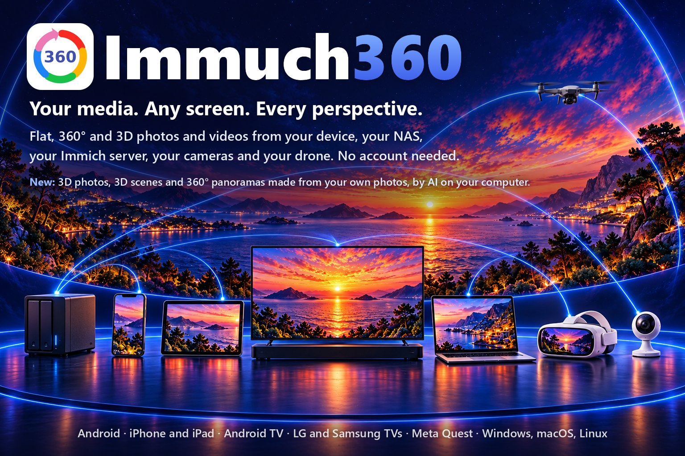

🌐 <b>简体中文</b> · 其他语言 (88)
<a href="../README.md">English</a> · <a href="README.af.md">Afrikaans</a> · <a href="README.ar.md">العربية</a> · <a href="README.az.md">Azərbaycanca</a> · <a href="README.be.md">Беларуская</a> · <a href="README.bg.md">Български</a> · <a href="README.bi.md">Bislama</a> · <a href="README.bn.md">বাংলা</a> · <a href="README.br.md">Brezhoneg</a> · <a href="README.bs.md">Bosanski</a> · <a href="README.ca.md">Català</a> · <a href="README.cs.md">Čeština</a> · <a href="README.cv.md">Чӑвашла</a> · <a href="README.da.md">Dansk</a> · <a href="README.de.md">Deutsch</a> · <a href="README.de_CH.md">Deutsch (Schweiz)</a> · <a href="README.el.md">Ελληνικά</a> · <a href="README.en_GB.md">English (UK)</a> · <a href="README.eo.md">Esperanto</a> · <a href="README.es.md">Español</a> · <a href="README.et.md">Eesti</a> · <a href="README.eu.md">Euskara</a> · <a href="README.fa.md">فارسی</a> · <a href="README.fi.md">Suomi</a> · <a href="README.fil.md">Filipino</a> · <a href="README.fr.md">Français</a> · <a href="README.ga.md">Gaeilge</a> · <a href="README.gl.md">Galego</a> · <a href="README.gsw.md">Alemannisch</a> · <a href="README.gu.md">ગુજરાતી</a> · <a href="README.he.md">עברית</a> · <a href="README.hi.md">हिन्दी</a> · <a href="README.hr.md">Hrvatski</a> · <a href="README.hu.md">Magyar</a> · <a href="README.hy.md">Հայերեն</a> · <a href="README.id.md">Bahasa Indonesia</a> · <a href="README.is.md">Íslenska</a> · <a href="README.it.md">Italiano</a> · <a href="README.ja.md">日本語</a> · <a href="README.ka.md">ქართული</a> · <a href="README.kab.md">Taqbaylit</a> · <a href="README.kk.md">Қазақша</a> · <a href="README.km.md">ខ្មែរ</a> · <a href="README.kmr.md">Kurmancî</a> · <a href="README.kn.md">ಕನ್ನಡ</a> · <a href="README.ko.md">한국어</a> · <a href="README.kxm.md">ภาษาเขมรถิ่นไทย</a> · <a href="README.lb.md">Lëtzebuergesch</a> · <a href="README.lmo.md">Lombard</a> · <a href="README.lt.md">Lietuvių</a> · <a href="README.lv.md">Latviešu</a> · <a href="README.mfa.md">Bahasa Melayu Kelantan</a> · <a href="README.mi.md">Te reo Māori</a> · <a href="README.mk.md">Македонски</a> · <a href="README.ml.md">മലയാളം</a> · <a href="README.mn.md">Монгол</a> · <a href="README.mr.md">मराठी</a> · <a href="README.ms.md">Bahasa Melayu</a> · <a href="README.nb_NO.md">Norsk bokmål</a> · <a href="README.ne.md">नेपाली</a> · <a href="README.nl.md">Nederlands</a> · <a href="README.nn.md">Norsk nynorsk</a> · <a href="README.pa.md">ਪੰਜਾਬੀ</a> · <a href="README.pl.md">Polski</a> · <a href="README.pt.md">Português</a> · <a href="README.pt_BR.md">Português (Brasil)</a> · <a href="README.ro.md">Română</a> · <a href="README.ru.md">Русский</a> · <a href="README.si.md">සිංහල</a> · <a href="README.sk.md">Slovenčina</a> · <a href="README.sl.md">Slovenščina</a> · <a href="README.sq.md">Shqip</a> · <a href="README.sr_Cyrl.md">Српски</a> · <a href="README.sr_Latn.md">Srpski</a> · <a href="README.sv.md">Svenska</a> · <a href="README.sw.md">Kiswahili</a> · <a href="README.swg.md">Schwäbisch</a> · <a href="README.ta.md">தமிழ்</a> · <a href="README.te.md">తెలుగు</a> · <a href="README.th.md">ไทย</a> · <a href="README.tl.md">Tagalog</a> · <a href="README.tr.md">Türkçe</a> · <a href="README.uk.md">Українська</a> · <a href="README.ur.md">اردو</a> · <a href="README.uz.md">Oʻzbekcha</a> · <a href="README.vi.md">Tiếng Việt</a> · <a href="README.yue_Hant.md">粵語</a> · <a href="README.zh_Hant.md">繁體中文</a>

  

# Immuch360

**您的媒体。屏幕随心。视角尽览。**

🌐 <a href="https://immuch360.com/zh-hans/"><b>immuch360.com</b></a>

来自您的设备、NAS、Immich 服务器、摄像头和无人机的扁平、360° 和 3D 照片与视频。无需账户。Immuch360 是一款免费开源应用，它直接在照片和视频所在的位置读取它们，并用最合适的查看器播放每一个文件：扁平显示、作为可环顾四周的球体、以 3D 显示，或在头显中环绕您四周。它可在手机、平板、电视、Meta Quest 头显和电脑上运行。它的网站 [immuch360.com](https://immuch360.com/zh-hans/) 以 89 种语言展示它在每块屏幕上的功能。

**build 53 和桌面版 build 34 新增内容，版本 3.4.8。** 在电脑上，[Spatial 2.5D](#see-your-3d-photos-and-videos-in-depth-on-your-computer) 让您的 3D 照片在 Windows、Linux 和 macOS 上、让您的 3D 视频在 Windows 和 macOS 上在平面屏幕上呈现景深：您移动头部时视角随之移动，在您同意后由摄像头跟随，或用鼠标控制，摄像头的画面只保留在电脑的内存中，从不保存或发送；项目尚未用摄像头试过。滚轮可[围绕指针放大照片](#zoom-into-a-photo-with-the-wheel)，拖动可移动照片。[增强（AI）](#make-a-photo-sharper-on-your-computer-ai)可处理您的共享、DLNA、Plex、Jellyfin 和 Emby 以及您的 Immich 服务器中的照片，增强 360° 和 3D 照片而不破坏其接缝或两只眼睛的画面，并在配备 Apple 芯片的 Mac 上提供锐化（尚未在 Mac 上试过）。从手机上，[“播放到…”](#show-your-photos-and-videos-on-the-tv-from-your-phone)可在屏幕的 360° 视图中打开 360° 项目，把所选内容或相册作为幻灯片播放，让屏幕登录您的服务器，并发送仅在手机上的照片和视频；已在 Android 模拟器之间试过，尚未在真实的手机或电视上试过。在 Meta Quest 中，大屏幕的幻灯片放映会在照片之间[交叉淡化或滑动](#browse-your-photos-on-the-big-screen-of-the-quest)，背景可选黑色、模糊或透视，项目尚未在头显中试过。

**build 33 至 52 的新功能。**[电影会从您停下的地方继续播放](#pick-up-a-film-where-you-stopped)。电影会更早开始，在慢速服务器上也会[继续播放而不会停下](#when-a-video-waits-or-will-not-play)。在手机和电脑上，时间线[可以缩放到月和年](#find-a-month-or-a-year-in-a-long-timeline)。在 Android 手机或 Meta Quest 上，[“浏览文件夹”](#browse-a-folder-of-your-phone-or-headset)可以像共享一样打开设备的文件夹，TIFF 照片也能显示。Android TV [可以用遥控器按日期搜索](#on-android-tv-and-google-tv)，Meta Quest 3 或 3S [可以打开高斯泼溅](#explore-gaussian-splats-in-a-meta-quest-3-or-3s)，可用右摇杆转动，并支持 SPZ 第 4 版，电脑则可以[为您 NAS 上的照片生成 3D 版本](#turn-one-photo-into-3d-a-scene-a-panorama)。在有两颗图形芯片的 Windows 笔记本电脑上，应用[现在运行在较快的那颗上](#when-a-video-waits-or-will-not-play)，因此 8K 电影播放流畅。现在，高斯泼溅[可以在电脑和 Android 手机及平板上打开](#explore-gaussian-splats-on-your-phone-tablet-or-computer)，Windows 电脑可以由 AI [用您的照片或视频生成泼溅场景](#make-a-splat-scene-from-your-photos-or-a-video-ai)，您的 Immich 服务器可以[把它们保存在照片中](#keep-a-splat-scene-on-your-immich-server)，并可从您的时间线打开，电脑还可以[播放 AV2 视频](#play-av2-videos-on-your-computer)。从 build 42 起，来自您的 Immich 资源库、共享或文件夹的 Insta360、GoPro MAX 和 DJI Osmo 360 相机原始视频在 Android 手机、平板和电视上[使用相机陀螺仪防抖播放](#stabilise-your-360-videos-with-the-cameras-gyroscope)，桌面版 build 22 的泼溅生成器为您近距离观看的场景[提供精细质量](#make-a-splat-scene-from-your-photos-or-a-video-ai)，360° 全景图[在显卡有 3.5 GiB 空闲时即可开始](#turn-one-photo-into-3d-a-scene-a-panorama)。iPhone 和 iPad 应用已[上架 App Store](https://apps.apple.com/us/app/immuch360-360-3d-player/id6817655965)，版本 3.4.3。从 build 43 起，应用的更新提示会在手机和平板上打开 Google Play 或 App Store；它的网站 [immuch360.com](https://immuch360.com/zh-hans/) 于 11 月 7 日上线。从 build 44 和桌面版 build 24 起，Meta Quest 3 或 3S [可显示最多 300,000 个高斯的泼溅](#explore-gaussian-splats-in-a-meta-quest-3-or-3s)，电脑[可用 Ctrl 和 Shift 选择多张照片和视频](#use-your-computer-as-the-media-player)，解码器拒绝某个视频的电视会自动[播放服务器上的另一个文件](#when-a-video-waits-or-will-not-play)，在有两块显卡的笔记本电脑上，全景图运行在所选的显卡上，Quest 和电脑的更新提示会打开各自的商店或下载页面，并有许多修复。从 build 45 和桌面版 build 25 起，所有平台均为版本 3.4.0，应用跟进 Immich 3.4.0 应用以及 Immich 之后的 11 项修复，可显示 [Immich 3.4 服务器的 JPEG XL 照片](#keep-your-immich-library-with-more)，可[按年份打开您的 Plex 电影](#watch-your-plex-films)，每部电影都有自己的页面，可下载到设备，也可从手机在电视上播放，在应用商店版本的 build 中可能会请求评分，在电脑上，其视频组件则来自[它们自己的开源仓库](#licences-and-credits)。从 build 46 和桌面版 build 26 起，版本 3.4.1，360° 相机的原始视频在 iPhone 和 iPad、Meta Quest 以及 Windows 上也能[防抖播放](#stabilise-your-360-videos-with-the-cameras-gyroscope)，Meta Quest [用 libmpv 播放其自带播放器无法解码的 Plex 电影](#watch-your-plex-films)，手机[可把这样的电影发送到 Chromecast 或 Google TV](#watch-your-plex-films)，3D 照片的 AI 立体感[采用您选择的强度](#turn-one-photo-into-3d-a-scene-a-panorama)；也可以用您的 Plex 账户登录来添加新服务器，应用还会[把设置保存在文件中](#keep-your-settings-in-a-file)。从 build 47 和桌面版 build 27 起，版本 3.4.2，Plex 电影会[播放设备能解码的音轨](#watch-your-plex-films)并说明是哪一条，打开适合屏幕的版本，在慢速连接上提供更轻的版本，Windows 和 macOS 可播放其 Dolby TrueHD 音频，Android [会在通知中显示其下载进度](#watch-your-plex-films)，Android TV 也能下载电影，[电池供电的 Tapo 摄像头可显示实时画面](#watch-your-home-cameras-on-the-big-screen)；恢复带有账户的设置文件现在会让您登录到自己的 Immich 服务器。从 build 48 和桌面版 build 28 起，版本 3.4.3，Windows 电脑可通过 SteamVR、Meta Horizon Link 或其他 OpenXR 运行时[在 PC VR 头显中播放您的视频](#watch-your-videos-in-a-pc-vr-headset-from-windows)（项目尚未在头显中试过），[其他品牌的摄像头可显示实时画面](#cameras-of-other-brands-over-onvif-or-rtsp)，通过 ONVIF 找到或用其 RTSP 链接添加（已用模拟摄像头验证，尚未试过其他品牌的真实摄像头），[DJI Osmo 360 II 和 GoPro MAX 2 的原始视频可防抖播放](#open-the-raw-files-of-360-cameras)，Plex 电影[在手机上不再到达得太慢](#when-a-video-waits-or-will-not-play)，LG 和 Samsung 电视可一键[旋转横躺着的视频](#on-a-samsung-tv-tizen)（尚未在 LG 电视上试过；issue 17 的 Samsung 电视拒绝了旋转），对于已是最新的服务器也不再显示“服务器更新可用”。从 build 49 和桌面版 build 29 起，版本 3.4.4，应用会自己[读取您的 Jellyfin 和 Emby 服务器](#watch-your-jellyfin-and-emby-libraries)（尚未在设备上试过）：在您的网络中找到它们，在电视或头显上用 Quick Connect 登录，并播放其原始文件，让 360° 视频依然是 360°；在 Meta Quest 的大屏幕上，照片[在您浏览时保持您设定的大小和位置，并可作为幻灯片播放](#browse-your-photos-on-the-big-screen-of-the-quest)（项目尚未在头显中试过）；手机和平板上的 360° 视频播放器[获得了 360° 照片的控件](#360-videos-on-your-phone-with-the-controls-of-360-photos)：陀螺仪按钮、双指缩放以及可直达正上方或正下方的拖动（已有用户在 Samsung Galaxy S25 Ultra 上试过，尚未在 iPhone 上试过）；电脑可[用 AI 把您的 2D 视频变成 3D 视频](#turn-your-2d-videos-into-3d-on-your-computer)（尚未在 3D 屏幕或头显中试过）；Samsung 电视会把需要旋转的视频[交给 Samsung 自己的播放器](#on-a-samsung-tv-tizen)，issue 17 中的电视能用它播放，但拒绝旋转。从 build 50 和桌面版 build 30 起，即版本 3.4.5，在 Meta Quest 的 2D 窗口中播放视频时，窗口会[按显示屏的刷新率重绘](#step-inside-your-photos-and-videos-with-a-meta-quest)，而不是像 build 48 和 49 那样每秒约 10 次（在 Meta Quest 3 上测得），Android TV 可以[用遥控器放大照片](#on-android-tv-and-google-tv)并用方向键移动它（新功能，尚未在电视上试过），另有三项修复来自 mlc70 的 Android TV fork：快速滑动不再显示留在身后的照片的详情，动态照片会释放其内存，位置筛选器会提供新国家的城市。从 build 51 和桌面版 build 31 起，即版本 3.4.6，[增强（AI）](#make-a-photo-sharper-on-your-computer-ai)会在 Windows 和 Linux 上于原图旁为柔和的照片生成更清晰的副本，分三个级别，每个级别都在一台配备 RTX 4060 的电脑上运行过一次，自然级别也在 Apple 芯片的 Mac 上提供（尚未在 Mac 上试过），电脑可用 AI [把 360° 视频变成 360° 3D 视频](#a-360-video-turned-into-a-360-3d-video)，在 Windows 上 3D 视频的深度由显卡估算，AI 功能可直接使用您的服务器和共享中的视频，设置文件在[资源库中有了自己的卡片](#keep-your-settings-in-a-file)，电视可将其保存到网络共享，在电脑上 Escape 返回上一步，应用商店的 build 请求评分[更少也更温和](#privacy)，Linux 可显示 TIFF 照片、泼溅场景以及以单眼显示的 3D 视频，并修复了两处崩溃。从 build 52 和桌面版 build 32、版本 3.4.7 起，[“播放到…”](#show-your-photos-and-videos-on-the-tv-from-your-phone)可从手机把您的 Immich 资源库、共享以及 Jellyfin 和 Emby 中的照片和视频发送到电视、Meta Quest、电脑或 Chromecast，照片和视频的名称[在缩略图上方保持清晰可读](#play-the-files-of-a-nas-a-computer-a-media-server-or-plex)，电脑上的 AI 组件可[一键更新](#update-the-ai-components-in-one-click)，Linux 新增了[一个 AppImage](#linux)，iPhone 和 iPad 应用使用 Xcode 27 构建。桌面版 build 33 修复了[增强（AI）](#make-a-photo-sharper-on-your-computer-ai)，它在桌面版 build 31 和 32 中对每张照片都会失败（[issue 23](https://github.com/freeKC/Immuch360/issues/23)）。

  这是 Immich 手机应用的非官方分支，与 Immich 或 FUTO 没有关联。这个名字的英文发音类似“I am much 360”。

<b>目录</b>

- [适合谁](#who-it-is-for)
- [哪些屏幕](#which-screens)、[它们一起能做什么](#use-cases)，以及[每种屏幕能做什么](#what-each-screen-does)
- [您可以做什么](#what-you-can-do)
- [在您的设备上安装](#get-it-on-your-device)
- [操作指南](#how-to)
  - [观看您的照片和视频，有无服务器均可](#watch-your-photos-and-videos-with-or-without-a-server)
  - [探索全景、360°、VR180 和 3D](#explore-panoramas-360-vr180-and-3d)：[手机上的 360° 视频](#360-videos-on-your-phone-with-the-controls-of-360-photos)
  - [把一张照片变成 3D、场景、全景图](#turn-one-photo-into-3d-a-scene-a-panorama)：[一键更新的 AI 组件](#update-the-ai-components-in-one-click)
  - [在电脑上把您的 2D 视频变成 3D](#turn-your-2d-videos-into-3d-on-your-computer)：[360° 视频转 360° 3D](#a-360-video-turned-into-a-360-3d-video)
  - [在电脑上让照片更清晰（AI）](#make-a-photo-sharper-on-your-computer-ai)
  - [在电视上用遥控器观看](#watch-on-the-tv-with-the-remote)：[Android TV 和 Google TV](#on-android-tv-and-google-tv)、[LG](#on-an-lg-tv-webos)、[Samsung](#on-a-samsung-tv-tizen)
  - [用手机登录电视、头显或电脑](#sign-in-a-tv-a-headset-or-a-computer-with-your-phone)
  - [从手机在电视上展示您的照片和视频](#show-your-photos-and-videos-on-the-tv-from-your-phone)
  - [用 Meta Quest 走进您的照片和视频](#step-inside-your-photos-and-videos-with-a-meta-quest): [大屏幕](#browse-your-photos-on-the-big-screen-of-the-quest)、[展台模式](#kiosk-mode-for-an-exhibition-or-a-shop)
  - [在 Meta Quest 3 或 3S 中探索高斯泼溅](#explore-gaussian-splats-in-a-meta-quest-3-or-3s)
  - [在手机、平板或电脑上探索高斯泼溅](#explore-gaussian-splats-on-your-phone-tablet-or-computer)
  - [用您的照片或视频生成泼溅场景（AI）](#make-a-splat-scene-from-your-photos-or-a-video-ai)
  - [把泼溅场景保存在您的 Immich 服务器上](#keep-a-splat-scene-on-your-immich-server)
  - [播放 NAS、电脑、媒体服务器或 Plex 上的文件](#play-the-files-of-a-nas-a-computer-a-media-server-or-plex)：[按年份浏览您的电影](#watch-your-plex-films)、[Jellyfin 和 Emby](#watch-your-jellyfin-and-emby-libraries)
  - [浏览手机或头显的文件夹](#browse-a-folder-of-your-phone-or-headset)
  - [从您停下的地方继续看电影](#pick-up-a-film-where-you-stopped)
  - [视频需要等待或无法播放时](#when-a-video-waits-or-will-not-play)
  - [保留您的 Immich 媒体库，并获得更多](#keep-your-immich-library-with-more)
  - [在很长的时间线中找到某个月或某一年](#find-a-month-or-a-year-in-a-long-timeline)
  - [在大屏幕上查看家用摄像头](#watch-your-home-cameras-on-the-big-screen)：[其他品牌](#cameras-of-other-brands-over-onvif-or-rtsp)
  - [您的 DJI 无人机](#your-dji-drone)：[实时画面](#see-what-your-drone-sees-on-your-phone)、[在 Quest 或 Android TV 上](#watch-it-in-a-meta-quest-or-on-an-android-tv)、[导入](#bring-a-drones-or-a-camera-cards-photos-and-videos-to-immich)
  - [打开 360° 相机的原始文件](#open-the-raw-files-of-360-cameras)
  - [用相机陀螺仪为您的 360° 视频防抖](#stabilise-your-360-videos-with-the-cameras-gyroscope)
  - [一键旋转照片](#turn-a-photo-with-one-key)
  - [把电脑当作媒体播放器](#use-your-computer-as-the-media-player)：[用滚轮放大](#zoom-into-a-photo-with-the-wheel)
  - [在电脑上以景深观看您的 3D 照片和视频](#see-your-3d-photos-and-videos-in-depth-on-your-computer)
  - [从 Windows 在 PC VR 头显中观看您的视频](#watch-your-videos-in-a-pc-vr-headset-from-windows)
  - [在电脑上播放 AV2 视频](#play-av2-videos-on-your-computer)
  - [把设置保存在文件中](#keep-your-settings-in-a-file)
- [与 Immich 对比](#compared-with-immich)
- [隐私](#privacy)
- [许可与致谢](#licences-and-credits)
- [路线图](#roadmap)
- [文档](#documentation)

## 适合谁

- **您拍摄 360° 或 3D 内容**，希望在画面中环顾四周，而不是看到扁平、重影或拉伸的画面，并希望像转动手机上的照片一样转动手机上的 360° 视频：[360°、VR180 和 3D](#explore-panoramas-360-vr180-and-3d)、[手机上的 360° 视频](#360-videos-on-your-phone-with-the-controls-of-360-photos)。
- **您手持、骑车或戴在头盔上用 360° 相机拍摄**，希望保存在 Immich、共享或文件夹中的 Insta360、GoPro MAX 或 MAX 2、DJI Osmo 360 或 Osmo 360 II 相机原始视频在您的手机、电视、Meta Quest 或 Windows 电脑上播放时保持水平、稳定：[使用相机陀螺仪防抖](#stabilise-your-360-videos-with-the-cameras-gyroscope)。
- **您的照片和影片存放在 NAS、电脑、Plex 或 Immich 上**，希望不复制任何文件就能在电视上观看：[在电视上](#watch-on-the-tv-with-the-remote)、[NAS、共享和 Plex](#play-the-files-of-a-nas-a-computer-a-media-server-or-plex)。
- **您把电影存放在 Plex 服务器上**，希望按年份挑选一部，在开始播放前了解它是什么，带着它去旅行，用手机在电视或 Chromecast 上开始播放，甚至播放您的 Android 手机、电视或 Meta Quest 无法解码的电影：[您的电影，按年份](#watch-your-plex-films)。
- **您的电影在 Jellyfin 或 Emby 服务器上**，希望在 Meta Quest、电视或手机上观看，360° 和 3D 保持原样，停下的位置保存在服务器上（尚未在设备上试过）：[Jellyfin 和 Emby](#watch-your-jellyfin-and-emby-libraries)。
- **您有一台 Meta Quest**，想走进自己的照片和视频：[在头显中](#step-inside-your-photos-and-videos-with-a-meta-quest)，还想在大屏幕上以您设定的大小和位置浏览照片，也可作为幻灯片播放（项目尚未在头显中试过）：[大屏幕](#browse-your-photos-on-the-big-screen-of-the-quest)。
- **您的 Windows 电脑连接了 PC VR 头显**，希望在其中让 360° 视频环绕四周、让电影显示在大屏幕上（项目尚未在头显中试过）：[在 PC VR 头显中](#watch-your-videos-in-a-pc-vr-headset-from-windows)。
- **您的照片是扁平的**，而您想在没有 3D 相机的情况下以 3D 方式观看它们，作为可以在头显中凑近细看的场景，或置身于 360° 全景图之中：[把一张照片变成 3D、场景、全景图](#turn-one-photo-into-3d-a-scene-a-panorama)，新功能，由 AI 在您自己的电脑上生成。
- **您的视频是扁平的**，包括手机拍的片段，希望在自己的电脑上把它们做成 3D，用于头显或 3D 屏幕，并把 360° 视频做成 360° 3D（尚未在 3D 屏幕或头显中试过）：[2D 视频转 3D](#turn-your-2d-videos-into-3d-on-your-computer)，[360° 转 360° 3D](#a-360-video-turned-into-a-360-3d-video)。
- **您的照片有些柔和**，略微失焦或在光线不足时拍摄，希望在自己的电脑上于原图旁生成更清晰的副本（共享和服务器中的照片也可以），并明确说明哪些细节是虚构的：[增强（AI）](#make-a-photo-sharper-on-your-computer-ai)。
- **您有 3D 照片或视频和一台电脑**，希望在它的平面屏幕上以景深观看，视角随您的头部移动，由摄像头跟随，或用鼠标控制（项目尚未用摄像头试过）：[电脑上的 Spatial 2.5D](#see-your-3d-photos-and-videos-in-depth-on-your-computer)。
- **您在使用 Immich**，想要它的应用，外加沉浸式查看器以及可用手机登录的大屏幕：[您的 Immich 媒体库](#keep-your-immich-library-with-more)、[与 Immich 对比](#compared-with-immich)。
- **您用 Tapo 摄像头看家**，包括电池供电的摄像头，或通过 ONVIF 或 RTSP 使用其他品牌的摄像头，希望它们出现在照片旁边，也能在电视上查看（已用模拟摄像头验证）：[家用摄像头](#watch-your-home-cameras-on-the-big-screen)。
- **您飞 DJI 无人机**，希望不用 DJI Fly 就能在手机上看到实时画面，并让身边的人在 Meta Quest 或 Android TV 上观看：[您的无人机](#see-what-your-drone-sees-on-your-phone)。
- **您以高斯泼溅的形式用 3D 记录地点和物体，**或者想用自己的照片制作它们，并希望在手机、电脑或头显中穿行其间：[在手机、平板或电脑上](#explore-gaussian-splats-on-your-phone-tablet-or-computer)、[用您的照片生成](#make-a-splat-scene-from-your-photos-or-a-video-ai)、[保存在 Immich 中](#keep-a-splat-scene-on-your-immich-server)。
- **您有 AV2 视频**，即继 AV1 之后的格式，并想在电脑上观看它们：[电脑上的 AV2](#play-av2-videos-on-your-computer)。
- **您家里有好几块屏幕**，希望它们协同工作：[您的屏幕一起能做什么](#use-cases)。

无需创建 Immuch360 账户，也不会有任何数据发送给我们：应用只与您的设备和您选择的服务器通信，从 build 45 起还会为电影页面与 Wikipedia 通信，从 build 46 起在您用 plex.tv 登录时还会与 plex.tv 通信，并且只在您要求时才下载 AI 组件或 AV2 解码器。

## 哪些屏幕

| 平台 | 获取方式 | 2026 年 11 月状态 |
|---|---|---|
|  **Android** 手机和平板 | [Google Play](https://play.google.com/store/apps/details?id=com.aprogsys.immuch360) · [APK](https://github.com/freeKC/Immuch360/releases) | Google Play 上为 build 47（11 月 16 日发布；build 51 自 11 月 24 日起在 Google 审核中；build 53 随后跟进），GitHub 上为 build 53，[原始 360° 视频防抖播放](#stabilise-your-360-videos-with-the-cameras-gyroscope)，[电影会从您停下的地方继续播放](#pick-up-a-film-where-you-stopped)，[“浏览文件夹”](#browse-a-folder-of-your-phone-or-headset)可打开手机的文件夹，[高斯泼溅可以打开](#explore-gaussian-splats-on-your-phone-tablet-or-computer)，来自共享或[来自您的 Immich 时间线](#keep-a-splat-scene-on-your-immich-server)，[保存在文件中的设置](#keep-your-settings-in-a-file)、[在通知中显示的电影下载](#watch-your-plex-films)、从 build 48 起的[其他品牌摄像头实时画面](#cameras-of-other-brands-over-onvif-or-rtsp)（已用模拟摄像头验证），以及从 build 49 起的[Jellyfin 和 Emby 服务器](#watch-your-jellyfin-and-emby-libraries)（尚未在设备上试过）和[360° 视频播放器中的 360° 照片控件](#360-videos-on-your-phone-with-the-controls-of-360-photos)（已有用户在 Samsung Galaxy S25 Ultra 上试过），以及从 build 51 起[资源库中的设置文件卡片](#keep-your-settings-in-a-file)，其文件也可保存到网络共享，以及从 build 52 起用“播放到…”[把您的照片和视频发送到电视或 Chromecast](#show-your-photos-and-videos-on-the-tv-from-your-phone)（尚未在设备上试过），以及从 build 53 起以同样方式发送的[360° 项目、所选内容或相册以及手机本身的照片和视频](#show-your-photos-and-videos-on-the-tv-from-your-phone)（已在 Android 模拟器之间试过） |
|  **iPhone 和 iPad** | [App Store](https://apps.apple.com/us/app/immuch360-360-3d-player/id6817655965) | 版本 3.4.7 自 11 月 26 日起上架 App Store，带有[时间线中的月和年](#find-a-month-or-a-year-in-a-long-timeline)、[从您停下的地方继续播放的电影](#pick-up-a-film-where-you-stopped)、从手机[登录电视、头显或电脑](#sign-in-a-tv-a-headset-or-a-computer-with-your-phone)、保存在 Immich 中、以其照片显示的泼溅场景、Immich 3.4.0 的修复及其 JPEG XL 照片、[防抖的原始 360° 视频](#stabilise-your-360-videos-with-the-cameras-gyroscope)、[保存在文件中的设置](#keep-your-settings-in-a-file)和[电池供电 Tapo 摄像头的实时画面](#watch-your-home-cameras-on-the-big-screen)，以及[其他品牌摄像头的实时画面](#cameras-of-other-brands-over-onvif-or-rtsp)（已用模拟摄像头验证），并从版本 3.4.4 起带有[Jellyfin 和 Emby 服务器](#watch-your-jellyfin-and-emby-libraries)（尚未在设备上试过）和[360° 视频播放器中的 360° 照片控件](#360-videos-on-your-phone-with-the-controls-of-360-photos)（尚未在 iPhone 上试过），并从版本 3.4.6 起带有[设置文件卡片](#keep-your-settings-in-a-file)及从网络共享恢复，并从用 Xcode 27 构建的版本 3.4.7 起带有[用于照片和视频的“播放到…”](#show-your-photos-and-videos-on-the-tv-from-your-phone)（尚未在 iPhone 上试过）；版本 3.4.8，即 build 53 的 iPhone 和 iPad 版本，随后跟进；或[自行构建](../docs/immuch360/build.md) |
|  **Android TV 和 Google TV** | [Google Play](https://play.google.com/store/apps/details?id=com.aprogsys.immuch360) · [APK](#android-tv-and-google-tv) | 已上架 Google Play，可在 Android TV 和 Google TV 上获取本应用，GitHub 上为 build 53：[原始 360° 视频防抖](#stabilise-your-360-videos-with-the-cameras-gyroscope)，[用遥控器按日期搜索](#on-android-tv-and-google-tv)，扫描二维码即可[用手机登录](#sign-in-a-tv-a-headset-or-a-computer-with-your-phone)，视频播放器为遥控器提供进度条、音频和字幕，还可观看由手机转发的[无人机实时画面](#watch-it-in-a-meta-quest-or-on-an-android-tv)、[下载到电视上的电影](#watch-your-plex-films)，以及从 build 49 起用 Quick Connect 登录的[Jellyfin 和 Emby 服务器](#watch-your-jellyfin-and-emby-libraries)（尚未在设备上试过），以及从 build 50 起[用遥控器放大的照片](#on-android-tv-and-google-tv)（已在 Android TV 模拟器上看到正常运行，尚未在电视上试过），以及从 build 51 起[在网络共享上保存和恢复的设置文件](#keep-your-settings-in-a-file)（已在 Android TV 模拟器上看到正常运行），以及从 build 52 起[手机用“播放到…”发送的照片和视频](#show-your-photos-and-videos-on-the-tv-from-your-phone)（尚未在电视上试过），以及从 build 53 起手机发送的 360° 照片在其 360° 视图中打开、从手机的面板登录以及手机本身的照片和视频（已在 Android TV 模拟器上看到正常运行） |
| 搭载 webOS 5.0 及更高版本的 **LG 电视** | [.ipk，版本 1.0.5](https://github.com/freeKC/Immuch360/releases/tag/webos-v1.0.5) · LG Content Store（审核中） | 版本 1.0.0 已于 10 月 24 日提交至 LG Content Store，自 10 月 26 日起接受 LG 测试；版本 1.0.1 自 10 月 27 日起在 GitHub 上提供，可用方向键缩放照片，并在照片仍在加载时给出提示，版本 1.0.2 随 build 46 在 GitHub 上提供，在日语中把“登录”写作 ログイン，版本 1.0.3 随 build 47 提供，会在 DLNA 服务器的文件夹包含电视直播频道时给出提示，这些频道它暂时还无法播放，版本 1.0.4 随 build 48 提供，可一键[旋转横躺着的视频](#on-an-lg-tv-webos)（尚未在 LG 电视上试过），版本 1.0.5 随 build 49 提供，在 DLNA 服务器中列出带 DLNA 插件的 Jellyfin；在 LG 发布应用之前，可在 [Developer Mode](#lg-tvs-webos) 下安装。版本 1.0.0 已在 LG Cloud Test Lab 的 webOS 25 电视上运行过 |
| 搭载 Tizen 5.5 及更高版本的 **Samsung 电视** | [.wgt，版本 0.3.6](https://github.com/freeKC/Immuch360/releases/tag/tizen-v0.3.6) | 同一电视应用的版本 0.3.6，需用您自己的 Samsung 证书签名，并在 [Developer mode](#samsung-tvs-tizen) 下安装；0.1.0 已在一位测试者的 Samsung 电视上运行过，0.2.0 包含了那次运行后的修复，0.3.0 加入了 LG 版本 1.0.1 的照片缩放和 Loading 提示，0.3.1 加入了 LG 版本 1.0.2 的日语文字，0.3.2 会以正确的方向播放用手机竖着拍摄的视频（[issue 17](https://github.com/freeKC/Immuch360/issues/17)），0.3.3 和 0.3.4 会[在把视频报告为竖向的电视上旋转它](#on-a-samsung-tv-tizen)，并加入一个手动旋转它的按钮，0.3.5 和 0.3.6 会把这样的视频交给 Samsung 自己的播放器；在提交者的电视上，0.3.4 和 0.3.5 让画面仍然横躺着，因为电视拒绝旋转，在那里的解决办法是由您的 Immich 服务器转码并以竖向保存的视频；不在 Samsung 的商店中 |
|  **Meta Quest** 2、Pro、3 和 3S | [Horizon Store](https://www.meta.com/experiences/immuch360/1384208401440714/) · [APK](#meta-quest) | Horizon Store 上为播放视频时 2D 窗口按显示屏刷新率重绘的 build 50（11 月 25 日发布；build 52 自 11 月 25 日起在 Meta 审核中；build 53 随后跟进），GitHub 上为 build 53，带有[展台模式](#kiosk-mode-for-an-exhibition-or-a-shop)、沉浸式视图中[防抖的原始 360° 视频](#stabilise-your-360-videos-with-the-cameras-gyroscope)、[由 libmpv 播放其无法解码的电影](#watch-your-plex-films)，在 Quest 3 和 3S 上还有[高斯泼溅](#explore-gaussian-splats-in-a-meta-quest-3-or-3s)以及为扁平照片添加的 [AI 立体感](#turn-one-photo-into-3d-a-scene-a-panorama)，从 build 49 起还有以您设定的大小浏览、也可作为幻灯片播放的[大屏幕照片](#browse-your-photos-on-the-big-screen-of-the-quest)（项目尚未在头显中试过），以及用 Quick Connect 登录的[Jellyfin 和 Emby 服务器](#watch-your-jellyfin-and-emby-libraries)（尚未在设备上试过），以及从 build 51 起，Horizon OS 对沉浸式查看器而言过旧的头显会请求更新，而不是关闭应用（尚未在这样的头显上试过），以及从 build 53 起[大屏幕照片之间的交叉淡化或滑动，背景可选黑色、模糊或透视](#browse-your-photos-on-the-big-screen-of-the-quest)（项目尚未在头显中试过） |
|  **Windows** | [安装程序或 ZIP](https://github.com/freeKC/Immuch360/releases/tag/desktop-v3.4.8-34) | 桌面版 build 34，已签名：照片、扁平和 360° 视频、共享、Plex、摄像头（已用模拟摄像头验证）、用手机登录、一键旋转照片、89 种语言的界面，以及由 AI [用您的照片生成 3D 照片、3D 场景和 360° 全景图](#turn-one-photo-into-3d-a-scene-a-panorama)，包括您 NAS 上的照片；[高斯泼溅](#explore-gaussian-splats-on-your-phone-tablet-or-computer)：打开、[用您的照片或视频生成](#make-a-splat-scene-from-your-photos-or-a-video-ai)和[保存在 Immich 中](#keep-a-splat-scene-on-your-immich-server)，[AV2 视频](#play-av2-videos-on-your-computer)，以及从桌面版 build 22 起的[泼溅场景质量选项](#make-a-splat-scene-from-your-photos-or-a-video-ai)和[显存有 3.5 GiB 空闲即可生成的 360° 全景图](#turn-one-photo-into-3d-a-scene-a-panorama)，以及从桌面版 build 26 起[防抖的原始 360° 视频](#stabilise-your-360-videos-with-the-cameras-gyroscope)和[带立体感强度且边缘更锐利的 3D 照片](#turn-one-photo-into-3d-a-scene-a-panorama)，从桌面版 build 27 起[电影的 Dolby TrueHD 音频和 Blu-ray 字幕](#watch-your-plex-films)，从桌面版 build 28 起[在 PC VR 头显中观看您的视频](#watch-your-videos-in-a-pc-vr-headset-from-windows)（项目尚未在头显中试过），从桌面版 build 29 起用 AI [由您的 2D 视频生成的 3D 视频](#turn-your-2d-videos-into-3d-on-your-computer)（尚未在 3D 屏幕或头显中试过），以及从桌面版 build 31 起用 AI [生成照片的更清晰副本](#make-a-photo-sharper-on-your-computer-ai)和用 AI [把 360° 视频变成 360° 3D 视频](#a-360-video-turned-into-a-360-3d-video)，深度由显卡估算，直接使用您的服务器和共享中的视频，以及用 Escape 返回上一步，从桌面版 build 32 起还有[一键更新的 AI 组件](#update-the-ai-components-in-one-click)，从桌面版 build 33 起[增强（AI）](#make-a-photo-sharper-on-your-computer-ai)恢复正常，从桌面版 build 34 起还有[用滚轮放大照片](#zoom-into-a-photo-with-the-wheel)、用摄像头或鼠标控制的[用于 3D 照片和视频的 Spatial 2.5D](#see-your-3d-photos-and-videos-in-depth-on-your-computer)（项目尚未用摄像头试过），以及可用于共享和服务器中的照片、也可用于 360° 和 3D 照片的增强（AI） |
|   **macOS 和 Linux** | [.deb, .rpm, AppImage, DMG](https://github.com/freeKC/Immuch360/releases/tag/desktop-v3.4.8-34) | 桌面版 build 34：照片、360° 照片和扁平视频（360° 视频以扁平方式播放）、Immich 服务器和网络共享，以及由 AI 用您的照片生成的 [3D 照片和 3D 场景](#turn-one-photo-into-3d-a-scene-a-panorama)，Linux 上配备 8 GB 显卡时还能生成 360° 全景图，其中有 3.5 GiB 空闲即可，并支持[高斯泼溅](#explore-gaussian-splats-on-your-phone-tablet-or-computer)和[AV2 视频](#play-av2-videos-on-your-computer)（尚未在 Mac 上试过）；桌面版 build 11 已于 10 月 26 日在 Ubuntu 24.04 容器中和一台 Mac 上试过；从桌面版 build 27 起，macOS 上可播放电影的 Dolby TrueHD 音频；从桌面版 build 29 起，在 Linux 和 Apple 芯片的 Mac 上可用 AI [由您的 2D 视频生成 3D 视频](#turn-your-2d-videos-into-3d-on-your-computer)（尚未在 3D 屏幕或头显中试过）；从桌面版 build 31 起，在 Linux 上可用 AI [生成照片的更清晰副本](#make-a-photo-sharper-on-your-computer-ai)，显示 TIFF 照片、自动显示新文件的文件夹、在 4 GB 显卡上由您的照片生成泼溅场景，以及以单眼扁平显示的 3D 视频，在 Apple 芯片的 Mac 上可用增强（AI）的自然级别（尚未在 Mac 上试过）；从桌面版 build 32 起，还有面向其他 Linux 发行版的 [AppImage](#linux)，已由 CI 在 Arch Linux 和 openSUSE 上验证；从桌面版 build 34 起，还有滚轮放大、在 Linux 和 macOS 上用于 3D 照片、在 macOS 上用于 3D 视频的 [Spatial 2.5D](#see-your-3d-photos-and-videos-in-depth-on-your-computer)（尚未在 Mac 上或用摄像头试过），以及在 Apple 芯片的 Mac 上增强（AI）的锐化级别（尚未在 Mac 上试过）；macOS 版未签名 |

*每次发布都会更新这些状态；各商店上架了什么、审核中有什么以及每个 build 的信息见[发布状态](../docs/immuch360/release-status.md)。网站 [immuch360.com](https://immuch360.com/zh-hans/) 以 89 种语言展示每块屏幕的功能、每项功能的操作指南以及各应用商店的链接。*

  

### 您的屏幕一起能做什么

在您用来观看的每块屏幕上安装 Immuch360：每块屏幕都自己读取您的来源，有些还会把画面、文件或登录交给另一块屏幕。每张图中，Immuch360 图标标出了运行该应用的设备。

#### 您的 NAS，在每块屏幕上

  

**您需要：**一台带 SMB 或 WebDAV 共享的 NAS，以及您用来观看的每块屏幕上的 Immuch360。

在每块屏幕上添加该共享，每块屏幕都会在原处播放照片和视频，不复制任何文件：手机、平板、Android TV、Meta Quest、Windows、Linux 和 macOS 电脑，以及登录到您 Immich 服务器的 LG 电视（从 webOS 22 起支持 SMB）。360° 照片在手机和电视上以球面转动，在头显中则环绕着您。操作指南：[播放 NAS、电脑、媒体服务器或 Plex 上的文件](#play-the-files-of-a-nas-a-computer-a-media-server-or-plex)。

#### 您的 Immich 服务器，在每块屏幕上，用手机登录

  

**您需要：**一台 Immich 服务器、您 Android 手机上的 Immuch360，以及您要登录的屏幕上的 Immuch360：Android TV、Meta Quest、Windows、Linux 或 macOS 电脑。

在手机上，Immuch360 保留了完整的 Immich 移动应用，加入了它的 360°、VR180 和 3D 查看器，并与官方应用并存安装。登录您的服务器后，它会为大屏幕登录：它扫描电视或电脑的二维码，或者由您在手机上输入头显显示的代码，您的密码始终留在手机上。操作指南：[用手机登录电视、头显或电脑](#sign-in-a-tv-a-headset-or-a-computer-with-your-phone)。

#### 您的扁平照片变成 3D，从电脑到头显

  

**您需要：**Windows、Linux 或 macOS 电脑上的 Immuch360 和 Meta Quest 中的 Immuch360，两者之间是您的 NAS，或开启了“同时备份 AI 版本”的 Immich 服务器。

电脑自己就能把您的照片变成 3D 照片和 3D 场景，在 Windows 或 Linux 上配备 8 GB 显卡时还能变成 360° 全景图，并保存在原图旁边。头显以真正的 3D 显示 3D 照片，把场景放进您的房间，把全景图展开在您四周；手机和电视用它们的 360° 查看器打开全景图。操作指南：[把一张照片变成 3D、场景、全景图](#turn-one-photo-into-3d-a-scene-a-panorama)。

#### 您无人机的实时画面，在头显中或电视上

  

**您需要：**一架 DJI 无人机及其 DJI RC-N3 遥控器、插在遥控器上的 Android 手机上的 Immuch360，以及 Meta Quest 或 Android TV 上的 Immuch360。

手机显示无人机的实时视频，并通过您的 Wi-Fi 或它自己的热点转发出去，让您身边的人在头显中或电视上观看飞行。只接收：绝不会向遥控器或无人机发送任何指令，遥控器保有完全的控制。操作指南：[在 Meta Quest 或 Android TV 上观看](#watch-it-in-a-meta-quest-or-on-an-android-tv)。

#### 您 360° 相机的原始文件，在您观看的地方拼接

  

**您需要：**一台 Insta360、GoPro MAX 或 MAX 2、DJI Osmo 360 或 Osmo 360 II 相机、您的 NAS，以及这些屏幕上的 Immuch360：手机、平板、Android TV、Meta Quest、Windows。

把 .insp、.insv、.360 或 .osv 文件从相机的存储卡原样复制到您 NAS 的 SMB 或 WebDAV 共享；Immich 服务器也接收 Insta360 的文件。每块屏幕都在播放时拼接它们，使用每个文件中写入的校准数据，无需先在相机的应用中导出任何内容。操作指南：[打开 360° 相机的原始文件](#open-the-raw-files-of-360-cameras)。

#### 您的 Plex 和 DLNA 服务器，在电视上和头显中

  

**您需要：**一台 Plex Media Server、Jellyfin 或 Emby 服务器，或 DLNA 服务器（如 minidlna），以及每块屏幕上的 Immuch360：Android TV、Meta Quest、手机、平板、Windows。

Plex 提供您媒体库的原始文件，因此 360° 视频依然是 360°，在头显中环绕着您，在家中如此，在外通过您的端口转发也是如此；DLNA 服务器会在您的家庭网络中被发现。登录到您 Immich 服务器的 LG 电视也能播放它们。从 build 45 起，手机、平板、Android TV、Quest 和电脑可以打开 Plex 电影资源库，按年份显示所有电影，每部电影都有自己的页面，在手机上选好的电影可在 Android TV、Quest 或电脑上播放，由遥控器掌控。从 build 46 起，Quest 用 libmpv 播放其自带播放器无法解码的电影，您的 Plex 服务器会转码 Android 设备上任何播放器都无法解码的电影，手机还能把电影发送到 Chromecast 或 Google TV。从 build 47 起，电影会播放设备能解码的音轨并说明是哪一条，打开适合屏幕的版本，并在 Windows 和 macOS 上播放其 Dolby TrueHD 音频，DLNA 服务器的电视直播频道文件夹会提示这些频道暂时还无法播放。从 build 49 起，Jellyfin 或 Emby 服务器也有了自己的类型：自动发现，在电视或头显上用 Quick Connect 登录，播放原始文件让 360° 依然是 360°，停下的位置保存在服务器上（尚未在设备上试过）。操作指南：[播放 NAS、电脑、媒体服务器或 Plex 上的文件](#play-the-files-of-a-nas-a-computer-a-media-server-or-plex)、[观看您的 Plex 电影](#watch-your-plex-films)和[观看您的 Jellyfin 和 Emby 资源库](#watch-your-jellyfin-and-emby-libraries)。

#### 您的手机或 Windows 电脑，在头显中打开

  

**您需要：**Android 手机、iPhone 或 Windows 电脑上的 Immuch360，以及 Meta Quest 中的 Immuch360，连在同一个家庭 Wi-Fi 上。

在手机上打开“在网络上共享此手机”，或在电脑上打开“在网络上共享此电脑”，头显就能播放其中的照片和视频，360° 的那些环绕着您：无需服务器，无需 NAS，无需上传。在 iPhone 上，共享仅在应用显示在屏幕上时运行。操作指南：[在网络上共享此手机](../docs/immuch360/user-guide.md#share-this-phone-on-the-network)。

#### 您的 Tapo 摄像头，在电视上和头显中

  

**您需要：**家庭网络中的 Tapo 摄像头，以及 Android 手机、Android TV、Meta Quest 或 Windows 电脑上的 Immuch360。

每块屏幕都能实时显示一台摄像头，并按天播放其存储卡上的录像，就在您的照片旁边；手机还能把一段片段发送到您的 Immich 服务器。应用只在您的网络中与摄像头通信，从不经过 TP-Link 的服务器。从 build 47 起，电池供电的摄像头也能通过其媒体端口在手机、平板、Android TV 和 Quest 上显示实时画面。从 build 48 起，其他品牌的摄像头也能在它们旁边显示实时画面，通过 ONVIF 找到或用其 RTSP 链接添加。已用模拟摄像头验证。操作指南：[在大屏幕上查看家用摄像头](#watch-your-home-cameras-on-the-big-screen)。

#### 您房间里的高斯泼溅，在 Meta Quest 3 或 3S 中

  

**您需要：**一个用 Polycam、Scaniverse、Luma 或其他工具制作的泼溅，以 .spz 或二进制 .ply 文件存放在您的 NAS 上或头显中，以及 Meta Quest 3 或 3S 中的 Immuch360。

头显按实际大小呈现地点或物体，在您面前或在您四周：绕着它走，用左摇杆在其中滑行，用右摇杆转动。高斯泼溅使用了 Meta Spatial SDK 中 Meta 既不提供支持也不作担保的一部分：任何缺陷均由 Immuch360 自行负责。操作指南：[在 Meta Quest 3 或 3S 中探索高斯泼溅](#explore-gaussian-splats-in-a-meta-quest-3-or-3s)。

#### 为您的访客准备的 Meta Quest

  

**您需要：**一台装有 Immuch360 的 Meta Quest，以及存放在头显中、您的 NAS 上或您的 Immich 服务器上的一张 360° 照片或一个视频。

在展台模式下，每次有访客戴上头显，它都会自己从头打开您的 360° 照片或视频，影片最后停在一张带有您文字的卡片上。访客无需按任何键；您按住 B 或 Y 一秒钟即可退出。操作指南：[展台模式，适用于展览或商店](#kiosk-mode-for-an-exhibition-or-a-shop)。

### 每种屏幕能做什么

手机、平板、Android TV、Meta Quest 和电脑共用一套代码库，LG 电视则有一个独立的电视应用，它也为 Samsung 电视打包，供您自行安装。以下是每种平台目前拥有的功能：

| 功能 | Android | iPhone、iPad | Android TV | LG webOS | Samsung Tizen | Quest |
|---|:---:|:---:|:---:|:---:|:---:|:---:|
| 配合 Immich 服务器的图库、相册、搜索 | ✅ | ✅ | ✅ 仅查看 | ✅ 仅查看 | ✅ 仅查看 | ✅ |
| 按月和年显示的时间线 | ✅ | ✅ | ❌ | ❌ | ❌ | ❌ |
| 用手机登录（二维码） | ✅ 扫描代码 | ✅ 扫描代码 | ✅ | ✅ 在手机浏览器中 | ❌ 在电视上输入 | ✅ 在手机上输入代码 |
| 无服务器：设备自身的媒体 | ✅ | ✅ | 仅共享 | ❌ | ❌ | ✅ |
| 像共享一样打开的设备文件夹 | ✅ 您选择的文件夹 | ❌ | ❌ | ❌ | ❌ | ✅ |
| 扁平照片和视频 | ✅ | ✅ | ✅ | ✅ | ✅ | ✅ |
| TIFF 照片 | ✅ | ✅ 系统解码器 | ✅ | ✅ 由服务器提供 | ✅ 由服务器提供 | ✅ 沉浸式视图中也可以 |
| JPEG XL 缩略图和预览图（Immich 3.4） | ✅ | ✅ 从 3.4.0 起，Immich 的解码器，尚未在 iPhone 上试过 | ✅ | ❌ “无法预览” | ❌ “无法预览” | ✅ 沉浸式视图中也可以 |
| 一键旋转照片 | ✅ | ✅ | ✅ 彩色键 | ✅ 彩色键 | ✅ | ✅ 窗口 |
| 360° 照片以球体显示 | ✅ | ✅ | ✅ | ✅ | ✅ | ✅ 沉浸式 |
| 360° 视频 | ✅ | ✅ 无进度条 | ✅ 无法解码时提示 | 仅扁平 | 仅扁平 | ✅ 沉浸式 |
| 360° 视频：陀螺仪按钮、双指缩放、直达正上方和正下方的拖动 | ✅ 从 build 49 起，已有用户在 Samsung Galaxy S25 Ultra 上试过 | ✅ 从版本 3.4.4 起，尚未在 iPhone 上试过 | ❌ | ❌ | ❌ | ❌ |
| 从您停下的地方继续播放的电影 | ✅ | ✅ | ✅ | ❌ | ❌ | ✅ 沉浸式视图中也可以 |
| 视频来源：此设备能解码的文件 | ✅ | ✅ | ✅ | ❌ | ❌ | ✅ |
| 慢速服务器：视频要等多久，以及原因 | ✅ | 自己的等待规则 | ✅ | ❌ | ❌ | ✅ |
| AV2 视频 | ❌ | ❌ | ❌ | ❌ | ❌ | ❌ |
| 3D 和 VR180 | ✅ 单眼 | ✅ 单眼 | ✅ 单眼 | 照片单眼，视频扁平 | 照片单眼，视频扁平 | ✅ 真 3D |
| 按文件名识别的平面 3D、可移动的更清晰屏幕 | ❌ | ❌ | ❌ | ❌ | ❌ | ✅ |
| 大屏幕上的照片：浏览、幻灯片放映、保持大小和位置 | ❌ | ❌ | ❌ | ❌ | ❌ | ✅ 从 build 49 起，尚未在头显中试过 |
| 大屏幕的幻灯片放映：交叉淡化或滑动，黑色、模糊或透视背景 | ❌ | ❌ | ❌ | ❌ | ❌ | ✅ 从 build 53 起，尚未在头显中试过 |
| 面向访客的展台模式 | ❌ | ❌ | ❌ | ❌ | ❌ | ✅ |
| Spatial 2.5D（头部追踪） | ✅ | ✅ | ❌ | ❌ | ❌ | ❌ |
| Apple 空间照片 | ✅ 单眼 | ✅ 单眼 | ✅ 单眼 | ❌ | ❌ | ✅ 3D |
| 高斯泼溅，.spz 和 .ply | ✅ | ❌ | ❌ | ❌ | ❌ | ✅ Quest 3 和 3S |
| 保存为 Immich 中照片的泼溅场景 | ✅ | 照片 | 照片 | 照片 | 照片 | ✅ Quest 3 和 3S，尚未在头显中试过 |
| 由 2D 照片生成的 3D 照片（AI） | ✅ 可读取，左右并排 | ✅ 可读取，左右并排 | ✅ 可读取，左右并排 | ✅ 可读取，左右并排 | ✅ 可读取，左右并排 | ✅ 在头显中生成 AI 立体感（Quest 3 和 3S），以 3D 显示，轻微、标准或强烈 |
| 由 2D 照片生成的 3D 场景（AI） | ✅ 可读取，显示为其照片 | ✅ 可读取，显示为其照片 | ✅ 可读取，显示为其照片 | ✅ 可读取，显示为其照片 | ✅ 可读取，显示为其照片 | ✅ 以 3D 探索 |
| 由 2D 照片生成的 360° 全景图（AI） | ✅ 可读取，带 AI 标签 | ✅ 作为 360° 照片读取，标签 🔜 | ✅ 可读取，带 AI 标签 | ✅ 作为 360° 照片读取，标签 🔜 | ✅ 作为 360° 照片读取，标签 🔜 | ✅ 在您四周完整读取，带 AI 标签 |
| 共享照片旁的 3D 版本（AI） | ✅ 读取 | ✅ 读取 | ✅ 读取 | ✅ 读取 | ❌ | ✅ 读取 |
| 由照片或视频生成的泼溅场景（AI） | ✅ 可读取 | ❌ | ❌ | ❌ | ❌ | ✅ 可读取，Quest 3 和 3S，尚未在头显中试过 |
| 由 2D 视频生成 3D 视频（AI） | ✅ 可读取，左右并排 | ✅ 可读取，左右并排 | ✅ 可读取，左右并排 | 扁平视频，左右并排 | 扁平视频，左右并排 | ✅ 在大屏幕上以 3D 显示，尚未在头显中试过 |
| Insta360、GoPro 和 DJI 原始文件 | ✅ | ✅ | ✅ | ❌ | ❌ | ✅ |
| 使用相机陀螺仪防抖的原始 360° 视频 | ✅ Insta360、GoPro MAX 和 MAX 2、DJI Osmo 360 和 Osmo 360 II，来自您的资源库、共享和文件夹 | ✅ 从版本 3.4.1 起，尚未在 iPhone 上试过 | ✅ Insta360、GoPro MAX 和 MAX 2、DJI Osmo 360 和 Osmo 360 II，来自您的资源库和共享 | ❌ | ❌ | ✅ 在沉浸式视图中，尚未在头显上试过 |
| SMB、WebDAV、DLNA 共享 | ✅ | ✅ | ✅ | ✅ SMB 自 webOS 22 起 | ❌ | ✅ |
| Plex Media Server | ✅ | ✅ | ✅ | ✅ | ❌ | ✅ |
| 用您的 Plex 账户登录（plex.tv） | ✅ 在浏览器中 | ✅ 在浏览器中 | ✅ 在 plex.tv/link 输入代码 | ✅ 在 plex.tv/link 输入代码 | ❌ | ✅ 在 plex.tv/link 输入代码 |
| 此设备无法解码的 Plex 电影 | ✅ 由您的 Plex 服务器转码 | ❌ | ✅ 由您的 Plex 服务器转码 | ❌ | ❌ | ✅ libmpv，否则由您的 Plex 服务器转码 |
| 发送到 Chromecast 或 Google TV 的 Plex 电影 | ✅ | ✅ 应用保持打开期间 | ❌ | ❌ | ❌ | ❌ |
| 通过“播放到…”发送到电视或 Chromecast 的 Immich 照片和视频以及共享中的照片和视频（从 build 52 起，尚未在设备上试过） | ✅ 可发送，也可发送到 Chromecast | 相同代码，尚未在 iPhone 上试过 | ✅ 可显示 | ❌ | ❌ | ✅ 在其窗口中显示 |
| 从 build 53 起的“播放到…”：在屏幕的 360° 视图中打开 360° 项目，所选内容或相册作为幻灯片放映，从手机登录的屏幕，手机本身的照片和视频 | ✅ 发送，已在模拟器上试过 | 同一代码，尚未在 iPhone 上试过 | ✅ 显示，已在模拟器上试过 | ❌ | ❌ | ✅ 显示，360° 在头显或窗口中 |
| 有多个版本的 Plex 电影：选择适合屏幕的版本，并记住您的选择 | ✅ | ✅ | ✅ | ❌ | ❌ | ✅ |
| 此设备无法解码的 Plex 电影音轨：改用另一条音轨，并给出提示 | ✅ | ✅ | ✅ | ❌ | ❌ | ✅ |
| Jellyfin 和 Emby 服务器 | ✅ | ✅ 从版本 3.4.4 起 | ✅ 优先 Quick Connect | ❌ 通过 DLNA，需其插件 | ❌ | ✅ 优先 Quick Connect |
| Tapo 摄像头：录像 | ✅ | ✅ | ✅ | 🔜 2026 年 12 月之前不会提供 | ❌ | ✅ |
| Tapo 摄像头：实时画面 | ✅ | ✅ 尚未在 iPhone 上试过 | ✅ | ✅ 仅视频 | ❌ | ✅ |
| 电池供电的 Tapo 摄像头：实时画面 | ✅ 仅视频 | ✅ 带声音，尚未在 iPhone 上试过 | ✅ 仅视频 | ❌ | ❌ | ✅ 仅视频 |
| 其他品牌的摄像头，ONVIF 或 RTSP：实时画面 | ✅ H.264、H.265、MPEG-4 | ✅ H.264，从版本 3.4.3 起，通过地址或链接添加 | ✅ | ❌ | ❌ | ✅ |
| 在网络上共享此设备 | ✅ | ✅ | ❌ | ❌ | ❌ | ❌ |
| 从共享和设备上传到 Immich | ✅ | ✅ | ❌ | ❌ | ❌ | ✅ |
| 设置保存到文件并恢复 | ✅ | ✅ 通过“文件”应用和“分享”，尚未在 iPhone 上试过 | ✅ 使用文件选择器，或从 build 51 起使用网络共享 | ❌ | ❌ | ✅ |
| 通过 USB 从 DJI 无人机或存储卡导入 | ✅ | ❌ | ❌ | ❌ | ❌ | ❌ |
| DJI 无人机实时画面 | ✅ 配合 RC-N3 | ❌ | ✅ 由手机转发 | ❌ | ❌ | ✅ 由手机转发 |
| 深色主题 | 跟随系统 | 跟随系统 | ✅ 默认 | ✅ 唯一主题 | ✅ 唯一主题 | 跟随系统 |
| 输入方式 | 触摸、陀螺仪 | 触摸、陀螺仪 | 遥控器；播放视频时及在进度条上也可用左右键，Menu 键查看详细信息 | 遥控器、Magic Remote | 遥控器 | 控制器、双手 |
| 获取方式 | Google Play、APK | App Store | Google Play、APK | .ipk、LG Content Store（审核中） | .wgt，由您签名 | Horizon Store、APK |

| 功能 | Windows | Linux | macOS |
|---|:---:|:---:|:---:|
| 配合 Immich 服务器的图库、相册、搜索 | ✅ | ✅ | ✅ |
| 按月和年显示的时间线 | ✅ Ctrl 加滚轮 | ✅ Ctrl 加滚轮 | ✅ Command 加滚轮 |
| 用手机登录（二维码） | ✅ | ✅（试过其网页；在运行 Avahi 的地方列于“改为输入代码”中） | ✅（未记录使用哪种方式） |
| 无服务器：设备自身的媒体 | ✅ 文件夹 | ✅ 文件夹 | ✅ 文件夹 |
| 像共享一样打开的设备文件夹 | ✅ 文件夹 | ✅ 文件夹 | ✅ 文件夹 |
| 无需刷新即可显示文件夹中的新文件 | ✅ | ✅ 从桌面版 build 31 起（非常大的目录树：最深的文件夹在下一次重新扫描时显示） | ✅ 尚未在 Mac 上检查 |
| 扁平照片和视频 | ✅ | ✅ | ✅ |
| TIFF 照片 | ✅ 系统解码器 | ✅ 从桌面版 build 31 起，使用应用自带的解码器（不包括 DNG 和其他原始文件） | ✅ 系统解码器 |
| JPEG XL 缩略图和预览图（Immich 3.4） | ✅ | ✅ | ✅ |
| 一键旋转照片 | ✅ | ✅ | ✅ |
| 用滚轮围绕指针放大、拖动移动的照片（从桌面版 build 34 起，已由项目的测试验证） | ✅ | ✅ | ✅ |
| 360° 照片以球体显示 | ✅ | ✅ | ✅ |
| 360° 视频 | ✅ | 仅扁平 | 仅扁平 |
| 从您停下的地方继续播放的电影 | ✅ | ✅ | ✅ |
| 视频来源：此设备能解码的文件 | ✅ | ✅ | ✅ |
| 慢速服务器：视频要等多久，以及原因 | ✅ | ✅ | ✅ |
| AV2 视频 | ✅ | ✅ | ✅ 由 CI 检查 |
| 3D 和 VR180 | ✅ 单眼 | 照片单眼，视频单眼、扁平，从桌面版 build 31 起 | 照片单眼，视频单眼、扁平，从桌面版 build 31 起，由 CI 构建 |
| 按文件名识别的平面 3D、可移动的更清晰屏幕 | ❌ | ❌ | ❌ |
| 面向访客的展台模式 | ❌ | ❌ | ❌ |
| PC VR 头显：360°、180° 和扁平视频 | ✅ 从桌面版 build 28 起，尚未在头显中试过 | ❌ | ❌ |
| Spatial 2.5D：3D 照片和视频在屏幕上的景深，用摄像头或鼠标控制 | ✅ 从桌面版 build 34 起，尚未用摄像头试过 | ✅ 从桌面版 build 34 起支持 3D 照片，尚未用摄像头试过；3D 视频 🔜 | ✅ 从桌面版 build 34 起支持 3D 照片和视频，由 CI 构建，尚未在 Mac 上试过 |
| Apple 空间照片 | ✅ 单眼 | ✅ 单眼，来自服务器 | ✅ 单眼 |
| 高斯泼溅，.spz 和 .ply | ✅ | ✅ | ✅ 由 CI 构建 |
| 保存为 Immich 中照片的泼溅场景 | ✅ | ✅ | ✅ 由 CI 构建 |
| 由 2D 照片生成的 3D 照片（AI） | ✅ 三种强度，边缘更锐利 | ✅ 三种强度，边缘更锐利 | ✅ 由 CI 构建，三种强度，边缘更锐利 |
| 由 2D 照片生成的 3D 场景（AI） | ✅ | ✅ | ✅ 由 CI 构建 |
| 由 2D 照片生成的 360° 全景图（AI） | ✅ 8 GB 显卡 | ✅ 8 GB 显卡，已在 Intel 显卡上以小尺寸运行 | 🔜 在路线图上 |
| 共享照片旁的 3D 版本（AI） | ✅ | ✅ | ✅ 3D 照片和场景 |
| 由照片或视频生成的泼溅场景（AI） | ✅ 4 GB 显卡 | ✅ 从桌面版 build 31 起，4 GB 显卡，由 CI 在处理器上运行，尚未在配备显卡的 Linux 电脑上试过 | ✅ 可读取，由 CI 构建 |
| 由 2D 视频生成 3D 视频（AI） | ✅ 从桌面版 build 31 起在显卡上，否则在处理器上 | ✅ 在处理器上 | ✅ Apple 芯片上使用 Core ML，Intel Mac 上使用处理器，由 CI 运行，尚未在 Mac 上试过 |
| 由 360° 视频生成 360° 3D 视频（AI） | ✅ 从桌面版 build 31 起，在显卡上 | ✅ 从桌面版 build 31 起，在处理器上，由 CI 运行 | ✅ 从桌面版 build 31 起，由 CI 构建，尚未在 Mac 上运行 |
| 增强照片（AI）：锐化、重建细节、自然 | ✅ 从桌面版 build 31 起：锐化和重建细节在显卡上（重建细节：6 GB 独立显卡），自然在处理器上（16 GB） | ✅ 同上，由 CI 构建，尚未在配备显卡的 Linux 电脑上试过 | Apple 芯片上的自然，以及从桌面版 build 34 起的锐化（尚未在 Mac 上试过）；重建细节暂不支持 |
| 增强（AI）用于共享、DLNA、Plex、Jellyfin、Emby 和 Immich 服务器中的照片，360° 和 3D 照片保持原样（从桌面版 build 34 起） | ✅ | ✅ 由 CI 构建 | ✅ 由 CI 构建，尚未在 Mac 上试过 |
| Insta360、GoPro 和 DJI 原始文件 | ✅ | ✅ 照片，视频扁平 | ✅ 照片，视频扁平 |
| 使用相机陀螺仪防抖的原始 360° 视频 | ✅ 在 360° 播放器中，尚未用相机文件试过 | ❌ | ❌ |
| SMB、WebDAV、DLNA 共享 | ✅ | ✅ | ✅ |
| Plex Media Server | ✅ | 🔧 CI | 🔧 CI |
| 用您的 Plex 账户登录（plex.tv） | ✅ 在浏览器中 | 🔧 CI | 🔧 CI |
| 有多个版本的 Plex 电影：选择适合屏幕的版本，并记住您的选择 | ✅ | 🔧 CI | 🔧 CI |
| Jellyfin 和 Emby 服务器 | ✅ | 🔧 CI | 🔧 CI |
| 手机通过“播放到…”发送的照片和视频（从桌面版 build 32 起，尚未试过） | ✅ | 🔧 CI | 🔧 CI |
| 一键更新的 AI 组件（从桌面版 build 32 起） | ✅ | ✅ | ✅ 由 CI 构建 |
| 电影的 Dolby TrueHD 音频和 Blu-ray（PGS）字幕 | ✅ 从桌面版 build 27 起 | ✅ 系统的 libmpv | ✅ 从桌面版 build 27 起支持 TrueHD，由 CI 构建 |
| Tapo 摄像头：录像 | ✅ | 🔧 CI | 🔧 CI |
| Tapo 摄像头：实时画面 | ✅ | 🔧 CI | 🔧 CI |
| 电池供电的 Tapo 摄像头：实时画面 | 🔜 后续版本 | 🔜 | 🔜 |
| 其他品牌的摄像头，ONVIF 或 RTSP：实时画面 | ✅ | 🔧 CI | 🔧 CI |
| 在网络上共享此设备 | ✅ | ❌ | ❌ |
| 从共享和设备上传到 Immich | ✅ | ✅ | ✅ |
| 设置保存到文件并恢复 | ✅ | ✅ | ✅ |
| 用 Ctrl+单击、Shift+单击和 Ctrl+A 选择多张照片，右键单击执行操作 | ✅ | ✅ | ✅ 使用 Command，尚未在 Mac 上试过 |
| 通过 USB 从 DJI 无人机或存储卡导入 | ❌ | ❌ | ❌ |
| DJI 无人机实时画面 | ❌ | ❌ | ❌ |
| 深色主题 | 跟随系统 | 跟随系统 | 跟随系统 |
| 输入方式 | 鼠标、键盘、Escape 返回 | 鼠标、键盘、Escape 返回 | 鼠标、键盘、触控板、Escape 返回 |
| 获取方式 | 安装程序或 ZIP（已签名） | .deb、.rpm、AppImage | DMG 或 ZIP（未签名） |

*Linux 和 macOS：桌面版 build 11 已于 2026 年 10 月 26 日在 Ubuntu 24.04 上、在一个带有测试 Immich 服务器和测试共享的容器中试过，作者也在一台 Mac 上试过。AI 相关各行使用为这些检查制作的、桌面版 build 13 代码的 build，于 2026 年 10 月 27 日至 29 日完成：3D 照片由 Linux 应用在一台 Linux 电脑上的容器中生成，场景由 Windows 应用在一台配备 RTX 4060 的笔记本电脑上生成，也由引擎在那台 Linux 电脑上生成，360° 全景图在那台笔记本电脑上生成。build 33 至 39 的各行：月和年视图已在一台运行桌面版 build 14 的 Windows 电脑上验证，3D 版本已在项目的构建机器上写入一个 Samba 共享和一个 WebDAV 共享，“浏览文件夹”已在 Android 16 模拟器上验证，流媒体视频的启动已在限速链路后的 Android 模拟器上验证，展台模式和更清晰的平面屏幕已在运行 build 35 的 Quest 3 中验证，build 39 的泼溅文件已于 10 月 31 日在 Quest 3 的泼溅模块中验证，电影和视频来源由项目的 CI 和构建机器上的测试检查。build 41 和桌面版 build 21 的各行：泼溅已在一台 Galaxy S24+ 上、在一台配备 RTX 4060 的笔记本电脑上的 Windows 应用中以及在 CI 容器中的 Linux 上验证，泼溅场景由那台笔记本电脑生成，泼溅照片已在 Immich 3.3.0 和 3.2.4 测试服务器上验证，AV2 已在那台笔记本电脑上、Ubuntu 22.04 和 24.04 容器中，以及在没有屏幕的情况下在 CI 的 Mac 上验证。build 42 和桌面版 build 22 的各行：防抖由项目的 CI 和构建机器上针对 Insta360 X3、X4 和 X5、GoPro MAX 和 DJI Osmo 360 相机示例文件运动轨道的测试检查，质量选项由其测试以及在那台配备 RTX 4060 的笔记本电脑上对其训练的一次测量检查，iPhone 和 iPad 一列则来自 App Store 的版本 3.3.2。build 46 和桌面版 build 26 的各行和单元格，即防抖、立体感强度和更锐利的边缘、用您的 Plex 账户登录、设备无法解码的 Plex 电影、Chromecast 以及设置文件，由项目的 CI 和构建机器上的测试检查，尚未在任何设备上试过。build 47 和桌面版 build 27 的各行和单元格，即 Plex 电影的版本和音轨、Dolby TrueHD 和 Blu-ray 字幕，以及电池供电的 Tapo 摄像头，由项目的 CI 和构建机器上的测试检查，尚未在任何设备上试过。build 48 和桌面版 build 28 的各行和单元格：其他品牌的摄像头由项目 CI 的测试并针对本地 RTSP 服务器检查，PC VR 头显观看由项目 CI 在 Windows 上的测试在没有头显的情况下检查，GoPro MAX 2 和 DJI Osmo 360 II 由项目在公开示例文件上的测试检查，尚未在任何设备上试过。build 49 和桌面版 build 29 的各行和单元格：Jellyfin 和 Emby 服务器在项目构建机器上的 Docker 中针对 Jellyfin 12.4、Jellyfin 10.10 和 Emby 4.10 检查，360° 视频控件由项目在 Android 和 iOS 上的测试检查，Quest 大屏幕由项目的测试及其 CI 的模拟器检查，3D 视频在项目的构建机器和 CI 上用真实的 FFmpeg 程序和模型检查，尚未在任何设备上试过，也没有任何 3D 视频在 3D 屏幕或头显中观看过。*

✅ 该平台应用中已支持 · ❌ 该平台不提供 · 🔜 计划中 · 🔧 CI 源码中已有，已由项目的 CI 在该系统上构建并启动 · 仅扁平：视频以扁平方式播放并显示提示信息，因为电脑上的 360° 视频渲染器目前仅支持 Windows；在 LG 电视上，webOS 能否把视频帧交给球体渲染仍有待测量；在一位测试者的 Samsung 电视上，浏览器交给 3D 视图的是黑色视频帧。“单眼”是指 3D 文件在平面屏幕上只显示左眼画面。LG 和 Samsung 两栏是同一个独立的电视应用：LG 版本 1.0.0，其共享和 Plex 已用真实服务器验证，摄像头已在项目的构建主机上用模拟摄像头验证；以及 Samsung 版本 0.3.6。具体在哪里验证过什么、还有什么待确认，见[功能](../docs/immuch360/features.md)、[平台支持](../docs/immuch360/platform-support.md)和[兼容性](../docs/immuch360/compatibility.md)。

在 AI 相关各行中，“可读取”表示设备打开电脑生成的文件，自己不生成任何内容：3D 照片以左右并排的两眼画面显示，场景显示为其照片并带一个小小的 3D 场景标记，全景图在 360° 查看器中打开。它的 AI 标签包括“AI 360°”标记、“照片边缘以外的部分由 AI 生成”这句话以及原始照片的框线，路线图会把它们带到 iPhone、iPad、LG 和 Samsung 应用中。只有电脑和 Quest 会生成内容。这些行的验证情况写在[操作说明](#turn-one-photo-into-3d-a-scene-a-panorama)中。

- **Android 手机和平板**：完整版应用，支持触摸和陀螺仪，支持所有来源；从 build 32 起，可以打开在电脑上生成的 360° 全景图，并显示其 AI 标签；从 build 38 起，它们可以浏览设备文件夹、显示 TIFF 照片、从您停下的地方继续播放电影，从 build 39 起，流媒体视频在连接允许时立即开始，并说明为何需要等待。从 build 41 起，它们可以打开高斯泼溅以及保存在 Immich 中的泼溅场景。从 build 42 起，360° 播放器会使用相机陀螺仪，为来自您的 Immich 资源库、共享或设备文件夹的 Insta360、GoPro MAX 和 DJI Osmo 360 相机原始视频防抖。从 build 46 起，此设备无法解码的 Plex 电影可由您的 Plex 服务器转码，Plex 电影可从手机在 Chromecast 或 Google TV 上播放，设置会保存在文件中，防抖视图开始时保持水平，并在大约一秒内转向相机的朝向。从 build 47 起，Plex 电影会播放设备能解码的音轨并说明是哪一条，打开适合屏幕的版本，说明您的 Plex 服务器为何转码，并在慢速连接上提供更轻的版本或按连接能提供的速度转码；电影的下载会在通知中显示进度，电池供电的 Tapo 摄像头可显示实时画面，仅视频。从 build 48 起，其他品牌的摄像头可显示实时画面，通过 ONVIF 找到或用其 RTSP 链接添加，DJI Osmo 360 II 或 GoPro MAX 2 的原始视频也可防抖播放，Plex 电影不再到达得太慢：一台装有 build 48 候选版本的 Galaxy S24 接收速率为 32 到 40 Mbit/s，而 build 47 只有 4 到 8。从 build 49 起，Jellyfin 和 Emby 服务器有了自己的类型，360° 视频播放器会跟随设备的旋转而不再强制横屏，带有与 360° 照片共用、默认关闭的陀螺仪按钮，双指和双击缩放，以及可直达正上方和正下方的拖动；已有用户在 Samsung Galaxy S25 Ultra 上试过。
- **iPhone 和 iPad**：完整版应用；360° 视频播放器从版本 3.4.4 起拥有 360° 照片的操控（尚未在 iPhone 上试过），在 Apple 授予多播权限之前，DLNA 搜索会发送单播请求。版本 3.3.2 于 2026 年 11 月 6 日发布，带来了用手机登录的手机端、时间线的月和年、从您停下的地方继续播放的电影、视频来源以及 Tapo 实时画面，尚未在 iPhone 上试过。版本 3.3.3 于 2026 年 11 月 9 日发布，带来了可打开 App Store 的更新提示。版本 3.3.4 于 2026 年 11 月 10 日发布，包含了 3.3.3 的内容以及 build 44 的修复。版本 3.4.0 于 2026 年 11 月 12 日发布，带来了 Immich 3.4.0 的修复、Immich 3.4 服务器的 JPEG XL 照片、主版本差距时的更新提示、按年份浏览的 Plex 电影及其页面、在应用保持打开时下载电影，以及“播放到…”电视或电脑，还有 App Store 自己的应用评分提示；Plex 的音频和字幕菜单尚未登陆 iPhone 和 iPad。版本 3.4.1 于 2026 年 11 月 12 日发布，会用相机陀螺仪为 Insta360、GoPro MAX 和 DJI Osmo 360 相机的原始 360° 视频防抖，在应用保持打开期间把 Plex 电影发送到 Chromecast 或 Google TV，可用您的 Plex 账户登录来添加 Plex 服务器，并通过“文件”应用和“分享”把设置保存在文件中；以上均尚未在 iPhone 上试过。版本 3.4.2 是 build 47 的版本，自 2026 年 11 月 14 日起上架 App Store，带来了：带声音的电池供电 Tapo 摄像头实时画面、Plex 电影的多个版本、下载完成时的通知，以及恢复带有账户的设置文件后让您登录到自己的服务器；同样尚未在 iPhone 上试过。版本 3.4.3 是 build 48 的版本，自 2026 年 11 月 16 日起上架 App Store，带来了：其他品牌摄像头的 H.264 实时画面，通过其地址或 RTSP 链接添加，因为网络搜索需要 Apple 的组播权限，DJI Osmo 360 II 或 GoPro MAX 2 的防抖原始视频，以及对于已是最新的服务器不再出现“服务器更新可用”提示；尚未在 iPhone 上试过。版本 3.4.4 是 build 49 的版本，自 2026 年 11 月 20 日起上架 App Store，带来了：Jellyfin 和 Emby 服务器，以及 360° 视频播放器中 15° 至 115° 的双指缩放、双击、直达正上方和正下方的拖动，以及与 360° 照片共用、默认关闭的陀螺仪按钮；尚未在 iPhone 上试过。版本 3.4.5 是 build 50 的版本，于 2026 年 11 月 22 日发布。版本 3.4.6 是 build 51 的版本，于 2026 年 11 月 25 日发布，带来了设置文件卡片及从网络共享恢复。版本 3.4.7 是 build 52 的版本，自 2026 年 11 月 26 日起上架 App Store，用 Xcode 27 构建，带来了用于照片和视频的“播放到…”，尚未在 iPhone 上试过；版本 3.4.8 是 build 53 的版本，随后跟进。
- **Android TV 和 Google TV**：使用同一个 APK，由遥控器操作，默认深色主题；仅作为查看器：备份、上传和编辑器均被隐藏，详细信息为只读，但照片仍可一键旋转。所有搜索筛选器都可以用遥控器操作：位置和相机会在列表中打开其选项，日期筛选器会显示全部选项，标签、位置、日期、媒体类型、星级评分和显示选项面板会把清空和应用放在选项旁边，只需按一次右键即可到达，面板占据屏幕的大部分高度。照片网格占用的图像内存更少，按住方向键时每秒最多移动约 10 行。从 build 28 起，它可以通过二维码或短代码从手机登录（已在两个模拟器之间以手动输入代码的方式试过）。从 build 29 起，视频的进度条可获得遥控器焦点，影片带有音频和字幕菜单，共享中的下一个文件会带着自己的控件打开。已在 Google TV 模拟器上验证；build 28 于 10 月 23 日在真实 Android TV 上运行过，在那里发现的视频问题已在 build 29 中修复，这些修复已在模拟器上验证。从 build 30 起，它的 Drone 卡片会显示由手机转发的 DJI 无人机实时画面，并带有无人机的数值和障碍物环：配对和画面已于 10 月 25 日在一台 TCL Android TV 上试过，之前的转发方式出现卡顿和偏绿；10 月 26 日，使用 build 30，为此推出的稳定流让那台电视在飞行中持续收到画面，期间卡住 7 次。从 build 33 起，搜索及其日期范围可以用遥控器操作，照片会在左下角显示日期，在时间线上快速连按会跳得更远；从 build 38 起，电影会从您停下的地方继续播放，TIFF 照片也能显示。从 build 42 起，360° 播放器会使用相机陀螺仪，为来自您的 Immich 资源库或共享的 Insta360、GoPro MAX 和 DJI Osmo 360 相机原始视频防抖。从 build 46 起，电视无法解码的 Plex 电影可由您的 Plex 服务器转码，Plex 服务器可通过在 plex.tv/link 输入代码来添加。从 build 47 起，Plex 电影可以下载到电视上，电视会先显示电影的大小和可用空间。从 build 48 起，其他品牌的摄像头可显示实时画面，DJI Osmo 360 II 或 GoPro MAX 2 的原始视频也可防抖播放。从 build 49 起，Jellyfin 或 Emby 服务器通过 Quick Connect 添加，先显示代码，因此无需用遥控器输入任何内容；360° 播放器保留其方向键操作。从 build 53 起，手机发送的 360° 照片会在电视的 360° 查看器中打开，未登录任何服务器的电视可从手机的面板登录，手机本身的照片和视频也能在电视上播放，已在 Android TV 模拟器上看到。
- **搭载 webOS 5.0 及更高版本的 LG 电视**：一个独立应用，适用于遥控器和 Magic Remote，基于 [immich-tv-webos](https://github.com/Seeky91/immich-tv-webos) 构建：一个 Immich 查看器，360° 照片以球体显示，照片可一键旋转，深色主题，支持应用的 89 种语言（电视应用自身的少量文字目前仍为英文）；通过其在电视上的自有服务支持网络共享、Plex 和 Tapo 摄像头的实时画面（SMB 自 webOS 22 起）；360° 视频以扁平方式播放。版本 1.0.0 已于 10 月 24 日提交至 LG Content Store，并在 LG Cloud Test Lab 中三个型号的 webOS 25 电视上运行过：登录、手机登录页面、照片、相册、一段视频、360° 视图、幻灯片放映、一次搜索，以及从每个页面返回。版本 0.1.0 已在一位测试者的 LG 电视（webOS 22）上运行过。共享和 Plex 已用真实服务器验证，摄像头已在项目的构建主机上用模拟摄像头验证。版本 1.0.2 随 build 46 在 GitHub 上提供，与 Immich 应用一样，在日语中把“登录”写作 ログイン。版本 1.0.3 随 build 47 在 GitHub 上提供，会在 DLNA 服务器的文件夹包含电视直播频道时给出提示，这些频道它暂时还无法播放。版本 1.0.4 随 build 48 在 GitHub 上提供，为横躺着的视频在视频顶部栏加入“旋转画面”和“适应画面”；在 LG 电视上，应用把视频的旋转交给电视的播放器，并在您要求时旋转它，尚未在 LG 电视上试过。版本 1.0.5 随 build 49 在 GitHub 上提供，把 DLNA 类型称为“DLNA 媒体服务器（Jellyfin＋DLNA 插件、NAS、电视盒子）”，因为从 Jellyfin 10.9 起，Jellyfin 服务器没有这个插件就没有 DLNA；电视应用没有自己的 Jellyfin 类型。
- **搭载 Tizen 5.5 及更高版本的 Samsung 电视**：为 Samsung 电视打包的 LG 电视应用，版本 0.3.6，需自行签名和安装：一个供遥控器使用的 Immich 查看器，手动输入登录（服务器地址，然后是电子邮件和密码或 API 密钥），支持幻灯片放映、球体上的 360° 照片、一键旋转照片，以及一个说明电视支持哪些功能的“关于”页面；用手机登录、共享、Plex 和摄像头在其路线图上；360° 视频以扁平方式播放，并显示提示。版本 0.1.0 已在一位测试者搭载 Tizen 9 的 Samsung 电视上运行过：4K 及以下的照片和视频可以播放，超过 4K 的都无法解码，电视的浏览器交给 3D 视图的是黑色视频帧。版本 0.2.0 包含了那次运行后的修复（超出电视解码器能力或卡住的视频会显示提示，360° 视频以扁平方式播放并显示提示），已由项目的 CI 在代替电视的浏览器中验证。版本 0.3.0 加入了 LG 版本 1.0.1 的照片缩放和 Loading 提示，0.3.1 加入了 LG 版本 1.0.2 的日语文字。版本 0.3.2 会以正确的方向播放用手机竖着拍摄的视频，而 Samsung 的播放器之前会让它横躺着（[issue 17](https://github.com/freeKC/Immuch360/issues/17)）。版本 0.3.3 在把视频报告为竖向、却把它横着绘制的电视上也会旋转它，也就是该 issue 的情况，并在视频顶部栏加入“旋转画面”和“适应画面”；0.3.4 带有这些文字的 89 种语言版本。在提交者的电视（搭载 Tizen 9.0 的 GQ65S90C）上，0.3.4 让画面仍然横躺着。11 月 16 日发布的版本 0.3.5 把需要旋转的视频交给 Samsung 自己的播放器 AVPlay，并以标准播放器作为后备（“Samsung 的视频播放器无法播放此视频：改由标准播放器播放。”）；在提交者的电视上它播放了视频，但电视拒绝了旋转，因此在那里的解决办法是让您的 Immich 服务器转码视频，它会以竖向保存。随 build 49 提供的版本 0.3.6 就是带有这条提示 89 种语言版本的 0.3.5。其他 Samsung 电视尚未运行过 0.3.5 或 0.3.6。
- **Meta Quest 2、Pro、3 和 3S**：应用以窗口形式运行，并支持沉浸式视图，从 build 30 起还有一张 Drone 卡片，可显示由手机转发的 DJI 无人机实时画面，已首次随 build 30 测试；HEVC 是最可靠的编码格式，H.264 在 Quest 3 上的上限约为 4096x2304；应用已在 Quest 3 上测试。从 build 32 起，在 Quest 3 或 3S 上，AI 立体感可将扁平照片以 3D 显示，计算在头显内完成；在电脑上生成的 3D 照片、场景和全景图也以 3D 打开。从 build 33 起，有可移动的平面 3D 屏幕和展台模式；从 build 38 起，沉浸式视图中有会继续播放的电影和 TIFF 照片；从 build 39 起，Quest 3 和 3S 上有高斯泼溅。从 build 46 起，Insta360、GoPro MAX 和 DJI Osmo 360 相机的原始 360° 视频在沉浸式视图中防抖播放，且头显无法解码的 Plex 电影用 libmpv 或通过您的 Plex 服务器转码播放，第一次立体感预计约 4 s 即可显示，而不是约 7 s，并采用您选择的强度。从 build 47 起，头显无法解码其音轨的 Plex 电影（例如 Dolby TrueHD）会改播另一条音轨并说明是哪一条，由 mpv 播放的 Dolby Vision 配置文件 5 电影会提示其颜色可能不正确，电池供电的 Tapo 摄像头可显示实时画面，仅视频。从 build 48 起，其他品牌的摄像头可显示实时画面，DJI Osmo 360 II 或 GoPro MAX 2 的原始视频在沉浸式视图中防抖播放。从 build 49 起，在大屏幕上打开的照片在您用左摇杆或面板浏览时保持您设定的大小和位置，并可作为幻灯片播放；放大的照片不再缩小，“立体感：标准”可改变所显示照片的 AI 立体感强度，照片的模糊副本可填充其后的画框，以上内容项目尚未在头显中试过；Jellyfin 或 Emby 服务器通过 Quick Connect 添加。从 build 53 起，大屏幕的幻灯片放映会在照片之间交叉淡化或滑动，背景可在面板上选择黑色、模糊或透视，手机发送的 360° 项目会按您的选择在头显或窗口中打开；项目尚未在头显中试过。
- **Windows 10 和 11**：本应用，使用文件夹代替图库，配备自带的视频播放器（libmpv）播放扁平和 360° 视频，原始文件由显卡芯片拼接，文件和文件夹可以用程序打开或拖放到窗口上，提供安装程序或 ZIP，由 APROGSYS 签名；从桌面版 build 13 起，“生成 3D（AI）”可在处理器上把您的照片变成 3D 照片和 3D 场景，在 8 GB 显卡上变成 360° 全景图。从桌面版 build 16 起，“生成 3D（AI）”也可用于网络共享中的照片，从桌面版 build 17 起，视频会用这台电脑能解码的文件播放，从桌面版 build 18 起，电影会从您停下的地方继续播放，从桌面版 build 19 起，慢速服务器上的电影会继续播放并说明等待的原因。从桌面版 build 20 起，即使有电影正在等待网络共享，窗口也会立即关闭：打开的电影会保存停下的位置，本次会话的日志也会写入。从桌面版 build 21 起，在有两颗图形芯片的笔记本电脑上，应用运行在较快的图形芯片上，视频详情会说明电影是如何解码的。同一 build 还能打开高斯泼溅，在 4 GB 显卡上用您的照片或视频生成泼溅场景，并播放 AV2 视频。从桌面版 build 22 起，360° 全景图在显卡有 3.5 GiB 空闲时即可开始，泼溅场景有三种质量：头显、精细和最高。从桌面版 build 26 起，360° 播放器会用相机陀螺仪为 Insta360、GoPro MAX 和 DJI Osmo 360 相机的原始 360° 视频防抖，并且 3D 照片可设置立体感强度，边缘更锐利，设置也会保存在文件中。从桌面版 build 27 起，电影可播放其 Dolby TrueHD 音频和 Blu-ray（PGS）字幕，Plex 电影会提供其多个版本，Dolby Vision 配置文件 5 的电影会提示其颜色可能不正确。从桌面版 build 28 起，“在头显中观看”可通过 SteamVR、Meta Horizon Link、Virtual Desktop 或其他 OpenXR 运行时，在 PC VR 头显中把您的 360° 和 180° 视频环绕显示、把电影显示在大屏幕上（项目尚未在头显中试过），其他品牌的摄像头可显示实时画面，个人资料菜单中的 App Version 一行会写出桌面版 build。从桌面版 build 29 起，“生成 3D（AI）”可在处理器上把 2D 视频变成左右并排的 3D 视频，按初步估计，每分钟视频约需 10 到 30 分钟的处理，可暂停和继续（尚未在 3D 屏幕或头显中试过），Jellyfin 和 Emby 服务器也有了自己的类型。从桌面版 build 31 起，“增强（AI）”可生成照片的更清晰副本，360° 视频可变成 360° 3D 视频，3D 视频的深度通过 DirectML 由显卡估算，可直接使用您的服务器和共享中的视频，Escape 可返回上一步。从桌面版 build 34 起，滚轮可围绕指针放大照片，拖动可移动照片，Spatial 2.5D 让 3D 照片和视频在屏幕上呈现景深，视角通过摄像头跟随您的头部，或由鼠标控制（项目尚未用摄像头试过），“增强（AI）”可处理共享和服务器中的照片，并保持 360° 和 3D 照片原样。
- **Linux**：由项目的 CI 构建的 .deb 和 .rpm，已在 Ubuntu 22.04 和 24.04、Debian 12 以及 Fedora 40 和 44 上安装并验证；通过系统的 libmpv 显示照片、360° 照片并播放扁平视频（360°、3D 和原始视频会以扁平方式播放并显示提示信息），从桌面版 build 7 起在 X11 会话中也通过硬件路径绘制；SMB 共享从 Ubuntu 22.04 和 Debian 12 起可用；在没有密钥环（GNOME Keyring 或 KWallet）的情况下，应用首次启动时不再卡住 25 s：它只在本次会话中保存密码，并在设置中加以说明；从桌面版 build 13 起，“生成 3D（AI）”可在处理器上生成 3D 照片和场景，在 8 GB 显卡上生成 360° 全景图（仅以小尺寸在 Intel 显卡上试过）；已在 WSLg 和容器中测试。从桌面版 build 16 起，“生成 3D（AI）”也可用于网络共享中的照片，从桌面版 build 17 起，视频会用这台电脑能解码的文件播放，从桌面版 build 18 起，电影会从您停下的地方继续播放，从桌面版 build 19 起，慢速服务器上的电影会继续播放并说明等待的原因。从桌面版 build 20 起，即使有电影正在等待网络共享，窗口也会立即关闭：打开的电影会保存停下的位置，本次会话的日志也会写入。从桌面版 build 21 起，它可以打开高斯泼溅并播放 AV2 视频。从桌面版 build 22 起，360° 全景图在显卡有 3.5 GiB 空闲时即可开始。从桌面版 build 26 起，3D 照片可设置立体感强度，边缘更锐利，设置也会保存在文件中。从桌面版 build 27 起，Plex 电影会提供其多个版本，Dolby Vision 配置文件 5 的电影会提示其颜色可能不正确。从桌面版 build 28 起，其他品牌的摄像头通过系统的 libmpv 实时播放，已由 CI 检查，个人资料菜单中的 App Version 一行会写出桌面版 build。从桌面版 build 29 起，“生成 3D（AI）”可在处理器上把 2D 视频变成左右并排的 3D 视频（尚未在 3D 屏幕或头显中试过），Jellyfin 和 Emby 服务器有了自己的类型，已由 CI 检查。从桌面版 build 31 起，可显示 TIFF 照片（不包括 DNG 和其他原始文件），文件夹中的新文件无需刷新即可出现，泼溅场景可在 4 GB 显卡上生成，3D 视频以单眼扁平播放，“增强（AI）”可生成照片的更清晰副本，桌面入口会请求使用双显卡笔记本电脑的高速显卡，在自带 FFmpeg 的 Fedora 上，应用会说明如何安装 RPM Fusion 的 FFmpeg；TIFF 照片和 Avahi 广播已在 Ubuntu 24.04 容器中用 .deb 看到正常运行。从桌面版 build 32 起，AppImage 也能在其他发行版上运行，已由 CI 在 Arch Linux、openSUSE Tumbleweed、Ubuntu 22.04、Debian 12 和 Fedora 44 容器中验证，并会说明系统缺少哪些软件包，同时给出安装它们的命令。从桌面版 build 34 起，有同样的放大、通过 V4L2 用摄像头或用鼠标控制的用于 3D 照片的 Spatial 2.5D（以 2.5D 观看的 3D 视频将在以后的版本中提供），以及可处理共享和服务器中照片的“增强（AI）”。
- **macOS**：由项目的 CI 构建的 DMG 和 ZIP，通用二进制，未签名（Gatekeeper 会询问一次）；应用可以启动，能打开交给它的文件和文件夹（包括来自 Finder 的），将机密信息保存在登录钥匙串中，并用自带的 libmpv 播放扁平视频，以上最初在项目的 CI Mac 上验证；2026 年 10 月 26 日，作者在一台 Mac 上试用了桌面版 build 11，运行正常。从桌面版 build 13 起，由项目的 CI 构建的 Mac 应用同样在处理器上生成 3D 照片和场景，Mac 上的 360° 全景图在路线图上。从桌面版 build 16 起，“生成 3D（AI）”也可用于网络共享中的照片，从桌面版 build 17 起，视频会用这台电脑能解码的文件播放，从桌面版 build 18 起，电影会从您停下的地方继续播放，从桌面版 build 19 起，慢速服务器上的电影会继续播放并说明等待的原因。从桌面版 build 20 起，即使有电影正在等待网络共享，窗口也会立即关闭：打开的电影会保存停下的位置，本次会话的日志也会写入。从桌面版 build 21 起，由项目的 CI 构建的 Mac 应用也能打开高斯泼溅并播放 AV2 视频，尚未在 Mac 上试过。从桌面版 build 26 起，它的 3D 照片可设置立体感强度，边缘更锐利，设置也会保存在文件中。从桌面版 build 27 起，电影可播放其 Dolby TrueHD 音频，Plex 电影会提供其多个版本，Dolby Vision 配置文件 5 的电影会提示其颜色可能不正确。从桌面版 build 28 起，其他品牌的摄像头可实时播放，已由 CI 检查，个人资料菜单中的 App Version 一行会写出桌面版 build。从桌面版 build 29 起，在 Apple 芯片的 Mac 上，“生成 3D（AI）”可把 2D 视频变成左右并排的 3D 视频，由项目的 CI 构建，尚未在 Mac 上试过，Jellyfin 和 Emby 服务器也有了自己的类型。从桌面版 build 31 起，3D 视频在 Apple 芯片上通过 Core ML 运行其深度模型，在 Intel Mac 上也会提供，但速度较慢，“增强（AI）”的自然级别可在 Apple 芯片上生成照片的更清晰副本，项目的 CI 会在 Mac 上运行桌面版测试；以上均尚未在 Mac 上试过。从桌面版 build 34 起，有同样的放大、通过 Metal 运行的用于 3D 照片和视频的 Spatial 2.5D，在 macOS 允许后用摄像头控制，或用鼠标控制，以及在 Apple 芯片上通过 Metal 引擎运行的“增强（AI）”锐化级别，已由项目的 CI 在 GitHub 的虚拟 Mac 上运行；以上均尚未在 Mac 上试过。

## 您可以做什么

每一行都会打开下面对应的操作指南。包含所有选项、提示信息和限制的完整指南见[用户指南](../docs/immuch360/user-guide.md)。

1. [观看您的照片和视频，有无服务器均可](#watch-your-photos-and-videos-with-or-without-a-server)：一个图库和一个播放器，可仅用设备本身，也可配合您的 Immich 服务器。
2. [在 360° 照片和视频、全景、VR180 和 3D 中环顾四周](#explore-panoramas-360-vr180-and-3d)：一个可用手指、手机或遥控器转动的球体，从 build 49 起还有带照片控件的[手机上的 360° 视频](#360-videos-on-your-phone-with-the-controls-of-360-photos)（已有用户在 Samsung Galaxy S25 Ultra 上试过，尚未在 iPhone 上试过）。
3. [把一张照片变成 3D 照片、3D 场景或 360° 全景图](#turn-one-photo-into-3d-a-scene-a-panorama)：由 AI 在您的电脑上生成，在 Meta Quest 中以 3D 观看，Quest 还能为任何扁平照片加上立体感，强度由您选择。*新功能。*
4. [在电视上用遥控器观看](#watch-on-the-tv-with-the-remote)：Android TV 和 Google TV、LG 电视，以及需自行安装应用的 Samsung 电视。
5. [用手机登录电视、头显或电脑](#sign-in-a-tv-a-headset-or-a-computer-with-your-phone)：扫描二维码，确认，观看。
6. [用 Meta Quest 走进您的照片和视频](#step-inside-your-photos-and-videos-with-a-meta-quest)：360° 环绕四周，3D 呈现真 3D，从 build 49 起还有以您设定的大小浏览、也可作为幻灯片播放的[大屏幕照片](#browse-your-photos-on-the-big-screen-of-the-quest)，从 build 53 起还可在您选择的背景上交叉淡化或滑动（项目尚未在头显中试过）。
7. [在 Meta Quest 3 或 3S 中探索高斯泼溅](#explore-gaussian-splats-in-a-meta-quest-3-or-3s)：Polycam、Scaniverse 或 Luma 的 3D 扫描，就在您的房间里。
8. [在手机、平板或电脑上探索高斯泼溅](#explore-gaussian-splats-on-your-phone-tablet-or-computer)：在 Android 手机或平板上，或在 Windows、Linux 和 macOS 上，您可以在场景中穿行。
9. [用您的照片或视频生成泼溅场景（AI）](#make-a-splat-scene-from-your-photos-or-a-video-ai)：在 Windows 电脑上重建的地点或物体，供您在其中穿行。
10. [把泼溅场景保存在您的 Immich 服务器上](#keep-a-splat-scene-on-your-immich-server)：保存在它的一张照片中，从您的时间线打开。
11. [播放 NAS、电脑、媒体服务器或 Plex 上的文件](#play-the-files-of-a-nas-a-computer-a-media-server-or-plex)：原地播放，不复制任何文件；还有[您的 Plex 电影](#watch-your-plex-films)，按年份排列，每部都有自己的页面，可下载后带去旅行，可从手机在电视或 Chromecast 上播放，即使您的 Android 设备或头显无法解码也能播放，并使用设备能播放的音轨。
12. [浏览手机或头显的文件夹](#browse-a-folder-of-your-phone-or-headset)：像共享一样打开的设备文件夹，包括其中的 TIFF 照片。
13. [从您停下的地方继续看电影](#pick-up-a-film-where-you-stopped)：缩略图上有一条进度条，并从您停下的地方继续播放。
14. [视频需要等待或无法播放时](#when-a-video-waits-or-will-not-play)：此设备能解码的文件、开始前要等多久，以及原因。
15. [保留您的 Immich 媒体库，并获得更多](#keep-your-immich-library-with-more)：Immich 移动应用，外加沉浸式查看器和大屏幕。
16. [在很长的时间线中找到某个月或某一年](#find-a-month-or-a-year-in-a-long-timeline)：先是月，然后是年，点一下即可打开。
17. [查看您的 Tapo 摄像头](#watch-your-home-cameras-on-the-big-screen)：实时画面，包括电池供电的摄像头，以及其存储卡中的录像，从 build 48 起还有通过 ONVIF 或 RTSP 实时查看的[其他品牌摄像头](#cameras-of-other-brands-over-onvif-or-rtsp)；已用模拟摄像头验证，尚未试过其他品牌的真实摄像头。
18. [在手机上观看 DJI 无人机的实时画面](#see-what-your-drone-sees-on-your-phone)，以及[在 Meta Quest 或 Android TV 上观看](#watch-it-in-a-meta-quest-or-on-an-android-tv)：通过 DJI RC-N3 遥控器，仅接收。
19. [把无人机或相机存储卡中的照片和视频导入 Immich](#bring-a-drones-or-a-camera-cards-photos-and-videos-to-immich)：通过 USB，从 Android 手机操作。
20. [打开 360° 相机的原始文件](#open-the-raw-files-of-360-cameras)：Insta360、GoPro MAX 和 MAX 2、DJI Osmo 360 和 Osmo 360 II，由应用拼接。
21. [用相机陀螺仪为您的 360° 视频防抖](#stabilise-your-360-videos-with-the-cameras-gyroscope)：在 Android 手机、平板和电视上，在 iPhone 和 iPad、Meta Quest 以及 Windows 上，地平线保持水平，抖动消失。
22. [一键旋转照片](#turn-a-photo-with-one-key)：一个按钮、一个键盘按键或遥控器上的一个彩色键。
23. [把电脑当作媒体播放器](#use-your-computer-as-the-media-player)：您的文件夹、“打开方式”、拖放到窗口上的文件、用 Ctrl、Shift 和 Ctrl+A 选择的多张照片，用 Escape 返回上一步，以及从桌面版 build 34 起照片的[滚轮放大](#zoom-into-a-photo-with-the-wheel)。
24. [在电脑上播放 AV2 视频](#play-av2-videos-on-your-computer)：由处理器解码，以您的电脑所能达到的速度。
25. [把设置保存在文件中](#keep-your-settings-in-a-file)，可从资源库的卡片进入：保存您的服务器、共享、设置和备份相册，然后在重新安装后、在另一台设备上，或在商店版和 GitHub 版 build 之间切换时恢复，也可使用网络共享。
26. [从 Windows 在 PC VR 头显中观看您的视频](#watch-your-videos-in-a-pc-vr-headset-from-windows)：通过 SteamVR、Meta Horizon Link 或其他 OpenXR 运行时，360° 视频环绕四周，扁平和 3D 电影显示在大屏幕上。*项目尚未在头显中试过。*
27. [在电脑上把您的 2D 视频变成 3D](#turn-your-2d-videos-into-3d-on-your-computer)：用 AI 由您电脑、服务器或共享中的视频生成左右并排的 3D 视频，以及[由 360° 视频生成 360° 3D 视频](#a-360-video-turned-into-a-360-3d-video)，在 Windows 上深度由显卡估算，用于头显或 3D 屏幕，支持 Windows、Linux 和 Apple 芯片的 Mac。*尚未在 3D 屏幕或头显中试过。*
28. [观看您的 Jellyfin 和 Emby 资源库](#watch-your-jellyfin-and-emby-libraries)：带页面的电影和剧集，原始文件让 360° 依然是 360°，在电视或头显上用 Quick Connect，停下的位置保存在服务器上。*尚未在设备上试过。*
29. [在电脑上让照片更清晰](#make-a-photo-sharper-on-your-computer-ai)：在原图旁生成更清晰的副本，分从忠实到醒目的三个级别，在 Windows 和 Linux 上由 AI 生成，自然级别以及从桌面版 build 34 起的锐化级别也可在 Apple 芯片的 Mac 上使用，可用于您的共享和服务器中的照片以及 360° 和 3D 照片，并明确说明哪些细节是虚构的。
30. [从手机在电视上展示您的照片和视频](#show-your-photos-and-videos-on-the-tv-from-your-phone)：“播放到…”把它们从您的 Immich 资源库、共享、Jellyfin 或 Emby 发送到电视、Quest 或电脑上的 Immuch360，或发送到 Chromecast，并提供由手机控制的幻灯片放映，从 build 53 起还可在屏幕的 360° 视图中打开 360° 项目，把所选内容或相册作为幻灯片播放，并发送手机本身的照片和视频。*已在 Android 模拟器之间试过，尚未在真实设备上试过。*
31. [一键更新 AI 组件](#update-the-ai-components-in-one-click)：在电脑上，当后续 build 带有较新的组件时，您安装的组件会随之更新，不会下载任何新内容。*新功能。*
32. [在电脑上以景深观看您的 3D 照片和视频](#see-your-3d-photos-and-videos-in-depth-on-your-computer)：Windows、Linux 和 macOS 上的 Spatial 2.5D，视角通过摄像头随您的头部移动，或用鼠标控制。*新功能，项目尚未用摄像头试过。*
33. [用滚轮放大照片](#zoom-into-a-photo-with-the-wheel)：在电脑上围绕指针放大，拖动可移动放大后的照片。*新功能。*

## 在您的设备上安装

从设备的应用商店获取本应用（如已上架），或在此期间从 [Releases](https://github.com/freeKC/Immuch360/releases) 页面获取。[网站的下载页面](https://immuch360.com/zh-hans/download/)汇集了相同的链接。

### Android 手机和平板

1. 从 [Google Play](https://play.google.com/store/apps/details?id=com.aprogsys.immuch360) 安装，或使用 [Releases](https://github.com/freeKC/Immuch360/releases) 页面上的 APK：手机使用 `Immuch360-v<version>-arm64-v8a-release.apk`；通用版 `Immuch360-v<version>-release.apk` 适用于所有设备。
2. 此应用会与官方 Immich 应用并存安装。从 GitHub 下载的 APK 不会自动更新：请自行关注 Releases 页面；一旦您从某个应用商店安装了本应用，后续更新也请从该商店获取。从 build 43 起，个人资料菜单中应用更新提示的按钮会打开 Google Play 上的应用页面，在 iPhone 和 iPad 上则打开 App Store 上的应用页面。从 build 45 起，只有当您的 Immich 服务器领先整整一个主版本（Immich 4）时才会显示“应用更新已发布”，对于更新的 3.x 服务器或同一版本的测试版不再显示。Google Play 的 build 和 GitHub 上的 APK 使用不同的密钥签名：要从一个切换到另一个，需要先卸载应用，从 build 46 起请先[把设置保存在文件中](#keep-your-settings-in-a-file)。

### iPhone 和 iPad

1. [App Store](https://apps.apple.com/us/app/immuch360-360-3d-player/id6817655965)：版本 3.4.7，于 2026 年 11 月 26 日发布，是 build 52 的 iPhone 和 iPad 版本；版本 3.4.8 是 build 53 的 iPhone 和 iPad 版本，随后跟进。或者可以在 Mac 上用 Xcode 自行构建应用，详见[自行构建](../docs/immuch360/build.md)。
2. 点按“不连接服务器使用”，或者点按“连接到 Immich 服务器”以登录您的服务器；从 build 24 起，这两个选项都在欢迎页面上。

### Android TV 和 Google TV

1. Google Play 已在 Android TV 和 Google TV 上提供本应用：请在电视上的 Google Play 中搜索 Immuch360。没有 Google Play 时，请从 [Releases](https://github.com/freeKC/Immuch360/releases) 页面获取通用版 `Immuch360-v<version>-release.apk`。
2. 在电视上开启开发者选项和 USB 调试（在 Google TV 上：设置、系统、关于，选择「Android TV OS build」（Android TV 操作系统版本）七次，然后进入设置、系统、开发者选项；不同电视上的名称有所不同）。
3. 在同一网络中的电脑上使用 adb（Android SDK Platform Tools）：执行 `adb connect <address of the TV>`，在电视上接受提示，然后执行 `adb install -r Immuch360-v<version>-release.apk`。
4. 应用会带着它的横幅出现在电视的应用列表中。以同样的方式安装下一个版本：`-r` 会保留登录和设置。

### LG 电视（webOS）

1. 版本 1.0.0 正在接受 LG 审核。在它上架 LG Content Store 之前，需在 Developer Mode 下安装：您需要一台搭载 webOS 5.0 或更高版本的 LG 电视、一台位于同一网络中的电脑，以及一个免费的 LG 开发者账户。在电视上，从 LG Content Store 安装 Developer Mode 应用，登录，打开 Dev Mode Status，并让电视重启；记下电视的 IP 地址以及应用显示的密码短语（passphrase）。
2. 在电脑上安装 webOS CLI（Node.js 18 或更高版本）：`npm install -g @webos-tools/cli`，然后用 `ares-setup-device` 注册电视（其 IP 地址、端口 9922、用户 `prisoner`），再执行 `ares-novacom --device <name> --getkey`，它会要求输入密码短语。
3. 从 [webOS 1.0.5 发布版](https://github.com/freeKC/Immuch360/releases/tag/webos-v1.0.5)下载适用于 UHD 电视的 `Immuch360-webOS-1.0.5.ipk`，或适用于全高清电视（LG 只为其提供 1280x720 应用）的 `Immuch360-webOS-1.0.5-1280x720.ipk`。用 `SHA256SUMS.txt` 核对，然后执行 `ares-install --device <name> Immuch360-webOS-1.0.5.ipk`。webosbrew 的 [webOS Dev Manager](https://github.com/webosbrew/dev-manager-desktop) 无需命令行即可完成同样的操作。
4. 一次 Developer Mode 会话持续 1000 小时，Developer Mode 应用中的 EXTEND 按钮可以为其续期；会话到期后，电视会删除以这种方式安装的应用。详细信息见 [webos/README.md](../webos/README.md#install-on-a-tv-in-developer-mode)。
5. 应用上架 LG Content Store 后，删除 Developer Mode 下安装的副本，改从商店安装。

### Samsung 电视（Tizen）

1. 版本 0.3.6 不在 Samsung 的商店中：需要您自行安装。您需要一台搭载 Tizen 5.5 或更高版本的 Samsung 电视（2020 年及以后的型号）、一台位于同一网络中的电脑，以及一个 Samsung 账户。在电视上：打开“应用”、“应用设置”，输入 12345，打开 Developer mode，输入电脑的 IP 地址，然后重启电视。
2. 从 [Tizen 0.3.6 发布版](https://github.com/freeKC/Immuch360/releases/tag/tizen-v0.3.6)下载 `Immuch360-Tizen-0.3.6.wgt`，并用 `SHA256SUMS.txt` 核对。Samsung 电视只安装为其签名的应用，因此必须用列有您电视 DUID 的 Samsung 证书重新签名该软件包：社区工具 [Apps2Samsung](https://github.com/Apps2Samsung/Apps2Samsung) 会读取 DUID，用您的 Samsung 账户签名软件包并安装；带有 Samsung Certificate Extension 的 Tizen Studio 可以手动完成同样的操作。
3. 打开应用，输入服务器地址，然后输入电子邮件和密码或 API 密钥登录。“关于这台电视”会以文字和二维码的形式显示电视支持的功能：把这段文字连同无法正常工作的部分一起发布到 [Issues](https://github.com/freeKC/Immuch360/issues) 或 [Discussions](https://github.com/freeKC/Immuch360/discussions)，帮助最大。

### Meta Quest

1. 从 [Horizon Store](https://www.meta.com/experiences/immuch360/1384208401440714/) 安装：这是商店版本，会随着 Meta 审核每次提交而更新。
2. 或者在开发者模式下使用 adb 或 SideQuest 旁加载某个[发布版本](https://github.com/freeKC/Immuch360/releases)中的 `-quest-release.apk` 文件：`adb install -r Immuch360-v<version>-quest-release.apk`，然后打开头显的媒体库，选择“未知来源”。
3. 商店版本和 GitHub 上的 APK 使用不同的密钥签名：要从一个版本切换到另一个，需要先卸载应用，这会丢失登录状态、设置和网络共享列表；从 build 46 起，请先[把设置保存在文件中](#keep-your-settings-in-a-file)，之后再恢复。从 build 44 起，个人资料菜单中的应用更新提示在商店版本中打开 Horizon Store 页面，在 GitHub 的 APK 中打开 Releases 页面。

### Windows

1. 从[桌面版发布版](https://github.com/freeKC/Immuch360/releases/tag/desktop-v3.4.8-34)下载 `Immuch360-Desktop-3.4.8-desktop.34-windows-x64-setup.exe`（可用 `SHA256SUMS.txt` 核对），然后打开它。安装程序和 ZIP 均已签名；Windows 会显示发布者为 APROGSYS。由于该发布者对 SmartScreen 来说还很新，它仍可能询问一次：选择“更多信息”，再选择“仍要运行”。
2. 选择“仅为我安装”（无需管理员权限）或“为所有用户安装”，然后选择安装程序的语言，默认已选中 Windows 当前使用的语言。
3. 从开始菜单启动 Immuch360 Desktop。照片和视频可以在“打开方式”中找到它（右键单击文件，选择打开方式）；它绝不会将自己设为默认程序。新 build 首次启动可能需要长达一分钟，因为 Windows 需要扫描文件。
4. Windows 10 或 11，64 位。要更新，只需打开下一个 build 的安装程序：您的登录状态、文件夹和设置都会保留。从桌面版 build 24 起，个人资料菜单中的更新提示会打开网站的[下载页面](https://immuch360.com/zh-hans/download/)。同一版本的 ZIP 是同一个程序的文件夹形式，可以解压到任意位置，然后从中启动 `immuch360.exe`。在桌面版 build 4 至 8 启动时因“duplicate column name: group_date”而停止的电脑上，build 9 能打开该数据库并保留您的数据。

### Linux

在 Ubuntu 22.04 或更高版本以及 Debian 12 或更高版本上：`sudo apt install ./Immuch360-Desktop-3.4.8-desktop.34-linux-amd64.deb`；在 Fedora 40 或更高版本上：`sudo dnf install ./Immuch360-Desktop-3.4.8-desktop.34-linux-x86_64.rpm`，两者均来自[桌面版发布版](https://github.com/freeKC/Immuch360/releases/tag/desktop-v3.4.8-34)。然后从应用程序中启动 Immuch360 Desktop。它显示电脑上的文件夹、照片和以球形显示的 360° 照片，并通过系统的 libmpv（由软件包一并安装）播放扁平视频（360°、3D 和原始视频以扁平方式播放并显示提示信息）；SMB 共享从 Ubuntu 22.04 和 Debian 12 起可用。在 Fedora 上，相机视频需要 RPM Fusion 的 FFmpeg。如果没有 GNOME Keyring 或 KWallet，密码只会在本次会话中保存，应用的设置中会对此加以说明。

在其他任何发行版上（包括 Arch Linux 和 openSUSE），从桌面版 build 32 起，同一发布版中的 AppImage 无需安装即可运行：用 `chmod +x Immuch360-Desktop-3.4.8-desktop.34-linux-x86_64.AppImage` 使其可执行，然后启动它。它使用您系统中的 GTK 3、WebKitGTK 4.1、libsecret 和 libmpv，缺少其中之一时，会在终端或窗口中列出所需的软件包并给出您所用发行版的命令：例如在 Arch Linux 上，干净的系统需要 `sudo pacman -S --needed gtk3 libepoxy webkit2gtk-4.1 libsoup3 mpv`，Fedora 上用 `sudo dnf install`，Debian 和 Ubuntu 上用 `sudo apt install`，openSUSE 上用 `sudo zypper install`。没有 FUSE 时，请加上 `--appimage-extract-and-run`。它目前还不会自动更新：请从发布版中获取下一个版本。CI 已在 Arch Linux、openSUSE Tumbleweed、Ubuntu 22.04、Debian 12 和 Fedora 44 的干净容器中验证过它，并在其中播放了视频；尚未在 Linux 桌面上试过。

### macOS

从[桌面版发布版](https://github.com/freeKC/Immuch360/releases/tag/desktop-v3.4.8-34)打开 `Immuch360-Desktop-3.4.8-desktop.34-macos.dmg`，将应用拖到“应用程序”文件夹（支持 Apple silicon 和 Intel，macOS 12 或更高版本）。它未签名，因此 macOS 会询问您一次：在 macOS 14 或更早版本中，按住 Control 单击它并选择打开；在 macOS 15 或更高版本中，则需要在“系统设置”的“隐私与安全性”中选择“仍要打开”。作者于 2026 年 10 月 26 日在一台 Mac 上试用了桌面版 build 11，运行正常；欢迎反馈其他 Mac 和 macOS 版本上的情况。

## 操作指南

每一节先说明您能获得什么，然后是步骤，最后是限制。[用户指南](../docs/immuch360/user-guide.md)包含所有选项和提示信息。

### 观看您的照片和视频，有无服务器均可

Immuch360 首先是一个普通照片和视频的图库与播放器，既不需要账户，也不需要服务器。“不连接服务器使用”会让应用直接打开设备上的照片和视频，所有查看器、360° 列表和网络来源均可使用，且没有任何数据离开设备。连接 Immich 服务器后，时间线、相册、收藏、回忆和搜索都来自该服务器。视频在原生播放器中播放，支持声音、跳转、缓冲指示和音轨选择，适用于 360°、Spatial 和电脑播放器，从 build 29 起也适用于 Android 应用的扁平播放器，该播放器还能显示字幕。

1. 打开应用。欢迎页面会显示“您的媒体。屏幕随心。视角尽览。”，并给出三个选项：点按第一个，“不连接服务器使用”。之后可在设置或「资源库」标签页中连接服务器。
2. 允许访问你的照片和视频。如果拒绝，应用会提示「应用无法查看此设备上的照片」，并提供「允许访问」和「打开设置」。
3. 「照片」标签页显示设备的时间线；「搜索」和「相册」显示为灰色，因为它们来自服务器。「资源库」标签页顶部是 360°，然后是「在本设备上」（设备的相册）和「网络共享」。右上角的菜单显示“仅限此设备”：不会向任何地方发送任何内容。
4. 点按照片或视频即可打开；左右滑动切换上一个或下一个，双指捏合或双击可缩放。在视频上向上滑动可查看其详细信息：编码格式、尺寸、帧率、码率，以及本设备能否解码。
5. 在 Android 手机、平板和电视上，从 build 29 起，含有多种音频语言或字幕的影片会在控件中提供音频按钮和字幕按钮：您选择的音频语言会保留给之后的影片，字幕则保持关闭，直到您主动选择，强制字幕除外。Immich 应用的 Android 播放器两者都没有。

在电脑上，您选择的文件夹相当于图库；电视本身没有照片，因此由网络来源承担这个角色。

更多内容：[无需服务器或账户](../docs/immuch360/user-guide.md#without-a-server-or-an-account)、[查看器和视频播放器](../docs/immuch360/user-guide.md#watch-your-photos-and-videos)、[视频详情与解码器](../docs/immuch360/user-guide.md#video-details-decoders-and-why-a-video-stutters)。

### 探索全景、360°、VR180 和 3D

Immuch360 能识别扁平照片和视频、全景照片、360° 照片和视频、VR180、立体 3D、Apple 空间照片以及 DJI 无人机的 360° 球形照片，并用最合适的查看器打开每一个文件。360° 照片会以球体形式打开，您可以用手指滑动或移动手机来转动它；360° 视频会在球形播放器中播放并带有声音；VR180 文件会绘制在半球上；立体 3D 文件在平面屏幕上只显示一只眼睛的画面，在头显中则显示双眼画面。部分全景照片会保留其裁切范围，画面会从相机记录的视角开始显示。对于服务器未标记的文件，只需点按一下即可将其作为 360° 查看。

  
  

1. 打开照片或视频。360° 文件的缩略图上会带有 360° 标记，媒体库标签页中还有一个 360° 列表汇集了这些文件，并可按时间段、来源、类型和相机进行筛选。
2. 点按顶部栏中的 360°。拖动可环顾四周，捏合可缩放，点按陀螺仪按钮后可通过转动手机来环顾四周。
3. 3D 按钮会循环切换“平面 (非 3D)”、“3D，上下”和“3D，左右”；360°/180° 按钮用于在完整球体和 VR180 的半球之间切换。
4. 如果某个文件本是 360° 却显示为平面：点按右上角的 ⋮，然后选择“以 360° 查看”。

在手机和平板上，立体视频也可以在平面屏幕上获得深度效果：Spatial 2.5D 播放器会使用前置摄像头追踪您的头部，并显示两眼之间的视角画面。用 iPhone 拍摄的 Apple 空间照片会被识别，并在 Meta Quest 中以 3D 形式显示。

#### 手机上的 360° 视频，配有 360° 照片的控件

您在手机上的 360° 视频中环顾四周，希望它保持竖屏，只跟随您的手指，可以缩放，并能看到正上方和正下方。从 Android 上的 build 49 和 iPhone、iPad 上的版本 3.4.4 起，360° 视频播放器拥有 360° 照片的控件：TheBatAss 已在 Samsung Galaxy S25 Ultra 上试过，尚未在 iPhone 上试过。这是 TheBatAss 在 [issue 20](https://github.com/freeKC/Immuch360/issues/20) 中提出的请求。

1. 打开一个 360° 视频，包括 Insta360、GoPro 或 DJI 的 RAW 文件，然后点按 360°。播放器像应用的其他部分一样跟随手机的旋转，竖屏或横屏；锁定手机旋转时则保持不变。
2. 顶部栏右端的指南针就是 360° 照片的陀螺仪按钮，两者共用一个选项，默认关闭。关闭时：移动手机不会移动任何东西，视图跟随您的手指；开启时：转动手机会转动视图，拖动会叠加在其上。该选项会为之后的照片和视频保留。
3. 双指缩放，视野范围 15° 至 115°，或双击放大到 45° 再回到 90°，播放和暂停时都可以。
4. 向下拖动可看正上方，向上拖动可看正下方：视图到达天顶和天底，并保持端正，地平线水平。VR180 视频会在屏幕边缘到达其半球顶部或底部时停住。

用相机陀螺仪防抖和 RAW 视频拼接照常工作。Android TV 保留其方向键操作，Quest 保留其沉浸式视图。现在单击会稍后才显示控件，这段时间用于把它与双击区分开。已由项目在 Android 和 iOS 上的测试，针对 Media3 视图和 360° 照片的用例验证；TheBatAss 已在 Samsung Galaxy S25 Ultra 上试过，尚未在 iPhone 上试过。

更多：用户指南中的 [360° 视频播放器](../docs/immuch360/user-guide.md#the-controls-of-360-photos-in-the-360-video-player-from-build-49)，以及 [build 49](https://github.com/freeKC/Immuch360/releases/tag/v3.4.4-49) 的说明。

更多内容：[360° 照片和视频](../docs/immuch360/user-guide.md#360-photos-and-videos-as-a-sphere)、[3D 和 VR180](../docs/immuch360/user-guide.md#3d-and-vr180-photos-and-videos)、[Spatial 2.5D](../docs/immuch360/user-guide.md#depth-on-a-flat-screen-spatial-25d)、[Apple 空间照片和视频](../docs/immuch360/user-guide.md#apple-spatial-photos-and-videos)、[360° 列表](../docs/immuch360/user-guide.md#find-your-360-shots-the-360-list)。

### 把一张照片变成 3D、场景、全景图

您的大多数照片都是扁平的，而您无法回到过去用 3D 重新拍一遍。Immuch360 为它们加上深度。在您的电脑上，一张照片可以变成一张 **3D 照片**、一个可以在头显中凑近细看的 **3D 场景**，或一张想象出您周围其余空间的 **360° 全景图**。Quest 3 或 3S 可以自己为任何扁平照片生成立体感。一切都在您自己的电脑和头显上运行：没有云端，没有账户，您的原图永远不会被修改。这是 build 32 和桌面版 build 13 的新功能，默认开启。Immich 应用没有类似功能。

  

应用根据 Poly Haven 的一张 CC0 照片生成的真实输出，经过缩小，未经修饰：一张 3D 照片，两只眼的画面交替显示。

**在您的电脑上**，使用 Windows、Linux 或 macOS 上的桌面版 build 13：

1. 在资源库、文件夹或网络共享中选择一张或多张照片，然后点击“生成 3D（AI）”。
2. 选择您想要的类型：“3D 照片”、“3D 场景”、“360° 全景图”，或用于您自己 360° 照片的“360° 照片的 3D 版本”。对话框会说明 AI 将估算或虚构哪些内容（“此全景图约有 96% 将由 AI 虚构”）、在这台电脑上大约需要多长时间，以及文件保存到哪里：“原图旁边”或“我选择的文件夹”。这台电脑无法处理的类型会显示为灰色并注明原因，例如“Mac 上暂不支持”或“显卡只有 6.0 GiB 显存，360° 全景图需要 7.5 GiB”。从桌面版 build 15 起，“360° 照片的 3D 版本”也接受没有 360° 标记、比例为 2:1 的照片，并单独列出，供您先行确认。
3. 第一次使用时，对话框会提供该类型所需的组件：“下载”，只需一次。它们在这台电脑上运行，之后离线也能使用。
4. “转换”。任务在处理器和显卡两条通道上排队，显示各自的步骤和剩余时间；“取消”可随时停止其中任何一个任务，退出应用前也会先询问。
5. 打开结果。3D 照片可以显示为“左眼”、“左右并排”、“左右摆动”（即上方的动画）或适合眼镜的“红青”；场景提供可用鼠标或触控板转动的“以 3D 预览”，以及“导出到其他 3D 应用（.glb）”；全景图在 360° 查看器中打开。

**立体感强度和质量**，从桌面版 build 26 起：对于 3D 照片，对话框提供“立体感强度”，即近处物体从背景中凸显的程度：轻微、标准（之前 build 的立体感）或强烈（更醒目，但可能更快让眼睛疲劳）。每种强度都会生成各自的版本，3D 照片的详细信息会说明是哪一种生成的（“立体感：强烈”）。在“设置”、“AI 与 3D”中，“3D 照片的立体感质量”提供“v2，边缘更精确”，默认选中：它的深度沿照片的边缘分布，因此物体不再拖着一圈背景光晕，并且在安装了 360° 全景图组件时，MI-GAN 会填补新视角露出的区域。“v1，快速”是之前 build 的立体感，也是 Quest 生成的那种。在一台 24 线程的笔记本电脑上用一张 10 Mpx 的照片测量：v2 多用了约 0.25 s，MI-GAN 填补多用了约 7 s。

  
  

  

一张照片，四种呈现：应用根据 Poly Haven 的一张 CC0 照片生成的真实输出，经过缩小，未经修饰，应用的标记是为本页添加的，两个场景视图由场景文件绘制。全景图框线以外的一切都是 AI 虚构的。

| | 3D 照片 | 3D 场景 | 360° 全景图 |
|---|---|---|---|
| 您会得到 | `<name>_3D_LRF_Full_SBS.jpg`，一张左右并排的 3D 照片：您的照片作为左眼，计算出的右眼 | `<name>_scene3D.jpg`，一张以分层方式承载场景的照片 | `<name>_360.jpg`，6144 x 3072，勾选“同时生成 3D 版本”后还有 `<name>_360_3D.jpg` |
| AI 做什么 | 估算照片的立体感（Depth Anything V2 Small） | 估算场所的形状（MoGe-2），并填补照片遮挡的部分（LaMa），生成分层场景 | 虚构照片边缘以外的一切（FLUX.2 klein 4B 和一个 360° LoRA）；您自己的像素保持原位 |
| 耗时 | 每张照片几秒钟 | 每张照片 15 到 45 秒 | 在配备 RTX 4060 的笔记本电脑上约 5 分钟，其 3D 版本再加 30 秒 |
| 运行于 | Windows、Linux 或 macOS 电脑的处理器 | Windows、Linux 或 macOS 电脑的处理器 | 支持 Vulkan 且自带 8 GB 显存的显卡，装在有 16 GB 内存的 Windows 或 Linux 电脑中；已用 NVIDIA 显卡验证，AMD 和 Intel 显卡以及 Mac 在路线图上 |
| 一次性下载，在您要求时 | 约 110 MB | 另需 349 MB | 另需约 5.4 GB |
| 在哪里观看 | 在 Meta Quest 中以 3D 观看；在电脑上用“左右摆动”或“红青” | 在 Meta Quest 中，您可以凑近细看；在电脑上用“以 3D 预览” | 在 Meta Quest 中环绕您四周，以及任何 360° 查看器 |

每个新文件都保存在其原图旁边，绝不覆盖原图；如果原图所在的文件夹不接受新文件，则保存到您选择的文件夹；在网络文件夹中，只有在您为该文件夹同意后才会保存（“Immuch360 只会在其中写入新文件，绝不改动原图”）。媒体库通过标记“AI 3D”、“3D 场景”或“AI 360°”将每个版本与其原图关联，并放入“Immuch360 AI 版本”相册；除非您打开“同时备份 AI 版本”，否则该相册不会进入您的 Immich 备份；注意，在备份相册中点“全选”也会选中这个相册并打开该开关。要在 Quest 中查看文件，请把它保存到您的 NAS、备份到您的 Immich 服务器，或在 Windows 上打开“在网络上共享此电脑”。

**网络共享中的照片**，从桌面版 build 16 起：在共享中选择照片，或打开一张后使用其 ⋮ 菜单。应用会先把每张照片复制到电脑并显示进度，在您回答“是，用于此网络文件夹”之后，把 3D 版本写在 SMB 或 WebDAV 共享中原文件的旁边，绝不覆盖任何文件。DLNA 和 Plex 不接受文件，因此版本会放到您选择的文件夹中。共享照片的页面会新增“版本”，列出在旁边找到的 3D 版本。已在项目的构建机器上用一台 Samba 服务器和一台 WebDAV 服务器测试过。

**在 Meta Quest 中**，使用 build 32：

- **AI 立体感**：打开任何扁平照片，无论来自媒体库还是共享，然后按顶部栏中的“AI 立体感”：头显会自己估算立体感，并以 3D 显示照片，同时注明“立体感由 AI 估算”。模型大小为 99.5 MB，在您第一次按下时下载，立体感结果会保存在缓存中。“设置”、“高级”、“AI 与 3D”中的“以 2.5D 打开 AI 立体感”会在您移动头部时，让近处的物体在背景前移动。在 Quest 2 或 Quest Pro 上，该按钮保持灰色，显示“尚未在此头显上测试”，直到您在那里打开“Quest 2 和 Quest Pro 上的 AI 立体感（未经测试）”。从 build 46 起，同一设置中的“立体感强度”提供轻微、标准或强烈，以另一种强度显示的照片会重新计算其立体感，在 Quest 3 上约需 2 s。头显上的第一次立体感现在预计约 4 s 即可显示，而不是约 7 s，其图形芯片随后才检查，每次系统更新检查一次：2026 年 10 月 30 日在 Quest 3 上测量，深度计算在图形芯片上不到一秒，完整的立体感约 2 s，再次打开的照片 0.2 s；尚未用 build 46 在头显中实际看过。“停止立体感”会保留正在完成的深度图，画幅为 2:1 的照片也会获得立体感，除非其元数据表明它是 360° 照片。
- **来自电脑的 3D 照片和场景**：“以 3D 查看”以真 3D 显示 3D 照片。在原图上点“查看 3D 场景”，或在场景上点“探索 3D 场景”，就会把场景放进您的房间：凑近细看，或用左摇杆在重建区域内滑行（上方所示的房间为“活动空间：每个方向约 0.5 m”）；到了区域边缘，各层会变平变暗，按 A、X 或握把键调出的面板中的“重置”会把场景重新放到您面前，按 B 或 Y 返回。
- **全景图**：生成的全景图在您四周展开，正对着您的照片，并显示“照片边缘以外的部分由 AI 生成”和原始照片的细框线，几秒钟后淡出；它的 3D 版本以真 3D 显示。

**在手机、平板和电视上**，电脑生成的文件按原样打开，那里不会生成任何内容。在 Android 手机、平板和 Android TV 上，全景图在 360° 查看器中打开，并显示“AI 360°”标记、那句说明和框线；在 iPhone、iPad、LG 和 Samsung 电视上，目前它作为普通的 360° 照片打开。场景显示为其照片，角落有一个小小的 3D 场景标记；在 Android 上，其详细信息中会加上“在 Meta Quest 上打开即可探索”。3D 照片以左右并排的两眼画面显示。

**什么是真实的，什么不是，始终说清楚。** 这正是重点，而不是藏在小字里的条款。3D 照片的立体感是从一张照片估算出来的，照片遮挡的部分是填补出来的，并不真实。场景会注明“由单张照片重建，请在其限度内探索”。全景图会把您真实的像素保留在原位并虚构其余部分，对一张普通照片来说约占球面的 90%，对话框会在开始前告诉您比例。应用在您看到的地方说明这一点，用“立体感由 AI 估算”、“照片边缘以外的部分由 AI 生成”和各种标记，文件中也有说明：写在我们的 XMP 中，场景和全景图还写在 IPTC 数字来源类型中，标明为 AI 生成的图像，让其他应用能分辨生成的全景图和真实的 360° 照片。您的原图永远不会被修改，也没有任何东西离开您的电脑或头显。正如对话框所说：“转换完成并不保证效果良好。”

**已验证的内容**，截至 2026 年 10 月 29 日，使用为这些检查制作的这些代码的 build：3D 照片由 Linux 应用在一台 Linux 电脑上的容器中生成，离线也可；场景由 Windows 应用在一台配备 RTX 4060 Laptop GPU 的笔记本电脑上生成（十个场景用时 2 分 39 秒），也由引擎在 Linux 电脑上生成；在那台笔记本电脑上生成了四张全景图，每张用时 4 分 16 秒到 4 分 44 秒，它们的 3D 版本约 30 秒，并测试了取消、强行结束应用、另一个程序占用显卡的情况，测试期间应用没有任何网络连接。

限制：360° 全景图需要一台配备合适显卡的 Windows 或 Linux 电脑，否则对话框会说明原因（“Mac 上暂不支持”、“未找到支持 Vulkan 的显卡”、“集成显卡与电脑共用内存：生成全景图太慢”，并提供“在集成显卡上尝试（未经测试）”供您仍想一试）；从桌面版 build 21 起，在全景图开始之前，应用会释放它自己占用的显存，即暂停的视频和缓存的图片，从桌面版 build 22 起，随后要求显卡有 3.5 GiB 空闲（低于约 5.6 GiB 时，生成会分块进行，速度更慢，得到相同的图像，并占用最多 8 GB 的电脑内存），否则就等待，并说明有多少空闲（[每种显卡能做什么](../docs/immuch360/user-guide.md#360-panoramas-and-the-graphics-card-memory)）；在全景图中，您照片的边缘可能显出明显的色调断层；大多数场景会显示“视野为推测值：形状可能有偏差”；一个场景需要约 2 GB 空闲内存（否则显示“内存不足”）；如果备份了 AI 版本，Immich 的重复项查找会把每张照片与其场景配成一对，并常常建议保留场景这个更大的文件：请保留原图。手机和电视不生成任何内容，头显只生成立体感；场景来自一张照片，而用多张照片或一段视频，Windows 电脑可以[生成泼溅场景](#make-a-splat-scene-from-your-photos-or-a-video-ai)。

**组件**：在电脑上，“设置”中的“AI 与 3D”会列出每项功能的组件及其大小，以及“下载”和“移除”，然后是“移除所有 AI 组件”和把组件移到另一个磁盘的“移动 AI 组件”；关闭“AI 功能”会隐藏所有 AI 按钮，并且不会下载任何内容。每个文件都通过其 SHA-256 校验。在 Windows 上，它们位于 `%LOCALAPPDATA%\com.aprogsys\Immuch360 Desktop\ai-components`，卸载程序会删除这个文件夹（不会删除您把组件移去的文件夹）；在 Linux 上，大多数系统中位于 `~/.local/share/immuch360/ai-components`，在 Mac 上位于 `~/Library/Application Support/com.aprogsys.immuch360.desktop/ai-components`。在 Quest 中，“AI 与 3D”位于“设置”、“高级”中，旁边是立体感缓存。

更多信息：[build 32](https://github.com/freeKC/Immuch360/releases/tag/v3.3.0-rc.0-32)、[桌面版 build 13](https://github.com/freeKC/Immuch360/releases/tag/desktop-v3.3.0-rc.0-13)、[桌面版 build 15](https://github.com/freeKC/Immuch360/releases/tag/desktop-v3.3.0-rc.0-15)、[桌面版 build 16](https://github.com/freeKC/Immuch360/releases/tag/desktop-v3.3.0-rc.0-16)、[桌面版 build 21](https://github.com/freeKC/Immuch360/releases/tag/desktop-v3.3.0-rc.0-21)、[桌面版 build 22](https://github.com/freeKC/Immuch360/releases/tag/desktop-v3.3.0-rc.0-22)、[build 46](https://github.com/freeKC/Immuch360/releases/tag/v3.4.1-46) 和[桌面版 build 26](https://github.com/freeKC/Immuch360/releases/tag/desktop-v3.4.1-26) 的说明，以及[模型、其许可证、来源和校验值](https://github.com/freeKC/Immuch360/blob/immuch360/licenses/ai-components/MODEL-LICENSES.md)。

#### 一键更新 AI 组件

应用的后续 build 可能会带来您已安装的某个模型或引擎的较新版本。从桌面版 build 32 起，应用会提示这一点，并在 Windows、Linux 和 macOS 上一键更新它们：只更新您已安装的组件，不下载任何新内容，每个已安装的版本都会保留到其更新下载并通过校验为止。

1. 顶部栏中转换任务旁会出现一个带数字的更新图标，设置中的“此电脑”上会出现一个标记。“AI 与 3D”会打开并定位到“2 个 AI 组件可以更新”这一行，并显示需要下载的大小。
2. 选择“全部更新”，或在某个组件上选择“更新”。暂停会停止下载并保留已下载的部分；继续会从那里接着下载，如果在此期间连接变为按流量计费，会再次询问。
3. “自动更新 AI 组件”默认开启，会在启动后自动进行，绝不在按流量计费的连接上进行，超过 1 GiB 时会先询问。更新失败时，已安装的版本保持原样。
4. “不再使用的文件”会列出旧版本留下的内容及其大小：删除前会显示列表并先询问，因为这台电脑上另一个版本的 Immuch360 可能仍在使用它们。

build 52 和 53 都没有改变电脑上可能已有的任何组件（53 为配备 Apple 芯片的 Mac 新增了锐化的 Metal 引擎，作为新的下载），因此只有当后续 build 带来某个组件的较新版本时，才会首次出现提示。已由项目的测试及其在三个系统上的 CI 验证；macOS 和 Linux 上按流量计费的连接尚未在真实电脑上读取过。

### 在电脑上把您的 2D 视频变成 3D

您的视频是扁平的：来自手机、相机或旅途中的片段。在您的电脑上，Immuch360 Desktop 可由其中一段生成左右并排的 3D 视频，供在头显或 3D 屏幕上观看：每一帧的深度由 AI 估算，帧与帧之间保持稳定，并保留原视频的声音、日期和地点。一切都在您自己的电脑上运行，使用其处理器，或从桌面版 build 31 起在 Windows 上使用其显卡，原视频永远不会被修改，停止的任务会从停下的地方继续。从桌面版 build 29 起提供，随 AI 功能一起开启，尚未在 3D 屏幕或头显中试过。Immich 应用不能生成任何 3D 内容。

**您需要：**Windows、Linux 或 Apple 芯片 Mac 上的 Immuch360 Desktop build 29，电脑中的一个视频，或从桌面版 build 31 起您的 Immich 服务器或共享中的视频，磁盘上的可用空间（窗口会告诉您需要多少），以及时间：每分钟视频电脑约需处理 10 到 30 分钟，这是根据项目测量得出的初步估计。

1. 在电脑的文件夹、您的服务器或共享中选择或打开一个扁平视频，然后选择“生成 3D（AI）”和“3D 视频”。
2. 第一次使用时，窗口会列出 3D 视频的两个组件及其大小和许可证：项目的 FFmpeg 程序，LGPL 2.1 或更高版本，视系统而定为 8 至 15 MB，以及 Video Depth Anything Small 模型，Apache 2.0，约 111 MB。选择下载，只需一次；之后它们可离线运行。
3. 窗口会读取视频并说明将如何处理（“HDR 经色调映射转为 SDR”、“保留所有音轨”）、使用的编码器（“H.264，由这台电脑的编码器编码”）、按初步估计大约需要多长时间，以及所需的内存和可用空间。质量：快速、标准（默认）或精细（16 GB 内存或以上）；立体感强度：轻微（视频默认）、标准或强烈；全宽左右并排（默认）或半宽左右并排。转换。
4. 面板显示已完成的帧数、速度和剩余时间，并提供暂停和停止。暂停会保留工作（“已完成的工作会保留：继续会从停止处接着进行”），因退出或重启而未完成的视频会在下次启动时提示继续。处理期间电脑不会进入睡眠。
5. 文件 `<name>_3D_LRF_Full_SBS.mp4` 或 `_Half_SBS` 会保存在原视频旁边或您选择的文件夹中，“打开 3D 视频”即可播放。在 Meta Quest 中，“以 3D 查看”会在大屏幕上以 3D 显示它（项目尚未在头显中试过）；手机或电视会把它作为扁平视频播放，两只眼睛的画面左右并排。

#### 把 360° 视频变成 360° 3D 视频

从桌面版 build 31 起，360° 视频可以变成 360° 3D 视频：整个球面的立体感由 AI 在您周围的六个视图上估算，左眼在上，文件标记为 360° 3D，让头显和 360° 播放器在您四周以 3D 显示。立体感在球面的顶部和底部逐渐减弱为零，整体保持温和。

1. 在资源库、文件夹、您的 Immich 服务器或共享中选择 360° 视频，然后选择“生成 3D（AI）”和“3D 视频”。没有 360° 标记的 2:1 视频会询问您：“是，360° 视频：制作成 360° 3D 视频”或“否，平面视频：制作成左右并排的 3D 视频”。
2. 在“360° 3D 视频”下保留 3072 x 3072，每只眼睛 3072 x 1536：“大多数头显、手机和电脑可播放，最高每秒 30 帧（H.264 级别 5.2）”。2048 x 2048 更轻量，4096 x 4096 更清晰，适合解码器能处理它的播放器。转换。
3. 文件 `<name>_360_3D.mp4` 保存在原文件旁边或您选择的文件夹中，如果原文件有空间音频则一并保留。您的服务器或共享中的视频会在开始处理前下载到其 3D 视频所在的磁盘，带有进度、暂停和继续，3D 视频完成后会删除该副本。

**显卡**：从桌面版 build 31 起，在 Windows 上，扁平和 360° 3D 视频的深度模型通过 DirectML 在显卡上运行，即 Windows 用于游戏的那块显卡，使用前会与处理器的结果进行核对；如果显卡出错，则由处理器接手。设置、此电脑、AI、“3D 视频的深度计算”提供“显卡，自动选择”、按名称列出的显卡或“仅处理器”。在 Apple 芯片的 Mac 上通过 Core ML 运行，尚未在 Mac 上试过；在 Linux 上使用处理器。在一台配备 RTX 4060 Laptop GPU 的 Windows 11 电脑上，用一段 12 s（362 帧）、3072 x 3072 的 360° 视频测量：在处理器上每帧约 3.1 s，在显卡上每帧 1.1 s，总计 6 min 37 s。该文件的两只眼睛在背景上相差 1 个像素，在近处物体上相差 3 到 10 个像素：立体感温和，尚未在头显中观看过。

**被拒绝的情况，窗口会说明**：VR180 视频、360° 相机的原始文件（请在相机的应用中把它们导出为 360° 视频）、已是 3D 的视频、隔行扫描视频、Dolby Vision 配置文件 5、不是四分之一圈的旋转，以及 FFmpeg 程序无法读取的文件。字幕、数据轨和封面图片不会保留。在有纹理的表面上，大约每 0.7 s 可能出现轻微闪烁，即模型 32 帧窗口相接之处。

**在项目的构建机器上测得，尚未在 3D 屏幕或头显中看过。**在一台 8 线程的 i5-1145G7 上，标准质量：每帧约 0.9 s，即对于每秒 25 或 30 帧的影片，每分钟约需 26 分钟的处理；更快的电脑应该用时更短，尚未测量。在三个测试片段上，每一帧的深度与模型自带程序的结果相差约其范围的千分之一，暂停后重新开始的任务得到逐字节相同的文件，输出已通过 FFmpeg 和应用自己的 3D 测试读回。还没有任何内容在 3D 屏幕或头显中观看过：请在[议题](https://github.com/freeKC/Immuch360/issues)中告诉我们效果如何。

更多：用户指南中的 [3D 视频](../docs/immuch360/user-guide.md#3d-videos-from-your-2d-videos-from-desktop-build-29)、[桌面版 build 29](https://github.com/freeKC/Immuch360/releases/tag/desktop-v3.4.4-29) 的说明，以及[模型、其许可证和校验和](https://github.com/freeKC/Immuch360/blob/immuch360/licenses/ai-components/MODEL-LICENSES.md)。

### 在电脑上让照片更清晰（AI）

一张略微失焦、在光线不足时拍摄或太小的照片：在您的电脑上，“增强（AI）”会在原图旁生成它的更清晰副本 `<name>_enhanced.jpg`，原图永远不会被修改。共有从忠实到醒目的三个级别，应用会明确说明它添加的细节是虚构的。从桌面版 build 31 起，随 AI 功能一起开启：三个级别可在 Windows 和 Linux 上使用，在 Apple 芯片的 Mac 上可使用自然级别，以及从桌面版 build 34 起的锐化级别。Immich 应用不能增强照片。

  

应用的真实输出，未经修饰，来自一张特意模糊处理的 Poly Haven CC0 照片：重建细节在字母内部画出的细节是虚构的。

**您需要：**Immuch360 Desktop build 33 或更高版本（增强在桌面版 build 31 和 32 中会失败，[issue 23](https://github.com/freeKC/Immuch360/issues/23)），共享、360° 和 3D 照片以及 Mac 上的锐化需要 build 34；锐化需要支持 Vulkan、自带 2 GB 显存的显卡，集成显卡也可以；重建细节需要 6 GB 的独立显卡；自然需要 16 GB 内存，可在 Windows、Linux 或 Apple 芯片的 Mac 上使用；在 Apple 芯片的 Mac 上，锐化在其图形处理器上运行。

1. 在资源库、电脑的文件夹、您的 Immich 服务器中，或从桌面版 build 34 起在您的 NAS、DLNA、Plex、Jellyfin 或 Emby 的共享中选择一张或多张照片，或打开一张，然后选择“生成 3D（AI）”旁边的“增强（AI）”。
2. 选择级别。锐化：“边缘更锐利、细节更精细，在显卡上运行。最适合略显柔和或轻微失焦的照片。”重建细节：“通过虚构合理的细节来修复模糊，在显卡上运行。效果最醒目，也最不忠实于原图。”自然：“最忠实于原图：提升适中，保留色彩和构图。在处理器上运行，速度较慢。”这台电脑无法运行的级别会显示为灰色，并说明原因。
3. 强度决定结果替换照片的比例，其余部分保持原图：默认锐化为 60 %，重建细节为 70 %，自然为 100 %。窗口会说明在这台电脑上大约需要多长时间，第一次使用时会提供该级别的文件，只需下载一次：锐化约 100 MB，重建细节约 4 GB，自然约 2 GB。
4. 增强。每张照片都是转换面板中的一项任务，带有步骤、暂停、继续和取消，整批任务可用“暂停增强”。完成后，“对比”会打开“前后对比”：两张图片上方有一条分隔线，可用鼠标或左右方向键移动，“100%”可按像素一比一查看。
5. 副本保存在原图旁边，对于您服务器上的照片则保存在您选择的文件夹中，并在“版本”下显示为“增强照片（AI）”。它保留原图的日期、地点和色彩配置文件，其元数据会说明它经过 AI 增强，以便其他应用识别。

**哪些是虚构的，明确说明。**“细节由 AI 虚构：人脸、文字和小物体可能与现实不符。”对于重建细节：“人脸可能变成另一个人，数字也可能改变：不适用于文件、证据或身份识别。”还有“无法修复严重的相机抖动。”超过 50 百万像素的照片目前会被跳过，VR180、Apple 空间照片和原始 360° 照片也是如此。

**来自共享和服务器的照片，360° 和 3D 照片**（从桌面版 build 34 起）。共享中的照片会先复制到电脑上一次，显示进度并可取消，然后再进行增强。在 SMB 或 WebDAV 共享上，结果在您对该网络文件夹同意一次后以 `<name>_enhanced.jpg` 保存在原图旁，绝不覆盖其他文件；对于不接受新文件的 DLNA、Plex、Jellyfin 和 Emby，结果保存到您选择的文件夹。“对比”适用于这些结果以及您服务器上的结果。360° 照片的接缝和两极会分别增强，使它们仍能衔接，并保留其 360° 标签；3D 照片的两只眼睛会以相同方式增强，使其仍能以 3D 显示。3D 照片不提供重建细节：“此级别会在每只眼睛的画面中虚构不同的细节，两眼的画面将不再匹配”。已由项目的测试在内存中的共享上验证；尚未通过真实的共享运行。

**在 Mac 上**（从桌面版 build 34 起）：在 M1 或更新的 Apple 芯片上，锐化通过 Metal 引擎运行，自然通过 Core ML 运行；重建细节暂不提供（“此版本暂不支持 Mac：此级别目前还没有在 Apple 芯片上运行过。”），Intel Mac 会说明为何无法使用。项目的 CI 已在 GitHub 的虚拟 Mac 上通过 Metal 运行锐化；尚未在 Mac 上试过，Mac 上显示的时间是在一台 Windows 笔记本电脑上测得的。

**只测量过一次，在一台电脑上。** 使用应用自带的引擎，在一台配备 RTX 4060 Laptop GPU 的 Windows 11 电脑上，用一张 3 百万像素的照片：锐化在显卡上用时 32 s，重建细节 38 s，自然在处理器的 24 个线程上约 4 min 40 s，由同一台电脑上 WSL 中的 Linux build 运行，因为那天晚上 Windows 的可用内存太少。尚未在配备显卡的 Linux 电脑或 Mac 上运行过。模型：Real-ESRGAN x4plus、通过 stable-diffusion.cpp 运行的 SeedVR2 3B，以及通过 ONNX Runtime 运行的 VOSR 2.0，全部开放（[它们的许可和校验和](https://github.com/freeKC/Immuch360/blob/immuch360/licenses/ai-components/MODEL-LICENSES.md)）。桌面版 build 31 和 32 在任何模型打开之前就对每张照片都失败了，这是 homeadmin1 在 [issue 23](https://github.com/freeKC/Immuch360/issues/23) 中报告的；桌面版 build 33 修复了它，测试现在会以应用运行的方式运行每一次转换。

更多：用户指南中的[增强（AI）](../docs/immuch360/user-guide.md#enhance-a-photo-from-desktop-build-31)，以及[桌面版 build 31](https://github.com/freeKC/Immuch360/releases/tag/desktop-v3.4.6-31) 和[桌面版 build 34](https://github.com/freeKC/Immuch360/releases/tag/desktop-v3.4.8-34) 的说明。

### 在电视上用遥控器观看

在大屏幕上用遥控器看照片。所有电视应用的操作方式都一样：方向键移动选框，OK 键打开，返回键返回，在 360° 照片中用方向键环顾四周。电视本身没有照片，因此它显示的是您的 Immich 服务器，在 Android TV 和 LG 电视上还包括您的网络共享、Plex 服务器和摄像头。

- **Android TV 和 Google TV**：就是 Android 应用本身，已在 Google Play 上面向 Android TV 和 Google TV 提供，GitHub 上为 build 49。
- **搭载 webOS 5.0 及更高版本的 LG 电视**：一个独立的电视应用，版本 1.0.0 正在接受 LG 针对 LG Content Store 的审核，版本 1.0.5 在 GitHub 上提供。
- **搭载 Tizen 5.5 及更高版本的 Samsung 电视**：与 LG 电视相同的电视应用，版本 0.3.6，需自行签名和安装。

  

#### 在 Android TV 和 Google TV 上

同一个 Android 应用，首次启动即为深色主题，遥控器是唯一的输入方式。在查看器中，左右键可切换到上一个或下一个照片或视频，即使视频正在播放也可以；在 360° 照片或视频中，用方向键环顾四周。

  

1. 在电视上从 Google Play 安装应用，或使用 adb 安装 APK，见[安装](#android-tv-and-google-tv)。在欢迎页面上，选择“添加网络共享或媒体服务器”可添加共享、Plex 服务器或摄像头，也可以选择“不连接服务器使用”或“连接到 Immich 服务器”，用手机扫描该页面上的二维码即可登录电视（见[用手机登录](#sign-in-a-tv-a-headset-or-a-computer-with-your-phone)）。
2. 在查看器中，遥控器的播放/暂停、快退、快进、上一个和下一个按键均可使用。播放视频时按 OK 键会显示控件，并已选中播放/暂停，再按一次 OK 键即可暂停；其后是 -10 s 和 +10 s 按钮，影片带有多种音频或字幕时还有音频和字幕按钮。从 build 29 起，在播放按钮上按下键即可到达进度条：左右键每按一次移动 10 s，按住时更快，OK 键用于播放或暂停。控件和日期会在最后一次按键 5 s 后隐藏，此时左右键会切换到上一个或下一个文件；在共享中，该文件会在单独的页面中打开，并带有控制它的控件。电视上的视频不再循环播放，除非您打开设置、文件查看器、视频、循环播放。
3. 按 Menu 键、Info 键或长按 OK 键会打开照片或视频的详细信息（只读）：日期、地点、相机、编码格式、尺寸和码率。从 build 45 起，详细信息还会显示照片的标签，与 Immich 3.4.0 相同：按下键可逐个到达每个标签，按 OK 键会打开带有该标签的照片。电视无法解码的视频会直接说明，并给出其编码格式、尺寸以及电视解码器的上限，而不是一直加载；超出解码器能力的 360° 视频会在打开 360° 播放器之前先询问，原因会记录在个人资料菜单的“日志”页面中。
4. 用遥控器搜索：在结果中按 Back 会回到“搜索”，焦点在搜索栏；在“日期”中，“自定义范围”会先选择开始和结束年份，再选择月和日。在“相册”中，“清空”位于搜索栏旁边。这些是 Michael Cloutier（[mlc70](https://github.com/mlc70/Immuch-Android-TV)）的成果，并保留了他的 commit。
5. 照片的控件显示时，会在左下角显示日期和时间（“显示照片日期和时间”，位于“设置”、“文件查看器”中）。在视频的时间线上，快速连按 Left 或 Right 每按一下会跳 10 s，然后 30 s，再然后 60 s，每一下都会计入。相册会从第一张照片打开，顶部栏显示相册名称。
6. 从 build 50 起，照片可以用遥控器放大：遥控器的缩放键或频道键，或“旋转”右侧的圆形“放大”按钮（Down，然后 Right），每次放大一级；之后方向键会移动照片，OK 仍会显示控件，Back 会重新显示整张照片。已于 2026 年 11 月 23 日在 Android TV 模拟器上看到正常运行，尚未在电视上试过。此功能来自 Michael Cloutier（[mlc70](https://github.com/mlc70/Immuch-Android-TV)）的 Android TV fork。

  
  

build 28 于 10 月 23 日在一台真实的 Android TV 上运行过；build 29 的视频修复就来自那次测试，build 29 至 35 已在 Google TV 模拟器上测试，使用 build 35 时，13 次快速连按每次都跳到了正确的时间。

#### 在 LG 电视上（webOS）

Immich 自己的应用无法安装到 LG 电视上。Immuch360 为搭载 webOS 5.0 及更高版本的 LG 电视（2020 年及以后的电视）提供了一个独立的电视应用，可用遥控器和 Magic Remote 操作：它显示您的 Immich 服务器、网络共享、Plex 服务器和 Tapo 摄像头，并把您的 360° 照片呈现在一个可用方向键转动的球体上。它基于 Seeky91 的 [immich-tv-webos](https://github.com/Seeky91/immich-tv-webos) 构建，该项目带来了时间线、相册、人物、地点、搜索、幻灯片放映以及用手机登录；感谢 Seeky91。版本 1.0.0 已于 10 月 24 日提交至 LG Content Store，并在 LG Cloud Test Lab 的 webOS 25 电视上运行过；在 LG 批准之前，它需在 Developer Mode 下安装，在 [Issues](https://github.com/freeKC/Immuch360/issues) 中提交的每一份报告都很有帮助。

1. 在处于 Developer Mode 的电视上安装，见[安装](#lg-tvs-webos)。它有自己的应用 ID，因此可以与 Seeky91 的 Immich TV 并存安装。
2. 用手机登录（扫描二维码），或使用电子邮件和密码，或使用 API 密钥登录。
3. 用方向键和 OK 键浏览。在查看器中，左右键可切换到上一个或下一个照片或视频，视频播放时也可以；控件会在最后一次按键 5 s 后隐藏；Info 键打开详细信息；频道键用于缩放；Magic Remote 的指针和滚轮均可使用。从 GitHub 上的版本 1.0.1 起，上键可立即放大照片，然后用方向键移动，返回键缩小；照片仍在加载时会显示一个 Loading 提示。
4. 360° 照片会在球体上打开：每按一次方向键转动一步，按住则持续转动。“以 360° 查看”适用于服务器未标记的 2:1 照片；VR180 照片显示在半球上，3D 照片以单眼显示。黄色键和蓝色键可旋转扁平照片。
5. 登录后，在应用侧边栏中的“网络共享”里：添加 SMB、WebDAV 或 DLNA 共享、Plex 服务器（在 plex.tv/link 上用代码登录）或 Tapo 摄像头。它们的照片会在同一个查看器中打开，360° 照片显示在球体上。
6. 横躺着的视频（从版本 1.0.4 起）：在视频中按上键，然后在“旋转画面”上按 OK，与 [Samsung 电视](#on-a-samsung-tv-tizen)相同；播放时黄色和蓝色键会把它旋转四分之一圈，该选择会为这个视频保留。在 LG 电视上，应用把视频的旋转交给电视的播放器，并在您要求时旋转它；尚未在 LG 电视上试过。

版本 1.0.0 是为 LG Content Store 制作的：在“照片”或欢迎页面上，返回键会按每个 webOS 版本预期的方式退出应用，并会先关闭已打开的弹出窗口；15 s 内没有响应的服务器会以一条说明原因的消息和一个“重试”按钮结束；隐私政策在应用内打开，并附有二维码，可在手机上阅读[其中的 LG 电视部分](../PRIVACY.md#lg-tvs-webos)；电视会按照 LG 对照片应用的要求使用其“画廊”图像模式；第二个软件包则适用于 LG 只提供 1280x720 应用的全高清电视。

限制：SMB 需要 webOS 22（2022 年的电视）或更高版本。共享、Plex 和摄像头通过应用在电视上的自有服务获取，由该服务为应用读取，已在项目的构建主机上用真实服务器和模拟摄像头验证。摄像头的实时画面只有视频。后续提供：摄像头的录像（2026 年 12 月之前不会提供）及其声音、在球体上播放 360° 视频（目前以扁平方式播放并显示提示信息）、上传。在 webOS 25 之前的版本上，Immich 前面的反向代理必须发送 CORS 标头；应用遇到该问题时会加以说明。应用已在 webOS 22 和 25 上运行过，webOS 26 在路线图上。

#### 在 Samsung 电视上（Tizen）

搭载 Tizen 5.5 及更高版本的 Samsung 电视（2020 年及以后的电视）以版本 0.3.6 的形式获得同一电视应用，该版本不在 Samsung 的商店中：手动输入登录、时间线、相册、查看器和幻灯片放映、球体上的 360° 照片以及一键旋转照片。路线图上有：用手机登录、共享、Plex 和摄像头，这些功能在 LG 电视上运行于一个后台服务中。

1. 为您的电视签名软件包，并在 Developer mode 下安装，见[安装](#samsung-tvs-tizen)。
2. 输入服务器地址，然后输入电子邮件和密码或 API 密钥登录。
3. 用方向键和 OK 键浏览。360° 照片会在球体上打开；360° 视频以扁平方式播放，首次播放时会显示提示，因为在一位测试者的电视上，电视的浏览器交给 3D 视图的是黑色视频帧。
4. 超出电视解码器能力的视频会直接说明，并给出电视能播放的尺寸和文件的尺寸，而不是一直加载。卡住的视频会显示一条提示，给出其码率和解决办法：让 Immich 转码较大的文件，或使用更快的连接。“关于这台电视”会给出电视的视频上限。

版本 0.1.0 已在一位测试者搭载 Tizen 9 的 Samsung 电视上运行过，0.2.0 包含了那次运行后的修复，已由项目的 CI 在代替电视的浏览器中验证。从版本 0.3.0 起，上键可立即放大照片，然后用方向键移动，返回键缩小；照片仍在加载时会显示一个 Loading 提示，与版本 1.0.1 起的 LG 电视相同；CI 的端到端测试会检查缩放，目前还没有 Samsung 电视运行过 0.3.0。版本 0.3.1 只更改了日语文字，没有其他变化。版本 0.3.2 会以正确的方向播放用手机竖着拍摄的视频：Samsung 的播放器忽略了文件中保存的旋转信息，因此画面横躺着（[issue 17](https://github.com/freeKC/Immuch360/issues/17)）。在提交者的电视上画面仍然横躺着：电视把视频报告为竖向，却把保存的画面横着绘制，因此版本 0.3.3 在这种情况下也会旋转它，并加入下面介绍的按钮，0.3.4 带有这些文字的 89 种语言版本。在提交者的电视（搭载 Tizen 9.0 的 GQ65S90C）上，0.3.4 让画面变宽或变窄，但从未旋转：电视采用了应用请求的尺寸，却忽略了旋转。如果您的电视上视频仍然横躺着，请把“关于”页面中的“Video turn”一行发到该 issue 中。运行后把“关于”页面的文字发布到 [Discussions](https://github.com/freeKC/Immuch360/discussions) 或 [Issues](https://github.com/freeKC/Immuch360/issues)，帮助最大。

**旋转画面**（从版本 0.3.3 起，在 LG 电视上从版本 1.0.4 起）：在视频中按上键：视频顶部栏出现并选中“旋转画面”，每按一次 OK 会把画面顺时针旋转四分之一圈；播放时黄色和蓝色键会向任一方向把它旋转四分之一圈。当电视报告的尺寸与文件的尺寸形状不同时，按右键可到达“适应画面”，它在旋转后画面的两种适应方式之间切换。顶部栏随后显示“已手动旋转：90°，此视频将保持”，下次打开该视频时会恢复这一选择。按下键或返回键回到视频，再按一次返回键关闭视频。在提交者的 Samsung 电视上，它改变了画面的形状而没有旋转，尚未在 LG 电视上试过：电视可能会忽略应用请求的旋转，“关于”页面中的“Video turn”一行会说明实际应用了什么。更多：[横躺着的视频](../docs/immuch360/user-guide.md#a-video-on-its-side-on-an-lg-or-samsung-tv)。

**Samsung 自己的播放器**（从 11 月 16 日发布的[版本 0.3.5](https://github.com/freeKC/Immuch360/releases/tag/tizen-v0.3.5)和随 build 49 提供的 0.3.6 起）：在 Samsung 电视上，因其文件或因“旋转画面”而需要旋转的视频，会通过 AVPlay 播放，即 Samsung 电视自带旋转功能的视频播放器，而不是电视浏览器的播放器；在标准播放器中的视频上选择“旋转画面”，会在当前播放位置把它转到那里。当 AVPlay 无法播放视频时，标准播放器会在同一位置接手，直到本次会话结束（“Samsung 的视频播放器无法播放此视频：改由标准播放器播放。”），“关于”页面中的“Video turn”一行会写出播放器以及电视的回应。在提交者的电视（搭载 Tizen 9.0 的 GQ65S90C）上，AVPlay 播放了视频，但电视拒绝了旋转（`PLAYER_DISPLAY_ROTATION_90 NotSupportedError`），因此画面仍然横躺着；其他 Samsung 电视尚未运行过它。LG 电视保留其自己的播放器。

**当您的电视拒绝旋转时**，让您的 Immich 服务器来旋转视频：在其网页应用的 Administration、Settings、Video Transcoding Settings 中，把“Transcode policy”设为“Videos higher than target resolution or not in an accepted format”（或“All videos”），选择一个“Target resolution”（1080p 是不错的起点：转换 4K 对服务器负担很重），先在关闭“Hardware Acceleration”的情况下尝试，因为它可能把旋转作为标记保留，然后在 Administration、Jobs 中对“Missing”运行“Transcode videos”。转换后的视频以竖向保存，电视应用会按原样播放。

更多内容：[在电视上观看](../docs/immuch360/user-guide.md#watch-on-your-tv-android-tv-and-google-tv)、[webOS 应用：安装、遥控器按键、CORS 标头](../webos/README.md)、[平台支持](../docs/immuch360/platform-support.md)。

### 用手机登录电视、头显或电脑

**扫码。登录。观看。** 用电视遥控器或在头显中输入服务器地址、电子邮件和密码，要花好几分钟。只要您手机上的 Immuch360 已登录您的 Immich 服务器，电视、Meta Quest 或电脑几秒钟内即可登录：大屏幕显示一个二维码，手机扫描它，您确认后，屏幕就会打开您的媒体库。使用手机应用时，您的密码始终留在手机上。Immich 应用没有类似的功能。

  

1. 在大屏幕上（Android TV 和 Google TV、Meta Quest 窗口、Windows、Linux 或 macOS），选择“连接到 Immich 服务器”：登录页面会在服务器表单旁边显示“用手机登录”、一个二维码和一个 10 个字符的代码。
2. 在已登录您服务器的手机上：设置、“连接电视或电脑”，然后点按“扫描代码”。在 Meta Quest 中，手机无法扫描其屏幕，请选择“改为输入代码”，然后输入头显显示的代码。
3. 手机会询问“登录（该屏幕）？”并显示一个六位数字：确认屏幕上显示的是同一个数字，然后点按“登录”。屏幕随即打开您的时间线。

安全保障：手机和屏幕必须位于同一个家庭网络中，代码最多有效两分钟，且只能使用一次。手机会向您的服务器为该屏幕申请一个新会话，以该屏幕的名称命名（“Immuch360 on Living room TV”），并加密发送给屏幕，因此您的密码永远不会离开手机。“连接电视或电脑”会列出这部手机登录过的屏幕，每个屏幕都有“退出登录”，Immich 也会在“账户设置”、“已授权设备”中列出它们，您也可以在那里撤销。手机退出登录时，这些屏幕也会一并退出登录。

手机端在 Android 上可用，iPhone 和 iPad 从版本 3.3.2 起支持。如果手机上没有 Immuch360，可以用手机的摄像头扫描该代码：浏览器中会打开一个由屏幕提供的页面，用于输入您的电子邮件和密码，这些信息经过加密且只使用一次。LG 电视使用自己的二维码登录，在手机的浏览器中完成；从 build 28 起，手机应用的扫描器能够识别该二维码并打开那个页面。Samsung 电视目前需手动输入登录。

更多内容：[用手机登录](../docs/immuch360/user-guide.md#sign-in-a-tv-a-headset-or-a-computer-with-your-phone)、[屏幕发送和保存的内容](../docs/immuch360/technical-details.md#sign-in-with-your-phone)。

### 从手机在电视上展示您的照片和视频

您想让家人在电视上看旅行的照片，又不想让电视登录任何新东西，也不想复制文件。从 build 52 起，手机查看器中的“播放到…”可以把您正在看的照片或视频发送到电视、Meta Quest 或电脑上的 Immuch360，或发送到 Chromecast 或 Google TV，并由手机控制：滑动到下一张照片，或开始幻灯片放映。它适用于您的 Immich 资源库、SMB、WebDAV 和 DLNA 共享以及 Jellyfin 和 Emby 中的照片和视频，就像之前适用于 Plex 电影一样。从 build 53 起，它还可在屏幕的 360° 视图中打开 360° 项目，把所选内容或相册作为幻灯片播放，让屏幕登录您的服务器，并发送仅在手机上的照片和视频。

**您需要：** 手机和屏幕上都装有 Immuch360 build 52，随之推出的功能需要两者都装有 build 53，两者在同一个家庭网络中，并且屏幕已与手机配对一次：在[用手机登录屏幕](#sign-in-a-tv-a-headset-or-a-computer-with-your-phone)时，保持“同时允许此手机在其上播放电影、照片和视频”开启，或在屏幕上打开设置、“从手机播放”、“配对手机”。Chromecast、Google TV 或内置 Cast 的电视无需安装任何东西。

1. 在手机上打开照片或视频，然后在其菜单中选择“播放到…”，或点按 Cast 图标。面板会列出您的屏幕和 Wi-Fi 中的 Cast 设备，并说明每台设备能否显示它。
2. 点按电视。运行 Immuch360 的屏幕会用它自己的 Immich 账户在常规查看器中打开该项目，因此不会有任何密码或会话离开手机；手机底部的栏会以“正在 … 上显示”标明该电视，并提供“上一个”、“幻灯片放映”、“下一个”和停止按钮。
3. 在手机上滑动：下一张照片就会显示在电视上。“幻灯片放映”每 6 s 切换一次，会先把视频播放到结尾再切换，视频暂停时会等待。停止会在电视上关闭它，电视的遥控器仍然可用。
4. Cast 设备会收到服务器生成的照片 JPEG（包括 HEIC 和 RAW），以及它能播放的视频版本：当原始视频无法在那里播放时，就是您的 Immich 服务器转换后的版本（“播放由你的 Immich 服务器转换的版本”）。由手机进行转发，因此在此期间请让 Immuch360 在手机上保持打开；您的会话从不离开手机，转发只响应那台设备。
5. 共享或 Jellyfin 和 Emby 中的视频会在拥有同一共享或服务器的屏幕上打开；否则面板会提示您在那里添加它。
6. 从 build 53 起，360° 照片会在电视或电脑的 360° 查看器中打开，360° 视频会在其 360° 播放器中打开；Meta Quest 会询问一次“在头显中”还是“在窗口中”。手机上的“下一个”和“上一个”会关闭该视图并显示下一个项目。
7. 所选内容的操作中或相册栏中的“幻灯片放映到…”会逐个发送它们，由手机的时钟每 6 s 切换一次：请保持手机唤醒并让应用保持打开。
8. 未登录任何服务器的屏幕会显示“未登录 (server)”，并提供“让 (screen) 登录 (server)”：两台设备显示相同的六位数字，屏幕询问“用 (phone) 登录 (server)？”并显示账户名称，在两边都接受后，它会获得自己的会话并显示该项目。已经登录的屏幕绝不会因此被退出登录。
9. 仅在手机上、尚未上传的照片或视频会从手机本身发送（“仅在此手机上：Immuch360 会从这里将其发送到屏幕”），而“从此手机发送”会发送屏幕无法用自己的账户或共享打开的项目。在此期间，Android 会显示“正在发送到 (screen)”并带有停止按钮；在 iPhone 和 iPad 上，请保持 Immuch360 打开。

锁定文件夹中的照片绝不会发送到已配对的屏幕，Cast 设备也只有在您确认后才会收到；已归档的照片会先询问。登录到其他账户或服务器、或未登录的屏幕会说明原因。对于仍在 build 51 的屏幕，手机上的面板会请您在该屏幕上更新 Immuch360，该屏幕仍可播放电影。

**尚未提供**：由屏幕时钟驱动的幻灯片放映；从手机转动的 360° 视图，以及从手机本身发送的 360° 项目会平铺打开，可用屏幕上的 360° 按钮查看；从手机发送锁定文件夹中的照片；对仅在手机上的照片和视频使用 Cast；LG 和 Samsung 电视应用。在 iPhone 和 iPad 上运行的是同一代码，尚未在 iPhone 上试过；幻灯片放映和 Cast 需要应用位于前台。

**已在 Android 模拟器之间试过，尚未在真实的手机、电视或 Cast 设备上试过。** 使用 build 53，在一台 Android 手机模拟器和一台 Google TV 模拟器上：Immich 资源库中的一张照片、在电视的 360° 查看器中打开的一张 360° 照片、一直播放到结束的一段视频、从手机面板登录的电视，以及从手机本身发送的一张照片和一段视频，期间手机处于休眠状态。build 52 在滑动到视频时会停留在第一张照片上，build 53 修复了这一点。手机和屏幕也在测试中相互测试过，Cast 路径则针对模拟设备测试。在 [Issues](https://github.com/freeKC/Immuch360/issues) 中提交附带面板截图的报告最有帮助。

更多：[从手机在电视上播放电影](../docs/immuch360/user-guide.md#play-a-film-on-your-tv-from-your-phone)，以及 [build 52](https://github.com/freeKC/Immuch360/releases/tag/v3.4.7-52) 和 [build 53](https://github.com/freeKC/Immuch360/releases/tag/v3.4.8-53) 的发布说明。

### 用 Meta Quest 走进您的照片和视频

在 Meta Quest 上，同一个应用以一个窗口的形式运行，显示您的整个媒体库；点按其中的 360° 按钮，即可打开沉浸式视图，让照片或视频环绕在您四周：转动头部即可环顾四周，立体文件呈现真正的 3D 效果，Apple 空间照片会以 3D 形式悬浮在您面前，控制器或您的双手可以操作进度条、切换上一个和下一个，还有能把背后的画面转到前方而不必转动椅子的转身按钮。媒体文件来自您的服务器、头显本身、NAS、媒体服务器、手机或 Plex 服务器，均为直接播放。

  
  
  

1. 从 [Horizon Store](https://www.meta.com/experiences/immuch360/1384208401440714/) 安装应用，或者旁加载较新 build 的 APK，详见[安装](#meta-quest)。
2. 在欢迎页面上，如果要查看头显自身的照片和视频，请点按“不连接服务器使用”；或者点按“连接到 Immich 服务器”：在您手机上的 Immuch360 中输入头显显示的代码（[用手机登录](#sign-in-a-tv-a-headset-or-a-computer-with-your-phone)），或使用您的服务器地址、电子邮件和密码登录。
3. 打开一张 360° 照片或一段 360° 视频并按下 360°：沉浸式视图随即打开。按 B 或 Y，或者按信息面板中的返回按钮，即可回到窗口界面。
4. 在沉浸式视图中，向左或向右推右摇杆，即可将视图朝该方向转动 30°。从 build 29 起，视图会朝您推动的方向转动，与大多数头显应用一致；build 17 至 28 则朝相反方向转动，在设置、资源查看器、视频中打开“反转摇杆转向”即可恢复该方向。
5. 在窗口中，把摇杆推向右边会转到下一张照片或下一个视频，推向左边则返回上一个，来自 Gaurav Mukherjee（[gmfun](https://github.com/gmfun/Immuch360)）的 commit。
6. “在大屏幕上查看”会把照片或视频放到您面前的一块大型平面屏幕上：按住握把键可以移动它，推动摇杆可以拉近或推远，按住两个握把键可以调整大小。名称类似 `Movie_SBS.mp4`、`Film.Half-OU.mkv` 或 `clip_LR.mp4` 的视频会有“以 3D 查看”，在这种屏幕上以 3D 播放（“按文件名识别 3D”），而“更清晰的平面屏幕”选项会用头显自身的超采样和锐化来绘制这些屏幕；两者都在“设置”、“高级”中。
7. 解码器在视频中途停止时，查看器会从缺失片段之后继续播放，并加以说明。电影会从您停下的地方继续播放，TIFF 照片在沉浸式视图中也能显示。

#### 在 Quest 的大屏幕上浏览您的照片

您把一张照片按喜欢的大小和位置摆在大屏幕上，希望接下来的照片也出现在那里，一张一张或作为幻灯片，而不必逐一重新摆放。从 build 49 起，用“在大屏幕上查看”、3D 或“AI 立体感”打开的照片，在您浏览时保持您设定的大小和位置，并可在这个画框中作为幻灯片播放，项目尚未在头显中试过。这是 LiquidXCode 在 [issue 19](https://github.com/freeKC/Immuch360/issues/19) 中提出的请求，他还为 build 53 请求了交叉淡化以及过渡和背景的选择。

1. 从相册或时间线打开一张照片，然后选择“在大屏幕上查看”、“以 3D 查看”或“AI 立体感”。在屏幕上按住握持键可移动它，推摇杆可拉近或推远，同时按住两个握持键可调整大小。放大的照片现在会保持其大小，不再缩小，3D 照片在离得太近之前会提示“请先缩小：这么近的 3D 照片会让眼睛疲劳”。
2. 向右或向左推左摇杆，或按面板上的下一个和上一个：相册中的下一张照片以相同的大小出现在相同的位置，视频和 360° 媒体会被跳过。面板上的“保持大小和位置”默认开启，也会为查看器下次打开保留这个画框；关闭时“每张照片都在你面前打开”。
3. 按面板上的播放，或在面板隐藏时按扳机：在同一画框中进行幻灯片放映，每张照片显示应用的幻灯片放映时长，当前照片会一直显示到下一张准备好，因此中间不会黑屏闪烁。按住握持键会暂停，最后一张照片之后会出现“幻灯片放映结束”。
4. 在 AI 立体感中，面板上的“立体感：标准”可在所显示的照片上切换轻微、标准和强烈，并保存为您的设置。从立体感视图浏览时，每张新照片都会生成立体感，所选的 3D、2.5D 或“2D（原图）”视图在浏览时保持不变：以 2D 浏览的照片只有在您按 3D 时才会计算。

从 build 53 起，大屏幕上照片的面板中有“背景：模糊照片”和“过渡：交叉淡化”：每按一次会切换到下一个选项，即黑色、模糊照片或显示头显摄像头所见画面的你的房间，以及无、交叉淡化或滑动，应用会为下次保留这些选择。同样的选项也位于设置、高级中的“头显中照片的背景”和“头显中照片之间的过渡”，取代了 build 49 的“照片背后的磨砂背景”开关。只要“更清晰的平面屏幕”开启（默认如此），过渡就会播放；否则照片会立即切换。此 build 中还没有：整个文件夹的批量转换（计划在之后的 build 中提供）、此浏览中的视频、幻灯片放映的循环或随机顺序，以及单独打开的共享中的照片。已由项目的测试验证；项目尚未在头显中试过。

更多：用户指南中的[大屏幕](../docs/immuch360/user-guide.md#photos-on-the-big-screen-browse-slideshow-size-and-place-from-build-49)，以及 [build 49](https://github.com/freeKC/Immuch360/releases/tag/v3.4.4-49) 和 [build 53](https://github.com/freeKC/Immuch360/releases/tag/v3.4.8-53) 的说明。

#### 展台模式，适用于展览或商店

把头显交给访客，每次有人戴上，它都会从头打开您的 360° 照片或视频。这个想法来自 [ppawelstachh-sys](https://github.com/ppawelstachh-sys/Immuch360) 的展览用 build，并在我们的代码上重新编写。

1. 在“设置”、“高级”、“展台模式”中：选择展台媒体，即一张 360° 照片或一个视频，需要的话再填写结束卡片文字。
2. 下次启动时，头显会显示展台媒体的名称几秒钟，并提供“取消”，然后将其打开。
3. 每次有人戴上头显，电影都会从头开始，最后停在卡片上。展台模式会忽略按键：要退出，请按住 B 或 Y 一秒钟。

10 月 30 日用 build 35 在 Quest 3 上测试：在更清晰的平面屏幕上观看左右并排的立体照片、一个 3D 场景和两次展台，每次关闭后应用窗口都会恢复。

更多内容：[在 Meta Quest 头显中](../docs/immuch360/user-guide.md#in-the-meta-quest-3-headset)、[头显：编码格式、商店与权限](../docs/immuch360/platform-support.md#meta-quest)。

### 在 Meta Quest 3 或 3S 中探索高斯泼溅

高斯泼溅是某个地点或物体的 3D 扫描，由 Polycam、Scaniverse、Postshot、Luma 等工具制作。在 Meta Quest 3 或 3S 上，Immuch360 会把它按真实大小放在您面前或您周围，您可以走到它旁边或在其中滑行。默认开启。

1. 把您的 .spz 或 .ply 泼溅放到 SMB 或 WebDAV 共享，或头显的文件夹中（“浏览文件夹”，或“网络共享”的 + 菜单中的“打开泼溅文件”）。它们会出现在照片和视频之后，带有“3D 泼溅”标记和高斯数量。
2. 打开一个，然后点击“探索泼溅场景”。物体会立在您面前与眼睛同高，地点会在您周围展开。左摇杆可以在其中滑行，右摇杆会以您为中心把视角转动 30°，并保留您已到达的位置（“反转摇杆转动方向”会让它朝另一个方向转动）。按 A、X 或握把键调出的面板中的“重置”会从您所站的位置重新放置，“摆正”按钮可以把躺倒或倒置的物体转正，并为该文件记住。
3. 一个泼溅最多显示 300,000 个高斯，更大的泼溅会显示最强的 300,000 个（“已从 452,451 个高斯减少到 300,000 个”）；“设置”、“高级”中的“大型泼溅”选项允许最多 1,000,000 个。
4. 头显可以读取二进制 .ply 文件以及第 1 至 4 版的 SPZ，第 4 版从 build 40 起支持。

高斯泼溅使用了 Meta Spatial SDK 中 Meta 既不提供支持也不作担保的一部分：任何缺陷均由 Immuch360 自行负责。在 Quest 2 或 Quest Pro 上，泼溅会被列出，而“探索泼溅场景”会提示需要 Meta Quest 3 或 3S。试用文件：[InnerScene 泼溅查看器页面](https://www.innerscene.com/tools/gaussian-splat-viewer)上的 CC0 样本。

10 月 31 日在 Quest 3 上测试：build 39 的代码根据这些样本准备的文件，在应用所用的 Meta Spatial SDK 泼溅模块中打开，每个都能显示且方向正确。对于 build 40，项目的测试和 CI 检查了转动和 SPZ 第 4 版：用 build 39 在 Quest 3 中录制的摇杆操作经测试回放后，每推一次视角转动 30°，且从不重置；转动会保留滑行到达的位置；测试中的第 4 版文件为头显准备出的结果，与其第 3 版源文件的结果逐字节相同。

更多信息：[build 36](https://github.com/freeKC/Immuch360/releases/tag/v3.3.0-rc.0-36)、[build 39](https://github.com/freeKC/Immuch360/releases/tag/v3.3.0-rc.0-39) 和 [build 40](https://github.com/freeKC/Immuch360/releases/tag/v3.3.0-rc.0-40) 的说明。

### 在手机、平板或电脑上探索高斯泼溅

用 Polycam、Scaniverse、Postshot、Luma 或其他工具制作的泼溅，或您的电脑用您的照片生成的泼溅，可以在 Android 手机或平板以及 Windows、Linux 和 macOS 上打开，您可以像在头显中一样在其中穿行。默认开启。Immich 应用不能打开任何泼溅。

  

1. 把您的 .spz 或 .ply 泼溅放到 SMB 或 WebDAV 共享，或手机的文件夹中（“浏览文件夹”），或者用“网络共享”的 + 菜单中的“打开泼溅文件”选择一个；在电脑上，用本程序打开或拖放到其窗口上的泼溅文件会立即打开。泼溅会出现在照片和视频之后，带有“3D 泼溅”标记和高斯数量。
2. 打开一个：地点会在您周围展开，物体会出现在您面前。在电脑上，拖动可以环顾四周，用 W、A、S、D（AZERTY 键盘上为 Z、Q、S、D）或方向键行走，用滚轮前进和后退，用 E 和 Q 上升和下降，按 R 重置，按 Esc 返回；“环绕”会绕着物体转动，而不是行走。在手机上，左手拇指控制行走，拖动可以环顾四周，双指捏合可以前进和后退，双指可以滑动，双击可以重置；陀螺仪按钮会在您转动手机时环顾四周。
3. “重置”会重新放置场景，“摆正”可以把躺倒或倒置的场景转正，并在此设备上为该文件记住，信息面板会显示所显示的高斯数量以及绘制的速度。

显示多少高斯取决于设备。手机或平板最多显示 150,000 个，即最强的那些（“已从 452,451 个高斯减少到 150,000 个”），在“设置”、“高级”中开启“大型泼溅”后为 500,000 个。配备独立显卡的电脑会完整显示一个泼溅，上限为其内存所能容纳的数量（在一台配备 16 GB 内存和 8 GB 显卡的笔记本电脑上约为 1000 万个高斯），超出时会显示“对此电脑来说太大”。使用与电脑共用内存的图形芯片时，最多显示 1,000,000 个，除非“设置”、“高级”中的“保留所有高斯”要求全部显示。当完整显示的泼溅绘制得太慢时，查看器会提供一个较轻的副本或保留全部，并为该文件记住您的回答。在 Windows 上，默认开启的“泼溅使用性能更强的显卡”会在有两颗图形芯片的笔记本电脑上用独立显卡绘制它们。

已在一台 Galaxy S24+ 上验证，测试中的泼溅几乎立即显示并流畅移动；在一台配备 RTX 4060 的笔记本电脑上的 Windows 应用中验证，每个泼溅约以每秒 120 帧绘制，包括一个 637,401 个高斯的房间；并由项目的 CI 在 Ubuntu、Debian 和 Fedora 上验证。iPhone、iPad 和电视不能打开泼溅，在 Mac 上查看器由项目的 CI 构建，尚未试过。在配备 NVIDIA 显卡的 Linux 上，如果查看器什么都不绘制，请按应用的提示用 `WEBKIT_DISABLE_DMABUF_RENDERER=1` 启动 Immuch360。

更多信息：[build 41](https://github.com/freeKC/Immuch360/releases/tag/v3.3.0-rc.0-41) 和[桌面版 build 21](https://github.com/freeKC/Immuch360/releases/tag/desktop-v3.3.0-rc.0-21) 的说明，以及[查看器的代码和许可证](../licenses/splat-viewer/README.md)。

### 用您的照片或视频生成泼溅场景（AI）

您拍过一个房间、一座花园或一尊雕像，希望能再次置身其中。在 Windows 电脑上，Immuch360 Desktop 会用您的照片或视频把它重建为高斯泼溅，您可以在 Meta Quest 3 或 3S 中或在上面的泼溅查看器中穿行其间。一切都在您的电脑上运行：没有云，没有账户。默认开启。Immich 应用没有类似的功能。

  

您需要一台配备独立显卡的 Windows 电脑，显卡支持 Vulkan 并有 4 GB 或更多显存，电脑有 8 GB 内存，以及该地点或物体的 20 到 200 张照片，或它的一段 10 秒到 5 分钟的视频。

1. 慢慢拍摄视频，或每走一步拍一张照片，每一张都能看到上一张所见的大部分内容。拍摄地点时，沿着墙走并朝对面看，然后从中间穿过；拍摄物体时，绕它走两圈，先在与它同高的位置，再从稍高的位置。光线均匀，不要变焦，不要有移动的东西；避开镜子、逆光的窗户和反光的表面。
2. 在资源库或文件夹中选择照片或视频，然后点击“生成泼溅场景（AI）”，并说明您拍的是什么：“一个地方：房间、街道、花园”或“一个物体，绕着它拍摄”。对话框会说明它排除了哪些照片及原因、头显将得到什么（最多 150,000 个高斯）、在这台电脑上大约需要多长时间，以及文件保存在哪里：照片旁边，或您选择的文件夹。“同时为其他 3D 应用保存 .ply”会把同样的高斯也保存为 .ply。
3. 对话框会提供它的两个组件，只需下载一次：[COLMAP](../licenses/colmap/README.md) 4.2.1（BSD 3 Clause），约 10 MB，在处理器上把照片放置到 3D 空间中；[Brush](../licenses/brush/README.md) 0.3.0（Apache 2.0），约 16 MB，在显卡上训练泼溅。两者都由项目的 CI 从源代码构建，由 APROGSYS 签名，并通过 SHA-256 校验；之后离线也能使用。
4. “生成场景”。面板会显示每个步骤：提取帧、把照片放置到 3D 空间中、训练泼溅，以及剩余时间，“取消”可以停止它。在一台配备 RTX 4060 的笔记本电脑上，一个房间的 150 张照片约需 12 分钟，一个物体的一分钟视频约需 8 分钟。
5. 场景 `<name>_splat.spz` 会保存在照片旁边或您的文件夹中。可以在头显中从您的 NAS 或其 Download 文件夹打开它，在那里会完整显示，或在电脑、手机或平板的泼溅查看器中打开，在那里“保存到 Immich”会把它保存在您的服务器上。物体会围绕它裁切，以便在头显中出现在您面前；.ply 则保留整个场景。

**质量**，从桌面版 build 22 起：在“你拍摄的是什么？”下方，对话框提供三行选项，每行都写明它适用的设备，以及在这台电脑上所需的时间和文件大小（“在此电脑上约 13 分钟，文件约 3.4 MiB”）。每次打开对话框时都会选中“头显（Meta Quest、手机、平板、PC）”。

- “头显（Meta Quest、手机、平板、PC）”：即上述步骤生成的场景，最多 150,000 个高斯，在那台配备 RTX 4060 的笔记本电脑上训练 5 到 6 分钟。
- “精细（PC、新款手机；头显获得缩小的副本）”：照片和帧以 1,920 像素准备和训练，最多一百万个高斯，因此在头显质量下变模糊的细小文字、网格或螺丝会清晰呈现。在那台笔记本电脑上，训练需要 27 到 31 分钟，文件大小为：一个物体 3 MB，一个地方 19 到 20 MB。
- “最高（带显卡的 PC；头显和手机获得缩小的副本）”：以您照片或视频的完整尺寸进行精细质量的处理，只要这台电脑的内存容纳得下；容纳不下时，这一行会显示“在此电脑上与精细相同”，例如 1080p 视频。

选择精细和最高时，`<name>_splat.spz` 包含整个场景，供电脑和手机使用，旁边的 `<name>_splat.headset.spz` 则是其中最强的 300,000 个高斯，是在头显中打开的副本。这些数值和选项在[用户指南](../docs/immuch360/user-guide.md#splat-scenes-the-quality-choice)中有详细说明。

只有照片拍到的部分会被重建：没有任何照片拍到的地方会保持空白或模糊。当能放置到 3D 空间中的照片太少时，应用会说明原因以及需要重拍什么。泼溅场景在配备独立显卡的 Windows 上生成：暂不支持集成显卡、360° 照片和 360° 视频。

已在作者配备 RTX 4060 Laptop GPU 的笔记本电脑上验证：一个房间的 150 张照片用时 12 分 18 秒，他自己用手机拍摄的一个物体的一分钟视频，130 帧中有 129 帧被放置，物体被摆正，用时 7 分 47 秒。三种质量已在那台笔记本电脑上仅用训练程序测量过，对象是那个物体、一个以 8K 拍摄的地方和一个 150 张照片的房间，对话框、文件和头显副本则由项目的测试检查；尚未在应用本身中生成过精细或最高质量的场景，生成器的场景也尚未在头显中打开过。

更多信息：[桌面版 build 21](https://github.com/freeKC/Immuch360/releases/tag/desktop-v3.3.0-rc.0-21) 和[桌面版 build 22](https://github.com/freeKC/Immuch360/releases/tag/desktop-v3.3.0-rc.0-22) 的说明，以及[组件及其校验值](https://github.com/freeKC/Immuch360/releases/tag/ai-components-4)。

### 把泼溅场景保存在您的 Immich 服务器上

Immich 服务器不接受 .spz 或 .ply 文件。Immuch360 会把泼溅场景保存在它的一张照片 `<name>_splat.jpg` 中，任何 Immich 服务器都会像对待其他照片一样保存它：它会出现在您所有设备的时间线中，Immuch360 可以从中打开场景。默认开启，服务器上无需任何更改。

  

1. 在电脑、Android 手机或平板的泼溅查看器中，走到您喜欢的视角，然后点击“保存到 Immich”：您看到的画面会成为它的照片，出现在您时间线中场景的日期上，以及“泼溅场景”相册中。共享或文件夹中的多个泼溅：选中它们，然后点击“上传到 Immich”。.ply 会保存为 SPZ，压缩时有轻微损失。
2. 在您的时间线中打开这张照片，然后点击“探索泼溅场景”：可在电脑、Android 手机或平板，或装有 GitHub build 的 Meta Quest 3 或 3S 上。每台设备只下载一次场景（使用移动数据时，大文件会先询问），之后立即打开，离线也可以。
3. 照片的一角带有一个小小的 3D 标记，方便您在 Immich 和其他应用中区分它；“设置”、“高级”中的“标记已保存泼溅场景的照片”可以让之后的照片不带这个标记。

这些照片上的编辑器和一键旋转已关闭：泼溅场景在其查看器中用“摆正”转动。Android TV、iPhone 和 iPad 会显示照片并说明在哪里探索它；LG 和 Samsung 电视以及 Immich 应用会显示照片。在 Immich 中编辑过的照片会保留其场景，场景从原图打开；被其他程序重新保存的副本会丢失场景，即时通讯应用压缩照片时就是这样。

已在 Immich 3.3.0 和 3.2.4 的测试服务器上验证：38,884 到 1,000,000 个高斯的场景在 2 到 7 秒内保存，读回时逐字节一致，经过一个丢弃范围请求的代理时也是如此；第二次保存同一场景时发现它已经存在；Immich 网页应用显示这张照片及其标记。尚未在头显中打开过泼溅照片。

更多信息：[build 41](https://github.com/freeKC/Immuch360/releases/tag/v3.3.0-rc.0-41) 和[桌面版 build 21](https://github.com/freeKC/Immuch360/releases/tag/desktop-v3.3.0-rc.0-21) 的说明。

### 播放 NAS、电脑、媒体服务器或 Plex 上的文件

您的视频存放在 NAS、电脑、媒体服务器或 Plex 上。Immuch360 会自动发现您网络中的服务器，浏览它们，并直接在应用的各个查看器中播放其中的照片和视频，而不复制任何文件：包括 SMB（Samba、Windows 共享）、WebDAV（Nextcloud、Synology 等）和 DLNA 媒体服务器（minidlna、Gerbera、NAS、电视盒子，或带 DLNA 插件的 Jellyfin 和 Emby），从 build 49 起还有作为独立类型的[Jellyfin 和 Emby 服务器](#watch-your-jellyfin-and-emby-libraries)。手机也可以通过 Wi-Fi 将自己的图库共享给头显或任何 WebDAV 客户端，Windows 电脑同样可以这样做。

  
  

1. 依次打开资源库标签页、网络共享，然后点按 + 和“网络共享（NAS、电脑、媒体服务器）”。从 build 24 起，欢迎页面上的“添加网络共享或媒体服务器”可以直接打开网络共享，无需服务器。
2. 点按“在网络上找到”下方的某个服务器，或手动填写表单：类型、服务器名称或地址、共享名或路径、起始文件夹、用户名和密码。
3. 点按“测试连接”，然后保存。点按该共享即可浏览：先显示文件夹，然后是照片和视频，被识别为 360° 的文件上会带有 360° 标记。
4. 对于 Plex 服务器：在「网络共享」中点按 + 和“Plex Media Server”，然后在“在网络上找到”下点按您的服务器，粘贴一次令牌（页面上的“如何获取”会告诉您在哪里找到它），或者从 build 46 起点按“使用 Plex 登录”（见下文），然后点按“测试连接”和“保存”。
5. 在连接了 Immich 服务器的情况下，在文件夹中选中文件，然后点按“上传到 Immich”即可将它们发送到您的服务器。

播放器通过应用内部的一个桥接层按字节范围读取所需的数据，因此可以正常跳转，也不会在设备上存储任何内容；SMB 视频最多会通过六个并行连接读取，以保证播放流畅。从 build 29 起，以 M2TS 格式录制的影片（Blu-ray、AVCHD 摄像机、电视录像机）可以在 Android 应用中从 SMB 和 WebDAV 共享播放，也可以从将其列为传输流（transport stream）的 DLNA 服务器播放；列出大小为 0 的 DLNA 服务器也不会再导致视频为空。从 build 52 和桌面版 build 32 起，每张照片和每个视频的名称在画面显示后会保留在缩略图上方的深色条上，名称较长时保留其结尾（“PXL_2026…0815.jpg”），3D、AV2 和 360° 标记以及时长位于深色胶囊上，无论是白色天空还是暗室都清晰可读；时间线的月份和回忆的标题也是如此。尚未在设备上看到。

DLNA 媒体服务器只列出它已建立索引的文件：360° 相机的原始文件（.insv、.360、.osv）和泼溅文件（.ply、.spz）通常不会出现在其中，因此请从 SMB 或 WebDAV 共享或设备的文件夹中打开它们。从 build 47 和桌面版 build 27 起，以及在 LG 电视上从版本 1.0.3 起，电视直播频道的文件夹（例如 Freebox 的电视频道）会显示“这里暂时还无法播放电视直播频道”，而不是打开一个空文件夹。

**Plex Media Server，plex.tv 可选**：应用会直接与您的服务器配对，只需粘贴一次令牌，并实时读取媒体库中的原始文件，因此 360° 内容始终保持 360°，无论在家中，还是通过您的端口转发在外地访问。从 build 46 起，同一页面上的“使用 Plex 登录”是另一种方式：在 plex.tv 上确认一个代码，即可填入您的服务器及其令牌，之后应用只与您的服务器通信。手机、平板或电脑会在浏览器中打开 plex.tv；电视或 Quest 会显示一个 4 位字符的代码和一个用于 plex.tv/link 的二维码。尚未用真实的 Plex 账户试过。在 LG 电视上，Plex 通过在 plex.tv/link 上输入代码登录。

更多内容：[网络共享](../docs/immuch360/user-guide.md#network-shares-a-nas-a-computer-or-a-media-server)、[在网络上共享此手机](../docs/immuch360/user-guide.md#share-this-phone-on-the-network)、[DLNA 媒体服务器](../docs/immuch360/user-guide.md#dlna-media-servers)、[Plex Media Server](../docs/immuch360/user-guide.md#plex-media-server-without-plextv)、[使用 Plex 登录](../docs/immuch360/user-guide.md#add-a-plex-server)、[Jellyfin 和 Emby 服务器](../docs/immuch360/user-guide.md#jellyfin-and-emby-servers-from-build-49)。

#### 观看您的 Plex 电影

您把电影存放在 Plex 服务器上，希望看到全部电影，最新的排在最上面，在电影开始前了解它是什么，带一部去旅行，或用手机在电视上开始播放。从 build 45 和桌面版 build 25 起，Plex 电影资源库会在其电影页面中打开，每部电影都有自己的页面，电影可以下载到设备，也可以从手机在电视上播放。从 build 46 起，Meta Quest 用 libmpv 播放其自带播放器无法解码的电影，您的 Plex 服务器会转码 Android 设备上任何播放器都无法解码的电影，手机还能把电影发送到 Chromecast 或 Google TV。从 build 47 和桌面版 build 27 起，电影会播放设备能解码的音轨并说明是哪一条，显示其多个版本，说明您的 Plex 服务器为何转码，并在 Windows 和 macOS 上播放其 Dolby TrueHD 音频。默认开启。Immich 应用没有 Plex 客户端，而 Plex 应用通过 plex.tv 登录，Immuch360 则直接与您的服务器通信。

**您需要：**一台带有电影资源库的 Plex Media Server，按上文方法添加到网络共享中，以及您观看所用屏幕上的 Immuch360：手机、平板、Android TV、Meta Quest 或电脑。

1. **按年份浏览所有电影**：在网络共享中打开您的 Plex 服务器，再打开其电影资源库，或在资源库标签页中点按“电影”。所有电影都在同一个列表中，从最新的年份开始，每年有一个带数量的标题，每张海报都带有片名和年份，随滚动加载；把右边缘的拖动条拖到某一年即可跳转。菜单中的“显示文件夹”会打开文件夹视图，现在每部电影都会在其图片下方显示片名。
2. **搜索**：在“搜索标题”中输入几个字母：片名包含这些字母的电影会显示出来，从 build 47 起不区分重音符号和撇号（输入“ecris”可找到“J'écris ton nom”），并附上您服务器自身搜索为拼错的片名补充的结果；× 或返回键可清除搜索。
3. **筛选**：筛选按钮可以只保留某一年或某个年代的电影、某个年龄段观众的电影（“12 岁及以上”，来自 Plex 的分级），或尚未观看的电影。这只是筛选，不是家长控制锁。
4. **电影页面**：点按一张海报。页面会显示您的服务器所保存的信息：海报、背景、年份、时长、观众分级、类型、简介、导演、编剧、演员和文件，然后是“播放”，或者在您上次在这里或在 Plex 应用中停下的位置显示“从 1:12:03 继续”。下方是这部电影的 Wikipedia 条目开头，使用应用的语言，通过其 IMDb 或 TMDB 编号找到；页面菜单中或“设置”、“高级”中的“来自维基百科的电影详情”可以关闭它。从 build 47 起，有多个版本的电影（例如 1080p 和 4K）会在“版本”下列出它们：“播放”会打开适合屏幕和此设备解码器的版本，您点按的版本会被记住，下次使用。
5. **音频和字幕**：在播放器中，“音频”和“字幕”菜单会显示 Plex 为各音轨起的名称，并列出 Plex 存放在电影旁边的字幕文件；电影会以您在 Plex 中选择的音轨开始播放，您的选择会保存到 Plex，这是应用写入您 Plex 服务器的唯一内容。在电脑上，“字幕”菜单位于“音频”旁边。从 build 47 起，当此设备无法解码电影的音轨时（例如 Meta Quest 上的 Dolby TrueHD），应用会改播另一条音轨，如有相同语言的则优先，并说明是哪一条（“音频：法语 AC3 5.1（此设备无法播放 TrueHD）”）；没有任何此设备能播放的音轨的电影会给出说明，并在 Android 上提供“让服务器转码”。
6. **下载**：电影页面上或海报长按菜单中的“下载到此设备”会把整部电影按服务器上的原样复制到手机、平板、Meta Quest 或电脑，保存在应用的存储中，绝不放入图库（在电脑上则是应用的下载文件夹，默认为 Downloads/Immuch360）。默认会等待 Wi-Fi，并提供“本次使用移动数据下载”，连接中断后会从停下的地方继续，在 Android 上息屏时也会继续。网络共享中的“已下载的电影”可在没有服务器的情况下从您停下的地方播放。从 build 47 起，在 Android 上，一条通知会跟踪复制进度，显示进度、速度和剩余时间，并提供“暂停”和“取消”，结束时显示“已下载”或停止的原因，并提供“重试”（Android 13 及更高版本会在首次下载时请求权限）；下载时会询问要复制电影的哪个版本，Android TV 也能下载电影，并会先显示其大小和可用空间。在 iPhone 和 iPad 上，下载期间请保持应用打开；下载完成时会有通知。
7. **从手机在电视上播放**：当您[用手机登录电视](#sign-in-a-tv-a-headset-or-a-computer-with-your-phone)时，保持“同时允许此手机在其上播放电影、照片和视频”开启，或在电视上打开“设置”、“从手机播放”、“配对手机”。在电视上打开 Immuch360 后，在手机上打开一部电影，然后点按“播放到…”：电视、Quest 窗口或电脑会在其常用播放器中从手机的播放位置开始播放，由遥控器掌控，手机则变成一个遥控器，提供播放位置、音频、字幕、“在屏幕上停止播放”和“在此手机上继续”。手机只发送是哪部电影，绝不发送您的 Plex 令牌；没有您 Plex 服务器的电视会在两端显示相同的六位数字后，提供“将（服务器）添加到（屏幕）”。
8. **此设备无法解码的电影**：从 build 46 起，应用会在电影开始前选择播放器。Meta Quest 用 libmpv 播放其自带播放器无法播放的内容（DTS 音频、DivX 3、WMA 和 WMV、10 bit H.264），并保留硬件视频解码。在所有 Android 设备上，设备上任何播放器都无法解码的电影（例如 TrueHD 音频）会由您的 Plex 服务器用其处理器或显卡转码：“设置”、“高级”中的“让 Plex 服务器转码此设备无法播放的内容”默认开启。当设备的播放器失败时，应用会自动切换并给出说明（“此设备无法播放此电影：改由 mpv 播放”）。在 Quest 上，视频页面菜单中的“播放器：自动”以及“设置”、“高级”中的“电影播放器”可选择自动、设备或 mpv。从 build 47 起，当您的 Plex 服务器转码电影时，应用会用几秒钟说明原因（“由 Plex 服务器转码：此设备无法播放 DTS”），点按播放器中的转码图标会再次显示，电影页面也会在“播放”之前说明。libmpv 和部分 Android 设备无法正确显示其颜色的 Dolby Vision 配置文件 5 电影会显示“Dolby Vision 配置文件 5：此设备上的颜色可能不正确”，并在 Android 上提供“让服务器转码”。
9. **在 Chromecast 或 Google TV 上**（从 build 46 起）：同一个“播放到…”面板会列出“Cast 设备”，即您 Wi-Fi 中的 Chromecast、Google TV 和内置 Cast 的电视，无需在其上安装 Immuch360，每台设备都会标明“应该能播放此电影”、“可能无法播放”或“无法播放”及原因（“DTS 音频”、“AVI 文件”）。点按其中一台：手机会连同标题、年份和海报转发电影，面板以及每个页面上的一个控制栏提供播放控制。电影播放期间请在手机上保持 Immuch360 打开；您的 Plex 令牌从不离开手机。

在电视上，电影页面每行显示七张海报，搜索使用电视键盘；从 build 47 起，Android TV 也能下载电影。在电脑上，Ctrl F、Command F 或 / 可跳到搜索，按住 Ctrl 或 Command 滚动滚轮可改变每行的海报数量。iPhone 和 iPad 有电影页面、单部电影页面、下载和“播放到…”，但没有音轨菜单。Quest 会在手机在其上播放电影前先询问，“手机播放前先询问”在电视或电脑上也有同样作用。

build 46 和 47 的限制：电影页面、一个年份筛选、单部电影页面以及电影旁边的字幕文件已在真实的 Plex 服务器上验证，在该服务器上用 build 45 在 Quest 3 中播放失败的三部电影（一个 DivX 3 AVI、一个 Dolby Vision MKV、一个离线的磁盘）正是 build 46 所解决的情况。11 月 13 日，一台装有 build 46 播放器的 Galaxy S24 播放了该服务器上的电影：一部用设备自带的播放器，一部 DTS 电影和一个 DivX 3 AVI 通过服务器转码播放，都有声音，一部 2160p HEVC 电影播放了三分钟，还下载了一部 227 MB 的电影；它暴露的问题促成了 build 47 的修复。在电视上“播放到…”、libmpv、用真实 Plex 账户登录、真实的 Cast 设备，以及 build 47 的音轨选择、多个版本、转码提示和下载通知尚未在设备上试过，Windows 和 macOS 上的 Dolby TrueHD 已在 libmpv 的 build 中验证，尚未用电影试过。手机和屏幕必须位于同一家庭网络中，屏幕上要打开 Immuch360，在 Windows 上不能处于系统标记为公用的网络中。电影旁边的字幕文件不会随电影一起复制，以图片形式绘制的字幕（PGS、VobSub）不受支持，LG 和 Samsung 电视应用尚无这些功能。

更多内容：[按年份浏览所有电影](../docs/immuch360/user-guide.md#every-film-of-a-plex-library-by-year-from-build-45)、[电影页面、音轨和筛选](../docs/immuch360/user-guide.md#films-of-a-plex-library-from-build-45)、[下载电影](../docs/immuch360/user-guide.md#download-a-film-to-this-device)、[从手机在电视上播放电影](../docs/immuch360/user-guide.md#play-a-film-on-your-tv-from-your-phone)，[此设备无法解码的电影](../docs/immuch360/user-guide.md#a-film-this-device-cannot-decode-from-build-46)、[当 Plex 服务器无响应时](../docs/immuch360/user-guide.md#when-the-plex-server-stops-answering-from-build-46)，以及 [build 45](https://github.com/freeKC/Immuch360/releases/tag/v3.4.0-45)、[桌面版 build 25](https://github.com/freeKC/Immuch360/releases/tag/desktop-v3.4.0-25)、[build 46](https://github.com/freeKC/Immuch360/releases/tag/v3.4.1-46)、[桌面版 build 26](https://github.com/freeKC/Immuch360/releases/tag/desktop-v3.4.1-26)、[build 47](https://github.com/freeKC/Immuch360/releases/tag/v3.4.2-47) 和[桌面版 build 27](https://github.com/freeKC/Immuch360/releases/tag/desktop-v3.4.2-27) 的说明。

#### 观看您的 Jellyfin 和 Emby 资源库

您的电影和剧集在 Jellyfin 或 Emby 服务器上，您希望在头显、电视或手机上观看：360° 视频以球体显示，3D 电影以 3D 呈现。从 Jellyfin 10.9 起，除非您添加其插件，服务器不再提供 DLNA，因此 DLNA 类型找不到它。从 build 49 和桌面版 build 29 起，Jellyfin 或 Emby 服务器有了自己的类型，默认开启，尚未在设备上试过：自动发现，用 Quick Connect 或密码登录，浏览其资源库、电影和剧集，在应用的所有查看器中播放原始文件，停下的位置保存在服务器上，供其他应用使用。Immich 应用没有 Jellyfin 客户端。

**您需要：**您网络中的一台 Jellyfin 服务器（10.10 和 12.4 中默认开启 Quick Connect）或 Emby 服务器、该服务器的一个用户，以及您观看所用屏幕上的 Immuch360：Android 手机或平板、从版本 3.4.4 起的 iPhone 或 iPad、Android TV、Meta Quest，或 Windows、Linux 或 macOS 电脑。

1. 资源库、网络共享、+ 和“Jellyfin 或 Emby 服务器”。您网络中的服务器会自动出现，标注为 Jellyfin 或 Emby；点按您的服务器，或在“服务器地址”中输入其地址（`http://192.168.1.20:8096`，或在反向代理之后的 `https://media.example.org/jellyfin`），然后选择连接。
2. 登录。“Quick Connect”会显示一个六位代码和一个二维码：在已登录该服务器的手机或电脑上，打开您的个人资料，然后打开 Quick Connect，输入代码或扫描二维码。电视和 Meta Quest 会先显示 Quick Connect，因此无需用遥控器或在头显中输入任何内容。或者选择“用户和密码”；Emby 没有 Quick Connect（“Emby 没有 Quick Connect：请使用用户和密码登录。”）。保存：会话保存在设备的安全存储中，密码不会保存在任何地方。
3. 打开一个资源库。电影会打开自己的页面：海报、年份、时长、其文件的码流显示在一行中，“从 ... 继续”可从您在这里或在服务器应用中停下的地方继续，还有“从头播放”。剧集会显示其各季和各集，并有“下一集”。家庭视频和照片按服务器列出的方式显示。
4. 播放。应用按文件在服务器磁盘上的原样读取，因此 360° 视频以球体打开，3D 电影在 Quest 中以 3D 播放，Windows 上的 PC VR 视图和 Android TV 也像播放 NAS 上的文件一样播放它。此设备无法解码的电影，在 Quest 和电脑上通过 libmpv 播放，在 Android 上则像 Plex 一样通过服务器转码播放（“让媒体服务器转码此设备无法播放的内容”，位于设置、高级）。电影播放时，应用每分钟以及每次暂停时都会告诉服务器您看到了哪里，因此在头显中停下的电影可以在手机上继续。从 build 52 起，[“播放到…”](#show-your-photos-and-videos-on-the-tv-from-your-phone)可把项目发送到拥有同一服务器的屏幕，或发送到 Cast 设备。

**尚未提供**：带筛选和搜索的按年份电影页面、下载、在电影的多个版本之间选择、写回服务器的音频和字幕、音乐、电视直播、合集、播放列表和书籍、自签名的 https 证书，以及保留 DLNA 类型（即带 DLNA 插件的 Jellyfin）的 LG 和 Samsung 电视应用。Jellyfin 和 Emby 不会索引 360° 相机的 RAW 文件：请把同一个文件夹另外添加为 SMB 或 WebDAV 共享。

**已针对真实服务器验证，尚未在设备上试过。**项目在其构建机器上的 Docker 中针对 Jellyfin 12.4、Jellyfin 10.10 和 Emby 4.10 运行了应用的代码：发现、两种登录方式、每个资源库、逐字节读回到最后一个字节的每个文件、360° 和 3D 文件、写入并读回的播放位置，以及转码。还没有任何手机、电视、头显或电脑播放过来自 Jellyfin 的电影；在[议题](https://github.com/freeKC/Immuch360/issues)中附上页面中的“诊断”一行进行反馈，帮助最大。Immuch360 与 Jellyfin 项目或 Emby LLC 没有关联。

更多：用户指南中的 [Jellyfin 和 Emby 服务器](../docs/immuch360/user-guide.md#jellyfin-and-emby-servers-from-build-49)、LiquidXCode 提出该请求的 [issue 18](https://github.com/freeKC/Immuch360/issues/18)，以及 [build 49](https://github.com/freeKC/Immuch360/releases/tag/v3.4.4-49) 的说明。

### 浏览手机或头显的文件夹

“在本设备上”会逐个列出设备的相册，没有子文件夹，因此 Download/Quest 中的电影文件夹或泼溅文件夹不会按您整理的方式显示。“浏览文件夹”会像网络共享一样打开手机、平板或 Meta Quest 的文件夹及其所有子文件夹，并保留在您的列表中。

  
  

1. “资源库”、“在本设备上”、“浏览文件夹”（或“网络共享”、+、“浏览此设备的文件夹”）。
2. Android 的文件夹选择器会在 Download 中打开：选择其中的一个文件夹，例如 Download/Quest，然后点击“Use this folder”和“Allow”。Android 11 及更高版本允许应用打开 Download 中的文件夹，但不能打开 Download 本身，直接放在 Download 中的照片会留在 Download 相册中。
3. 文件夹会连同子文件夹、照片和视频一起打开，带有 360° 和 3D 标记，在头显上还有高斯泼溅。它会保留在“在本设备上”的顶部；“当前无法读取”表示已移动或已拔出，它的叉号会把它从列表中移除，可以“撤销”，文件会留在设备上。
4. 长按或点击“选择”，然后“上传到 Immich”会把文件发送到您的 Immich 服务器。

**TIFF 照片**现在可以在手机、平板、Android TV 和 Quest 上显示。来自您服务器的 TIFF 会用服务器生成的 JPEG 显示（“以服务器的预览显示：此设备不解码 TIFF”）；来自设备或共享的 TIFF 由应用自行解码（“正在此设备上解码 TIFF”），下载会保留原始 TIFF。Windows 和 macOS 用各自的解码器显示 TIFF 照片，Linux 则改为显示缩略图。

已在 Android 16 模拟器上测试：Download 中的选择器、带子文件夹的文件夹、一张照片、一次上传、应用重启、一个被移动的文件夹以及将其移除。TIFF 解码器将 24 个测试文件逐像素准确还原。

更多信息：[build 38](https://github.com/freeKC/Immuch360/releases/tag/v3.3.0-rc.0-38) 的说明。

### 从您停下的地方继续看电影

第二天您回来看一部电影，却不记得看到哪里，或者哪些已经看完。Immuch360 替您记住：电影的缩略图会显示您看了多少，电影会从那里继续播放。

1. 长于 10 分钟的视频被视为电影。它的缩略图会显示一条已观看进度条，看到最后 2 分钟时会出现一个标记。
2. 再次打开它：会从您停下的地方继续播放，几秒钟内显示“已从 42:10 继续”。没有按钮，没有弹窗，滑动和遥控器按键都和以前一样可用。
3. 查看器的菜单和详情中有“从头播放”和“标记为未观看”，详情还会显示“已观看 42 %”或“已停在 42:10，共 01:40:00”。在电视上，遥控器可以在详情中找到这些选项。
4. 在“设置”、“文件查看器”、“视频”中，“记住我停在哪里”可以关闭此功能，其滑块决定多长才算电影，从 0（所有视频）到 60 分钟。电影不再循环播放；较短的视频照常循环。

此功能适用于您 Immich 资源库的查看器、网络共享和设备文件夹的播放器、Meta Quest 的沉浸式视图以及电脑；手机和电脑的 360° 播放器会从头播放电影。您的观看记录保存在设备上的数据库中，绝不会发送到您的服务器。

已由项目的 CI 及其构建主机使用 build 38 和桌面版 build 18 验证：整套 Dart 测试全部通过，其中包括为电影编写的测试，从缩略图上的进度条到 Quest 沉浸式视图中的继续播放。

更多信息：[build 38](https://github.com/freeKC/Immuch360/releases/tag/v3.3.0-rc.0-38) 和[桌面版 build 18](https://github.com/freeKC/Immuch360/releases/tag/desktop-v3.3.0-rc.0-18) 的说明。

### 视频需要等待或无法播放时

您服务器或 NAS 上的电影会用此设备能解码的文件播放，需要等待时会说明原因和要等多久。

- **能播放的文件就会播放。** Immich 会保留视频的原始文件，转码时还会有一份副本。应用会播放此设备能解码的那个：“正在播放原始文件：服务器的副本（H.264 5760 x 2880）超出了此设备的解码器”。服务器无法串流该原始文件时，应用会先下载（“正在下载原始文件以便播放：45 %”）；两个文件都无法解码时，会说明需要在 Immich 中更改什么。从 build 44 起，在 Android 上，当解码器拒绝设备声称支持的文件时（电视的 HEVC 解码器在 5760 x 2880 时），应用会改为播放另一个文件一次，说明这一点，并在关闭前一直保持该选择。在视频上向上滑动：“视频来源”卡片会说明正在播放哪个文件及原因，其按钮可以播放另一个。
- **慢速连接。** 在加载指示下方，“正在加载：此视频需要 8.1 Mbit/s，当前 2 Mbit/s”和“大约 37 秒后开始”：应用会根据连接能提供的速度等待，然后播放更长的片段。“服务器以 2 Mbit/s 发送此视频，它需要 8.1 Mbit/s：会时不时暂停”会附带解决办法：在 Immich 的 Administration、Video transcoding 中，降低目标分辨率或最大码率。从 build 47 起，对于 Plex 电影，如果电影有更轻的版本，该提示框也会从同一时刻起提供它（“播放 1080p HEVC, 3.0 GiB 版本”），在 Android 上还会提供“让服务器转码为 6.3 Mbit/s”，约为连接能提供速度的 70 %。
- **停止响应的服务器。** “服务器已停止发送此视频。服务器一响应就会继续播放”：电影会等待服务器，一旦响应就继续播放。共享也是如此。
- **无响应的 Plex 服务器。**从 build 46 起，例如在服务器重启时，页面会显示“Plex 服务器已无响应”并提供“重试”，而不再给出远程访问的建议；应用每隔几秒再询问一次，从不集中发送，服务器一恢复响应，页面就会自动回来。电影会等待最多三分钟，等待发送开头较慢的服务器（“正在等待服务器…”，并提供“取消”）；服务器暂时无法读取其文件的电影（例如 NAS 重启后磁盘离线）会如实说明，而不再显示“已不在服务器上”；播放错误会显示服务器给出的原因，而不再显示“Response code: 500”。已由项目的测试检查；尚未在真正停止响应的服务器上试过。
- **手机接收得太慢的 Plex 电影。**从 build 48 起，手机在绘制屏幕的应用部分之外读取 Plex 电影，其播放器每秒报告十次位置，而不是 125 次：11 月 14 日，一台装有 build 48 候选版本的 Galaxy S24 以 32 到 40 Mbit/s 接收一部 21 Mbit/s 的电影，而 build 47 只有 4 到 8，并且每隔几秒就暂停。无需任何设置。电视、Quest 和电脑以同样的方式读取 Plex，尚未在那些设备上测量。
- **此设备无法解码的 Plex 电影**从 build 46 起也能播放：Meta Quest 会把它交给 libmpv，您的 Plex 服务器也可以为任何 Android 设备转码，见[观看您的 Plex 电影](#watch-your-plex-films)。
- **有两颗图形芯片的笔记本电脑。** 从桌面版 build 21 起，Windows 应用运行在较快的芯片上：在作者的笔记本电脑上，一部 8K HEVC 电影在集成芯片上每秒只显示 15 到 19 张画面，还夹着黑画面，现在每秒约显示 30 张，没有一张黑画面。在正在播放的电影的详情中（I 键），“视频解码”会写出显卡和解码器（“硬件，在 NVIDIA GeForce RTX 4060 Laptop GPU 上 • d3d11va”），而对于 4K 或 8K 电影，当 Windows 图形设置中的「省电」让应用留在集成芯片上时，这一行会说明在哪里选择「高性能」：Windows 的「设置」、「系统」、「屏幕」、「显示卡」，然后重新启动应用。使用电池时，那里的「省电」会让应用留在集成芯片上并节省电量，代价是 4K 和 8K 的播放。在集成芯片上，8K 的播放比桌面版 build 20 好，但并不流畅：每秒约 23 张画面，偶有黑画面。

iPhone 和 iPad 保留其系统解码器和自己的等待规则。已在 Android 模拟器上，用一台被限速到 0.6 至 3 Mbit/s 之间的服务器和共享测试：build 38 等待 20 s 后放弃的电影现在可以播放，一部服务器沉默了一分钟的电影在服务器响应后 1.3 s 继续播放。

更多信息：[build 37](https://github.com/freeKC/Immuch360/releases/tag/v3.3.0-rc.0-37)、[桌面版 build 17](https://github.com/freeKC/Immuch360/releases/tag/desktop-v3.3.0-rc.0-17)、[build 39](https://github.com/freeKC/Immuch360/releases/tag/v3.3.0-rc.0-39)、[桌面版 build 19](https://github.com/freeKC/Immuch360/releases/tag/desktop-v3.3.0-rc.0-19)、[桌面版 build 21](https://github.com/freeKC/Immuch360/releases/tag/desktop-v3.3.0-rc.0-21)、[build 46](https://github.com/freeKC/Immuch360/releases/tag/v3.4.1-46)、[build 47](https://github.com/freeKC/Immuch360/releases/tag/v3.4.2-47) 和 [build 48](https://github.com/freeKC/Immuch360/releases/tag/v3.4.3-48) 的说明，以及[当 Plex 服务器无响应时](../docs/immuch360/user-guide.md#when-the-plex-server-stops-answering-from-build-46)。

### 保留您的 Immich 媒体库，并获得更多

配合 [Immich](https://github.com/immich-app/immich) 服务器使用时，Immuch360 就是 Immich 手机应用，使用与网页版相同的服务器和账户：备份、时间线、相册、搜索、人物、回忆、分享、合作伙伴，所有内容都与您的服务器保持同步。它可以与官方应用并存安装。在此基础上还增加了：360° 标记和列表、每一种沉浸式查看器、每个视频可在原始文件和服务器转码流之间选择、视频的技术详情，以及手动将共享或设备上的文件发送到您的服务器。

1. 在欢迎页面点按“连接到 Immich 服务器”，然后使用您的服务器地址、电子邮件和密码登录，与 Immich 应用中相同；点按返回可回到欢迎页面。在 build 23 及更早版本中，登录页面会直接打开。您的媒体库、相册和备份设置均来自您的账户。
2. 在设置、资源查看器、视频中，“视频来源”可以选择：设备能解码时使用原始文件、始终使用原始文件，或始终使用转码流。
3. 要把一张 360° 照片展示给没有安装此应用的人，可以用 Immich 的共享链接分享：Immich 网页版会在对方的浏览器中以球体形式显示它。
4. 如果您的服务器运行 Immich 3.4 或更高版本，其管理员可以在“系统管理”、“设置”、“图像设置”中，把“缩略图设置”和“预览图设置”的“格式”选为 JPEG XL：同样的图片，文件更小。从 build 45 和桌面版 build 25 起，Immuch360 可在 Android 手机、平板和电视上，在 Meta Quest 中（窗口和沉浸式视图），在主屏幕小组件中，在 Windows、Linux 和 macOS 上，以及从版本 3.4.0 起在 iPhone 和 iPad 上显示它们，使用 Immich 自己的解码器。LG 和 Samsung 电视应用无法显示 JPEG XL：它们的照片会显示“无法预览”，因此如果您在这些电视上观看，请保留 WebP 或 JPEG。已由 CI 的实验环境在 Android 14 模拟器上针对以 JPEG XL 响应的测试服务器检查过，也由桌面版测试在 Windows 和 Linux 上检查过；尚未针对设为 JPEG XL 的真实 Immich 3.4 服务器测试，也未在 Quest、电视盒或电脑上手动测试过，也未在 iPhone 或 iPad 上测试过。

目前的 build，即 build 49，版本 3.4.4，与 build 45 至 48 一样跟进 Immich 3.4.0 应用以及 Immich 之后的 11 项修复，适用于 Immich 3.3 和 3.4 服务器；CI 的实验环境会针对模拟的 Immich 3.3.5 服务器运行它，build 45 和 46 分别从 11 月 11 日和 12 日起在作者的手机上搭配作者自己的 Immich 服务器运行，build 47 自 11 月 14 日起，build 48 的候选版本于 11 月 14 日在那里播放了 Plex 电影。Immich 3.4.0 的通行密钥登录在 Immuch360 中保持关闭。从 build 48 和桌面版 build 28 起，当您的服务器运行最新的 Immich 版本、与应用只在最后一位数字上不同时，例如 [issue 16](https://github.com/freeKC/Immuch360/issues/16) 中的 Immich 3.4.1 服务器配应用 3.4.2，不再显示“服务器更新可用”；当服务器报告有更新的 Immich 版本，或比应用落后一个次版本或主版本时，才会显示。build 28 至 44 基于 2026 年 10 月 10 日的 Immich `main`（版本 3.3.0-rc.0）；build 28 已针对基于同一 Immich `main` 构建的服务器进行了测试，build 27 还针对 Immich 3.2.4 服务器进行了测试。如有问题，请在[议题](https://github.com/freeKC/Immuch360/issues)中反馈，而不要反馈给 Immich 项目。

哪些保持不变、Immuch360 增加了什么，见[与 Immich 对比](#compared-with-immich)。

更多内容：[其余部分均为 Immich 原有功能](../docs/immuch360/user-guide.md#everything-else-is-immich)、[与 Immich 应用的对比](../docs/immuch360/compatibility.md#compared-with-the-immich-app)。

### 在很长的时间线中找到某个月或某一年

十年的照片要滚动很久。把最小的缩略图再捏小一些，时间线会每个月显示一个格子，带有几张小缩略图和数量，然后每年一个格子，包含其十二个月。由 ChazyChaxxx 在 [Discussion 10](https://github.com/freeKC/Immuch360/discussions/10) 中提出。

1. 在手机或平板上捏合；在电脑上按住 Ctrl 并转动鼠标滚轮（Mac 上用 Command），或在触控板上捏合。会出现“月”，然后是“年”。
2. 点击或轻触某个月或某一年，即可按您平常的缩放级别打开；在月和年视图中，Back 会回到网格。
3. 右侧的滚动条会显示您手指下方的年和月，按住不动时会放慢速度。

已在作者的手机上测试，每一步也在一台运行桌面版 build 14 的 Windows 电脑上测试过。应用总是以网格打开，电视和 Meta Quest 的窗口保持网格显示。

更多信息：[build 33](https://github.com/freeKC/Immuch360/releases/tag/v3.3.0-rc.0-33) 和[桌面版 build 14](https://github.com/freeKC/Immuch360/releases/tag/desktop-v3.3.0-rc.0-14) 的说明。

### 在大屏幕上查看家用摄像头

  

插画。Tapo 支持已用模拟摄像头验证。

TP-Link 的 Tapo 摄像头，就在您的照片旁边，无需 Tapo 应用。应用可以显示摄像头的实时画面（Android 手机和平板、Android TV、Meta Quest、Windows，以及仅视频的 LG 电视；iPhone 和 iPad 从版本 3.3.2 起，尚未在其上试过），并按天列出其存储卡中的录像（手机、平板、Android TV、Quest 和电脑）。片段会从摄像头获取，播放方式与普通视频一样，也可以发送到 Immich。应用只与您网络中的摄像头通信，绝不会连接 TP-Link 的服务器，也从不更改摄像头上的任何设置。从 build 48 起，其他品牌的摄像头也能显示实时画面：见[其他品牌的摄像头](#cameras-of-other-brands-over-onvif-or-rtsp)。

**已用模拟摄像头验证。** 协议是根据固件 1.3.4 的 C510W 的抓包编写的。附上“测试摄像头”所显示的型号和固件的报告会很有帮助。

1. 先在 Tapo 应用中：创建用于插电摄像头实时画面的摄像头账户（摄像头的设置、Advanced Settings、Camera Account），并在 Me、Tapo Lab 下打开 Third-Party Compatibility。
2. 在 Immuch360 中：「资源库」、「网络共享」、+ 和“Tapo 摄像头”。在“在网络上找到”下点按您的摄像头，或输入其地址。
3. 输入 TP-Link 账户的密码（用于录像）、摄像头账户（用于实时画面），或两者都输入；然后点按“测试摄像头”和“保存”。
4. 点按摄像头：实时画面位于其页面顶部，带有声音、SD 或 HD 以及全屏；下方是有录像的日期。点按片段即可获取并播放；其 ⋮ 菜单中有“上传到 Immich”。

**电池供电的摄像头**（从 build 47 起）：C400 至 C460 没有摄像头账户，也没有 RTSP 流，因此其实时画面通过摄像头的媒体端口，使用您 TP-Link 账户的密码获取，与 Tapo 应用相同，可在手机、平板、Android TV 和 Quest 上查看，在 iPhone 和 iPad 上带声音，在 Android 上目前仅视频。处于休眠状态的摄像头会被尝试几次；如果仍无响应，应用会提示您在 Tapo 应用中打开其实时画面以唤醒它，并提供“重试”。在这些屏幕上，没有摄像头账户的插电摄像头在填写了 TP-Link 密码时也能获得同样的实时画面，固件为 1.3.5 的 C410 现在可以登录其媒体端口，录像也是如此。实时画面失败时会说明原因，并提供“重试”和一行“诊断信息：”，可发布到 [Issues](https://github.com/freeKC/Immuch360/issues)。尚未用真实摄像头试过；在电脑上，此实时画面将在后续版本中提供，与 Tapo hub 配对的摄像头暂时还无法通过它传输画面。

**从 build 48 起**，登录方式跟进 pytapo、Home Assistant Tapo Control 和 python-kasa 截至 2026 年 11 月 13 日所了解的情况：大约每十分钟断开一次会话的摄像头，例如固件 1.4 的 C100、C200 或 C220，会立即重新登录，能识别某些固件要求的较新密码形式，被拒绝的密码会在停止前尝试下一种形式，尝试次数过多而被锁定的摄像头会如实提示。已用模拟摄像头验证，尚未用真实摄像头验证。

更多内容：[Tapo 摄像头](../docs/immuch360/user-guide.md#tapo-cameras-live-view-and-the-recordings-of-the-memory-card)、[电池供电的摄像头](../docs/immuch360/user-guide.md#battery-cameras-from-build-47)，以及 [build 47](https://github.com/freeKC/Immuch360/releases/tag/v3.4.2-47) 和 [build 48](https://github.com/freeKC/Immuch360/releases/tag/v3.4.3-48) 的说明。

#### 其他品牌的摄像头，通过 ONVIF 或 RTSP

您的其他品牌摄像头，如 Reolink、Hikvision、Dahua、Axis 等，无需其应用，就在您的照片旁边实时显示，从 build 48 和桌面版 build 28 起。应用会在您的网络中找到支持 ONVIF 的摄像头，或者使用您输入的地址或粘贴的 RTSP 链接，例如 UniFi Protect、Frigate 或 go2rtc 提供的链接。仅实时画面，目前没有录像，也不会向摄像头写入任何内容。Immich 应用不显示任何摄像头。

**您需要：**一台开启了 ONVIF 或 RTSP 并有其自己账号的摄像头，通常是单独的 ONVIF 或 RTSP 用户，而不是其云应用的账号；以及摄像头所在网络中某块屏幕上的 Immuch360：Android 手机或平板、Android TV、Meta Quest、Windows、Linux 或 macOS 电脑，或从版本 3.4.3 起的 iPhone 或 iPad。

1. 在摄像头上或其应用中开启 ONVIF 或 RTSP；Immuch360 的页面会说明每个品牌的位置：Reolink，Server Settings（ONVIF 端口 8000）；Hikvision，Integration Protocol，需一个 ONVIF 用户；Dahua 和 Amcrest，Network 的 ONVIF 页面；Imou 和 Ezviz，用其安全码或验证码作为密码；Tapo，Camera Account（ONVIF 端口 2020）；Aqara G5 Pro，Aqara 应用中的 RTSP（端口 8554）；UniFi Protect，每台摄像头的 RTSP 开关，然后是其链接。
2. 在 Immuch360 中：「资源库」、「网络共享」、+ 和“其他品牌的摄像头（ONVIF 或 RTSP）”。大约 3 s 内，响应的摄像头会显示在“在网络中找到的摄像头（ONVIF）”下：点按您的摄像头。或者在“地址或 RTSP 链接”中输入其地址（192.168.1.40，如为其他 ONVIF 端口则为 192.168.1.40:8000），或粘贴完整的 rtsp:// 或 rtsps:// 链接。在 iPhone 和 iPad 上列表保持为空，因为搜索需要 Apple 的组播权限：请输入地址或粘贴链接。
3. 如果摄像头有账号，输入“摄像头账号”，然后点“读取摄像头”：页面会写出型号及其固件、主码流和子码流（“主码流 H.264 2304 x 1296，子码流 H.264 640 x 360”），以及这块屏幕能否播放它们，或为何不能。保存。
4. 点按摄像头：在手机和电视上实时画面从子码流开始，可选 HD 切到主码流，在 Quest 中则从主码流开始。

| 屏幕 | 视频 | 声音 | 链接 |
|---|---|---|---|
| Android 手机和平板、Android TV、Meta Quest | H.264、设备能解码时的 H.265、MPEG-4 | AAC、G.711 | rtsp://，以及通过其普通端口 7447 的 UniFi rtsps:// 链接 |
| iPhone 和 iPad，从版本 3.4.3 起 | H.264 | G.711；AAC 码流播放时无声音 | rtsp://，以及通过 7447 的 UniFi rtsps:// 链接 |
| Windows、Linux 和 macOS | FFmpeg 能解码的：H.264、H.265、MJPEG、MPEG-4 | AAC、G.711、G.726 | rtsp:// 和 rtsps:// |
| LG 和 Samsung 电视 | 尚未支持 | | |

这块屏幕无法播放的码流会在开始前提示（“此设备无法播放来自摄像头的 MJPEG。请将摄像头切换为 H.264，或在电脑应用中观看。”），无法连接、拒绝账号或不是 ONVIF 摄像头的摄像头也会如此提示。

**品牌。**根据其文档，预计可以使用：接电源的 Tapo（在这里添加时，Tapo 只显示其实时画面；作为“Tapo 摄像头”添加时，还会保留其录像），Reolink 的有线和 PoE 摄像头、NVR 和 Home Hub，带 ONVIF 用户的 Hikvision 和 Ezviz，Dahua、Amcrest、Imou 和 Lorex，Axis、Vivotek 和 D-Link，以及通过粘贴链接的 Aqara G5 Pro、G100 和 G350，UniFi Protect，Frigate、go2rtc 和 MediaMTX 的转推流，以及在其 HomeBase 上启用 RTSP 的 Eufy。项目尚未在真实设备上见过其中任何一款：应用是针对根据各品牌文档编写的模拟 ONVIF 摄像头检查的，其码流则针对本地 RTSP 服务器检查。按页面所述会被拒绝的：Ring、Nest、Blink、Arlo、Wyze，以及没有集线器的电池供电 Reolink 摄像头，它们只通过自己的云推流；如果 Home Assistant 或 Frigate 已经显示它们，请粘贴其提供的 RTSP 链接。

**账号。**在摄像头要求之前不会发送任何账号，只接受以明文发送密码的 Basic 认证的摄像头，在读取时会被拒绝（“此摄像头只接受 Basic 认证，会以明文发送密码：Immuch360 不使用这种方式。”）。密码和码流地址（其中可能含有令牌）保存在设备的安全存储中，日志会遮盖地址。带有账户的设置文件会携带它们；不带账户恢复时，摄像头页面会请您重新读取摄像头。

限制：没有录像（ONVIF Profile G），磁贴上没有画面，没有 PTZ；RTSP 走 TCP，从不使用 UDP；电脑上的 MJPEG，以及 iPhone 和 iPad 上既不支持 H.265 也不支持 AAC 声音；尚未支持 LG 和 Samsung 电视。与屏幕不在同一网络中的摄像头，会对其地址收到“没有任何响应”。端口 80 上要求账号的 Web 服务器可能会在 ONVIF 端口之前中止搜索：请输入 地址:端口。

更多：[其他品牌的摄像头](../docs/immuch360/user-guide.md#cameras-of-other-brands-onvif-or-rtsp-from-build-48)，以及 [build 48](https://github.com/freeKC/Immuch360/releases/tag/v3.4.3-48) 的说明。

### 您的 DJI 无人机

「资源库」中的 Drone 卡片默认开启，汇集了 Immuch360 对 DJI 无人机的所有功能：在 Android 手机上，通过遥控器查看无人机的实时画面，以及通过 USB 把它的照片和视频导入 Immich；在 Meta Quest 或 Android TV 上，观看由手机转发的实时画面。Immuch360 不是 DJI 产品，未经 DJI 认可，也不会向 DJI 发送任何数据。

#### 在手机上看到无人机所看到的画面

  

在您的 Android 手机上看到 DJI 无人机所看到的画面，无需 DJI Fly，也无需任何账户：用数据线将 DJI RC-N3 遥控器连接到手机，Immuch360 就会横屏全屏显示无人机的实时画面（1080p 的 H.265），以及从数据线读取的飞行数值。遥控器仍完全掌控无人机。已用一个 RC-N3、一台 DJI Neo 2 和一部 Samsung Galaxy S24+ 试过：build 29 在地面上，build 30 的早期版本于 10 月 24 日和 25 日在飞行中，随后 build 30 于 10 月 26 日在飞行中。

**哪些遥控器和无人机**，截至 2026 年 10 月 26 日：实时画面通过一个夹住手机并用数据线连接手机的 DJI 遥控器传来。试过其他组合？在实时画面界面中打开“高级”，然后打开“诊断”，并在 [Issues](https://github.com/freeKC/Immuch360/issues) 中告诉我们您使用的无人机和遥控器，以及“诊断”显示的内容。

- **已测试**：一台装有 Digital Transceiver 的 DJI Neo 2（它配合任何遥控器飞行都需要此模块），以及一个 DJI RC-N3，搭配一部 Samsung Galaxy S24+；10 月 23 日在地面上，10 月 24 日至 26 日在室内飞行中。
- **预计可用**：RC-N3 搭配 DJI 为其列出的其他无人机（Neo、Flip、Mini 4 Pro、Mini 5 Pro、Air 3、Air 3S、Lito 1、Lito X1，以及按其自身指南的 Avata 360），以及通过同一种数据线连接手机的 RC-N2，搭配同样的无人机和 Neo 2。应用只显示 H.265 视频，飞行数值仅在 Neo 2 上得到验证：使用其他无人机时，画面或数值可能缺失。
- **不支持**：自带屏幕的遥控器（DJI RC、RC 2、RC Pro 2），因此也包括 DJI 搭配其中之一销售的 Mavic 4 Pro；DJI 飞行眼镜；RC-N1、RC-N1C 及更早的遥控器；不使用遥控器、由手机通过 Wi-Fi 操控飞行的无人机。

它只监听。绝不会向遥控器或无人机发送任何指令：从遥控器打开 20 秒后开始，页面每秒写入的那一个字节只用于判断遥控器是否接收数据，不携带任何指令。

实时画面界面上：无人机的电量和电机运行时间，飞行时还有相对起飞点的高度、垂直速度、速度以及无人机下方的距离。只有经我们自己的飞行抓包验证后，数值才会显示在那里：高度、速度和下方距离已在 10 月 25 日两次室内飞行的抓包中得到验证，最高 1.8 m、1.5 m/s，超出部分尚未验证；在那里显示这些数值是 build 30 的新功能，将首次随其测试。高度在起飞约 1.5 s 后、无人机离开地面或手掌时显示；如果它出现任何飞行器都不可能的跳变，则会隐藏到电机停止为止。Advanced 会额外显示电池电压和温度、航向（零点尚未与正北核对）以及电机，Diagnostics 则显示链路提供的所有数值，包括电池电流。不会显示卫星、位置或与返航点的距离。这些数值尚未与 DJI Fly 进行对比：请勿依据它们飞行。

**障碍物环**，默认开启：当无人机的传感器检测到近处有物体时，画面中央周围会出现一个半透明圆环，并有一段指向障碍物的弧线，越近颜色越从琥珀色转为红色，旁边显示距离，并伴有越来越快的短促提示音；附近没有物体时，什么都不会显示。圆环和弧线的方向已于 10 月 25 日在室内飞行中、在一个可选择方向的版本上验证过；默认显示将首次随 build 30 测试。在 Advanced 中可以设置距离（“Glow from”为 3.0 m，“Strong glow from”为 1.0 m），选择在画面边缘显示边框来代替圆环，或关闭圆环、其声音或振动。它只显示无人机传感器报告的内容：在 Sport 模式下或关闭避障时什么都不会显示，没有亮光也不代表前方畅通。仅供参考：Immuch360 从不操控或停止无人机。

1. Drone 卡片位于「资源库」中，其页面上有“DJI live video”：设置、高级中的“DJI live video”默认处于打开状态。
2. 打开无人机和遥控器，关闭 DJI Fly，然后打开“DJI live video”并阅读安全提示。
3. 用数据线将遥控器连接到手机。如果 Android 询问用哪个应用打开它，请选择 Immuch360，但不要选“始终”，否则 DJI Fly 将无法再使用该遥控器；如果询问 USB 模式，请选择仅充电。此后，插上遥控器就会自动打开此界面（Advanced 中的“Open this screen when the remote is plugged in”，默认开启）。
4. Remote、Drone 和 Picture 依次亮起，画面会在几秒内全屏显示。三个按钮（退出、“Send to a headset or a TV”和 Advanced）以及各项数值位于画面两侧的黑边中。“Live”之类的提示会在约五秒后淡出；点按任意位置即可重新显示，画面上的任何操作都不会影响无人机。需要您处理的错误会一直显示。
5. Advanced 中有“Save a capture for a bug report”，会把链路的抓包写入 `Download/Immuch360/dji-link`；“Play a saved capture”，可在没有遥控器的情况下重新播放抓包；以及 Diagnostics，显示链路提供的所有数值。

无法通过遥控器访问无人机的照片和视频，因为遥控器不会打开无人机的存储：请按[下文](#bring-a-drones-or-a-camera-cards-photos-and-videos-to-immich)所述，直接通过 USB 从无人机本身或从其存储卡复制。请按页面的提示自行保留已保存的抓包：其中包含无人机的视频以及遥控器和飞行器的序列号，还可能包含其位置；在 [Issues](https://github.com/freeKC/Immuch360/issues) 中附上 Diagnostics 显示内容的报告很有帮助，尤其是使用其他 DJI 遥控器时。

#### 在 Meta Quest 或 Android TV 上观看

连接遥控器的手机可以把无人机的画面和数值发送到同一局域网中 Meta Quest、Android TV 或 Google TV 上的 Immuch360，供您身边的人观看。头显会在一个窗口中显示它们，或在您面前以更大的飞行视图显示；电视则全屏显示，数值和障碍物环与手机相同。它们只能观看：头显或电视上的任何操作都不会传到遥控器或无人机。它们的提示（如“仅观看”）会在几秒后淡出，按键、点按或按下按钮即可重新显示。无人机的画面曾于 10 月 24 日通过家庭 Wi-Fi 传到一台 Quest 3 上一次；带有数值和障碍物环的头显窗口和飞行视图将首次随 build 30 测试。如果头显中的圆环遮住了画面中央，可在其菜单中选择“边缘的边框”，让中央保持清晰。在一台 TCL Android TV 上，配对和画面已于 10 月 25 日试过，之前的转发方式出现卡顿和偏绿；10 月 26 日，使用 build 30，切换到稳定流后，在一次无人机发送 18 Mbit/s 的飞行中，电视始终显示着画面，期间卡住 7 次，最长 1.7 s；画面看起来如何未作记录。从 build 31 起，电视上的安全提示会保持遥控器焦点（已通过 widget 测试验证）；在 build 30 中，提示下方的视图可能抢走焦点，导致提示既无法阅读也无法接受，唯一的出路是返回键，而这会离开该页面。在观看头显或电视的同时飞行，需要身边有一位始终目视无人机的观察员（欧盟开放类）；如果没有，请看着无人机。

1. 在手机上的实时画面界面中，点按“Send to a headset or a TV”并将其打开。
2. **Meta Quest**：打开 Immuch360、「资源库」、Drone，然后选择手机；输入手机显示的代码，每部手机只需输入一次。画面会在窗口中打开；“Open the flight view”可将其放大，按 B 或 Y 返回窗口。
3. **Android TV 和 Google TV**：打开 Immuch360、「资源库」、Drone。在“Let this TV watch”下，电视会显示一个代码及其二维码：在手机上的同一面板中点按“Add a TV”，然后扫描或输入该代码。接着在电视上选择该手机并按 OK 键：画面会全屏显示；OK 键显示或隐藏数值，Menu 键打开选项。
4. 手机和屏幕必须位于同一局域网中。在外时，打开手机的热点（如支持，请使用 5 GHz 频段），并让头显或电视连接到该热点。
5. 如需提交错误报告，头显的菜单和电视的 Options 中有 Diagnostics 和“Save a reception record”，后者会保存该屏幕接收到的内容。

**转发质量**，build 30 新增，位于手机上的“高级”中：飞行时无人机发送约 18 Mbit/s，10 月 25 日，一条从手机经路由器到电视的家庭 Wi-Fi 链路只有三分之一的飞行时间能承载完整的数据流；其余时间电视画面卡顿、花屏并偏绿。在默认的“自动”模式下，如果某个屏幕的 Wi-Fi 跟不上，它会收到由手机为其重新编码的稳定画面，最高 1080p、每秒 30 帧，码率与其 Wi-Fi 能承载的相符，以较少的细节换取清晰，而不是花屏；当其 Wi-Fi 已连续 30 s 无停顿地承载稳定画面后，会在下一次降落或起飞时恢复为无人机的原始画面；10 月 26 日，那台电视的 Wi-Fi 始终未能做到，电视一直停留在稳定画面上，其 59 秒中有 44 秒为每秒 15 帧。“完整流”始终按原样发送无人机的画面，“稳定流”始终发送手机重新编码的画面。稳定画面于 10 月 26 日随 build 30 首次在手机上运行：一部 Galaxy S24+，以硬件 HEVC 按恒定码率编码。使用以太网线连接的电视，或连接到手机自身热点的屏幕，只需经过一段 Wi-Fi，而不是两段。

此 build 中尚未提供：iPhone 和 iPad 上的无人机功能（尚未开始）、向 LG 和 Samsung 电视转发，以及验证 1.8 m 和 1.5 m/s 以上的数值，之后是卫星和与返航点的距离，这些都有待一次户外飞行。

#### 把无人机或相机存储卡中的照片和视频导入 Immich

通过 USB 导入 DJI 无人机的照片和视频，直接存入您的 Immich 服务器：将无人机或读卡器连接到 Android 手机，选择新文件并发送，视频会根据无人机的飞行数据标注到地图上，无人机拍摄的 360° 球形全景会以 360° 显示。Immich 应用只备份手机图库中已有的内容，而 Immich 服务器目前还无法读取 DJI Neo 2 视频的拍摄地点。此页面仅适用于 Android 手机和平板，已在 Android 模拟器上用测试文件验证；用真实的 DJI Neo 2 测试在路线图上。

  

1. 打开「资源库」中的 Drone 卡片，然后打开“Photos and videos from the drone”。其设置项，即设置、高级中的“DJI drones”，默认处于打开状态；如需隐藏该页面，请在那里将其关闭。
2. 用 USB-C 数据线将无人机（Neo 2 可以保持关机）或读卡器连接到手机；没有屏幕的 DJI 遥控器（RC-N1、RC-N2、RC-N3）中没有照片。在“DJI 无人机”页面上，点按“选择无人机或存储卡”，在选择器的侧边菜单中选中它，打开其 DCIM 文件夹或保留整个驱动器，然后点按“使用此文件夹”并选择“允许”。
3. 页面按日期列出照片和视频，不包括 .LRF、.SRT、.THM 和 .m4a 附属文件。点按“全选新文件”，然后点按“上传到 Immich”；之前已发送的文件带有云朵标记，会被跳过。“保存在设备上”则会把文件复制到手机图库中的“Immuch360 import”相册。
4. 若想让视频显示在地图上，请在起飞前于 DJI Fly 中打开“视频字幕”（录像模式、设置、相机）：无人机随后会在每个视频旁写入一个 .SRT 文件，应用会从中读取地点，并在上传后、Immich 未找到地点时，将其设置到您的服务器上。

DJI 无人机（Mini、Air、Mavic 等，根据相机识别）拍摄的 360° 球形全景，即使没有 360° 标签，也会在 Immuch360 中以 360° 显示。Immich 需要这些标签：上传选项“为 Immich 将无人机球形全景标记为 360°”默认关闭，它会原样发送照片，并在旁边附带一个小的 .xmp 文件，让 Immich 也以球形显示它。Neo 2 没有球形或全景模式：它的照片和视频都是扁平的。当 Neo 2 片段的声音由手机录制时，声音会保存在单独的 .m4a 文件中：页面会标记该片段，Immich 收到的是没有声音的视频（如需保留声音，请用 DJI Fly 下载）。任何带有 DCIM 文件夹的相机存储卡，放入读卡器后都可以用同样的方式导入。不会向 DJI 发送任何内容。

更多内容：[通过 USB 连接 DJI 无人机](../docs/immuch360/user-guide.md#dji-drones-photos-and-videos-over-usb)、[DJI 链路诊断](../docs/immuch360/user-guide.md#dji-link-diagnostics)。

### 打开 360° 相机的原始文件

Insta360 相机的原始 .insp 照片和 .insv 视频（一个或两个镜头，位于一条轨道、两条轨道或两个文件中）、GoPro MAX 和 MAX 2 的 .360 文件以及 DJI Osmo 360 和 Osmo 360 II 的 .osv 文件，会在播放时由应用拼接，校准数据已写入文件中，无需在任何地方安装任何东西。

1. 把原始文件放在应用能读取的位置：SMB 或 WebDAV 共享、您的 Immich 服务器（仅接受 .insp 和 .insv），或电脑上的文件夹。Android 手机的图库不会列出原始文件，因此复制到手机上的原始文件既不会出现在图库中，也不会出现在应用中。
2. 由两个文件组成的录制内容，请把这两个文件放在一起：应用会在第一个文件旁边查找另一个。
3. 打开文件并点按 360°。照片会显示“Raw 360° file, stitched by the app”及其校准数据来源；视频则在播放时拼接。在 Android 手机、平板和电视上，以及从 build 46 起在 iPhone 和 iPad、Meta Quest 和 Windows 上，Insta360、GoPro MAX 或 MAX 2、DJI Osmo 360 或 Osmo 360 II 视频也会[使用相机陀螺仪防抖](#stabilise-your-360-videos-with-the-cameras-gyroscope)播放。

| 相机 | 原始文件 | 拼接 | 防抖 | 验证依据 |
|---|---|---|---|---|
| Insta360 X3、X4 和 X5 | .insp、.insv | ✅ | ✅ 从 build 42 起 | 每种相机的示例文件 |
| Insta360 X6 和 X4 Air | .insp、.insv | 预计支持 | 预计支持 | 尚未找到文件：未在真实文件上验证 |
| Insta360 ONE X2 | 两个文件中的 .insp、.insv | ✅ | ✅ 从 build 48 起，其帧时间读取正确 | 一台相机的一对公开视频和一张照片 |
| Insta360 ONE RS 1-Inch 360 | 两个文件中的 .insp、.insv | ✅ 从 build 48 起为正向，之前横躺 | ✅ 从 build 48 起 | 一台相机的公开文件；ONE RS 360 镜头模块使用相同的轴，未验证 |
| GoPro MAX | .360 | ✅ | ✅ 从 build 42 起 | 一个文件 |
| GoPro MAX 2 | .360 | ✅ | ✅ 从 build 48 起 | 固件 H24.02.01.09.71 的三个公开文件；其 8 位模式未见过 |
| DJI Osmo 360 | .osv | ✅ | ✅ 从 build 42 起 | 示例文件 |
| DJI Osmo 360 II | .osv | ✅ 从 build 48 起使用其自身的校准数据 | ✅ 从 build 48 起 | 一个每秒 25 帧的公开文件，固件 01.01.02.10；其 50 帧和 60 帧模式未见过 |

*由项目在公开示例文件上的测试验证：校准、运动轨道，以及对照画面的轴和时间；尚无在设备上运行这些文件的记录。新增的行会在已支持防抖的屏幕上防抖：Android 手机、平板和电视，iPhone 和 iPad，Quest 以及 Windows。*

Linux 和 macOS 以扁平方式播放原始视频，双鱼眼 .dng 文件目前也以扁平方式显示。

更多内容：[360° 相机原始文件](../docs/immuch360/user-guide.md#raw-360-camera-files-without-the-cameras-app)。

### 用相机陀螺仪为您的 360° 视频防抖

手持、骑车或戴在头盔上拍摄的 360° 视频会抖动，地平线也会倾斜。相机会把自身的运动记录在原始文件中，但不会对其像素进行防抖。从 build 42 起，Android 手机、平板和电视的 360° 播放器会读取这些由相机陀螺仪记录的运动，并把每一帧转回来：地平线保持水平，抖动消失，您转弯时视角会随道路前进。从 build 46 和桌面版 build 26 起，iPhone 和 iPad 的 360° 播放器、Meta Quest 的沉浸式视图以及 Windows 的 360° 播放器也会这样做。默认开启。Immich 应用没有类似的功能。

1. 把原始视频放在应用能读取的地方：您的 Immich 服务器会按原样接收 Insta360 X3、X4 或 X5 的 .insv 视频，网络共享或设备文件夹还能存放 Immich 服务器不接收的 GoPro MAX 和 MAX 2（.360）和 DJI Osmo 360 和 Osmo 360 II（.osv）视频。由两个文件组成的录制内容，请把这两个文件放在一起，如[打开 360° 相机的原始文件](#open-the-raw-files-of-360-cameras)中所述。
2. 从时间线、共享或[“浏览文件夹”](#browse-a-folder-of-your-phone-or-headset)打开视频并点按 360°：它会立即开始，“已使用相机陀螺仪防抖”会显示几秒钟。
3. 防抖按钮位于播放器顶栏中音频、360° 和 3D 按钮旁边，可以关闭防抖以查看拍摄时的原样视频，也可以再次开启。“设置”、“文件查看器”、“视频”中的“使用相机陀螺仪防抖”会跟随该按钮，并为之后的视频保留您的选择。在 iPhone 和 iPad 上，该按钮也在 360° 播放器的顶栏中，在 Windows 上位于 360° 播放器的顶部，在 Meta Quest 中，“使用相机陀螺仪防抖”位于沉浸式视图的面板中。

GoPro MAX 视频已用一个文件验证：地平线和抖动会被校正，但相机几乎垂直朝上或朝下时除外，此时会残留部分抖动。DJI Osmo 360 视频在开头 5 秒内从原始画面过渡到防抖画面，因为相机在这几秒的记录可能倾斜多达 20°。从 build 48 起，GoPro MAX 2 视频也会防抖，其轨道按视图的轴读取，DJI Osmo 360 II 视频会用其自身的校准数据拼接并防抖，其姿态从其自身的轨道读取；[相机表格](#open-the-raw-files-of-360-cameras)写明了在哪些文件上验证。应用无法在任意位置读取的文件照常播放，没有该按钮：不告知文件大小的 DLNA 或 Plex 服务器上的文件、请求一部分时却发送整个文件的服务器、每个文件都从头发送的设备。没有运动轨道的视频照常播放，没有该按钮，视角可能一开始偏向一侧，地平线保持水平。Linux 和 macOS 以扁平方式播放这些视频，不防抖。在 Meta Quest 中，视角会在约 2 秒内跟随相机的朝向，转动速度从不超过每秒 30 度，因为在头显中世界突然转动比抖动更难受。从 build 46 起，在 Android 上视角开始时与相机正前方保持水平，并在大约一秒内转向其朝向，而以前在一段 Insta360 X5 骑行中可能偏离多达 49 度；暂停的视频会立即显示防抖后的画面，被 Android 在后台关闭的播放器回来时也保持防抖。

在六个 Insta360 文件上测量：陀螺仪与画面中看到的运动相符，误差在每帧 0.1 到 0.3° 以内，而摩托车骑行中的抖动为每帧 0.65 到 1.0°。已由项目的测试和 CI 针对 Insta360 X3、X4 和 X5、GoPro MAX（一个文件）和 DJI Osmo 360 相机示例文件的运动轨道验证，文件从 Immich 资源库和共享读取。iPhone 和 iPad、Quest 以及 Windows 的播放器已由项目的测试和 CI 检查：Metal 拼接的 Swift 测试，在每种相机的示例文件上把头显拼接的转动与手机的进行对比，以及 Windows 播放器在 18,052 次绘制中的帧时间，每次都在一帧以内。从 build 48 起，对照公开示例文件的画面：Insta360 ONE X2 误差在每帧 0.25° 以内，Insta360 ONE RS 1-Inch 360 在小幅运动下误差在 0.03° 以内，DJI Osmo 360 II 误差在 0.18 到 0.20° 以内，而其画面中的运动为每帧 0.55°。尚无在手机、电视、iPhone、头显或电脑上播放防抖画面的记录。

更多信息：[build 42](https://github.com/freeKC/Immuch360/releases/tag/v3.3.0-rc.0-42)、[build 46](https://github.com/freeKC/Immuch360/releases/tag/v3.4.1-46)、[桌面版 build 26](https://github.com/freeKC/Immuch360/releases/tag/desktop-v3.4.1-26) 和 [build 48](https://github.com/freeKC/Immuch360/releases/tag/v3.4.3-48) 的说明，以及 Aoaodacat 提出此请求的[议题 14](https://github.com/freeKC/Immuch360/issues/14)。

### 一键旋转照片

按一下即可将照片旋转 90°，无需打开编辑器：在所有平台上，都可以使用按钮、键盘按键或电视遥控器的彩色键。Immich 应用要在编辑器中旋转照片；Immuch360 只需一个键，而对于您自己存放在 Immich 2.6 或更高版本服务器上的照片，旋转会经由服务器上的同一个编辑器完成，因此网页应用和您的其他设备也会显示旋转后的照片。其他照片只在本设备上旋转。360°、180° 和 3D 照片永远不会被旋转，从而让沉浸式视图始终保持水平。

  

1. **手机、平板和 Meta Quest 窗口**：打开照片，点按底部一行中位于“编辑”之前的“旋转”，即可顺时针旋转；长按则向另一个方向旋转。使用键盘时按 R 和 Shift+R。
2. **Android TV 和 Google TV**：无论焦点位于查看器的哪个位置，遥控器的黄色键都会将照片顺时针旋转，蓝色键则逆时针旋转。如果遥控器没有彩色键，请按下方向键：照片下方会出现操作栏，并已选中“旋转”（如果照片带有文字按钮，则需再按一次右键），每按一次 OK 键，照片就旋转一次。
3. **LG 电视（webOS）**：黄色键和蓝色键的作用与 Android TV 上相同，键盘上用 R 和 Shift+R，也可以使用照片控件中的旋转按钮。Samsung 电视同样可以一键旋转照片。
4. **Windows、Linux 和 macOS**：R 顺时针旋转，Shift+R 逆时针旋转，也可以使用顶栏中位于全屏按钮之前的旋转按钮。
5. **网络共享、Plex 或摄像头中的照片**：使用顶栏最前面的旋转按钮、R 和 Shift+R，或黄色键和蓝色键。

旋转保存在哪里：您自己账户中、位于 Immich 2.6 或更高版本上的照片，会通过服务器的照片编辑器旋转，编辑器会保留原始文件并生成一张旋转后的图片（处理期间会显示一条细长的进度条；旋转四次或反向旋转一次即可恢复原图）。设备上的照片、共享中的照片、合作伙伴或共享相册中的照片，以及较旧服务器上的所有照片，都只在本设备上针对该照片旋转，文件本身永远不会被修改；对于 Immich 照片，应用会对此提示一次。在 Android、iOS 和电脑应用中，保存在设备上的旋转会在查看器中显示，但暂时还不会体现在缩略图、幻灯片放映和回忆中。视频、锁定文件夹以及所有 360°、180° 或 3D 照片都没有“旋转”。

### 把电脑当作媒体播放器

在 Windows 电脑上，Immuch360 Desktop 无需任何服务器即可读取您选择的文件夹，用自带的播放器播放扁平和 360° 视频，浏览同样的共享和服务器，还能在家中把电脑共享给头显。Linux 和 macOS 上也有，360° 视频以扁平方式播放。

  

1. 安装它，或解压后启动 `immuch360.exe`，见[安装](#windows)。在欢迎页面上，“不连接服务器使用”会打开文件夹选择界面，“连接到 Immich 服务器”则会打开登录页面，页面上有供手机扫描的二维码。
2. 无论是用程序打开，还是拖放到其窗口上的照片、视频或文件夹，都会立即打开，360° 内容会以 360° 视图显示；多个文件一起打开时会在同一页面中显示。照片和视频的“打开方式”中会出现本程序；它从不把自己设为它们的默认程序。
3. 在查看器中用键盘操作：空格键播放和暂停，J 和 L 后退和前进，F 键全屏，R 和 Shift+R 旋转照片。
4. 要一次上传、分享或转换许多照片和视频，从桌面版 build 24 起，可以像在文件管理器中一样选择它们：在时间线、相册、电脑或共享的文件夹中，Ctrl+单击可添加或移除一张照片或一段视频，Shift+单击可添加从上次单击的项目起的所有项目，Ctrl+A 选择整个网格，Esc 清除选择。右键单击会打开整个选择的操作，第一项是“上传到 Immich”。已通过本项目在 Windows 和 Linux 上的测试验证；在 Mac 上用 Command 代替 Ctrl，尚未在那里试过。
5. 从桌面版 build 31 起，Escape 返回上一步：关闭菜单或对话框，退出文本框，清除选择，退出全屏，关闭查看器，然后返回上一页，在主页上则不做任何操作。Alt+Left、Mac 上的 Command+[ 以及鼠标的后退键也可以返回。正在进行的 3D 转换会继续。

更多内容：[在 Windows 电脑上](../docs/immuch360/user-guide.md#on-a-windows-computer-immuch360-desktop)、[平台支持](../docs/immuch360/platform-support.md)。

#### 用滚轮放大照片

电脑屏幕上有一张大照片，您想看清某个细节。从桌面版 build 34 起，在 Windows、Linux 和 macOS 上，滚轮可围绕指针放大照片，拖动可移动放大后的照片，适用于资源库和文件夹的查看器、共享中的照片，以及增强（AI）的“对比”。

1. 在细节上方转动滚轮：细节保持在指针下方，缩放级别会在底部短暂显示。反向转动时，滚轮会停在整张照片。
2. 放大后，按住左键拖动可移动照片，照片会停在其边缘；在触控板上，双指捏合可放大，双指可移动照片。
3. 双击会在您点击的位置显示 100 %，即原图的像素，再次双击则显示整张照片。加号和减号键可缩放，按 1 显示 100 %，按 0 显示整张照片，方向键可移动放大的照片，Escape 会先显示整张照片，然后再关闭查看器。
4. 放大后，查看器会加载原图，因此即使“加载原图”处于关闭状态，细节也保持清晰。

在完整尺寸时，方向键和箭头按钮仍会切换到下一张照片，360° 照片保留其自己的滚轮和拖动操作。已由项目的测试及其在三个系统上的 CI 验证；尚未在电脑上手动试过。

### 在电脑上以景深观看您的 3D 照片和视频

您有左右并排或上下排列的 3D 照片，来自 3D 相机或由“生成 3D（AI）”生成，还有一台配备平面屏幕的电脑。从桌面版 build 34 起，Spatial 2.5D 可在该屏幕上以景深显示它们：应用根据两只眼睛的画面测量深度，并从您所在的位置绘制场景，因此当您移动头部时，场景就像透过窗户看到的一样移动，由摄像头跟随，或用鼠标控制。照片可在 Windows、Linux 和 macOS 上观看，来自您的资源库、文件夹或共享；3D 视频可在 Windows 和 macOS 上观看，包括 VR180 和 360° 3D。

**您需要：**Immuch360 Desktop build 34；一个用于跟随头部的摄像头，内置或 USB 均可，或使用鼠标。

1. 打开一张 3D 照片，或在 Windows 和 macOS 上打开一段 3D 视频，然后点击顶栏中的“Spatial 2.5D”（一个旋转的 3D 图标）。只要设置、文件查看器、视频中的“Spatial 2.5D”开启（默认如此），它就会出现；资源库中的半宽照片在您选择其查看模式后也会显示它。
2. 第一次使用时，“用摄像头跟随你的头部？”卡片会说明它的作用：“使用摄像头”会打开摄像头，“使用鼠标”会让它保持关闭，在画面上移动指针即可移动视角。在 Mac 上，macOS 随后会询问是否允许 Immuch360 使用摄像头。
3. 摄像头开启期间，页面上会显示一个摄像头图标（“摄像头已开启：其画面只保留在内存中，只使用你面部的位置”）。R 会把视角重新对准您的位置，D 显示深度，“移动视角的方式”可选择“头部（摄像头）”、“鼠标”、“自动摆动”或“仅按键”。Escape 会关闭页面，摄像头也随之关闭。
4. 视频可用 Space 或 K 播放和暂停，M 静音，方向键快进快退；360° 3D 或 VR180 视频可拖动转动，用滚轮缩放。
5. 在设置、文件查看器、视频中：“使用摄像头进行头部追踪”（关闭时由鼠标移动视角）、要使用的摄像头、“移动强度”和“反转方向”。
6. 你的图库中或共享中的普通照片，经“生成 3D（AI）”处理后也会获得“Spatial 2.5D”：按一下即在同一对话框中用“生成 3D（AI）”生成其 3D 照片，并以“取消”跟踪任务，随后以 2.5D 打开结果，再按一下即可立即打开。已通过项目的测试检验；最终进入 2.5D 视图的实际转换尚未在配备显卡的电脑上运行过。

**关于摄像头，明确说明。** 摄像头在您同意后、Spatial 2.5D 页面显示在屏幕上时打开，并在页面关闭或被遮挡、窗口最小化、电脑锁定或屏幕休眠时关闭。其画面由应用内置的人脸检测器（[libfacedetection](../licenses/libfacedetection/README.md)）在电脑的内存中处理，它只保留您面部的位置，不保留其他任何内容：任何画面都不会写入文件、被录制或发送到任何地方。如果有其他应用占用摄像头、系统中关闭了摄像头访问，或 Mac 上开启了人物居中（Center Stage），应用会用文字说明，并由鼠标接管。在使用 Wayland 的 Linux 上，最小化的窗口可能会让摄像头保持开启，直到页面关闭。

**尚未提供**：Linux 上以 2.5D 观看的 3D 视频（“在 Linux 上，Spatial 2.5D 可显示 3D 照片：3D 视频将在以后的版本中提供”），以 2.5D 观看的 360° 3D 照片和 Apple 空间照片，以及在 Linux 上只发送压缩画面的摄像头。

**已由项目的测试及其 CI 验证，项目尚未用摄像头试过。** 头部追踪在三个系统的 CI 中跟随了一个录制的头部，3D 视频的各个渲染阶段在 Windows 上一个构建好的应用中（使用其软件渲染器）以及在 GitHub 的虚拟 Mac 上运行过；尚未在真实显卡、真实 Mac 上或在真人面前运行过。在 [Issues](https://github.com/freeKC/Immuch360/issues) 中提交报告最有帮助。

更多：用户指南中的[电脑上的 Spatial 2.5D](../docs/immuch360/user-guide.md#on-a-computer-from-desktop-build-34)，以及[桌面版 build 34](https://github.com/freeKC/Immuch360/releases/tag/desktop-v3.4.8-34) 的说明。

### 从 Windows 在 PC VR 头显中观看您的视频

在您 Windows 电脑的 PC VR 头显中，让 360° 和 180° 视频环绕四周，让电影显示在大屏幕上：Immuch360 Desktop 通过 OpenXR 把它播放的视频发送到头显，OpenXR 是 SteamVR、Meta Horizon Link 和 Virtual Desktop 都使用的标准，视频来自您的 Immich 资源库、您的文件夹、您的 NAS 或您的 Plex 服务器。从桌面版 build 28 起，默认开启，**项目尚未在头显中试过**。窗口保留所有控件。Immich 应用没有类似功能。

**您需要：**Windows 10 或 11，以及能驱动 PC VR 头显的显卡；一个设置为这台电脑 OpenXR 运行时的 PC VR 运行时，例如 SteamVR、用于 Meta Quest 的 Meta Horizon Link，或 Virtual Desktop；通过线缆、Air Link、Steam Link 或 Virtual Desktop 与之连接的头显；以及 Windows 版 Immuch360 Desktop build 28。

1. 把运行时设为这台电脑的 OpenXR 运行时：在 Meta Horizon Link 中，Settings、General、“OpenXR Runtime”、“Set Meta Horizon Link as active”；在 SteamVR 中，Settings、OpenXR、“Set SteamVR as OpenXR runtime”。然后连接头显。
2. 在 Immuch360 中，设置、文件查看器、视频：“PC VR 头显”已开启，其下方一行写出运行时（“运行时：SteamVR”）；“此电脑上未找到 PC VR 运行时。”表示没有设置任何运行时，此时按钮保持隐藏。“让头显匹配视频”会在头显允许时为 24 fps 的电影请求 72 或 120 Hz，“摘下头显时暂停”如其所述。“测试图案，每秒 24 帧”以及 30 帧的那个，会向左眼显示一块红色色块、向右眼显示一块蓝色色块和一条灰色渐变，用于检查每只眼睛和画面的灰阶。
3. 从您的资源库、文件夹、共享或 Plex 打开一个视频，然后点音频和字幕按钮旁的“在头显中观看”，或按 H。对于 360° 视频，选择“环绕四周”或“在平面屏幕上”；对于扁平电影，选择“在平面屏幕上”、“在平面屏幕上，3D 左右并排”或“在平面屏幕上，3D 上下”，文件名所示的那一项已预先选中（`Avatar.2009.3D.HOU.mkv` 会使用 3D 上下）。戴上头显：窗口仍显示电影并保留其控件。
4. 使用控制器：扳机键播放和暂停；摇杆每次跳转 10 s，按住 2 s 后每次跳转 30 s；按下摇杆会把画面重新居中到您面前，按住 1 s 会把画面放到您的视线前方，便于躺着观看；按住 Menu 1 s 退出。带触控板的控制器用触控板跳转，用握把键重新居中。视频下方的信息条显示标题、时间、暂停时的这些提示以及字幕。在键盘上，Shift+H 重新居中，按钮的菜单中有“重新居中”、“躺姿”和“停止头显观看”。
5. 在窗口中打开下一个视频：头显无需重新启动即可显示它，回到资源库时会显示“请在窗口中选择视频”。再次按 H 或点“停止头显观看”即可结束观看。摘下头显会暂停视频，在您按下扳机键或使用窗口之前不会继续播放。

**头显中暂不支持**：照片、AV2 视频、防抖，以及应用用两个播放器（每个镜头一个）绘制的原始 360° 文件（此时菜单显示“暂不支持此文件”）。目前仅限 Windows：在 Linux 和 macOS 上，该设置显示“目前仅支持 Windows。”。运行时停止时，视频会在窗口中暂停（“VR 运行时已停止。视频已在窗口中暂停。”），如果头显观看连续两次关闭了应用，在头显中观看会自行关闭，直到您在同一设置中重新开启。应用来自 GitHub 和网站，而不是 Steam。

**项目尚未在头显中试过。**头显观看已由项目的测试及其在 Windows 上的 CI 检查，没有头显也没有运行时：每只眼睛得到的画面、请求的刷新率、控制器和信息条都依据代码和 OpenXR 标准，而不是头显实际显示的内容。每次观看都会在同一设置中“打开头显日志文件夹”所打开的文件夹里写一份日志：运行时、头显、刷新率以及观看停止的原因，从不包含地址、路径、令牌或标题。把这份日志和几行关于您所见情况的说明发布到[议题](https://github.com/freeKC/Immuch360/issues)，帮助最大。

更多：用户指南中的 [PC VR 头显](../docs/immuch360/user-guide.md#a-pc-vr-headset-from-desktop-build-28)，以及[桌面版 build 28](https://github.com/freeKC/Immuch360/releases/tag/desktop-v3.4.3-28) 的说明。

### 在电脑上播放 AV2 视频

AV2 是继 AV1 之后的视频格式，由 Alliance for Open Media 于 2026 年定稿，据我们所知，目前还没有任何手机、电视或显卡能解码它。Immuch360 Desktop 用软件解码读取 AV2 文件：由您电脑的处理器用 VideoLAN 的 dav2d 解码，以您的电脑所能达到的速度。Immich 不能播放它们。默认开启，适用于 Windows 和 Linux；在 macOS 上，仅由项目的 CI 检查，尚未在任何 Mac 上试过。

  

1. 把您的 `.ivf` 或 `.obu` AV2 文件放到资源库的某个文件夹中，或打开存放它们的共享，或从文件管理器用 Immuch360 Desktop 打开一个。它们的图块带有 AV2 标记。
2. 打开一个。只需一次，“下载并播放”会获取 AV2 解码器（约 1 MB，Mac 上为 1.7 MB；Windows 版由 APROGSYS 签名），并通过 SHA-256 校验；之后离线也能使用，您的 AV2 视频也会有缩略图。从桌面版 build 25 起，它来自 [av2-companion](https://github.com/immuch360/av2-companion)，早期 build 安装的解码器会在应用启动时被移除，因此下一个 AV2 视频会再次提供“下载并播放”。
3. 视频详情中的“视频解码”（I 键）会显示这台电脑解码它的速度。在作者配备 Intel Core i9-13980HX 的笔记本电脑上，最高 1080p 的 8 位视频播放流畅，10 位 1080p 勉强跟得上，4K 则跟不上，8 位和 10 位都一样：这样的视频会暂停以追赶。这台电脑解码太慢的视频会在播放前说明，并提供“仍要播放”。

要关闭它：“设置”、“文件查看器”、“AV2 视频”；“移除 AV2 解码器”也在那里。解码会使用处理器的所有核心，并让电脑发热。手机、电视和 Quest 暂不能播放 AV2，Immich 服务器也不接受 `.ivf` 和 `.obu` 文件。

更多信息：[桌面版 build 21](https://github.com/freeKC/Immuch360/releases/tag/desktop-v3.3.0-rc.0-21) 和[桌面版 build 25](https://github.com/freeKC/Immuch360/releases/tag/desktop-v3.4.0-25) 的说明，以及[AV2 解码器、其源代码及其许可证](https://github.com/immuch360/av2-companion)，发布版本 [v1.0.1](https://github.com/immuch360/av2-companion/releases/tag/v1.0.1)（MIT，Windows 程序由 APROGSYS 签名）。

### 把设置保存在文件中

Google Play 的 build 和 GitHub 上的 APK 使用不同的密钥签名，因此 Android 要在卸载之后才能用其中一个覆盖安装另一个，而卸载会删除应用的数据；重新安装、在 Quest 的商店中使用“Restore the app”或换用新手机也是如此。从 build 46 和桌面版 build 26 起，应用会把它的服务器、共享、Plex 服务器、摄像头、设置和备份相册保存在一个文件中，并从中恢复。由 gthrepwood 在[议题 16](https://github.com/freeKC/Immuch360/issues/16)中提出。Immich 应用没有设置导出功能。

1. 从 build 51 起使用资源库中的“设置文件”卡片，或“设置”、“设置文件”，然后选择“导出设置”。选择“仅设置”：服务器地址、不含密码的来源、设置和备份相册，保存在一个任何拿到它的人都能读取的文件中。或者选择“设置、账户和密码”：还包括您 Immich 账户的会话、共享的密码、Plex 令牌和摄像头密码，整个文件用您输入两次的密码短语加密（AES-256-GCM，其密钥由 Argon2id 派生）。没有密码短语，任何人都无法打开该文件，而且密码短语无法找回。
2. 用“分享”把它发送到您的云盘或通过电子邮件发给自己（在 iPhone 和 iPad 上为“Save to Files”），或者在 Android、Quest、电视和电脑上使用“保存到文件”。从 build 51 起，“保存到网络共享文件夹”可将其写入应用中的 SMB 或 WebDAV 共享：选择共享、文件夹，然后选择“保存到这里”；在没有文件选择器的电视上，这就是提供的方式。在您这样做之前，文件一直保留在设备上。
3. 在新安装的应用中，使用欢迎屏幕上的“从文件恢复设置”，或资源库中的“设置文件”卡片，或“设置”、“设置文件”：选择该文件，或从 build 51 起使用“从网络共享文件夹打开”，它会列出共享中的文件夹和设置文件（在 iPhone 和 iPad 上，在“文件”应用中打开它，点按“分享”，然后选择 Immuch360），如果有密码短语就输入，并在写入任何内容之前查看文件中包含的内容。“合并”会添加文件中的内容并保留已有的来源；“替换”会先移除应用的来源、设置和备份相册选择。一份报告会说明恢复了什么，以及哪些内容为何没有恢复。

账户会回到一个尚未登录任何服务器的应用中，沿用生成该文件的应用的会话：如果那个应用仍在使用，在其中一个上退出登录也会让另一个退出。从 build 47 起，恢复操作会让您登录到自己的 Immich 服务器，而 build 46 会让应用保持未登录状态，报告会显示“已以…身份登录”以及您的姓名和电子邮件；当服务器不再接受该会话时，报告会给出说明，并打开已填好地址的登录表单；当服务器没有响应时，账户会被保留，应用会在服务器响应后立即登录。文件中从不包含：您的手机与屏幕之间的“播放到…”连接、DJI 转发代码、此设备在 Plex 中的身份、锁定文件夹的 PIN 以及已下载的电影；只需扫描一次即可重新连接电视。没有文件选择器的电视会给出提示：请在手机上恢复设置，然后用手机为电视登录。

已由项目的测试检查，加密结果与另一个 Argon2id 实现进行了对比；从 build 51 起，卡片、保存到 WebDAV 共享以及从中恢复已在 Android TV 模拟器上看到正常运行，尚未在真实设备上运行过，在 iPhone 上通过“文件”应用恢复也尚未检查。

更多信息：[把设置保存在文件中](../docs/immuch360/user-guide.md#keep-your-settings-in-a-file-from-build-46)，以及 [build 46](https://github.com/freeKC/Immuch360/releases/tag/v3.4.1-46)、[桌面版 build 26](https://github.com/freeKC/Immuch360/releases/tag/desktop-v3.4.1-26) 和 [build 47](https://github.com/freeKC/Immuch360/releases/tag/v3.4.2-47) 的说明。

## 与 Immich 对比

Immuch360 保留了完整的 Immich 移动应用，并增加了周边的功能。简而言之：

| | Immuch360 与 Immich 应用相比 |
|---|---|
| **相同** | 您的 Immich 服务器和账户：备份、时间线、相册、搜索、人物、回忆、共享和伙伴，全部与您的服务器同步。可与官方应用并存安装。 |
| **无需服务器** | 也可以在没有服务器或账户的情况下运行，使用设备上的照片和视频、电脑上的文件夹和网络共享；Plex 和摄像头使用各自的登录方式，从不使用 Immuch360 账户。 |
| **360° 与沉浸式** | 360° 照片和视频以球体显示，全景、VR180 和 3D，Meta Quest 中的沉浸式视图，360° 标记和 360° 列表，以及在手机、平板、电视、Meta Quest 和 Windows 上使用相机陀螺仪防抖的 Insta360、GoPro MAX 和 MAX 2，以及 DJI Osmo 360 和 Osmo 360 II 相机原始视频，以及从桌面版 build 28 起在 Windows 上的 PC VR 头显中观看您的视频（项目尚未在头显中试过），以及从 build 49 起，手机上带 360° 照片控件的 360° 视频，和 Quest 中以您设定的大小浏览、可作为幻灯片播放的大屏幕照片（360° 视频已有用户在 Samsung Galaxy S25 Ultra 上试过，大屏幕项目尚未在头显中试过）。Immich 移动应用中的 360° 查看自 2024 年 1 月起就有人请求，至今仍未提供。 |
| **用您的照片生成 3D** | 在电脑上，一张照片可以变成 3D 照片、3D 场景或 360° 全景图，在 Meta Quest 3 或 3S 中，任何扁平照片都能获得立体感，强度由您选择：由 AI 在您自己的电脑和头显上生成，在应用和文件中都有相应标注，原图永远不会被修改；从桌面版 build 29 起，电脑上的 2D 视频可变成左右并排的 3D 视频（尚未在 3D 屏幕或头显中试过），从桌面版 build 31 起，360° 视频可变成 360° 3D 视频。Immich 应用不能生成任何 3D 内容。 |
| **更清晰的照片** | 从桌面版 build 31 起，“增强（AI）”可在您自己的电脑上于原图旁生成照片的更清晰副本，分三个级别，并明确说明哪些细节是虚构的，从桌面版 build 34 起还可用于共享和服务器中的照片以及 360° 和 3D 照片。Immich 应用不能增强照片。 |
| **电脑屏幕上的景深** | 从桌面版 build 34 起，Spatial 2.5D 可在电脑的平面屏幕上以景深显示 3D 照片，以及 Windows 和 macOS 上的 3D 视频，视角通过摄像头随您的头部移动，或用鼠标控制（项目尚未用摄像头试过）。Immich 应用没有类似的功能。 |
| **高斯泼溅** | 可在 Android 手机和平板、电脑以及 Meta Quest 3 和 3S 上打开，可在 Windows 电脑上用您的照片或视频生成，并可保存在您的 Immich 服务器上的照片中，因为服务器不接受 .spz 或 .ply 文件。Immich 应用不能打开任何泼溅。 |
| **在电视上** | Android TV 和 Google TV 上是同一个应用，LG 电视则有一个电视应用，它也为 Samsung 电视打包，供您自行安装。Immich 自己的应用无法安装到 LG 电视上。 |
| **用手机登录** | 手机扫描电视、头显或电脑上的二维码即可完成登录，您的密码始终留在手机上。Immich 应用没有类似的功能。从 build 52 起，“播放到…”可把照片或视频发送到该屏幕，由它用自己的账户打开，或经由手机发送到 Chromecast，您的会话始终留在手机上，而 Immich 应用的 Cast 会给设备一个带会话密钥的地址。从 build 53 起，手机还可从该面板让屏幕登录，并发送仅在手机上的照片和视频。 |
| **共享和 Plex** | SMB、WebDAV 和 DLNA 共享以及 Plex 服务器，原地播放，其中的文件可手动发送到您的服务器；从 build 45 起，Plex 资源库中的电影按年份排列，每部电影都有页面，可下载到设备，也可从手机在电视上播放；从 build 46 起，还有用您的 Plex 账户登录、设备无法解码的电影（在 Quest 中由 libmpv 播放或由您的 Plex 服务器转码），以及发送到 Chromecast 的电影；从 build 47 起，还有设备能播放的音轨、电影的多个版本，以及在 Android 上通过通知显示的下载；从 build 49 起，Jellyfin 和 Emby 服务器作为独立类型，自动发现，用 Quick Connect 登录，播放原始文件，停下的位置保存在服务器上（尚未在设备上试过）。Immich 应用没有 Plex 或 Jellyfin 客户端。 |
| **Tapo 摄像头** | 实时画面，从 build 47 起也包括电池供电的摄像头，以及存储卡中的录像，就在您的照片旁边；已用模拟摄像头验证。 |
| **其他品牌的摄像头** | 从 build 48 起，ONVIF 和 RTSP 摄像头的实时画面，可在您的网络中找到或用其链接添加，就在您的照片旁边；已用模拟摄像头验证。Immich 应用不显示任何摄像头。 |
| **一键旋转** | Immich 应用要在编辑器中旋转照片；Immuch360 只需一个键，而对于您自己存放在 Immich 2.6 或更高版本上的照片，旋转会经由服务器上的同一个编辑器完成，因此网页应用和您的其他设备也会显示旋转后的照片。 |
| **视频** | Android 播放器中的音频和字幕菜单，Immich 应用的 Android 播放器没有这些；可为每个视频选择原始文件或转码流；视频的技术详情；从您停下的地方继续播放的电影；为您挑选的、此设备能解码的文件，以及对慢速服务器和停止响应的服务器的区分；在电脑上，由处理器解码的 AV2 视频，以及从桌面版 build 27 起 Windows 和 macOS 上电影的 Dolby TrueHD 音频。 |
| **您的设置** | 从 build 46 起，保存到文件中，并可在重新安装后或在新设备上恢复，账户和密码用您选择的密码短语加密；Immich 应用没有设置导出功能。 |
| **您的无人机** | 通过 USB 发送 DJI 无人机的照片和视频，视频会根据其飞行数据放到地图上，而 Immich 应用只备份手机图库中已有的内容；以及通过 RC-N3 遥控器查看无人机的实时画面，带有飞行数值和障碍物环，可在手机上观看，也可转发到 Meta Quest 或 Android TV。 |
| **在哪里反馈** | [Immuch360 Issues](https://github.com/freeKC/Immuch360/issues)，而不是 Immich 项目。 |

逐项功能对比见[与 Immich 应用的对比](../docs/immuch360/compatibility.md#compared-with-the-immich-app)。

## 隐私

开发者不会获得任何数据：没有账户，没有数据分析，没有崩溃报告服务，没有广告。从 build 51 起，应用商店版本的 build 请求评分更少也更温和，要在应用于三天内被打开四次、且有两次观看顺利结束（其中一次为 360°、3D 或沉浸式）之后：在 Android 手机和平板上是 Google Play 自己的卡片，在 iPhone 和 iPad 上是 App Store 自己的提示，在 Quest 的 Horizon Store 版本中是一行 8 秒后自动消失、带有“评分”的提示；用遥控器操作的电视、GitHub 版本的 build 和电脑上从不请求，更新后 24 小时内或崩溃后 3 天内也从不请求，最多三次，间隔 60 天，选择“评分”或“不用了，谢谢”之后再也不会请求。设置中在应用商店版本的 build 里有“为 Immuch360 评分”，在每个 build 里都有“遇到问题了？”，它会打开项目的 Issues；其背后的计数保留在设备上。应用只会与您选择的服务器通信（您的 Immich 服务器、您的共享、您的 Plex 服务器、您的摄像头），从 build 45 起在您打开 Plex 电影页面时还会与 Wikipedia 通信，从 build 46 起在您选择“使用 Plex 登录”时还会在此过程中与 plex.tv 通信，在不使用服务器时则完全不与任何服务器通信。密码和令牌都保存在设备的安全存储中；LG 和 Samsung 电视没有供应用使用的安全存储，因此在电视上它们保存在应用自己的存储中，未加密。从 build 45 起，在手机、电视和电脑上退出登录时也会清除应用的 Cookie。摄像头仅在设备本地使用，供手机上的 Spatial 2.5D 播放器使用，从桌面版 build 34 起在您同意后供电脑上的 Spatial 2.5D 使用，以及用于扫描您要登录的屏幕上的代码；其画面从不存储，也从不发送到任何地方。从您的手机登录的屏幕会获得自己的会话，在您的家庭网络中加密发送，绝不会发送您的密码；LG 电视则通过手机浏览器中的一个页面登录，该页面会在您的家庭网络中以未加密方式把您的电子邮件和密码发送到电视，电视只保留会话。无人机页面的抓包和接收记录会保留在设备上，除非您主动分享：其中包含无人机的视频，还可能包含其位置，抓包中还有遥控器和飞行器的序列号。无人机的画面和数值只会从手机发送到您配对的头显和电视，在您的局域网中传输，未加密，与通过 Wi-Fi 共享的手机相同。不会向 DJI 或 TP-Link 发送任何数据：从 build 47 起，电池供电 Tapo 摄像头的实时画面会在您的网络中把您 TP-Link 账户的密码发送给摄像头本身，录像功能也一直是这样做的。完整政策见 [PRIVACY.md](../PRIVACY.md)，各来源的详细说明见[用户指南](../docs/immuch360/user-guide.md#privacy)。您电影的观看记录保存在设备上的数据库中，绝不会发送到您的服务器。

**Plex 电影和 Wikipedia**（从 build 45 起）：Plex 电影的页面会向由 Wikimedia Foundation 运营的 Wikidata 和 Wikipedia 请求关于该电影的条目，发送的是电影的 IMDb 或 TMDB 编号以及条目标题，绝不发送您的 Plex 令牌、您服务器的地址或您资源库中的任何其他内容；找到的条目会在设备上保留 30 天，“设置”、“高级”中的“来自维基百科的电影详情”可以关闭此功能并删除它们。应用只会向您的 Plex 服务器写入一样东西：您为电影选择的音轨和字幕。从您的手机发送到电视的电影，经由一条通过六位数字校验一次性建立的连接传输，在您的家庭网络中加密，并且不携带任何令牌。

**使用 Plex 登录、Chromecast 和设置文件**（从 build 46 起）：“使用 Plex 登录”只在您于新服务器页面上选择它时与 plex.tv 通信一次，以获取您的令牌和服务器列表；之后应用只与您的服务器通信。发送到 Chromecast 或 Google TV 的电影通过您的家庭网络从手机发出，附带标题、年份和海报：设备会像任何 Cast 应用一样加载 Google 的默认媒体接收器，您的 Plex 令牌保留在手机上。设置文件会一直保留在设备上，直到您分享或保存它；“仅设置”不包含任何密码，“设置、账户和密码”则用您的密码短语加密。

**其他品牌的摄像头和 PC VR 头显**（从 build 48 起）：应用与您网络中的摄像头通信，从不连接其制造商的服务器；在摄像头要求之前不发送任何账号，拒绝只接受 Basic 认证、会以明文发送密码的摄像头，也不向摄像头写入任何内容。摄像头的密码及其码流地址（其中可能含有令牌）保存在设备的安全存储中，日志会遮盖地址。头显观看在电脑、其运行时和头显之间运行，其日志不含地址、路径、令牌或标题。

**Jellyfin、Emby 和 3D 视频**（从 build 49 起）：应用只与您的 Jellyfin 或 Emby 服务器通信，把会话保存在设备的安全存储中，从不保存密码，并像服务器自己的应用一样告诉服务器电影停在哪里；家庭网络之外的 http 地址会收到警告。3D 视频在您的电脑上生成，不会发送到任何地方，其两个组件在您要求时从项目的发布版下载，每个都通过其 SHA-256 校验。从 build 52 起，“播放到…”向已配对的屏幕发送照片或视频的 ID 以及您服务器地址的哈希值，绝不发送密码、会话或地址本身；对于 Cast 设备，手机会通过为该项目生成的地址转发图片或视频，该地址只响应那台设备。AI 组件的更新只下载您已安装组件的较新版本，不下载其他内容，来源是同样的发布版，每个都通过其 SHA-256 校验。从 build 53 起，仅在手机上的照片或视频会通过为该屏幕生成的地址从手机发送到屏幕，该地址绑定其网络地址，并用链接中的密钥校验，其他设备无法读取；从“播放到…”面板登录的屏幕会获得自己的会话，与用手机登录时一样。

**AI 功能**只在您的设备上运行。照片及其立体感、场景和全景图都在您的电脑或头显中计算，不会发送到任何地方。应用只会为下载您要求的组件而联网，下载来源为本项目在 GitHub 上的发布版本，如果不行，则为模型的官方页面（如有），每个文件都通过其 SHA-256 校验，之后即可离线运行。ONNX Runtime 负责在电脑上运行模型，其官方版本会向 Microsoft 发送遥测数据；Immuch360 会将其关闭。新文件保存在您的原图旁边，绝不覆盖原图，只有当您打开“同时备份 AI 版本”时才会上传到您的 Immich 服务器（在备份相册中点“全选”也会打开它）。

**电脑上的 Spatial 2.5D**（从桌面版 build 34 起）：摄像头在您于其卡片上同意后，并且 Spatial 2.5D 页面显示在屏幕上、窗口可见时打开，并在页面关闭、窗口最小化和电脑锁定时关闭；开启期间会显示一个摄像头图标。其画面由应用内置的人脸检测器在电脑的内存中处理，它只保留您面部的位置：任何画面都不会被保存、录制或发送。设置、文件查看器、视频中的“使用摄像头进行头部追踪”可将其关闭。

## 许可与致谢

Immuch360 是 [Immich](https://github.com/immich-app/immich) 手机应用的非官方分支，基于 [GNU AGPL v3](../LICENSE) 协议发布，与 Immich 团队或 FUTO 没有从属关系，也未获得其认可。之所以推出这个分支，是因为移动端的 360° 查看功能自 2024 年 1 月起就已经在 Immich 中被提出需求，但官方应用至今仍未实现；本项目现在就提供这个功能，收集真实设备上的反馈，并会把维护者愿意接受的部分，以小规模的拉取请求的形式回馈给 Immich。官方应用的所有功能都予以保留；分支、构建链和 CI 的说明见[自行构建](../docs/immuch360/build.md)。

360° 照片查看器基于 dmitry-brazhenko 提交的上游拉取请求 [immich-app/immich#31169](https://github.com/immich-app/immich/pull/31169)，而该请求本身又建立在 bencefr 在 [#30192](https://github.com/immich-app/immich/pull/30192) 中提出的原型之上；在此感谢两位。用遥控器操作搜索筛选器的修复以及电视上的相册排序，源自 mlc70 在 [mlc70/Immuch-Android-TV#1](https://github.com/mlc70/Immuch-Android-TV/pull/1) 中的工作，操作栏以及占屏幕高度 80% 的筛选面板则来自 mlc70 的 [mlc70/Immuch-Android-TV#3](https://github.com/mlc70/Immuch-Android-TV/pull/3)，并保留了其作者署名；感谢 mlc70。LG webOS 应用也打包用于 Samsung 电视，它基于 Seeky91 的 [immich-tv-webos](https://github.com/Seeky91/immich-tv-webos) 构建，采用 MIT 许可证，保存在其自己的文件夹中；感谢 Seeky91。Tapo 摄像头功能是根据 [pytapo](https://github.com/JurajNyiri/pytapo)、[Home Assistant Tapo Control](https://github.com/JurajNyiri/HomeAssistant-Tapo-Control) 和 [python-kasa](https://github.com/python-kasa/python-kasa) 的文档编写的，并为 build 48 再次跟进到 2026 年 11 月 13 日；其他品牌摄像头的客户端是本项目自己的代码，根据 ONVIF 规范编写，build 49 的 Jellyfin 和 Emby 服务器客户端也是如此，根据它们的 HTTP API 编写；Immuch360 与 Jellyfin 项目或 Emby LLC 没有关联。Meta Quest 视图依赖于并非开源的 Meta Spatial SDK，因此该部分只保留在这个分支中。SMB 共享使用 libsmb2，采用 LGPL 2.1 或更高版本许可：从 build 27 和桌面版 build 7 起，每个 build 都附带其声明、许可证文本和源代码归档 `Immuch360-libsmb2-sources.tar.gz`，该归档也附在每个发布版本中。Windows 和 macOS 的 build 包含由本项目在 [libmpv-builds](https://github.com/immuch360/libmpv-builds) 中基于 LGPL 协议构建的 libmpv（即 [mpv](https://mpv.io) 所用的库，并包含 [FFmpeg](https://ffmpeg.org)），附带其许可证和源代码，并列在应用的许可证页面中（个人资料菜单底部的“许可证”）；从桌面版 build 27 起，它们包含 FFmpeg 的 TrueHD、MLP 和 PGS 解码器，这些同样是 LGPL 部分。从桌面版 build 28 起，Windows build 附带 Khronos Group 的 OpenXR 加载器 `openxr_loader.dll`，采用 Apache 2.0 或 MIT 许可证，并附带其声明，用于头显观看。从桌面版 build 29 起，3D 视频会在您要求时下载项目在 [libmpv-builds](https://github.com/immuch360/libmpv-builds) 中构建、不含 GPL 部分的 FFmpeg 程序，采用 LGPL 2.1 或更高版本许可，附带其源代码。从 build 40 起，Quest APK 包含 zstd-jni 1.5.7-3（BSD 2-Clause）以及采用其 BSD 许可证的 zstd 1.5.7，用于读取 SPZ 第 4 版的泼溅，应用的许可证页面会在“zstd-jni”条目下列出它们。从 build 41 和桌面版 build 21 起，电脑、手机和平板的泼溅查看器包含由本项目的 CI 从源代码构建的 Spark 2.4.0（MIT，World Labs），以及 three.js 0.180.0（MIT），列在[其说明](../licenses/splat-viewer/README.md)中；AV2 解码器只在您要求时从 [av2-companion](https://github.com/immuch360/av2-companion)（MIT，从桌面版 build 25 起）下载，基于 VideoLAN 的 dav2d（BSD 2-Clause）构建，采用 Alliance for Open Media Patent License 1.0（[其许可证](https://github.com/immuch360/av2-companion/tree/v1.0.1/licenses)）。本页提到的各平台的详细信息和商标说明见[许可证与商标](../docs/immuch360/platform-support.md#license-and-trademarks)。从 build 46 起，Quest APK 也包含 libmpv，用于头显无法解码的 Plex 电影：media-kit 的 [libmpv-android-video-build](https://github.com/media-kit/libmpv-android-video-build) v1.1.7 的 build，采用 LGPL 版本 3 或更高版本许可，为动态库，其中的 FFmpeg 在构建时不含 GPL 部分，其源代码发布在 [libmpv-builds](https://github.com/immuch360/libmpv-builds) 中，其许可证列在[其说明](../licenses/libmpv-android/README.md)中。

**视频组件是各自独立的开源项目**，从桌面版 build 25 起：应用从 [av2-companion](https://github.com/immuch360/av2-companion) v1.0.1 下载其 AV2 解码器，其 Windows 和 macOS build 的 libmpv 来自 [libmpv-builds](https://github.com/immuch360/libmpv-builds)，其带有 360°、VR180 和 3D 渲染器的视频播放器软件包来自 [media_kit_360](https://github.com/immuch360/media_kit_360)，从桌面版 build 26 起为 v1.1.0，用于原始 360° 视频的防抖，从桌面版 build 27 起为 v1.1.1，用于 Dolby TrueHD 和 Blu-ray（PGS）字幕，从桌面版 build 28 起还提供其 OpenXR 头显观看，从桌面版 build 34 起为 v1.3.0，用于 Windows 和 macOS 上的 Spatial 2.5D，它们都是 [immuch360](https://github.com/immuch360) 组织的仓库，其自有代码采用 MIT 许可证。迁移到那里时，它们包含与以前相同的 mpv、FFmpeg 和渲染器，其他应用也可以使用它们；网站的[组件页面](https://immuch360.com/zh-hans/components/)列出了它们。

build 33 带来了 Michael Cloutier（[mlc70](https://github.com/mlc70/Immuch-Android-TV)）的搜索导航及其 commit，Gaurav Mukherjee（[gmfun](https://github.com/gmfun/Immuch360)）的 commit 和想法，以及 [ppawelstachh-sys](https://github.com/ppawelstachh-sys/Immuch360) 展览用 build 的想法，并在我们的代码上重新编写；月和年视图回应了 ChazyChaxxx 在 [Discussion 10](https://github.com/freeKC/Immuch360/discussions/10) 中的请求。感谢他们。build 42 回应了在[议题 14](https://github.com/freeKC/Immuch360/issues/14)中请求为 360° 视频防抖的 Aoaodacat，以及 gthrepwood，他在[议题 13](https://github.com/freeKC/Immuch360/issues/13)中的报告促成了桌面版 build 22 中全景图的显存处理；感谢两位。build 46 再次回应了 gthrepwood，他在[议题 16](https://github.com/freeKC/Immuch360/issues/16)中请求一种在重新安装后保留设置的方法；它还把议题 14 的防抖带到了 iPhone 和 iPad、Quest 以及 Windows。build 47 回应了 DeltaTango69，他在 [issue 17](https://github.com/freeKC/Immuch360/issues/17) 中的报告显示竖拍视频在 Samsung 电视上横躺着播放；感谢 DeltaTango69。build 48 再次回应了 gthrepwood，他在 issue 16 中的报告显示，对于已是最新的服务器也会出现“服务器更新可用”提示；也再次回应了 DeltaTango69，他在 issue 17 中提供的“Video turn”一行促成了 Samsung 版本 0.3.3 的旋转；感谢两位。build 49 回应了 LiquidXCode，他在 [issue 18](https://github.com/freeKC/Immuch360/issues/18) 中请求了 Jellyfin，在 [issue 19](https://github.com/freeKC/Immuch360/issues/19) 中请求了 Quest 的大屏幕；回应了 TheBatAss，他在 [issue 20](https://github.com/freeKC/Immuch360/issues/20) 中请求在 360° 视频播放器中提供 360° 照片的控件；也再次回应了 DeltaTango69，他运行 Samsung 版本 0.3.4 和 0.3.5 的结果表明他的电视拒绝旋转；感谢他们。

build 50 带来了从 Michael Cloutier（[mlc70](https://github.com/mlc70/Immuch-Android-TV)）的 Android TV fork 移植的四项改动，它们在我们的代码上重新编写，每个 commit 都署名 mlc70 为共同作者：用遥控器放大照片、留在身后的照片的详情在迟到的响应后不再显示、动态照片的内存得到释放，以及位置筛选器中新国家的城市。TheBatAss 在 Samsung Galaxy S25 Ultra 上试用了 build 49 的 360° 视频控件，并在 issue 20 中告诉了我们。感谢两位。build 52 再次回应了 gthrepwood，他在 [issue 21](https://github.com/freeKC/Immuch360/issues/21) 中请求一键更新 AI 组件；也回应了 PTALTS-LK，他在 [issue 22](https://github.com/freeKC/Immuch360/issues/22) 中请求提供 AppImage；感谢两位。build 53 再次回应了 LiquidXCode，他在 [issue 19](https://github.com/freeKC/Immuch360/issues/19) 中请求为 Quest 幻灯片放映选择过渡和背景；也回应了 homeadmin1，他在 [issue 23](https://github.com/freeKC/Immuch360/issues/23) 中的报告促成了桌面版 build 33 中对增强（AI）的修复；感谢两位。

AI 功能运行的是他人制作的模型和引擎，只在您要求时从本仓库的发布版 [ai-components-1](https://github.com/freeKC/Immuch360/releases/tag/ai-components-1)、[ai-components-2](https://github.com/freeKC/Immuch360/releases/tag/ai-components-2)、[ai-components-3](https://github.com/freeKC/Immuch360/releases/tag/ai-components-3)、[ai-components-4](https://github.com/freeKC/Immuch360/releases/tag/ai-components-4)、从桌面版 build 29 起的 [ai-components-5](https://github.com/freeKC/Immuch360/releases/tag/ai-components-5) 以及从桌面版 build 31 起的 [ai-components-6](https://github.com/freeKC/Immuch360/releases/tag/ai-components-6) 和 [ai-components-7](https://github.com/freeKC/Immuch360/releases/tag/ai-components-7) 下载；每个文件及其来源、许可和 SHA-256 都列在 [MODEL-LICENSES.md](https://github.com/freeKC/Immuch360/blob/immuch360/licenses/ai-components/MODEL-LICENSES.md) 中。感谢它们的作者：

- **3D 照片**：Depth Anything V2 Small（Apache 2.0），在电脑上由 ONNX Runtime（MIT）运行，在头显中由 Quest APK 内置的 LiteRT 2.3.0（Apache 2.0）运行。
- **3D 场景**：MoGe-2 ViT-S（MIT），由本项目从其 MIT 权重导出为 ONNX，以及 LaMa（Apache 2.0）。
- **360° 全景图**：FLUX.2 klein base 4B 及其 VAE（Apache 2.0）、Qwen3 4B（Apache 2.0）、nomadoor 的 360° LoRA（Apache 2.0）、MI-GAN（MIT）和 Real-ESRGAN x4plus（BSD 3 Clause），由 stable-diffusion.cpp 和 ggml（MIT）运行，二者由本项目的 CI 构建，并在 Windows 上签名。
- **泼溅场景**：COLMAP 4.2.1（BSD 3 Clause），构建时不含其 GPL 部分，以及 Brush 0.3.0（Apache 2.0），二者由本项目的 CI 构建，并在 Windows 上签名。
- **3D 视频**：通过 ONNX Runtime（MIT）运行的 Video Depth Anything Small（Apache 2.0），以及由项目 CI 构建、来自 [libmpv-builds](https://github.com/immuch360/libmpv-builds) 的 FFmpeg 程序（LGPL 2.1 或更高版本）。
- **增强（AI）**，从桌面版 build 31 起：由 stable-diffusion.cpp（MIT）运行的 Real-ESRGAN x4plus（BSD 3 Clause），由 stable-diffusion.cpp 运行的 ByteDance Seed 的 SeedVR2 3B（Apache 2.0），以及由 ONNX Runtime 运行的 VOSR 2.0 1.4B（Apache 2.0），从桌面版 build 34 起还有由项目的 CI 制作的 stable-diffusion.cpp 的 Metal build，用于配备 Apple 芯片的 Mac 上的锐化；在 Windows 上，3D 视频的深度通过 ONNX Runtime 1.24.4 的 DirectML build（MIT）和 Windows 的 DirectML 运行。

nomadoor 的 360° LoRA 在其模型卡上标注为 Apache 2.0，训练数据为 CC0 和公有领域图像，其中一部分采用 CC BY：这部分的署名将在 MODEL-LICENSES.md 的后续版本中补上。这里没有任何内容采用非商业许可，也没有任何内容需要 CUDA。ONNX Runtime 和 LiteRT 内置了其他库，列在它们的声明中，其中包括采用弱 copyleft 许可 MPL 2.0 的 Eigen。

**头部追踪**在电脑上从桌面版 build 34 起使用 Shiqi Yu 的 [libfacedetection](https://github.com/ShiqiYu/libfacedetection)（BSD 3 Clause）查找您的面部，其代码和权重内置于应用中，不下载任何内容。其权重使用带有 InsightFace 关键点的 WIDER FACE 图像训练，这些数据的作者将其保留用于非商业研究；Immuch360 是一款免费应用，没有销售也没有广告，[它的说明](../licenses/libfacedetection/README.md)记录了这些事实以及项目决定将其随应用提供的决定。

本页面中的截图都是应用的真实截图：手机截图来自模拟器中的 Android build，Android TV 截图来自 Google TV 模拟器，LG 和 Samsung 截图来自模拟电视的浏览器，Windows 截图来自一台 Windows 11 电脑，Meta Quest 窗口截图来自一台 Quest 3，均使用 [Poly Haven](https://polyhaven.com) 的 CC0 全景图；头显的沉浸式截图是在 Quest 3 上用作者自己的媒体拍摄的，iPad 截图则来自 iPad 模拟器，使用一张 CC0 的 Poly Haven 全景图。AI 创作功能的图片是应用的真实输出，由 Poly Haven 的 CC0 照片生成，另有两张 Windows 应用的真实截图。开篇图片以及电视、登录、旋转、摄像头和无人机的图片都是为本项目制作的插画：其中没有应用的任何界面、其他公司的任何标志，也没有任何人脸。用例卡片把这样一张插画放在一行为本项目绘制的图示上方，这一行包含各平台标志、应用图标，两张卡片中有应用的真实截图，另两张中有 Poly Haven 的 CC0 照片；除平台标志外，其中没有其他公司的任何标志，也没有任何人脸。泼溅和 AV2 的四张操作指南卡片也以同样方式制作，没有应用的任何截图；AV2 卡片显示了一部来自 Wikimedia Commons 的 CC0 影片的一帧。每张图片及其来源、日期和许可都列在 [CAPTURES.md](../.github/readme/CAPTURES.md) 中。

## 路线图

尚未完成的工作，最可能先做的排在前面。这里的内容都不是承诺，[问题跟踪器](https://github.com/freeKC/Immuch360/issues)中的反馈有助于决定先做什么。

- **应用商店**：包含 build 51 的 Google Play（自 11 月 24 日起在 Google 审核中，build 47 于 11 月 16 日发布），随后是 build 53；包含 build 52 的 Meta Horizon Store（自 11 月 25 日起在 Meta 审核中，build 50 已于 11 月 25 日发布），随后是 build 53；包含 build 53 的版本 3.4.8 的 App Store（3.4.7 已于 11 月 26 日发布）；LG Content Store（版本 1.0.0 自 10 月 24 日起由 LG 审核中，随后是版本 1.0.5），之后是 Samsung 商店。
- **AI 创作功能**：在 3D 屏幕和头显中观看 3D 视频和 360° 3D 视频，然后支持 VR180 和 360° 相机的原始文件，并询问电池情况；在 Apple 芯片上运行过之后，在 Mac 上提供增强（AI）的重建细节，通过真实共享运行增强，然后支持 VR180、Apple 空间照片和视频；Mac 上的 360° 全景图；在 Linux 上、使用集成显卡以及用 360° 照片和视频生成泼溅场景；在头显中测量精细和最高质量泼溅场景的头显副本；iOS、LG 和 Samsung 应用中的 AI 标签；在配备显卡的 Linux 电脑以及 AMD 和 Intel 显卡上试用全景图。
- **无人机**：进行一次户外飞行，用卷尺验证 1.8 m 和 1.5 m/s 以上的高度和速度以及障碍物距离，然后显示卫星和与返航点的距离；在头显中验证转发的稳定画面；向 LG 和 Samsung 电视转发；iPhone 和 iPad 上的无人机功能，尚未开始；用一台真实的 DJI Neo 2 测试导入页面，然后把手机录制的声音合并到其片段中。在完成这些测试之前，不计划提供任何向无人机发送指令的功能。
- **电视**：在真实的 Android TV 上测试 build 29，包括其视频控件和用手机登录；在真实的 LG 电视上测试 LG 应用的共享、Plex 和实时画面，以及 webOS 26；在更多 Samsung 电视上测试 Samsung 版本 0.3.6，包括 issue 17 的旋转，并为拒绝旋转的电视研究直接在应用中旋转画面，然后是 Samsung 电视上的用手机登录、共享、Plex 和摄像头；然后是 LG 电视球体上的 360° 视频、摄像头的声音及其录像（2026 年 12 月之前不会提供）。
- **摄像头**：用真实摄像头验证 Tapo 摄像头，包括电池供电的摄像头；在电脑上提供电池供电摄像头的实时画面，在 Android 上带声音，以及通过 Tapo hub 查看；用真实摄像头验证其他品牌的摄像头，它们的录像（ONVIF Profile G），手机和电视上的 MJPEG，iPhone 和 iPad 上的 H.265 和 AAC 声音，以及在 LG 和 Samsung 电视上的支持。
- **电脑**：在 Windows 电脑上对每个功能进行手动测试，包括用手机登录；通过 Meta Horizon Link 和 Steam Link 在头显中试用 PC VR 头显观看，然后在头显中支持照片、双镜头原始文件和防抖；在 Windows、Linux 和 macOS 上用摄像头试用 Spatial 2.5D，然后支持其在 Linux 上的 3D 视频、其 360° 3D 照片，以及为较慢的显卡降低帧率；然后是 Linux 和 macOS 上的 360° 视频渲染器，并在真实的 Linux 电脑上测试；接着是应用的自动更新（包括 AppImage）、AppImage 和 Arch Linux 的 AUR 软件包中自带的 libmpv，以及已签名的 macOS 应用；Immich 服务器接受的 MKV、WebM 和 MP4 文件中的 AV2；以 Dolby Vision 配置文件 5 自己的颜色显示，以及在电脑上使用 Plex 服务器的转码。
- **手机和平板**：在 iPhone 上试用 360° 视频播放器中的 360° 照片控件；为 iOS 的 360° 视频播放器加入进度条，为手机的 360° 播放器加入上一个和下一个，为 iOS 扁平播放器加入音轨和字幕菜单；iPhone 和 iPad 上的泼溅查看器；像 Quest 一样，为手机、平板和电视的电影加入 libmpv，并在 Quest 的 libmpv 中支持 Dolby TrueHD。
- **沉浸式媒体**：双鱼眼 .dng 文件，Linux 和 macOS 上原始视频的防抖，在真实文件上验证 Insta360 X6 以及每秒 50 和 60 帧的 Osmo 360 II，在 iPhone、Quest 和 Windows 上实际观看检查，在解码器允许的情况下让 Quest 上的空间视频以 3D 显示，以及在头显中为空间照片加入上一个和下一个切换；在头显中试用 Quest 的大屏幕及其过渡，然后把文件夹批量转换为 AI 立体感，并在大屏幕上显示共享中的照片。
- **来源**：在每块屏幕上用真实服务器试用 Jellyfin 和 Emby，然后是其按年份的电影页面、下载以及 LG 和 Samsung 电视应用；在共享文件夹的文件之间滑动切换，为 WebDAV 支持 Digest 认证，在已添加的服务器上“使用 Plex 登录”，在真实的手机、电视和 Cast 设备上试用“播放到…”，然后支持从手机转动 360° 视图、锁定文件夹和对未上传照片使用 Cast，以及 LG 和 Samsung 电视；为 Plex 支持 IPv6，支持 H.265 格式的 Tapo 录像，DLNA 服务器的电视直播频道，以及在电视主屏幕上显示频道。
- **上游**：针对维护者需要的部分，向 Immich 提交小的 pull request，从 360° 照片查看器开始。

完整列表，以及每项功能仍待进行的设备验证，见[发布状态](../docs/immuch360/release-status.md#roadmap)。

## 文档

- [功能：完整清单与各平台功能对照表](../docs/immuch360/features.md)
- [用户指南：逐步介绍每个功能及其选项和提示信息](../docs/immuch360/user-guide.md)
- [兼容性：已验证的格式、编码格式、解码器、服务器和设备，以及各种限制](../docs/immuch360/compatibility.md)
- [平台支持：每个系统拥有的功能、安装方式和差异](../docs/immuch360/platform-support.md)
- [已知问题](../docs/immuch360/known-issues.md)和[故障排除](../docs/immuch360/troubleshooting.md)，包括提交报告时应附上的日志
- [技术详情：架构、Flutter 与原生模块、媒体桥接层、拼接流水线、解码器](../docs/immuch360/technical-details.md)
- [AI 组件：每个模型、其来源、许可、大小和校验值](https://github.com/freeKC/Immuch360/blob/immuch360/licenses/ai-components/MODEL-LICENSES.md)
- [桌面版 360° 视频渲染器：libmpv、投影处理流程及其背后的实测数据](../docs/immuch360/desktop-360-video-renderer.md)
- [发布状态：各个 build、应用商店及各商店的上架情况](../docs/immuch360/release-status.md)
- [自行构建：手机、头显、电视和电脑](../docs/immuch360/build.md)
- [适用于 LG webOS 电视的 Immuch360：在 Developer Mode 下安装、遥控器按键、CORS 标头](../webos/README.md)

### 高级功能

这里列出应用能够读取和播放的全部内容，供想要了解全貌的读者查阅。每一项的详细说明见[用户指南](../docs/immuch360/user-guide.md)和[兼容性页面](../docs/immuch360/compatibility.md)。

<b>格式、来源、播放和硬件详解</b>

- **格式**：扁平照片和视频（取决于设备可解码的格式：MP4、MOV、MKV 等）；等距矩形投影的 360° 照片和视频；部分全景照片（GPano 裁切）；VR180；上下或左右排列的立体 3D，可从文件读取（st3d box）或从画面猜测；Apple 空间照片（HEIC 立体对）和空间视频（MV-HEVC，单眼）；Insta360 的 .insp 和 .insv 原始文件、GoPro 的 .360、DJI 的 .osv；10 位 HLG 和 PQ 片源会在球面上进行色调映射；在 Android 上由应用解码的 TIFF（8 位和 16 位、灰度、RGB、调色板和 CMYK，未压缩或采用 LZW、Deflate、PackBits 或 JPEG 压缩）；从 build 45 和桌面版 build 25 起，Immich 3.4 服务器的 JPEG XL 缩略图和预览图，由 Immich 自己的 Rust 内核（jxl-rs）在 Android、Quest 上解码，在电脑上则通过 dart:ffi 解码；第 1 至 4 版的 .spz 以及二进制 .ply 高斯泼溅，在 Meta Quest 3 和 3S 上，以及从 build 41 和桌面版 build 21 起在 Android 手机和平板及电脑上，还有应用保存到 Immich 的 `_splat.jpg` 照片中的泼溅；电脑上 .ivf 和 .obu 文件中的 AV2；从 build 49 和桌面版 build 29 起，文件名标明 Full SBS 的左右并排视频无论其画面比例如何都保留两只完整的眼睛，例如由竖拍手机片段生成的 3D 视频。
- **投影与元数据**：从文件中读取 GPano 和球面元数据，在服务器或共享上通过范围请求读取；保留相机的初始视角；根据相机识别 DJI 无人机的球形全景，并可选附带 .xmp 附属文件，让 Immich 也能标记它们；设备会记住“以 360° 查看”的选择；VR180 可从文件本身或文件名识别；无人机视频的拍摄地点从其 .SRT 飞行记录中读取；元数据保持完整，因为播放的始终是原始文件，而不是转换后的副本；90° 旋转通过 Immich 编辑器保存或保存在设备上，绝不作用于沉浸式文件。
- **原生播放**：Android 和电视上使用 Media3，iOS 上使用 SceneKit 和 AVFoundation，头显中使用 Meta Spatial SDK，Windows 上使用 libmpv，从桌面版 build 25 起来自 [libmpv-builds](https://github.com/immuch360/libmpv-builds) 并使用 [media_kit_360](https://github.com/immuch360/media_kit_360) 的软件包；从 build 46 起 Quest 中的 libmpv 用于其自带解码器拒绝的 Plex 电影，保留其硬件解码（mediacodec-copy），每个流使用 FFmpeg，当设备上没有任何播放器能解码电影时，由 Media3 播放 Plex 服务器的 HLS 转码；从 build 47 和桌面版 build 27 起，在声音开始前，或在 mpv 报告解码器失败或静默 8 s 时，选择播放器能解码的音轨，根据屏幕和解码器选择 Plex 电影的版本，对慢速连接提供更轻的版本或按测得速率的 70 % 转码，以及 Windows 和 macOS 的 libmpv 中 FFmpeg 的 TrueHD、MLP 和 PGS 解码器；从桌面版 build 28 起在 Windows 上，media_kit_360 的 360° 渲染器的帧为每只眼睛绘制到一个 OpenXR 会话中，360° 和 180° 视频环绕四周，扁平或 3D 电影显示在屏幕上，头显的刷新率按视频帧率的倍数请求（项目尚未在头显中试过）；根据设备可解码的内容在原始文件和转码流之间选择，从 build 44 起在 Android 上，当解码器拒绝正在播放的那个时改用另一个；设置、高级中列出设备的视频解码器；从 build 49 起，Android 手机上的 360° 视频播放器自己控制 Media3 视图、经度、两个方向最多 90° 的纬度以及眼睛空间中的缩放，iOS 上的则按手机的旋转速率转动其相机，陀螺仪默认关闭；支持音轨选择、Android 播放器中的字幕和缓冲指示，从 build 45 起对于 Plex 电影还有 Plex 为其音轨起的名称、Plex 存放在其旁边并由媒体桥提供的字幕文件、写回服务器的选择，以及电脑上的“字幕”菜单；根据连接能提供的速度和视频所需的速度决定流媒体视频何时开始，以及在服务器沉默时等待的视频；AV2 由 VideoLAN 的 dav2d 在处理器上解码，在本项目的一个小程序中（从桌面版 build 25 起为 [av2-companion](https://github.com/immuch360/av2-companion)），由它把帧提供给 libmpv，仅限电脑；电脑、手机和平板上的高斯泼溅由基于 three.js 的 Spark 2.4.0 在系统的网页视图（WebView2、WebKitGTK、WKWebView、Android System WebView）中绘制，仅由设备上的应用提供。
- **在设备上拼接的原始文件**：照片使用 Flutter 片元着色器；单轨视频在播放器中使用 GPU 效果；每条轨道或每个文件只有一个镜头的视频，会同时使用两个硬件解码器和一个 GPU 合成器（Android 和 Quest 上使用 OpenGL ES 3，iOS 上使用 Metal，而在 Windows 上，从桌面版 build 5 起，使用两个 libmpv 播放器，应用会在显卡芯片上将它们的画面配对）；相机自身的校准数据（Mei、V6 和等距模型）以及加速度传感器记录；当设备无法同时运行两个解码器时，会回退到单镜头、转码流、相机的 LRV 副本或未拼接的视频。从 build 42 起，相机的运动轨道（Insta360 的陀螺仪、GoPro MAX 的方向和重力、DJI Osmo 360 的姿态，以及从 build 48 起 Osmo 360 II 的 camd 轨道、GoPro MAX 2 的轴、ONE X2 以毫秒计的帧时间和 ONE RS 的 IMU 轴）从文件中读取，并转换为每帧一个旋转，Android 的 360° 播放器会随每一帧将其交给 Media3；从 build 46 起，iPhone 和 iPad 的 Metal 拼接在每帧的合成时间转动该帧，Quest 在其拼接中以较慢的朝向转动，从桌面版 build 26 起，Windows 的 360° 处理在帧自身的时间转动。
- **来源**：设备自身的图库；电脑上的文件夹；通过 USB 和系统文件夹选择器连接的无人机或相机存储卡（Android）；通过数据线连接的 DJI RC-N3 遥控器，用于无人机的实时画面（Android），画面可通过局域网转发到 Meta Quest 或 Android TV；Immich 服务器；SMB 2 和 3、WebDAV、DLNA/UPnP，从 build 47 起可区分其中的电视直播频道；通过 HTTPS 连接的 Plex，并核对服务器自身的证书，从 build 45 起还有按年份排列的电影资源库，每页 100 部并预先读取年份，每部电影一个页面，可按字节范围续传地把电影复制到设备，以及经由通过六位数字校验一次性建立的连接从手机发送到电视的电影，其命令采用 AES-256-GCM；从 build 46 起，plex.tv 的 PIN 登录，以及由手机通过为该电影专门生成的地址转发给 Cast 设备的 Plex 电影，令牌保留在手机上；本地网络上的 Tapo 摄像头（HTTPS 和 RTSP），从 build 47 起还有其媒体端口，电池供电摄像头的直播流会在设备上转换为 HLS 播放列表；从 build 48 起，通过 WS-Discovery 找到其他品牌的摄像头，并用从不写入的 ONVIF Media 1 调用读取（设备、其配置文件、其码流和快照地址），账号通过 ONVIF UsernameToken 摘要和 HTTP Digest（MD5、SHA-256）应答，从不使用 Basic，其基于 TCP 的 RTSP 码流由 Media3、libmpv 播放，在 iPhone 和 iPad 上则通过在设备上生成的 HLS 播放列表播放；从 build 49 起，通过其在 UDP 7359 端口上的查询和对 8096 端口的扫描找到的 Jellyfin 10.9 及更高版本和 Emby 服务器，用 Quick Connect 或密码登录，通过其 HTTP API 读取，原始文件按字节范围流式传输，播放位置在每次观看的单个播放会话中回报，其 HLS 转码读取时会话放在请求头中，从不放在地址中；通过 Wi-Fi 以 WebDAV 服务器形式共享的手机或电脑；通过 Bonjour/mDNS、本地网络扫描、SSDP、GDM 和 TP-Link 发现协议找到的服务器，并在它们更改地址时持续跟踪；通过系统文件夹选择器打开手机、平板或 Android Meta Quest 的文件夹。
- **按需读取**：本地桥接层通过字节范围和每次会话的令牌为播放器提供数据；采用大块读取、提前读取，SMB 最多可并行使用六个连接；视频缩略图取自其中一帧；不会向设备复制任何内容。
- **硬件**：在可用的地方都会使用硬件解码器，并遵循实测得到的限制（Quest 3 上 H.264 的上限、软件解码器最多支持两个 2048x2048 的镜头）；在 Windows 上，360° 画面由显卡芯片根据每个解码帧绘制，画面尺寸会在每台电脑上实测，并检测是集成显卡还是独立显卡，从桌面版 build 21 起，在有两颗图形芯片的笔记本电脑上会向驱动程序请求使用独立显卡；在电脑上，泼溅的高斯数量会与电脑及其显卡的内存对照计算。
- **平台特性**：手机上的陀螺仪，360° 照片以及从 build 49 起的 360° 视频共用一个选项，以及 Spatial 2.5D 播放器；Quest 上的沉浸式视图、控制器和双手操作；Android TV 上的遥控器布局、键盘对话框和电视横幅；电脑上的鼠标和键盘、从桌面版 build 24 起用 Ctrl+单击、Shift+单击和 Ctrl+A 进行选择、全屏、单个窗口、可用程序打开或拖放到窗口上的文件和文件夹，读取方式与文件夹中的普通文件相同，还有 HEIC、AVIF、TIFF 和相机 RAW 照片（取决于 Windows 是否有对应解码器），以及 Windows 用于保护密码和令牌的数据保护功能。
- **AI 创作功能**：3D 照片为全宽左右并排的 JPEG，左眼在前，立体感由 Depth Anything V2 Small 通过处理器上的 ONNX Runtime 1.31.0 估算（Intel Mac 上为 1.23.2），从桌面版 build 26 起视差为 1.5、2 或 3 %，写入 XMP，使用 relief-v2 时深度在照片颜色的引导下放大（joint bilateral），露出的区域在已安装 MI-GAN 时由其填补；场景为一个承载 glTF 分层场景的 JPEG，各层在深度断开处切开，来自 MoGe-2 ViT-S 和 LaMa，可导出为 .glb；360° 全景图为 6144 x 3072，由 FLUX.2 klein base 4B 和一个 360° LoRA 通过 Vulkan 上的 stable-diffusion.cpp 生成，接缝由 MI-GAN 衔接，细节由 Real-ESRGAN 提升，再放回真实像素；360° 照片的 3D 版本，上下排列；每个文件都带有我们的 XMP（类型、来源、原图的 SHA-1、质量标志），场景和全景图还带有 IPTC 数字来源类型；Quest 的立体感由 LiteRT 在其图形芯片或处理器上计算，并保存在缓存中，从 build 46 起提供相同的三种强度，处理器的深度图立即显示，图形芯片随后与之对照检查；在电脑上，有一个两条通道的队列，以及一个通过 Vulkan 读取显卡状态、在全景图之前释放应用自身占用的那部分显存、从桌面版 build 22 起要求有 3.5 GiB 空闲（低于约 5.6 GiB 时生成会分块进行）、在其他程序占用显存时等待，并从桌面版 build 24 起在该显卡上运行生成器（按名称在生成器自己的显卡列表中找到该显卡）的闸门；每个组件都通过其 SHA-256 校验，Windows 上的生成器已签名；共享照片的 3D 版本在 SMB 和 WebDAV 上写在其旁边；由 20 到 200 张照片或一段视频生成的泼溅场景，相机位置由 COLMAP 4.2.1 在处理器上确定，泼溅由 Brush 0.3.0 在 Vulkan 上训练，物体会在其所立的表面上摆正，写为最多 150,000 个高斯的第 2 版 SPZ，或者从桌面版 build 22 起，选择精细和最高时，写为整个场景以及供头显使用的、其中最强的 300,000 个高斯的副本，并在要求时另写一个 .ply；从桌面版 build 29 起，3D 视频在处理器上通过 Video Depth Anything Small 生成，每次 32 帧，每个窗口在与前一个窗口共有的帧上对齐，并在场景切换处重新开始，右眼按 3D 照片的方式渲染，帧由项目的 FFmpeg 程序解码，并用电脑的 H.264 编码器编码，否则用 AV1，分成约 30 s 的片段，停止的任务从这些片段继续，然后与所有音轨以及左右视频的 st3d box 一起封装；从桌面版 build 31 起，360° 3D 视频的深度在立方体的六个面上估算，并带着 360° 3D 视频的标记以上下格式写入，3D 视频的深度模型在 Windows 上通过 DirectML、在 Mac 上通过 Core ML 在显卡上运行，照片则由 Real-ESRGAN x4plus、SeedVR2 3B 或 VOSR 2.0 分块增强，与原图混合，并带有我们的 XMP 和 IPTC 数字来源类型。
- **设计上就注重隐私**：无需账户，无云服务，无数据分析；密码和令牌保存在设备的安全存储中（LG 和 Samsung 电视没有供应用使用的安全存储，因此保存在应用自己的存储中，未加密）；从手机登录的屏幕会获得自己的会话，在家庭网络中加密发送，绝不会发送密码（LG 电视从手机浏览器中的一个页面获取密码，在家庭网络中未加密传输，并且只保留会话）；Spatial 播放器和代码扫描器使用的摄像头仅在设备本地运行；共享、Plex 和摄像头都只在您的本地网络中访问；AI 在设备上计算，其组件只在您要求时下载并通过 SHA-256 校验，ONNX Runtime 的遥测已关闭；您电影的观看记录，保存在设备上；从 build 45 起，Plex 电影的 IMDb 或 TMDB 编号以及其条目标题会发送给 Wikipedia 以生成其页面，不发送您服务器的任何内容，评分邀请背后的计数也保存在设备上；从 build 46 起，在您选择“使用 Plex 登录”时向 plex.tv 请求一次令牌，包含账户和密码的设置文件用 AES-256-GCM 加密，其密钥由 Argon2id 从您的密码短语派生；从 build 48 起，其他品牌摄像头的密码和码流地址保存在安全存储中，摄像头请求之前不发送任何账号，头显观看的日志不含地址、路径、令牌或标题；从 build 49 起，Jellyfin 或 Emby 服务器的会话保存在安全存储中，从不保存其密码，在电脑上生成的 3D 视频不会发送到任何地方。

