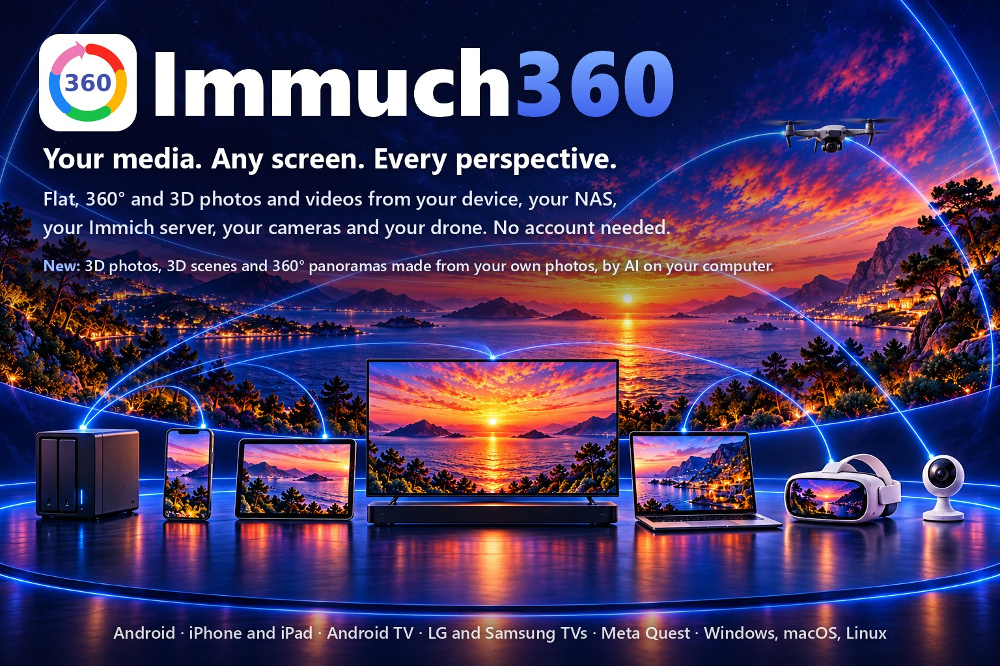

🌐 <b>简体中文</b> · 其他语言 (88)
<a href="../README.md">English</a> · <a href="README.af.md">Afrikaans</a> · <a href="README.ar.md">العربية</a> · <a href="README.az.md">Azərbaycanca</a> · <a href="README.be.md">Беларуская</a> · <a href="README.bg.md">Български</a> · <a href="README.bi.md">Bislama</a> · <a href="README.bn.md">বাংলা</a> · <a href="README.br.md">Brezhoneg</a> · <a href="README.bs.md">Bosanski</a> · <a href="README.ca.md">Català</a> · <a href="README.cs.md">Čeština</a> · <a href="README.cv.md">Чӑвашла</a> · <a href="README.da.md">Dansk</a> · <a href="README.de.md">Deutsch</a> · <a href="README.de_CH.md">Deutsch (Schweiz)</a> · <a href="README.el.md">Ελληνικά</a> · <a href="README.en_GB.md">English (UK)</a> · <a href="README.eo.md">Esperanto</a> · <a href="README.es.md">Español</a> · <a href="README.et.md">Eesti</a> · <a href="README.eu.md">Euskara</a> · <a href="README.fa.md">فارسی</a> · <a href="README.fi.md">Suomi</a> · <a href="README.fil.md">Filipino</a> · <a href="README.fr.md">Français</a> · <a href="README.ga.md">Gaeilge</a> · <a href="README.gl.md">Galego</a> · <a href="README.gsw.md">Alemannisch</a> · <a href="README.gu.md">ગુજરાતી</a> · <a href="README.he.md">עברית</a> · <a href="README.hi.md">हिन्दी</a> · <a href="README.hr.md">Hrvatski</a> · <a href="README.hu.md">Magyar</a> · <a href="README.hy.md">Հայերեն</a> · <a href="README.id.md">Bahasa Indonesia</a> · <a href="README.is.md">Íslenska</a> · <a href="README.it.md">Italiano</a> · <a href="README.ja.md">日本語</a> · <a href="README.ka.md">ქართული</a> · <a href="README.kab.md">Taqbaylit</a> · <a href="README.kk.md">Қазақша</a> · <a href="README.km.md">ខ្មែរ</a> · <a href="README.kmr.md">Kurmancî</a> · <a href="README.kn.md">ಕನ್ನಡ</a> · <a href="README.ko.md">한국어</a> · <a href="README.kxm.md">ภาษาเขมรถิ่นไทย</a> · <a href="README.lb.md">Lëtzebuergesch</a> · <a href="README.lmo.md">Lombard</a> · <a href="README.lt.md">Lietuvių</a> · <a href="README.lv.md">Latviešu</a> · <a href="README.mfa.md">Bahasa Melayu Kelantan</a> · <a href="README.mi.md">Te reo Māori</a> · <a href="README.mk.md">Македонски</a> · <a href="README.ml.md">മലയാളം</a> · <a href="README.mn.md">Монгол</a> · <a href="README.mr.md">मराठी</a> · <a href="README.ms.md">Bahasa Melayu</a> · <a href="README.nb_NO.md">Norsk bokmål</a> · <a href="README.ne.md">नेपाली</a> · <a href="README.nl.md">Nederlands</a> · <a href="README.nn.md">Norsk nynorsk</a> · <a href="README.pa.md">ਪੰਜਾਬੀ</a> · <a href="README.pl.md">Polski</a> · <a href="README.pt.md">Português</a> · <a href="README.pt_BR.md">Português (Brasil)</a> · <a href="README.ro.md">Română</a> · <a href="README.ru.md">Русский</a> · <a href="README.si.md">සිංහල</a> · <a href="README.sk.md">Slovenčina</a> · <a href="README.sl.md">Slovenščina</a> · <a href="README.sq.md">Shqip</a> · <a href="README.sr_Cyrl.md">Српски</a> · <a href="README.sr_Latn.md">Srpski</a> · <a href="README.sv.md">Svenska</a> · <a href="README.sw.md">Kiswahili</a> · <a href="README.swg.md">Schwäbisch</a> · <a href="README.ta.md">தமிழ்</a> · <a href="README.te.md">తెలుగు</a> · <a href="README.th.md">ไทย</a> · <a href="README.tl.md">Tagalog</a> · <a href="README.tr.md">Türkçe</a> · <a href="README.uk.md">Українська</a> · <a href="README.ur.md">اردو</a> · <a href="README.uz.md">Oʻzbekcha</a> · <a href="README.vi.md">Tiếng Việt</a> · <a href="README.yue_Hant.md">粵語</a> · <a href="README.zh_Hant.md">繁體中文</a>

  

# Immuch360

**您的媒体。屏幕随心。视角尽览。**

🌐 <a href="https://immuch360.com/zh-hans/"><b>immuch360.com</b></a>

来自您的设备、NAS、Immich 服务器、摄像头和无人机的扁平、360° 和 3D 照片与视频。无需账户。Immuch360 是一款免费开源应用，它直接在照片和视频所在的位置读取它们，并用最合适的查看器播放每一个文件：扁平显示、作为可环顾四周的球体、以 3D 显示，或在头显中环绕您四周。它可在手机、平板、电视、Meta Quest 头显和电脑上运行。它的网站 [immuch360.com](https://immuch360.com/zh-hans/) 以 89 种语言展示它在每块屏幕上的功能。

**build 33 至 45 的新功能。**[电影会从您停下的地方继续播放](#pick-up-a-film-where-you-stopped)。电影会更早开始，在慢速服务器上也会[继续播放而不会停下](#when-a-video-waits-or-will-not-play)。在手机和电脑上，时间线[可以缩放到月和年](#find-a-month-or-a-year-in-a-long-timeline)。在 Android 手机或 Meta Quest 上，[“浏览文件夹”](#browse-a-folder-of-your-phone-or-headset)可以像共享一样打开设备的文件夹，TIFF 照片也能显示。Android TV [可以用遥控器按日期搜索](#on-android-tv-and-google-tv)，Meta Quest 3 或 3S [可以打开高斯泼溅](#explore-gaussian-splats-in-a-meta-quest-3-or-3s)（实验性），可用右摇杆转动，并支持 SPZ 第 4 版，电脑则可以[为您 NAS 上的照片生成 3D 版本](#turn-one-photo-into-3d-a-scene-a-panorama)。在有两颗图形芯片的 Windows 笔记本电脑上，应用[现在运行在较快的那颗上](#when-a-video-waits-or-will-not-play)，因此 8K 电影播放流畅。现在，高斯泼溅[可以在电脑和 Android 手机及平板上打开](#explore-gaussian-splats-on-your-phone-tablet-or-computer)，Windows 电脑可以由 AI [用您的照片或视频生成泼溅场景](#make-a-splat-scene-from-your-photos-or-a-video-ai)，您的 Immich 服务器可以[把它们保存在照片中](#keep-a-splat-scene-on-your-immich-server)，并可从您的时间线打开，电脑还可以[播放 AV2 视频](#play-av2-videos-on-your-computer)，均为实验性功能。从 build 42 起，来自您的 Immich 资源库、共享或文件夹的 Insta360、GoPro MAX 和 DJI Osmo 360 相机原始视频在 Android 手机、平板和电视上[使用相机陀螺仪防抖播放](#stabilise-your-360-videos-with-the-cameras-gyroscope-experimental)，桌面版 build 22 的泼溅生成器为您近距离观看的场景[提供精细质量](#make-a-splat-scene-from-your-photos-or-a-video-ai)，360° 全景图[在显卡有 3.5 GiB 空闲时即可开始](#turn-one-photo-into-3d-a-scene-a-panorama)，均为实验性功能。iPhone 和 iPad 应用已[上架 App Store](https://apps.apple.com/us/app/immuch360-360-3d-player/id6817655965)，版本 3.3.4。从 build 43 起，应用的更新提示会在手机和平板上打开 Google Play 或 App Store；它的网站 [immuch360.com](https://immuch360.com/zh-hans/) 于 11 月 7 日上线。从 build 44 和桌面版 build 24 起，Meta Quest 3 或 3S [可显示最多 300,000 个高斯的泼溅](#explore-gaussian-splats-in-a-meta-quest-3-or-3s)（实验性），电脑[可用 Ctrl 和 Shift 选择多张照片和视频](#use-your-computer-as-the-media-player)，解码器拒绝某个视频的电视会自动[播放服务器上的另一个文件](#when-a-video-waits-or-will-not-play)，在有两块显卡的笔记本电脑上，全景图运行在所选的显卡上（实验性），Quest 和电脑的更新提示会打开各自的商店或下载页面，并有许多修复。从 build 45 和桌面版 build 25 起，所有平台均为版本 3.4.0，应用跟进 Immich 3.4.0 应用以及 Immich 之后的 11 项修复，可显示 [Immich 3.4 服务器的 JPEG XL 照片](#keep-your-immich-library-with-more)，可[按年份打开您的 Plex 电影](#watch-your-plex-films)，每部电影都有自己的页面，可下载到设备，也可从手机在电视上播放（实验性），在应用商店版本的 build 中可能会请求评分，在电脑上，其视频组件则来自[它们自己的开源仓库](#licences-and-credits)。

  这是 Immich 手机应用的非官方分支，与 Immich 或 FUTO 没有关联。这个名字的英文发音类似“I am much 360”。

<b>目录</b>

- [适合谁](#who-it-is-for)
- [哪些屏幕](#which-screens)、[它们一起能做什么](#use-cases)，以及[每种屏幕能做什么](#what-each-screen-does)
- [您可以做什么](#what-you-can-do)
- [在您的设备上安装](#get-it-on-your-device)
- [操作指南](#how-to)
  - [观看您的照片和视频，有无服务器均可](#watch-your-photos-and-videos-with-or-without-a-server)
  - [探索全景、360°、VR180 和 3D](#explore-panoramas-360-vr180-and-3d)
  - [把一张照片变成 3D、场景、全景图](#turn-one-photo-into-3d-a-scene-a-panorama)
  - [在电视上用遥控器观看](#watch-on-the-tv-with-the-remote)：[Android TV 和 Google TV](#on-android-tv-and-google-tv)、[LG](#on-an-lg-tv-webos)、[Samsung](#on-a-samsung-tv-tizen)
  - [用手机登录电视、头显或电脑](#sign-in-a-tv-a-headset-or-a-computer-with-your-phone)
  - [用 Meta Quest 走进您的照片和视频](#step-inside-your-photos-and-videos-with-a-meta-quest): [展台模式](#kiosk-mode-for-an-exhibition-or-a-shop)
  - [在 Meta Quest 3 或 3S 中探索高斯泼溅](#explore-gaussian-splats-in-a-meta-quest-3-or-3s)
  - [在手机、平板或电脑上探索高斯泼溅](#explore-gaussian-splats-on-your-phone-tablet-or-computer)
  - [用您的照片或视频生成泼溅场景（AI）](#make-a-splat-scene-from-your-photos-or-a-video-ai)
  - [把泼溅场景保存在您的 Immich 服务器上](#keep-a-splat-scene-on-your-immich-server)
  - [播放 NAS、电脑、媒体服务器或 Plex 上的文件](#play-the-files-of-a-nas-a-computer-a-media-server-or-plex)：[按年份浏览您的电影](#watch-your-plex-films)
  - [浏览手机或头显的文件夹](#browse-a-folder-of-your-phone-or-headset)
  - [从您停下的地方继续看电影](#pick-up-a-film-where-you-stopped)
  - [视频需要等待或无法播放时](#when-a-video-waits-or-will-not-play)
  - [保留您的 Immich 媒体库，并获得更多](#keep-your-immich-library-with-more)
  - [在很长的时间线中找到某个月或某一年](#find-a-month-or-a-year-in-a-long-timeline)
  - [在大屏幕上查看家用摄像头](#watch-your-home-cameras-on-the-big-screen)
  - [您的 DJI 无人机（实验性）](#your-dji-drone-experimental)：[实时画面](#see-what-your-drone-sees-on-your-phone)、[在 Quest 或 Android TV 上](#watch-it-in-a-meta-quest-or-on-an-android-tv)、[导入](#bring-a-drones-or-a-camera-cards-photos-and-videos-to-immich)
  - [打开 360° 相机的原始文件](#open-the-raw-files-of-360-cameras)
  - [用相机陀螺仪为您的 360° 视频防抖（实验性）](#stabilise-your-360-videos-with-the-cameras-gyroscope-experimental)
  - [一键旋转照片](#turn-a-photo-with-one-key)
  - [把电脑当作媒体播放器](#use-your-computer-as-the-media-player)
  - [在电脑上播放 AV2 视频](#play-av2-videos-on-your-computer)
- [与 Immich 对比](#compared-with-immich)
- [隐私](#privacy)
- [许可与致谢](#licences-and-credits)
- [路线图](#roadmap)
- [文档](#documentation)

## 适合谁

- **您拍摄 360° 或 3D 内容**，希望在画面中环顾四周，而不是看到扁平、重影或拉伸的画面：[360°、VR180 和 3D](#explore-panoramas-360-vr180-and-3d)。
- **您手持、骑车或戴在头盔上用 360° 相机拍摄**，希望保存在 Immich、共享或文件夹中的 Insta360、GoPro MAX 或 DJI Osmo 360 相机原始视频在您的手机和电视上播放时保持水平、稳定（实验性）：[使用相机陀螺仪防抖](#stabilise-your-360-videos-with-the-cameras-gyroscope-experimental)。
- **您的照片和影片存放在 NAS、电脑、Plex 或 Immich 上**，希望不复制任何文件就能在电视上观看：[在电视上](#watch-on-the-tv-with-the-remote)、[NAS、共享和 Plex](#play-the-files-of-a-nas-a-computer-a-media-server-or-plex)。
- **您把电影存放在 Plex 服务器上**，希望按年份挑选一部，在开始播放前了解它是什么，带着它去旅行，或用手机在电视上开始播放（实验性）：[您的电影，按年份](#watch-your-plex-films)。
- **您有一台 Meta Quest**，想走进自己的照片和视频：[在头显中](#step-inside-your-photos-and-videos-with-a-meta-quest)。
- **您的照片是扁平的**，而您想在没有 3D 相机的情况下以 3D 方式观看它们，作为可以在头显中凑近细看的场景，或置身于 360° 全景图之中：[把一张照片变成 3D、场景、全景图](#turn-one-photo-into-3d-a-scene-a-panorama)，新功能，由 AI 在您自己的电脑上生成。
- **您在使用 Immich**，想要它的应用，外加沉浸式查看器以及可用手机登录的大屏幕：[您的 Immich 媒体库](#keep-your-immich-library-with-more)、[与 Immich 对比](#compared-with-immich)。
- **您用 Tapo 摄像头看家**，希望它们出现在照片旁边，也能在电视上查看（已用模拟摄像头验证）：[家用摄像头](#watch-your-home-cameras-on-the-big-screen)。
- **您飞 DJI 无人机**，希望不用 DJI Fly 就能在手机上看到实时画面，并让身边的人在 Meta Quest 或 Android TV 上观看（实验性）：[您的无人机](#see-what-your-drone-sees-on-your-phone)。
- **您以高斯泼溅的形式用 3D 记录地点和物体，**或者想用自己的照片制作它们，并希望在手机、电脑或头显中穿行其间（实验性）：[在手机、平板或电脑上](#explore-gaussian-splats-on-your-phone-tablet-or-computer)、[用您的照片生成](#make-a-splat-scene-from-your-photos-or-a-video-ai)、[保存在 Immich 中](#keep-a-splat-scene-on-your-immich-server)。
- **您有 AV2 视频**，即继 AV1 之后的格式，并想在电脑上观看它们（实验性）：[电脑上的 AV2](#play-av2-videos-on-your-computer)。
- **您家里有好几块屏幕**，希望它们协同工作：[您的屏幕一起能做什么](#use-cases)。

无需创建 Immuch360 账户，也不会有任何数据发送给我们：应用只与您的设备和您选择的服务器通信，从 build 45 起还会为电影页面与 Wikipedia 通信（实验性），并且只在您要求时才下载 AI 组件或 AV2 解码器。

## 哪些屏幕

| 平台 | 获取方式 | 2026 年 11 月状态 |
|---|---|---|
|  **Android** 手机和平板 | [Google Play](https://play.google.com/store/apps/details?id=com.aprogsys.immuch360) · [APK](https://github.com/freeKC/Immuch360/releases) | Google Play 上为 build 40（build 45 已提交 Google 审核），GitHub 上为 build 45，[原始 360° 视频防抖播放](#stabilise-your-360-videos-with-the-cameras-gyroscope-experimental)（实验性），[电影会从您停下的地方继续播放](#pick-up-a-film-where-you-stopped)，[“浏览文件夹”](#browse-a-folder-of-your-phone-or-headset)可打开手机的文件夹，[高斯泼溅可以打开](#explore-gaussian-splats-on-your-phone-tablet-or-computer)，来自共享或[来自您的 Immich 时间线](#keep-a-splat-scene-on-your-immich-server)（实验性） |
|  **iPhone 和 iPad** | [App Store](https://apps.apple.com/us/app/immuch360-360-3d-player/id6817655965) | 版本 3.3.4 自 11 月 10 日起上架 App Store，带有[时间线中的月和年](#find-a-month-or-a-year-in-a-long-timeline)、[从您停下的地方继续播放的电影](#pick-up-a-film-where-you-stopped)、从手机[登录电视、头显或电脑](#sign-in-a-tv-a-headset-or-a-computer-with-your-phone)、保存在 Immich 中、以其照片显示的泼溅场景、可打开 App Store 的更新提示以及 build 44 的修复；版本 3.4.0 是 build 45 的 iPhone 和 iPad 版本，已随 build 45 发送给 Apple；或[自行构建](../docs/immuch360/build.md) |
|  **Android TV 和 Google TV** | [Google Play](https://play.google.com/store/apps/details?id=com.aprogsys.immuch360) · [APK](#android-tv-and-google-tv) | 已上架 Google Play，可在 Android TV 和 Google TV 上获取本应用，GitHub 上为 build 45：[原始 360° 视频防抖](#stabilise-your-360-videos-with-the-cameras-gyroscope-experimental)（实验性），[用遥控器按日期搜索](#on-android-tv-and-google-tv)，扫描二维码即可[用手机登录](#sign-in-a-tv-a-headset-or-a-computer-with-your-phone)，视频播放器为遥控器提供进度条、音频和字幕，还可观看由手机转发的[无人机实时画面](#watch-it-in-a-meta-quest-or-on-an-android-tv)（实验性） |
| 搭载 webOS 5.0 及更高版本的 **LG 电视** | [.ipk，版本 1.0.1](https://github.com/freeKC/Immuch360/releases/tag/webos-v1.0.1) · LG Content Store（审核中） | 版本 1.0.0 已于 10 月 24 日提交至 LG Content Store，自 10 月 26 日起接受 LG 测试；版本 1.0.1 自 10 月 27 日起在 GitHub 上提供，可用方向键缩放照片，并在照片仍在加载时给出提示；在 LG 发布应用之前，可在 [Developer Mode](#lg-tvs-webos) 下安装。版本 1.0.0 已在 LG Cloud Test Lab 的 webOS 25 电视上运行过 |
| 搭载 Tizen 5.5 及更高版本的 **Samsung 电视** | [.wgt 测试 build](https://github.com/freeKC/Immuch360/releases/tag/tizen-v0.3.0) | 同一电视应用的测试 build 0.3.0，需用您自己的 Samsung 证书签名，并在 [Developer mode](#samsung-tvs-tizen) 下安装；0.1.0 已在一位测试者的 Samsung 电视上运行过，0.2.0 包含了那次运行后的修复，0.3.0 加入了 LG 版本 1.0.1 的照片缩放和 Loading 提示，尚未在 Samsung 电视上运行过；不在 Samsung 的商店中 |
|  **Meta Quest** 2、Pro、3 和 3S | [Horizon Store](https://www.meta.com/experiences/immuch360/1384208401440714/) · [APK](#meta-quest) | Horizon Store 上为 build 42（自 11 月 9 日起上架；build 44 自 11 月 9 日起在 Meta 审核中；build 45 随后跟进），GitHub 上为 build 45，带有[展台模式](#kiosk-mode-for-an-exhibition-or-a-shop)，在 Quest 3 和 3S 上还有[高斯泼溅](#explore-gaussian-splats-in-a-meta-quest-3-or-3s)以及为扁平照片添加的 [AI 立体感](#turn-one-photo-into-3d-a-scene-a-panorama)，均为实验性 |
|  **Windows** | [安装程序或 ZIP](https://github.com/freeKC/Immuch360/releases/tag/desktop-v3.4.0-25) | 桌面版 build 25，已签名的预览版：照片、扁平和 360° 视频、共享、Plex、摄像头（已用模拟摄像头验证）、用手机登录、一键旋转照片、89 种语言的界面，以及由 AI [用您的照片生成 3D 照片、3D 场景和 360° 全景图](#turn-one-photo-into-3d-a-scene-a-panorama)（实验性），包括您 NAS 上的照片；[高斯泼溅](#explore-gaussian-splats-on-your-phone-tablet-or-computer)：打开、[用您的照片或视频生成](#make-a-splat-scene-from-your-photos-or-a-video-ai)和[保存在 Immich 中](#keep-a-splat-scene-on-your-immich-server)，[AV2 视频](#play-av2-videos-on-your-computer)，以及从桌面版 build 22 起的[泼溅场景质量选项](#make-a-splat-scene-from-your-photos-or-a-video-ai)和[显存有 3.5 GiB 空闲即可生成的 360° 全景图](#turn-one-photo-into-3d-a-scene-a-panorama)，均为实验性 |
|   **macOS 和 Linux** | [.deb, .rpm, DMG](https://github.com/freeKC/Immuch360/releases/tag/desktop-v3.4.0-25) | 桌面版 build 25，预览版：照片、360° 照片和扁平视频（360° 视频以扁平方式播放）、Immich 服务器和网络共享，以及由 AI 用您的照片生成的 [3D 照片和 3D 场景](#turn-one-photo-into-3d-a-scene-a-panorama)，Linux 上配备 8 GB 显卡时还能生成 360° 全景图，其中有 3.5 GiB 空闲即可，并支持[高斯泼溅](#explore-gaussian-splats-on-your-phone-tablet-or-computer)和[AV2 视频](#play-av2-videos-on-your-computer)（实验性，尚未在 Mac 上试过）；桌面版 build 11 已于 10 月 26 日在 Ubuntu 24.04 容器中和一台 Mac 上试过；macOS 版未签名 |

*每次发布都会更新这些状态；逐个 build 的详细信息见[发布状态](../docs/immuch360/release-status.md)。网站 [immuch360.com](https://immuch360.com/zh-hans/) 以 89 种语言展示每块屏幕的功能、每项功能的操作指南以及各应用商店的链接。*

  

### 您的屏幕一起能做什么

在您用来观看的每块屏幕上安装 Immuch360：每块屏幕都自己读取您的来源，有些还会把画面、文件或登录交给另一块屏幕。每张图中，Immuch360 图标标出了运行该应用的设备。

#### 您的 NAS，在每块屏幕上

  

**您需要：**一台带 SMB 或 WebDAV 共享的 NAS，以及您用来观看的每块屏幕上的 Immuch360。

在每块屏幕上添加该共享，每块屏幕都会在原处播放照片和视频，不复制任何文件：手机、平板、Android TV、Meta Quest、Windows、Linux 和 macOS 电脑，以及登录到您 Immich 服务器的 LG 电视（从 webOS 22 起支持 SMB）。360° 照片在手机和电视上以球面转动，在头显中则环绕着您。操作指南：[播放 NAS、电脑、媒体服务器或 Plex 上的文件](#play-the-files-of-a-nas-a-computer-a-media-server-or-plex)。

#### 您的 Immich 服务器，在每块屏幕上，用手机登录

  

**您需要：**一台 Immich 服务器、您 Android 手机上的 Immuch360，以及您要登录的屏幕上的 Immuch360：Android TV、Meta Quest、Windows、Linux 或 macOS 电脑。

在手机上，Immuch360 保留了完整的 Immich 移动应用，加入了它的 360°、VR180 和 3D 查看器，并与官方应用并存安装。登录您的服务器后，它会为大屏幕登录：它扫描电视或电脑的二维码，或者由您在手机上输入头显显示的代码，您的密码始终留在手机上。操作指南：[用手机登录电视、头显或电脑](#sign-in-a-tv-a-headset-or-a-computer-with-your-phone)。

#### 您的扁平照片变成 3D，从电脑到头显（实验性）

  

**您需要：**Windows、Linux 或 macOS 电脑上的 Immuch360 和 Meta Quest 中的 Immuch360，两者之间是您的 NAS，或开启了“同时备份 AI 版本”的 Immich 服务器。

电脑自己就能把您的照片变成 3D 照片和 3D 场景，在 Windows 或 Linux 上配备 8 GB 显卡时还能变成 360° 全景图，并保存在原图旁边。头显以真正的 3D 显示 3D 照片，把场景放进您的房间，把全景图展开在您四周；手机和电视用它们的 360° 查看器打开全景图。操作指南：[把一张照片变成 3D、场景、全景图](#turn-one-photo-into-3d-a-scene-a-panorama)。

#### 您无人机的实时画面，在头显中或电视上（实验性）

  

**您需要：**一架 DJI 无人机及其 DJI RC-N3 遥控器、插在遥控器上的 Android 手机上的 Immuch360，以及 Meta Quest 或 Android TV 上的 Immuch360。

手机显示无人机的实时视频，并通过您的 Wi-Fi 或它自己的热点转发出去，让您身边的人在头显中或电视上观看飞行。只接收：绝不会向遥控器或无人机发送任何指令，遥控器保有完全的控制。操作指南：[在 Meta Quest 或 Android TV 上观看](#watch-it-in-a-meta-quest-or-on-an-android-tv)。

#### 您 360° 相机的原始文件，在您观看的地方拼接

  

**您需要：**一台 Insta360、GoPro MAX 或 DJI Osmo 360 相机、您的 NAS，以及这些屏幕上的 Immuch360：手机、平板、Android TV、Meta Quest、Windows。

把 .insp、.insv、.360 或 .osv 文件从相机的存储卡原样复制到您 NAS 的 SMB 或 WebDAV 共享；Immich 服务器也接收 Insta360 的文件。每块屏幕都在播放时拼接它们，使用每个文件中写入的校准数据，无需先在相机的应用中导出任何内容。操作指南：[打开 360° 相机的原始文件](#open-the-raw-files-of-360-cameras)。

#### 您的 Plex 和 DLNA 服务器，在电视上和头显中

  

**您需要：**一台 Plex Media Server 或 DLNA 服务器（如 Jellyfin、Emby 或 minidlna），以及每块屏幕上的 Immuch360：Android TV、Meta Quest、手机、平板、Windows。

Plex 提供您媒体库的原始文件，因此 360° 视频依然是 360°，在头显中环绕着您，在家中如此，在外通过您的端口转发也是如此；DLNA 服务器会在您的家庭网络中被发现。登录到您 Immich 服务器的 LG 电视也能播放它们。从 build 45 起，手机、平板、Android TV、Quest 和电脑可以打开 Plex 电影资源库，按年份显示所有电影，每部电影都有自己的页面，在手机上选好的电影可在 Android TV、Quest 或电脑上播放，由遥控器掌控（实验性）。操作指南：[播放 NAS、电脑、媒体服务器或 Plex 上的文件](#play-the-files-of-a-nas-a-computer-a-media-server-or-plex)和[观看您的 Plex 电影](#watch-your-plex-films)。

#### 您的手机或 Windows 电脑，在头显中打开

  

**您需要：**Android 手机、iPhone 或 Windows 电脑上的 Immuch360，以及 Meta Quest 中的 Immuch360，连在同一个家庭 Wi-Fi 上。

在手机上打开“在网络上共享此手机”，或在电脑上打开“在网络上共享此电脑”，头显就能播放其中的照片和视频，360° 的那些环绕着您：无需服务器，无需 NAS，无需上传。在 iPhone 上，共享仅在应用显示在屏幕上时运行。操作指南：[在网络上共享此手机](../docs/immuch360/user-guide.md#share-this-phone-on-the-network)。

#### 您的 Tapo 摄像头，在电视上和头显中

  

**您需要：**家庭网络中的 Tapo 摄像头，以及 Android 手机、Android TV、Meta Quest 或 Windows 电脑上的 Immuch360。

每块屏幕都能实时显示一台摄像头，并按天播放其存储卡上的录像，就在您的照片旁边；手机还能把一段片段发送到您的 Immich 服务器。应用只在您的网络中与摄像头通信，从不经过 TP-Link 的服务器。已用模拟摄像头验证。操作指南：[在大屏幕上查看家用摄像头](#watch-your-home-cameras-on-the-big-screen)。

#### 您房间里的高斯泼溅，在 Meta Quest 3 或 3S 中（实验性）

  

**您需要：**一个用 Polycam、Scaniverse、Luma 或其他工具制作的泼溅，以 .spz 或二进制 .ply 文件存放在您的 NAS 上或头显中，以及 Meta Quest 3 或 3S 中的 Immuch360。

头显按实际大小呈现地点或物体，在您面前或在您四周：绕着它走，用左摇杆在其中滑行，用右摇杆转动。高斯泼溅使用 Meta Spatial SDK 的实验性 API，Meta 对其既不提供支持也不作担保：任何缺陷均由 Immuch360 自行负责。操作指南：[在 Meta Quest 3 或 3S 中探索高斯泼溅](#explore-gaussian-splats-in-a-meta-quest-3-or-3s)。

#### 为您的访客准备的 Meta Quest（实验性）

  

**您需要：**一台装有 Immuch360 的 Meta Quest，以及存放在头显中、您的 NAS 上或您的 Immich 服务器上的一张 360° 照片或一个视频。

在展台模式下，每次有访客戴上头显，它都会自己从头打开您的 360° 照片或视频，影片最后停在一张带有您文字的卡片上。访客无需按任何键；您按住 B 或 Y 一秒钟即可退出。操作指南：[展台模式，适用于展览或商店](#kiosk-mode-for-an-exhibition-or-a-shop)。

### 每种屏幕能做什么

手机、平板、Android TV、Meta Quest 和电脑共用一套代码库，LG 电视则有一个独立的电视应用，它也被打包为 Samsung 电视的测试 build。以下是每种平台目前拥有的功能：

| 功能 | Android | iPhone、iPad | Android TV | LG webOS | Samsung Tizen | Quest |
|---|:---:|:---:|:---:|:---:|:---:|:---:|
| 配合 Immich 服务器的图库、相册、搜索 | ✅ | ✅ | ✅ 仅查看 | ✅ 仅查看 | ✅ 仅查看 | ✅ |
| 按月和年显示的时间线 | ✅ | ✅ | ❌ | ❌ | ❌ | ❌ |
| 用手机登录（二维码） | ✅ 扫描代码 | ✅ 扫描代码 | ✅ | ✅ 在手机浏览器中 | ❌ 在电视上输入 | ✅ 在手机上输入代码 |
| 无服务器：设备自身的媒体 | ✅ | ✅ | 仅共享 | ❌ | ❌ | ✅ |
| 像共享一样打开的设备文件夹 | ✅ 您选择的文件夹 | ❌ | ❌ | ❌ | ❌ | ✅ |
| 扁平照片和视频 | ✅ | ✅ | ✅ | ✅ | ✅ | ✅ |
| TIFF 照片 | ✅ | ✅ 系统解码器 | ✅ | ✅ 由服务器提供 | ✅ 由服务器提供 | ✅ 沉浸式视图中也可以 |
| JPEG XL 缩略图和预览图（Immich 3.4） | ✅ | ✅ 从 3.4.0 起，Immich 的解码器，尚未在 iPhone 上试过 | ✅ | ❌ “无法预览” | ❌ “无法预览” | ✅ 沉浸式视图中也可以 |
| 一键旋转照片 | ✅ | ✅ | ✅ 彩色键 | ✅ 彩色键 | ✅ | ✅ 窗口 |
| 360° 照片以球体显示 | ✅ | ✅ | ✅ | ✅ | ✅ | ✅ 沉浸式 |
| 360° 视频 | ✅ | ✅ 无进度条 | ✅ 无法解码时提示 | 仅扁平 | 仅扁平 | ✅ 沉浸式 |
| 从您停下的地方继续播放的电影 | ✅ | ✅ | ✅ | ❌ | ❌ | ✅ 沉浸式视图中也可以 |
| 视频来源：此设备能解码的文件 | ✅ | ✅ | ✅ | ❌ | ❌ | ✅ |
| 慢速服务器：视频要等多久，以及原因 | ✅ | 自己的等待规则 | ✅ | ❌ | ❌ | ✅ |
| AV2 视频（实验性） | ❌ | ❌ | ❌ | ❌ | ❌ | ❌ |
| 3D 和 VR180 | ✅ 单眼 | ✅ 单眼 | ✅ 单眼 | 照片单眼，视频扁平 | 照片单眼，视频扁平 | ✅ 真 3D |
| 按文件名识别的平面 3D、可移动的更清晰屏幕（实验性） | ❌ | ❌ | ❌ | ❌ | ❌ | ✅ |
| 面向访客的展台模式（实验性） | ❌ | ❌ | ❌ | ❌ | ❌ | ✅ |
| Spatial 2.5D（头部追踪） | ✅ 实验性 | ✅ 实验性 | ❌ | ❌ | ❌ | ❌ |
| Apple 空间照片 | ✅ 单眼 | ✅ 单眼 | ✅ 单眼 | ❌ | ❌ | ✅ 3D |
| 高斯泼溅，.spz 和 .ply（实验性） | ✅ | ❌ | ❌ | ❌ | ❌ | ✅ Quest 3 和 3S |
| 保存为 Immich 中照片的泼溅场景（实验性） | ✅ | 照片 | 照片 | 照片 | 照片 | ✅ Quest 3 和 3S，尚未在头显中试过 |
| 由 2D 照片生成的 3D 照片（AI） | ✅ 可读取，左右并排 | ✅ 可读取，左右并排 | ✅ 可读取，左右并排 | ✅ 可读取，左右并排 | ✅ 可读取，左右并排 | ✅ 在头显中生成 AI 立体感（Quest 3 和 3S），以 3D 显示 |
| 由 2D 照片生成的 3D 场景（AI） | ✅ 可读取，显示为其照片 | ✅ 可读取，显示为其照片 | ✅ 可读取，显示为其照片 | ✅ 可读取，显示为其照片 | ✅ 可读取，显示为其照片 | ✅ 以 3D 探索 |
| 由 2D 照片生成的 360° 全景图（AI） | ✅ 可读取，带 AI 标签 | ✅ 作为 360° 照片读取，标签 🔜 | ✅ 可读取，带 AI 标签 | ✅ 作为 360° 照片读取，标签 🔜 | ✅ 作为 360° 照片读取，标签 🔜 | ✅ 在您四周完整读取，带 AI 标签 |
| 共享照片旁的 3D 版本（AI） | ✅ 读取 | ✅ 读取 | ✅ 读取 | ✅ 读取 | ❌ | ✅ 读取 |
| 由照片或视频生成的泼溅场景（AI） | ✅ 可读取 | ❌ | ❌ | ❌ | ❌ | ✅ 可读取，Quest 3 和 3S，尚未在头显中试过 |
| Insta360、GoPro 和 DJI 原始文件 | ✅ | ✅ | ✅ | ❌ | ❌ | ✅ |
| 使用相机陀螺仪防抖的原始 360° 视频（实验性） | ✅ Insta360、GoPro MAX、DJI Osmo 360，来自您的资源库、共享和文件夹 | 🔜 | ✅ Insta360、GoPro MAX、DJI Osmo 360，来自您的资源库和共享 | ❌ | ❌ | 🔜 |
| SMB、WebDAV、DLNA 共享 | ✅ | ✅ | ✅ | ✅ SMB 自 webOS 22 起 | ❌ | ✅ |
| Plex Media Server | ✅ | ✅ | ✅ | ✅ | ❌ | ✅ |
| Tapo 摄像头：录像 | ✅ | ✅ | ✅ | 🔜 2026 年 12 月之前不会提供 | ❌ | ✅ |
| Tapo 摄像头：实时画面 | ✅ | ✅ 尚未在 iPhone 上试过 | ✅ | ✅ 仅视频 | ❌ | ✅ |
| 在网络上共享此设备 | ✅ | ✅ | ❌ | ❌ | ❌ | ❌ |
| 从共享和设备上传到 Immich | ✅ | ✅ | ❌ | ❌ | ❌ | ✅ |
| 通过 USB 从 DJI 无人机或存储卡导入（实验性） | ✅ | ❌ | ❌ | ❌ | ❌ | ❌ |
| DJI 无人机实时画面（实验性） | ✅ 配合 RC-N3 | ❌ | ✅ 由手机转发 | ❌ | ❌ | ✅ 由手机转发 |
| 深色主题 | 跟随系统 | 跟随系统 | ✅ 默认 | ✅ 唯一主题 | ✅ 唯一主题 | 跟随系统 |
| 输入方式 | 触摸、陀螺仪 | 触摸、陀螺仪 | 遥控器；播放视频时及在进度条上也可用左右键，Menu 键查看详细信息 | 遥控器、Magic Remote | 遥控器 | 控制器、双手 |
| 获取方式 | Google Play、APK | App Store | Google Play、APK | .ipk、LG Content Store（审核中） | .wgt 测试 build，由您签名 | Horizon Store、APK |

| 功能 | Windows | Linux | macOS |
|---|:---:|:---:|:---:|
| 配合 Immich 服务器的图库、相册、搜索 | ✅ | ✅ | ✅ |
| 按月和年显示的时间线 | ✅ Ctrl 加滚轮 | ✅ Ctrl 加滚轮 | ✅ Command 加滚轮 |
| 用手机登录（二维码） | ✅ | ✅（试过其网页） | ✅（未记录使用哪种方式） |
| 无服务器：设备自身的媒体 | ✅ 文件夹 | ✅ 文件夹 | ✅ 文件夹 |
| 像共享一样打开的设备文件夹 | ✅ 文件夹 | ✅ 文件夹 | ✅ 文件夹 |
| 扁平照片和视频 | ✅ | ✅ | ✅ |
| TIFF 照片 | ✅ 系统解码器 | ❌ 改为显示缩略图 | ✅ 系统解码器 |
| JPEG XL 缩略图和预览图（Immich 3.4） | ✅ | ✅ | ✅ |
| 一键旋转照片 | ✅ | ✅ | ✅ |
| 360° 照片以球体显示 | ✅ | ✅ | ✅ |
| 360° 视频 | ✅ | 仅扁平 | 仅扁平 |
| 从您停下的地方继续播放的电影 | ✅ | ✅ | ✅ |
| 视频来源：此设备能解码的文件 | ✅ | ✅ | ✅ |
| 慢速服务器：视频要等多久，以及原因 | ✅ | ✅ | ✅ |
| AV2 视频（实验性） | ✅ | ✅ | ✅ 由 CI 检查 |
| 3D 和 VR180 | ✅ 单眼 | 照片单眼，视频扁平 | 照片单眼，视频扁平 |
| 按文件名识别的平面 3D、可移动的更清晰屏幕（实验性） | ❌ | ❌ | ❌ |
| 面向访客的展台模式（实验性） | ❌ | ❌ | ❌ |
| Spatial 2.5D（头部追踪） | 🔜 开发中 | ❌ | ❌ |
| Apple 空间照片 | ✅ 单眼 | ✅ 单眼，来自服务器 | ✅ 单眼 |
| 高斯泼溅，.spz 和 .ply（实验性） | ✅ | ✅ | ✅ 由 CI 构建 |
| 保存为 Immich 中照片的泼溅场景（实验性） | ✅ | ✅ | ✅ 由 CI 构建 |
| 由 2D 照片生成的 3D 照片（AI） | ✅ | ✅ | ✅ 由 CI 构建 |
| 由 2D 照片生成的 3D 场景（AI） | ✅ | ✅ | ✅ 由 CI 构建 |
| 由 2D 照片生成的 360° 全景图（AI） | ✅ 8 GB 显卡 | ✅ 8 GB 显卡，已在 Intel 显卡上以小尺寸运行 | 🔜 在路线图上 |
| 共享照片旁的 3D 版本（AI） | ✅ | ✅ | ✅ 3D 照片和场景 |
| 由照片或视频生成的泼溅场景（AI） | ✅ 4 GB 显卡 | ✅ 可读取 | ✅ 可读取，由 CI 构建 |
| Insta360、GoPro 和 DJI 原始文件 | ✅ | ✅ 照片，视频扁平 | ✅ 照片，视频扁平 |
| 使用相机陀螺仪防抖的原始 360° 视频（实验性） | 🔜 | ❌ | ❌ |
| SMB、WebDAV、DLNA 共享 | ✅ | ✅ | ✅ |
| Plex Media Server | ✅ | 🔧 CI | 🔧 CI |
| Tapo 摄像头：录像 | ✅ | 🔧 CI | 🔧 CI |
| Tapo 摄像头：实时画面 | ✅ | 🔧 CI | 🔧 CI |
| 在网络上共享此设备 | ✅ | ❌ | ❌ |
| 从共享和设备上传到 Immich | ✅ | ✅ | ✅ |
| 用 Ctrl+单击、Shift+单击和 Ctrl+A 选择多张照片，右键单击执行操作 | ✅ | ✅ | ✅ 使用 Command，尚未在 Mac 上试过 |
| 通过 USB 从 DJI 无人机或存储卡导入（实验性） | ❌ | ❌ | ❌ |
| DJI 无人机实时画面（实验性） | ❌ | ❌ | ❌ |
| 深色主题 | 跟随系统 | 跟随系统 | 跟随系统 |
| 输入方式 | 鼠标、键盘 | 鼠标、键盘 | 鼠标、键盘、触控板 |
| 获取方式 | 安装程序或 ZIP（已签名预览版） | .deb、.rpm（预览版） | DMG 或 ZIP（未签名预览版） |

*Linux 和 macOS：桌面版 build 11 已于 2026 年 10 月 26 日在 Ubuntu 24.04 上、在一个带有测试 Immich 服务器和测试共享的容器中试过，作者也在一台 Mac 上试过。AI 相关各行使用桌面版 build 13 代码的测试 build，于 2026 年 10 月 27 日至 29 日完成：3D 照片由 Linux 应用在一台 Linux 电脑上的容器中生成，场景由 Windows 应用在一台配备 RTX 4060 的笔记本电脑上生成，也由引擎在那台 Linux 电脑上生成，360° 全景图在那台笔记本电脑上生成。build 33 至 39 的各行：月和年视图已在一台运行桌面版 build 14 的 Windows 电脑上验证，3D 版本已在项目的构建机器上写入一个 Samba 共享和一个 WebDAV 共享，“浏览文件夹”已在 Android 16 模拟器上验证，流媒体视频的启动已在限速链路后的 Android 模拟器上验证，展台模式和更清晰的平面屏幕已在运行 build 35 的 Quest 3 中验证，build 39 的泼溅文件已于 10 月 31 日在 Quest 3 的泼溅模块中验证，电影和视频来源由项目的 CI 和构建机器上的测试检查。build 41 和桌面版 build 21 的各行：泼溅已在一台 Galaxy S24+ 上、在一台配备 RTX 4060 的笔记本电脑上的 Windows 应用中以及在 CI 容器中的 Linux 上验证，泼溅场景由那台笔记本电脑生成，泼溅照片已在 Immich 3.3.0 和 3.2.4 测试服务器上验证，AV2 已在那台笔记本电脑上、Ubuntu 22.04 和 24.04 容器中，以及在没有屏幕的情况下在 CI 的 Mac 上验证。build 42 和桌面版 build 22 的各行：防抖由项目的 CI 和构建机器上针对 Insta360 X3、X4 和 X5、GoPro MAX 和 DJI Osmo 360 相机示例文件运动轨道的测试检查，质量选项由其测试以及在那台配备 RTX 4060 的笔记本电脑上对其训练的一次测量检查，iPhone 和 iPad 一列则来自 App Store 的版本 3.3.2。*

✅ 该平台应用中已支持 · ❌ 该平台不提供 · 🔜 计划中 · 🔧 CI 源码中已有，已由项目的 CI 在该系统上构建并启动 · 仅扁平：视频以扁平方式播放并显示提示信息，因为电脑上的 360° 视频渲染器目前仅支持 Windows；在 LG 电视上，webOS 能否把视频帧交给球体渲染仍有待测量；在一位测试者的 Samsung 电视上，浏览器交给 3D 视图的是黑色视频帧。“单眼”是指 3D 文件在平面屏幕上只显示左眼画面。LG 和 Samsung 两栏是同一个独立的电视应用：LG 版本 1.0.0，其共享和 Plex 已用真实服务器验证，摄像头已在项目的构建主机上用模拟摄像头验证；以及 Samsung 测试 build 0.3.0。具体在哪里验证过什么、还有什么待确认，见[功能](../docs/immuch360/features.md)、[平台支持](../docs/immuch360/platform-support.md)和[兼容性](../docs/immuch360/compatibility.md)。

在 AI 相关各行中，“可读取”表示设备打开电脑生成的文件，自己不生成任何内容：3D 照片以左右并排的两眼画面显示，场景显示为其照片并带一个小小的 3D 场景标记，全景图在 360° 查看器中打开。它的 AI 标签包括“AI 360°”标记、“照片边缘以外的部分由 AI 生成”这句话以及原始照片的框线，路线图会把它们带到 iPhone、iPad、LG 和 Samsung 应用中。只有电脑和 Quest 会生成内容。这些行的验证情况写在[操作说明](#turn-one-photo-into-3d-a-scene-a-panorama)中。

- **Android 手机和平板**：完整版应用，支持触摸和陀螺仪，支持所有来源；从 build 32 起，可以打开在电脑上生成的 360° 全景图，并显示其 AI 标签；从 build 38 起，它们可以浏览设备文件夹、显示 TIFF 照片、从您停下的地方继续播放电影，从 build 39 起，流媒体视频在连接允许时立即开始，并说明为何需要等待。从 build 41 起，它们可以打开高斯泼溅以及保存在 Immich 中的泼溅场景（实验性）。从 build 42 起，360° 播放器会使用相机陀螺仪，为来自您的 Immich 资源库、共享或设备文件夹的 Insta360、GoPro MAX 和 DJI Osmo 360 相机原始视频防抖（实验性）。
- **iPhone 和 iPad**：完整版应用；360° 视频播放器目前只支持播放和暂停，在 Apple 授予多播权限之前，DLNA 搜索会发送单播请求。版本 3.3.2 于 2026 年 11 月 6 日发布，带来了用手机登录的手机端、时间线的月和年、从您停下的地方继续播放的电影、视频来源以及 Tapo 实时画面，尚未在 iPhone 上试过。版本 3.3.3 于 2026 年 11 月 9 日发布，带来了可打开 App Store 的更新提示。版本 3.3.4 自 2026 年 11 月 10 日起上架 App Store，包含 3.3.3 的内容以及 build 44 的修复。版本 3.4.0 已随 build 45 发送给 Apple，带来 Immich 3.4.0 的修复、Immich 3.4 服务器的 JPEG XL 照片、主版本差距时的更新提示、按年份浏览的 Plex 电影及其页面、在应用保持打开时下载电影，以及“播放到…”电视或电脑（实验性），还有 App Store 自己的应用评分提示；Plex 的音频和字幕菜单尚未登陆 iPhone 和 iPad。
- **Android TV 和 Google TV**：使用同一个 APK，由遥控器操作，默认深色主题；仅作为查看器：备份、上传和编辑器均被隐藏，详细信息为只读，但照片仍可一键旋转。所有搜索筛选器都可以用遥控器操作：位置和相机会在列表中打开其选项，日期筛选器会显示全部选项，标签、位置、日期、媒体类型、星级评分和显示选项面板会把清空和应用放在选项旁边，只需按一次右键即可到达，面板占据屏幕的大部分高度。照片网格占用的图像内存更少，按住方向键时每秒最多移动约 10 行。从 build 28 起，它可以通过二维码或短代码从手机登录（已在两个模拟器之间以手动输入代码的方式试过）。从 build 29 起，视频的进度条可获得遥控器焦点，影片带有音频和字幕菜单，共享中的下一个文件会带着自己的控件打开。已在 Google TV 模拟器上验证；build 28 于 10 月 23 日在真实 Android TV 上运行过，在那里发现的视频问题已在 build 29 中修复，这些修复已在模拟器上验证。从 build 30 起，它的 Drone 卡片会显示由手机转发的 DJI 无人机实时画面，并带有无人机的数值和障碍物环（实验性）：配对和画面已于 10 月 25 日在一台 TCL Android TV 上试过，之前的转发方式出现卡顿和偏绿；10 月 26 日，使用 build 30，为此推出的稳定流让那台电视在飞行中持续收到画面，期间卡住 7 次。从 build 33 起，搜索及其日期范围可以用遥控器操作，照片会在左下角显示日期，在时间线上快速连按会跳得更远；从 build 38 起，电影会从您停下的地方继续播放，TIFF 照片也能显示。从 build 42 起，360° 播放器会使用相机陀螺仪，为来自您的 Immich 资源库或共享的 Insta360、GoPro MAX 和 DJI Osmo 360 相机原始视频防抖（实验性）。
- **搭载 webOS 5.0 及更高版本的 LG 电视**：一个独立应用，适用于遥控器和 Magic Remote，基于 [immich-tv-webos](https://github.com/Seeky91/immich-tv-webos) 构建：一个 Immich 查看器，360° 照片以球体显示，照片可一键旋转，深色主题，支持应用的 89 种语言（电视应用自身的少量文字目前仍为英文）；通过其在电视上的自有服务支持网络共享、Plex 和 Tapo 摄像头的实时画面（SMB 自 webOS 22 起）；360° 视频以扁平方式播放。版本 1.0.0 已于 10 月 24 日提交至 LG Content Store，并在 LG Cloud Test Lab 中三个型号的 webOS 25 电视上运行过：登录、手机登录页面、照片、相册、一段视频、360° 视图、幻灯片放映、一次搜索，以及从每个页面返回。版本 0.1.0 已在一位测试者的 LG 电视（webOS 22）上运行过。共享和 Plex 已用真实服务器验证，摄像头已在项目的构建主机上用模拟摄像头验证。
- **搭载 Tizen 5.5 及更高版本的 Samsung 电视**：为 Samsung 电视打包的 LG 电视应用，测试 build 0.3.0，需自行签名和安装：一个供遥控器使用的 Immich 查看器，手动输入登录（服务器地址，然后是电子邮件和密码或 API 密钥），支持幻灯片放映、球体上的 360° 照片、一键旋转照片，以及一个说明电视支持哪些功能的“关于”页面；用手机登录、共享、Plex 和摄像头在其路线图上；360° 视频以扁平方式播放，并显示提示。版本 0.1.0 已在一位测试者搭载 Tizen 9 的 Samsung 电视上运行过：4K 及以下的照片和视频可以播放，超过 4K 的都无法解码，电视的浏览器交给 3D 视图的是黑色视频帧。版本 0.2.0 包含了那次运行后的修复（超出电视解码器能力或卡住的视频会显示提示，360° 视频以扁平方式播放并显示提示），已由项目的 CI 在代替电视的浏览器中验证。测试 build 0.3.0 加入了 LG 版本 1.0.1 的照片缩放和 Loading 提示，尚未在 Samsung 电视上运行过。
- **Meta Quest 2、Pro、3 和 3S**：应用以窗口形式运行，并支持沉浸式视图，从 build 30 起还有一张 Drone 卡片，可显示由手机转发的 DJI 无人机实时画面（实验性），已首次随 build 30 测试；HEVC 是最可靠的编码格式，H.264 在 Quest 3 上的上限约为 4096x2304；应用已在 Quest 3 上测试。从 build 32 起，在 Quest 3 或 3S 上，AI 立体感可将扁平照片以 3D 显示，计算在头显内完成；在电脑上生成的 3D 照片、场景和全景图也以 3D 打开（实验性）。从 build 33 起，有可移动的平面 3D 屏幕和展台模式；从 build 38 起，沉浸式视图中有会继续播放的电影和 TIFF 照片；从 build 39 起，Quest 3 和 3S 上有高斯泼溅。
- **Windows 10 和 11**：预览版，使用文件夹代替图库，配备自带的视频播放器（libmpv）播放扁平和 360° 视频，原始文件由显卡芯片拼接，文件和文件夹可以用程序打开或拖放到窗口上，提供安装程序或 ZIP，由 APROGSYS 签名；从桌面版 build 13 起，“生成 3D（AI）”可在处理器上把您的照片变成 3D 照片和 3D 场景，在 8 GB 显卡上变成 360° 全景图。从桌面版 build 16 起，“生成 3D（AI）”也可用于网络共享中的照片，从桌面版 build 17 起，视频会用这台电脑能解码的文件播放，从桌面版 build 18 起，电影会从您停下的地方继续播放，从桌面版 build 19 起，慢速服务器上的电影会继续播放并说明等待的原因。从桌面版 build 20 起，即使有电影正在等待网络共享，窗口也会立即关闭：打开的电影会保存停下的位置，本次会话的日志也会写入。从桌面版 build 21 起，在有两颗图形芯片的笔记本电脑上，应用运行在较快的图形芯片上，视频详情会说明电影是如何解码的。同一 build 还能打开高斯泼溅，在 4 GB 显卡上用您的照片或视频生成泼溅场景，并播放 AV2 视频，均为实验性功能。从桌面版 build 22 起，360° 全景图在显卡有 3.5 GiB 空闲时即可开始，泼溅场景有三种质量：头显、精细和最高（实验性）。
- **Linux**：由项目的 CI 构建的 .deb 和 .rpm，已在 Ubuntu 22.04 和 24.04、Debian 12 以及 Fedora 40 和 44 上安装并验证；通过系统的 libmpv 显示照片、360° 照片并播放扁平视频（360°、3D 和原始视频会以扁平方式播放并显示提示信息），从桌面版 build 7 起在 X11 会话中也通过硬件路径绘制；SMB 共享从 Ubuntu 22.04 和 Debian 12 起可用；在没有密钥环（GNOME Keyring 或 KWallet）的情况下，应用首次启动时不再卡住 25 s：它只在本次会话中保存密码，并在设置中加以说明；从桌面版 build 13 起，“生成 3D（AI）”可在处理器上生成 3D 照片和场景，在 8 GB 显卡上生成 360° 全景图（仅以小尺寸在 Intel 显卡上试过）；已在 WSLg 和容器中测试。从桌面版 build 16 起，“生成 3D（AI）”也可用于网络共享中的照片，从桌面版 build 17 起，视频会用这台电脑能解码的文件播放，从桌面版 build 18 起，电影会从您停下的地方继续播放，从桌面版 build 19 起，慢速服务器上的电影会继续播放并说明等待的原因。从桌面版 build 20 起，即使有电影正在等待网络共享，窗口也会立即关闭：打开的电影会保存停下的位置，本次会话的日志也会写入。从桌面版 build 21 起，它可以打开高斯泼溅并播放 AV2 视频（实验性）。从桌面版 build 22 起，360° 全景图在显卡有 3.5 GiB 空闲时即可开始。
- **macOS**：由项目的 CI 构建的 DMG 和 ZIP，通用二进制，未签名（Gatekeeper 会询问一次）；应用可以启动，能打开交给它的文件和文件夹（包括来自 Finder 的），将机密信息保存在登录钥匙串中，并用自带的 libmpv 播放扁平视频，以上最初在项目的 CI Mac 上验证；2026 年 10 月 26 日，作者在一台 Mac 上试用了桌面版 build 11，运行正常。从桌面版 build 13 起，由项目的 CI 构建的 Mac 应用同样在处理器上生成 3D 照片和场景，Mac 上的 360° 全景图在路线图上。从桌面版 build 16 起，“生成 3D（AI）”也可用于网络共享中的照片，从桌面版 build 17 起，视频会用这台电脑能解码的文件播放，从桌面版 build 18 起，电影会从您停下的地方继续播放，从桌面版 build 19 起，慢速服务器上的电影会继续播放并说明等待的原因。从桌面版 build 20 起，即使有电影正在等待网络共享，窗口也会立即关闭：打开的电影会保存停下的位置，本次会话的日志也会写入。从桌面版 build 21 起，由项目的 CI 构建的 Mac 应用也能打开高斯泼溅并播放 AV2 视频（实验性），尚未在 Mac 上试过。

## 您可以做什么

每一行都会打开下面对应的操作指南。包含所有选项、提示信息和限制的完整指南见[用户指南](../docs/immuch360/user-guide.md)。

1. [观看您的照片和视频，有无服务器均可](#watch-your-photos-and-videos-with-or-without-a-server)：一个图库和一个播放器，可仅用设备本身，也可配合您的 Immich 服务器。
2. [在 360° 照片和视频、全景、VR180 和 3D 中环顾四周](#explore-panoramas-360-vr180-and-3d)：一个可用手指、手机或遥控器转动的球体。
3. [把一张照片变成 3D 照片、3D 场景或 360° 全景图](#turn-one-photo-into-3d-a-scene-a-panorama)：由 AI 在您的电脑上生成，在 Meta Quest 中以 3D 观看，Quest 还能为任何扁平照片加上立体感。*新功能，实验性。*
4. [在电视上用遥控器观看](#watch-on-the-tv-with-the-remote)：Android TV 和 Google TV、LG 电视，以及作为测试 build 的 Samsung 电视。
5. [用手机登录电视、头显或电脑](#sign-in-a-tv-a-headset-or-a-computer-with-your-phone)：扫描二维码，确认，观看。
6. [用 Meta Quest 走进您的照片和视频](#step-inside-your-photos-and-videos-with-a-meta-quest)：360° 环绕四周，3D 呈现真 3D。
7. [在 Meta Quest 3 或 3S 中探索高斯泼溅](#explore-gaussian-splats-in-a-meta-quest-3-or-3s)：Polycam、Scaniverse 或 Luma 的 3D 扫描，就在您的房间里。*实验性。*
8. [在手机、平板或电脑上探索高斯泼溅](#explore-gaussian-splats-on-your-phone-tablet-or-computer)：在 Android 手机或平板上，或在 Windows、Linux 和 macOS 上，您可以在场景中穿行。*实验性。*
9. [用您的照片或视频生成泼溅场景（AI）](#make-a-splat-scene-from-your-photos-or-a-video-ai)：在 Windows 电脑上重建的地点或物体，供您在其中穿行。*实验性。*
10. [把泼溅场景保存在您的 Immich 服务器上](#keep-a-splat-scene-on-your-immich-server)：保存在它的一张照片中，从您的时间线打开。*实验性。*
11. [播放 NAS、电脑、媒体服务器或 Plex 上的文件](#play-the-files-of-a-nas-a-computer-a-media-server-or-plex)：原地播放，不复制任何文件；还有[您的 Plex 电影](#watch-your-plex-films)，按年份排列，每部都有自己的页面，可下载后带去旅行，或从手机在电视上播放（实验性）。
12. [浏览手机或头显的文件夹](#browse-a-folder-of-your-phone-or-headset)：像共享一样打开的设备文件夹，包括其中的 TIFF 照片。
13. [从您停下的地方继续看电影](#pick-up-a-film-where-you-stopped)：缩略图上有一条进度条，并从您停下的地方继续播放。
14. [视频需要等待或无法播放时](#when-a-video-waits-or-will-not-play)：此设备能解码的文件、开始前要等多久，以及原因。
15. [保留您的 Immich 媒体库，并获得更多](#keep-your-immich-library-with-more)：Immich 移动应用，外加沉浸式查看器和大屏幕。
16. [在很长的时间线中找到某个月或某一年](#find-a-month-or-a-year-in-a-long-timeline)：先是月，然后是年，点一下即可打开。
17. [查看您的 Tapo 摄像头](#watch-your-home-cameras-on-the-big-screen)：实时画面，以及其存储卡中的录像；已用模拟摄像头验证。
18. [在手机上观看 DJI 无人机的实时画面](#see-what-your-drone-sees-on-your-phone)，以及[在 Meta Quest 或 Android TV 上观看](#watch-it-in-a-meta-quest-or-on-an-android-tv)：通过 DJI RC-N3 遥控器，仅接收。*实验性。*
19. [把无人机或相机存储卡中的照片和视频导入 Immich](#bring-a-drones-or-a-camera-cards-photos-and-videos-to-immich)：通过 USB，从 Android 手机操作。*实验性。*
20. [打开 360° 相机的原始文件](#open-the-raw-files-of-360-cameras)：Insta360、GoPro MAX 和 DJI Osmo 360，由应用拼接。
21. [用相机陀螺仪为您的 360° 视频防抖（实验性）](#stabilise-your-360-videos-with-the-cameras-gyroscope-experimental)：在 Android 手机、平板和电视的 360° 播放器中，地平线保持水平，抖动消失。
22. [一键旋转照片](#turn-a-photo-with-one-key)：一个按钮、一个键盘按键或遥控器上的一个彩色键。
23. [把电脑当作媒体播放器](#use-your-computer-as-the-media-player)：您的文件夹、“打开方式”、拖放到窗口上的文件、用 Ctrl、Shift 和 Ctrl+A 选择的多张照片。*预览版。*
24. [在电脑上播放 AV2 视频](#play-av2-videos-on-your-computer)：由处理器解码，以您的电脑所能达到的速度。*实验性。*

## 在您的设备上安装

从设备的应用商店获取本应用（如已上架），或在此期间从 [Releases](https://github.com/freeKC/Immuch360/releases) 页面获取。[网站的下载页面](https://immuch360.com/zh-hans/download/)汇集了相同的链接。

### Android 手机和平板

1. 从 [Google Play](https://play.google.com/store/apps/details?id=com.aprogsys.immuch360) 安装，或使用 [Releases](https://github.com/freeKC/Immuch360/releases) 页面上的 APK：手机使用 `Immuch360-v<version>-arm64-v8a-release.apk`；通用版 `Immuch360-v<version>-release.apk` 适用于所有设备。
2. 此应用会与官方 Immich 应用并存安装。从 GitHub 下载的 APK 不会自动更新：请自行关注 Releases 页面；一旦您从某个应用商店安装了本应用，后续更新也请从该商店获取。从 build 43 起，个人资料菜单中应用更新提示的按钮会打开 Google Play 上的应用页面，在 iPhone 和 iPad 上则打开 App Store 上的应用页面。从 build 45 起，只有当您的 Immich 服务器领先整整一个主版本（Immich 4）时才会显示“应用更新已发布”，对于更新的 3.x 服务器或同一版本的测试版不再显示。

### iPhone 和 iPad

1. [App Store](https://apps.apple.com/us/app/immuch360-360-3d-player/id6817655965)：版本 3.3.4，于 2026 年 11 月 10 日发布，包含 3.3.3（2026 年 11 月 9 日）的内容以及 build 44 的修复；版本 3.4.0 是 build 45 的 iPhone 和 iPad 版本，已随 build 45 发送给 Apple。或者可以在 Mac 上用 Xcode 自行构建应用，详见[自行构建](../docs/immuch360/build.md)。
2. 点按“不连接服务器使用”，或者点按“连接到 Immich 服务器”以登录您的服务器；从 build 24 起，这两个选项都在欢迎页面上。

### Android TV 和 Google TV

1. Google Play 已在 Android TV 和 Google TV 上提供本应用：请在电视上的 Google Play 中搜索 Immuch360。没有 Google Play 时，请从 [Releases](https://github.com/freeKC/Immuch360/releases) 页面获取通用版 `Immuch360-v<version>-release.apk`。
2. 在电视上开启开发者选项和 USB 调试（在 Google TV 上：设置、系统、关于，选择「Android TV OS build」（Android TV 操作系统版本）七次，然后进入设置、系统、开发者选项；不同电视上的名称有所不同）。
3. 在同一网络中的电脑上使用 adb（Android SDK Platform Tools）：执行 `adb connect <address of the TV>`，在电视上接受提示，然后执行 `adb install -r Immuch360-v<version>-release.apk`。
4. 应用会带着它的横幅出现在电视的应用列表中。以同样的方式安装下一个版本：`-r` 会保留登录和设置。

### LG 电视（webOS）

1. 版本 1.0.0 正在接受 LG 审核。在它上架 LG Content Store 之前，需在 Developer Mode 下安装：您需要一台搭载 webOS 5.0 或更高版本的 LG 电视、一台位于同一网络中的电脑，以及一个免费的 LG 开发者账户。在电视上，从 LG Content Store 安装 Developer Mode 应用，登录，打开 Dev Mode Status，并让电视重启；记下电视的 IP 地址以及应用显示的密码短语（passphrase）。
2. 在电脑上安装 webOS CLI（Node.js 18 或更高版本）：`npm install -g @webos-tools/cli`，然后用 `ares-setup-device` 注册电视（其 IP 地址、端口 9922、用户 `prisoner`），再执行 `ares-novacom --device <name> --getkey`，它会要求输入密码短语。
3. 从 [webOS 1.0.1 预发布版](https://github.com/freeKC/Immuch360/releases/tag/webos-v1.0.1)下载适用于 UHD 电视的 `Immuch360-webOS-1.0.1.ipk`，或适用于全高清电视（LG 只为其提供 1280x720 应用）的 `Immuch360-webOS-1.0.1-1280x720.ipk`。用 `SHA256SUMS.txt` 核对，然后执行 `ares-install --device <name> Immuch360-webOS-1.0.1.ipk`。webosbrew 的 [webOS Dev Manager](https://github.com/webosbrew/dev-manager-desktop) 无需命令行即可完成同样的操作。
4. 一次 Developer Mode 会话持续 1000 小时，Developer Mode 应用中的 EXTEND 按钮可以为其续期；会话到期后，电视会删除以这种方式安装的应用。详细信息见 [webos/README.md](../webos/README.md#install-on-a-tv-in-developer-mode)。
5. 应用上架 LG Content Store 后，删除 Developer Mode 下安装的副本，改从商店安装。

### Samsung 电视（Tizen）

1. 测试 build 0.3.0 不在 Samsung 的商店中：需要您自行安装。您需要一台搭载 Tizen 5.5 或更高版本的 Samsung 电视（2020 年及以后的型号）、一台位于同一网络中的电脑，以及一个 Samsung 账户。在电视上：打开“应用”、“应用设置”，输入 12345，打开 Developer mode，输入电脑的 IP 地址，然后重启电视。
2. 从 [Tizen 预发布版](https://github.com/freeKC/Immuch360/releases/tag/tizen-v0.3.0)下载 `Immuch360-Tizen-0.3.0.wgt`，并用 `SHA256SUMS.txt` 核对。Samsung 电视只安装为其签名的应用，因此必须用列有您电视 DUID 的 Samsung 证书重新签名该软件包：社区工具 [Apps2Samsung](https://github.com/Apps2Samsung/Apps2Samsung) 会读取 DUID，用您的 Samsung 账户签名软件包并安装；带有 Samsung Certificate Extension 的 Tizen Studio 可以手动完成同样的操作。
3. 打开应用，输入服务器地址，然后输入电子邮件和密码或 API 密钥登录。“关于这台电视”会以文字和二维码的形式显示电视支持的功能：把这段文字连同无法正常工作的部分一起发布到 [Issues](https://github.com/freeKC/Immuch360/issues) 或 [Discussions](https://github.com/freeKC/Immuch360/discussions)，帮助最大。

### Meta Quest

1. 从 [Horizon Store](https://www.meta.com/experiences/immuch360/1384208401440714/) 安装：这是商店版本，会随着 Meta 审核每次提交而更新。
2. 或者在开发者模式下使用 adb 或 SideQuest 旁加载某个[发布版本](https://github.com/freeKC/Immuch360/releases)中的 `-quest-release.apk` 文件：`adb install -r Immuch360-v<version>-quest-release.apk`，然后打开头显的媒体库，选择“未知来源”。
3. 商店版本和 GitHub 上的 APK 使用不同的密钥签名：要从一个版本切换到另一个，需要先卸载应用，这会丢失登录状态、设置和网络共享列表。从 build 44 起，个人资料菜单中的应用更新提示在商店版本中打开 Horizon Store 页面，在 GitHub 的 APK 中打开 Releases 页面。

### Windows

1. 从[桌面版预发布版](https://github.com/freeKC/Immuch360/releases/tag/desktop-v3.4.0-25)下载 `Immuch360-Desktop-3.4.0-desktop.25-windows-x64-setup.exe`（可用 `SHA256SUMS.txt` 核对），然后打开它。安装程序和 ZIP 均已签名；Windows 会显示发布者为 APROGSYS。由于该发布者对 SmartScreen 来说还很新，它仍可能询问一次：选择“更多信息”，再选择“仍要运行”。
2. 选择“仅为我安装”（无需管理员权限）或“为所有用户安装”，然后选择安装程序的语言，默认已选中 Windows 当前使用的语言。
3. 从开始菜单启动 Immuch360 Desktop。照片和视频可以在“打开方式”中找到它（右键单击文件，选择打开方式）；它绝不会将自己设为默认程序。新 build 首次启动可能需要长达一分钟，因为 Windows 需要扫描文件。
4. Windows 10 或 11，64 位。要更新，只需打开下一个 build 的安装程序：您的登录状态、文件夹和设置都会保留。从桌面版 build 24 起，个人资料菜单中的更新提示会打开网站的[下载页面](https://immuch360.com/zh-hans/download/)。同一版本的 ZIP 是同一个程序的文件夹形式，可以解压到任意位置，然后从中启动 `immuch360.exe`。在桌面版 build 4 至 8 启动时因“duplicate column name: group_date”而停止的电脑上，build 9 能打开该数据库并保留您的数据。

### Linux

在 Ubuntu 22.04 或更高版本以及 Debian 12 或更高版本上：`sudo apt install ./Immuch360-Desktop-3.4.0-desktop.25-linux-amd64.deb`；在 Fedora 40 或更高版本上：`sudo dnf install ./Immuch360-Desktop-3.4.0-desktop.25-linux-x86_64.rpm`，两者均来自[桌面版预发布版](https://github.com/freeKC/Immuch360/releases/tag/desktop-v3.4.0-25)。然后从应用程序中启动 Immuch360 Desktop。这是一个预览版：支持电脑上的文件夹、照片和以球形显示的 360° 照片，并通过系统的 libmpv（由软件包一并安装）播放扁平视频（360°、3D 和原始视频以扁平方式播放并显示提示信息）；SMB 共享从 Ubuntu 22.04 和 Debian 12 起可用。在 Fedora 上，相机视频需要 RPM Fusion 的 FFmpeg。如果没有 GNOME Keyring 或 KWallet，密码只会在本次会话中保存，应用的设置中会对此加以说明。

### macOS

从[桌面版预发布版](https://github.com/freeKC/Immuch360/releases/tag/desktop-v3.4.0-25)打开 `Immuch360-Desktop-3.4.0-desktop.25-macos.dmg`，将应用拖到“应用程序”文件夹（支持 Apple silicon 和 Intel，macOS 12 或更高版本）。它未签名，因此 macOS 会询问您一次：在 macOS 14 或更早版本中，按住 Control 单击它并选择打开；在 macOS 15 或更高版本中，则需要在“系统设置”的“隐私与安全性”中选择“仍要打开”。作者于 2026 年 10 月 26 日在一台 Mac 上试用了桌面版 build 11，运行正常；欢迎反馈其他 Mac 和 macOS 版本上的情况。

## 操作指南

每一节先说明您能获得什么，然后是步骤，最后是限制。[用户指南](../docs/immuch360/user-guide.md)包含所有选项和提示信息。

### 观看您的照片和视频，有无服务器均可

Immuch360 首先是一个普通照片和视频的图库与播放器，既不需要账户，也不需要服务器。“不连接服务器使用”会让应用直接打开设备上的照片和视频，所有查看器、360° 列表和网络来源均可使用，且没有任何数据离开设备。连接 Immich 服务器后，时间线、相册、收藏、回忆和搜索都来自该服务器。视频在原生播放器中播放，支持声音、跳转、缓冲指示和音轨选择，适用于 360°、Spatial 和电脑播放器，从 build 29 起也适用于 Android 应用的扁平播放器，该播放器还能显示字幕。

1. 打开应用。欢迎页面会显示“您的媒体。屏幕随心。视角尽览。”，并给出三个选项：点按第一个，“不连接服务器使用”。之后可在设置或「资源库」标签页中连接服务器。
2. 允许访问你的照片和视频。如果拒绝，应用会提示「应用无法查看此设备上的照片」，并提供「允许访问」和「打开设置」。
3. 「照片」标签页显示设备的时间线；「搜索」和「相册」显示为灰色，因为它们来自服务器。「资源库」标签页顶部是 360°，然后是「在本设备上」（设备的相册）和「网络共享」。右上角的菜单显示“仅限此设备”：不会向任何地方发送任何内容。
4. 点按照片或视频即可打开；左右滑动切换上一个或下一个，双指捏合或双击可缩放。在视频上向上滑动可查看其详细信息：编码格式、尺寸、帧率、码率，以及本设备能否解码。
5. 在 Android 手机、平板和电视上，从 build 29 起，含有多种音频语言或字幕的影片会在控件中提供音频按钮和字幕按钮：您选择的音频语言会保留给之后的影片，字幕则保持关闭，直到您主动选择，强制字幕除外。Immich 应用的 Android 播放器两者都没有。

在电脑上，您选择的文件夹相当于图库；电视本身没有照片，因此由网络来源承担这个角色。

更多内容：[无需服务器或账户](../docs/immuch360/user-guide.md#without-a-server-or-an-account)、[查看器和视频播放器](../docs/immuch360/user-guide.md#watch-your-photos-and-videos)、[视频详情与解码器](../docs/immuch360/user-guide.md#video-details-decoders-and-why-a-video-stutters)。

### 探索全景、360°、VR180 和 3D

Immuch360 能识别扁平照片和视频、全景照片、360° 照片和视频、VR180、立体 3D、Apple 空间照片以及 DJI 无人机的 360° 球形照片，并用最合适的查看器打开每一个文件。360° 照片会以球体形式打开，您可以用手指滑动或移动手机来转动它；360° 视频会在球形播放器中播放并带有声音；VR180 文件会绘制在半球上；立体 3D 文件在平面屏幕上只显示一只眼睛的画面，在头显中则显示双眼画面。部分全景照片会保留其裁切范围，画面会从相机记录的视角开始显示。对于服务器未标记的文件，只需点按一下即可将其作为 360° 查看。

  
  

1. 打开照片或视频。360° 文件的缩略图上会带有 360° 标记，媒体库标签页中还有一个 360° 列表汇集了这些文件，并可按时间段、来源、类型和相机进行筛选。
2. 点按顶部栏中的 360°。拖动可环顾四周，捏合可缩放，点按陀螺仪按钮后可通过转动手机来环顾四周。
3. 3D 按钮会循环切换“平面 (非 3D)”、“3D，上下”和“3D，左右”；360°/180° 按钮用于在完整球体和 VR180 的半球之间切换。
4. 如果某个文件本是 360° 却显示为平面：点按右上角的 ⋮，然后选择“以 360° 查看”。

在手机和平板上，立体视频也可以在平面屏幕上获得深度效果：Spatial 2.5D 播放器会使用前置摄像头追踪您的头部，并显示两眼之间的视角画面（实验性功能）。用 iPhone 拍摄的 Apple 空间照片会被识别，并在 Meta Quest 中以 3D 形式显示。

更多内容：[360° 照片和视频](../docs/immuch360/user-guide.md#360-photos-and-videos-as-a-sphere)、[3D 和 VR180](../docs/immuch360/user-guide.md#3d-and-vr180-photos-and-videos)、[Spatial 2.5D](../docs/immuch360/user-guide.md#depth-on-a-flat-screen-spatial-25d-experimental)、[Apple 空间照片和视频](../docs/immuch360/user-guide.md#apple-spatial-photos-and-videos)、[360° 列表](../docs/immuch360/user-guide.md#find-your-360-shots-the-360-list)。

### 把一张照片变成 3D、场景、全景图

您的大多数照片都是扁平的，而您无法回到过去用 3D 重新拍一遍。Immuch360 为它们加上深度。在您的电脑上，一张照片可以变成一张 **3D 照片**、一个可以在头显中凑近细看的 **3D 场景**，或一张想象出您周围其余空间的 **360° 全景图**。Quest 3 或 3S 可以自己为任何扁平照片生成立体感。一切都在您自己的电脑和头显上运行：没有云端，没有账户，您的原图永远不会被修改。这是 build 32 和桌面版 build 13 的新功能，属于实验性功能，默认开启。Immich 应用没有类似功能。

  

应用根据 Poly Haven 的一张 CC0 照片生成的真实输出，经过缩小，未经修饰：一张 3D 照片，两只眼的画面交替显示。

**在您的电脑上**，使用 Windows、Linux 或 macOS 上的桌面版 build 13：

1. 在资源库、文件夹或网络共享中选择一张或多张照片，然后点击“生成 3D（AI）”。
2. 选择您想要的类型：“3D 照片”、“3D 场景”、“360° 全景图”，或用于您自己 360° 照片的“360° 照片的 3D 版本”。对话框会说明 AI 将估算或虚构哪些内容（“此全景图约有 96% 将由 AI 虚构”）、在这台电脑上大约需要多长时间，以及文件保存到哪里：“原图旁边”或“我选择的文件夹”。这台电脑无法处理的类型会显示为灰色并注明原因，例如“Mac 上暂不支持”或“显卡只有 6.0 GiB 显存，360° 全景图需要 7.5 GiB”。从桌面版 build 15 起，“360° 照片的 3D 版本”也接受没有 360° 标记、比例为 2:1 的照片，并单独列出，供您先行确认。
3. 第一次使用时，对话框会提供该类型所需的组件：“下载”，只需一次。它们在这台电脑上运行，之后离线也能使用。
4. “转换”。任务在处理器和显卡两条通道上排队，显示各自的步骤和剩余时间；“取消”可随时停止其中任何一个任务，退出应用前也会先询问。
5. 打开结果。3D 照片可以显示为“左眼”、“左右并排”、“左右摆动”（即上方的动画）或适合眼镜的“红青”；场景提供可用鼠标或触控板转动的“以 3D 预览”，以及“导出到其他 3D 应用（.glb）”；全景图在 360° 查看器中打开。

  
  

  

一张照片，四种呈现：应用根据 Poly Haven 的一张 CC0 照片生成的真实输出，经过缩小，未经修饰，应用的标记是为本页添加的，两个场景视图由场景文件绘制。全景图框线以外的一切都是 AI 虚构的。

| | 3D 照片 | 3D 场景 | 360° 全景图 |
|---|---|---|---|
| 您会得到 | `<name>_3D_LRF_Full_SBS.jpg`，一张左右并排的 3D 照片：您的照片作为左眼，计算出的右眼 | `<name>_scene3D.jpg`，一张以分层方式承载场景的照片 | `<name>_360.jpg`，6144 x 3072，勾选“同时生成 3D 版本”后还有 `<name>_360_3D.jpg` |
| AI 做什么 | 估算照片的立体感（Depth Anything V2 Small） | 估算场所的形状（MoGe-2），并填补照片遮挡的部分（LaMa），生成分层场景 | 虚构照片边缘以外的一切（FLUX.2 klein 4B 和一个 360° LoRA）；您自己的像素保持原位 |
| 耗时 | 每张照片几秒钟 | 每张照片 15 到 45 秒 | 在配备 RTX 4060 的笔记本电脑上约 5 分钟，其 3D 版本再加 30 秒 |
| 运行于 | Windows、Linux 或 macOS 电脑的处理器 | Windows、Linux 或 macOS 电脑的处理器 | 支持 Vulkan 且自带 8 GB 显存的显卡，装在有 16 GB 内存的 Windows 或 Linux 电脑中；已用 NVIDIA 显卡验证，AMD 和 Intel 显卡以及 Mac 在路线图上 |
| 一次性下载，在您要求时 | 约 110 MB | 另需 349 MB | 另需约 5.4 GB |
| 在哪里观看 | 在 Meta Quest 中以 3D 观看；在电脑上用“左右摆动”或“红青” | 在 Meta Quest 中，您可以凑近细看；在电脑上用“以 3D 预览” | 在 Meta Quest 中环绕您四周，以及任何 360° 查看器 |

每个新文件都保存在其原图旁边，绝不覆盖原图；如果原图所在的文件夹不接受新文件，则保存到您选择的文件夹；在网络文件夹中，只有在您为该文件夹同意后才会保存（“Immuch360 只会在其中写入新文件，绝不改动原图”）。媒体库通过标记“AI 3D”、“3D 场景”或“AI 360°”将每个版本与其原图关联，并放入“Immuch360 AI 版本”相册；除非您打开“同时备份 AI 版本”，否则该相册不会进入您的 Immich 备份；注意，在备份相册中点“全选”也会选中这个相册并打开该开关。要在 Quest 中查看文件，请把它保存到您的 NAS、备份到您的 Immich 服务器，或在 Windows 上打开“在网络上共享此电脑”。

**网络共享中的照片**，从桌面版 build 16 起：在共享中选择照片，或打开一张后使用其 ⋮ 菜单。应用会先把每张照片复制到电脑并显示进度，在您回答“是，用于此网络文件夹”之后，把 3D 版本写在 SMB 或 WebDAV 共享中原文件的旁边，绝不覆盖任何文件。DLNA 和 Plex 不接受文件，因此版本会放到您选择的文件夹中。共享照片的页面会新增“版本”，列出在旁边找到的 3D 版本。已在项目的构建机器上用一台 Samba 服务器和一台 WebDAV 服务器测试过。

**在 Meta Quest 中**，使用 build 32：

- **AI 立体感**：打开任何扁平照片，无论来自媒体库还是共享，然后按顶部栏中的“AI 立体感”：头显会自己估算立体感，并以 3D 显示照片，同时注明“立体感由 AI 估算”。模型大小为 99.5 MB，在您第一次按下时下载，立体感结果会保存在缓存中。“设置”、“高级”、“AI 与 3D”中的“以 2.5D 打开 AI 立体感（实验性）”会在您移动头部时，让近处的物体在背景前移动。在 Quest 2 或 Quest Pro 上，该按钮保持灰色，显示“尚未在此头显上测试”，直到您在那里打开“Quest 2 和 Quest Pro 上的 AI 立体感（未经测试）”。
- **来自电脑的 3D 照片和场景**：“以 3D 查看”以真 3D 显示 3D 照片。在原图上点“查看 3D 场景”，或在场景上点“探索 3D 场景”，就会把场景放进您的房间：凑近细看，或用左摇杆在重建区域内滑行（上方所示的房间为“活动空间：每个方向约 0.5 m”）；到了区域边缘，各层会变平变暗，按 A、X 或握把键调出的面板中的“重置”会把场景重新放到您面前，按 B 或 Y 返回。
- **全景图**：生成的全景图在您四周展开，正对着您的照片，并显示“照片边缘以外的部分由 AI 生成”和原始照片的细框线，几秒钟后淡出；它的 3D 版本以真 3D 显示。

**在手机、平板和电视上**，电脑生成的文件按原样打开，那里不会生成任何内容。在 Android 手机、平板和 Android TV 上，全景图在 360° 查看器中打开，并显示“AI 360°”标记、那句说明和框线；在 iPhone、iPad、LG 和 Samsung 电视上，目前它作为普通的 360° 照片打开。场景显示为其照片，角落有一个小小的 3D 场景标记；在 Android 上，其详细信息中会加上“在 Meta Quest 上打开即可探索”。3D 照片以左右并排的两眼画面显示。

**什么是真实的，什么不是，始终说清楚。** 这正是重点，而不是藏在小字里的条款。3D 照片的立体感是从一张照片估算出来的，照片遮挡的部分是填补出来的，并不真实。场景会注明“由单张照片重建，请在其限度内探索”。全景图会把您真实的像素保留在原位并虚构其余部分，对一张普通照片来说约占球面的 90%，对话框会在开始前告诉您比例。应用在您看到的地方说明这一点，用“立体感由 AI 估算”、“照片边缘以外的部分由 AI 生成”和各种标记，文件中也有说明：写在我们的 XMP 中，场景和全景图还写在 IPTC 数字来源类型中，标明为 AI 生成的图像，让其他应用能分辨生成的全景图和真实的 360° 照片。您的原图永远不会被修改，也没有任何东西离开您的电脑或头显。正如对话框所说：“转换完成并不保证效果良好。”

**已验证的内容**，截至 2026 年 10 月 29 日，使用这些代码的测试 build：3D 照片由 Linux 应用在一台 Linux 电脑上的容器中生成，离线也可；场景由 Windows 应用在一台配备 RTX 4060 Laptop GPU 的笔记本电脑上生成（十个场景用时 2 分 39 秒），也由引擎在 Linux 电脑上生成；在那台笔记本电脑上生成了四张全景图，每张用时 4 分 16 秒到 4 分 44 秒，它们的 3D 版本约 30 秒，并测试了取消、强行结束应用、另一个程序占用显卡的情况，测试期间应用没有任何网络连接。

限制：360° 全景图需要一台配备合适显卡的 Windows 或 Linux 电脑，否则对话框会说明原因（“Mac 上暂不支持”、“未找到支持 Vulkan 的显卡”、“集成显卡与电脑共用内存：生成全景图太慢”，并提供“在集成显卡上尝试（未经测试）”供您仍想一试）；从桌面版 build 21 起，在全景图开始之前，应用会释放它自己占用的显存，即暂停的视频和缓存的图片，从桌面版 build 22 起，随后要求显卡有 3.5 GiB 空闲（低于约 5.6 GiB 时，生成会分块进行，速度更慢，得到相同的图像，并占用最多 8 GB 的电脑内存），否则就等待，并说明有多少空闲（[每种显卡能做什么](../docs/immuch360/user-guide.md#360-panoramas-and-the-graphics-card-memory)）；在全景图中，您照片的边缘可能显出明显的色调断层；大多数场景会显示“视野为推测值：形状可能有偏差”；一个场景需要约 2 GB 空闲内存（否则显示“内存不足”）；如果备份了 AI 版本，Immich 的重复项查找会把每张照片与其场景配成一对，并常常建议保留场景这个更大的文件：请保留原图。手机和电视不生成任何内容，头显只生成立体感；场景来自一张照片，而用多张照片或一段视频，Windows 电脑可以[生成泼溅场景](#make-a-splat-scene-from-your-photos-or-a-video-ai)。

**组件**：在电脑上，“设置”中的“AI 与 3D”会列出每项功能的组件及其大小，以及“下载”和“移除”，然后是“移除所有 AI 组件”和把组件移到另一个磁盘的“移动 AI 组件”；关闭“AI 功能”会隐藏所有 AI 按钮，并且不会下载任何内容。每个文件都通过其 SHA-256 校验。在 Windows 上，它们位于 `%LOCALAPPDATA%\com.aprogsys\Immuch360 Desktop\ai-components`，卸载程序会删除这个文件夹（不会删除您把组件移去的文件夹）；在 Linux 上，大多数系统中位于 `~/.local/share/immuch360/ai-components`，在 Mac 上位于 `~/Library/Application Support/com.aprogsys.immuch360.desktop/ai-components`。在 Quest 中，“AI 与 3D”位于“设置”、“高级”中，旁边是立体感缓存。

更多信息：[build 32](https://github.com/freeKC/Immuch360/releases/tag/v3.3.0-rc.0-32)、[桌面版 build 13](https://github.com/freeKC/Immuch360/releases/tag/desktop-v3.3.0-rc.0-13)、[桌面版 build 15](https://github.com/freeKC/Immuch360/releases/tag/desktop-v3.3.0-rc.0-15)、[桌面版 build 16](https://github.com/freeKC/Immuch360/releases/tag/desktop-v3.3.0-rc.0-16)、[桌面版 build 21](https://github.com/freeKC/Immuch360/releases/tag/desktop-v3.3.0-rc.0-21) 和[桌面版 build 22](https://github.com/freeKC/Immuch360/releases/tag/desktop-v3.3.0-rc.0-22) 的说明，以及[模型、其许可证、来源和校验值](https://github.com/freeKC/Immuch360/blob/immuch360/licenses/ai-components/MODEL-LICENSES.md)。

### 在电视上用遥控器观看

在大屏幕上用遥控器看照片。所有电视应用的操作方式都一样：方向键移动选框，OK 键打开，返回键返回，在 360° 照片中用方向键环顾四周。电视本身没有照片，因此它显示的是您的 Immich 服务器，在 Android TV 和 LG 电视上还包括您的网络共享、Plex 服务器和摄像头。

- **Android TV 和 Google TV**：就是 Android 应用本身，已在 Google Play 上面向 Android TV 和 Google TV 提供，GitHub 上为 build 45。
- **搭载 webOS 5.0 及更高版本的 LG 电视**：一个独立的电视应用，版本 1.0.0 正在接受 LG 针对 LG Content Store 的审核，版本 1.0.1 在 GitHub 上提供。
- **搭载 Tizen 5.5 及更高版本的 Samsung 电视**：与 LG 电视相同的电视应用，测试 build 0.3.0，需自行签名和安装。

  

#### 在 Android TV 和 Google TV 上

同一个 Android 应用，首次启动即为深色主题，遥控器是唯一的输入方式。在查看器中，左右键可切换到上一个或下一个照片或视频，即使视频正在播放也可以；在 360° 照片或视频中，用方向键环顾四周。

  

1. 在电视上从 Google Play 安装应用，或使用 adb 安装 APK，见[安装](#android-tv-and-google-tv)。在欢迎页面上，选择“添加网络共享或媒体服务器”可添加共享、Plex 服务器或摄像头，也可以选择“不连接服务器使用”或“连接到 Immich 服务器”，用手机扫描该页面上的二维码即可登录电视（见[用手机登录](#sign-in-a-tv-a-headset-or-a-computer-with-your-phone)）。
2. 在查看器中，遥控器的播放/暂停、快退、快进、上一个和下一个按键均可使用。播放视频时按 OK 键会显示控件，并已选中播放/暂停，再按一次 OK 键即可暂停；其后是 -10 s 和 +10 s 按钮，影片带有多种音频或字幕时还有音频和字幕按钮。从 build 29 起，在播放按钮上按下键即可到达进度条：左右键每按一次移动 10 s，按住时更快，OK 键用于播放或暂停。控件和日期会在最后一次按键 5 s 后隐藏，此时左右键会切换到上一个或下一个文件；在共享中，该文件会在单独的页面中打开，并带有控制它的控件。电视上的视频不再循环播放，除非您打开设置、文件查看器、视频、循环播放。
3. 按 Menu 键、Info 键或长按 OK 键会打开照片或视频的详细信息（只读）：日期、地点、相机、编码格式、尺寸和码率。从 build 45 起，详细信息还会显示照片的标签，与 Immich 3.4.0 相同：按下键可逐个到达每个标签，按 OK 键会打开带有该标签的照片。电视无法解码的视频会直接说明，并给出其编码格式、尺寸以及电视解码器的上限，而不是一直加载；超出解码器能力的 360° 视频会在打开 360° 播放器之前先询问，原因会记录在个人资料菜单的“日志”页面中。
4. 用遥控器搜索：在结果中按 Back 会回到“搜索”，焦点在搜索栏；在“日期”中，“自定义范围”会先选择开始和结束年份，再选择月和日。在“相册”中，“清空”位于搜索栏旁边。这些是 Michael Cloutier（[mlc70](https://github.com/mlc70/Immuch-Android-TV)）的成果，并保留了他的 commit。
5. 照片的控件显示时，会在左下角显示日期和时间（“显示照片日期和时间”，位于“设置”、“文件查看器”中）。在视频的时间线上，快速连按 Left 或 Right 每按一下会跳 10 s，然后 30 s，再然后 60 s，每一下都会计入。相册会从第一张照片打开，顶部栏显示相册名称。

  
  

build 28 于 10 月 23 日在一台真实的 Android TV 上运行过；build 29 的视频修复就来自那次测试，build 29 至 35 已在 Google TV 模拟器上测试，使用 build 35 时，13 次快速连按每次都跳到了正确的时间。

#### 在 LG 电视上（webOS）

Immich 自己的应用无法安装到 LG 电视上。Immuch360 为搭载 webOS 5.0 及更高版本的 LG 电视（2020 年及以后的电视）提供了一个独立的电视应用，可用遥控器和 Magic Remote 操作：它显示您的 Immich 服务器、网络共享、Plex 服务器和 Tapo 摄像头，并把您的 360° 照片呈现在一个可用方向键转动的球体上。它基于 Seeky91 的 [immich-tv-webos](https://github.com/Seeky91/immich-tv-webos) 构建，该项目带来了时间线、相册、人物、地点、搜索、幻灯片放映以及用手机登录；感谢 Seeky91。版本 1.0.0 已于 10 月 24 日提交至 LG Content Store，并在 LG Cloud Test Lab 的 webOS 25 电视上运行过；在 LG 批准之前，它需在 Developer Mode 下安装，在 [Issues](https://github.com/freeKC/Immuch360/issues) 中提交的每一份报告都很有帮助。

1. 在处于 Developer Mode 的电视上安装，见[安装](#lg-tvs-webos)。它有自己的应用 ID，因此可以与 Seeky91 的 Immich TV 并存安装。
2. 用手机登录（扫描二维码），或使用电子邮件和密码，或使用 API 密钥登录。
3. 用方向键和 OK 键浏览。在查看器中，左右键可切换到上一个或下一个照片或视频，视频播放时也可以；控件会在最后一次按键 5 s 后隐藏；Info 键打开详细信息；频道键用于缩放；Magic Remote 的指针和滚轮均可使用。从 GitHub 上的版本 1.0.1 起，上键可立即放大照片，然后用方向键移动，返回键缩小；照片仍在加载时会显示一个 Loading 提示。
4. 360° 照片会在球体上打开：每按一次方向键转动一步，按住则持续转动。“以 360° 查看”适用于服务器未标记的 2:1 照片；VR180 照片显示在半球上，3D 照片以单眼显示。黄色键和蓝色键可旋转扁平照片。
5. 登录后，在应用侧边栏中的“网络共享”里：添加 SMB、WebDAV 或 DLNA 共享、Plex 服务器（在 plex.tv/link 上用代码登录）或 Tapo 摄像头。它们的照片会在同一个查看器中打开，360° 照片显示在球体上。

版本 1.0.0 是为 LG Content Store 制作的：在“照片”或欢迎页面上，返回键会按每个 webOS 版本预期的方式退出应用，并会先关闭已打开的弹出窗口；15 s 内没有响应的服务器会以一条说明原因的消息和一个“重试”按钮结束；隐私政策在应用内打开，并附有二维码，可在手机上阅读[其中的 LG 电视部分](../PRIVACY.md#lg-tvs-webos)；电视会按照 LG 对照片应用的要求使用其“画廊”图像模式；第二个软件包则适用于 LG 只提供 1280x720 应用的全高清电视。

限制：SMB 需要 webOS 22（2022 年的电视）或更高版本。共享、Plex 和摄像头通过应用在电视上的自有服务获取，由该服务为应用读取，已在项目的构建主机上用真实服务器和模拟摄像头验证。摄像头的实时画面只有视频。后续提供：摄像头的录像（2026 年 12 月之前不会提供）及其声音、在球体上播放 360° 视频（目前以扁平方式播放并显示提示信息）、上传。在 webOS 25 之前的版本上，Immich 前面的反向代理必须发送 CORS 标头；应用遇到该问题时会加以说明。应用已在 webOS 22 和 25 上运行过，webOS 26 在路线图上。

#### 在 Samsung 电视上（Tizen）

搭载 Tizen 5.5 及更高版本的 Samsung 电视（2020 年及以后的电视）以测试 build 0.3.0 的形式获得同一电视应用，该版本不在 Samsung 的商店中：手动输入登录、时间线、相册、查看器和幻灯片放映、球体上的 360° 照片以及一键旋转照片。路线图上有：用手机登录、共享、Plex 和摄像头，这些功能在 LG 电视上运行于一个后台服务中。

1. 为您的电视签名软件包，并在 Developer mode 下安装，见[安装](#samsung-tvs-tizen)。
2. 输入服务器地址，然后输入电子邮件和密码或 API 密钥登录。
3. 用方向键和 OK 键浏览。360° 照片会在球体上打开；360° 视频以扁平方式播放，首次播放时会显示提示，因为在一位测试者的电视上，电视的浏览器交给 3D 视图的是黑色视频帧。
4. 超出电视解码器能力的视频会直接说明，并给出电视能播放的尺寸和文件的尺寸，而不是一直加载。卡住的视频会显示一条提示，给出其码率和解决办法：让 Immich 转码较大的文件，或使用更快的连接。“关于这台电视”会给出电视的视频上限。

版本 0.1.0 已在一位测试者搭载 Tizen 9 的 Samsung 电视上运行过，0.2.0 包含了那次运行后的修复，已由项目的 CI 在代替电视的浏览器中验证。从测试 build 0.3.0 起，上键可立即放大照片，然后用方向键移动，返回键缩小；照片仍在加载时会显示一个 Loading 提示，与版本 1.0.1 起的 LG 电视相同；CI 的端到端测试会检查缩放，目前还没有 Samsung 电视运行过 0.3.0。运行后把“关于”页面的文字发布到 [Discussions](https://github.com/freeKC/Immuch360/discussions) 或 [Issues](https://github.com/freeKC/Immuch360/issues)，帮助最大。

更多内容：[在电视上观看](../docs/immuch360/user-guide.md#watch-on-your-tv-android-tv-and-google-tv)、[webOS 应用：安装、遥控器按键、CORS 标头](../webos/README.md)、[平台支持](../docs/immuch360/platform-support.md)。

### 用手机登录电视、头显或电脑

**扫码。登录。观看。** 用电视遥控器或在头显中输入服务器地址、电子邮件和密码，要花好几分钟。只要您手机上的 Immuch360 已登录您的 Immich 服务器，电视、Meta Quest 或电脑几秒钟内即可登录：大屏幕显示一个二维码，手机扫描它，您确认后，屏幕就会打开您的媒体库。使用手机应用时，您的密码始终留在手机上。Immich 应用没有类似的功能。

  

1. 在大屏幕上（Android TV 和 Google TV、Meta Quest 窗口、Windows、Linux 或 macOS），选择“连接到 Immich 服务器”：登录页面会在服务器表单旁边显示“用手机登录”、一个二维码和一个 10 个字符的代码。
2. 在已登录您服务器的手机上：设置、“连接电视或电脑”，然后点按“扫描代码”。在 Meta Quest 中，手机无法扫描其屏幕，请选择“改为输入代码”，然后输入头显显示的代码。
3. 手机会询问“登录（该屏幕）？”并显示一个六位数字：确认屏幕上显示的是同一个数字，然后点按“登录”。屏幕随即打开您的时间线。

安全保障：手机和屏幕必须位于同一个家庭网络中，代码最多有效两分钟，且只能使用一次。手机会向您的服务器为该屏幕申请一个新会话，以该屏幕的名称命名（“Immuch360 on Living room TV”），并加密发送给屏幕，因此您的密码永远不会离开手机。“连接电视或电脑”会列出这部手机登录过的屏幕，每个屏幕都有“退出登录”，Immich 也会在“账户设置”、“已授权设备”中列出它们，您也可以在那里撤销。手机退出登录时，这些屏幕也会一并退出登录。

手机端在 Android 上可用，iPhone 和 iPad 从版本 3.3.2 起支持。如果手机上没有 Immuch360，可以用手机的摄像头扫描该代码：浏览器中会打开一个由屏幕提供的页面，用于输入您的电子邮件和密码，这些信息经过加密且只使用一次。LG 电视使用自己的二维码登录，在手机的浏览器中完成；从 build 28 起，手机应用的扫描器能够识别该二维码并打开那个页面。Samsung 电视目前需手动输入登录。

更多内容：[用手机登录](../docs/immuch360/user-guide.md#sign-in-a-tv-a-headset-or-a-computer-with-your-phone)、[屏幕发送和保存的内容](../docs/immuch360/technical-details.md#sign-in-with-your-phone)。

### 用 Meta Quest 走进您的照片和视频

在 Meta Quest 上，同一个应用以一个窗口的形式运行，显示您的整个媒体库；点按其中的 360° 按钮，即可打开沉浸式视图，让照片或视频环绕在您四周：转动头部即可环顾四周，立体文件呈现真正的 3D 效果，Apple 空间照片会以 3D 形式悬浮在您面前，控制器或您的双手可以操作进度条、切换上一个和下一个，还有能把背后的画面转到前方而不必转动椅子的转身按钮。媒体文件来自您的服务器、头显本身、NAS、媒体服务器、手机或 Plex 服务器，均为直接播放。

  
  
  

1. 从 [Horizon Store](https://www.meta.com/experiences/immuch360/1384208401440714/) 安装应用，或者旁加载较新 build 的 APK，详见[安装](#meta-quest)。
2. 在欢迎页面上，如果要查看头显自身的照片和视频，请点按“不连接服务器使用”；或者点按“连接到 Immich 服务器”：在您手机上的 Immuch360 中输入头显显示的代码（[用手机登录](#sign-in-a-tv-a-headset-or-a-computer-with-your-phone)），或使用您的服务器地址、电子邮件和密码登录。
3. 打开一张 360° 照片或一段 360° 视频并按下 360°：沉浸式视图随即打开。按 B 或 Y，或者按信息面板中的返回按钮，即可回到窗口界面。
4. 在沉浸式视图中，向左或向右推右摇杆，即可将视图朝该方向转动 30°。从 build 29 起，视图会朝您推动的方向转动，与大多数头显应用一致；build 17 至 28 则朝相反方向转动，在设置、资源查看器、视频中打开“反转摇杆转向”即可恢复该方向。
5. 在窗口中，把摇杆推向右边会转到下一张照片或下一个视频，推向左边则返回上一个，来自 Gaurav Mukherjee（[gmfun](https://github.com/gmfun/Immuch360)）的 commit。
6. “在大屏幕上查看”会把照片或视频放到您面前的一块大型平面屏幕上：按住握把键可以移动它，推动摇杆可以拉近或推远，按住两个握把键可以调整大小。名称类似 `Movie_SBS.mp4`、`Film.Half-OU.mkv` 或 `clip_LR.mp4` 的视频会有“以 3D 查看”，在这种屏幕上以 3D 播放（“按文件名识别 3D（实验性）”），而“更清晰的平面屏幕（实验性）”选项会用头显自身的超采样和锐化来绘制这些屏幕；两者都在“设置”、“高级”中。
7. 解码器在视频中途停止时，查看器会从缺失片段之后继续播放，并加以说明。电影会从您停下的地方继续播放，TIFF 照片在沉浸式视图中也能显示。

#### 展台模式，适用于展览或商店

把头显交给访客，每次有人戴上，它都会从头打开您的 360° 照片或视频。这个想法来自 [ppawelstachh-sys](https://github.com/ppawelstachh-sys/Immuch360) 的展览用 build，并在我们的代码上重新编写。

1. 在“设置”、“高级”、“展台模式（实验性）”中：选择展台媒体，即一张 360° 照片或一个视频，需要的话再填写结束卡片文字。
2. 下次启动时，头显会显示展台媒体的名称几秒钟，并提供“取消”，然后将其打开。
3. 每次有人戴上头显，电影都会从头开始，最后停在卡片上。展台模式会忽略按键：要退出，请按住 B 或 Y 一秒钟。

10 月 30 日用 build 35 在 Quest 3 上测试：在更清晰的平面屏幕上观看左右并排的立体照片、一个 3D 场景和两次展台，每次关闭后应用窗口都会恢复。

更多内容：[在 Meta Quest 头显中](../docs/immuch360/user-guide.md#in-the-meta-quest-3-headset)、[头显：编码格式、商店与权限](../docs/immuch360/platform-support.md#meta-quest)。

### 在 Meta Quest 3 或 3S 中探索高斯泼溅

高斯泼溅是某个地点或物体的 3D 扫描，由 Polycam、Scaniverse、Postshot、Luma 等工具制作。在 Meta Quest 3 或 3S 上，Immuch360 会把它按真实大小放在您面前或您周围，您可以走到它旁边或在其中滑行。这是实验性功能，默认开启。

1. 把您的 .spz 或 .ply 泼溅放到 SMB 或 WebDAV 共享，或头显的文件夹中（“浏览文件夹”，或“网络共享”的 + 菜单中的“打开泼溅文件”）。它们会出现在照片和视频之后，带有“3D 泼溅”标记和高斯数量。
2. 打开一个，然后点击“探索泼溅场景”。物体会立在您面前与眼睛同高，地点会在您周围展开。左摇杆可以在其中滑行，右摇杆会以您为中心把视角转动 30°，并保留您已到达的位置（“反转摇杆转动方向”会让它朝另一个方向转动）。按 A、X 或握把键调出的面板中的“重置”会从您所站的位置重新放置，“摆正”按钮可以把躺倒或倒置的物体转正，并为该文件记住。
3. 一个泼溅最多显示 300,000 个高斯，更大的泼溅会显示最强的 300,000 个（“已从 452,451 个高斯减少到 300,000 个”）；“设置”、“高级”中的“大型泼溅（实验性）”选项允许最多 1,000,000 个。
4. 头显可以读取二进制 .ply 文件以及第 1 至 4 版的 SPZ，第 4 版从 build 40 起支持。

高斯泼溅使用 Meta Spatial SDK 的实验性 API，Meta 对其既不提供支持也不作担保：任何缺陷均由 Immuch360 自行负责。在 Quest 2 或 Quest Pro 上，泼溅会被列出，而“探索泼溅场景”会提示需要 Meta Quest 3 或 3S。试用文件：[InnerScene 泼溅查看器页面](https://www.innerscene.com/tools/gaussian-splat-viewer)上的 CC0 样本。

10 月 31 日在 Quest 3 上测试：build 39 的代码根据这些样本准备的文件，在应用所用的 Meta Spatial SDK 泼溅模块中打开，每个都能显示且方向正确。对于 build 40，项目的测试和 CI 检查了转动和 SPZ 第 4 版：用 build 39 在 Quest 3 中录制的摇杆操作经测试回放后，每推一次视角转动 30°，且从不重置；转动会保留滑行到达的位置；测试中的第 4 版文件为头显准备出的结果，与其第 3 版源文件的结果逐字节相同。

更多信息：[build 36](https://github.com/freeKC/Immuch360/releases/tag/v3.3.0-rc.0-36)、[build 39](https://github.com/freeKC/Immuch360/releases/tag/v3.3.0-rc.0-39) 和 [build 40](https://github.com/freeKC/Immuch360/releases/tag/v3.3.0-rc.0-40) 的说明。

### 在手机、平板或电脑上探索高斯泼溅

用 Polycam、Scaniverse、Postshot、Luma 或其他工具制作的泼溅，或您的电脑用您的照片生成的泼溅，可以在 Android 手机或平板以及 Windows、Linux 和 macOS 上打开，您可以像在头显中一样在其中穿行。这是实验性功能，默认开启。Immich 应用不能打开任何泼溅。

  

1. 把您的 .spz 或 .ply 泼溅放到 SMB 或 WebDAV 共享，或手机的文件夹中（“浏览文件夹”），或者用“网络共享”的 + 菜单中的“打开泼溅文件”选择一个；在电脑上，用本程序打开或拖放到其窗口上的泼溅文件会立即打开。泼溅会出现在照片和视频之后，带有“3D 泼溅”标记和高斯数量。
2. 打开一个：地点会在您周围展开，物体会出现在您面前。在电脑上，拖动可以环顾四周，用 W、A、S、D（AZERTY 键盘上为 Z、Q、S、D）或方向键行走，用滚轮前进和后退，用 E 和 Q 上升和下降，按 R 重置，按 Esc 返回；“环绕”会绕着物体转动，而不是行走。在手机上，左手拇指控制行走，拖动可以环顾四周，双指捏合可以前进和后退，双指可以滑动，双击可以重置；陀螺仪按钮会在您转动手机时环顾四周。
3. “重置”会重新放置场景，“摆正”可以把躺倒或倒置的场景转正，并在此设备上为该文件记住，信息面板会显示所显示的高斯数量以及绘制的速度。

显示多少高斯取决于设备。手机或平板最多显示 150,000 个，即最强的那些（“已从 452,451 个高斯减少到 150,000 个”），在“设置”、“高级”中开启“大型泼溅（实验性）”后为 500,000 个。配备独立显卡的电脑会完整显示一个泼溅，上限为其内存所能容纳的数量（在一台配备 16 GB 内存和 8 GB 显卡的笔记本电脑上约为 1000 万个高斯），超出时会显示“对此电脑来说太大”。使用与电脑共用内存的图形芯片时，最多显示 1,000,000 个，除非“设置”、“高级”中的“保留所有高斯（实验性）”要求全部显示。当完整显示的泼溅绘制得太慢时，查看器会提供一个较轻的副本或保留全部，并为该文件记住您的回答。在 Windows 上，默认开启的“泼溅使用性能更强的显卡（实验性）”会在有两颗图形芯片的笔记本电脑上用独立显卡绘制它们。

已在一台 Galaxy S24+ 上验证，测试中的泼溅几乎立即显示并流畅移动；在一台配备 RTX 4060 的笔记本电脑上的 Windows 应用中验证，每个泼溅约以每秒 120 帧绘制，包括一个 637,401 个高斯的房间；并由项目的 CI 在 Ubuntu、Debian 和 Fedora 上验证。iPhone、iPad 和电视不能打开泼溅，在 Mac 上查看器由项目的 CI 构建，尚未试过。在配备 NVIDIA 显卡的 Linux 上，如果查看器什么都不绘制，请按应用的提示用 `WEBKIT_DISABLE_DMABUF_RENDERER=1` 启动 Immuch360。

更多信息：[build 41](https://github.com/freeKC/Immuch360/releases/tag/v3.3.0-rc.0-41) 和[桌面版 build 21](https://github.com/freeKC/Immuch360/releases/tag/desktop-v3.3.0-rc.0-21) 的说明，以及[查看器的代码和许可证](../licenses/splat-viewer/README.md)。

### 用您的照片或视频生成泼溅场景（AI）

您拍过一个房间、一座花园或一尊雕像，希望能再次置身其中。在 Windows 电脑上，Immuch360 Desktop 会用您的照片或视频把它重建为高斯泼溅，您可以在 Meta Quest 3 或 3S 中或在上面的泼溅查看器中穿行其间。一切都在您的电脑上运行：没有云，没有账户。这是实验性功能，默认开启。Immich 应用没有类似的功能。

  

您需要一台配备独立显卡的 Windows 电脑，显卡支持 Vulkan 并有 4 GB 或更多显存，电脑有 8 GB 内存，以及该地点或物体的 20 到 200 张照片，或它的一段 10 秒到 5 分钟的视频。

1. 慢慢拍摄视频，或每走一步拍一张照片，每一张都能看到上一张所见的大部分内容。拍摄地点时，沿着墙走并朝对面看，然后从中间穿过；拍摄物体时，绕它走两圈，先在与它同高的位置，再从稍高的位置。光线均匀，不要变焦，不要有移动的东西；避开镜子、逆光的窗户和反光的表面。
2. 在资源库或文件夹中选择照片或视频，然后点击“生成泼溅场景（AI）”，并说明您拍的是什么：“一个地方：房间、街道、花园”或“一个物体，绕着它拍摄”。对话框会说明它排除了哪些照片及原因、头显将得到什么（最多 150,000 个高斯）、在这台电脑上大约需要多长时间，以及文件保存在哪里：照片旁边，或您选择的文件夹。“同时为其他 3D 应用保存 .ply”会把同样的高斯也保存为 .ply。
3. 对话框会提供它的两个组件，只需下载一次：[COLMAP](../licenses/colmap/README.md) 4.2.1（BSD 3 Clause），约 10 MB，在处理器上把照片放置到 3D 空间中；[Brush](../licenses/brush/README.md) 0.3.0（Apache 2.0），约 16 MB，在显卡上训练泼溅。两者都由项目的 CI 从源代码构建，由 APROGSYS 签名，并通过 SHA-256 校验；之后离线也能使用。
4. “生成场景”。面板会显示每个步骤：提取帧、把照片放置到 3D 空间中、训练泼溅，以及剩余时间，“取消”可以停止它。在一台配备 RTX 4060 的笔记本电脑上，一个房间的 150 张照片约需 12 分钟，一个物体的一分钟视频约需 8 分钟。
5. 场景 `<name>_splat.spz` 会保存在照片旁边或您的文件夹中。可以在头显中从您的 NAS 或其 Download 文件夹打开它，在那里会完整显示，或在电脑、手机或平板的泼溅查看器中打开，在那里“保存到 Immich”会把它保存在您的服务器上。物体会围绕它裁切，以便在头显中出现在您面前；.ply 则保留整个场景。

**质量**，从桌面版 build 22 起：在“你拍摄的是什么？”下方，对话框提供三行选项，每行都写明它适用的设备，以及在这台电脑上所需的时间和文件大小（“在此电脑上约 13 分钟，文件约 3.4 MiB”）。每次打开对话框时都会选中“头显（Meta Quest、手机、平板、PC）”。

- “头显（Meta Quest、手机、平板、PC）”：即上述步骤生成的场景，最多 150,000 个高斯，在那台配备 RTX 4060 的笔记本电脑上训练 5 到 6 分钟。
- “精细（PC、新款手机；头显获得缩小的副本）”：照片和帧以 1,920 像素准备和训练，最多一百万个高斯，因此在头显质量下变模糊的细小文字、网格或螺丝会清晰呈现。在那台笔记本电脑上，训练需要 27 到 31 分钟，文件大小为：一个物体 3 MB，一个地方 19 到 20 MB。
- “最高（带显卡的 PC；头显和手机获得缩小的副本）”：以您照片或视频的完整尺寸进行精细质量的处理，只要这台电脑的内存容纳得下；容纳不下时，这一行会显示“在此电脑上与精细相同”，例如 1080p 视频。

选择精细和最高时，`<name>_splat.spz` 包含整个场景，供电脑和手机使用，旁边的 `<name>_splat.headset.spz` 则是其中最强的 300,000 个高斯，是在头显中打开的副本。这些数值和选项在[用户指南](../docs/immuch360/user-guide.md#splat-scenes-the-quality-choice)中有详细说明。

只有照片拍到的部分会被重建：没有任何照片拍到的地方会保持空白或模糊。当能放置到 3D 空间中的照片太少时，应用会说明原因以及需要重拍什么。泼溅场景在配备独立显卡的 Windows 上生成：暂不支持集成显卡、360° 照片和 360° 视频。

已在作者配备 RTX 4060 Laptop GPU 的笔记本电脑上验证：一个房间的 150 张照片用时 12 分 18 秒，他自己用手机拍摄的一个物体的一分钟视频，130 帧中有 129 帧被放置，物体被摆正，用时 7 分 47 秒。三种质量已在那台笔记本电脑上仅用训练程序测量过，对象是那个物体、一个以 8K 拍摄的地方和一个 150 张照片的房间，对话框、文件和头显副本则由项目的测试检查；尚未在应用本身中生成过精细或最高质量的场景，生成器的场景也尚未在头显中打开过。

更多信息：[桌面版 build 21](https://github.com/freeKC/Immuch360/releases/tag/desktop-v3.3.0-rc.0-21) 和[桌面版 build 22](https://github.com/freeKC/Immuch360/releases/tag/desktop-v3.3.0-rc.0-22) 的说明，以及[组件及其校验值](https://github.com/freeKC/Immuch360/releases/tag/ai-components-4)。

### 把泼溅场景保存在您的 Immich 服务器上

Immich 服务器不接受 .spz 或 .ply 文件。Immuch360 会把泼溅场景保存在它的一张照片 `<name>_splat.jpg` 中，任何 Immich 服务器都会像对待其他照片一样保存它：它会出现在您所有设备的时间线中，Immuch360 可以从中打开场景。这是实验性功能，默认开启，服务器上无需任何更改。

  

1. 在电脑、Android 手机或平板的泼溅查看器中，走到您喜欢的视角，然后点击“保存到 Immich”：您看到的画面会成为它的照片，出现在您时间线中场景的日期上，以及“泼溅场景”相册中。共享或文件夹中的多个泼溅：选中它们，然后点击“上传到 Immich”。.ply 会保存为 SPZ，压缩时有轻微损失。
2. 在您的时间线中打开这张照片，然后点击“探索泼溅场景”：可在电脑、Android 手机或平板，或装有 GitHub build 的 Meta Quest 3 或 3S 上。每台设备只下载一次场景（使用移动数据时，大文件会先询问），之后立即打开，离线也可以。
3. 照片的一角带有一个小小的 3D 标记，方便您在 Immich 和其他应用中区分它；“设置”、“高级”中的“标记已保存泼溅场景的照片”可以让之后的照片不带这个标记。

这些照片上的编辑器和一键旋转已关闭：泼溅场景在其查看器中用“摆正”转动。Android TV、iPhone 和 iPad 会显示照片并说明在哪里探索它；LG 和 Samsung 电视以及 Immich 应用会显示照片。在 Immich 中编辑过的照片会保留其场景，场景从原图打开；被其他程序重新保存的副本会丢失场景，即时通讯应用压缩照片时就是这样。

已在 Immich 3.3.0 和 3.2.4 的测试服务器上验证：38,884 到 1,000,000 个高斯的场景在 2 到 7 秒内保存，读回时逐字节一致，经过一个丢弃范围请求的代理时也是如此；第二次保存同一场景时发现它已经存在；Immich 网页应用显示这张照片及其标记。尚未在头显中打开过泼溅照片。

更多信息：[build 41](https://github.com/freeKC/Immuch360/releases/tag/v3.3.0-rc.0-41) 和[桌面版 build 21](https://github.com/freeKC/Immuch360/releases/tag/desktop-v3.3.0-rc.0-21) 的说明。

### 播放 NAS、电脑、媒体服务器或 Plex 上的文件

您的视频存放在 NAS、电脑、媒体服务器或 Plex 上。Immuch360 会自动发现您网络中的服务器，浏览它们，并直接在应用的各个查看器中播放其中的照片和视频，而不复制任何文件：包括 SMB（Samba、Windows 共享）、WebDAV（Nextcloud、Synology 等）和 DLNA 媒体服务器（Jellyfin、Emby、minidlna、NAS、电视盒子）。手机也可以通过 Wi-Fi 将自己的图库共享给头显或任何 WebDAV 客户端，Windows 电脑同样可以这样做。

  
  

1. 依次打开资源库标签页、网络共享，然后点按 + 和“网络共享（NAS、电脑、媒体服务器）”。从 build 24 起，欢迎页面上的“添加网络共享或媒体服务器”可以直接打开网络共享，无需服务器。
2. 点按“在网络上找到”下方的某个服务器，或手动填写表单：类型、服务器名称或地址、共享名或路径、起始文件夹、用户名和密码。
3. 点按“测试连接”，然后保存。点按该共享即可浏览：先显示文件夹，然后是照片和视频，被识别为 360° 的文件上会带有 360° 标记。
4. 对于 Plex 服务器：在「网络共享」中点按 + 和“Plex Media Server”，然后在“在网络上找到”下点按您的服务器，粘贴一次令牌（页面上的“如何获取”会告诉您在哪里找到它），然后点按“测试连接”和“保存”。
5. 在连接了 Immich 服务器的情况下，在文件夹中选中文件，然后点按“上传到 Immich”即可将它们发送到您的服务器。

播放器通过应用内部的一个桥接层按字节范围读取所需的数据，因此可以正常跳转，也不会在设备上存储任何内容；SMB 视频最多会通过六个并行连接读取，以保证播放流畅。从 build 29 起，以 M2TS 格式录制的影片（Blu-ray、AVCHD 摄像机、电视录像机）可以在 Android 应用中从 SMB 和 WebDAV 共享播放，也可以从将其列为传输流（transport stream）的 DLNA 服务器播放；列出大小为 0 的 DLNA 服务器也不会再导致视频为空。

DLNA 媒体服务器只列出它已建立索引的文件：360° 相机的原始文件（.insv、.360、.osv）和泼溅文件（.ply、.spz）通常不会出现在其中，因此请从 SMB 或 WebDAV 共享或设备的文件夹中打开它们。

**Plex Media Server，无需 plex.tv**：应用会直接与您的服务器配对，只需粘贴一次令牌，并实时读取媒体库中的原始文件，因此 360° 内容始终保持 360°，无论在家中，还是通过您的端口转发在外地访问。在 LG 电视上，Plex 通过在 plex.tv/link 上输入代码登录。

更多内容：[网络共享](../docs/immuch360/user-guide.md#network-shares-a-nas-a-computer-or-a-media-server)、[在网络上共享此手机](../docs/immuch360/user-guide.md#share-this-phone-on-the-network)、[DLNA 媒体服务器](../docs/immuch360/user-guide.md#dlna-media-servers)、[Plex Media Server](../docs/immuch360/user-guide.md#plex-media-server-without-plextv)。

#### 观看您的 Plex 电影

您把电影存放在 Plex 服务器上，希望看到全部电影，最新的排在最上面，在电影开始前了解它是什么，带一部去旅行，或用手机在电视上开始播放。从 build 45 和桌面版 build 25 起，Plex 电影资源库会在其电影页面中打开，每部电影都有自己的页面，电影可以下载到设备，也可以从手机在电视上播放。这是实验性功能，默认开启。Immich 应用没有 Plex 客户端，而 Plex 应用通过 plex.tv 登录，Immuch360 则直接与您的服务器通信。

**您需要：**一台带有电影资源库的 Plex Media Server，按上文方法添加到网络共享中，以及您观看所用屏幕上的 Immuch360：手机、平板、Android TV、Meta Quest 或电脑。

1. **按年份浏览所有电影**：在网络共享中打开您的 Plex 服务器，再打开其电影资源库，或在资源库标签页中点按“电影”。所有电影都在同一个列表中，从最新的年份开始，每年有一个带数量的标题，每张海报都带有片名和年份，随滚动加载；把右边缘的拖动条拖到某一年即可跳转。菜单中的“显示文件夹”会打开文件夹视图，现在每部电影都会在其图片下方显示片名。
2. **搜索**：在“搜索标题”中输入几个字母：片名包含这些字母的电影会显示出来，并附上您服务器自身搜索为拼错的片名补充的结果；× 或返回键可清除搜索。
3. **筛选**：筛选按钮可以只保留某一年或某个年代的电影、某个年龄段观众的电影（“12 岁及以上”，来自 Plex 的分级），或尚未观看的电影。这只是筛选，不是家长控制锁。
4. **电影页面**：点按一张海报。页面会显示您的服务器所保存的信息：海报、背景、年份、时长、观众分级、类型、简介、导演、编剧、演员和文件，然后是“播放”，或者在您上次在这里或在 Plex 应用中停下的位置显示“从 1:12:03 继续”。下方是这部电影的 Wikipedia 条目开头，使用应用的语言，通过其 IMDb 或 TMDB 编号找到；页面菜单中或“设置”、“高级”中的“来自维基百科的电影详情”可以关闭它。
5. **音频和字幕**：在播放器中，“音频”和“字幕”菜单会显示 Plex 为各音轨起的名称，并列出 Plex 存放在电影旁边的字幕文件；电影会以您在 Plex 中选择的音轨开始播放，您的选择会保存到 Plex，这是应用写入您 Plex 服务器的唯一内容。在电脑上，“字幕”菜单位于“音频”旁边。
6. **下载**：电影页面上或海报长按菜单中的“下载到此设备”会把整部电影按服务器上的原样复制到手机、平板、Meta Quest 或电脑，保存在应用的存储中，绝不放入图库（在电脑上则是应用的下载文件夹，默认为 Downloads/Immuch360）。默认会等待 Wi-Fi，并提供“本次使用移动数据下载”，连接中断后会从停下的地方继续，在 Android 上息屏时也会继续。网络共享中的“已下载的电影”可在没有服务器的情况下从您停下的地方播放。在 iPhone 和 iPad 上，下载期间请保持应用打开。
7. **从手机在电视上播放**：当您[用手机登录电视](#sign-in-a-tv-a-headset-or-a-computer-with-your-phone)时，保持“同时允许此手机在其上播放电影”开启，或在电视上打开“设置”、“从手机播放”、“配对手机”。在电视上打开 Immuch360 后，在手机上打开一部电影，然后点按“播放到…”：电视、Quest 窗口或电脑会在其常用播放器中从手机的播放位置开始播放，由遥控器掌控，手机则变成一个遥控器，提供播放位置、音频、字幕、“在屏幕上停止播放”和“在此手机上继续”。手机只发送是哪部电影，绝不发送您的 Plex 令牌；没有您 Plex 服务器的电视会在两端显示相同的六位数字后，提供“将（服务器）添加到（屏幕）”。

在电视上，电影页面每行显示七张海报，搜索使用电视键盘，并且没有下载功能。在电脑上，Ctrl F、Command F 或 / 可跳到搜索，按住 Ctrl 或 Command 滚动滚轮可改变每行的海报数量。iPhone 和 iPad 有电影页面、单部电影页面、下载和“播放到…”，但没有音轨菜单。Quest 会在手机在其上播放电影前先询问，“手机播放前先询问”在电视或电脑上也有同样作用。

build 45 的限制：Plex 功能是用测试数据和模拟的 Plex 服务器测试的，从未用真实的 Plex 服务器测试过，在这个 build 之前也未在实体手机、电视或头显上测试过；作者会在 build 45 上试用。手机和屏幕必须位于同一家庭网络中，屏幕上要打开 Immuch360，在 Windows 上不能处于系统标记为公用的网络中。电影旁边的字幕文件不会随电影一起复制，以图片形式绘制的字幕（PGS、VobSub）不受支持，LG 和 Samsung 电视应用尚无这些功能。

更多内容：[按年份浏览所有电影](../docs/immuch360/user-guide.md#every-film-of-a-plex-library-by-year-from-build-45)、[电影页面、音轨和筛选](../docs/immuch360/user-guide.md#films-of-a-plex-library-from-build-45)、[下载电影](../docs/immuch360/user-guide.md#download-a-film-to-this-device)、[从手机在电视上播放电影](../docs/immuch360/user-guide.md#play-a-film-on-your-tv-from-your-phone)，以及 [build 45](https://github.com/freeKC/Immuch360/releases/tag/v3.4.0-45) 和[桌面版 build 25](https://github.com/freeKC/Immuch360/releases/tag/desktop-v3.4.0-25) 的说明。

### 浏览手机或头显的文件夹

“在本设备上”会逐个列出设备的相册，没有子文件夹，因此 Download/Quest 中的电影文件夹或泼溅文件夹不会按您整理的方式显示。“浏览文件夹”会像网络共享一样打开手机、平板或 Meta Quest 的文件夹及其所有子文件夹，并保留在您的列表中。

  
  

1. “资源库”、“在本设备上”、“浏览文件夹”（或“网络共享”、+、“浏览此设备的文件夹”）。
2. Android 的文件夹选择器会在 Download 中打开：选择其中的一个文件夹，例如 Download/Quest，然后点击“Use this folder”和“Allow”。Android 11 及更高版本允许应用打开 Download 中的文件夹，但不能打开 Download 本身，直接放在 Download 中的照片会留在 Download 相册中。
3. 文件夹会连同子文件夹、照片和视频一起打开，带有 360° 和 3D 标记，在头显上还有高斯泼溅。它会保留在“在本设备上”的顶部；“当前无法读取”表示已移动或已拔出，它的叉号会把它从列表中移除，可以“撤销”，文件会留在设备上。
4. 长按或点击“选择”，然后“上传到 Immich”会把文件发送到您的 Immich 服务器。

**TIFF 照片**现在可以在手机、平板、Android TV 和 Quest 上显示。来自您服务器的 TIFF 会用服务器生成的 JPEG 显示（“以服务器的预览显示：此设备不解码 TIFF”）；来自设备或共享的 TIFF 由应用自行解码（“正在此设备上解码 TIFF”），下载会保留原始 TIFF。Windows 和 macOS 用各自的解码器显示 TIFF 照片，Linux 则改为显示缩略图。

已在 Android 16 模拟器上测试：Download 中的选择器、带子文件夹的文件夹、一张照片、一次上传、应用重启、一个被移动的文件夹以及将其移除。TIFF 解码器将 24 个测试文件逐像素准确还原。

更多信息：[build 38](https://github.com/freeKC/Immuch360/releases/tag/v3.3.0-rc.0-38) 的说明。

### 从您停下的地方继续看电影

第二天您回来看一部电影，却不记得看到哪里，或者哪些已经看完。Immuch360 替您记住：电影的缩略图会显示您看了多少，电影会从那里继续播放。

1. 长于 10 分钟的视频被视为电影。它的缩略图会显示一条已观看进度条，看到最后 2 分钟时会出现一个标记。
2. 再次打开它：会从您停下的地方继续播放，几秒钟内显示“已从 42:10 继续”。没有按钮，没有弹窗，滑动和遥控器按键都和以前一样可用。
3. 查看器的菜单和详情中有“从头播放”和“标记为未观看”，详情还会显示“已观看 42 %”或“已停在 42:10，共 01:40:00”。在电视上，遥控器可以在详情中找到这些选项。
4. 在“设置”、“文件查看器”、“视频”中，“记住我停在哪里”可以关闭此功能，其滑块决定多长才算电影，从 0（所有视频）到 60 分钟。电影不再循环播放；较短的视频照常循环。

此功能适用于您 Immich 资源库的查看器、网络共享和设备文件夹的播放器、Meta Quest 的沉浸式视图以及电脑；手机和电脑的 360° 播放器会从头播放电影。您的观看记录保存在设备上的数据库中，绝不会发送到您的服务器。

已由项目的 CI 及其构建主机使用 build 38 和桌面版 build 18 验证：整套 Dart 测试全部通过，其中包括为电影编写的测试，从缩略图上的进度条到 Quest 沉浸式视图中的继续播放。

更多信息：[build 38](https://github.com/freeKC/Immuch360/releases/tag/v3.3.0-rc.0-38) 和[桌面版 build 18](https://github.com/freeKC/Immuch360/releases/tag/desktop-v3.3.0-rc.0-18) 的说明。

### 视频需要等待或无法播放时

您服务器或 NAS 上的电影会用此设备能解码的文件播放，需要等待时会说明原因和要等多久。

- **能播放的文件就会播放。** Immich 会保留视频的原始文件，转码时还会有一份副本。应用会播放此设备能解码的那个：“正在播放原始文件：服务器的副本（H.264 5760 x 2880）超出了此设备的解码器”。服务器无法串流该原始文件时，应用会先下载（“正在下载原始文件以便播放：45 %”）；两个文件都无法解码时，会说明需要在 Immich 中更改什么。从 build 44 起，在 Android 上，当解码器拒绝设备声称支持的文件时（电视的 HEVC 解码器在 5760 x 2880 时），应用会改为播放另一个文件一次，说明这一点，并在关闭前一直保持该选择。在视频上向上滑动：“视频来源”卡片会说明正在播放哪个文件及原因，其按钮可以播放另一个。
- **慢速连接。** 在加载指示下方，“正在加载：此视频需要 8.1 Mbit/s，当前 2 Mbit/s”和“大约 37 秒后开始”：应用会根据连接能提供的速度等待，然后播放更长的片段。“服务器以 2 Mbit/s 发送此视频，它需要 8.1 Mbit/s：会时不时暂停”会附带解决办法：在 Immich 的 Administration、Video transcoding 中，降低目标分辨率或最大码率。
- **停止响应的服务器。** “服务器已停止发送此视频。服务器一响应就会继续播放”：电影会等待服务器，一旦响应就继续播放。共享也是如此。
- **有两颗图形芯片的笔记本电脑。** 从桌面版 build 21 起，Windows 应用运行在较快的芯片上：在作者的笔记本电脑上，一部 8K HEVC 电影在集成芯片上每秒只显示 15 到 19 张画面，还夹着黑画面，现在每秒约显示 30 张，没有一张黑画面。在正在播放的电影的详情中（I 键），“视频解码”会写出显卡和解码器（“硬件，在 NVIDIA GeForce RTX 4060 Laptop GPU 上 • d3d11va”），而对于 4K 或 8K 电影，当 Windows 图形设置中的「省电」让应用留在集成芯片上时，这一行会说明在哪里选择「高性能」：Windows 的「设置」、「系统」、「屏幕」、「显示卡」，然后重新启动应用。使用电池时，那里的「省电」会让应用留在集成芯片上并节省电量，代价是 4K 和 8K 的播放。在集成芯片上，8K 的播放比桌面版 build 20 好，但并不流畅：每秒约 23 张画面，偶有黑画面。

iPhone 和 iPad 保留其系统解码器和自己的等待规则。已在 Android 模拟器上，用一台被限速到 0.6 至 3 Mbit/s 之间的服务器和共享测试：build 38 等待 20 s 后放弃的电影现在可以播放，一部服务器沉默了一分钟的电影在服务器响应后 1.3 s 继续播放。

更多信息：[build 37](https://github.com/freeKC/Immuch360/releases/tag/v3.3.0-rc.0-37)、[桌面版 build 17](https://github.com/freeKC/Immuch360/releases/tag/desktop-v3.3.0-rc.0-17)、[build 39](https://github.com/freeKC/Immuch360/releases/tag/v3.3.0-rc.0-39)、[桌面版 build 19](https://github.com/freeKC/Immuch360/releases/tag/desktop-v3.3.0-rc.0-19) 和 [桌面版 build 21](https://github.com/freeKC/Immuch360/releases/tag/desktop-v3.3.0-rc.0-21) 的说明。

### 保留您的 Immich 媒体库，并获得更多

配合 [Immich](https://github.com/immich-app/immich) 服务器使用时，Immuch360 就是 Immich 手机应用，使用与网页版相同的服务器和账户：备份、时间线、相册、搜索、人物、回忆、分享、合作伙伴，所有内容都与您的服务器保持同步。它可以与官方应用并存安装。在此基础上还增加了：360° 标记和列表、每一种沉浸式查看器、每个视频可在原始文件和服务器转码流之间选择、视频的技术详情，以及手动将共享或设备上的文件发送到您的服务器。

1. 在欢迎页面点按“连接到 Immich 服务器”，然后使用您的服务器地址、电子邮件和密码登录，与 Immich 应用中相同；点按返回可回到欢迎页面。在 build 23 及更早版本中，登录页面会直接打开。您的媒体库、相册和备份设置均来自您的账户。
2. 在设置、资源查看器、视频中，“视频来源”可以选择：设备能解码时使用原始文件、始终使用原始文件，或始终使用转码流。
3. 要把一张 360° 照片展示给没有安装此应用的人，可以用 Immich 的共享链接分享：Immich 网页版会在对方的浏览器中以球体形式显示它。
4. 如果您的服务器运行 Immich 3.4 或更高版本，其管理员可以在“系统管理”、“设置”、“图像设置”中，把“缩略图设置”和“预览图设置”的“格式”选为 JPEG XL：同样的图片，文件更小。从 build 45 和桌面版 build 25 起，Immuch360 可在 Android 手机、平板和电视上，在 Meta Quest 中（窗口和沉浸式视图），在主屏幕小组件中，在 Windows、Linux 和 macOS 上，以及从版本 3.4.0 起在 iPhone 和 iPad 上显示它们，使用 Immich 自己的解码器。LG 和 Samsung 电视应用无法显示 JPEG XL：它们的照片会显示“无法预览”，因此如果您在这些电视上观看，请保留 WebP 或 JPEG。已由 CI 的实验环境在 Android 14 模拟器上针对以 JPEG XL 响应的测试服务器检查过，也由桌面版测试在 Windows 和 Linux 上检查过；尚未针对设为 JPEG XL 的真实 Immich 3.4 服务器测试，也未在 Quest、电视盒或电脑上手动测试过，也未在 iPhone 或 iPad 上测试过。

目前的 build，即 build 45，版本 3.4.0，跟进 Immich 3.4.0 应用以及 Immich 之后的 11 项修复，适用于 Immich 3.3 和 3.4 服务器；CI 的实验环境会针对模拟的 Immich 3.3.5 服务器运行它，此 build 尚未在任何真实的 Immich 服务器上试过，无论是 3.3 还是 3.4。Immich 3.4.0 的通行密钥登录在 Immuch360 中保持关闭。build 28 至 44 基于 2026 年 10 月 10 日的 Immich `main`（版本 3.3.0-rc.0）；build 28 已针对基于同一 Immich `main` 构建的服务器进行了测试，build 27 还针对 Immich 3.2.4 服务器进行了测试。如有问题，请在[议题](https://github.com/freeKC/Immuch360/issues)中反馈，而不要反馈给 Immich 项目。

哪些保持不变、Immuch360 增加了什么，见[与 Immich 对比](#compared-with-immich)。

更多内容：[其余部分均为 Immich 原有功能](../docs/immuch360/user-guide.md#everything-else-is-immich)、[与 Immich 应用的对比](../docs/immuch360/compatibility.md#compared-with-the-immich-app)。

### 在很长的时间线中找到某个月或某一年

十年的照片要滚动很久。把最小的缩略图再捏小一些，时间线会每个月显示一个格子，带有几张小缩略图和数量，然后每年一个格子，包含其十二个月。由 ChazyChaxxx 在 [Discussion 10](https://github.com/freeKC/Immuch360/discussions/10) 中提出。

1. 在手机或平板上捏合；在电脑上按住 Ctrl 并转动鼠标滚轮（Mac 上用 Command），或在触控板上捏合。会出现“月”，然后是“年”。
2. 点击或轻触某个月或某一年，即可按您平常的缩放级别打开；在月和年视图中，Back 会回到网格。
3. 右侧的滚动条会显示您手指下方的年和月，按住不动时会放慢速度。

已在作者的手机上测试，每一步也在一台运行桌面版 build 14 的 Windows 电脑上测试过。应用总是以网格打开，电视和 Meta Quest 的窗口保持网格显示。

更多信息：[build 33](https://github.com/freeKC/Immuch360/releases/tag/v3.3.0-rc.0-33) 和[桌面版 build 14](https://github.com/freeKC/Immuch360/releases/tag/desktop-v3.3.0-rc.0-14) 的说明。

### 在大屏幕上查看家用摄像头

  

插画。Tapo 支持已用模拟摄像头验证。

TP-Link 的 Tapo 摄像头，就在您的照片旁边，无需 Tapo 应用。应用可以显示摄像头的实时画面（Android 手机和平板、Android TV、Meta Quest、Windows，以及仅视频的 LG 电视；iPhone 和 iPad 从版本 3.3.2 起，尚未在其上试过），并按天列出其存储卡中的录像（手机、平板、Android TV、Quest 和电脑）。片段会从摄像头获取，播放方式与普通视频一样，也可以发送到 Immich。应用只与您网络中的摄像头通信，绝不会连接 TP-Link 的服务器，也从不更改摄像头上的任何设置。

**已用模拟摄像头验证。** 协议是根据固件 1.3.4 的 C510W 的抓包编写的。附上“测试摄像头”所显示的型号和固件的报告会很有帮助。

1. 先在 Tapo 应用中：创建用于实时画面的摄像头账户（摄像头的设置、Advanced Settings、Camera Account），并在 Me、Tapo Lab 下打开 Third-Party Compatibility。
2. 在 Immuch360 中：「资源库」、「网络共享」、+ 和“Tapo 摄像头”。在“在网络上找到”下点按您的摄像头，或输入其地址。
3. 输入 TP-Link 账户的密码（用于录像）、摄像头账户（用于实时画面），或两者都输入；然后点按“测试摄像头”和“保存”。
4. 点按摄像头：实时画面位于其页面顶部，带有声音、SD 或 HD 以及全屏；下方是有录像的日期。点按片段即可获取并播放；其 ⋮ 菜单中有“上传到 Immich”。

更多内容：[Tapo 摄像头](../docs/immuch360/user-guide.md#tapo-cameras-live-view-and-the-recordings-of-the-memory-card)。

### 您的 DJI 无人机（实验性）

「资源库」中的 Drone 卡片（实验性，默认开启）汇集了 Immuch360 对 DJI 无人机的所有功能：在 Android 手机上，通过遥控器查看无人机的实时画面，以及通过 USB 把它的照片和视频导入 Immich；在 Meta Quest 或 Android TV 上，观看由手机转发的实时画面。Immuch360 不是 DJI 产品，未经 DJI 认可，也不会向 DJI 发送任何数据。

#### 在手机上看到无人机所看到的画面

  

在您的 Android 手机上看到 DJI 无人机所看到的画面，无需 DJI Fly，也无需任何账户：用数据线将 DJI RC-N3 遥控器连接到手机，Immuch360 就会横屏全屏显示无人机的实时画面（1080p 的 H.265），以及从数据线读取的飞行数值。遥控器仍完全掌控无人机。已用一个 RC-N3、一台 DJI Neo 2 和一部 Samsung Galaxy S24+ 试过：build 29 在地面上，build 30 的测试版本于 10 月 24 日和 25 日在飞行中，随后 build 30 于 10 月 26 日在飞行中。

**哪些遥控器和无人机**，截至 2026 年 10 月 26 日：实时画面通过一个夹住手机并用数据线连接手机的 DJI 遥控器传来。试过其他组合？在实时画面界面中打开“高级”，然后打开“诊断”，并在 [Issues](https://github.com/freeKC/Immuch360/issues) 中告诉我们您使用的无人机和遥控器，以及“诊断”显示的内容。

- **已测试**：一台装有 Digital Transceiver 的 DJI Neo 2（它配合任何遥控器飞行都需要此模块），以及一个 DJI RC-N3，搭配一部 Samsung Galaxy S24+；10 月 23 日在地面上，10 月 24 日至 26 日在室内飞行中。
- **预计可用**：RC-N3 搭配 DJI 为其列出的其他无人机（Neo、Flip、Mini 4 Pro、Mini 5 Pro、Air 3、Air 3S、Lito 1、Lito X1，以及按其自身指南的 Avata 360），以及通过同一种数据线连接手机的 RC-N2，搭配同样的无人机和 Neo 2。应用只显示 H.265 视频，飞行数值仅在 Neo 2 上得到验证：使用其他无人机时，画面或数值可能缺失。
- **不支持**：自带屏幕的遥控器（DJI RC、RC 2、RC Pro 2），因此也包括 DJI 搭配其中之一销售的 Mavic 4 Pro；DJI 飞行眼镜；RC-N1、RC-N1C 及更早的遥控器；不使用遥控器、由手机通过 Wi-Fi 操控飞行的无人机。

它只监听。绝不会向遥控器或无人机发送任何指令：从遥控器打开 20 秒后开始，页面每秒写入的那一个字节只用于判断遥控器是否接收数据，不携带任何指令。

实时画面界面上：无人机的电量和电机运行时间，飞行时还有相对起飞点的高度、垂直速度、速度以及无人机下方的距离。只有经我们自己的飞行抓包验证后，数值才会显示在那里：高度、速度和下方距离已在 10 月 25 日两次室内飞行的抓包中得到验证，最高 1.8 m、1.5 m/s，超出部分尚未验证；在那里显示这些数值是 build 30 的新功能，将首次随其测试。高度在起飞约 1.5 s 后、无人机离开地面或手掌时显示；如果它出现任何飞行器都不可能的跳变，则会隐藏到电机停止为止。Advanced 会额外显示电池电压和温度、航向（零点尚未与正北核对）以及电机，Diagnostics 则显示链路提供的所有数值，包括电池电流。不会显示卫星、位置或与返航点的距离。这些数值尚未与 DJI Fly 进行对比：请勿依据它们飞行。

**障碍物环**，默认开启：当无人机的传感器检测到近处有物体时，画面中央周围会出现一个半透明圆环，并有一段指向障碍物的弧线，越近颜色越从琥珀色转为红色，旁边显示距离，并伴有越来越快的短促提示音；附近没有物体时，什么都不会显示。圆环和弧线的方向已于 10 月 25 日在室内飞行中、在一个可选择方向的测试版本上验证过；默认显示将首次随 build 30 测试。在 Advanced 中可以设置距离（“Glow from”为 3.0 m，“Strong glow from”为 1.0 m），选择在画面边缘显示边框来代替圆环，或关闭圆环、其声音或振动。它只显示无人机传感器报告的内容：在 Sport 模式下或关闭避障时什么都不会显示，没有亮光也不代表前方畅通。仅供参考：Immuch360 从不操控或停止无人机。

1. Drone 卡片位于「资源库」中，其页面上有“DJI live video”：设置、高级中的“DJI live video (experimental)”默认处于打开状态。
2. 打开无人机和遥控器，关闭 DJI Fly，然后打开“DJI live video”并阅读安全提示。
3. 用数据线将遥控器连接到手机。如果 Android 询问用哪个应用打开它，请选择 Immuch360，但不要选“始终”，否则 DJI Fly 将无法再使用该遥控器；如果询问 USB 模式，请选择仅充电。此后，插上遥控器就会自动打开此界面（Advanced 中的“Open this screen when the remote is plugged in”，默认开启）。
4. Remote、Drone 和 Picture 依次亮起，画面会在几秒内全屏显示。三个按钮（退出、“Send to a headset or a TV”和 Advanced）以及各项数值位于画面两侧的黑边中。“Live”之类的提示会在约五秒后淡出；点按任意位置即可重新显示，画面上的任何操作都不会影响无人机。需要您处理的错误会一直显示。
5. Advanced 中有“Save a capture for a bug report”，会把链路的抓包写入 `Download/Immuch360/dji-link`；“Play a saved capture”，可在没有遥控器的情况下重新播放抓包；以及 Diagnostics，显示链路提供的所有数值。

无法通过遥控器访问无人机的照片和视频，因为遥控器不会打开无人机的存储：请按[下文](#bring-a-drones-or-a-camera-cards-photos-and-videos-to-immich)所述，直接通过 USB 从无人机本身或从其存储卡复制。请按页面的提示自行保留已保存的抓包：其中包含无人机的视频以及遥控器和飞行器的序列号，还可能包含其位置；在 [Issues](https://github.com/freeKC/Immuch360/issues) 中附上 Diagnostics 显示内容的报告很有帮助，尤其是使用其他 DJI 遥控器时。

#### 在 Meta Quest 或 Android TV 上观看

连接遥控器的手机可以把无人机的画面和数值发送到同一局域网中 Meta Quest、Android TV 或 Google TV 上的 Immuch360，供您身边的人观看。头显会在一个窗口中显示它们，或在您面前以更大的飞行视图显示；电视则全屏显示，数值和障碍物环与手机相同。它们只能观看：头显或电视上的任何操作都不会传到遥控器或无人机。它们的提示（如“仅观看”）会在几秒后淡出，按键、点按或按下按钮即可重新显示。无人机的画面曾于 10 月 24 日通过家庭 Wi-Fi 传到一台 Quest 3 上一次；带有数值和障碍物环的头显窗口和飞行视图将首次随 build 30 测试。如果头显中的圆环遮住了画面中央，可在其菜单中选择“边缘的边框”，让中央保持清晰。在一台 TCL Android TV 上，配对和画面已于 10 月 25 日试过，之前的转发方式出现卡顿和偏绿；10 月 26 日，使用 build 30，切换到稳定流后，在一次无人机发送 18 Mbit/s 的飞行中，电视始终显示着画面，期间卡住 7 次，最长 1.7 s；画面看起来如何未作记录。从 build 31 起，电视上的安全提示会保持遥控器焦点（已通过 widget 测试验证）；在 build 30 中，提示下方的视图可能抢走焦点，导致提示既无法阅读也无法接受，唯一的出路是返回键，而这会离开该页面。在观看头显或电视的同时飞行，需要身边有一位始终目视无人机的观察员（欧盟开放类）；如果没有，请看着无人机。

1. 在手机上的实时画面界面中，点按“Send to a headset or a TV”并将其打开。
2. **Meta Quest**：打开 Immuch360、「资源库」、Drone，然后选择手机；输入手机显示的代码，每部手机只需输入一次。画面会在窗口中打开；“Open the flight view”可将其放大，按 B 或 Y 返回窗口。
3. **Android TV 和 Google TV**：打开 Immuch360、「资源库」、Drone。在“Let this TV watch”下，电视会显示一个代码及其二维码：在手机上的同一面板中点按“Add a TV”，然后扫描或输入该代码。接着在电视上选择该手机并按 OK 键：画面会全屏显示；OK 键显示或隐藏数值，Menu 键打开选项。
4. 手机和屏幕必须位于同一局域网中。在外时，打开手机的热点（如支持，请使用 5 GHz 频段），并让头显或电视连接到该热点。
5. 如需提交错误报告，头显的菜单和电视的 Options 中有 Diagnostics 和“Save a reception record”，后者会保存该屏幕接收到的内容。

**转发质量**，build 30 新增，位于手机上的“高级”中：飞行时无人机发送约 18 Mbit/s，10 月 25 日，一条从手机经路由器到电视的家庭 Wi-Fi 链路只有三分之一的飞行时间能承载完整的数据流；其余时间电视画面卡顿、花屏并偏绿。在默认的“自动”模式下，如果某个屏幕的 Wi-Fi 跟不上，它会收到由手机为其重新编码的稳定画面，最高 1080p、每秒 30 帧，码率与其 Wi-Fi 能承载的相符，以较少的细节换取清晰，而不是花屏；当其 Wi-Fi 已连续 30 s 无停顿地承载稳定画面后，会在下一次降落或起飞时恢复为无人机的原始画面；10 月 26 日，那台电视的 Wi-Fi 始终未能做到，电视一直停留在稳定画面上，其 59 秒中有 44 秒为每秒 15 帧。“完整流”始终按原样发送无人机的画面，“稳定流”始终发送手机重新编码的画面。稳定画面于 10 月 26 日随 build 30 首次在手机上运行：一部 Galaxy S24+，以硬件 HEVC 按恒定码率编码。使用以太网线连接的电视，或连接到手机自身热点的屏幕，只需经过一段 Wi-Fi，而不是两段。

此 build 中尚未提供：iPhone 和 iPad 上的无人机功能（尚未开始）、向 LG 和 Samsung 电视转发，以及验证 1.8 m 和 1.5 m/s 以上的数值，之后是卫星和与返航点的距离，这些都有待一次户外飞行。

#### 把无人机或相机存储卡中的照片和视频导入 Immich

通过 USB 导入 DJI 无人机的照片和视频，直接存入您的 Immich 服务器：将无人机或读卡器连接到 Android 手机，选择新文件并发送，视频会根据无人机的飞行数据标注到地图上，无人机拍摄的 360° 球形全景会以 360° 显示。Immich 应用只备份手机图库中已有的内容，而 Immich 服务器目前还无法读取 DJI Neo 2 视频的拍摄地点。此页面为实验性功能，仅适用于 Android 手机和平板，已在 Android 模拟器上用测试文件验证；用真实的 DJI Neo 2 测试在路线图上。

  

1. 打开「资源库」中的 Drone 卡片，然后打开“Photos and videos from the drone”。其设置项，即设置、高级中的“DJI drones (experimental)”，默认处于打开状态；如需隐藏该页面，请在那里将其关闭。
2. 用 USB-C 数据线将无人机（Neo 2 可以保持关机）或读卡器连接到手机；没有屏幕的 DJI 遥控器（RC-N1、RC-N2、RC-N3）中没有照片。在“DJI 无人机”页面上，点按“选择无人机或存储卡”，在选择器的侧边菜单中选中它，打开其 DCIM 文件夹或保留整个驱动器，然后点按“使用此文件夹”并选择“允许”。
3. 页面按日期列出照片和视频，不包括 .LRF、.SRT、.THM 和 .m4a 附属文件。点按“全选新文件”，然后点按“上传到 Immich”；之前已发送的文件带有云朵标记，会被跳过。“保存在设备上”则会把文件复制到手机图库中的“Immuch360 import”相册。
4. 若想让视频显示在地图上，请在起飞前于 DJI Fly 中打开“视频字幕”（录像模式、设置、相机）：无人机随后会在每个视频旁写入一个 .SRT 文件，应用会从中读取地点，并在上传后、Immich 未找到地点时，将其设置到您的服务器上。

DJI 无人机（Mini、Air、Mavic 等，根据相机识别）拍摄的 360° 球形全景，即使没有 360° 标签，也会在 Immuch360 中以 360° 显示。Immich 需要这些标签：上传选项“为 Immich 将无人机球形全景标记为 360°”默认关闭，它会原样发送照片，并在旁边附带一个小的 .xmp 文件，让 Immich 也以球形显示它。Neo 2 没有球形或全景模式：它的照片和视频都是扁平的。当 Neo 2 片段的声音由手机录制时，声音会保存在单独的 .m4a 文件中：页面会标记该片段，Immich 收到的是没有声音的视频（如需保留声音，请用 DJI Fly 下载）。任何带有 DCIM 文件夹的相机存储卡，放入读卡器后都可以用同样的方式导入。不会向 DJI 发送任何内容。

更多内容：[通过 USB 连接 DJI 无人机](../docs/immuch360/user-guide.md#dji-drones-photos-and-videos-over-usb-experimental)、[DJI 链路诊断](../docs/immuch360/user-guide.md#dji-link-diagnostics-experimental)。

### 打开 360° 相机的原始文件

Insta360 相机的原始 .insp 照片和 .insv 视频（一个或两个镜头，位于一条轨道、两条轨道或两个文件中）、GoPro MAX 的 .360 文件以及 DJI Osmo 360 的 .osv 文件，会在播放时由应用拼接，校准数据已写入文件中，无需在任何地方安装任何东西。

1. 把原始文件放在应用能读取的位置：SMB 或 WebDAV 共享、您的 Immich 服务器（仅接受 .insp 和 .insv），或电脑上的文件夹。Android 手机的图库不会列出原始文件，因此复制到手机上的原始文件既不会出现在图库中，也不会出现在应用中。
2. 由两个文件组成的录制内容，请把这两个文件放在一起：应用会在第一个文件旁边查找另一个。
3. 打开文件并点按 360°。照片会显示“Raw 360° file, stitched by the app”及其校准数据来源；视频则在播放时拼接。在 Android 手机、平板和电视上，Insta360、GoPro MAX 或 DJI Osmo 360 视频也会[使用相机陀螺仪防抖](#stabilise-your-360-videos-with-the-cameras-gyroscope-experimental)播放（实验性）。

Linux 和 macOS 以扁平方式播放原始视频，双鱼眼 .dng 文件目前也以扁平方式显示。

更多内容：[360° 相机原始文件](../docs/immuch360/user-guide.md#raw-360-camera-files-without-the-cameras-app)。

### 用相机陀螺仪为您的 360° 视频防抖（实验性）

手持、骑车或戴在头盔上拍摄的 360° 视频会抖动，地平线也会倾斜。相机会把自身的运动记录在原始文件中，但不会对其像素进行防抖。从 build 42 起，Android 手机、平板和电视的 360° 播放器会读取这些由相机陀螺仪记录的运动，并把每一帧转回来：地平线保持水平，抖动消失，您转弯时视角会随道路前进。这是实验性功能，默认开启。Immich 应用没有类似的功能。

1. 把原始视频放在应用能读取的地方：您的 Immich 服务器会按原样接收 Insta360 X3、X4 或 X5 的 .insv 视频，网络共享或设备文件夹还能存放 Immich 服务器不接收的 GoPro MAX（.360）和 DJI Osmo 360（.osv）视频。由两个文件组成的录制内容，请把这两个文件放在一起，如[打开 360° 相机的原始文件](#open-the-raw-files-of-360-cameras)中所述。
2. 从时间线、共享或[“浏览文件夹”](#browse-a-folder-of-your-phone-or-headset)打开视频并点按 360°：它会立即开始，“已使用相机陀螺仪防抖”会显示几秒钟。
3. 防抖按钮位于播放器顶栏中音频、360° 和 3D 按钮旁边，可以关闭防抖以查看拍摄时的原样视频，也可以再次开启。“设置”、“文件查看器”、“视频”中的“使用相机陀螺仪防抖 (实验性)”会跟随该按钮，并为之后的视频保留您的选择。

GoPro MAX 视频已用一个文件验证：地平线和抖动会被校正，但相机几乎垂直朝上或朝下时除外，此时会残留部分抖动。DJI Osmo 360 视频在开头 5 秒内从原始画面过渡到防抖画面，因为相机在这几秒的记录可能倾斜多达 20°。GoPro MAX 2 视频照常播放，没有该按钮；应用无法在任意位置读取的文件也一样：不告知文件大小的 DLNA 或 Plex 服务器上的文件、请求一部分时却发送整个文件的服务器、每个文件都从头发送的设备。没有运动轨道的视频照常播放，没有该按钮，视角可能一开始偏向一侧，地平线保持水平。iPhone、iPad、Meta Quest 和电脑尚未支持防抖。

在六个 Insta360 文件上测量：陀螺仪与画面中看到的运动相符，误差在每帧 0.1 到 0.3° 以内，而摩托车骑行中的抖动为每帧 0.65 到 1.0°。已由项目的测试和 CI 针对 Insta360 X3、X4 和 X5、GoPro MAX（一个文件）和 DJI Osmo 360 相机示例文件的运动轨道验证，文件从 Immich 资源库和共享读取。尚无在手机或电视上播放防抖画面的记录。

更多信息：[build 42](https://github.com/freeKC/Immuch360/releases/tag/v3.3.0-rc.0-42) 的说明，以及 Aoaodacat 提出此请求的[议题 14](https://github.com/freeKC/Immuch360/issues/14)。

### 一键旋转照片

按一下即可将照片旋转 90°，无需打开编辑器：在所有平台上，都可以使用按钮、键盘按键或电视遥控器的彩色键。Immich 应用要在编辑器中旋转照片；Immuch360 只需一个键，而对于您自己存放在 Immich 2.6 或更高版本服务器上的照片，旋转会经由服务器上的同一个编辑器完成，因此网页应用和您的其他设备也会显示旋转后的照片。其他照片只在本设备上旋转。360°、180° 和 3D 照片永远不会被旋转，从而让沉浸式视图始终保持水平。

  

1. **手机、平板和 Meta Quest 窗口**：打开照片，点按底部一行中位于“编辑”之前的“旋转”，即可顺时针旋转；长按则向另一个方向旋转。使用键盘时按 R 和 Shift+R。
2. **Android TV 和 Google TV**：无论焦点位于查看器的哪个位置，遥控器的黄色键都会将照片顺时针旋转，蓝色键则逆时针旋转。如果遥控器没有彩色键，请按下方向键：照片下方会出现操作栏，并已选中“旋转”（如果照片带有文字按钮，则需再按一次右键），每按一次 OK 键，照片就旋转一次。
3. **LG 电视（webOS）**：黄色键和蓝色键的作用与 Android TV 上相同，键盘上用 R 和 Shift+R，也可以使用照片控件中的旋转按钮。Samsung 电视同样可以一键旋转照片。
4. **Windows、Linux 和 macOS**：R 顺时针旋转，Shift+R 逆时针旋转，也可以使用顶栏中位于全屏按钮之前的旋转按钮。
5. **网络共享、Plex 或摄像头中的照片**：使用顶栏最前面的旋转按钮、R 和 Shift+R，或黄色键和蓝色键。

旋转保存在哪里：您自己账户中、位于 Immich 2.6 或更高版本上的照片，会通过服务器的照片编辑器旋转，编辑器会保留原始文件并生成一张旋转后的图片（处理期间会显示一条细长的进度条；旋转四次或反向旋转一次即可恢复原图）。设备上的照片、共享中的照片、合作伙伴或共享相册中的照片，以及较旧服务器上的所有照片，都只在本设备上针对该照片旋转，文件本身永远不会被修改；对于 Immich 照片，应用会对此提示一次。在 Android、iOS 和电脑应用中，保存在设备上的旋转会在查看器中显示，但暂时还不会体现在缩略图、幻灯片放映和回忆中。视频、锁定文件夹以及所有 360°、180° 或 3D 照片都没有“旋转”。

### 把电脑当作媒体播放器

在 Windows 电脑上，Immuch360 Desktop 无需任何服务器即可读取您选择的文件夹，用自带的播放器播放扁平和 360° 视频，浏览同样的共享和服务器，还能在家中把电脑共享给头显。Linux 和 macOS 提供预览版，360° 视频以扁平方式播放。

  

1. 安装预览版，或解压后启动 `immuch360.exe`，见[安装](#windows)。在欢迎页面上，“不连接服务器使用”会打开文件夹选择界面，“连接到 Immich 服务器”则会打开登录页面，页面上有供手机扫描的二维码。
2. 无论是用程序打开，还是拖放到其窗口上的照片、视频或文件夹，都会立即打开，360° 内容会以 360° 视图显示；多个文件一起打开时会在同一页面中显示。照片和视频的“打开方式”中会出现本程序；它从不把自己设为它们的默认程序。
3. 在查看器中用键盘操作：空格键播放和暂停，J 和 L 后退和前进，F 键全屏，R 和 Shift+R 旋转照片。
4. 要一次上传、分享或转换许多照片和视频，从桌面版 build 24 起，可以像在文件管理器中一样选择它们：在时间线、相册、电脑或共享的文件夹中，Ctrl+单击可添加或移除一张照片或一段视频，Shift+单击可添加从上次单击的项目起的所有项目，Ctrl+A 选择整个网格，Esc 清除选择。右键单击会打开整个选择的操作，第一项是“上传到 Immich”。已通过本项目在 Windows 和 Linux 上的测试验证；在 Mac 上用 Command 代替 Ctrl，尚未在那里试过。

更多内容：[在 Windows 电脑上](../docs/immuch360/user-guide.md#on-a-windows-computer-immuch360-desktop-preview)、[平台支持](../docs/immuch360/platform-support.md)。

### 在电脑上播放 AV2 视频

AV2 是继 AV1 之后的视频格式，由 Alliance for Open Media 于 2026 年定稿，据我们所知，目前还没有任何手机、电视或显卡能解码它。Immuch360 Desktop 用软件解码读取 AV2 文件：由您电脑的处理器用 VideoLAN 的 dav2d 解码，以您的电脑所能达到的速度。Immich 不能播放它们。这是实验性功能，默认开启，适用于 Windows 和 Linux；在 macOS 上，仅由项目的 CI 检查，尚未在任何 Mac 上试过。

  

1. 把您的 `.ivf` 或 `.obu` AV2 文件放到资源库的某个文件夹中，或打开存放它们的共享，或从文件管理器用 Immuch360 Desktop 打开一个。它们的图块带有 AV2 标记。
2. 打开一个。只需一次，“下载并播放”会获取 AV2 解码器（约 1 MB，Mac 上为 1.7 MB；Windows 版由 APROGSYS 签名），并通过 SHA-256 校验；之后离线也能使用，您的 AV2 视频也会有缩略图。从桌面版 build 25 起，它来自 [av2-companion](https://github.com/immuch360/av2-companion)，早期 build 安装的解码器会在应用启动时被移除，因此下一个 AV2 视频会再次提供“下载并播放”。
3. 视频详情中的“视频解码”（I 键）会显示这台电脑解码它的速度。在作者配备 Intel Core i9-13980HX 的笔记本电脑上，最高 1080p 的 8 位视频播放流畅，10 位 1080p 勉强跟得上，4K 则跟不上，8 位和 10 位都一样：这样的视频会暂停以追赶。这台电脑解码太慢的视频会在播放前说明，并提供“仍要播放”。

要关闭它：“设置”、“文件查看器”、“AV2 视频（实验性）”；“移除 AV2 解码器”也在那里。解码会使用处理器的所有核心，并让电脑发热。手机、电视和 Quest 暂不能播放 AV2，Immich 服务器也不接受 `.ivf` 和 `.obu` 文件。

更多信息：[桌面版 build 21](https://github.com/freeKC/Immuch360/releases/tag/desktop-v3.3.0-rc.0-21) 和[桌面版 build 25](https://github.com/freeKC/Immuch360/releases/tag/desktop-v3.4.0-25) 的说明，以及[AV2 解码器、其源代码及其许可证](https://github.com/immuch360/av2-companion)，发布版本 [v1.0.1](https://github.com/immuch360/av2-companion/releases/tag/v1.0.1)（MIT，Windows 程序由 APROGSYS 签名）。

## 与 Immich 对比

Immuch360 保留了完整的 Immich 移动应用，并增加了周边的功能。简而言之：

| | Immuch360 与 Immich 应用相比 |
|---|---|
| **相同** | 您的 Immich 服务器和账户：备份、时间线、相册、搜索、人物、回忆、共享和伙伴，全部与您的服务器同步。可与官方应用并存安装。 |
| **无需服务器** | 也可以在没有服务器或账户的情况下运行，使用设备上的照片和视频、电脑上的文件夹和网络共享；Plex 和摄像头使用各自的登录方式，从不使用 Immuch360 账户。 |
| **360° 与沉浸式** | 360° 照片和视频以球体显示，全景、VR180 和 3D，Meta Quest 中的沉浸式视图，360° 标记和 360° 列表，以及在 Android 手机、平板和电视上使用相机陀螺仪防抖的 Insta360、GoPro MAX 和 DJI Osmo 360 相机原始视频（实验性）。Immich 移动应用中的 360° 查看自 2024 年 1 月起就有人请求，至今仍未提供。 |
| **用您的照片生成 3D** | 在电脑上，一张照片可以变成 3D 照片、3D 场景或 360° 全景图，在 Meta Quest 3 或 3S 中，任何扁平照片都能获得立体感：由 AI 在您自己的电脑和头显上生成，在应用和文件中都有相应标注，原图永远不会被修改。Immich 应用不能生成任何 3D 内容。 |
| **高斯泼溅** | 可在 Android 手机和平板、电脑以及 Meta Quest 3 和 3S 上打开，可在 Windows 电脑上用您的照片或视频生成，并可保存在您的 Immich 服务器上的照片中，因为服务器不接受 .spz 或 .ply 文件。Immich 应用不能打开任何泼溅。 |
| **在电视上** | Android TV 和 Google TV 上是同一个应用，LG 电视则有一个电视应用，它也被打包为 Samsung 电视的测试 build。Immich 自己的应用无法安装到 LG 电视上。 |
| **用手机登录** | 手机扫描电视、头显或电脑上的二维码即可完成登录，您的密码始终留在手机上。Immich 应用没有类似的功能。 |
| **共享和 Plex** | SMB、WebDAV 和 DLNA 共享以及 Plex 服务器，原地播放，其中的文件可手动发送到您的服务器；从 build 45 起，Plex 资源库中的电影按年份排列，每部电影都有页面，可下载到设备，也可从手机在电视上播放（实验性）。Immich 应用没有 Plex 客户端。 |
| **Tapo 摄像头** | 实时画面和存储卡中的录像，就在您的照片旁边；已用模拟摄像头验证。 |
| **一键旋转** | Immich 应用要在编辑器中旋转照片；Immuch360 只需一个键，而对于您自己存放在 Immich 2.6 或更高版本上的照片，旋转会经由服务器上的同一个编辑器完成，因此网页应用和您的其他设备也会显示旋转后的照片。 |
| **视频** | Android 播放器中的音频和字幕菜单，Immich 应用的 Android 播放器没有这些；可为每个视频选择原始文件或转码流；视频的技术详情；从您停下的地方继续播放的电影；为您挑选的、此设备能解码的文件，以及对慢速服务器和停止响应的服务器的区分；在电脑上，由处理器解码的 AV2 视频（实验性）。 |
| **您的无人机** | 通过 USB 发送 DJI 无人机的照片和视频，视频会根据其飞行数据放到地图上，而 Immich 应用只备份手机图库中已有的内容；以及通过 RC-N3 遥控器查看无人机的实时画面，带有飞行数值和障碍物环，可在手机上观看，也可转发到 Meta Quest 或 Android TV。两者均为实验性功能。 |
| **在哪里反馈** | [Immuch360 Issues](https://github.com/freeKC/Immuch360/issues)，而不是 Immich 项目。 |

逐项功能对比见[与 Immich 应用的对比](../docs/immuch360/compatibility.md#compared-with-the-immich-app)。

## 隐私

开发者不会获得任何数据：没有账户，没有数据分析，没有崩溃报告服务，没有广告。从 build 45 起，应用商店版本的 build 可能会在几天内有过几次良好的观看之后请求评分：在 Android 手机、平板和 Google TV 上是 Google Play 自己的卡片，在 iPhone 和 iPad 上是 App Store 自己的提示，在 Quest 的 Horizon Store 版本中是一句带有“暂不”和“评分”的话；GitHub 版本的 build 和电脑上从不请求，更新后 24 小时内或 build 崩溃后也从不请求，最多两次，间隔 90 天，选择“评分”或两次“暂不”之后再也不会请求；其背后的计数保留在设备上。应用只会与您选择的服务器通信（您的 Immich 服务器、您的共享、您的 Plex 服务器、您的摄像头），从 build 45 起在您打开 Plex 电影页面时还会与 Wikipedia 通信（实验性），在不使用服务器时则完全不与任何服务器通信。密码和令牌都保存在设备的安全存储中；LG 和 Samsung 电视没有供应用使用的安全存储，因此在电视上它们保存在应用自己的存储中，未加密。从 build 45 起，在手机、电视和电脑上退出登录时也会清除应用的 Cookie。摄像头仅在设备本地使用，供 Spatial 2.5D 播放器使用以及扫描您要登录的屏幕上的代码；其画面从不存储，也从不发送到任何地方。从您的手机登录的屏幕会获得自己的会话，在您的家庭网络中加密发送，绝不会发送您的密码；LG 电视则通过手机浏览器中的一个页面登录，该页面会在您的家庭网络中以未加密方式把您的电子邮件和密码发送到电视，电视只保留会话。无人机页面的抓包和接收记录会保留在设备上，除非您主动分享：其中包含无人机的视频，还可能包含其位置，抓包中还有遥控器和飞行器的序列号。无人机的画面和数值只会从手机发送到您配对的头显和电视，在您的局域网中传输，未加密，与通过 Wi-Fi 共享的手机相同。不会向 DJI 或 TP-Link 发送任何数据。完整政策见 [PRIVACY.md](../PRIVACY.md)，各来源的详细说明见[用户指南](../docs/immuch360/user-guide.md#privacy)。您电影的观看记录保存在设备上的数据库中，绝不会发送到您的服务器。

**Plex 电影和 Wikipedia**（从 build 45 起，实验性）：Plex 电影的页面会向由 Wikimedia Foundation 运营的 Wikidata 和 Wikipedia 请求关于该电影的条目，发送的是电影的 IMDb 或 TMDB 编号以及条目标题，绝不发送您的 Plex 令牌、您服务器的地址或您资源库中的任何其他内容；找到的条目会在设备上保留 30 天，“设置”、“高级”中的“来自维基百科的电影详情”可以关闭此功能并删除它们。应用只会向您的 Plex 服务器写入一样东西：您为电影选择的音轨和字幕。从您的手机发送到电视的电影，经由一条通过六位数字校验一次性建立的连接传输，在您的家庭网络中加密，并且不携带任何令牌。

**AI 功能**只在您的设备上运行。照片及其立体感、场景和全景图都在您的电脑或头显中计算，不会发送到任何地方。应用只会为下载您要求的组件而联网，下载来源为本项目在 GitHub 上的发布版本，如果不行，则为模型的官方页面（如有），每个文件都通过其 SHA-256 校验，之后即可离线运行。ONNX Runtime 负责在电脑上运行模型，其官方版本会向 Microsoft 发送遥测数据；Immuch360 会将其关闭。新文件保存在您的原图旁边，绝不覆盖原图，只有当您打开“同时备份 AI 版本”时才会上传到您的 Immich 服务器（在备份相册中点“全选”也会打开它）。

## 许可与致谢

Immuch360 是 [Immich](https://github.com/immich-app/immich) 手机应用的非官方分支，基于 [GNU AGPL v3](../LICENSE) 协议发布，与 Immich 团队或 FUTO 没有从属关系，也未获得其认可。之所以推出这个分支，是因为移动端的 360° 查看功能自 2024 年 1 月起就已经在 Immich 中被提出需求，但官方应用至今仍未实现；本项目现在就提供这个功能，收集真实设备上的反馈，并会把维护者愿意接受的部分，以小规模的拉取请求的形式回馈给 Immich。官方应用的所有功能都予以保留；分支、构建链和 CI 的说明见[自行构建](../docs/immuch360/build.md)。

360° 照片查看器基于 dmitry-brazhenko 提交的上游拉取请求 [immich-app/immich#31169](https://github.com/immich-app/immich/pull/31169)，而该请求本身又建立在 bencefr 在 [#30192](https://github.com/immich-app/immich/pull/30192) 中提出的原型之上；在此感谢两位。用遥控器操作搜索筛选器的修复以及电视上的相册排序，源自 mlc70 在 [mlc70/Immuch-Android-TV#1](https://github.com/mlc70/Immuch-Android-TV/pull/1) 中的工作，操作栏以及占屏幕高度 80% 的筛选面板则来自 mlc70 的 [mlc70/Immuch-Android-TV#3](https://github.com/mlc70/Immuch-Android-TV/pull/3)，并保留了其作者署名；感谢 mlc70。LG webOS 应用也打包用于 Samsung 电视，它基于 Seeky91 的 [immich-tv-webos](https://github.com/Seeky91/immich-tv-webos) 构建，采用 MIT 许可证，保存在其自己的文件夹中；感谢 Seeky91。Tapo 摄像头功能是根据 [pytapo](https://github.com/JurajNyiri/pytapo)、[Home Assistant Tapo Control](https://github.com/JurajNyiri/HomeAssistant-Tapo-Control) 和 [python-kasa](https://github.com/python-kasa/python-kasa) 的文档编写的。Meta Quest 视图依赖于并非开源的 Meta Spatial SDK，因此该部分只保留在这个分支中。SMB 共享使用 libsmb2，采用 LGPL 2.1 或更高版本许可：从 build 27 和桌面版 build 7 起，每个 build 都附带其声明、许可证文本和源代码归档 `Immuch360-libsmb2-sources.tar.gz`，该归档也附在每个发布版本中。Windows 和 macOS 的 build 包含由本项目在 [libmpv-builds](https://github.com/immuch360/libmpv-builds) 中基于 LGPL 协议构建的 libmpv（即 [mpv](https://mpv.io) 所用的库，并包含 [FFmpeg](https://ffmpeg.org)），附带其许可证和源代码，并列在应用的许可证页面中（个人资料菜单底部的“许可证”）。从 build 40 起，Quest APK 包含 zstd-jni 1.5.7-3（BSD 2-Clause）以及采用其 BSD 许可证的 zstd 1.5.7，用于读取 SPZ 第 4 版的泼溅，应用的许可证页面会在“zstd-jni”条目下列出它们。从 build 41 和桌面版 build 21 起，电脑、手机和平板的泼溅查看器包含由本项目的 CI 从源代码构建的 Spark 2.4.0（MIT，World Labs），以及 three.js 0.180.0（MIT），列在[其说明](../licenses/splat-viewer/README.md)中；AV2 解码器只在您要求时从 [av2-companion](https://github.com/immuch360/av2-companion)（MIT，从桌面版 build 25 起）下载，基于 VideoLAN 的 dav2d（BSD 2-Clause）构建，采用 Alliance for Open Media Patent License 1.0（[其许可证](https://github.com/immuch360/av2-companion/tree/v1.0.1/licenses)）。本页提到的各平台的详细信息和商标说明见[许可证与商标](../docs/immuch360/platform-support.md#license-and-trademarks)。

**视频组件是各自独立的开源项目**，从桌面版 build 25 起：应用从 [av2-companion](https://github.com/immuch360/av2-companion) v1.0.1 下载其 AV2 解码器，其 Windows 和 macOS build 的 libmpv 来自 [libmpv-builds](https://github.com/immuch360/libmpv-builds)，其带有 360°、VR180 和 3D 渲染器的视频播放器软件包来自 [media_kit_360](https://github.com/immuch360/media_kit_360) v1.0.1，它们都是 [immuch360](https://github.com/immuch360) 组织的仓库，其自有代码采用 MIT 许可证。它们包含与以前相同的 mpv、FFmpeg 和渲染器，因此播放的内容没有任何变化，其他应用也可以使用它们；网站的[组件页面](https://immuch360.com/zh-hans/components/)列出了它们。

build 33 带来了 Michael Cloutier（[mlc70](https://github.com/mlc70/Immuch-Android-TV)）的搜索导航及其 commit，Gaurav Mukherjee（[gmfun](https://github.com/gmfun/Immuch360)）的 commit 和想法，以及 [ppawelstachh-sys](https://github.com/ppawelstachh-sys/Immuch360) 展览用 build 的想法，并在我们的代码上重新编写；月和年视图回应了 ChazyChaxxx 在 [Discussion 10](https://github.com/freeKC/Immuch360/discussions/10) 中的请求。感谢他们。build 42 回应了在[议题 14](https://github.com/freeKC/Immuch360/issues/14)中请求为 360° 视频防抖的 Aoaodacat，以及 gthrepwood，他在[议题 13](https://github.com/freeKC/Immuch360/issues/13)中的报告促成了桌面版 build 22 中全景图的显存处理；感谢两位。

AI 功能运行的是他人制作的模型和引擎，只在您要求时从本仓库的预发布版 [ai-components-1](https://github.com/freeKC/Immuch360/releases/tag/ai-components-1)、[ai-components-2](https://github.com/freeKC/Immuch360/releases/tag/ai-components-2)、[ai-components-3](https://github.com/freeKC/Immuch360/releases/tag/ai-components-3) 和 [ai-components-4](https://github.com/freeKC/Immuch360/releases/tag/ai-components-4) 下载；每个文件及其来源、许可和 SHA-256 都列在 [MODEL-LICENSES.md](https://github.com/freeKC/Immuch360/blob/immuch360/licenses/ai-components/MODEL-LICENSES.md) 中。感谢它们的作者：

- **3D 照片**：Depth Anything V2 Small（Apache 2.0），在电脑上由 ONNX Runtime（MIT）运行，在头显中由 Quest APK 内置的 LiteRT 2.3.0（Apache 2.0）运行。
- **3D 场景**：MoGe-2 ViT-S（MIT），由本项目从其 MIT 权重导出为 ONNX，以及 LaMa（Apache 2.0）。
- **360° 全景图**：FLUX.2 klein base 4B 及其 VAE（Apache 2.0）、Qwen3 4B（Apache 2.0）、nomadoor 的 360° LoRA（Apache 2.0）、MI-GAN（MIT）和 Real-ESRGAN x4plus（BSD 3 Clause），由 stable-diffusion.cpp 和 ggml（MIT）运行，二者由本项目的 CI 构建，并在 Windows 上签名。
- **泼溅场景**：COLMAP 4.2.1（BSD 3 Clause），构建时不含其 GPL 部分，以及 Brush 0.3.0（Apache 2.0），二者由本项目的 CI 构建，并在 Windows 上签名。

nomadoor 的 360° LoRA 在其模型卡上标注为 Apache 2.0，训练数据为 CC0 和公有领域图像，其中一部分采用 CC BY：这部分的署名将在 MODEL-LICENSES.md 的后续版本中补上。这里没有任何内容采用非商业许可，也没有任何内容需要 CUDA。ONNX Runtime 和 LiteRT 内置了其他库，列在它们的声明中，其中包括采用弱 copyleft 许可 MPL 2.0 的 Eigen。

本页面中的截图都是应用的真实截图：手机截图来自模拟器中的 Android build，Android TV 截图来自 Google TV 模拟器，LG 和 Samsung 截图来自模拟电视的浏览器，Windows 截图来自一台 Windows 11 电脑，Meta Quest 窗口截图来自一台 Quest 3，均使用 [Poly Haven](https://polyhaven.com) 的 CC0 全景图；头显的沉浸式截图是在 Quest 3 上用作者自己的媒体拍摄的，iPad 截图则来自 iPad 模拟器，使用一张 CC0 的 Poly Haven 全景图。AI 创作功能的图片是应用的真实输出，由 Poly Haven 的 CC0 照片生成，另有两张 Windows 应用的真实截图。开篇图片以及电视、登录、旋转、摄像头和无人机的图片都是为本项目制作的插画：其中没有应用的任何界面、其他公司的任何标志，也没有任何人脸。用例卡片把这样一张插画放在一行为本项目绘制的图示上方，这一行包含各平台标志、应用图标，两张卡片中有应用的真实截图，另两张中有 Poly Haven 的 CC0 照片；除平台标志外，其中没有其他公司的任何标志，也没有任何人脸。泼溅和 AV2 的四张操作指南卡片也以同样方式制作，没有应用的任何截图；AV2 卡片显示了一部来自 Wikimedia Commons 的 CC0 影片的一帧。每张图片及其来源、日期和许可都列在 [CAPTURES.md](../.github/readme/CAPTURES.md) 中。

## 路线图

尚未完成的工作，最可能先做的排在前面。这里的内容都不是承诺，[问题跟踪器](https://github.com/freeKC/Immuch360/issues)中的反馈有助于决定先做什么。

- **应用商店**：包含 build 45 的 Google Play（已提交 Google 审核）、包含 build 44（自 11 月 9 日起在 Meta 审核中）、随后是 build 45 的 Meta Horizon Store、包含 build 45 的版本 3.4.0 的 App Store（3.3.4 已于 11 月 10 日发布）、LG Content Store（版本 1.0.0 自 10 月 24 日起由 LG 审核中，随后是版本 1.0.1），之后是 Samsung 商店。
- **AI 创作功能**：Mac 上的 360° 全景图；在 Linux 上、使用集成显卡以及用 360° 照片和视频生成泼溅场景；在头显中测量精细和最高质量泼溅场景的头显副本；iOS、LG 和 Samsung 应用中的 AI 标签；在配备显卡的 Linux 电脑以及 AMD 和 Intel 显卡上试用全景图。
- **无人机**：进行一次户外飞行，用卷尺验证 1.8 m 和 1.5 m/s 以上的高度和速度以及障碍物距离，然后显示卫星和与返航点的距离；在头显中验证转发的稳定画面；向 LG 和 Samsung 电视转发；iPhone 和 iPad 上的无人机功能，尚未开始；用一台真实的 DJI Neo 2 测试导入页面，然后把手机录制的声音合并到其片段中。在完成这些测试之前，不计划提供任何向无人机发送指令的功能。
- **电视**：在真实的 Android TV 上测试 build 29，包括其视频控件和用手机登录；在真实的 LG 电视上测试 LG 应用的共享、Plex 和实时画面，以及 webOS 26；在真实的 Samsung 电视上测试 Samsung 测试 build 0.3.0，然后是 Samsung 电视上的用手机登录、共享、Plex 和摄像头；然后是 LG 电视球体上的 360° 视频、摄像头的声音及其录像（2026 年 12 月之前不会提供）。
- **摄像头**：用真实摄像头验证 Tapo 摄像头。
- **电脑**：在 Windows 电脑上对每个功能进行手动测试，包括用手机登录；Windows 上配合网络摄像头的 Spatial 2.5D，正在开发中，计划于 2026 年 11 月推出；然后是 Linux 和 macOS 上的 360° 视频渲染器，并在真实的 Linux 电脑上测试；接着是自动更新和已签名的 macOS 应用；Immich 服务器接受的 MKV、WebM 和 MP4 文件中的 AV2。
- **手机和平板**：为 iOS 的 360° 视频播放器加入进度条，为手机的 360° 播放器加入上一个和下一个，为 iOS 扁平播放器加入音轨和字幕菜单；iPhone 和 iPad 上的泼溅查看器。
- **沉浸式媒体**：双鱼眼 .dng 文件，iPhone 和 iPad、Quest 和电脑上原始视频的防抖，以及 GoPro MAX 2 文件的防抖，在解码器允许的情况下让 Quest 上的空间视频以 3D 显示，以及在头显中为空间照片加入上一个和下一个切换。
- **来源**：在共享文件夹的文件之间滑动切换，为 WebDAV 支持 Digest 认证，用二维码从电脑导入 Plex 令牌，为 Plex 支持 IPv6，支持 H.265 格式的 Tapo 录像，以及在电视主屏幕上显示频道。
- **上游**：针对维护者需要的部分，向 Immich 提交小的 pull request，从 360° 照片查看器开始。

完整列表，以及每项功能仍待进行的设备验证，见[发布状态](../docs/immuch360/release-status.md#roadmap)。

## 文档

- [功能：完整清单与各平台功能对照表](../docs/immuch360/features.md)
- [用户指南：逐步介绍每个功能及其选项和提示信息](../docs/immuch360/user-guide.md)
- [兼容性：已验证的格式、编码格式、解码器、服务器和设备，以及各种限制](../docs/immuch360/compatibility.md)
- [平台支持：每个系统拥有的功能、安装方式和差异](../docs/immuch360/platform-support.md)
- [已知问题](../docs/immuch360/known-issues.md)和[故障排除](../docs/immuch360/troubleshooting.md)，包括提交报告时应附上的日志
- [技术详情：架构、Flutter 与原生模块、媒体桥接层、拼接流水线、解码器](../docs/immuch360/technical-details.md)
- [AI 组件：每个模型、其来源、许可、大小和校验值](https://github.com/freeKC/Immuch360/blob/immuch360/licenses/ai-components/MODEL-LICENSES.md)
- [桌面版 360° 视频渲染器：libmpv、投影处理流程及其背后的实测数据](../docs/immuch360/desktop-360-video-renderer.md)
- [发布状态：各个 build、应用商店及各商店的上架情况](../docs/immuch360/release-status.md)
- [自行构建：手机、头显、电视和电脑](../docs/immuch360/build.md)
- [适用于 LG webOS 电视的 Immuch360：在 Developer Mode 下安装、遥控器按键、CORS 标头](../webos/README.md)

### 高级功能

这里列出应用能够读取和播放的全部内容，供想要了解全貌的读者查阅。每一项的详细说明见[用户指南](../docs/immuch360/user-guide.md)和[兼容性页面](../docs/immuch360/compatibility.md)。

<b>格式、来源、播放和硬件详解</b>

- **格式**：扁平照片和视频（取决于设备可解码的格式：MP4、MOV、MKV 等）；等距矩形投影的 360° 照片和视频；部分全景照片（GPano 裁切）；VR180；上下或左右排列的立体 3D，可从文件读取（st3d box）或从画面猜测；Apple 空间照片（HEIC 立体对）和空间视频（MV-HEVC，单眼）；Insta360 的 .insp 和 .insv 原始文件、GoPro 的 .360、DJI 的 .osv；10 位 HLG 和 PQ 片源会在球面上进行色调映射；在 Android 上由应用解码的 TIFF（8 位和 16 位、灰度、RGB、调色板和 CMYK，未压缩或采用 LZW、Deflate、PackBits 或 JPEG 压缩）；从 build 45 和桌面版 build 25 起，Immich 3.4 服务器的 JPEG XL 缩略图和预览图，由 Immich 自己的 Rust 内核（jxl-rs）在 Android、Quest 上解码，在电脑上则通过 dart:ffi 解码；第 1 至 4 版的 .spz 以及二进制 .ply 高斯泼溅，在 Meta Quest 3 和 3S 上，以及从 build 41 和桌面版 build 21 起在 Android 手机和平板及电脑上，还有应用保存到 Immich 的 `_splat.jpg` 照片中的泼溅；电脑上 .ivf 和 .obu 文件中的 AV2（实验性）。
- **投影与元数据**：从文件中读取 GPano 和球面元数据，在服务器或共享上通过范围请求读取；保留相机的初始视角；根据相机识别 DJI 无人机的球形全景，并可选附带 .xmp 附属文件，让 Immich 也能标记它们；设备会记住“以 360° 查看”的选择；VR180 可从文件本身或文件名识别；无人机视频的拍摄地点从其 .SRT 飞行记录中读取；元数据保持完整，因为播放的始终是原始文件，而不是转换后的副本；90° 旋转通过 Immich 编辑器保存或保存在设备上，绝不作用于沉浸式文件。
- **原生播放**：Android 和电视上使用 Media3，iOS 上使用 SceneKit 和 AVFoundation，头显中使用 Meta Spatial SDK，Windows 上使用 libmpv，从桌面版 build 25 起来自 [libmpv-builds](https://github.com/immuch360/libmpv-builds) 并使用 [media_kit_360](https://github.com/immuch360/media_kit_360) 的软件包；根据设备可解码的内容在原始文件和转码流之间选择，从 build 44 起在 Android 上，当解码器拒绝正在播放的那个时改用另一个；设置、高级中列出设备的视频解码器；支持音轨选择、Android 播放器中的字幕和缓冲指示，从 build 45 起对于 Plex 电影还有 Plex 为其音轨起的名称、Plex 存放在其旁边并由媒体桥提供的字幕文件、写回服务器的选择，以及电脑上的“字幕”菜单（实验性）；根据连接能提供的速度和视频所需的速度决定流媒体视频何时开始，以及在服务器沉默时等待的视频；AV2 由 VideoLAN 的 dav2d 在处理器上解码，在本项目的一个小程序中（从桌面版 build 25 起为 [av2-companion](https://github.com/immuch360/av2-companion)），由它把帧提供给 libmpv，仅限电脑；电脑、手机和平板上的高斯泼溅由基于 three.js 的 Spark 2.4.0 在系统的网页视图（WebView2、WebKitGTK、WKWebView、Android System WebView）中绘制，仅由设备上的应用提供。
- **在设备上拼接的原始文件**：照片使用 Flutter 片元着色器；单轨视频在播放器中使用 GPU 效果；每条轨道或每个文件只有一个镜头的视频，会同时使用两个硬件解码器和一个 GPU 合成器（Android 和 Quest 上使用 OpenGL ES 3，iOS 上使用 Metal，而在 Windows 上，从桌面版 build 5 起，使用两个 libmpv 播放器，应用会在显卡芯片上将它们的画面配对）；相机自身的校准数据（Mei、V6 和等距模型）以及加速度传感器记录；当设备无法同时运行两个解码器时，会回退到单镜头、转码流、相机的 LRV 副本或未拼接的视频。从 build 42 起，相机的运动轨道（Insta360 的陀螺仪、GoPro MAX 的方向和重力、DJI Osmo 360 的姿态）从文件中读取，并转换为每帧一个旋转，Android 的 360° 播放器会随每一帧将其交给 Media3（实验性）。
- **来源**：设备自身的图库；电脑上的文件夹；通过 USB 和系统文件夹选择器连接的无人机或相机存储卡（Android，实验性）；通过数据线连接的 DJI RC-N3 遥控器，用于无人机的实时画面（Android，实验性），画面可通过局域网转发到 Meta Quest 或 Android TV；Immich 服务器；SMB 2 和 3、WebDAV、DLNA/UPnP；通过 HTTPS 连接的 Plex，并核对服务器自身的证书，从 build 45 起还有按年份排列的电影资源库，每页 100 部并预先读取年份，每部电影一个页面，可按字节范围续传地把电影复制到设备，以及经由通过六位数字校验一次性建立的连接从手机发送到电视的电影，其命令采用 AES-256-GCM（实验性）；本地网络上的 Tapo 摄像头（HTTPS 和 RTSP）；通过 Wi-Fi 以 WebDAV 服务器形式共享的手机或电脑；通过 Bonjour/mDNS、本地网络扫描、SSDP、GDM 和 TP-Link 发现协议找到的服务器，并在它们更改地址时持续跟踪；通过系统文件夹选择器打开手机、平板或 Android Meta Quest 的文件夹。
- **按需读取**：本地桥接层通过字节范围和每次会话的令牌为播放器提供数据；采用大块读取、提前读取，SMB 最多可并行使用六个连接；视频缩略图取自其中一帧；不会向设备复制任何内容。
- **硬件**：在可用的地方都会使用硬件解码器，并遵循实测得到的限制（Quest 3 上 H.264 的上限、软件解码器最多支持两个 2048x2048 的镜头）；在 Windows 上，360° 画面由显卡芯片根据每个解码帧绘制，画面尺寸会在每台电脑上实测，并检测是集成显卡还是独立显卡，从桌面版 build 21 起，在有两颗图形芯片的笔记本电脑上会向驱动程序请求使用独立显卡；在电脑上，泼溅的高斯数量会与电脑及其显卡的内存对照计算。
- **平台特性**：手机上的陀螺仪和 Spatial 2.5D 播放器；Quest 上的沉浸式视图、控制器和双手操作；Android TV 上的遥控器布局、键盘对话框和电视横幅；电脑上的鼠标和键盘、从桌面版 build 24 起用 Ctrl+单击、Shift+单击和 Ctrl+A 进行选择、全屏、单个窗口、可用程序打开或拖放到窗口上的文件和文件夹，读取方式与文件夹中的普通文件相同，还有 HEIC、AVIF、TIFF 和相机 RAW 照片（取决于 Windows 是否有对应解码器），以及 Windows 用于保护密码和令牌的数据保护功能。
- **AI 创作功能**：3D 照片为全宽左右并排的 JPEG，左眼在前，立体感由 Depth Anything V2 Small 通过处理器上的 ONNX Runtime 1.31.0 估算（Intel Mac 上为 1.23.2）；场景为一个承载 glTF 分层场景的 JPEG，各层在深度断开处切开，来自 MoGe-2 ViT-S 和 LaMa，可导出为 .glb；360° 全景图为 6144 x 3072，由 FLUX.2 klein base 4B 和一个 360° LoRA 通过 Vulkan 上的 stable-diffusion.cpp 生成，接缝由 MI-GAN 衔接，细节由 Real-ESRGAN 提升，再放回真实像素；360° 照片的 3D 版本，上下排列；每个文件都带有我们的 XMP（类型、来源、原图的 SHA-1、质量标志），场景和全景图还带有 IPTC 数字来源类型；Quest 的立体感由 LiteRT 在其图形芯片或处理器上计算，并保存在缓存中；在电脑上，有一个两条通道的队列，以及一个通过 Vulkan 读取显卡状态、在全景图之前释放应用自身占用的那部分显存、从桌面版 build 22 起要求有 3.5 GiB 空闲（低于约 5.6 GiB 时生成会分块进行）、在其他程序占用显存时等待，并从桌面版 build 24 起在该显卡上运行生成器（按名称在生成器自己的显卡列表中找到该显卡）的闸门；每个组件都通过其 SHA-256 校验，Windows 上的生成器已签名；共享照片的 3D 版本在 SMB 和 WebDAV 上写在其旁边；由 20 到 200 张照片或一段视频生成的泼溅场景，相机位置由 COLMAP 4.2.1 在处理器上确定，泼溅由 Brush 0.3.0 在 Vulkan 上训练，物体会在其所立的表面上摆正，写为最多 150,000 个高斯的第 2 版 SPZ，或者从桌面版 build 22 起，选择精细和最高时，写为整个场景以及供头显使用的、其中最强的 300,000 个高斯的副本，并在要求时另写一个 .ply。
- **设计上就注重隐私**：无需账户，无云服务，无数据分析；密码和令牌保存在设备的安全存储中（LG 和 Samsung 电视没有供应用使用的安全存储，因此保存在应用自己的存储中，未加密）；从手机登录的屏幕会获得自己的会话，在家庭网络中加密发送，绝不会发送密码（LG 电视从手机浏览器中的一个页面获取密码，在家庭网络中未加密传输，并且只保留会话）；Spatial 播放器和代码扫描器使用的摄像头仅在设备本地运行；共享、Plex 和摄像头都只在您的本地网络中访问；AI 在设备上计算，其组件只在您要求时下载并通过 SHA-256 校验，ONNX Runtime 的遥测已关闭；您电影的观看记录，保存在设备上；从 build 45 起，Plex 电影的 IMDb 或 TMDB 编号以及其条目标题会发送给 Wikipedia 以生成其页面（实验性），不发送您服务器的任何内容，评分邀请背后的计数也保存在设备上。

