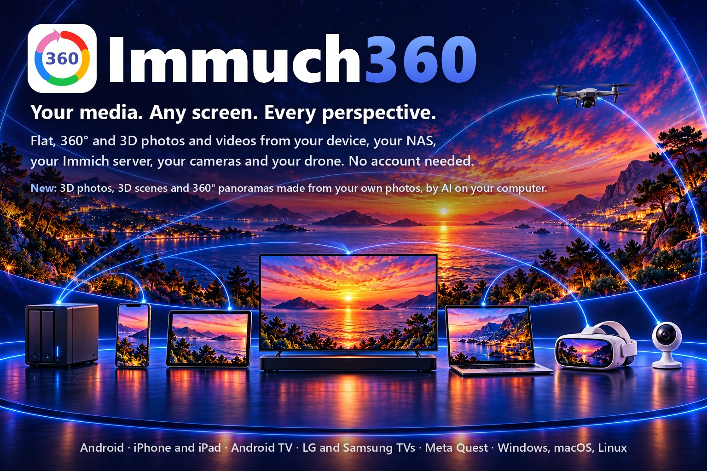

🌐 <b>繁體中文</b> · 其他語言 (88)
<a href="../README.md">English</a> · <a href="README.af.md">Afrikaans</a> · <a href="README.ar.md">العربية</a> · <a href="README.az.md">Azərbaycanca</a> · <a href="README.be.md">Беларуская</a> · <a href="README.bg.md">Български</a> · <a href="README.bi.md">Bislama</a> · <a href="README.bn.md">বাংলা</a> · <a href="README.br.md">Brezhoneg</a> · <a href="README.bs.md">Bosanski</a> · <a href="README.ca.md">Català</a> · <a href="README.cs.md">Čeština</a> · <a href="README.cv.md">Чӑвашла</a> · <a href="README.da.md">Dansk</a> · <a href="README.de.md">Deutsch</a> · <a href="README.de_CH.md">Deutsch (Schweiz)</a> · <a href="README.el.md">Ελληνικά</a> · <a href="README.en_GB.md">English (UK)</a> · <a href="README.eo.md">Esperanto</a> · <a href="README.es.md">Español</a> · <a href="README.et.md">Eesti</a> · <a href="README.eu.md">Euskara</a> · <a href="README.fa.md">فارسی</a> · <a href="README.fi.md">Suomi</a> · <a href="README.fil.md">Filipino</a> · <a href="README.fr.md">Français</a> · <a href="README.ga.md">Gaeilge</a> · <a href="README.gl.md">Galego</a> · <a href="README.gsw.md">Alemannisch</a> · <a href="README.gu.md">ગુજરાતી</a> · <a href="README.he.md">עברית</a> · <a href="README.hi.md">हिन्दी</a> · <a href="README.hr.md">Hrvatski</a> · <a href="README.hu.md">Magyar</a> · <a href="README.hy.md">Հայերեն</a> · <a href="README.id.md">Bahasa Indonesia</a> · <a href="README.is.md">Íslenska</a> · <a href="README.it.md">Italiano</a> · <a href="README.ja.md">日本語</a> · <a href="README.ka.md">ქართული</a> · <a href="README.kab.md">Taqbaylit</a> · <a href="README.kk.md">Қазақша</a> · <a href="README.km.md">ខ្មែរ</a> · <a href="README.kmr.md">Kurmancî</a> · <a href="README.kn.md">ಕನ್ನಡ</a> · <a href="README.ko.md">한국어</a> · <a href="README.kxm.md">ภาษาเขมรถิ่นไทย</a> · <a href="README.lb.md">Lëtzebuergesch</a> · <a href="README.lmo.md">Lombard</a> · <a href="README.lt.md">Lietuvių</a> · <a href="README.lv.md">Latviešu</a> · <a href="README.mfa.md">Bahasa Melayu Kelantan</a> · <a href="README.mi.md">Te reo Māori</a> · <a href="README.mk.md">Македонски</a> · <a href="README.ml.md">മലയാളം</a> · <a href="README.mn.md">Монгол</a> · <a href="README.mr.md">मराठी</a> · <a href="README.ms.md">Bahasa Melayu</a> · <a href="README.nb_NO.md">Norsk bokmål</a> · <a href="README.ne.md">नेपाली</a> · <a href="README.nl.md">Nederlands</a> · <a href="README.nn.md">Norsk nynorsk</a> · <a href="README.pa.md">ਪੰਜਾਬੀ</a> · <a href="README.pl.md">Polski</a> · <a href="README.pt.md">Português</a> · <a href="README.pt_BR.md">Português (Brasil)</a> · <a href="README.ro.md">Română</a> · <a href="README.ru.md">Русский</a> · <a href="README.si.md">සිංහල</a> · <a href="README.sk.md">Slovenčina</a> · <a href="README.sl.md">Slovenščina</a> · <a href="README.sq.md">Shqip</a> · <a href="README.sr_Cyrl.md">Српски</a> · <a href="README.sr_Latn.md">Srpski</a> · <a href="README.sv.md">Svenska</a> · <a href="README.sw.md">Kiswahili</a> · <a href="README.swg.md">Schwäbisch</a> · <a href="README.ta.md">தமிழ்</a> · <a href="README.te.md">తెలుగు</a> · <a href="README.th.md">ไทย</a> · <a href="README.tl.md">Tagalog</a> · <a href="README.tr.md">Türkçe</a> · <a href="README.uk.md">Українська</a> · <a href="README.ur.md">اردو</a> · <a href="README.uz.md">Oʻzbekcha</a> · <a href="README.vi.md">Tiếng Việt</a> · <a href="README.yue_Hant.md">粵語</a> · <a href="README.zh_Hans.md">简体中文</a>

  

# Immuch360

**你的媒體。任何螢幕。盡覽視角。**

🌐 <a href="https://immuch360.com/zh-hant/"><b>immuch360.com</b></a>

來自你的裝置、NAS、Immich 伺服器、攝影機和無人機的平面、360° 與 3D 照片和影片。不需要帳號。Immuch360 是一款免費開源的應用程式，它直接在照片和影片所在的位置讀取它們，並以最合適的檢視器播放每一個檔案：平面顯示、成為可環顧四周的球形、以 3D 顯示，或在頭戴裝置中環繞你四周。它可在手機、平板、電視、Meta Quest 頭戴裝置和電腦上執行。它的網站 [immuch360.com](https://immuch360.com/zh-hant/) 以 89 種語言展示它在每種螢幕上的功能。

**build 33 至 44 的新功能。**[電影會從你停下的地方繼續播放](#pick-up-a-film-where-you-stopped)。電影會更早開始，在慢速伺服器上也會[繼續播放而不會停下](#when-a-video-waits-or-will-not-play)。在手機和電腦上，時間軸[可以縮放到月和年](#find-a-month-or-a-year-in-a-long-timeline)。在 Android 手機或 Meta Quest 上，[「瀏覽資料夾」](#browse-a-folder-of-your-phone-or-headset)可以像共用一樣開啟裝置的資料夾，TIFF 照片也能顯示。Android TV [可以用遙控器依日期搜尋](#on-android-tv-and-google-tv)，Meta Quest 3 或 3S [可以開啟高斯潑濺](#explore-gaussian-splats-in-a-meta-quest-3-or-3s)（實驗性），可用右搖桿轉動，並支援 SPZ 第 4 版，電腦則可以[為你 NAS 上的照片製作 3D 版本](#turn-one-photo-into-3d-a-scene-a-panorama)。在有兩顆圖形晶片的 Windows 筆記型電腦上，應用程式[現在在較快的那顆上執行](#when-a-video-waits-or-will-not-play)，因此 8K 電影播放流暢。高斯潑濺現在[可在電腦以及 Android 手機和平板上開啟](#explore-gaussian-splats-on-your-phone-tablet-or-computer)，Windows 電腦可以由 AI [用你的照片或影片製作潑濺場景](#make-a-splat-scene-from-your-photos-or-a-video-ai)，你的 Immich 伺服器可以[把它們保存在照片中](#keep-a-splat-scene-on-your-immich-server)，這些照片可從你的時間軸開啟，電腦則可以[播放 AV2 影片](#play-av2-videos-on-your-computer)，全部都是實驗性功能。從 build 42 起，在 Android 手機、平板和電視上，來自你的 Immich 圖庫、共用或資料夾的 Insta360、GoPro MAX 和 DJI Osmo 360 相機原始影片會[以相機陀螺儀防震播放](#stabilise-your-360-videos-with-the-cameras-gyroscope-experimental)，桌面版 build 22 的潑濺製作功能[提供精細品質](#make-a-splat-scene-from-your-photos-or-a-video-ai)，適合你要近距離觀看的場景，360° 全景圖則[在顯示卡有 3.5 GiB 可用時就能開始](#turn-one-photo-into-3d-a-scene-a-panorama)，全部都是實驗性功能。iPhone 和 iPad 應用程式已[在 App Store 上](https://apps.apple.com/us/app/immuch360-360-3d-player/id6817655965)，版本 3.3.3。自 build 43 起，應用程式的更新通知會在手機和平板上開啟 Google Play 或 App Store；它的網站 [immuch360.com](https://immuch360.com/zh-hant/) 已於 11 月 7 日上線。自 build 44 和桌面版 build 24 起，Meta Quest 3 或 3S [可顯示最多 300,000 個高斯的潑濺](#explore-gaussian-splats-in-a-meta-quest-3-or-3s)（實驗性），電腦可以[用 Ctrl 和 Shift 選取多張照片和影片](#use-your-computer-as-the-media-player)，解碼器拒絕某部影片的電視會自動[播放伺服器上的另一個檔案](#when-a-video-waits-or-will-not-play)，在有兩張顯示卡的筆記型電腦上，全景圖會在所選的顯示卡上執行（實驗性），而 Quest 和電腦的更新通知會開啟它們的商店頁面或下載頁面，另有許多修正。

  Immich 行動應用程式的非官方分支。與 Immich 或 FUTO 無關。名稱讀起來像「I am much 360」。

<b>目錄</b>

- [適合誰](#who-it-is-for)
- [哪些螢幕](#which-screens)、[它們一起能做什麼](#use-cases)，以及[每種螢幕能做什麼](#what-each-screen-does)
- [你能做什麼](#what-you-can-do)
- [在你的裝置上安裝](#get-it-on-your-device)
- [操作說明](#how-to)
  - [觀看你的照片和影片，有沒有伺服器都可以](#watch-your-photos-and-videos-with-or-without-a-server)
  - [探索全景、360°、VR180 和 3D](#explore-panoramas-360-vr180-and-3d)
  - [把一張照片變成 3D、場景、全景圖](#turn-one-photo-into-3d-a-scene-a-panorama)
  - [在電視上用遙控器觀看](#watch-on-the-tv-with-the-remote)：[Android TV 和 Google TV](#on-android-tv-and-google-tv)、[LG](#on-an-lg-tv-webos)、[Samsung](#on-a-samsung-tv-tizen)
  - [用手機登入電視、頭戴裝置或電腦](#sign-in-a-tv-a-headset-or-a-computer-with-your-phone)
  - [用 Meta Quest 走進你的照片和影片](#step-inside-your-photos-and-videos-with-a-meta-quest): [展示台模式](#kiosk-mode-for-an-exhibition-or-a-shop)
  - [在 Meta Quest 3 或 3S 中探索高斯潑濺](#explore-gaussian-splats-in-a-meta-quest-3-or-3s)
  - [在你的手機、平板或電腦上探索高斯潑濺](#explore-gaussian-splats-on-your-phone-tablet-or-computer)
  - [用你的照片或影片製作潑濺場景（AI）](#make-a-splat-scene-from-your-photos-or-a-video-ai)
  - [把潑濺場景保存在你的 Immich 伺服器上](#keep-a-splat-scene-on-your-immich-server)
  - [播放 NAS、電腦、媒體伺服器或 Plex 上的檔案](#play-the-files-of-a-nas-a-computer-a-media-server-or-plex)
  - [瀏覽手機或頭戴裝置的資料夾](#browse-a-folder-of-your-phone-or-headset)
  - [從你停下的地方繼續看電影](#pick-up-a-film-where-you-stopped)
  - [影片需要等待或無法播放時](#when-a-video-waits-or-will-not-play)
  - [保留你的 Immich 圖庫，還有更多](#keep-your-immich-library-with-more)
  - [在很長的時間軸中找到某個月或某一年](#find-a-month-or-a-year-in-a-long-timeline)
  - [在大螢幕上觀看家用攝影機](#watch-your-home-cameras-on-the-big-screen)
  - [你的 DJI 無人機（實驗性）](#your-dji-drone-experimental)：[即時畫面](#see-what-your-drone-sees-on-your-phone)、[在 Quest 或 Android TV 上](#watch-it-in-a-meta-quest-or-on-an-android-tv)、[匯入](#bring-a-drones-or-a-camera-cards-photos-and-videos-to-immich)
  - [開啟 360° 相機的原始檔案](#open-the-raw-files-of-360-cameras)
  - [用相機陀螺儀為你的 360° 影片防震（實驗性）](#stabilise-your-360-videos-with-the-cameras-gyroscope-experimental)
  - [一鍵旋轉照片](#turn-a-photo-with-one-key)
  - [把電腦當作媒體播放器](#use-your-computer-as-the-media-player)
  - [在你的電腦上播放 AV2 影片](#play-av2-videos-on-your-computer)
- [與 Immich 比較](#compared-with-immich)
- [隱私](#privacy)
- [授權與致謝](#licences-and-credits)
- [發展藍圖](#roadmap)
- [文件](#documentation)

## 適合誰

- **你拍攝 360° 或 3D 內容**，想在畫面中環顧四周，而不是看到平面、重影或被拉伸的畫面：[360°、VR180 和 3D](#explore-panoramas-360-vr180-and-3d)。
- **你手持、在自行車上或在安全帽上用 360° 相機拍攝**，希望保存在 Immich、共用或資料夾中的 Insta360、GoPro MAX 或 DJI Osmo 360 相機原始影片，在手機和電視上播放時水平又穩定（實驗性）：[用相機陀螺儀防震](#stabilise-your-360-videos-with-the-cameras-gyroscope-experimental)。
- **你的照片和影片存放在 NAS、電腦、Plex 或 Immich 上**，想不複製任何檔案就在電視上觀看：[在電視上](#watch-on-the-tv-with-the-remote)、[NAS、共用和 Plex](#play-the-files-of-a-nas-a-computer-a-media-server-or-plex)。
- **你有一台 Meta Quest**，想走進自己的照片和影片：[在頭戴裝置中](#step-inside-your-photos-and-videos-with-a-meta-quest)。
- **你的照片是平面的**，而你想在沒有 3D 相機的情況下以 3D 觀看它們，作為可以在頭戴裝置中湊近細看的場景，或置身於 360° 全景圖之中：[把一張照片變成 3D、場景、全景圖](#turn-one-photo-into-3d-a-scene-a-panorama)，新功能，由 AI 在你自己的電腦上產生。
- **你在使用 Immich**，想要它的應用程式，再加上沉浸式檢視器，以及可用手機登入的大螢幕：[你的 Immich 圖庫](#keep-your-immich-library-with-more)、[與 Immich 比較](#compared-with-immich)。
- **你用 Tapo 攝影機看家**，希望它們出現在照片旁邊，也能在電視上觀看（已以模擬攝影機驗證）：[家用攝影機](#watch-your-home-cameras-on-the-big-screen)。
- **你飛 DJI 無人機**，希望不用 DJI Fly 就能在手機上看到即時畫面，也讓身邊的人在 Meta Quest 或 Android TV 上觀看（實驗性）：[你的無人機](#see-what-your-drone-sees-on-your-phone)。
- **你把地點和物體掃描成 3D 的高斯潑濺**，或想用自己的照片製作它們，並希望在手機、電腦或頭戴裝置中在其中走動（實驗性）：[在手機、平板或電腦上](#explore-gaussian-splats-on-your-phone-tablet-or-computer)、[用你的照片製作](#make-a-splat-scene-from-your-photos-or-a-video-ai)、[保存在 Immich 中](#keep-a-splat-scene-on-your-immich-server)。
- **你有 AV2 影片**，這是接續 AV1 的格式，並想在電腦上觀看它們（實驗性）：[電腦上的 AV2](#play-av2-videos-on-your-computer)。
- **你家裡有好幾個螢幕**，希望它們一起運作：[你的螢幕一起能做什麼](#use-cases)。

不需要建立 Immuch360 帳號，也不會有任何資料傳給我們：應用程式只會與你的裝置和你選擇的伺服器通訊，並且只在你要求時才下載 AI 元件或 AV2 解碼器。

## 哪些螢幕

| 平台 | 取得方式 | 2026 年 11 月狀態 |
|---|---|---|
|  **Android** 手機和平板 | [Google Play](https://play.google.com/store/apps/details?id=com.aprogsys.immuch360) · [APK](https://github.com/freeKC/Immuch360/releases) | Google Play 上為 build 40（build 44 已送交 Google 審核），GitHub 上為 build 44，[原始 360° 影片以防震方式播放](#stabilise-your-360-videos-with-the-cameras-gyroscope-experimental)（實驗性），[電影會從你停下的地方繼續播放](#pick-up-a-film-where-you-stopped)，[「瀏覽資料夾」](#browse-a-folder-of-your-phone-or-headset)可開啟手機的資料夾，[高斯潑濺可以開啟](#explore-gaussian-splats-on-your-phone-tablet-or-computer)，來自共用或[來自你的 Immich 時間軸](#keep-a-splat-scene-on-your-immich-server)（實驗性） |
|  **iPhone 和 iPad** | [App Store](https://apps.apple.com/us/app/immuch360-360-3d-player/id6817655965) | 3.3.3 版本自 11 月 9 日起在 App Store 上，帶來[時間軸中的月和年](#find-a-month-or-a-year-in-a-long-timeline)、[從你停下的地方繼續播放的電影](#pick-up-a-film-where-you-stopped)、從手機[登入電視、頭戴裝置或電腦](#sign-in-a-tv-a-headset-or-a-computer-with-your-phone)、保存在 Immich 中、以其照片顯示的潑濺場景，以及會開啟 App Store 的更新通知；3.3.4 版本包含 3.3.3 的內容加上 build 44 的修正，已隨 build 44 送交 Apple；或者[自行建置](../docs/immuch360/build.md) |
|  **Android TV 和 Google TV** | [Google Play](https://play.google.com/store/apps/details?id=com.aprogsys.immuch360) · [APK](#android-tv-and-google-tv) | 已在 Google Play 上架，Google Play 在 Android TV 和 Google TV 上提供此應用程式，GitHub 上為 build 44：[防震的原始 360° 影片](#stabilise-your-360-videos-with-the-cameras-gyroscope-experimental)（實驗性），[用遙控器依日期搜尋](#on-android-tv-and-google-tv)，掃描 QR code 即可[用手機登入](#sign-in-a-tv-a-headset-or-a-computer-with-your-phone)，影片播放器為遙控器提供進度列、音訊和字幕，還能觀看由手機轉送的[無人機即時畫面](#watch-it-in-a-meta-quest-or-on-an-android-tv)（實驗性） |
| 搭載 webOS 5.0 或更新版本的 **LG 電視** | [.ipk，版本 1.0.1](https://github.com/freeKC/Immuch360/releases/tag/webos-v1.0.1) · LG Content Store（審核中） | 版本 1.0.0 已於 10 月 24 日提交至 LG Content Store，自 10 月 26 日起接受 LG 測試；版本 1.0.1 自 10 月 27 日起在 GitHub 上提供，可用方向鍵縮放照片，並在照片仍在載入時提示；在 LG 發布應用程式之前，可在 [Developer Mode](#lg-tvs-webos) 下安裝。版本 1.0.0 已在 LG Cloud Test Lab 的 webOS 25 電視上執行過 |
| 搭載 Tizen 5.5 或更新版本的 **Samsung 電視** | [.wgt 測試 build](https://github.com/freeKC/Immuch360/releases/tag/tizen-v0.3.0) | 同一個電視應用程式的測試 build 0.3.0，需以你自己的 Samsung 憑證簽署，並在 [Developer mode](#samsung-tvs-tizen) 下安裝；0.1.0 已在一位測試者的 Samsung 電視上執行過，0.2.0 包含了那次執行後的修正，0.3.0 加入了 LG 版本 1.0.1 的照片縮放和 Loading 提示，尚未在 Samsung 電視上執行過；不在 Samsung 的商店中 |
|  **Meta Quest** 2、Pro、3 和 3S | [Horizon Store](https://www.meta.com/experiences/immuch360/1384208401440714/) · [APK](#meta-quest) | Horizon Store 上為 build 41（自 11 月 7 日起上架；build 42 自 11 月 7 日起在 Meta 審核中；接著是 build 44），GitHub 上為 build 44，附有[展示台模式](#kiosk-mode-for-an-exhibition-or-a-shop)，在 Quest 3 和 3S 上還有[高斯潑濺](#explore-gaussian-splats-in-a-meta-quest-3-or-3s)以及為平面照片加上的 [AI 立體感](#turn-one-photo-into-3d-a-scene-a-panorama)，皆為實驗性 |
|  **Windows** | [安裝程式或 ZIP](https://github.com/freeKC/Immuch360/releases/tag/desktop-v3.3.0-rc.0-24) | 桌面版 build 24，已簽署的預覽版：照片、平面和 360° 影片、共用、Plex、攝影機（已以模擬攝影機驗證）、用手機登入、一鍵旋轉照片、89 種語言的介面，以及由 AI [用你的照片製作 3D 照片、3D 場景和 360° 全景圖](#turn-one-photo-into-3d-a-scene-a-panorama)（實驗性），包括你 NAS 上的照片；[高斯潑濺](#explore-gaussian-splats-on-your-phone-tablet-or-computer)的開啟、[用你的照片或影片製作](#make-a-splat-scene-from-your-photos-or-a-video-ai)和[保存在 Immich 中](#keep-a-splat-scene-on-your-immich-server)、[AV2 影片](#play-av2-videos-on-your-computer)，以及從桌面版 build 22 起的[潑濺場景品質選擇](#make-a-splat-scene-from-your-photos-or-a-video-ai)和[只需 3.5 GiB 可用顯示記憶體的 360° 全景圖](#turn-one-photo-into-3d-a-scene-a-panorama)，全部為實驗性 |
|   **macOS 和 Linux** | [.deb, .rpm, DMG](https://github.com/freeKC/Immuch360/releases/tag/desktop-v3.3.0-rc.0-24) | 桌面版 build 24，預覽版：照片、360° 照片和平面影片（360° 影片以平面方式播放）、Immich 伺服器和網路共用，以及由 AI 用你的照片製作的 [3D 照片和 3D 場景](#turn-one-photo-into-3d-a-scene-a-panorama)，Linux 上搭配 8 GB 顯示卡時還能產生 360° 全景圖，顯示卡只需有 3.5 GiB 可用，此外還有[高斯潑濺](#explore-gaussian-splats-on-your-phone-tablet-or-computer)和 [AV2 影片](#play-av2-videos-on-your-computer)（實驗性，尚未在 Mac 上試過）；桌面版 build 11 已於 10 月 26 日在 Ubuntu 24.04 容器中和一台 Mac 上試過；macOS 版未簽署 |

*狀態會在每次發行時更新；每個 build 的詳細資訊請見[發行狀態](../docs/immuch360/release-status.md)。網站 [immuch360.com](https://immuch360.com/zh-hant/) 以 89 種語言展示每種螢幕的功能、每項功能的操作說明以及各商店的連結。*

  

### 你的螢幕一起能做什麼

在你用來觀看的每個螢幕上安裝 Immuch360：每個螢幕都自行讀取你的來源，有些還會把一張圖片、一個檔案或一次登入交給另一個螢幕。在每張圖中，Immuch360 圖示標出執行這個應用程式的裝置。

#### 每個螢幕上都有你的 NAS

  

**你需要：** 一台有 SMB 或 WebDAV 共用的 NAS，以及在你用來觀看的每個螢幕上安裝 Immuch360。

在每個螢幕上加入這個共用，每個螢幕就直接在原處播放照片和影片，不複製任何東西：手機、平板、Android TV、Meta Quest、Windows、Linux 和 macOS 電腦，以及已登入你的 Immich 伺服器的 LG 電視（webOS 22 起支援 SMB）。360° 照片在手機和電視上像球體一樣轉動，在頭戴裝置中則環繞著你。操作說明：[播放 NAS、電腦、媒體伺服器或 Plex 上的檔案](#play-the-files-of-a-nas-a-computer-a-media-server-or-plex)。

#### 每個螢幕上都有你的 Immich 伺服器，用手機登入

  

**你需要：** 一台 Immich 伺服器、你 Android 手機上的 Immuch360，以及你要登入的螢幕上的 Immuch360：Android TV、Meta Quest、Windows、Linux 或 macOS 電腦。

在手機上，Immuch360 保留完整的 Immich 行動應用程式，加上自己的 360°、VR180 和 3D 檢視器，並與官方應用程式並存安裝。登入你的伺服器後，它就能替大螢幕登入：它掃描電視或電腦上的 QR 碼，或由你在手機上輸入頭戴裝置顯示的代碼，你的密碼始終留在手機上。操作說明：[用手機登入電視、頭戴裝置或電腦](#sign-in-a-tv-a-headset-or-a-computer-with-your-phone)。

#### 你的平面照片變成 3D，從電腦到頭戴裝置（實驗性）

  

**你需要：** Windows、Linux 或 macOS 電腦上的 Immuch360 和 Meta Quest 中的 Immuch360，兩者之間是你的 NAS，或開啟「同時備份 AI 版本」的 Immich 伺服器。

電腦本身就能把你的照片變成 3D 照片和 3D 場景，在 Windows 或 Linux 上搭配 8 GB 的顯示卡還能變成 360° 全景圖，並存放在原始檔旁邊。頭戴裝置以真正的 3D 顯示 3D 照片，把場景放進你的房間，讓全景圖環繞在你四周；手機和電視則在各自的 360° 檢視器中開啟全景圖。操作說明：[把一張照片變成 3D、場景、全景圖](#turn-one-photo-into-3d-a-scene-a-panorama)。

#### 你的無人機即時畫面，在頭戴裝置或電視上（實驗性）

  

**你需要：** 一架 DJI 無人機和它的 DJI RC-N3 遙控器、插在遙控器上的 Android 手機中的 Immuch360，以及 Meta Quest 或 Android TV 上的 Immuch360。

手機顯示無人機的即時影像，並透過你的 Wi-Fi 或它自己的熱點轉送出去，讓身邊的人在頭戴裝置或電視上觀看飛行。只接收：絕不會向遙控器或無人機傳送任何指令，遙控器保有完整的控制權。操作說明：[在 Meta Quest 或 Android TV 上觀看](#watch-it-in-a-meta-quest-or-on-an-android-tv)。

#### 你的 360° 相機原始檔案，在你觀看的地方拼接

  

**你需要：** 一台 Insta360、GoPro MAX 或 DJI Osmo 360 相機、你的 NAS，以及這些螢幕上的 Immuch360：手機、平板、Android TV、Meta Quest、Windows。

把相機記憶卡上的 .insp、.insv、.360 或 .osv 檔案原封不動地複製到你 NAS 的 SMB 或 WebDAV 共用；Immich 伺服器也接受 Insta360 的檔案。每個螢幕在播放時用寫在每個檔案中的校正資料進行拼接，不需要先在相機的應用程式中匯出任何東西。操作說明：[開啟 360° 相機的原始檔案](#open-the-raw-files-of-360-cameras)。

#### 你的 Plex 和 DLNA 伺服器，在電視和頭戴裝置上

  

**你需要：** 一台 Plex Media Server 或 DLNA 伺服器，例如 Jellyfin、Emby 或 minidlna，以及每個螢幕上的 Immuch360：Android TV、Meta Quest、手機、平板、Windows。

Plex 提供你媒體庫的原始檔案，所以 360° 影片仍是 360°，在頭戴裝置中環繞在你四周，在家裡可以，離家時透過你的連接埠轉送也可以；DLNA 伺服器則在你的家用網路上被找到。已登入你的 Immich 伺服器的 LG 電視也能播放它們。操作說明：[播放 NAS、電腦、媒體伺服器或 Plex 上的檔案](#play-the-files-of-a-nas-a-computer-a-media-server-or-plex)。

#### 你的手機或 Windows 電腦，在頭戴裝置中開啟

  

**你需要：** Android 手機、iPhone 或 Windows 電腦上的 Immuch360，以及 Meta Quest 中的 Immuch360，連在同一個家用 Wi-Fi 上。

在手機上開啟「在網路上分享此手機」，或在電腦上開啟「在網路上分享此電腦」，頭戴裝置就能播放其中的照片和影片，360° 的則環繞在你四周：不需要伺服器、不需要 NAS、不需要上傳。在 iPhone 上，分享只在應用程式顯示於螢幕上時運作。操作說明：[在網路上分享此手機](../docs/immuch360/user-guide.md#share-this-phone-on-the-network)。

#### 你的 Tapo 攝影機，在電視和頭戴裝置上

  

**你需要：** 家用網路上的 Tapo 攝影機，以及 Android 手機、Android TV、Meta Quest 或 Windows 電腦上的 Immuch360。

每個螢幕都能即時顯示攝影機畫面，並按日期播放其記憶卡中的錄影，就在你的照片旁邊；手機還能把一段片段傳送到你的 Immich 伺服器。應用程式只在你的網路內與攝影機通訊，絕不經過 TP-Link 的伺服器。已以模擬攝影機驗證。操作說明：[在大螢幕上觀看家用攝影機](#watch-your-home-cameras-on-the-big-screen)。

#### 你房間裡的高斯潑濺，在 Meta Quest 3 或 3S 中（實驗性）

  

**你需要：** 一個用 Polycam、Scaniverse、Luma 或其他工具製作的潑濺，以 .spz 或二進位 .ply 檔案存放在你的 NAS 或頭戴裝置中，以及 Meta Quest 3 或 3S 中的 Immuch360。

頭戴裝置以原本的大小呈現地點或物體，在你面前或環繞在你四周：繞著它走，用左搖桿在其中滑行，用右搖桿轉向。高斯潑濺使用 Meta Spatial SDK 的實驗性 API，Meta 對其既不提供支援也不作擔保：任何缺陷均由 Immuch360 自行負責。操作說明：[在 Meta Quest 3 或 3S 中探索高斯潑濺](#explore-gaussian-splats-in-a-meta-quest-3-or-3s)。

#### 給訪客用的 Meta Quest（實驗性）

  

**你需要：** 一台裝有 Immuch360 的 Meta Quest，以及一張 360° 照片或一段 360° 影片，存放在頭戴裝置中、你的 NAS 或你的 Immich 伺服器上。

在展示台模式下，每當訪客戴上頭戴裝置，它就會自動從頭開啟你的 360° 照片或影片，影片結束時停在一張寫著你的文字的卡片上。訪客不需要按任何按鈕；你按住 B 或 Y 一秒即可離開。操作說明：[展示台模式，適用於展覽或商店](#kiosk-mode-for-an-exhibition-or-a-shop)。

### 每種螢幕能做什麼

手機、平板、Android TV、Meta Quest 和電腦共用一套程式碼，LG 電視則有一個獨立的電視應用程式，它也以測試 build 的形式打包給 Samsung 電視使用。以下是每種平台目前支援的功能：

| 功能 | Android | iPhone、iPad | Android TV | LG webOS | Samsung Tizen | Quest |
|---|:---:|:---:|:---:|:---:|:---:|:---:|
| 圖庫、相簿、搜尋（搭配 Immich 伺服器） | ✅ | ✅ | ✅ 檢視器 | ✅ 檢視器 | ✅ 檢視器 | ✅ |
| 依月和年顯示的時間軸 | ✅ | ✅ | ❌ | ❌ | ❌ | ❌ |
| 用手機登入（QR code） | ✅ 掃描代碼 | ✅ 掃描代碼 | ✅ | ✅ 在手機的瀏覽器中 | ❌ 在電視上輸入 | ✅ 在手機上輸入代碼 |
| 無伺服器：裝置本身的媒體 | ✅ | ✅ | 僅共用 | ❌ | ❌ | ✅ |
| 像共用一樣開啟的裝置資料夾 | ✅ 你選擇的資料夾 | ❌ | ❌ | ❌ | ❌ | ✅ |
| 平面照片和影片 | ✅ | ✅ | ✅ | ✅ | ✅ | ✅ |
| TIFF 照片 | ✅ | ✅ 系統解碼器 | ✅ | ✅ 由伺服器提供 | ✅ 由伺服器提供 | ✅ 沉浸式畫面中也可以 |
| 一鍵旋轉照片 | ✅ | ✅ | ✅ 彩色鍵 | ✅ 彩色鍵 | ✅ | ✅ 視窗 |
| 360° 照片（球形） | ✅ | ✅ | ✅ | ✅ | ✅ | ✅ 沉浸式 |
| 360° 影片 | ✅ | ✅ 無進度列 | ✅ 無法解碼時顯示訊息 | 僅平面 | 僅平面 | ✅ 沉浸式 |
| 從你停下的地方繼續播放的電影 | ✅ | ✅ | ✅ | ❌ | ❌ | ✅ 沉浸式畫面中也可以 |
| 影片來源：此裝置能解碼的檔案 | ✅ | ✅ | ✅ | ❌ | ❌ | ✅ |
| 慢速伺服器：影片要等多久，以及原因 | ✅ | 自己的等待規則 | ✅ | ❌ | ❌ | ✅ |
| AV2 影片（實驗性） | ❌ | ❌ | ❌ | ❌ | ❌ | ❌ |
| 3D 和 VR180 | ✅ 單眼 | ✅ 單眼 | ✅ 單眼 | 照片單眼，影片平面 | 照片單眼，影片平面 | ✅ 真實 3D |
| 依檔案名稱判斷的平面 3D、可移動的更清晰螢幕（實驗性） | ❌ | ❌ | ❌ | ❌ | ❌ | ✅ |
| 供訪客使用的展示台模式（實驗性） | ❌ | ❌ | ❌ | ❌ | ❌ | ✅ |
| 空間 2.5D（頭部追蹤） | ✅ 實驗性 | ✅ 實驗性 | ❌ | ❌ | ❌ | ❌ |
| Apple 空間照片 | ✅ 單眼 | ✅ 單眼 | ✅ 單眼 | ❌ | ❌ | ✅ 3D |
| 高斯潑濺，.spz 和 .ply（實驗性） | ✅ | ❌ | ❌ | ❌ | ❌ | ✅ Quest 3 和 3S |
| 以照片形式保存在 Immich 中的潑濺場景（實驗性） | ✅ | 照片 | 照片 | 照片 | 照片 | ✅ Quest 3 和 3S，尚未在頭戴裝置中試過 |
| 由 2D 照片製作的 3D 照片（AI） | ✅ 可讀取，左右並排 | ✅ 可讀取，左右並排 | ✅ 可讀取，左右並排 | ✅ 可讀取，左右並排 | ✅ 可讀取，左右並排 | ✅ 在頭戴裝置中產生 AI 立體感（Quest 3 和 3S），以 3D 顯示 |
| 由 2D 照片製作的 3D 場景（AI） | ✅ 可讀取，顯示為其照片 | ✅ 可讀取，顯示為其照片 | ✅ 可讀取，顯示為其照片 | ✅ 可讀取，顯示為其照片 | ✅ 可讀取，顯示為其照片 | ✅ 以 3D 探索 |
| 由 2D 照片製作的 360° 全景圖（AI） | ✅ 可讀取，附 AI 標示 | ✅ 以 360° 照片讀取，標示 🔜 | ✅ 可讀取，附 AI 標示 | ✅ 以 360° 照片讀取，標示 🔜 | ✅ 以 360° 照片讀取，標示 🔜 | ✅ 在你四周完整讀取，附 AI 標示 |
| 共用照片旁的 3D 版本（AI） | ✅ 可讀取 | ✅ 可讀取 | ✅ 可讀取 | ✅ 可讀取 | ❌ | ✅ 可讀取 |
| 由照片或影片製作的潑濺場景（AI） | ✅ 可讀取 | ❌ | ❌ | ❌ | ❌ | ✅ 可讀取，Quest 3 和 3S，尚未在頭戴裝置中試過 |
| Insta360、GoPro 和 DJI 原始檔案 | ✅ | ✅ | ✅ | ❌ | ❌ | ✅ |
| 以相機陀螺儀防震的原始 360° 影片（實驗性） | ✅ Insta360、GoPro MAX、DJI Osmo 360，來自你的圖庫、共用和資料夾 | 🔜 | ✅ Insta360、GoPro MAX、DJI Osmo 360，來自你的圖庫和共用 | ❌ | ❌ | 🔜 |
| SMB、WebDAV、DLNA 共用 | ✅ | ✅ | ✅ | ✅ SMB 自 webOS 22 起 | ❌ | ✅ |
| Plex Media Server | ✅ | ✅ | ✅ | ✅ | ❌ | ✅ |
| Tapo 攝影機：錄影 | ✅ | ✅ | ✅ | 🔜 2026 年 12 月之前不會提供 | ❌ | ✅ |
| Tapo 攝影機：即時畫面 | ✅ | ✅ 尚未在 iPhone 上試過 | ✅ | ✅ 僅影像 | ❌ | ✅ |
| 在網路上分享此裝置 | ✅ | ✅ | ❌ | ❌ | ❌ | ❌ |
| 從共用和裝置上傳至 Immich | ✅ | ✅ | ❌ | ❌ | ❌ | ✅ |
| 透過 USB 從 DJI 無人機或記憶卡匯入（實驗性） | ✅ | ❌ | ❌ | ❌ | ❌ | ❌ |
| DJI 無人機即時畫面（實驗性） | ✅ 搭配 RC-N3 | ❌ | ✅ 由手機轉送 | ❌ | ❌ | ✅ 由手機轉送 |
| 深色主題 | 跟隨系統 | 跟隨系統 | ✅ 預設 | ✅ 唯一主題 | ✅ 唯一主題 | 跟隨系統 |
| 輸入方式 | 觸控、陀螺儀 | 觸控、陀螺儀 | 遙控器；播放影片時及在進度列上也能用左右鍵，Menu 鍵查看詳細資訊 | 遙控器、Magic Remote | 遙控器 | 控制器、雙手 |
| 取得方式 | Google Play、APK | App Store | Google Play、APK | .ipk、LG Content Store（審核中） | .wgt 測試 build，由你簽署 | Horizon Store、APK |

| 功能 | Windows | Linux | macOS |
|---|:---:|:---:|:---:|
| 圖庫、相簿、搜尋（搭配 Immich 伺服器） | ✅ | ✅ | ✅ |
| 依月和年顯示的時間軸 | ✅ Ctrl 加滾輪 | ✅ Ctrl 加滾輪 | ✅ Command 加滾輪 |
| 用手機登入（QR code） | ✅ | ✅（試過其網頁） | ✅（未記錄使用哪種方式） |
| 無伺服器：裝置本身的媒體 | ✅ 資料夾 | ✅ 資料夾 | ✅ 資料夾 |
| 像共用一樣開啟的裝置資料夾 | ✅ 資料夾 | ✅ 資料夾 | ✅ 資料夾 |
| 平面照片和影片 | ✅ | ✅ | ✅ |
| TIFF 照片 | ✅ 系統解碼器 | ❌ 改為顯示縮圖 | ✅ 系統解碼器 |
| 一鍵旋轉照片 | ✅ | ✅ | ✅ |
| 360° 照片（球形） | ✅ | ✅ | ✅ |
| 360° 影片 | ✅ | 僅平面 | 僅平面 |
| 從你停下的地方繼續播放的電影 | ✅ | ✅ | ✅ |
| 影片來源：此裝置能解碼的檔案 | ✅ | ✅ | ✅ |
| 慢速伺服器：影片要等多久，以及原因 | ✅ | ✅ | ✅ |
| AV2 影片（實驗性） | ✅ | ✅ | ✅ 由 CI 檢查 |
| 3D 和 VR180 | ✅ 單眼 | 照片單眼，影片平面 | 照片單眼，影片平面 |
| 依檔案名稱判斷的平面 3D、可移動的更清晰螢幕（實驗性） | ❌ | ❌ | ❌ |
| 供訪客使用的展示台模式（實驗性） | ❌ | ❌ | ❌ |
| 空間 2.5D（頭部追蹤） | 🔜 開發中 | ❌ | ❌ |
| Apple 空間照片 | ✅ 單眼 | ✅ 單眼，來自伺服器 | ✅ 單眼 |
| 高斯潑濺，.spz 和 .ply（實驗性） | ✅ | ✅ | ✅ 由 CI 建置 |
| 以照片形式保存在 Immich 中的潑濺場景（實驗性） | ✅ | ✅ | ✅ 由 CI 建置 |
| 由 2D 照片製作的 3D 照片（AI） | ✅ | ✅ | ✅ 由 CI 建置 |
| 由 2D 照片製作的 3D 場景（AI） | ✅ | ✅ | ✅ 由 CI 建置 |
| 由 2D 照片製作的 360° 全景圖（AI） | ✅ 8 GB 顯示卡 | ✅ 8 GB 顯示卡，已在 Intel 顯示晶片上以小尺寸執行 | 🔜 在發展藍圖中 |
| 共用照片旁的 3D 版本（AI） | ✅ | ✅ | ✅ 3D 照片和場景 |
| 由照片或影片製作的潑濺場景（AI） | ✅ 4 GB 顯示卡 | ✅ 可讀取 | ✅ 可讀取，由 CI 建置 |
| Insta360、GoPro 和 DJI 原始檔案 | ✅ | ✅ 照片，影片平面 | ✅ 照片，影片平面 |
| 以相機陀螺儀防震的原始 360° 影片（實驗性） | 🔜 | ❌ | ❌ |
| SMB、WebDAV、DLNA 共用 | ✅ | ✅ | ✅ |
| Plex Media Server | ✅ | 🔧 CI | 🔧 CI |
| Tapo 相機：錄影 | ✅ | 🔧 CI | 🔧 CI |
| Tapo 相機：即時畫面 | ✅ | 🔧 CI | 🔧 CI |
| 在網路上分享此裝置 | ✅ | ❌ | ❌ |
| 從共用和裝置上傳至 Immich | ✅ | ✅ | ✅ |
| 用 Ctrl+點擊、Shift+點擊和 Ctrl+A 選取多張照片，按右鍵執行動作 | ✅ | ✅ | ✅ 使用 Command，尚未在 Mac 上試過 |
| 透過 USB 從 DJI 無人機或記憶卡匯入（實驗性） | ❌ | ❌ | ❌ |
| DJI 無人機即時畫面（實驗性） | ❌ | ❌ | ❌ |
| 深色主題 | 跟隨系統 | 跟隨系統 | 跟隨系統 |
| 輸入方式 | 滑鼠、鍵盤 | 滑鼠、鍵盤 | 滑鼠、鍵盤、觸控式軌跡板 |
| 取得方式 | 安裝程式或 ZIP（已簽署預覽版） | .deb、.rpm（預覽版） | DMG 或 ZIP（未簽署預覽版） |

*Linux 和 macOS：桌面版 build 11 已於 2026 年 10 月 26 日在 Ubuntu 24.04 上、在一個附有測試 Immich 伺服器和測試共用的容器中試過，作者也在一台 Mac 上試過。AI 相關各列使用桌面版 build 13 程式碼的測試 build，於 2026 年 10 月 27 日至 29 日完成：3D 照片由 Linux 應用程式在一台 Linux 電腦上的容器中製作，場景由 Windows 應用程式在一台搭載 RTX 4060 的筆電上製作，也由引擎在那台 Linux 電腦上製作，360° 全景圖在那台筆電上產生。build 33 至 39 的各列：月和年檢視已在一台執行桌面版 build 14 的 Windows 電腦上驗證，3D 版本已在專案的建置主機上寫入一個 Samba 共用和一個 WebDAV 共用，「瀏覽資料夾」已在 Android 16 模擬器上驗證，串流影片的啟動已在限速連線後方的 Android 模擬器上驗證，展示台模式和更清晰的平面螢幕已在執行 build 35 的 Quest 3 中驗證，build 39 的潑濺檔案已於 10 月 31 日在 Quest 3 的潑濺模組中驗證，電影和影片來源由專案的 CI 和建置主機上的測試檢查。build 41 和桌面版 build 21 的各列：潑濺已在 Galaxy S24+ 上、在一台配備 RTX 4060 的筆記型電腦上的 Windows 應用程式中，以及在 CI 容器中的 Linux 上驗證，潑濺場景由那台筆電製作，潑濺照片已在 Immich 3.3.0 和 3.2.4 測試伺服器上驗證，AV2 則已在那台筆電上、在 Ubuntu 22.04 和 24.04 容器中驗證，並在沒有螢幕的情況下於 CI 的 Mac 上驗證。build 42 和桌面版 build 22 的各列：防震由專案的 CI 和建置主機上的測試，以 Insta360 X3、X4 和 X5、GoPro MAX 及 DJI Osmo 360 相機範例檔案的動態軌道驗證，品質選擇由其測試以及在配備 RTX 4060 的筆電上對其訓練的測量驗證，iPhone 和 iPad 欄則依據 App Store 的 3.3.2 版本。*

✅ 該平台應用程式中已支援 · ❌ 該平台未提供 · 🔜 規劃中 · 🔧 CI 原始碼中已有，已由專案的 CI 在該系統上建置並啟動 · 僅平面：影片會以平面方式播放並顯示提示訊息，因為電腦上的 360° 影片渲染器目前僅支援 Windows；在 LG 電視上，webOS 能否把影片畫面交給球形渲染仍有待測量；在一位測試者的 Samsung 電視上，瀏覽器交給 3D 檢視的是黑色影格。「單眼」代表 3D 檔案在平面螢幕上只顯示左眼畫面。LG 和 Samsung 這兩欄是同一個獨立的電視應用程式：LG 版本 1.0.0，其共用和 Plex 已以真實伺服器驗證，攝影機已在專案的建置主機上以模擬攝影機驗證；以及 Samsung 測試 build 0.3.0。各項目在哪裡驗證過、還有哪些待確認，請見[功能](../docs/immuch360/features.md)、[平台支援](../docs/immuch360/platform-support.md)和[相容性](../docs/immuch360/compatibility.md)。

在 AI 相關各列中，「可讀取」表示裝置開啟電腦製作的檔案，自己不產生任何內容：3D 照片以左右並排的兩眼畫面顯示，場景顯示為其照片並附一個小小的 3D 場景標記，全景圖在 360° 檢視器中開啟。它的 AI 標示包括「AI 360°」標記、「相片邊緣以外的部分由 AI 生成」這句話以及原始照片的框線，發展藍圖會把它們帶到 iPhone、iPad、LG 和 Samsung 應用程式中。只有電腦和 Quest 會產生內容。這些列的驗證情況寫在[操作說明](#turn-one-photo-into-3d-a-scene-a-panorama)中。

- **Android 手機和平板**：完整版應用程式，支援觸控和陀螺儀，以及所有來源；從 build 32 起，可以開啟在電腦上產生的 360° 全景圖，並顯示其 AI 標示；從 build 38 起，它們可以瀏覽裝置資料夾、顯示 TIFF 照片、從你停下的地方繼續播放電影，從 build 39 起，串流影片會在連線允許時立即開始，並說明為何需要等待。從 build 41 起，它們可以開啟高斯潑濺，以及保存在 Immich 中的潑濺場景（實驗性）。從 build 42 起，360° 播放器會用相機陀螺儀，為來自你的 Immich 圖庫、共用或裝置資料夾的 Insta360、GoPro MAX 和 DJI Osmo 360 相機原始影片防震（實驗性）。
- **iPhone 和 iPad**：完整版應用程式；360° 影片播放器目前只有播放和暫停功能，而在 Apple 授予多播權限之前，DLNA 搜尋會使用單播請求。3.3.2 版本於 2026 年 11 月 6 日發布，帶來了用手機登入的手機端、時間軸的月和年、從你停下的地方繼續播放的電影、影片來源以及 Tapo 即時畫面，後者尚未在 iPhone 上試過。3.3.3 版本自 2026 年 11 月 9 日起在 App Store 上，是同一個應用程式，附有會開啟 App Store 的更新通知。3.3.4 版本已隨 build 44 送交 Apple，包含 3.3.3 的內容加上 build 44 的修正。
- **Android TV 和 Google TV**：使用相同的 APK，以遙控器操作，預設為深色主題；僅作為檢視器：備份、上傳和編輯器都被隱藏，詳細資訊為唯讀，但照片仍可一鍵旋轉。所有搜尋篩選器都能用遙控器操作：位置和相機會在清單中開啟其選項，日期篩選器會顯示所有選項，而標籤、位置、日期、媒體類型、評分和顯示選項面板會把清空和套用放在選項旁邊，只要按一次右鍵即可到達，面板佔據螢幕大部分的高度。照片格線使用的影像記憶體更少，按住方向鍵時每秒最多移動約 10 列。從 build 28 起，它可以透過 QR code 或短代碼從手機登入（已在兩個模擬器之間以手動輸入代碼的方式試過）。從 build 29 起，影片的進度列可取得遙控器焦點，影片提供音訊和字幕選單，共用中的下一個檔案會以自己的控制項開啟。已在 Google TV 模擬器上驗證；build 28 於 10 月 23 日在實體 Android TV 上執行過，在那裡發現的影片問題已在 build 29 中修正，這些修正已在模擬器上驗證。從 build 30 起，它的 Drone 卡片會顯示由手機轉送的 DJI 無人機即時畫面，並附有無人機的數值和障礙物環（實驗性）：配對和畫面已於 10 月 25 日在一台 TCL Android TV 上試過，先前的轉送方式出現卡頓和偏綠；10 月 26 日，使用 build 30，為此推出的穩定串流讓那台電視在飛行中持續收到畫面，期間卡住 7 次。從 build 33 起，搜尋及其日期範圍可以用遙控器操作，照片會在左下角顯示日期，在進度列上快速連按會跳得更遠；從 build 38 起，電影會從你停下的地方繼續播放，TIFF 照片也能顯示。從 build 42 起，360° 播放器會用相機陀螺儀，為來自你的 Immich 圖庫或共用的 Insta360、GoPro MAX 和 DJI Osmo 360 相機原始影片防震（實驗性）。
- **搭載 webOS 5.0 或更新版本的 LG 電視**：獨立的應用程式，適用於遙控器和 Magic Remote，以 [immich-tv-webos](https://github.com/Seeky91/immich-tv-webos) 為基礎建置：一個 Immich 檢視器，360° 照片以球形顯示，照片可一鍵旋轉，深色主題，支援應用程式的 89 種語言（電視應用程式本身的少數文字目前仍為英文）；透過它在電視上的自有服務支援網路共用、Plex 和 Tapo 攝影機的即時畫面（SMB 自 webOS 22 起）；360° 影片以平面方式播放。版本 1.0.0 已於 10 月 24 日提交至 LG Content Store，並在 LG Cloud Test Lab 中三種機型的 webOS 25 電視上執行過：登入、手機登入頁面、照片、相簿、一段影片、360° 檢視、投影片播放、一次搜尋，以及從每個頁面返回。版本 0.1.0 已在一位測試者的 LG 電視（webOS 22）上執行過。共用和 Plex 已以真實伺服器驗證，攝影機已在專案的建置主機上以模擬攝影機驗證。
- **搭載 Tizen 5.5 或更新版本的 Samsung 電視**：為 Samsung 電視打包的 LG 電視應用程式，測試 build 0.3.0，需自行簽署和安裝：一個供遙控器使用的 Immich 檢視器，手動輸入登入（伺服器位址，然後是電子郵件和密碼或 API 金鑰），支援投影片播放、球形上的 360° 照片、一鍵旋轉照片，以及一個說明電視支援哪些功能的「關於」頁面；用手機登入、共用、Plex 和攝影機在它的發展藍圖中；360° 影片以平面方式播放，並顯示提示。版本 0.1.0 已在一位測試者搭載 Tizen 9 的 Samsung 電視上執行過：4K 以內的照片和影片可以播放，超過 4K 的都無法解碼，電視的瀏覽器交給 3D 檢視的是黑色影格。版本 0.2.0 包含了那次執行後的修正（超出電視解碼器能力或卡住的影片會顯示訊息，360° 影片以平面方式播放並顯示提示），已由專案的 CI 在代替電視的瀏覽器中驗證。測試 build 0.3.0 加入了 LG 版本 1.0.1 的照片縮放和 Loading 提示，尚未在 Samsung 電視上執行過。
- **Meta Quest 2、Pro、3 和 3S**：應用程式以視窗形式顯示，並提供沉浸式畫面，從 build 30 起還有一張 Drone 卡片，可顯示由手機轉送的 DJI 無人機即時畫面（實驗性），已首次隨 build 30 測試；HEVC 是可靠的編碼格式，H.264 在 Quest 3 上的上限約為 4096x2304；應用程式已在 Quest 3 上驗證。從 build 32 起，在 Quest 3 或 3S 上，AI 立體感可將平面照片以 3D 顯示，計算在頭戴裝置內完成；在電腦上製作的 3D 照片、場景和全景圖也會以 3D 開啟（實驗性）。從 build 33 起，有可移動的平面 3D 螢幕和展示台模式；從 build 38 起，沉浸式畫面中有會繼續播放的電影和 TIFF 照片；從 build 39 起，Quest 3 和 3S 上有高斯潑濺。
- **Windows 10 和 11**：預覽版，用資料夾取代圖庫，配備自己的影片播放器（libmpv）播放平面和 360° 影片，原始檔案由顯示晶片拼接，檔案和資料夾可以用應用程式開啟，或拖放到視窗上，並提供安裝程式或 ZIP，由 APROGSYS 簽署；從桌面版 build 13 起，「製作 3D（AI）」可在處理器上把你的照片變成 3D 照片和 3D 場景，在 8 GB 顯示卡上變成 360° 全景圖。從桌面版 build 16 起，「製作 3D（AI）」也可用於網路共用中的照片，從桌面版 build 17 起，影片會以這台電腦能解碼的檔案播放，從桌面版 build 18 起，電影會從你停下的地方繼續播放，從桌面版 build 19 起，慢速伺服器上的電影會繼續播放並說明等待的原因。從桌面版 build 20 起，即使有電影正在等待網路共用，視窗也會立即關閉：開啟中的電影會保存停下的位置，本次工作階段的記錄檔也會寫入。從桌面版 build 21 起，在有兩顆圖形晶片的筆記型電腦上，應用程式在較快的圖形晶片上執行，影片詳細資訊會說明電影是如何解碼的。同一個 build 可以開啟高斯潑濺、在 4 GB 顯示卡上用你的照片或影片製作潑濺場景，並播放 AV2 影片，全部為實驗性功能。從桌面版 build 22 起，360° 全景圖在顯示卡有 3.5 GiB 可用時就能開始，潑濺場景也有三種品質：頭戴裝置、精細和最高（實驗性）。
- **Linux**：由專案的 CI 建置的 .deb 和 .rpm，已在 Ubuntu 22.04 和 24.04、Debian 12 以及 Fedora 40 和 44 上安裝並驗證；透過系統的 libmpv 顯示照片、360° 照片並播放平面影片（360°、3D 和原始影片會以平面方式播放並顯示提示訊息），從桌面版 build 7 起在 X11 工作階段中也走硬體繪製路徑；SMB 共用從 Ubuntu 22.04 和 Debian 12 起可用；在沒有金鑰圈（GNOME Keyring 或 KWallet）的情況下，應用程式第一次啟動時不再凍結 25 s：它只會在本次工作階段中保存密碼，並在設定中說明；從桌面版 build 13 起，「製作 3D（AI）」可在處理器上製作 3D 照片和場景，在 8 GB 顯示卡上產生 360° 全景圖（僅以小尺寸在 Intel 顯示晶片上試過）；已在 WSLg 和容器中驗證。從桌面版 build 16 起，「製作 3D（AI）」也可用於網路共用中的照片，從桌面版 build 17 起，影片會以這台電腦能解碼的檔案播放，從桌面版 build 18 起，電影會從你停下的地方繼續播放，從桌面版 build 19 起，慢速伺服器上的電影會繼續播放並說明等待的原因。從桌面版 build 20 起，即使有電影正在等待網路共用，視窗也會立即關閉：開啟中的電影會保存停下的位置，本次工作階段的記錄檔也會寫入。從桌面版 build 21 起，它可以開啟高斯潑濺並播放 AV2 影片（實驗性）。從桌面版 build 22 起，360° 全景圖在顯示卡有 3.5 GiB 可用時就能開始。
- **macOS**：由專案的 CI 建置的 DMG 和 ZIP，通用二進位檔，未簽署（Gatekeeper 會詢問一次）；應用程式可以啟動，能開啟交給它的檔案和資料夾（包括來自 Finder 的），將機密資訊保存在登入鑰匙圈中，並以自帶的 libmpv 播放平面影片，以上最初在專案的 CI Mac 上驗證；2026 年 10 月 26 日，作者在一台 Mac 上試用了桌面版 build 11，運作正常。從桌面版 build 13 起，由專案的 CI 建置的 Mac 應用程式同樣在處理器上製作 3D 照片和場景，Mac 上的 360° 全景圖在發展藍圖中。從桌面版 build 16 起，「製作 3D（AI）」也可用於網路共用中的照片，從桌面版 build 17 起，影片會以這台電腦能解碼的檔案播放，從桌面版 build 18 起，電影會從你停下的地方繼續播放，從桌面版 build 19 起，慢速伺服器上的電影會繼續播放並說明等待的原因。從桌面版 build 20 起，即使有電影正在等待網路共用，視窗也會立即關閉：開啟中的電影會保存停下的位置，本次工作階段的記錄檔也會寫入。從桌面版 build 21 起，由專案的 CI 建置的 Mac 應用程式也可以開啟高斯潑濺並播放 AV2 影片（實驗性），尚未在 Mac 上試過。

## 你能做什麼

每一行都會開啟下方對應的操作說明。包含所有選項、訊息和限制的完整指南，請見[使用指南](../docs/immuch360/user-guide.md)。

1. [觀看你的照片和影片，有沒有伺服器都可以](#watch-your-photos-and-videos-with-or-without-a-server)：一個圖庫和一個播放器，可只用裝置本身，也可搭配你的 Immich 伺服器。
2. [在 360° 照片和影片、全景、VR180 和 3D 中環顧四周](#explore-panoramas-360-vr180-and-3d)：一個可用手指、手機或遙控器轉動的球形。
3. [把一張照片變成 3D 照片、3D 場景或 360° 全景圖](#turn-one-photo-into-3d-a-scene-a-panorama)：由 AI 在你的電腦上製作，在 Meta Quest 中以 3D 觀看，Quest 還能為任何平面照片加上立體感。*新功能，實驗性。*
4. [在電視上用遙控器觀看](#watch-on-the-tv-with-the-remote)：Android TV 和 Google TV、LG 電視，以及以測試 build 形式提供的 Samsung 電視。
5. [用手機登入電視、頭戴裝置或電腦](#sign-in-a-tv-a-headset-or-a-computer-with-your-phone)：掃描 QR code，確認，觀看。
6. [用 Meta Quest 走進你的照片和影片](#step-inside-your-photos-and-videos-with-a-meta-quest)：360° 環繞四周，3D 呈現真實 3D。
7. [在 Meta Quest 3 或 3S 中探索高斯潑濺](#explore-gaussian-splats-in-a-meta-quest-3-or-3s)：Polycam、Scaniverse 或 Luma 的 3D 掃描，就在你的房間裡。*實驗性。*
8. [在你的手機、平板或電腦上探索高斯潑濺](#explore-gaussian-splats-on-your-phone-tablet-or-computer)：在 Android 手機或平板上，或在 Windows、Linux 和 macOS 上，你可以在場景中走動。*實驗性。*
9. [用你的照片或影片製作潑濺場景（AI）](#make-a-splat-scene-from-your-photos-or-a-video-ai)：在 Windows 電腦上重建一個地點或物體，讓你在其中走動。*實驗性。*
10. [把潑濺場景保存在你的 Immich 伺服器上](#keep-a-splat-scene-on-your-immich-server)：保存在它的一張照片中，從你的時間軸開啟。*實驗性。*
11. [播放 NAS、電腦、媒體伺服器或 Plex 上的檔案](#play-the-files-of-a-nas-a-computer-a-media-server-or-plex)：原地播放，不複製任何檔案。
12. [瀏覽手機或頭戴裝置的資料夾](#browse-a-folder-of-your-phone-or-headset)：像共用一樣開啟的裝置資料夾，包括其中的 TIFF 照片。
13. [從你停下的地方繼續看電影](#pick-up-a-film-where-you-stopped)：縮圖上有一條進度列，並從你停下的地方繼續播放。
14. [影片需要等待或無法播放時](#when-a-video-waits-or-will-not-play)：此裝置能解碼的檔案、開始前要等多久，以及原因。
15. [保留你的 Immich 圖庫，還有更多](#keep-your-immich-library-with-more)：Immich 行動應用程式，再加上沉浸式檢視器和大螢幕。
16. [在很長的時間軸中找到某個月或某一年](#find-a-month-or-a-year-in-a-long-timeline)：先是月，然後是年，點一下即可開啟。
17. [觀看你的 Tapo 攝影機](#watch-your-home-cameras-on-the-big-screen)：即時畫面，以及記憶卡中的錄影；已以模擬攝影機驗證。
18. [在手機上觀看 DJI 無人機的即時畫面](#see-what-your-drone-sees-on-your-phone)，以及[在 Meta Quest 或 Android TV 上觀看](#watch-it-in-a-meta-quest-or-on-an-android-tv)：透過 DJI RC-N3 遙控器，僅接收。*實驗性。*
19. [把無人機或相機記憶卡中的照片和影片匯入 Immich](#bring-a-drones-or-a-camera-cards-photos-and-videos-to-immich)：透過 USB，從 Android 手機操作。*實驗性。*
20. [開啟 360° 相機的原始檔案](#open-the-raw-files-of-360-cameras)：Insta360、GoPro MAX 和 DJI Osmo 360，由應用程式拼接。
21. [用相機陀螺儀為你的 360° 影片防震（實驗性）](#stabilise-your-360-videos-with-the-cameras-gyroscope-experimental)：在 Android 手機、平板和電視的 360° 播放器中，地平線保持水平，震動消失。
22. [一鍵旋轉照片](#turn-a-photo-with-one-key)：一個按鈕、一個鍵盤按鍵或遙控器上的一個彩色鍵。
23. [把電腦當作媒體播放器](#use-your-computer-as-the-media-player)：你的資料夾、「開啟檔案」、拖放到視窗上的檔案、用 Ctrl、Shift 和 Ctrl+A 選取的多張照片。*預覽版。*
24. [在你的電腦上播放 AV2 影片](#play-av2-videos-on-your-computer)：由處理器解碼，速度取決於你的電腦所能達到的程度。*實驗性。*

## 在你的裝置上安裝

從裝置的應用程式商店取得本應用程式（若已上架），或在此之前從[發行版本](https://github.com/freeKC/Immuch360/releases)頁面取得。[網站的下載頁面](https://immuch360.com/zh-hant/download/)彙集了相同的連結。

### Android 手機和平板

1. 可從 [Google Play](https://play.google.com/store/apps/details?id=com.aprogsys.immuch360) 安裝，或從[發行版本](https://github.com/freeKC/Immuch360/releases)頁面取得 APK：手機適用 `Immuch360-v<version>-arm64-v8a-release.apk`；通用版 `Immuch360-v<version>-release.apk` 則可在任何裝置上使用。
2. 應用程式會安裝在官方 Immich 應用程式旁邊，彼此互不影響。從 GitHub 取得的 APK 不會自動更新：請留意發行版本頁面；一旦你從某個商店安裝了應用程式，之後請繼續從該商店取得更新。自 build 43 起，個人資料選單中應用程式更新通知的按鈕會開啟應用程式在 Google Play 上的頁面，在 iPhone 和 iPad 上則開啟 App Store 上的頁面。

### iPhone 和 iPad

1. [App Store](https://apps.apple.com/us/app/immuch360-360-3d-player/id6817655965)：版本 3.3.3，於 2026 年 11 月 9 日發布，即版本 3.3.2（2026 年 11 月 6 日）的應用程式加上會開啟 App Store 的更新通知；版本 3.3.4 包含 3.3.3 的內容加上 build 44 的修正，已隨 build 44 送交 Apple。或者在 Mac 上使用 Xcode 自行建置應用程式，詳見[自行建置](../docs/immuch360/build.md)。
2. 點一下「不連線伺服器使用」，或點一下「連線到 Immich 伺服器」以登入你的伺服器；從 build 24 開始，這兩個選項都在歡迎頁面上。

### Android TV 和 Google TV

1. Google Play 已在 Android TV 和 Google TV 上架應用程式：請在電視上的 Google Play 中搜尋 Immuch360。沒有 Google Play 時，請從[發行版本](https://github.com/freeKC/Immuch360/releases)頁面取得通用版 `Immuch360-v<version>-release.apk`。
2. 在電視上開啟開發人員選項和 USB 偵錯（在 Google TV 上：設定、系統、關於，選取「Android TV OS build」（Android TV 作業系統版本）七次，然後進入設定、系統、開發人員選項；不同電視上的名稱有所不同）。
3. 在同一個網路中的電腦上使用 adb（Android SDK Platform Tools）：執行 `adb connect <address of the TV>`，在電視上接受提示，然後執行 `adb install -r Immuch360-v<version>-release.apk`。
4. 應用程式會帶著它的橫幅出現在電視的應用程式中。以同樣的方式安裝下一個版本：`-r` 會保留登入資訊和設定。

### LG 電視（webOS）

1. 版本 1.0.0 正在接受 LG 審核。在它上架 LG Content Store 之前，需在 Developer Mode 下安裝：你需要一台搭載 webOS 5.0 或更新版本的 LG 電視、一台位於同一個網路中的電腦，以及一個免費的 LG 開發人員帳號。在電視上，從 LG Content Store 安裝 Developer Mode 應用程式，登入，開啟 Dev Mode Status，並讓電視重新啟動；記下電視的 IP 位址，以及應用程式顯示的通關密語（passphrase）。
2. 在電腦上安裝 webOS CLI（Node.js 18 或更新版本）：`npm install -g @webos-tools/cli`，然後用 `ares-setup-device` 註冊電視（其 IP 位址、連接埠 9922、使用者 `prisoner`），再執行 `ares-novacom --device <name> --getkey`，它會要求輸入通關密語。
3. 從 [webOS 1.0.1 預發行版](https://github.com/freeKC/Immuch360/releases/tag/webos-v1.0.1)下載適用於 UHD 電視的 `Immuch360-webOS-1.0.1.ipk`，或適用於 Full HD 電視（LG 只為其提供 1280x720 應用程式）的 `Immuch360-webOS-1.0.1-1280x720.ipk`。用 `SHA256SUMS.txt` 驗證，然後執行 `ares-install --device <name> Immuch360-webOS-1.0.1.ipk`。webosbrew 的 [webOS Dev Manager](https://github.com/webosbrew/dev-manager-desktop) 不需要命令列也能完成同樣的操作。
4. 一次 Developer Mode 工作階段可持續 1000 小時，Developer Mode 應用程式中的 EXTEND 按鈕可以延長它；到期時，電視會移除以這種方式安裝的應用程式。詳細資訊請見 [webos/README.md](../webos/README.md#install-on-a-tv-in-developer-mode)。
5. 應用程式上架 LG Content Store 後，移除 Developer Mode 下安裝的副本，改從商店安裝。

### Samsung 電視（Tizen）

1. 測試 build 0.3.0 不在 Samsung 的商店中：需要你自行安裝。你需要一台搭載 Tizen 5.5 或更新版本的 Samsung 電視（2020 年起的機型）、一台位於同一個網路中的電腦，以及一個 Samsung 帳號。在電視上：開啟「應用程式」、「應用程式設定」，輸入 12345，開啟 Developer mode，輸入電腦的 IP 位址，然後重新啟動電視。
2. 從 [Tizen 預發行版](https://github.com/freeKC/Immuch360/releases/tag/tizen-v0.3.0)下載 `Immuch360-Tizen-0.3.0.wgt`，並用 `SHA256SUMS.txt` 驗證。Samsung 電視只會安裝為它簽署的應用程式，因此套件必須以列有你電視 DUID 的 Samsung 憑證重新簽署：社群工具 [Apps2Samsung](https://github.com/Apps2Samsung/Apps2Samsung) 會讀取 DUID，用你的 Samsung 帳號簽署套件並安裝；搭配 Samsung Certificate Extension 的 Tizen Studio 可以手動完成同樣的操作。
3. 開啟應用程式，輸入伺服器位址，然後輸入電子郵件和密碼或 API 金鑰登入。「關於這台電視」會以文字和 QR code 顯示電視支援的功能：將這段文字連同無法正常運作的部分一起貼到 [Issues](https://github.com/freeKC/Immuch360/issues) 或 [Discussions](https://github.com/freeKC/Immuch360/discussions)，最有幫助。

### Meta Quest

1. 從 [Horizon Store](https://www.meta.com/experiences/immuch360/1384208401440714/) 安裝：商店版本會隨著 Meta 審核每次送審的內容而更新。
2. 或在開發者模式下，使用 adb 或 SideQuest 側載[發行版本](https://github.com/freeKC/Immuch360/releases)中的 `-quest-release.apk` 檔案：執行 `adb install -r Immuch360-v<version>-quest-release.apk`，再開啟頭戴裝置的圖庫，選擇「不明來源」。
3. 商店版本和 GitHub 版 APK 使用不同的金鑰簽署：若要從其中一個切換到另一個，必須先卸載應用程式，這會導致登入狀態、設定和網路共用清單全部遺失。自 build 44 起，個人資料選單中應用程式的更新通知在商店版本中會開啟 Horizon Store 頁面，在 GitHub 版 APK 中則開啟發行版本頁面。

### Windows

1. 從[桌面版預發行版](https://github.com/freeKC/Immuch360/releases/tag/desktop-v3.3.0-rc.0-24)下載 `Immuch360-Desktop-3.3.0-rc.0-desktop.24-windows-x64-setup.exe`（可用 `SHA256SUMS.txt` 驗證），然後開啟它。安裝程式和 ZIP 都已簽署；Windows 會顯示發行者為 APROGSYS。由於這個發行者對 SmartScreen 來說還很新，它仍可能詢問一次：選擇「其他資訊」，再選擇「仍要執行」。
2. 選擇「僅為我安裝」（不需要系統管理員權限）或「為所有使用者安裝」，然後選擇安裝程式的語言，預設已選取 Windows 目前使用的語言。
3. 從開始功能表啟動 Immuch360 Desktop。照片和影片可以在「開啟方式」中找到它（按右鍵點擊檔案，選擇開啟方式）；它絕不會把自己設為預設程式。新 build 第一次啟動可能需要長達一分鐘，因為 Windows 需要掃描檔案。
4. Windows 10 或 11，64 位元。要更新時，只要開啟下一個 build 的安裝程式：你的登入狀態、資料夾和設定都會保留。自桌面版 build 24 起，個人資料選單中的更新通知會開啟網站的[下載頁面](https://immuch360.com/zh-hant/download/)。同一版本的 ZIP 是同一個應用程式的資料夾形式，可以解壓縮到任何位置，再從裡面啟動 `immuch360.exe`。在桌面版 build 4 至 8 啟動時因「duplicate column name: group_date」而停止的電腦上，build 9 能開啟該資料庫並保留你的資料。

### Linux

在 Ubuntu 22.04 或更新版本和 Debian 12 或更新版本上：`sudo apt install ./Immuch360-Desktop-3.3.0-rc.0-desktop.24-linux-amd64.deb`；在 Fedora 40 或更新版本上：`sudo dnf install ./Immuch360-Desktop-3.3.0-rc.0-desktop.24-linux-x86_64.rpm`，兩者都來自[桌面版預發行版](https://github.com/freeKC/Immuch360/releases/tag/desktop-v3.3.0-rc.0-24)。然後從應用程式中啟動 Immuch360 Desktop。這是預覽版：支援電腦的資料夾、照片和以球形顯示的 360° 照片，並透過系統的 libmpv（由套件一併安裝）播放平面影片（360°、3D 和原始影片以平面方式播放並顯示訊息）；SMB 共用從 Ubuntu 22.04 和 Debian 12 起可用。在 Fedora 上，相機影片需要 RPM Fusion 的 FFmpeg。若沒有 GNOME Keyring 或 KWallet，密碼只會在本次工作階段中保存，應用程式的設定中也會說明這一點。

### macOS

從[桌面版預發行版](https://github.com/freeKC/Immuch360/releases/tag/desktop-v3.3.0-rc.0-24)開啟 `Immuch360-Desktop-3.3.0-rc.0-desktop.24-macos.dmg`，將應用程式拖到「應用程式」資料夾（支援 Apple silicon 和 Intel，macOS 12 或更新版本）。它未簽署，因此 macOS 會詢問你一次：在 macOS 14 或更早版本中，按住 Control 點擊它並選擇開啟；在 macOS 15 或更新版本中，則要在「系統設定」的「隱私權與安全性」中選擇「仍要打開」。作者於 2026 年 10 月 26 日在一台 Mac 上試用了桌面版 build 11，運作正常；歡迎回報其他 Mac 和 macOS 版本上的情況。

## 操作說明

每一節會先說明你能獲得什麼，接著是步驟，最後是限制。[使用指南](../docs/immuch360/user-guide.md)包含所有選項和訊息。

### 觀看你的照片和影片，有沒有伺服器都可以

Immuch360 首先是一般照片和影片的圖庫與播放器，既不需要帳號，也不需要伺服器。「不連線伺服器使用」會讓應用程式直接開啟裝置上的照片和影片，所有檢視器、360° 清單和網路來源都能使用，而且沒有任何資料離開裝置。連線 Immich 伺服器後，時間軸、相簿、收藏、回憶和搜尋都來自該伺服器。影片會以原生播放器播放，支援聲音、拖曳進度、緩衝指示和音軌選擇，適用於 360°、空間和電腦播放器，從 build 29 起也適用於 Android 應用程式的平面播放器，這個播放器還會顯示字幕。

1. 開啟應用程式。歡迎頁面會顯示「你的媒體。任何螢幕。盡覽視角。」，並提供三個選項：點一下第一個，「不連線伺服器使用」。之後可以從設定或「媒體庫」分頁連線伺服器。
2. 允許存取你的相片和影片。如果拒絕，應用程式會顯示「應用程式無法查看此裝置上的相片」，並提供「允許存取」和「開啟設定」。
3. 「相片」分頁顯示裝置的時間軸；「搜尋」和「相簿」會顯示為灰色，因為它們來自伺服器。「媒體庫」分頁頂端是 360°，接著是「在此裝置上」（裝置的相簿）和「網路共用」。右上角的選單顯示「僅限此裝置」：不會傳送任何內容到任何地方。
4. 點一下照片或影片即可開啟；左右滑動可切換上一個或下一個，雙指縮放或雙點可放大縮小。在影片上向上滑動可查看詳細資訊：編碼格式、尺寸、影格率、位元率，以及這台裝置能否解碼。
5. 在 Android 手機、平板和電視上，從 build 29 起，有多種音訊語言或有字幕的影片會在控制項中提供音訊按鈕和字幕按鈕：你選擇的音訊語言會保留給之後的影片，字幕則會保持關閉，直到你選取為止，強制字幕除外。Immich 應用程式的 Android 播放器兩者都沒有。

在電腦上，你選擇的資料夾會扮演圖庫的角色；在電視上，由於電視本身沒有照片，則是由網路來源扮演這個角色。

更多資訊：[不需伺服器或帳號](../docs/immuch360/user-guide.md#without-a-server-or-an-account)、[檢視器和影片播放器](../docs/immuch360/user-guide.md#watch-your-photos-and-videos)、[影片詳細資訊和解碼器](../docs/immuch360/user-guide.md#video-details-decoders-and-why-a-video-stutters)。

### 探索全景、360°、VR180 和 3D

Immuch360 能辨識平面照片和影片、全景、360° 照片和影片、VR180、立體 3D、Apple 空間照片以及 DJI 無人機的 360° 球形照片，並以最合適的檢視器開啟每一個檔案。360° 照片會以球形開啟，你可以用手指或移動手機來轉動；360° 影片會在球形播放器中播放並附有聲音；VR180 檔案會繪製在半球上；立體 3D 檔案在平面螢幕上只顯示單眼畫面，在頭戴裝置中則顯示雙眼畫面。部分全景會保留原本的裁切範圍，畫面會從相機拍攝時的視角開始。伺服器未標記的檔案，也可以輕點一下以 360° 方式檢視。

  
  

1. 開啟照片或影片。360° 檔案的縮圖上會有 360° 標記，而「圖庫」分頁中的 360° 清單會集中列出這些檔案，並可依時間、來源、類型和相機篩選。
2. 點一下頂端列中的 360°。拖曳可環顧四周，雙指縮放可放大縮小，點一下陀螺儀按鈕即可透過轉動手機來環顧四周。
3. 3D 按鈕會依序切換「平面 (非 3D)」、「3D，上下」和「3D，左右」；360°/180° 按鈕可在完整球形和 VR180 的半球之間切換。
4. 如果檔案是 360° 卻顯示為平面：點一下右上方的 ⋮，再選擇「以 360° 檢視」。

在手機和平板上，立體影片在平面螢幕上也能呈現深度感：空間 2.5D 播放器會利用前置相機追蹤你的頭部，顯示介於雙眼之間的視角（實驗性功能）。使用 iPhone 拍攝的 Apple 空間照片會被自動辨識，並在 Meta Quest 中以 3D 顯示。

更多資訊：[360° 照片和影片](../docs/immuch360/user-guide.md#360-photos-and-videos-as-a-sphere)、[3D 和 VR180](../docs/immuch360/user-guide.md#3d-and-vr180-photos-and-videos)、[空間 2.5D](../docs/immuch360/user-guide.md#depth-on-a-flat-screen-spatial-25d-experimental)、[Apple 空間照片和影片](../docs/immuch360/user-guide.md#apple-spatial-photos-and-videos)、[360° 清單](../docs/immuch360/user-guide.md#find-your-360-shots-the-360-list)。

### 把一張照片變成 3D、場景、全景圖

你的大多數照片都是平面的，而你無法回到過去用 3D 再拍一次。Immuch360 為它們加上深度。在你的電腦上，一張照片可以變成一張 **3D 照片**、一個可以在頭戴裝置中湊近細看的 **3D 場景**，或一張想像出你周圍其餘空間的 **360° 全景圖**。Quest 3 或 3S 可以自己為任何平面照片產生立體感。一切都在你自己的電腦和頭戴裝置上執行：沒有雲端，沒有帳號，你的原始照片永遠不會被修改。這是 build 32 和桌面版 build 13 的新功能，屬於實驗性功能，預設開啟。Immich 應用程式沒有類似功能。

  

應用程式根據 Poly Haven 的一張 CC0 照片產生的真實輸出，經過縮小，未經修飾：一張 3D 照片，兩隻眼的畫面交替顯示。

**在你的電腦上**，使用 Windows、Linux 或 macOS 上的桌面版 build 13：

1. 在圖庫、資料夾或網路共用中選擇一張或多張照片，然後點選「製作 3D（AI）」。
2. 選擇你想要的類型：「3D 相片」、「3D 場景」、「360° 全景圖」，或用於你自己 360° 照片的「360° 相片的 3D 版本」。對話框會說明 AI 將估算或虛構哪些內容（「此全景圖約有 96% 將由 AI 虛構」）、在這台電腦上大約需要多久，以及檔案會存到哪裡：「原始相片旁邊」或「我選擇的資料夾」。這台電腦無法處理的類型會顯示為灰色並註明原因，例如「Mac 上尚未支援」或「顯示卡只有 6.0 GiB 記憶體，360° 全景圖需要 7.5 GiB」。從桌面版 build 15 起，「360° 相片的 3D 版本」也接受沒有 360° 標記、比例為 2:1 的照片，並另外列出，讓你先行確認。
3. 第一次使用時，對話框會提供該類型所需的元件：「下載」，只需一次。它們在這台電腦上執行，之後離線也能使用。
4. 「轉換」。工作會在處理器和顯示卡兩條通道上排隊，顯示各自的步驟和剩餘時間；「取消」可隨時停止其中任何一項，結束應用程式前也會先詢問。
5. 開啟結果。3D 照片可以顯示為「左眼」、「左右並排」、「左右擺動」（即上方的動畫）或適合眼鏡的「紅青」；場景提供可用滑鼠或觸控板轉動的「以 3D 預覽」，以及「匯出供其他 3D 應用程式使用（.glb）」；全景圖在 360° 檢視器中開啟。

  
  

  

一張照片，四種呈現：應用程式根據 Poly Haven 的一張 CC0 照片產生的真實輸出，經過縮小，未經修飾，應用程式的標記是為本頁加上的，兩個場景視角由場景檔案繪製。全景圖框線以外的一切都是 AI 虛構的。

| | 3D 照片 | 3D 場景 | 360° 全景圖 |
|---|---|---|---|
| 你會得到 | `<name>_3D_LRF_Full_SBS.jpg`，一張左右並排的 3D 照片：你的照片作為左眼，計算出的右眼 | `<name>_scene3D.jpg`，一張以分層方式承載場景的照片 | `<name>_360.jpg`，6144 x 3072，勾選「同時製作 3D 版本」後還有 `<name>_360_3D.jpg` |
| AI 做什麼 | 估算照片的立體感（Depth Anything V2 Small） | 估算場所的形狀（MoGe-2），並填補照片遮住的部分（LaMa），產生分層場景 | 虛構照片邊緣以外的一切（FLUX.2 klein 4B 和一個 360° LoRA）；你自己的像素維持原位 |
| 耗時 | 每張照片幾秒鐘 | 每張照片 15 到 45 秒 | 在搭載 RTX 4060 的筆電上約 5 分鐘，其 3D 版本再加 30 秒 |
| 執行於 | Windows、Linux 或 macOS 電腦的處理器 | Windows、Linux 或 macOS 電腦的處理器 | 支援 Vulkan 且自帶 8 GB 記憶體的顯示卡，裝在有 16 GB 記憶體的 Windows 或 Linux 電腦中；已以 NVIDIA 顯示卡驗證，AMD 和 Intel 顯示卡以及 Mac 在發展藍圖中 |
| 一次性下載，在你要求時 | 約 110 MB | 另需 349 MB | 另需約 5.4 GB |
| 在哪裡觀看 | 在 Meta Quest 中以 3D 觀看；在電腦上用「左右擺動」或「紅青」 | 在 Meta Quest 中，你可以湊近細看；在電腦上用「以 3D 預覽」 | 在 Meta Quest 中環繞你四周，以及任何 360° 檢視器 |

每個新檔案都存放在其原始照片旁邊，絕不覆寫原始照片；如果原始照片所在的資料夾不接受新檔案，則存到你選擇的資料夾；在網路資料夾中，只有在你為該資料夾同意後才會存放（「Immuch360 只會在其中寫入新檔案，絕不更動原始相片」）。圖庫會以「AI 3D」、「3D 場景」或「AI 360°」標記把每個版本連結到其原始照片，並放進「Immuch360 AI 版本」相簿；除非你開啟「同時備份 AI 版本」，否則這個相簿不會進入你的 Immich 備份；注意，在備份相簿中點「選擇全部」也會選到這個相簿並開啟該開關。若要在 Quest 中查看檔案，請把它存到你的 NAS、備份到你的 Immich 伺服器，或在 Windows 上開啟「在網路上分享此電腦」。

**網路共用中的照片**，從桌面版 build 16 起：在共用中選擇照片，或開啟一張後使用其 ⋮ 選單。應用程式會先把每張照片複製到電腦並顯示進度，在你回答「是，用於此網路資料夾」之後，把 3D 版本寫在 SMB 或 WebDAV 共用中原始檔案的旁邊，絕不覆寫任何檔案。DLNA 和 Plex 不接受檔案，因此版本會放到你選擇的資料夾中。共用照片的頁面會新增「版本」，列出在旁邊找到的 3D 版本。已在專案的建置主機上以一台 Samba 伺服器和一台 WebDAV 伺服器驗證。

**在 Meta Quest 中**，使用 build 32：

- **AI 立體感**：開啟任何平面照片，無論來自圖庫還是共用，然後按頂端列中的「AI 立體感」：頭戴裝置會自己估算立體感，並以 3D 顯示照片，同時註明「立體感由 AI 估算」。模型大小為 99.5 MB，會在你第一次按下時下載，立體感結果會保存在快取中。「設定」、「進階」、「AI 與 3D」中的「以 2.5D 開啟 AI 立體感（實驗性）」會在你移動頭部時，讓近處的物體在背景前移動。在 Quest 2 或 Quest Pro 上，這個按鈕會保持灰色，顯示「尚未在此頭戴裝置上測試」，直到你在那裡開啟「Quest 2 和 Quest Pro 上的 AI 立體感（未經測試）」。
- **來自電腦的 3D 照片和場景**：「以 3D 檢視」以真實 3D 顯示 3D 照片。在原始照片上點「檢視 3D 場景」，或在場景上點「探索 3D 場景」，就會把場景放進你的房間：湊近細看，或用左搖桿在重建的區域內滑行（上方所示的房間為「活動空間：每個方向約 0.5 m」）；到了區域邊緣，各層會變平變暗，按 A、X 或握把鍵叫出的面板中的「重設」會把場景重新放到你面前，按 B 或 Y 返回。
- **全景圖**：產生的全景圖會在你四周展開，正對著你的照片，並顯示「相片邊緣以外的部分由 AI 生成」和原始照片的細框線，幾秒後淡出；它的 3D 版本以真實 3D 顯示。

**在手機、平板和電視上**，電腦製作的檔案會照原樣開啟，那裡不會產生任何內容。在 Android 手機、平板和 Android TV 上，全景圖會在 360° 檢視器中開啟，並顯示「AI 360°」標記、那句說明和框線；在 iPhone、iPad、LG 和 Samsung 電視上，目前它會以一般 360° 照片開啟。場景顯示為其照片，角落有一個小小的 3D 場景標記；在 Android 上，其詳細資訊中會加上「在 Meta Quest 上開啟即可探索」。3D 照片以左右並排的兩眼畫面顯示。

**什麼是真的，什麼不是，一律說清楚。** 這正是重點，而不是藏在小字裡的條款。3D 照片的立體感是從一張照片估算出來的，照片遮住的部分是填補出來的，並不真實。場景會註明「由單張相片重建，請在其限度內探索」。全景圖會把你真實的像素留在原位並虛構其餘部分，對一張普通照片來說約佔球面的 90%，對話框會在開始前告訴你比例。應用程式在你看到的地方說明這一點，用「立體感由 AI 估算」、「相片邊緣以外的部分由 AI 生成」和各種標記，檔案中也有說明：寫在我們的 XMP 中，場景和全景圖還寫在 IPTC 數位來源類型中，標明為 AI 產生的影像，讓其他應用程式能分辨產生的全景圖和真實的 360° 照片。你的原始照片永遠不會被修改，也沒有任何東西離開你的電腦或頭戴裝置。正如對話框所說：「轉換完成並不保證效果良好。」

**已驗證的內容**，截至 2026 年 10 月 29 日，使用這些程式碼的測試 build：3D 照片由 Linux 應用程式在一台 Linux 電腦上的容器中製作，離線也可以；場景由 Windows 應用程式在一台搭載 RTX 4060 Laptop GPU 的筆電上製作（十個場景用時 2 分 39 秒），也由引擎在 Linux 電腦上製作；在那台筆電上產生了四張全景圖，每張用時 4 分 16 秒到 4 分 44 秒，它們的 3D 版本約 30 秒，並測試了取消、強制結束應用程式、另一個程式占用顯示卡的情況，測試期間應用程式沒有任何網路連線。

限制：360° 全景圖需要一台配備合適顯示卡的 Windows 或 Linux 電腦，否則對話框會說明原因（「Mac 上尚未支援」、「找不到支援 Vulkan 的顯示卡」、「內建顯示卡與電腦共用記憶體：產生全景圖太慢」，並提供「在內建顯示卡上嘗試（未經測試）」讓你仍可一試）；從桌面版 build 21 起，全景圖開始前，應用程式會先釋放它自己佔用的顯示記憶體，即暫停的影片和快取的圖片，而從桌面版 build 22 起，接著要求顯示卡上有 3.5 GiB 可用（低於約 5.6 GiB 時，產生過程會分段進行，速度較慢，圖片相同，並最多佔用電腦 8 GB 記憶體），否則會等待，並說明可用的記憶體有多少（[每張顯示卡能做什麼](../docs/immuch360/user-guide.md#360-panoramas-and-the-graphics-card-memory)）；在全景圖中，你照片的邊緣可能顯出明顯的色調斷層；大多數場景會顯示「視野為推測值：形狀可能有偏差」；一個場景需要約 2 GB 可用記憶體（否則顯示「記憶體不足」）；如果備份了 AI 版本，Immich 的重複項目尋找功能會把每張照片和其場景配成一對，並常常建議保留場景這個較大的檔案：請保留原始照片。手機和電視不產生任何內容，頭戴裝置只產生立體感；場景來自一張照片，而由多張照片或一段影片，Windows 電腦可以[製作潑濺場景](#make-a-splat-scene-from-your-photos-or-a-video-ai)。

**元件**：在電腦上，「設定」中的「AI 與 3D」會列出每項功能的元件及其大小，以及「下載」和「移除」，然後是「移除所有 AI 元件」和把元件移到另一個磁碟的「移動 AI 元件」；關閉「AI 功能」會隱藏所有 AI 按鈕，並且不會下載任何內容。每個檔案都以其 SHA-256 驗證。在 Windows 上，它們位於 `%LOCALAPPDATA%\com.aprogsys\Immuch360 Desktop\ai-components`，解除安裝程式會刪除這個資料夾（不會刪除你把元件移去的資料夾）；在 Linux 上，大多數系統中位於 `~/.local/share/immuch360/ai-components`，在 Mac 上位於 `~/Library/Application Support/com.aprogsys.immuch360.desktop/ai-components`。在 Quest 中，「AI 與 3D」位於「設定」、「進階」中，旁邊是立體感快取。

更多資訊：[build 32](https://github.com/freeKC/Immuch360/releases/tag/v3.3.0-rc.0-32)、[桌面版 build 13](https://github.com/freeKC/Immuch360/releases/tag/desktop-v3.3.0-rc.0-13)、[桌面版 build 15](https://github.com/freeKC/Immuch360/releases/tag/desktop-v3.3.0-rc.0-15)、[桌面版 build 16](https://github.com/freeKC/Immuch360/releases/tag/desktop-v3.3.0-rc.0-16)、[桌面版 build 21](https://github.com/freeKC/Immuch360/releases/tag/desktop-v3.3.0-rc.0-21) 和[桌面版 build 22](https://github.com/freeKC/Immuch360/releases/tag/desktop-v3.3.0-rc.0-22) 的說明，以及[模型、其授權、來源和校驗值](https://github.com/freeKC/Immuch360/blob/immuch360/licenses/ai-components/MODEL-LICENSES.md)。

### 在電視上用遙控器觀看

在大螢幕上用遙控器看照片。所有電視應用程式的操作方式都一樣：方向鍵移動選框，OK 鍵開啟，返回鍵返回，在 360° 照片中則用方向鍵環顧四周。電視本身沒有照片，因此它顯示的是你的 Immich 伺服器，在 Android TV 和 LG 電視上還包括你的網路共用、Plex 伺服器和攝影機。

- **Android TV 和 Google TV**：就是 Android 應用程式本身，在 Google Play 上提供給 Android TV 和 Google TV，GitHub 上為 build 44。
- **搭載 webOS 5.0 或更新版本的 LG 電視**：一個獨立的電視應用程式，版本 1.0.0 正在接受 LG 針對 LG Content Store 的審核，版本 1.0.1 在 GitHub 上提供。
- **搭載 Tizen 5.5 或更新版本的 Samsung 電視**：與 LG 電視相同的電視應用程式，測試 build 0.3.0，需自行簽署和安裝。

  

#### 在 Android TV 和 Google TV 上

同一個 Android 應用程式，第一次啟動就是深色主題，遙控器是唯一的輸入方式。在檢視器中，左右鍵可切換到上一個或下一個照片或影片，即使影片正在播放也可以；在 360° 照片或影片中，則用方向鍵環顧四周。

  

1. 在電視上從 Google Play 安裝應用程式，或用 adb 安裝 APK，見[安裝](#android-tv-and-google-tv)。在歡迎頁面上，選擇「新增網路共用或媒體伺服器」可新增共用、Plex 伺服器或攝影機，也可以選擇「不連線伺服器使用」或「連線到 Immich 伺服器」，用手機掃描該頁面上的 QR code 即可登入電視（見[用手機登入](#sign-in-a-tv-a-headset-or-a-computer-with-your-phone)）。
2. 在檢視器中，遙控器的播放和暫停、倒轉、快轉、上一個和下一個按鍵都能使用。播放影片時按 OK 鍵會顯示控制項，並已選取播放和暫停，再按一次 OK 鍵即可暫停；後面接著 -10 s 和 +10 s 按鈕，影片有多種音訊或字幕時，還有音訊和字幕按鈕。從 build 29 起，在播放按鈕上按下鍵即可到達進度列：左右鍵每按一次移動 10 s，按住時更快，OK 鍵用來播放或暫停。控制項和日期會在最後一次按鍵 5 s 後隱藏，此時左右鍵會切換到上一個或下一個檔案；在共用中，該檔案會在獨立的頁面開啟，並附有控制它的控制項。電視上的影片不再循環播放，除非你開啟設定、項目檢視器、影片、循環播放。
3. 按 Menu 鍵、Info 鍵或長按 OK 鍵，會開啟照片或影片的詳細資訊（唯讀）：日期、地點、相機、編碼格式、尺寸和位元率。電視無法解碼的影片會直接說明，並列出其編碼格式、尺寸以及電視解碼器的上限，而不是一直載入；超出解碼器能力的 360° 影片會在開啟 360° 播放器之前先詢問，原因會記錄在個人資料選單的「紀錄」頁面中。
4. 用遙控器搜尋：在結果中按 Back 會回到「搜尋」，焦點在搜尋列；在「日期」中，「自訂範圍」會先選擇開始和結束年份，再選擇月和日。在「相簿」中，「清空」位於搜尋列旁邊。這些是 Michael Cloutier（[mlc70](https://github.com/mlc70/Immuch-Android-TV)）的成果，並保留了他的 commit。
5. 照片的控制項顯示時，會在左下角顯示日期和時間（「顯示照片日期與時間」，位於「設定」、「項目檢視器」中）。在影片的進度列上，快速連按 Left 或 Right 每按一下會跳 10 s，接著 30 s，再接著 60 s，每一下都會計入。相簿會從第一張照片開啟，頂端列顯示相簿名稱。

  
  

build 28 於 10 月 23 日在實體 Android TV 上執行過；build 29 的影片修正源自那次執行，build 29 至 35 已在 Google TV 模擬器上驗證，使用 build 35 時，13 組快速連按全部跳到了正確的時間。

#### 在 LG 電視上（webOS）

Immich 自己的應用程式無法安裝在 LG 電視上。Immuch360 為搭載 webOS 5.0 或更新版本的 LG 電視（2020 年起的電視）提供了一個獨立的電視應用程式，可用遙控器和 Magic Remote 操作：它會顯示你的 Immich 伺服器、網路共用、Plex 伺服器和 Tapo 攝影機，並把你的 360° 照片呈現在一個可用方向鍵轉動的球形上。它是以 Seeky91 的 [immich-tv-webos](https://github.com/Seeky91/immich-tv-webos) 為基礎建置，該專案帶來了時間軸、相簿、人物、地點、搜尋、投影片播放以及用手機登入；感謝 Seeky91。版本 1.0.0 已於 10 月 24 日提交至 LG Content Store，並在 LG Cloud Test Lab 的 webOS 25 電視上執行過；在 LG 核准之前，它需在 Developer Mode 下安裝，在 [Issues](https://github.com/freeKC/Immuch360/issues) 中的每一份回報都很有幫助。

1. 在處於 Developer Mode 的電視上安裝，請見[安裝](#lg-tvs-webos)。它有自己的應用程式 ID，因此可以和 Seeky91 的 Immich TV 並存安裝。
2. 用手機登入（掃描 QR code），或使用電子郵件和密碼，或使用 API 金鑰登入。
3. 用方向鍵和 OK 鍵瀏覽。在檢視器中，左右鍵可切換到上一個或下一個照片或影片，影片播放時也可以；控制項會在最後一次按鍵 5 s 後隱藏；Info 鍵開啟詳細資訊；頻道鍵用來縮放；Magic Remote 的指標和滾輪都能使用。從 GitHub 上的版本 1.0.1 起，上鍵可立即放大照片，接著用方向鍵移動，返回鍵縮小；照片仍在載入時會顯示 Loading 提示。
4. 360° 照片會在球形上開啟：每按一次方向鍵轉動一步，按住則持續轉動。「以 360° 檢視」適用於伺服器未標記的 2:1 照片；VR180 照片會顯示在半球上，3D 照片則以單眼顯示。黃色鍵和藍色鍵可旋轉平面照片。
5. 登入後，在應用程式側邊欄的「網路共用」中：新增 SMB、WebDAV 或 DLNA 共用、Plex 伺服器（在 plex.tv/link 上用代碼登入）或 Tapo 攝影機。它們的照片會在同一個檢視器中開啟，360° 照片則顯示在球形上。

版本 1.0.0 是為 LG Content Store 製作的：在「照片」或歡迎頁面上，返回鍵會依每個 webOS 版本預期的方式離開應用程式，並會先關閉已開啟的彈出視窗；15 s 內沒有回應的伺服器會以一則說明原因的訊息和一個「重試」按鈕結束；隱私權政策會在應用程式內開啟，並附有 QR code，可在手機上閱讀[其中的 LG 電視章節](../PRIVACY.md#lg-tvs-webos)；電視會依 LG 對照片應用程式的要求使用其「藝廊」畫面模式；另有第二個套件適用於 LG 只提供 1280x720 應用程式的 Full HD 電視。

限制：SMB 需要 webOS 22（2022 年的電視）或更新版本。共用、Plex 和攝影機透過應用程式在電視上的自有服務取得，由該服務為應用程式讀取，已在專案的建置主機上以真實伺服器和模擬攝影機驗證。攝影機的即時畫面只有影像。後續提供：攝影機的錄影（2026 年 12 月之前不會提供）及其聲音、在球形上播放 360° 影片（目前以平面方式播放並顯示訊息）、上傳。在 webOS 25 之前的版本上，Immich 前面的反向代理伺服器必須傳送 CORS 標頭；應用程式遇到這個問題時會加以說明。應用程式已在 webOS 22 和 25 上執行過，webOS 26 在發展藍圖中。

#### 在 Samsung 電視上（Tizen）

搭載 Tizen 5.5 或更新版本的 Samsung 電視（2020 年起的電視）以測試 build 0.3.0 的形式取得同一個電視應用程式，這個版本不在 Samsung 的商店中：手動輸入登入、時間軸、相簿、檢視器和投影片播放、球形上的 360° 照片和一鍵旋轉照片。發展藍圖中有：用手機登入、共用、Plex 和攝影機，這些功能在 LG 電視上是在一個背景服務中運作。

1. 為你的電視簽署套件，並在 Developer mode 下安裝，見[安裝](#samsung-tvs-tizen)。
2. 輸入伺服器位址，然後輸入電子郵件和密碼或 API 金鑰登入。
3. 用方向鍵和 OK 鍵瀏覽。360° 照片會在球形上開啟；360° 影片以平面方式播放，第一次播放時會顯示提示，因為在一位測試者的電視上，電視的瀏覽器交給 3D 檢視的是黑色影格。
4. 超出電視解碼器能力的影片會直接說明，並列出電視能播放的尺寸和檔案的尺寸，而不是一直載入。卡住的影片會顯示一則提示，列出其位元率和解決方法：讓 Immich 轉碼較大的檔案，或使用更快的連線。「關於這台電視」會列出電視的影片上限。

版本 0.1.0 已在一位測試者搭載 Tizen 9 的 Samsung 電視上執行過，0.2.0 包含了那次執行後的修正，已由專案的 CI 在代替電視的瀏覽器中驗證。自測試 build 0.3.0 起，上鍵可立即放大照片，接著用方向鍵移動，返回鍵縮小；照片仍在載入時會顯示 Loading 提示，與 LG 電視自版本 1.0.1 起相同；CI 的端對端測試會檢查縮放，目前還沒有任何 Samsung 電視執行過 0.3.0。執行後將「關於」頁面的文字貼到 [Discussions](https://github.com/freeKC/Immuch360/discussions) 或 [Issues](https://github.com/freeKC/Immuch360/issues)，最有幫助。

更多資訊：[在你的電視上觀看](../docs/immuch360/user-guide.md#watch-on-your-tv-android-tv-and-google-tv)、[webOS 應用程式：安裝、遙控器按鍵、CORS 標頭](../webos/README.md)、[平台支援](../docs/immuch360/platform-support.md)。

### 用手機登入電視、頭戴裝置或電腦

**掃描。登入。觀看。** 用電視遙控器或在頭戴裝置中輸入伺服器位址、電子郵件和密碼，得花上好幾分鐘。只要你手機上的 Immuch360 已登入你的 Immich 伺服器，電視、Meta Quest 或電腦幾秒內就能登入：大螢幕顯示一個 QR code，手機掃描它，你確認後，螢幕就會開啟你的媒體庫。使用手機應用程式時，你的密碼始終留在手機上。Immich 應用程式沒有類似的功能。

  

1. 在大螢幕上（Android TV 和 Google TV、Meta Quest 視窗、Windows、Linux 或 macOS），選擇「連線到 Immich 伺服器」：登入頁面會在伺服器表單旁顯示「用手機登入」、一個 QR code 和一組 10 個字元的代碼。
2. 在已登入你伺服器的手機上：設定、「連接電視或電腦」，然後點一下「掃描代碼」。在 Meta Quest 中，手機無法掃描其螢幕，請選擇「改為輸入代碼」，再輸入頭戴裝置顯示的代碼。
3. 手機會詢問「要登入（該螢幕）嗎？」並顯示一組六位數字：確認螢幕上顯示的是同一組數字，然後點一下「登入」。螢幕隨即開啟你的時間軸。

安全機制：手機和螢幕必須位於同一個家用網路中，代碼最多有效兩分鐘，且只能使用一次。手機會向你的伺服器為該螢幕申請一個新的工作階段，以該螢幕的名稱命名（「Immuch360 on Living room TV」），並加密傳送給螢幕，因此你的密碼絕不會離開手機。「連接電視或電腦」會列出這支手機登入過的螢幕，每個都有「登出」，Immich 也會在「帳號設定」、「已授權裝置」中列出它們，你也可以在那裡撤銷。手機登出時，這些螢幕也會一併登出。

手機端可在 Android 上使用，iPhone 和 iPad 則從 3.3.2 版本開始支援。如果手機上沒有 Immuch360，可以用手機的相機掃描該代碼：瀏覽器會開啟一個由螢幕提供的頁面，讓你輸入電子郵件和密碼，這些資訊經過加密且只使用一次。LG 電視使用自己的 QR code 登入，在手機的瀏覽器中完成；從 build 28 起，手機應用程式的掃描器能辨識這個 QR code 並開啟該頁面。Samsung 電視目前需手動輸入登入。

更多資訊：[用手機登入](../docs/immuch360/user-guide.md#sign-in-a-tv-a-headset-or-a-computer-with-your-phone)、[螢幕會傳送和保留哪些資料](../docs/immuch360/technical-details.md#sign-in-with-your-phone)。

### 用 Meta Quest 走進你的照片和影片

在 Meta Quest 上，同一款應用程式會以視窗形式顯示你的整個圖庫，點一下其中的 360° 按鈕即可開啟沉浸式畫面，讓照片或影片環繞著你：你可以轉頭來環顧四周，立體檔案會呈現真實的 3D 效果，Apple 空間照片會以 3D 方式浮現在你面前，而控制器或雙手則可以操作進度列、上一個、下一個，以及「轉向」按鈕，讓你不必轉動座椅就能把背後的畫面轉到眼前。媒體內容可以來自你的伺服器、頭戴裝置本身、NAS、媒體伺服器、手機或 Plex 伺服器，並直接在原地播放。

  
  
  

1. 從 [Horizon Store](https://www.meta.com/experiences/immuch360/1384208401440714/) 安裝應用程式，或側載較新 build 的 APK，詳見[安裝](#meta-quest)。
2. 在歡迎頁面上，如果要查看頭戴裝置本身的照片和影片，請點一下「不連線伺服器使用」；或點一下「連線到 Immich 伺服器」：在你手機上的 Immuch360 中輸入頭戴裝置顯示的代碼（[用手機登入](#sign-in-a-tv-a-headset-or-a-computer-with-your-phone)），或用你的伺服器位址、電子郵件和密碼登入。
3. 開啟 360° 照片或影片並按下 360°：即可開啟沉浸式畫面。按下 B 或 Y，或資訊面板上的返回按鈕，即可回到視窗畫面。
4. 在沉浸式畫面中，將右搖桿向左或向右推，即可讓畫面朝該方向轉動 30°。從 build 29 起，畫面會朝你推動的方向轉動，和大多數頭戴裝置應用程式一致；build 17 至 28 則朝相反方向轉動，在設定、資源檢視器、影片中開啟「反轉搖桿轉向」即可恢復該方向。
5. 在視窗中，把搖桿推向右邊會前往下一張照片或下一部影片，推向左邊則回到上一個，來自 Gaurav Mukherjee（[gmfun](https://github.com/gmfun/Immuch360)）的 commit。
6. 「在大螢幕上檢視」會把照片或影片放到你面前的一面大型平面螢幕上：按住握把鍵可以移動它，推動搖桿可以拉近或推遠，按住兩個握把鍵可以調整大小。名稱類似 `Movie_SBS.mp4`、`Film.Half-OU.mkv` 或 `clip_LR.mp4` 的影片會有「以 3D 檢視」，在這種螢幕上以 3D 播放（「依檔案名稱判斷 3D（實驗性）」），而「更清晰的平面螢幕（實驗性）」選項會用頭戴裝置本身的超取樣和銳化來繪製這些螢幕；兩者都在「設定」、「進階」中。
7. 解碼器在影片中途停止時，檢視器會從缺漏片段之後繼續播放，並加以說明。電影會從你停下的地方繼續播放，TIFF 照片在沉浸式畫面中也能顯示。

#### 展示台模式，適用於展覽或商店

把頭戴裝置交給訪客，每次有人戴上，它都會從頭開啟你的 360° 照片或影片。這個構想來自 [ppawelstachh-sys](https://github.com/ppawelstachh-sys/Immuch360) 的展覽用 build，並在我們的程式碼上重新撰寫。

1. 在「設定」、「進階」、「展示台模式（實驗性）」中：選擇展示台媒體，也就是一張 360° 照片或一部影片，需要的話再填寫結尾卡片文字。
2. 下次啟動時，頭戴裝置會顯示展示台媒體的名稱幾秒鐘，並提供「取消」，然後將其開啟。
3. 每次有人戴上頭戴裝置，電影都會從頭開始，最後停在卡片上。展示台會忽略按鍵：要離開，請按住 B 或 Y 一秒鐘。

10 月 30 日以 build 35 在 Quest 3 上驗證：在更清晰的平面螢幕上觀看左右並排的立體照片、一個 3D 場景和兩次展示台，每次關閉後應用程式的視窗都會恢復。

更多資訊：[在 Meta Quest 頭戴裝置中](../docs/immuch360/user-guide.md#in-the-meta-quest-3-headset)、[頭戴裝置：編碼格式、商店和權限](../docs/immuch360/platform-support.md#meta-quest)。

### 在 Meta Quest 3 或 3S 中探索高斯潑濺

高斯潑濺是某個地點或物體的 3D 掃描，由 Polycam、Scaniverse、Postshot、Luma 等工具製作。在 Meta Quest 3 或 3S 上，Immuch360 會把它以真實大小放在你面前或你周圍，你可以走到它旁邊或在其中滑行。這是實驗性功能，預設為開啟。

1. 把你的 .spz 或 .ply 潑濺放到 SMB 或 WebDAV 共用，或頭戴裝置的資料夾中（「瀏覽資料夾」，或「網路共用」的 + 選單中的「開啟潑濺檔案」）。它們會出現在照片和影片之後，帶有「3D 潑濺」標記和高斯數量。
2. 開啟其中一個，然後點選「探索潑濺場景」。物體會立在你面前與眼睛同高，地點會在你周圍展開。左搖桿可以在其中滑行，右搖桿會以你為中心把視角轉動 30°，並保留你已到達的位置（「反轉搖桿轉向」會讓它往另一個方向轉動）。按 A、X 或握把鍵叫出的面板中的「重設」會從你所站的位置重新放置，「擺正」按鈕可以把躺倒或倒置的物體轉正，並為該檔案記住。
3. 一個潑濺最多顯示 300,000 個高斯，更大的潑濺會顯示最強的 300,000 個（「已減少至 300,000 個，共 452,451 個高斯」）；「設定」、「進階」中的「大型潑濺（實驗性）」最多可容納 1,000,000 個。
4. 頭戴裝置可以讀取二進位 .ply 檔案以及第 1 至 4 版的 SPZ，第 4 版從 build 40 起支援。

高斯潑濺使用 Meta Spatial SDK 的實驗性 API，Meta 對其既不提供支援也不作擔保：任何缺陷均由 Immuch360 自行負責。在 Quest 2 或 Quest Pro 上，潑濺會被列出，而「探索潑濺場景」會提示需要 Meta Quest 3 或 3S。試用檔案：[InnerScene 潑濺檢視器頁面](https://www.innerscene.com/tools/gaussian-splat-viewer)上的 CC0 範例。

10 月 31 日在 Quest 3 上驗證：build 39 的程式碼根據這些範例準備的檔案，在應用程式所用的 Meta Spatial SDK 潑濺模組中開啟，每個都能顯示且方向正確。對於 build 40，專案的測試和 CI 檢查了轉動和 SPZ 第 4 版：用 build 39 在 Quest 3 中錄製的搖桿操作經測試重播後，每推一次視角轉動 30°，且從不重設；轉動會保留滑行到達的位置；測試中的第 4 版檔案為頭戴裝置準備出的結果，與其第 3 版來源檔案的結果逐位元組相同。

更多資訊：[build 36](https://github.com/freeKC/Immuch360/releases/tag/v3.3.0-rc.0-36)、[build 39](https://github.com/freeKC/Immuch360/releases/tag/v3.3.0-rc.0-39) 和 [build 40](https://github.com/freeKC/Immuch360/releases/tag/v3.3.0-rc.0-40) 的說明。

### 在你的手機、平板或電腦上探索高斯潑濺

用 Polycam、Scaniverse、Postshot、Luma 或其他工具製作的潑濺，或你的電腦用你的照片製作的潑濺，可以在 Android 手機或平板以及 Windows、Linux 和 macOS 上開啟，你可以像在頭戴裝置中一樣在其中走動。這是實驗性功能，預設為開啟。Immich 應用程式無法開啟任何潑濺。

  

1. 把你的 .spz 或 .ply 潑濺放到 SMB 或 WebDAV 共用，或手機的資料夾中（「瀏覽資料夾」），或在「網路共用」的 + 選單中用「開啟潑濺檔案」挑選一個；在電腦上，用本程式開啟或拖放到其視窗上的潑濺檔案會立即開啟。潑濺會出現在照片和影片之後，帶有「3D 潑濺」標記和高斯數量。
2. 開啟其中一個：地點會在你周圍展開，物體會出現在你面前。在電腦上，拖曳可環顧四周，用 W、A、S、D（AZERTY 鍵盤上為 Z、Q、S、D）或方向鍵行走，用滾輪前進和後退，用 E 和 Q 上升和下降，按 R 重設，按 Esc 返回；「環繞」會繞著物體轉動，而不是行走。在手機上，左手拇指控制行走，拖曳可環顧四周，雙指縮放可前進和後退，雙指滑動可平移，點兩下可重設；陀螺儀按鈕會隨著你轉動手機環顧四周。
3. 「重設」會重新放置場景，「擺正」可以把躺倒或倒置的場景轉正，並在此裝置上為該檔案記住，資訊面板會說明正在顯示多少個高斯，以及它們的繪製速度。

顯示多少個高斯取決於裝置。手機或平板最多顯示 150,000 個，即最強的那些（「已從 452,451 個高斯減少到 150,000 個」），若在「設定」、「進階」中開啟「大型潑濺（實驗性）」則為 500,000 個。配備獨立顯示卡的電腦會完整顯示潑濺，上限取決於其記憶體能容納多少（在有 16 GB 記憶體和 8 GB 顯示卡的筆記型電腦上約 1000 萬個高斯），超出時會顯示「對此電腦來說太大」。若顯示晶片與電腦共用記憶體，最多顯示 1,000,000 個，除非在「設定」、「進階」中以「保留所有高斯（實驗性）」要求全部顯示。當完整顯示的潑濺繪製得太慢時，檢視器會提供較輕的副本或保留全部的選項，並為該檔案記住你的選擇。在 Windows 上，預設開啟的「潑濺使用效能更強的顯示卡（實驗性）」會在有兩顆圖形晶片的筆記型電腦上，用其獨立顯示卡繪製潑濺。

已在 Galaxy S24+ 上驗證，測試用的潑濺幾乎立即顯示，移動也很流暢；在一台配備 RTX 4060 的筆記型電腦上的 Windows 應用程式中驗證，每個潑濺都以每秒約 120 張畫面繪製，包括一個有 637,401 個高斯的房間；並由專案的 CI 在 Ubuntu、Debian 和 Fedora 上驗證。iPhone、iPad 和電視無法開啟潑濺，在 Mac 上，檢視器由專案的 CI 建置，尚未試過。在搭載 NVIDIA 顯示卡的 Linux 上，如果檢視器什麼都沒有繪製，請依應用程式的說明，以 `WEBKIT_DISABLE_DMABUF_RENDERER=1` 啟動 Immuch360。

更多資訊：[build 41](https://github.com/freeKC/Immuch360/releases/tag/v3.3.0-rc.0-41) 和[桌面版 build 21](https://github.com/freeKC/Immuch360/releases/tag/desktop-v3.3.0-rc.0-21) 的說明，以及[檢視器的程式碼和授權](../licenses/splat-viewer/README.md)。

### 用你的照片或影片製作潑濺場景（AI）

你拍攝了一個房間、一座花園或一尊雕像，想再次置身其中。在 Windows 電腦上，Immuch360 Desktop 會用你的照片或影片把它重建為高斯潑濺，你可以在 Meta Quest 3 或 3S 中，或在上述的潑濺檢視器中在其中走動。一切都在你的電腦上執行：沒有雲端，不需要帳號。這是實驗性功能，預設為開啟。Immich 應用程式沒有類似的功能。

  

你需要一台配備獨立顯示卡的 Windows 電腦，顯示卡需支援 Vulkan 並有 4 GB 或更多記憶體，電腦需有 8 GB 記憶體，以及該地點或物體的 20 到 200 張照片，或一段 10 秒到 5 分鐘的影片。

1. 慢慢拍攝影片，或每走一步拍一張照片，每一張都要拍到前一張所拍到的大部分內容。拍地點時，沿著牆壁走並朝對面拍，然後穿過中間；拍物體時，繞著它走兩圈，先在它的高度，再從稍高一點的位置。光線均勻、不要變焦、不要有任何移動的東西；避開鏡子、逆光的窗戶和反光的表面。
2. 在圖庫或資料夾中選擇照片或影片，然後點選「製作潑濺場景（AI）」，並說明你拍的是什麼：「一個地方：房間、街道、花園」或「一個物體，繞著它拍攝」。對話框會說明它排除了哪些照片及原因、頭戴裝置會得到什麼（最多 150,000 個高斯）、在這台電腦上大約需要多久，以及檔案存放在哪裡：照片旁邊，或你選擇的資料夾。「同時為其他 3D 應用程式儲存 .ply」會把相同的高斯也保存為 .ply。
3. 對話框會提供它的兩個元件，只需下載一次：[COLMAP](../licenses/colmap/README.md) 4.2.1（BSD 3 Clause），約 10 MB，在處理器上把照片放到 3D 空間中，以及 [Brush](../licenses/brush/README.md) 0.3.0（Apache 2.0），約 16 MB，在顯示卡上訓練潑濺。兩者都由專案的 CI 從其原始碼建置，由 APROGSYS 簽署，並以其 SHA-256 驗證；之後即可離線使用。
4. 「製作場景」。面板會顯示每個步驟：擷取畫面、把照片放到 3D 空間中、訓練潑濺，以及剩餘時間，「取消」可停止它。在配備 RTX 4060 的筆記型電腦上，一個房間的 150 張照片約需 12 分鐘，一段一分鐘的物體影片約需 8 分鐘。
5. 場景 `<name>_splat.spz` 會放在照片旁邊或你的資料夾中。可在頭戴裝置中從你的 NAS 或其 Download 資料夾開啟，在那裡會完整顯示，或在電腦、手機或平板的潑濺檢視器中開啟，在那裡「儲存至 Immich」會把它保存在你的伺服器上。物體會為頭戴裝置裁切到其周圍，讓它在你面前開啟；.ply 則保留整個場景。

**品質**，從桌面版 build 22 起：在「你拍攝的是什麼？」下方，對話框提供三行選項，每行都列出它適用的裝置，以及在這台電腦上所需的時間和其檔案大小（「在此電腦上約 13 分鐘，檔案約 3.4 MiB」）。每次開啟對話框時，都會選取「頭戴裝置（Meta Quest、手機、平板、PC）」。

- 「頭戴裝置（Meta Quest、手機、平板、PC）」：上述步驟的場景，最多 150,000 個高斯，在配備 RTX 4060 的筆記型電腦上訓練 5 到 6 分鐘。
- 「精細（PC、新款手機；頭戴裝置取得縮小的副本）」：照片和畫面以 1,920 像素準備和訓練，最多一百萬個高斯，讓細小的文字、格柵或螺絲在頭戴裝置品質會模糊之處清晰呈現。在那台筆電上，訓練需 27 到 31 分鐘，物體的檔案為 3 MB，地點的檔案為 19 到 20 MB。
- 「最高（配備顯示卡的 PC；頭戴裝置和手機取得縮小的副本）」：以你照片或影片的完整尺寸製作的精細品質，在這台電腦的記憶體容許範圍內；若無法容納，例如 1080p 影片，該行會顯示「在此電腦上與精細相同」。

選擇精細和最高時，`<name>_splat.spz` 保存整個場景，供電腦和手機使用，旁邊的 `<name>_splat.headset.spz` 則包含其中最強的 300,000 個高斯，是要在頭戴裝置中開啟的副本。數據和選擇的詳細說明請見[使用者指南](../docs/immuch360/user-guide.md#splat-scenes-the-quality-choice)。

只有照片拍到的部分會被重建：沒有任何照片拍到的地方會保持空白或模糊。當能放到 3D 空間中的照片太少時，應用程式會說明原因以及需要重拍什麼。潑濺場景在配備獨立顯示卡的 Windows 上製作：內建顯示晶片、360° 照片和 360° 影片暫不支援。

已在作者配備 RTX 4060 Laptop GPU 的筆記型電腦上驗證：一個房間用 150 張照片花了 12 分 18 秒，他自己用手機拍攝的一段一分鐘物體影片，130 張畫面中有 129 張已放置，物體也已擺正，花了 7 分 47 秒。三種品質已在那台筆電上僅用訓練程式測量過，對象是那個物體、一個以 8K 拍攝的地點和一個有 150 張照片的房間，對話框、檔案和頭戴裝置副本則由專案的測試驗證；應用程式本身尚未製作過任何精細或最高場景，製作功能產生的場景也尚未在頭戴裝置中開啟過。

更多資訊：[桌面版 build 21](https://github.com/freeKC/Immuch360/releases/tag/desktop-v3.3.0-rc.0-21) 和[桌面版 build 22](https://github.com/freeKC/Immuch360/releases/tag/desktop-v3.3.0-rc.0-22) 的說明，以及[元件及其校驗值](https://github.com/freeKC/Immuch360/releases/tag/ai-components-4)。

### 把潑濺場景保存在你的 Immich 伺服器上

Immich 伺服器不接受 .spz 或 .ply 檔案。Immuch360 會把潑濺場景保存在它的一張照片 `<name>_splat.jpg` 中，任何 Immich 伺服器都會像保存其他照片一樣保存它：它會出現在你所有裝置的時間軸中，Immuch360 則從它開啟場景。這是實驗性功能，預設為開啟，伺服器上不需要做任何變更。

  

1. 在電腦、Android 手機或平板的潑濺檢視器中，走到你喜歡的視角，然後點選「儲存至 Immich」：你看到的畫面會成為它的照片，出現在你時間軸中場景的日期上，以及「潑濺場景」相簿中。共用或資料夾中的多個潑濺：選擇它們，然後點選「上傳至 Immich」。.ply 會保存為 SPZ，壓縮時有輕微損失。
2. 在你的時間軸中開啟這張照片，然後點選「探索潑濺場景」：在電腦、Android 手機或平板，或使用 GitHub build 的 Meta Quest 3 或 3S 上。每台裝置只下載場景一次（使用行動數據時，大型場景會先詢問），之後立即開啟，離線也可以。
3. 照片的一角帶有小小的 3D 標記，讓你在 Immich 和其他應用程式中分辨它；「設定」、「進階」中的「標記已儲存潑濺場景的相片」可讓之後的照片不加此標記。

這些照片的編輯器和一鍵旋轉已停用：潑濺場景在其檢視器中用「擺正」轉動。Android TV、iPhone 和 iPad 會顯示照片並說明可在哪裡探索它；LG 和 Samsung 電視以及 Immich 應用程式會顯示照片。在 Immich 中編輯過的照片會保留其場景，場景從原始檔案開啟；由其他程式重新儲存的副本，例如通訊應用程式壓縮照片時，會失去場景。

已對照 Immich 3.3.0 和 3.2.4 的測試伺服器驗證：38,884 到 1,000,000 個高斯的場景在 2 到 7 秒內儲存完成，並逐位元組讀回，經過會丟棄範圍請求的代理伺服器時也一樣；第二次儲存同一場景時會發現它已經存在；照片在 Immich 網頁應用程式中帶著其標記顯示。尚未在頭戴裝置中開啟過任何潑濺照片。

更多資訊：[build 41](https://github.com/freeKC/Immuch360/releases/tag/v3.3.0-rc.0-41) 和[桌面版 build 21](https://github.com/freeKC/Immuch360/releases/tag/desktop-v3.3.0-rc.0-21) 的說明。

### 播放 NAS、電腦、媒體伺服器或 Plex 上的檔案

你的影片可能存放在 NAS、電腦、媒體伺服器或 Plex 上。Immuch360 會自動找到你網路上的伺服器，瀏覽並直接播放其中的照片和影片，可使用應用程式的所有檢視器，而不需複製任何檔案：SMB（Samba、Windows 共用）、WebDAV（Nextcloud、Synology 等）以及 DLNA 媒體伺服器（Jellyfin、Emby、minidlna、NAS、電視盒）。手機也可以透過 Wi-Fi 將自己的圖庫分享給頭戴裝置或任何 WebDAV 客戶端，Windows 電腦同樣可以這麼做。

  
  

1. 開啟媒體庫分頁，然後點選網路共用，再點一下 + 和「網路共用（NAS、電腦、媒體伺服器）」。從 build 24 開始，歡迎頁面上的「新增網路共用或媒體伺服器」可以直接開啟網路共用，不需要伺服器。
2. 點選「在網路上找到」底下的伺服器，或手動填寫表單：類型、伺服器名稱或位址、共用名稱或路徑、起始資料夾、使用者名稱和密碼。
3. 點選「測試連線」，再點儲存。點一下共用項目即可瀏覽：先顯示資料夾，再顯示照片和影片，被辨識為 360° 的檔案會有 360° 標記。
4. 若要新增 Plex 伺服器：在「網路共用」中點一下 + 和「Plex Media Server」，接著在「在網路上找到」下點一下你的伺服器，貼上一次權杖（頁面上的「如何取得」會告訴你在哪裡找到它），然後點一下「測試連線」和「儲存」。
5. 連接 Immich 伺服器後，在資料夾中選取檔案並點選「上傳至 Immich」，即可將檔案傳送到你的伺服器。

播放器會透過應用程式內部的橋接機制，以位元組範圍的方式讀取所需資料，因此拖曳進度可以正常運作，也不會在裝置上儲存任何內容；SMB 影片最多會以六個平行連線同時讀取，以確保播放順暢。從 build 29 起，以 M2TS 格式錄製的影片（Blu-ray、AVCHD 攝影機、電視錄影機）可以在 Android 應用程式中從 SMB 和 WebDAV 共用播放，也可以從將其列為傳輸串流（transport stream）的 DLNA 伺服器播放；列出大小為 0 的 DLNA 伺服器也不會再產生空白影片。

DLNA 媒體伺服器只會列出它已建立索引的檔案：360° 相機的原始檔案（.insv、.360、.osv）和潑濺檔案（.ply、.spz）通常不會出現在那裡，因此請從 SMB 或 WebDAV 共用或裝置的資料夾開啟它們。

**Plex Media Server，無需 plex.tv**：應用程式會直接與你的伺服器配對，只需貼上一次權杖，即可即時讀取圖庫中的原始檔案，因此 360° 內容始終維持 360°，不論在家中，或透過你的連接埠轉發在外使用也一樣。在 LG 電視上，Plex 是在 plex.tv/link 上輸入代碼登入。

更多資訊：[網路共用](../docs/immuch360/user-guide.md#network-shares-a-nas-a-computer-or-a-media-server)、[在網路上分享這支手機](../docs/immuch360/user-guide.md#share-this-phone-on-the-network)、[DLNA 媒體伺服器](../docs/immuch360/user-guide.md#dlna-media-servers)、[Plex Media Server](../docs/immuch360/user-guide.md#plex-media-server-without-plextv)。

### 瀏覽手機或頭戴裝置的資料夾

「在此裝置」會逐一列出裝置的相簿，沒有子資料夾，因此 Download/Quest 中的電影資料夾或潑濺資料夾不會依你整理的方式顯示。「瀏覽資料夾」會像網路共用一樣開啟手機、平板或 Meta Quest 的資料夾及其所有子資料夾，並保留在你的清單中。

  
  

1. 「媒體庫」、「在此裝置」、「瀏覽資料夾」（或「網路共用」、+、「瀏覽此裝置的資料夾」）。
2. Android 的資料夾選擇器會在 Download 中開啟：選擇其中的一個資料夾，例如 Download/Quest，然後點選「Use this folder」和「Allow」。Android 11 及更新版本允許應用程式開啟 Download 中的資料夾，但不能開啟 Download 本身，直接放在 Download 中的照片會留在 Download 相簿中。
3. 資料夾會連同子資料夾、照片和影片一起開啟，帶有 360° 和 3D 標記，在頭戴裝置上還有高斯潑濺。它會保留在「在此裝置」的頂端；「目前無法讀取」表示已移動或已拔除，它的叉號會把它從清單中移除，可以「還原」，檔案會留在裝置上。
4. 長按或點選「選擇」，然後「上傳至 Immich」會把檔案傳送到你的 Immich 伺服器。

**TIFF 照片**現在可以在手機、平板、Android TV 和 Quest 上顯示。來自你伺服器的 TIFF 會以伺服器產生的 JPEG 顯示（「以伺服器的預覽顯示：此裝置不解碼 TIFF」）；來自裝置或共用的 TIFF 由應用程式自行解碼（「正在此裝置上解碼 TIFF」），下載會保留原始 TIFF。Windows 和 macOS 以各自的解碼器顯示 TIFF 照片，Linux 則改為顯示縮圖。

已在 Android 16 模擬器上驗證：Download 中的選擇器、帶子資料夾的資料夾、一張照片、一次上傳、應用程式重新啟動、一個被移動的資料夾以及將其移除。TIFF 解碼器將 24 個測試檔案逐像素準確還原。

更多資訊：[build 38](https://github.com/freeKC/Immuch360/releases/tag/v3.3.0-rc.0-38) 的說明。

### 從你停下的地方繼續看電影

隔天你回來看一部電影，卻不記得看到哪裡，或者哪些已經看完。Immuch360 替你記住：電影的縮圖會顯示你看了多少，電影會從那裡繼續播放。

1. 長於 10 分鐘的影片會被視為電影。它的縮圖會顯示一條已觀看進度列，看到最後 2 分鐘時會出現一個標記。
2. 再次開啟它：會從你停下的地方繼續播放，幾秒鐘內顯示「已從 42:10 繼續」。沒有按鈕，沒有彈出視窗，滑動和遙控器按鍵都和以前一樣可用。
3. 檢視器的選單和詳細資訊中有「從頭播放」和「標示為未觀看」，詳細資訊還會顯示「已觀看 42 %」或「已停在 42:10，共 01:40:00」。在電視上，遙控器可以在詳細資訊中找到這些選項。
4. 在「設定」、「項目檢視器」、「影片」中，「記住我停在哪裡」可以關閉此功能，其滑桿決定多長才算電影，從 0（所有影片）到 60 分鐘。電影不再循環播放；較短的影片照常循環。

此功能適用於你 Immich 媒體庫的檢視器、網路共用和裝置資料夾的播放器、Meta Quest 的沉浸式畫面以及電腦；手機和電腦的 360° 播放器會從頭播放電影。你的觀看記錄保存在裝置上的資料庫中，絕不會傳送到你的伺服器。

已由專案的 CI 及其建置主機以 build 38 和桌面版 build 18 驗證：整套 Dart 測試全部通過，其中包括為電影撰寫的測試，從縮圖上的進度列到 Quest 沉浸式畫面中的繼續播放。

更多資訊：[build 38](https://github.com/freeKC/Immuch360/releases/tag/v3.3.0-rc.0-38) 和[桌面版 build 18](https://github.com/freeKC/Immuch360/releases/tag/desktop-v3.3.0-rc.0-18) 的說明。

### 影片需要等待或無法播放時

你伺服器或 NAS 上的電影會以此裝置能解碼的檔案播放，需要等待時會說明原因和要等多久。

- **能播放的檔案就會播放。** Immich 會保留影片的原始檔案，轉碼時還會有一份副本。應用程式會播放此裝置能解碼的那一個：「正在播放原始檔案：伺服器的副本（H.264 5760 x 2880）超出此裝置的解碼器」。伺服器無法串流該原始檔案時，應用程式會先下載（「正在下載原始檔案以便播放：45 %」）；兩個檔案都無法解碼時，會說明需要在 Immich 中變更什麼。自 build 44 起，在 Android 上，當解碼器拒絕裝置聲稱能處理的檔案時（電視的 HEVC 解碼器處理 5760 x 2880），應用程式會改播放另一個檔案一次，並告知你，在關閉前都會保留這個選擇。在影片上向上滑動：「影片來源」卡片會說明正在播放哪個檔案及原因，其按鈕可以播放另一個。
- **慢速連線。** 在載入指示下方，「正在載入：這部影片需要 8.1 Mbit/s，目前 2 Mbit/s」和「大約 37 秒後開始」：應用程式會依連線能提供的速度等待，然後播放更長的片段。「伺服器以 2 Mbit/s 傳送這部影片，它需要 8.1 Mbit/s：會不時暫停」會附上解決方法：在 Immich 的 Administration、Video transcoding 中，降低目標解析度或最高位元率。
- **停止回應的伺服器。** 「伺服器已停止傳送這部影片。伺服器一回應就會繼續播放」：電影會等待伺服器，一旦回應就繼續播放。共用也是如此。
- **有兩顆圖形晶片的筆記型電腦。** 從桌面版 build 21 起，Windows 應用程式在較快的晶片上執行：在作者的筆記型電腦上，一部 8K HEVC 電影在內建晶片上每秒只顯示 15 到 19 張畫面，還夾著黑畫面，現在每秒約顯示 30 張，沒有一張黑畫面。在正在播放的電影的詳細資訊中（I 鍵），「影片解碼」會寫出顯示卡和解碼器（「硬體，在 NVIDIA GeForce RTX 4060 Laptop GPU 上 • d3d11va」），而對於 4K 或 8K 電影，當 Windows 圖形設定中的「省電」讓應用程式留在內建晶片上時，這一行會說明在哪裡選擇「高效能」：Windows 的「設定」、「系統」、「顯示器」、「圖形」，然後重新啟動應用程式。使用電池時，那裡的「省電」會讓應用程式留在內建晶片上並節省電力，代價是 4K 和 8K 的播放。在內建晶片上，8K 的播放比桌面版 build 20 好，但並不流暢：每秒約 23 張畫面，偶有黑畫面。

iPhone 和 iPad 保留其系統解碼器和自己的等待規則。已在 Android 模擬器上，以一台被限速到 0.6 至 3 Mbit/s 之間的伺服器和共用驗證：build 38 等待 20 s 後放棄的電影現在可以播放，一部伺服器沉默了一分鐘的電影在伺服器回應後 1.3 s 繼續播放。

更多資訊：[build 37](https://github.com/freeKC/Immuch360/releases/tag/v3.3.0-rc.0-37)、[桌面版 build 17](https://github.com/freeKC/Immuch360/releases/tag/desktop-v3.3.0-rc.0-17)、[build 39](https://github.com/freeKC/Immuch360/releases/tag/v3.3.0-rc.0-39)、[桌面版 build 19](https://github.com/freeKC/Immuch360/releases/tag/desktop-v3.3.0-rc.0-19) 和 [桌面版 build 21](https://github.com/freeKC/Immuch360/releases/tag/desktop-v3.3.0-rc.0-21) 的說明。

### 保留你的 Immich 圖庫，還有更多

搭配 [Immich](https://github.com/immich-app/immich) 伺服器時，Immuch360 就是 Immich 行動應用程式，使用與網頁版相同的伺服器和帳號：備份、時間軸、相簿、搜尋、人物、回憶、分享、夥伴，一切都與你的伺服器同步。它會安裝在官方應用程式旁邊，彼此互不影響。除此之外還多了：360° 標記和清單、所有沉浸式檢視器、每部影片可選擇原始檔案或伺服器轉碼串流、影片的技術詳細資訊，以及手動將共用或裝置上的檔案傳送到你的伺服器。

1. 在歡迎頁面點一下「連線到 Immich 伺服器」，然後用你的伺服器位址、電子郵件和密碼登入，與 Immich 應用程式相同；點一下返回即可回到歡迎頁面。在 build 23 及更早版本中，登入頁面會直接開啟。你的媒體庫、相簿和備份設定都是你帳號中的內容。
2. 在設定、資源檢視器、影片中，「影片來源」可以設定成：此裝置能解碼時使用原始檔案、永遠使用原始檔案，或永遠使用轉碼串流。
3. 若想將 360° 照片展示給沒有安裝此應用程式的人，可以透過 Immich 共用連結分享：Immich 網頁版會在他們的瀏覽器中以球形顯示該照片。

目前的 build，也就是 build 44，和 build 28 至 43 一樣是基於 2026 年 10 月 10 日的 Immich `main`（版本 3.3.0-rc.0）；build 28 已針對以同一個 Immich `main` 建置的伺服器進行測試，build 27 也已針對 Immich 3.2.4 伺服器進行測試。若發現問題，請在 [Issues](https://github.com/freeKC/Immuch360/issues) 回報，而不要回報給 Immich 專案。

哪些維持不變、Immuch360 增加了什麼，請見[與 Immich 比較](#compared-with-immich)。

更多資訊：[其他一切都是 Immich](../docs/immuch360/user-guide.md#everything-else-is-immich)、[與 Immich 應用程式的比較](../docs/immuch360/compatibility.md#compared-with-the-immich-app)。

### 在很長的時間軸中找到某個月或某一年

十年的照片要捲動很久。把最小的縮圖再捏小一些，時間軸會每個月顯示一個格子，帶有幾張小縮圖和數量，然後每年一個格子，包含其十二個月。由 ChazyChaxxx 在 [Discussion 10](https://github.com/freeKC/Immuch360/discussions/10) 中提出。

1. 在手機或平板上雙指捏合；在電腦上按住 Ctrl 並轉動滑鼠滾輪（Mac 上用 Command），或在觸控板上雙指捏合。會出現「月」，然後是「年」。
2. 點選或輕觸某個月或某一年，即可以你平常的縮放級別開啟；在月和年檢視中，Back 會回到格線。
3. 右側的捲軸會顯示你手指下方的年和月，按住不動時會放慢速度。

已在作者的手機上驗證，每一步也在一台執行桌面版 build 14 的 Windows 電腦上驗證過。應用程式一律以格線開啟，電視和 Meta Quest 的視窗保持格線顯示。

更多資訊：[build 33](https://github.com/freeKC/Immuch360/releases/tag/v3.3.0-rc.0-33) 和[桌面版 build 14](https://github.com/freeKC/Immuch360/releases/tag/desktop-v3.3.0-rc.0-14) 的說明。

### 在大螢幕上觀看家用攝影機

  

插畫。Tapo 支援已以模擬攝影機驗證。

TP-Link 的 Tapo 攝影機，就在你的照片旁邊，不需要 Tapo 應用程式。應用程式可以顯示攝影機的即時畫面（Android 手機和平板、Android TV、Meta Quest、Windows，以及僅影像的 LG 電視；iPhone 和 iPad 從 3.3.2 版本起，尚未在其上試過），並依日期列出記憶卡中的錄影內容（手機、平板、Android TV、Quest 和電腦）。影片片段會從攝影機取得，像一般影片一樣播放，也可以傳送到 Immich。應用程式只會與你網路上的攝影機通訊，絕不會連接 TP-Link 的伺服器，也從不更改攝影機上的任何設定。

**已以模擬攝影機驗證。** 通訊協定是根據韌體 1.3.4 的 C510W 的封包擷取撰寫的。附上「測試攝影機」所顯示型號和韌體的回報會很有幫助。

1. 先在 Tapo 應用程式中：建立用於即時畫面的攝影機帳號（攝影機的設定、Advanced Settings、Camera Account），並在 Me、Tapo Lab 下開啟 Third-Party Compatibility。
2. 在 Immuch360 中：「媒體庫」、「網路共用」、+ 和「Tapo 攝影機」。在「在網路上找到」下點一下你的攝影機，或輸入其位址。
3. 輸入 TP-Link 帳號的密碼（用於錄影）、攝影機帳號（用於即時畫面），或兩者都輸入；然後點一下「測試攝影機」和「儲存」。
4. 點一下攝影機：即時畫面位於其頁面頂端，附有聲音、SD 或 HD 以及全螢幕；下方是有錄影的日期。點一下影片片段即可取得並播放；其 ⋮ 選單中有「上傳至 Immich」。

更多資訊：[Tapo 攝影機](../docs/immuch360/user-guide.md#tapo-cameras-live-view-and-the-recordings-of-the-memory-card)。

### 你的 DJI 無人機（實驗性）

「媒體庫」中的 Drone 卡片（實驗性，預設開啟）彙集了 Immuch360 對 DJI 無人機的所有功能：在 Android 手機上，透過遙控器觀看無人機的即時畫面，以及透過 USB 把它的照片和影片匯入 Immich；在 Meta Quest 或 Android TV 上，觀看由手機轉送的即時畫面。Immuch360 不是 DJI 產品，未經 DJI 認可，也不會傳送任何資料給 DJI。

#### 在手機上看到無人機看到的畫面

  

在你的 Android 手機上看到 DJI 無人機看到的畫面，不需要 DJI Fly，也不需要任何帳號：用傳輸線把 DJI RC-N3 遙控器接上手機，Immuch360 就會以橫向全螢幕顯示無人機的即時畫面（1080p 的 H.265），以及從傳輸線讀取的飛行數值。遙控器仍完全掌控無人機。已以一個 RC-N3、一台 DJI Neo 2 和一支 Samsung Galaxy S24+ 試過：build 29 在地面上，build 30 的測試版本於 10 月 24 日和 25 日在飛行中，接著 build 30 於 10 月 26 日在飛行中。

**哪些遙控器和無人機**，截至 2026 年 10 月 26 日：即時畫面透過一個夾住手機並以傳輸線連接手機的 DJI 遙控器傳來。試過其他組合嗎？在即時畫面中開啟「進階」，再開啟「診斷」，然後在 [Issues](https://github.com/freeKC/Immuch360/issues) 告訴我們你使用的無人機和遙控器，以及「診斷」顯示的內容。

- **已測試**：一台裝有 Digital Transceiver 的 DJI Neo 2（它搭配任何遙控器飛行都需要此模組），以及一個 DJI RC-N3，搭配一支 Samsung Galaxy S24+；10 月 23 日在地面上，10 月 24 日至 26 日在室內飛行中。
- **預期可用**：RC-N3 搭配 DJI 為其列出的其他無人機（Neo、Flip、Mini 4 Pro、Mini 5 Pro、Air 3、Air 3S、Lito 1、Lito X1，以及依其自身指南的 Avata 360），以及透過同一種傳輸線連接手機的 RC-N2，搭配同樣的無人機和 Neo 2。應用程式只顯示 H.265 影片，飛行數值僅在 Neo 2 上得到驗證：使用其他無人機時，畫面或數值可能缺少。
- **不支援**：自帶螢幕的遙控器（DJI RC、RC 2、RC Pro 2），因此也包括 DJI 搭配其中之一販售的 Mavic 4 Pro；DJI 飛行眼鏡；RC-N1、RC-N1C 及更舊的遙控器；不使用遙控器、由手機透過 Wi-Fi 操控飛行的無人機。

它只負責監聽。絕不會向遙控器或無人機傳送任何指令：從遙控器開啟 20 秒後開始，頁面每秒寫入的那一個位元組只用來判斷遙控器是否接收資料，不帶任何指令。

即時畫面上：無人機的電量和馬達運轉時間，飛行時還有相對起飛點的高度、垂直速度、速度以及無人機下方的距離。只有經我們自己的飛行擷取資料驗證後，數值才會顯示在那裡：高度、速度和下方距離已在 10 月 25 日兩次室內飛行的擷取資料中獲得驗證，最高 1.8 m、1.5 m/s，超出的部分尚未驗證；在那裡顯示這些數值是 build 30 的新功能，將首次隨其測試。高度會在起飛約 1.5 s 後、無人機離開地面或手掌時顯示；如果它出現任何飛行器都不可能的跳動，則會隱藏到馬達停止為止。Advanced 會額外顯示電池電壓和溫度、航向（零點尚未與正北核對）以及馬達，Diagnostics 則顯示連線提供的所有數值，包括電池電流。不會顯示衛星、位置或與返航點的距離。這些數值尚未與 DJI Fly 比對：請勿依據它們飛行。

**障礙物環**，預設開啟：當無人機的感測器偵測到近處有物體時，畫面中央周圍會出現一個半透明圓環，並有一段指向障礙物的弧線，越近顏色越從琥珀色轉為紅色，旁邊顯示距離，並伴隨越來越快的短促提示音；附近沒有物體時，什麼都不會顯示。圓環和弧線的方向已於 10 月 25 日在室內飛行中、在一個可選擇方向的測試版本上驗證過；預設顯示將首次隨 build 30 測試。在 Advanced 中可以設定距離（「Glow from」為 3.0 m，「Strong glow from」為 1.0 m），選擇在畫面邊緣顯示邊框來取代圓環，或關閉圓環、其聲音或震動。它只顯示無人機感測器回報的內容：在 Sport 模式下或關閉避障時什麼都不會顯示，沒有亮光也不代表前方暢通。僅供參考：Immuch360 從不操控或停止無人機。

1. Drone 卡片位於「媒體庫」中，其頁面上有「DJI live video」：設定、進階中的「DJI live video (experimental)」預設為開啟。
2. 開啟無人機和遙控器，關閉 DJI Fly，然後開啟「DJI live video」並閱讀安全須知。
3. 用傳輸線把遙控器接上手機。如果 Android 詢問要用哪個應用程式開啟，請選擇 Immuch360，但不要選「一律採用」，否則 DJI Fly 將無法再使用該遙控器；如果詢問 USB 模式，請選擇僅充電。之後，接上遙控器就會自動開啟這個畫面（Advanced 中的「Open this screen when the remote is plugged in」，預設開啟）。
4. Remote、Drone 和 Picture 會依序亮起，畫面會在幾秒內全螢幕顯示。三個按鈕（離開、「Send to a headset or a TV」和 Advanced）以及各項數值位於畫面兩側的黑邊中。「Live」之類的提示會在約五秒後淡出；點一下任何位置即可重新顯示，畫面上的任何操作都不會影響無人機。需要你處理的錯誤會一直顯示。
5. Advanced 中有「Save a capture for a bug report」，會把連線的擷取資料寫入 `Download/Immuch360/dji-link`；「Play a saved capture」，可在沒有遙控器的情況下重新播放擷取資料；以及 Diagnostics，顯示連線提供的所有數值。

無法透過遙控器存取無人機的照片和影片，因為遙控器不會開啟無人機的儲存空間：請依[下文](#bring-a-drones-or-a-camera-cards-photos-and-videos-to-immich)所述，直接透過 USB 從無人機本身或從其記憶卡複製。請依頁面的提示自行保留已儲存的擷取資料：其中含有無人機的影片以及遙控器和飛行器的序號，也可能含有其位置；在 [Issues](https://github.com/freeKC/Immuch360/issues) 附上 Diagnostics 顯示內容的回報很有幫助，特別是使用其他 DJI 遙控器時。

#### 在 Meta Quest 或 Android TV 上觀看

接上遙控器的手機可以把無人機的畫面和數值傳送到同一個區域網路中 Meta Quest、Android TV 或 Google TV 上的 Immuch360，讓你身邊的人觀看。頭戴裝置會在一個視窗中顯示它們，或在你面前以更大的飛行檢視顯示；電視則以全螢幕顯示，數值和障礙物環與手機相同。它們只能觀看：頭戴裝置或電視上的任何操作都不會傳到遙控器或無人機。它們的提示（例如「僅供觀看」）會在幾秒後淡出，按鍵、點一下或按下按鈕即可重新顯示。無人機的畫面曾於 10 月 24 日透過家用 Wi-Fi 傳到一台 Quest 3 上一次；附有數值和障礙物環的頭戴裝置視窗和飛行檢視將首次隨 build 30 測試。如果頭戴裝置中的圓環遮住了畫面中央，可在其選單中選擇「邊緣外框」，讓中央保持清晰。在一台 TCL Android TV 上，配對和畫面已於 10 月 25 日試過，先前的轉送方式出現卡頓和偏綠；10 月 26 日，使用 build 30，切換到穩定串流後，在一次無人機傳送 18 Mbit/s 的飛行中，電視始終顯示著畫面，期間卡住 7 次，最長 1.7 s；畫面看起來如何未作記錄。從 build 31 起，電視上的安全提示會保留遙控器焦點（已透過 widget 測試驗證）；在 build 30 中，提示下方的畫面可能搶走焦點，導致提示既無法閱讀也無法接受，唯一的出路是返回鍵，而這會離開該頁面。在觀看頭戴裝置或電視的同時飛行，需要身邊有一位始終目視無人機的觀察員（歐盟開放類別）；如果沒有，請看著無人機。

1. 在手機上的即時畫面中，點一下「Send to a headset or a TV」並將其開啟。
2. **Meta Quest**：開啟 Immuch360、「媒體庫」、Drone，然後選擇手機；輸入手機顯示的代碼，每支手機只需輸入一次。畫面會在視窗中開啟；「Open the flight view」可將其放大，按 B 或 Y 返回視窗。
3. **Android TV 和 Google TV**：開啟 Immuch360、「媒體庫」、Drone。在「Let this TV watch」下，電視會顯示一個代碼及其 QR code：在手機上的同一個面板中點一下「Add a TV」，然後掃描或輸入該代碼。接著在電視上選擇該手機並按 OK 鍵：畫面會以全螢幕顯示；OK 鍵顯示或隱藏數值，Menu 鍵開啟選項。
4. 手機和螢幕必須位於同一個區域網路中。在外時，開啟手機的熱點（如果支援，請使用 5 GHz 頻段），並讓頭戴裝置或電視連上該熱點。
5. 如需提交錯誤回報，頭戴裝置的選單和電視的 Options 中有 Diagnostics 和「Save a reception record」，後者會保存該螢幕接收到的內容。

**轉送畫質**，build 30 新增，位於手機上的「進階」中：飛行時無人機傳送約 18 Mbit/s，10 月 25 日，一條從手機經路由器到電視的家用 Wi-Fi 路徑只有三分之一的飛行時間能承載完整的串流；其餘時間電視畫面卡頓、破碎並偏綠。在預設的「自動」模式下，如果某個螢幕的 Wi-Fi 跟不上，它會收到由手機為其重新編碼的穩定畫面，最高 1080p、每秒 30 張畫面，位元率與其 Wi-Fi 能承載的相符，以較少的細節換取清晰，而不是破碎；當其 Wi-Fi 已連續 30 s 無停頓地承載穩定畫面後，會在下一次降落或起飛時恢復為無人機的原始畫面；10 月 26 日，那台電視的 Wi-Fi 始終未能做到，電視一直停留在穩定畫面上，其 59 秒中有 44 秒為每秒 15 張畫面。「完整串流」一律按原樣傳送無人機的畫面，「穩定串流」一律傳送手機重新編碼的畫面。穩定畫面於 10 月 26 日隨 build 30 首次在手機上執行：一支 Galaxy S24+，以硬體 HEVC 按固定位元率編碼。以乙太網路線連接的電視，或連上手機自身熱點的螢幕，只需經過一段 Wi-Fi，而不是兩段。

這個 build 中尚未提供：iPhone 和 iPad 上的無人機功能（尚未開始）、轉送到 LG 和 Samsung 電視，以及驗證 1.8 m 和 1.5 m/s 以上的數值，之後是衛星和與返航點的距離，這些都有待一次戶外飛行。

#### 把無人機或相機記憶卡中的照片和影片匯入 Immich

透過 USB 匯入 DJI 無人機的照片和影片，直接送到你的 Immich 伺服器：把無人機或讀卡機接上 Android 手機，選取新檔案並傳送，影片會依據無人機的飛行資料標示在地圖上，無人機拍攝的 360° 球形全景則會以 360° 顯示。Immich 應用程式只會備份手機相簿中已有的內容，而 Immich 伺服器目前還無法讀取 DJI Neo 2 影片的拍攝地點。這個頁面為實驗性功能，僅適用於 Android 手機和平板，已在 Android 模擬器上以測試檔案驗證；以實體 DJI Neo 2 進行的測試在發展藍圖中。

  

1. 開啟「媒體庫」中的 Drone 卡片，然後開啟「Photos and videos from the drone」。其設定項，也就是設定、進階中的「DJI drones (experimental)」，預設為開啟；若要隱藏該頁面，請在該處將其關閉。
2. 用 USB-C 傳輸線把無人機（Neo 2 可以保持關機）或讀卡機接上手機；沒有螢幕的 DJI 遙控器（RC-N1、RC-N2、RC-N3）中沒有照片。在「DJI 無人機」頁面上，點一下「選擇無人機或記憶卡」，在選擇器的側邊選單中選取它，開啟其 DCIM 資料夾或保留整個磁碟，然後點一下「使用這個資料夾」並選擇「允許」。
3. 頁面會依日期列出照片和影片，不包括 .LRF、.SRT、.THM 和 .m4a 附屬檔案。點一下「全選新檔案」，再點一下「上傳至 Immich」；之前已傳送的檔案會帶有雲朵標記並被略過。「保留在裝置上」則會改為把檔案複製到手機相簿中的「Immuch360 import」相簿。
4. 若要讓影片出現在地圖上，請在起飛前於 DJI Fly 中開啟「影片字幕」（錄影模式、設定、相機）：無人機會在每部影片旁寫入一個 .SRT 檔案，應用程式會從中讀取地點，並在上傳後、Immich 沒有找到地點時，將它設定到你的伺服器上。

DJI 無人機（Mini、Air、Mavic 等機型，依其相機辨識）拍攝的 360° 球形全景，即使沒有 360° 標籤，也會在 Immuch360 中以 360° 顯示。Immich 需要這些標籤：上傳選項「為 Immich 將無人機球形全景標記為 360°」預設為關閉，它會原封不動地傳送照片，並在旁邊附上一個小型 .xmp 檔案，讓 Immich 也以球形顯示。Neo 2 沒有球形或全景模式：它的照片和影片都是平面的。當 Neo 2 片段的聲音由手機錄製時，聲音會存放在獨立的 .m4a 檔案中：頁面會標記該片段，而 Immich 收到的是沒有聲音的影片（若要保留聲音，請用 DJI Fly 下載）。任何帶有 DCIM 資料夾的相機記憶卡，放進讀卡機後都能以同樣的方式匯入。不會傳送任何內容給 DJI。

更多資訊：[透過 USB 連接 DJI 無人機](../docs/immuch360/user-guide.md#dji-drones-photos-and-videos-over-usb-experimental)、[DJI 連線診斷](../docs/immuch360/user-guide.md#dji-link-diagnostics-experimental)。

### 開啟 360° 相機的原始檔案

Insta360 相機的原始 .insp 照片和 .insv 影片（一個或兩個鏡頭，位於一條軌道、兩條軌道或兩個檔案中）、GoPro MAX 的 .360 檔案和 DJI Osmo 360 的 .osv 檔案，會在播放時由應用程式拼接，校準資料已寫入檔案中，不需要在任何地方安裝任何東西。

1. 把原始檔案放在應用程式能讀取的位置：SMB 或 WebDAV 共用、你的 Immich 伺服器（僅接受 .insp 和 .insv），或電腦的資料夾。Android 手機的圖庫不會列出原始檔案，因此複製到手機上的原始檔案既不會出現在圖庫中，也不會出現在應用程式中。
2. 由兩個檔案組成的錄影，請把這兩個檔案放在一起：應用程式會在第一個檔案旁邊尋找另一個。
3. 開啟檔案並點一下 360°。照片會顯示「Raw 360° file, stitched by the app」及其校準資料來源；影片則在播放時拼接。在 Android 手機、平板和電視上，Insta360、GoPro MAX 或 DJI Osmo 360 影片也會[以相機陀螺儀防震播放](#stabilise-your-360-videos-with-the-cameras-gyroscope-experimental)（實驗性）。

Linux 和 macOS 會以平面方式播放原始影片，雙魚眼 .dng 檔案目前也以平面方式顯示。

更多資訊：[360° 相機原始檔案](../docs/immuch360/user-guide.md#raw-360-camera-files-without-the-cameras-app)。

### 用相機陀螺儀為你的 360° 影片防震（實驗性）

手持、在自行車上或在安全帽上拍攝的 360° 影片會晃動，地平線也會傾斜。相機會在原始檔案中記錄自身的動態，但不會為其像素防震。從 build 42 起，Android 手機、平板和電視的 360° 播放器會讀取這些由相機陀螺儀記錄的動態，並把每個畫面轉回來：地平線保持水平，震動消失，你轉彎時視角會隨道路前進。這是實驗性功能，預設為開啟。Immich 應用程式沒有類似的功能。

1. 把原始影片放在應用程式能讀取的地方：你的 Immich 伺服器會原樣接收 Insta360 X3、X4 或 X5 的 .insv 影片，網路共用或裝置資料夾還能存放 Immich 伺服器不接收的 GoPro MAX（.360）和 DJI Osmo 360（.osv）影片。由兩個檔案組成的錄影，請把這兩個檔案放在一起，就像[開啟 360° 相機的原始檔案](#open-the-raw-files-of-360-cameras)中說明的那樣。
2. 從時間軸、共用或[「瀏覽資料夾」](#browse-a-folder-of-your-phone-or-headset)開啟影片並點一下 360°：影片會立即開始，並顯示「已使用相機陀螺儀防震」幾秒鐘。
3. 播放器頂部列中、在音訊、360° 和 3D 按鈕旁的防震按鈕，可以關閉防震，讓你看到拍攝時的原貌，也可以再次開啟。「設定」、「項目檢視器」、「影片」中的「使用相機陀螺儀防震 (實驗性)」會跟隨此按鈕，並為之後的影片保留你的選擇。

GoPro MAX 影片已用一個檔案驗證：地平線和晃動會被修正，但相機幾乎垂直朝上或朝下時除外，此時會殘留部分晃動。DJI Osmo 360 影片在開頭 5 秒內從原始畫面過渡到防震畫面，因為相機在這幾秒的紀錄可能傾斜達 20°。GoPro MAX 2 影片照常播放，不會顯示按鈕；應用程式無法在任意位置讀取的檔案也一樣：不告知檔案大小的 DLNA 或 Plex 伺服器上的檔案、要求一部分時卻傳送整個檔案的伺服器、每個檔案都從頭傳送的裝置。沒有動態軌道的影片會照常播放，不會顯示按鈕，視角可能一開始就轉向一側，地平線保持水平。iPhone、iPad、Meta Quest 和電腦尚未支援防震。

在六個 Insta360 檔案上測量：陀螺儀與畫面中看到的動態相符，每格誤差在 0.1 到 0.3° 之內，而騎乘機車時的晃動為每格 0.65 到 1.0°。已由專案的測試和 CI，以 Insta360 X3、X4 和 X5、GoPro MAX（一個檔案）及 DJI Osmo 360 相機範例檔案的動態軌道驗證，檔案從 Immich 圖庫和共用讀取。尚無在手機或電視上播放防震畫面的紀錄。

更多資訊：[build 42](https://github.com/freeKC/Immuch360/releases/tag/v3.3.0-rc.0-42) 的說明，以及 Aoaodacat 提出此要求的 [issue 14](https://github.com/freeKC/Immuch360/issues/14)。

### 一鍵旋轉照片

只要按一下就能把照片旋轉 90°，不必開啟編輯器：在所有平台上，都可以使用按鈕、鍵盤按鍵或電視遙控器的彩色鍵。Immich 應用程式要在編輯器中旋轉照片；Immuch360 只需要一個鍵，而對於你自己存放在 Immich 2.6 或更新版本伺服器上的照片，旋轉會透過伺服器上同一個編輯器完成，因此網頁版和你的其他裝置也會顯示旋轉後的照片。其他照片只會在這台裝置上旋轉。360°、180° 和 3D 照片永遠不會被旋轉，讓沉浸式畫面始終保持水平。

  

1. **手機、平板和 Meta Quest 視窗**：開啟照片，點一下底部列中位於「編輯」前面的「旋轉」，即可順時針旋轉；長按則往另一個方向旋轉。使用鍵盤時按 R 和 Shift+R。
2. **Android TV 和 Google TV**：無論焦點在檢視器的哪個位置，遙控器的黃色鍵都會把照片順時針旋轉，藍色鍵則逆時針旋轉。如果遙控器沒有彩色鍵，請按下方向鍵：照片下方會出現操作列，並已選取「旋轉」（如果照片有文字按鈕，則需再按一次右鍵），每按一次 OK 鍵，照片就會旋轉一次。
3. **LG 電視（webOS）**：黃色鍵和藍色鍵的作用與 Android TV 相同，鍵盤上使用 R 和 Shift+R，也可以使用照片控制項中的旋轉按鈕。Samsung 電視同樣可以一鍵旋轉照片。
4. **Windows、Linux 和 macOS**：R 順時針旋轉，Shift+R 逆時針旋轉，也可以使用頂端列中位於全螢幕按鈕前面的旋轉按鈕。
5. **網路共用、Plex 或相機中的照片**：使用頂端列最前面的旋轉按鈕、R 和 Shift+R，或黃色鍵和藍色鍵。

旋轉儲存在哪裡：你自己帳號中、位於 Immich 2.6 或更新版本上的照片，會透過伺服器的照片編輯器旋轉，編輯器會保留原始檔案，並產生一張旋轉後的圖片（處理期間會顯示一條細長的進度列；旋轉四次或反向旋轉一次，就會回到原圖）。裝置上的照片、共用中的照片、夥伴或共享相簿中的照片，以及較舊伺服器上的所有照片，都只會在這台裝置上針對該照片旋轉，檔案本身永遠不會被修改；對於 Immich 照片，應用程式會提示一次。在 Android、iOS 和電腦應用程式中，保存在裝置上的旋轉會顯示在檢視器中，但還不會反映在縮圖、幻燈片和回憶中。影片、鎖定資料夾以及所有 360°、180° 或 3D 照片都沒有「旋轉」。

### 把電腦當作媒體播放器

在 Windows 電腦上，Immuch360 Desktop 不需要任何伺服器即可讀取你選擇的資料夾，以自帶的播放器播放平面和 360° 影片，瀏覽同樣的共用和伺服器，還能在家中把電腦分享給頭戴裝置。Linux 和 macOS 提供預覽版，360° 影片以平面方式播放。

  

1. 安裝預覽版，或解壓縮後啟動 `immuch360.exe`，見[安裝](#windows)。在歡迎頁面上，「不連線伺服器使用」會開啟資料夾選擇畫面，「連線到 Immich 伺服器」則會開啟登入頁面，頁面上有供手機掃描的 QR code。
2. 無論是用程式開啟，還是拖放到其視窗上的照片、影片或資料夾，都會立即開啟，360° 內容會以 360° 檢視顯示；同時開啟多個檔案時會顯示在同一頁面中。照片和影片的「開啟檔案」選單中會出現本程式；它從不把自己設為它們的預設程式。
3. 在檢視器中用鍵盤操作：空白鍵播放和暫停，J 和 L 倒退和前進，F 鍵切換全螢幕，R 和 Shift+R 旋轉照片。
4. 若要一次上傳、分享或轉換許多照片和影片，從桌面版 build 24 起可像在檔案管理員中一樣選取它們：在時間軸、相簿、電腦或共用的資料夾中，Ctrl+點擊可加入或移除一張照片或一部影片，Shift+點擊可加入從上一個點擊項目起的所有項目，Ctrl+A 選取整個網格，Esc 清除選取。按右鍵會開啟整個選取範圍的動作，第一項是「上傳至 Immich」。已由本專案在 Windows 和 Linux 上的測試驗證；在 Mac 上以 Command 取代 Ctrl，尚未在那裡試過。

更多資訊：[在 Windows 電腦上](../docs/immuch360/user-guide.md#on-a-windows-computer-immuch360-desktop-preview)、[平台支援](../docs/immuch360/platform-support.md)。

### 在你的電腦上播放 AV2 影片

AV2 是接續 AV1 的影片格式，由 Alliance for Open Media 於 2026 年定案，我們所知的手機、電視或顯示卡都還無法解碼它。Immuch360 Desktop 以軟體解碼讀取 AV2 檔案：你電腦的處理器以 VideoLAN 的 dav2d 解碼它們，速度取決於你的電腦所能達到的程度。Immich 無法播放它們。這是實驗性功能，預設為開啟，可在 Windows 和 Linux 上使用；在 macOS 上僅由專案的 CI 檢查，尚未在任何 Mac 上試過。

  

1. 把你的 `.ivf` 或 `.obu` AV2 檔案放在圖庫的資料夾中，或開啟存放它們的共用，或從你的檔案管理員用 Immuch360 Desktop 開啟一個。它們的縮圖方塊帶有 AV2 標記。
2. 開啟其中一個。只需一次，「下載並播放」會取得 AV2 解碼器（約 1 MB，Mac 上為 1.7 MB；Windows 版由 APROGSYS 簽署），並以其 SHA-256 驗證；之後即可離線使用，你的 AV2 影片也會有縮圖。
3. 影片詳細資訊中的「影片解碼」（I 鍵）會顯示這台電腦解碼它的速度。在作者配備 Intel Core i9-13980HX 的筆記型電腦上，最高 1080p 的 8 位元影片播放流暢，10 位元 1080p 勉強跟得上，4K 則跟不上，8 位元和 10 位元都一樣：這樣的影片會暫停以趕上進度。這台電腦解碼太慢的影片會在播放前說明，並提供「仍要播放」。

要關閉此功能：「設定」、「項目檢視器」、「AV2 影片（實驗性）」；「移除 AV2 解碼器」也在那裡。解碼會使用處理器的所有核心，並讓電腦變熱。手機、電視和 Quest 還無法播放 AV2，Immich 伺服器也不接受 `.ivf` 和 `.obu` 檔案。

更多資訊：[桌面版 build 21](https://github.com/freeKC/Immuch360/releases/tag/desktop-v3.3.0-rc.0-21) 的說明，以及來自預發行版 [av2-decoder-1](https://github.com/freeKC/Immuch360/releases/tag/av2-decoder-1) 的 [AV2 解碼器及其授權](../licenses/av2/README.md)。

## 與 Immich 比較

Immuch360 保留了完整的 Immich 行動應用程式，並加入周邊的功能。簡單來說：

| | Immuch360 與 Immich 應用程式相比 |
|---|---|
| **相同** | 你的 Immich 伺服器和帳號：備份、時間軸、相簿、搜尋、人物、回憶、分享和夥伴，全部與你的伺服器同步。可與官方應用程式並存安裝。 |
| **不需要伺服器** | 也可以在沒有伺服器或帳號的情況下執行，使用裝置上的照片和影片、電腦的資料夾和網路共用；Plex 和攝影機使用各自的登入方式，從不使用 Immuch360 帳號。 |
| **360° 與沉浸式** | 360° 照片和影片以球形顯示，全景、VR180 和 3D，Meta Quest 中的沉浸式畫面，360° 標記和 360° 清單，在 Android 手機、平板和電視上還有以相機陀螺儀防震的 Insta360、GoPro MAX 和 DJI Osmo 360 相機原始影片（實驗性）。Immich 行動應用程式中的 360° 檢視自 2024 年 1 月起就有人要求，至今仍未提供。 |
| **用你的照片製作 3D** | 在電腦上，一張照片可以變成 3D 照片、3D 場景或 360° 全景圖，在 Meta Quest 3 或 3S 中，任何平面照片都能獲得立體感：由 AI 在你自己的電腦和頭戴裝置上產生，在應用程式和檔案中都有相應標示，原始照片永遠不會被修改。Immich 應用程式無法製作任何 3D 內容。 |
| **高斯潑濺** | 可在 Android 手機和平板、電腦以及 Meta Quest 3 和 3S 上開啟，可在 Windows 電腦上用你的照片或影片製作，並保存在你 Immich 伺服器上的一張照片中，因為伺服器不接受 .spz 或 .ply 檔案。Immich 應用程式無法開啟任何潑濺。 |
| **在電視上** | Android TV 和 Google TV 上是同一個應用程式，LG 電視則有一個電視應用程式，它也以測試 build 的形式打包給 Samsung 電視使用。Immich 自己的應用程式無法安裝在 LG 電視上。 |
| **用手機登入** | 手機掃描電視、頭戴裝置或電腦上的 QR code 即可完成登入，你的密碼始終留在手機上。Immich 應用程式沒有類似的功能。 |
| **共用和 Plex** | SMB、WebDAV 和 DLNA 共用以及 Plex 伺服器，原地播放，其中的檔案可手動傳送到你的伺服器。 |
| **Tapo 攝影機** | 即時畫面和記憶卡中的錄影，就在你的照片旁邊；已以模擬攝影機驗證。 |
| **一鍵旋轉** | Immich 應用程式要在編輯器中旋轉照片；Immuch360 只需要一個鍵，而對於你自己存放在 Immich 2.6 或更新版本上的照片，旋轉會透過伺服器上同一個編輯器完成，因此網頁版和你的其他裝置也會顯示旋轉後的照片。 |
| **影片** | Android 播放器中的音訊和字幕選單，Immich 應用程式的 Android 播放器沒有這些；可為每部影片選擇原始檔案或轉碼串流；影片的技術資訊；從你停下的地方繼續播放的電影；為你挑選、此裝置能解碼的檔案，以及對慢速伺服器和停止回應的伺服器的區分；在電腦上，由處理器解碼的 AV2 影片（實驗性）。 |
| **你的無人機** | 透過 USB 傳送 DJI 無人機的照片和影片，影片會依其飛行資料放到地圖上，而 Immich 應用程式只備份手機圖庫中已有的內容；以及透過 RC-N3 遙控器觀看無人機的即時畫面，附有飛行數值和障礙物環，可在手機上觀看，也可轉送到 Meta Quest 或 Android TV。兩者都是實驗性功能。 |
| **在哪裡回報** | [Immuch360 Issues](https://github.com/freeKC/Immuch360/issues)，而不是 Immich 專案。 |

逐項功能比較請見[與 Immich 應用程式的比較](../docs/immuch360/compatibility.md#compared-with-the-immich-app)。

## 隱私

沒有任何內容會傳送給開發者：不需要帳號、不進行分析、沒有當機回報服務、沒有廣告。應用程式只會與你選擇的伺服器通訊（你的 Immich 伺服器、共用、Plex 伺服器、攝影機），而在沒有伺服器的情況下，則完全不會與任何對象通訊。密碼和權杖會保存在裝置的安全儲存空間中；LG 和 Samsung 電視沒有供應用程式使用的安全儲存空間，因此在電視上會保存在應用程式自己的儲存空間中，未加密。相機僅在裝置本機使用，供空間 2.5D 播放器使用，以及掃描你要登入的螢幕上的代碼；其影像絕不會被儲存，也絕不會被傳送到任何地方。從你的手機登入的螢幕會取得自己的工作階段，在你的家用網路上加密傳送，絕不會傳送你的密碼；LG 電視則是透過手機瀏覽器中的一個頁面登入，該頁面會在你的家用網路上以未加密的方式將你的電子郵件和密碼傳送到電視，電視只保留工作階段。無人機頁面的擷取資料和接收紀錄會保留在裝置上，除非你主動分享：其中含有無人機的影片，也可能含有其位置，擷取資料中還有遙控器和飛行器的序號。無人機的畫面和數值只會從手機傳送到你配對的頭戴裝置和電視，在你的區域網路中傳輸，未加密，與透過 Wi-Fi 分享的手機相同。不會傳送任何資料給 DJI 或 TP-Link。完整政策請見 [PRIVACY.md](../PRIVACY.md)，各來源的詳細資訊則在[使用指南](../docs/immuch360/user-guide.md#privacy)中。你電影的觀看記錄保存在裝置上的資料庫中，絕不會傳送到你的伺服器。

**AI 功能**只在你的裝置上執行。照片及其立體感、場景和全景圖都在你的電腦或頭戴裝置中計算，不會傳到任何地方。應用程式只會為了下載你要求的元件而連線，下載來源是本專案在 GitHub 上的發行版本，若不行，則是模型的官方頁面（如有），每個檔案都以其 SHA-256 驗證，之後即可離線執行。ONNX Runtime 負責在電腦上執行模型，其官方版本會向 Microsoft 傳送遙測資料；Immuch360 會將其關閉。新檔案存放在你的原始照片旁邊，絕不覆寫，只有當你開啟「同時備份 AI 版本」時才會上傳到你的 Immich 伺服器（在備份相簿中點「選擇全部」也會開啟它）。

## 授權與致謝

Immuch360 是 [Immich](https://github.com/immich-app/immich) 行動應用程式的非官方分支，採用 [GNU AGPL v3](../LICENSE) 授權，與 Immich 團隊或 FUTO 無關，也未獲得他們的認可。這個分支的存在，是因為行動裝置上的 360° 檢視功能自 2024 年 1 月以來就一直有人在 Immich 中提出需求，但官方應用程式至今尚未提供；本專案現在就先提供這項功能，收集真實裝置的回饋，並會將維護者需要的部分，以小型 pull request 的形式回饋給 Immich。官方應用程式原有的所有功能都會保留；分支、建置流程和 CI 的說明請見[自行建置](../docs/immuch360/build.md)。

360° 照片檢視器是基於 dmitry-brazhenko 提出的上游 pull request [immich-app/immich#31169](https://github.com/immich-app/immich/pull/31169)，而該 pull request 本身又是建立在 bencefr 於 [#30192](https://github.com/immich-app/immich/pull/30192) 中提出的原型之上；在此感謝兩位的貢獻。以遙控器操作搜尋篩選器的修正，以及電視上的相簿排序，源自 mlc70 在 [mlc70/Immuch-Android-TV#1](https://github.com/mlc70/Immuch-Android-TV/pull/1) 中的成果，而操作列以及佔螢幕高度 80% 的篩選面板則來自 mlc70 的 [mlc70/Immuch-Android-TV#3](https://github.com/mlc70/Immuch-Android-TV/pull/3)，並保留了其作者資訊；感謝 mlc70。LG webOS 應用程式也打包供 Samsung 電視使用，它以 Seeky91 的 [immich-tv-webos](https://github.com/Seeky91/immich-tv-webos) 為基礎建置，採用 MIT 授權，保留在其自己的資料夾中；感謝 Seeky91。Tapo 相機功能是依據 [pytapo](https://github.com/JurajNyiri/pytapo)、[Home Assistant Tapo Control](https://github.com/JurajNyiri/HomeAssistant-Tapo-Control) 和 [python-kasa](https://github.com/python-kasa/python-kasa) 所記載的內容撰寫而成。Meta Quest 畫面依賴 Meta Spatial SDK，由於它並非開放原始碼，因此只會保留在這個分支中。SMB 共用使用 libsmb2，採用 LGPL 2.1 或更新版本授權：從 build 27 和桌面版 build 7 起，每個 build 都附有其聲明、授權條款文字和原始碼封存檔 `Immuch360-libsmb2-sources.tar.gz`，這個檔案也會附加在每個發行版本中。Windows 和 macOS 的 build 隨附由本專案建置的 libmpv（[mpv](https://mpv.io) 的函式庫，搭配 [FFmpeg](https://ffmpeg.org)），採用 LGPL 授權，並附有其授權條款和原始碼，列在應用程式的授權頁面中（個人資料選單底部的「授權」）。從 build 40 起，Quest APK 隨附 zstd-jni 1.5.7-3（BSD 2-Clause）以及採用其 BSD 授權的 zstd 1.5.7，用於讀取 SPZ 第 4 版的潑濺，應用程式的授權頁面會在「zstd-jni」項目下列出它們。從 build 41 和桌面版 build 21 起，電腦、手機和平板的潑濺檢視器隨附 Spark 2.4.0（MIT，World Labs），由專案的 CI 從其原始碼建置，以及 three.js 0.180.0（MIT），列在[其說明](../licenses/splat-viewer/README.md)中；AV2 解碼器只在你要求時從預發行版 [av2-decoder-1](https://github.com/freeKC/Immuch360/releases/tag/av2-decoder-1) 下載，以 VideoLAN 的 dav2d（BSD 2-Clause）為基礎建置，採用 Alliance for Open Media Patent License 1.0（[其說明](../licenses/av2/README.md)）。本頁提及平台的詳細資訊和商標說明請見[授權和商標](../docs/immuch360/platform-support.md#license-and-trademarks)。

build 33 帶來了 Michael Cloutier（[mlc70](https://github.com/mlc70/Immuch-Android-TV)）的搜尋導覽及其 commit，Gaurav Mukherjee（[gmfun](https://github.com/gmfun/Immuch360)）的 commit 和構想，以及 [ppawelstachh-sys](https://github.com/ppawelstachh-sys/Immuch360) 展覽用 build 的構想，並在我們的程式碼上重新撰寫；月和年檢視回應了 ChazyChaxxx 在 [Discussion 10](https://github.com/freeKC/Immuch360/discussions/10) 中的請求。感謝他們。build 42 回應了 Aoaodacat 在 [issue 14](https://github.com/freeKC/Immuch360/issues/14) 中提出的 360° 影片防震請求，以及 gthrepwood 在 [issue 13](https://github.com/freeKC/Immuch360/issues/13) 中的回報，這些回報促成了桌面版 build 22 的全景圖記憶體改進；感謝兩位。

AI 功能執行的是他人製作的模型和引擎，只在你要求時從本儲存庫的預發行版 [ai-components-1](https://github.com/freeKC/Immuch360/releases/tag/ai-components-1)、[ai-components-2](https://github.com/freeKC/Immuch360/releases/tag/ai-components-2)、[ai-components-3](https://github.com/freeKC/Immuch360/releases/tag/ai-components-3) 和 [ai-components-4](https://github.com/freeKC/Immuch360/releases/tag/ai-components-4) 下載；每個檔案及其來源、授權和 SHA-256 都列在 [MODEL-LICENSES.md](https://github.com/freeKC/Immuch360/blob/immuch360/licenses/ai-components/MODEL-LICENSES.md) 中。感謝它們的作者：

- **3D 照片**：Depth Anything V2 Small（Apache 2.0），在電腦上由 ONNX Runtime（MIT）執行，在頭戴裝置中由 Quest APK 內建的 LiteRT 2.3.0（Apache 2.0）執行。
- **3D 場景**：MoGe-2 ViT-S（MIT），由本專案從其 MIT 權重匯出為 ONNX，以及 LaMa（Apache 2.0）。
- **360° 全景圖**：FLUX.2 klein base 4B 及其 VAE（Apache 2.0）、Qwen3 4B（Apache 2.0）、nomadoor 的 360° LoRA（Apache 2.0）、MI-GAN（MIT）和 Real-ESRGAN x4plus（BSD 3 Clause），由 stable-diffusion.cpp 和 ggml（MIT）執行，兩者由本專案的 CI 建置，並在 Windows 上簽署。
- **潑濺場景**：COLMAP 4.2.1（BSD 3 Clause），建置時不含其 GPL 部分，以及 Brush 0.3.0（Apache 2.0），兩者由本專案的 CI 建置，並在 Windows 上簽署。

nomadoor 的 360° LoRA 在其模型卡上標示為 Apache 2.0，訓練資料為 CC0 和公有領域影像，其中一部分採用 CC BY：這部分的姓名標示將在 MODEL-LICENSES.md 的後續版本中補上。這裡沒有任何內容採用非商業授權，也沒有任何內容需要 CUDA。ONNX Runtime 和 LiteRT 內建了其他程式庫，列在它們的聲明中，其中包括採用弱 copyleft 授權 MPL 2.0 的 Eigen。

本頁的畫面都是應用程式的真實畫面：手機畫面來自模擬器中的 Android build，Android TV 畫面來自 Google TV 模擬器，LG 和 Samsung 畫面來自模擬電視的瀏覽器，Windows 畫面來自一台 Windows 11 電腦，Meta Quest 視窗則來自一台 Quest 3，全都使用 [Poly Haven](https://polyhaven.com) 的 CC0 全景圖；頭戴裝置的沉浸式畫面是在 Quest 3 上以作者自己的媒體擷取，iPad 畫面則來自 iPad 模擬器，使用一張 CC0 的 Poly Haven 全景圖。AI 創作功能的圖片是應用程式的真實輸出，以 Poly Haven 的 CC0 照片製作，另有兩張 Windows 應用程式的真實畫面。開頭圖片以及電視、登入、旋轉、攝影機和無人機的圖片都是為本專案製作的插畫：其中沒有應用程式的任何畫面、其他公司的任何標誌，也沒有任何人臉。使用情境卡片把這樣一張插畫放在一列為本專案繪製的圖示上方，其中有各平台的標誌、應用程式的圖示，兩張卡片中有應用程式的真實畫面，另外兩張中有 Poly Haven 的 CC0 照片；除了各平台的標誌之外，其中沒有其他公司的任何標誌，也沒有任何人臉。潑濺和 AV2 的四張操作說明卡片也以同樣方式製作，不含應用程式的任何畫面；AV2 卡片顯示 Wikimedia Commons 上一部 CC0 影片的一個畫面。每張圖片及其來源、日期和授權都列在 [CAPTURES.md](../.github/readme/CAPTURES.md) 中。

## 發展藍圖

尚未完成的工作，最可能先做的排在前面。這裡的內容都不是承諾，[問題追蹤器](https://github.com/freeKC/Immuch360/issues)中的回饋有助於決定先做什麼。

- **商店**：搭配 build 44 的 Google Play（已送交 Google 審核）、搭配 build 42 的 Meta Horizon Store（自 11 月 7 日起在 Meta 審核中），之後是 build 44、搭配 build 44 版本 3.3.4 的 App Store（3.3.3 已於 11 月 9 日發布）、LG Content Store（版本 1.0.0 自 10 月 24 日起由 LG 審核中，之後是版本 1.0.1），之後是 Samsung 商店。
- **AI 創作功能**：Mac 上的 360° 全景圖；在 Linux 上、以內建顯示晶片以及用 360° 照片和影片製作的潑濺場景；在頭戴裝置中測量精細和最高潑濺場景的頭戴裝置副本；iOS、LG 和 Samsung 應用程式中的 AI 標示；在搭載顯示卡的 Linux 電腦以及 AMD 和 Intel 顯示卡上試用全景圖。
- **無人機**：進行一次戶外飛行，以捲尺驗證 1.8 m 和 1.5 m/s 以上的高度和速度以及障礙物距離，然後顯示衛星和與返航點的距離；在頭戴裝置中驗證轉送的穩定畫面；轉送到 LG 和 Samsung 電視；iPhone 和 iPad 上的無人機功能，尚未開始；以一台實體 DJI Neo 2 測試匯入頁面，然後把手機錄製的聲音合併到其影片片段中。在完成這些測試之前，不規劃任何向無人機傳送指令的功能。
- **電視**：在實體 Android TV 上測試 build 29，包括其影片控制項和用手機登入；在實體 LG 電視上測試 LG 應用程式的共用、Plex 和即時畫面，以及 webOS 26；在實體 Samsung 電視上測試 Samsung 測試 build 0.3.0，接著是 Samsung 電視上的用手機登入、共用、Plex 和攝影機；接著是 LG 電視球形上的 360° 影片、攝影機的聲音及其錄影（2026 年 12 月之前不會提供）。
- **攝影機**：以實體攝影機驗證 Tapo 攝影機。
- **電腦**：在 Windows 電腦上手動測試每個功能，包括用手機登入；Windows 上搭配網路攝影機的 Spatial 2.5D，開發中，預計於 2026 年 11 月推出；然後是 Linux 和 macOS 上的 360° 影片渲染器，並在實體 Linux 電腦上測試；接著是自動更新和已簽署的 macOS 應用程式；Immich 伺服器可接受的 MKV、WebM 和 MP4 檔案中的 AV2。
- **手機和平板**：iOS 的 360° 影片播放器加入進度列、手機的 360° 播放器加入上一個和下一個、iOS 平面播放器加入音軌和字幕選單；iPhone 和 iPad 上的潑濺檢視器。
- **沉浸式媒體**：雙魚眼 .dng 檔案、iPhone 和 iPad、Quest 和電腦上原始影片的防震，以及 GoPro MAX 2 檔案的防震、在解碼器允許的情況下於 Quest 上以 3D 顯示空間影片、在頭戴裝置中於空間照片之間切換上一個和下一個。
- **來源**：在共用資料夾的檔案之間滑動切換、WebDAV 的 Digest 驗證、透過 QR code 從電腦取得 Plex 權杖、Plex 的 IPv6 支援、H.265 格式的 Tapo 錄影，以及電視主畫面上的頻道功能。
- **上游**：針對維護者需要的部分，向 Immich 提交小型 pull request，從 360° 相片檢視器開始。

完整清單，以及每項功能仍待進行的裝置驗證，請見[發行狀態](../docs/immuch360/release-status.md#roadmap)。

## 文件

- [功能：完整清單與各平台功能對照表](../docs/immuch360/features.md)
- [使用指南：逐步說明每個功能，包含選項和訊息](../docs/immuch360/user-guide.md)
- [相容性：已驗證的格式、編碼格式、解碼器、伺服器和裝置，以及各種限制](../docs/immuch360/compatibility.md)
- [平台支援：各系統擁有的功能、安裝方式，以及彼此的差異](../docs/immuch360/platform-support.md)
- [已知問題](../docs/immuch360/known-issues.md)和[疑難排解](../docs/immuch360/troubleshooting.md)，包含回報問題時應附上的記錄檔
- [技術詳細資訊：架構、Flutter 和原生模組、媒體橋接機制、拼接流程、解碼器](../docs/immuch360/technical-details.md)
- [AI 元件：每個模型、其來源、授權、大小和校驗值](https://github.com/freeKC/Immuch360/blob/immuch360/licenses/ai-components/MODEL-LICENSES.md)
- [桌面版 360° 影片渲染器：libmpv、投影處理流程及其背後的測量數據](../docs/immuch360/desktop-360-video-renderer.md)
- [發行狀態：各 build、商店，以及各商店目前提供的版本](../docs/immuch360/release-status.md)
- [自行建置：手機、頭戴裝置、電視和電腦](../docs/immuch360/build.md)
- [適用於 LG webOS 電視的 Immuch360：在 Developer Mode 下安裝、遙控器按鍵、CORS 標頭](../webos/README.md)

### 進階功能

想了解完整範圍的讀者，這裡列出應用程式能讀取和播放的所有內容。每一項的詳細說明都在[使用指南](../docs/immuch360/user-guide.md)和[相容性頁面](../docs/immuch360/compatibility.md)中。

<b>格式、來源、播放和硬體詳解</b>

- **格式**：平面照片和影片（裝置可解碼的格式：MP4、MOV、MKV 等）；等距矩形 360° 照片和影片；部分全景（GPano 裁切）；VR180；上下或左右排列的立體 3D，可由檔案讀取（st3d box）或由畫面推測；Apple 空間照片（HEIC 立體對）和空間影片（MV-HEVC，單眼）；Insta360 的 .insp 和 .insv 原始檔案、GoPro 的 .360、DJI 的 .osv；10 位元 HLG 和 PQ 來源會在球形上進行色調對應；在 Android 上由應用程式解碼的 TIFF（8 位元和 16 位元、灰階、RGB、調色盤和 CMYK，未壓縮或採用 LZW、Deflate、PackBits 或 JPEG 壓縮）；Meta Quest 3 和 3S 上，以及從 build 41 和桌面版 build 21 起在 Android 手機和平板與電腦上，第 1 至 4 版的 .spz 以及二進位 .ply 高斯潑濺，也包括應用程式儲存至 Immich 的 `_splat.jpg` 照片中的潑濺；電腦上 .ivf 和 .obu 檔案中的 AV2（實驗性）。
- **投影和中繼資料**：從檔案讀取 GPano 和球形中繼資料，在伺服器或共用上以範圍請求的方式讀取；相機拍攝時的初始視角；依相機辨識 DJI 無人機的球形全景，並可選擇附上 .xmp 附屬檔案，讓 Immich 也能標記它們；裝置會記住「以 360° 檢視」的設定；VR180 可由檔案本身或檔名辨識；無人機影片的拍攝地點從其 .SRT 飛行記錄中讀取；由於播放的永遠是原始檔案而非轉換後的複本，中繼資料會完整保留；90° 旋轉會透過 Immich 編輯器儲存或保留在裝置上，絕不會套用到沉浸式檔案。
- **原生播放**：Android 和電視上使用 Media3，iOS 上使用 SceneKit 和 AVFoundation，頭戴裝置中使用 Meta Spatial SDK，Windows 上使用 libmpv；會根據裝置可解碼的格式選擇原始檔案或轉碼串流，自 build 44 起在 Android 上，解碼器拒絕正在播放的那一個時會改用另一個；在設定、進階中可查看裝置的影片解碼器清單；並提供音軌選擇、Android 播放器中的字幕和緩衝指示；依連線能提供的速度和影片所需的速度決定串流影片何時開始，以及在伺服器沉默時等待的影片；AV2 由 VideoLAN 的 dav2d 在處理器上解碼，在本專案的一個小程式中進行，該程式只在電腦本機上把畫面提供給 libmpv；電腦、手機和平板上的高斯潑濺由系統網頁檢視（WebView2、WebKitGTK、WKWebView、Android System WebView）中基於 three.js 的 Spark 2.4.0 繪製，僅由應用程式在裝置本機上提供。
- **在裝置上拼接的原始檔案**：照片使用 Flutter 片元著色器；單軌影片在播放器中使用 GPU 效果；每條軌道或每個檔案只有一個鏡頭的影片，會同時使用兩個硬體解碼器和一個 GPU 合成器（Android 和 Quest 上使用 OpenGL ES 3，iOS 上使用 Metal，而在 Windows 上，從桌面版 build 5 開始，使用兩個 libmpv 播放器，應用程式會在顯示晶片上將它們的畫面配對）；相機自身的校準資料（Mei、V6 和等距模型）以及加速度感測器記錄；當裝置無法同時執行兩個解碼器時，會回退到單鏡頭、轉碼串流、相機的 LRV 複本或未拼接的影片。從 build 42 起，會從檔案中讀取相機的動態軌道（Insta360 陀螺儀、GoPro MAX 的方向和重力、DJI Osmo 360 的姿態），並轉換為每格一個旋轉，由 Android 的 360° 播放器隨每格畫面交給 Media3（實驗性）。
- **來源**：裝置的圖庫；電腦的資料夾；透過 USB 和系統資料夾選擇器連接的無人機或相機記憶卡（Android，實驗性）；以傳輸線連接的 DJI RC-N3 遙控器，用於無人機的即時畫面（Android，實驗性），畫面可透過區域網路轉送到 Meta Quest 或 Android TV；Immich 伺服器；SMB 2 和 3、WebDAV、DLNA/UPnP；透過 HTTPS 連接的 Plex，並驗證伺服器自己的憑證；區域網路上的 Tapo 攝影機（HTTPS 和 RTSP）；透過 Wi-Fi 以 WebDAV 伺服器形式分享的手機或電腦；由 Bonjour/mDNS、區域網路掃描、SSDP、GDM 和 TP-Link 探索機制找到的伺服器，並在其位址變更時持續追蹤；透過系統資料夾選擇器開啟手機、平板或 Android Meta Quest 的資料夾。
- **隨需讀取**：本機橋接機制會以位元組範圍和每個工作階段的權杖為播放器提供資料；採用大區塊、預先讀取，SMB 最多可同時使用六個連線；縮圖取自每部影片的其中一個畫面；不會在裝置上複製任何內容。
- **硬體**：只要有硬體解碼器就會使用，並依實測結果設定限制（例如 Quest 3 的 H.264 上限，軟體解碼器最多支援兩個 2048x2048 鏡頭）；在 Windows 上，360° 畫面由顯示晶片根據每個已解碼畫面繪製，畫面大小會在每台電腦上實測，並偵測是內建還是獨立顯示晶片，從桌面版 build 21 起，在有兩顆圖形晶片的筆記型電腦上會向驅動程式要求使用獨立的那顆；在電腦上，潑濺的高斯數量會與電腦及其顯示卡的記憶體比對計算。
- **平台特性**：手機上的陀螺儀和 Spatial 2.5D 播放器；Quest 上的沉浸式畫面、控制器和雙手操作；Android TV 上的遙控器版面配置、鍵盤對話框和電視橫幅；電腦上的滑鼠和鍵盤、自桌面版 build 24 起以 Ctrl+點擊、Shift+點擊和 Ctrl+A 選取、全螢幕、單一視窗、可用應用程式開啟或拖放到視窗上的檔案和資料夾，讀取方式與資料夾中的一般檔案相同，還有 HEIC、AVIF、TIFF 和相機 RAW 照片（取決於 Windows 是否有對應的解碼器），以及 Windows 用來保護密碼和權杖的資料保護功能。
- **AI 創作功能**：3D 照片為全寬左右並排的 JPEG，左眼在前，立體感由 Depth Anything V2 Small 透過處理器上的 ONNX Runtime 1.31.0 估算（Intel Mac 上為 1.23.2）；場景為一個承載 glTF 分層場景的 JPEG，各層在深度斷開處切開，來自 MoGe-2 ViT-S 和 LaMa，可匯出為 .glb；360° 全景圖為 6144 x 3072，由 FLUX.2 klein base 4B 和一個 360° LoRA 透過 Vulkan 上的 stable-diffusion.cpp 產生，接縫由 MI-GAN 銜接，細節由 Real-ESRGAN 提升，再放回真實像素；360° 照片的 3D 版本，上下排列；每個檔案都附有我們的 XMP（類型、來源、原始照片的 SHA-1、品質旗標），場景和全景圖還附有 IPTC 數位來源類型；Quest 的立體感由 LiteRT 在其顯示晶片或處理器上計算，並保存在快取中；在電腦上，有一個兩條通道的佇列，以及一個透過 Vulkan 讀取顯示卡狀態、在全景圖開始前釋放應用程式自身占用的部分、從桌面版 build 22 起要求其有 3.5 GiB 可用並在低於約 5.6 GiB 時將產生過程分段、在其他程式占用其記憶體時等待，並自桌面版 build 24 起依名稱在產生器自己的顯示卡清單中找到該顯示卡、在其上執行產生器的閘門；每個元件都以其 SHA-256 驗證，Windows 上的產生器已簽署；共用照片的 3D 版本在 SMB 和 WebDAV 上寫在其旁邊；潑濺場景由 20 到 200 張照片或一段影片製作，相機位置由 COLMAP 4.2.1 在處理器上確定，潑濺由 Brush 0.3.0 在 Vulkan 上訓練，物體會在其所立的表面上擺正，寫成最多 150,000 個高斯的第 2 版 SPZ，或從桌面版 build 22 起，選擇精細和最高時，寫成整個場景以及其中最強的 300,000 個高斯供頭戴裝置使用的副本，需要時另寫一個 .ply。
- **從設計上保護隱私**：不需帳號、不使用雲端、不進行分析；密碼和權杖儲存在裝置的安全儲存空間中（LG 和 Samsung 電視沒有供應用程式使用的安全儲存空間，因此儲存在應用程式自己的儲存空間中，未加密）；從手機登入的螢幕會取得自己的工作階段，在家用網路上加密傳送，絕不會傳送密碼（LG 電視會從手機瀏覽器中的一個頁面取得密碼，在家用網路上未加密傳送，並只保留工作階段）；空間播放器和代碼掃描器使用的相機僅在裝置本機運作；共用、Plex 和相機都只會在你的網路上連線；AI 在裝置上計算，其元件只在你要求時下載並以 SHA-256 驗證，ONNX Runtime 的遙測已關閉；你電影的觀看記錄，保存在裝置上。

